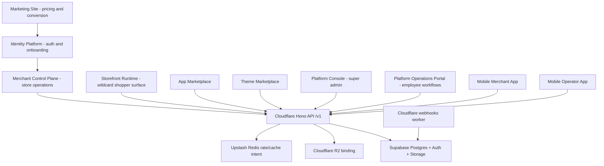

<!-- GENERATED BY scripts/generate-repository-intelligence.mjs ON 2026-05-24T23:23:42.790Z. Regenerate after architecture, routing, schema, or deployment changes. -->
# LetBuyy Master Engineering Constitution

This AGENTS.md is the root operating contract for future Codex, human, and automated engineering work in this repository. It is generated from the current repository shape and replaces the older four-file-only documentation rule with an explicit intelligence tree because the repository now carries AI-readable operational memory under `docs/`.

## Platform Identity

- Name: LetBuyy.
- Product class: Shopify-class, multi-tenant commerce and site-builder SaaS.
- Primary entity mapping: database tables use `sites`; URLs and merchant UI use `store`.
- Business scope: e-commerce stores, portfolios, resumes, blogs, landing pages, app marketplace, theme marketplace, internal platform governance, Flutter builder surfaces, and Cloudflare Workers APIs.
- Target market: India-first merchants, creators, job seekers, freelancers, small businesses, then global expansion.
- Current source scan: 1348 source/config/docs files across 30 main roots, 33 package manifests, 59 Supabase migrations, 270 Next app route files, and 30 Hono route modules.

## Repository Applications

- Identity Platform: `apps/identity-platform` (58 scanned files). All merchant authentication, signup, password, OTP, OAuth callback, session, onboarding and store selection UI.
- Merchant Control Plane: `apps/merchant-control-plane` (165 scanned files). Per-store merchant dashboard, adaptive CMS, products, orders, settings, themes, analytics, and site-type-specific operations.
- Storefront Runtime: `apps/storefront-runtime` (136 scanned files). Wildcard tenant storefronts, public product catalog, customer accounts, cart, checkout, policy pages, and theme previews.
- Marketing Site: `apps/marketing-site` (33 scanned files). Public marketing site, pricing, and conversion flow. Must not host auth pages.
- App Marketplace: `apps/app-marketplace` (39 scanned files). Extension marketplace, developer app submission, app search, install routes and app review APIs.
- Theme Marketplace: `apps/theme-marketplace` (35 scanned files). Theme catalog, theme detail pages, checkout, Supabase-backed theme service, and theme acquisition workflow.
- Platform Console: `apps/platform-console` (22 scanned files). Super admin scaffold for platform operations, users, stores, subscriptions, analytics, employees, audit logs, and MFA.
- Platform Operations Portal: `apps/platform-operations-portal` (20 scanned files). Employee portal scaffold for support, operations, users, stores, marketing and invite flows.
- Mobile Shopper App: `apps/mobile/shopper-app` (1 scanned files). Reserved native shopper runtime for customer browsing, cart, checkout, account, orders, and notifications.
- Mobile Merchant App: `apps/mobile/merchant-app` (151 scanned files). Native/mobile store builder, editor, dashboard, products, themes, preview systems and merchant operations.
- Mobile Operator App: `apps/mobile/operator-app` (19 scanned files). Native operator scaffold for production operations workflows that complement the platform console.

## Repository Packages

- Shared Types: `packages/shared-types` (3 scanned files). Canonical cross-runtime primitives, pagination, address, SEO, money, and API response contracts.
- Tenant Core: `packages/tenant-core` (3 scanned files). Tenant resolution, site/store ownership, subdomain, store model, navigation, and tenant isolation contracts.
- Commerce Core: `packages/commerce-core` (3 scanned files). Product, catalog, inventory, customer, collection, and merchant commerce contracts.
- Checkout Core: `packages/checkout-core` (3 scanned files). Cart, order, checkout, fulfillment, refund, shipping, tax, coupon, and payment orchestration contracts.
- Auth Core: `packages/auth-core` (3 scanned files). Identity, session, actor, RBAC, OTP, password, and auth validation contracts.
- Theme Engine: `packages/theme-engine` (5 scanned files). Theme registry, sections, blocks, templates, releases, hydration, and storefront composition contracts.
- CMS Core: `packages/cms-core` (3 scanned files). Pages, policies, navigation, content, portfolio, resume, and dynamic section contracts.
- Event Core: `packages/event-core` (3 scanned files). Domain events, outbox, webhooks, audit events, queues, and usage event contracts.
- Notification Core: `packages/notification-core` (3 scanned files). Notification templates, recipients, channels, and event-to-notification mapping contracts.
- Search Core: `packages/search-core` (3 scanned files). Search documents, indexing jobs, ranking policy, query DTOs, and provider-neutral search contracts.
- Billing Core: `packages/billing-core` (3 scanned files). Plans, subscriptions, invoices, billing events, entitlements, and usage billing contracts.
- Application Services: `packages/application-services` (14 scanned files). Application workflow sequencing, use-case contracts, execution policy inputs, transaction boundaries, and cross-domain coordination contracts.
- Distributed Runtime: `packages/distributed-runtime` (22 scanned files). Durable event persistence, distributed queues, CQRS, checkpoints, replay, worker coordination, resilience, telemetry, cache, tenant scaling, regional execution, and operations contracts.
- Orchestration: `packages/orchestration` (13 scanned files). Workflow, event, outbox, replay, async execution, recovery, checkpoint, saga, retry, and orchestration coordination contracts.
- Projection Runtime: `packages/projection-runtime` (12 scanned files). Projection persistence, aggregation stores, cache-aware read models, rebuild/replay execution, snapshots, hydration, invalidation, and lifecycle contracts.
- Runtime Composition: `packages/runtime-composition` (14 scanned files). Read orchestration, query aggregation, projection assembly, cache policy, hydration, and runtime response shaping contracts.
- Infrastructure: `packages/infrastructure` (15 scanned files). Provider SDKs, external APIs, storage, queue, cache, analytics, search, payment, provider resilience, retries, and adapter normalization contracts.
- TypeScript UI: `packages/typescript/ui` (6 scanned files). Shared Button, Input, DataTable package and design-system extraction point.
- TypeScript Utils: `packages/typescript/utils` (6 scanned files). Shared Supabase, API and auth utility package.
- API Types: `packages/typescript/api-types` (4 scanned files). Shared TypeScript domain and API contract package.
- Dart Core: `packages/dart/core` (30 scanned files). Dart constants, config, responsive helpers and platform utility package.
- Dart Models: `packages/dart/models` (60 scanned files). Dart commerce, seller, order, cart, analytics, return and notification models.
- Dart Services: `packages/dart/services` (53 scanned files). Dart data, payment, analytics, order, auth, storage and notification services.
- Dart UI Kit: `packages/dart/ui_kit` (25 scanned files). Flutter widgets, themes, empty/loading/error states, and app UI primitives.

## Non-Negotiable Governance

- Preserve tenant isolation. Every merchant-owned record must resolve through `site_id` or an explicit store ownership check.
- Keep authentication centralized in the accounts app UI and API worker services. Landing must not host login/signup pages except redirects.
- API routes must use `/v1` in the Hono worker and should use `/api/v1` at app boundaries when exposed through Next route handlers.
- Use Zod schemas for inbound API payloads. Canonical shared schemas belong in domain packages; API gateway `src/schemas/*` files are compatibility facades for worker imports.
- Never expose Supabase service role keys to client components. Current service-role references are server/worker files only and must remain so.
- Never store auth tokens in `localStorage`. Local storage is acceptable only for non-secret UI preferences or preview-only wishlist/search state.
- Payment code must recalculate prices server-side, verify provider signatures, and require idempotency for mutation/payment endpoints.
- Use `update_updated_at()` only. Do not introduce `update_updated_at_column()` or `update_modified_at()`.
- Do not add a `stores` table. Database ownership remains `sites`; store is a UI and URL term.
- New entity tables require `id`, `created_at`, `updated_at`, `deleted_at`, appropriate audit columns, indexes, and RLS policies.
- Do not leave production `console.log` statements in source. The scan found 23 source files with `console.log`.
- Do not add new `any` types without an explicit local type. The scan found 51 files using `any`.
- Do not hardcode payment provider key ids. The scan found 0 files with hardcoded Razorpay/Stripe-style key identifiers.
- Do not add generated build artifacts to git. `services/api-gateway/dist/*` must remain untracked generated output.

## Repository Mission

- Build LetBuyy as a governed, Shopify-class, multi-tenant commerce operating system.
- Keep runtime ownership, tenant isolation, and source authority visible from the repository tree.
- Prefer enforceable contracts over tribal knowledge: validators, docs, schemas, and ownership files must move with topology changes.

## Canonical Active Runtimes

- Web app runtimes: `apps/storefront-runtime`, `apps/merchant-control-plane`, `apps/identity-platform`, `apps/app-marketplace`, `apps/theme-marketplace`, `apps/marketing-site`, `apps/platform-console`, `apps/platform-operations-portal`.
- Mobile runtimes: `apps/mobile/shopper-app`, `apps/mobile/merchant-app`, `apps/mobile/operator-app`.
- Service runtimes: `services/api-gateway`, `services/webhook-service`, plus reserved service roots documented in `docs/governance/runtime-boundaries.md`.
- Every canonical runtime root must include `runtime.manifest.json`; manifests are machine-readable runtime authority and are enforced by `scripts/validators/runtime-manifest-validator.mjs`.
- Deprecated app aliases are forbidden: `apps/admin`, `apps/auth`, `apps/checkout`, `apps/internal`, `apps/merchant`, `apps/storefront`, and `apps/analytics`.
- `apps/mobile/operator-team-app` and `apps/storefront-runtime/consumer-storefront` are retired topology paths and must not be recreated.

## Runtime Segmentation Rules

- Apps live under `apps/` and own routing, rendering, presentation, runtime adapters, runtime-specific transport, and hooks only.
- Services live under `services/` and own API protocols, auth enforcement, tenant context, idempotency checks, event handlers, queues, webhooks, schedulers, and runtime bootstrapping only.
- Application-services own workflow orchestration, business sequencing, transaction boundaries, execution policy, and cross-domain coordination.
- Shared domain and UI contracts live under `packages/`.
- Schema, RLS, seeds, and verification live under `database/`.
- Provider, DNS, deployment, monitoring, security, and CI config live under `infrastructure/`.
- Deprecated runtime code lives under `legacy/` and must not leak into active runtimes.
- New runtime names require governance docs, validator updates, CI enforcement, and a canonical ownership decision before source is added.

## Actor Segmentation Rules

- Shoppers use storefront and customer-account surfaces only.
- Merchants use identity and merchant control-plane surfaces.
- Partners use app and theme marketplace surfaces.
- Platform operators use console and operations portal surfaces with stronger access controls.
- Provider callbacks enter through webhook/service boundaries, never UI routes without documented ownership.

## Domain Ownership Rules

- Commerce, checkout, auth, tenant, CMS, theme, app, analytics, event, search, notification, billing, UI, shared type, shared utility, and mobile domains have governed package boundaries.
- Core domain contracts belong in `packages/*-core`, `packages/theme-engine`, or `packages/shared-types`, not app pages or service route modules.
- Apps are thin runtime composition layers: routing, rendering, presentation, runtime adapters, runtime-specific transport, and hooks only.
- Services are runtime execution containers: APIs, workers, schedulers, queues, webhooks, event handlers, transport, runtime adapter wiring, and bootstrapping only.
- Application-services own workflow orchestration, business sequencing, transaction boundaries, execution policy, and cross-domain coordination.

## Import Governance Rules

- Apps may never import apps.
- Services may never import apps.
- Packages may never import apps or services.
- Active runtimes may never import `legacy/*` or `infrastructure/*`.
- Cross-runtime behavior moves through HTTP/API contracts, event contracts, or shared package exports.

## Package Governance Rules

- TypeScript packages require `package.json`, `src/index.ts`, `AGENTS.md`, and a `typecheck` script.
- Dart packages require `pubspec.yaml`, `lib/`, and `AGENTS.md`.
- Package `AGENTS.md` files must define purpose, ownership rules, forbidden imports, runtime authority, dependency rules, and migration notes.
- Shared packages expose intentional public contracts only; implementation internals are not cross-runtime APIs.
- UI packages must not depend on data clients, provider SDKs, secrets, or service internals.

## Build Artifact Governance

- `.next`, `dist`, `build`, `coverage`, `.turbo`, `.cache`, `.dart_tool`, `.wrangler`, `.vercel`, `Pods`, `.symlinks`, `*.tsbuildinfo`, `*.dill`, APK/AAB/IPA files, and `*.tar.zst` caches are generated outputs.
- Nested `node_modules` under `apps/`, `services/`, or `packages/` are local pollution and must never become runtime authority.
- Generated outputs must remain ignored, untracked, and excluded from architecture intelligence.
- Raw validation logs and local scan maps must not become source authority; summarize findings in `docs/governance` instead.

## Environment Governance

- Environment contracts live under `config/env/` with templates and schemas.
- Runtime environment ownership lives under `config/env/ownership/`; environment governance process notes live under `config/env/governance/`.
- Runtime env files are local-only and must not be tracked.
- `NEXT_PUBLIC_*` values are public and must never contain secrets.
- Server secrets belong in Vercel, Cloudflare, CI secret stores, or operator shell sessions, not the repository.

## Runtime Isolation Rules

- Runtime roots must have local `AGENTS.md` files.
- Deprecated app alias roots may not coexist with canonical runtimes.
- Placeholder app roots are forbidden; reserve future runtime ownership through docs and validators before creating source roots.
- Runtime code must not rely on generated output as source input.
- Storefront customer auth must remain separate from merchant/admin auth.

## Service Isolation Rules

- Services own server-side enforcement and must remain UI-independent.
- Worker bindings stay inside service boundaries. Provider SDK use belongs in `packages/infrastructure` adapters only.
- Business workflow orchestration must not live in `services/*/src/services/*.service.ts`; services invoke application-service contracts through execution adapters.
- Webhook side effects require signature verification and idempotency before mutation.

## Execution Architecture Rules

- Workflow authority belongs in `packages/application-services`.
- Event routing, retry, outbox, replay, dead-letter, and correlation primitives belong in `packages/orchestration`.
- Read aggregation, projection assembly, cache policy, and runtime response shaping belong in `packages/runtime-composition`.
- Provider APIs, SDK clients, retries, and provider normalization belong in `packages/infrastructure`.
- Runtime manifests must declare orchestration, event, workflow, query, composition, execution, distributed execution, queue, checkpoint, projection, observability, cache, resilience, regional, tenant scaling, and provider ownership.

## Infrastructure Ownership

- Cloudflare configuration belongs under `infrastructure/cloudflare` and service `wrangler.toml` files.
- DNS belongs under `infrastructure/dns`.
- Deployment, monitoring, observability, security, and CI policy belong under their matching `infrastructure/` directories.
- Infrastructure code may reference runtime paths for deployment, but runtime code may not import `infrastructure/*`; provider execution uses `packages/infrastructure` adapters.

## Naming Conventions

- Database tables use `sites`; UI and URLs may say store.
- API worker surfaces use `/v1`; app-exposed API boundaries should use `/api/v1` when proxying versioned contracts.
- Trigger function name is `update_updated_at()` only.
- Runtime names describe operational ownership, not implementation fashion.

## Folder Conventions

- `apps/*` for user-facing runtimes.
- `services/*` for independently deployable backends and workers.
- `packages/*` for reusable contracts, domain logic, utilities, and UI.
- `config/env/*` for environment templates and schemas.
- `config/runtime/*` for runtime manifest schemas and future runtime-governance config.
- `docs/governance/*` for persistent human-authored governance memory.
- `scripts/validators/*` for CI-enforced governance checks, with reusable tooling organized under `scripts/governance`, `scripts/generators`, `scripts/migration`, and `scripts/utilities`.
- `legacy/*` for isolated historical systems.
- Temporary root scripts and debug outputs are forbidden; short-lived analysis belongs under ignored `.codex/`, `.analysis/`, `.tmp/`, or `temp/` and must be deleted before handoff.

## Generated Artifact Rules

- Generated artifacts must not be tracked, imported, documented as source, or used as ownership evidence.
- Debug logs, trace files, and raw validation output must be deleted or summarized as governance memory.
- If generated output appears in Git history, document remediation and prevent recurrence before attempting coordinated history rewrite.
- Local generated pollution must be cleaned before final handoff.

## Git Hygiene Rules

- Use selective staging and atomic commits.
- Use commit format `type(scope): concise summary`.
- Do not rewrite history or remove user-owned changes without explicit instruction.
- Large object remediation requires a planned BFG or `git filter-repo` maintenance window.

## Dependency Governance

- Dependency direction is `apps -> packages`, `apps -> services by API`, `services -> packages`, and `packages -> packages` only.
- Database and infrastructure do not import runtime code.
- Shared logic graduates into packages before reuse.
- API contract aggregation through `@letbuyy/api-types` is backward compatibility only; new domain authority belongs in the domain package public export.
- `scripts/validators/dependency-graph-validator.mjs` enforces dependency direction, package layering, and circular dependency prevention.

## CI/CD Governance

- CI must run `node scripts/validate-governance.mjs` for topology-sensitive changes.
- CI must fail on app-to-app imports, package-to-runtime imports, tracked generated artifacts, local artifact pollution, missing runtime manifests, invalid dependency direction, tracked env files, invalid runtime roots, and legacy leakage.
- Build, lint, typecheck, and test jobs should be added per runtime as blockers are retired.

## Documentation Governance

- `docs/governance` is persistent operational memory.
- Generated intelligence must stay marked as generated and source-derived.
- Architecture, routing, schema, infrastructure, and package-boundary changes require docs and intelligence refresh.
- Docs must distinguish built behavior from planned or aspirational behavior.

## AI Agent Rules

- Read root and local `AGENTS.md`, `memory/lessons.md`, and `tasks/todo.md` before edits.
- Inspect source before architecture decisions.
- Preserve tenant isolation and runtime boundaries.
- Run governance validation before handoff.
- Update runtime manifests and governance docs before moving, renaming, creating, or retiring runtime roots.

## Forbidden Architectural Patterns

- App-to-app imports.
- Package imports from apps or services.
- Active runtime imports from `legacy/*` or repository-level `infrastructure/*`.
- Runtime dependence on `.next`, `dist`, `.wrangler`, `.turbo`, Flutter build output, or generated logs.
- Runtime-local `node_modules` as source authority or committed content.
- Reintroducing deprecated runtime aliases, `apps/mobile/operator-team-app`, or nested `consumer-storefront` source trees.
- Tracked runtime env files or committed secrets.
- Duplicated auth ownership across apps and services without documented canonical owner.

## Approved Architectural Patterns

- App boundary adapters calling versioned service APIs.
- Service execution adapters calling application-service workflows with package-owned Zod validation and sanitized `AppError` responses.
- Shared contracts, DTOs, schemas, and pure utilities through package public exports.
- Tenant-aware database access using `site_id` or explicit ownership checks.
- Human-authored governance docs backed by automated validators.

## Architecture Boundaries

## Frontend Governance

- Default to Next Server Components; use client components only for stateful UI, browser APIs, event handlers, or context providers.
- Keep app-specific UI close to its app until a component is reused by two or more apps, then extract to `packages/typescript/ui`.
- Web icons must be Lucide React; Flutter icons must be Material Icons.
- Every screen must support light and dark mode, skeleton loading, empty states, error states with retry, focus states, hover states, active states, and disabled states.
- Avoid inline React styles in new work. The scan found 145 files with `style={{...}}`; prefer Tailwind and shared tokens.
- Storefront UI must optimize for real shopper flows: product browsing, cart, checkout, customer account, policy pages, and mobile responsiveness.
- Merchant/admin UI must prioritize dense operational scanning, reliable forms, tables, filters, bulk operations, and low-friction repeated work.

## Backend and API Governance

- Hono worker entrypoint: `services/api-gateway/src/index.ts`.
- Public Hono surfaces currently mount `auth`, `contacts`, and `storefront` before global auth middleware.
- Protected Hono surfaces currently mount: admin, ai, analytics, app-store, auth, blog, categories, contacts, coupons, customers, employee, export, form-submissions, inventory, media, notifications, onboarding, operations, orders, pages, payments, portfolio, products, resume, reviews, shipping-tax, storefront, stores, themes, upload.
- Use `AppError` and `formatAppError` for known errors. Unexpected errors must log internally and return sanitized `INTERNAL_ERROR` responses.
- All list endpoints require pagination; all mutation endpoints should require validation and idempotency where side effects can duplicate.
- Add shared business contracts to domain packages and runtime execution logic to services, not page components or route handlers.

## Auth and Session Governance

- Accounts app owns merchant login, signup, lookup, reset password, set password, OTP, select store, and email endpoints.
- Storefront customer auth is separate from merchant auth and must never grant merchant/admin privileges.
- Console and team auth must enforce email allowlists, 2FA/TOTP, IP/VPN controls for production operations, and audit logging.
- Cookies must be HTTP-only, Secure in production, SameSite=Strict unless an explicit cross-site redirect flow requires a documented exception.
- Do not duplicate auth logic between Next handlers and the worker without documenting the canonical owner.

## Database Governance

- Migration root: `database/supabase/migrations`.
- Tables detected: 176.
- Indexes detected: 338.
- RLS-enabled table statements detected: 175.
- Duplicate/non-standard migration numeric prefixes detected: none.
- New migrations must be sequential, unique, reversible, and must not depend on generated application artifacts.

## Cloudflare and Vercel Governance

- Vercel install command currently removes app-local Next copies before `pnpm install`; this is a workaround and should not become app logic.
- Cloudflare Workers are configured through `services/api-gateway/wrangler.toml` and `services/webhook-service/wrangler.toml`.
- Terraform DNS config lives in `infrastructure/dns/dns.tf` and includes service records for LetBuyy subdomains.
- Wildcard tenant routing belongs to storefront middleware and Cloudflare DNS, not individual tenant Next routes.
- Custom domains require ownership verification, CNAME/TXT validation, SSL issuance, tenant mapping, and takeover prevention before activation.

## Payment and Checkout Governance

- Payment surfaces exist in worker `payments.ts`, storefront Stripe/PayPal Next route handlers, admin subscription checkout UI, and webhooks worker.
- Razorpay, Stripe, and PayPal must be treated as separate adapters behind common order/payment state transitions.
- Do not trust client-submitted totals or provider names. Rebuild totals from database products, discounts, taxes, shipping, and subscription plans.
- Webhooks must verify signatures before parsing side effects, record idempotency keys/event ids, and reconcile order/subscription state safely.

## Observability and Runtime Governance

- Every request should carry `X-Request-ID`; worker middleware already sets request-id/timing concerns.
- Production logs must be structured, redacted, and correlated. Avoid raw DB errors in client responses.
- Add health endpoints and external monitoring before marking services production-ready.
- Generated docs are operational memory. Update them after changes to routes, migrations, auth flows, infrastructure or package boundaries.

## AI Execution Rules

- Start by reading this file, `memory/lessons.md`, `tasks/todo.md`, and the relevant local AGENTS.md for the app/package being edited.
- Treat dirty worktree changes as user-owned. Do not revert changes you did not make.
- Inspect the actual source before changing architecture or docs. Do not trust stale archived docs over source files.
- Prefer scoped edits, service-layer logic, shared types, and existing local patterns.
- After significant architecture changes, regenerate `docs/architecture/master-system-intelligence.md` with `node scripts/generate-repository-intelligence.mjs`.
- Verification for code changes: affected build, lint/typecheck, and user-flow browser/emulator test where applicable. Docs-only changes require presence and line-count verification.

## Current Risk Register

- Critical security tasks remain in `tasks/todo.md`: secret rotation, webhook verification parity, auth rate limiting, CSRF, and server-side price recalculation.
- `all.env` is referenced in governance memory as historically committed. The generator reports env files by name only and must never print secret values.
- The codebase contains active Next route handlers for auth and payments in addition to the Hono worker, so ownership must be clarified before refactors.
- The docs tree now intentionally contains generated intelligence docs. Keep generated content marked and source-derived.

## Source-Derived Quick Map

| Surface | Count | Notes |
|---|---:|---|
| Source/config/docs files scanned | 1348 | Generated artifacts excluded from source intelligence where possible |
| Package manifests | 33 | pnpm workspace plus worker packages |
| Next app route files | 270 | Includes pages, layouts, route handlers, loading/error files |
| Next API route handlers | 118 | App-local API surface still exists |
| Hono route modules | 30 | Worker route modules under services/api-gateway/src/routes |
| Supabase migrations | 59 | Numeric prefix conflicts: 0 |
| Environment variable names referenced | 103 | Names only, no values printed |
