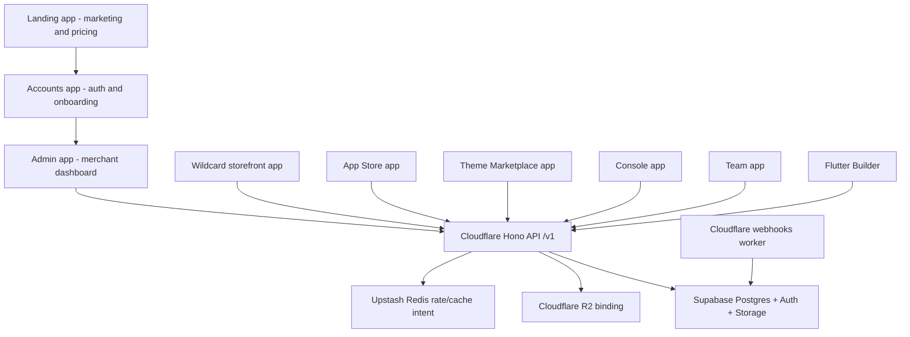

<!-- GENERATED BY scripts/generate-repository-intelligence.mjs ON 2026-05-22T11:07:13.830Z. Regenerate after architecture, routing, schema, or deployment changes. -->
# LetBuyy Master Engineering Constitution

This AGENTS.md is the root operating contract for future Codex, human, and automated engineering work in this repository. It is generated from the current repository shape and replaces the older four-file-only documentation rule with an explicit intelligence tree because the repository now carries AI-readable operational memory under `docs/`.

## Platform Identity

- Name: LetBuyy.
- Product class: Shopify-class, multi-tenant commerce and site-builder SaaS.
- Primary entity mapping: database tables use `sites`; URLs and merchant UI use `store`.
- Business scope: e-commerce stores, portfolios, resumes, blogs, landing pages, app marketplace, theme marketplace, internal platform governance, Flutter builder surfaces, and Cloudflare Workers APIs.
- Target market: India-first merchants, creators, job seekers, freelancers, small businesses, then global expansion.
- Current source scan: 1301 source/config/docs files across 20 main roots, 15 package manifests, 55 Supabase migrations, 276 Next app route files, and 30 Hono route modules.

## Repository Applications

- Accounts: `apps/web/consumer/accounts` (58 scanned files). All merchant authentication, signup, password, OTP, OAuth callback, session, onboarding and store selection UI.
- Admin: `apps/web/consumer/admin` (161 scanned files). Per-store merchant dashboard, adaptive CMS, products, orders, settings, themes, analytics, and site-type-specific operations.
- Storefront: `apps/web/consumer/storefront` (203 scanned files). Wildcard tenant storefronts, public product catalog, customer accounts, cart, checkout, policy pages, and theme previews.
- Landing: `apps/web/consumer/landing` (33 scanned files). Public marketing site, pricing, and conversion flow. Must not host auth pages.
- App Store: `apps/web/consumer/app-store` (38 scanned files). Extension marketplace, developer app submission, app search, install routes and app review APIs.
- Theme Marketplace: `apps/web/consumer/theme-marketplace` (35 scanned files). Theme catalog, theme detail pages, checkout, Supabase-backed theme service, and theme acquisition workflow.
- Console: `apps/web/administrative/console` (22 scanned files). Super admin scaffold for platform operations, users, stores, subscriptions, analytics, employees, audit logs, and MFA.
- Team: `apps/web/administrative/team` (20 scanned files). Employee portal scaffold for support, operations, users, stores, marketing and invite flows.
- Flutter Builder: `apps/flutter/builder` (150 scanned files). Native/mobile store builder, editor, dashboard, products, themes, preview systems and merchant operations.
- Flutter Super Admin: `apps/flutter/super_admin` (18 scanned files). Native super admin scaffold.
- Flutter Team: `apps/flutter/team` (18 scanned files). Native team scaffold.

## Repository Packages

- TypeScript UI: `packages/typescript/ui` (6 scanned files). Shared Button, Input, DataTable package and design-system extraction point.
- TypeScript Utils: `packages/typescript/utils` (6 scanned files). Shared Supabase, API and auth utility package.
- API Types: `packages/typescript/api-types` (4 scanned files). Shared TypeScript domain and API contract package.
- Dart Core: `packages/dart/core` (30 scanned files). Dart constants, config, responsive helpers and platform utility package.
- Dart Models: `packages/dart/models` (54 scanned files). Dart commerce, seller, order, cart, analytics, return and notification models.
- Dart Services: `packages/dart/services` (54 scanned files). Dart data, payment, analytics, order, auth, storage and notification services.
- Dart UI Kit: `packages/dart/ui_kit` (25 scanned files). Flutter widgets, themes, empty/loading/error states, and app UI primitives.

## Non-Negotiable Governance

- Preserve tenant isolation. Every merchant-owned record must resolve through `site_id` or an explicit store ownership check.
- Keep authentication centralized in the accounts app UI and API worker services. Landing must not host login/signup pages except redirects.
- API routes must use `/v1` in the Hono worker and should use `/api/v1` at app boundaries when exposed through Next route handlers.
- Use Zod schemas for inbound API payloads. The worker already contains `backend/workers/api/src/schemas/*`; add new schemas there before adding handlers.
- Never expose Supabase service role keys to client components. Current service-role references are server/worker files only and must remain so.
- Never store auth tokens in `localStorage`. Local storage is acceptable only for non-secret UI preferences or preview-only wishlist/search state.
- Payment code must recalculate prices server-side, verify provider signatures, and require idempotency for mutation/payment endpoints.
- Use `update_updated_at()` only. Do not introduce `update_updated_at_column()` or `update_modified_at()`.
- Do not add a `stores` table. Database ownership remains `sites`; store is a UI and URL term.
- New entity tables require `id`, `created_at`, `updated_at`, `deleted_at`, appropriate audit columns, indexes, and RLS policies.
- Do not leave production `console.log` statements in source. The scan found 50 source files with `console.log`.
- Do not add new `any` types without an explicit local type. The scan found 69 files using `any`.
- Do not hardcode payment provider key ids. The scan found 2 files with hardcoded Razorpay/Stripe-style key identifiers.
- Do not add generated build artifacts to git. `backend/workers/api/dist/*` is currently tracked and should be treated as generated output debt.

## Architecture Boundaries

## Frontend Governance

- Default to Next Server Components; use client components only for stateful UI, browser APIs, event handlers, or context providers.
- Keep app-specific UI close to its app until a component is reused by two or more apps, then extract to `packages/typescript/ui`.
- Web icons must be Lucide React; Flutter icons must be Material Icons.
- Every screen must support light and dark mode, skeleton loading, empty states, error states with retry, focus states, hover states, active states, and disabled states.
- Avoid inline React styles in new work. The scan found 165 files with `style={{...}}`; prefer Tailwind and shared tokens.
- Storefront UI must optimize for real shopper flows: product browsing, cart, checkout, customer account, policy pages, and mobile responsiveness.
- Merchant/admin UI must prioritize dense operational scanning, reliable forms, tables, filters, bulk operations, and low-friction repeated work.

## Backend and API Governance

- Hono worker entrypoint: `backend/workers/api/src/index.ts`.
- Public Hono surfaces currently mount `auth`, `contacts`, and `storefront` before global auth middleware.
- Protected Hono surfaces currently mount: admin, ai, analytics, app-store, auth, blog, categories, contacts, coupons, customers, employee, export, form-submissions, inventory, media, notifications, onboarding, operations, orders, pages, payments, portfolio, products, resume, reviews, shipping-tax, storefront, stores, themes, upload.
- Use `AppError` and `formatAppError` for known errors. Unexpected errors must log internally and return sanitized `INTERNAL_ERROR` responses.
- All list endpoints require pagination; all mutation endpoints should require validation and idempotency where side effects can duplicate.
- Add business logic to services, not handlers. Existing service roots include `backend/workers/api/src/services` and app `src/lib/*service*` files.

## Auth and Session Governance

- Accounts app owns merchant login, signup, lookup, reset password, set password, OTP, select store, and email endpoints.
- Storefront customer auth is separate from merchant auth and must never grant merchant/admin privileges.
- Console and team auth must enforce email allowlists, 2FA/TOTP, IP/VPN controls for production operations, and audit logging.
- Cookies must be HTTP-only, Secure in production, SameSite=Strict unless an explicit cross-site redirect flow requires a documented exception.
- Do not duplicate auth logic between Next handlers and the worker without documenting the canonical owner.

## Database Governance

- Migration root: `backend/supabase/migrations`.
- Tables detected: 164.
- Indexes detected: 320.
- RLS-enabled table statements detected: 163.
- Duplicate/non-standard migration numeric prefixes detected: 022 (022_media_and_forms.sql, 022a_deactivate_non_urban_kicks_themes.sql).
- New migrations must be sequential, unique, reversible, and must not depend on generated application artifacts.

## Cloudflare and Vercel Governance

- Vercel install command currently removes app-local Next copies before `pnpm install`; this is a workaround and should not become app logic.
- Cloudflare Workers are configured through `backend/workers/api/wrangler.toml` and `backend/workers/webhooks/wrangler.toml`.
- Terraform DNS config lives in `infrastructure/dns.tf` and includes service records for LetBuyy subdomains.
- Wildcard tenant routing belongs to storefront middleware and Cloudflare DNS, not individual tenant Next routes.
- Custom domains require ownership verification, CNAME/TXT validation, SSL issuance, tenant mapping, and takeover prevention before activation.

## Payment and Checkout Governance

- Payment surfaces exist in worker `payments.ts`, storefront Stripe/PayPal Next route handlers, admin subscription checkout UI, and webhooks worker.
- Razorpay, Stripe, and PayPal must be treated as separate adapters behind common order/payment state transitions.
- Do not trust client-submitted totals or provider names. Rebuild totals from database products, discounts, taxes, shipping, and subscription plans.
- Webhooks must verify signatures before parsing side effects, record idempotency keys/event ids, and reconcile order/subscription state safely.

## Observability and Runtime Governance

- Every request should carry `X-Request-ID`; worker middleware already sets request-id/timing concerns.
- Production logs must be structured, redacted, and correlated. Avoid raw DB errors in client responses.
- Add health endpoints and external monitoring before marking services production-ready.
- Generated docs are operational memory. Update them after changes to routes, migrations, auth flows, infrastructure or package boundaries.

## AI Execution Rules

- Start by reading this file, `memory/lessons.md`, `tasks/todo.md`, and the relevant local AGENTS.md for the app/package being edited.
- Treat dirty worktree changes as user-owned. Do not revert changes you did not make.
- Inspect the actual source before changing architecture or docs. Do not trust stale archived docs over source files.
- Prefer scoped edits, service-layer logic, shared types, and existing local patterns.
- After significant architecture changes, regenerate `docs/architecture/master-system-intelligence.md` with `node scripts/generate-repository-intelligence.mjs`.
- Verification for code changes: affected build, lint/typecheck, and user-flow browser/emulator test where applicable. Docs-only changes require presence and line-count verification.

## Current Risk Register

- Critical security tasks remain in `tasks/todo.md`: secret rotation, webhook verification parity, auth rate limiting, CSRF, and server-side price recalculation.
- `all.env` is referenced in governance memory as historically committed. The generator reports env files by name only and must never print secret values.
- The codebase contains active Next route handlers for auth and payments in addition to the Hono worker, so ownership must be clarified before refactors.
- The docs tree now intentionally contains generated intelligence docs. Keep generated content marked and source-derived.

## Source-Derived Quick Map

| Surface | Count | Notes |
|---|---:|---|
| Source/config/docs files scanned | 1301 | Generated artifacts excluded from source intelligence where possible |
| Package manifests | 15 | pnpm workspace plus worker packages |
| Next app route files | 276 | Includes pages, layouts, route handlers, loading/error files |
| Next API route handlers | 114 | App-local API surface still exists |
| Hono route modules | 30 | Worker route modules under backend/workers/api/src/routes |
| Supabase migrations | 55 | Numeric prefix conflicts: 1 |
| Environment variable names referenced | 199 | Names only, no values printed |
