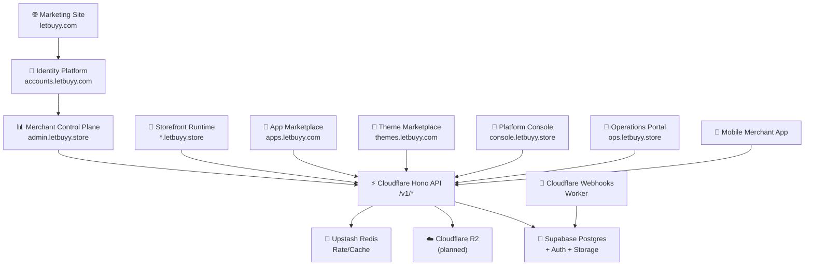

# 🏪 LetBuyy Store — Comprehensive Codebase Report
## Part 1: Executive Summary & Repository Overview

> **Report Date:** 2026-05-29 | **Scan Scope:** Full repository | **Status:** Production-aspirational, active development

---

## 1. Platform Identity

| Attribute | Value |
|-----------|-------|
| **Name** | LetBuyy |
| **Product Class** | Shopify-class, multi-tenant commerce & site-builder SaaS |
| **Target Market** | India-first merchants, creators, job seekers, freelancers, small businesses |
| **Site Types** | E-commerce stores, Portfolios, Resumes, Blogs, Landing Pages |
| **Primary Entity** | DB uses `sites`; UI and URLs use `store` |
| **Expansion** | App Marketplace, Theme Marketplace, Internal Platform Governance |

---

## 2. Repository Statistics At-A-Glance

```
┌─────────────────────────────────────┬──────────┐
│ Metric                              │ Count    │
├─────────────────────────────────────┼──────────┤
│ Total source/config/doc files       │ ~2,119   │
│ App source files (TS/TSX)           │ 436      │
│ Package source files (TS/Dart)      │ 323      │
│ Service source files (TS)           │ 76       │
│ SQL migration files                 │ 84       │
│ Validator scripts (.mjs)            │ 132      │
│ Test files                          │ 92       │
│ Runtime manifests                   │ 20       │
│ Governance documents                │ 116      │
│ Documentation directories           │ 75       │
│ Supabase migrations (numbered)      │ 65       │
│ D1 (Cloudflare) DB directory        │ 1        │
├─────────────────────────────────────┼──────────┤
│ Web applications (Next.js)          │ 8        │
│ Mobile applications (Flutter)       │ 3        │
│ Backend services (Hono/Workers)     │ 9        │
│ Domain packages (TypeScript)        │ 22       │
│ Dart packages                       │ 4        │
│ Infrastructure adapters             │ 12       │
└─────────────────────────────────────┴──────────┘
```

---

## 3. Technology Stack

### Web (Next.js Monorepo)
| Layer | Technology |
|-------|-----------|
| **Framework** | Next.js 16.x (App Router, Server Components) |
| **Language** | TypeScript 5.9.3 |
| **Styling** | Tailwind CSS + CSS custom properties |
| **Package Manager** | pnpm 10.6.2 (strict isolated mode) |
| **Monorepo Orchestrator** | Turborepo 2.8.9 |
| **State Management** | React Context + Server Components |
| **Validation** | Zod schemas (shared across client/server) |
| **Database** | Supabase (PostgreSQL) + Cloudflare D1 |
| **Auth** | Supabase Auth + custom JWT + session cookies |
| **Payments** | Razorpay, Stripe, PayPal (multi-provider) |
| **Email** | Resend |
| **Rate Limiting** | Upstash Redis |
| **Bot Protection** | Cloudflare Turnstile |
| **Edge API** | Cloudflare Workers + Hono framework |
| **Storage** | Cloudflare R2 (planned) |
| **Caching** | Upstash Redis + Cloudflare KV (planned) |
| **Deployment** | Vercel (web apps) + Cloudflare Workers (API) |

### Mobile (Flutter)
| Layer | Technology |
|-------|-----------|
| **Framework** | Flutter (Dart) |
| **State** | Provider + ChangeNotifier |
| **Navigation** | Named routes |
| **Networking** | HTTP + Supabase SDK |
| **Storage** | SharedPreferences + Supabase Storage |
| **Payments** | Razorpay SDK |
| **Theme** | Custom Material Design system |

---

## 4. Monorepo Topology

```mermaid
graph TB
    subgraph "apps/ — User-Facing Runtimes"
        IP["identity-platform<br/>:3001"]
        MCP["merchant-control-plane<br/>:3002"]
        SR["storefront-runtime<br/>:3003"]
        AM["app-marketplace<br/>:3004"]
        TM["theme-marketplace<br/>:3005"]
        MS["marketing-site<br/>:3000"]
        PC["platform-console<br/>:3010"]
        POP["platform-operations-portal<br/>:3011"]
        subgraph "mobile/"
            MA["merchant-app<br/>(Flutter)"]
            SA["shopper-app<br/>(Flutter)"]
            OA["operator-app<br/>(Flutter)"]
        end
    end

    subgraph "packages/ — Shared Contracts"
        ST["shared-types"]
        TC["tenant-core"]
        CC["commerce-core"]
        CK["checkout-core"]
        AC["auth-core"]
        TE["theme-engine"]
        CM["cms-core"]
        EC["event-core"]
        NC["notification-core"]
        SC["search-core"]
        BC["billing-core"]
        AE["app-engine"]
        AS["application-services"]
        DR["distributed-runtime"]
        OR["orchestration"]
        PR["projection-runtime"]
        RC["runtime-composition"]
        INF["infrastructure"]
        UI["typescript/ui"]
        UT["typescript/utils"]
        AT["typescript/api-types"]
    end

    subgraph "services/ — Backend Workers"
        AG["api-gateway<br/>(Hono/CF Worker)"]
        WS["webhook-service"]
        QW["queue-workers"]
        AP["analytics-pipeline"]
        CR["checkout-runtime"]
        EB["event-bus"]
        MSV["media-service"]
        NS["notification-service"]
        SS["search-service"]
    end

    subgraph "database/"
        SB["supabase/migrations<br/>(65 files)"]
        CF["cloudflare/d1"]
    end

    IP & MCP & SR --> AG
    AG --> SB
    AG --> INF
    MCP --> CC & CK & TE
    SR --> CC & CK & CM & TE
    IP --> AC
    AM --> AE
    TM --> TE
```



---

## 5. Application Runtimes — Overview Matrix

### 5.1 Web Applications

| App | Port | Package Name | Routes | Status |
|-----|------|-------------|--------|--------|
| **Marketing Site** | 3000 | `@letbuyy/marketing-site` | Landing, Pricing, Features | 🟢 Built |
| **Identity Platform** | 3001 | `@letbuyy/identity-platform` | Login, Signup, OTP, Reset, Onboarding, Store Selection | 🟢 Built |
| **Merchant Control Plane** | 3002 | `@letbuyy/merchant-control-plane` | Dashboard, Products, Orders, Themes, Settings, CMS, Analytics (40+ routes) | 🟡 Partial |
| **Storefront Runtime** | 3003 | `@letbuyy/storefront-runtime` | Dynamic wildcard storefronts, Cart, Checkout, Customer accounts | 🟡 Partial |
| **App Marketplace** | 3004 | `@letbuyy/app-marketplace` | App catalog, Developer tools, Install flows | 🟡 Partial |
| **Theme Marketplace** | 3005 | `@letbuyy/theme-marketplace` | Theme catalog, Detail, Checkout, Dashboard | 🟡 Partial |
| **Platform Console** | 3010 | `@letbuyy/platform-console` | Super admin: Users, Stores, Subscriptions, Analytics, Audit | 🔴 Scaffold |
| **Operations Portal** | 3011 | `@letbuyy/platform-operations-portal` | Employee portal: Support, Operations, Marketing | 🔴 Scaffold |

### 5.2 Mobile Applications

| App | Platform | Status |
|-----|----------|--------|
| **Merchant App** | Flutter (Android/iOS) | 🟡 Active development (~151 files) |
| **Shopper App** | Flutter | 🔴 Reserved (1 file placeholder) |
| **Operator App** | Flutter | 🔴 Scaffold (~19 files) |

### 5.3 Backend Services

| Service | Runtime | Status |
|---------|---------|--------|
| **API Gateway** | Cloudflare Worker + Hono | 🟢 Active (30 route modules, 16 schemas) |
| **Webhook Service** | Cloudflare Worker | 🟡 Scaffold |
| **Queue Workers** | Cloudflare Worker | 🟡 Scaffold |
| **Analytics Pipeline** | Planned | 🔴 Manifest only |
| **Checkout Runtime** | Planned | 🔴 Manifest only |
| **Event Bus** | Planned | 🔴 Manifest only |
| **Media Service** | Planned | 🔴 Manifest only |
| **Notification Service** | Planned | 🔴 Manifest only |
| **Search Service** | Planned | 🔴 Manifest only |

---

## 6. Architecture Boundaries



---

## 7. Workspace Configuration

### pnpm-workspace.yaml — 23 workspace members
```
apps/*                           → 8 web apps
apps/mobile/*                    → 3 mobile apps
packages/shared-types            → Core type primitives
packages/tenant-core             → Tenant resolution
packages/commerce-core           → Product & catalog contracts
packages/checkout-core           → Cart, order, payment contracts
packages/auth-core               → Identity & RBAC contracts
packages/app-engine              → App marketplace contracts
packages/theme-engine            → Theme composition contracts
packages/cms-core                → CMS page contracts
packages/event-core              → Domain event contracts
packages/notification-core       → Notification contracts
packages/search-core             → Search contracts
packages/billing-core            → Billing & subscription contracts
packages/application-services    → Workflow orchestration contracts
packages/distributed-runtime     → Distributed systems contracts
packages/projection-runtime      → Read model contracts
packages/infrastructure          → Provider adapters
packages/orchestration           → Saga & retry contracts
packages/runtime-composition     → Query aggregation contracts
packages/typescript/*            → UI, Utils, API Types
services/*                       → 9 backend services
```

### Turborepo Tasks
| Task | Dependencies | Outputs |
|------|-------------|---------|
| `build` | `^typecheck`, `^build` | `.next/**`, `dist/**` |
| `dev` | — | Persistent, no cache |
| `lint` | — | — |
| `test` | `^typecheck` | `coverage/**` |
| `typecheck` | `^build` | — |

### Environment Variables (Turbo-tracked)
- `NEXT_PUBLIC_SUPABASE_URL`, `NEXT_PUBLIC_SUPABASE_ANON_KEY`
- `NEXT_PUBLIC_ACCOUNTS_URL`, `NEXT_PUBLIC_ADMIN_URL`
- `RESEND_API_KEY`, `RESEND_FROM_EMAIL`
- `UPSTASH_REDIS_REST_URL`, `UPSTASH_REDIS_REST_TOKEN`
- `TURNSTILE_SECRET_KEY`, `NEXT_PUBLIC_TURNSTILE_SITE_KEY`
