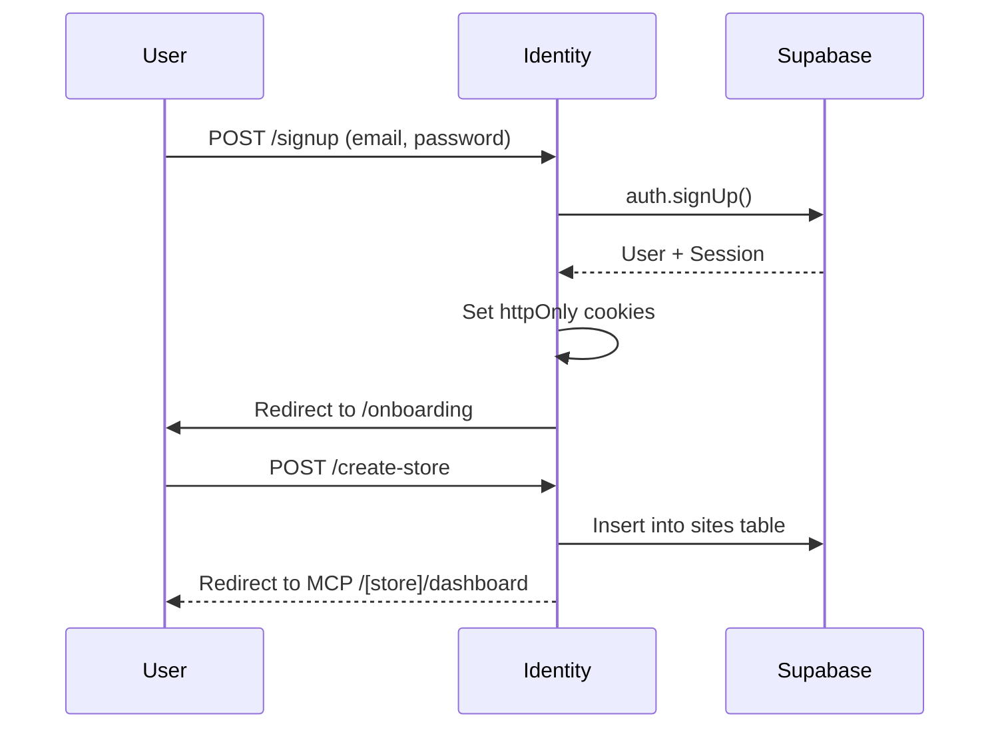

# 🏪 LetBuyy Store — Comprehensive Codebase Report
## Part 2: Web Applications Deep Dive

---

## 1. Identity Platform (`apps/identity-platform/`)

> **Purpose:** Centralized merchant authentication, signup, password management, OTP, OAuth, onboarding, and store selection.

### Port: 3001 | Package: `@letbuyy/identity-platform`

### Route Map
| Route | Purpose | Status |
|-------|---------|--------|
| `/` | Landing/redirect | ✅ |
| `/login` | Email+password login | ✅ |
| `/signup` | New merchant registration | ✅ |
| `/verify-otp` | OTP verification | ✅ |
| `/forgot-password` | Password reset request | ✅ |
| `/reset-password` | Password reset form | ✅ |
| `/onboarding` | Post-signup store creation wizard | ✅ |
| `/select-store` | Multi-store account selector | ✅ |
| `/api/auth/*` | 18 API route files for auth operations | ✅ |

### Key API Routes
- `POST /api/auth/signup` — Register with email+password
- `POST /api/auth/login` — Email+password authentication
- `POST /api/auth/send-otp` — Send 6-digit OTP to email
- `POST /api/auth/verify-otp` — Verify OTP token
- `POST /api/auth/send-reset` — Send password reset email
- `POST /api/auth/set-password` — Update password with reset token
- `POST /api/auth/logout` — Clear session
- `GET /api/auth/user` — Get current user profile
- `POST /api/auth/create-store` — Create new store during onboarding
- `GET /api/auth/stores` — List user's stores

### Auth Flow


### Components
- Login form with Turnstile captcha
- Signup form with password strength validation
- OTP input (6-digit)
- Store creation wizard (name, type, subdomain)
- Store selector grid

> [!WARNING]
> **Lesson 9:** Auth logic currently split between Next.js API routes and API Gateway. Should be centralized in API Gateway.

---

## 2. Merchant Control Plane (`apps/merchant-control-plane/`)

> **Purpose:** Per-store merchant dashboard — the Shopify admin equivalent. Manages products, orders, themes, CMS, analytics, settings, and site-type-specific operations.

### Port: 3002 | Package: `@letbuyy/merchant-control-plane`

### Route Map — Full Inventory (40+ routes)

#### Core Commerce Routes
| Route | Purpose |
|-------|---------|
| `/[store]/dashboard` | Main dashboard with stats, charts, activity feed |
| `/[store]/products` | Product list with search, filter, bulk actions |
| `/[store]/products/new` | Create product form (full Shopify-class) |
| `/[store]/products/[productId]` | Edit individual product |
| `/[store]/products/collections` | Product collections management |
| `/[store]/products/inventory` | Multi-location inventory management |
| `/[store]/products/gift-cards` | Gift card creation and management |
| `/[store]/products/purchase-orders` | Supplier purchase orders |
| `/[store]/products/transfers` | Inter-location stock transfers |
| `/[store]/orders` | Order list, status management, fulfillment |
| `/[store]/customers` | Customer list, profiles, addresses |
| `/[store]/categories` | Product category tree management |
| `/[store]/coupons` | Coupon/discount code management |
| `/[store]/reviews` | Product review moderation |
| `/[store]/analytics` | Store analytics dashboard |

#### CMS / Content Routes
| Route | Purpose |
|-------|---------|
| `/[store]/pages` | Custom page builder |
| `/[store]/posts` | Blog post management |
| `/[store]/comments` | Blog comment moderation |
| `/[store]/gallery` | Media gallery / portfolio |
| `/[store]/contact` | Contact form submissions |
| `/[store]/leads` | Lead management |

#### Site-Type Specific Routes (Portfolio/Resume)
| Route | Purpose |
|-------|---------|
| `/[store]/experience` | Work experience entries |
| `/[store]/education` | Education entries |
| `/[store]/skills` | Skills listing |
| `/[store]/certifications` | Certification entries |
| `/[store]/projects` | Project showcase |
| `/[store]/testimonials` | Testimonial management |
| `/[store]/export` | PDF resume export |
| `/[store]/ats-score` | ATS compatibility checker |

#### Theme & Appearance Routes
| Route | Purpose |
|-------|---------|
| `/[store]/online-store` | Online store overview |
| `/[store]/online-store/themes` | Theme catalog and management |
| `/[store]/online-store/themes/[themeId]/editor` | Visual theme editor |
| `/[store]/online-store/pages` | CMS page management |
| `/[store]/online-store/preferences` | Store preferences |
| `/[store]/appearance` | Store appearance settings |

#### Settings Routes
| Route | Purpose |
|-------|---------|
| `/[store]/settings` | Settings overview |
| `/[store]/settings/general` | Store name, description, logo |
| `/[store]/settings/billing` | Billing and invoices |
| `/[store]/settings/checkout` | Checkout configuration |
| `/[store]/settings/domains` | Custom domain management |
| `/[store]/settings/notifications` | Notification preferences |
| `/[store]/settings/payments` | Payment gateway config |
| `/[store]/settings/plan` | Subscription plan |
| `/[store]/settings/policies` | Legal policies (privacy, TOS, refund) |
| `/[store]/settings/shipping` | Shipping zones and rates |
| `/[store]/settings/taxes` | Tax rate configuration |
| `/[store]/settings/users` | Team member management |
| `/[store]/settings/subscribe/checkout` | Plan upgrade checkout |

#### Other Routes
| Route | Purpose |
|-------|---------|
| `/[store]/ai` | AI content generation tools |
| `/[store]/login` | Store-scoped login |

### API Routes (30+ endpoints)
```
/api/auth/logout
/api/plans
/api/stores/[store]/ai
/api/stores/[store]/analytics
/api/stores/[store]/billing
/api/stores/[store]/blog-comments/[commentId]
/api/stores/[store]/blog-comments
/api/stores/[store]/categories/[categoryId]
/api/stores/[store]/categories
/api/stores/[store]/collections
/api/stores/[store]/content/[section]/[itemId]
/api/stores/[store]/content/[section]
/api/stores/[store]/coupons/[couponId]
/api/stores/[store]/coupons
/api/stores/[store]/customers
/api/stores/[store]/dashboard/setup
/api/stores/[store]/form-submissions/[submissionId]
/api/stores/[store]/form-submissions
/api/stores/[store]/gift-cards
... (and more)
```

### Key Components
- `DashboardClient.tsx` — Main dashboard with animated revenue charts, bento grid stats, activity timeline
- Product form with variants, options, inventory, SEO fields
- `SubscribeCheckoutClient.tsx` — Razorpay subscription checkout
- Theme editor page with section management
- Adaptive CMS that renders different sections based on site type

---

## 3. Storefront Runtime (`apps/storefront-runtime/`)

> **Purpose:** Wildcard tenant storefronts — renders public-facing stores at `*.letbuyy.store`. Handles product catalogs, cart, checkout, customer accounts, and theme rendering.

### Port: 3003 | Package: `@letbuyy/storefront-runtime`

### Route Map
| Route | Purpose |
|-------|---------|
| `/store/[subdomain]` | Store homepage (theme-rendered) |
| `/store/[subdomain]/products` | Product catalog |
| `/store/[subdomain]/products/[slug]` | Product detail page |
| `/store/[subdomain]/cart` | Shopping cart |
| `/store/[subdomain]/checkout` | Checkout flow |
| `/store/[subdomain]/checkout/success` | Order confirmation |
| `/store/[subdomain]/account` | Customer account dashboard |
| `/store/[subdomain]/account/login` | Customer login |
| `/store/[subdomain]/account/register` | Customer registration |
| `/store/[subdomain]/account/orders` | Order history |
| `/store/[subdomain]/account/addresses` | Address management |
| `/store/[subdomain]/account/wishlist` | Saved items |
| `/store/[subdomain]/blog` | Blog listing |
| `/store/[subdomain]/blog/[slug]` | Blog post detail |
| `/store/[subdomain]/search` | Product search |
| `/store/[subdomain]/policies/[policyType]` | Privacy, Terms, Refund policies |
| `/store/[subdomain]/[...contentPath]` | Dynamic content pages |

### API Routes
```
/api/stores/[subdomain]/cart/add
/api/stores/[subdomain]/customers/login
/api/stores/[subdomain]/customers/register
/api/stores/[subdomain]/customers/verify
/api/stores/[subdomain]/orders
/api/stores/[subdomain]/orders/[orderId]
/api/stores/[subdomain]/orders/razorpay-order
/api/stores/[subdomain]/orders/razorpay-verify
/api/stores/[subdomain]/orders/stripe-checkout
/api/stores/[subdomain]/products/[slug]/reviews
/api/stores/[subdomain]/theme-preview
```

### Theme Engine (Custom Implementation)
The storefront has a custom theme engine located at `src/lib/theme-engine/`:
- [composition-engine.tsx](file:///Users/saai_sidd/Git/Letbuyy_Store/apps/storefront-runtime/src/lib/theme-engine/composition-engine.tsx) — Composes sections into rendered pages
- [data-binding-engine.ts](file:///Users/saai_sidd/Git/Letbuyy_Store/apps/storefront-runtime/src/lib/theme-engine/data-binding-engine.ts) — Binds data to theme templates
- [renderer-registry.tsx](file:///Users/saai_sidd/Git/Letbuyy_Store/apps/storefront-runtime/src/lib/theme-engine/renderer-registry.tsx) — Maps section types to React components
- [template-resolver.ts](file:///Users/saai_sidd/Git/Letbuyy_Store/apps/storefront-runtime/src/lib/theme-engine/template-resolver.ts) — Resolves templates by route type
- [types.ts](file:///Users/saai_sidd/Git/Letbuyy_Store/apps/storefront-runtime/src/lib/theme-engine/types.ts) — Theme type definitions

### Section Components (20 theme sections)
| Section | Description |
|---------|-------------|
| `hero.tsx` | Hero banner with CTA |
| `featured-products.tsx` | Featured product carousel |
| `product-grid.tsx` | Product grid display |
| `product-detail-section.tsx` | Product detail view |
| `category-grid.tsx` | Category browsing grid |
| `banner-carousel.tsx` | Sliding banner carousel |
| `brand-marquee.tsx` | Brand logo marquee |
| `marquee.tsx` | Text/image scrolling marquee |
| `about-section.tsx` | About us section |
| `cta-section.tsx` | Call to action section |
| `contact-form.tsx` | Contact form section |
| `newsletter.tsx` | Newsletter signup |
| `testimonials.tsx` | Testimonials carousel |
| `trust-badges.tsx` | Trust badge display |
| `services-grid.tsx` | Services showcase |
| `portfolio-grid.tsx` | Portfolio project grid |
| `experience-timeline.tsx` | Work experience timeline |
| `skills-section.tsx` | Skills display |
| `rich-content-section.tsx` | Rich text content |

### Services (Business Logic)
- [store-service.ts](file:///Users/saai_sidd/Git/Letbuyy_Store/apps/storefront-runtime/src/lib/store-service.ts) — Store resolution by subdomain
- [product-service.ts](file:///Users/saai_sidd/Git/Letbuyy_Store/apps/storefront-runtime/src/lib/product-service.ts) — Product fetching
- [order-service.ts](file:///Users/saai_sidd/Git/Letbuyy_Store/apps/storefront-runtime/src/lib/order-service.ts) — Order management
- [customer-service.ts](file:///Users/saai_sidd/Git/Letbuyy_Store/apps/storefront-runtime/src/lib/customer-service.ts) — Customer auth & profiles
- [content-service.ts](file:///Users/saai_sidd/Git/Letbuyy_Store/apps/storefront-runtime/src/lib/content-service.ts) — CMS content fetching
- [payment-order.ts](file:///Users/saai_sidd/Git/Letbuyy_Store/apps/storefront-runtime/src/lib/payment-order.ts) — Payment orchestration
- [stripe.ts](file:///Users/saai_sidd/Git/Letbuyy_Store/apps/storefront-runtime/src/lib/stripe.ts) — Stripe integration
- [paypal.ts](file:///Users/saai_sidd/Git/Letbuyy_Store/apps/storefront-runtime/src/lib/paypal.ts) — PayPal integration
- [session.ts](file:///Users/saai_sidd/Git/Letbuyy_Store/apps/storefront-runtime/src/lib/session.ts) — Customer session management

### Context Providers
- `cart-context.tsx` — Shopping cart state (local storage + context)
- `customer-auth-context.tsx` — Customer authentication state
- `wishlist-context.tsx` — Wishlist state (local storage)

---

## 4. Marketing Site (`apps/marketing-site/`)

> **Purpose:** Public marketing site for LetBuyy platform. Pricing, features, and conversion flow. Must NOT host auth pages.

### Port: 3000 | Package: `@letbuyy/marketing-site`

### Route Map
| Route | Purpose |
|-------|---------|
| `/` | Landing page with hero, features, pricing, testimonials |
| `/pricing` | Detailed pricing plans comparison |
| `/features` | Feature showcase |
| `/about` | About LetBuyy |
| `/blog` | Marketing blog |

---

## 5. App Marketplace (`apps/app-marketplace/`)

> **Purpose:** Extension marketplace where developers submit apps, merchants discover and install them.

### Port: 3004 | Package: `@letbuyy/app-marketplace`

### Route Map
| Route | Purpose |
|-------|---------|
| `/` | App marketplace home |
| `/apps` | App catalog with search and filters |
| `/apps/[slug]` | App detail page |
| `/categories/[slug]` | Apps by category |
| `/developer` | Developer dashboard |
| `/developer/apps` | Manage submitted apps |
| `/developer/apps/new` | Submit new app |
| `/developer/docs` | Developer documentation |
| `/dashboard` | Installed apps management |
| `/dashboard/settings` | Marketplace settings |

### API Routes
- `GET/POST /api/apps` — List/create apps
- `GET /api/apps/[slug]` — App detail
- `POST /api/apps/[slug]/install` — Install app to store
- `POST /api/apps/[slug]/review` — Submit review

---

## 6. Theme Marketplace (`apps/theme-marketplace/`)

> **Purpose:** Theme catalog for merchants to browse, preview, and purchase storefront themes.

### Port: 3005 | Package: `@letbuyy/theme-marketplace`

### Route Map
| Route | Purpose |
|-------|---------|
| `/` | Theme marketplace home |
| `/themes` | Theme catalog grid |
| `/themes/[slug]` | Theme detail with preview |
| `/pricing` | Theme pricing plans |
| `/checkout` | Theme purchase checkout |
| `/checkout/success` | Purchase confirmation |
| `/dashboard` | User dashboard |
| `/dashboard/downloads` | Downloaded themes |
| `/dashboard/installations` | Installed themes |
| `/dashboard/purchases` | Purchase history |
| `/dashboard/settings` | Account settings |
| `/auth/callback` | OAuth callback |

### API Routes
- `GET /api/themes` — List themes
- `GET /api/themes/[slug]` — Theme detail

### Components
- `theme-card.tsx` — Theme preview card
- `navbar.tsx` + `footer.tsx` — Layout components
- `auth-provider.tsx` — Supabase auth context
- `theme-provider.tsx` — Dark/light mode

### Services
- [theme-service.ts](file:///Users/saai_sidd/Git/Letbuyy_Store/apps/theme-marketplace/src/lib/theme-service.ts) — Supabase-backed theme CRUD
- [worker-client.ts](file:///Users/saai_sidd/Git/Letbuyy_Store/apps/theme-marketplace/src/lib/api/worker-client.ts) — API gateway client

---

## 7. Platform Console (`apps/platform-console/`)

> **Purpose:** Super admin dashboard for platform operations — users, stores, subscriptions, analytics, employees, audit logs, MFA.

### Port: 3010 | Package: `@letbuyy/platform-console`

### Status: 🔴 **SCAFFOLD ONLY** — No actual functionality implemented

### Intended Routes
| Route | Purpose |
|-------|---------|
| `/dashboard` | Platform metrics |
| `/users` | User management (list, search, suspend) |
| `/stores` | Store management (list, view, suspend) |
| `/subscriptions` | Revenue and subscription overview |
| `/analytics` | Platform-wide analytics |
| `/employees` | Employee management |
| `/audit-logs` | Audit trail viewer |
| `/settings` | Platform settings |
| `/mfa` | Multi-factor authentication setup |

> [!CAUTION]
> **Lesson 30:** No access controls implemented. Docs describe VPN + 2FA + IP whitelist, but none exist in code.

---

## 8. Platform Operations Portal (`apps/platform-operations-portal/`)

> **Purpose:** Employee portal for customer support, operations, and marketing workflows.

### Port: 3011 | Package: `@letbuyy/platform-operations-portal`

### Status: 🔴 **SCAFFOLD ONLY**

### Intended Routes
| Route | Purpose |
|-------|---------|
| `/dashboard` | Operations overview |
| `/support` | Support ticket system |
| `/users` | User lookup (read-only) |
| `/stores` | Store moderation |
| `/marketing` | Marketing campaign management |
| `/invites` | Employee invite flows |
