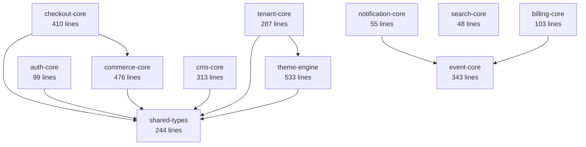

# 🏪 LetBuyy Store — Comprehensive Codebase Report
## Part 4: Domain Packages Deep Dive

> Every Zod schema, interface, type, enum, and exported function across all 22+ packages.

---

## Package Dependency Graph



---

## 1. `@letbuyy/shared-types` — 244 lines

> **Purpose:** Cross-runtime primitives — pagination, address, SEO, money, feature flags, and API response contracts.

### Zod Schemas (10)
| Schema | Fields | Purpose |
|--------|--------|---------|
| `UuidSchema` | `z.string().uuid()` | UUID validation |
| `PaginationQuery` | `page`, `limit`, `sort`, `order` | Pagination params (page 1-∞, limit 1-100) |
| `IdParam` | `id: UuidSchema` | ID parameter |
| `SlugSchema` | Regex `/^[a-z0-9]+(-[a-z0-9]+)*$/` | URL slug validation |
| `EmailSchema` | `z.string().email().max(320).toLowerCase()` | Email with normalization |
| `PhoneSchema` | E.164 format `/^\+[1-9]\d{6,14}$/` | International phone |
| `UrlSchema` | `z.string().url().max(2000)` | URL validation |
| `MoneySchema` | `z.number().min(0).max(99_999_999.99)` | Money amount |
| `CurrencySchema` | `z.string().length(3).toUpperCase().default('INR')` | ISO 4217 |
| `AddressSchema` | `line1`, `line2`, `city`, `state`, `zip`, `country` | Address |
| `SeoSchema` | `seo_title` (70), `seo_description` (160), `og_image_url` | SEO metadata |

### Feature Flag System (Full Implementation)
| Schema/Type | Purpose |
|-------------|---------|
| `RuntimeEnvironmentSchema` | `'local' | 'development' | 'staging' | 'production'` |
| `FeatureFlagScopeSchema` | `'tenant' | 'percentage' | 'internal' | 'region' | 'environment'` |
| `FeatureFlagRuleSchema` | Rule with scope, tenant IDs, regions, environments, percentage |
| `FeatureFlagDefinitionSchema` | Full flag: key, enabled, killSwitch, rules, expiresAt |
| `FeatureFlagContextSchema` | Evaluation context: environment, tenant, actor, region |
| `evaluateFeatureFlag()` | **Pure function** — evaluates a flag against context, returns enabled/variant/reason |
| `featureFlagExposureTelemetry()` | Generates telemetry payload for flag evaluations |
| `stableBucket()` | FNV-1a hash for deterministic percentage rollout |

### Interfaces
| Interface | Fields |
|-----------|--------|
| `Address` | name, line1, line2, city, state, postal_code, country, phone |
| `ApiResponse<T>` | data?, error? `{ code, message }` |
| `PaginatedResponse<T>` | data[], total, page, limit, has_more |
| `FeatureFlagEvaluation` | flagKey, enabled, variant, reason, ruleId, bucket |

### Exported Types (6)
`PaginationQueryInput`, `AddressInput`, `CurrencyCode`, `RuntimeEnvironment`, `FeatureFlagScope`, `FeatureFlagRule`, `FeatureFlagDefinition`, `FeatureFlagContext`

---

## 2. `@letbuyy/tenant-core` — 287 lines

> **Purpose:** Tenant resolution, site/store ownership, subdomain validation, onboarding wizard, and multi-store navigation.

### Constants
- `RESERVED_SUBDOMAINS` — 47 reserved subdomains (accounts, admin, console, api, www, etc.)
- `SUBDOMAIN_PATTERN` — `/^[a-z0-9]([a-z0-9-]*[a-z0-9])?$/`
- `DEFAULT_NAV_PAGES` — 6 default navigation pages (Home, Shop, Privacy, Terms, Shipping, Returns)

### Exported Functions
| Function | Signature | Purpose |
|----------|-----------|---------|
| `validateSubdomainFormat()` | `(subdomain: string) → SubdomainValidationResult` | Validates subdomain format, length, reserved names, double hyphens |

### Zod Schemas (12)
| Schema | Purpose |
|--------|---------|
| `SiteTypeSchema` | `'store' | 'portfolio' | 'resume' | 'blog' | 'landing'` |
| `SubdomainSchema` | 3-63 chars, alphanumeric+hyphens, not reserved |
| `CreateStoreSchema` | name, subdomain, site_type, tagline, theme_id, template_config, SEO |
| `UpdateStoreSchema` | All store fields optional, includes policies, `version` for optimistic lock |
| `PaymentConfigSchema` | key_id (rzp_test_/rzp_live_ prefix), key_secret, test_mode |
| `StartOnboardingSchema` | site_type only |
| `Step1Schema` → `Step6Schema` | 6-step onboarding wizard (type → name → template → business → brand → publish) |
| `CheckSubdomainSchema` | subdomain availability check |
| `STEP_SCHEMAS` | Map of step number → Zod schema |

### Key Types
| Type | Purpose |
|------|---------|
| `SiteType` | `'store' | 'portfolio' | 'resume' | 'blog' | 'landing'` |
| `StoreStatus` | `'draft' | 'published' | 'frozen' | 'suspended'` |
| `PaymentGateway` | `'razorpay' | 'stripe' | 'paypal'` |

### Key Interfaces
| Interface | Key Fields |
|-----------|-----------|
| `Store` | id, user_id, name, subdomain, custom_domain, site_type, status, theme_id, theme_config, settings |
| `StoreModel` | Dart/mobile-compatible model with camelCase (sellerId, storeUrl, templateConfig, navigation) |
| `NavPage` | id, label, href, isDefault, isVisible, openInNewTab, children[] (recursive) |
| `StoreNavigation` | main[], footer[], policies[] nav page arrays |
| `TenantContext` | site_id, subdomain, custom_domain, actor_id |
| `RuntimeTenantContext` | siteId, userId, roles[], permissions[], plan, entitlements, requestId |

---

## 3. `@letbuyy/commerce-core` — 476 lines

> **Purpose:** Product, catalog, inventory, customer, collection, supplier, and review contracts. The largest domain package.

### Zod Schemas (21)
| Schema | Fields | Purpose |
|--------|--------|---------|
| `ProductVariantSchema` | sku, title, price, price_override, compare_price, stock, options | Variant definition |
| `ProductOptionSchema` | name, position, values[] | Product option (Size, Color, etc.) |
| `CreateProductSchema` | 30+ fields including store_id, name, price, images[20], variants[100], options[10], tags[30], SEO, physical attributes | **Full Shopify-class product creation** |
| `UpdateProductSchema` | Same fields as create, all optional, includes `version` for optimistic locking | Product update |
| `ListProductsQuery` | store_id, status, category, search, page, limit, sort (5 options), order | Product listing |
| `BulkProductActionSchema` | product_ids[1-100], action (activate/deactivate/delete) | Bulk operations |
| `CreateCustomerSchema` | store_id, email, first_name, last_name, phone, notes, tags, accepts_marketing | Customer creation |
| `UpdateCustomerSchema` | All customer fields optional | Customer update |
| `CreateCustomerAddressSchema` | 12 fields: full_name, address_line1, city, state, postal_code, country, landmark, is_default, label | Address management |
| `ListCustomersQuery` | Extends PaginationQuery + store_id, search, tag, has_orders | Customer listing |
| `StoreScopedQuerySchema` | store_id only | Generic store-scoped query |
| `CreateCategorySchema` | name, slug, description, image_url, parent_id (hierarchical), display_order, is_visible | Category creation |
| `UpdateCategorySchema` | All optional | Category update |
| `CreateCollectionSchema` | store_id, title, description, image_url | Collection creation |
| `CreateGiftCardSchema` | store_id, initial_value (max 999,999), expires_at | Gift card |
| `CreateLocationSchema` | store_id, name, address, city, state, country, is_default | Inventory location |
| `AdjustInventorySchema` | product_id, variant_id, location_id, adjustment (-99999 to +99999), reason (10 options), notes | Stock adjustment |
| `BulkAdjustSchema` | store_id, adjustments[1-100] | Bulk inventory adjustment |
| `CreateSupplierSchema` | name, contact_name, email, phone, address | Supplier management |
| `CreatePurchaseOrderSchema` | supplier_id, location_id, expected_at, notes, lines[] (product, qty, unit_cost), idempotency_key | Purchase orders |
| `ReceivePurchaseOrderSchema` | lines[] (line_id, quantity), idempotency_key | PO receiving |
| `CreateTransferSchema` | source_location_id, destination_location_id, lines[], idempotency_key | Stock transfer |
| `ListProductReviewsQuery` | Extends PaginationQuery + store_id, status filter | Review listing |
| `CreateStorefrontProductReviewSchema` | product_id, store_id, rating (1-5), title, body, customer_name, is_verified | Customer review |

### Key Interfaces
| Interface | Key Fields |
|-----------|-----------|
| `Product` | id, store_id, name, slug, description, price, compare_price, stock, variants[], product_options[], tags[], category, images[], SEO, timestamps |
| `ProductVariant` | id, product_id, title, price, sku, stock, options Record |
| `ProductOption` | id, name, position, values[] |
| `InventoryLevel` | product_id, location_id, available, reserved, incoming, on_hand, sellable, track_inventory |
| `ProductModel` | Dart/mobile-compatible model with camelCase fields + rating, reviewCount, isFeatured, isTrending, isNew |

### Exported Type Aliases (25)
All input types derived from Zod schemas via `z.infer<>`.

---

## 4. `@letbuyy/checkout-core` — 410 lines

> **Purpose:** Cart, order, checkout, fulfillment, refund, shipping, tax, coupon, and payment orchestration contracts.

### Order State Machine
```
pending → confirmed → processing → shipped → delivered → refunded
   ↓         ↓           ↓           ↓
cancelled  cancelled   cancelled   cancelled
```

### Payment Status Types
| Type | Values |
|------|--------|
| `PaymentStatus` | `'pending' | 'paid' | 'failed' | 'refunded'` |
| `FulfillmentStatus` | `'unfulfilled' | 'partial' | 'fulfilled' | 'returned'` |
| `OrderStatus` | `'pending' | 'confirmed' | 'processing' | 'shipped' | 'delivered' | 'cancelled' | 'refunded'` |

### Zod Schemas (18)
| Schema | Purpose |
|--------|---------|
| `CreateOrderSchema` | Merchant-side order creation with idempotency, shipping, items, payment method |
| `StorefrontCreateOrderSchema` | Customer-facing checkout: customer info, items, payment, delivery, coupon, gift card |
| `StorefrontRazorpayOrderSchema` | Razorpay order creation for storefront |
| `StorefrontRazorpayVerifySchema` | Razorpay payment verification (order_id, payment_id, signature) |
| `UpdateOrderStatusSchema` | Status transition with tracking, carrier, cancellation reason, version (optimistic lock) |
| `FulfillOrderSchema` | Fulfillment: location, lines[], carrier, tracking number/URL, idempotency |
| `RefundOrderSchema` | Refund: lines[], reason, method (original/gift_card/manual), restock flag |
| `CompleteRefundSchema` | Complete refund: refund_id, provider_refund_id |
| `ListOrdersQuery` | Paginated order listing with status, payment_status, search filters |
| `RazorpayVerifySchema` | Merchant-side Razorpay verification |
| `RazorpayOrderSchema` | Merchant-side Razorpay order |
| `StripeCheckoutSchema` | Stripe checkout session creation |
| `CreateShippingZoneSchema` | Shipping zone: name, countries[], states[], zip_codes[] |
| `CreateShippingRateSchema` | Rate: type (flat/weight/price/free), price, weight/order range, estimated days |
| `CreateTaxRateSchema` | Tax: name, rate (0-100%), country, state, HSN code, compound/shipping flags |
| `CreateCouponSchema` | Coupon: code, type (percentage/fixed/free_shipping), value, limits, applicable products/categories, date range |
| `ValidateCouponSchema` | Coupon validation at checkout |
| `ListCouponsQuery` | Coupon listing with status filter |

### Exported Constant
- `VALID_TRANSITIONS` — State machine map defining allowed order status transitions

### Key Interfaces
| Interface | Purpose |
|-----------|---------|
| `Order` | Full order with items, pricing, payment, shipping, tracking |
| `OrderItem` | Line item with product reference, quantity, price |
| `CartItem` | Extends ProductModel with quantity and selectedVariant |
| `OrderModel` | Dart/mobile-compatible camelCase order model |
| `OrderCustomer` | Customer details for order |
| `ShippingAddress` | address, city, state, pincode |
| `OrderPricing` | subtotal, deliveryCharge, discount, total |
| `OrderPayment` | method, status, provider-specific IDs |
| `OrderTracking` | tracking number, carrier, URL |

---

## 5. `@letbuyy/auth-core` — 99 lines

> **Purpose:** Identity, session, actor, RBAC, OTP, password validation, and permission contracts.

### Password Policy (Zod PasswordSchema)
- Min 8, Max 128 characters
- At least 1 uppercase, 1 lowercase, 1 number, 1 special character

### Zod Schemas (6)
| Schema | Purpose |
|--------|---------|
| `SignUpSchema` | email + password + optional name |
| `SignInSchema` | email + password |
| `OtpRequestSchema` | email only |
| `OtpVerifySchema` | email + 6-digit OTP (regex `/^\d{6}$/`) |
| `PasswordResetRequestSchema` | email only |
| `PasswordUpdateSchema` | new password with full strength validation |

### Actor/Session System
| Type | Values |
|------|--------|
| `ActorType` | `'shopper' | 'customer' | 'merchant' | 'partner' | 'platform-employee' | 'platform-operator' | 'service'` |
| `SessionKind` | `'merchant' | 'customer' | 'employee' | 'service'` |
| `PermissionAction` | `'read' | 'create' | 'update' | 'delete' | 'manage'` |

### Key Interfaces
| Interface | Fields |
|-----------|--------|
| `ActorIdentity` | actor_id, actor_type, site_id, email, roles[], permissions[] |
| `Permission` | resource, action, scope (`'own' | 'site' | 'platform'`) |
| `SessionContract` | session_id, actor, kind, expires_at, issued_at, request_id |
| `RbacPolicy` | role, permissions[], description |
| `CustomerCredential` | email, phone, passwordHash, createdAt |
| `UserProfile` | id, email, full_name, phone, avatar_url, subscription_tier (free/starter/business/enterprise), timestamps |

---

## 6. `@letbuyy/theme-engine` — 533 lines

> **Purpose:** Theme registry, sections, blocks, templates, releases, hydration, and storefront composition contracts. The second-largest domain package.

### Section Types (21 built-in)
`header`, `heroBanner`, `productGrid`, `footer`, `featuredProducts`, `testimonials`, `aboutSection`, `collectionFilter`, `newsletter`, `contentPage`, `instagramFeed`, `faqAccordion`, `videoHero`, `trustBadges`, `categoryGrid`, `brandMarquee`, `portfolioGrid`, `servicesGrid`, `skillsSection`, `experienceTimeline`, `contactForm`, `ctaSection`

### Theme Settings Interface
| Field | Type | Default |
|-------|------|---------|
| primaryColor | string | `#00B3B3` |
| secondaryColor | string | `#008080` |
| accentColor | string | `#A4E500` |
| backgroundColor | string | `#FFFFFF` |
| textColor | string | `#1A1A2E` |
| fontFamily | string | `Inter` |
| headingFontFamily | string | `Inter` |
| borderRadius | number | `12` |
| enableAnimations | boolean | `true` |
| enableShadows | boolean | `true` |

### Section Settings Interfaces (11)
`HeroBannerSettings`, `ProductGridSettings`, `HeaderSettings`, `FooterSettings`, `TestimonialsSettings`, `AboutSectionSettings`, `PortfolioGridSettings`, `ServicesGridSettings`, `SkillsSectionSettings`, `ExperienceTimelineSettings`, `ContactFormSettings`, `CtaSectionSettings`

### Theme Marketplace Types
| Type | Values |
|------|--------|
| `ThemeCategory` | `'store' | 'portfolio' | 'resume' | 'landing' | 'saas'` |
| `ThemePricingType` | `'free' | 'one_time' | 'subscription'` |

### Theme Interface (38 fields)
Full theme model with: id, slug, name, description, category, industry[], pricing per platform (LetBuyy/WordPress/Shopify/HTML/React), screenshots[], color_presets[], font_options[], author, tags, features, rating, review_count, install_count, purchase_count.

### Theme Release Pipeline
| Interface | Purpose |
|-----------|---------|
| `ThemeRelease` | Release versioning: release_version, release_status (published/superseded/rolled_back), is_current |
| `ThemeEditorPayload` | Full editor state: store, theme, template_config, draft, release, schemas |
| `ThemeDraftSaveResult` | Draft auto-save result |
| `ThemePublishResult` | Publish result with release_id, release_version |
| `ThemePreviewSessionResult` | Preview token with TTL |

### Zod Schemas (8)
`InstallThemeSchema`, `SaveThemeDraftSchema` (with client source tracking), `PublishThemeSchema`, `PreviewTokenSchema`, `RollbackThemeReleaseSchema`, `ThemePurchaseOrderSchema`, `ThemePurchaseVerifySchema`, `ThemeSlugParamSchema`

---

## 7. `@letbuyy/cms-core` — 313 lines

> **Purpose:** Pages, policies, navigation, blog posts, comments, form submissions, media management, portfolio, resume content.

### Zod Schemas (18)
- **Pages:** `CreatePageSchema`, `UpdatePageSchema`, `ListPagesQuery`
- **Policies:** `CreatePolicySchema` (privacy/refund/shipping/terms/contact/custom), `UpdatePolicySchema`, `ListPoliciesQuery`
- **Navigation:** `NavigationItemSchema` (recursive tree), `ReplaceNavigationSchema`, `ListNavigationQuery`
- **Blog:** `CreateBlogPostSchema` (30+ fields: title, slug, excerpt, content, content_html, featured_image, category, tags, status, scheduling, SEO), `UpdateBlogPostSchema`, `CreateBlogCategorySchema`, `CreateBlogTagSchema`, `ListBlogPostsQuery`, `ListBlogCommentsQuery`, `UpdateBlogCommentSchema`
- **Form Submissions:** `ListFormSubmissionsQuery` (7 status values), `UpdateFormSubmissionSchema`
- **Media:** `UploadMediaSchema`, `UpdateMediaSchema`, `ListMediaQuery`, `BulkDeleteMediaSchema`

### Portfolio/Resume Interfaces
| Interface | Key Fields |
|-----------|-----------|
| `PortfolioProject` | title, slug, description, cover_image, images[], video_url, client_name, technologies[], categories[], github_url, project_url |
| `Skill` / `SkillItem` | name, category, proficiency (1-5), years_experience |
| `Education` | institution, degree, field_of_study, start/end dates, gpa |
| `WorkExperience` | company, position, location, description, achievements[] |
| `ServiceItem` | icon, title, description, link |
| `ExperienceItem` | title, company, startDate, endDate, isCurrent |

---

## 8. `@letbuyy/event-core` — 343 lines

> **Purpose:** Domain events, outbox, webhooks, audit events, queues, usage metering, and operational/SRE contracts.

### Core Event Types
| Type | Fields |
|------|--------|
| `DomainOutboxEvent` | aggregate_type, aggregate_id, event_type, payload, idempotency_key, status (queued→processing→processed→failed→dead), attempts |
| `AuditActivityEvent` | actor_id, actor_type (user/customer/employee/system/webhook), action, resource_type, before_state, after_state |
| `RuntimeEventEnvelope<T>` | Generic event wrapper: event_id, event_type, source_runtime, site_id, aggregate info, occurred_at, payload |

### Operational Schemas (20+)
| Category | Schemas |
|----------|---------|
| **Outbox** | `DispatchOutboxSchema`, `DispatchWebhookDeliveriesSchema` |
| **Queue** | `ConsumeQueueJobsSchema`, `RuntimeQueueRecoverySchema`, `RuntimeDeadLetterRedriveSchema` |
| **Replay** | `ScheduleRuntimeReplaySchema`, `AuthorizeRuntimeReplaySchema` |
| **Webhooks** | `CreateWebhookSubscriptionSchema` (HTTPS-only target_url, signing_secret min 32 chars, event_types), `UpdateWebhookSubscriptionSchema` |
| **Usage** | `RecordUsageSchema` (site_id, meter_name, amount, idempotency_key) |
| **Control** | `SubmitRuntimeControlCommandSchema` — 16 operations across 10 target types |
| **Incidents** | `RecordProductionIncidentSchema`, `UpdateProductionIncidentStatusSchema` |
| **Testing** | `RecordFailoverDrillSchema`, `RecordChaosExperimentSchema`, `RecordLoadTestRunSchema` |
| **Deployment** | `RecordDeploymentPromotionSchema`, `RecordProductionReadinessGateSchema`, `RecordDeploymentHealthGateSchema` |
| **Observability** | `RecordOperationalDashboardSnapshotSchema`, `RecordSreErrorBudgetSnapshotSchema` |
| **Security** | `RecordSecurityEnforcementEventSchema` |
| **Regional** | `RecordRegionalRoutingOverrideSchema` |
| **Certification** | `RecordOperationalCertificationReportSchema` |
| **Integrity** | `ValidateEventStoreIntegritySchema`, `ArchiveDistributedEventsSchema` |

---

## 9. `@letbuyy/notification-core` — 55 lines

### Types
- `NotificationChannel`: `'email' | 'sms' | 'push' | 'in_app'`
- `NotificationAudience`: `'shopper' | 'customer' | 'merchant' | 'platform-employee' | 'platform-operator'`

### Schemas (3)
- `NotificationRecipientSchema` — actor_id, email, phone, push_token
- `NotificationMessageSchema` — channel, template_key, locale (default `en-IN`), subject, body, data
- `NotificationDispatchSchema` — site_id, recipient, message, idempotency_key

### Interfaces
- `NotificationTemplate` — key, channels[], audience, variables[], owner_domain
- `EventNotificationMapping` — event_type → template_key + channels + `deriveRecipient()` function

---

## 10. `@letbuyy/search-core` — 48 lines

### Types
- `SearchDocumentType`: `'product' | 'collection' | 'page' | 'blog_post' | 'theme' | 'app'`
- `SearchProvider`: `'postgres' | 'typesense' | 'meilisearch' | 'algolia' | 'custom'`

### Schema: `SearchQuerySchema` — site_id, query, document_types[], filters, page, limit

### Interfaces
- `SearchDocument` — id, type, title, body, url, image_url, tags, attributes, updated_at
- `SearchIndexingJob` — document, action (upsert/delete), provider, idempotency_key
- `SearchResult<T>` — document, score, highlights
- `RankingPolicy` — key, provider, weights

---

## 11. `@letbuyy/billing-core` — 103 lines

### Types
- `SubscriptionTier`: `'free' | 'starter' | 'business' | 'enterprise'`
- `BillingCycle`: `'monthly' | 'annual'`
- `InvoiceStatus`: `'draft' | 'open' | 'paid' | 'void' | 'uncollectible'`

### Schemas (7)
| Schema | Purpose |
|--------|---------|
| `BillingPlanSchema` | Plan definition with tier, cycle, currency (INR), amount, entitlements |
| `CreateSubscriptionSchema` | Subscribe: site_id, plan_id, billing_cycle, idempotency_key |
| `StoreSubscriptionQuerySchema` | Query by store_id |
| `PlanListQuerySchema` | List by site_type, optional slug |
| `CancelSubscriptionSchema` | Cancel with optional reason |
| `CreateSubscriptionOrderSchema` | Razorpay subscription order |
| `VerifySubscriptionSchema` | Razorpay subscription verification |

### Interfaces
- `BillingPlan` — plan_id, tier, billing_cycle, currency, amount, entitlements
- `SubscriptionContract` — id, site_id, plan_id, tier, status (trialing/active/past_due/cancelled/expired), period dates, provider
- `InvoiceDto` — id, site_id, subscription_id, status, currency, subtotal, tax, total, due/paid dates
- `BillingEvent` — Uses `RuntimeEventEnvelope` generic from event-core
