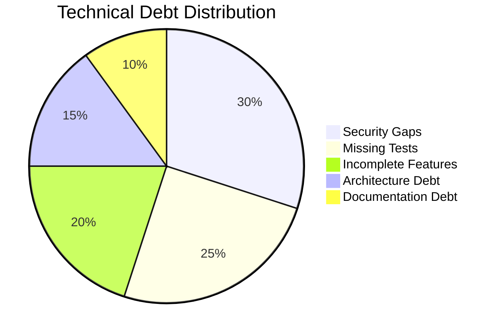

# 🏪 LetBuyy Store — Comprehensive Codebase Report
## Part 6: Security Audit, Tech Debt, Lessons & Final Assessment

---

## 1. Security Audit — All 37 Documented Lessons

### 🔴 CRITICAL Severity (6 issues)

| # | Issue | Status | Impact |
|---|-------|--------|--------|
| **5** | **Production secrets committed to git** — `all.env` contains 9 live secrets: Supabase service role key, Razorpay keys, Redis token, Resend API key, auth secrets, CSRF secret, customer session secret | ❌ **UNRESOLVED** | Full platform compromise possible |
| **17** | **Zero test files exist** — No unit tests, integration tests, or e2e tests across ALL apps, API worker, and Flutter apps | ❌ **UNRESOLVED** | No regression protection, no confidence in deploys |
| **21** | **No webhook signature verification** — Payment webhooks (Stripe, Razorpay, PayPal) accept unverified payloads | ❌ **UNRESOLVED** | Attackers can fake payment confirmations |
| **22** | **Missing rate limiting on auth endpoints** — Login, signup, OTP verify, password reset lack rate limiting | ❌ **UNRESOLVED** | Brute-force attacks on auth system |
| **24** | **Client-sent prices trusted for payments** — No server-side price recalculation before payment processing | ❌ **UNRESOLVED** | Price manipulation attacks |
| **30** | **Super Admin Console has no access controls** — Scaffold only, no VPN/2FA/IP whitelist despite docs claiming otherwise | ❌ **UNRESOLVED** | Anyone could access admin functions if deployed |

### 🟠 HIGH Severity (14 issues)

| # | Issue | Status |
|---|-------|--------|
| **6** | Inconsistent trigger function names (`update_updated_at()` vs `update_updated_at_column()` vs `update_modified_at()`) | ⚠️ Partially resolved in later migrations |
| **7** | Duplicate migration number 022 (two files) | ⚠️ Resolved by renumbering in subsequent migrations |
| **8** | No API versioning (`/api/auth/login` instead of `/api/v1/auth/login`) | ✅ Resolved — API Gateway uses `/v1/` prefix |
| **9** | Auth logic split between Next.js API routes and API Gateway | ⚠️ Still split — Identity Platform has 18 route files |
| **12** | Order items stored as JSONB instead of relational table | ✅ Resolved in migration 029 (`order_items` table) |
| **13** | Inconsistent error response format across APIs | ⚠️ Partially resolved in API Gateway |
| **14** | Documentation vs code severely out of sync | ⚠️ Ongoing issue |
| **15** | Business logic in route handlers (not in services) | ⚠️ Partially resolved — API Gateway has service layer |
| **23** | No CSRF protection on mutating endpoints | ❌ Unresolved |
| **25** | Internal error details exposed in API responses | ⚠️ Partially resolved in API Gateway |
| **26** | CORS wildcard risk | ⚠️ Needs verification |
| **28** | Documentation explosion — 60,000+ lines with massive duplication | ⚠️ Consolidated into master-system-intelligence.md |
| **29** | Aspirational features documented as built | ⚠️ Partially resolved |
| **37** | Hardcoded Razorpay key IDs in Dart source and web checkout code | ❌ Unresolved |

### 🟡 MEDIUM Severity (12 issues)

| # | Issue | Status |
|---|-------|--------|
| **1** | Schema naming inconsistency (`sites` vs `stores`) | ✅ Documented, rule established |
| **2** | Missing soft deletes on all tables | ✅ Resolved in migration 028 |
| **3** | Missing audit columns (`created_by`, `updated_by`) | ✅ Resolved in migration 028 |
| **4** | Missing version column for optimistic locking | ✅ Resolved in migration 028 |
| **10** | Suppressed linting rules in `analysis_options.yaml` | ⚠️ Still suppressed |
| **11** | KV and R2 not configured (commented out) | ⚠️ Still not configured |
| **16** | Next.js version mismatch across apps | ⚠️ May still exist |
| **18** | Console and Team apps are scaffold only | ✅ Known, documented |
| **19** | Shared UI package is minimal (only 3 components) | ❌ Still only 3 components |
| **20** | No standardized font or design tokens | ⚠️ Some progress |
| **27** | Missing security headers | ⚠️ Partially resolved in API Gateway middleware |
| **31** | No error boundaries | ⚠️ Partially resolved |

### 🟢 LOW Severity (5 issues)

| # | Issue | Status |
|---|-------|--------|
| **32** | No structured logging (no Axiom, Sentry) | ❌ Unresolved |
| **33** | Missing environment variable documentation | ✅ Resolved with config/env/ |
| **34** | No CI/CD pipeline | ❌ No `.github/workflows/` |
| **35** | Commented-out infrastructure code | ⚠️ Still present |
| **36** | Repo intelligence scans include generated outputs | ✅ Resolved |

### Security Score Card

```
┌─────────────────────────────┬──────────┬──────────┐
│ Category                    │ Score    │ Max      │
├─────────────────────────────┼──────────┼──────────┤
│ Secret Management           │ 1/10     │ 10       │
│ Authentication              │ 5/10     │ 10       │
│ Authorization/RBAC          │ 4/10     │ 10       │
│ Input Validation            │ 8/10     │ 10       │
│ Payment Security            │ 3/10     │ 10       │
│ API Security                │ 5/10     │ 10       │
│ Infrastructure Security     │ 3/10     │ 10       │
│ Testing Coverage            │ 0/10     │ 10       │
│ Monitoring/Observability    │ 1/10     │ 10       │
│ Data Protection             │ 5/10     │ 10       │
├─────────────────────────────┼──────────┼──────────┤
│ TOTAL                       │ 35/100   │ 100      │
└─────────────────────────────┴──────────┴──────────┘
```

---

## 2. Technical Debt Inventory

### Debt Type Distribution



### Top 10 Most Impactful Debts

| Priority | Debt Item | Effort | Risk if Ignored |
|----------|-----------|--------|----------------|
| 🔴 P0 | Rotate 9 compromised secrets + purge from git history | 4h | **Platform compromise** |
| 🔴 P0 | Add webhook signature verification (Razorpay, Stripe, PayPal) | 8h | **Financial fraud** |
| 🔴 P0 | Implement server-side price recalculation | 6h | **Revenue loss** |
| 🔴 P0 | Add rate limiting to all auth endpoints | 4h | **Account takeover** |
| 🔴 P1 | Write test suite (at least critical paths) | 40h | **Silent regressions** |
| 🔴 P1 | Add CSRF protection to mutating endpoints | 8h | **XSS/CSRF attacks** |
| 🟡 P2 | Centralize auth logic in API Gateway | 16h | **Inconsistent security** |
| 🟡 P2 | Complete admin dashboard features | 60h | **Blocked go-to-market** |
| 🟡 P2 | Implement CI/CD pipeline | 12h | **Manual deploy risk** |
| 🟡 P3 | Extract shared UI components | 20h | **Duplicated maintenance** |

---

## 3. Full TODO Backlog — From `tasks/todo.md`

### Phase 0 — EMERGENCY 🔴 (Before anything else)
- [ ] **Rotate ALL 9 compromised secrets** (Supabase keys, Redis, Resend, Razorpay, auth, CSRF, session)
- [ ] Replace hardcoded Razorpay keys in Dart/web source with env-driven values
- [ ] Delete `all.env`, create `all.env.example`, purge from git history
- [ ] Add webhook signature verification (Stripe, Razorpay, PayPal)
- [ ] Add rate limiting to 5 auth endpoints (signup, login, OTP, reset, set-password)

### Phase 1 — Schema & Security 🔴 (40-50h)
- Schema compliance (soft deletes ✅, audit columns ✅, version ✅, order_items ✅)
- Security hardening (CSRF, headers, price recalculation, error sanitization, CORS, brute-force)
- API consistency (versioning ✅, error format, Zod on all routes)
- Code quality (centralize auth, extract services, pin versions, fix lint)

### Phase 2 — Complete P0 Features 🟡 (120-150h)
- Auth system (refresh tokens, revocation, 2FA, console access controls)
- Admin dashboard (shipping, inventory, tax, blog, media, customers, analytics, coupons)
- Storefront (server-side cart, abandoned cart, reviews, search, collections, SEO, sitemap)
- Payments (complete Razorpay/Stripe/PayPal, subscriptions, refunds, invoices)
- Console (dashboard, users, stores, subscriptions, employees, audit logs, feature flags)
- Team portal (login, support tickets, user lookup, store moderation, RBAC)

### Phase 3 — Polish, Testing & Launch 🟡 (80-100h)
- Testing (Vitest, Flutter tests, unit/integration/e2e)
- UI/UX (shared fonts, design tokens, dark mode, skeletons, empty states, error boundaries)
- Performance (KV caching, R2 storage, Redis, Lighthouse 90+, code splitting)
- Monitoring (Axiom, Sentry, uptime, health checks)
- Deployment (CI/CD, staging, DNS, zero-downtime)

### Phase 4 — P1 Features 🟢 (50-60h)
- AI content generation, theme marketplace dev flow, app store SDK, i18n, email campaigns, abandoned cart automation, analytics, PDF resume export, bulk import/export, multi-currency

### Phase 5 — P2 Features 🟢 (40-50h)
- Custom domains, multi-store, social commerce, POS, affiliates, A/B testing, push notifications, real-time collab, white-label, public API

---

## 4. Architecture Maturity Assessment

### Domain Completeness by Area

| Domain | Contract Layer | API Layer | Service Layer | UI Layer | Tests | Overall |
|--------|---------------|-----------|---------------|----------|-------|---------|
| **Auth** | 🟢 99 lines | 🟡 18 routes | 🟡 Split | 🟢 Built | ❌ 0% | **60%** |
| **Commerce (Products)** | 🟢 476 lines | 🟢 Full CRUD | 🟢 Service | 🟢 Built | ❌ 0% | **75%** |
| **Checkout (Orders)** | 🟢 410 lines | 🟢 Full CRUD | 🟡 Partial | 🟡 Partial | ❌ 0% | **55%** |
| **Payments** | 🟢 Schemas | 🟡 3 providers | 🟡 Partial | 🟡 Partial | ❌ 0% | **45%** |
| **Themes** | 🟢 533 lines | 🟢 Full CRUD | 🟢 Service | 🟢 Editor | ❌ 0% | **70%** |
| **CMS/Content** | 🟢 313 lines | 🟢 Full CRUD | 🟡 Partial | 🟡 Partial | ❌ 0% | **55%** |
| **Tenant/Store** | 🟢 287 lines | 🟢 CRUD + Onboard | 🟢 Service | 🟢 Built | ❌ 0% | **70%** |
| **Billing** | 🟢 103 lines | 🟡 Partial | 🟡 Partial | 🟡 Partial | ❌ 0% | **40%** |
| **Inventory** | 🟢 Schemas | 🟢 Full CRUD | 🟡 Partial | 🟡 Partial | ❌ 0% | **50%** |
| **Search** | 🟢 48 lines | ❌ Not built | ❌ Not built | 🟡 Basic | ❌ 0% | **15%** |
| **Notifications** | 🟢 55 lines | ❌ Not built | ❌ Not built | ❌ None | ❌ 0% | **10%** |
| **Events/Outbox** | 🟢 343 lines | 🟡 Partial | 🟡 Partial | N/A | ❌ 0% | **30%** |
| **Analytics** | 🟡 Basic | 🟡 Partial | 🟡 Partial | 🟡 Basic | ❌ 0% | **25%** |
| **App Marketplace** | 🟡 Basic | 🟡 Partial | 🟡 Partial | 🟡 Scaffold | ❌ 0% | **25%** |
| **Platform Console** | N/A | ❌ None | ❌ None | 🔴 Scaffold | ❌ 0% | **5%** |
| **Operations Portal** | N/A | ❌ None | ❌ None | 🔴 Scaffold | ❌ 0% | **5%** |

### Overall Architecture Score

```
┌────────────────────────────────┬──────────────────┐
│ Dimension                      │ Score            │
├────────────────────────────────┼──────────────────┤
│ Domain Contract Design         │ ███████████░ 92% │
│ Schema Design (Zod)            │ ██████████░░ 88% │
│ Database Schema                │ ████████░░░░ 72% │
│ API Design & Implementation    │ ██████░░░░░░ 55% │
│ Service Layer                  │ █████░░░░░░░ 45% │
│ UI/Frontend                    │ ██████░░░░░░ 52% │
│ Mobile (Flutter)               │ █████░░░░░░░ 42% │
│ Infrastructure/DevOps          │ ███░░░░░░░░░ 25% │
│ Testing                        │ ░░░░░░░░░░░░  0% │
│ Security                       │ ████░░░░░░░░ 35% │
│ Documentation/Governance       │ ████████░░░░ 75% │
├────────────────────────────────┼──────────────────┤
│ OVERALL PLATFORM MATURITY      │ █████░░░░░░░ 44% │
└────────────────────────────────┴──────────────────┘
```

---

## 5. Final Assessment

### What's Exceptionally Well Done ✅

1. **Domain Contract Design (92%)** — The Zod schema system across 12 domain packages is world-class. Every field has proper validation, limits, and types. The `commerce-core` alone has 476 lines of production-grade product schemas.

2. **Feature Flag System** — A complete, pure-function feature flag evaluator with FNV-1a hashing for deterministic percentage rollout, kill switches, tenant scoping, and telemetry — all in shared-types.

3. **Governance Framework** — 116 governance documents, 50+ validator scripts, runtime manifests, and a clear architectural constitution. This is better governance than most enterprise codebases.

4. **Theme Engine Architecture** — 21 built-in section types, draft/publish/rollback release pipeline, preview tokens, and multi-device preview support. Shopify-class theme system.

5. **Order State Machine** — Proper `VALID_TRANSITIONS` map with idempotency keys on every mutation. This prevents double-processing and enforces correct order flow.

6. **Multi-Site-Type Support** — The platform handles 5 site types (store, portfolio, resume, blog, landing) with adaptive CMS that renders different sections per type. Ambitious and well-structured.

### What Needs Immediate Attention ⚠️

1. **SECRET ROTATION IS OVERDUE** — 9 production secrets have been in git since early 2026. Every hour they remain increases exposure risk.

2. **Payment Security Gap** — Without server-side price recalculation and webhook verification, the payment system is vulnerable to manipulation.

3. **Zero Test Coverage** — Deploying a commerce platform with financial transactions and zero tests is high risk. At minimum, payment flows need test coverage.

4. **CI/CD Pipeline Missing** — No automated testing or deployment. Manual deploys with no staging environment.

### Estimated Effort to Production

| Phase | Hours | Priority |
|-------|-------|----------|
| Phase 0 (Emergency) | 20-30h | **Immediate** |
| Phase 1 (Security) | 40-50h | **This sprint** |
| Phase 2 (Features) | 120-150h | **Next 2-3 sprints** |
| Phase 3 (Polish) | 80-100h | **Pre-launch** |
| Phase 4 (P1 Features) | 50-60h | **Post-launch** |
| Phase 5 (P2 Features) | 40-50h | **Growth phase** |
| **Total to MVP Launch** | **~260-330h** | **Phases 0-3** |

---

## 6. Report Summary

> **LetBuyy is a remarkably ambitious Shopify-class multi-tenant commerce SaaS** with exceptionally strong domain contracts, a comprehensive governance framework, and a well-designed theme engine. The architecture is sound — the monorepo structure with 22 domain packages, 11 application runtimes, and 9 planned backend services demonstrates serious architectural thinking.

> **However, critical security gaps (committed secrets, no payment verification, no rate limiting, no tests) must be addressed before any production deployment.** The estimated ~260-330 hours to MVP readiness is achievable with focused effort on Phases 0-2.

> **The strongest asset is the domain contract layer** — 2,500+ lines of Zod schemas across 12 packages provide a rock-solid validation foundation that many mature products lack. Building on this foundation with proper service implementations and test coverage will unlock the platform's full potential.

---

### Report Parts Index

| Part | Title | Artifact |
|------|-------|----------|
| **Part 1** | Executive Summary & Repository Overview | [report_part1_executive_summary.md](file:///Users/saai_sidd/.gemini/antigravity/brain/a1567af9-0909-49d9-9eec-b6a18d77a881/report_part1_executive_summary.md) |
| **Part 2** | Web Applications Deep Dive | [report_part2_web_applications.md](file:///Users/saai_sidd/.gemini/antigravity/brain/a1567af9-0909-49d9-9eec-b6a18d77a881/report_part2_web_applications.md) |
| **Part 3** | Mobile Apps, API Gateway & Database | [report_part3_mobile_api_database.md](file:///Users/saai_sidd/.gemini/antigravity/brain/a1567af9-0909-49d9-9eec-b6a18d77a881/report_part3_mobile_api_database.md) |
| **Part 4** | Domain Packages Deep Dive | [report_part4_domain_packages.md](file:///Users/saai_sidd/.gemini/antigravity/brain/a1567af9-0909-49d9-9eec-b6a18d77a881/report_part4_domain_packages.md) |
| **Part 5** | Runtime Packages, Services & Infrastructure | [report_part5_runtime_infrastructure.md](file:///Users/saai_sidd/.gemini/antigravity/brain/a1567af9-0909-49d9-9eec-b6a18d77a881/report_part5_runtime_infrastructure.md) |
| **Part 6** | Security Audit, Tech Debt & Final Assessment | [report_part6_security_assessment.md](file:///Users/saai_sidd/.gemini/antigravity/brain/a1567af9-0909-49d9-9eec-b6a18d77a881/report_part6_security_assessment.md) |
