# Phase 1 — Repository Inventory (LetBuyy Platform)

Investigation date: 2026-06-05

Scope: full repository at `/Users/saai_sidd/Git/Letbuyy_Store`, excluding `node_modules`, `.git`, `.pnpm-store`, `.turbo`, `.dart_tool`, `build/`, `test-results/`, `artifacts/`, `coverage`, `dist`, `.next`. All numbers below were measured directly; prior root-level audit/ledger documents (`CODEX_*`, `LETBUYY_*`, `Audit/`, prior `FORENSIC_REPORT/` files) were treated as unverified claims and not used as evidence.

## Method

Commands executed in the mounted workspace (`/sessions/brave-sweet-gates/mnt/Letbuyy_Store`):

- `find . -type d \( -name node_modules -o -name .git -o -name .pnpm-store -o -name .turbo -o -name .dart_tool -o -name build -o -name dist -o -name coverage -o -name .next -o -name test-results -o -name artifacts ... \) -prune -o -type f -print` → master file list (2,831 files)
- Extension histogram: `sed -E 's/.*\.([A-Za-z0-9_]+)$/\1/' | sort | uniq -c | sort -rn`
- Per-directory file counts: `cut -d/ -f2 ... | sort | uniq -c`; per-workspace `find <dir> ... | wc -l`
- LOC: `xargs -0 wc -l` over per-extension file lists (cloc not available in the sandbox; counts are raw line counts, including comments/blank lines)
- Manifest extraction: `node -e "require('./<pkg>/package.json')"` over every workspace `package.json`; `grep` over every `pubspec.yaml`
- Direct reads of: `package.json`, `pnpm-workspace.yaml`, `turbo.json`, `pubspec.yaml`, `vercel.json`, `.npmrc`, all app/service/package manifests, `services/*/wrangler.toml`, `config/runtime/*.json`, `docs/governance/runtime-boundaries.md`, `AGENTS.md`, `CLAUDE.md`, `database/supabase/migrations/`
- Table inventory: `grep -c 'CREATE TABLE'` and name extraction over `database/supabase/migrations/000_baseline.sql`

---

## 1. Top-level folder inventory (depth ≤ 3, annotated)

Top-level entries observed (`ls -d */`):

```
Letbuyy_Store/
├── .claude/  .codex/                       # agent tool state (1 file + empty)
├── .github/workflows/                      # 10 CI/CD workflow YAMLs
├── Audit/                                  # 6 prior audit .md reports (unverified prose)
├── FORENSIC_REPORT/                        # 16 prior forensic .md reports (unverified prose)
├── apps/                                   # 9 web app roots + mobile/ (3 roots)
│   ├── app-marketplace/        {src, package.json, runtime.manifest.json}
│   ├── developer-portal/       {src, package.json, runtime.manifest.json}   ← NOT in CLAUDE.md canonical map
│   ├── identity-platform/      {public, src, ...}
│   ├── marketing-site/         {public, src, ...}
│   ├── merchant-control-plane/ {public, src, ...}
│   ├── platform-console/       {public, src, ...}
│   ├── platform-operations-portal/ {public, src, ...}
│   ├── storefront-runtime/     {public, src, ...}
│   ├── theme-marketplace/      {public, src, ...}
│   └── mobile/
│       ├── merchant-app/       Flutter app (113 .dart files)
│       ├── operator-app/       Flutter scaffold (1 lib file = default counter demo)
│       └── shopper-app/        2 files only: AGENTS.md + runtime.manifest.json (reserved)
├── artifacts/                  # excluded from scan per instructions (generated evidence)
├── build/                      # excluded from scan (generated)
├── chaos/                      # run-chaos-evidence.mjs + scenarios/failure-matrix.json + AGENTS.md
├── config/
│   ├── cloudflare/             resource-names.json
│   ├── env/                    templates, schemas, ownership, governance (env contracts)
│   ├── eslint/                 letbuyy-boundaries.mjs + boundary-baseline.json
│   ├── runtime/                ~60 governance-contract JSON + JSON-schema files (topology, replay, leases, certification)
│   ├── supabase/               staging.json, production.json
│   └── vercel/                 projects.json
├── database/
│   ├── cloudflare/d1/migrations/  0001_provider_execution_foundation.sql
│   └── supabase/               config.toml, migrations/ (10 files), seeds/ (2), verification/ (17), scripts/
├── docs/                       # ~110 topic subdirectories, 550 .md files (incl. governance/ ≈100 docs, archive/)
├── infrastructure/             # ci-cd, cloudflare (Terraform), deployment (Helm+K8s), dns (dns.tf),
│                               # monitoring (slo-catalog), observability (6 Grafana dashboards, otel, prometheus),
│                               # scripts/ (chaos, cloudflare, database, deploy, load, observability, operations, security), security/
├── legacy/firebase/            # firestore rules, 24 Cloud Functions TS sources, scripts (retired stack)
├── load/                       # run-load-evidence.mjs, gatling/, k6/, locust/, scenarios/internet-scale-load.json
├── memory/                     # lessons.md (agent memory)
├── packages/                   # 22 TS package roots + typescript/ (4) + dart/ (5) + .tmp
├── scripts/                    # validate-governance.mjs, validate-architecture.mjs, validators/ (131 .mjs),
│                               # cloudflare, generators, github, governance, migration, staging, supabase, utilities
├── services/                   # 9 service roots: 3 implemented (api-gateway, queue-workers, webhook-service),
│                               # 6 reserved (AGENTS.md + runtime.manifest.json only)
├── supabase/                   # CLI config.toml + .temp/ link metadata (duplicate of database/supabase/supabase/.temp)
├── tasks/                      # todo.md, env-setup-skips.md
├── test-results/               # excluded from scan (generated)
└── tests/                      # 28 suite directories (149 *.test.mjs + 10 Playwright *.spec.ts)
```

Root files: 73 root-level `.md` files (`ls *.md | wc -l` = 73), including `AGENTS.md` (constitution), `CLAUDE.md`, 40+ `CODEX_*` ledgers/missions (largest: `CODEX_MASTER_EXECUTION_LEDGER.md` at 269,663 bytes per `ls -la`), `LETBUYY_*` reports, `WAVE*_REPORT.md`. Plus `package.json`, `pnpm-workspace.yaml`, `pnpm-lock.yaml`, `pubspec.yaml`, `pubspec.lock`, `turbo.json`, `vercel.json`, `playwright.config.ts`, `tsconfig.base.json`, `tsconfig.workspace.json`, `analysis_options.yaml`, `.npmrc`, `.gitignore`, `.gitattributes`.

## 2. File inventory

### 2.1 Totals

- **2,831 files** in scan scope (`wc -l /tmp/all_files.txt`).

### 2.2 Count by extension (top entries)

| Ext | Files | | Ext | Files |
|---|---|---|---|---|
| md | 736 | | yaml | 30 |
| ts | 513 | | svg | 29 |
| mjs | 337 | | xml | 16 |
| tsx | 332 | | css | 12 |
| json | 208 | | yml | 10 |
| dart | 206 | | plist | 10 |
| sql | 103 | | js | 8 |
| png | 101 | | toml | 5 / py 5 / sh 4 |

(Full histogram from `sed … | uniq -c`; remainder is mobile platform scaffolding: gradle `properties`/`kts`, Xcode `xcconfig`/`storyboard`/`swift`/`h`, fonts.)

### 2.3 Count by top-level directory

| Directory | Files | Directory | Files |
|---|---|---|---|
| apps/ | 1,007 | infrastructure/ | 62 |
| docs/ | 667 | legacy/ | 37 |
| packages/ | 363 | database/ | 33 |
| tests/ | 160 | FORENSIC_REPORT/ | 16 |
| scripts/ | 148 | .github/ | 12 |
| services/ | 124 | load/ 9, Audit/ 6, chaos/ 3, tasks/ 2 |
| config/ | 90 | root-level files ≈ 90 |

### 2.4 LOC by language (raw `wc -l`)

| Language | Files | Lines | Note |
|---|---|---|---|
| Markdown | 736 | **380,185** | Documentation/ledgers exceed all code combined |
| TypeScript (.ts) | 513 | 103,816 | (175,357 ts+tsx − 71,541 tsx) |
| TSX (.tsx) | 332 | 71,541 | |
| Dart | 206 | 54,006 | |
| SQL | 103 | 53,874 | `000_baseline.sql` alone defines 233 tables |
| JSON | 208 | 26,284 | |
| MJS (validators/scripts) | 337 | 24,398 | |

Per-workspace TS/TSX LOC (measured `xargs wc -l` on per-area lists):

| Workspace | TS/TSX files | LOC |
|---|---|---|
| services/api-gateway | 93 | 35,919 |
| apps/merchant-control-plane | 174 | 34,564 |
| apps/storefront-runtime | 132 | 17,985 |
| packages/typescript/* (4 pkgs) | 30 | 8,914 |
| apps/identity-platform | 51 | 7,404 |
| packages/distributed-runtime | 74 | 7,303 |
| apps/theme-marketplace | 32 | 5,028 |
| packages/theme-engine | 8 src/5 ts | 4,868 |
| apps/platform-console | 31 | 3,979 |
| apps/app-marketplace | 35 | 3,880 |
| apps/platform-operations-portal | 24 | 3,090 |
| packages/infrastructure | 19 | 2,879 |
| apps/marketing-site | 29 | 2,899 |
| packages/shared-types | 1 | 2,090 |
| packages/app-engine | 1 | 1,778 |
| services/webhook-service | 2 | 1,638 |
| packages/auth-core | 2 | 1,620 |
| packages/orchestration | 13 | 1,393 |
| packages/checkout-core | 1 | 1,261 |
| services/queue-workers | 2 | 1,156 |
| packages/application-services | 12 | 1,078 |
| packages/commerce-core | 1 | 1,075 |
| packages/projection-runtime | 15 | 1,023 |
| packages/runtime-composition | 12 | 930 |
| apps/developer-portal | 10 | 911 |
| packages/cms-core | 1 | 878 |
| packages/billing-core | 1 | 762 |
| packages/event-core | 1 | 738 |
| packages/tenant-core | 1 | 399 |
| packages/extension-host | 1 | 328 |
| packages/payments | 1 | 229 |
| packages/notification-core | 1 | 207 |
| packages/search-core | 1 | **47** |

Dart LOC: `apps/mobile/merchant-app` 113 files / 35,199 LOC; `packages/dart/models` 15 / 4,840; `packages/dart/core` 26 / 3,500; `packages/dart/ui_kit` 23 / 2,650; `packages/dart/api_client` 6 / 2,237; `packages/dart/services` 1 file / **8 LOC** (facade); `apps/mobile/operator-app` 2 lib files / 152 LOC.

## 3. Application inventory

Workspace tooling: pnpm 10.6.2 (`packageManager` field, root `package.json`) + Turborepo 2.8.9 (`turbo.json`) for TS; Melos 7 Dart workspace declared in root `pubspec.yaml` (workspace name `letbuyy_workspace`).

### 3.1 Web apps (`apps/*`, all Next.js)

All nine share the same scripts block (`build: next build`, `typecheck: tsc --noEmit`) and `"test": "echo 'No tests yet' && exit 0"` — i.e., **no app declares a real test runner** (verified in each `package.json`; identity-platform additionally has 2 `__tests__` files found in the file scan, run outside the package script).

| Dir | Package name | Version | Framework | Entry | Pages / API routes (counted) | Notable deps |
|---|---|---|---|---|---|---|
| apps/storefront-runtime | `@letbuyy/storefront-runtime` | 0.1.0 | Next 16.1.6, React 19.2.3, Tailwind 4 | `src/app/` (App Router) | 23 `page.tsx` incl. `store/[subdomain]/*` (shop, product, cart, checkout, account, blog, policies) + demo/preview; 21 `route.ts` under `src/app/api` (customer auth/wishlist/orders, themes, coupons, store-lookup, seed) | 11 workspace pkgs incl. theme-engine, checkout-core, runtime-composition; framer-motion, jose, @vercel/speed-insights |
| apps/merchant-control-plane | `@letbuyy/merchant-control-plane` | 0.1.0 | Next 16.1.6 | `src/app/` | 62 `page.tsx` under `[store]/*` (dashboard, orders, products+inventory/transfers/PO/gift-cards, customers, coupons, reviews, analytics, online-store/themes/editor, 16 settings pages, **plus portfolio/resume site-type pages: projects, skills, experience, education, certifications, testimonials, gallery, leads, ats-score**); 62 API proxy `route.ts` | api-client, auth-core, extension-host, theme-engine, ui, utils |
| apps/identity-platform | `@letbuyy/identity-platform` | 0.1.0 | Next 16.1.6 | `src/app/` | 10 pages (login, signup, onboarding, select, lookup, set/reset/forgot-password, check-email); 18 API routes under `api/auth/*` + `api/email/*` | bcryptjs, jose, react-email/@react-email/components |
| apps/app-marketplace | `@letbuyy/app-marketplace` | 0.1.0 | Next 16.1.6 | `src/app/` | 11 pages: `(store)` catalog/categories/collections/search/app detail + `(auth)` developers register/dashboard/new-app, my-apps | api-client, auth-core, shared-types, ui, utils, jose |
| apps/theme-marketplace | `@letbuyy/theme-marketplace` | 0.1.0 | Next 16.1.6 | `src/app/` | 12 pages: themes catalog/detail, checkout(+success), install, pricing, dashboard (purchases/downloads/installations/settings) | theme-engine, framer-motion |
| apps/marketing-site | `@letbuyy/marketing-site` | 0.1.0 | Next 16.1.6 | `src/app/` | marketing pages | gsap, @gsap/react, lenis, framer-motion 12.33.0, api-types (only app not using api-client) |
| apps/platform-console | `@letbuyy/platform-console` | 0.1.0 | Next 16.1.6 | `src/app/` | 14 pages: `(auth)` login+mfa; `(dashboard)` dashboard, users, employees, stores, subscriptions, analytics, audit-logs, trust-safety, operations, settings | zod (only app with direct zod dep), server-only |
| apps/platform-operations-portal | `@letbuyy/platform-operations-portal` | 0.1.0 | Next 16.1.6 | `src/app/` | 13 pages: login/invite; stores, users, merchant-health, crm, support, marketing, operations(+onboarding, communications) | api-client, auth-core |
| apps/developer-portal | `@letbuyy/developer-portal` | 0.1.0 | Next 16.1.6 | `src/app/` | 5 pages (home, docs, api, sdk, dashboard); only dep: `@letbuyy/ui` | smallest app (10 TS/TSX files, 911 LOC) |

### 3.2 Mobile apps (`apps/mobile/*`, Flutter/Dart SDK ^3.10.0)

| Dir | Pubspec name | Version | State (verified) |
|---|---|---|---|
| apps/mobile/merchant-app | `letbuyy_store` ("LetBuyy Store Builder") | 1.0.0+1 | Implemented: 113 .dart files / 35,199 LOC; `lib/{app,screens,services,widgets,models,theme,config}`; deps on all 4 letbuyy dart packages + provider, fl_chart, dio (via api_client) |
| apps/mobile/operator-app | `letbuyy_super_admin` ("Super Admin Console") | 1.0.0+1 | **Scaffold only**: `lib/main.dart` is the unmodified Flutter counter demo ("Flutter Demo Home Page", lines 14–33); 98 total files are platform scaffolding |
| apps/mobile/shopper-app | — (no pubspec.yaml) | — | **Reserved/manifest-only**: exactly 2 files (`AGENTS.md`, `runtime.manifest.json`); AGENTS.md states "Files scanned under this ownership boundary: 1" |

Root `pubspec.yaml` workspace lists only `merchant-app` and `operator-app` plus the 5 dart packages — `shopper-app` is **not** a Dart workspace member (consistent with reserved status, but it IS listed as a canonical mobile runtime in `AGENTS.md` line 85 and `CLAUDE.md`).

## 4. Package inventory

### 4.1 TypeScript domain/runtime packages (`packages/*`, version 0.0.0, no `description` fields in any manifest)

| Package | npm name | Files (src) | LOC | Purpose (from AGENTS.md/`docs/governance/domain-governance.md` + code) |
|---|---|---|---|---|
| shared-types | @letbuyy/shared-types | 1 | 2,090 | Common primitives: money, address, pagination, email/UUID/GSTIN/HSN schemas |
| commerce-core | @letbuyy/commerce-core | 1 | 1,075 | Product/variant/category/inventory/customer/review Zod contracts + planners (e.g. `planProductCreate`, `buildCategoryTree`) |
| checkout-core | @letbuyy/checkout-core | 1 | 1,261 | Cart/order schemas, order/payment/fulfillment status types, storefront order creation |
| payments | @letbuyy/payments | 1 | 229 | Provider-neutral payment contracts, INR minor units, idempotency-key branding |
| auth-core | @letbuyy/auth-core | 2 | 1,620 | Session contracts, ActorIdentity/RBAC types, OTP/password schemas, customer-session module |
| tenant-core | @letbuyy/tenant-core | 1 | 399 | Tenant/site/store model, SiteType, navigation contracts (deps incl. theme-engine) |
| cms-core | @letbuyy/cms-core | 1 | 878 | Pages, navigation, policies, **portfolio/resume content contracts** (`RESUME_CONTENT_SECTION_TABLES` consumed by api-gateway `routes/resume.ts:5-11`) |
| theme-engine | @letbuyy/theme-engine | 5 | 4,868 | Theme schemas/registry/renderer/bundle; only package with `liquidjs` dependency |
| app-engine | @letbuyy/app-engine | 1 | 1,778 | App-marketplace contracts, app blocks, AI assistant payloads |
| extension-host | @letbuyy/extension-host | 1 | 328 | Extension host contracts |
| event-core | @letbuyy/event-core | 1 | 738 | Outbox/queue/event envelope contracts |
| notification-core | @letbuyy/notification-core | 1 | 207 | Notification templates/channels |
| search-core | @letbuyy/search-core | 1 | **47** | Search document contracts (thinnest domain package) |
| billing-core | @letbuyy/billing-core | 1 | 762 | Plans, entitlements, usage, subscriptions (65 exports) |
| application-services | @letbuyy/application-services | 12 (src + 9 facade dirs: auth/billing/checkout/cms/commerce/notification/search/tenant/theme-application) | 1,078 | Workflow orchestration layer; depends on 10 domain packages + orchestration |
| orchestration | @letbuyy/orchestration | 13 | 1,393 | Event routing/retry/outbox/replay primitives |
| distributed-runtime | @letbuyy/distributed-runtime | 75 src files | 7,303 | Largest package by file count: 75 `*-runtime.ts` modules (leases, fencing, WAL, CRDT convergence, saga recovery, replay, telemetry, queue partitioning, recovery drills) |
| projection-runtime | @letbuyy/projection-runtime | 15 | 1,023 | Projection/checkpoint/rebuild contracts |
| runtime-composition | @letbuyy/runtime-composition | 12 (src + storefront/merchant/mobile/analytics-query-layer, identity/checkout-runtime-adapter dirs) | 930 | Read aggregation / query layers per runtime |
| infrastructure | @letbuyy/infrastructure | 19 (src + 18 adapter dirs) | 2,879 | Sole owner of provider SDKs: supabase, stripe, razorpay, paypal, cashfree, phonepe, upi, cod, resend, storage(R2), queue(CF), cache, pooled-sql, search-provider, analytics, logistics, cloudflare, provider-resilience adapters; external deps: @supabase/ssr+supabase-js, stripe, resend, postgres, @upstash/ratelimit+redis |

### 4.2 `packages/typescript/*` (version 0.0.1)

| Package | Purpose |
|---|---|
| @letbuyy/api-client (`packages/typescript/api-client`) | HTTP client to api-gateway; used by 7 of 9 web apps |
| @letbuyy/api-types (`packages/typescript/api-types`) | Backward-compatible aggregate re-exporting 13 domain packages (per `docs/governance/domain-governance.md:28` it "must not regain source authority") |
| @letbuyy/ui (`packages/typescript/ui`) | Shared React UI kit; devDeps include storybook/@storybook/react-vite, vite, testing-library |
| @letbuyy/utils (`packages/typescript/utils`) | Utilities; depends on @letbuyy/infrastructure |

### 4.3 Dart packages (`packages/dart/*`, all version 1.0.0)

| Package | Description (pubspec) | Files/LOC |
|---|---|---|
| letbuyy_core | "Core utilities, constants, and extensions" | 26 / 3,500 — hive, shared_preferences, connectivity_plus etc. |
| letbuyy_models | "Shared data models" | 15 / 4,840 |
| letbuyy_api_client | "Typed Dart client for the LetBuyy API gateway" (dio ^5.7.0) | 6 / 2,237 |
| letbuyy_ui_kit | "Shared UI components, themes, and widgets" | 23 / 2,650 |
| letbuyy_services | "Compatibility facade for shared Dart service utilities" | 1 / 8 (facade only) |

Also present: `packages/.tmp/` (1 dir in tree listing; contents not source).

## 5. Service inventory (`services/*`)

Directory listing (`ls services/*/`) shows exactly two shapes:

**Implemented (package.json + src + wrangler.toml + tsconfig):**

| Service | npm name | Version | Files/LOC | Entry | Platform/config |
|---|---|---|---|---|---|
| services/api-gateway | @letbuyy/api-gateway | 0.0.1 | 93 TS / 35,919 | `src/index.ts` (Hono app; exports `LetbuyyRuntimeDurableObject`) | Cloudflare Worker `letbuyy-api`; wrangler.toml binds 5 queues (producer), R2 `letbuyy-media-*`, KV CACHE, Hyperdrive, D1 `RUNTIME_DB`, Durable Object `RUNTIME_COORDINATOR`, service binding `WEBHOOK_SERVICE`, Analytics Engine `RUNTIME_TELEMETRY`; routes `api.letbuyy.store` (prod) / `api-staging.letbuyy.store`; cron `*/1` prod. 35 sub-routers mounted (`src/index.ts:373-424`): auth, stores, products, orders, payments, upload, **portfolio, resume, employees**, admin, blog, customers, notifications, media, ai, app-store, themes, export, shipping-tax, onboarding, inventory, coupons, categories, storefront, analytics, reviews, form-submissions, pages, operations, internal/console, contacts, + GraphQL admin/storefront routers. Deps: 16 workspace pkgs + hono, zod, bcryptjs |
| services/webhook-service | @letbuyy/webhook-service | 0.1.0 | 2 TS / 1,638 | `src/index.ts` | CF Worker `letbuyy-webhook`; payment-provider webhook verification for razorpay/cashfree/paypal/stripe via @letbuyy/infrastructure adapters; idempotent `payment_webhook_events` upsert (`src/index.ts:64-75`); also `app-lifecycle-dispatch.ts` |
| services/queue-workers | @letbuyy/queue-workers | 0.1.0 | 2 TS / 1,156 | `src/index.ts` | CF queue consumer; `platform-queue-consumer.ts`; claims `platform_queue_jobs`, dead-letter + circuit-breaker envs |

**Reserved (exactly 2 files each: `AGENTS.md` + `runtime.manifest.json`):** `services/analytics-pipeline`, `services/checkout-runtime`, `services/event-bus`, `services/media-service`, `services/notification-service`, `services/search-service`. Each manifest sets `"runtimeCategory": "reserved-service"` and ~80 `*Ownership` declaration fields (e.g. analytics-pipeline manifest); each AGENTS.md says `Status: Incubating` (analytics-pipeline AGENTS.md line 7).

Discrepancy noted: `docs/governance/runtime-boundaries.md:23` calls `services/queue-workers` "reserved queue and outbox consumers", but the directory contains a deployed-worker implementation (package.json with deploy script + wrangler.toml + 1,156 LOC).

## 6. Infrastructure inventory

| Area | Contents (verified file list) | What it does |
|---|---|---|
| `.github/workflows/` | 10 YAMLs: ci.yml, deploy-staging.yml, deploy-production.yml, staging-deploy.yml, production-deploy.yml, staging-runtime-deployment.yml, production-rollout.yml, live-production-certification.yml, architecture-governance.yml, environment-lifecycle.yml | CI + four overlapping deploy-named workflows + governance gates |
| `infrastructure/cloudflare/` | queues.tf, storage.tf, workers-topology.md, AGENTS.md | Terraform for CF queues/R2 |
| `infrastructure/dns/` | dns.tf | DNS Terraform |
| `infrastructure/deployment/` | helm/letbuyy-production (Chart.yaml, values.yaml, 2 templates), kubernetes/ (namespace, runtime-health-probes), migration-orchestration.yaml, release-promotion.yaml | Helm/K8s used for runtime health probes only (no app Deployments found) |
| `infrastructure/observability/` | 6 Grafana dashboards (deployment/incident/queue/replay/runtime/sre), otel-collector.yaml, prometheus-rules.yaml | Observability stack config |
| `infrastructure/monitoring/` | slo-catalog.yaml | SLO catalog |
| `infrastructure/security/` | production-security-controls.yaml | Security controls manifest |
| `infrastructure/scripts/` | 30 .mjs/.js/.py/.scala: deploy (deploy-worker-runtime, production-deploy/rollback, verify-health-gates), cloudflare (bootstrap-staging/production/environment, materialize-wrangler-config, wrangler-exec, provider-capability-validator, verify-provider-contracts), operations (phase4-live-certify, phase4-ultimate-validate, run-survivability-suite, run-live-drills, certification report generators), chaos (provider-outage, queue-outage, run-chaos-experiment), load (k6 ×3, gatling scala, locust py, run-load-suite), security (rotate-secrets, verify-security-gates), database, observability | Operational tooling invoked by root package.json scripts |
| `config/` | 90 files; `config/runtime/` ≈60 paired `<name>.json` + `<name>.schema.json` governance contracts: deployment-topology, production-topology, cloudflare-topology, runtime-topology, environment-lineage/lifecycle, replay-safety/evolution, queue-lifecycle, durable-execution, convergence-invariants, failure-domain, recovery-slo, live-production-certification, manifest-lineage, etc.; `config/env/` templates+schemas+secret-matrix; `config/eslint/letbuyy-boundaries.mjs`; `config/{supabase,vercel,cloudflare}` | Machine-readable governance contracts consumed by validators. `runtime-topology.json` itself declares `"mode": "governance-contract-not-live-evidence"` |
| `database/supabase/` | migrations/: `000_baseline.sql` + 073,074,075,076,077,078,084,088,089 (10 files; numbering gaps 001–072, 079–083, 085–087 — earlier history is in `docs/archive/migrations-history` per docs tree listing); seeds/ (001_seed.sql, urban-kicks-theme.sql); verification/ (17 files, 031–065 ranged); config.toml | Postgres schema authority. `000_baseline.sql` contains **233 `CREATE TABLE` statements** (grep count) |
| `database/cloudflare/d1/` | migrations/0001_provider_execution_foundation.sql | D1 operational DB |
| `supabase/` (root) | config.toml + .temp link metadata | Supabase CLI link artifacts; duplicates `database/supabase/supabase/.temp` |
| `scripts/` | 148 files; **131 validators** in `scripts/validators/*.mjs` (counted) covering architecture, imports, dependency graph, runtime manifests, replay/rollback/queue/WAL/lease/fencing/CRDT/saga/certification domains; plus `generate-repository-intelligence.mjs` (generates per-dir AGENTS.md), cloudflare/, github/, governance/, migration/, staging/, supabase/, utilities/, generators/ | Governance enforcement; root package.json wires them into 30+ `validate:*` scripts |
| `chaos/` | run-chaos-evidence.mjs (modes plan/execute), scenarios/failure-matrix.json | Chaos evidence runner |
| `load/` | run-load-evidence.mjs, gatling/, k6/, locust/, scenarios/internet-scale-load.json | Load evidence runner |
| `tests/` | 28 dirs, 149 `*.test.mjs` (node:test) + 10 Playwright `*.spec.ts` in tests/e2e (smoke ×2, federation ×5, merchant-journey, customer-journey). Largest suites: operations (44), federation (18), survivability (11), contracts (10). `playwright.config.ts` targets `./tests/e2e`, Chromium only | Test corpus is dominated by governance/operations meta-tests; only 8 unit-test files live inside runtimes (api-gateway `src/__tests__` ×6, identity-platform ×2) |
| `legacy/firebase/` | firebase.json, firestore.rules/indexes, storage.rules, functions/src (24 TS modules: sellerAuth, storeAuth, razorpayService, settlementService, walletService, kycVerification, commissionService, …), scripts/ | Retired Firebase stack, quarantined per AGENTS.md "Deprecated runtime code lives under legacy/" |

## 7. Dependency inventory

### 7.1 Root manifests

- Root `package.json` (name `letbuyy-store`): devDeps only — `@cloudflare/workers-types 4.20260525.1`, `@playwright/test 1.60.0`, `turbo 2.8.9`, `typescript 5.9.3`. `pnpm.overrides` pin 11 security floors (hono <4.12.4 → 4.12.4, undici, minimatch ×3, picomatch ×2, socket.io-parser, defu, fast-uri, flatted). 30+ `validate:*`/`certify:*`/`test`/`load:`/`chaos:` scripts.
- `pnpm-workspace.yaml`: `apps/*`, `apps/mobile/*`, 21 explicitly listed `packages/*`, `packages/typescript/*`, `services/*`; `onlyBuiltDependencies: esbuild, sharp, unrs-resolver, workerd`.
- `.npmrc`: `node-linker=isolated`, `strict-peer-dependencies=true`, `frozen-lockfile=true`.
- Root `pubspec.yaml`: Dart SDK ^3.10.0, Melos ^7.0.0 workspace = merchant-app, operator-app, dart/{core,api_client,models,services,ui_kit}; melos scripts for run/build/test.
- `vercel.json`: `installCommand: corepack enable && pnpm install --frozen-lockfile`.
- `turbo.json`: build dependsOn `^typecheck,^build`; env passthrough for SUPABASE/RESEND/UPSTASH/TURNSTILE keys.

### 7.2 Notable external dependencies (by consumer)

- Next.js 16.1.6 / React 19.2.3 / Tailwind 4 — identical across all 9 web apps (no skew).
- hono: api-gateway `^4.7.0`, webhook-service `^4.0.0` (range skew; both resolved ≥4.12.4 by root override).
- typescript devDep skew across workspaces: root 5.9.3 pinned; apps `^5` (identity-platform `^5.9.3`); api-gateway `^5.7.0`; webhook-service `^5.0.0`.
- @cloudflare/workers-types: root `4.20260525.1` exact vs services `^4.20260524.1`.
- wrangler `^4.94.0` (3 services, consistent).
- zod `^4.3.6` in 13 domain packages + api-gateway + platform-console (consistent).
- jose `^6.1.3` (storefront-runtime, identity-platform, app-marketplace); bcryptjs `^3.0.3` (identity-platform, api-gateway).
- framer-motion skew: storefront-runtime/theme-marketplace `^12.23.26` vs marketing-site `^12.33.0`.
- Provider SDKs (stripe, resend, @supabase/*, postgres, @upstash/*) appear **only** in `packages/infrastructure/package.json` — consistent with the provider-isolation rule in AGENTS.md ("Provider SDK use belongs in packages/infrastructure adapters only").
- liquidjs only in packages/theme-engine.

### 7.3 Internal dependency graph (workspace: deps, parsed from every package.json)

Adjacency list (A → depends on B):

```
apps/storefront-runtime        → api-client, app-engine, auth-core, checkout-core, cms-core, commerce-core,
                                 extension-host, runtime-composition, shared-types, tenant-core, theme-engine, ui, utils
apps/merchant-control-plane    → api-client, auth-core, extension-host, shared-types, theme-engine, ui, utils
apps/identity-platform         → api-client, auth-core, ui, utils
apps/app-marketplace           → api-client, auth-core, shared-types, ui, utils
apps/theme-marketplace         → api-client, auth-core, shared-types, theme-engine, ui, utils
apps/marketing-site            → api-types, ui, utils
apps/platform-console          → api-client, auth-core, ui, utils
apps/platform-operations-portal→ api-client, auth-core, shared-types, ui, utils
apps/developer-portal          → ui
services/api-gateway           → api-types, app-engine, application-services, auth-core, billing-core, checkout-core,
                                 cms-core, commerce-core, event-core, infrastructure, notification-core, orchestration,
                                 runtime-composition, shared-types, tenant-core, theme-engine        (16 pkgs)
services/webhook-service       → auth-core, infrastructure
services/queue-workers         → event-core, infrastructure, notification-core, orchestration, runtime-composition
packages/application-services  → auth-core, billing-core, checkout-core, cms-core, commerce-core, event-core,
                                 notification-core, orchestration, search-core, shared-types, tenant-core, theme-engine
packages/runtime-composition   → application-services, checkout-core, cms-core, commerce-core, infrastructure,
                                 projection-runtime, search-core, shared-types, tenant-core, theme-engine
packages/orchestration         → distributed-runtime, event-core, shared-types
packages/projection-runtime    → distributed-runtime, event-core, shared-types
packages/distributed-runtime   → event-core, shared-types
packages/infrastructure        → payments
packages/typescript/api-types  → app-engine, auth-core, billing-core, checkout-core, cms-core, commerce-core,
                                 event-core, notification-core, payments, search-core, shared-types, tenant-core, theme-engine
packages/typescript/api-client → shared-types
packages/typescript/utils      → infrastructure
packages/checkout-core         → commerce-core, shared-types
packages/tenant-core           → shared-types, theme-engine
packages/billing-core          → event-core, shared-types
packages/notification-core     → event-core, shared-types
packages/{commerce,cms,auth,event,search}-core, app-engine, theme-engine → shared-types (+zod)
packages/extension-host, payments → shared-types
packages/shared-types          → (zod only — root of the graph)
Dart: merchant-app → core, api_client, models, ui_kit;  ui_kit → core, models;  models → core;
      api_client → (dio);  services → core   (matches mobile rule core → models → services/ui_kit)
```

Mermaid (condensed; arrows = depends-on):

```mermaid
graph TD
  subgraph apps
    SR[storefront-runtime]; MCP[merchant-control-plane]; IP[identity-platform]
    AM[app-marketplace]; TM[theme-marketplace]; MS[marketing-site]
    PC[platform-console]; POP[ops-portal]; DP[developer-portal]
  end
  subgraph services
    GW[api-gateway]; WH[webhook-service]; QW[queue-workers]
  end
  subgraph composition
    AS[application-services]; RC[runtime-composition]; ORC[orchestration]
    PR[projection-runtime]; DR[distributed-runtime]; INF[infrastructure]
  end
  subgraph domain
    ST[shared-types]; CC[commerce-core]; CK[checkout-core]; AC[auth-core]
    TC[tenant-core]; CMS[cms-core]; TE[theme-engine]; AE[app-engine]
    EC[event-core]; NC[notification-core]; SC[search-core]; BC[billing-core]
    PAY[payments]; EH[extension-host]
  end
  subgraph shared-ts
    UI[ui]; UT[utils]; API[api-client]; APT[api-types]
  end
  SR-->API; SR-->RC; SR-->TE; SR-->CK; SR-->CC; SR-->AE; SR-->AC; SR-->TC; SR-->CMS; SR-->EH; SR-->UI; SR-->UT; SR-->ST
  MCP-->API; MCP-->AC; MCP-->TE; MCP-->EH; MCP-->UI; MCP-->UT; MCP-->ST
  IP-->API; IP-->AC; AM-->API; AM-->AC; TM-->API; TM-->AC; TM-->TE
  MS-->APT; PC-->API; PC-->AC; POP-->API; POP-->AC; DP-->UI
  GW-->AS; GW-->RC; GW-->INF; GW-->ORC; GW-->APT; GW-->TE; GW-->CC; GW-->CK; GW-->AC; GW-->TC; GW-->CMS; GW-->AE; GW-->EC; GW-->NC; GW-->BC; GW-->ST
  WH-->INF; WH-->AC; QW-->INF; QW-->ORC; QW-->EC; QW-->NC; QW-->RC
  AS-->ORC; AS-->CC; AS-->CK; AS-->AC; AS-->TC; AS-->CMS; AS-->TE; AS-->EC; AS-->NC; AS-->SC; AS-->BC; AS-->ST
  RC-->AS; RC-->PR; RC-->INF; RC-->CC; RC-->CK; RC-->CMS; RC-->SC; RC-->TC; RC-->TE; RC-->ST
  ORC-->DR; PR-->DR; DR-->EC; INF-->PAY
  APT-->AE; APT-->AC; APT-->BC; APT-->CK; APT-->CMS; APT-->CC; APT-->EC; APT-->NC; APT-->PAY; APT-->SC; APT-->TC; APT-->TE; APT-->ST
  API-->ST; UT-->INF
  CK-->CC; TC-->TE; BC-->EC; NC-->EC
  CC-->ST; CMS-->ST; AC-->ST; TE-->ST; AE-->ST; EC-->ST; SC-->ST; PAY-->ST; EH-->ST
```



**Hotspots (in-degree, counted):** `shared-types` ~24 dependents (graph root); `auth-core` 11 (8 apps/services + api-types + application-services); `theme-engine` 8; `ui` 9 (all 9 web apps); `api-client` 7; `infrastructure` 4 (gateway, webhook, queue-workers, runtime-composition, utils); `event-core` 6. **Out-degree max:** services/api-gateway 16 workspace deps; apps/storefront-runtime 13; api-types 13; application-services 12. No app imports another app; no package depends on an app or service (verified — all `workspace:` edges flow apps/services → packages and packages → packages only).

## 8. Maps

### 8.1 Repository map

```
governance docs (AGENTS.md, CLAUDE.md, docs/governance ~100 md, config/runtime ~60 JSON contracts)
        │ enforced by
scripts/validators (131 .mjs) + tests/ (149 .test.mjs) + .github/workflows (10)
        │ governs
apps (9 Next.js + 3 Flutter roots) ──HTTP──▶ services (api-gateway, webhook-service, queue-workers; 6 reserved)
        │                                          │
        └────────── packages (21 TS + 4 typescript/* + 5 dart/*) ◀───────────┘
                              │
database/supabase (233-table baseline + 9 incremental) + database/cloudflare/d1
infrastructure (terraform, helm, grafana, deploy/chaos/load scripts)
legacy/firebase (quarantined)
```

### 8.2 Application map

| Actor | Surface | App |
|---|---|---|
| Shopper/customer | `store/[subdomain]` storefront, account, checkout | storefront-runtime (+ reserved mobile shopper-app) |
| Merchant | identity (login/signup/onboarding) → admin `[store]/*` | identity-platform → merchant-control-plane; mobile merchant-app |
| Partner/developer | app catalog + dev dashboard; theme catalog; docs | app-marketplace; theme-marketplace; developer-portal |
| Public | marketing/pricing | marketing-site |
| Platform super-admin | console (users/stores/audit/trust-safety/MFA) | platform-console |
| Platform employee | ops (merchant-health, CRM, support, onboarding) | platform-operations-portal; mobile operator-app (scaffold) |

### 8.3 Package map — see §4 tables. Layering observed in manifests: shared-types → domain `*-core`/engines → application-services → runtime-composition; event-core → distributed-runtime → orchestration/projection-runtime; payments → infrastructure (adapters).

### 8.4 Service map

```
Vercel Next apps ──▶ api.letbuyy.store (api-gateway worker, Hono /v1, 35 routers, GraphQL admin+storefront)
                          ├─ Supabase Postgres (Hyperdrive binding) ── 233-table schema
                          ├─ R2 letbuyy-media-{staging,production}; KV CACHE; D1 RUNTIME_DB
                          ├─ Durable Object LetbuyyRuntimeDurableObject (RUNTIME_COORDINATOR)
                          ├─ 5 CF Queues (events/analytics/search/notifications/runtime) ──▶ queue-workers (consumer)
                          └─ service binding ──▶ webhook-service (letbuyy-webhook): razorpay/stripe/paypal/cashfree callbacks
```

## 9. Actual topology vs CLAUDE.md / governance docs (deviations, factual)

1. **`apps/developer-portal` exists with full runtime contract but is absent from both canonical lists.** `CLAUDE.md` "Canonical Runtime Map" (13 entries) does not include it; `AGENTS.md:84-86` "Canonical Active Runtimes" web-app list (8 apps) does not include it. Yet `docs/governance/runtime-boundaries.md:9` lists it as an app boundary, and `apps/developer-portal/runtime.manifest.json` exists. The three governance sources disagree with each other; the directory exists with 10 source files.
2. **Reserved-service roots beyond `api-gateway`/`webhook-service` exist and are sanctioned by the lower-level doc.** CLAUDE.md lists only those two services and defers reserved roots to `docs/governance/runtime-boundaries.md`, which (lines 22-28) names checkout-runtime, queue-workers, notification-service, search-service, media-service, analytics-pipeline, event-bus as reserved. All 7 exist on disk. **Deviation within that doc:** `services/queue-workers` is labeled "reserved" (line 23) but contains an implemented, deployable worker (package.json deploy script, wrangler.toml, 1,156 LOC) and is startupOrder 2 in `config/runtime/deployment-topology.json` with `platform: cloudflare-workers`.
3. **No deprecated alias roots exist.** Verified directory listing of `apps/` contains none of `admin|auth|checkout|internal|merchant|storefront|analytics`; no `apps/mobile/operator-team-app`; no `apps/storefront-runtime/consumer-storefront` directory. Policy satisfied.
4. **`apps/mobile/shopper-app` is canonical per CLAUDE.md/AGENTS.md but has zero code** (2 files) and is excluded from the root `pubspec.yaml` Dart workspace. AGENTS.md:154 simultaneously states "Placeholder app roots are forbidden; reserve future runtime ownership through docs and validators before creating source roots" — shopper-app is a source root containing only reservation files.
5. **`apps/mobile/operator-app` is canonical and workspace-listed but its application code is the unmodified Flutter demo counter** (`lib/main.dart:14` `title: 'Flutter Demo'`).
6. **Migration numbering is discontinuous**: `database/supabase/migrations/` holds 000 then 073–078, 084, 088, 089 (10 files). Gaps 001–072/079–083/085–087 are not in the active tree (an archive dir `docs/archive/migrations-history` exists in the docs tree listing).
7. **Two Supabase CLI roots**: root `supabase/` and `database/supabase/supabase/` both contain `config.toml`/`.temp` link metadata.
8. **Empty proof directories inside an app runtime**: `apps/merchant-control-plane/src/app/__codex-theme-editor-empty-proof/` and `.../codex-theme-editor-empty-proof/` exist and are empty (0 files each) — agent-process residue inside canonical runtime source.
9. **Default API base URLs differ across apps**: identity-platform defaults to `https://api.staging.letbuyy.store/v1` (`apps/identity-platform/src/lib/api/client.ts:14`) while merchant-control-plane defaults to `https://api.letbuyy.store/v1` (`apps/merchant-control-plane/src/lib/api/client.ts:14`).
10. **All 9 web apps + 3 services declare `"test": "echo 'No tests yet' && exit 0"`** while root `test:workspaces` runs `turbo test` — workspace-level test gate is a no-op by construction (each package.json verified).

## Evidence Index

Root: `/Users/saai_sidd/Git/Letbuyy_Store/`
- package.json; pnpm-workspace.yaml; turbo.json; pubspec.yaml; pubspec.lock; vercel.json; .npmrc; playwright.config.ts; tsconfig.base.json; tsconfig.workspace.json; AGENTS.md (lines 80–160 quoted); CLAUDE.md
- apps/{storefront-runtime,merchant-control-plane,identity-platform,app-marketplace,theme-marketplace,marketing-site,platform-console,platform-operations-portal,developer-portal}/package.json
- apps/storefront-runtime/src/app/** (23 page.tsx; 21 api/**/route.ts); src/lib/store-service.ts; src/lib/theme-engine/*
- apps/merchant-control-plane/src/app/** (62 page.tsx; 62 api routes); src/components/merchantNavigation.ts; src/components/Sidebar.tsx:33; src/lib/api/client.ts:14; src/app/[store]/ats-score/page.tsx; src/app/__codex-theme-editor-empty-proof/; src/app/codex-theme-editor-empty-proof/
- apps/identity-platform/src/app/api/** (18 route.ts); src/lib/api/client.ts:14; src/lib/auth/password.ts
- apps/platform-console/src/app/** (14 pages); apps/platform-operations-portal/src/app/** (13 pages); apps/app-marketplace/src/app/** (11); apps/theme-marketplace/src/app/** (12); apps/developer-portal/* (full listing)
- apps/mobile/merchant-app/pubspec.yaml + lib/**; apps/mobile/operator-app/pubspec.yaml + lib/main.dart; apps/mobile/shopper-app/{AGENTS.md,runtime.manifest.json}
- services/{api-gateway,webhook-service,queue-workers}/package.json; services/api-gateway/src/index.ts (Env lines 51–120, mounts 373–424); services/api-gateway/wrangler.toml; services/api-gateway/src/routes/* (35 files), src/graphql/*, src/execution/*, src/middleware/*, src/schemas/*, src/durable/runtime-coordinator.ts, src/__tests__/* (6)
- services/webhook-service/src/{index.ts,app-lifecycle-dispatch.ts}; services/queue-workers/src/{index.ts,platform-queue-consumer.ts}
- services/{analytics-pipeline,checkout-runtime,event-bus,media-service,notification-service,search-service}/{AGENTS.md,runtime.manifest.json}
- packages/*/package.json (all 21); packages/typescript/*/package.json (4); packages/dart/*/pubspec.yaml (5)
- packages/commerce-core/src/index.ts (1,076 lines); packages/checkout-core/src/index.ts; packages/auth-core/src/index.ts; packages/payments/src/index.ts; packages/theme-engine/src/* (5 files); packages/distributed-runtime/src/* (75 files); packages/infrastructure/* (18 adapter dirs); packages/runtime-composition/* ; packages/application-services/*/index.ts (10)
- config/runtime/runtime-topology.json; config/runtime/deployment-topology.json; config/** (90-file listing); config/eslint/letbuyy-boundaries.mjs
- database/supabase/migrations/ (10 files; 000_baseline.sql CREATE TABLE count 233); database/supabase/verification/ (17); database/supabase/seeds/; database/cloudflare/d1/migrations/0001_provider_execution_foundation.sql; supabase/config.toml
- docs/governance/runtime-boundaries.md (lines 1–42); docs/governance/domain-governance.md (lines 1–43); docs/governance/*.md (100+ listing)
- infrastructure/** (62-file listing incl. cloudflare/*.tf, dns/dns.tf, deployment/helm+kubernetes, observability/grafana-*.json, scripts/**)
- scripts/validators/*.mjs (131 counted); scripts/generate-repository-intelligence.mjs; .github/workflows/*.yml (10)
- tests/** (28 dirs; 149 *.test.mjs; tests/e2e/*.spec.ts ×10); chaos/**; load/**; legacy/firebase/** (file listing); memory/lessons.md; tasks/{todo.md,env-setup-skips.md}; Audit/*.md (6); FORENSIC_REPORT/*.md (16, prior)
