# Phase 1 — Repository Inventory (LetBuyy Platform)

Investigation date: 2026-06-05 (second pass, post-remediation)

Scope: full repository at `/Users/saai_sidd/Git/Letbuyy_Store`, excluding `node_modules`, `.git`, `.pnpm-store`, `.turbo`, `.dart_tool`, `build/`, `test-results/`, `artifacts/`, `coverage`, `dist`, `.next`. All numbers below were re-measured in the second pass; root/workspace ledger documents (`CODEX_*`, `FORENSIC_REPORT_OPERATIONS/`) were treated as unverified claims and not used as evidence.

## Changes since first pass

Baseline ref `63053d18` → HEAD `127a850e` on `develop`: **68 commits, 292 files changed, +21,140 / −8,527 lines** (`git log --oneline 63053d18..HEAD | wc -l` = 68; `git diff --stat` tail). The range contains: a Codex foundation-hardening run (`0c4a775e` "docs(governance): reconcile runtime topology honesty" through `86e65460` "refactor(storefront): split internal payment routes"), app-marketplace/app-store fixes (`6f1ab0dd`..`3f3ef761`), and five merged workstream branches (`f05557e1` WS1-designsystem, `5df85dab` WS5-operations, `e50eec28` WS7-hardening, `320bb31f` WS9-settings, `f0f70a04` WS10-devportal) plus 3 post-merge consolidation fixes (`eee2ca7e`, `4c97dafa`, `127a850e`).

Document provenance: commit `27b431e3` "docs(audit): preserve forensic consolidation reports" rewrote this file and `02-domain-ownership.md` and added 11 further `FORENSIC_REPORT/` files (git diff on FORENSIC_REPORT/: 11 A + 8 M), producing the directory's two overlapping numbering schemes (27 files). The second-pass updates below were applied on top of that committed state.

Verified headline changes (each expanded in the relevant section below):

1. **Topology reconciled and validator-enforced — VERIFIED.** `CLAUDE.md` now lists 21 canonical runtime roots including `apps/developer-portal` (line 11) and `services/queue-workers` as implemented (line 21); `docs/governance/runtime-boundaries.md` lists the same 21 (developer-portal line 9, queue-workers "implemented Cloudflare Queue worker runtime" line 22, six reserved roots lines 28–33); `docs/governance/repository-topology.md` matches (lines 10–34); `scripts/validators/governance-common.mjs:57-106` hardcodes the same 21 roots and `runtime-topology-validator.mjs:26-27` asserts every root appears in BOTH `CLAUDE.md` and `runtime-boundaries.md`. `node scripts/validators/runtime-topology-validator.mjs` → "passed (21 canonical runtime roots and 24 topology edges checked)". Residual gap: `AGENTS.md:85` "Web app runtimes" bullet still lists only 8 apps (omits developer-portal), though `AGENTS.md:22` now lists it under Repository Applications; AGENTS.md is not covered by the validator's doc cross-check.
2. **Reserved-service manifests now honest — VERIFIED (all 6).** Each of `services/{analytics-pipeline,checkout-runtime,event-bus,media-service,notification-service,search-service}/runtime.manifest.json` now carries `implementationStatus: { status: "reserved-not-implemented", sourceState: "manifest-and-agents-only", currentActiveOwner: "...api-gateway.../...queue-workers...", activationRequirement: "..." }` (absent at baseline — `git show 63053d18:services/analytics-pipeline/runtime.manifest.json` has `implementationStatus: None`). Enforced by `runtime-manifest-validator.mjs:288-306`. Caveat: the ~50 `*Ownership` declaration fields per manifest remain unchanged (50 at baseline, 50 now, analytics-pipeline counted).
3. **queue-workers recategorized — VERIFIED.** `runtimeCategory` changed `reserved-service` → `cloudflare-worker` (manifest read vs `git show 63053d18:...`); `runtime-manifest-validator.mjs:317-318` now forbids the old miscategorization ("Queue Workers manifest must not be categorized as reserved-service because it has deployable source"). `config/runtime/deployment-topology.json` queue-workers node: `platform: cloudflare-workers`, `deploymentKind: queue-worker`, `startupOrder: 2`.
4. **Root residue archived — PARTIALLY VERIFIED.** 72 entries (71 `.md` + the 6-report `Audit/` directory) now live in `docs/archive/root-residue/2026-06-05-foundation-hardening/`; root `.md` count dropped **73 → 11**. NOT fully clean: 8 `CODEX_*` ledger/mission/status files remain at root (`CODEX_FOUNDATION_HARDENING_{LEDGER,MISSION,STATUS}.md`, `CODEX_FOUNDATION_REMEDIATION_MISSION.md`, `CODEX_MASTER_EXECUTION_LEDGER.md` 269,700 B, `CODEX_WS5_LEDGER.md`, `CODEX_WS7_LEDGER.md`, `CODEX_WS12_LEDGER.md`), two of which (`CODEX_MASTER_EXECUTION_LEDGER.md`, `CODEX_WS12_LEDGER.md`) are byte-identical duplicates of their archived copies and one (`CODEX_WS7_LEDGER.md`) differs from its archived copy (`diff -q`). New ledger files also appeared INSIDE workspace roots: `apps/developer-portal/CODEX_WS10_LEDGER.md`, `apps/merchant-control-plane/src/app/[store]/settings/CODEX_WS9_LEDGER.md` (24,506 B inside a Next.js route directory), `packages/typescript/ui/CODEX_WS1_LEDGER.md`.
5. **Validator suite 128 → 129 — VERIFIED.** `scripts/validate-governance.mjs` registered-validator array grew from 128 entries (at `63053d18`) to 129; the addition is `scripts/validators/single-writer-ownership-validator.mjs` (new file; the only `A` in `git diff --name-status 63053d18..HEAD -- scripts/validators/`, alongside `M` edits to event-schema/queue-lifecycle/runtime-manifest/runtime-topology validators). On-disk `scripts/validators/*.mjs` count: 131 → 132.
6. **New runtime surface (counts updated throughout):** api-gateway routes 33+1 subdir (new `internal-billing.ts`, `internal-events.ts`, `storefront/internal-payment-routes.ts`, `execution/{subscription-execution.adapter,cloudflare-queue-triggers}.ts`); webhook-service 2 → 5 src files (`gateway-{events,order-transitions,billing-transitions}.ts`) + 3 test files; queue-workers 2 → 3 src files (`gateway-events.ts`) + 1 test file; both worker services now declare real test scripts (`node --test ... test/*.test.mjs`) replacing `echo 'No tests yet'`; merchant-control-plane gained a settings hub (`src/components/settings/` ×7 + 6 new settings pages); `@letbuyy/ui` gained composition primitives + 16 storybook screenshots; developer-portal grew 10 → 19 TS/TSX files with duplicated page pairs (`api`+`api-reference`, `sdk`+`sdks`); platform-operations-portal gained 5 pages; platform-console gained 2 pages; new `scripts/utilities/local-stack-{up,down}.mjs`.
7. **First-pass measurement corrections (not repo changes):** `database/supabase/migrations/` already contained 18 files at baseline (`git ls-tree 63053d18` = 000 + contiguous 073–089; `git diff 63053d18..HEAD -- database/` is empty) — the first-pass claim of "10 files with gaps 079–083, 085–087" does not match the baseline ref. Likewise `tests/e2e` has 9 `*.spec.ts` (unchanged in git), not 10.

## Method

Second-pass commands executed in the mounted workspace (`/sessions/brave-sweet-gates/mnt/Letbuyy_Store`), in addition to re-running the first-pass inventory commands:

- `git log --oneline 63053d18..HEAD`, `git diff --stat/--name-status 63053d18..HEAD -- <path>`, `git show 63053d18:<file>` for baseline comparison; `git ls-tree 63053d18 database/supabase/migrations/`
- `find . -type d \( -name node_modules -o -name .git -o -name .pnpm-store -o -name .turbo -o -name .dart_tool -o -name build -o -name dist -o -name coverage -o -name .next -o -name test-results -o -name artifacts \) -prune -o -type f -print` → master file list (**2,951 files**)
- Extension histogram, per-directory counts, per-workspace `find ... | wc -l`, LOC via `xargs -0 wc -l` (raw line counts incl. comments/blanks)
- Manifest extraction via `python3 -c "json.load(...)"` over `runtime.manifest.json` files (current and `git show 63053d18:` baselines) and `find . -name package.json` (38 manifests)
- Registered-validator counts parsed from the `const validators = [...]` array in `scripts/validate-governance.mjs` (current = 129; `git show 63053d18:` = 128)
- Validator execution: `node scripts/validators/{runtime-topology,runtime-manifest,single-writer-ownership,event-schema,queue-lifecycle}-validator.mjs` (all passed; outputs quoted in §9/Changes)
- Direct reads of: `CLAUDE.md`, `AGENTS.md` (incl. `git diff 63053d18..HEAD -- AGENTS.md`), `docs/governance/{runtime-boundaries,repository-topology}.md`, `scripts/validators/{governance-common,runtime-topology-validator,runtime-manifest-validator,single-writer-ownership-validator,event-schema-validator}.mjs`, `config/runtime/deployment-topology.json`, all changed service/app sources, `services/*/wrangler.toml`

---

## 1. Top-level folder inventory (depth ≤ 3, annotated)

Top-level entries observed (`ls -la`, second pass):

```
Letbuyy_Store/
├── .claude/  .codex/                       # agent tool state
├── .github/workflows/                      # 10 CI/CD workflow YAMLs (unchanged)
├── FORENSIC_REPORT/                        # 27 forensic .md reports (first-pass output + merged second numbering)
├── FORENSIC_REPORT_OPERATIONS/             # NEW: 16 files (WS5 operations forensic set; unverified prose)
├── apps/                                   # 9 web app roots + mobile/ (3 roots)
│   │                                       # (Audit/ removed from root — now docs/archive/root-residue/.../Audit/)
│   ├── app-marketplace/        {src, package.json, runtime.manifest.json}
│   ├── developer-portal/       {src, package.json, runtime.manifest.json}   ← NOW in CLAUDE.md canonical map (line 11)
│   ├── identity-platform/      {public, src, ...}
│   ├── marketing-site/         {public, src, ...}
│   ├── merchant-control-plane/ {public, src, ...}
│   ├── platform-console/       {public, src, ...}
│   ├── platform-operations-portal/ {public, src, ...}
│   ├── storefront-runtime/     {public, src, ...}
│   ├── theme-marketplace/      {public, src, ...}
│   └── mobile/
│       ├── merchant-app/       Flutter app (113 .dart files)
│       ├── operator-app/       Flutter scaffold (1 lib file = default counter demo)
│       └── shopper-app/        2 files only: AGENTS.md + runtime.manifest.json (reserved)
├── artifacts/                  # excluded from scan per instructions (generated evidence)
├── build/                      # excluded from scan (generated)
├── chaos/                      # run-chaos-evidence.mjs + scenarios/failure-matrix.json + AGENTS.md
├── config/
│   ├── cloudflare/             resource-names.json
│   ├── env/                    templates, schemas, ownership, governance (env contracts)
│   ├── eslint/                 letbuyy-boundaries.mjs + boundary-baseline.json
│   ├── runtime/                ~60 governance-contract JSON + JSON-schema files (topology, replay, leases, certification)
│   ├── supabase/               staging.json, production.json
│   └── vercel/                 projects.json
├── database/
│   ├── cloudflare/d1/migrations/  0001_provider_execution_foundation.sql
│   └── supabase/               config.toml, migrations/ (18 files: 000 + contiguous 073–089), seeds/ (2), verification/ (17), scripts/
├── docs/                       # 746 files (was 667; +77 added under docs/archive/root-residue/, 3 governance docs modified)
├── infrastructure/             # ci-cd, cloudflare (Terraform), deployment (Helm+K8s), dns (dns.tf),
│                               # monitoring (slo-catalog), observability (6 Grafana dashboards, otel, prometheus),
│                               # scripts/ (chaos, cloudflare, database, deploy, load, observability, operations, security), security/
├── legacy/firebase/            # firestore rules, 24 Cloud Functions TS sources, scripts (retired stack)
├── load/                       # run-load-evidence.mjs, gatling/, k6/, locust/, scenarios/internet-scale-load.json
├── memory/                     # lessons.md (agent memory)
├── packages/                   # 22 TS package roots + typescript/ (4) + dart/ (5) + .tmp
├── scripts/                    # validate-governance.mjs (129 registered validators), validators/ (132 .mjs files),
│                               # cloudflare, generators, github, governance, migration, staging, supabase,
│                               # utilities (NEW: local-stack-up.mjs, local-stack-down.mjs)
├── services/                   # 9 service roots: 3 implemented (api-gateway, queue-workers, webhook-service),
│                               # 6 reserved (AGENTS.md + runtime.manifest.json only)
├── supabase/                   # CLI config.toml + .temp/ link metadata (duplicate of database/supabase/supabase/.temp)
├── tasks/                      # todo.md, env-setup-skips.md
├── test-results/               # excluded from scan (generated)
└── tests/                      # 26 suite directories (158 *.test.mjs + 9 Playwright *.spec.ts)
```

Root files (second pass): **11 root-level `.md` files** (`ls *.md | wc -l` = 11, was 73): `AGENTS.md`, `CLAUDE.md`, `README.md`, plus 8 remaining `CODEX_*` files — `CODEX_FOUNDATION_HARDENING_{LEDGER,MISSION,STATUS}.md`, `CODEX_FOUNDATION_REMEDIATION_MISSION.md`, `CODEX_MASTER_EXECUTION_LEDGER.md` (269,700 B), `CODEX_WS5_LEDGER.md`, `CODEX_WS7_LEDGER.md`, `CODEX_WS12_LEDGER.md`. The other 71 `.md` files and the `Audit/` directory (6 reports) were moved to `docs/archive/root-residue/2026-06-05-foundation-hardening/` (72 directory entries verified). Duplication: `CODEX_MASTER_EXECUTION_LEDGER.md` and `CODEX_WS12_LEDGER.md` exist identically at root AND in the archive; `CODEX_WS7_LEDGER.md` exists in both places with DIFFERENT content (`diff -q`). Non-md root files unchanged: `package.json`, `pnpm-workspace.yaml`, `pnpm-lock.yaml`, `pubspec.yaml`, `pubspec.lock`, `turbo.json`, `vercel.json`, `playwright.config.ts`, `tsconfig.base.json`, `tsconfig.workspace.json`, `analysis_options.yaml`, `.npmrc`, `.gitignore`, `.gitattributes`.

## 2. File inventory

### 2.1 Totals

- **2,951 files** in scan scope (`wc -l /tmp/all_files.txt`; was 2,831 — net +120).

### 2.2 Count by extension (top entries; Δ = second pass − first pass)

| Ext | Files | Δ | | Ext | Files | Δ |
|---|---|---|---|---|---|---|
| md | 777 | +41 | | yaml | 30 | 0 |
| ts | 522 | +9 | | svg | 29 | 0 |
| tsx | 354 | +22 | | xml | 16 | 0 |
| mjs | 353 | +16 | | jpg | 16 | +16 (NEW: `packages/typescript/ui/storybook-screenshots/ws1-*.jpg`) |
| json | 210 | +2 | | css | 12 | 0 |
| dart | 206 | 0 | | yml | 10 | 0 |
| sql | 111 | +8* | | plist | 10 | 0 |
| png | 101 | 0 | | js | 8 | 0 |

(*sql Δ reflects measurement: `git diff 63053d18..HEAD -- database/` is empty; the 8 "extra" 079–083/085–087 migrations existed at baseline — see Changes #7. Remainder is mobile platform scaffolding: gradle `properties`/`kts`, Xcode `xcconfig`/`storyboard`/`swift`/`h`, fonts.)

### 2.3 Count by top-level directory

| Directory | Files (Δ) | Directory | Files (Δ) |
|---|---|---|---|
| apps/ | 1,019 (+12) | infrastructure/ | 62 (0) |
| docs/ | 746 (+79) | legacy/ | 37 (0) |
| packages/ | 379 (+16) | database/ | 50 (+17*) |
| tests/ | 171 (+11) | FORENSIC_REPORT/ | 27 (+11) |
| scripts/ | 151 (+3) | FORENSIC_REPORT_OPERATIONS/ | 16 (NEW) |
| services/ | 138 (+14) | .github/ 12 (0); supabase/ 10; load/ 9; chaos/ 3; tasks/ 2 |
| config/ | 90 (0) | Audit/ removed (0, was 6); root files 42 entries total |

(*database Δ is also a first-pass measurement artifact — git shows no database changes in the range.)

### 2.4 LOC by language (raw `wc -l`, second pass)

| Language | Files | Lines | Note |
|---|---|---|---|
| Markdown | 777 | **387,743** | Documentation/ledgers still exceed all code combined |
| TypeScript (.ts) | 522 | 107,947 | |
| TSX (.tsx) | 354 | 71,783 | |
| SQL | 111 | 55,426 | `000_baseline.sql` alone defines 233 tables |
| Dart | 206 | 54,006 | unchanged (no mobile commits in range) |
| MJS (validators/scripts/tests) | 353 | 26,698 | |
| JSON | 210 | 26,308 | |

Per-workspace TS/TSX LOC (measured `xargs wc -l` on per-area lists; Δ for workspaces touched in the 63053d18..HEAD range — all other packages are byte-unchanged per `git diff --name-status 63053d18..HEAD -- packages/`, which lists only event-core, infrastructure/queue-adapter, and typescript/ui):

| Workspace | TS/TSX files | LOC | Δ vs first pass |
|---|---|---|---|
| services/api-gateway | 99 | 37,396 | +6 files / +1,477 LOC (internal-billing, internal-events, storefront/internal-payment-routes, subscription-execution.adapter, cloudflare-queue-triggers + test) |
| apps/merchant-control-plane | 176 | 33,741 | +2 files / −823 LOC (settings hub added; SubscribeCheckoutClient and settings pages rewritten smaller) |
| apps/storefront-runtime | 131 | 18,031 | unchanged in git; counts re-measured |
| packages/typescript/* (4 pkgs) | 32 | 9,768 | ui modified (controls/index/layout); ui alone = 22 files / 7,289 LOC |
| apps/identity-platform | 50 | 7,398 | unchanged in git |
| packages/distributed-runtime | 74 | 7,303 | unchanged |
| apps/theme-marketplace | 32 | 5,038 | +marketplace-unavailable.tsx, logger.ts; theme-service/client hardened |
| packages/theme-engine | 8 src/5 ts | 4,868 | unchanged |
| apps/developer-portal | 19 | 4,157 | +9 files / +3,246 LOC (WS10: api-reference, oauth, sdks, webhooks pages + _local-ui + error/loading/not-found) |
| apps/app-marketplace | 37 | 4,021 | +2 files (MarketplaceUnavailable.tsx, logger.ts) + 9 modified |
| apps/platform-console | 32 | 3,668 | +marketplace-governance, revenue pages + _local-ui/console-workspace.tsx (16 pages now, was 14) |
| apps/marketing-site | 27 | 2,885 | unchanged in git |
| packages/infrastructure | 19 | 2,879 | queue-adapter/index.ts modified |
| apps/platform-operations-portal | 30 | 2,437 | +6 files / −653 LOC (WS5: +campaigns/communications/onboarding/retention/tickets pages, −src/app/page.tsx, rewritten on _local-ui; 17 pages now, was 13) |
| packages/shared-types | 1 | 2,090 | unchanged |
| packages/app-engine | 1 | 1,778 | unchanged |
| services/webhook-service | 5 | 1,716 | +3 files / +78 LOC (gateway-events, gateway-order-transitions, gateway-billing-transitions; outbox write removed) + 3 test/*.test.mjs |
| packages/auth-core | 2 | 1,620 | unchanged |
| packages/orchestration | 13 | 1,393 | unchanged |
| packages/checkout-core | 1 | 1,261 | unchanged |
| services/queue-workers | 3 | 1,202 | +1 file / +46 LOC (gateway-events.ts) + 1 test/*.test.mjs |
| packages/application-services | 12 | 1,078 | unchanged |
| packages/commerce-core | 1 | 1,075 | unchanged |
| packages/projection-runtime | 15 | 1,023 | unchanged |
| packages/runtime-composition | 12 | 930 | unchanged |
| packages/cms-core | 1 | 878 | unchanged |
| packages/billing-core | 1 | 762 | unchanged |
| packages/event-core | 1 | 811 | src/index.ts modified (theme.* event contracts + reserved-human-gated payout events; was 738) |
| packages/tenant-core | 1 | 399 | unchanged |
| packages/extension-host | 1 | 328 | unchanged |
| packages/payments | 1 | 229 | unchanged |
| packages/notification-core | 1 | 207 | unchanged |
| packages/search-core | 1 | **47** | unchanged |

Dart LOC unchanged (no Dart files in the 63053d18..HEAD diff; total .dart = 206 files / 54,006 LOC re-measured): `apps/mobile/merchant-app` 113 files / 35,199 LOC; `packages/dart/models` 15 / 4,840; `packages/dart/core` 26 / 3,500; `packages/dart/ui_kit` 23 / 2,650; `packages/dart/api_client` 6 / 2,237; `packages/dart/services` 1 file / **8 LOC** (facade); `apps/mobile/operator-app` 2 lib files / 152 LOC.

## 3. Application inventory

Workspace tooling: pnpm 10.6.2 (`packageManager` field, root `package.json`) + Turborepo 2.8.9 (`turbo.json`) for TS; Melos 7 Dart workspace declared in root `pubspec.yaml` (workspace name `letbuyy_workspace`).

### 3.1 Web apps (`apps/*`, all Next.js)

All nine still declare `"test": "echo 'No tests yet' && exit 0"` (re-verified per `package.json` in the second pass) — **no app declares a real test runner**. Changed since first pass: `services/webhook-service` and `services/queue-workers` now declare `"test": "node --test --experimental-strip-types test/*.test.mjs"` with real test files (3 and 1 respectively); `services/api-gateway` keeps the echo no-op (its 7 `src/__tests__/*.test.ts` files remain outside the package script).

| Dir | Package name | Version | Framework | Entry | Pages / API routes (counted) | Notable deps |
|---|---|---|---|---|---|---|
| apps/storefront-runtime | `@letbuyy/storefront-runtime` | 0.1.0 | Next 16.1.6, React 19.2.3, Tailwind 4 | `src/app/` (App Router) | 23 `page.tsx` incl. `store/[subdomain]/*` (shop, product, cart, checkout, account, blog, policies) + demo/preview; 21 `route.ts` under `src/app/api` (customer auth/wishlist/orders, themes, coupons, store-lookup, seed) | 11 workspace pkgs incl. theme-engine, checkout-core, runtime-composition; framer-motion, jose, @vercel/speed-insights |
| apps/merchant-control-plane | `@letbuyy/merchant-control-plane` | 0.1.0 | Next 16.1.6 | `src/app/` | 61 `page.tsx` under `[store]/*` (dashboard, orders, products+inventory/transfers/PO/gift-cards, customers, coupons, reviews, analytics, online-store/themes/editor, **WS9 unified settings hub**: 18 settings `page.tsx` (find count) incl. new apps/business/custom-data/localization/security/users panes on a `SettingsShell` (`src/components/settings/` ×7: SettingsShell/SettingsIndex/SettingsPane/SettingsSearch/BackendNeededPane/settings-navigation/index), **plus portfolio/resume site-type pages**); 62 API proxy `route.ts` | api-client, auth-core, extension-host, theme-engine, ui, utils |
| apps/identity-platform | `@letbuyy/identity-platform` | 0.1.0 | Next 16.1.6 | `src/app/` | 10 pages (login, signup, onboarding, select, lookup, set/reset/forgot-password, check-email); 18 API routes under `api/auth/*` + `api/email/*` | bcryptjs, jose, react-email/@react-email/components |
| apps/app-marketplace | `@letbuyy/app-marketplace` | 0.1.0 | Next 16.1.6 | `src/app/` | 11 pages: `(store)` catalog/categories/collections/search/app detail + `(auth)` developers register/dashboard/new-app, my-apps | api-client, auth-core, shared-types, ui, utils, jose |
| apps/theme-marketplace | `@letbuyy/theme-marketplace` | 0.1.0 | Next 16.1.6 | `src/app/` | 12 pages: themes catalog/detail, checkout(+success), install, pricing, dashboard (purchases/downloads/installations/settings) | theme-engine, framer-motion |
| apps/marketing-site | `@letbuyy/marketing-site` | 0.1.0 | Next 16.1.6 | `src/app/` | marketing pages | gsap, @gsap/react, lenis, framer-motion 12.33.0, api-types (only app not using api-client) |
| apps/platform-console | `@letbuyy/platform-console` | 0.1.0 | Next 16.1.6 | `src/app/` | 16 pages (was 14): `(auth)` login+mfa; `(dashboard)` dashboard, users, employees, stores, subscriptions, analytics, audit-logs, trust-safety, operations, settings + NEW marketplace-governance, revenue; new `_local-ui/console-workspace.tsx` | zod (only app with direct zod dep), server-only |
| apps/platform-operations-portal | `@letbuyy/platform-operations-portal` | 0.1.0 | Next 16.1.6 | `src/app/` | 17 pages (was 13; WS5): login/invite; stores, users, merchant-health, crm, support, marketing, operations + NEW campaigns, communications, onboarding, retention, tickets; root `src/app/page.tsx` deleted; new `_local-ui/{employee-module-screen,ops-workspace}.tsx`, `lib/api/employee-modules.ts` | api-client, auth-core |
| apps/developer-portal | `@letbuyy/developer-portal` | 0.1.0 | Next 16.1.6 | `src/app/` | 9 pages (was 5; WS10): home, docs, dashboard + DUPLICATED pairs `api`+`api-reference` and `sdk`+`sdks` (old pages on `PortalChrome`, new on `@letbuyy/ui` + `_local-ui/developer-docs.tsx`) + new oauth, webhooks; new error/loading/not-found; only dep: `@letbuyy/ui` | 19 TS/TSX files, 4,157 LOC (was 10 / 911) |

### 3.2 Mobile apps (`apps/mobile/*`, Flutter/Dart SDK ^3.10.0)

| Dir | Pubspec name | Version | State (verified) |
|---|---|---|---|
| apps/mobile/merchant-app | `letbuyy_store` ("LetBuyy Store Builder") | 1.0.0+1 | Implemented: 113 .dart files / 35,199 LOC; `lib/{app,screens,services,widgets,models,theme,config}`; deps on all 4 letbuyy dart packages + provider, fl_chart, dio (via api_client) |
| apps/mobile/operator-app | `letbuyy_super_admin` ("Super Admin Console") | 1.0.0+1 | **Scaffold only**: `lib/main.dart` is the unmodified Flutter counter demo ("Flutter Demo Home Page", lines 14–33); 98 total files are platform scaffolding |
| apps/mobile/shopper-app | — (no pubspec.yaml) | — | **Reserved/manifest-only**: exactly 2 files (`AGENTS.md`, `runtime.manifest.json`); AGENTS.md states "Files scanned under this ownership boundary: 1" |

Root `pubspec.yaml` workspace lists only `merchant-app` and `operator-app` plus the 5 dart packages — `shopper-app` is **not** a Dart workspace member (consistent with reserved status, but it IS listed as a canonical mobile runtime in `AGENTS.md` line 85 and `CLAUDE.md`).

## 4. Package inventory

### 4.1 TypeScript domain/runtime packages (`packages/*`, version 0.0.0, no `description` fields in any manifest)

| Package | npm name | Files (src) | LOC | Purpose (from AGENTS.md/`docs/governance/domain-governance.md` + code) |
|---|---|---|---|---|
| shared-types | @letbuyy/shared-types | 1 | 2,090 | Common primitives: money, address, pagination, email/UUID/GSTIN/HSN schemas |
| commerce-core | @letbuyy/commerce-core | 1 | 1,075 | Product/variant/category/inventory/customer/review Zod contracts + planners (e.g. `planProductCreate`, `buildCategoryTree`) |
| checkout-core | @letbuyy/checkout-core | 1 | 1,261 | Cart/order schemas, order/payment/fulfillment status types, storefront order creation |
| payments | @letbuyy/payments | 1 | 229 | Provider-neutral payment contracts, INR minor units, idempotency-key branding |
| auth-core | @letbuyy/auth-core | 2 | 1,620 | Session contracts, ActorIdentity/RBAC types, OTP/password schemas, customer-session module |
| tenant-core | @letbuyy/tenant-core | 1 | 399 | Tenant/site/store model, SiteType, navigation contracts (deps incl. theme-engine) |
| cms-core | @letbuyy/cms-core | 1 | 878 | Pages, navigation, policies, **portfolio/resume content contracts** (`RESUME_CONTENT_SECTION_TABLES` consumed by api-gateway `routes/resume.ts:5-11`) |
| theme-engine | @letbuyy/theme-engine | 5 | 4,868 | Theme schemas/registry/renderer/bundle; only package with `liquidjs` dependency |
| app-engine | @letbuyy/app-engine | 1 | 1,778 | App-marketplace contracts, app blocks, AI assistant payloads |
| extension-host | @letbuyy/extension-host | 1 | 328 | Extension host contracts |
| event-core | @letbuyy/event-core | 1 | 738 | Outbox/queue/event envelope contracts |
| notification-core | @letbuyy/notification-core | 1 | 207 | Notification templates/channels |
| search-core | @letbuyy/search-core | 1 | **47** | Search document contracts (thinnest domain package) |
| billing-core | @letbuyy/billing-core | 1 | 762 | Plans, entitlements, usage, subscriptions (65 exports) |
| application-services | @letbuyy/application-services | 12 (src + 9 facade dirs: auth/billing/checkout/cms/commerce/notification/search/tenant/theme-application) | 1,078 | Workflow orchestration layer; depends on 10 domain packages + orchestration |
| orchestration | @letbuyy/orchestration | 13 | 1,393 | Event routing/retry/outbox/replay primitives |
| distributed-runtime | @letbuyy/distributed-runtime | 75 src files | 7,303 | Largest package by file count: 75 `*-runtime.ts` modules (leases, fencing, WAL, CRDT convergence, saga recovery, replay, telemetry, queue partitioning, recovery drills) |
| projection-runtime | @letbuyy/projection-runtime | 15 | 1,023 | Projection/checkpoint/rebuild contracts |
| runtime-composition | @letbuyy/runtime-composition | 12 (src + storefront/merchant/mobile/analytics-query-layer, identity/checkout-runtime-adapter dirs) | 930 | Read aggregation / query layers per runtime |
| infrastructure | @letbuyy/infrastructure | 19 (src + 18 adapter dirs) | 2,879 | Sole owner of provider SDKs: supabase, stripe, razorpay, paypal, cashfree, phonepe, upi, cod, resend, storage(R2), queue(CF), cache, pooled-sql, search-provider, analytics, logistics, cloudflare, provider-resilience adapters; external deps: @supabase/ssr+supabase-js, stripe, resend, postgres, @upstash/ratelimit+redis |

### 4.2 `packages/typescript/*` (version 0.0.1)

| Package | Purpose |
|---|---|
| @letbuyy/api-client (`packages/typescript/api-client`) | HTTP client to api-gateway; used by 7 of 9 web apps |
| @letbuyy/api-types (`packages/typescript/api-types`) | Backward-compatible aggregate re-exporting 13 domain packages (per `docs/governance/domain-governance.md:28` it "must not regain source authority") |
| @letbuyy/ui (`packages/typescript/ui`) | Shared React UI kit; devDeps include storybook/@storybook/react-vite, vite, testing-library. WS1 modified `controls.tsx`/`index.ts`/`layout.tsx` (composition primitives `BlockStack`/`InlineStack` etc. in `layout.tsx:135-180`) and committed `CODEX_WS1_LEDGER.md` + 16 `storybook-screenshots/ws1-*.jpg` into the package. Package TS/TSX: 22 files / 7,289 LOC (src/ has 20 .ts/.tsx + storybook.css) |
| @letbuyy/utils (`packages/typescript/utils`) | Utilities; depends on @letbuyy/infrastructure |

### 4.3 Dart packages (`packages/dart/*`, all version 1.0.0)

| Package | Description (pubspec) | Files/LOC |
|---|---|---|
| letbuyy_core | "Core utilities, constants, and extensions" | 26 / 3,500 — hive, shared_preferences, connectivity_plus etc. |
| letbuyy_models | "Shared data models" | 15 / 4,840 |
| letbuyy_api_client | "Typed Dart client for the LetBuyy API gateway" (dio ^5.7.0) | 6 / 2,237 |
| letbuyy_ui_kit | "Shared UI components, themes, and widgets" | 23 / 2,650 |
| letbuyy_services | "Compatibility facade for shared Dart service utilities" | 1 / 8 (facade only) |

Also present: `packages/.tmp/` (1 dir in tree listing; contents not source).

## 5. Service inventory (`services/*`)

Directory listing (`ls services/*/`) shows exactly two shapes:

**Implemented (package.json + src + wrangler.toml + tsconfig):**

| Service | npm name | Version | Files/LOC | Entry | Platform/config |
|---|---|---|---|---|---|
| services/api-gateway | @letbuyy/api-gateway | 0.0.1 | 99 TS / 37,396 | `src/index.ts` (Hono app; exports `LetbuyyRuntimeDurableObject`) | Cloudflare Worker `letbuyy-api`; wrangler.toml binds 5 queues (producer), R2 `letbuyy-media-*`, KV CACHE, Hyperdrive, D1 `RUNTIME_DB`, Durable Object `RUNTIME_COORDINATOR`, service binding `WEBHOOK_SERVICE`, Analytics Engine `RUNTIME_TELEMETRY`; routes `api.letbuyy.store` (prod) / `api-staging.letbuyy.store`; cron `*/1` prod. **37 `api.route(` mounts** over 33 route files + 1 `routes/storefront/` subdir (was 35 mounts / 93 files). NEW since first pass: `/v1/internal/billing` (`routes/internal-billing.ts`, mounted `index.ts:459`), `/v1/internal/events` (`routes/internal-events.ts`, mounted `index.ts:460`; INTERNAL_API_SECRET-gated `POST /domain` → `EventExecutionAdapter.emitDomainEvent`), `routes/storefront/internal-payment-routes.ts` (split out of storefront.ts which shrank 4,993→4,833 lines; registered via `storefront.ts:33`), `execution/subscription-execution.adapter.ts`, `execution/cloudflare-queue-triggers.ts` (scheduled-dispatch queue triggers, wired `index.ts:354`). `src/__tests__` now 7 files (+cloudflare-queue-triggers.test.ts). Deps: 16 workspace pkgs + hono, zod, bcryptjs |
| services/webhook-service | @letbuyy/webhook-service | 0.1.0 | 5 TS / 1,716 + 3 test/*.test.mjs | `src/index.ts` | CF Worker `letbuyy-webhook`; payment-provider webhook verification for razorpay/cashfree/paypal/stripe via @letbuyy/infrastructure adapters; idempotent `payment_webhook_events` upsert (`src/index.ts:76,96`); also `app-lifecycle-dispatch.ts`. NEW: `gateway-events.ts` + `gateway-order-transitions.ts` + `gateway-billing-transitions.ts` route order/billing/outbox mutations to the gateway over an `API_GATEWAY_SERVICE` service binding (wrangler.toml:61,100); the baseline direct `outbox_events` upsert (`git show 63053d18:...src/index.ts` line 321) is gone — only `payment_webhook_events` is still written directly. Real `"test"` script (`node --test`) |
| services/queue-workers | @letbuyy/queue-workers | 0.1.0 | 3 TS / 1,202 + 1 test/*.test.mjs | `src/index.ts` | CF queue consumer; `platform-queue-consumer.ts`; claims `platform_queue_jobs`, dead-letter + circuit-breaker envs. NEW: `gateway-events.ts` emits domain/outbox events via gateway `/v1/internal/events/domain` (`platform-queue-consumer.ts:18,728`) over `API_GATEWAY_SERVICE` binding (wrangler.toml:192-193 staging, 294-295 prod); manifest `runtimeCategory` changed `reserved-service` → `cloudflare-worker`. Real `"test"` script |

**Reserved (exactly 2 files each: `AGENTS.md` + `runtime.manifest.json`):** `services/analytics-pipeline`, `services/checkout-runtime`, `services/event-bus`, `services/media-service`, `services/notification-service`, `services/search-service`. Each manifest sets `"runtimeCategory": "reserved-service"` and — NEW since first pass — an `implementationStatus` block: `{"status": "reserved-not-implemented", "sourceState": "manifest-and-agents-only", "currentActiveOwner": "...api-gateway.../...queue-workers...", "activationRequirement": "Add deployable source, package manifest, runtime deployment config, tests, and governance approval before claiming runtime execution ownership."}` (JSON-read on all 6; absent at baseline per `git show 63053d18:services/analytics-pipeline/runtime.manifest.json` → `implementationStatus: None`). The ~50 `*Ownership` declaration fields per manifest are unchanged (analytics-pipeline: 50 ownership keys before and after). Each AGENTS.md still says `Status: Incubating` (analytics-pipeline AGENTS.md line 7) — prose not updated, the manifest is the machine-readable authority. Enforcement: `scripts/validators/runtime-manifest-validator.mjs:288-306` requires the reserved-not-implemented block and the api-gateway/queue-workers owner reference; lines 317-318 forbid queue-workers from being categorized reserved-service. `node scripts/validators/runtime-manifest-validator.mjs` → "passed (21 runtime manifests checked)".

First-pass discrepancy RESOLVED: `docs/governance/runtime-boundaries.md:22` now reads "`services/queue-workers`: implemented Cloudflare Queue worker runtime for event, notification, search, analytics, outbox, and dead-letter consumers declared in `services/queue-workers/wrangler.toml`"; the Reserved Service Roots section (lines 24-33) states "These roots are canonical but not implemented … none owns active runtime behavior until source, package/deployment config, tests, and governance approval are added" with per-root current active owners. `config/runtime/deployment-topology.json` queue-workers node: `platform: cloudflare-workers`, `deploymentKind: queue-worker`, `startupOrder: 2` (unchanged contract; the docs caught up).

## 6. Infrastructure inventory

| Area | Contents (verified file list) | What it does |
|---|---|---|
| `.github/workflows/` | 10 YAMLs: ci.yml, deploy-staging.yml, deploy-production.yml, staging-deploy.yml, production-deploy.yml, staging-runtime-deployment.yml, production-rollout.yml, live-production-certification.yml, architecture-governance.yml, environment-lifecycle.yml | CI + four overlapping deploy-named workflows + governance gates |
| `infrastructure/cloudflare/` | queues.tf, storage.tf, workers-topology.md, AGENTS.md | Terraform for CF queues/R2 |
| `infrastructure/dns/` | dns.tf | DNS Terraform |
| `infrastructure/deployment/` | helm/letbuyy-production (Chart.yaml, values.yaml, 2 templates), kubernetes/ (namespace, runtime-health-probes), migration-orchestration.yaml, release-promotion.yaml | Helm/K8s used for runtime health probes only (no app Deployments found) |
| `infrastructure/observability/` | 6 Grafana dashboards (deployment/incident/queue/replay/runtime/sre), otel-collector.yaml, prometheus-rules.yaml | Observability stack config |
| `infrastructure/monitoring/` | slo-catalog.yaml | SLO catalog |
| `infrastructure/security/` | production-security-controls.yaml | Security controls manifest |
| `infrastructure/scripts/` | 30 .mjs/.js/.py/.scala: deploy (deploy-worker-runtime, production-deploy/rollback, verify-health-gates), cloudflare (bootstrap-staging/production/environment, materialize-wrangler-config, wrangler-exec, provider-capability-validator, verify-provider-contracts), operations (phase4-live-certify, phase4-ultimate-validate, run-survivability-suite, run-live-drills, certification report generators), chaos (provider-outage, queue-outage, run-chaos-experiment), load (k6 ×3, gatling scala, locust py, run-load-suite), security (rotate-secrets, verify-security-gates), database, observability | Operational tooling invoked by root package.json scripts |
| `config/` | 90 files; `config/runtime/` ≈60 paired `<name>.json` + `<name>.schema.json` governance contracts: deployment-topology, production-topology, cloudflare-topology, runtime-topology, environment-lineage/lifecycle, replay-safety/evolution, queue-lifecycle, durable-execution, convergence-invariants, failure-domain, recovery-slo, live-production-certification, manifest-lineage, etc.; `config/env/` templates+schemas+secret-matrix; `config/eslint/letbuyy-boundaries.mjs`; `config/{supabase,vercel,cloudflare}` | Machine-readable governance contracts consumed by validators. `runtime-topology.json` itself declares `"mode": "governance-contract-not-live-evidence"` |
| `database/supabase/` | migrations/: **18 files** — `000_baseline.sql` + contiguous `073`–`089` (`ls` re-verified; `git ls-tree 63053d18` shows the same 18 at baseline, so the first-pass "10 files with gaps" was a measurement error, not a repo change; pre-073 history remains in `docs/archive/migrations-history`); the 079–083 files are partition migrations (worker_request_logs, runtime_telemetry_metrics, outbox_events, platform_queue_jobs, webhook_deliveries) and 085–087 are reconcile/draft migrations; seeds/ (001_seed.sql, urban-kicks-theme.sql); verification/ (17 files); config.toml | Postgres schema authority. `000_baseline.sql` contains **233 `CREATE TABLE` statements** (grep count); AGENTS.md "Database Governance" updated at `0c4a775e` to match (233, was 228) |
| `database/cloudflare/d1/` | migrations/0001_provider_execution_foundation.sql | D1 operational DB |
| `supabase/` (root) | config.toml + .temp link metadata | Supabase CLI link artifacts; duplicates `database/supabase/supabase/.temp` |
| `scripts/` | 151 files; **132 validator files** in `scripts/validators/*.mjs` (counted; was 131) of which **129 are registered** in the `const validators = [...]` array of `scripts/validate-governance.mjs` (was 128). The 128→129 addition is `single-writer-ownership-validator.mjs` (NEW file; forbids webhook-service writes to gateway-owned `orders/products/subscriptions/sites/billing_history/outbox_events`, queue-workers writes to `outbox_events`, reverse writes to `payment_webhook_events`, and webhook-service calls to 8 gateway-owned order RPCs — `single-writer-ownership-validator.mjs:22-62`; run output: "passed (107 source files checked)"). Modified validators: event-schema (now asserts theme.* event contracts + reserved-human-gated payout events), queue-lifecycle, runtime-manifest (reserved-not-implemented enforcement), runtime-topology (CLAUDE.md + runtime-boundaries.md cross-check, lines 26-27). NEW utilities: `local-stack-up.mjs`, `local-stack-down.mjs` | Governance enforcement; root package.json wires them into 30+ `validate:*` scripts |
| `chaos/` | run-chaos-evidence.mjs (modes plan/execute), scenarios/failure-matrix.json | Chaos evidence runner |
| `load/` | run-load-evidence.mjs, gatling/, k6/, locust/, scenarios/internet-scale-load.json | Load evidence runner |
| `tests/` | 26 dirs, **158** `*.test.mjs` (node:test; was 149) + **9** Playwright `*.spec.ts` in tests/e2e (smoke ×2, federation ×5, merchant-journey, customer-journey; e2e unchanged in git — first pass counted 10). New tests in the range: `tests/federation/{app-install-store-ownership,app-review-verified-install,marketplace-service-error-handling}.test.mjs` + modified `event-spine-contracts.test.mjs`. Runtime-local tests grew: api-gateway `src/__tests__` ×7 (+cloudflare-queue-triggers), identity-platform ×2, **NEW** webhook-service `test/` ×3 and queue-workers `test/` ×1 (both wired to real `"test"` scripts) | Test corpus still dominated by governance/operations meta-tests, but worker services now have package-level tests |
| `legacy/firebase/` | firebase.json, firestore.rules/indexes, storage.rules, functions/src (24 TS modules: sellerAuth, storeAuth, razorpayService, settlementService, walletService, kycVerification, commissionService, …), scripts/ | Retired Firebase stack, quarantined per AGENTS.md "Deprecated runtime code lives under legacy/" |

## 7. Dependency inventory

### 7.1 Root manifests

- Root `package.json` (name `letbuyy-store`): devDeps only — `@cloudflare/workers-types 4.20260525.1`, `@playwright/test 1.60.0`, `turbo 2.8.9`, `typescript 5.9.3`. `pnpm.overrides` pin 11 security floors (hono <4.12.4 → 4.12.4, undici, minimatch ×3, picomatch ×2, socket.io-parser, defu, fast-uri, flatted). 30+ `validate:*`/`certify:*`/`test`/`load:`/`chaos:` scripts.
- `pnpm-workspace.yaml`: `apps/*`, `apps/mobile/*`, 21 explicitly listed `packages/*`, `packages/typescript/*`, `services/*`; `onlyBuiltDependencies: esbuild, sharp, unrs-resolver, workerd`.
- `.npmrc`: `node-linker=isolated`, `strict-peer-dependencies=true`, `frozen-lockfile=true`.
- Root `pubspec.yaml`: Dart SDK ^3.10.0, Melos ^7.0.0 workspace = merchant-app, operator-app, dart/{core,api_client,models,services,ui_kit}; melos scripts for run/build/test.
- `vercel.json`: `installCommand: corepack enable && pnpm install --frozen-lockfile`.
- `turbo.json`: build dependsOn `^typecheck,^build`; env passthrough for SUPABASE/RESEND/UPSTASH/TURNSTILE keys.

### 7.2 Notable external dependencies (by consumer)

- Next.js 16.1.6 / React 19.2.3 / Tailwind 4 — identical across all 9 web apps (no skew).
- hono: api-gateway `^4.7.0`, webhook-service `^4.0.0` (range skew; both resolved ≥4.12.4 by root override).
- typescript devDep skew across workspaces: root 5.9.3 pinned; apps `^5` (identity-platform `^5.9.3`); api-gateway `^5.7.0`; webhook-service `^5.0.0`.
- @cloudflare/workers-types: root `4.20260525.1` exact vs services `^4.20260524.1`.
- wrangler `^4.94.0` (3 services, consistent).
- zod `^4.3.6` in 13 domain packages + api-gateway + platform-console (consistent).
- jose `^6.1.3` (storefront-runtime, identity-platform, app-marketplace); bcryptjs `^3.0.3` (identity-platform, api-gateway).
- framer-motion skew: storefront-runtime/theme-marketplace `^12.23.26` vs marketing-site `^12.33.0`.
- Provider SDKs (stripe, resend, @supabase/*, postgres, @upstash/*) appear **only** in `packages/infrastructure/package.json` — consistent with the provider-isolation rule in AGENTS.md ("Provider SDK use belongs in packages/infrastructure adapters only").
- liquidjs only in packages/theme-engine.

### 7.3 Internal dependency graph (workspace: deps, parsed from every package.json)

Adjacency list (A → depends on B):

```
apps/storefront-runtime        → api-client, app-engine, auth-core, checkout-core, cms-core, commerce-core,
                                 extension-host, runtime-composition, shared-types, tenant-core, theme-engine, ui, utils
apps/merchant-control-plane    → api-client, auth-core, extension-host, shared-types, theme-engine, ui, utils
apps/identity-platform         → api-client, auth-core, ui, utils
apps/app-marketplace           → api-client, auth-core, shared-types, ui, utils
apps/theme-marketplace         → api-client, auth-core, shared-types, theme-engine, ui, utils
apps/marketing-site            → api-types, ui, utils
apps/platform-console          → api-client, auth-core, ui, utils
apps/platform-operations-portal→ api-client, auth-core, shared-types, ui, utils
apps/developer-portal          → ui
services/api-gateway           → api-types, app-engine, application-services, auth-core, billing-core, checkout-core,
                                 cms-core, commerce-core, event-core, infrastructure, notification-core, orchestration,
                                 runtime-composition, shared-types, tenant-core, theme-engine        (16 pkgs)
services/webhook-service       → auth-core, infrastructure
services/queue-workers         → event-core, infrastructure, notification-core, orchestration, runtime-composition
packages/application-services  → auth-core, billing-core, checkout-core, cms-core, commerce-core, event-core,
                                 notification-core, orchestration, search-core, shared-types, tenant-core, theme-engine
packages/runtime-composition   → application-services, checkout-core, cms-core, commerce-core, infrastructure,
                                 projection-runtime, search-core, shared-types, tenant-core, theme-engine
packages/orchestration         → distributed-runtime, event-core, shared-types
packages/projection-runtime    → distributed-runtime, event-core, shared-types
packages/distributed-runtime   → event-core, shared-types
packages/infrastructure        → payments
packages/typescript/api-types  → app-engine, auth-core, billing-core, checkout-core, cms-core, commerce-core,
                                 event-core, notification-core, payments, search-core, shared-types, tenant-core, theme-engine
packages/typescript/api-client → shared-types
packages/typescript/utils      → infrastructure
packages/checkout-core         → commerce-core, shared-types
packages/tenant-core           → shared-types, theme-engine
packages/billing-core          → event-core, shared-types
packages/notification-core     → event-core, shared-types
packages/{commerce,cms,auth,event,search}-core, app-engine, theme-engine → shared-types (+zod)
packages/extension-host, payments → shared-types
packages/shared-types          → (zod only — root of the graph)
Dart: merchant-app → core, api_client, models, ui_kit;  ui_kit → core, models;  models → core;
      api_client → (dio);  services → core   (matches mobile rule core → models → services/ui_kit)
```

Mermaid (condensed; arrows = depends-on):

```mermaid
graph TD
  subgraph apps
    SR[storefront-runtime]; MCP[merchant-control-plane]; IP[identity-platform]
    AM[app-marketplace]; TM[theme-marketplace]; MS[marketing-site]
    PC[platform-console]; POP[ops-portal]; DP[developer-portal]
  end
  subgraph services
    GW[api-gateway]; WH[webhook-service]; QW[queue-workers]
  end
  subgraph composition
    AS[application-services]; RC[runtime-composition]; ORC[orchestration]
    PR[projection-runtime]; DR[distributed-runtime]; INF[infrastructure]
  end
  subgraph domain
    ST[shared-types]; CC[commerce-core]; CK[checkout-core]; AC[auth-core]
    TC[tenant-core]; CMS[cms-core]; TE[theme-engine]; AE[app-engine]
    EC[event-core]; NC[notification-core]; SC[search-core]; BC[billing-core]
    PAY[payments]; EH[extension-host]
  end
  subgraph shared-ts
    UI[ui]; UT[utils]; API[api-client]; APT[api-types]
  end
  SR-->API; SR-->RC; SR-->TE; SR-->CK; SR-->CC; SR-->AE; SR-->AC; SR-->TC; SR-->CMS; SR-->EH; SR-->UI; SR-->UT; SR-->ST
  MCP-->API; MCP-->AC; MCP-->TE; MCP-->EH; MCP-->UI; MCP-->UT; MCP-->ST
  IP-->API; IP-->AC; AM-->API; AM-->AC; TM-->API; TM-->AC; TM-->TE
  MS-->APT; PC-->API; PC-->AC; POP-->API; POP-->AC; DP-->UI
  GW-->AS; GW-->RC; GW-->INF; GW-->ORC; GW-->APT; GW-->TE; GW-->CC; GW-->CK; GW-->AC; GW-->TC; GW-->CMS; GW-->AE; GW-->EC; GW-->NC; GW-->BC; GW-->ST
  WH-->INF; WH-->AC; QW-->INF; QW-->ORC; QW-->EC; QW-->NC; QW-->RC
  AS-->ORC; AS-->CC; AS-->CK; AS-->AC; AS-->TC; AS-->CMS; AS-->TE; AS-->EC; AS-->NC; AS-->SC; AS-->BC; AS-->ST
  RC-->AS; RC-->PR; RC-->INF; RC-->CC; RC-->CK; RC-->CMS; RC-->SC; RC-->TC; RC-->TE; RC-->ST
  ORC-->DR; PR-->DR; DR-->EC; INF-->PAY
  APT-->AE; APT-->AC; APT-->BC; APT-->CK; APT-->CMS; APT-->CC; APT-->EC; APT-->NC; APT-->PAY; APT-->SC; APT-->TC; APT-->TE; APT-->ST
  API-->ST; UT-->INF
  CK-->CC; TC-->TE; BC-->EC; NC-->EC
  CC-->ST; CMS-->ST; AC-->ST; TE-->ST; AE-->ST; EC-->ST; SC-->ST; PAY-->ST; EH-->ST
```



**Hotspots (in-degree, counted):** `shared-types` ~24 dependents (graph root); `auth-core` 11 (8 apps/services + api-types + application-services); `theme-engine` 8; `ui` 9 (all 9 web apps); `api-client` 7; `infrastructure` 4 (gateway, webhook, queue-workers, runtime-composition, utils); `event-core` 6. **Out-degree max:** services/api-gateway 16 workspace deps; apps/storefront-runtime 13; api-types 13; application-services 12. No app imports another app; no package depends on an app or service (re-verified second pass — `@letbuyy/*` dependency lists of all 3 services are byte-identical to first pass; all `workspace:` edges flow apps/services → packages and packages → packages only).

**NEW runtime-level (non-package) edges since first pass:** `services/webhook-service` → `services/api-gateway` and `services/queue-workers` → `services/api-gateway` via Cloudflare **service bindings** `API_GATEWAY_SERVICE` (webhook-service wrangler.toml:61,100; queue-workers wrangler.toml:192-193/294-295) used by the new `gateway-{events,order-transitions,billing-transitions}.ts` clients to call `/v1/internal/{events,billing}` and `/v1/storefront/internal/payments/*` with an `X-Internal-API-Secret` header. These are HTTP-contract edges (allowed by `runtime-boundaries.md:41` "Cross-runtime work must go through HTTP contracts…"), not workspace imports.

## 8. Maps

### 8.1 Repository map

```
governance docs (AGENTS.md, CLAUDE.md, docs/governance ~100 md, config/runtime ~60 JSON contracts)
        │ enforced by
scripts/validators (131 .mjs) + tests/ (149 .test.mjs) + .github/workflows (10)
        │ governs
apps (9 Next.js + 3 Flutter roots) ──HTTP──▶ services (api-gateway, webhook-service, queue-workers; 6 reserved)
        │                                          │
        └────────── packages (21 TS + 4 typescript/* + 5 dart/*) ◀───────────┘
                              │
database/supabase (233-table baseline + 9 incremental) + database/cloudflare/d1
infrastructure (terraform, helm, grafana, deploy/chaos/load scripts)
legacy/firebase (quarantined)
```

### 8.2 Application map

| Actor | Surface | App |
|---|---|---|
| Shopper/customer | `store/[subdomain]` storefront, account, checkout | storefront-runtime (+ reserved mobile shopper-app) |
| Merchant | identity (login/signup/onboarding) → admin `[store]/*` | identity-platform → merchant-control-plane; mobile merchant-app |
| Partner/developer | app catalog + dev dashboard; theme catalog; docs | app-marketplace; theme-marketplace; developer-portal |
| Public | marketing/pricing | marketing-site |
| Platform super-admin | console (users/stores/audit/trust-safety/MFA) | platform-console |
| Platform employee | ops (merchant-health, CRM, support, onboarding) | platform-operations-portal; mobile operator-app (scaffold) |

### 8.3 Package map — see §4 tables. Layering observed in manifests: shared-types → domain `*-core`/engines → application-services → runtime-composition; event-core → distributed-runtime → orchestration/projection-runtime; payments → infrastructure (adapters).

### 8.4 Service map

```
Vercel Next apps ──▶ api.letbuyy.store (api-gateway worker, Hono /v1, 37 router mounts, GraphQL admin+storefront)
                          ├─ Supabase Postgres (Hyperdrive binding) ── 233-table schema
                          ├─ R2 letbuyy-media-{staging,production}; KV CACHE; D1 RUNTIME_DB
                          ├─ Durable Object LetbuyyRuntimeDurableObject (RUNTIME_COORDINATOR)
                          ├─ 5 CF Queues (events/analytics/search/notifications/runtime) ──▶ queue-workers (consumer)
                          │       (scheduled-dispatch now also produces queue triggers: execution/cloudflare-queue-triggers.ts)
                          ├─ service binding ──▶ webhook-service (letbuyy-webhook): razorpay/stripe/paypal/cashfree callbacks
                          ◀─ service binding API_GATEWAY_SERVICE ── webhook-service (order/billing/event mutations
                          ◀─ service binding API_GATEWAY_SERVICE ── queue-workers   via /v1/internal/* + /v1/storefront/internal/payments/*)
```

## 9. Actual topology vs CLAUDE.md / governance docs (second-pass status of first-pass deviations)

1. **RESOLVED (with one residue) — 3-way canonical-map disagreement.** `CLAUDE.md` Canonical Runtime Map now has 21 entries including `apps/developer-portal` (line 11), `services/queue-workers` as implemented (line 21), and six "(reserved, not implemented)" service roots (lines 22-27) plus the closing rule "Reserved service roots are manifest-only placeholders…" (line 29). `docs/governance/runtime-boundaries.md` and `docs/governance/repository-topology.md` carry the identical 21-root topology. `AGENTS.md` was reconciled at commit `0c4a775e` (developer-portal added at line 22; service-runtimes bullet at line 87 rewritten to name the 3 implemented + 6 reserved roots). Now validator-enforced: `runtime-topology-validator.mjs:23-27` asserts each of the 21 `canonicalRuntimeRoots` (`governance-common.mjs:57-106`) has a manifest, a deployment-topology node, and a mention in both `CLAUDE.md` and `runtime-boundaries.md`; run output "passed (21 canonical runtime roots and 24 topology edges checked)". **Residue:** `AGENTS.md:85` "Web app runtimes" bullet still enumerates only 8 apps (developer-portal missing from that one line), and AGENTS.md is not included in the validator's doc cross-check.
2. **RESOLVED — queue-workers mislabel.** `runtime-boundaries.md:22` now declares queue-workers an "implemented Cloudflare Queue worker runtime"; its manifest is `runtimeCategory: cloudflare-worker` (was `reserved-service` at baseline); `runtime-manifest-validator.mjs:317-318` makes the old labeling a hard failure. Reserved roots carry honest `implementationStatus.status = "reserved-not-implemented"` (§5).
3. **STILL SATISFIED — no deprecated alias roots.** Re-verified: `apps/` contains none of `admin|auth|checkout|internal|merchant|storefront|analytics`; no `apps/mobile/operator-team-app`; no `apps/storefront-runtime/consumer-storefront`.
4. **STILL OPEN — `apps/mobile/shopper-app`** remains a 2-file reserved root (`AGENTS.md` + `runtime.manifest.json`), canonical per all three docs, excluded from the root `pubspec.yaml` Dart workspace; no mobile commits in the 63053d18..HEAD range.
5. **STILL OPEN — `apps/mobile/operator-app`** application code remains the unmodified Flutter demo counter (`lib/main.dart`); runtime-boundaries.md:15 now at least labels it "Flutter operator companion scaffold".
6. **WITHDRAWN (first-pass measurement error) — migration numbering.** `database/supabase/migrations/` holds 18 files, `000_baseline.sql` + contiguous `073`–`089`, and `git ls-tree 63053d18` shows the identical 18 at the baseline ref; `git diff 63053d18..HEAD -- database/` is empty. The first-pass "10 files with gaps 079–083/085–087" does not correspond to the baseline tree. Pre-073 history remains in `docs/archive/migrations-history` only.
7. **STILL OPEN — two Supabase CLI roots**: root `supabase/` and `database/supabase/supabase/` both still contain `config.toml`/`.temp` link metadata (no change in range).
8. **STILL OPEN, and grown — agent residue inside runtime source.** The empty proof dirs `apps/merchant-control-plane/src/app/__codex-theme-editor-empty-proof/` and `.../codex-theme-editor-empty-proof/` still exist (ls verified). NEW residue added by the workstreams: `apps/merchant-control-plane/src/app/[store]/settings/CODEX_WS9_LEDGER.md` (24,506 B inside a Next.js route directory), `apps/developer-portal/CODEX_WS10_LEDGER.md`, `packages/typescript/ui/CODEX_WS1_LEDGER.md`, and 16 `packages/typescript/ui/storybook-screenshots/ws1-*.jpg` evidence images committed into the package.
9. **STILL OPEN — default API base URL skew**: identity-platform `apps/identity-platform/src/lib/api/client.ts:14` still defaults to `https://api.staging.letbuyy.store/v1` vs merchant-control-plane `https://api.letbuyy.store/v1` (identity-platform unchanged in the range).
10. **PARTIALLY RESOLVED — no-op test scripts.** `services/webhook-service` and `services/queue-workers` now declare real `node --test` scripts with 3 and 1 test files respectively. All 9 web apps and `services/api-gateway` still declare `"test": "echo 'No tests yet' && exit 0"`, so `turbo test` remains a no-op for 10 of 12 runtime workspaces.
11. **NEW — root-residue archive incomplete + duplicated.** 8 `CODEX_*` files remain at root after the `docs/archive/root-residue/2026-06-05-foundation-hardening/` move (72 entries archived); `CODEX_MASTER_EXECUTION_LEDGER.md` and `CODEX_WS12_LEDGER.md` are byte-identical root/archive duplicates and `CODEX_WS7_LEDGER.md` diverges between the two copies. A new unverified-prose tree `FORENSIC_REPORT_OPERATIONS/` (16 files) was added at root, and `FORENSIC_REPORT/` grew 16 → 27 files with two overlapping numbering schemes (e.g. both `08-dead-code.md` and `09-dead-code.md`, `09-duplication.md` and `10-duplication.md`).
12. **NEW — duplicated developer-portal surfaces.** WS10 added `src/app/api-reference/` and `src/app/sdks/` alongside the pre-existing `src/app/api/` and `src/app/sdk/` pages; the pairs are built on different component stacks (old `PortalChrome` vs new `@letbuyy/ui` + `_local-ui/developer-docs.tsx`), leaving two live routes per topic.

## Evidence Index (second pass)

Root: `/Users/saai_sidd/Git/Letbuyy_Store/` (file tools) / `/sessions/brave-sweet-gates/mnt/Letbuyy_Store` (bash)

Git evidence:
- `git log --oneline 63053d18..HEAD` (68 commits; HEAD `127a850e`, branch `develop`); `git diff --stat 63053d18..HEAD` (292 files, +21,140/−8,527)
- `git diff --name-status 63053d18..HEAD --` scripts/validators (1 A: single-writer-ownership-validator.mjs; 4 M), services/api-gateway/src (6 A), services/webhook-service (4 A src/test), services/queue-workers (2 A), apps/{merchant-control-plane,developer-portal,platform-operations-portal,platform-console,app-marketplace,theme-marketplace}, packages/ (event-core, infrastructure/queue-adapter, typescript/ui only), docs/ (77 A all under archive; 3 M governance), tests/ (3 A federation), database/ (empty), config/ (empty), pnpm-workspace.yaml (empty)
- `git show 63053d18:` services/queue-workers/runtime.manifest.json (runtimeCategory reserved-service), services/analytics-pipeline/runtime.manifest.json (implementationStatus absent), services/webhook-service/src/index.ts (outbox_events upsert at line 321), scripts/validate-governance.mjs (128 registered validators), services/api-gateway/src/routes/storefront.ts (4,993 lines); `git ls-tree 63053d18 database/supabase/migrations/` (18 files); `git diff --diff-filter=D` (only CODEX_PRODUCTION_STATUS.md and ops-portal src/app/page.tsx deleted)

Current-state evidence:
- CLAUDE.md (21-entry Canonical Runtime Map, lines 7-29); AGENTS.md:22 (developer-portal), :85-87 (Canonical Active Runtimes), `git diff 63053d18..HEAD -- AGENTS.md`
- docs/governance/runtime-boundaries.md (lines 5-46); docs/governance/repository-topology.md (lines 10-60); docs/governance/feature-flag-governance.md (modified in range)
- scripts/validate-governance.mjs `const validators = [...]` (129 parsed); scripts/validators/governance-common.mjs:57-106 (canonical roots); runtime-topology-validator.mjs:23-27,37-39,55-69; runtime-manifest-validator.mjs:14,288-318; single-writer-ownership-validator.mjs:22-62,97-109; event-schema-validator.mjs:42-55; validator run outputs (runtime-topology "21 roots / 24 edges", runtime-manifest "21 manifests", single-writer "107 source files", event-schema, queue-lifecycle "5 contracts / 2 environments" — all passed)
- services/*/runtime.manifest.json (JSON-read ×7: 6 reserved + queue-workers); services/{webhook-service,queue-workers}/wrangler.toml (API_GATEWAY_SERVICE bindings 61/100 and 192-193/294-295); services/{webhook-service,queue-workers,api-gateway,…}/package.json test scripts
- services/api-gateway/src/index.ts:42-43,354,459-460; routes/internal-events.ts (61 lines, full read); routes/internal-billing.ts (197 lines); routes/storefront/internal-payment-routes.ts (233 lines; endpoints at 127-228); routes/storefront.ts:33 + wc -l 4,833; execution/subscription-execution.adapter.ts (203 lines); execution/cloudflare-queue-triggers.ts (137 lines, full read); src/__tests__/ (7 files listed); routes/ listing (33 files + storefront/)
- services/webhook-service/src/{index.ts (writes at 76/96; gateway client usage at 18-29,276,323,361,395,815),gateway-events.ts (full),gateway-order-transitions.ts (full),gateway-billing-transitions.ts (1-60)}; test/*.test.mjs ×3
- services/queue-workers/src/{gateway-events.ts (full),platform-queue-consumer.ts:18,448-790,728}; test/gateway-events.test.mjs
- apps/merchant-control-plane/src/app/[store]/settings/ (22 entries incl. CODEX_WS9_LEDGER.md 24,506 B); src/components/settings/ (7 files); page/route counts via find (61/62)
- apps/developer-portal listing (9 pages; src/app/{sdk,sdks}/page.tsx headers read); apps/platform-operations-portal diff + counts (17 pages); apps/platform-console (16 pages); apps/app-marketplace (MarketplaceUnavailable.tsx, logger.ts); apps/theme-marketplace (marketplace-unavailable.tsx, logger.ts)
- packages/typescript/ui/src listing (21 files; layout.tsx BlockStack/InlineStack at 135-180); packages/event-core/src/index.ts:95-98,131,237,398-445 (811 lines); find packages/typescript LOC (9,768)
- docs/archive/root-residue/2026-06-05-foundation-hardening/ (72 entries listed; Audit/ subdir ×6); root `ls *.md` (11); diff -q root-vs-archive for 5 CODEX files
- database/supabase/migrations/ ls (18 files); .github/workflows (10); tests/ ls (26 dirs; 158 *.test.mjs; tests/e2e 9 *.spec.ts); master file list /tmp/all_files.txt (2,951); per-extension and per-directory histograms; per-workspace wc -l runs; find -name package.json (38)
- config/runtime/deployment-topology.json (22 nodes incl. database/supabase; queue-workers node fields)
