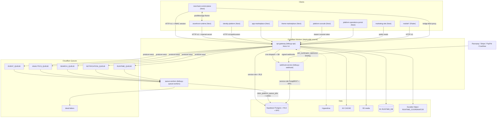

# Phase 7 — Integration Investigation

Investigation date: 2026-06-05

> Forensic scope: document the *current* state of cross-component communication on the LetBuyy
> platform. Every edge below cites file/line or config evidence. Where a path could not be
> proven from the repository it is marked "not found in repository". This report verifies
> claims independently and does not inherit the prior `07-integration.md` content.

---

## Method

Read-only inspection via file tools (`/Users/saai_sidd/Git/Letbuyy_Store`) and bash
(`/sessions/brave-sweet-gates/mnt/Letbuyy_Store`). No files were modified except the two
permitted report files. Commands / actions:

- Enumerated runtimes: `apps/*`, `apps/mobile/*`, `services/*`, `packages/*` directory + `package.json` scan.
- Read entrypoints: `services/api-gateway/src/index.ts`, `services/webhook-service/src/index.ts`, `services/queue-workers/src/index.ts` and `src/platform-queue-consumer.ts`.
- Read all three deployable `wrangler.toml` (api-gateway, webhook-service, queue-workers) for routes, ports/domains, queue producers/consumers, service bindings, D1/KV/R2/Hyperdrive/DO bindings.
- Read app→gateway HTTP clients: every `apps/*/src/lib/api/client.ts`, `apps/storefront-runtime/src/lib/api/browser-client.ts`, `packages/typescript/api-client/src/index.ts`.
- Read theme editor ↔ runtime postMessage bridges (`CenterPanel.tsx`, `storefront-preview-bridge.tsx`, `editor-preview-section-frame.tsx`), admin app bridge (`EmbeddedAppBridgeClient.tsx`), checkout extension host.
- Traced events: `packages/event-core/src/index.ts` (`DOMAIN_EVENT_CONTRACTS`), `packages/orchestration/src/event-runtime.ts` (`queueNamesForEvent`, `RUNTIME_QUEUE_NAMES`), `services/api-gateway/src/execution/outbox-execution.adapter.ts` + `queue-execution.adapter.ts`, `services/queue-workers/src/platform-queue-consumer.ts`.
- Grepped DB writers/readers per table (`outbox_events`, `platform_queue_jobs`, `webhook_deliveries`, `webhook_subscriptions`, `analytics_event_stream`, `distributed_queue_messages`, `notifications`, `payment_webhook_events`) and RPC call sites vs. `database/supabase/migrations/000_baseline.sql` function definitions.
- Compared payment provider webhook handlers against migration tables/RPCs.

> Live-repo caveat: during this investigation `services/api-gateway/src/routes/analytics.ts`
> (mtime 12:14:56) and `services/api-gateway/src/routes/storefront.ts` (mtime 12:34:09) were
> modified by a concurrent process while the report was being written. Findings reflect the
> state read at the cited timestamps.

---

## Topology overview

Only **three** services contain executable source and deploy as Cloudflare Workers:

| Service | Worker name (prod) | Routes (prod) | Source |
|---------|--------------------|---------------|--------|
| `services/api-gateway` | `letbuyy-api` | `api.letbuyy.store` (custom domain) | `src/index.ts` (Hono, `/v1` basePath) |
| `services/webhook-service` | `letbuyy-webhook` | `webhooks.letbuyy.store` | `src/index.ts` (Hono) |
| `services/queue-workers` | `letbuyy-queue-workers` | none (queue consumer only) | `src/index.ts` + `src/platform-queue-consumer.ts` |

The other six `services/*` roots are **declaration-only** (each contains only `AGENTS.md` +
`runtime.manifest.json`, no `src/`): `analytics-pipeline`, `checkout-runtime`, `event-bus`,
`media-service`, `notification-service`, `search-service`. Verified by directory listing —
e.g. `services/event-bus/` contains exactly `AGENTS.md` and `runtime.manifest.json`;
`services/event-bus/runtime.manifest.json:8` self-classifies as `"reserved-service"`.

Eight Next.js apps + 3 Flutter apps are clients of the gateway. All web apps reach the gateway
through one shared client factory `createLetbuyyApiClient()`
(`packages/typescript/api-client/src/index.ts`).

---

## Integration matrix

Mechanism legend: HTTP = fetch over HTTPS; SB = Cloudflare service binding (worker→worker);
Q = Cloudflare Queue; DB = Supabase Postgres table; RPC = Supabase RPC function; PM = browser
`postMessage`; ENV = environment/config value.

| # | From → To | Mechanism | Contract | Ownership boundary | Evidence |
|---|-----------|-----------|----------|--------------------|----------|
| E1 | merchant-control-plane → api-gateway | HTTP `/v1/*` via `createMerchantApiClient`; injects HMAC internal-session headers | Typed (`@letbuyy/api-client` `LetbuyyApiClient`) over shared types | App = thin client; gateway = auth+logic | `apps/merchant-control-plane/src/lib/api/client.ts:62-118` |
| E2 | storefront-runtime → api-gateway | HTTP `/v1/*` via `createStorefrontApiClient`; signs internal-only paths (`X-LetBuyy-Internal-*`) + `X-Internal-API-Secret` | Typed; some ad-hoc internal-secret header | App = SSR client; gateway = data owner | `apps/storefront-runtime/src/lib/api/client.ts:60-154`; verify side `services/api-gateway/src/routes/storefront.ts:1691-1696` |
| E3 | identity-platform → api-gateway | HTTP `/v1/auth/custom/*`; `identityApiRequest` with internal-app HMAC | Typed responses defined inline; gateway requires `requireAccountsInternal` | App = auth UI; gateway = users_custom owner | `apps/identity-platform/src/app/api/auth/login/route.ts:50-72`; `services/api-gateway/src/routes/auth.ts:143-165` |
| E4 | app-marketplace → api-gateway | HTTP via `createAppMarketplaceApiClient`; `api.appStore.*` | Typed (`MarketplaceApp` from shared-types) | App = catalog UI; gateway = app-store owner | `apps/app-marketplace/src/lib/app-service.ts:36-63`; client `apps/app-marketplace/src/lib/api/client.ts` |
| E5 | theme-marketplace → api-gateway | HTTP via `createThemeMarketplaceApiClient`; `api.themes.*` | Typed (`@letbuyy/theme-engine` search types) | App = theme catalog UI; gateway = theme owner | `apps/theme-marketplace/src/lib/theme-service.ts:11-69`; client `.../lib/api/client.ts:25-57` |
| E6 | platform-console → api-gateway | HTTP `/v1/internal/console/*`; static bearer `PLATFORM_CONSOLE_API_TOKEN` (`X-Platform-Console-Token` or `Authorization: Bearer`) | Token-gated; not session-HMAC | Console = super-admin UI; gateway = console-data owner | `apps/platform-console/src/lib/console-api.ts:54-57`; `services/api-gateway/src/routes/internal-console.ts:43-66` |
| E7 | platform-operations-portal → api-gateway | HTTP via `createLetbuyyApiClient` + internal-session headers | Typed client | Portal = employee UI | `apps/platform-operations-portal/src/lib/api/client.ts` |
| E8 | marketing-site → api-gateway | HTTP `NEXT_PUBLIC_API_URL`; read-only public reads | Loosely typed (only 2 env vars used) | Marketing = public; no auth | env scan: only `NEXT_PUBLIC_ACCOUNTS_URL`, `NEXT_PUBLIC_API_URL` referenced |
| E9 | mobile/merchant-app (Flutter) → api-gateway | HTTP `API_BASE_URL` default `https://api.letbuyy.store/v1` | Hand-mirrored Dart models (no codegen) | Native client; gateway = owner | `apps/mobile/merchant-app/lib/config/app_config.dart:6-9` |
| E10 | api-gateway → Supabase Postgres | HTTP PostgREST + RPC via `@supabase/supabase-js` service-role client; Hyperdrive binding present | RLS + typed adapters; RPC params positional | Gateway owns service-role; DB owns RLS | `services/api-gateway/src/index.ts:52-57` (Env), `lib/supabase.ts`; HYPERDRIVE binding `wrangler.toml:161-168,263-271` |
| E11 | api-gateway → Cloudflare Queues (producer) | Q: 5 producer bindings `EVENT_QUEUE`, `ANALYTICS_QUEUE`, `SEARCH_QUEUE`, `NOTIFICATION_QUEUE`, `RUNTIME_QUEUE` | Payload shape ad-hoc `Record<string,unknown>`; `queue.send({messageId,queueName,jobType,siteId,payload,...})` | Gateway = producer | `services/api-gateway/wrangler.toml:55-73,234-252`; `index.ts:85-89`; send site `routes/storefront.ts:498-524` |
| E12 | queue-workers ← Cloudflare Queues (consumer) | Q: 7 consumer bindings incl. DLQs | Consumer reads `QueuePayload`; persists to `distributed_queue_messages` | Queue-workers = consumer | `services/queue-workers/wrangler.toml:36-95,232-291`; `src/index.ts:257-303` |
| E13 | api-gateway → webhook-service | SB: `WEBHOOK_SERVICE` Fetcher → `POST https://webhook-service/webhook-deliveries/dispatch` and `/app-lifecycle/dispatch`; auth `X-LetBuyy-Internal-Secret` | Ad-hoc JSON body; secret-gated | Gateway invokes; webhook-service owns outbound HTTP+HMAC | `services/api-gateway/src/index.ts:511-524`; `routes/app-store.ts:429-432`; `routes/operations.ts:412-437` |
| E14 | webhook-service → api-gateway | SB: `API_GATEWAY_SERVICE` binding (reverse) | Binding declared in webhook wrangler | webhook-service may call gateway | `services/webhook-service/wrangler.toml:60-62,99-101` |
| E15 | webhook-service → Supabase | HTTP PostgREST direct (`@letbuyy/infrastructure/supabase-adapter` raw fetch helpers) + RPC `claim/complete/fail_webhook_delivery` | Positional RPC params; ad-hoc row shapes | webhook-service owns service-role headers | `services/webhook-service/src/index.ts:11-17,780-826` |
| E16 | Payment providers → webhook-service | HTTP inbound POST `/razorpay`, `/stripe`, `/paypal`, `/cashfree`; provider signature verify | Provider-specific; verified via `@letbuyy/infrastructure/*-adapter` `webhookVerify()` | webhook-service owns verification + order/subscription mutation | `services/webhook-service/src/index.ts:857,1043,1253,1390` |
| E17 | api-gateway (cron) → outbox dispatch | ENV cron `*/1` (prod) / `*/5` (staging) → `runScheduledDispatch` → `OutboxExecutionAdapter.dispatchBatch` | Internal; claims via RPC `claim_outbox_events` | Gateway scheduled handler owns dispatch loop | `wrangler.toml:202-203` (`crons`); `index.ts:471-612`; adapter `outbox-execution.adapter.ts:73-120` |
| E18 | outbox → platform_queue_jobs (fanout) | DB upsert; queue names from `queueNamesForEvent()` | Typed envelope via `@letbuyy/orchestration` | Gateway adapter writes job rows | `outbox-execution.adapter.ts:134-189`; `orchestration/src/event-runtime.ts:178-212` |
| E19 | outbox → webhook_deliveries (fanout) | DB upsert from `webhook_subscriptions` match | `eventMatchesSubscription` + `isValidWebhookTarget` | Gateway adapter writes; webhook-service delivers | `outbox-execution.adapter.ts:191-239` |
| E20 | theme editor (merchant) ↔ storefront preview iframe | PM: 5 message types; iframe `src = NEXT_PUBLIC_STOREFRONT_URL/store/<name>?editor=1&theme_preview_token=…` | Loose `postMessage` JSON; origin-checked one direction | Merchant app hosts editor; storefront renders preview | `apps/merchant-control-plane/src/components/theme-editor/CenterPanel.tsx:15-51`; `apps/storefront-runtime/src/app/preview/storefront-preview-bridge.tsx:5-89` |
| E21 | theme editor → gateway (save/publish/preview) | HTTP via `api.themes.editor/saveDraft/publish/previewSession` | Typed (`ThemeEditorPayload`, `SaveThemeDraftInput`, …) | Merchant Next route proxies; gateway owns theme release | `apps/merchant-control-plane/src/app/api/themes/[themeId]/editor/route.ts:29-93`; api-client `index.ts:1273-1287`; gateway `routes/themes.ts:356-447` |
| E22 | storefront preview token → gateway | HTTP `GET /v1/storefront/:sub/theme-preview?token=` | Typed `themePreview()` | Storefront reads; gateway validates token | api-client `index.ts:1326-1327`; cookie set in `apps/storefront-runtime/src/proxy.ts:54-65` |
| E23 | admin app bridge (embedded app iframe) → gateway | PM `letbuyy:bridge.*` → fetch `POST /v1/app-store/bridge/fetch` (bearer app token) | Path-allowlisted GET-only proxy | Merchant hosts bridge; gateway proxies scoped reads | `apps/merchant-control-plane/src/components/apps/EmbeddedAppBridgeClient.tsx:50-214`; gateway route `routes/app-store.ts:1234-1235` |
| E24 | checkout UI extensions (storefront) ← gateway | HTTP `GET /v1/storefront/:sub/checkout/extensions`; iframe render via `@letbuyy/extension-host` | Typed registry response; feature-gated `FEATURE_EXTENSIONS` | Storefront renders; gateway returns registry | api-client `index.ts:1322-1323`; host `apps/storefront-runtime/src/components/checkout-extensions/CheckoutExtensionHost.tsx:48-80`; gate `index.ts:377` |
| E25 | queue-workers → platform_queue_jobs drain | RPC `claim_platform_queue_jobs` then writes `analytics_event_stream`, `notifications`, search/payout projections | Positional RPC; typed envelope | Queue-workers drains platform queue (shared with gateway cron) | `services/queue-workers/src/platform-queue-consumer.ts:388-540` |
| E26 | apps ↔ identity (cross-app SSO cookie) | ENV shared cookie domain `COOKIE_DOMAIN=.example.com` (template); `lb_session` cookie verified by `@letbuyy/auth-core` | Shared cookie + HMAC session | Identity issues; apps verify via package | `apps/theme-marketplace/src/proxy.ts:2-29`; cookie const `packages/auth-core/src/index.ts:127` |
| E27 | GraphQL (storefront + admin) | HTTP `POST /v1/storefront/graphql`, `/v1/admin/graphql`; router delegates to REST via internal subrequest header | Feature-gated `FEATURE_GRAPHQL`; delegates to own REST | Gateway hosts both; same process | `services/api-gateway/src/index.ts:350-399`; `graphql/storefront.ts:14-32`; `graphql/rest-shim.ts` |

---

## Communication diagram



---

## Event flow (traced against current code)

`packages/event-core/src/index.ts` defines `DOMAIN_EVENT_CONTRACTS` for **24** event types
(`DOMAIN_EVENT_TYPES`, lines ~70-98) each with a `consumers` list drawn from
`{ analytics, notifications, search-indexing, webhook-service, payout-ledger }`.

Producer → fanout → consumer chain (verified):

```
Domain mutation (e.g. routes/orders.ts:482 emitDomainEvent 'order.created')
  → EventExecutionAdapter.emitDomainEvent() → upsert outbox_events            (event-execution.adapter.ts:48-86)
  → [cron */1 prod] runScheduledDispatch → OutboxExecutionAdapter.dispatchBatch (index.ts:504-525)
       → claim_outbox_events RPC (120s lock)                                   (outbox-execution.adapter.ts:108-120)
       → queueNamesForEvent(event_type)                                        (orchestration/event-runtime.ts:178-212)
       ├─ enqueuePlatformJobs() → platform_queue_jobs rows (one per queue)     (outbox-execution.adapter.ts:134-163)
       └─ createWebhookDeliveries() → webhook_deliveries (per active webhook_subscription) (191-239)
  → [also cron] queue.consumeQueues(['analytics-events','search-indexing','payment-events']) (index.ts:525)
  → [also] webhook-service /webhook-deliveries/dispatch → claim_webhook_deliveries RPC → HMAC POST partner URL (webhook-service/src/index.ts:776-851)
```

In parallel, the **Cloudflare Queue path** (separate from the DB platform-queue path):
`api-gateway` `queue.send(...)` to `ANALYTICS_QUEUE` (`routes/storefront.ts:498`) → consumed by
`queue-workers` `queue()` handler → persists `distributed_queue_messages` + telemetry, then
calls `consumePlatformQueuesForCloudflareQueue` which **also** drains `platform_queue_jobs`
(`services/queue-workers/src/index.ts:266-283`).

### Event consumer realization

| Consumer label (event-core) | Realized by | Evidence |
|-----------------------------|-------------|----------|
| `analytics` | `analytics-events` queue → `analytics_event_stream` + rollups | `platform-queue-consumer.ts:429-489`; `queue-execution.adapter.ts:257-298` |
| `search-indexing` | `search-indexing` queue → search projection docs | `platform-queue-consumer.ts` (`processSearchJob`) |
| `payout-ledger` | `payment-events` queue → payout ledger | `event-runtime.ts:206-207`; `platform-queue-consumer.ts` |
| `notifications` | in-app `notifications` insert (side-effect of analytics job) | `platform-queue-consumer.ts:516-540` |
| `webhook-service` | `webhook_deliveries` → outbound HMAC POST | `outbox-execution.adapter.ts:191-239`; `webhook-service/src/index.ts:788-818` |

---

## Database & RPC integration

- **RPC contract check:** 48 distinct `.rpc('…')` call sites across `services/`/`apps/`/`packages/` were extracted and compared against 97 `CREATE FUNCTION` definitions in `database/supabase/migrations`. **All 48 called RPCs are defined** (`comm -23` of called-vs-defined returned empty). webhook-service additionally calls `claim_webhook_deliveries`, `complete_webhook_delivery`, `fail_webhook_delivery` — all defined at `000_baseline.sql:941,1398,4161`.
- **Shared tables with 2+ writer owners** (asymmetry — see findings F-A1/F-A2):
  - `platform_queue_jobs`: written/claimed by both `api-gateway` (cron via `queue-execution.adapter.ts`, plus `outbox-execution.adapter.ts`, `routes/operations.ts`) **and** `queue-workers` (`platform-queue-consumer.ts`). Both claim via the same `claim_platform_queue_jobs` RPC.
  - `analytics_event_stream`: written by both `api-gateway/.../queue-execution.adapter.ts` and `queue-workers/.../platform-queue-consumer.ts`.
  - `notifications`: inserted by `api-gateway` (`queue-execution.adapter.ts`, `routes/notifications.ts`) and `queue-workers` (`platform-queue-consumer.ts`).
  - `outbox_events`: written by `api-gateway` (`event-execution.adapter.ts`) and `webhook-service` (`emitPaymentDomainEvent`, `src/index.ts:308-345`).

---

## Flagged asymmetries

| ID | Asymmetry | Status | Evidence |
|----|-----------|--------|----------|
| A1 | `NOTIFICATION_QUEUE` producer binding exists on gateway, but the **only** `queue.send` site found targets `ANALYTICS_QUEUE`; no producer code sends to `NOTIFICATION_QUEUE`, `SEARCH_QUEUE`, `EVENT_QUEUE` (except the scheduled-dispatch completion event to `EVENT_QUEUE`), or `RUNTIME_QUEUE`. queue-workers consumes all of them. **Consumers exist for producers that are largely unused.** | Producer-side under-utilized | grep of `queue.send`/`createCloudflareQueueProducer` → only `routes/storefront.ts:498` (ANALYTICS) and `index.ts:530,578` (EVENT). Consumers: `queue-workers/wrangler.toml:36-95` |
| A2 | Dual platform-queue drain: api-gateway cron (`consumeQueues`) and queue-workers both `claim_platform_queue_jobs`. Coordination relies solely on the RPC's row-locking; no ownership doc reserves one path. | Overlapping ownership | `index.ts:525`; `platform-queue-consumer.ts:388-394` |
| A3 | `webhook-service` ↔ `api-gateway` bidirectional binding: gateway has `WEBHOOK_SERVICE`, webhook-service has `API_GATEWAY_SERVICE`. The reverse (`API_GATEWAY_SERVICE`) binding is declared but **no call site to it was found** in webhook-service source. | Binding declared, caller not found | `webhook-service/wrangler.toml:60-62`; grep of `API_GATEWAY_SERVICE` in `webhook-service/src` → none |
| A4 | `FEATURE_LIQUID` is declared in gateway `Env` (`index.ts:101`) and in the `GatewayFeatureFlag` union (`middleware/featureFlags.ts:4`) but **no `featureGate('FEATURE_LIQUID', …)`** call exists; only `FEATURE_GRAPHQL` and `FEATURE_EXTENSIONS` gate routes. | Flag defined, never enforced | `index.ts:353-362,375-379` |
| A5 | Six `services/*` runtime roots (`analytics-pipeline`, `checkout-runtime`, `event-bus`, `media-service`, `notification-service`, `search-service`) are referenced in env-ownership (`config/env/ownership/runtime-env-ownership.json:30-39`), topology and manifests, but contain **no source**. Event consumers `analytics`/`search-indexing`/`notifications` are realized inside `queue-workers`, not these named services. | Declared-not-built; naming vs. realization mismatch | directory listings; `services/event-bus/runtime.manifest.json:105` ("Delegates … to services/queue-workers consumers") |
| A6 | `theme.purchase.payment_order_created`, `theme.purchase.completed`, `theme.draft.saved`, `theme.draft.discarded`, `runtime.scheduled_dispatch.completed/failed` are emitted as event types (themes.ts, theme-execution.adapter.ts, index.ts) but are **not** in `DOMAIN_EVENT_CONTRACTS`. `getDomainEventContract()` returns null for them → they fall through to the heuristic `queueNamesForEvent` (analytics only) and get no typed payload validation / no declared webhook consumer. | Emitted events without a registered contract | `routes/themes.ts:756,845`; `theme-execution.adapter.ts:1039,1101`; `event-core/src/index.ts:202-388` (absent) |
| A7 | `payout.released` and `payout.failed` have contracts in `event-core` but **no emitter found** in `services/` (only `payout.ledger_entry.created` is emitted, `queue-execution.adapter.ts:495`). | Contract without producer | grep of `payout.released`/`payout.failed` in `services/` → none |
| A8 | Theme editor → storefront preview `postMessage`: the storefront→parent `ready`/`section-select` messages target `document.referrer` origin or `'*'` when referrer is empty (`getParentTargetOrigin` returns `'*'`), and the parent (`CenterPanel`) posts to `new URL(previewUrl).origin` but the storefront `selectSection` re-broadcasts with `window.location.origin`. Asymmetric origin handling; `'*'` fallback present. | Loose origin contract | `storefront-preview-bridge.tsx:25-33,44`; `CenterPanel.tsx:44-50` |

---

## Contract quality summary

- **Single typed source:** `@letbuyy/shared-types` → `@letbuyy/api-types` → `@letbuyy/api-client` is the canonical web contract; all 8 web apps consume `createLetbuyyApiClient()`. Verified 32+ distinct `@letbuyy/*` import specifiers all resolve to declared packages (no undeclared `@letbuyy/*` imports; `undeclared-import-validator.mjs` passes).
- **Dart drift risk:** `apps/mobile/*` + `packages/dart/models` mirror the TS contracts by hand (no codegen path found). Drift is process-enforced only.
- **Gateway re-validation:** `services/api-gateway/src/schemas/*` (16 Zod schema files) re-validate inbound payloads at the worker boundary; `theme.schema.ts` etc. are facades over domain packages (per AGENTS.md §Backend).
- **Internal-auth mechanisms are heterogeneous:** HMAC session headers (most apps), HMAC app-attestation (`X-LetBuyy-Internal-App`, storefront), raw shared secret (`X-Internal-API-Secret`, storefront internal paths), static bearer (`PLATFORM_CONSOLE_API_TOKEN`), and `X-LetBuyy-Internal-Secret` (worker→worker). Four distinct internal trust schemes coexist.

---

## Evidence Index

| Ref | Path | Lines |
|-----|------|-------|
| api-gateway entry / Env / cron / CORS | `services/api-gateway/src/index.ts` | 1-48, 52-121, 297-327, 471-612 |
| api-gateway wrangler (routes, queues, bindings, crons) | `services/api-gateway/wrangler.toml` | 19-24, 55-89, 152-185, 202-287 |
| webhook-service entry (providers, dispatch, RPCs) | `services/webhook-service/src/index.ts` | 1-48, 308-345, 742-851, 857, 1043, 1253, 1390 |
| webhook-service wrangler (service bindings) | `services/webhook-service/wrangler.toml` | 60-62, 99-101 |
| queue-workers entry + consumer | `services/queue-workers/src/index.ts`; `src/platform-queue-consumer.ts` | index 257-303; consumer 1-120, 350-540 |
| queue-workers wrangler (consumers/DLQ) | `services/queue-workers/wrangler.toml` | 36-95, 232-291 |
| outbox/queue execution adapters | `services/api-gateway/src/execution/outbox-execution.adapter.ts`; `queue-execution.adapter.ts`; `event-execution.adapter.ts` | outbox 73-275; queue 12-22, 170-298; event 48-116 |
| event contracts + routing | `packages/event-core/src/index.ts`; `packages/orchestration/src/event-runtime.ts` | event-core 70-98, 202-427; orchestration 12-22, 178-212 |
| merchant API client + theme proxy routes | `apps/merchant-control-plane/src/lib/api/client.ts`; `src/app/api/themes/[themeId]/editor/route.ts`, `preview-session/route.ts` | client 62-170; editor 1-105; preview 1-34 |
| storefront client + proxy | `apps/storefront-runtime/src/lib/api/client.ts`; `src/proxy.ts` | client 60-190; proxy 1-66 |
| theme editor postMessage bridges | `apps/merchant-control-plane/src/components/theme-editor/CenterPanel.tsx`; `apps/storefront-runtime/src/app/preview/storefront-preview-bridge.tsx`; `src/lib/theme-engine/editor-preview-section-frame.tsx` | CenterPanel 15-91; bridge 5-92; frame 5-92 |
| admin app bridge + gateway proxy | `apps/merchant-control-plane/src/components/apps/EmbeddedAppBridgeClient.tsx`; `services/api-gateway/src/routes/app-store.ts` | bridge 50-214; route 1234-1235, 429-432 |
| api-client SDK (themes, storefront, graphql) | `packages/typescript/api-client/src/index.ts` | 1236-1359 |
| internal-auth verify | `services/api-gateway/src/lib/internal-auth.ts`; `src/middleware/auth.ts` | internal-auth 12-37; auth 64-120 |
| env-ownership (declared service owners) | `config/env/ownership/runtime-env-ownership.json` | 25-46 |
| reserved-service manifest | `services/event-bus/runtime.manifest.json` | 8-9, 105 |
| RPC definitions (webhook) | `database/supabase/migrations/000_baseline.sql` | 941, 1215, 1291, 1361, 1398, 4161, 10332, 11592, 13049 |
