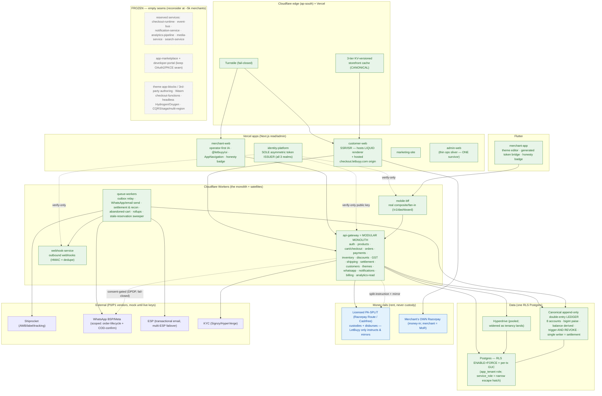

# LETBUYY CANONICAL SYSTEMS — THE WINNER REGISTRY (DOC 03)

> **Document type:** Authority document — the canonical-winner registry. The single operative reference an agent or engineer consults to answer **"which system do I use for this domain?"** There is exactly one answer per domain, and it is law.
> **Date:** 2026-06-10 · **Author:** Architecture Review Board (ARB) · **Repo:** `/Users/saai_sidd/Git/Letbuyy_Store` · evidence pinned at `stepup/main` @ `5cf9e64e`, working tree dirty.
> **Status:** Active law. Supersedes any per-domain "system of record" claim made by `AGENTS.md` (generated), the 60+ root governance docs, or the ~120 `docs/governance/*` files.

---

## 0. What this document is (and is not)

**This is the winner registry.** For every domain in the platform it names **one** canonical system — the implementation that survives at 10,000 India merchants — and declares every alternative a loser with a fate. It does **not** re-derive or re-litigate the winners: they were decided by the Strategic Canonicalization program (anchor spine A0–A9) and crystallized in `_GOVERNANCE_SPINE.md` §S5. This document is the **prescriptive, enforceable** form of that decision.

**It is not** the *how* or the *when* — those live in DOC 04 (`LETBUYY_LEGACY_ELIMINATION_MASTER_PLAN.md`, the deletion order) and DOC 05 (`LETBUYY_FOUNDATION_ROADMAP.md`, the phase plan). This document answers only **"what is canonical."**

### 0.1 Authority-chain position (per `_GOVERNANCE_SPINE.md` §S2)

| Rank | Document | Role |
|---|---|---|
| 1 | `LETBUYY_CONSTITUTION.md` (DOC 01) | Supreme. Nothing overrides it. |
| 2 | `LETBUYY_AGENTS_V2.md` (DOC 02) | Operating rules every agent follows. |
| **3** | **`LETBUYY_CANONICAL_SYSTEMS.md` (DOC 03 — THIS DOCUMENT)** | **The winner registry. Names the one true system per domain.** |
| 4 | `LETBUYY_LEGACY_ELIMINATION_MASTER_PLAN.md` + `LETBUYY_FOUNDATION_ROADMAP.md` (DOC 04, 05) | How / when to converge. |
| 5 | `LETBUYY_UI_UX_GOVERNANCE.md` + surviving `docs/governance/*` (DOC 06) | Domain governance. |
| 6 | Evidence base (`FORENSIC_MASTER_2026_06_10/`, `STRATEGIC_CANONICALIZATION_2026_06_10/`) | The "why", not authority. |

On any "which system" conflict, **this document wins** over DOC 04/05/06 and the evidence base, and is itself bound by DOC 01/02.

### 0.2 The decision rule that crowned every winner (inherited, applied literally)

> The canonical system is the implementation that should **still exist at 10,000 India merchants** — not the oldest, the most complete, or the easiest. LetBuyy has **zero production merchants and zero legacy burden**, so it moves directly to the intended architecture and preserves nothing for its own sake.

This rule makes the hard calls clean. It crowns the **canonical double-entry ledger** over the busier legacy capture path, **Liquid** over the more-complete React renderer, **identity-platform** over the more-load-bearing gateway auth, and **RLS+GUC** over the app-only tenant guard — in every case the *less complete* thing wins because it is the one that scales and supports the ecosystem.

### 0.3 The scale envelope (constitutional constant — `_GOVERNANCE_SPINE.md` §S3)

India-only. Design for **100 → 1,000 → 10,000 merchants**. **NEVER optimize for 100,000+ or 1,000,000+.** ~30k orders/mo at the top of the envelope is trivial for one Postgres. Any system that designs for 100k+/1M+ (sharding, multi-region, CQRS, event-sourcing, service mesh, Wasm extension runtime) is out of scope by constitutional rule, not opinion — and is therefore **never** a canonical winner here.

---

## 1. THE THREE RULES OF CANON (binding; testable)

These are the operative rules that make this registry enforceable. They are normative (MUST / MUST NOT).

### Rule C1 — One system per domain. No coexistence.

> **For every domain in §3, there is exactly ONE canonical system. A second implementation of the same capability is a defect, not a fallback.** An agent MUST NOT build, extend, or wire a non-canonical implementation of a domain that already has a named winner. "Two parallel systems" is the single failure mode this registry exists to end (the forensic master found it in four load-bearing places: legacy vs canonical ledger, React vs Liquid renderer, legacy vs V1 auth, dual draft systems — `FORENSIC_MASTER_2026_06_10/000_MASTER_INDEX.md` Q1).

**Permitted exception — the managed bridge.** A `TRANSITIONAL` system MAY coexist with its winner *only* while the winner is being built and *only* under a named retirement gate in DOC 04. It is a bridge with a demolition date, never a permanent second system. The instant the winner serves and zero-drift is proven, the bridge is deleted (DOC 04 wave).

**Permitted exception — defense-in-depth layers.** Distinct *layers* of one domain that fail differently (e.g. tenancy's app-guard + ownership + RLS+GUC) are not "two systems" — they are one canonical stack. The test: do they enforce the *same* invariant by *different* mechanisms (keep all), or are they *substitutes* for the same job (keep one)?

### Rule C2 — The winner is named by capability, not by completeness or load.

> **When two implementations exist, the canonical one is the system that scales to and supports the 10k-merchant ecosystem — even if it is the less-complete or less-load-bearing one today.** Completeness is *not* the tiebreaker; ecosystem-fit is. The directive's explicit test cases:
> - **Liquid renderer wins over React** (React is ~62% complete and the only one that runs; Liquid is flag-off) — because only Liquid supports a theme marketplace, 3rd-party authors, and portable themes.
> - **identity-platform wins over gateway `routes/auth.ts`** (the gateway path is 1,441 LOC and on the live request path) — because one asymmetric issuer is the only design that unblocks OIDC and stops shared-secret forgery.
> - **The canonical double-entry ledger wins over the legacy capture path** (the legacy path is complete and every buyer hits it) — because only the ledger models COD cash-in-transit, reserves, reversing entries, and reconciles to zero-break.

### Rule C3 — A winner that is also a "do-not-delete-the-loser-yet" case is explicit.

> **Picking a winner does NOT automatically authorize deleting the loser.** Where the loser is the live read/write path, it is `FROZEN` (kept, frozen to new work) until the winner reaches parity, then the delete-or-keep fork is made on data — not on the existence of the winner. The flagship case is the **React renderer: KEEP_TEMPORARILY / FROZEN, explicitly NOT deleted for completeness** (this is the directive's deliberate test that "Liquid wins" is not misread as "delete React now"). The delete decision is a Wave-6, data-driven call in DOC 04.

---

## 2. THE MASTER REGISTRY (one row per domain — the operative lookup table)

> **How to read:** find your domain, read the **Winner** column — that is the system you use, full stop. **Class** is the strategic class of the winner. **Replaces / kills** names the loser(s) the winner supersedes (full deletion plan + order in DOC 04). **Wave** is when the winner is live (per DOC 05). **Trace** anchors the call to the spine anchor (A0–A9) and the canonicalization doc IDs.
> Classes: **CANONICAL** = the winner, build/finish it · **CANONICAL (build)** = winner that is not yet built · **CANONICAL but DEFERRED** = winner whose build is demand-gated.

| # | Domain | **WINNER (the one canonical system)** | Class | Replaces / kills (→ DOC 04) | Wave | Trace |
|---|---|---|---|---|---|---|
| 1 | **Topology / Deployment** | Modular monolith `api-gateway` + 4 satellites (`queue-workers`, `mobile-bff`, `identity-platform`, `webhook-service`) over one RLS Postgres; `main` is the deploy branch | CANONICAL | 9-app AGENTS topology; CQRS package cluster; 3 staging workflows; 30-commit branch lag | 0→2 | A0/A9; LEG-001…006, 067, 076; ISSUE-002 |
| 2 | **Constitution / Governance** | One constitution (DOC 01) + a validator suite that enforces V1 | CANONICAL | generated `AGENTS.md`; ~36 fiction validators; ~120 theater gov docs; 60+ root docs | 0→2 | A0; LEG-063…076 |
| 3 | **Identity** | `apps/identity-platform` = sole issuer for all 3 realms (merchant/staff, buyer, operator) | CANONICAL | gateway `routes/auth.ts`; `identity-foundation` shadow; Supabase `/auth/*`; 6 identity micro-pkgs | 0→7 | A1; IDN-005; LEG-024…030 |
| 4 | **Authentication** | identity-platform login (merchant bcrypt-12 + passwordless buyer OTP) + Turnstile fail-closed | CANONICAL | second Supabase reset pipeline; the `/api/auth/switch` takeover path (S0) | 0→3 | A1; IDN-002; LEG-026/028; ISSUE-001 |
| 5 | **Authorization (RBAC)** | Default-deny RBAC; role only from `app_metadata`/DB; claims→GUC validated; ops `employee_permissions` + dual-control kept | CANONICAL | `user_metadata.role` client-writable channel; anon-writable `super_admin_allowlist` (S0) | 0→4 | A1/A2; IDN-014; AUTH-003/004; ISSUE-003 |
| 6 | **Sessions** | One identity-platform session service — single revocation authority over all 3 realms (opaque DB token merchant; signed buyer/ops) | CANONICAL | 4 per-app hand-rolled session libs; gateway mint authority; `sessions_v2`/v2 libs | 2→3 | A1; IDN-006/023; LEG-030/053 |
| 7 | **MFA** | Step-up TOTP for all realms; first-class merchant enrollment + recovery codes; `TOTP_ENCRYPTION_KEY` boot-required | CANONICAL (extend) | — (extend the existing plumbing; ops MFA already real) | 4(/6) | A1; IDN-022; AUTH-023 |
| 8 | **Passkeys** | identity-platform WebAuthn on the asymmetric kernel | CANONICAL but DEFERRED | — (the `FEATURE_PASSKEY` flag stays a dormant seam) | 8 | A1; IDN-027; D-12 |
| 9 | **Consent (DPDP)** | identity-platform append-only DPDP consent ledger + gateway DSR export/erasure; fail-closed; reused by WhatsApp | CANONICAL (build) | — (ABSENT today; the OIDC consent route 501s) | 4(/5–6) | A1; IDN-021; D-10; R8 |
| 10 | **Tenant Isolation** | 3-layer fail-closed: app-guard (L1) + ownership (L2) + RLS `ENABLE`+`FORCE`+per-tx GUC on all 261 tables (L3, load-bearing); gateway off blanket `service_role` | CANONICAL | 6 `USING(true)`→PUBLIC policies; anon `super_admin_allowlist` (S0); `store_id`≡`site_id`; `users`/`users_custom` | 0→2(→4) | A2; FND-001…027; DB-004; ISSUE-004…009 |
| 11 | **Payments** | Single capture adapter → posts canonical ledger; money-in MoR-on-own-Razorpay; one `payments` row | CANONICAL | legacy `confirm_order_payment_with_ledger` (posts no ledger); `payment_transactions` dual row; forgeable step-up | 1 | A3; PAY-001/018; LEG-031/054; ISSUE-010/012 |
| 12 | **Ledger** | The canonical 8-account append-only double-entry ledger (mig 139/151/160) = the SINGLE money source of truth; balance always derived; bigint paise; trigger AND `REVOKE` | CANONICAL | 4 compat "ledger" tables (wallet/gift/store-credit/partner-payout); mutable balances; int32/numeric money cols | 1(→5) | A3; PAY-003/009/027; DB-002/003; LEG-034…038/043 |
| 13 | **Settlement** | PA-split mirror (Razorpay Route / Cashfree) — LetBuyy never custodies; settlement = the single writer; gated `claim_payout_statement_release` | CANONICAL | hardcoded `razorpayx` self-custody rail; double commission/payout-fee duplication | 1 | A3; PAY-013/014; LEG-039; ISSUE-014 |
| 14 | **Reconciliation** | Reconcile to zero-break-or-explained-suspense; harness ties book to provider reality; maker-checker + step-up to resolve `recon_breaks` | CANONICAL | — (the `recon_breaks`-no-auto-plug honesty gate is already the winner; extend it) | 1(→3) | A3; PAY-005/016/017 |
| 15 | **Orders** | The one server-side order RPC (`create_checkout_order`); `order_items` relational authoritative; `*_minor bigint` amounts | CANONICAL | `orders.items` JSONB; `orders.store_id`; `orders.{subtotal,total}` numeric | 3(→5) | A4; CHK §1; LEG-051/055; DB-003 |
| 16 | **Checkout** | Hosted `checkout.letbuyy.com` origin + server-authoritative checkout-session state machine in the monolith + cart-bound signed handoff | CANONICAL (build) | client React cart (→ thin view); Wasm checkout-extensions/app-functions in the payment route | 3 | A4; SHOP-003; CHK-001/012/015; LEG-011 |
| 17 | **Cart** | Server-authoritative cart (canonical); client cart demoted to a thin view | CANONICAL | client-only React cart (`cart-context.tsx`, `stock:999`) | 3 | A4; CHK §1 |
| 18 | **Inventory** | Single reserve→commit lifecycle + scheduled stale-reservation sweeper; one path | CANONICAL | direct-`available`-decrement side doors; order-edit add-item-without-reservation | 3 | A4; CHK-002…005 |
| 19 | **Discounts** | The typed 3-class `combines_with` discount engine | CANONICAL (activate) | scalar single-code discount RPC | 3 | A4; CHK §; V1 §3 |
| 20 | **Shipping** | Zones/profiles/rates + pincode + COD serviceability + one real carrier (Shiprocket) for AWB/label/tracking; others mocked behind the adapter | CANONICAL (build, P1) | scaffold/mock label generators (→ adapter mocks) | 3 | V1 §3/§16; A4 |
| 21 | **GST** | Place-of-supply CGST/SGST vs IGST + HSN rates + inclusive/exclusive + immutable GST invoice (IRN/QR via mock IRP) + marketplace TCS | CANONICAL (build, P1) | — (partial today; immutable-invoice intent already correct) | 3 | V1 §3/§16; R9; A4 |
| 22 | **Customers** | Tenant-isolated customer records (behind RLS+GUC) + CRM LTV/RFM + light dynamic segments | CANONICAL | `store_customers` `USING(true)` PUBLIC policy (the S0 PII leak) | 0(leak)→3 | A2/A4; FND; ISSUE-008 |
| 23 | **Theme Runtime (renderer)** | **Liquid / portable-theme (OS-2.0-shaped) renderer** — the ecosystem winner | CANONICAL | React section-registry renderer → **FROZEN first, deleted-or-kept at Wave 6 by perf data (NOT deleted for completeness)** | 1→4(→6) | A5; DEC-1; SHOP-015; LEG-044 |
| 24 | **Theme Engine** | `@letbuyy/theme-engine` = the contract/schema/validator/bundle source of truth; its renderer classes un-orphaned to become the live Liquid renderer | CANONICAL | storefront `RUNTIME_SECTION_SCHEMAS` re-declaration; storefront compose fork; `theme_editor_drafts` legacy draft | 2→4 | A5; DEC-3/5/9; LEG-045/046/047 |
| 25 | **Theme Editor (web + Flutter)** | Both editors CANONICAL and renderer-agnostic — survive the renderer swap untouched; gain web drag-reorder + lint panel | CANONICAL (protect) | mislabeled "AI hooks" (deterministic stubs → **rename** to "Smart defaults", not delete) | 1→4 | A5; DEC-7; THEME-006/011 |
| 26 | **Storefront Runtime** | ONE `customer-web` (Next.js/Vercel SSR/ISR + Worker Cache) hosting the Liquid renderer; the 3-tier KV-versioned cache kept | CANONICAL | `runtime-composition` (unwire then SAFE_DELETE); headless Hydrogen/Oxygen tier (FROZEN — not built) | 2→4 | A6; SHOP §3; LEG-008; TOPO-005 |
| 27 | **Merchant OS (control plane)** | `apps/merchant_web` operator-first (Orders/Money/Customers primary) on one `@letbuyy/ui` + `AppNavigation` shell + systemic provider-mode honesty badge | CANONICAL | `AdminShell`/`Sidebar`/`HeaderBar` fork; per-app `--lb-*` redefs; the non-surviving ops console | 3(→4) | A7/A8; SHOP-007; UIUX-009 |
| 28 | **Mobile** | `apps/merchant_app` (Flutter); `ThemeData` re-pointed at the generated token bridge; release signing fixed; provider-mode badge | CANONICAL | TD-5 parity catalog (`merchant_feature_*`, 974 LOC); duplicate `LetbuyyColorTokens`; debug-keystore config (→fix); `packages/dart/services` phantom | 2→4 | A7/A8; MOB-001…022; LEG-072/073 |
| 29 | **Analytics** | Analytics-read module in `api-gateway` + rollup jobs in `queue-workers` + a real `mobile-bff` composite (`/v1/dashboard`) | CANONICAL | `analytics-pipeline` service stays FROZEN-empty; its fabricated `production` topology entry | 1→3 | A9; PLT-009/014; PERF-001/002 |
| 30 | **Notifications** | WhatsApp-first notifications router in the monolith (→ SMS → email → push) + send jobs in `queue-workers`; multi-ESP failover; preferences/suppression/consent | CANONICAL (build, P1) | `notification-service` stays FROZEN-empty; its fabricated `production` topology entry | 3 | A9; V1 §3/§16; R-2 |
| 31 | **WhatsApp** | A scoped `channel=whatsapp` commerce module: order-lifecycle utility messages + COD-confirm (reply-to-confirm) + opt-in consent ledger; BSP/Meta adapter mocked | CANONICAL (scoped, P1) | full in-WhatsApp commerce stack (catalog→cart→in-thread checkout, broadcasts, inbox) → FROZEN | 3 | A1/A9; V1 §11; R-7 |
| 32 | **Billing** | Subscription billing = the monetization spine; **0% transaction fee permanent**; no apps-Billing-API | CANONICAL | 3% GMV rake (`commission_bps` default 300) + 18% GST-on-fee | 1 | A3; SHOP-004; LEG-042; ISSUE-015 |
| 33 | **Infrastructure** | One RLS Postgres (ap-south) + Cloudflare Workers + Vercel; Hyperdrive widened as tenancy lands; `letbuyy.com` canonical; reserved services manifest-only | CANONICAL | `letbuyy.store` literals (143 files); k8s/Helm fantasy; `legacy/firebase` (~15.3k LOC); fabricated `production-topology.json` | 0→2 | A0; LEG-065/066/071/077 |
| 34 | **Events** | Transactional outbox (same-transaction write) + typed event catalog | CANONICAL (fix) | `event-bus` service → FROZEN-empty; CQRS/projection/saga engine → DEAD | 1 | A9; ARCH-004; PAY-007 |
| 35 | **Design System** | ONE token source (`packages/typescript/ui/src/tokens.ts`, DTCG) → generated Dart bridge; ONE shell (`AppNavigation`); systemic `ProviderModeBadge` | CANONICAL | 3 token sources; 4 mobile color classes; 8 hand-rolled shells; the drift-baselining ratchet | 2→5 | A8; UIUX-001…033; MOB-004 |
| 36 | **Future Marketplace (apps/themes)** | Machinery kept dormant; the theme-marketplace machinery is CANONICAL, the catalog dormant-by-design; reconsider at ~5k merchants + developer demand | CANONICAL (machinery) / DEFERRED (open) | `app-marketplace` + `developer-portal` active topology → FROZEN (keep OAuth2/PKCE seam) | seam now; open W6+ | A5/A9; LEG-020/021/049 |

> **Platform classification totals (≈121 significant components, from `CANONICAL_ARCHITECTURE_MATRIX.md` §3.1):** CANONICAL ≈58 (~48%) · TRANSITIONAL ≈18 (~15%) · LEGACY ≈24 (~20%) · DEAD ≈15 (~12%, ~28.7k LOC) · FROZEN ≈6 (~5%). **The program is deletion + completion, not new construction.**

---

## 3. PER-DOMAIN CANON (Winner · Reason · Migration Path · Deletion Plan)

> For every domain: **Winner** (the one canonical system) · **Reason** (why it wins at 10k merchants — strategic, not "most complete") · **Migration Path** (current state → canonical) · **Deletion Plan** (what dies, referencing DOC 04 by `LEG-`/`DEL-` ID). The *order and gating* of every deletion is owned by DOC 04; this section names the fate, DOC 04 sequences it.

### 3.1 Identity cluster — Identity · Authentication · Authorization · Sessions · MFA · Passkeys · Consent

#### Identity — Winner: `apps/identity-platform` as the sole asymmetric token issuer for all 3 realms.
- **Reason.** The hard parts (bcrypt-12, CSPRNG single-use OTP, rotating reuse-detecting sessions, app-OAuth2-S256-PKCE, fail-closed Turnstile) are *already built*; the defect is **count** (four parallel implementations) and **signing** (one shared HS256 `AUTH_SECRET` across seven trust domains makes the verification key the forgery key). One issuer + asymmetric keys means a leaked verification key is harmless and unblocks the real OIDC provider. The decision rule (C2) crowns the *consolidated* design over the more-load-bearing gateway path.
- **Migration Path.** Collapse 4 implementations → 1 (identity-platform lib + gateway `routes/auth.ts` + `identity-foundation` shadow + Supabase `/auth/*`). Add a default-deny `middleware.ts`. Split the shared `AUTH_SECRET` per-domain (fail-closed), then dual-verify cutover to EdDSA/Ed25519 (ES256 fallback): provision keys → dual-issue → drain (cap `lb_accounts` TTL to ≤90d first) → drop HS256 → rotation proof.
- **Deletion Plan.** DOC 04: `LEG-024` gateway auth-mint, `LEG-025` `identity-foundation` shadow (DEAD wired-scaffold), `LEG-026/027` Supabase `/auth/*` + second reset, `LEG-029` six identity micro-packages, `LEG-030` per-app session libs — all `DELETE_AFTER_MIGRATION` gated on identity-platform serving as sole issuer (`DEL-024…030`). `LEG-028` the `/api/auth/switch` takeover path = DEAD-now, replace-in-place (`DEL-028`, Wave 0).

#### Authentication — Winner: identity-platform login (merchant password + passwordless buyer OTP) + fail-closed Turnstile.
- **Reason.** Buyer-realm passwordless OTP with host-only cookies is a leapfrog (no password/Multipass legacy to carry). Routing all sign-in/up/OTP/reset through one issuer eliminates the second reset pipeline's divergent invalidation guarantees and the `/api/auth/switch` takeover.
- **Migration Path.** Route every sign-in/up/OTP/reset through identity-platform. Commit + deploy the working-tree `/api/auth/switch` fix (rate-limit → CSRF → valid-session → proven-account) in Wave 0.
- **Deletion Plan.** DOC 04: `LEG-026` second Supabase reset pipeline (`DEL-026`); `LEG-028` the takeover path (`DEL-028`, Wave 0, the highest-priority security fix).

#### Authorization (RBAC) — Winner: default-deny RBAC; role sourced only from `app_metadata`/DB; claims→GUC validated; ops `employee_permissions` + dual-control kept.
- **Reason.** The DB-backed ops RBAC with dual-control is a genuine strength — keep it. The defects are two role channels (client-writable `user_metadata.role`) and one anon-writable allowlist. Default-deny + a single server-authoritative role source is the only design that is safe to feed into the tenant GUC.
- **Migration Path.** Drop the `user_metadata` fallback and the `['owner']` default; lint-enforce role-source. The console becomes a step-up+MFA consumer of the ops RBAC.
- **Deletion Plan.** DOC 04: `user_metadata.role` channel = DEAD (`AUTH-004`); `super_admin_allowlist` anon-writable policy = DEAD-now S0 (Wave 0).

#### Sessions — Winner: one identity-platform session service, single revocation authority over all 3 realms.
- **Reason.** Five live session implementations across three realms is exactly the C1 "two parallel systems" failure at ×5. One revocation authority is required for a real logout-everywhere and for session-kill on password reset.
- **Migration Path.** Consolidate to identity-platform storage; opaque DB token for merchant (rotating/reuse-detecting), signed for buyer/ops; per-app high-trust scoping via one `auth-core` import.
- **Deletion Plan.** DOC 04: `LEG-030` four per-app hand-rolled session libs (`DEL-030`), gateway mint authority (folds with `LEG-024`), `LEG-053` `sessions_v2` table + v2 libs = DEAD (`DEL-053`).

#### MFA — Winner: step-up TOTP for all realms with first-class merchant enrollment + recovery codes.
- **Reason.** Ops MFA is already real; the plumbing (`enforceMerchantMfaIfEnrolled`) exists; merchant enrollment is the missing surface. `TOTP_ENCRYPTION_KEY` must be boot-required (fail-closed). This is an *extend*, not a build-from-zero.
- **Migration Path.** Build merchant TOTP enrollment UI + recovery codes; monitor `MFA_UNAVAILABLE`.
- **Deletion Plan.** None (extend). No loser.

#### Passkeys — Winner: identity-platform WebAuthn on the asymmetric kernel. **DEFERRED, demand-gated.**
- **Reason.** Passkeys only make sense on the asymmetric issuer kernel; building them before the issuer + sessions + MFA land would be premature. The `FEATURE_PASSKEY` flag has zero consumers today and stays a dormant seam.
- **Migration Path.** Build after the issuer/session/MFA winners land; flip the flag per cohort (Wave 8).
- **Deletion Plan.** None. The dormant flag is a kept seam, not a loser.

#### Consent (DPDP) — Winner: identity-platform append-only DPDP consent ledger + gateway DSR export/erasure; fail-closed; reused by WhatsApp. **BUILD (absent today).**
- **Reason.** Nobody owns consent today (the OIDC consent route 501s). A single append-only consent ledger is a DPDP legal requirement and the fail-closed gate WhatsApp/marketing/analytics sends must check.
- **Migration Path.** Build the ledger (P1); gate WhatsApp/marketing/analytics consent writes on it (fail-closed — ledger off ⇒ hard-stop, never open).
- **Deletion Plan.** None (build). No loser.

### 3.2 Tenancy cluster — Tenant Isolation

#### Tenant Isolation — Winner: three-layer fail-closed — app-guard (L1) + ownership (L2) + RLS `ENABLE`+`FORCE`+per-tx GUC on all 261 tables (L3, the load-bearing layer); gateway off blanket `service_role`.
- **Reason.** Each layer fails differently, so the union is robust (C1's defense-in-depth exception). Today production runs *single-layer* — the app-layer query-lint guard is the de-facto sole control, the gateway connects as blanket `service_role` (RLS bypassed, migration 107 header), the tenant GUC is never set, and 6 baseline policies are `USING(true)` to PUBLIC. L3 is the only *unconditional* DB-level deny; flipping the load-bearing layer to L3 (while keeping L1+L2 permanently) makes the constitution's words true for the first time.
- **Migration Path.** Wave 0: drop/replace the 6 PUBLIC policies + the anon allowlist (before merchant #1). Wave 1: introduce the `app_tenant` RLS-subject pooled connection that sets `SET LOCAL app.site_id` from validated JWT claims; wire `current_site_id()` to the live path; stop trusting `post_settlement_ledger_transaction`'s param. Wave 2: FORCE+GUC backfill across all 261 tables (template migration); guard the workers (per-job GUC + payload-vs-FK assertion); AST-based isolation validator across all services; REVOKE+RESTRICT on ledger/audit.
- **Deletion Plan.** DOC 04: 6 `USING(true)` PUBLIC policies + anon `super_admin_allowlist` = DEAD-now (Wave 0). `LEG-051` `store_id`≡`site_id` dual key, `LEG-052` `users`/`users_custom`, the GUC-from-param behavior = `DELETE_AFTER_MIGRATION` (Wave 5, `DEL-051/052`). `service_role`-as-default = demoted to FROZEN-narrow break-glass (not deleted).

### 3.3 Money cluster — Payments · Ledger · Settlement · Reconciliation · Billing

#### Ledger — Winner: the canonical 8-account append-only double-entry ledger (mig 139/151/160) as the SINGLE money source of truth; balance always derived; bigint paise; append-only by trigger AND `REVOKE`.
- **Reason (the flagship C2 call).** The legacy capture path is complete and every buyer hits it — exactly the trap the decision rule warns against. Only the canonical ledger models COD cash-in-transit, reserves, reversing entries, and a balanced settlement, and only it reconciles to zero-break at 10k merchants. Make the volume paths *feed* the survivor; do not crown the busy path. The kernel is genuinely Stripe-grade (balanced + idempotent + append-only-by-trigger `post_ledger_transaction`) — it is simply *un-fed*.
- **Migration Path.** Make every path post to it (capture/refund/COD). Compat tables become projections/adapters. Add `REVOKE UPDATE/DELETE` + RESTRICT FKs + in-RPC tenant derivation. Wave 5: bigint cutover (expand/contract + zero-loss backfill); mutable balances → derived (`ledger_account_balance_minor`).
- **Deletion Plan.** DOC 04: `LEG-034…038` the 4 compat ledgers + AI-credits mutable balance (`DEL-034…038`, Wave 5), `LEG-043` int32/numeric money columns (`DEL-043`, Wave 5), `gift_cards.balance` duplicate = DEAD, the GUC-from-param behavior = DEAD — all gated on the canonical ledger being LIVE + the reconciliation harness proving zero drift.

#### Payments — Winner: a single capture adapter that posts the canonical ledger; money-in MoR-on-own-Razorpay; one `payments` row.
- **Reason.** The legacy `confirm_order_payment_with_ledger` is misnamed — it writes **zero** ledger entries despite its name. The winner is one capture path that posts (debit `pa_clearing` / credit `merchant_payable`) and hardens verify (capture + amount + replay).
- **Migration Path.** Ledger the capture idempotently; harden verify; converge `payment_transactions` dual row into `payments`.
- **Deletion Plan.** DOC 04: `LEG-031` legacy capture RPC (`DEL-031`, Wave 1, replace-then-retire), `LEG-054` `payment_transactions` dual row (`DEL-054`, Wave 5), `LEG-040` forgeable step-up = DEAD (`DEL-040`, Wave 1).

#### Settlement — Winner: PA-split mirror (Razorpay Route / Cashfree); LetBuyy never custodies; settlement = the single writer.
- **Reason.** Money-out is hardcoded to a self-custody `razorpayx` rail (R-6 breach) while metadata falsely stamps `no_custody:true`. The constitution forbids LetBuyy holding funds; the only compliant rail is a split-instruction to a licensed PA. The single-writer settlement module + the gated `claim_payout_statement_release` (double-release fix) are already correct.
- **Migration Path.** Switch the rail to split-instruction; assert the split product; derive `no_custody` from the rail (so the honesty metadata becomes true).
- **Deletion Plan.** DOC 04: `LEG-039` the razorpayx self-custody branch = DEAD (`DEL-039`, Wave 1, gated on the PA-split rail being LIVE); double commission/payout-fee duplication = DEAD.

#### Reconciliation — Winner: reconcile to zero-break-or-explained-suspense; the harness ties book to provider reality; maker-checker + step-up to resolve breaks.
- **Reason.** `money_ledger_site_reconciliations` + `recon_breaks` with **no auto-plug** is already the honesty gate (real) — the winner is to *fund* it (so variance → 0 once capture is ledgered) and make the harness the deletion gate for every money change.
- **Migration Path.** Fund `pa_clearing` via ledgered capture so variance → 0; sign `recon_breaks`; add post-transfer recon.
- **Deletion Plan.** None (extend the winner). The reconciliation harness is the **validation gate** for the money-path deletions in DOC 04 Wave 1.

#### Billing — Winner: subscription billing as the monetization spine; **0% transaction fee permanent**; no apps-Billing-API.
- **Reason.** The subscriptions/AutoPay-mock/dunning/plan-gating spine (mig 152) is the correct Shopify-analog and is built. A 3% GMV rake is live and contradicts the 0%-fee promise — money monetizes via subscription + adjacencies (WhatsApp/AI credits, shipping spread), never the sale.
- **Migration Path.** Set `commission_bps=0`; standardize usage metering to bigint; keep the subscription spine.
- **Deletion Plan.** DOC 04: `LEG-042` the 3% rake default + 18% GST-on-fee = DEAD (`DEL-042`, Wave 1, ARB pricing sign-off + a validator banning non-zero commission bps).

### 3.4 Commerce / Checkout cluster — Orders · Checkout · Cart · Inventory · Discounts · Shipping · GST · Customers

#### Orders — Winner: the one server-side order RPC (`create_checkout_order`); `order_items` relational authoritative; `*_minor bigint` amounts.
- **Reason.** Orders are *already* created only via the server-priced, oversell-safe (`FOR UPDATE`), idempotent RPC — the hard part is done right. The remaining work is converging the JSONB↔relational dual model and the money representation.
- **Migration Path.** Keep the RPC; converge `orders.items` JSONB → relational; add bigint amount columns.
- **Deletion Plan.** DOC 04: `LEG-055` `orders.items` JSONB, `LEG-051` `orders.store_id`, numeric amount columns = `DELETE_AFTER_MIGRATION` (Wave 5).

#### Checkout — Winner: hosted `checkout.letbuyy.com` origin + server-authoritative checkout-session state machine + cart-bound signed handoff. **BUILD.**
- **Reason.** The live path is a public `POST /:subdomain/orders` and the signed URLs are dead links (the hosted origin does not exist); the signed URL does not bind cart contents; the public order-create decrements stock before payment; a Wasm checkout-functions runtime executes in the live payment route (R-11). The winner completes server authority and rips out third-party code from the money path. `checkout.liquid`-free is the cleanest leapfrog in the platform.
- **Migration Path.** Build + deploy the origin; bind the signature to the cart (hash of sorted line items + coupons + subtotal in the HMAC); gate public order-create behind it (reserve-with-TTL, not hard-decrement).
- **Deletion Plan.** DOC 04: `LEG-011` Wasm checkout-extensions/app-functions runtime in the payment route = DEAD (`DEL-011`, Wave 3, → documented seam); client React cart → thin view.

#### Cart — Winner: server-authoritative cart; client cart demoted to a thin view.
- **Reason.** The server cart already wins on the live path; the client React cart (`cart-context.tsx`, `stock:999`) is a coexisting second cart — a C1 violation to resolve by demotion, not deletion-now.
- **Migration Path.** Bind cart to the signed checkout URL; demote the client cart to a view.
- **Deletion Plan.** DOC 04: client-only React cart = LEGACY → thin view (Wave 3).

#### Inventory — Winner: single reserve→commit lifecycle + scheduled stale-reservation sweeper; one path.
- **Reason.** The reserve→commit RPC with `version` optimistic concurrency is correct, but the sweeper exists only as DDL (never scheduled) and direct-decrement side doors bypass the one path.
- **Migration Path.** Wire the sweeper in `queue-workers`; unify the side doors onto the one reserve→commit path.
- **Deletion Plan.** DOC 04: direct-`available`-decrement side doors + order-edit add-item-without-reservation = LEGACY → unified (Wave 3).

#### Discounts — Winner: the typed 3-class `combines_with` discount engine. **ACTIVATE.**
- **Reason.** The typed engine is built but dormant; the live scalar single-code RPC cannot express the `combines_with` matrix the envelope needs.
- **Migration Path.** Activate the typed engine; demote the scalar RPC.
- **Deletion Plan.** DOC 04: scalar single-code discount RPC = TRANSITIONAL → LEGACY (Wave 3).

#### Shipping — Winner: zones/profiles/rates + pincode + COD serviceability + Shiprocket-real (AWB/label/tracking), others mocked behind the adapter. **BUILD (P1).**
- **Reason.** "Rent rails, build commerce" — one real carrier behind an adapter is the envelope-correct shape; scaffolded mock labels are not a shippable system.
- **Migration Path.** Wire the Shiprocket adapter (AWB/label/tracking) + serviceability; tracking ingest.
- **Deletion Plan.** DOC 04: scaffold/mock label generators → adapter mocks (Wave 3).

#### GST — Winner: place-of-supply CGST/SGST vs IGST + HSN rates + inclusive/exclusive + immutable GST invoice (IRN/QR via mock IRP) + marketplace TCS. **BUILD (P1).**
- **Reason.** India tax correctness is non-optional; the immutable-invoice intent is already right but place-of-supply is partial.
- **Migration Path.** Build the place-of-supply engine + `hsn_rates` table + immutable `gst_invoices`.
- **Deletion Plan.** None (build). No loser.

#### Customers — Winner: tenant-isolated customer records (behind RLS+GUC) + light CRM (LTV/RFM + dynamic segments).
- **Reason.** `store_customers` PII is currently one of the anon-leak targets (an S0 PII leak via a `USING(true)` PUBLIC policy). The winner is the same data behind real isolation, plus a light CRM.
- **Migration Path.** Close the anon leak (Wave 0); build light CRM segments (P1).
- **Deletion Plan.** DOC 04: `store_customers` `USING(true)` PUBLIC policy = DEAD-now S0 (Wave 0, the PII leak).

### 3.5 Theme cluster — Theme Runtime · Theme Engine · Theme Editor

#### Theme Runtime (renderer) — Winner: the Liquid / portable-theme (OS-2.0-shaped) renderer. **(The directive's explicit test of the decision rule.)**
- **Reason (C2, applied literally).** TWO renderer families exist: the **live** React-component-per-section renderer (~24 sections, ~62% OS-2.0 parity — the only one that runs) and the **dormant** sandboxed Liquid renderer (`THEME_LIQUID_RENDERING_DEFAULT_ENABLED=false`). Completeness is **not** the tiebreaker: React-per-section is a first-party-only dead-end no matter how complete it looks. Only Liquid supports a theme marketplace, third-party authors, portable themes, and app-blocks. With ~0 merchants and one theme there is no legacy theme corpus to migrate — and the absence of `checkout.liquid`/sections-v1 baggage is a leapfrog past the transition Shopify spent 2023–2026 on.
- **Migration Path.** Freeze the duplication (Wave 1: CI-ban new React sections + new Liquid capability) → unify foundations (Wave 2) → flip Liquid default **per-theme + canary** (Wave 4, entry-gate: DOMPurify sanitizer + ~20 Liquid section ports + Security suite green + a screenshot/DOM-diff parity harness).
- **Deletion Plan (C3 — the protected case).** DOC 04: `LEG-044` the React renderer-registry = **KEEP_TEMPORARILY / FROZEN, explicitly NOT deleted for completeness** — it is the live read path; the delete-or-freeze fork is a **Wave-6, data-driven** decision (`DEL-044` is deliberately absent from the early waves). The regex output-sanitizer = DEAD, replaced by DOMPurify at the flip.

#### Theme Engine — Winner: `@letbuyy/theme-engine` as the contract/schema/validator/bundle source of truth, with its renderer classes un-orphaned to become the live Liquid renderer.
- **Reason.** The engine is load-bearing for contracts/schema/validation/bundle (60+ importers) but its renderer classes are orphaned behind the flag. Those renderer classes are the *winner's* code, currently dead — KEEP, do not delete (C3). Three schema sources and two compose paths are C1 violations to collapse to one.
- **Migration Path.** Route compose + render through the engine; one `ThemeRenderer` interface; 3 schema sources → 1 generated; 2 drafts → 1 instance/patch spine; 2 compose → 1 engine `composeStorefrontTheme`.
- **Deletion Plan.** DOC 04: `LEG-045` storefront `RUNTIME_SECTION_SCHEMAS` re-declaration (`DEL-045`, Wave 4), `LEG-046` storefront compose fork (`DEL-046`, Wave 4), `LEG-047` `theme_editor_drafts` legacy draft (`DEL-047`, Wave 4) — all gated on the engine serving. `LEG-048` orphaned renderer classes = KEEP (they are the winner).

#### Theme Editor (web + Flutter) — Winner: both editors, CANONICAL and renderer-agnostic. **PROTECT.**
- **Reason.** The dense web editor and the at-or-above Flutter editor are *the differentiator*. They are renderer-agnostic and MUST survive the renderer swap untouched — this is the discipline that lets the Liquid flip happen without breaking the merchant-facing surface.
- **Migration Path.** Rename "AI hooks" → "Smart defaults" (Wave 1, honesty); align the mobile slug (Wave 2); add web drag-reorder + an Issues/lint panel (Wave 4).
- **Deletion Plan.** DOC 04: the mislabeled "AI hooks" (deterministic stubs, R-15) = **rename, not delete**. No editor code is deleted.

### 3.6 Storefront cluster — Storefront Runtime

#### Storefront Runtime — Winner: ONE `customer-web` (Next.js/Vercel SSR/ISR + Worker Cache) hosting the Liquid renderer; the 3-tier KV-versioned cache kept.
- **Reason.** Shopify runs two runtimes (Hydrogen/Oxygen + Liquid) for two populations LetBuyy does not have; a headless tier is the same class of error as activating the reserved services. The 3-tier KV-versioned cache is the audited strong point — keep it. `runtime-composition` (a rejected/dormant package) is wired into the storefront page and must be unwired first.
- **Migration Path.** Unwire then delete `runtime-composition` (Wave 2 — it is on the production read path, unwire FIRST); host the Liquid renderer in the one runtime (Wave 4); keep the cache untouched.
- **Deletion Plan.** DOC 04: `LEG-008` `runtime-composition` = `DELETE_AFTER_MIGRATION` (`DEL-008`, Wave 2c, unwire then SAFE_DELETE). The headless Hydrogen/Oxygen tier = FROZEN (a written-down deferred seam, not built).

### 3.7 Merchant OS / Mobile / Design System cluster

#### Merchant OS — Winner: `apps/merchant_web` operator-first (Orders/Money/Customers primary) on one `@letbuyy/ui` + `AppNavigation` shell + a systemic provider-mode honesty badge.
- **Reason.** Operator-first IA + a Polaris-grade token core are load-bearing UX patterns worth copying; LetBuyy has the token core (the hard part) but not the governance + adoption. The honesty badge is a V1-specific trust control (a stub must never read as `success`) with no Shopify analog — and it is missing.
- **Migration Path.** Finish the operator-first IA; adopt `AppNavigation`; add a first-class Money node; ship the honesty badge.
- **Deletion Plan.** DOC 04: `AdminShell`/`Sidebar`/`HeaderBar` fork + per-app `--lb-*` redefs = LEGACY (Wave 4-5). The non-surviving ops console is `apps/platform-operations-portal`; it is `DELETE_AFTER_MIGRATION` after the thin ops sliver is smoked in `apps/admin_web`. Final ARB signature is recorded as skipped-human, but the repository decision is fixed by `GATE-OPS-SURVIVOR`.

#### Mobile — Winner: `apps/merchant_app` (Flutter); `ThemeData` re-pointed at the generated token bridge; release signing fixed; provider-mode badge.
- **Reason.** The Flutter app is the best-finished surface (3.1/5, strong theme editor, login works on prod) — but it is a de-facto separate design system (`ThemeData` bypasses the bridge) and has a debug-keystore release blocker. The TD-5 parity catalog (974 LOC, routed) is dead weight.
- **Migration Path.** Fix release signing; re-point `ThemeData` at the generated bridge; delete the TD-5 catalog; reconcile the color classes.
- **Deletion Plan.** DOC 04: `LEG-072` TD-5 parity catalog (`DEL-072`, Wave 3, remove route then files), `LEG-073` `packages/dart/services` phantom = DEAD SAFE_DELETE (`DEL-073`, Wave 2), duplicate `LetbuyyColorTokens` + 4 mobile color classes = LEGACY, debug-keystore config = DEAD → fix.

#### Design System — Winner: ONE token source (`packages/typescript/ui/src/tokens.ts`, DTCG) → generated Dart bridge; ONE shell (`AppNavigation`); systemic `ProviderModeBadge`; a ratchet that BLOCKS drift.
- **Reason.** The design system is fractured into three token sources, eight hand-rolled navigations (2/9 on the canonical shell), four mobile color classes, and the honesty badge does not exist as a component. The ratchet currently *baselines* drift as "passing" — it must block new drift.
- **Migration Path.** Roll `AppNavigation` 2/9 → 9/9 (merchant first); collapse the schema/draft/color forks; ship `ProviderModeBadge` (web + Flutter); install stylelint into CI; ratchet drift down 10%/release.
- **Deletion Plan.** DOC 04: 3 token sources → 1, 8 hand-rolled navs → `AppNavigation`, 4 mobile color classes → bridge, naked `rgb()/hsl()`/raw px/arbitrary radius → `--lb-*` tokens (Wave 4-5, ratchet-down).

### 3.8 Growth cluster — Analytics · Notifications · WhatsApp

#### Analytics — Winner: analytics-read module in `api-gateway` + rollup jobs in `queue-workers` + a real `mobile-bff` composite (`/v1/dashboard`).
- **Reason.** Activating the reserved `analytics-pipeline` service invents topology no beta merchant would notice (R-2); the capability belongs in the monolith + workers. The mobile dashboard's ~7 serial round-trips (N+1) are fixed by a real BFF composite (today a 305-line pass-through).
- **Migration Path.** Build the BFF composites (Wave 2-3); interim `Future.wait` the 5 mobile calls (Wave 1).
- **Deletion Plan.** DOC 04: `analytics-pipeline` stays FROZEN-empty; its fabricated `production` topology.json entry = SAFE_DELETE (regenerate).

#### Notifications — Winner: a WhatsApp-first notifications router in the monolith (→ SMS → email → push) + send jobs in `queue-workers`; multi-ESP failover; preferences/suppression/consent. **BUILD (P1).**
- **Reason.** Same as Analytics — the reserved `notification-service` is a fabrication; the router belongs in the monolith.
- **Migration Path.** Build the router (P1); transactional email + multi-ESP failover; abandoned-checkout recovery.
- **Deletion Plan.** DOC 04: `notification-service` stays FROZEN-empty; its fabricated `production` entry = SAFE_DELETE.

#### WhatsApp — Winner: a scoped `channel=whatsapp` commerce module — order-lifecycle utility messages + COD-confirm (reply-to-confirm) + opt-in consent ledger; BSP/Meta adapter mocked. **SCOPED (P1).**
- **Reason.** WhatsApp is a *commerce channel*, not a notifier — but the durable wedge is order-lifecycle + COD-confirm (two S-sized features), not the full in-WhatsApp stack (R-7, years premature). Sends are fail-closed on the consent ledger (DPDP).
- **Migration Path.** Build order-lifecycle + COD-confirm + the consent gate (P1); reuse the notification router + order events.
- **Deletion Plan.** DOC 04: full in-WhatsApp commerce (catalog→cart→in-thread checkout, broadcasts, inbox) = FROZEN (not built). No code deletion.

### 3.9 Platform cluster — Infrastructure · Deployment · Events · Constitution/Governance

#### Infrastructure — Winner: one RLS Postgres (ap-south) + Cloudflare Workers + Vercel; Hyperdrive widened as tenancy lands; `letbuyy.com` canonical; reserved services manifest-only.
- **Reason.** Four mutually-contradictory definitions of the platform exist; only the rejected one is machine-enforced. The winner is the V1 stack with `letbuyy.com` as the single apex (the `.store`↔`.com` split-brain is a partially-migrated remnant).
- **Migration Path.** Migrate domain → `letbuyy.com` (with `.store` 301s); regenerate `production-topology.json` from the deploy matrix; widen Hyperdrive.
- **Deletion Plan.** DOC 04: `LEG-077` `letbuyy.store` literals (143 files) = `DELETE_AFTER_MIGRATION` (`DEL-077`, Wave 2), `LEG-066` k8s/Helm fantasy = DEAD → archive (`DEL-066`), `LEG-071` `legacy/firebase` (~15.3k LOC) = DEAD → archive (`DEL-071`), `LEG-065` fabricated `production-topology.json` = SAFE_DELETE regenerate (`DEL-065`).

#### Deployment — Winner: a pipeline that deploys the integration branch to the V1 8-runtime topology (4 apps + 4 workers + 6 reserved-empty), one staging workflow, a validator suite that enforces V1, one generated `AGENTS.md` (the map of V1).
- **Reason.** The meta-blocker dwarfs everything: `main` is ~30 commits behind the fix branch, so nothing ships — including the S0 fixes. This is the universal precondition (Wave 0). The 181 validators enforce the rejected end-state while 9 S0s ship — governance theater that must be repointed at V1.
- **Migration Path.** Wave 0: merge `stepup/main` → `develop` → `main`; collapse staging → 1; add a branch-lag guard. Wave 1-2: retarget validators to V1; regenerate `AGENTS.md`; de-deploy `app-marketplace` + `developer-portal`.
- **Deletion Plan.** DOC 04: `LEG-067` duplicate staging workflow = DEAD SAFE_DELETE (`DEL-067`, Wave 0), `LEG-063` ~36 fiction validators = DEAD SAFE_DELETE (`DEL-063`, Wave 2), `LEG-076` stale `AGENTS.md` = regenerate (`DEL-076`), `app-marketplace`/`developer-portal` deploy entries = FROZEN (de-deploy).

#### Events — Winner: a transactional outbox (same-transaction write) + a typed event catalog.
- **Reason.** The envelope needs reliable eventing, not an event bus or CQRS. The outbox is the right primitive; today the dual-write is non-atomic (`emitDomainEvent` is a post-commit call that swallows errors).
- **Migration Path.** Make the outbox write same-transaction; never swallow; build the compensation executor in `queue-workers`.
- **Deletion Plan.** DOC 04: `event-bus` service = FROZEN-empty; CQRS/projection/saga engine (the package cluster) = DEAD SAFE_DELETE (`LEG-001…006`, Wave 2).

#### Constitution / Governance — Winner: one constitution (DOC 01, the folded V1 + Freeze) + a validator suite that enforces V1.
- **Reason.** The operative governance certifies the architecture the company decided NOT to build and is blind to the one it DID build. The winner inverts that: the real-invariant validators (tenant-isolation, session-security, single-writer, antifabrication, crypto/currency single-source) are KEPT; the fiction validators are DELETED; new gap-closing validators are ADDED (rollback pairing, deploy↔V1 contract, `letbuyy.store` ban, `commission_bps=0`, topology anti-fabrication).
- **Migration Path.** Retarget the topology validators to V1; KEEP the real-invariant set; ADD the gaps; regenerate `AGENTS.md` from V1 §6; re-rank `CLAUDE.md` (V1 first).
- **Deletion Plan.** DOC 04: `LEG-063` ~36 fiction validators = DEAD, `LEG-064` runtime-manifest authority prose = LEGACY, `LEG-075` ~60+ root governance docs = DEAD → archive, `LEG-074` superseded task specs = DEAD → archive.

### 3.10 Future Marketplace — apps / themes (DEFERRED, demand-gated)

#### Future Marketplace — Winner: the machinery kept dormant (theme-marketplace machinery is CANONICAL, the catalog dormant-by-design); reconsider at ~5k merchants + developer demand.
- **Reason.** A 3rd-party app marketplace + checkout extensions + Wasm runtime is rejected-for-envelope (the §S6 never-build list, reopen trigger = ~5k merchants + developer demand). The theme-marketplace *machinery* (upload/install/purchase/reviews) is real and CANONICAL; only the catalog is under-stocked by design.
- **Migration Path.** Seed 5–10 first-party themes (Wave 5); keep the OAuth2/PKCE seam; open 3rd-party authoring only at the named trigger (Wave 6+).
- **Deletion Plan.** DOC 04: `LEG-020` `app-marketplace` + `LEG-021` `developer-portal` = FROZEN (de-deploy from the prod matrix, keep the code + OAuth2/PKCE seam, reconsider at ~5k merchants). `LEG-049` theme-marketplace machinery = CANONICAL (do not delete; the catalog is dormant-by-design).

---

## 4. THE CANONICAL TARGET DIAGRAM (the one true topology)

> The V1 8-runtime topology: modular monolith + 4 satellites + workers + identity + storefront (Liquid themes) + canonical ledger + PA-split (never custody) + RLS-isolated Postgres. Reserved services are empty seams. Rejected machinery (CQRS/saga/multi-region, app-marketplace, headless Hydrogen, Wasm checkout) is FROZEN, not deployed. (Identical to `CANONICAL_ARCHITECTURE_MATRIX.md` §2.)

**Diagram invariants (what the picture asserts — each is law):**
- **One issuer:** every token is minted by `identity-platform` (asymmetric); every other runtime is **verify-only** (dashed lines).
- **One ledger:** the canonical double-entry ledger is the sole money truth; balance is derived; the single writer is the settlement module in the monolith.
- **Rent, never custody:** money-in flows to the **merchant's own Razorpay** (merchant = MoR); money-out is a **PA-split instruction + mirror** — LetBuyy never holds funds. **There is no `razorpayx` self-custody node.**
- **RLS is load-bearing:** the gateway connects under `app_tenant` (RLS-subject) with a per-transaction GUC; `service_role` is a narrow escape hatch, not the default.
- **One storefront runtime** hosting **Liquid** + the **hosted checkout origin**; no headless tier.
- **Reserved services are empty;** the rejected end-state machinery is a frozen seam, not a deployed tier.

---

## 5. THE NEVER-BUILD LIST (what is NOT canonical, by constitutional rule — `_GOVERNANCE_SPINE.md` §S6)

> These are not "losers with a winner" — they are **capabilities that have no canonical system because they are out of the envelope.** An agent MUST NOT build any of these, and MUST NOT name any of these as a domain winner. Each carries a **reopen trigger**; absent the trigger, it is forbidden.

| Never-build | Why (envelope rule) | Reopen trigger |
|---|---|---|
| 22-service fleet | One monolith + 4 satellites serves 10k merchants | Never (envelope-capped) |
| CQRS / event-sourcing / saga engine | Outbox + typed catalog suffices | Never |
| Multi-region | One region (ap-south) for India-only | Never within envelope |
| Sharding / partitioning-now | One Postgres trivially handles ~30k orders/mo | P2 *capacity* signal, not now |
| Service mesh | 5 runtimes need no mesh | Never within envelope |
| Self-custody payout/disbursement engine | Constitution: LetBuyy never holds funds; PA-split only | Never (regulatory) |
| Cross-merchant wallet / Shop-Pay vault | Out of scope; per-merchant only | Never within envelope |
| 3rd-party app marketplace + checkout extensions + Wasm runtime | R-11; no developer population | ~5k merchants + developer demand |
| Headless Hydrogen storefront tier | No headless-developer population | Never within envelope |
| Fraud ML | COD-confirm heuristic suffices | Volume + RTO-loss signal |
| Full in-WhatsApp checkout | R-7; order-lifecycle + COD-confirm is the wedge | P2-P3 |
| Any GMV / transaction fee | 0% fee permanent; monetize via subscription | Never |
| Filling the 6 reserved services | Capabilities live in the monolith + workers | Per-service named trigger |

**The one-line rule (constitutional):** *if it imitates Shopify's end-state and no beta merchant would notice its absence, it is forbidden until a named trigger fires.*

---

## 6. HOW TO USE THIS REGISTRY (the agent contract)

1. **Before building anything in a domain, look it up in §2.** Use the named winner. There is exactly one.
2. **If you find a second implementation of a domain, it is a loser** — do not extend it, do not wire it to new code. Find its row in DOC 04 and respect its verdict (KEEP/MIGRATE/ARCHIVE/DELETE) and gate.
3. **If a winner is `CANONICAL (build)` or `CANONICAL but DEFERRED`, the capability is not done** — build it per DOC 05's wave, do not improvise a parallel one.
4. **If you are tempted to build something on the §5 never-build list, stop.** It has no canonical system by constitutional rule. Check the reopen trigger; if it has not fired, the answer is no.
5. **The React renderer (and any C3-protected loser) is NOT yours to delete** because its winner exists. Deletion is gated and ordered in DOC 04; deleting it early breaks the live read path.
6. **On any "which system" conflict, this document outranks DOC 04/05/06 and all evidence docs** (§0.1). It is bound only by DOC 01 (Constitution) and DOC 02 (AGENTS_V2).

### 6.1 Cross-reference to AGENTS_V2 winner-selection rules (DOC 02)

DOC 02 (`LETBUYY_AGENTS_V2.md`) carries the **operational** winner-selection rules an agent runs at authoring time; this document carries the **decided outcomes**. The mapping:

| AGENTS_V2 rule (operational) | This registry (the decided outcome) |
|---|---|
| "Pick the system that survives at 10k merchants, not the most complete" | The decision rule §0.2 — already applied to crown every §2 winner. |
| "One system per domain; a second is a defect" | Rule C1 (§1). The §2 table is the enumerated single-winner set. |
| "Ecosystem-fit beats load/completeness" | Rule C2 (§1) — Liquid > React, identity-platform > gateway, canonical ledger > legacy capture. |
| "Picking a winner ≠ license to delete the loser" | Rule C3 (§1) — the React renderer is FROZEN, not deleted. Deletion is DOC 04's job. |
| "Never build the §S6 list" | §5 never-build list — no canonical system exists for those. |
| "On conflict, consult the winner registry" | This document is that registry (authority rank 3, §0.1). |

---

## 7. TRACEABILITY

- **Every winner in §2/§3 traces to** `_GOVERNANCE_SPINE.md` §S5 + an anchor (A0–A9) + a canonicalization doc ID (IDN/D, MNY via PAY/DB, TEN via FND/DB, THEME/DEC, UIUX/MOB, LEG/DEL, PLT/TOPO, SHOP) + a forensic ISSUE-ID where money/security-load-bearing.
- **Source documents (this registry crystallizes, does not re-derive):** `STRATEGIC_CANONICALIZATION_2026_06_10/` — `STRATEGIC_WINNERS_MASTER_PLAN.md` (32-domain master table), `CANONICAL_ARCHITECTURE_MATRIX.md` (155-row component matrix + the target diagram + classification totals), `LEGACY_ERADICATION_REGISTER.md` (LEG-001…078), `SAFE_DELETION_PLAN.md` (DEL blocks).
- **Forensic anchoring:** `FORENSIC_MASTER_2026_06_10/000_MASTER_INDEX.md` (the four questions; 291 issues / 9 S0; all 7 load-bearing claims re-confirmed against code) + `TOP_250_PLATFORM_ISSUES.md` (ISSUE-001…291).
- **The deletion order, gates, and validation for every "→ DOC 04" fate** live in `LETBUYY_LEGACY_ELIMINATION_MASTER_PLAN.md` (DOC 04). The phase/wave timing lives in `LETBUYY_FOUNDATION_ROADMAP.md` (DOC 05).

### 7.1 UNVERIFIED (preserved from the source audits; never silently upgraded)
- **`legacy/` git-tracked file count** (37 reported vs empty from the Linux mount) — on-disk ~15.3k LOC confirmed; classification unchanged; proof = `git ls-files legacy/` from the macOS repo root.
- **Live-DB writers for the ~37 product-dead tables + 6 superseded theme tables** cannot be confirmed code-only — proof = `pg_stat_user_tables` write counts before any DROP (this is why those deletions are DOC 04 Wave 5, gated on live-DB writer confirmation).
- **The 6 anon RLS table GRANTs** are set by Supabase's managed bootstrap (not repo SQL) — proof = an anon-key probe / `\dp public.orders` before final S0 sign-off (migration 107's header is strong evidence they are live).
- **`/api/auth/switch` fix and the 8 remediation waves are working-tree-only and UNDEPLOYED** — `main` is ~30 commits behind; the live platform runs pre-wave code until DOC 04 Wave 0 clears.

*End of LETBUYY_CANONICAL_SYSTEMS.md (DOC 03). The winner registry. One system per domain; every winner traceable to `_GOVERNANCE_SPINE.md` §S5 or a canonicalization doc ID. Evidence pinned at `stepup/main` @ `5cf9e64e`, working tree dirty, 2026-06-10.*
