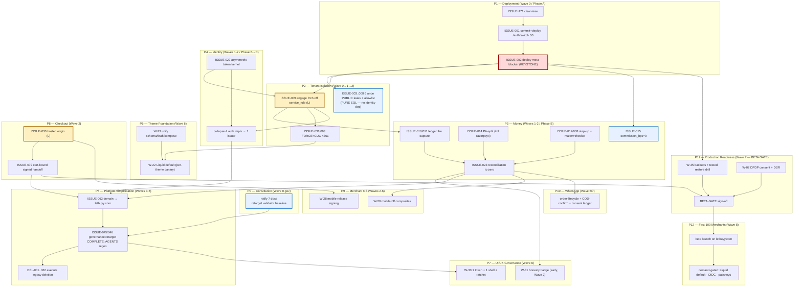

# LETBUYY FOUNDATION ROADMAP

> **Document type:** The master implementation roadmap for the LetBuyy platform — the single phase-ordered plan that converges the working tree onto the canonical architecture, from the deploy meta-blocker through the beta gate to the demand-gated Shopify-class layer. Architecture Review Board (ARB) program deliverable. **This is DOC 05 of the Governance Rewrite.**
> **Date:** 2026-06-10
> **Repo:** `/Users/saai_sidd/Git/Letbuyy_Store` (working tree; evidence pinned at `stepup/main` @ `5cf9e64e`, dirty, 2026-06-10).
> **Status:** AUTHORITATIVE program roadmap. **Subordinate to** `LETBUYY_CONSTITUTION.md` (DOC 01) and `LETBUYY_AGENTS_V2.md` (DOC 02); **consumes** `LETBUYY_CANONICAL_SYSTEMS.md` (DOC 03, the winner registry) and is **paired with** `LETBUYY_LEGACY_ELIMINATION_MASTER_PLAN.md` (DOC 04). On any conflict the Constitution wins, then AGENTS_V2, then DOC 03, then this roadmap (authority chain `_GOVERNANCE_SPINE.md` §S2).
> **Supersedes (as the operative roadmap):** the implicit multi-constitution sequencing that let `AGENTS.md` certify the rejected 9-app/CQRS architecture green while 9 S0s shipped. It does **not** re-litigate the strategic winners (DOC 03 / `_GOVERNANCE_SPINE.md` §S5 are decided) and it does **not** invent architecture — it orders the convergence onto V1+Freeze.
> **Evidence base (the "why", not authority):** the 14-doc forensic audit (`FORENSIC_MASTER_2026_06_10/`: `LETBUYY_MASTER_EXECUTION_PLAN.md` Phases A–E, `TOP_250_PLATFORM_ISSUES.md` ISSUE-001…291 / 9 S0 / 41 S1 / 33 go-live blockers) and the 15-doc canonicalization program (`STRATEGIC_CANONICALIZATION_2026_06_10/`: `IMPLEMENTATION_EXECUTION_ROADMAP.md` Waves 0–8, `PRODUCTION_READINESS_GAP_REPORT.md` W-00…W-37 completion%/eng-weeks).

---

## 0. How to read this roadmap

### 0.1 The thirteen phases (the directive's structure; canonical)

This roadmap is structured on the **thirteen phases P0–P12** mandated by `_GOVERNANCE_SPINE.md` §S7. The phases are the canonical spine; the forensic Phases A–E and the canonicalization Waves 0–8 are **crosswalked onto them** (the same work, sequenced three ways by three authoring passes — this roadmap reconciles them into one). Every phase below carries its Wave map and its forensic-Phase map so the three views never drift.

| Phase | Title | One-line goal | Wave(s) | Forensic Phase |
|---|---|---|---|---|
| **P0** | Constitution | Ratify the 7 governance docs; retarget the validator baseline so CI stops certifying the rejected architecture. | Wave 0 (gov) | (pre-A) |
| **P1** | Deployment | Restore deploy capability (`main` 30 behind) and ship the uncommitted `/api/auth/switch` S0. | Wave 0 | Phase A |
| **P2** | Tenant Isolation | Kill the 6 anon PUBLIC leaks + super-admin allowlist (pure SQL, no identity dep), then engage RLS+FORCE+GUC off `service_role`. | Wave 0→1→2 | Phase A→C |
| **P3** | Money | Ledger every live capture/refund/COD, close reconciliation to zero, PA-split payout, real step-up, kill the 3% rake, bigint cutover. | Waves 1–2 | Phase B |
| **P4** | Identity | identity-platform as sole asymmetric issuer; HS256→EdDSA/ES256 dual-verify cutover; this **completes P2's claims→GUC**. | Waves 1–2 | Phase B→C |
| **P5** | Platform Simplification | Governance retarget complete, AGENTS regen/retire, single constitution, topology converge, domain → letbuyy.com, execute legacy deletion. | Waves 3–5 | Phase C/E |
| **P6** | Theme Foundation | Unify schema/draft/compose; freeze the duplication; Liquid parity build; default-flip per-theme behind a canary. | Wave 6 (Liquid) | Phase D/E |
| **P7** | UI/UX Governance | One token source + one shell 9/9 + provider-mode honesty badge + a ratchet that BLOCKS drift. | Wave 6 (badge: Wave 2) | Phase D/E |
| **P8** | Checkout | Hosted `checkout.letbuyy.com` origin + cart-bound signed handoff + server-cart completion. | Wave 2 | Phase B/C |
| **P9** | Merchant OS | Operator-first completion + real mobile-bff composites + mobile release signing + provider-mode honesty. | Waves 2–6 | Phase C/D |
| **P10** | WhatsApp | Order-lifecycle + COD-confirm + consent ledger (scoped; broadcasts deferred). | Wave 6 / Wave 7 | Phase D |
| **P11** | Production Readiness | Backups + tested restore drill, alerting, monitoring, load/security/chaos, DPDP/DSR — **the beta gate**. | Wave 7 | Phase D/E gate |
| **P12** | First 100 Merchants | Beta launch on letbuyy.com; then the demand-gated Shopify-class layer (Liquid default, OIDC, passkeys). | Wave 8 | deferred |

> **Sequencing law (`_GOVERNANCE_SPINE.md` §S7; forensic §5.1; gap §6):** deploy-unblock and the data-leak S0s FIRST (nothing matters if data leaks / nothing deploys), then money-correctness for live keys, then tenancy+architecture true-up, then product-completeness for beta, then theme-Liquid + perf/design-debt hardening, then the production floor; the Shopify-class ecosystem is last and demand-gated. **A winner can be "75% complete in tree" and 0% live** until P1 clears (gap §0 hard caveat). Readiness baseline: **≈55% tree-complete / ≈0% live** until P1.

### 0.2 The squads (Constitution §13 / V1 §13 — realistic for 6–9 engineers)

| Squad | Owns | Critical-path role |
|---|---|---|
| **Finance / Payments** | money kernel, ledger, PA-split, settlement, reconciliation, bigint | critical-path owner for P3 money |
| **Checkout** | server cart, checkout session, hosted origin, outbox, inventory | hosted-origin long-pole (P8) |
| **Mobile** | Flutter merchant app, release signing, mobile honesty badge | parallel |
| **Platform / Security** | RLS kernel, query-lint, deploy/governance, domain, CSP, observability | critical-path owner for P1/P2 + P0/P5 |
| **Fulfillment / Identity** | KYC, carrier, identity-platform, OTP/login, consent | identity issuer + KYC |

One **DB-owning engineer** reviews **every** migration (forward + rollback) and enforces module boundaries + RLS discipline — a hard serialization point on all money/tenancy/schema work.

### 0.3 Sizing (Constitution §16 / gap-report rubric, honored verbatim)

**XS** ≈ ≤0.5 eng-wk · **S** ≈ 0.5–1.5 eng-wk · **M** ≈ 2–4 eng-wk · **L** ≈ 5–10 eng-wk. "Eng-weeks" are single-squad to **beta-ready** (live keys connectable; no open S0/S1 on that winner), excluding deferred 10k-end-state scope. **~80 eng-weeks** is the total beta planning number; **~4–6 months wall-clock** with 2–3 parallel squads, bounded by the serial critical path.

### 0.4 Traceability legend (every deliverable carries its source IDs)

- **ISSUE-nnn** — forensic `TOP_250_PLATFORM_ISSUES.md` (001…291; **9 S0 / 41 S1 / 33 go-live blockers**).
- **W-NN** — readiness-gap winner ID (completion% + eng-weeks; `PRODUCTION_READINESS_GAP_REPORT.md` §2/§3).
- **A0–A9** — anchor-spine load-bearing calls; domain decision IDs **THEME-C/DEC-n · IDN/D-nn · MNY/PAY/DB-n · TEN/FND-n · UIUX/MOB-n · LEG/DEL-n · PLT/TOPO-n · SHOP-n**.
- **RT-n / V-XXX** — validation suites/gates (defined in `TESTING_AND_VALIDATION_MASTER_PLAN.md`, the companion gate).
- Phase-gate rule: **no phase exits until its validation gate is green; no system is deleted until its deletion-validation is green.**

---

## 1. Executive framing

**This is a dependency graph, not a calendar.** The thirteen phases are **dependency-ordered** — a later phase's *exit* cannot be claimed until its prerequisite phase's blocking nodes close — but several phases **parallelize** off the critical spine and are staffed concurrently by different squads from Day 1. Treating P0→P12 as thirteen sequential calendar blocks would triple the wall-clock and is wrong; treating them as one undifferentiated backlog would ship S0s. The discipline is: **fund the serial spine first within each phase, run everything else in parallel.**

**The platform's problem is not "primitive-poor" — it is "DDL-real, wiring-dead."** LetBuyy has already built the hard, correct cores: a Stripe-grade double-entry ledger, a fail-closed RLS+GUC kernel (proven in tests), a server-authoritative cart, a four-flow auth surface, a Polaris-grade token engine, a Shopify-grade two-renderer theme model, and a genuinely fast cached storefront. Then it left them **un-wired to the live paths, governed by the rejected constitution, and unmergeable behind a 30-commit branch lag**. Schema completeness is ~70–90% almost everywhere; runtime/wiring completeness is the ~40–60% gap on the load-bearing money/tenancy/checkout paths. The roadmap is therefore overwhelmingly **wiring, deletion, and hardening — not greenfield**. The greenfield exceptions are few and named: the hosted checkout origin (P8), the OIDC provider and passkeys (P12, deferred), and the observability/alerting + restore-drill floor (P11).

**Two facts dominate everything.** (1) **Nothing is live.** `main` (the sole production-deploy trigger) is 30 commits behind `stepup/main`, so every "complete" wave — including the uncommitted `/api/auth/switch` S0 fix — is **undeployed** (ISSUE-001/002). Every completion% in this document is tree-state; live readiness is ≈0% until P1 clears. (2) **The money is a latent gate.** Every payments S1 is one config flip (`live` keys / `mode='mock'` removed) from active loss — captures never post to the canonical ledger, the step-up second factor is a forgeable string, the payout rail is the banned self-custody `razorpayx`, and a **3% GMV rake** is silently deducted against a **public 0%-fee promise**. The fix order follows from these two facts: make remediation deployable, close the live exploits, make money provably correct before any live key connects, then true up tenancy and scope to V1, then complete the beta product and harden.

**The cross-dependency the spine flags (P2 ↔ P4).** P2 tenant isolation splits cleanly into two halves with **different dependency profiles**, and conflating them is the single most common planning error here:
- **The 6 anon-leak S0 SQL fixes are pure DDL and depend on NOTHING but P1's deploy.** Six `service_role_* USING(true)` policies leak orders/customers/billing/products/sites/subscriptions to the anon key, plus an anon-writable `super_admin_allowlist` and an anon `PATCH sites.user_id` store-takeover. These are S-sized `TO service_role` + `REVOKE` migrations (ISSUE-003…008). **They happen first, in P1's wave, and do not wait for identity.**
- **The full GUC-from-validated-claims model completes alongside P4 identity.** The load-bearing tenancy guarantee — `SET LOCAL app.site_id` derived from a *validated, non-forgeable* claim — requires P4's asymmetric issuer to produce that claim (today the source would be client-writable `user_metadata`, ISSUE-013/009). So P2's *leak closure* is P1-era; P2's *claims→GUC completion* is P4-era. This roadmap sequences them apart and says so at every gate.

---

## 2. The critical path and what parallelizes

### 2.1 The critical path (the longest hard-dependency chain across all phases)

```
P1  ISSUE-171 clean-tree
 →  ISSUE-001  commit+deploy the /api/auth/switch S0 fix          [W-04 S0 portion]
 →  ISSUE-002  restore deploy capability (merge stepup/main→main)  [W-00 meta-blocker — THE keystone]
P2  ISSUE-009  engage RLS off blanket service_role (SET LOCAL GUC) [W-08 — L long-pole #1]
 →  ISSUE-013  ledger GUC derived from validated claims, not param [couples P4 W-05]
P3  ISSUE-010/011  capture posts the canonical ledger             [W-13 — #1 money wiring blocker]
 →  ISSUE-023  reconciliation closes to zero-break-or-suspense    [W-15]
 →  ISSUE-014 + ISSUE-012/038  safe PA-split payout (kill razorpayx, unforgeable step-up, maker≠checker) [W-14/W-17]
P8  ISSUE-030  hosted checkout origin checkout.letbuyy.com        [W-20 — L long-pole #2]
 →  ISSUE-072  cart-bound signed handoff resolves to the live origin → beta-ready completed checkout
P11 BETA GATE
```

**In one line:** **deploy-unblock → engage-RLS-off-service_role → ledger-the-capture → close-reconciliation → safe-PA-split-payout → hosted-origin → cart-handoff → beta.**

The spine is **serial because each link makes the next one *meaningful*:** you cannot trust reconciliation before captures post; you cannot trust the payout gate before reconciliation closes; you cannot use the signed handoff before the origin exists. The **two genuine L long-poles on the spine** are `ISSUE-009 / W-08` (off-`service_role` connection model, **12–16 eng-wk**) and `ISSUE-030 / W-20` (hosted origin, **5–7 eng-wk**) — **fund both first within their phases.**

### 2.2 What parallelizes off the spine (run from Day 1 once P1 deploy lands)

- **P0 Constitution + governance retarget** (ISSUE-045/046 / W-01) — runs fully independently of the tenancy/ledger spine; **must precede the P5 package deletions** (the validator-liveness loop blocks them).
- **Buyer-facing breach cluster** — stored XSS pair `ISSUE-016+017`, SSRF `ISSUE-020` (Platform/Security) — independent of the spine; lands in P1's wave.
- **`commission_bps=0`** (ISSUE-015) — a Day-1 config flip so the 0%-fee promise holds the moment anything deploys.
- **bigint cutover scaffolding** (W-16), **mobile-bff composites** (W-29), **theme foundation unification** (W-23), **design-system burn-down** (W-30) — background tracks gated only on P1 (and, for the DS ratchet, on P5's single constitution).
- **The honesty badge** (P7 / W-31) ships *early*, alongside the real payouts in P3 — it is the one go-live-relevant design-system item.
- **Deferred, never on the beta clock:** the Liquid default-flip (W-22), OIDC (W-06), passkeys (W-09-passkey), theme/app-marketplace authoring (W-25), historical backfill (W-18), the full DS ratchet-down — all in P6-tail / P12.

### 2.3 Cross-phase dependency graph



### 2.4 The honest timeline (phases → calendar)

With **2–3 parallel squads** on the Constitution §13 map, beta is **~4–6 months wall-clock**, bounded by the serial spine. P0–P11 reach the **beta gate** (P11). P12 is the launch; the Shopify-class layer **after** P12 is demand-gated (≈5k merchants + developer/theme-author demand) and **not on the beta clock**.

| Calendar block | Phases in flight | Milestone |
|---|---|---|
| **Weeks 1–3** | P0, P1, P2 (leaks) | 7 docs ratified; deploy restored; **all 9 S0 closed**; `commission_bps=0` live |
| **Weeks 3–9** | P2 (GUC), P3, P4 | RLS engaged off `service_role`; capture/refund/COD ledgered; PA-split + real step-up; token dual-issue |
| **Weeks 8–16** | P2 (×261), P3 (recon), P4, P8, P7 (badge), P9 | Reconciliation closes; FORCE+GUC ×261; identity collapse; hosted origin; honesty badge; composites; KYC/Shiprocket. **All 33 go-live blockers closed.** |
| **Weeks 14–18** | P5 (domain + traffic) | Domain → letbuyy.com; all traffic on canonical paths |
| **Weeks 16–20** | P5 (freeze + retarget) | Single constitution; governance enforces V1; AGENTS regenerated; legacy frozen |
| **Weeks 18–22** | P5 (deletion) | Dead packages + Firebase + parity catalog deleted; orphan tables dropped |
| **Weeks 20–26** | P6, P7, P9 | Perf/index; 1 token + 1 shell; Liquid default canaried; observability kernel |
| **Weeks 24–28** | P10, P11 | WhatsApp wedge; tested restore drill; DPDP/DSR; load/security/chaos; **BETA GATE** |
| **Week 28+** | **P12** | **Beta launch — first 100 merchants on letbuyy.com** |
| **Demand-gated (≈5k merchants)** | P12 tail | OIDC; passkeys; theme/app marketplace authoring; WhatsApp broadcasts |

> Phases overlap by squad. P0/P1 are **Platform/Security-led**; Finance/Payments and Checkout begin P3/P8 *design* the moment ISSUE-002 lands but cannot *exit* until ISSUE-009 (P2) closes (the ledger GUC + immutability gate). Numbers honor the gap-report estimates (W-08 12–16, money cluster W-13/14/15/17 ~17–26, W-20 5–7).

---

## 3. The thirteen phases

> For each phase: **Goals · Dependencies (hard) · Risks · Deliverables (ISSUE-ID + action-ID tied) · Success Criteria · Exit Criteria**, plus the **Squad(s) · Size · Wave**. Validation suites (V-*, RT-*) are defined in the companion `TESTING_AND_VALIDATION_MASTER_PLAN.md`. **No phase exits until its exit-gate is green.**

---

### P0 — CONSTITUTION

**Squad(s):** Platform/Security (ARB-led). **Size:** S. **Wave:** 0 (governance lane).
**Crosswalk:** pre-forensic-Phase-A; readiness W-01 (start); ISSUE-045/046 (retarget begins).

**Goals**
1. **Ratify the seven governance documents** as the single authority chain (`_GOVERNANCE_SPINE.md` §S2): Constitution (DOC 01) > AGENTS_V2 (DOC 02) > Canonical Systems (DOC 03) > Legacy-Elimination + this Roadmap (DOC 04/05) > UI/UX + domain governance (DOC 06). Fold V1 + Freeze into the Constitution as articles; archive the maximalist 1M/22-service plan.
2. **Retarget the validator baseline** so CI stops certifying the rejected architecture — establish the *intent* to enforce V1 (the full retarget executes in P5; P0 sets the baseline and the rule so no new theater accrues).
3. **Authorize the program** — ARB minutes adopting the winners (§S5), the 13-phase model, the squad map, the deletion/validation gate rules, and the UNVERIFIED register (§5) carried forward.

**Dependencies (hard):** none — P0 is a governance act, not a code change. It **gates P5** (the deletions cannot run until the validators that assert the dead packages are retargeted) and it **gates the design-system ratchet** (P7 needs one constitution to live under).

**Risks**
- **R0.1 — Ratifying law the code violates.** The Constitution declares the canonical architecture; the working tree still runs the rejected one. *Mitigation:* the Constitution explicitly states the convergence is in-progress and this Roadmap is the schedule; no validator is *deleted* in P0 (that is P5, additive-then-subtractive).
- **R0.2 — A new doc becomes the 8th competing constitution.** *Mitigation:* the root-doc budget (Constitution §P12) is adopted in P0; this Roadmap is explicitly subordinate (header) and is the *last* planning doc.

**Deliverables**
- **Seven docs ratified** — ARB sign-off adopting the authority chain; V1+Freeze folded into the Constitution; `LETBUYY_CHECKOUT_PLATFORM_ARCHITECTURE.md` (1M/22-service/Wasm) formally rejected → `docs/archive/`. *(A0; §S2; ISSUE-179/188.)*
- **Validator baseline retargeted (intent)** — the CI gate references V1; the rule "no new `USING(true)`-to-PUBLIC / no new rejected-architecture validator" is added; the full prune is scheduled for P5. *(W-01 start; ISSUE-045/046.)*
- **Program authorized** — minutes adopting the 13 phases, the squads, the sizing rubric, and the gate rules. *(A0; meta.)*

**Success Criteria:** The repository has exactly one supreme authority (the Constitution); every other doc declares its chain position; the validator gate no longer *mandates* CQRS/saga/multi-region as a precondition to green; the program is funded against the 100→10k envelope.

**Exit Criteria (gate):** ARB minutes signed; the Constitution + AGENTS_V2 + DOC 03 exist and cross-reference; the maximalist doc is archived; the root-doc budget is enforced in CI; a new agent can read the Constitution standalone and follow it.

---

### P1 — DEPLOYMENT

**Squad(s):** Platform/Security (lead), Fulfillment/Identity (the switch fix). **Size:** S (one L node deferred into P2). **Wave:** 0. **Forensic:** Phase A (A0/A1).
**Crosswalk:** readiness W-00; ISSUE-001/002/171/044/176/178; DEL-067.

**Goals**
1. **Restore deploy capability** — `main` is ~30 commits behind `stepup/main` and `production-deploy.yml` triggers only on `main`, so **nothing ships, including the S0 fixes** (the meta-blocker, the keystone of the entire program).
2. **Commit and deploy the live account-takeover fix** — the `/api/auth/switch` S0 fix lives **only in the dirty working tree** (ISSUE-001); commit it, land the untracked regression test, ship it.
3. **Harden the pipeline** so it can never silently re-accumulate the lag and so the next wave of money/RLS migrations cannot ship un-replayed.

**Dependencies (hard):** **none — P1 is the universal precondition for every later phase.** Internally: `ISSUE-171` (clean tree) ⟶ `ISSUE-001` (commit the switch fix) ⟶ `ISSUE-002` (fast-forward `stepup/main`→`develop`→`main`).

**Risks**
- **R1.1 — Working tree advances mid-commit.** Concurrent automation can lose the switch fix. *Mitigation:* `ISSUE-171` clean-tree/worktree discipline FIRST — this is literally the first action of the program.
- **R1.2 — A bad fast-forward ships pre-wave code over the fixes.** *Mitigation:* execute `MERGE_RUNBOOK.md` exactly; CI migration-replay (000→161) + verification SQL gate the merge; rollback-pairing validator green.
- **R1.3 — The branch lag silently re-forms.** *Mitigation:* a branch-lag CI guard (`git rev-list --count main..stepup/main` must be 0) + collapse the two racing staging workflows to one (`DEL-067`).

**Deliverables**
- **Deploy meta-blocker fixed** — clean-tree discipline (ISSUE-171); commit+test the `/api/auth/switch` takeover fix incl. the untracked `auth-switch-guard.test.ts` (ISSUE-001 / W-04 S0); execute `MERGE_RUNBOOK.md`; collapse staging workflows (DEL-067); add the branch-lag guard; harden CI migration-replay + rollback-pairing (ISSUE-044/176/178). *(W-00; TOPO-001/002; A0.)*
- **Tagged security release** — the switch fix deployed to staging+prod from `main` with `validateSession` + `lb_accounts` membership + rate-limit.

**Success Criteria:** The remediation pipeline deploys to staging+prod from `main`; a real merchant/staff session cannot be taken over unauthenticated; the branch lag is zero and guarded; the next money/RLS migration cannot ship un-replayed.

**Exit Criteria (gate):** `git rev-list --count main..stepup/main` **= 0**; the pipeline deploys remediation from `main` (V-DEPLOY, V-SMOKE); the switch regression test passes (401 without a valid session + `lb_accounts` membership); CI replays 000→161 + runs `verification/*.sql`; rollback-pairing validator green. **1 S0 closed (ISSUE-001); the deploy keystone is open for every later phase.**

---

### P2 — TENANT ISOLATION

**Squad(s):** Platform/Security (DB). **Size:** L (the off-`service_role` node) + S (the leak closure). **Wave:** 0 (leaks) → 1 (engage) → 2 (×261). **Forensic:** Phase A (leaks/engage) → Phase C (×261).
**Crosswalk:** readiness W-08/W-10/W-11; ISSUE-003…009/013/021/031/032/033/041/079/080/093; FND-001…009/021/022; TEN-001…004.

**Goals — note the two halves with different dependency profiles:**
1. **(P1-era) Kill the 6 anon PUBLIC leaks + super-admin allowlist + store-takeover — PURE SQL, NO IDENTITY DEPENDENCY.** Six `service_role_* USING(true)` policies leak orders/customers/billing/products/sites/subscriptions to the anon key; an anon-writable `super_admin_allowlist`; an anon `PATCH sites.user_id`. **These land in P1's wave and do not wait for P4.**
2. **(P1-era) Engage RLS off blanket `service_role` — START.** Flip tenancy's load-bearing layer from app-discipline-only to a DB backstop. This is the structural long-pole (W-08, 12–16 eng-wk).
3. **(P4-era completion) Source the GUC from a *validated* claim, and apply FORCE+GUC to all 261 tables.** The full claims→GUC guarantee completes **alongside P4 identity** (ISSUE-013 needs P4's non-forgeable claim); FORCE+GUC ×261 makes the backstop unconditional.

**Dependencies (hard):** P1 (`ISSUE-002` deploy). The **leak closure depends on nothing else**. The **off-`service_role` engagement** depends on P1 only. The **claims→GUC completion** has a hard cross-dependency on **P4 (`W-05` token kernel)** — until P4, source the GUC from the ownership-verified siteId, not client-writable `user_metadata` (ISSUE-013). FORCE+GUC ×261 (Wave 2) depends on the engagement landing (W-08).

**Risks**
- **R2.1 — The policy fixes are insufficient alone (Critical).** Under a `BYPASSRLS service_role` runtime that never sets the GUC, fixing table policies leaves the live write path with no DB backstop. *Mitigation:* pair the leak fixes with the **start** of the off-`service_role`/`SET LOCAL` work; confirm with an anon-key probe.
- **R2.2 — Live anon-GRANT state is UNVERIFIED.** The 6 anon GRANTs are set by Supabase's managed bootstrap, not repo SQL. *Mitigation:* an anon-key probe (`\dp public.orders`) before final S0 sign-off — the one item that needs a live probe (§5.2).
- **R2.3 — Connection-architecture cutover risk (Critical).** Off-`service_role` is a real connection change. *Mitigation:* staged S-1→S0(shadow)→S1(reads)→S2(writes)→S3(narrow-hatch); a route can be reverted to the old client during the window; FORCE added table-by-table fails *closed* (surfaces, never silently leaks); `rls_shadow_divergences` audit.
- **R2.4 — 220-table FORCE+GUC backfill (High).** A misconfigured table fails closed. *Mitigation:* registry-driven template migration; backfill the 64 nullable tenant columns first; the DDL is inert under `service_role` so it can land early; contract test registry==policy coverage.

**Deliverables**
- **(P1-era) 6 anon leaks + allowlist + takeover closed** — migration `162` drops/recreates each `USING(true)` policy as `TO service_role` + correct owner/public-active policies on orders/sites/products/subscriptions/billing/`store_customers`, `REVOKE INSERT/UPDATE/DELETE FROM anon, authenticated`, a `super_admin_allowlist` audit trigger, anon `PATCH sites.user_id` closed; CI policy-lint forbidding `USING(true)` without `TO`+predicate. *(W-11; FND-001…006; ISSUE-003…008; A2.)*
- **(P1-era) Ledger immutability staged** — `REVOKE UPDATE/DELETE` on ledger tables + no-login owner, landed **with** the engagement gate so append-only is not one `DISABLE TRIGGER` from mutation. *(ISSUE-021; DB-009.)*
- **(P1-era) RLS engaged off `service_role` — START** — create the `app_tenant` non-`BYPASSRLS` role + grants; build `withTenantTx(siteId, fn)` over a Hyperdrive-pooled `pg` connection running `SET LOCAL app.site_id`; wire `current_site_id()` to the live path (today **0 live callers** — dead code); add the audited `withServiceRole(reason, fn)` break-glass hatch; revive the reservation kernel (`require_inventory_site_guc` no longer raises) and the worker/webhook guards. *(W-08; A2; FND-008/016; ISSUE-009/041/032/033.)*
- **(P4-era) Claims→GUC + FORCE+GUC ×261** — stop trusting `post_settlement_ledger_transaction`'s raw param (derive tenant in-RPC from the P4 validated claim, ISSUE-013); registry-driven backfill applying ENABLE+FORCE+`USING(site_id=current_site_id())` to all 261 tables; backfill+`SET NOT NULL` the 64 nullable columns first; AST-based isolation validator scanning all services; RESTRICT (not CASCADE) on money/audit FKs. *(W-10; FND-009/021/022; ISSUE-031/093/079/080/089/090/091/092/201.)*

**Success Criteria:** The anon key returns **zero rows** on every commerce-core table and cannot self-grant super-admin or patch site ownership; RLS is load-bearing (proven by the non-bypass fail-closed test) off blanket `service_role`; the GUC is sourced from a validated claim (post-P4); FORCE+GUC is unconditional on all 261 tenant tables; ledger history cannot be mutated by the runtime role.

**Exit Criteria (gate):** **(P1-era)** RT-1 anon probe green (0 rows / denied on orders/sites/products/subscriptions/billing/`store_customers`; allowlist insert denied; `sites` ownership patch denied) + a live `\dp` probe; ledger UPDATE/DELETE denied even to `service_role`. **(P4-era)** RT-1…RT-9 full cross-tenant red-team green across all 261 tables (forged `site_id`→0 rows; unset GUC→0 rows; the isolation validator fails a test PR adding an unscoped query). **6 S0 closed in P1's wave (ISSUE-003…008); the remaining tenancy work closes through Wave 2.**

---

### P3 — MONEY

**Squad(s):** Finance/Payments (lead), Platform/Security (step-up crypto). **Size:** L (the cluster). **Wave:** 1–2. **Forensic:** Phase B.
**Crosswalk:** readiness W-12…18 / W-32/33; ISSUE-010…025/035…040/043/066…070/084…088/111/115/169/191/199/200; MNY/PAY/DB-n.

**Goals**
1. **Ledger every live money event** — make capture/refund/COD post to the canonical double-entry ledger so the book stops being blind to ~100% of live volume (the #1 money wiring blocker).
2. **Close reconciliation to zero-break-or-suspense** — wire the DDL-real/wiring-dead schedulers so the wallet unlocks and payouts become trustworthy.
3. **Make money-out safe and honest** — PA-split rail (kill `razorpayx` self-custody), real cryptographic step-up bound to actor+action + single-use, `payout:release` permission with maker≠checker, append-only by `REVOKE`+RESTRICT.
4. **Kill the 3% rake** — `commission_bps=0` (a Day-1 flip in P1's wave) so the public 0%-fee promise holds the instant anything deploys.
5. **Finish the bigint-paise cutover** so amounts above ₹21.4M cannot silently wrap; make the outbox atomic and the compensation executor real; forbid mock-mode posting into a live ledger.

**Dependencies (hard):** P2's `ISSUE-009` (the ledger GUC + immutability gate) and the claims→GUC fix (`ISSUE-013`, couples P4). Reconciliation depends on captures posting first (`W-13` ⟶ `W-15`). Trusting payouts depends on reconciliation closing **and** the real step-up. The compensation executor depends on the refund adapter (`W-13`).

**Risks**
- **R3.1 — Money is real (Critical, latent).** Latent today because live PSP/Route keys are `[HUMAN-REQUIRED]`-gated, but a single live key turns these into loss. *Mitigation:* the reconciliation harness is the gate; ledger postings are append-only (a wrong adapter is corrected by a reversing entry, never a mutation); `razorpayx`→PA-split is feature-gated until live keys present.
- **R3.2 — Capture posting on hot paths must be idempotent.** A double-webhook/double-verify must post exactly once. *Mitigation:* the idempotency lattice (present) + the property/concurrency suites are the exit gate.
- **R3.3 — Test depth is UNVERIFIED.** ~20 Postgres money test files exist and claim PASS but were not executed in-audit (§5.3). *Mitigation:* this phase **executes** them; property/concurrency rigor must be re-proven, not asserted by file presence.

**Deliverables**
- **Ledger the money-in/out feeds** — capture RPC posts debit `pa_clearing` / credit `merchant_payable` idempotently (or routes through the V1 adapter); `complete_order_refund` posts the reversing txn; COD collect/remit post `cod_receivable`; `capture_posted_to_ledger` true only after a real post; forbid posting for `mode != live`. *(W-13; PAY-001/002/003; ISSUE-010/011/018/019/040/043.)*
- **Reconciliation closure + scheduler + reconcile-on-uncertainty** — queue-workers scheduled job invoking backfill+assert per active site (the wiring-dead `assert_money_ledger_site_reconciliation`/`backfill_wallet_ledger_to_canonical` get **callers**); payout status reconciler (poll/callback → suspense/break + idempotent retry); signed `recon_breaks` (variance direction). *(W-15; PAY-005/013; ISSUE-023/024/070/084.)*
- **PA-split payout (kill `razorpayx`)** — rail returns `razorpay_route`/`cashfree`, wire the split-instruction client, assert the rail is a split product, derive `no_custody` from the rail (not a literal). *(W-14; PAY-014; ISSUE-014.)*
- **Real crypto step-up + maker≠checker + append-only** — challenge issue→verify against `step_up_challenges`/`sensitive_action_approvals` (HMAC, actor+action-bound, single-use); `payout:release` permission with checker ≠ `maker_actor_id`; `REVOKE UPDATE,DELETE` + RESTRICT FKs on ledger/audit. *(W-17; PAY-008/018/021; ISSUE-012/038.)*
- **Kill the rake (Day-1)** — `commission_bps=0`, stop auto-seeding, CHECK ≤3000; align Pricing/FAQ copy. *(A3; LEG-042; ISSUE-015; R-14.)*
- **De-dup money authorities** — one fee-assessment + one payout-creation authority sharing an idempotency namespace; refundable derived from `refund_clearing`/`merchant_payable`. *(ISSUE-035/036/037.)*
- **bigint cutover + atomic outbox + compensation executor** — expand→backfill→verify→contract across `orders.*`/`refunds.amount`/COD/gift-cards (finish the 160 `_bigint` cutover); move emits into SECURITY DEFINER RPCs (domain row + `outbox_events` in one txn); relay to queue-workers; compensation executor (claim `(status=pending, action=refund_payment_intent)` → idempotent canonical refund). *(W-16/W-32/W-33; DB-003; ISSUE-025/028/022/169.)*

**Success Criteria:** Every live capture/refund/COD posts a balanced ledger transaction idempotently; reconciliation closes to zero-break-or-explained-suspense and the wallet unlocks; money-out runs through a PA-split rail with `no_custody` derived and an unforgeable step-up by a checker ≠ maker; `commission_bps=0`; amounts above ₹21.4M are correct; the outbox is atomic and the compensation executor auto-refunds captured-but-failed payments.

**Exit Criteria (gate):** Money property + concurrency + reconciliation suites green — per-transaction **Σdebit=Σcredit** on every posting; capture→balanced `pa_clearing→merchant_payable`; double-webhook/double-verify → exactly one posting; step-up rejects forged/replayed/wrong-actor strings; payout double-release blocked under `FOR UPDATE`; `mode!=live` cannot post; reconciliation harness closes to zero break or aged-and-explained suspense; fault-injected capture-succeeds+order-fails → executor issues an idempotent canonical refund. **The latent-money gate is closed.**

---

### P4 — IDENTITY

**Squad(s):** Fulfillment/Identity (lead), Platform/Security (crypto/cutover). **Size:** L. **Wave:** 1–2. **Forensic:** Phase B (kernel) → Phase C (collapse).
**Crosswalk:** readiness W-04/W-05; ISSUE-027/045-adj; IDN D-01…D-07; AUTH §1; LEG-024…030.

**Goals**
1. **Re-key the token kernel asymmetric** — start the Ed25519/ES256 sole-signer cutover so a leaked *verification* key is no longer a *forgery* key (today one `AUTH_SECRET` HS256 leak forges 7 trust domains).
2. **Make identity-platform the sole issuer** — collapse the four parallel auth implementations (identity-platform lib + gateway `routes/auth.ts` 1,441 ln + identity-foundation shadow + legacy Supabase `/auth/*`) to one; reduce the gateway to verify-only; add default-deny `middleware.ts`.
3. **Complete P2's claims→GUC** — this phase produces the *validated, non-forgeable* claim that P2's `SET LOCAL app.site_id` derives from. **This is the explicit P2↔P4 cross-dependency:** P2's leak fixes do NOT wait for P4; P2's full GUC-from-claims completes *with* P4.

**Dependencies (hard):** P1 (deploy) + real KMS (the gateway mock-KMS must become real). P2's off-`service_role` engagement and P4's asymmetric kernel are **mutually reinforcing**: the GUC must source from a validated claim (P4), and the surviving auth path must be the signed one (P4 before the broad collapse). The HS256-drop step (D3) is gated on telemetry from the dual-issue (Wave 1).

**Risks**
- **R4.1 — Token cutover ordering (Critical).** Dropping HS256 before the old-token drain completes locks out valid tokens. *Mitigation:* staged D0(key-provision)→D1(dual-issue)→D2(drain)→D3(drop HS256, gated on **zero** legacy-HS256 verifications)→D4(rotation proof); verifier-pin and issuer-alg deploy as independently-revertible changes; a rollback drill is mandatory before D3.
- **R4.2 — The collapse is a cross-service contract change.** identity-platform + api-gateway + webhook-service + admin-web + auth-core all verify tokens. *Mitigation:* dual-verify window; rollback = re-widen the verifier (never revert the issuer); contract fixtures gate the cutover.
- **R4.3 — Deleting legacy `/auth/*` must not orphan a session.** *Mitigation:* deprecate→delete only after the sole issuer serves (the deletion itself is P5/Wave 5, gated on the V-SMOKE issuer-only proof).

**Deliverables**
- **Asymmetric token kernel** — provision an Ed25519/ES256 keypair in real KMS; the D0–D4 dual-verify cutover; remove all 8 `|| AUTH_SECRET` fallbacks (mandatory/fail-closed); cap `lb_accounts` TTL 365d→≤90d (drain prerequisite); remove `MOCK_JWKS` (serve 404 until the real rotating JWKS exists in P12). *(W-05; AUTH-002; IDN D-03; ISSUE-027.)*
- **Identity four-impl collapse to one issuer** — deprecate→delete legacy Supabase `/auth/*` (closes the `user_metadata.role` escalation + orphan reset pipeline); SAFE_DELETE the identity-foundation shadow stack; reduce the gateway to verify-only; add default-deny `middleware.ts`; unify sessions/cookies/logout under identity-platform; complete the token drain (D2) + drop HS256 (D3) + rotation proof (D4). *(W-04; IDN D-01/D-06; LEG-024…030; ISSUE-045-adj.)*
- **The validated claim for P2** — the issuer emits the non-forgeable `site_id`/tenant claim that `post_settlement_ledger_transaction` and `withTenantTx` derive the GUC from. *(couples ISSUE-013; TEN §4.)*

**Success Criteria:** identity-platform holds the sole private signing key; all other services verify-only; forging a token with the public key **fails**; there is one issuer with no HS256-accept path and a default-deny middleware; P2's GUC derives from this issuer's validated claim.

**Exit Criteria (gate):** Token dual-verify green — sign/verify round-trip; forge-with-public-key **fails**; wrong-`aud` rejected; alg-pinning rejects `none`/HS256-post-D3; telemetry shows **zero** legacy-HS256 verifications before D3. The AUTH §12 walkthroughs A–E all fail (no takeover); cross-realm cookie-bleed green. **The 7-domain forgery surface is closed; P2's claims→GUC is unblocked.**

---

### P5 — PLATFORM SIMPLIFICATION

**Squad(s):** Platform/Security (lead), each squad owns its legacy-freeze. **Size:** L (across the deletion set). **Wave:** 3–5. **Forensic:** Phase C/E.
**Crosswalk:** readiness W-01/W-02/W-03/W-37; ISSUE-045/046/061/063/103/112/166/179/180/188/192/205/213/227; TOPO/LEG/DEL-n.

**Goals**
1. **Migrate the domain to `letbuyy.com`** — kill the `letbuyy.store`↔`letbuyy.com` split-brain (143 files; `api.letbuyy.store` vs `bff.letbuyy.com`) and route **all** live traffic onto the canonical paths (server cart, canonical ledger, identity issuer).
2. **Complete the governance retarget** — regenerate `AGENTS.md` from V1 §6; rewrite the canonical lists to the 4-app+4-worker topology; **delete the ~36 rejected-architecture validators**; KEEP the real-invariant validators (tenant-isolation, session-security, single-writer, antifabrication, crypto/currency single-source); ADD the 5 missing V1 gates (migration-rollback pairing, deploy↔V1-topology, `letbuyy.store` ban, `commission_bps=0` ratchet, topology-JSON anti-fabrication).
3. **Freeze then delete the losers** — freeze legacy auth/un-ledgered-money/client-cart/React-new paths (no new work), then execute the SAFE_DELETION plan: SAFE_DELETE the dead packages (~28.7k LOC CQRS/saga + Firebase + parity catalog), DELETE_AFTER_MIGRATION the bridges, drop the orphan tables.
4. **Single constitution, machine-enforced** — converge topology 13→10 (de-deploy app-marketplace + developer-portal → FREEZE, keep the OAuth2/PKCE seam; fold the redundant ops console); regenerate `production-topology.json` (reserved marked `reserved`).

**Dependencies (hard):** P0 (the retarget *intent*) + P3/P4 (the winners must serve before the legacy paths are frozen and the bridges deleted). **The governance retarget must precede the deletions** — the validator-liveness loop currently *blocks* deleting the rejected packages (deleting them fails CI today). This is the hard ordering inside P5 (additive-then-subtractive).

**Risks**
- **R5.1 — Retarget-before-delete ordering (the validator-liveness loop).** *Mitigation:* retarget/remove the asserting validators **first**, then delete the code, each paired in the same change set.
- **R5.2 — Cookie-domain flip can break SSO (High).** *Mitigation:* couple the `COOKIE_DOMAIN` flip to identity D-07; `.store` 301s as the fallback; the migration is a single revertible PR.
- **R5.3 — Dropping a table with a live RPC/ops writer (UNVERIFIED).** *Mitigation:* `pg_stat_user_tables` write-count proof before any DROP — the hard gate (§5.4).
- **R5.4 — Deleting a money/auth bridge before zero-drift.** *Mitigation:* no money system deleted until the reconciliation harness proves zero drift on the path it replaces; no auth bridge deleted until the sole-issuer V-SMOKE is green.
- **R5.5 — Ops-console consolidation must not remain conditional.** *Mitigation:* `GATE-OPS-SURVIVOR` resolves the repository default to `admin-web`; final ARB signature is tracked as skipped-human before deleting the non-survivor.

**Deliverables**
- **Domain migration + canonical-path routing** — one PR migrating wrangler routes to `api.letbuyy.com`/`webhooks.letbuyy.com` + Vercel domains to `letbuyy.com` with `.store` 301s; the base `letbuyy.com` DNS zone is canonical here, while the `checkout.` record is provisioned inside P8 so checkout does not depend on a later phase; a validator banning `letbuyy.store` literals; cookies scoped per-app; gate public order-create behind the signed hosted-origin handoff; retire legacy app-local checkout/Stripe/PayPal handlers from the live path. *(W-03; ISSUE-063/192/103/205/227.)*
- **Governance retarget COMPLETE + AGENTS regen** — delete the ~36 fiction validators, keep the real-invariant lane, add the 5 V1 gates, regenerate `AGENTS.md` + `production-topology.json` from the real matrix (reserved=`reserved`), de-deploy marketplace/dev-portal (FREEZE, keep OAuth2/PKCE), fold the redundant ops console. *(W-01; ISSUE-045/046/061/166/213/180; LEG-063/064/065/076.)*
- **Execute the SAFE_DELETION plan** — SAFE_DELETE `app-engine`/`application-services`/`extension-host`/`projection-runtime`/`orchestration`/`distributed-runtime` + Firebase + parity catalog (DEL-001…006/009/073, each with its asserting validator cut in the same change set); DELETE_AFTER_MIGRATION the identity/money/theme/checkout bridges, with money bridges specifically blocked on P3's reconciliation harness proving zero-drift on the replaced path; drop ~37 orphan tables after `pg_stat` proof; unwire+delete `runtime-composition`. *(W-37; DEL-001…062; ISSUE-112.)*

**Success Criteria:** Production runs on `letbuyy.com` with `.store` 301s and every live request flows through the canonical winner; the validator suite enforces V1 (not the 9-app/CQRS canon); `AGENTS.md` is the regenerated map of V1; the ~28.7k LOC of dead weight is gone; every legacy bridge whose winner serves is deleted with zero-drift proof; the orphan tables are dropped after a live-write check; the repository has exactly one constitution and the meta-blocker cannot silently re-accumulate.

**Exit Criteria (gate):** A `letbuyy.store` literal fails CI; route smoke (`/`, `/shop`, `/product/[id]`, `checkout.letbuyy.com/checkout`) 200; `.store`→`.com` 301s verified; V-SMOKE confirms canonical-path-only (server cart / canonical ledger / identity issuer). `node scripts/validate-governance.mjs` passes the **retargeted** suite (V-GOV, run *after* the validator edit) and no longer mandates CQRS/saga/multi-region; the deploy matrix equals the V1 §6 list. For every deletion: V-IMPORT (0 importers) + V-BUILD + V-TEST + V-GOV; for money bridges the P3 reconciliation harness must prove zero-drift on the replaced path before deletion, for identity/theme bridges the winner-serving proof is required, and for tables the `pg_stat` zero-write proof + paired rollback.

---

### P6 — THEME FOUNDATION

**Squad(s):** Theme-Platform + Storefront (lead), Platform/Security (the sanitizer gate). **Size:** M (unification) + L (Liquid, deferred). **Wave:** 6. **Forensic:** Phase D/E.
**Crosswalk:** readiness W-22/W-23/W-24/W-25; THEME DEC-1/3/5/7/10; ISSUE-016/117…126/207/208.

**Goals**
1. **Unify the theme foundation** — collapse the "two parallel systems" tax: three schema sources → one (generate storefront+DB schema from the engine registry + CI parity gate); two draft systems written in one call → one (`theme_editor_drafts` → read-shim → drop); forked compose → one (`composeStorefrontTheme`).
2. **Freeze the duplication** — CI-ban new React sections + new Liquid capability on a non-canonical seam; protect the strong theme editor (the differentiator; renderer-agnostic).
3. **Flip Liquid to the default per-theme behind a canary** — the strategic-winner renderer (Online-Store-2.0/portable) becomes the live default, gated on parity + a HARD security gate + perf data (this decides the React renderer's eventual delete-or-freeze).

**Dependencies (hard):** P2's tenant-safe theme persistence (W-08), P5's single constitution (for the ratchet to live under), and the P3-era Liquid canary scaffolding (the `renderer.engine` per-theme switch + screenshot/DOM-diff parity harness, stood up in Wave 3). DOMPurify replacing the brittle regex sanitizer is the HARD entry gate before any Liquid render reaches a buyer.

**Risks**
- **R6.1 — Parity drift / sandbox escape at the Liquid flip (High).** *Mitigation:* the per-theme `renderer.engine` switch IS the rollback (flip any theme back to React instantly); the canary contains blast radius to one store; the Security suite (SSTI/XSS/sandbox-escape) is a HARD gate — Liquid does not reach a buyer until green; the screenshot/DOM-diff parity harness gates each section.
- **R6.2 — The Liquid flip is correctly DEFERRED and must not block beta.** *Mitigation:* the only go-live-relevant theme action is **freeze the duplication + foundation unification**; the platform-wide flip is Wave 6 (canaried) and the universal flip is P12.

**Deliverables**
- **Foundation unification** — generate storefront+DB schema from the engine registry + CI parity gate; `theme_editor_drafts` → read-shim → drop; route the React path through `composeStorefrontTheme`; resolve the placeholder sections + `announcementBar` mismatch; de-dup snapshot; de-silence schema-degradation. *(W-23; THEME DEC-3/4/5.)*
- **Freeze + protect the editor** — CI-ban new React sections / new Liquid capability (designate ONE seam); add web drag-reorder + the Theme-Check "Issues" panel; rename mislabeled "AI hooks"→"Smart defaults" (honesty). *(W-24; THEME DEC-1/7.)*
- **Liquid default (per-theme canary)** — replace the regex sanitizer with DOMPurify/allowlist (the HARD entry gate); port ~20 first-party `sections/*.liquid` with `` parity; un-orphan the engine renderer; flip `renderer.engine=liquid` per-theme starting with the canary store. *(W-22; THEME DEC-1/3; ISSUE-016 at flip; ISSUE-117…126.)*

**Success Criteria:** One schema source feeds engine + storefront + DB; one draft system; one compose path; the editor is protected and renderer-agnostic; Liquid is the default renderer per-theme behind a canary with render-parity + the Security suite + perf all green, and the editor never broke.

**Exit Criteria (gate):** Golden-schema snapshot + parity check green; draft→patch→publish→rollback round-trip green; render-parity (screenshot/DOM-diff Liquid≡React per section); the **Security suite as a HARD gate** (SSTI/XSS/sandbox-escape); E2E-editor runs identically on `renderer.engine=react|liquid`; Liquid p50/p95 within budget (the data that decides the eventual React delete-or-freeze).

---

### P7 — UI/UX GOVERNANCE

**Squad(s):** Design-Systems + Merchant-OS + Mobile. **Size:** M (badge: S; the rest L, mostly deferred). **Wave:** 6 (the honesty badge ships in Wave 2 with real payouts). **Forensic:** Phase D/E.
**Crosswalk:** readiness W-30/W-31; UIUX-001…033; MOB-001…022; ISSUE-049…056/115/127…144.

**Goals**
1. **Ship the provider-mode honesty badge EARLY** — a shared `ProviderModeBadge` on every money/fulfillment surface (web + Flutter) bound to backend `provider_mode` (Constitution Principle 4 / R2: "a stub must never read as success"). This is the **one go-live-relevant design-system item** and it ships in Wave 2 alongside the real payouts (P3), not in the Wave-6 hardening block.
2. **One token source + one shell 9/9** — collapse three token sources + four mobile color classes + eight hand-rolled shells to one DTCG token source (→ generated Dart bridge) and one `AppNavigation` shell adopted 9/9.
3. **A ratchet that BLOCKS drift** — install stylelint + wire `lint:css` to CI; the ratchet auto-lowers 10%/release and *blocks* new drift rather than baselining it; dark mode reachable; WCAG AA; benchmark principles (Polaris density, Stripe money-legibility, Linear speed, Vercel restraint) per `_GOVERNANCE_SPINE.md` §S8.

**Dependencies (hard):** the honesty badge depends on the money payloads exposing `provider_mode` (P3 W-14/W-15). The shell/token/ratchet work depends on P5's single constitution (the ratchet lives under one constitution). The floor everywhere is "no migration regresses accessibility."

**Risks**
- **R7.1 — The badge slips into the Wave-6 block and a sandbox payout reads as real before then.** *Mitigation:* the badge is explicitly a Wave-2 deliverable, validator-enforced on every money screen the moment real payouts exist.
- **R7.2 — The ratchet baselines drift instead of blocking it (today's defect).** *Mitigation:* the ratchet must *fail* a new-drift PR (not baseline it); stylelint wired to CI; warn-only rules promoted to error after burn-down.

**Deliverables**
- **Provider-mode honesty badge (Wave 2)** — build the shared badge in `@letbuyy/ui` + Dart `ui_kit` bound to `provider_mode`; validator-enforced on every money/fulfillment surface. *(W-31; ISSUE-115; MOB-005; A8.)*
- **One token source + one shell** — roll `AppNavigation` 2/9→9/9 (merchant first); re-point mobile `ThemeData` at the generated bridge (extend for type+density) + delete the duplicate `LetbuyyColorTokens`/4 mobile color classes; add the merchant Money node. *(W-30; UIUX-001…033; ISSUE-049…056.)*
- **Ratchet + dark mode + a11y** — install stylelint + wire `lint:css` to CI; promote warn-only color/form rules to error after burn-down; the ratchet auto-lowers 10%/release and BLOCKS drift; dark-mode toggle in each app; a11y passes on the weak surfaces. *(W-30; ISSUE-127/134/135/144.)*

**Success Criteria:** The honesty badge is systemic on every money surface from the moment real payouts exist; one token source feeds web + the mobile bridge; one shell adopted 9/9; the ratchet blocks new drift; dark mode is reachable; the weak a11y surfaces pass review.

**Exit Criteria (gate):** **(Wave 2)** the badge renders `mock/sandbox/live` truthfully and the validator fires if a money screen lacks it. **(Wave 6)** the CI ratchet **fails** a new-drift PR (does not baseline it); shell adoption 9/9; one token source feeds web + the mobile bridge (CI parity gate); dark-mode reachable; floor: no migration regresses accessibility.

---

### P8 — CHECKOUT

**Squad(s):** Checkout. **Size:** L (the hosted origin is a long-pole). **Wave:** 2. **Forensic:** Phase B/C.
**Crosswalk:** readiness W-19/W-20/W-21; ARCH-003; CHK-002…015; ISSUE-024/030/072/075/076.

**Goals**
1. **Build the hosted `checkout.letbuyy.com` origin** — the single PCI-scope-shrinking buyer checkout origin the signed handoff targets (V1 called this "the point of the exercise"). Today the signed URL points at a 404 host — an L long-pole on the critical path.
2. **Bind the cart into the signed handoff** — the signature must cover a hash of (sorted line items + coupons + subtotal_minor), not just store:cart:token:channel:expiry, so a mutated cart is rejected.
3. **Complete the server-cart path** — demote the client React cart to a thin view; gate public order-create behind the signed handoff (reserve-with-TTL, not hard-decrement); wire the stale-reservation sweeper; unify the inventory side doors onto the one reserve→commit path.

**Dependencies (hard):** P2's `ISSUE-009` (the reservation kernel `require_inventory_site_guc` must be reachable). P8 owns the **`checkout.` DNS record** on the already-canonical `.com` zone; the repository config/Terraform can be completed here, while the live DNS edit is a skipped-human provider action. The cart-bound signature (W-19) is a prerequisite to the origin being safe (W-20). The server cart is ~90% complete (W-19 APPROVED) — the gap is the origin it hands to.

**Risks**
- **R8.1 — Hosted origin is greenfield + on the critical path (L long-pole).** *Mitigation:* fund first within the phase; the old unsigned path stays during the window then is gated off; E2E signed-handoff → hosted page → confirm.
- **R8.2 — Routing traffic to the new origin exposes any residual gap.** *Mitigation:* the canary store first; the unsigned path stays gated-but-revertible for one window (couples P5 traffic-cutover).
- **R8.3 — The stale-reservation sweeper is wiring-dead today (W-21).** Reservations never release → phantom OOS + unbounded growth. *Mitigation:* schedule the sweeper (gateway cron or QW job) — a one-line wire; degrades over months, not at merchant #1.

**Deliverables**
- **Hosted checkout origin** — storefront host-routing (middleware on `checkout.*`) + a root `/checkout` page consuming signed params + rendering the checkout client; the `checkout.` DNS record is provisioned in this P8 phase against the canonical `.com` zone, with the live DNS edit recorded as skipped-human if provider access is unavailable. *(W-20; ARCH-003; CHK-015; ISSUE-030.)*
- **Cart-bound handoff + server-cart completion** — bind the signature to a hash of (sorted lines + coupons + subtotal_minor); gate public order-create behind it (reserve-with-TTL); demote the client React cart to a thin view. *(W-19; ISSUE-072.)*
- **Inventory sweeper + side-door unify** — schedule `expire_inventory_reservations`; unify the 2 oversell side doors (direct-`available`-decrement, order-edit add-item) onto the one reserve→commit path; Turnstile + per-IP/store rate-limit on public order-create. *(W-21; CHK-002…005; ISSUE-024/029/075/076.)*

**Success Criteria:** One hosted server-authoritative checkout origin serves the signed handoff; the signature is cart-content-bound and a mutated cart is rejected; there is no public pre-payment order door; the stale-reservation sweeper runs; one reserve→commit inventory path.

**Exit Criteria (gate):** E2E signed-handoff → hosted origin → confirm green; order forgery blocked (RPC reads DB price); a mutated cart rejected by the signature; an unsigned public order-create rejected; oversell closed under `FOR UPDATE`; the sweeper releases stale reservations; one reserve→commit path. **This is the final link of the critical path before the beta gate.**

---

### P9 — MERCHANT OS

**Squad(s):** Mobile (lead), Platform + Merchant-OS. **Size:** M. **Wave:** 2–6. **Forensic:** Phase C/D.
**Crosswalk:** readiness W-27/W-28/W-29; PERF-001/002; ARCH-009/019/020; ISSUE-034/052/053/054/115/129.

**Goals**
1. **Build the mobile-bff composite endpoints** — the N+1-killing tier the topology charters (today a 305-line pass-through with zero composite endpoints): `GET /v1/dashboard` (fan in 6–8 blocks + 5 rollups over the service binding) + `/v1/orders/:id/bundle`.
2. **Make mobile shippable and safe** — fix production release signing (debug-keystore is a hard release blocker); delete the TD-5 parity catalog (~974 lines); cert pinning + `debugPrint` strip + money-screen double-submit guards + biometric/PIN app-lock.
3. **Operator-first completion** — `AppNavigation` adoption on the merchant web OS + a first-class Finance/Money node (couples P7); provider-mode honesty (couples P7).

**Dependencies (hard):** the composites depend on nothing (parallel from Day 1). The honesty badge depends on P3's money payloads (P7). Mobile money-screen safety depends on P3's money-auth. Release signing gates *shipping the app*, not the platform.

**Risks**
- **R9.1 — Debug-keystore is a hard release blocker.** The app builds debug-only. *Mitigation:* real upload keystore + signed release CI is a small, isolated change; land it early.
- **R9.2 — The TD-5 parity catalog inflates coverage + erodes trust.** *Mitigation:* delete `merchant_feature_screen.dart`/`_definitions.dart` + the route case; Settings renders explicit tiles to real routes.

**Deliverables**
- **mobile-bff composites** — `GET /v1/dashboard` + `/v1/orders/:id/bundle` server-side fan-in over `env.API_GATEWAY_SERVICE`; an interim `Future.wait` of the 5 mobile analytics calls (Flutter-side, no BFF dep). *(W-29; PERF-001/002/003; ISSUE-034.)*
- **Mobile shippable + safe** — real upload keystore + signed release CI (`appbundle --release` + Fastlane/Play track); delete TD-5 (ISSUE-249/145); cert pinning + `debugPrint` strip + email-prefill to secure storage; money-screen `_isSubmitting` guard + stable client-action UUID idempotency keys; biometric/PIN gate before money/KYC; dev/staging/prod flavors. *(W-28; MOB; ISSUE-052/053/054/147/193/146.)*
- **Operator-first web OS** — adopt `AppNavigation`; add the top-level Finance node (payouts/balances/statements); collapse the dashboard fan-out. *(W-27; ISSUE-129/212; UI-UX §3.1.)*

**Success Criteria:** The mobile dashboard loads in one round-trip (N+1 killed); the app has a signed, app-locked release artifact whose money screens cannot double-submit and has no placeholder "parity" screens; the merchant web OS is operator-first with a first-class Finance node and the honesty badge.

**Exit Criteria (gate):** The composite returns one payload and the dashboard one-round-trip E2E beats the ~7-call baseline (PERF-001/002 closed); a signed release artifact builds; the double-submit guard holds; TD-5 is gone from web and mobile; the merchant OS adopts `AppNavigation` with a Finance node.

---

### P10 — WHATSAPP

**Squad(s):** Growth + Fulfillment/Identity + Payments. **Size:** M (scoped). **Wave:** 6 / 7. **Forensic:** Phase D.
**Crosswalk:** A9; V1 §11; R-7; the consent-ledger + COD-confirm + order-lifecycle scope.

**Goals**
1. **Ship the scoped WhatsApp wedge** — order-lifecycle utility messages on `order.paid|shipped|delivered`; COD reply-to-confirm with auto-cancel/hold; **the DPDP consent ledger governing all sends** (fail-closed). This is the durable India differentiator and the COD/RTO lever.
2. **Build the notifications router** — WhatsApp-first (→SMS→email→push) with preferences/suppression/consent + multi-ESP failover + abandoned-checkout recovery.
3. **Stay scoped — broadcasts/campaigns/inbox/in-thread-checkout are DEFERRED** (R-7) to P12 (demand-gated). Building full in-WhatsApp commerce now is forbidden by `_GOVERNANCE_SPINE.md` §S6.

**Dependencies (hard):** P3's canonical ledger (COD reconciliation) + the atomic outbox (`order.paid` → WhatsApp side-effect must be reliable); P11's consent ledger (or the consent-ledger primitive built here and shared — `wa_optins` is the same primitive). The BSP adapter live keys are `[HUMAN-REQUIRED]`.

**Risks**
- **R10.1 — DPDP legal exposure on WhatsApp consent.** *Mitigation:* the consent gate is fail-closed by design — a rollback that disables it must hard-stop sends, never open them.
- **R10.2 — Scope creep into broadcasts/in-thread checkout (the rejected-architecture trap).** *Mitigation:* R-7 flag-gates the deferred routers OFF in P5; only the scoped wedge ships here.

**Deliverables**
- **Scoped order-lifecycle + COD-confirm + consent** — utility messages on the lifecycle events; COD reply-to-confirm with auto-cancel/hold timer; the append-only consent ledger governing all sends; the BSP adapter mock→live `[HUMAN-REQUIRED]`. *(A9; V1 §11; R-7.)*
- **Notifications router** — WhatsApp-first → SMS → email → push with preferences/suppression/consent + multi-ESP failover + abandoned-checkout recovery. *(A9; V1 §11; R-7.)*

**Success Criteria:** A beta merchant's buyers receive order-lifecycle + COD-confirm WhatsApp messages governed by a fail-closed consent ledger; the notifications router selects the right channel; the deferred in-WhatsApp commerce capabilities are frozen-with-seam, not built.

**Exit Criteria (gate):** The router selects the channel; a withdrawn consent blocks the matching WhatsApp send (fail-closed); COD reply-to-confirm posts canonical (COD reconciliation closes via P3); no broadcasts/inbox/in-thread-checkout code is on a live path.

---

### P11 — PRODUCTION READINESS

**Squad(s):** Platform/Security (lead), Finance/Payments + Fulfillment/Identity. **Size:** M. **Wave:** 7. **Forensic:** Phase D/E gate. **THIS IS THE BETA GATE.**
**Crosswalk:** readiness W-07/W-35; ARCH-035/037; ISSUE-116; AUTH-021; SEC-017/A09.

**Goals**
1. **Backups + a *tested* restore drill** — execute the staged drill (today `SKIP-W0-PITR-TIER`, never executed) and activate PITR — the V1 P0 hole; a single-region money platform with unproven recovery cannot go to beta.
2. **Complete monitoring/alerting** — the money-correctness and security monitors fully wired and dashboarded (today security events are `console.warn`'d, never alerted; the money-drift schedulers emit nothing).
3. **Load + security + chaos** — prove the platform under envelope load, adversarial probing (the full Security regression: forgery/replay/escalation, XSS/SSRF/SSTI/sandbox, cross-tenant red-team), and fault injection (PA-success+local-fail, double-webhook, crash-between-writes, region-loss restore).
4. **DPDP/DSR** — the append-only `consents` ledger + DSR export/erasure (India legal go-live consideration).
5. **Sign the beta gate** — the ARB act that authorizes onboarding a real merchant with live keys.

**Dependencies (hard):** the observability kernel must exist (P6/P7 hardening + the kernel here) before alerting is completed; the platform must be hardened (P6) before load/chaos is meaningful; the WhatsApp wedge (P10) gates on the consent ledger built or finalized here.

**Risks**
- **R11.1 — Restore drill is human-gated + never executed (the P0 hole).** *Mitigation:* execute against a staging fixture this phase with recorded evidence; activate PITR; this is a hard beta-gate item.
- **R11.2 — Chaos testing surfaces latent money/tenancy gaps late.** *Mitigation:* the fault-injection suites were specified from P3/P2; this is the *integrated* run, not first contact.

**Deliverables**
- **Backups + tested restore drill** — execute `scripts/governance/foundation-restore-drill.mjs` against a staging fixture with recorded evidence; activate PITR `[HUMAN-REQUIRED]`; backup-success monitoring. *(W-35; ARCH-035; ISSUE-116.)*
- **Monitoring/alerting complete** — `pa_clearing` drift, reconciliation `variance≠0`, stranded payouts, stale reservations, webhook DLQ depth, auth-failure/lockout telemetry — all alerting and dashboarded; the durable JTI replay cache (today a per-isolate `Map`). *(W-35; ARCH-037; AUTH-021; SEC-017/A09.)*
- **Load + security + chaos + DPDP/DSR** — envelope load test; the full Security regression; chaos/fault-injection; the append-only `consents` ledger + DSR export/erasure in identity-platform + gateway. *(forensic Phase E; W-07; IDN D-10; ISSUE-... consent.)*
- **Beta-gate sign-off** — the ARB checklist. *(gate.)*

**Success Criteria:** The platform has a *tested* restore path, complete money/security monitoring, proven behavior under load/attack/fault, and a live DPDP/DSR path — and the ARB has signed the beta gate authorizing a real merchant with live keys.

**Exit Criteria (THE BETA GATE):** A restore drill has been **executed** against a fixture with recorded evidence; PITR active; backup-success monitored. Load meets target latency at envelope volume; the full Security regression is green; chaos/fault-injection recover correctly. DSR export + erasure E2E green; a withdrawn consent blocks the matching send. **Beta-gate checklist signed: 0 open S0/S1; reconciliation zero-break; honesty badge systemic; KYC-gated PA-split payout; observability floor live; DPDP path live.**

---

### P12 — FIRST 100 MERCHANTS

**Squad(s):** all (launch), then Theme-Platform + Fulfillment/Identity + Growth (the demand-gated layer). **Size:** XS (launch) + L (the deferred Shopify-class layer). **Wave:** 8. **Forensic:** deferred (≈5k-merchant trigger).
**Crosswalk:** readiness W-06/W-09-passkey/W-22-end/W-25; IDN D-11/D-12/D-13; THEME DEC-1/10; AUTH-020/023.

**Goals**
1. **Launch beta on letbuyy.com** — onboard the first 100 India merchants with live keys, monitored, behind the P11 gate.
2. **Then build the demand-gated Shopify-class layer — and only then.** The early-demand-gated layer (Liquid as universal default + theme-marketplace seeding, OIDC provider, passkeys + first-class MFA, WhatsApp broadcasts/inbox, reseller links, gift-card-as-tender) is built **only when ≈5k merchants + developer/theme-author demand exists** (`_GOVERNANCE_SPINE.md` §S6 reopen triggers). **This is not on the beta clock.**

**Dependencies (hard):** the P11 beta gate is signed. The Shopify-class layer depends on: the P4 asymmetric key service + session service (OIDC, passkeys); the P11 consent ledger (OIDC); the P6 Wave-6 canary parity/perf data (the Liquid universal flip). **The entire demand-gated layer is FROZEN-with-seam until the named trigger fires.**

**Risks**
- **R12.1 — Building ecosystem before demand (the rejected-architecture trap).** *Mitigation:* the named trigger (≈5k merchants + developer demand) is the gate; everything in the Shopify-class layer is FROZEN-with-seam until then.
- **R12.2 — OIDC advertises a JWKS it cannot sign with (today's foot-gun).** *Mitigation:* it serves 404 until real (set in P4); this layer makes it real with a rotating JWKS.
- **R12.3 — React renderer deleted prematurely.** *Mitigation:* delete-or-freeze is data-driven on the P6 perf parity; if Liquid is not at parity, React stays frozen as a documented first-party fast-path.

**Deliverables**
- **Beta launch** — onboard the first 100 merchants on letbuyy.com; monitored against the P11 dashboards. *(gate-cleared.)*
- **(Demand-gated) Liquid universal + marketplace seeding** — flip Liquid platform-wide per the P6 canary data; author 5–10 first-party Liquid-bundle themes + seed the catalog; the React renderer deleted-or-frozen by data. *(W-22-end/W-25; THEME DEC-1/10.)*
- **(Demand-gated) OIDC provider + passkeys/MFA** — a real discoverable IdP (client registry, authorize+consent, token, userinfo, refresh rotation, revocation/introspection, real rotating JWKS replacing the 404 placeholder); WebAuthn passkeys on the asymmetric kernel + first-class merchant TOTP + recovery codes. *(W-06; IDN D-11/D-12/D-13; AUTH-020/023.)*
- **(Demand-gated) WhatsApp broadcasts/inbox + reseller + deferred-canonical tenders** — the deferred in-WhatsApp capabilities + reseller payout links + gift-card/store-credit as ledger tenders + theme app-blocks for 3rd-party authors. *(A9; R-7; THEME SHOP-014/015; R-11.)*

**Success Criteria:** 100 India merchants run live on letbuyy.com behind a signed beta gate; the Shopify-class capabilities — Liquid-universal + seeded marketplace, real OIDC, passkeys/MFA, WhatsApp broadcasts, reseller links — are live **each reached at its demand trigger, not on speculation**.

**Exit Criteria (gate):** **(Launch)** 100 merchants onboarded; no open S0/S1; the P11 monitors green in production. **(Demand-gated layer, per trigger)** OIDC conformance green + rotating JWKS; passkey + MFA enroll/login/recovery; the full theme suite (parity + Security + perf) green across the seeded catalog with the React delete-or-freeze decision recorded; WhatsApp broadcasts respect consent/suppression (fail-closed); reseller payout links post canonical.

---

## 4. Phase-gate table and risk burn-down

### 4.1 Phase-gate table (entry-gate · exit-gate · go-live-blockers closed)

> "Go-live blockers" = the **33 canonical Shortlist issues** (forensic). All 33 close by the end of **P3/P8** (Wave 2). The S0 column is the 9-issue continuously-exploitable set.

| Phase | Entry-gate | Exit-gate | S0 closed (cum.) | Go-live blockers closed (cum.) |
|---|---|---|---:|---:|
| **P0** Constitution | ARB convened | 7 docs ratified; validator baseline retargeted (intent); root-doc budget in CI | 0/9 | 0/33 |
| **P1** Deployment | clean tree (ISSUE-171) | `main..stepup/main`=0; pipeline deploys from `main`; switch test green; CI replay green | **1/9** (ISSUE-001) | **2/33** (ISSUE-001/002) |
| **P2** Tenant Isolation | P1 deploy live | *(P1-era)* RT-1 anon probe + live `\dp`; ledger REVOKE; *(P4-era)* RT-1…9 ×261 | **9/9** (ISSUE-003…008 + the switch) | **~12/33** (the 6 leaks + 009 + deploy/switch) |
| **P3** Money | P2 GUC engaged | Σdebit=Σcredit; recon zero-break; unforgeable step-up; PA-split; `commission_bps=0` | 9/9 | **~30/33** (the money cluster) |
| **P4** Identity | P1 deploy + real KMS | forge-with-pubkey fails; zero HS256-verify pre-D3; AUTH §12 A–E fail | 9/9 | ~31/33 |
| **P8** Checkout | P2 kernel + P5 DNS | E2E signed-handoff→origin→confirm; mutated-cart rejected; sweeper runs | 9/9 | **33/33** (hosted origin closes the last) |
| **P5** Platform Simplification | P0 retarget + P3/P4 serving | `.store`-ban CI; V-GOV on retargeted suite; V-IMPORT(0)+zero-drift per deletion | 9/9 | 33/33 |
| **P6** Theme Foundation | P2 persistence + P5 constitution | golden-schema parity; Liquid Security suite HARD gate; render-parity | 9/9 | 33/33 |
| **P7** UI/UX Governance | P3 payloads (badge) / P5 constitution (ratchet) | badge truthful + validator fires; ratchet BLOCKS drift; shell 9/9 | 9/9 | 33/33 |
| **P9** Merchant OS | P3 money-auth (mobile) | one-round-trip dashboard; signed release; TD-5 gone | 9/9 | 33/33 |
| **P10** WhatsApp | P3 ledger/outbox + consent | withdrawn-consent blocks send (fail-closed); COD-confirm posts canonical | 9/9 | 33/33 |
| **P11** Production Readiness | P6 hardening + observability kernel | **BETA GATE:** restore drill executed; load+security+chaos; DSR; 0 S0/S1 | 9/9 | 33/33 |
| **P12** First 100 Merchants | P11 gate signed | 100 onboarded; *(demand-gated)* OIDC conformance / passkeys / Liquid suite | 9/9 | 33/33 |

### 4.2 Risk burn-down (S0/S1 + live readiness% closing per phase, cumulative)

> Totals: **9 S0**, **41 S1**, **33 go-live blockers**. Live readiness starts at **≈55% working-tree / ≈0% live**. The S0 curve goes to zero in P1/P2's wave (Wave 0); the S1 curve is ~85% retired by end of P3 (Wave 2); **every go-live blocker closes by P3/P8 (Wave 2).** Phases map to the canonicalization Waves for the cumulative figures.

| Phase (Wave) | S0 closed | S0 cum. | S1 closed | S1 cum. | Live readiness% | Note |
|---|---:|---:|---:|---:|---:|---|
| **P0/P1/P2-leaks** (Wave 0) | **9** | **9/9** | ~13 | ~13/41 | ~5% → ~15% | All live exploits closed; deploy restored; RLS engagement started; rake killed. **S0 curve hits zero.** |
| **P3/P4/P2-engage** (Wave 1) | 0 | 9/9 | ~18 | ~31/41 | ~35% | Ledger feeds posted; RLS off `service_role`; PA-split + step-up; outbox atomic; token dual-issue. Latent-money gate begins closing. |
| **P3-recon/P8/P9/P7-badge/P2-×261** (Wave 2) | 0 | 9/9 | ~7 | ~38/41 | ~60% | Reconciliation closes; FORCE+GUC ×261; identity collapse; hosted origin; composites; KYC/Shiprocket; badge. **All 33 go-live blockers closed.** |
| **P5-domain** (Wave 3) | 0 | 9/9 | ~2 | ~40/41 | ~68% | Domain → letbuyy.com; all traffic on canonical paths. Split-brain + cross-app cookie reuse retired. |
| **P5-freeze** (Wave 4) | 0 | 9/9 | ~1 | ~41/41 | ~72% | Single constitution; governance enforces V1; legacy frozen. Last architecture S1s close. |
| **P5-delete** (Wave 5) | 0 | 9/9 | 0 | 41/41 | ~76% | Dead packages + Firebase + parity catalog deleted; orphan tables dropped. Drift source removed. |
| **P6/P7/P9** (Wave 6) | 0 | 9/9 | 0 | 41/41 | ~88% | Perf/index; 1 token + 1 shell; observability kernel; Liquid default canaried. |
| **P10/P11** (Wave 7) | 0 | 9/9 | 0 | 41/41 | **~98% (beta-ready)** | WhatsApp wedge; tested restore drill; DPDP/DSR; load/security/chaos; **BETA GATE signed.** |
| **P12** (Wave 8) | 0 | 9/9 | 0 | 41/41 | (10k-end-state) | Beta launch; demand-gated ecosystem — not on the beta clock. |

> **Leadership read:** the S0 curve goes to zero in **Wave 0** (P0/P1/P2-leaks), the S1 curve is **~85% retired by Wave 2** (P3, the latent-money + breach + secret set), and **every go-live blocker is closed by P3/P8 (Wave 2)**. After Wave 2 the work is traffic-cutover (P5/W3), single-constitution (P5/W4), deletion (P5/W5), hardening (P6/P7/W6), and the production floor (P10/P11/W7) — none a safety or money gate.

---

## 5. Traceability and UNVERIFIED (carried forward; never silently upgraded)

**Traceability.** Every deliverable carries its source IDs: the forensic ISSUE-001…291 (9 S0 / 41 S1 / 33 go-live blockers; `TOP_250_PLATFORM_ISSUES.md`), the readiness W-00…W-37 (completion%/eng-weeks; `PRODUCTION_READINESS_GAP_REPORT.md`), the anchor A0–A9 + domain decision IDs (THEME-C/DEC, IDN/D-, MNY/PAY/DB, TEN/FND, UIUX/MOB, LEG/DEL, PLT/TOPO, SHOP), and the validation suites (RT-*, V-*) in `TESTING_AND_VALIDATION_MASTER_PLAN.md`. The 13-phase ↔ Wave ↔ forensic-Phase crosswalk traces to `_GOVERNANCE_SPINE.md` §S7; the critical path + risk burn-down trace to `FORENSIC_MASTER_2026_06_10/LETBUYY_MASTER_EXECUTION_PLAN.md §5–§6`; the completion%/eng-weeks + the beta rollup math trace to `PRODUCTION_READINESS_GAP_REPORT.md §2/§3/§6`; the deletion ordering traces to `SAFE_DELETION_PLAN.md §3`.

**UNVERIFIED register (these gate final sign-off, not the plan — carried verbatim from the gap report §8 and the forensic plan):**
1. **Live/deployed state of everything** — this is a working-tree audit; nothing is provably in the production DB until **P1 (ISSUE-002)** clears. Every readiness% is tree-state; live readiness is ≈0% until then.
2. **The 6 anon RLS-to-PUBLIC GRANTs (P2)** are set by Supabase's managed bootstrap (outside the repo); strongly evidenced live but require an anon-key probe (`\dp public.orders`) before final S0 sign-off.
3. **Money-kernel test depth (P3)** — ~20 Postgres test files exist and claim PASS but were **not executed in-audit**; property/concurrency rigor is asserted by file presence — **P3 must execute them.**
4. **Live-DB writers for the ~37 product-dead tables (P5)** cannot be confirmed code-only — `pg_stat_user_tables` proof is the hard gate before any DROP.
5. **Full RLS/FORCE coverage per tenant table (P2)** — ≈41–76/261 confirmed in migrations; needs live `pg_policies` introspection.
6. **`legacy/` git-tracked file count (P5)** — on-disk LOC confirmed; proof = `git ls-files legacy/` from the macOS repo root.
7. **Performance figures (P6/P9)** are code-estimated, not measured — P6 adds the tracing/metrics that make them real; perf items require measured evidence to exit.
8. **`pnpm turbo build` green baseline (P5)** is assumed by the dead-package deletions, not executed in-audit (pre-deletion V-BUILD).
9. **Live DNS / `.store` vs `.com` routing (P5) and `checkout.` DNS application (P8)** are asserted from config; live DNS remains UNVERIFIED until the DNS owner applies and probes the records.
10. **Reconcile-on-uncertainty for UPI collect-timeout; the dispute/chargeback log; the COD no-confirm auto-cancel timer; shared `AUTH_SECRET` live reuse; mobile cert-pinning depth; fine-grained RBAC enforcement breadth** — code-proven *surfaces*, live/depth UNVERIFIED (located where they close: P3/P9/P4).

---

*End of LETBUYY FOUNDATION ROADMAP (DOC 05 of the Governance Rewrite). Structured on the 13-phase model P0–P12 (`_GOVERNANCE_SPINE.md` §S7), crosswalked to the canonicalization Waves 0–8 and the forensic Phases A–E. Subordinate to the Constitution + AGENTS_V2; consumes the Canonical-Systems winner registry; paired with the Legacy-Elimination plan. ~80 eng-weeks, ~4–6 months wall-clock to the P11 beta gate with 2–3 squads; P12 is the launch; the Shopify-class layer is demand-gated after. Evidence pinned at `stepup/main` @ `5cf9e64e`, working tree dirty, 2026-06-10. No repo code or other docs were modified — this is one new file.*
