# LetBuyy Checkout Platform — Master Architecture & Implementation Blueprint

> **Status:** v2 — the single source of truth for building the LetBuyy Checkout Platform (supersedes the design portions of `LETBUYY_CHECKOUT_PLATFORM_MASTER_PLAN.md` and incorporates every fix from `LETBUYY_CHECKOUT_PLATFORM_CTO_REVIEW.md`).
> **Authored as:** Principal Commerce Architect · Shopify Staff Engineer · Payments Architect · Cloudflare Staff Engineer · PostgreSQL Architect · Security Architect · SaaS Platform CTO.
> **Date:** 2026-06-08 · **Horizon:** 3-year engineering decision guide.
> **Targets:** 1,000,000+ merchants · 100,000+ concurrent checkouts · 10,000,000+ orders/day — *while remaining operationally simple.*
> **Stack:** Turborepo · Next.js · Flutter · Hono · PostgreSQL · Supabase · Cloudflare · Razorpay · Cashfree · PhonePe · Stripe · PayPal.

---

## 0. The five decisions that make this document coherent

Everything else follows from these. They are the reconciliation of "support 1M merchants" with "remain operationally simple," and they encode the CTO-review fixes.

1. **Logical services, physical modular-monolith.** We design 22 services as *bounded contexts* (clean ownership, APIs, events) but **deploy them as one modular monolith on Hono** (enforced module boundaries) plus a small number of separate runtimes where the *runtime profile* genuinely differs: the **edge checkout app**, the **async workers**, and the **storefront read path**. We physically extract a context into its own service **only when a measured scaling or team boundary forces it** — exactly how Shopify ran a modular monolith for years. This gives 22 clean seams without 22 on-call surfaces.

2. **The event backbone is a transactional outbox, not a dual-write.** Every state change writes its domain row **and** an `outbox` row in the *same* Postgres transaction; a relay publishes to the bus. This removes the lost/duplicate-event class of bugs at the source and makes "exactly-once-effect" achievable with idempotent consumers.

3. **Money is ledger-first and rail-rented.** A single append-only double-entry **ledger** is the source of truth. We **do not custody or disburse funds ourselves** — Razorpay/Cashfree (licensed PAs) custody and pay out via Route/Split; LetBuyy *instructs* splits and *reconciles*. Payments are a **cost center, not a revenue line** (UPI is ~0% MDR). Revenue = subscription + platform service fee + marketplace commission.

4. **India-native channels are first-class, not bolted on.** `channel ∈ {web, whatsapp, instagram, pos, api}` is a first-class dimension on cart/checkout/order. **WhatsApp is the primary commerce + notification surface**; Instagram-reseller is a first-class lightweight tenant type; **COD is a logistics + cash-reconciliation pipeline**, not a payment method; **GST/DPDP are built-in**, not apps.

5. **Tenant isolation is layered.** RLS (`store_id` GUC + FORCE RLS) is the *default* security backstop, **plus** an application-layer tenant filter, **plus** a tenant-routing seam that can promote a large merchant to a dedicated schema/DB without app changes. RLS is never the *only* isolation control.

---

## Table of contents

1. Executive architecture (system context, the 1M-merchant-yet-simple thesis)
2. Research recap — 15 Shopify systems → LetBuyy equivalent
3. Architecture principles & the logical-vs-physical model
4. System boundaries — all 22 services
5. The checkout domain — `checkout.letbuyy.com` + 8 lifecycle state machines
6. Domain strategy — Tier 1 / Tier 2, DNS/SSL/Cloudflare/edge/WAF, migration
7. Checkout customization — theme-aware branding without security impact
8. Payments architecture — universal payment layer
9. Revenue model — fees, commission, ledger, settlement, GST
10. Order architecture — pipeline, state machine, inventory, COD/UPI, recovery
11. Email architecture
12. WhatsApp commerce architecture
13. Instagram reseller mode
14. Database design — schema, indexes, partitioning, archival
15. Security — isolation, RLS, encryption, DPDP/GDPR, PCI, threat model
16. Observability — logs, metrics, tracing, SLO/SLI, incident response
17. Roadmap — Phase 1 (MVP) → Phase 5 (Global)
18. Appendices — event catalog, API index, glossary

Per the brief, the major domain sections (5, 8, 9, 10, 12) carry the full ten-aspect treatment: **Architecture · Data Models · APIs · Events · Workflows · Edge Cases · Failure Handling · Security · Scaling · Future Evolution.**

---

# 1. Executive Architecture

LetBuyy is a **multi-tenant, event-driven, India-first commerce platform** whose hot path (browse → cart → checkout → pay → order) is a **server-authoritative modular monolith at the Cloudflare edge**, whose money path is **ledger-first over rented PA rails**, and whose primary buyer surface is **WhatsApp**, not a web page.

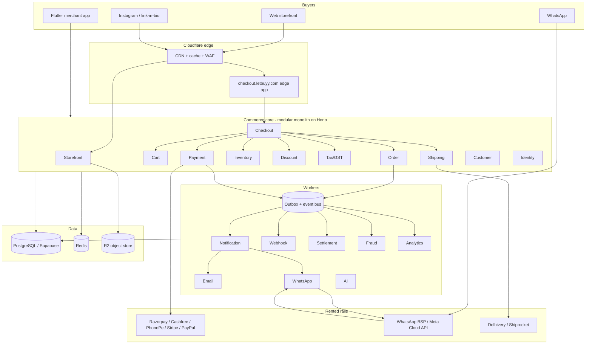

**Why this hits the targets and stays simple:**

- **1M merchants / 10M orders/day:** the hot path is stateless app instances behind the edge over a partitioned Postgres with read replicas; the design names `store_id` as the shard key and partitions the four hottest tables from day one, so the eventual move to a sharded fleet is a *planned* step, not an emergency.
- **100k concurrent checkouts:** checkout is in-process (no synchronous service fan-out), idempotent, with inventory reservation via a dedicated reservation table + optimistic concurrency; flash-sale load is shed at the edge (WAF + fair queue).
- **Operationally simple:** ~4 deployables (edge checkout, core monolith, workers, storefront), one primary DB, one Redis, one bus. A team of 6–12 can run it. Complexity is *bought* (PA payouts, BSP WhatsApp, logistics aggregators), not built.

---

# 2. Research Recap — 15 Shopify Systems → LetBuyy Equivalent

Full mechanisms, sources, and verification flags live in `LETBUYY_CHECKOUT_PLATFORM_MASTER_PLAN.md` (Phases 1–4, Appendix A). This is the decision-grade distillation: what Shopify does, and the *deliberate* LetBuyy equivalent.

| # | Shopify system | What Shopify does (verified) | LetBuyy equivalent decision |
|---|---|---|---|
| 1 | **Checkout** | One canonical Cart; closed hosted single-page checkout *in-process*; Functions pipeline; exactly-once (Resumption); customize via extensions only | Centralized `checkout.letbuyy.com`, in-process orchestration (engines as libraries), idempotent + outbox; customize via **config**, not a sandbox |
| 2 | **Shop Pay** | Cross-merchant vaulted wallet, 6-digit OTP, network effect; gated to Shopify Payments | **Defer the wallet**; design a cross-store **identity seam** now (phone-OTP), build the UPI-native wallet post-scale |
| 3 | **Shopify Payments** | First-party gateway on Stripe Connect; processor, not MoR; payouts/reserves/FX | No first-party gateway. **Merchant-owned PA keys** (Razorpay/Cashfree/PhonePe) + a settlement/ledger layer on top; payments = cost center |
| 4 | **Order creation** | Order = immutable hub; financial+fulfillment state machines; FulfillmentOrder per location; 60-day read window | Same state-machine rigor; **FulfillmentOrder-per-location** model; `channel` first-class; partitioned `orders` |
| 5 | **Merchant billing** | Subscription + app billing via Shopify's own rails | `billing-service` charges merchants via **UPI AutoPay mandates** + cards; dunning; GST invoices to merchants |
| 6 | **Domain routing** | Custom domains, edge routing ("Sorting Hat"), per-shop TLS | **Cloudflare for SaaS** custom hostnames; Tier-1 `checkout.letbuyy.com` → Tier-2 `checkout.merchant.com` (§6) |
| 7 | **Checkout branding** | Plus-only Branding API on a Checkout Profile (tokens), store-wide | **Config-driven branding tokens** per store (logo/color/font/radius/layout/badges), rendered server-side; all tiers (§7) |
| 8 | **Notifications** | First-party, Liquid-templated, queued, retried, deliverability-managed; Shopify sends | `notification-service` + `email-service`, **WhatsApp-first**; DLT-registered SMS; tenant-isolated templates (§11/§12) |
| 9 | **Fraud** | low/med/high scoring; pluggable `OrderRiskAssessment`; Shopify Protect for Shop Pay | Pluggable assessment model; **v1 = COD-confirmation + rules** (UPI/COD/RTO/pincode/velocity); ML once labeled data exists (§8) |
| 10 | **Multi-tenant** | Pods sharded by `shop_id`; dedicated pods for whales; offline cross-shop | **Shared-pool + RLS now; tenant-routing seam** for whale promotion to dedicated schema/DB; partition hot tables (§15) |
| 11 | **Subscription billing** | Subscription contracts + billing cycles | `billing-service` for **merchant** subscriptions; merchant→buyer subscriptions via UPI AutoPay as a P3 capability |
| 12 | **Webhooks** | Topics, HMAC, at-least-once, 8 retries/4h, dedupe id, compliance topics | `webhook-service` (exists): HMAC + **timestamp/nonce replay protection**, outbox-sourced, DLQ, reconciliation endpoint |
| 13 | **Inventory reservation** | No durable in-cart hold; Committed at order; draft-order `reserveInventoryUntil` | **Explicit reservation table + TTL + optimistic concurrency** (we improve on Shopify here — India flash-sale + COD needs it) |
| 14 | **Refunds** | Reverse transaction + restock + notification + payout adjustment | `order/payment` refund flow → **ledger entry + PA refund + WhatsApp notice + settlement adjustment**; UPI/COD refund paths |
| 15 | **Settlement** | Owns settlement (owns gateway); ledger; reserves | Reconcile **against PA settlement reports**; append-only ledger; **COD remittance as a settlement source**; break management (§9) |

**Three lessons we copy, two we deliberately reject.** Copy: (a) the closed-surface, in-process, idempotent checkout; (b) the FulfillmentOrder-per-location order model; (c) the at-least-once + idempotent + reconcilable async backbone. Reject: (a) the Wasm/Web-Worker **third-party extensibility runtime** (years-too-early — config instead); (b) a **first-party gateway + steerage** monetization (illegal-to-economics in UPI India — subscription/commission instead).

---

# 3. Architecture Principles & the Logical-vs-Physical Model

**P1 — Domain-driven bounded contexts.** 22 contexts (§4), each owning its tables, APIs, and events. No context reads another's tables directly; cross-context access is via API (in-process call) or event.

**P2 — Modular monolith first, extract on signal.** All synchronous commerce contexts compile into **one Hono app** (`commerce-core`) with module boundaries enforced statically (import rules, like Shopify's Packwerk). Separate runtimes only for: the **edge checkout** app (latency/PCI surface), **async workers** (different scaling profile), **storefront** (read-heavy/cacheable). Extraction triggers are explicit: a context's CPU/DB profile, deploy cadence, or team ownership diverges → extract it. This is the heart of "operationally simple at 1M."

**P3 — Transactional outbox + idempotent consumers.** No service performs a DB write and a bus publish as two operations. Write domain row + `outbox` row in one tx; a relay (CDC or polling) publishes; consumers dedupe on `event_id` and are effect-idempotent. This is how 10M orders/day stay consistent without distributed transactions.

**P4 — Sagas for cross-context money/state.** The only places needing multi-step consistency (checkout↔payment↔order, refund, settlement) use **explicit sagas with compensations**, not 2PC. Each step is idempotent and recorded; failures compensate (e.g., payment captured but order-create failed → auto-refund + alert).

**P5 — Ledger-first money, rails rented.** Append-only double-entry ledger is truth. PAs custody/disburse. We never hold or move funds ourselves → stays outside RBI PA licensing while supporting marketplace splits via Route/Easy-Split.

**P6 — India channels are first-class.** `channel` on cart/checkout/order; WhatsApp + Instagram are commerce surfaces, not notifiers; COD is a logistics+cash pipeline; GST + DPDP are core domain, not add-ons.

**P7 — Layered tenant isolation.** App-layer `store_id` filter **and** RLS (`FORCE` + GUC) **and** a tenant-routing seam. Fail closed.

**P8 — Edge-first.** Cloudflare does TLS (incl. per-merchant custom hostnames), CDN, cache, WAF, bot defense, and hosts the checkout edge app close to buyers; origin is stateless.

**P9 — Buy > build for undifferentiated heavy lifting.** PA payouts, WhatsApp BSP, logistics aggregators, email ESP, object storage. Build only the differentiated core (checkout, ledger, India channels, COD).

**P10 — Everything money/PII is audited.** Append-only `audit_log` on every state/money/PII mutation, with actor, before/after, request id.

### Logical → physical mapping (deploy units)

| Deploy unit (physical) | Runtime | Hosts (logical contexts) | Why separate |
|---|---|---|---|
| `commerce-core` | Hono (origin) | Storefront, Cart, Checkout, Order, Inventory, Discount, Tax, Shipping, Payment, Customer, Identity, Billing | One transaction boundary on the hot path; in-process calls beat network hops |
| `checkout-edge` | Hono on Cloudflare Workers | Checkout session entry, branding render, payment-intent init | Latency to buyer; minimized PCI surface; edge cache/WAF |
| `workers` | Hono/Node workers | Notification, Email, WhatsApp, Webhook, Settlement, Fraud, Analytics, Audit relay, AI, Media pipeline | Async, different scaling + retry profile |
| `storefront` | Next.js | Storefront read path, Instagram link-in-bio | Read-heavy, cacheable, independent deploys |
| `merchant-app` | Flutter | Merchant control (via `mobile-bff`) | Native client |

The 22 contexts are real; the deploy units are four. Add deploy units only when an extraction trigger fires.

---

# 4. System Boundaries — The 22 Services

Each is a **logical bounded context** with a fixed contract. Template: **Purpose · Responsibilities · APIs · Events (pub→ / sub←) · Owns · Security · Scaling · Deploy unit.** "Deploy unit" ties back to §3 (core / edge / workers / storefront).

### 4.1 Storefront Service
- **Purpose.** Render/serve buyer-facing catalog, product, collection, and link-in-bio pages; feed cart.
- **Responsibilities.** Catalog read APIs, SEO, theme rendering, cache invalidation, Instagram link-in-bio pages.
- **APIs.** `GET /s/:store/products`, `/collections`, `/p/:handle`, `/r/:resellerCode` (link-in-bio).
- **Events.** pub→ `storefront.product_viewed`; sub← `product.updated` (cache bust).
- **Owns.** Read models/materialized views over product/inventory; no authoritative writes.
- **Security.** Public, rate-limited, WAF; no PII.
- **Scaling.** Cacheable at edge; read replicas; the easiest tier to scale.
- **Deploy unit.** `storefront` (Next.js).

### 4.2 Cart Service
- **Purpose.** Server-authoritative cart + signed checkout handoff; email capture for abandonment.
- **Responsibilities.** Line CRUD, buyer identity, attributes, applied discounts/gift cards, selected delivery, `channel` tagging, `checkout_url` (id+key).
- **APIs.** `POST /carts`, `/carts/:id/lines`, `PUT /carts/:id/buyer-identity`, `POST /carts/:id/discount-codes`, `GET /carts/:id/checkout-url`.
- **Events.** pub→ `cart.created`, `cart.email_captured`, `cart.abandoned`.
- **Owns.** `carts`, `cart_items`.
- **Security.** Unguessable id + signed key; RLS by `store_id`.
- **Scaling.** High write; Redis hot-cache; partition by `store_id`.
- **Deploy unit.** `commerce-core`.

### 4.3 Checkout Service
- **Purpose.** The authoritative checkout **state machine**; orchestrate engines in-process; idempotency; confirm.
- **Responsibilities.** Contact→delivery→tax→discount→payment→fraud→confirm→order; inventory re-validation; branding resolution; channel-aware (web/WhatsApp/IG).
- **APIs (narrow).** `POST /checkout/:cartId/contact|delivery|payment-intent|confirm`, `GET /checkout/:id`.
- **Events.** pub→ `checkout.started`, `checkout.completed`, `checkout.failed`.
- **Owns.** `checkout_sessions`, `checkout_addresses`.
- **Security.** Closed surface; idempotency keys; signed session; minimal PCI (tokens only).
- **Scaling.** In-process engine calls (no fan-out); stateless instances; edge entry.
- **Deploy unit.** `commerce-core` (entry via `checkout-edge`).

### 4.4 Payment Service
- **Purpose.** Provider-agnostic payment **session state machine** over merchant-owned PA keys.
- **Responsibilities.** authorize/sale/capture/void/refund; adapters (Razorpay/Cashfree/PhonePe/Stripe/PayPal/COD/UPI); 3DS/redirect/collect/intent; idempotency; tokenization; transaction ledger feed; fallback + retry.
- **APIs.** `POST /payments/sessions`, `/payments/:id/capture|void|refund`, `POST /webhooks/:provider`.
- **Events.** pub→ `payment.authorized|captured|failed|refunded`; sub← `order.fulfilled` (manual capture).
- **Owns.** `payments`, `payment_attempts`, `payment_transactions`, `payment_credentials` (encrypted, per-store).
- **Security.** Per-store key encryption (KMS); inbound signature + replay protection; PCI-minimized.
- **Scaling.** Stateless; per-provider circuit breakers; partition `payment_transactions`.
- **Deploy unit.** `commerce-core` (provider webhooks may run in `workers`).

### 4.5 Order Service
- **Purpose.** Immutable order system-of-record + financial/fulfillment state machines.
- **Responsibilities.** Order create (from checkout), numbering (prefix/suffix), FulfillmentOrder-per-location, edits (calculated-order), cancel, COD/UPI specifics, `channel`.
- **APIs.** `POST /orders` (internal), `GET /orders/:id`, `/orders`, `POST /orders/:id/cancel|edit/*`.
- **Events.** pub→ `order.created|paid|fulfilled|cancelled`; sub← `payment.captured`, `order.risk_assessed`.
- **Owns.** `orders`, `order_items`, `fulfillment_orders`, `fulfillments`.
- **Security.** RLS; read-scope window; audit on every transition.
- **Scaling.** Partition `orders`/`order_items` by `store_id`+time; replicas for reads.
- **Deploy unit.** `commerce-core`.

### 4.6 Inventory Service
- **Purpose.** Authoritative stock + the **reservation** primitive checkout depends on.
- **Responsibilities.** Available/Committed/Reserved/Unavailable states; reservation table + TTL; optimistic-concurrency decrement; multi-location; oversell policy.
- **APIs.** `POST /inventory/reserve` (TTL), `/inventory/commit`, `/inventory/release`, `GET /inventory/:variant`.
- **Events.** pub→ `inventory.reserved|committed|released|low`; sub← `order.created|cancelled`.
- **Owns.** `inventory_levels`, `inventory_reservations`, `locations`.
- **Security.** RLS; reservation tokens signed.
- **Scaling.** Hot rows under contention → row-level optimistic locking; shard by `store_id`.
- **Deploy unit.** `commerce-core`.

### 4.7 Discount Service
- **Purpose.** Evaluate code + automatic discounts with deterministic 3-class stacking.
- **Responsibilities.** product/order/shipping classes; `combines_with` matrix; BXGY/amount/%/free-ship; usage limits; reseller/affiliate coupon hooks.
- **APIs.** `POST /discounts`, `POST /discounts/validate` (cart preview), admin CRUD.
- **Events.** pub→ `discount.redeemed`; sub← `order.created` (finalize usage).
- **Owns.** `discounts`, `discount_allocations`, usage counters.
- **Security.** RLS; server-side validation only.
- **Scaling.** In-process at checkout; cache definitions in Redis.
- **Deploy unit.** `commerce-core`.

### 4.8 Tax Service (GST-native)
- **Purpose.** Authoritative GST computation + invoice.
- **Responsibilities.** CGST/SGST vs IGST by place-of-supply; HSN rates; tax-inclusive pricing; GST invoice (IRN/QR for e-invoice eligible); marketplace TCS; registrations/overrides/exemptions.
- **APIs.** `POST /tax/calculate`, `GET /tax/invoice/:orderId`, admin registrations.
- **Events.** pub→ `tax.invoice_generated`; sub← `order.created`.
- **Owns.** `tax_registrations`, `tax_overrides`, HSN rate tables, `gst_invoices`.
- **Security.** RLS; GSTIN/PAN as PII (encrypted, DPDP).
- **Scaling.** In-process calc; async invoice/IRN generation in `workers`.
- **Deploy unit.** `commerce-core` (+ invoice job in `workers`).

### 4.9 Shipping Service
- **Purpose.** Rates, pincode serviceability, label/AWB, tracking ingestion.
- **Responsibilities.** Zones/profiles/rates; **pincode + COD serviceability**; carrier-rate endpoint; aggregator labels (Delhivery/Shiprocket/Bluedart); tracking events; delivery display rules (hide/rename/reorder, COD caps).
- **APIs.** `POST /shipping/rates`, `GET /shipping/serviceability/:pincode`, label/manifest endpoints.
- **Events.** pub→ `shipment.created|out_for_delivery|delivered|rto`; sub← `order.created`.
- **Owns.** zones/profiles/rates, `shipments`, tracking.
- **Security.** RLS; aggregator keys in KMS.
- **Scaling.** Rate calls cached + timeout-bounded; tracking ingest in `workers`.
- **Deploy unit.** `commerce-core` (+ tracking poll in `workers`).

### 4.10 Notification Service
- **Purpose.** Decide what/whom/which-channel per domain event; tenant-scoped; orchestrate channels.
- **Responsibilities.** Channel selection (WhatsApp-first → SMS → email → push); preferences; suppression; retries; delivery tracking; consent (DPDP/TRAI).
- **APIs.** `POST /notifications/send` (internal), admin template/preference CRUD, `GET /notifications/:id`.
- **Events.** sub← `order.*`, `payment.refunded`, `cart.abandoned`, `shipment.*`; pub→ `notification.sent|failed`.
- **Owns.** `notification_logs`, templates, preferences, suppression.
- **Security.** Tenant-scoped templates; consent ledger.
- **Scaling.** Queue-driven; provider rate-limit aware.
- **Deploy unit.** `workers`.

### 4.11 Email Service
- **Purpose.** Render + send transactional email with deliverability management.
- **Responsibilities.** MJML/Liquid render against one context object; multi-ESP (Resend/SES/SendGrid) failover; per-tenant SPF/DKIM/DMARC; From-rewrite fallback; bounce/complaint suppression; open/click tracking.
- **APIs.** `POST /email/render`, `POST /email/send` (called by notification-service).
- **Events.** pub→ `email.delivered|bounced|complained`.
- **Owns.** `email_logs`, suppression, sender_domains.
- **Security.** DKIM keys in KMS; PII minimization.
- **Scaling.** Queue-driven; ESP failover.
- **Deploy unit.** `workers` (logical sub-module of notification in v1).

---
### 4.12 WhatsApp Service
- **Purpose.** WhatsApp as a **commerce + notification + support** surface (not just SMS-like).
- **Responsibilities.** BSP/Meta Cloud API integration; template (HSM) management + approval; 24h-session window economics; interactive messages + **WhatsApp Flows** (catalog→cart→address); two-way (order queries, **COD confirm**); opt-in; per-merchant or shared WABA.
- **APIs.** `POST /wa/send`, `POST /wa/flow/:type`, `POST /wa/webhook` (inbound), template CRUD.
- **Events.** pub→ `wa.message_received`, `wa.cod_confirmed`, `wa.order_intent`; sub← `order.*`, `shipment.*`, `cart.abandoned`.
- **Owns.** `whatsapp_messages`, `wa_templates`, `wa_sessions`, opt-ins.
- **Security.** Consent (DPDP/TRAI); BSP keys in KMS; PII in transit.
- **Scaling.** BSP throughput/quality-rating aware; queue-driven.
- **Deploy unit.** `workers` (inbound webhook may be edge).

### 4.13 Billing Service (merchant billing)
- **Purpose.** Charge **merchants** for subscription + platform fees.
- **Responsibilities.** Plans, subscriptions via **UPI AutoPay mandates** + cards; usage/transaction-fee metering; dunning; GST invoices to merchants; plan gating.
- **APIs.** `POST /billing/subscribe`, `/billing/mandate`, `GET /billing/invoices`, webhook receivers.
- **Events.** pub→ `billing.charged|failed|plan_changed`; sub← `order.created` (usage metering).
- **Owns.** `subscriptions`, `invoices` (merchant), `plans`, `mandates`.
- **Security.** RLS; mandate tokens; maker-checker on plan/price changes.
- **Scaling.** Periodic billing batch; metering via events.
- **Deploy unit.** `commerce-core` (+ batch in `workers`).

### 4.14 Fraud Service
- **Purpose.** Risk scoring + COD confirmation + block rules (India-tuned).
- **Responsibilities.** Pluggable `OrderRiskAssessment` (PENDING/NONE); rules engine (UPI/COD/RTO/pincode/velocity/phone); **COD-confirmation orchestration** (WhatsApp/IVR OTP); RTO label capture → ML later; dispute/representment hooks.
- **APIs.** `POST /risk/assess`, `POST /risk/assessments` (providers), admin rules.
- **Events.** pub→ `order.risk_assessed`, `cod.confirmation_requested|confirmed`; sub← `order.created`, `payment.authorized`, `shipment.rto`.
- **Owns.** `order_risk_assessments`, rules, RTO labels.
- **Security.** Sensitive scores; provider attribution tamper-evident.
- **Scaling.** Sync gate + async re-score in `workers`.
- **Deploy unit.** `workers` (sync gate callable in-process).

### 4.15 Settlement Service
- **Purpose.** Reconcile money in vs out; own the ledger truth; COD remittance.
- **Responsibilities.** Ingest PA settlement reports (per provider); double-entry ledger posting; reconcile gateway↔internal; **COD courier remittance** ingestion + reconciliation; reserves; break management + suspense accounts; finance-ops views.
- **APIs.** `POST /settlements/ingest`, `GET /settlements/:store`, reconciliation reports.
- **Events.** pub→ `settlement.recorded`, `recon.break_detected`; sub← `payment.captured|refunded`, `shipment.delivered` (COD), `chargeback.resolved`.
- **Owns.** `settlements`, `ledger_entries` (append-only), `reserves`, `recon_breaks`.
- **Security.** Strictest role isolation; append-only; audit.
- **Scaling.** Batch ingest; partition ledger; off-hot-path.
- **Deploy unit.** `workers`.

### 4.16 Analytics Service
- **Purpose.** Merchant analytics now; events platform later.
- **Responsibilities.** v1: read-replica + materialized views → merchant dashboards (sales/orders/conversion/RTO). Later: customer-events ingestion → warehouse (ClickHouse/BigQuery); cohorts.
- **APIs.** `GET /analytics/:store/overview|orders|funnels`.
- **Events.** sub← all domain events (to warehouse).
- **Owns.** materialized views; warehouse tables (later).
- **Security.** Tenant-scoped; cross-tenant only offline.
- **Scaling.** Replica + MV now; warehouse when justified (not v1).
- **Deploy unit.** `workers` + replica.

### 4.17 Webhook Service
- **Purpose.** Outbound merchant webhooks, reliably.
- **Responsibilities.** Topic subscriptions; **HMAC + timestamp/nonce replay protection**; at-least-once; exponential backoff; DLQ; dedupe id; reconciliation endpoint; outbox-sourced.
- **APIs.** admin subscription CRUD; internal `POST /webhooks/dispatch`.
- **Events.** sub← all `order.*`, `payment.*`, `shipment.*`, compliance topics.
- **Owns.** `webhook_subscriptions`, `webhook_deliveries` (partitioned).
- **Security.** Per-subscription signing secret (KMS); SSRF-safe egress.
- **Scaling.** Queue + DLQ; partitioned deliveries.
- **Deploy unit.** `workers`.

### 4.18 Customer Service
- **Purpose.** Buyer profiles, addresses, order history, store credit, consent.
- **Responsibilities.** Customer CRUD; address book; saved UPI/payment refs (tokens); store credit ledger; DPDP consent + data-subject requests (export/delete).
- **APIs.** `GET/POST /customers`, `/customers/:id/addresses`, `/customers/:id/credit`, DSR endpoints.
- **Events.** pub→ `customer.created|updated`, `customer.dsr_requested`; sub← `order.created`.
- **Owns.** `customers`, `addresses`, `store_credit`, `consents`.
- **Security.** PII field-encryption; RLS; consent ledger; right-to-erasure routine.
- **Scaling.** Identity-keyed; cross-store identity seam (future wallet).
- **Deploy unit.** `commerce-core`.

### 4.19 Identity Service
- **Purpose.** AuthN/AuthZ for buyers, merchants, staff, services.
- **Responsibilities.** Passwordless buyer OTP; merchant/staff login + **RBAC**; OAuth2/PKCE for headless; service-to-service tokens/mTLS; JWT issuance + the `store_id`/`customer_id` claims that drive the RLS GUC; step-up auth for money actions.
- **APIs.** `POST /auth/otp`, `/auth/token`, `/auth/refresh`, `/auth/introspect`.
- **Events.** pub→ `auth.login`, `auth.stepup`; sub← none.
- **Owns.** `users`, `roles`, `sessions`, `api_keys`.
- **Security.** The crown jewels; short-lived tokens; rotation; MFA for staff.
- **Scaling.** Stateless verification; Redis session/refresh store.
- **Deploy unit.** `commerce-core` (maps to existing `identity-platform`).

### 4.20 Audit Service
- **Purpose.** Tamper-evident record of every state/money/PII action.
- **Responsibilities.** Append-only audit entries (actor, action, entity, before/after, ip, request-id); immutable; queryable for compliance/forensics.
- **APIs.** internal `POST /audit` (or via outbox), `GET /audit` (scoped).
- **Events.** sub← all mutation events (relay).
- **Owns.** `audit_logs` (append-only, partitioned).
- **Security.** Append-only; no UPDATE/DELETE; restricted read role.
- **Scaling.** High write; partition by time; archive to object store.
- **Deploy unit.** `workers` (relay).

### 4.21 Media Service
- **Purpose.** Product/catalog media + transformations.
- **Responsibilities.** Upload, virus-scan, transcode/resize, responsive variants, CDN URLs; WhatsApp/IG media; signed upload URLs.
- **APIs.** `POST /media` (signed upload), `GET /media/:id`.
- **Events.** pub→ `media.processed`; sub← none.
- **Owns.** `media_assets` (metadata); blobs in R2.
- **Security.** Signed URLs; content scanning; size/type limits.
- **Scaling.** Object store + CDN; async transforms.
- **Deploy unit.** `workers` + R2/CDN (maps to reserved `media-service`).

### 4.22 AI Service
- **Purpose.** India-commerce AI: catalog generation, WhatsApp conversational commerce, support deflection, RTO/fraud scoring, vernacular.
- **Responsibilities.** Product description/translation; WhatsApp NLU (order intent from chat); support copilot; RTO/fraud model serving (once data exists); image tagging.
- **APIs.** `POST /ai/catalog`, `/ai/wa-intent`, `/ai/support`, `/ai/score`.
- **Events.** sub← `wa.message_received`, `order.created`; pub→ `ai.intent_detected`.
- **Owns.** model registry refs, prompt configs (no authoritative commerce data).
- **Security.** PII redaction before model calls; tenant isolation; cost guardrails.
- **Scaling.** Stateless inference; cache; async where possible.
- **Deploy unit.** `workers` (+ external model providers).

**Ownership note (canonical runtime map).** These logical contexts map onto LetBuyy's existing topology: `commerce-core` is carved from `services/api-gateway`; `checkout-edge` activates the reserved `services/checkout-runtime`; `workers` activates `services/queue-workers` + reserved `notification-service`/`event-bus`/`analytics-pipeline`/`media-service`; `webhook-service` exists; Identity maps to `apps/identity-platform`; storefront to `apps/storefront-runtime`; merchant app via `services/mobile-bff`. No deprecated app aliases are introduced.

---

# 5. The Checkout Domain — `checkout.letbuyy.com`

## 5.0 Why a centralized checkout (and its implications)

Checkout runs on **one centralized engine served at `checkout.letbuyy.com`** (Tier 1) — never re-implemented per merchant or per storefront. This is the most consequential architectural choice in the platform.

- **Why centralized is superior.** (1) **Security/PCI**: card/UPI entry happens on *one* origin we control and certify, not on N merchant storefronts of unknown quality. (2) **Upgrade leverage**: we ship a checkout improvement (a new UPI flow, a conversion fix) once and every merchant gets it — no migration, no per-store rollout. (3) **Consistency/trust**: buyers see a consistent, fast, trusted checkout (a known conversion lever). (4) **Fraud/observability**: one funnel to instrument, rate-limit, and defend. (5) **Operational**: one thing to scale, cache, and page on.
- **PCI implications.** Card data is entered in provider-hosted fields/SDKs on the checkout origin → tokenized by the PA → LetBuyy stores only tokens. The merchant storefront **never** touches card data, collapsing merchant PCI scope to SAQ-A and keeping LetBuyy's scope minimal. UPI/COD carry no PAN.
- **Security implications.** One hardened origin behind Cloudflare WAF/bot-defense; strict CSP; signed checkout sessions (cart id + key); short-lived JWTs for any embedded context; PII gated by DPDP consent.
- **Upgrade implications.** Checkout is versioned centrally; merchants customize via **config/branding tokens** (§7), never by forking checkout — so upgrades never break customizations (the exact trap Shopify's `checkout.liquid` deprecation was escaping).
- **Operational implications.** A single SLO-owned surface; one deploy; one cache strategy; one place for flash-sale load-shedding. The cost is that checkout is a shared dependency — so it is the most heavily tested, rate-limited, and circuit-broken part of the platform.

## 5.1 Checkout domain — the ten aspects

- **Architecture.** Edge entry (`checkout-edge` on Cloudflare Workers) for latency + WAF; orchestration in `commerce-core` calling Cart/Discount/Tax/Shipping/Inventory/Payment **in-process as libraries** (no synchronous service fan-out); writes via transactional outbox; one synchronous spine (contact→confirm), everything post-commit async.
- **Data models.** `checkout_sessions`, `checkout_addresses` (§14); reads cart; writes order on confirm.
- **APIs.** Narrow: `POST /checkout/:cartId/contact|delivery|payment-intent|confirm`, `GET /checkout/:id`. No public "build your own checkout."
- **Events.** `checkout.started`, `checkout.completed`, `checkout.failed` (+ `cart.email_captured` upstream).
- **Workflows.** §5.3 (checkout session) and §10 (order pipeline) sequence diagrams.
- **Edge cases.** Price/stock drift between cart and confirm (re-validate at confirm); duplicate submit (idempotency key); partial-payment; expired session; address un-serviceable; COD ineligible above cap; discount expired mid-session.
- **Failure handling.** Payment success + order-create failure → **saga compensation** (auto-refund + alert); inventory reserve failure → block confirm; engine timeout → fail closed with retriable error.
- **Security.** Closed surface; PCI-minimized; signed session; rate-limited; bot-defended.
- **Scaling.** Stateless instances; in-process engines; Redis for session/cart hot state; edge cache for static; reservation table absorbs contention.
- **Future evolution.** WhatsApp/IG checkout reuse the *same* engine via the `channel` dimension (a WhatsApp Flow drives the same state machine); a future saved-identity wallet plugs into the contact step.

## 5.2 Lifecycle state machines

### Cart lifecycle
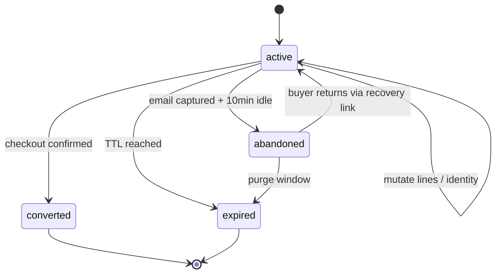

### Checkout session lifecycle
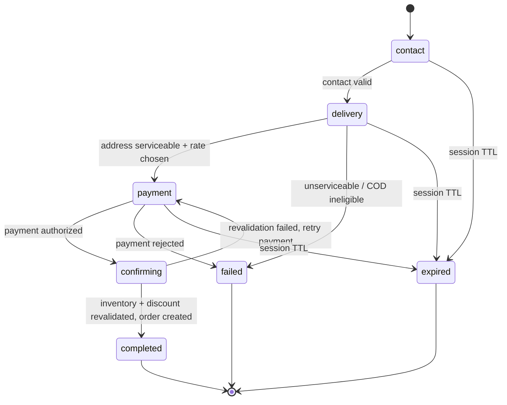

### Payment lifecycle
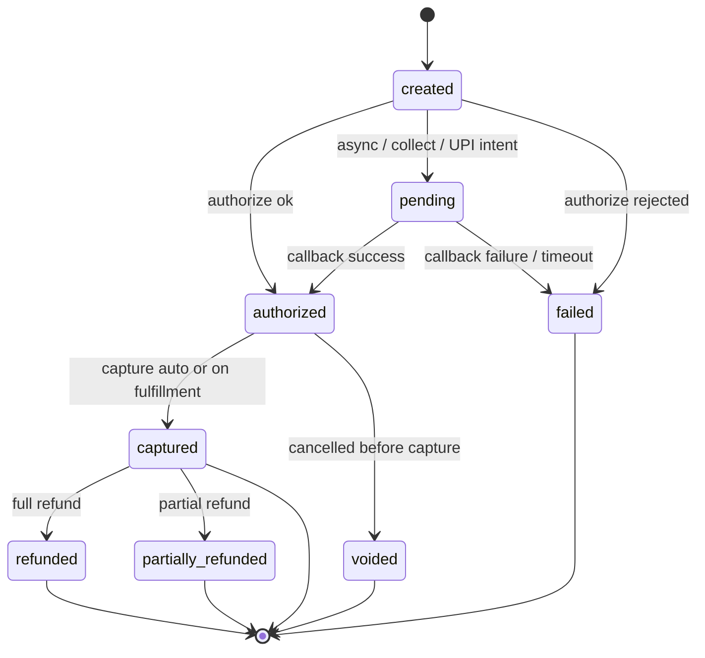

### Inventory reservation lifecycle
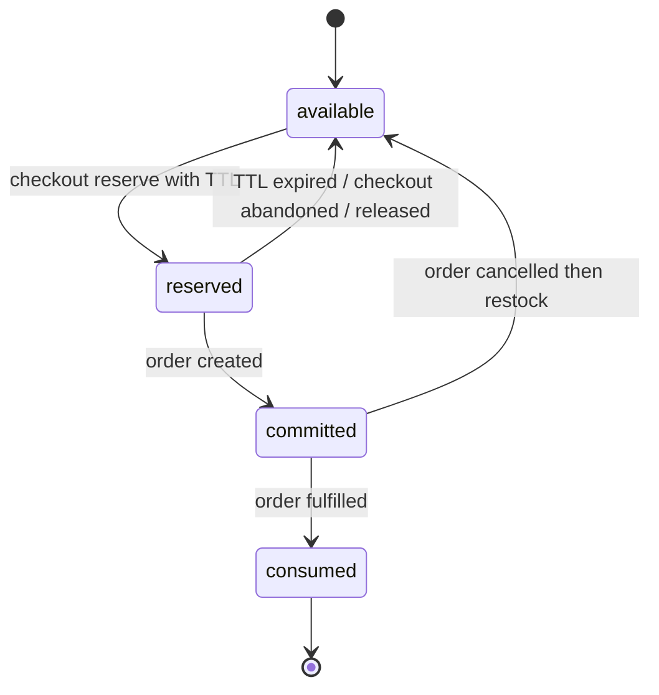
---
### Order lifecycle (high level; financial + fulfillment tracked separately)
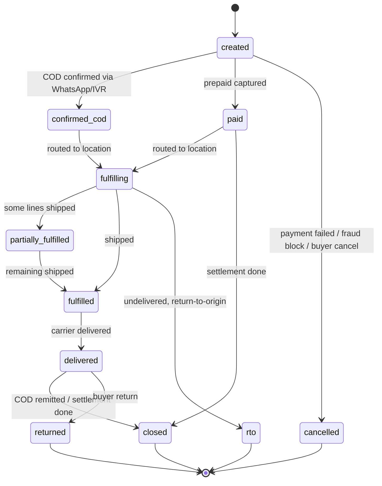

### Refund lifecycle
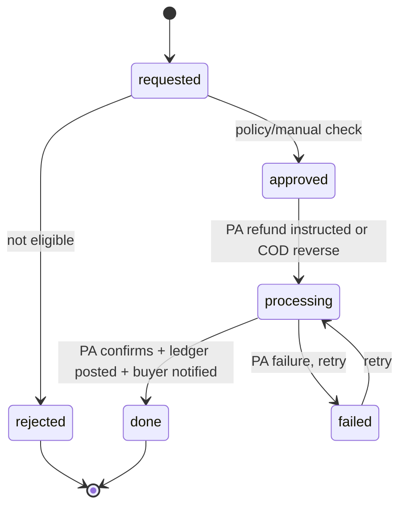

### Return lifecycle
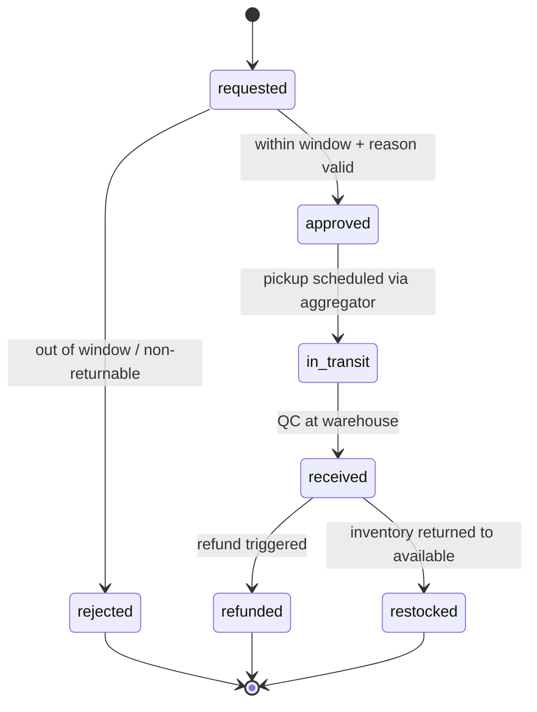

### Abandoned checkout lifecycle
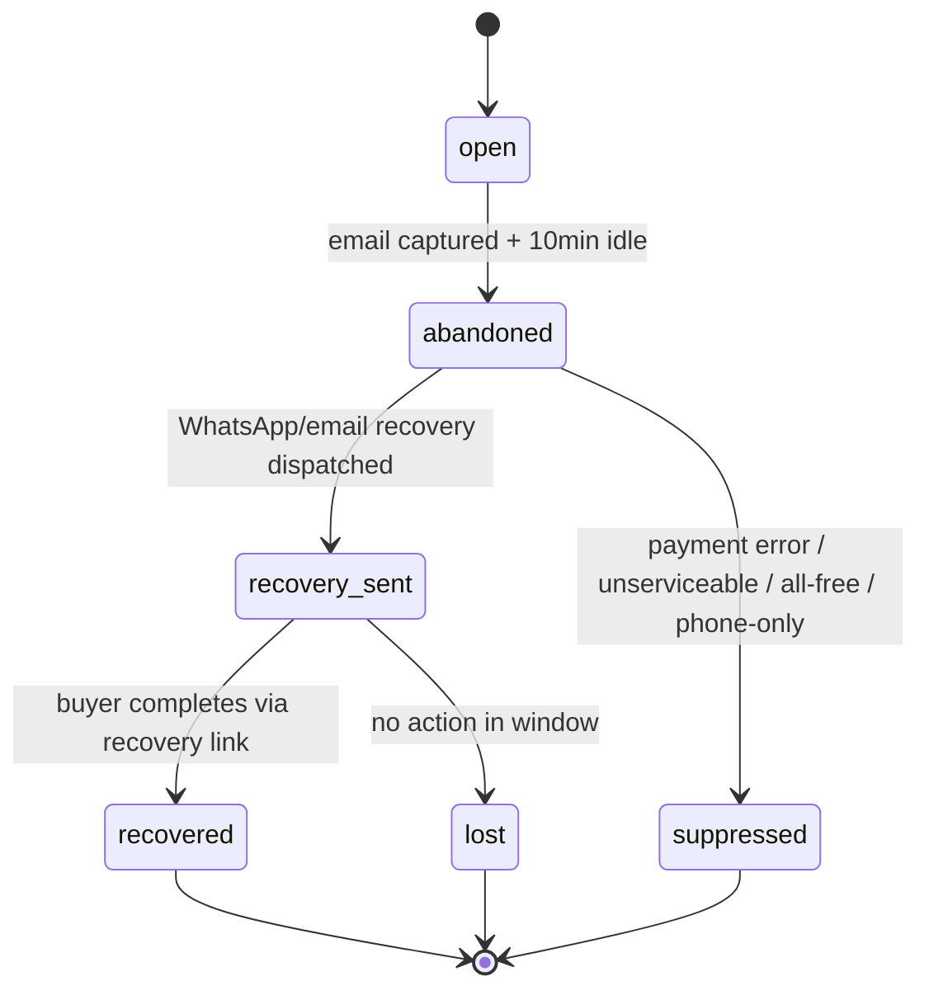

**Cross-lifecycle invariants.** (1) An order never reaches `paid`/`confirmed_cod` without an inventory `committed` transition. (2) Every money transition posts a `ledger_entries` row in the same transaction as the state change (or via outbox→settlement). (3) COD orders settle only on `delivered → closed` after courier remittance reconciliation. (4) Refund always traverses the refund lifecycle and posts a reversing ledger entry. (5) Every transition emits a domain event via the outbox.

---

# 6. Domain Strategy — Tier 1 → Tier 2

Buyers reach the merchant's storefront on the merchant's own domain; checkout is centralized. Two tiers govern *where the checkout URL lives*.

| | Tier 1 (default, all merchants) | Tier 2 (Pro/Enterprise upgrade) |
|---|---|---|
| Storefront | `merchant.com` | `merchant.com` |
| Checkout | `checkout.letbuyy.com` | `checkout.merchant.com` (CNAME → LetBuyy) |
| TLS | LetBuyy wildcard cert | **Cloudflare for SaaS** custom-hostname cert per merchant |
| Trust/branding | LetBuyy-trusted, co-branded | Fully merchant-branded domain |
| Setup | Zero-config | Add one CNAME; LetBuyy provisions cert |

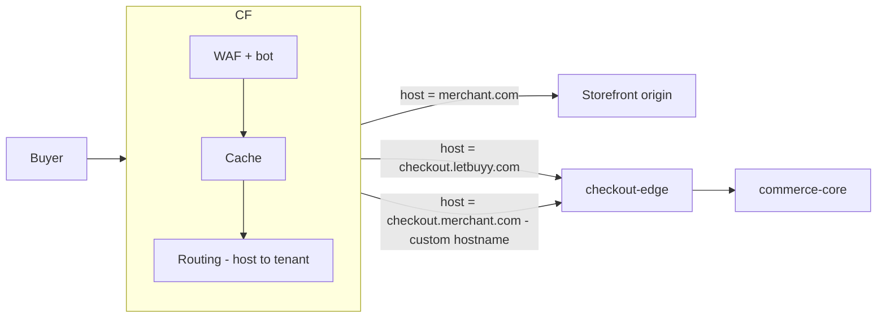

- **DNS.** Tier 1: nothing for the merchant (we own `checkout.letbuyy.com`). Tier 2: merchant adds `checkout.merchant.com CNAME → cname.letbuyy.com`.
- **SSL.** Tier 1: our wildcard `*.letbuyy.com`. Tier 2: **Cloudflare for SaaS Custom Hostnames** issues + auto-renews a per-merchant cert; DCV via the CNAME. No manual cert ops.
- **Cloudflare.** One zone fronts everything: **WAF** (OWASP + custom checkout rules), **Bot Management** (flash-sale defense), **CDN/Cache** (storefront + static checkout assets; checkout HTML/API uncached), **Custom Hostnames** (Tier 2), **Workers** (host the `checkout-edge` app + edge routing).
- **Reverse proxy / edge routing.** A Worker reads the `Host` header → resolves `host → store_id` (cached KV map) → tags the request with tenant context → forwards to origin (storefront or commerce-core). Bot/WAF run before origin. This is our "Sorting Hat."
- **CDN / cache.** Aggressive cache for storefront reads + checkout static assets; **never** cache checkout session/API or anything PII. Cache keys include `store_id`.
- **WAF.** Global OWASP ruleset + checkout-specific rules (rate limits per IP/phone, velocity, geo) + a **fair queue** for drops/flash sales.
- **Migration Tier 1 → Tier 2.** (1) Merchant clicks "use my domain for checkout"; (2) we show the CNAME to add; (3) on detection we register the Custom Hostname + provision cert (minutes); (4) we flip the merchant's `checkout_host` config; (5) **both hosts work during transition** (the engine is identical; only the host differs), so there is zero checkout downtime and existing links keep working. Rollback = flip the config back.

**Why this is safe and simple:** the *engine* is identical in both tiers — only the public host changes. There is no separate Tier-2 codebase, so Tier 2 adds zero checkout maintenance burden; it's a Cloudflare config + a per-store `checkout_host` value.

---

# 7. Checkout Customization — Theme-Aware, Security-Safe

Merchants control look-and-feel; they never inject code into checkout. The mechanism is **declarative branding tokens** resolved server-side at render — the same doctrine as Shopify's Branding API, available to *all* tiers.

- **What merchants control.** Logo, favicon, color scheme (accent/background/text/button), font (from an allowlisted set + optional self-hosted via Media), border-radius, button style, layout density, section order (within allowed slots), trust badges, custom announcement text, T&C/return-policy links.
- **Data model.** One `store_branding` row (JSONB tokens) per store, e.g.:
```json
{
  "logo_url": "...", "favicon_url": "...",
  "colors": {"accent":"#6D28D9","bg":"#FFFFFF","text":"#111","button_bg":"#6D28D9","button_text":"#FFF"},
  "typography": {"font":"Inter","scale":1.0},
  "shape": {"radius":"md","button":"solid"},
  "layout": {"density":"comfortable","summary":"right"},
  "badges": ["secure","cod_available","gst_invoice"],
  "copy": {"announcement":"Free shipping over ₹999"}
}
```
- **Render pipeline.** `checkout-edge` loads `store_branding` (cached in KV), maps tokens → a **fixed, audited CSS variable set + component props**, and server-renders. Merchant input is **never** interpreted as code: colors are validated hex, fonts are allowlisted (or sanitized self-hosted URLs), copy is escaped, layout choices are enums. No merchant CSS/JS/HTML reaches the page.
- **Why it's secure.** (1) No code execution — tokens only. (2) Strict CSP (no inline merchant scripts). (3) Inputs validated/sanitized at write and again at render. (4) Logo/media via signed Media URLs (scanned). (5) Upgrades can't break merchants because they only ever set tokens, never fork the template.
- **APIs.** `GET/PUT /stores/:id/branding`; live preview via the same render path with a draft token set.
- **Events.** `branding.updated` → KV cache bust.
- **Edge cases / failure.** Invalid token → fall back to default token (never break checkout); missing logo → text fallback; oversized self-hosted font → reject at upload.
- **Scaling / future.** Tokens cached at edge; near-zero render cost. Future: a constrained "sections" model (add a banner/upsell block in an allowed slot) — still declarative config, **not** a Wasm/Web-Worker sandbox (explicitly deferred per the CTO review until real third-party demand).

---

# 8. Payments Architecture — Universal Payment Layer

The payment layer presents a **single internal contract** to checkout and hides every gateway behind adapters, with merchant-owned credentials and zero lock-in.

## 8.1 Ten aspects

- **Architecture.** Checkout → `payment-service` (internal contract) → **gateway adapter** (per PSP) → PSP. Sessions are a state machine (§5.2); idempotent; tokenized; events via outbox; per-PSP circuit breakers; fallback routing.
- **Data models.** `payments`, `payment_attempts`, `payment_transactions`, `payment_credentials` (per-store, KMS-encrypted) (§14).
- **APIs.** `POST /payments/sessions`, `POST /payments/:id/capture|void|refund`, `POST /webhooks/:provider`.
- **Events.** `payment.authorized|captured|failed|refunded`, `payment.pending`.
- **Workflows.** Authorize/capture/refund sequence (§8.4).
- **Edge cases.** UPI collect timeout; duplicate webhook; partial capture; double-submit; currency mismatch; COD (no PSP); mandate (AutoPay) for subscriptions.
- **Failure handling.** Idempotency keys; retries with backoff; **fallback gateway**; reconcile-on-uncertainty (never assume; fetch authoritative status); saga compensation on order-create failure.
- **Security.** Per-store credential encryption; inbound signature + timestamp/nonce; PCI-minimized (tokens); no PAN at rest.
- **Scaling.** Stateless; circuit breakers per provider/method; partition `payment_transactions`.
- **Future evolution.** Add PSPs by writing an adapter; UPI AutoPay mandates; later a saved-instrument wallet (cross-store identity).

## 8.2 Internal payment contract (gateway-agnostic)

Every adapter implements one interface so checkout/order code never knows the PSP:
```
PaymentAdapter:
  createSession(intent: {amount_minor, currency, method, order_ref, customer, idempotency_key}) -> {session_id, next_action}
  // next_action ∈ {none, redirect(url), collect(upi), otp, poll}
  capture(session_id, amount_minor?) -> result
  void(session_id) -> result
  refund(session_id, amount_minor, idempotency_key) -> result
  parseWebhook(raw, headers) -> {event, session_id, status, amount_minor, provider_ref}  // verifies signature
  fetchStatus(session_id) -> authoritative status   // for reconcile-on-uncertainty
```
`next_action` normalizes the wildly different PSP flows (UPI intent/collect, card 3DS redirect, wallet, COD no-op) into one shape checkout can render channel-appropriately (web page, WhatsApp Flow, IG link).

## 8.3 Adapter pattern, abstraction, fallback, retry, recovery

- **Adapter pattern.** One adapter per PSP (Razorpay, Cashfree, PhonePe, Stripe, PayPal) + a `COD` and a `UPIIntent` pseudo-adapter. Adapters are pure translation; all state lives in `payment-service`.
- **Gateway abstraction layer.** A **router** picks the adapter per (merchant config, method, currency, health). Merchant-owned keys are loaded (decrypted from `payment_credentials`) per request.
- **Fallback strategy.** If the merchant configures multiple PSPs and the primary is unhealthy (circuit open) or returns a retriable failure at *authorization* (not after money moves), the router retries on the secondary with a **new idempotency key**. Never fall back after authorization succeeds.
- **Retry strategy.** Exponential backoff + jitter on transient/5xx/timeout; **idempotency key per logical attempt**; capped attempts; retriable vs terminal error classification per adapter.
- **Failure recovery.** **Reconcile-on-uncertainty**: any ambiguous outcome (timeout, dropped callback) triggers `fetchStatus()` against the PSP as the authority before changing state. A reconciliation job sweeps `pending` payments older than N minutes. This is how UPI collect-timeouts and dropped webhooks don't become lost/double payments.

## 8.4 Authorize → capture → refund (sequence)

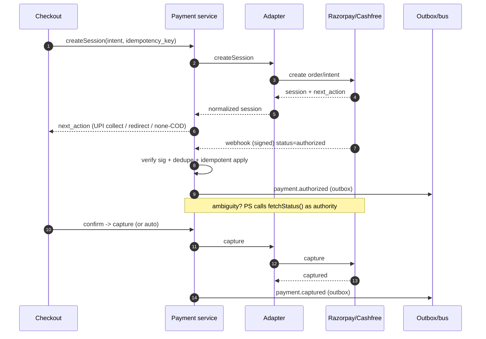

## 8.5 Reconciliation, settlement, refunds, chargebacks, disputes, risk

- **Reconciliation.** Two layers: (1) **transaction-level** (reconcile-on-uncertainty, §8.3) keeps live state correct; (2) **settlement-level** (§9) reconciles PSP settlement reports + COD remittance against the ledger, with break management.
- **Settlement tracking.** Handed to `settlement-service` (§9) via `payment.captured/refunded` events + PSP settlement files.
- **Refunds.** `POST /payments/:id/refund` (idempotent) → adapter → PSP refund (or COD reverse) → `payment.refunded` → ledger reversing entry → buyer notified (WhatsApp). UPI refunds return to source VPA; COD refunds go to bank/UPI/store-credit per buyer choice.
- **Chargebacks / disputes.** Inbound PSP dispute webhook → `chargeback.opened` → evidence assembly (order, tracking, comms) → representment via PSP → `chargeback.resolved` → ledger + settlement adjustment. (Card-centric; rare on UPI/COD — India's dominant loss is RTO, handled in §4.14.)
- **Risk / fraud.** Delegated to `fraud-service` (§4.14): sync gate at checkout + async re-score; **COD confirmation** is the primary India lever.

---

# 9. Revenue Model — Fees, Commission, Ledger, Settlement, GST

## 9.1 How Shopify monetizes (conceptually) vs LetBuyy

Shopify earns three ways: **subscription** (plan fee), **payments processing margin** (Shopify Payments) and crucially the **steerage tax** (0.6–2% for using another gateway), plus **app/marketplace** revenue. The processing + steerage levers depend on owning/forcing a gateway.

**LetBuyy cannot and should not copy the gateway levers:** there is no LetBuyy gateway, merchants own their PA keys, and **UPI MDR is ~0%** — so payment-processing margin and steerage are dead on arrival in India. LetBuyy monetizes via:

| Stream | Mechanism | Notes |
|---|---|---|
| **Subscription fees** | Monthly/annual plan, charged via UPI AutoPay mandate or card (`billing-service`) | Primary, predictable revenue |
| **Platform service fee** | Optional flat ₹/order or % billed to the *merchant* (not the buyer), **invoiced separately**, not skimmed from the gateway | The honest "transaction fee" — never steerage |
| **Marketplace commission** | For multi-vendor (Model D): a cut of GMV via **split settlement** (Razorpay Route / Cashfree Easy-Split) where LetBuyy is a sub-merchant | Highest-margin; needs the ledger |
| **Enterprise fees** | Custom contracts (dedicated tenancy, SLAs, Tier-2 domains, priority support) | Top of market |
| **Value-added** | Shipping markup share, WhatsApp/AI usage, capital/lending referrals | Later |

**The critical mechanism — collecting platform fees when money flows through the merchant's own PA:** because LetBuyy doesn't touch the gateway funds, platform fees are collected by **(a)** separately billing the merchant (subscription + metered service fee via `billing-service` + AutoPay), and **(b)** for marketplace flows, taking a **split** at settlement time via the PA's Route/Easy-Split so the commission is deducted before the vendor is paid. Both are recorded in the ledger; neither requires LetBuyy to custody funds.

## 9.2 Fee calculation engine

- **Purpose.** Compute, per order, every fee owed: platform service fee, marketplace commission, shipping markup, GST on LetBuyy's fees.
- **Inputs.** Order total, merchant plan, fee config, vendor splits, channel.
- **Output.** A `fee_breakdown` (line items, each with base + 18% GST on the fee) attached to the order and posted to the ledger.
- **Edge cases.** Refund → fee reversal policy (full/partial/non-refundable); free orders; COD vs prepaid fee differences; per-plan caps.
- **Future.** Tiered/volume pricing, promotional fee waivers.

## 9.3 Commission engine (marketplace)

- Computes vendor-level splits for multi-vendor orders; produces split instructions for Route/Easy-Split; tracks reseller/affiliate commissions (§13).
- **Hold policy:** commission + vendor payout held until `delivered`/return-window per buyer-protection policy.

## 9.4 Ledger architecture (append-only double-entry — the source of truth)

Every money movement posts balanced debit/credit rows to `ledger_entries`. Accounts: `pa_clearing`, `merchant_payable`, `platform_revenue`, `gst_payable`, `cod_receivable`, `reserve`, `vendor_payable`, `refund_clearing`. **Invariant:** Σdebits = Σcredits per (store, currency); enforced in code + a periodic checker. Append-only (no UPDATE/DELETE; corrections are reversing entries).

**Example A — prepaid ₹1,000 order, ₹20 platform fee + 18% GST (₹3.6):**

| Event | Debit | Credit | Amount |
|---|---|---|---|
| Capture | pa_clearing | merchant_payable | 1000.00 |
| Platform fee | merchant_payable | platform_revenue | 20.00 |
| GST on fee | merchant_payable | gst_payable | 3.60 |
| Payout | merchant_payable | pa_clearing (→PA payout) | 976.40 |

**Example B — COD ₹1,000 order (courier collects, remits T+X, ₹40 COD+platform fee +GST):**

| Event | Debit | Credit | Amount |
|---|---|---|---|
| Delivered | cod_receivable | merchant_payable | 1000.00 |
| Fees+GST | merchant_payable | platform_revenue / gst_payable | 47.20 |
| Courier remittance | bank | cod_receivable | 1000.00 |
| Payout | merchant_payable | bank | 952.80 |

This makes COD's cash-in-transit explicit (`cod_receivable`) — the thing most clones lose money on.

## 9.5 Settlement engine

`settlement-service` (§4.15): ingest PSP settlement reports + COD courier remittance files → post ledger entries → reconcile against expected → surface **breaks** to a finance-ops queue with suspense accounting. Reserves roll per risk. Reconciliation is a product (dashboard + break workflow), not a cron.

## 9.6 Audit engine

`audit-service` (§4.20): every fee/ledger/payout/refund action is append-only audited (actor, before/after, request id). Money roles are least-privilege; payout/manual-adjust require **maker-checker** + step-up auth.

## 9.7 GST handling

- **Calculation** by place-of-supply (intra-state CGST+SGST vs inter-state IGST), HSN-coded rates, tax-inclusive/exclusive (§4.8).
- **Invoices:** GST-compliant invoice per order; **e-invoice (IRN+QR)** for eligible B2B turnover; credit notes on refund.
- **Marketplace TCS:** for multi-vendor, collect **1% TCS** on net taxable supplies and file **GSTR-8** — a first-class settlement obligation, not an afterthought.
- **On LetBuyy's own fees:** charge 18% GST on subscription/service/commission; issue GST invoices to merchants (`billing-service`).
- **Reconciliation:** GST output (collected) reconciled in settlement; export for GSTR-1/3B.

---

# 10. Order Architecture

## 10.1 Ten aspects

- **Architecture.** Order is created **only by checkout-service at confirm**, inside a saga that reserves inventory and authorizes payment first; the write is one transaction (order + items + outbox); fan-out is async.
- **Data models.** `orders`, `order_items`, `fulfillment_orders`, `fulfillments` (§14).
- **APIs.** `POST /orders` (internal), `GET /orders/:id`, `/orders`, `POST /orders/:id/cancel|edit/*`.
- **Events.** `order.created|paid|confirmed_cod|fulfilled|delivered|cancelled|rto|returned`.
- **Workflows.** §10.2–10.5 sequences.
- **Edge cases.** Reserve-then-payment-fail (release reserve); COD confirm timeout; split across locations; partial fulfillment; oversell race; duplicate confirm (idempotent).
- **Failure handling.** Saga compensations (auto-refund if order-create fails post-capture; release reservation on abandon); reconcile-on-uncertainty for payment.
- **Security.** RLS; channel-tagged; audit on every transition; read-scope window.
- **Scaling.** Partition `orders`/`order_items` by `store_id`+month; reads from replicas; FulfillmentOrder-per-location enables parallel fulfillment.
- **Future.** Order editing, B2B POs, subscriptions (merchant→buyer via UPI AutoPay).

## 10.2 Order creation pipeline (prepaid)

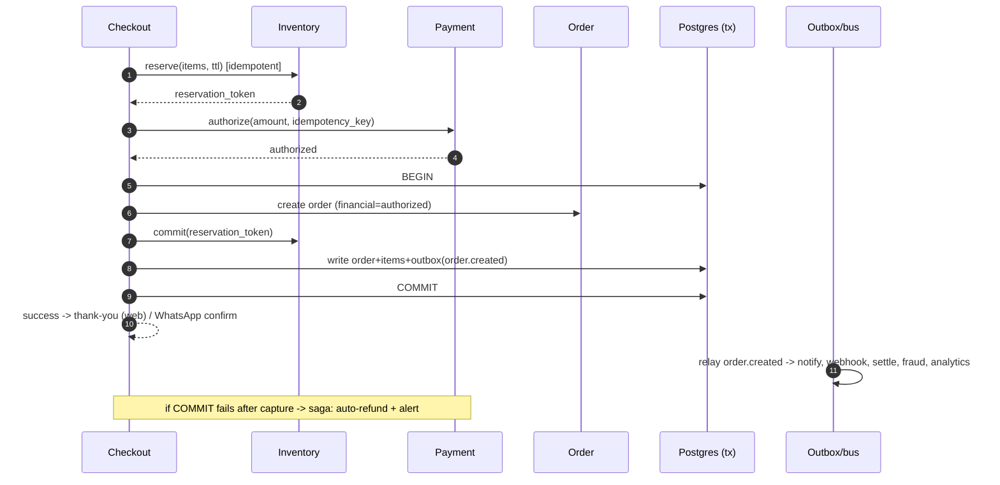

## 10.3 COD order flow (with WhatsApp confirmation — the India loss-reducer)

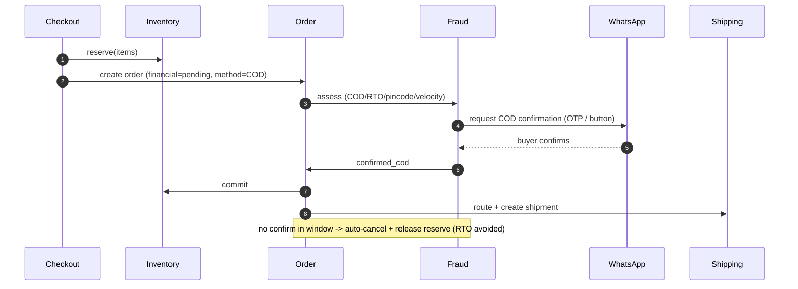

COD is modeled as **logistics + cash**, not payment: no PSP at order time; cash is collected by the courier and enters the ledger as `cod_receivable` on delivery, cleared on remittance (§9.4 Example B). Confirmation + RTO scoring before shipping is the single biggest margin protector.

## 10.4 Failed payment + recovery

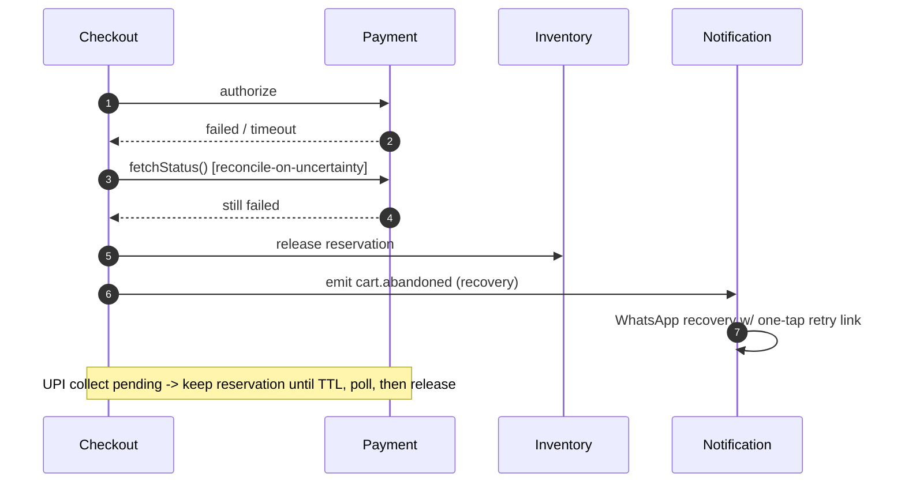

## 10.5 Inventory reservation, deduction, partial & split fulfillment

- **Reservation.** At checkout, `inventory.reserve(items, ttl)` writes `inventory_reservations` and decrements *available* via **optimistic concurrency** (version/`UPDATE ... WHERE available >= qty`). Oversell impossible under contention; flash-sale-safe. Token returned.
- **Commit / deduction.** On order create, reservation → `committed`; on fulfillment → `consumed`. Abandon/expire → auto-release (a sweeper releases stale reservations).
- **Multi-location & split.** Order-routing evaluates locations (serviceability, stock, proximity); if one location can fulfill, draw from it; else **split into multiple FulfillmentOrders** (one per location). Partial fulfillment ships available lines now, leaves the rest `unfulfilled`/`on_hold`.
- **Edge cases.** Reservation TTL vs slow UPI collect (extend while `pending`); concurrent reserves on last unit (one wins via optimistic lock); RTO restock (`committed → available`).

---

# 11. Email Architecture

Email is the **secondary** channel in India (WhatsApp is primary), but required for invoices, receipts, and non-WhatsApp buyers/merchants.

- **Template engine.** MJML (responsive) + a safe templating layer (Liquid-style) rendered against **one consistent context object** (order, items, fulfillment, refund, discounts, GST, store credit, branding). Avoid Shopify's context inconsistencies by designing one schema up front. Branding tokens (§7) injected (logo/accent), no raw merchant HTML.
- **Templates (v1 set).** Order confirmation, Order shipped, Out for delivery, Order delivered, Refund issued, Order cancelled, Abandoned checkout, GST invoice (PDF attached), Merchant: new-order, Merchant: payout statement.
- **Queue system.** Event → `notification-service` decides → enqueue render+send job (Redis/queue); decoupled from the order transaction; per-domain rate limiting.
- **Retry system.** Transient failures retry with backoff; multi-ESP failover (Resend→SES→SendGrid); terminal bounce → suppression.
- **Tracking.** ESP event webhooks → `email_logs` (queued/sent/delivered/opened/bounced/complained), keyed to order/customer.
- **Bounce/complaint handling.** Hard bounce/complaint → suppression list (per tenant); soft bounce → limited retries.
- **Deliverability.** Per-tenant SPF/DKIM/DMARC via CNAME; **From-address rewrite fallback** (`store+<id>@mail.letbuyy.com`) when a merchant domain isn't authenticated; separate sending reputation for transactional vs any marketing.
- **Security/scaling/future.** PII minimization; DKIM keys in KMS; queue-driven horizontal scale; future merchant-designed templates via constrained blocks (not raw code).

---

# 12. WhatsApp Commerce Architecture

**The flagship India differentiator.** WhatsApp is a full commerce surface — catalog → cart → checkout → pay → track → support → return — not just notifications. This is where Shopify is structurally weak and LetBuyy wins.

## 12.1 Ten aspects

- **Architecture.** `whatsapp-service` integrates a **BSP / Meta Cloud API**; inbound webhooks (messages, button taps, Flow submissions) → NLU/router (`ai-service`) → drives the **same checkout engine** with `channel=whatsapp`; outbound templates (HSM) for notifications. WABA per-merchant (Tier 2) or shared LetBuyy WABA with per-merchant routing (Tier 1).
- **Data models.** `whatsapp_messages`, `wa_templates`, `wa_sessions` (24h window), `wa_optins`; reuses `carts`/`checkout_sessions`/`orders` with `channel=whatsapp`.
- **APIs.** `POST /wa/webhook` (inbound), `POST /wa/send`, `POST /wa/flow/:type` (catalog/address/pay), template CRUD.
- **Events.** `wa.message_received`, `wa.order_intent`, `wa.cod_confirmed`; subscribes to `order.*`, `shipment.*`, `cart.abandoned`.
- **Workflows.** §12.2.
- **Edge cases.** 24h session window expiry (must use a paid template to re-open); template approval latency (pre-approve a library); opt-in revocation; number not on WhatsApp (fallback SMS); media limits.
- **Failure handling.** BSP throughput/quality-rating throttling → queue + backoff; failed Flow → fallback to web checkout link; idempotent inbound (dedupe on message id).
- **Security.** Opt-in/consent (DPDP + WhatsApp policy); PII in transit; BSP keys in KMS; per-tenant isolation of WABA routing.
- **Scaling.** Queue-driven; respect per-WABA messaging limits + quality rating; shard by `store_id`.
- **Future evolution.** Native WhatsApp Pay (UPI) as it matures; AI conversational ordering (vernacular); proactive re-engagement.

## 12.2 In-WhatsApp commerce workflows

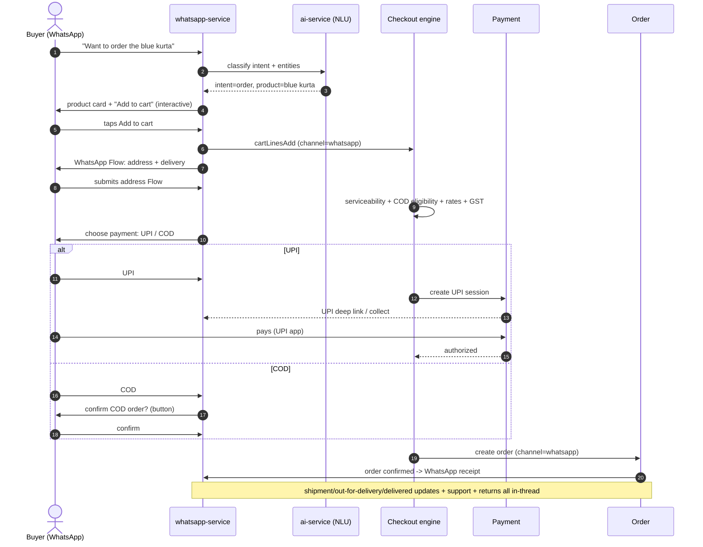

- **Catalog.** Product cards / list messages / catalog-linked messages; synced from the merchant catalog (and Meta catalog for Tier 2).
- **Cart.** Server cart with `channel=whatsapp`; persists across the conversation.
- **Checkout.** WhatsApp **Flows** capture address/delivery; the *same* checkout engine computes everything (no separate logic).
- **COD / UPI.** COD = button confirm (+ fraud confirmation doubles as this step); UPI = deep link / collect, reconcile-on-uncertainty for collect timeouts.
- **Tracking.** `shipment.*` events → proactive WhatsApp updates with tracking link.
- **Support.** Two-way thread; AI deflection first, human handoff (multi-agent inbox) on escalation.
- **Returns.** Buyer initiates return in-thread → return lifecycle (§5) → pickup scheduled → refund to source/UPI/store-credit.
- **Notifications.** Order/shipping/refund/abandoned — all WhatsApp-first (templates), email as fallback.

---

# 13. Instagram Reseller Mode

A **first-class lightweight tenant type** for India's millions of social sellers (boutiques selling via Stories/DMs/Reels) — a persona Shopify's enterprise-shaped onboarding ignores.

- **Architecture.** A `reseller` store type = minimal config (no theme/web-checkout complexity): a **link-in-bio storefront** (`letbuyy.com/r/:code` or custom) + WhatsApp ordering + COD/UPI + Shiprocket. Reuses the same cart/checkout/order/payment engine with `channel=instagram`.
- **Link-in-bio store.** A fast, mobile-first catalog page (served by `storefront`, edge-cached) with product cards → "Order on WhatsApp" CTA → drops into the WhatsApp commerce flow (§12).
- **WhatsApp ordering.** Primary order path; same engine; COD confirmation built in.
- **COD / UPI.** Default tenders; COD-first with confirmation; UPI deep link.
- **Reseller links & attribution.** Each reseller/affiliate gets a coded link (`/r/:code`); orders carry the code → commission/attribution.
- **Commission & affiliate tracking.** `resellers` + `reseller_commissions`: per-order commission computed by the commission engine (§9.3), held until delivery, paid via PA split. Multi-level (reseller → sub-reseller) supported as a tree.
- **Analytics.** Per-reseller dashboard: clicks, orders, GMV, RTO rate, commission earned, top products (from `analytics-service` MVs).
- **Data model.** `resellers` (code, parent_id, store_id, payout_ref), `reseller_commissions` (order_id, reseller_id, amount, status), `reseller_clicks`.
- **Events.** `reseller.click`, `reseller.order_attributed`, `reseller.commission_accrued`.
- **Edge cases.** Attribution window; self-referral fraud; RTO clawback of commission; sub-reseller splits.
- **Security/scaling/future.** Many tiny tenants (favors shared-pool); per-reseller rate limits; future: in-app reseller onboarding via WhatsApp, catalog import from Instagram.

---

# 14. Database Design

PostgreSQL (Supabase), `ap-south-1` (Mumbai) for data residency (DPDP). UUID PKs, money as `bigint` minor units + `currency`, `store_id` on every tenant row (RLS anchor + shard axis), `channel` on commerce rows, idempotency keys on retried mutations, append-only ledger/audit, **transactional outbox**.

## 14.1 Table inventory (grouped)

| Group | Tables | Partition / notes |
|---|---|---|
| Tenancy/identity | `stores`, `users`, `roles`, `sessions`, `api_keys`, `consents` | small; consents = DPDP |
| Catalog | `products`, `variants`, `media_assets`, `collections` | replica reads; cacheable |
| Inventory | `locations`, `inventory_levels`, `inventory_reservations` | reservations TTL-swept |
| Customers | `customers`, `addresses`, `store_credit` | PII field-encrypted |
| Cart/checkout | `carts`, `cart_items`, `checkout_sessions`, `checkout_addresses` | partition by `store_id`; carts TTL |
| Orders | `orders`, `order_items`, `fulfillment_orders`, `fulfillments` | **partition by `store_id`+month** |
| Payments | `payments`, `payment_attempts`, `payment_transactions`, `payment_credentials` | partition txns; creds KMS-encrypted |
| Money | `ledger_entries`, `settlements`, `reserves`, `payouts`, `payout_items`, `recon_breaks` | ledger append-only + partition |
| Pricing | `discounts`, `discount_allocations`, `gift_cards`, `gift_card_txns` | usage counters |
| Tax | `tax_registrations`, `tax_overrides`, `gst_invoices`, hsn_rates | invoices immutable |
| Shipping | `shipping_zones`, `shipping_profiles`, `shipping_rates`, `shipments` | tracking |
| Returns | `returns`, `refunds` | links to ledger |
| Comms | `notification_logs`, `email_logs`, `whatsapp_messages`, `wa_templates`, `wa_sessions`, `wa_optins` | partition by month |
| Channels | `resellers`, `reseller_commissions`, `reseller_clicks` | IG/affiliate |
| Billing | `plans`, `subscriptions`, `mandates`, `invoices` (merchant) | |
| Branding | `store_branding` | JSONB tokens |
| Platform | `outbox`, `audit_logs`, `webhook_subscriptions`, `webhook_deliveries` | **append-only + partition** |

Tables already specified in `LETBUYY_CHECKOUT_PLATFORM_MASTER_PLAN.md` §7 (carts, cart_items, checkout_sessions, checkout_addresses, orders, order_items, payments, payment_attempts, payment_transactions, refunds, returns, discounts, gift_cards, ledger_entries, settlements, payouts, email_logs, notification_logs, audit_logs) keep that DDL. Below is the DDL for the **new/changed** tables this blueprint introduces.

## 14.2 New/changed table DDL

```sql
-- Transactional outbox: written in the same tx as the domain change
CREATE TABLE outbox (
  id            bigint GENERATED ALWAYS AS IDENTITY PRIMARY KEY,
  store_id      uuid NOT NULL,
  event_type    text NOT NULL,                 -- e.g. order.created.v1
  event_id      uuid NOT NULL UNIQUE,          -- consumer dedupe key
  aggregate     text NOT NULL, aggregate_id uuid NOT NULL,
  payload       jsonb NOT NULL,
  created_at    timestamptz NOT NULL DEFAULT now(),
  published_at  timestamptz NULL               -- null = unpublished
);
CREATE INDEX idx_outbox_unpublished ON outbox(created_at) WHERE published_at IS NULL;

-- Inventory reservation (the primitive checkout depends on)
CREATE TABLE inventory_reservations (
  id            uuid PRIMARY KEY DEFAULT gen_random_uuid(),
  store_id      uuid NOT NULL,
  variant_id    uuid NOT NULL,
  location_id   uuid NOT NULL,
  checkout_id   uuid NOT NULL,
  quantity      int NOT NULL CHECK (quantity > 0),
  state         text NOT NULL DEFAULT 'reserved'
                 CHECK (state IN ('reserved','committed','consumed','released')),
  expires_at    timestamptz NOT NULL,
  created_at    timestamptz NOT NULL DEFAULT now()
);
CREATE INDEX idx_resv_sweep ON inventory_reservations(expires_at) WHERE state='reserved';
CREATE INDEX idx_resv_variant ON inventory_reservations(store_id, variant_id) WHERE state IN ('reserved','committed');

-- inventory_levels with optimistic-concurrency decrement
CREATE TABLE inventory_levels (
  store_id uuid NOT NULL, variant_id uuid NOT NULL, location_id uuid NOT NULL,
  available int NOT NULL CHECK (available >= 0),
  committed int NOT NULL DEFAULT 0,
  version   bigint NOT NULL DEFAULT 0,          -- optimistic lock
  PRIMARY KEY (store_id, variant_id, location_id)
);
-- reserve: UPDATE ... SET available=available-:q, version=version+1 WHERE available >= :q

-- Per-store payment credentials (merchant-owned keys), envelope-encrypted
CREATE TABLE payment_credentials (
  id uuid PRIMARY KEY DEFAULT gen_random_uuid(),
  store_id uuid NOT NULL, provider text NOT NULL,
  enc_key_ciphertext bytea NOT NULL,            -- KMS-wrapped
  enc_key_id text NOT NULL,                      -- KMS key ref
  config jsonb NOT NULL DEFAULT '{}',
  is_primary boolean NOT NULL DEFAULT false,
  created_at timestamptz NOT NULL DEFAULT now(),
  UNIQUE (store_id, provider)
);

-- WhatsApp commerce
CREATE TABLE whatsapp_messages (
  id uuid PRIMARY KEY DEFAULT gen_random_uuid(),
  store_id uuid NOT NULL, wa_id text NOT NULL,   -- buyer phone (hashed for index)
  direction text NOT NULL CHECK (direction IN ('in','out')),
  msg_type text NOT NULL, template text NULL,
  payload jsonb NOT NULL, provider_msg_id text,
  session_expires_at timestamptz NULL,           -- 24h window
  order_id uuid NULL, created_at timestamptz NOT NULL DEFAULT now()
) PARTITION BY RANGE (created_at);

-- Branding tokens
CREATE TABLE store_branding (
  store_id uuid PRIMARY KEY,
  tokens jsonb NOT NULL DEFAULT '{}',
  updated_at timestamptz NOT NULL DEFAULT now()
);

-- DPDP consent ledger
CREATE TABLE consents (
  id uuid PRIMARY KEY DEFAULT gen_random_uuid(),
  store_id uuid NOT NULL, subject_id uuid NOT NULL, subject_type text NOT NULL,
  purpose text NOT NULL, channel text NULL,       -- whatsapp/sms/email
  granted boolean NOT NULL, source text NOT NULL,
  created_at timestamptz NOT NULL DEFAULT now()   -- append-only
);

-- Reseller / affiliate
CREATE TABLE resellers (
  id uuid PRIMARY KEY DEFAULT gen_random_uuid(),
  store_id uuid NOT NULL, code citext NOT NULL, parent_id uuid NULL,
  payout_ref text NULL, commission_pct numeric(5,2) NOT NULL DEFAULT 0,
  created_at timestamptz NOT NULL DEFAULT now(),
  UNIQUE (store_id, code)
);
CREATE TABLE reseller_commissions (
  id uuid PRIMARY KEY DEFAULT gen_random_uuid(),
  store_id uuid NOT NULL, reseller_id uuid NOT NULL, order_id uuid NOT NULL,
  amount_minor bigint NOT NULL, status text NOT NULL DEFAULT 'accrued'
     CHECK (status IN ('accrued','held','paid','clawed_back')),
  created_at timestamptz NOT NULL DEFAULT now()
);

-- Merchant billing
CREATE TABLE subscriptions (
  id uuid PRIMARY KEY DEFAULT gen_random_uuid(),
  store_id uuid NOT NULL, plan_id uuid NOT NULL,
  status text NOT NULL CHECK (status IN ('trialing','active','past_due','cancelled')),
  mandate_id uuid NULL, current_period_end date NOT NULL,
  created_at timestamptz NOT NULL DEFAULT now()
);
```

---

## 14.3 Indexes, partitioning, archival, performance

- **Indexes (load-bearing).** `orders(store_id, created_at DESC)`, `orders(store_id, financial_status)`, `order_items(order_id)`, `payments(provider, provider_ref)`, `payments(store_id, idempotency_key) UNIQUE`, `ledger_entries(store_id, account, created_at)`, `inventory_levels PK(store_id,variant_id,location_id)`, `inventory_reservations(expires_at) WHERE state='reserved'`, `carts(store_id,email) WHERE status='active'`, `outbox(created_at) WHERE published_at IS NULL`. JSONB GIN only where queried (e.g., `order_items.tax_lines`).
- **Partitioning.** **Range by month** for time-series, high-write tables: `orders`, `order_items`, `payment_transactions`, `ledger_entries`, `audit_logs`, `webhook_deliveries`, `notification_logs`, `email_logs`, `whatsapp_messages`. This bounds index size, makes vacuum sane, and makes archival a partition-detach. Keep `store_id` as the leading column on indexes so the future move to **hash/list partition (or shard) by `store_id`** is incremental.
- **Archival.** Detach partitions older than the hot window (e.g., orders >18 months, ledger >7 years for tax) and move to cheaper storage (Postgres cold tablespace or export to Parquet in R2); keep a thin index for lookup. Ledger/audit/GST invoices retained per legal requirements (GST: ~6–8 years). Carts/checkout sessions purged on TTL.
- **Performance strategy.** (1) **Read replicas** for storefront + reporting; writes to primary. (2) **Materialized views** for merchant analytics (refresh async). (3) **PgBouncer transaction pooling** — *with the RLS-GUC caveat*: set `app.current_store_id` via `SET LOCAL` **inside the transaction** (transaction-scoped, pool-safe); never session-scoped. (4) Prepared statements; batch writes; avoid N+1 via explicit joins. (5) Redis for cart hot-state, session, rate limits, branding/serviceability KV caches. (6) Hot-row contention (inventory) handled by optimistic concurrency, not row locks.

---

# 15. Security

Layered, fail-closed, India-compliant. The CTO review flagged RLS-as-sole-boundary, missing DPDP, weak webhook replay protection, and key-management-at-scale — all addressed here.

- **Tenant isolation (3 layers).** (1) **App-layer**: every query carries `store_id` (enforced by a data-access wrapper + a CI test that fails any query lacking a tenant predicate). (2) **RLS**: `ENABLE`+`FORCE` on every tenant table; policy `store_id = current_setting('app.current_store_id')::uuid`; GUC set from the validated JWT by the gateway, transaction-scoped. (3) **Routing seam**: `tenant → connection` resolver so a whale merchant can be promoted to a dedicated schema/DB without app changes.
- **RLS specifics.** `FORCE ROW LEVEL SECURITY` (applies to table owners too); least-privilege roles (`checkout_rw`, `order_rw`, `payment_rw`, `settlement_rw` append-only on ledger, `customer`, `analytics_ro`); fail-closed (missing GUC → zero rows). RLS is the **backstop**, not the only control.
- **Encryption.** TLS 1.3 in transit; AES-256 at rest (Supabase/disk); **field-level encryption** for PII (`customers` phone/email, `addresses`, GSTIN/PAN, bank refs) and **envelope encryption** (KMS-wrapped DEKs) for `payment_credentials`. Keys in a managed KMS; per-data-key, rotated.
- **Secrets management.** No secrets in git/DB plaintext; KMS/secrets-manager; per-tenant PA/BSP keys envelope-encrypted; rotation runbook; blast-radius limits (a leaked platform signing key rotates without downtime via key versioning).
- **DPDP Act 2023 (India).** Data residency in `ap-south-1`; **consent ledger** (`consents`) for WhatsApp/SMS/marketing; **data-subject requests** (export + right-to-erasure) as a tested routine across all PII tables; breach-notification process; data-minimization; purpose limitation. First-class, not deferred.
- **GDPR alignment.** Same machinery (consent, DSR, minimization) covers EU buyers if/when international; DPA + processor terms with sub-processors (PA/BSP/ESP).
- **PCI scope reduction.** Card data only in PA-hosted fields/SDK on the checkout origin → tokens to LetBuyy; merchant storefront never touches cards (SAQ-A for merchants); LetBuyy stores no PAN. UPI/COD carry no card data.
- **Webhook verification.** **Inbound** (PA/BSP): verify signature on raw body **+ timestamp window + nonce** (replay protection) before parsing; idempotent on provider event id; never trust amount/status without `fetchStatus()`. **Outbound** (to merchants): HMAC-SHA256 + timestamp + delivery id; SSRF-safe egress; per-subscription secret.
- **Idempotency.** Unique idempotency keys on all externally-retried mutations (`payments`, `refunds`, `checkout confirm`, reservations); consumers dedupe on `event_id`.
- **Audit trails.** Append-only `audit_logs` on every money/state/PII action (actor, before/after, ip, request id); maker-checker + step-up auth for payouts/refunds/price changes.
- **Threat model (selected).**

| Threat | Vector | Mitigation |
|---|---|---|
| Cross-tenant data access | Gateway sets wrong GUC | App-layer filter + RLS + CI test; fail-closed |
| Payment tampering | Forged/replayed PA webhook | Signature + timestamp + nonce + `fetchStatus()` authority |
| Credential theft | Leaked PA keys | Envelope encryption, KMS, rotation, least-privilege |
| Fraud / RTO loss | COD abuse | COD confirmation + RTO scoring + velocity rules |
| PII breach | DB/exfil | Field encryption + RLS + residency + audit + minimization |
| Flash-sale abuse / bots | Drops | Cloudflare WAF + bot mgmt + fair queue + rate limits |
| Money-movement insider risk | Manual payout/refund | Maker-checker + step-up + append-only ledger + audit |
| SSRF via outbound webhooks | Merchant-supplied URL | Egress allowlist/validation, no internal IPs |

---

# 16. Observability

You cannot run a money platform you can't see. Observability is designed in, tenant-tagged, and money-aware.

- **Logs.** Structured JSON; every line carries `request_id`, `trace_id`, `store_id`, `channel`, actor. No PII/PAN in logs (redaction at the logger). Centralized (e.g., Loki/Datadog/Cloudflare Logpush). Money/state mutations also hit the immutable `audit_logs` (distinct from operational logs).
- **Metrics.** **RED** (Rate/Errors/Duration) per endpoint + **USE** (Utilization/Saturation/Errors) per resource, plus **business metrics**: checkout conversion, payment success rate by PSP/method, COD confirmation rate, RTO rate, reconciliation lag, webhook delivery success, WhatsApp delivery/quality rating, outbox lag.
- **Tracing.** OpenTelemetry across the synchronous spine (edge → checkout → engines → payment → order) and async consumers (trace continues through the outbox/event). One trace shows "where did this order's 800ms go" and "which step dropped this event."
- **Alerts.** On **SLO burn rate** (multi-window) and **money anomalies** (payment success-rate drop, reconciliation break spike, outbox lag, payout failure, ledger imbalance check failure, COD remittance overdue). Money alerts page immediately.
- **SLOs / SLIs (initial).** Checkout availability 99.9%; checkout API p99 < 800ms; payment authorize success (excl. user error) > 99%; order-create success > 99.95%; outbox→publish lag p99 < 5s; webhook delivery (24h) > 99.9%; reconciliation break rate < 0.1% of settled txns.
- **Incident response.** Severity ladder (Sev1 = checkout down / money loss / data breach); on-call rotation; runbooks per service; a dedicated **money-incident playbook** (freeze payouts, reconcile, communicate). Blameless postmortems; error budgets gate risky releases.
- **Operational dashboards.** (1) Checkout funnel + conversion; (2) Payment health by PSP/method/region; (3) Reconciliation + ledger balance + breaks; (4) COD/RTO; (5) WhatsApp delivery + quality rating; (6) Outbox/event lag + DLQ depth; (7) Tenant top-talkers (noisy-neighbor watch).

---

# 17. Roadmap — Phase 1 (MVP) → Phase 5 (Global)

Wedge-first sequencing (per the CTO review): build the India-native commerce core; rent the plumbing; postpone the platform layer. "eng-Q" = engineer-quarters.

## Phase 1 — MVP Checkout (Q1–Q2)
- **Features.** Server cart; centralized web checkout (`checkout.letbuyy.com`); **UPI + COD** + Razorpay/Cashfree; order + inventory reservation; **WhatsApp order confirmation + core notifications**; basic GST calc + invoice; ledger v1; payouts via **Razorpay Route** (no self-custody); RLS + outbox.
- **Architecture.** Modular monolith (`commerce-core`) + `checkout-edge` + `workers` + `storefront`; one Postgres; Redis; outbox→bus.
- **Team.** 6–8 (2 payments/ledger, 2 checkout/cart, 1 WhatsApp/notif, 1 platform, 1 fractional security).
- **Timeline.** ~2 quarters. **Cost.** ~10–14 eng-Q; infra ~$8–12k/mo.
- **Risks.** Money correctness; scope. **Mitigation.** Ledger invariants + reconcile-on-uncertainty; ruthless MVP scope (web + UPI/COD only).

## Phase 2 — Production Checkout (Q3)
- **Features.** Full **WhatsApp commerce flow** (catalog→checkout→pay in-thread); abandoned-checkout recovery; **fraud v1** (COD confirmation + rules); **settlement reconciliation + COD remittance + break mgmt**; email system; returns/RTO; branding tokens; PhonePe/Stripe/PayPal adapters; **DPDP** (consent + DSR + residency).
- **Architecture.** Harden outbox/sagas; partition hot tables; finance-ops tooling.
- **Team.** 8–10. **Timeline.** ~1–2 quarters. **Cost.** ~8–10 eng-Q; infra ~$12–18k/mo.
- **Risks.** Deliverability/WhatsApp quality; reconciliation correctness. **Mitigation.** Pre-approved templates; reconcile against PA files; flag-mode fraud.

## Phase 3 — Scale Checkout (Q4–Q5)
- **Features.** **Instagram reseller mode** + commission/affiliate; marketplace **split settlement** (Model D); merchant **billing/subscriptions** (UPI AutoPay); analytics dashboards (MVs); webhook platform hardening; performance + read replicas.
- **Architecture.** Read replicas; materialized views; tenant-routing seam; per-tenant rate limits; partition-by-`store_id` readiness.
- **Team.** 10–14. **Timeline.** ~2 quarters. **Cost.** ~12–16 eng-Q; infra ~$18–30k/mo.
- **Risks.** Marketplace regulatory (TCS, PA model); noisy neighbor. **Mitigation.** Route/Easy-Split (no self-custody) + GSTR-8; routing seam + quotas.

## Phase 4 — Enterprise Checkout (Year 2)
- **Features.** **Tier-2 custom checkout domains**; dedicated-tenant tier; deep RBAC; **e-invoice (IRN) + e-way bill + TCS filing**; SLAs; B2B; fraud **ML** (now has labeled RTO data).
- **Architecture.** Schema/DB-per-tenant for whales (via routing seam); enterprise observability + SLAs.
- **Team.** 14–20. **Timeline.** ~2–3 quarters. **Cost.** ~16–24 eng-Q; infra scales with whales.
- **Risks.** Tenant-isolation complexity; compliance depth. **Mitigation.** Routing seam designed in P1; compliance workstream.

## Phase 5 — Global Checkout (Year 2–3)
- **Features.** Multi-currency; pluggable tax regimes (GST→generic); international PSPs; **multi-region + sharding by `store_id`**; per-region data residency; (optional) saved-identity **wallet** once network density exists.
- **Architecture.** Sharded fleet (pods-equivalent) — the *planned* step the partitioning + `store_id` axis enabled; CockroachDB/Citus or app-level sharding.
- **Team.** 20+. **Timeline.** ongoing. **Cost.** significant; justified only by scale.
- **Risks.** Re-platform risk; regulatory per market. **Mitigation.** The shard axis + partitioning + clean tax/PSP seams make this incremental, not a rewrite.

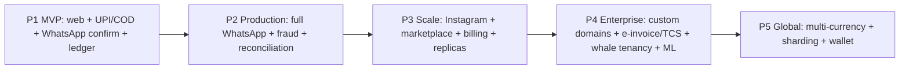

---

# 18. Appendices

## Appendix A — Event catalog (versioned, e.g. `order.created.v1`)

| Domain | Events |
|---|---|
| Cart | `cart.created`, `cart.email_captured`, `cart.abandoned` |
| Checkout | `checkout.started`, `checkout.completed`, `checkout.failed` |
| Inventory | `inventory.reserved`, `inventory.committed`, `inventory.released`, `inventory.low` |
| Payment | `payment.authorized`, `payment.pending`, `payment.captured`, `payment.failed`, `payment.refunded` |
| Order | `order.created`, `order.paid`, `order.confirmed_cod`, `order.fulfilled`, `order.delivered`, `order.cancelled`, `order.rto`, `order.returned` |
| Shipping | `shipment.created`, `shipment.out_for_delivery`, `shipment.delivered`, `shipment.rto` |
| Risk | `order.risk_assessed`, `cod.confirmation_requested`, `cod.confirmed` |
| Money | `settlement.recorded`, `recon.break_detected`, `payout.scheduled`, `payout.paid`, `payout.failed`, `chargeback.opened`, `chargeback.resolved` |
| Discount/Tax | `discount.redeemed`, `tax.invoice_generated` |
| Comms | `notification.sent`, `notification.failed`, `email.delivered`, `email.bounced`, `wa.message_received`, `wa.cod_confirmed`, `wa.order_intent` |
| Channel | `reseller.click`, `reseller.order_attributed`, `reseller.commission_accrued` |
| Billing | `billing.charged`, `billing.failed`, `billing.plan_changed` |
| Customer | `customer.created`, `customer.updated`, `customer.dsr_requested` |
| Platform | `branding.updated`, `auth.login`, `auth.stepup` |

All events flow through the **outbox**; consumers dedupe on `event_id` and are effect-idempotent.

## Appendix B — API surface index (representative)

- **Cart:** `POST /carts`, `POST /carts/:id/lines`, `PUT /carts/:id/buyer-identity`, `GET /carts/:id/checkout-url`
- **Checkout:** `POST /checkout/:cartId/{contact,delivery,payment-intent,confirm}`, `GET /checkout/:id`
- **Payment:** `POST /payments/sessions`, `POST /payments/:id/{capture,void,refund}`, `POST /webhooks/:provider`
- **Order:** `POST /orders` (internal), `GET /orders/:id`, `GET /orders`, `POST /orders/:id/{cancel,edit/*}`
- **Inventory:** `POST /inventory/{reserve,commit,release}`, `GET /inventory/:variant`
- **Discount/Tax/Shipping:** `POST /discounts/validate`, `POST /tax/calculate`, `GET /tax/invoice/:orderId`, `POST /shipping/rates`, `GET /shipping/serviceability/:pincode`
- **WhatsApp:** `POST /wa/webhook`, `POST /wa/send`, `POST /wa/flow/:type`
- **Customer/Identity:** `POST /auth/otp`, `POST /auth/token`, DSR endpoints, `GET/POST /customers`
- **Settlement/Billing:** `POST /settlements/ingest`, `GET /settlements/:store`, `POST /billing/{subscribe,mandate}`
- **Branding:** `GET/PUT /stores/:id/branding`
- **Webhooks (merchant):** subscription CRUD + signed delivery

## Appendix C — Glossary

- **Outbox** — table written in the same tx as a domain change; relayed to the bus → no dual-write loss.
- **Saga** — multi-step cross-context flow with compensations (no 2PC).
- **Reconcile-on-uncertainty** — never assume a payment outcome; fetch authoritative status from the PSP.
- **PA (Payment Aggregator)** — RBI-licensed entity (Razorpay/Cashfree) that custodies + disburses funds; LetBuyy rents these rails (Route/Easy-Split) and never self-custodies.
- **RTO (Return To Origin)** — undelivered (usually COD) shipment returned to seller; India's dominant loss vector.
- **Tenant GUC** — per-transaction `SET LOCAL app.current_store_id` read by RLS policies; fail-closed.
- **Channel** — first-class `{web, whatsapp, instagram, pos, api}` dimension on commerce rows.
- **Ledger-first** — append-only double-entry ledger is the source of truth for all money.
- **DPDP** — India's Digital Personal Data Protection Act 2023 (consent, residency, DSR).
- **Tier 1 / Tier 2** — checkout on `checkout.letbuyy.com` vs merchant's `checkout.merchant.com` (same engine).

---

*End of blueprint. This document is the design source of truth; the audit reality is in `LETBUYY_CHECKOUT_PLATFORM_MASTER_PLAN.md` (Phase 5) and the critique that shaped these choices is in `LETBUYY_CHECKOUT_PLATFORM_CTO_REVIEW.md`. Build the wedge (WhatsApp/UPI/COD/GST), rent the rails (PA/BSP/aggregators), keep it a modular monolith until scale forces extraction.*
