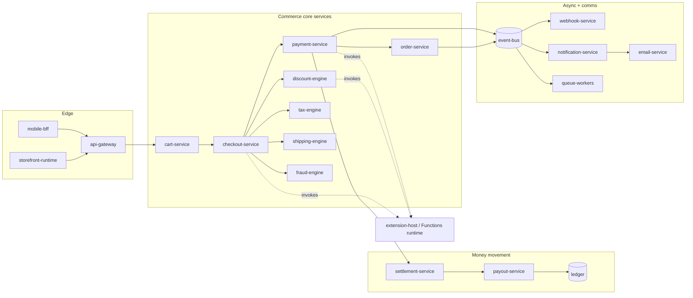
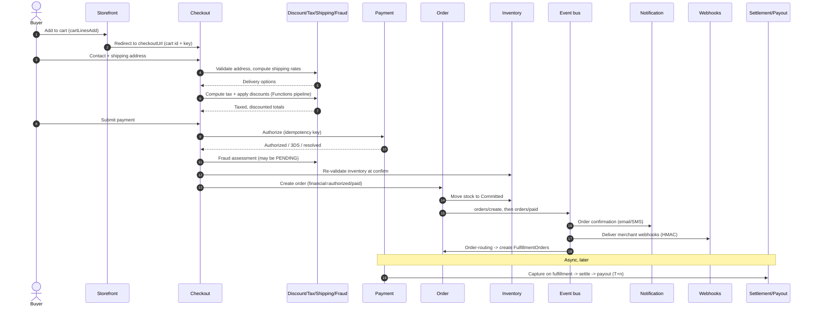
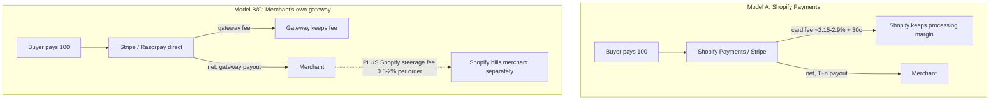
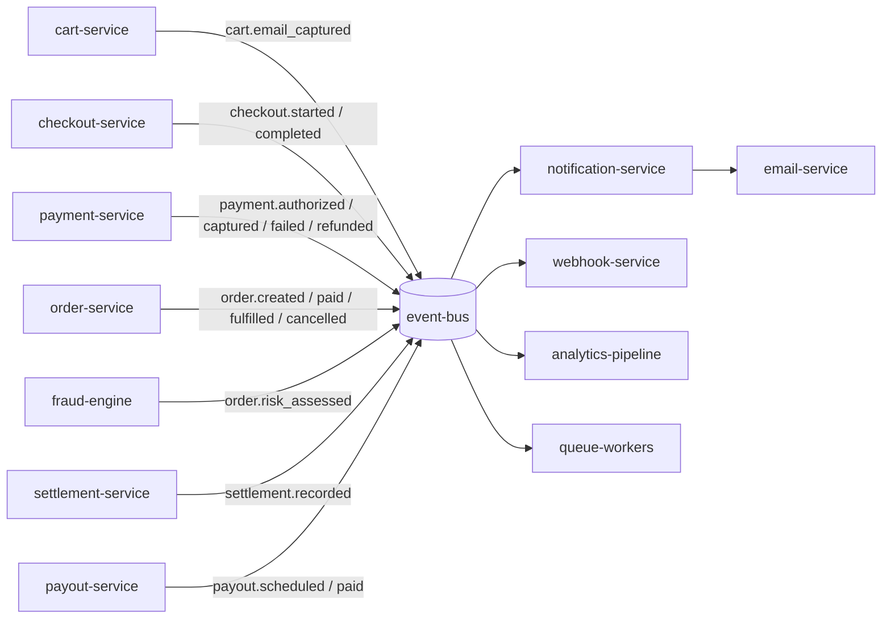
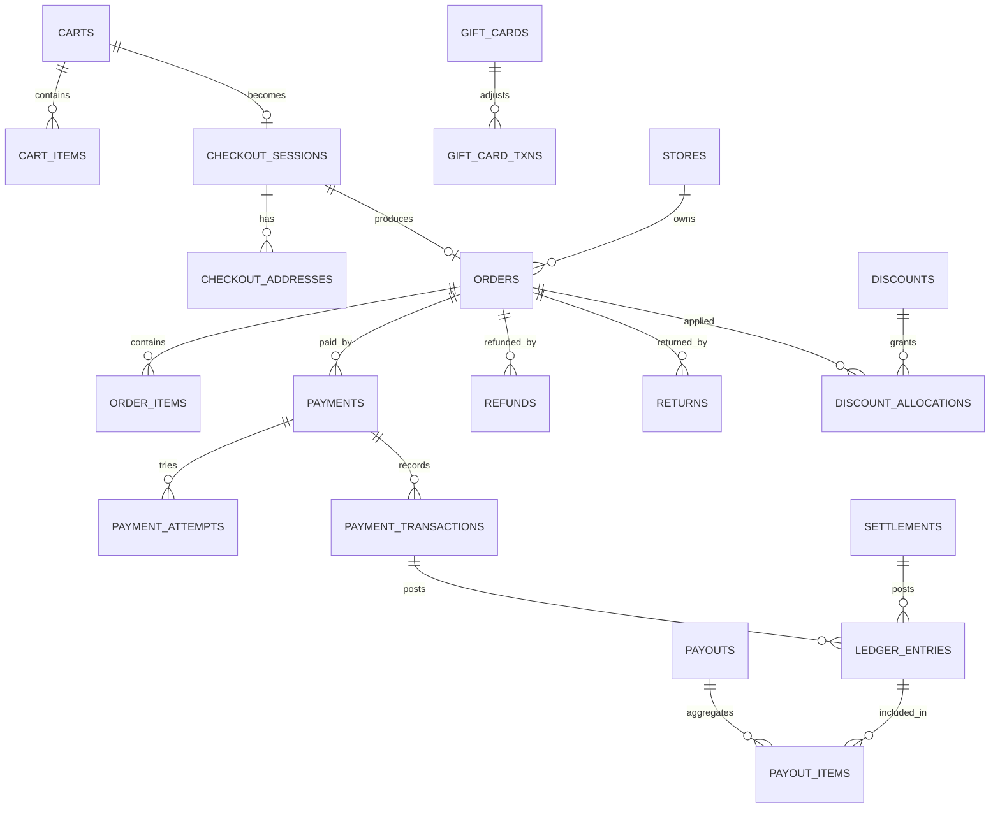
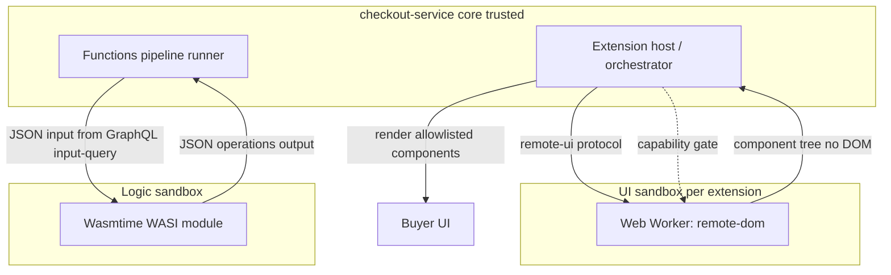
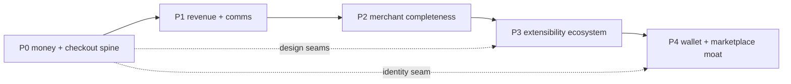

# LetBuyy Checkout Platform — Master Audit & Architecture Plan

> **Document type:** Principal-level architecture reference + repository audit + build plan
> **Authored as:** Commerce Architect / Payment Systems Architect / Platform Infrastructure Auditor
> **Date:** 2026-06-08 · **Status:** Draft v1 for engineering + leadership review
> **Thesis under test:** *Can LetBuyy compete directly with Shopify Checkout?*
> **Posture:** Brutally honest. Where Shopify is years ahead, this says so. Where LetBuyy already has an edge, this says that too.

---

## 0. How to read this document

This is deliberately **Shopify-reference-heavy**. Phases 1–4 reverse-engineer the *actual* Shopify checkout ecosystem as it exists in mid-2026 — not a simplified textbook version — because you cannot design a credible competitor without understanding the real machine, including the parts Shopify charges money for and the parts that are pure engineering moat. Phases 5–10 then apply that reference to LetBuyy's real codebase (audited file-by-file) and lay out the target architecture, database, extensibility model, security model, and a P0–P4 roadmap.

Two honesty conventions are used throughout:

- **[VERIFIED]** — corroborated against Shopify's own docs / engineering blog / changelog (sources in Appendix A).
- **[FLAG]** — current sources disagree, the figure is secondary/community-sourced, or Shopify recently changed it. Treat these as "design against the trend, re-verify before quoting externally."

A recurring theme: **Shopify's checkout is not a page. It is a revenue system wrapped in a sandboxed extensibility runtime wrapped in a sharded-for-Black-Friday infrastructure.** The visible UI is the least defensible part. Plan accordingly.

---

## Table of Contents

- **Executive Summary** — the thesis, the moat, LetBuyy's real position, the five hard problems, headline roadmap & cost
- **Phase 1 — Shopify Checkout Deep Research** (25 systems × Purpose / Flow / Data Model / API / Services / Jobs / Security / Scale)
- **Phase 2 — The Complete Shopify Order Lifecycle** (cart → payout, every stage)
- **Phase 3 — The Shopify Email & Notification System**
- **Phase 4 — The Shopify Payment Revenue Model** (Models A–D: money / commission / settlement / payout / refund / chargeback)
- **Phase 5 — LetBuyy Current-State Audit & Gap Analysis** (real vs stub, file paths, LOC)
- **Phase 6 — LetBuyy Target Architecture** (13 services: responsibilities / APIs / tables / queues / events / deps)
- **Phase 7 — Database Design** (tables, indexes, constraints, tenant isolation, RLS)
- **Phase 8 — Checkout Extensibility** (extension runtime, APIs, sandbox, security)
- **Phase 9 — Multi-Tenant Security** (isolation, RLS, service roles, JWT, session & webhook security)
- **Phase 10 — Implementation Roadmap** (P0–P4: value / effort / deps / risk / timeline)
- **Migration Strategy · Risk Analysis · Cost Analysis**
- **Appendix A — Sources** · **Appendix B — Verification flags** · **Appendix C — Glossary**

---

# Executive Summary

## The verdict in one paragraph

LetBuyy *can* compete with Shopify Checkout — but **not by building a better checkout page**, and not on Shopify's home turf. Shopify's checkout is the visible 10% of a system whose defensible 90% is: (1) **Shop Pay**, a cross-merchant vaulted-wallet network that gets stronger with every store that joins; (2) a **monetization model** that taxes merchants 0.6–2% for *not* using Shopify Payments [VERIFIED]; (3) a **sandboxed extensibility runtime** (checkout UI extensions in a Web Worker + Shopify Functions compiled to WebAssembly) that lets 10,000+ apps mutate checkout without Shopify ever running untrusted code in-process; and (4) **pods/`shop_id`-sharded infrastructure** that processed **$5.1M in sales per minute** at the 2025 Black Friday peak [VERIFIED]. LetBuyy today has a respectable, ~60–70%-real transactional core (orders, payments, refunds, webhooks, discounts, tax, shipping, 356 RLS policies) but is **greenfield on every one of the four moats**, and several "services" in its own canonical runtime map (`checkout-runtime`, `notification-service`, `event-bus`) are manifest-only placeholders while the real logic lives in `api-gateway`. The credible wedge is **India-first, UPI-native, zero-steerage checkout** — precisely the market where Shopify is weakest (no Shopify Payments in India; it resells Razorpay and still charges the third-party fee).

## What Shopify actually monetizes (read this twice)

Shopify's headline card-processing rate (2.15%–2.9% + 30¢ by plan [VERIFIED]) is roughly pass-through. The **profit lever is steerage**: if a merchant uses any gateway other than Shopify Payments, Shopify adds a **third-party transaction fee — 2% (Basic) / 1% (Grow) / 0.6% (Advanced)** on every order, *on top of* what the other processor charges [VERIFIED]. As of stores created on/after 2025-05-12 this fee even applies to the **gift-card/store-credit portion** of an order [VERIFIED]. This is the single most important fact in this document: **Shopify's checkout exists to make Shopify Payments the path of least resistance.** Any "Shopify competitor" that does not have either (a) its own gateway economics or (b) an explicit decision to *not* charge steerage as a wedge, has no business model.

## LetBuyy's real position (from the repo audit, Phase 5)

| Layer | Reality | Evidence |
|---|---|---|
| Order core | **Production-real** — `orders.ts` ~1,348 LOC, full financial/fulfillment state machine | `services/api-gateway/src/routes/orders.ts` |
| Payments | **Production-real** — adapters for Razorpay, Stripe, PayPal, Cashfree, PhonePe, UPI, COD | `services/api-gateway/src/routes/payments.ts` (861), `packages/payments` |
| Refunds | Real engine, but **canonical migration archived** | `docs/archive/migrations-history/049_*refund_engine.sql` (1,506) |
| Discounts / Tax / Shipping | **Production-real** routes | `routes/coupons.ts` (280), `routes/shipping-tax.ts` (463) |
| Webhooks (outbound) | **Real** dispatcher w/ signing & transitions | `services/webhook-service/*` |
| Email | **Transactional plumbing only** (Resend), no templating/queue system | `apps/identity-platform/src/lib/email/resend.ts` (392) |
| Cart | **Client-side only** (React context), no server cart service | `apps/storefront-runtime/src/context/cart-context.tsx` (221) |
| Multi-tenant isolation | **Strong** — 356 Postgres RLS policies | `database/supabase/migrations/*` |
| Fraud / Abandoned checkout / Settlement / Payout | **Greenfield** (fraud nonexistent; settlement only in `legacy/firebase`) | `legacy/firebase/functions/src/settlementService.ts` (580) |
| `checkout-runtime`, `notification-service`, `event-bus` | **Manifest-only placeholders** (governance theater) | per `CLAUDE.md` canonical runtime map |

Net: LetBuyy is **further along than a typical clone** on the boring-but-hard transactional core, and **at zero** on the four things that make Shopify hard to dislodge.

## The five hardest problems (in priority order)

1. **Money movement correctness** — settlement, payout, ledger, refunds, chargebacks. This is double-entry accounting with adversarial counterparties; bugs here are financial-loss and regulatory incidents, not 500s. Today it exists only in `legacy/firebase`. **This is P0.**
2. **A real checkout-session service** — server-authoritative cart→checkout→order with idempotency and inventory reservation under contention. LetBuyy's cart is client-side; checkout logic is smeared across `api-gateway`. **P0.**
3. **The extensibility sandbox** — letting merchants/apps modify checkout *without* running untrusted code in your process. Shopify spent years on Web Worker UI + Wasm Functions. **P2, but architecturally load-bearing — design the seams in P0.**
4. **Fraud + risk** — no order-level risk scoring exists. In India, UPI/COD fraud and RTO (return-to-origin) abuse are the dominant loss vectors, not card fraud. **P1.**
5. **Notifications at scale** — a real templated, tenant-isolated, queued, retried, deliverability-managed email/SMS system. Today: a placeholder. **P1.**

## Headline architecture (target)



## Cost & timeline at a glance

- **To production-credible (India-first, single region):** ~**3 quarters** with a focused team of 6–9 engineers (2 payments/ledger, 2 checkout/cart, 1 fraud, 1 notifications, 1–2 platform/infra, plus fractional security). Full detail in Phase 10.
- **Run-rate infra (single region, moderate scale):** order **$8k–$25k/month** (managed Postgres/Supabase or CockroachDB, Redis, queue, object storage, egress, KMS/HSM, email/SMS sending). The expensive line items are **money-movement compliance** (PCI scope, reconciliation tooling, a real ledger) and **on-call**, not compute. Full model in the Cost Analysis section.
- **The thing that will actually cost you:** not servers — **correctness and trust**. A single mis-settled payout batch or a cross-tenant data leak via a missing RLS policy erases more value than a quarter of infra spend.

---

# Phase 1 — Shopify Checkout Deep Research

Each of the 25 systems below is documented along eight dimensions: **Purpose · Internal Flow · Data Model · API Contracts · Services · Background Jobs · Security Model · Scalability Model.** API version anchor: Shopify's `latest` GraphQL/extension API is **2026-04**, on a quarterly calendar cadence (YYYY-01/04/07/10) with a ~12-month support window [VERIFIED].

The single biggest structural lesson before we start: **Shopify collapsed the old two-object `Cart` + `Checkout` model into one canonical `Cart`.** The developer-facing Checkout/REST Checkout APIs were *shut off on 2025-04-01* [VERIFIED]. Server-side checkout is now a **closed, Shopify-hosted surface** reached via a URL, customizable only through sanctioned extension points — not an object you build against.

---

### 1. Cart Architecture

**Purpose.** Hold what a buyer intends to purchase plus estimated cost throughout a session; carry identity, discount, delivery, and arbitrary attribute context; and produce the single handoff token into hosted checkout.

**Internal flow.** Client calls `cartCreate` → mutates lines/attributes/identity → reads `cart.checkoutUrl` and redirects the buyer to hosted checkout. **There is no `cartToCheckout` call** — cart→checkout is a *URL handoff, not a state transition* [VERIFIED]. Pricing context (country/market, B2B company location, buyer identity) is set on the cart and *prefills* checkout but does not sync back if overwritten in checkout.

**Data model.** `Cart { id, lines(BaseCartLineConnection, ≤250/req), buyerIdentity(CartBuyerIdentity), cost(CartCost), attributes(≤250), discountCodes, discountAllocations, appliedGiftCards, delivery/deliveryGroups, note, totalQuantity, checkoutUrl(URL!), createdAt, updatedAt, metafields }`. `CartCost { subtotalAmount, totalAmount, checkoutChargeAmount(due now), *Estimated booleans }`. **Critically, `totalTaxAmount`/`totalDutyAmount` are deprecated on `CartCost`** — tax/duty are resolved at *checkout*, not on the cart [VERIFIED]. Multi-address carts are first-class (≤20 delivery addresses).

**API contracts.** `cartCreate`, `cartLinesAdd/Update/Remove`, `cartBuyerIdentityUpdate`, `cartAttributesUpdate`, `cartDiscountCodesUpdate`, `cartGiftCardCodesAdd/Update/Remove`, `cartNoteUpdate`, `cartSelectedDeliveryOptionsUpdate`, `cartDeliveryAddressesAdd/Update/Replace/Remove`. Surface = **Storefront API (GraphQL)**.

**Services.** Storefront API layer + cart datastore; the cart's `checkoutUrl` now embeds a security `key` param [VERIFIED]. Read-heavy storefront is served from an extracted, independently-scaled storefront renderer.

**Background jobs.** Cart pricing recalculation on context change; abandoned-cart eligibility evaluation (see §18); periodic purge of stale carts.

**Security model.** Carts are unauthenticated objects keyed by an unguessable ID; buyer identity binds an optional customer access token. The `key` param hardens the checkout handoff against URL guessing.

**Scalability model.** Cart is the high-write pre-purchase object; it lives on the shop's pod (sharded by `shop_id`). Tax/duty deliberately excluded from cart cost keeps the cart write path cheap and defers expensive jurisdiction resolution to checkout.

**LetBuyy lesson.** LetBuyy's cart is **client-side React context only** — there is no server cart entity carrying identity/discount/delivery context or producing a signed handoff. This is the first thing to build (Phase 6 `cart-service`).

---

### 2. Checkout Architecture

**Purpose.** Convert a cart into a paid order: collect contact/shipping/payment, compute authoritative shipping + tax + discounts, run validations, take payment, create the order — all on a Shopify-hosted, extension-customizable surface.

**Internal flow.** Buyer lands on `checkoutUrl` → **one-page checkout** (default; three-page now removed for non-Plus) → information → delivery options (shipping engine + delivery customization functions) → tax computation → discount application → payment → **inventory/discount re-validation at confirm** → order creation. The deterministic Functions pipeline runs *inside* this flow (see §24).

**Data model.** The legacy server-side `Checkout` object (and its checkout token) is **no longer developer-accessible** [VERIFIED]; the modern equivalent is the cart ID + `key`. Checkout reads from the cart and writes an `Order` on completion.

**API contracts.** None public for building checkout — *this is the point*. Customization is exclusively via **Checkout UI Extensions** (§23), **Shopify Functions** (§24), and the **Branding API** (`checkoutBrandingUpsert`, Plus-only). REST Checkout + Storefront `checkoutCreate` shut off 2025-04-01 [VERIFIED].

**Services.** Checkout remains coupled inside Shopify's Rails monolith (it is intertwined with orders/payments/shipping/balances) even though the *storefront* was extracted out for independent scaling [VERIFIED].

**Background jobs.** Order-routing/fulfillment-order creation post-completion; abandoned-checkout detection; analytics event emission via Web Pixels.

**Security model.** PCI card fields are **iframes on a separate domain → CardSink tokenizes → monolith only ever sees a token** [VERIFIED]. Extensions run sandboxed (Web Worker / Wasm); no untrusted code touches the checkout process. Flash-sale entry is gated by a fair queue + "Checkpoint" bot challenge.

**Scalability model.** Checkout is the write-critical path; pods isolate blast radius; idempotency + the **Resumption** library give exactly-once payment semantics [VERIFIED]; per-pod load tests ("Genghis") run weekly against benchmark stores.

**LetBuyy lesson.** Treat checkout as a **server-authoritative state machine** with a closed public surface and an extension seam — *not* a set of `api-gateway` routes the storefront orchestrates.

---

### 3. Order Creation Architecture

**Purpose.** Materialize an immutable commercial record (line items, prices, taxes, discounts, payments, fulfillment intent) that downstream fulfillment, accounting, notifications, and analytics all key off.

**Internal flow.** On payment authorization/sale → order created → inventory moves to **Committed** → order-routing worker creates **FulfillmentOrders** (one per assigned location) → events fan out (`orders/create`, then `orders/paid` when financial status hits paid).

**Data model.** `Order` is the central post-purchase hub. `OrderDisplayFinancialStatus ∈ {PENDING, AUTHORIZED, PARTIALLY_PAID, PAID, PARTIALLY_REFUNDED, REFUNDED, VOIDED, EXPIRED}` [VERIFIED]. `OrderDisplayFulfillmentStatus ∈ {UNFULFILLED, PARTIALLY_FULFILLED, IN_PROGRESS, ON_HOLD, SCHEDULED, FULFILLED, REQUEST_DECLINED, RESTOCKED, …}`. Display id `Order.name` = `#1001` by default, **start number not changeable**, prefix/suffix configurable; legacy int = `order_number`. **Only last 60 days of orders readable by default** — older needs `read_all_orders` scope [VERIFIED].

**API contracts.** GraphQL `Order` object; order editing is a **staged "calculated order"** workflow: `orderEditBegin` → `CalculatedOrder` preview → `orderEditAddVariant`/`orderEditSetQuantity`/`orderEditAddCustomItem` → `orderEditCommit` (only *unfulfilled* lines editable; commit may collect/refund a balance) [VERIFIED].

**Services.** Order service inside monolith; order-routing worker; inventory service for Committed-state moves.

**Background jobs.** Order routing → fulfillment-order creation; risk assessment (§8); notification dispatch; webhook delivery; analytics ingest.

**Security model.** Scope-gated reads (60-day window, `read_all_orders`); per-shop isolation via pods + `shop_id`.

**Scalability model.** Order is the durable system-of-record; writes are pod-local; cross-shop reporting goes to an offline warehouse (Presto), never live cross-shard.

**LetBuyy lesson.** LetBuyy's `orders.ts` (~1,348 LOC) already implements a real financial/fulfillment state machine with `VALID_TRANSITIONS` — this is genuinely strong. The gap is the **location-first FulfillmentOrder model** (next).

---

### 4. Payment Architecture

**Purpose.** Move money correctly and exactly once: authorize, capture, void, refund — across many providers — with idempotency and auditable transactions.

**Internal flow.** Classic two-part: `authorization` then `capture` (or single `sale`). **Auth holds 7 days** (card-network limit); capturing after the window costs **+1.75%** [VERIFIED]. Automatic capture is default for new stores; manual capture (auth at checkout, capture at fulfillment) is opt-in.

**Data model.** Transactions carry `kind ∈ {authorization, capture, sale, void, refund}`, amount, gateway, parent transaction, idempotency key. Order financial status is derived from the transaction ledger.

**API contracts.** For *building a provider*, the **Payments Apps API** session model (§6). For merchants, transactions surface on the `Order`.

**Services.** **CardSink** (tokenize, separate domain) → token to monolith → background job hands token to **CardServer** which decrypts and calls the processor via an adapter [VERIFIED]. The monolith never sees PAN.

**Background jobs.** Capture-on-fulfillment; auth-expiry sweeps; refund processing; **idempotency via the Resumption library** (per-step persisted progress, replay "recover" steps on retry → exactly-once) [VERIFIED].

**Security model.** PCI scope minimization by iframe+token architecture; **Semian** circuit breakers per processor/country; Toxiproxy fault injection in tests.

**Scalability model.** Payment path is the most failure-sensitive; circuit breakers can be keyed per country so one processor's outage degrades only that corridor.

**LetBuyy lesson.** LetBuyy has multi-provider adapters already, but **idempotency + a transaction ledger + PCI-scope minimization** are the parts to get formally right. Borrow the CardSink/CardServer split conceptually even if you tokenize via the gateway's SDK.

---

### 5. Shopify Payments Architecture

**Purpose.** A first-party, white-label gateway (built on **Stripe Connect**, launched 2013) that makes Shopify the processor for the majority of GMV and anchors Shop Pay + the steerage model.

**Internal flow.** Authorize/capture/void via Stripe rails → funds clear → **payouts** on a daily/weekly/monthly schedule (business days only; US settlement ~2–5 business days after capture; first payout ~5 days for underwriting) [VERIFIED]. **Reserves** (fixed or percentage; **rolling 30–90 days**) for risk [VERIFIED].

**Data model.** Balance, payout, transaction, dispute, reserve entities; FX: **currency-conversion fee 1.5% US / 2.0% elsewhere**, and **as of 2026-04-06 calculated on gross order amount** [VERIFIED]. USDC-on-Base (with Stripe/Coinbase) added 2025 [VERIFIED].

**API contracts.** Balance/Payout/Dispute objects in the Admin API; Shopify is **payment processor, not merchant of record** in the standard config (merchant bears tax/fraud/chargeback liability) — *except* Managed Markets, where **Global-e is MoR** for cross-border [VERIFIED].

**Services.** Stripe Connect backend; Shopify Balance (Stripe Treasury/Issuing); payout scheduler; reserve engine; dispute pipeline.

**Background jobs.** Payout batch generation; reserve roll/release; FX conversion; settlement reconciliation.

**Security model.** Underwriting/KYC; risk-based reserves; PCI handled by the iframe/token spine.

**Scalability model.** Inherits Stripe's scale for processing; payout batching is the heavy periodic job.

**LetBuyy lesson.** This is the moat LetBuyy lacks. In India you will *resell* Razorpay/Cashfree/PhonePe — so your equivalent of "Shopify Payments economics" is **owning the settlement/payout/reserve layer on top of those rails**, plus deciding your steerage stance (the wedge: **don't** tax merchants for choosing their own gateway).

---

### 6. Merchant-owned / Third-party Gateway Architecture

**Purpose.** Let merchants use external processors — while preserving a uniform checkout and (for Shopify) the steerage fee.

**Internal flow (Payments Apps API).** Async HTTP + GraphQL finalization. Shopify POSTs a payment request → app processes → app calls **`paymentSessionResolve` / `paymentSessionReject` / `paymentSessionPending`** (state final once resolved/rejected) [VERIFIED]. **Offsite:** return 200 + redirect URL → buyer redirected → resolve/reject (expected within ~3 min of confirmation). **Direct card:** Shopify sends *encrypted card data* → app finalizes. **3DS:** `paymentSessionRedirect` (issuer URL in iFrame) → `paymentSessionConfirm` → resolve/reject. Refund/capture/void each have their own session mutations.

**Data model.** Payment session (id, amount, kind, status, idempotency), redirect/confirm artifacts, reason codes (`AUTHENTICATION_FAILED`, `CONFIRMATION_REJECTED`, EMVCo `transStatus`).

**API contracts.** Five extension types: **credit card** (incl. 3DS / "with UI extensibility"), **custom credit card** (hosted fields), **alternative**, **offsite**, **redeemables** (third-party gift cards). Partner-built, Shopify-approved, revenue-share; custom payment extensions restricted to eligible Plus [VERIFIED].

**Services.** Partner-hosted payment app + Shopify's payments orchestration; merchant installs via link or admin gateway list; app self-reports "ready" before activation.

**Background jobs.** Session timeout handling; idempotent retries on refund/capture/void; reconciliation.

**Security model.** HMAC on callbacks; encrypted card data for direct flow; mandatory idempotency + retry.

**Scalability model.** Stateless session handlers; the model cleanly separates offsite/direct/3DS/inventory-confirm flows — **a strong reference design to copy**.

**LetBuyy lesson.** LetBuyy's `packages/payments` + `routes/payments.ts` should be refactored toward this **session-state machine with explicit resolve/reject/pending + confirm + redirect** semantics and per-session idempotency. It is the single best public artifact to clone.

---

### 7. Shop Pay Architecture

**Purpose.** One-tap accelerated checkout backed by a **cross-merchant vault** of email/shipping/billing/payment — the conversion + network moat. Requires Shopify Payments; not itself a processor.

**Internal flow.** Buyer verifies via **6-digit SMS OTP** → vaulted credentials prefill (and can skip steps) → confirm. Credentials saved on *any* Shopify store work across *all* Shopify stores [VERIFIED] — the defensible network effect. "Sign in with Shop" adds passkeys/passwordless.

**Data model.** Vaulted payment instrument + addresses keyed to a Shop identity; card vaulting exclusive to Shopify Payments merchants.

**API contracts.** Headless: `ShopPayButton` in Hydrogen/`@shopify/hydrogen-react`; non-React CDN web component (`shop-js` loader) using Checkout Links + one-tap confirm [VERIFIED].

**Services.** Shop identity/vault service; the **Shop app** consumer channel (150M+ shoppers) with Shop Pay default; **Shop Pay Installments powered by Affirm (US)** — 4× interest-free bi-weekly or monthly up to 24 mo; merchant paid upfront less fees; Affirm bears credit risk [VERIFIED].

**Background jobs.** Vault sync; installment settlement; fraud signals feeding Shopify Protect.

**Security model.** OTP + passkey auth; **Shopify Protect** chargeback cover on eligible Shop Pay + Shopify Payments orders (US) (§8).

**Scalability model.** Vault is a cross-shard, identity-keyed service distinct from the per-shop pods (cf. the Shop app's Vitess `user_id` sharding).

**LetBuyy lesson.** The equivalent moat in India is a **UPI-first, cross-merchant saved-identity wallet** (one OTP, saved addresses + UPI handle/RuPay token across all LetBuyy stores). This is LetBuyy's highest-leverage *differentiator*, but it only matters after scale — design the identity seam early, build the network later.

---

### 8. Fraud Detection Architecture

**Purpose.** Flag chargeback-risk before fulfillment; optionally block at checkout; optionally indemnify.

**Internal flow.** Each Shopify Payments order scored **low/medium/high** from AVS, CVV, IP geo/proxy, order velocity, multi-card attempts (green/red/grey indicators) [VERIFIED]. The first-party **Fraud Control** app adds **pre-order block rules at checkout**. Third parties (Signifyd/Riskified/NoFraud) write back via the Risk Assessments API.

**Data model.** **Legacy `OrderRisk` / `Order.risks` / `Order.riskLevel` deprecated (2024-04)** → **`OrderRiskAssessment`** (`riskLevel`, `provider`, `facts(RiskFact)`), aggregated on `OrderRiskSummary.assessments`; `RiskAssessmentResult` enum adds `PENDING`/`NONE` [VERIFIED]. Webhook `ORDERS_RISK_ASSESSMENT_CHANGED`.

**API contracts.** `orderRiskAssessmentCreate` (apps contribute scores), `read_orders` scope; GraphQL-only (REST risk gone with the 2025-04-01 mandate).

**Services.** Native scoring engine; Fraud Control rules engine; provider integrations; **Shopify Protect** (covers total order cost + $15 chargeback fee, runs the dispute) for **fraud/"unrecognized" reason codes only** — *item-not-received is NOT covered*; eligibility: US store + US Shopify Payments, physical-only items, fulfill ≤7 days, valid tracking [VERIFIED].

**Background jobs.** Async re-scoring (assessments can be `PENDING` then resolve); dispute automation.

**Security model.** Provider attribution on every assessment; merchant-set block rules.

**Scalability model.** Async assessment pipeline decoupled from order creation via the `*_CHANGED` webhook.

**LetBuyy lesson.** LetBuyy has **no order-level fraud** today. Copy the **pluggable `OrderRiskAssessment` model** (multiple providers, `PENDING`/`NONE` states, change webhook) — but tune indicators for **India reality: UPI fraud, COD/RTO abuse, address/pincode risk, velocity** — not US card-AVS, which barely applies to UPI.

---

### 9. Checkout Extensibility Architecture (the umbrella)

**Purpose.** Replace the old Plus-only `checkout.liquid` theme hacking with an **upgrade-safe, app-based** customization model so Shopify can keep rewriting checkout internals without breaking merchants.

**Internal flow / deprecation timeline (memorize this).** Announced 2023-02-13. **Information/Shipping/Payment pages stopped honoring `checkout.liquid` on 2024-08-13.** **Thank-you & Order-status pages (plus "additional scripts" and script-tag apps) sunset 2025-08-28** — additional scripts became view-only and PII was stripped from legacy post-purchase surfaces. **Automatic upgrades of remaining stores began Jan 2026** (30-day notice) [VERIFIED]. **[FLAG] Separate track:** the Ruby **Shopify Scripts** (Script Editor app) → editing disabled **2026-04-15**, full sunset **2026-06-30**, replaced by Functions. Sources routinely conflate "additional scripts" (Aug 2025) with "Shopify Scripts" (Jun 2026) — they are different.

**Data model.** A **Checkout Profile** (`gid://shopify/CheckoutProfile/...`) holds branding + which extensions render; the published profile applies store-wide across checkout, the checkout queue, UI extensions, and customer-account pages.

**API contracts.** Three pillars: **UI Extensions** (§23), **Functions** (§24), **Branding API** `checkoutBrandingUpsert` (Plus). Plan gating: in-checkout (Info/Shipping/Payment) extensions are **Plus-only**; Thank-you/Order-status extensions are **all plans except Starter** [VERIFIED].

**Services.** Extension hosting/CDN; the checkout-and-accounts editor; branding renderer.

**Background jobs.** Auto-upgrade migrations; best-effort analytics-script→custom-pixel migration.

**Security model.** The defining principle: **untrusted UI in a Web Worker (no DOM), untrusted logic in sandboxed Wasm (no network, deterministic), capability opt-ins** for network/Storefront-API/consent/block-progress, hard size & instruction limits enforced at deploy/run.

**Scalability model.** Extensions are versioned (quarterly), bundle-size-capped (64 KB UI), and resource-budgeted so they cannot degrade checkout under load.

**LetBuyy lesson.** LetBuyy has `packages/extension-host` and a `developer-portal`/`app-marketplace` — the bones exist. The lesson is to commit to the **"never run untrusted code in-process"** doctrine *now*, before checkout logic ossifies, because retrofitting a sandbox is brutal.

---

### 10. Discount Engine Architecture

**Purpose.** Apply promotions correctly across product/order/shipping with deterministic combination rules and merchant/app extensibility.

**Internal flow.** Discounts belong to one of three **classes — product, order, shipping**; application order is **product → order → shipping**. Each discount's `combines_with { product_discounts, order_discounts, shipping_discounts }` booleans control stacking [VERIFIED]. Stacking cap: **≤5 product/order codes + 1 shipping code**; only one shipping discount per order.

**Data model.** Four native types: amount-off-products, amount-off-order, **BXGY**, free-shipping — each as **code** or **automatic**. `DiscountNode` wraps automatic/code discounts; `discount_applications`/`discount_allocations` record what hit which line.

**API contracts.** Discount Admin APIs + the **unified Discount Function API** (`cart.lines.discounts.generate.run`): **one function can now emit product+order+shipping savings in a single discount** (the consolidation that replaced separate per-type discount functions) [VERIFIED]. **Max 25 active discount functions** per store, run concurrently, combined per the `combines_with` rules. Usage limits: total cap, per-order qty caps, one-per-customer.

**Services.** Discount evaluation inside the Functions pipeline at checkout.

**Background jobs.** Usage-count accounting; code generation/import.

**Security model.** Functions are deterministic Wasm; abuse controls via usage limits.

**Scalability model.** Discounts compile to Wasm and run in the per-checkout instruction budget; combination resolution is rule-based, not a solver.

**LetBuyy lesson.** LetBuyy's `coupons.ts` is real but flat. Adopt the **three-class model + `combines_with` matrix** explicitly — it's the only sane way to keep stacking deterministic, and it's the contract merchants/apps expect.

---

### 11. Gift Card Architecture

**Purpose.** A stored-value **tender** (not just a product) redeemable across multiple orders until exhausted, at web checkout and POS.

**Internal flow.** Two origins: **sold as a product** (customer prepays) or **issued from admin/API** (comps, refunds, loyalty). Redeemed as a payment method; balance decrements per order.

**Data model.** GraphQL `GiftCard` (initial value, customer, optional expiry/note, template suffix); after creation **only expiry, note, template suffix are mutable**; balance can't go below $0. Ledger of adjustments.

**API contracts.** `giftCardCreate` + update/debit/disable; legacy REST `gift-card` + `gift-card-adjustment`. Third-party gift cards integrate via the **Redeemables** payment extension.

**Services.** Gift-card service + the payments layer (as a tender).

**Background jobs.** Balance reconciliation; expiry handling.

**Security model.** Codes are high-entropy; redemption is server-validated; **legal expiry constraints** (US Credit CARD Act: valid ≥5 years; several states ban expiry) [VERIFIED].

**Scalability model.** Simple ledger; low write volume relative to orders.

**LetBuyy lesson.** LetBuyy has gift-card schema + a ledger migration (`048_*`, 1,278 LOC) but it's **archived** and the runtime is a stub. Treat gift cards as **two things**: a product *and* a tender that hits the payment ledger — and remember India fee/GST nuances differ from the US CARD Act.

---

### 12. Tax Engine Architecture

**Purpose.** Compute jurisdiction-accurate tax at checkout, track nexus/liability, and (optionally) file/remit.

**Internal flow.** Registration-driven collection per state/country; **rooftop-accurate across 11,000+ US jurisdictions**; product-category-based rates; **economic + physical nexus** with liability insights when thresholds approach [VERIFIED]. Inclusive vs exclusive pricing; **dynamic tax-inclusive** shows VAT-inclusive to UK/EU and exclusive to US based on buyer region + registrations.

**Data model.** Registrations, overrides, exemptions (per product/customer); tax lines on order; `Tax = (Rate×Price)/(1+Rate)` back-calc for inclusive.

**API contracts.** Tax surfaces on order/checkout; **Shopify Tax** pricing: free under **$100k US annual sales**, then **0.25%/order where tax is collected (0.15% CA), cap $0.99/order & $5,000/yr** — **[FLAG] basis changed 2025/2026** (stores created on/after 2026-05-13 measure the free tier on *lifetime* sales) [VERIFIED].

**Services.** Shopify's own tax engine (since 2022) + **Sovos** for **automated filing & remittance (launched 2025-06-10)**; the legacy **Shopify-managed Avalara integration sunset ~2025-04-30**, with a standalone AvaTax connector app remaining [VERIFIED][FLAG].

**Background jobs.** Nexus threshold monitoring; filing prep; remittance debits (8th→due date).

**Security model.** Calc is authoritative server-side at checkout; merchant supplies registrations.

**Scalability model.** Jurisdiction resolution is the expensive part — deliberately deferred from cart to checkout.

**LetBuyy lesson.** India = **GST**: CGST/SGST/IGST split by intra/inter-state, HSN-code rates, GSTIN, e-invoicing, place-of-supply. LetBuyy's `shipping-tax.ts` exists but India GST is a *much* harder calc than US sales tax — budget for an HSN-rate table + place-of-supply engine + GST invoice generation (the archived audit shows GST invoice logic exists; productionize it).

---

### 13. Shipping Rate Architecture

**Purpose.** Present accurate delivery options + prices at checkout, from flat/free rates to live carrier quotes, customizable per product/zone.

**Internal flow.** **Shipping zones** group regions sharing rates; **shipping profiles** attach product-specific rate sets to origin locations/zones. Rate types: flat, free, **carrier-calculated**. **Delivery customization Functions** hide/rename/reorder options (cheapest must stay first-selected; carrier name auto-prepended on rename) [VERIFIED].

**Data model.** Zone, profile, rate, delivery group/option; `DeliveryOptionRenameOperation`.

**API contracts.** **Carrier Service API** registers an external endpoint Shopify calls at checkout with weight/dims/destination → live options. **[FLAG] Plan gating:** free on **Advanced/Plus**, on **Grow annual**, +$20/mo on Grow monthly, **not on Basic/Starter** [VERIFIED].

**Services.** Rate resolution at checkout; carrier-service callbacks; delivery customization in the Functions pipeline.

**Background jobs.** Rate caching; carrier endpoint health.

**Security model.** Carrier endpoints are merchant/app-registered; results validated.

**Scalability model.** Live carrier calls are latency-critical at checkout → cached + timeout-bounded.

**LetBuyy lesson.** India shipping = **Delhivery/Shiprocket/Bluedart/India Post aggregators, pincode serviceability, COD availability per pincode, RTO risk, weight/volumetric**. A Carrier-Service-style pluggable rate endpoint is exactly right — but serviceability + COD-eligibility per pincode is a first-class input, not an afterthought.

---

### 14. Shipping Label Architecture

**Purpose.** Buy discounted labels post-order and push tracking back — the fulfillment-side complement to rate shopping.

**Internal flow.** After an order, merchant buys a label at pre-negotiated rates (**up to 88% off USPS retail, 55% UPS/FedEx, 67% DHL Express** [VERIFIED]); tracking attaches to the fulfillment; carrier scans update status.

**Data model.** Label purchase, tracking number/company/URL on `Fulfillment`; tracking events.

**API contracts.** `fulfillmentTrackingInfoUpdate`; fulfillment creation on the FulfillmentOrder.

**Services.** Shopify Shipping (label marketplace); **note: Shopify *sold* its first-party logistics (Deliverr/SFN) to Flexport, completed 2023-06-06** — it is now a partner network, not a first-party fulfiller [VERIFIED].

**Background jobs.** Tracking sync; delivery-status notifications (out-for-delivery/delivered).

**Security model.** Carrier account abstraction; merchant billed via Shopify.

**Scalability model.** Label buying is post-purchase (off the hot path); tracking sync is steady-state polling/push.

**LetBuyy lesson.** In India, "label purchase + manifest + pickup scheduling + AWB" via aggregators is the equivalent. Tracking-event ingestion → the **delivered/out-for-delivery notifications** is a concrete near-term win that LetBuyy's notification stub blocks today.

---

### 15. Checkout Session Architecture

**Purpose.** The server-authoritative session that ties a cart to an in-progress purchase and survives navigation/retries.

**Internal flow.** Modern model: the **cart ID + `key`** *is* the session handle embedded in `checkoutUrl`; the legacy checkout token is gone [VERIFIED]. Distinct **auth** tokens exist for extensions: embedded-app **session token TTL = 1 min**; **Checkout UI extension session token TTL = 5 min** [VERIFIED] — don't conflate these with cart/checkout lifetime.

**Data model.** Cart (mutable) + derived checkout state; extension session tokens (JWT) for auth.

**API contracts.** No public "create checkout"; native mobile uses the **Checkout Sheet Kit** (GA 2024-01-31; being renamed "Checkout Kit") rendering web checkout via `checkoutUrl` [VERIFIED].

**Services.** Hosted checkout in monolith; token service for extensions.

**Background jobs.** Session expiry/cleanup; abandoned detection.

**Security model.** Unguessable cart ID + `key`; short-lived signed tokens for extensions; PII gated by protected-customer-data review.

**Scalability model.** Session state is pod-local; mobile reuses the same web surface (one checkout to scale, not N).

**LetBuyy lesson.** Make the **cart ID + signed key the session handle**, short-lived JWTs for any extension/auth context, and *one* checkout surface reused by web + mobile-bff rather than parallel implementations.

---

### 16. Customer Session / Accounts Architecture

**Purpose.** Identify returning buyers, enable saved info + order history + returns, and power passwordless/federated login.

**Internal flow.** **New customer accounts are passwordless** — email + **6-digit one-time code**; add store credit + self-serve returns. **"Sign in with Shop"** (requires Shop Pay) brings passkeys + prefilled checkout. **Classic accounts deprecated as of Feb 2026** (no new stores; sunset TBA) [VERIFIED].

**Data model.** Customer, addresses, store credit, B2B **Company → CompanyLocation(s) → contacts** (per-location catalog/pricing/tax).

**API contracts.** **Customer Account API** = OAuth 2.0 **with PKCE (S256)**, passwordless SSO across Liquid/Hydrogen/custom/checkout; mobile callback scheme `shop.{shop_id}.*`; **Customer Account UI extensions** for customization [VERIFIED].

**Services.** Identity/auth service; store-credit ledger; B2B catalog.

**Background jobs.** OTP issuance/expiry; session refresh.

**Security model.** OAuth2+PKCE, passwordless, scoped to accounts/orders/payments/fulfillment/discounts/refunds/metafields.

**Scalability model.** Identity is cross-shard (a customer spans contexts), distinct from per-shop order data.

**LetBuyy lesson.** LetBuyy already has an `identity-platform` app. Adopt **passwordless (OTP) + OAuth2/PKCE** as the customer-account contract; model **B2B as Company→Location→contact** from day one if B2B is on the roadmap (retrofitting it is expensive).

---

### 17. Draft Order Architecture

**Purpose.** Merchant-created orders for phone/in-person/wholesale/pre-order, with an emailed secure checkout link (invoice).

**Internal flow.** Create draft → optionally `draftOrderInvoiceSend` (emails `invoiceUrl`) → buyer pays via link **or** merchant marks paid → `draftOrderComplete` converts to a real `Order` [VERIFIED].

**Data model.** `DraftOrderStatus ∈ {OPEN, INVOICE_SENT, COMPLETED}`; fields `invoiceUrl`, `ready`, `completedAt`. **`reserveInventoryUntil`** holds stock (→ *Unavailable*) until expiry — the **only first-party in-cart reservation primitive** [VERIFIED]. B2B `purchasingEntity` (company+location+contact) supported.

**API contracts.** `draftOrderCreate/Update/InvoiceSend/Complete`.

**Services.** Draft-order service; invoice email; checkout link.

**Background jobs.** Reservation expiry release; invoice reminders.

**Security model.** Secure (signed) invoice URLs; draft scoped to shop/staff.

**Scalability model.** Low volume; reservation is the only interesting concurrency concern.

**LetBuyy lesson.** LetBuyy has draft schema only. Draft orders are the **cheap path to two valuable things**: B2B/quote flows *and* the only sanctioned **inventory-reservation** mechanism — useful even before a full in-cart hold exists.

---

### 18. Abandoned Checkout Architecture

**Purpose.** Detect incomplete checkouts and drive recovery revenue.

**Internal flow.** A checkout is **abandoned if incomplete >10 minutes after the buyer provided email** [VERIFIED]. Recovery email (or marketing automation) sends a recovery URL. Suppressed when: sale already completed, payment error, unsupported shipping address, phone-only contact, no purchasable inventory, all-free cart.

**Data model.** `AbandonedCheckout { abandonedCheckoutUrl, customer, lineItems(price-at-abandonment), completedAt(null until recovered), money sets, addresses, note }`; query filters `email_state ∈ {sent,not_sent,scheduled,suppressed}`, `recovery_state`, `status`. Separate **`Abandonment`** object (typed CHECKOUT/CART/browse) for marketing apps; report delivery via `abandonmentUpdateActivitiesDeliveryStatuses`. **[FLAG]** the "recovery URL expires in 30 days" figure is third-party, not in Shopify docs; the documented rule is the admin-purge policy (purged following Monday if >3 months old, untouched 1 month, no transaction).

**API contracts.** `abandonedCheckouts` query (needs `read_orders` + `manage_abandoned_checkouts`); `abandonmentByAbandonedCheckoutId`.

**Services.** Abandonment detector; recovery email; marketing automation.

**Background jobs.** 10-min eligibility timer; recovery send scheduling; retention purge.

**Security model.** Recovery URL is a signed deep link to a pre-filled checkout.

**Scalability model.** Timer-driven batch eligibility; decoupled from the hot checkout path.

**LetBuyy lesson.** **Greenfield at LetBuyy.** This is *pure revenue* and conceptually simple: persist the cart+email at the point email is captured, run a 10-min timer, emit a recovery event the (future) notification-service consumes. Build it right after `cart-service` + `notification-service`.

---

### 19. Order Confirmation Architecture

**Purpose.** The immediate post-purchase surface (Thank-you + Order-status page) and the confirmation event that triggers downstream comms.

**Internal flow.** On completion → Thank-you page (now an **extension-customizable** surface, not `checkout.liquid`) → Order-status page (live tracking) → `checkout_completed` pixel event → `orders/create` then `orders/paid` webhooks → confirmation email.

**Data model.** Order + the Thank-you/Order-status extension targets (`purchase.thank-you.*`); these targets are **read-only for metafields**.

**API contracts.** Thank-you/Order-status UI extensions (all plans except Starter); Web Pixels `checkout_completed`.

**Services.** Hosted post-purchase surface; pixel runtime; notification trigger.

**Background jobs.** Confirmation email; webhook fan-out; analytics ingest.

**Security model.** PII returns to `checkout_completed` only on upgraded (extensibility) checkouts; legacy surfaces had PII stripped (2025-08-28).

**Scalability model.** Post-purchase is off the payment hot path; events fan out asynchronously.

**LetBuyy lesson.** Separate the **confirmation *surface*** (thank-you page) from the **confirmation *event*** (what notifications/webhooks subscribe to). LetBuyy can ship the event + email long before a fancy customizable thank-you page.

---

### 20. Email / Notification Architecture (summary; full detail in Phase 3)

**Purpose.** First-party, Shopify-hosted, event-triggered transactional notifications (email + SMS) across the order lifecycle.

**Internal flow.** Domain event → template selection → **Liquid render** → send via Shopify's infra → delivery tracking. Merchant runs no SMTP/ESP for these.

**Data model.** A large template variable schema: order, draft order, line items, line-item groups (bundles), refunds, fulfillments, prepared packages, discounts (`discount_applications`/`allocations`), payment schedules/terms, subscription cycles, store credit. Branding = `shop.email_logo_url`/`email_logo_width`/`email_accent_color` (one screen).

**API contracts.** No public "send arbitrary transactional email" API for these templates; custom notifications are done via **webhooks → your own service**. Marketing email (Shopify Email / "Messaging") is a *separate* metered product.

**Services.** Notification engine + template store + sender infra.

**Background jobs.** Send queue, retries, deliverability management (SPF/DKIM/DMARC; From-address rewrite to `store+<id>@shopifyemail.com` if unauthenticated).

**Security model.** Per-shop branding/sender; tenant-isolated templates; authenticated sending domains.

**Scalability model.** Transactional sends are free + always-on; marketing is metered (10k/mo free, then $1/1k).

**LetBuyy lesson.** **This is a stub at LetBuyy** (only Resend plumbing in `identity-platform`). Phase 3 + Phase 6 specify the real `notification-service` + `email-service`.

---

### 21. Analytics Architecture

**Purpose.** Capture customer events (incl. inside checkout, where script injection is otherwise impossible) and power reporting.

**Internal flow.** **Web Pixels** run in a Shopify-owned sandbox (Strict=app pixel/Web Worker; Lax=custom pixel/iframe) and `analytics.subscribe(event, cb)` to standard customer events; consent honored via the Customer Privacy API (events **replayed** after opt-in).

**Data model.** Standard events: `page_viewed, product_viewed, collection_viewed, search_submitted, cart_viewed, product_added_to_cart, product_removed_from_cart, checkout_started, checkout_contact_info_submitted, checkout_address_info_submitted, checkout_shipping_info_submitted, payment_info_submitted, checkout_completed, alert_displayed, ui_extension_errored` [VERIFIED]. Bulk subs: `all_events/all_standard_events/all_custom_events/all_dom_events`.

**API contracts.** Web Pixels API (`analytics`, `browser`, `init`); **ShopifyQL** (in-admin query language) — **[FLAG] the `shopifyqlQuery` GraphQL API was deprecated in 2024-07**; the language lives on in-admin only.

**Services.** Customer-events pub/sub bus + sandboxed pixel runtimes; admin analytics (Live View, reports; custom reports gated Advanced+); offline warehouse (Presto) for cross-shop.

**Background jobs.** Event ingestion, aggregation, warehouse ETL.

**Security model.** Sandboxed pixels, consent gating, no DOM scraping.

**Scalability model.** Event bus + offline aggregation; **cross-tenant analytics is offline by architecture** (pods are isolated).

**LetBuyy lesson.** Model analytics as a **customer-events bus + sandboxed pixel runtime**, not ad-hoc script tags. LetBuyy's reserved `analytics-pipeline` should consume the same `event-bus` everything else publishes to.

---

### 22. Checkout Validation Architecture

**Purpose.** Block checkout progress on invalid carts/inputs — server-side, tamper-proof.

**Internal flow.** **Cart & Checkout Validation Functions** run **last** in the pipeline and can deny progress (e.g., min order qty, restricted items, B2B rules). Address validation/autocomplete uses **runnable** UI-extension targets (`purchase.address-autocomplete.suggest`/`format-suggestion`).

**Data model.** Function input query (cart/buyer/attributes) → output: validation errors (message + target). UI extensions can set `block_progress` capability for buyer-facing required fields.

**API contracts.** Cart/Checkout Validation Function API; UI-extension `block_progress` capability + `buyerJourney` interception.

**Services.** Validation runs in the Wasm Functions runtime; address autocomplete in the worker.

**Background jobs.** None (synchronous at checkout).

**Security model.** Server-side Wasm = can't be bypassed client-side; deterministic.

**Scalability model.** Runs in the per-checkout instruction budget; last step so it sees final cart state.

**LetBuyy lesson.** **Validation must be server-authoritative.** A client-side cart (LetBuyy today) cannot enforce min-order/restricted-item/B2B rules safely. This is another reason `cart-service`/`checkout-service` are P0.

---

### 23. Checkout UI Extension Architecture

**Purpose.** Let apps inject **UI** into checkout safely.

**Internal flow.** Code runs in an isolated **Web Worker**; UI is described via **`remote-dom`** (Shopify/remote-dom) and rendered by the host — **the worker has no `window`/DOM** [VERIFIED]. Buyer interactions round-trip worker↔host.

**Data model.** Entry = a global **`shopify`** object (`shopify.buyerIdentity`, `shopify.cost.subtotalAmount`, …); mutations via promise methods (`applyAttributeChange`, `applyMetafieldChange`) — **rate-limited** (batch with `Promise.all`). UI = **Polaris web components** (`s-stack`, `s-text`, `s-button`, `s-banner`, …). Config: `shopify.extension.toml`, `type="ui_extension"`, targets map to modules; **settings ≤20 fields**; can write **cart metafields** (Thank-you = read-only).

**API contracts.** **Target identifiers** (data contract), e.g. `purchase.checkout.block.render`, `purchase.checkout.delivery-address.render-after`, `purchase.checkout.payment-method-list.render-before`, `purchase.checkout.reductions.render-after`, `purchase.thank-you.block.render`, `purchase.address-autocomplete.suggest`. Capabilities: `api_access`, `network_access`, `collect_buyer_consent`, `block_progress`. **Hard bundle limit 64 KB.**

**Services.** Extension CDN + the worker host in checkout; capability gating for network/Storefront API.

**Background jobs.** Deploy-time bundle-size + version enforcement.

**Security model.** No DOM, no sensitive payment data, allowlisted globals, capability opt-ins, protected-customer-data review for PII.

**Scalability model.** Versioned (12-mo support; CLI blocks >12-mo-old deploys); size-capped; isolated per extension.

**LetBuyy lesson.** This is the **gold-standard pattern**: untrusted UI in a worker + a component allowlist (no raw HTML). If LetBuyy wants third-party checkout apps, copy this *exactly* — `remote-dom` is open source.

---

### 24. Checkout Function Architecture

**Purpose.** Let apps inject **business logic** into checkout safely and deterministically.

**Internal flow.** A **WebAssembly (WASI) module** invoked by Shopify *inside* the commerce loop — **never callable by URL**. Input = JSON from a developer-authored **GraphQL input query**; output = a declarative **JSON "operations"** object. Deterministic pipeline order: **Cart Transform → Discount(cart) → Fulfillment Constraints/Order Routing → Pickup/Delivery generators + Delivery Customization → Discount(delivery) → Payment Customization → Cart/Checkout Validation** [VERIFIED].

**Data model / encoding.** Function APIs: Cart Transform, Discount (unified), Delivery Customization, Payment Customization, Cart/Checkout Validation, Fulfillment Constraints, Order Routing Location Rule, (unstable) Pickup/Local-Pickup generators. **V2 Wasm API** encodes values as **64-bit NaN-boxed i64** (tag bits: 0 Null,1 Bool,2 Number,3 String,4 Object,5 Array,15 Error). **[FLAG]** the 2023 blog's **V1** model (JSON over stdin/stdout, hard **5 ms** cap, disabled event loop) is superseded by V2 + an **instruction-count** limit.

**API contracts / limits.** Languages: **Rust (preferred)** via `shopify_function` crate, or **JS via Javy** (QuickJS→Wasm, Wizer-snapshotted, Wasmtime; ~3× slower). Limits: binary **≤256 kB**, linear memory **≤10,000 kB**, stack **≤512 kB**, logs **≤1 kB**; execution **≤11M Wasm instructions** (carts ≤200 lines), input **≤128 kB**, output **≤20 kB**; input query **≤3000 bytes**, **max query cost 30**. Network: only via a two-phase **`*.fetch` + `*.run`** target, **limited to custom apps on Enterprise stores**.

**Services.** Function runner (`Shopify/function-runner`) on core infra; CLI deploy (`shopify app deploy`, `wasm_opt`).

**Background jobs.** None at runtime (synchronous); deploy-time compilation/limits.

**Security model.** No randomness/clock, no network (except gated fetch), no STDOUT debugging, app may only reference its own functions; deterministic resource budgets.

**Scalability model.** Native-speed Wasm in a fixed instruction budget; scales linearly above 200 lines.

**LetBuyy lesson.** If/when LetBuyy needs merchant-defined checkout logic, **Wasm + deterministic input-query/output-operations + hard budgets** is the only safe model. Don't invent a DSL; adopt Wasm/WASI (Wasmtime) and a GraphQL input query. Design the **operations-output contract** even if v1 only ships first-party functions.

---

### 25. Payment Method Extension Architecture

**Purpose.** Add payment *methods* to checkout (the merchant-facing side of §6) without core changes.

**Internal flow.** A **Payments App Extension** declares a method type; at checkout Shopify drives the session (request → resolve/reject/pending → confirm/redirect for 3DS). **Payment Customization Functions** hide/rename/reorder the methods shown.

**Data model.** Extension config (method type, supported currencies/countries, 3DS support); payment session (§6).

**API contracts.** Five types: credit card / custom credit card / alternative / offsite / redeemables. Payment Customization Function (`payment` API) for display rules. Custom payment extensions restricted to eligible Plus.

**Services.** Partner payment app + Shopify payments orchestration + Functions runtime for display customization.

**Background jobs.** Session timeouts, idempotent refund/capture/void.

**Security model.** HMAC callbacks, encrypted card data (direct), partner approval + revenue share.

**Scalability model.** Stateless session handlers; method display resolved in the Functions budget.

**LetBuyy lesson.** Split cleanly: **(a) a provider/method-registration contract** (session state machine, §6) and **(b) a display-rules layer** (which methods show, in what order, per cart — e.g., hide COD above ₹X, show UPI first). LetBuyy's adapters cover (a) partially; (b) doesn't exist and is exactly where India logic (COD caps, UPI-first) lives.

---

**Phase 1 synthesis — the four things to internalize.** (1) **One canonical Cart**, tax/duty deferred to a closed hosted checkout. (2) **Money path = tokenize-off-process + adapters + exactly-once (Resumption) + circuit breakers (Semian).** (3) **Extensibility = untrusted UI in a Web Worker + untrusted logic in Wasm, both budgeted and capability-gated** — never in-process. (4) **Everything async fans out from order/payment events** to fulfillment, notifications, webhooks, analytics — over a bus, on `shop_id`-sharded pods.

---

# Phase 2 — The Complete Shopify Order Lifecycle

The lifecycle below is the canonical "cart → payout" path, annotated with which subsystem owns each step, what state changes, and where it is **synchronous (blocks the buyer)** vs **asynchronous (fans out after commit)**. The hard-won lesson: **keep the synchronous spine short and authoritative; push everything that isn't "can this order be created and paid?" onto the bus.**



**Stage 1 — Add to cart.** `cart-service` (Shopify: Storefront API Cart). Mutable cart accrues lines, identity, attributes. *Sync, cheap.* No inventory hold yet.

**Stage 2 — Checkout created.** Cart `checkoutUrl` (id + `key`) hands off to the hosted checkout surface. *Sync.* This is a handoff, not a new object.

**Stage 3 — Address validation.** Address captured; runnable autocomplete/validation extensions may fire. *Sync.* India: pincode serviceability + COD-eligibility resolved here.

**Stage 4 — Shipping calculation.** `shipping-engine` resolves zones/profiles + (optional) live carrier rates via the Carrier Service endpoint; Delivery Customization Functions hide/rename/reorder. *Sync, latency-critical → cached/timeout-bounded.*

**Stage 5 — Tax calculation.** `tax-engine` computes jurisdiction tax (US rooftop / India GST place-of-supply). *Sync.* Deliberately deferred from cart to here.

**Stage 6 — Discount calculation.** `discount-engine` applies code/automatic discounts across product→order→shipping with `combines_with` rules (Discount Functions). *Sync, deterministic.*

**Stage 7 — Payment authorization.** `payment-service` runs authorize (or sale) with an **idempotency key**; 3DS/redirect/pending handled via the session state machine. *Sync, failure-sensitive → circuit breakers.* Auth holds (Shopify: 7 days).

**Stage 8 — Fraud validation.** `fraud-engine` produces an `OrderRiskAssessment` (may be `PENDING` and resolve async). *Mostly sync gate + async re-score.* India: UPI/COD/RTO signals.

**Stage 9 — Order creation.** `order-service` writes the immutable order; financial status derived from the transaction ledger; order number assigned. *Sync — the commit point.* Exactly-once via idempotency (Shopify: Resumption).

**Stage 10 — Inventory reservation.** Stock → **Committed** at order creation (Shopify reserves at commit, not in-cart). *Sync at commit.* Contention here = oversell risk; design optimistic decrement + reservation tokens.

**Stage 11 — Confirmation email.** `notification-service`→`email-service` consumes the order event, renders the template, sends + tracks. *Async.*

**Stage 12 — Webhook dispatch.** `webhook-service` delivers `orders/create`/`orders/paid` to merchant apps with HMAC, retries, dedupe id. *Async, at-least-once.*

**Stage 13 — Merchant notification.** Staff notifications (new-order email/push to merchant app). *Async.*

**Stage 14 — Fulfillment.** Order-routing creates **FulfillmentOrders** (one per location); merchant or fulfillment service fulfills; tracking attaches; capture-on-fulfillment may fire. *Async.*

**Stage 15 — Settlement.** `settlement-service` records cleared funds, fees, adjustments per the payment provider's settlement file/report into the **ledger** (double-entry). *Async, batch.* **This is the correctness-critical stage LetBuyy has only in `legacy/firebase`.**

**Stage 16 — Payout.** `payout-service` aggregates settled funds minus fees/reserves/refunds/chargebacks and disburses to the merchant on a schedule (Shopify: daily/weekly/monthly, business days). *Async, batch.* Reserves roll 30–90 days for risk.

**Refund / chargeback branches (not shown linearly).** Refund = reverse transaction + restock decision + notification + ledger entry + payout adjustment. Chargeback = dispute intake → evidence/representment → win/loss → ledger + payout adjustment (Shopify $15 fee; reversed if won). Both must be **ledger-first** to stay reconcilable.

**The synchronous spine is just stages 3–10.** Everything after order commit is async and idempotent. If LetBuyy keeps that boundary clean, it can scale the hot path independently and absorb downstream failures without losing orders.

---

# Phase 3 — The Shopify Email & Notification System

Email is where most "Shopify clones" quietly fail: they treat it as "call SendGrid in the order handler." Shopify treats it as a **first-party, tenant-isolated, Liquid-templated, queued, retried, deliverability-managed subsystem** that is *free and always-on* for transactional messages and strictly separated from metered marketing email.

## 3.1 The notification catalog (what you must replicate)

| Notification | Trigger event | Who sends | Channel(s) |
|---|---|---|---|
| Order confirmation | `orders/create` (checkout completed) | **Shopify (platform)** | Email + optional SMS |
| Order invoice / pending-payment success | payment captured / `orders/paid` | Shopify | Email |
| Order edited | `orderEditCommit` | Shopify | Email |
| Order canceled | order cancel | Shopify | Email |
| Order refund | refund created | Shopify | Email |
| Draft order invoice | `draftOrderInvoiceSend` | Shopify | Email (secure checkout link) |
| Abandoned checkout | 10-min-incomplete timer | Shopify (or marketing app) | Email |
| Shipping confirmation | fulfillment created | Shopify | Email + SMS |
| Shipping update | tracking change | Shopify | Email |
| Out for delivery / Delivered | carrier scan event | Shopify | Email + SMS |
| Ready for pickup / Picked up | local pickup state | Shopify | Email |
| POS/mobile receipt | POS sale | Shopify | Email/SMS |
| Account welcome / password reset / invite | account events | Shopify | Email |
| Store credit issued | credit grant | Shopify | Email |

**Key fact: Shopify is the sender for essentially all of these** [VERIFIED]. The merchant does not run SMTP; the gateway does **not** send order email (a frequent misconception — gateways send *their own* payment receipts at most, not the store's order notifications). This matters for LetBuyy: **the platform owns transactional email**, not the merchant and not Razorpay.

## 3.2 How templates work

Notifications are **Liquid templates** (same language as themes), rendered server-side against a rich domain object graph: order, draft order, line items, line-item groups (bundles), refunds, fulfillments, prepared packages, `discount_applications`/`discount_allocations`, payment schedules/terms, payment status flags (`has_pending_payment`, `buyer_action_required`), subscription billing cycles, store credit [VERIFIED]. A quirk worth noting as a design warning: in email templates the `order` object is referenced *implicitly* (`{{ shipping_method.title }}`) while **SMS requires the `order.` prefix** — i.e., Shopify carries template-context inconsistencies from years of accretion. **Design a single consistent context object from day one** to avoid this debt.

## 3.3 How branding works

Centralized, **not per-template**: a logo URL, logo width, and a single accent HEX are injected via `shop.email_logo_url`, `shop.email_logo_width`, `shop.email_accent_color`, set on one admin screen [VERIFIED]. Cheap, consistent, tenant-scoped. LetBuyy should store these on the store/tenant record and inject at render — do not let merchants hand-edit raw HTML unless they opt into an "advanced" mode.

## 3.4 How tenant isolation works

Every notification is rendered and sent **in the context of one shop**: shop-scoped templates, shop-scoped branding, shop-scoped sender identity, shop-scoped suppression. Because Shopify shards by `shop_id`, a notification job is pod-local and can never accidentally read another shop's data. **For LetBuyy this maps directly to RLS:** the notification worker must run under a tenant-scoped role so a templating bug cannot cross tenants (see Phase 9).

## 3.5 How email queues work

Sends are **queued, not inline** with the order transaction. The order commit emits an event; a worker picks it up, renders, and enqueues to the sending infra. This decouples checkout latency from email latency and lets you rate-limit per sending domain. (Shopify's background jobs run on a customized Resque/Redis fork at fleet scale.)

## 3.6 How retries work

Transient send failures retry with backoff; hard bounces suppress the address. Deliverability is actively managed: for custom sender domains Shopify requires **CNAME records so it can manage SPF + DKIM** (Shopify-purchased domains get SPF/DKIM/DMARC auto-configured); if a domain isn't authenticated, Shopify **rewrites the From address to `store+<id>@shopifyemail.com`** to stay deliverable under Gmail/Yahoo bulk-sender rules [VERIFIED]. **This From-rewrite trick is a concrete, copyable deliverability tactic.**

## 3.7 How delivery tracking works

Send → delivered → opened → bounced → complained states are captured (via the ESP's event webhooks) per message, keyed to the order/customer, and surfaced to the merchant. Suppression lists are maintained per tenant.

## 3.8 How scaling works

Transactional sends are **free and always-on**; marketing email ("Shopify Email"/"Messaging") is a **separate, metered** product (first 10k/mo free, then ~$1/1k to 300k, then ~$0.65/1k) [VERIFIED]. The architectural separation matters: **never** let marketing blasts and transactional order mail share a queue or a sending reputation — they have different SLAs, volumes, and consequences.

## 3.9 LetBuyy lesson (this is a stub today)

LetBuyy has only **`apps/identity-platform/src/lib/email/resend.ts` (392 LOC)** — transactional plumbing via Resend for auth emails. There is **no** templated, tenant-isolated, queued, retried order-notification system; `services/notification-service` is a manifest-only placeholder. Phase 6 specifies the real split: a **`notification-service`** (decides *what* to send to *whom* on which channel, tenant-scoped, consumes the event bus) and an **`email-service`** (renders templates + manages providers/deliverability/suppression, multi-provider: Resend/SES/SendGrid for email, MSG91/Gupshup/Twilio for India SMS + WhatsApp). Build order-confirmation + shipping + refund + abandoned-checkout first; they are the highest-ROI messages.

---

# Phase 4 — The Shopify Payment Revenue Model

This phase is the business model. **If you remember one diagram from this document, make it this one:**



**The whole game is in the dotted line.** With Model A, Shopify earns processing margin on every order and owns the funds flow. With Models B/C, the merchant's own gateway handles the money — so Shopify **bills the merchant a separate 0.6–2% "third-party transaction fee" per order anyway** [VERIFIED]. That fee is pure margin (Shopify does no processing) and it exists to make Model A the rational choice. As of 2025-05-12-created stores, it even applies to the gift-card-funded portion [VERIFIED]. Manual methods (COD, bank transfer) and PayPal are exempt; Plus + Shopify Payments effectively waives it.

## Model A — Shopify Payments (first-party gateway)

- **Money flow.** Buyer → Shopify Payments (Stripe Connect) → cleared → merchant. Shopify is **processor, not merchant-of-record** (merchant bears tax/fraud/chargeback liability), except Managed Markets where **Global-e is MoR** [VERIFIED].
- **Commission flow.** Card processing **2.15–2.9% + 30¢** by plan (lower in-person) [VERIFIED]. This is near pass-through; the real margin is platform subscription + steerage avoidance + float.
- **Settlement flow.** Authorize → capture (auto default; manual opt-in, 7-day auth window, +1.75% if captured late) → funds clear (US ~2–5 business days after capture; first payout ~5 days) [VERIFIED].
- **Payout flow.** Daily/weekly/monthly, business days only; **reserves** (fixed/percentage, **rolling 30–90 days**) withheld for risk; FX **1.5% US / 2.0% elsewhere**, on **gross as of 2026-04-06** [VERIFIED].
- **Refund flow.** Reverse transaction; funds returned to buyer; processing fee generally not returned; payout adjusted.
- **Chargeback flow.** Bank pulls funds + **$15 fee**; merchant submits evidence (window ~7–21 days; PDF/JPEG/PNG <2MB each, <4MB total); win → amount **+ fee** returned; resolution ~30–120 days [VERIFIED]. **Shopify Protect** can indemnify eligible Shop Pay orders (fraud reason codes only).

## Model B — Merchant's own Stripe

- **Money flow.** Buyer → merchant's Stripe account directly → merchant. Shopify never touches the funds.
- **Commission flow.** Stripe's fee to the merchant **+ Shopify's steerage fee (0.6–2%/order)** billed separately by Shopify [VERIFIED].
- **Settlement / payout flow.** Entirely Stripe's (Stripe's own schedule/reserves); Shopify only records the order.
- **Refund / chargeback flow.** Handled in Stripe; Shopify reflects status via the **Payments Apps API session** mutations (`refundSessionResolve`, etc.) but does not move money.
- **Why it exists.** To let merchants keep an existing processor — while Shopify still monetizes via steerage. Architecturally this is the **Payments Apps API** path (§6).

## Model C — Merchant's own Razorpay (the India reality)

- **Money flow.** Buyer (UPI/card/netbanking/wallet) → Razorpay → merchant. **Shopify Payments does not operate in India**, so *every* Indian Shopify merchant is effectively on a "Model B/C" gateway and pays Shopify steerage on top — a structural disadvantage Shopify imposes on the exact market LetBuyy targets.
- **Commission flow.** Razorpay MDR (UPI often ~0% for P2M under regulation; cards ~2%; netbanking flat) **+ Shopify steerage**. The steerage stacked on already-thin UPI economics is painful.
- **Settlement flow.** Razorpay settles T+1/T+2 to the merchant's bank (RBI-regulated); reserves possible.
- **Payout flow.** Razorpay/RBI rails; LetBuyy/Shopify don't disburse.
- **Refund / chargeback flow.** Razorpay refunds; UPI disputes go through NPCI; card chargebacks through networks.
- **LetBuyy's wedge lives here.** If LetBuyy **does not charge steerage** and is **UPI-first** (UPI as the default, COD second, cards third), it is structurally cheaper than Shopify for Indian merchants on the highest-volume tender. This is the single clearest "why would a merchant switch" argument.

## Model D — Marketplaces (multi-vendor / split settlement)

- **Money flow.** Buyer → platform-controlled collection account → **split** to multiple vendors + platform commission. Requires **split/route settlement** (Razorpay Route, Cashfree Easy Split, Stripe Connect destination/transfer).
- **Commission flow.** Platform takes a marketplace commission per order/vendor (this is the marketplace business model, distinct from steerage).
- **Settlement flow.** Funds held by the platform/escrow, then split per the ledger to each vendor minus commission and reserves; often **on-hold until delivery** for buyer protection.
- **Payout flow.** Periodic vendor payouts from the split engine; the platform's **ledger is the source of truth** for who is owed what.
- **Refund / chargeback flow.** Refund reverses the buyer charge *and* claws back the vendor split (or debits future payouts); chargebacks allocate liability per policy (usually the vendor, sometimes shared).
- **Regulatory note (India).** Marketplace money-holding implicates **RBI PA/PG (Payment Aggregator) rules** and **nodal/escrow account** requirements. You almost certainly operate **on top of** a licensed PA (Razorpay/Cashfree) via their split products rather than holding funds yourself — holding funds without a PA license is a regulatory non-starter.

## Comparison

| Dimension | A: Shopify Payments | B: Merchant Stripe | C: Merchant Razorpay | D: Marketplace |
|---|---|---|---|---|
| Who holds funds | Shopify/Stripe | Stripe | Razorpay | Platform/PA escrow |
| Platform revenue | Processing margin + float | **Steerage 0.6–2%** | **Steerage 0.6–2%** | Marketplace commission |
| Merchant-of-record | Merchant (or Global-e) | Merchant | Merchant | Platform/vendor |
| Settlement owner | Shopify | Stripe | Razorpay | Platform ledger |
| LetBuyy relevance | Not available in IN | Possible | **Primary** | **Strategic (multi-vendor)** |

## LetBuyy implications (the honest version)

1. **You have no first-party gateway and won't soon.** So your "Model A" equivalent is **owning the settlement/payout/ledger layer on top of Razorpay/Cashfree** + (later) a marketplace split engine. That is where your money-movement code must be flawless.
2. **Decide your steerage stance explicitly.** Charging steerage like Shopify is the easy revenue lever but kills your India wedge. Recommended: **no steerage; monetize via subscription + value-added services + marketplace commission (Model D)**, not by taxing gateway choice.
3. **The marketplace (Model D) path is your highest-margin option** and aligns with "multi-vendor commerce" — but it drags in **RBI PA/PG + nodal/escrow** compliance and a **correct ledger**. This is the real reason "money movement" is the #1 hard problem.
4. **Today this lives in `legacy/firebase`** (`settlementService.ts` 580 LOC, `subscriptionWebhook.ts` 500 LOC) — i.e., your revenue engine is in deprecated code. Productionizing it into a real `settlement-service` + `payout-service` + ledger is **P0**.

---

# Phase 5 — LetBuyy Current-State Audit & Gap Analysis

**Method.** Static audit of the monorepo (3,686 tracked files; `apps/`, `services/`, `packages/`, `database/`, `docs/`) by code search + file reads, cross-checked against `CLAUDE.md`'s canonical runtime map and `AGENTS.md`. LOC figures are real-logic line counts of the cited files. This is the "what's real vs theater" section the rest of the plan builds on.

## 5.1 Topology reality vs the canonical map

`CLAUDE.md` declares a clean canonical runtime map, but the **active capability owners do not match the service names**:

- **Real, doing work:** `services/api-gateway` (the actual commerce brain — orders, payments, coupons, shipping/tax routes live here), `services/webhook-service`, `services/queue-workers`, `services/mobile-bff`, and the Next.js apps (`storefront-runtime`, `merchant-control-plane`, `identity-platform`, etc.).
- **Reserved / manifest-only (governance theater):** `services/checkout-runtime`, `services/notification-service`, `services/event-bus`, `services/analytics-pipeline`, `services/search-service`, `services/media-service` — these exist as names in the map but contain no production implementation. **`checkout-runtime` is reserved while all checkout logic actually lives in `api-gateway`** — confirmed; this is the central architectural debt.
- **Honest framing (per repo memory):** the project has ~167 governance validators and many ledgers/status docs, but **validators passing ≠ production-ready**. The transactional core is genuinely good; the "platform" framing oversells how much is wired together.

## 5.2 Capability-by-capability audit

| # | Capability | State | Primary location(s) | Notes |
|---|---|---|---|---|
| 1 | Cart | **Client-only** | `apps/storefront-runtime/src/context/cart-context.tsx` (221), `components/cart/cart-drawer.tsx` (242), `cart/page.tsx` (199) | React state; no server cart entity, no signed handoff, no server validation |
| 2 | Checkout | **Smeared / partial** | logic across `services/api-gateway/src/routes/*`; `services/checkout-runtime` **empty** | No authoritative checkout-session state machine; subscription "checkout" UI exists in merchant app |
| 3 | Orders | **Production-real** | `services/api-gateway/src/routes/orders.ts` (~1,348) | Full financial+fulfillment state machine w/ `VALID_TRANSITIONS`; merchant UI `[store]/orders/page.tsx` (811) |
| 4 | Payments | **Production-real** | `services/api-gateway/src/routes/payments.ts` (861), `packages/payments/src/index.ts` (229) | Adapters: **Razorpay, Stripe, PayPal, Cashfree, PhonePe, UPI, COD** |
| 5 | Payment session/idempotency | **Partial** | `routes/payments.ts` | Has intent flow; needs formal resolve/reject/pending + per-session idempotency (Shopify §6 model) |
| 6 | Accelerated/saved payment (Shop-Pay-equiv) | **Greenfield** | — | No vault, no saved-instrument, no cross-store identity wallet |
| 7 | Fraud / risk | **Greenfield** | only `docs/internal-operating-system-audit/scaffolding/migrations/090_risk_detection.sql` (135) | Risk *framework* sketched; **no order-level scoring** |
| 8 | Discounts / coupons | **Production-real** | `services/api-gateway/src/routes/coupons.ts` (280), merchant `coupons/page.tsx` (591) | Flat model; lacks 3-class `combines_with` stacking |
| 9 | Gift cards | **Schema-only stub** | merchant `gift-cards/page.tsx` (328); ledger in **archived** `docs/archive/migrations-history/048_*` (1,278) | Not a working tender; runtime incomplete |
| 10 | Tax | **Production-real (basic)** | `services/api-gateway/src/routes/shipping-tax.ts` (463); GST invoice logic noted in audit | India GST present but needs HSN/place-of-supply depth |
| 11 | Shipping rates | **Production-real (basic)** | `routes/shipping-tax.ts`, merchant `settings/shipping/page.tsx` (478) | Zones/rates yes; no pluggable carrier-rate endpoint / pincode serviceability engine |
| 12 | Shipping labels/tracking | **Greenfield/partial** | — | No aggregator label purchase / tracking-event ingestion |
| 13 | Draft orders | **Schema-only** | `database/.../087_theme_template_drafts.sql` is unrelated; no draft-order runtime | Cheap win for B2B + inventory reservation |
| 14 | Abandoned checkout | **Greenfield** | — | Pure-revenue gap; needs cart persistence + timer + event |
| 15 | Refunds / returns | **Real but archived** | engine in **archived** `docs/archive/migrations-history/049_fulfillment_returns_refund_engine.sql` (1,506) | Canonical migration not in active path; productionize |
| 16 | Inventory reservation | **Greenfield/uncertain** | — | No documented reservation-under-contention strategy |
| 17 | Email (transactional) | **Plumbing only** | `apps/identity-platform/src/lib/email/resend.ts` (392) | Auth emails via Resend; **no order-notification templating/queue/retry/deliverability** |
| 18 | Notifications | **Stub** | `services/notification-service` **empty**; merchant `settings/notifications/page.tsx` (312); legacy `legacy/firebase/.../notifications.ts` (717) | Real logic only in deprecated Firebase |
| 19 | Webhooks (outbound) | **Production-real** | `services/webhook-service/*` (`app-lifecycle-dispatch` 127, `gateway-order-transitions` 111, `gateway-billing-transitions` 117) + partition migration `083_*` | Signing + transitions present |
| 20 | Settlement | **Legacy only** | `legacy/firebase/functions/src/settlementService.ts` (580) | Revenue engine in deprecated code |
| 21 | Payout | **Legacy/archived** | `docs/archive/migrations-history/070_partner_payout_ledger.sql` | No active payout service |
| 22 | Event bus | **Stub** | `services/event-bus` empty; `packages/event-core` exists | Async fan-out not centralized |
| 23 | Extensibility | **Bones only** | `packages/extension-host`, `apps/developer-portal`, `apps/app-marketplace` | No checkout UI-extension or Functions runtime |
| 24 | Multi-tenant isolation | **Strong** | `database/supabase/migrations/*` (**356 RLS policies**) | Best-in-class part of the codebase |

## 5.3 Gap analysis vs Shopify (the deltas that matter)

**Closed or nearly closed.** Order state machine, multi-provider payments, basic discounts/tax/shipping, outbound webhooks, and (uniquely strong) **RLS-based tenant isolation**. On the boring transactional core, LetBuyy is genuinely ahead of a typical clone.

**The structural gaps (in rough priority):**

1. **No money-movement spine.** Settlement/payout/ledger exist only in `legacy/firebase`. Shopify's entire business is this layer. **P0.**
2. **No server cart / authoritative checkout session.** Cart is client-side; checkout is route-scattered; `checkout-runtime` is empty. Server-side validation, idempotency, and inventory reservation are therefore impossible today. **P0.**
3. **No fraud/risk.** Especially India-specific (UPI/COD/RTO). **P1.**
4. **No real notification system.** Stub + legacy only. **P1.**
5. **No abandoned-checkout recovery.** Free revenue left on the table. **P1.**
6. **Gift cards / draft orders / returns not productionized** (archived or stub). **P2.**
7. **No extensibility runtime** (no Web-Worker UI extensions, no Wasm Functions). **P2–P3, but design the seams now.**
8. **No accelerated/saved-payment wallet** (the Shop Pay moat). **P3+.**
9. **Architectural debt:** real logic concentrated in `api-gateway` rather than the named services; reserved manifests create a false sense of completeness. **Resolve incrementally as services are built.**

**The one-sentence gap:** *LetBuyy has built the parts of checkout that are hard to get correct, and none of the parts that are hard to get safe, scalable, and monetizable.*

---

# Phase 6 — LetBuyy Target Architecture

Thirteen services, each specified by **Responsibilities · APIs · Tables · Queues · Events · Dependencies**. They are mapped onto LetBuyy's **canonical runtime map** (per `CLAUDE.md`/`AGENTS.md`) — no deprecated app aliases are introduced. Several already have reserved manifests (`checkout-runtime`, `notification-service`, `event-bus`, `analytics-pipeline`); this plan gives them real scope. The migration principle: **carve capabilities out of the `api-gateway` monolith into these services behind the gateway, one bounded context at a time** (strangler pattern), not a big-bang rewrite.

## 6.1 Mapping to the canonical runtime

| Target service | Canonical home | Today |
|---|---|---|
| cart-service | new bounded context (behind `api-gateway`) or `services/checkout-runtime` | client-only |
| checkout-service | **`services/checkout-runtime`** (reserved → implement) | empty |
| order-service | carve from `api-gateway` (`routes/orders.ts`) | real, in gateway |
| payment-service | carve from `api-gateway` (`routes/payments.ts`) + `packages/payments` | real, in gateway |
| discount-engine | carve from `api-gateway` (`routes/coupons.ts`) | real, in gateway |
| tax-engine | carve from `api-gateway` (`routes/shipping-tax.ts`) | real, in gateway |
| shipping-engine | carve from `api-gateway` (`routes/shipping-tax.ts`) | real, in gateway |
| fraud-engine | new | greenfield |
| notification-service | **`services/notification-service`** (reserved → implement) | empty |
| email-service | new (or sub-module of notification-service) | plumbing only |
| webhook-service | **`services/webhook-service`** (exists) | real |
| settlement-service | new (productionize `legacy/firebase/settlementService.ts`) | legacy |
| payout-service | new | legacy/archived |
| event-bus | **`services/event-bus`** (reserved → implement) | empty |
| queue-workers | **`services/queue-workers`** (exists) | real |

## 6.2 Event catalog (the async backbone)

All state changes publish domain events to `event-bus`; consumers are independent and idempotent (dedupe on `event_id`).



Core event names (versioned, e.g. `order.created.v1`): `cart.email_captured`, `cart.abandoned`, `checkout.started`, `checkout.completed`, `payment.authorized`, `payment.captured`, `payment.failed`, `payment.refunded`, `order.created`, `order.paid`, `order.fulfilled`, `order.cancelled`, `order.risk_assessed`, `settlement.recorded`, `payout.scheduled`, `payout.paid`, `chargeback.opened`, `chargeback.resolved`.

## 6.3 Service specifications

### S1 — cart-service

- **Responsibilities.** Server-authoritative cart: lines, buyer identity, attributes, applied discounts/gift cards, selected delivery, note; produce a signed checkout handoff (`cart_id + key`); capture email for abandonment.
- **APIs.** `POST /carts`, `POST /carts/:id/lines`, `PATCH /carts/:id/lines`, `DELETE /carts/:id/lines/:lineId`, `PUT /carts/:id/buyer-identity`, `PUT /carts/:id/attributes`, `POST /carts/:id/discount-codes`, `GET /carts/:id`, `GET /carts/:id/checkout-url`. GraphQL mirror for headless.
- **Tables.** `carts`, `cart_items` (Phase 7). 
- **Queues.** abandonment-timer (delayed jobs).
- **Events.** pub: `cart.email_captured`, `cart.abandoned`. 
- **Dependencies.** product/inventory (price/availability), discount-engine (preview), tenant-core (store context), event-bus.

### S2 — checkout-service (→ `services/checkout-runtime`)

- **Responsibilities.** The authoritative checkout **state machine**: contact → delivery → tax → discount → payment → fraud → confirm → order. Orchestrate the engines; enforce idempotency; re-validate inventory + discounts at confirm; invoke the extension/Functions runtime; own the closed checkout session.
- **APIs.** Intentionally narrow public surface: `POST /checkout/:cartId/contact`, `/delivery`, `/payment-intent`, `/confirm`; `GET /checkout/:id`. Customization only via extensions (Phase 8), not raw routes.
- **Tables.** `checkout_sessions`, `checkout_addresses`.
- **Queues.** none on hot path (synchronous spine); emits events.
- **Events.** pub: `checkout.started`, `checkout.completed`. sub: none (calls engines synchronously).
- **Dependencies.** cart-, discount-, tax-, shipping-, fraud-, payment-, order-service; extension-host; event-bus. **This is the keystone P0 service.**

### S3 — order-service (carve from `api-gateway/routes/orders.ts`)

- **Responsibilities.** Immutable order record; financial+fulfillment state machine (`VALID_TRANSITIONS`); order numbering (prefix/suffix); **FulfillmentOrder** creation via order-routing; order editing (calculated-order pattern); read scopes.
- **APIs.** `POST /orders` (internal, from checkout), `GET /orders/:id`, `GET /orders`, `POST /orders/:id/edit/*`, `POST /orders/:id/cancel`, fulfillment endpoints.
- **Tables.** `orders`, `order_items`, `fulfillment_orders`, `fulfillments`.
- **Queues.** order-routing, fulfillment-sync.
- **Events.** pub: `order.created`, `order.paid`, `order.fulfilled`, `order.cancelled`. sub: `payment.captured` (→ paid), `order.risk_assessed` (→ hold).
- **Dependencies.** payment-service (status), inventory (Committed moves), fraud-engine (holds), event-bus.

### S4 — payment-service (carve from `api-gateway/routes/payments.ts` + `packages/payments`)

- **Responsibilities.** Provider-agnostic **payment session state machine** (authorize/sale/capture/void/refund) with **per-session idempotency**; adapters (Razorpay, Cashfree, PhonePe, UPI, Stripe, PayPal, COD); 3DS/redirect/pending; tokenization (PCI-scope minimization); transaction ledger.
- **APIs.** `POST /payments/sessions` (resolve/reject/pending), `POST /payments/:id/capture|void|refund`, webhook receivers per provider (`/webhooks/razorpay`, `/webhooks/cashfree`, …).
- **Tables.** `payments`, `payment_attempts`, `payment_transactions`.
- **Queues.** capture-on-fulfillment, auth-expiry-sweep, provider-webhook-processing.
- **Events.** pub: `payment.authorized|captured|failed|refunded`. sub: `order.fulfilled` (→ capture if manual).
- **Dependencies.** providers, settlement-service (handoff of cleared funds), event-bus, KMS/secrets.

---
### S5 — discount-engine (carve from `routes/coupons.ts`)

- **Responsibilities.** Evaluate code + automatic discounts across the **three classes (product/order/shipping)** with a `combines_with` matrix and `product→order→shipping` application order; usage limits (total, per-order, one-per-customer); host merchant/app discount **Functions** (Phase 8).
- **APIs.** `POST /discounts`, `GET /discounts`, `POST /discounts/validate` (preview for cart/checkout), admin CRUD.
- **Tables.** `discounts`, `discount_allocations` (+ usage counters).
- **Queues.** usage-accounting, code-batch-generation.
- **Events.** sub: `order.created` (finalize usage). pub: none required.
- **Dependencies.** cart/checkout (preview), Functions runtime, event-bus.

### S6 — tax-engine (carve from `routes/shipping-tax.ts`)

- **Responsibilities.** Jurisdiction tax at checkout. **India GST first**: CGST/SGST vs IGST by place-of-supply (intra/inter-state), HSN-code rates, GSTIN handling, tax-inclusive pricing, **GST invoice generation**; pluggable for non-IN later. Registration/override/exemption driven.
- **APIs.** `POST /tax/calculate` (cart context → tax lines), admin registrations/overrides, `GET /tax/invoice/:orderId`.
- **Tables.** tax registrations/overrides (+ `order_items.tax_lines` JSON).
- **Queues.** invoice-generation (async PDF).
- **Events.** sub: `order.created` (generate GST invoice). 
- **Dependencies.** HSN rate table, checkout-service, email-service (invoice attach).

### S7 — shipping-engine (carve from `routes/shipping-tax.ts`)

- **Responsibilities.** Zones/profiles/rates; **pincode serviceability + COD-eligibility**; pluggable carrier-rate endpoint (Carrier-Service-style); aggregator integration (Delhivery/Shiprocket/Bluedart/India Post) for **label purchase + AWB + tracking ingestion**; delivery-option display rules (hide/rename/reorder).
- **APIs.** `POST /shipping/rates` (cart → options), `GET /shipping/serviceability/:pincode`, label/manifest endpoints, admin zones/profiles.
- **Tables.** shipping zones/profiles/rates (+ `fulfillments.tracking`).
- **Queues.** carrier-rate-fetch (timeout-bounded cache), label-purchase, tracking-poll/ingest.
- **Events.** pub: `shipment.out_for_delivery`, `shipment.delivered`. sub: `order.created` (rate snapshot).
- **Dependencies.** aggregators, order-service, notification-service.

### S8 — fraud-engine (new)

- **Responsibilities.** Pluggable **OrderRiskAssessment** model (multiple providers, `PENDING`/`NONE` states, change events); pre-order **block rules** at checkout; India signals (UPI fraud, **COD/RTO risk**, address/pincode/velocity). Sync gate + async re-score.
- **APIs.** `POST /risk/assess` (checkout calls), `POST /risk/assessments` (providers contribute), admin rules.
- **Tables.** `order_risk_assessments` (+ rules).
- **Queues.** async-rescore.
- **Events.** pub: `order.risk_assessed`. sub: `order.created`, `payment.authorized`.
- **Dependencies.** checkout-service (gate), order-service (holds), optional 3rd-party providers, event-bus.

### S9 — notification-service (→ `services/notification-service`)

- **Responsibilities.** Decide **what** to send to **whom** on **which channel** for each domain event; tenant-scoped preferences + suppression; orchestrate `email-service` and SMS/WhatsApp providers; retries; delivery-state tracking. Consumes the event bus (not called inline).
- **APIs.** `POST /notifications/send` (internal), admin template/preference CRUD, `GET /notifications/:id/status`.
- **Tables.** `notification_logs` (+ templates, preferences, suppression).
- **Queues.** send-dispatch, retry, delivery-status-ingest.
- **Events.** sub: `order.created|paid|fulfilled|cancelled`, `payment.refunded`, `cart.abandoned`, `shipment.*`. pub: `notification.sent|failed`.
- **Dependencies.** email-service, SMS/WhatsApp providers (MSG91/Gupshup/Twilio), tenant-core, event-bus.

### S10 — email-service (new / sub-module)

- **Responsibilities.** **Render** Liquid/MJML templates against a consistent context object; multi-provider sending (Resend/SES/SendGrid) with failover; deliverability (per-tenant SPF/DKIM/DMARC, **From-address rewrite fallback**); bounce/complaint suppression; open/click tracking.
- **APIs.** `POST /email/render`, `POST /email/send` (called by notification-service).
- **Tables.** `email_logs` (+ suppression, sender domains).
- **Queues.** send, provider-failover, event-webhook-ingest.
- **Events.** pub: `email.delivered|bounced|complained`.
- **Dependencies.** ESP providers, template store, KMS.

### S11 — webhook-service (exists)

- **Responsibilities.** Outbound merchant webhooks: topic subscriptions, **HMAC signing**, **at-least-once** delivery, exponential-backoff retries, dedupe id, partitioned delivery log; reconciliation endpoint. (Already real: `app-lifecycle-dispatch`, `gateway-order/billing-transitions`.)
- **APIs.** admin subscription CRUD; internal `POST /webhooks/dispatch`.
- **Tables.** `webhook_subscriptions`, `webhook_deliveries` (partitioned — `083_*` exists).
- **Queues.** delivery, retry, dead-letter.
- **Events.** sub: all `order.*`, `payment.*`, `fulfillment.*`, plus compliance topics.
- **Dependencies.** event-bus, secrets (per-subscription signing key).

### S12 — settlement-service (productionize `legacy/firebase/settlementService.ts`)

- **Responsibilities.** Ingest provider settlement reports (Razorpay/Cashfree); record **cleared funds, fees, FX, adjustments** into a **double-entry ledger**; reconcile gateway↔internal; compute per-merchant (and per-vendor for marketplace) balances; reserve management.
- **APIs.** internal `POST /settlements/ingest`, `GET /settlements/:merchantId`, reconciliation reports.
- **Tables.** `settlements`, `ledger_entries` (double-entry), `reserves`.
- **Queues.** settlement-file-ingest, reconciliation.
- **Events.** pub: `settlement.recorded`. sub: `payment.captured|refunded`, `chargeback.resolved`.
- **Dependencies.** payment-service, provider report feeds, **ledger (source of truth)**, event-bus. **Correctness-critical — P0.**

### S13 — payout-service (new)

- **Responsibilities.** Aggregate settled funds − fees − reserves − refunds − chargebacks; schedule + execute merchant/vendor **payouts** (via Razorpay Route/Cashfree split or bank transfer); marketplace **split settlement**; payout statements; on-hold-until-delivery policy.
- **APIs.** `GET /payouts/:merchantId`, admin schedule config, internal `POST /payouts/run`.
- **Tables.** `payouts` (+ payout_items linking ledger entries).
- **Queues.** payout-batch, disbursement-status.
- **Events.** pub: `payout.scheduled|paid|failed`. sub: `settlement.recorded`.
- **Dependencies.** settlement-service/ledger, PA split products (RBI-compliant), event-bus. **Money-out — P0, after ledger.**

**Cross-cutting:** every service runs under a **tenant-scoped DB role** (RLS, Phase 9), publishes versioned events, and is idempotent on consume. `api-gateway` remains the **edge/auth/routing** layer and BFF aggregator; `mobile-bff` serves the merchant app; `queue-workers` hosts async consumers; `analytics-pipeline` consumes the same bus.

---

# Phase 7 — Database Design

Target engine: **PostgreSQL (Supabase)** — consistent with the existing 356 RLS policies; portable to CockroachDB if multi-region is needed later (use UUID keys to avoid sequential hotspots either way).

## 7.1 Conventions

- **PK:** `uuid` (`gen_random_uuid()`) everywhere — no sequential int PKs (hotspot + tenant-enumeration risk).
- **Tenant column:** every tenant-owned row carries `store_id uuid NOT NULL` (the RLS anchor). Marketplace vendor rows also carry `vendor_id`.
- **Money:** store as `bigint` **minor units** + `currency char(3)` — never floats. (`amount_minor`, `currency`.)
- **Time:** `created_at`/`updated_at timestamptz NOT NULL DEFAULT now()`; soft-delete via `deleted_at timestamptz NULL` where needed.
- **Idempotency:** mutation-heavy tables carry `idempotency_key text` with a partial unique index.
- **Status:** Postgres `enum` types or `text` + `CHECK`; state machines enforced in code + `CHECK`.
- **Audit:** every money/state mutation also writes `audit_logs`.

## 7.2 ER overview



## 7.3 DDL — cart, checkout, order

```sql
CREATE TABLE carts (
  id              uuid PRIMARY KEY DEFAULT gen_random_uuid(),
  store_id        uuid NOT NULL REFERENCES stores(id),
  customer_id     uuid NULL REFERENCES customers(id),
  email           citext NULL,
  currency        char(3) NOT NULL,
  buyer_identity  jsonb NOT NULL DEFAULT '{}',   -- country, market, b2b company/location
  attributes      jsonb NOT NULL DEFAULT '{}',
  note            text NULL,
  checkout_key    text NOT NULL,                 -- signed handoff secret
  status          text NOT NULL DEFAULT 'active' CHECK (status IN ('active','converted','abandoned','expired')),
  abandoned_at    timestamptz NULL,
  created_at      timestamptz NOT NULL DEFAULT now(),
  updated_at      timestamptz NOT NULL DEFAULT now()
);
CREATE INDEX idx_carts_store ON carts(store_id);
CREATE INDEX idx_carts_email_active ON carts(store_id, email) WHERE status='active';
CREATE INDEX idx_carts_abandon ON carts(store_id, updated_at) WHERE status='active' AND email IS NOT NULL;

CREATE TABLE cart_items (
  id            uuid PRIMARY KEY DEFAULT gen_random_uuid(),
  store_id      uuid NOT NULL REFERENCES stores(id),
  cart_id       uuid NOT NULL REFERENCES carts(id) ON DELETE CASCADE,
  variant_id    uuid NOT NULL,
  quantity      int  NOT NULL CHECK (quantity > 0),
  unit_price_minor bigint NOT NULL CHECK (unit_price_minor >= 0),
  properties    jsonb NOT NULL DEFAULT '{}',
  created_at    timestamptz NOT NULL DEFAULT now(),
  UNIQUE (cart_id, variant_id, properties)
);
CREATE INDEX idx_cart_items_cart ON cart_items(cart_id);

CREATE TABLE checkout_sessions (
  id            uuid PRIMARY KEY DEFAULT gen_random_uuid(),
  store_id      uuid NOT NULL REFERENCES stores(id),
  cart_id       uuid NOT NULL REFERENCES carts(id),
  customer_id   uuid NULL,
  state         text NOT NULL DEFAULT 'contact'
                 CHECK (state IN ('contact','delivery','payment','confirming','completed','failed','expired')),
  email         citext NULL,
  selected_shipping jsonb NULL,
  tax_lines     jsonb NULL,
  discount_codes text[] NOT NULL DEFAULT '{}',
  totals        jsonb NOT NULL DEFAULT '{}',     -- subtotal, tax, shipping, discount, total (minor units)
  idempotency_key text NULL,
  order_id      uuid NULL REFERENCES orders(id),
  expires_at    timestamptz NOT NULL,
  created_at    timestamptz NOT NULL DEFAULT now(),
  updated_at    timestamptz NOT NULL DEFAULT now()
);
CREATE UNIQUE INDEX uq_checkout_idem ON checkout_sessions(store_id, idempotency_key) WHERE idempotency_key IS NOT NULL;
CREATE INDEX idx_checkout_cart ON checkout_sessions(cart_id);

CREATE TABLE checkout_addresses (
  id            uuid PRIMARY KEY DEFAULT gen_random_uuid(),
  store_id      uuid NOT NULL REFERENCES stores(id),
  checkout_id   uuid NOT NULL REFERENCES checkout_sessions(id) ON DELETE CASCADE,
  kind          text NOT NULL CHECK (kind IN ('shipping','billing')),
  name          text, phone text, line1 text, line2 text,
  city text, state text, pincode text, country char(2) NOT NULL,
  is_validated  boolean NOT NULL DEFAULT false,
  cod_eligible  boolean NULL,
  created_at    timestamptz NOT NULL DEFAULT now()
);
CREATE INDEX idx_checkout_addr ON checkout_addresses(checkout_id);

CREATE TABLE orders (
  id              uuid PRIMARY KEY DEFAULT gen_random_uuid(),
  store_id        uuid NOT NULL REFERENCES stores(id),
  name            text NOT NULL,                 -- e.g. #1001 (prefix/suffix per store)
  number          bigint NOT NULL,
  customer_id     uuid NULL,
  email           citext NULL,
  currency        char(3) NOT NULL,
  financial_status text NOT NULL DEFAULT 'pending'
       CHECK (financial_status IN ('pending','authorized','partially_paid','paid','partially_refunded','refunded','voided','expired')),
  fulfillment_status text NOT NULL DEFAULT 'unfulfilled'
       CHECK (fulfillment_status IN ('unfulfilled','partially_fulfilled','in_progress','on_hold','scheduled','fulfilled','restocked')),
  risk_level      text NULL CHECK (risk_level IN ('none','low','medium','high','pending')),
  subtotal_minor bigint NOT NULL, tax_minor bigint NOT NULL,
  shipping_minor bigint NOT NULL, discount_minor bigint NOT NULL, total_minor bigint NOT NULL,
  placed_at       timestamptz NOT NULL DEFAULT now(),
  created_at      timestamptz NOT NULL DEFAULT now(),
  updated_at      timestamptz NOT NULL DEFAULT now(),
  UNIQUE (store_id, number)
);
CREATE INDEX idx_orders_store_created ON orders(store_id, created_at DESC);
CREATE INDEX idx_orders_store_fin ON orders(store_id, financial_status);
CREATE INDEX idx_orders_customer ON orders(store_id, customer_id);

CREATE TABLE order_items (
  id            uuid PRIMARY KEY DEFAULT gen_random_uuid(),
  store_id      uuid NOT NULL REFERENCES stores(id),
  order_id      uuid NOT NULL REFERENCES orders(id) ON DELETE CASCADE,
  variant_id    uuid NOT NULL, title text NOT NULL, sku text,
  quantity      int NOT NULL CHECK (quantity > 0),
  unit_price_minor bigint NOT NULL,
  tax_lines     jsonb NOT NULL DEFAULT '[]',     -- GST: cgst/sgst/igst, hsn, rate
  discount_minor bigint NOT NULL DEFAULT 0,
  fulfillable_quantity int NOT NULL,
  created_at    timestamptz NOT NULL DEFAULT now()
);
CREATE INDEX idx_order_items_order ON order_items(order_id);
```

---

## 7.4 DDL — payments, money movement, comms, audit

```sql
CREATE TABLE payments (
  id            uuid PRIMARY KEY DEFAULT gen_random_uuid(),
  store_id      uuid NOT NULL REFERENCES stores(id),
  order_id      uuid NULL REFERENCES orders(id),
  checkout_id   uuid NULL REFERENCES checkout_sessions(id),
  provider      text NOT NULL,                  -- razorpay|cashfree|phonepe|upi|stripe|paypal|cod
  method        text NOT NULL,                  -- upi|card|netbanking|wallet|cod
  status        text NOT NULL DEFAULT 'pending'
       CHECK (status IN ('pending','authorized','captured','failed','voided','refunded','partially_refunded')),
  amount_minor  bigint NOT NULL, currency char(3) NOT NULL,
  idempotency_key text NOT NULL,
  provider_ref  text NULL,                       -- gateway payment id
  created_at    timestamptz NOT NULL DEFAULT now(),
  updated_at    timestamptz NOT NULL DEFAULT now()
);
CREATE UNIQUE INDEX uq_payments_idem ON payments(store_id, idempotency_key);
CREATE INDEX idx_payments_order ON payments(order_id);
CREATE INDEX idx_payments_provider_ref ON payments(provider, provider_ref);

CREATE TABLE payment_attempts (                  -- each authorize/3DS/redirect try
  id            uuid PRIMARY KEY DEFAULT gen_random_uuid(),
  store_id      uuid NOT NULL REFERENCES stores(id),
  payment_id    uuid NOT NULL REFERENCES payments(id) ON DELETE CASCADE,
  state         text NOT NULL,                  -- resolve|reject|pending|redirect|confirm
  reason_code   text NULL,                      -- AUTHENTICATION_FAILED|CONFIRMATION_REJECTED|...
  request       jsonb, response jsonb,
  created_at    timestamptz NOT NULL DEFAULT now()
);
CREATE INDEX idx_pay_attempts ON payment_attempts(payment_id, created_at);

CREATE TABLE payment_transactions (              -- the money ledger of a payment
  id            uuid PRIMARY KEY DEFAULT gen_random_uuid(),
  store_id      uuid NOT NULL REFERENCES stores(id),
  payment_id    uuid NOT NULL REFERENCES payments(id),
  parent_id     uuid NULL REFERENCES payment_transactions(id),
  kind          text NOT NULL CHECK (kind IN ('authorization','capture','sale','void','refund')),
  amount_minor  bigint NOT NULL, currency char(3) NOT NULL,
  status        text NOT NULL CHECK (status IN ('success','failure','pending')),
  gateway_fee_minor bigint NULL,
  provider_ref  text NULL,
  created_at    timestamptz NOT NULL DEFAULT now()
);
CREATE INDEX idx_pay_txn_payment ON payment_transactions(payment_id);

CREATE TABLE refunds (
  id            uuid PRIMARY KEY DEFAULT gen_random_uuid(),
  store_id      uuid NOT NULL REFERENCES stores(id),
  order_id      uuid NOT NULL REFERENCES orders(id),
  payment_id    uuid NOT NULL REFERENCES payments(id),
  amount_minor  bigint NOT NULL, currency char(3) NOT NULL,
  reason        text, restock boolean NOT NULL DEFAULT true,
  status        text NOT NULL DEFAULT 'pending' CHECK (status IN ('pending','done','failed')),
  idempotency_key text NOT NULL,
  created_at    timestamptz NOT NULL DEFAULT now(),
  UNIQUE (store_id, idempotency_key)
);

CREATE TABLE returns (
  id            uuid PRIMARY KEY DEFAULT gen_random_uuid(),
  store_id      uuid NOT NULL REFERENCES stores(id),
  order_id      uuid NOT NULL REFERENCES orders(id),
  status        text NOT NULL DEFAULT 'requested'
       CHECK (status IN ('requested','approved','in_transit','received','refunded','rejected')),
  reason        text, items jsonb NOT NULL DEFAULT '[]',
  rto           boolean NOT NULL DEFAULT false,   -- return-to-origin (India)
  created_at    timestamptz NOT NULL DEFAULT now()
);

CREATE TABLE discounts (
  id            uuid PRIMARY KEY DEFAULT gen_random_uuid(),
  store_id      uuid NOT NULL REFERENCES stores(id),
  code          citext NULL,                      -- null => automatic
  class         text NOT NULL CHECK (class IN ('product','order','shipping')),
  type          text NOT NULL CHECK (type IN ('amount','percentage','bxgy','free_shipping')),
  value_minor   bigint NULL, percentage numeric(5,2) NULL,
  combines_with jsonb NOT NULL DEFAULT '{"product":false,"order":false,"shipping":false}',
  usage_limit   int NULL, per_customer_limit int NULL, used_count int NOT NULL DEFAULT 0,
  starts_at timestamptz, ends_at timestamptz,
  created_at    timestamptz NOT NULL DEFAULT now(),
  UNIQUE (store_id, code)
);

CREATE TABLE gift_cards (
  id            uuid PRIMARY KEY DEFAULT gen_random_uuid(),
  store_id      uuid NOT NULL REFERENCES stores(id),
  code_hash     text NOT NULL,                    -- store hash, not plaintext
  last4         char(4) NOT NULL,
  initial_minor bigint NOT NULL, balance_minor bigint NOT NULL CHECK (balance_minor >= 0),
  currency      char(3) NOT NULL, customer_id uuid NULL,
  expires_at    timestamptz NULL, disabled boolean NOT NULL DEFAULT false,
  created_at    timestamptz NOT NULL DEFAULT now(),
  UNIQUE (store_id, code_hash)
);

-- Money movement: double-entry ledger is the source of truth
CREATE TABLE ledger_entries (
  id            uuid PRIMARY KEY DEFAULT gen_random_uuid(),
  store_id      uuid NOT NULL REFERENCES stores(id),
  vendor_id     uuid NULL,                        -- marketplace split
  account       text NOT NULL,                    -- merchant_payable|platform_revenue|reserve|gateway_clearing|...
  direction     text NOT NULL CHECK (direction IN ('debit','credit')),
  amount_minor  bigint NOT NULL CHECK (amount_minor > 0), currency char(3) NOT NULL,
  ref_type      text NOT NULL,                    -- payment|refund|chargeback|settlement|payout|fee
  ref_id        uuid NOT NULL,
  settlement_id uuid NULL, payout_id uuid NULL,
  created_at    timestamptz NOT NULL DEFAULT now()
);
CREATE INDEX idx_ledger_store_acct ON ledger_entries(store_id, account, created_at);
CREATE INDEX idx_ledger_ref ON ledger_entries(ref_type, ref_id);
-- invariant (enforced in code + periodic check): SUM(debit)=SUM(credit) per (store, currency)

CREATE TABLE settlements (
  id            uuid PRIMARY KEY DEFAULT gen_random_uuid(),
  store_id      uuid NOT NULL REFERENCES stores(id),
  provider      text NOT NULL, provider_settlement_id text NOT NULL,
  gross_minor bigint NOT NULL, fee_minor bigint NOT NULL, net_minor bigint NOT NULL,
  currency char(3) NOT NULL, settled_at timestamptz NOT NULL,
  reconciled boolean NOT NULL DEFAULT false,
  created_at    timestamptz NOT NULL DEFAULT now(),
  UNIQUE (provider, provider_settlement_id)
);

CREATE TABLE payouts (
  id            uuid PRIMARY KEY DEFAULT gen_random_uuid(),
  store_id      uuid NOT NULL REFERENCES stores(id),
  vendor_id     uuid NULL,
  amount_minor  bigint NOT NULL, currency char(3) NOT NULL,
  status        text NOT NULL DEFAULT 'scheduled'
       CHECK (status IN ('scheduled','processing','paid','failed','on_hold')),
  method        text NOT NULL,                    -- route|easysplit|bank_transfer
  provider_ref  text NULL, scheduled_for date NOT NULL,
  created_at    timestamptz NOT NULL DEFAULT now()
);
CREATE TABLE payout_items (
  payout_id uuid NOT NULL REFERENCES payouts(id) ON DELETE CASCADE,
  ledger_entry_id uuid NOT NULL REFERENCES ledger_entries(id),
  PRIMARY KEY (payout_id, ledger_entry_id)
);

CREATE TABLE email_logs (
  id uuid PRIMARY KEY DEFAULT gen_random_uuid(),
  store_id uuid NOT NULL REFERENCES stores(id),
  to_email citext NOT NULL, template text NOT NULL, provider text NOT NULL,
  provider_msg_id text, status text NOT NULL DEFAULT 'queued'
     CHECK (status IN ('queued','sent','delivered','bounced','complained','failed')),
  order_id uuid NULL, created_at timestamptz NOT NULL DEFAULT now()
);
CREATE INDEX idx_email_logs_store ON email_logs(store_id, created_at DESC);

CREATE TABLE notification_logs (
  id uuid PRIMARY KEY DEFAULT gen_random_uuid(),
  store_id uuid NOT NULL REFERENCES stores(id),
  channel text NOT NULL CHECK (channel IN ('email','sms','whatsapp','push')),
  event_type text NOT NULL, recipient text NOT NULL,
  status text NOT NULL DEFAULT 'queued', ref_id uuid NULL,
  created_at timestamptz NOT NULL DEFAULT now()
);

CREATE TABLE audit_logs (
  id uuid PRIMARY KEY DEFAULT gen_random_uuid(),
  store_id uuid NOT NULL REFERENCES stores(id),
  actor_type text NOT NULL, actor_id uuid NULL,   -- staff|system|customer
  action text NOT NULL, entity_type text NOT NULL, entity_id uuid NOT NULL,
  before jsonb, after jsonb, ip inet, created_at timestamptz NOT NULL DEFAULT now()
);
CREATE INDEX idx_audit_entity ON audit_logs(store_id, entity_type, entity_id, created_at);
```

## 7.5 Tenant isolation & RLS strategy

**Pattern: tenant GUC + RLS, enforced for every service role.** Application services connect with a non-superuser role (RLS *not* bypassed) and set the tenant per transaction:

```sql
-- per request/transaction (works with PgBouncer transaction pooling):
SET LOCAL app.current_store_id = '7c9e...';   -- from validated JWT, set by api-gateway

ALTER TABLE orders ENABLE ROW LEVEL SECURITY;
ALTER TABLE orders FORCE ROW LEVEL SECURITY;   -- applies even to table owner
CREATE POLICY tenant_isolation ON orders
  USING (store_id = current_setting('app.current_store_id')::uuid)
  WITH CHECK (store_id = current_setting('app.current_store_id')::uuid);
```

- **Every tenant-owned table gets the identical policy** (templated migration), `ENABLE` + `FORCE RLS`. LetBuyy already runs 356 such policies — extend the same discipline to all new tables above.
- **Service roles, least privilege:** a `checkout_rw` role can write carts/checkout/orders/payments but only `SELECT` discounts/tax config; `payout_rw` can write payouts/ledger but not orders. Money-movement tables (`ledger_entries`, `settlements`, `payouts`) are writable only by the settlement/payout roles.
- **Ledger immutability:** `ledger_entries` has **no UPDATE/DELETE policy** (append-only); corrections are reversing entries. This is non-negotiable for auditability.
- **Customer-facing reads** (storefront) use a separate `customer` role whose policies additionally constrain `customer_id = current_setting('app.current_customer_id')::uuid` on customer-owned rows, plus the store scope.
- **Defense in depth:** RLS is the backstop, not the only check — services also scope queries by `store_id` explicitly, so a missing `SET LOCAL` fails closed (policy denies) rather than leaking.
- **Cross-tenant analytics** never runs on the OLTP DB; it reads from the warehouse fed by `analytics-pipeline` (mirrors Shopify's offline cross-shard model).

**Constraints recap:** UUID PKs (no enumeration/hotspots), money as `bigint` minor units, idempotency unique indexes on every externally-retried mutation (`payments`, `refunds`, `checkout_sessions`), provider settlement uniqueness (`settlements`), append-only ledger, and `UNIQUE(store_id, number)` for human-facing order numbers.

---

# Phase 8 — Checkout Extensibility

**Goal:** let merchants and third-party apps add custom fields, upsells, banners, validations, delivery rules, and payment rules **without touching checkout core and without ever running untrusted code in LetBuyy's process.** This is the doctrine to commit to *before* `checkout-service` ossifies. Build on the existing `packages/extension-host`, `apps/developer-portal`, and `apps/app-marketplace`.

Two runtimes, mirroring Shopify's proven split:

1. **UI extensions** — untrusted **presentation** in a sandboxed Web Worker, rendering via a component allowlist (no DOM).
2. **Functions** — untrusted **logic** as deterministic WebAssembly with hard resource budgets and no ambient network.



## 8.1 Extension runtime

- **UI runtime.** Each extension's JS runs in its **own Web Worker** (isolated from checkout and other extensions). UI is described with a **remote-UI protocol** (adopt Shopify's open-source `remote-dom`) — the worker has **no `window`/`document`**; it emits a component tree that the trusted host renders using an **allowlisted component library** (`lb-stack`, `lb-text`, `lb-button`, `lb-banner`, `lb-field`, …). Buyer interactions round-trip worker↔host. Mutations (apply attribute/metafield, add upsell line) are **promise-returning + rate-limited**.
- **Logic runtime.** Functions are **WebAssembly modules** run on **Wasmtime (WASI)**, invoked by the `checkout-service` Functions pipeline — **never URL-callable**. Input is JSON produced from a developer-authored **GraphQL input query**; output is a declarative **JSON "operations"** document validated against the function-type schema. Authoring in **Rust (preferred)** or **JS via a QuickJS→Wasm toolchain** (Javy-equivalent).
- **Deterministic pipeline order** (same rationale as Shopify §24): Cart Transform → Discount → Delivery/Fulfillment rules → Delivery Customization → Payment Customization → **Validation (last)**.

## 8.2 Extension APIs (what merchants can do, by point)

| Need | Mechanism | Type |
|---|---|---|
| Custom fields (e.g., GST number, gift message) | UI extension field + write **cart/checkout metafield** | UI |
| Upsells / cross-sells | UI extension calling `applyCartLinesChange` (rate-limited) | UI |
| Banners / trust badges / messaging | UI extension block at a render target | UI |
| Validations (min order, restricted pincode, B2B-only) | **Validation Function** (server, last in pipeline) | Function |
| Delivery rules (hide/rename/reorder, COD caps) | **Delivery Customization Function** | Function |
| Payment rules (hide COD > ₹X, UPI-first) | **Payment Customization Function** | Function |
| Custom discounts | **Discount Function** (3-class output) | Function |

**Render targets** (data contract), e.g. `checkout.contact.render-after`, `checkout.delivery-address.render-after`, `checkout.payment-method-list.render-before`, `checkout.reductions.render-after`, `checkout.block.render`, `thank-you.block.render`, `address-autocomplete.suggest` (runnable). Config in an `extension.toml` (`type`, `targets`→modules, `settings` ≤20 typed fields, `capabilities`).

## 8.3 Sandbox

- **UI:** Web Worker; allowlisted globals only (`self`, `console`, timers, `fetch` *iff* `network_access`); CORS-required outbound; **bundle size cap** (start at 64 KB like Shopify); no DOM, no payment data.
- **Functions:** Wasmtime WASI; **no randomness/clock/network** (except a gated, two-phase `*.fetch` for enterprise apps); hard limits — binary ≤256 KB, memory ≤10 MB, instructions ≤~11M/invocation, input ≤128 KB, output ≤20 KB, input-query ≤3 KB w/ a max query-cost budget; logs ≤1 KB. Enforced at deploy + runtime.

## 8.4 Security

- **Capability opt-ins** per extension: `api_access` (scoped Storefront reads), `network_access`, `collect_buyer_consent`, `block_progress`. Default deny.
- **Protected customer data** (email/phone/address) gated behind app review + explicit grant — extensions don't get PII by default.
- **No in-process untrusted code, ever:** UI in a worker, logic in Wasm; the checkout core only ever consumes a **component tree** or a **validated operations JSON** — both fully serializable and bounded.
- **Versioned APIs** (quarterly), with a min support window and deploy-time version checks; size/instruction caps prevent a bad extension from degrading checkout under load.
- **Tenant scoping:** an extension installed on store A can only read store-A context (RLS + scoped tokens); functions may only reference their own app's modules.

## 8.5 Phasing for LetBuyy

Ship the **seam** in P0/P1 (a single first-party "custom fields + banner" UI extension target + a first-party Validation/Payment-customization Function used internally for COD/UPI rules), then open the runtime to third parties via `developer-portal`/`app-marketplace` in P3. Designing the operations-output and render-target contracts now costs little; retrofitting a sandbox later is the expensive path Shopify warns against by example.

---

# Phase 9 — Multi-Tenant Security

LetBuyy's strongest existing asset is tenant isolation (356 RLS policies). The job here is to extend that into a coherent, defense-in-depth model spanning **store, checkout, order, and payment** isolation, plus the network-edge concerns (JWT, sessions, webhooks). Principle: **fail closed at every layer; no single control is load-bearing.**

## 9.1 Isolation by domain

- **Store isolation.** Every tenant-owned row carries `store_id`; every table has `ENABLE`+`FORCE RLS` with the tenant-GUC policy (Phase 7.5). Services connect as non-superuser roles (cannot bypass RLS). A missing `SET LOCAL app.current_store_id` denies all rows (fail-closed), not leaks.
- **Checkout isolation.** A checkout session is bound to one `store_id` + `cart_id`; the `cart_id + signed key` handoff is unguessable; extension/session tokens are short-lived JWTs scoped to that store + checkout. Buyer PII in `checkout_addresses` is readable only by the owning store role.
- **Order isolation.** Reads are store-scoped by RLS *and* by explicit query predicate; staff access is further gated by RBAC (role → permitted actions). Consider an "order read window" + elevated scope for historical bulk reads (Shopify's 60-day / `read_all_orders` pattern) to limit blast radius of a compromised token.
- **Payment isolation.** `payments`/`payment_transactions` are store-scoped; **money-movement tables (`ledger_entries`, `settlements`, `payouts`) are writable only by dedicated service roles**, never by the general checkout role. Provider secrets are per-tenant where applicable, stored in KMS/secrets-manager (never in DB rows in plaintext).

## 9.2 RLS + service roles (summary; DDL in 7.5)

Least-privilege role matrix:

| Role | carts/checkout/orders | payments | ledger/settlement/payout | discounts/tax cfg |
|---|---|---|---|---|
| `checkout_rw` | RW | create/authorize | — | read |
| `order_rw` | RW orders | read | — | read |
| `payment_rw` | read | RW | — | — |
| `settlement_rw` | — | read | RW (append) | — |
| `payout_rw` | — | — | RW payouts + read ledger | — |
| `customer` | read own | — | — | read |
| `analytics_ro` | (warehouse only) | — | — | — |

`ledger_entries` is **append-only** (no UPDATE/DELETE policy) for all roles.

## 9.3 JWT & session security

- **Customer auth:** passwordless (email/phone OTP) + OAuth2 **PKCE (S256)** for headless (mirrors Shopify's Customer Account API). Access tokens short-lived (5–15 min), rotating refresh tokens, rev'able on logout/compromise.
- **Token claims:** `store_id`, `customer_id` (if any), `scope`, `exp`, `jti`. `api-gateway` validates the JWT and translates claims into the per-transaction GUCs (`app.current_store_id`, `app.current_customer_id`) — **clients never set tenant context directly.**
- **Staff/admin:** separate token audience + RBAC; sensitive money actions (issue payout, refund > threshold) require step-up auth and are always `audit_logs`-recorded.
- **Extension session tokens:** short TTL (≤5 min), scoped to one store + checkout, signed by the host; used to authorize extension API calls.
- **Inter-service:** mTLS or signed service tokens between services; the bus carries `store_id` on every event; consumers re-establish the tenant GUC from the event, never trust ambient state.

## 9.4 Webhook security (both directions)

- **Inbound (provider → LetBuyy):** verify provider signatures (Razorpay/Cashfree/Stripe HMAC) on the **raw body** before parsing; reject on mismatch; idempotent processing keyed on provider event id; treat as **at-least-once** (dedupe). Never trust amount/status from the redirect — reconcile against a server-side fetch/settlement.
- **Outbound (LetBuyy → merchant apps):** **HMAC-SHA256** over the raw payload with a per-subscription secret; headers carry topic, delivery id (dedupe), triggered-at, api-version, shop domain; **at-least-once**, exponential-backoff retries to a dead-letter, plus a **reconciliation** endpoint (because, per Shopify's own guidance, webhooks are not guaranteed — design consumers to backfill via `updated_at`). Mandatory privacy/compliance topics (data-request/redact) supported for marketplace apps.

## 9.5 PCI & secrets

- **Minimize PCI scope:** card data entered in provider-hosted fields / SDK (or an iframe on an isolated origin) → tokenize → LetBuyy stores only tokens (the Shopify CardSink/CardServer doctrine). The core never sees PAN.
- **Secrets:** provider keys, signing secrets, KMS-encrypted; rotated; per-tenant where the provider model requires; never in `git`, never in DB plaintext (`gift_cards.code_hash`, not codes).
- **Audit everything money/PII:** `audit_logs` on every state/money mutation with actor, before/after, IP.

## 9.6 Honest gaps to close

LetBuyy's RLS is strong but the audit notes **role-coarse RBAC** and risk/T&S as greenfield. Before money movement goes live: split the coarse roles into the least-privilege matrix above, make `ledger_entries` append-only, enforce step-up auth on payout/refund, and stand up inbound-webhook signature verification for every provider. These are not optional for a system that moves merchant funds.

---

# Phase 10 — Implementation Roadmap

Sequencing rule: **build the parts where bugs cost money or trust first; build the parts that are merely missing features later; build the moats last.** Effort is rough (one "eng-quarter" ≈ one engineer for ~13 weeks). Timelines assume the 6–9 engineer team in the Exec Summary and run partly in parallel.

## P0 — "Don't lose money or orders" (Q1, ~spills into early Q2)

- **Scope.** (a) `cart-service` (server cart + signed `cart_id+key` handoff, email capture); (b) `checkout-service` skeleton in `services/checkout-runtime` — authoritative state machine, idempotency, **inventory reservation at commit** under contention; (c) `payment-service` refactor to the **session state machine** (resolve/reject/pending/confirm/redirect) with **per-session idempotency** + **inbound provider webhook signature verification** + reconciliation; (d) **append-only ledger** + `settlement-service` productionized from `legacy/firebase`; (e) carve `order-service` out of `api-gateway`; (f) minimal `event-bus`.
- **Business value.** Correctness and trust — the prerequisite for *any* real GMV. Removes the architectural debt of checkout-in-gateway.
- **Engineering effort.** **~10–12 eng-quarters** (the single biggest lift; ledger + checkout state machine dominate).
- **Dependencies.** Existing payments adapters, RLS foundation, inventory data.
- **Risks.** Scope creep; ledger correctness; inventory race conditions; PCI scope. *Mitigation:* ship behind the gateway via strangler; ledger invariants + property tests; reservation tokens; tokenize via provider SDK to cap PCI.
- **Timeline.** Q1 → early Q2.

## P1 — "Revenue + communications" (Q2)

- **Scope.** `notification-service` + `email-service` (order confirmation, shipping, refund, **abandoned-checkout** templates; tenant-isolated, queued, retried, deliverability); **abandoned-checkout recovery** (cart persistence + 10-min timer + event); `payout-service` (Razorpay Route / Cashfree split, statements, on-hold-until-delivery); `fraud-engine` v1 (India signals: UPI/COD/RTO/pincode/velocity, pluggable `OrderRiskAssessment`); **GST depth** in `tax-engine` (HSN, place-of-supply, GST invoices).
- **Business value.** Recovered revenue (abandoned carts), merchant trust (real notifications + on-time payouts), loss reduction (fraud), compliance (GST invoices).
- **Engineering effort.** **~8–10 eng-quarters.**
- **Dependencies.** P0 event-bus + ledger; SMS/WhatsApp + ESP providers; PA split products.
- **Risks.** Deliverability reputation; payout/PA integration correctness; fraud false-positives hurting conversion. *Mitigation:* From-rewrite fallback + warmed domains; reconcile payouts against settlement; start fraud in "flag" not "block" mode.
- **Timeline.** Q2.

## P2 — "Merchant completeness" (Q3)

- **Scope.** Productionize **gift cards** (as tender) and **returns/RTO**; **draft orders** (B2B + reservation); **discount 3-class `combines_with` stacking**; **shipping aggregator** label purchase + AWB + tracking ingestion (→ delivered/out-for-delivery notifications); first-party **Delivery/Payment Customization Functions** (COD caps, UPI-first); harden `event-bus`.
- **Business value.** Feature parity that merchants expect; unlocks B2B and post-purchase logistics comms.
- **Engineering effort.** **~6–8 eng-quarters.**
- **Dependencies.** P0/P1; aggregator contracts.
- **Risks.** Discount-combination edge cases; aggregator API variance. *Mitigation:* the explicit 3-class matrix; an aggregator abstraction layer.
- **Timeline.** Q3.

## P3 — "Ecosystem & differentiation" (Q4+)

- **Scope.** Open the **extensibility runtime** to third parties — UI extensions (Web Worker + remote-UI) and Functions (Wasmtime) — via `developer-portal` + `app-marketplace`; `analytics-pipeline` + Web-Pixels-style customer-events bus.
- **Business value.** Network effects via apps; checkout customization without core changes; analytics depth.
- **Engineering effort.** **~8–12 eng-quarters** (sandbox + tooling are heavy).
- **Dependencies.** P0 seams (designed early); stable checkout/discount/payment contracts.
- **Risks.** Sandbox escapes; perf under load. *Mitigation:* copy Shopify's proven worker+Wasm model, hard budgets, deploy-time caps.
- **Timeline.** Q4 onward.

## P4 — "The moats" (post-Q4 / Year 2)

- **Scope.** **Accelerated/saved-payment wallet** — UPI-first, cross-store saved identity (the Shop Pay equivalent and LetBuyy's biggest differentiator, but only valuable at scale); **marketplace split-settlement at scale**; **multi-region** (CockroachDB / geo-partitioning) if GMV warrants.
- **Business value.** Durable moat (network effect) + the highest-margin model (marketplace) + resilience/latency.
- **Engineering effort.** **~12+ eng-quarters**, ongoing.
- **Dependencies.** Everything above; scale + trust to justify a cross-store wallet.
- **Risks.** Building the wallet too early (no network yet = no value); regulatory (RBI PA/PG). *Mitigation:* design the identity seam in P1, build the network only after merchant density exists.
- **Timeline.** Year 2.



---

# Migration Strategy

**Strangler, not big-bang.** The `api-gateway` stays the edge; capabilities are carved into the new services one bounded context at a time, behind the gateway, with feature flags and shadow-traffic comparison (Shopify did exactly this when extracting the storefront).

1. **Reserved-manifest → real service.** Implement `checkout-runtime` (→ checkout-service), `notification-service`, `event-bus` per Phase 6 — these already exist as approved names in the canonical runtime map, so no topology violation.
2. **Carve order/payment/discount/tax/shipping** out of `api-gateway` routes into services, keeping the gateway routes as thin proxies during transition; cut over per-endpoint behind flags.
3. **Resurrect archived money logic.** Move `docs/archive/migrations-history/049_*refund_engine.sql`, `048_*gift_card_ledgers.sql`, `070_partner_payout_ledger.sql` into **active, RLS'd** migrations under `database/supabase/migrations/`, reworked to the ledger model (append-only). Retire `legacy/firebase/settlementService.ts` once `settlement-service` is at parity.
4. **Data migration.** New tables (Phase 7) added additively; backfill `store_id` where missing; introduce the tenant GUC + FORCE RLS on each new table at creation.
5. **Event backbone first.** Stand up `event-bus` early so each carved service publishes/consumes from day one (avoids a second migration later).
6. **Governance.** After any topology/import/package/manifest change, run **`node scripts/validate-governance.mjs`** (per `AGENTS.md`); do not reintroduce deprecated app aliases (`apps/admin`, `apps/checkout`, …) — keep historical refs under `docs/archive/`.
7. **Cutover safety.** Each migration step is reversible within a release; money-movement cutovers run in **dual-write + reconcile** mode before the legacy path is disabled.

---

# Risk Analysis

| # | Risk | Category | Likelihood | Impact | Mitigation |
|---|---|---|---|---|---|
| R1 | Ledger/settlement/payout bug → mis-paid or lost funds | Technical/Financial | Medium | **Critical** | Append-only double-entry ledger; balance invariants + property/`pgTAP` tests; dual-write+reconcile cutover; daily reconciliation vs provider files |
| R2 | Cross-tenant data leak (missing RLS / unset GUC) | Security | Medium | **Critical** | FORCE RLS on every table; fail-closed GUC; explicit `store_id` predicate as second layer; automated test that every table has a policy |
| R3 | RBI PA/PG / nodal-escrow non-compliance (marketplace) | Regulatory | Medium | **Critical** | Operate on top of a licensed PA (Razorpay/Cashfree split); do not hold funds directly; legal review before Model D |
| R4 | GST mis-calculation / invalid invoices | Regulatory | Medium | High | HSN rate table + place-of-supply engine; CA review; golden-file invoice tests |
| R5 | COD/RTO + UPI fraud losses | Business | High | High | fraud-engine India signals; COD caps/eligibility; RTO risk scoring; start in flag mode, tune |
| R6 | Scope/timeline overrun (P0 is huge) | Delivery | High | High | Strangler increments behind flags; ruthless P0 scoping; ship cart→checkout→order spine before extras |
| R7 | Talent gap (few engineers have built ledgers/payouts) | People | Medium | High | Hire/contract a payments+ledger lead; borrow proven patterns (this doc); code review on money paths |
| R8 | Provider dependency/outage (Razorpay/Cashfree) | Technical | Medium | Medium | Adapter abstraction + multi-provider failover; circuit breakers; idempotent retries |
| R9 | Extensibility sandbox escape | Security | Low | High | Copy Shopify's worker+Wasm model exactly; hard budgets; deploy-time caps; no in-process untrusted code |
| R10 | Email deliverability collapse | Ops | Medium | Medium | Per-tenant SPF/DKIM/DMARC; From-rewrite fallback; separate transactional vs marketing reputation |
| R11 | "Governance theater" hides real gaps | Org | High | Medium | This audit; treat validators as necessary-not-sufficient; track real capability % not validator count |
| R12 | Inventory oversell under flash load | Technical | Medium | Medium | Reservation tokens at commit; optimistic decrement; per-pod load tests before launch sales |

The top of this table (R1–R3) is where a single incident can be existential. Everything in P0/P1 is sequenced to retire R1, R2, R4, R5 before meaningful GMV flows.

---

# Cost Analysis

## Build cost

Roughly **26–40 engineer-quarters** across P0–P2 to reach production-credible (India, single region), i.e. **~3 quarters of a 6–9 person team**, plus fractional security/SRE and a part-time payments/ledger lead (R7). P3–P4 (ecosystem + moats) are an additional **~20+ eng-quarters** in Year 2. The dominant line is **P0** (ledger + checkout state machine).

## Run-rate infrastructure (single region, moderate scale)

| Component | Purpose | Indicative monthly (USD) |
|---|---|---|
| Managed Postgres (Supabase / RDS) + replica | OLTP, RLS | $1,500–5,000 |
| Redis | sessions, queues, rate-limit, cache | $300–1,200 |
| Queue/stream (SQS/Kafka/Redis Streams) | event-bus, jobs | $200–1,500 |
| Object storage + CDN | invoices, assets, egress | $300–2,000 |
| KMS / secrets manager | keys, tokenization secrets | $100–500 |
| Email (ESP) | transactional sends | $200–1,500 (volume) |
| SMS/WhatsApp (MSG91/Gupshup/Twilio) | OTP + notifications | $500–5,000 (volume; India SMS cheap, WhatsApp per-conversation) |
| Observability (logs/metrics/traces) | SLOs, on-call | $500–3,000 |
| WAF / bot protection / DDoS | checkout abuse, flash sales | $200–2,000 |
| Compute (services, workers) | the actual app tier | $1,000–4,000 |
| **Total** | | **~$8k–$25k/month** |

Compute is *not* the expensive part. The expensive parts are: **(1) compliance** — PCI SAQ (kept low by tokenization), RBI alignment for money movement, periodic security audits/pentests ($10k–50k each, periodic); **(2) on-call/SRE** for a system that moves money; **(3) the cost of getting it wrong** — a single mis-settled payout batch, a GST penalty, or a cross-tenant leak can exceed a year of infra spend and is the real budget line to manage.

## The honest bottom line

The cheapest path to a credible Shopify competitor is **not** to out-engineer Shopify's checkout. It is to (a) get the **money-movement spine** correct, (b) be **structurally cheaper in India** by skipping steerage and being UPI-native, and (c) defer the moats (wallet, marketplace-at-scale, full extensibility ecosystem) until merchant density justifies them. Spend your scarce senior-engineering hours on R1–R5, not on a prettier checkout page.

---

# Appendix A — Sources

Primary sources are Shopify's own docs/changelog/engineering blog and partner first-party pages; secondary sources are used only where first-party pages are JS-rendered/unfetchable and are flagged in Appendix B.

**Checkout extensibility, UI extensions, Functions, pixels**
- Checkout UI Extensions reference — https://shopify.dev/docs/api/checkout-ui-extensions/latest
- UI Extension targets — https://shopify.dev/docs/api/checkout-ui-extensions/latest/targets
- checkout.liquid deprecation — https://changelog.shopify.com/posts/the-checkout-liquid-theme-file-is-being-deprecated
- Thank-you/Order-status upgrade guide — https://help.shopify.com/en/manual/checkout-settings/customize-checkout-configurations/upgrade-thank-you-order-status/plus-upgrade-guide
- Shopify Scripts sunset (2026-06-30) — https://shopify.dev/changelog/shopify-scripts-will-be-deprecated-on-june-30-2026
- Functions reference + limits — https://shopify.dev/docs/api/functions/latest
- Functions overview — https://shopify.dev/docs/apps/build/functions
- JS-in-Wasm (Javy) — https://shopify.engineering/javascript-in-webassembly-for-shopify-functions
- WebAssembly for Functions (V2 API) — https://shopify.dev/docs/apps/build/functions/programming-languages/webassembly-for-functions
- Checkout branding API — https://shopify.dev/docs/apps/build/checkout/styling
- Web Pixels API — https://shopify.dev/docs/api/web-pixels-api ; standard events — https://shopify.dev/docs/api/web-pixels-api/standard-events
- remote-dom — https://github.com/Shopify/remote-dom

**Cart, checkout, orders, fulfillment, drafts, abandonment, accounts**
- Storefront Cart object — https://shopify.dev/docs/api/storefront/latest/objects/cart
- Migrate to Cart API / Checkout API shutdown (2025-04-01) — https://shopify.dev/changelog/checkout-apis-will-be-shut-down-april-1-2025
- OrderDisplayFinancialStatus — https://shopify.dev/docs/api/admin-graphql/latest/enums/OrderDisplayFinancialStatus
- Order object — https://shopify.dev/docs/api/admin-graphql/latest/objects/Order
- Order editing — https://shopify.dev/docs/apps/build/orders-fulfillment/order-management-apps/edit-orders
- Migrate to FulfillmentOrders — https://shopify.dev/docs/apps/build/orders-fulfillment/migrate-to-fulfillment-orders
- FulfillmentOrderStatus / holds — https://shopify.dev/docs/api/admin-graphql/latest/mutations/fulfillmentOrderHold
- DraftOrder — https://shopify.dev/docs/api/admin-graphql/latest/objects/DraftOrder
- Abandoned checkouts — https://help.shopify.com/en/manual/promoting-marketing/create-marketing/abandoned-checkouts ; AbandonedCheckout — https://shopify.dev/docs/api/admin-graphql/latest/objects/AbandonedCheckout
- Customer accounts / Customer Account API — https://shopify.dev/docs/api/customer ; https://help.shopify.com/en/manual/customers/customer-accounts
- Inventory states — https://help.shopify.com/en/manual/products/inventory/fundamentals/inventory-states
- Checkout Sheet Kit — https://shopify.dev/docs/storefronts/mobile/checkout-sheet-kit

**Payments, Shopify Payments, Shop Pay, gateways**
- Stripe powers Shopify Payments — https://stripe.com/customers/shopify
- Payment authorization (7-day, +1.75% late, capture) — https://help.shopify.com/en/manual/payments/payment-authorization
- Payout timing — https://help.shopify.com/en/manual/payments/shopify-payments/payouts/payout-timing
- Reserves — https://help.shopify.com/en/manual/payments/shopify-payments/payouts/reserves
- Currency conversion (2026-04-06 gross basis) — https://help.shopify.com/en/manual/payments/shopify-payments/store-currency/currency-conversion-calculation
- Third-party transaction fees — https://help.shopify.com/en/manual/your-account/manage-billing/billing-charges/types-of-charges/third-party-charges/third-party-transaction-fees
- Payments Apps API / processing (sessions) — https://shopify.dev/docs/apps/build/payments/processing
- Shop Pay — https://www.shopify.com/blog/shop-pay-checkout ; Affirm partnership — https://investors.affirm.com/news-releases/news-release-details/affirm-to-power-shopify-shop-pay-installments/
- Stablecoin/USDC on Base — https://www.shopify.com/news/stablecoins-on-shopify

**Risk, tax, shipping, gift cards, discounts**
- Fraud analysis — https://help.shopify.com/en/manual/fulfillment/managing-orders/protecting-orders/fraud-analysis
- Risk Assessments API (OrderRisk deprecation) — https://shopify.dev/changelog/deprecation-of-order-risk-apis-and-introduction-of-risk-assessments-api ; OrderRiskAssessment — https://shopify.dev/docs/api/admin-graphql/latest/objects/OrderRiskAssessment
- Shopify Protect — https://www.shopify.com/protect ; https://help.shopify.com/en/manual/payments/shop-pay/shopify-protect
- Chargebacks — https://help.shopify.com/en/manual/payments/chargebacks
- Shopify Tax pricing — https://help.shopify.com/en/manual/taxes/shopify-tax/pricing ; Sovos automated filing — https://sovos.com/press-releases/sovos-partners-with-shopify-to-automate-sales-tax-filing-and-remittance-for-merchants/
- Carrier Service API — https://shopify.dev/docs/api/admin-rest/latest/resources/carrierservice ; third-party CCS plan gating — https://help.shopify.com/en/manual/fulfillment/setup/shipping-rates/third-party-carrier-calculated-shipping
- Logistics→Flexport sale — https://www.shopify.com/news/shopify-completes-sale-of-shopify-logistics-to-flexport
- Gift cards — https://help.shopify.com/en/manual/products/gift-card-products/overview ; GiftCard API — https://shopify.dev/docs/api/admin-graphql/latest/objects/giftcard
- Discount combinations — https://help.shopify.com/en/manual/discounts/discount-combinations ; Discount Function API — https://shopify.dev/docs/api/functions/latest/discount

**Notifications, webhooks, analytics, scalability**
- Notifications & email variables — https://help.shopify.com/en/manual/fulfillment/setup/notifications/email-variables
- Email authentication / From-rewrite — https://help.shopify.com/en/manual/intro-to-shopify/initial-setup/email-rewrites
- Webhooks overview + best practices — https://shopify.dev/docs/apps/build/webhooks/index ; delivery structure — https://shopify.dev/docs/apps/build/webhooks/delivery-structure
- Webhook retry change (2024-09-10) — https://shopify.dev/changelog/updates-to-webhook-retry-mechanism
- Privacy/compliance webhooks — https://shopify.dev/docs/apps/build/compliance/privacy-law-compliance
- Pods architecture — https://shopify.engineering/a-pods-architecture-to-allow-shopify-to-scale
- Shopify architecture / flash sales (InfoQ) — https://www.infoq.com/presentations/shopify-architecture-flash-sale/
- Shop app on Vitess — https://shopify.engineering/horizontally-scaling-the-rails-backend-of-shop-app-with-vitess
- BFCM 2025 data — https://www.shopify.com/news/bfcm-data-2025

# Appendix B — Verification flags (read before quoting externally)

- **Two "scripts" deprecations are different:** "additional scripts" went view-only **2025-08-28**; Ruby **Shopify Scripts** sunsets **2026-06-30**. Sources routinely conflate them.
- **Functions Wasm V1→V2:** the 2023 blog's **5 ms wall-clock cap** + stdin/stdout JSON is the old V1 model; current is the **V2 NaN-boxed Wasm API** with an **~11M-instruction** budget. Design against V2.
- **Discount Functions consolidated** into one Discount API (3-class output) — older per-type discount-function docs are deprecated.
- **Webhook retry regression:** old "19 attempts / 48h" → now **8 retries / 4h** (2024-09-10). The per-attempt 5s timeout / auto-removal specifics are third-party, not in the changelog. Reconciliation is mandatory.
- **Plus third-party fee:** sources disagree (flat ~0.2% vs fully waived with Shopify Payments). Plus variable platform-fee thresholds are partner-reported, not published.
- **Shop Pay Installments merchant rate (~5.9% + $0.30)** is secondary-sourced; consumer APR 0–36% is first-party.
- **Shopify Tax pricing basis** changed (annual vs lifetime free tier, store-creation-date dependent). Re-check current thresholds.
- **Avalara relationship** materially changed: managed integration sunset ~2025-04-30; Shopify Tax is now its own engine; Sovos powers automated filing (2025-06-10).
- **"Checkout One" / React-Native checkout-engine rewrite** could **not** be confirmed in public Shopify sources — the documented rewrite is Checkout Extensibility replacing checkout.liquid. Treat "Checkout One" as unverified.
- **Abandoned-checkout recovery-URL "30-day expiry"** is third-party; the documented rule is the admin-purge policy.
- **No documented in-cart inventory reservation** for standard online checkout — assume "no hold until order commit" as the contract.
- **BFCM infra throughput** (requests/min, Kafka msg/sec) beyond the official $14.6B GMV / $5.1M-per-min / 11TB-logs-per-min figures are secondary; re-verify before external use.

# Appendix C — Glossary

- **Steerage fee / third-party transaction fee** — Shopify's per-order surcharge (0.6–2%) for using a non-Shopify-Payments gateway; the core monetization lever.
- **MoR (Merchant of Record)** — the entity legally selling to the buyer (tax/refund/chargeback liability). Usually the merchant on Shopify; Global-e in Managed Markets.
- **FulfillmentOrder** — Shopify's location-first fulfillment primitive (one per assigned location), replacing `Order.fulfillments`.
- **Shopify Functions** — merchant/app business logic compiled to WebAssembly, run deterministically inside checkout with hard resource budgets; never URL-callable.
- **Checkout UI Extensions** — app UI injected into checkout, running in a Web Worker via a remote-UI protocol (no DOM).
- **Pods** — Shopify's isolated datastore units (MySQL shard + Redis + Memcached) sharded by `shop_id`; the unit of horizontal scale + blast-radius isolation.
- **Resumption / Semian / Toxiproxy** — Shopify's exactly-once payment library / circuit breaker / fault-injection tooling.
- **RLS (Row-Level Security)** — Postgres per-row access policies; LetBuyy's tenant-isolation backbone (356 policies today).
- **Tenant GUC** — a per-transaction `SET LOCAL app.current_store_id` that RLS policies read; fail-closed if unset.
- **PA/PG (Payment Aggregator / Gateway)** — RBI-regulated entities permitted to collect/hold/settle funds in India; relevant to LetBuyy's marketplace model.
- **RTO (Return To Origin)** — undelivered shipment returned to seller; a dominant COD loss vector in India.
- **Strangler pattern** — incrementally replacing a monolith by routing capabilities to new services behind the existing edge.

---

*End of document. Generated 2026-06-08. Treat Phase 1–4 as a living reference (Shopify ships quarterly); re-verify Appendix B items each quarter.*
