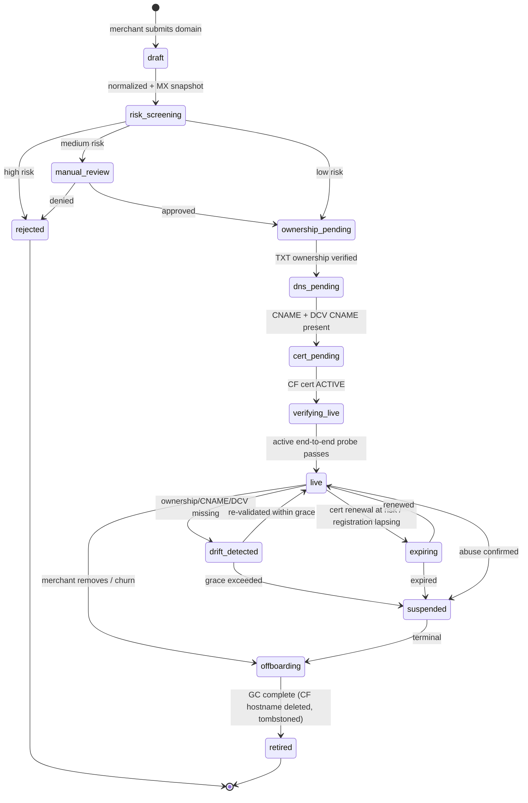

# LetBuyy Custom Domain Architecture — V2

**Status:** Design / Production-grade target
**Supersedes:** V1 (CNAME → `connect.letbuyy-dns.com` + Worker → Vercel with `X-Forwarded-Host`)
**Owners:** Platform / `services/api-gateway`, `services/queue-workers`
**Last reviewed:** 2026-06-06

---

## 0. Purpose and constraints

Redesign the custom-domain system so it is correct under adversarial conditions and at scale, **without removing any of the platform primitives.**

**Preserved (hard constraint):** Cloudflare (edge, for-SaaS, Workers, KV, Cron, Queues) · Vercel (Next.js storefront rendering) · merchant custom domains · the Shopify-grade merchant experience (no infrastructure leakage).

**Eliminated (hard requirement):** this document closes each of the six V1 failures. Every mitigation is traceable to a numbered failure.

| # | V1 failure | Closed by (section) |
|---|---|---|
| 1 | Origin bypass (Vercel URL public) | §6 Origin trust, §4 Boundary B |
| 2 | Host-header spoofing | §6 Signed tenant assertion |
| 3 | Dangling hostname takeover | §11 Offboarding, §10 onboarding step 3 (fresh TXT), §8 registration epoch |
| 4 | SSL renewal blind spots | §12 SSL lifecycle & observability |
| 5 | KV consistency UX | §7 Router map (DO authoritative + read-through), §11.5 active probe |
| 6 | Abuse / phishing onboarding | §13 Abuse pipeline |

**Non-goal:** simplicity. Where correctness and simplicity conflict, correctness wins and the cost is documented.

---

## 1. Design principles (invariants)

These are the load-bearing rules. Every component below exists to enforce one of them.

1. **The origin is never reachable except through the edge.** A request that did not pass the Router Worker cannot render a storefront. (Closes #1)
2. **Tenant identity is asserted cryptographically by the edge, never inferred from a mutable header.** Downstream code derives the tenant only from a signed token it can verify. The `Host` / `X-Forwarded-Host` headers are inputs to a *lookup*, never to an *authorization decision*. (Closes #2)
3. **Routing requires live, re-validated ownership.** A domain routes only while ownership proof is continuously present. Presence of a CNAME never implies ownership. (Closes #3)
4. **Validation infrastructure we depend on for renewal must be infrastructure we control.** DCV is delegated to LetBuyy; renewals do not depend on the merchant re-acting. (Closes #4)
5. **The authoritative router map is strongly consistent; KV is only a cache.** Correctness never depends on KV propagation timing. Merchant-facing status reflects *observed* serving, not a write acknowledgement. (Closes #5)
6. **No certificate is issued and no domain goes live before it clears the risk pipeline.** Issuance is a privileged action gated on abuse screening. (Closes #6)
7. **Every domain has a full lifecycle including deprovisioning.** Onboarding is half the system; offboarding and garbage collection are the other half.
8. **No merchant registrar credentials are ever held.** Ownership is proven by challenge, never by acting on the merchant's behalf.

---

## 2. Topology at a glance

```
                         PUBLIC INTERNET (untrusted)
                                   │
                                   │  www.myshop.in  →  CNAME connect.letbuyy-sites.com
                                   ▼
        ┌──────────────────────────────────────────────────────────────┐
        │  CLOUDFLARE EDGE  (zone: letbuyy-sites.com)                    │
        │                                                                │
        │  • Cloudflare for SaaS — Custom Hostnames + managed TLS        │
        │  • DCV delegation target (_acme-challenge owned by LetBuyy)    │
        │  • Router Worker (fallback origin for the zone)                │
        │       1. canonicalize Host                                     │
        │       2. resolve tenant  ── read-through ──┐                   │
        │       3. reject if unknown / suspended     │                   │
        │       4. mint signed Edge Assertion (HMAC) │                   │
        │       5. attach Vercel protection-bypass   │                   │
        │       6. proxy                             │                   │
        │                                            ▼                   │
        │                            ┌────────────────────────────┐     │
        │                            │ Durable Object: RouterMap   │     │
        │                            │  (authoritative, strong-    │     │
        │                            │   consistency)              │     │
        │                            └────────────┬───────────────┘     │
        │                            Workers KV (hot cache, read-through)│
        └───────────────────────────────────────────┬────────────────────┘
                          Boundary B (authenticated) │  bypass-secret + signed assertion
                                                      ▼
        ┌──────────────────────────────────────────────────────────────┐
        │  VERCEL  (storefront-runtime, Next.js)                         │
        │  • Deployment Protection ON — not publicly browseable          │
        │  • Edge Middleware: verify bypass-secret, verify Edge          │
        │    Assertion signature+exp+host, derive tenant from `tid`      │
        │  • Reject (403) anything without a valid assertion             │
        └──────────────────────────────────────────────────────────────┘

   CONTROL PLANE (existing stack)                OBSERVERS / RECONCILERS
   ┌───────────────────────────┐                ┌───────────────────────────┐
   │ services/api-gateway       │  Cloudflare    │ Cron → Queues workers:     │
   │  • claim / status API      │  Cron+Queues   │  • ownership re-check       │
   │ services/queue-workers     │ ◄────────────► │  • DNS / propagation probe  │
   │  • verification orchestr.  │                │  • cert health + expiry     │
   │  • issuance orchestration  │                │  • RDAP registration epoch  │
   │  • risk pipeline           │                │  • CT-log + abuse rescan    │
   │ Supabase (Postgres)        │                │  • dangling-hostname GC     │
   │  • source of truth + audit │                └───────────────────────────┘
   │  • Realtime → merchant UI  │
   └───────────────────────────┘
   Cloudflare API token (scoped)  ──────────────►  CF for SaaS hostname + cert mgmt
```

**Why `letbuyy-sites.com` (separate registrable domain):** isolates merchant data-plane traffic from `admin.letbuyy.store` / `api.letbuyy.store` (cookie isolation, reputation blast radius). Submit it to the Public Suffix List so tenant hostnames cannot set cookies on the infra apex.

---

## 3. Component responsibilities

**Router Worker (data plane, hot path).** Stateless. On every storefront request: canonicalize `Host`; resolve `host → {tenant_id, status, origin}` via read-through (KV → Durable Object on miss); reject unknown/suspended hosts with a static block page (no default vhost, no fallthrough); mint the Edge Assertion; attach the Vercel bypass secret; proxy to the storefront origin. Never queries Supabase on the hot path.

**Durable Object `RouterMap` (authoritative cache).** One DO (or sharded set keyed by host hash) holds the canonical `host → routing record`. Strongly consistent: a write is visible to the next read immediately. Source of truth remains Supabase; the control plane writes DO + KV on every state change, and the DO read-through repopulates KV on miss. This is what removes the 60-second blind window (#5).

**Workers KV (hot read cache).** Holds the same records for steady-state reads at single-digit-ms latency. Treated as disposable: on miss or version skew, the Worker falls back to the DO. Negative results are cached with a short TTL and an allowlist bloom filter guards against unknown-host read amplification.

**Vercel storefront-runtime (origin).** Renders the store. Behind Deployment Protection so it is **not** publicly browseable. Edge Middleware is the second half of the trust boundary: it verifies the bypass secret and the Edge Assertion before any tenant logic runs, and derives the tenant exclusively from the verified `tid` claim.

**Control plane (`services/api-gateway` + `services/queue-workers`).** Owns the domain state machine, the claim/status API, verification, issuance orchestration, the risk pipeline, and all reconcilers. Holds the scoped Cloudflare API token. Per repo governance, these capabilities live in the existing service roots until a human-approved extraction creates a dedicated `domain-service`.

**Supabase (Postgres).** Source of truth: domain records, state, tombstones, audit log, risk decisions. Realtime feeds the merchant settings page so status is live without polling.

---

## 4. Trust boundaries

| ID | Boundary | Direction | Trust | How it is enforced |
|----|----------|-----------|-------|--------------------|
| **A** | Public internet → Cloudflare edge | inbound | untrusted | TLS at edge; Host canonicalized; unknown/suspended → block page; per-IP + per-host rate limits; bloom-guarded negative cache |
| **B** | Cloudflare edge → Vercel origin | east-west | **mutually constrained** | (1) Vercel Deployment Protection: origin returns 401 without bypass secret. (2) Edge Assertion: HMAC token binding `tenant_id`+`host`+`exp`, verified in middleware. Both required. **This is the seam that closes #1 and #2.** |
| **C** | Edge / Worker → control-plane API | east-west | service-trusted | mTLS or signed service token; Worker never holds DB credentials |
| **D** | Control plane → Cloudflare API | outbound | privileged | scoped API token (custom-hostname + SSL scope only), in secret store, rotated |
| **E** | Merchant browser → control plane | inbound | authenticated | merchant session/RBAC; claims bound to a KYC-verified merchant account |
| **F** | LetBuyy ↔ merchant DNS / registrar | external | **untrusted, never credentialed** | challenge-response only (TXT ownership, DCV CNAME); no registrar API credentials held |

Trust never transits a boundary implicitly. The defining change from V1: **Boundary B was wide open** (origin public, header trusted). In V2 it requires two independent secrets — the Vercel bypass secret *and* the Edge Assertion signing key — so compromise of one does not grant tenant impersonation.

---

## 5. Data flows

### 5.1 Storefront request (hot path)

```
1. Browser → https://www.myshop.in/products/123
2. Cloudflare terminates TLS (CF-for-SaaS cert for www.myshop.in)
3. Router Worker:
   a. host = canonicalize("www.myshop.in")           # lowercase, punycode, strip port
   b. rec  = KV.get(host)  ?? RouterMap.get(host)     # read-through; DO is authoritative
   c. if rec is null            → 404 block page (unknown host, no fallthrough)
      if rec.status != "live"   → 409 holding page (suspended / drift / offboarding)
   d. assertion = HMAC_sign(key_kid, {
         tid: rec.tenant_id, host, m: method, p: sha256(path)[:16],
         iat: now, exp: now+30s, jti: random
      })
   e. headers += {
         "X-LetBuyy-Edge-Assertion": assertion,
         "X-LetBuyy-Kid": key_kid,
         "x-vercel-protection-bypass": <automation bypass secret>
      }
   f. strip inbound copies of those headers from the client first   # anti-spoof
   g. proxy → https://storefront-runtime.vercel.app  (origin pinned, not Host-derived)
4. Vercel Middleware:
   a. if protection bypass invalid                    → 401 (Deployment Protection)
   b. verify assertion: signature(kid) + exp + host-binding + method  → else 403
   c. tenant_id = assertion.tid                       # NEVER from Host / X-Forwarded-Host
   d. render store for tenant_id
5. Response → Worker → strip x-vercel-* / server identifying headers → Browser
```

Properties: a direct hit on `storefront-runtime.vercel.app` fails at 4a (no bypass secret). A request that somehow obtains the bypass secret still fails at 4b (no valid assertion / cannot forge `tid`). The header the client controls (`Host`) only selects a lookup key and is discarded after step 3b.

### 5.2 Control-plane writes (state change)

```
Supabase (authoritative state) ──tx──► write RouterMap DO ──► write KV (version++)
                                          │
                                          └─► emit audit-log row + Realtime event
```

DO write is synchronous and strongly consistent; KV write is best-effort and self-heals via read-through. A storefront request issued one millisecond after go-live resolves correctly through the DO even though KV may still be cold.

### 5.3 Certificate validation (issuance + renewal)

```
Merchant sets ONCE:  _acme-challenge.myshop.in  CNAME  → dcv.letbuyy-sites.com
CF-for-SaaS issuance/renewal → validates against dcv.letbuyy-sites.com (LetBuyy-controlled)
→ renewal never requires merchant action again (closes #4)
```

---

## 6. Origin trust: the Edge Assertion (closes #1 and #2)

The single most important mechanism. It converts a spoofable plaintext header into a verifiable capability.

### 6.1 Two independent gates on Boundary B

- **Gate 1 — reachability:** Vercel Deployment Protection is enabled. The deployment URL returns `401` to the public internet. Only requests carrying the **automation bypass secret** reach application code. This removes the "origin is publicly reachable" property that made V1 bypassable.
- **Gate 2 — identity:** the **Edge Assertion**, an HMAC-SHA256 token minted per request by the Worker, binds the tenant. Vercel verifies it before deriving any tenant.

Both are required. They use **different secrets** so that leakage of the Vercel bypass secret (Gate 1) does not let an attacker assert an arbitrary tenant (Gate 2), and vice-versa.

### 6.2 Assertion structure

```
header:  { alg: "HS256", kid: "edge-2026-06" }
payload: {
  tid:  "<tenant_id>",            # the only source of tenant identity downstream
  host: "www.myshop.in",          # canonical host the edge resolved
  m:    "GET",                    # method binding
  p:    "<sha256(path)[0:16]>",   # path binding (mitigates blind replay to other routes)
  iat:  <unix>,
  exp:  <iat + 30>,               # 30s window
  jti:  "<128-bit nonce>"         # replay id
}
signature: HMAC_SHA256(signing_key[kid], header.payload)
```

### 6.3 Verification (Vercel Edge Middleware)

1. Reject if Deployment-Protection bypass invalid (handled by Vercel before middleware).
2. Look up signing key by `kid`; reject unknown `kid`.
3. Verify signature; reject on mismatch.
4. Reject if `exp < now` (skew budget ±5s).
5. Reject if `host` claim ≠ the host the middleware sees, or `m` ≠ method.
6. Optional hardening: reject replayed `jti` within the 30s window (Vercel KV / Upstash set with 30s TTL).
7. `tenant_id = payload.tid`. **Never read tenant from `Host` or `X-Forwarded-Host`.**

### 6.4 Key management

- Two active `kid`s at all times (current + next) for zero-downtime rotation; Worker signs with current, Vercel accepts both.
- Signing key and Vercel bypass secret in Cloudflare Secrets / Vercel encrypted env, rotated on a schedule and on suspected compromise.
- **Enterprise hardening (optional, additive):** Authenticated Origin Pulls (mTLS) or Vercel Trusted-IPs in front of Gate 1. Not required for correctness because Gate 2 already binds identity, but it raises the cost of probing the origin.

---

## 7. Router map consistency (closes #5)

V1 treated KV — eventually consistent, up to 60s, 1 write/s per key — as a synchronous database, so "Live ✓" was shown before the edge could serve the domain.

V2 separates **authority** from **cache**:

- **Authoritative read:** Durable Object `RouterMap`. Strongly consistent within its region; a write is visible to the next read. New mappings resolve **immediately**.
- **Hot cache:** KV, populated by read-through. KV's propagation delay now only affects *how fast the cache warms*, never correctness — a cold/stale KV entry falls through to the DO.
- **Negative caching + bloom filter:** unknown hosts are answered from an allowlist bloom filter and a short-TTL negative cache, so a flood of random `Host` values cannot amplify into per-request authoritative lookups.
- **Versioning:** each record carries a monotonic `version`; the control plane increments on write so stale KV can be detected and refreshed.

**Go-live is never asserted on a write.** See §11.5 — the merchant sees "Live" only after an **active end-to-end probe** fetches the real hostname from multiple vantage points and confirms the tenant is being served. Status reflects observed reality.

---

## 8. Threat model

STRIDE-oriented. Each row: vector → boundary → mitigation → residual risk.

| Threat | Vector | Boundary | Mitigation | Residual |
|--------|--------|----------|------------|----------|
| **Origin bypass** (#1) | Direct request to `*.vercel.app` | B | Deployment Protection (Gate 1): origin 401s without bypass secret | Bypass-secret leakage → mitigated by Gate 2; rotate secret |
| **Tenant impersonation via Host** (#2) | Spoof `Host`/`X-Forwarded-Host` | A,B | Tenant derived only from signed `tid`; headers discarded post-lookup | Signing-key compromise → rotation, 30s exp, `kid` |
| **Assertion replay** | Capture token, replay to other path | B | `exp`=30s, method+path binding, optional `jti` blocklist | ≤30s same-path replay window (low value, content is public-read) |
| **Dangling hostname reclaim** (#3) | Churned domain's CNAME still points to us; attacker re-adds it | F | Claim always requires fresh TXT ownership; CNAME presence ≠ ownership; offboarding GC deletes CF hostname + tombstones | Attacker who *also* controls the domain legitimately owns it |
| **Re-registration takeover** (#3) | Domain expires, re-registered by third party while in our system | F | RDAP **registration-epoch** watch; epoch change → force re-verification, suspend routing | Detection latency bounded by reconciler interval |
| **Silent cert expiry** (#4) | Renewal fails months later | D,F | DCV delegated to LetBuyy-owned target; fleet cert-health reconciler; T-30/14/7/3/1 alerts on failure *rate* | CA-side outage → multi-CA fallback (CF-managed) |
| **Stale-route window** (#5) | Read mapping before KV propagates | — | DO authoritative + read-through; active probe before "Live" | DO regional failover (rare) |
| **Phishing via onboarding** (#6) | Onboard `hdfc-bank-verify.in` | E,F | Risk pipeline (lookalike/homoglyph, blocklists, reputation, RDAP age, velocity) before issuance; risk tiers; CT + content rescan; suspend path | Novel lookalikes not yet in brand list → human review queue |
| **Unknown-host amplification** | Flood random `Host` values | A | Bloom allowlist + negative cache; per-IP rate limit | Volumetric DDoS → CF L3/4 protections |
| **Apex CNAME breaks merchant email** | Merchant CNAMEs apex, clobbers MX | F | `www`-canonical policy; MX snapshot at intake + hard warn; apex via A/flattening only | Merchant overrides warning |
| **Subdomain cookie leakage** | Tenant sets cookie on infra apex | A | Separate registrable domain + PSL listing | — |
| **Privilege escalation via CF token** | Token theft | D | Scoped token (hostname+SSL only), secret store, rotation, audit | Token theft window until rotation |
| **Cross-tenant cache poisoning** | Un-keyed Vercel cache serves A to B | B | Cache key includes verified `tid`; ISR/data-cache namespaced per tenant | Developer error → covered by §16 test harness |

---

## 9. Domain lifecycle — state machine



**State semantics**

| State | Routing | Cert | Meaning |
|-------|---------|------|---------|
| `draft` | none | none | created, normalized, MX snapshot taken |
| `risk_screening` | none | none | abuse pipeline running |
| `manual_review` | none | none | human-in-loop queue (medium risk) |
| `rejected` | none | none | failed risk; terminal |
| `ownership_pending` | none | none | awaiting `_letbuyy-challenge` TXT |
| `dns_pending` | none | none | ownership proven; awaiting routing CNAME + DCV CNAME |
| `cert_pending` | none | issuing | records present; CF issuing TLS |
| `verifying_live` | staged | active | cert live; running active serving probe |
| `live` | **active** | active | confirmed serving end-to-end |
| `drift_detected` | active (grace) | active | a required record vanished; grace timer running |
| `expiring` | active | at risk | renewal failing or registration lapsing |
| `suspended` | **blocked** | n/a | abuse / drift-exceeded / expired → holding page |
| `offboarding` | blocked | revoking | teardown in progress |
| `retired` | none | none | deprovisioned + tombstoned; re-add requires full re-verification |

**Guards**

- `ownership_pending → dns_pending`: unique per-claim TXT token observed from ≥2 independent resolvers.
- `dns_pending → cert_pending`: routing CNAME → `connect.letbuyy-sites.com` **and** DCV CNAME present; CAA permits issuance.
- `cert_pending → verifying_live`: CF reports cert `active`.
- `verifying_live → live`: active probe (§11.5) returns the tenant's signed marker from multiple vantage points.
- `live → drift_detected`: reconciler finds ownership TXT, routing CNAME, or DCV CNAME absent.
- `drift_detected → suspended`: grace window (default 24h, configurable) exceeded without re-validation.
- any `→ suspended`: abuse confirmation is immediate (no grace).

---

## 10. Onboarding lifecycle

```
1. SUBMIT
   Merchant enters "myshop.in" in Merchant App → Settings → Custom Domain.
   API: normalize (lowercase, punycode, strip scheme/path), reject infra/PSL/own zones.
   Snapshot existing MX + A/AAAA + NS (provider fingerprint) via RDAP + DoH.
   → state: draft

2. RISK SCREEN  (closes #6, pre-issuance gate)
   Pipeline: homoglyph/edit-distance vs protected-brand list; static blocklist;
   reputation (Safe Browsing / Spamhaus DBL / urlhaus); RDAP age (newly-registered flag);
   per-merchant + per-account velocity.
   low → continue · medium → manual_review queue · high → rejected
   → state: risk_screening → {ownership_pending | manual_review | rejected}

3. PROVE OWNERSHIP  (closes #3 at the root)
   Show ONE record:  TXT  _letbuyy-challenge.myshop.in  =  letbuyy-verify-<random>
   Verifier (Queue, multi-resolver 1.1.1.1 / 8.8.8.8 / India resolver) polls.
   CNAME is NOT accepted as ownership proof. Ever.
   → state: ownership_pending → dns_pending

4. ROUTE + DELEGATE DCV  (closes #4)
   Show TWO records:
     CNAME  www            → connect.letbuyy-sites.com
     CNAME  _acme-challenge → dcv.letbuyy-sites.com   (one-time DCV delegation)
   Policy: www is canonical. Apex only via A record or CNAME-flattening host
   (warn loudly if apex CNAME would clobber the MX captured in step 1).
   Provider-specific instructions + screenshots from the fingerprint.
   → state: dns_pending

5. ISSUE TLS
   Records present + CAA permits → create CF custom hostname via scoped token
   (queued + backoff to respect CF API limits). CF issues managed cert,
   renewals validated against LetBuyy-owned dcv.letbuyy-sites.com.
   → state: cert_pending → verifying_live

6. CONFIRM SERVING  (closes #5)
   Write Supabase → RouterMap DO → KV. Active probe fetches https://www.myshop.in/__health
   from multiple vantage points until it returns the tenant's signed marker.
   Only then flip status.
   → state: verifying_live → live

7. CANONICALIZE
   301 shop.letbuyy.store → custom domain; set primary; emit "email unaffected ✓".
   Merchant never saw Vercel, Cloudflare, or the word "certificate."
```

---

## 11. Offboarding lifecycle (closes #3)

The half V1 omitted. Prevents dangling-hostname takeover.

```
TRIGGER: merchant removes domain · plan downgrade · churn · abuse · registration lapse

1. FREEZE
   state → offboarding. RouterMap DO + KV: status=blocked immediately
   (DO is strongly consistent → routing stops on the next request, no 60s window).
   Edge serves a neutral holding page for the host.

2. REVOKE
   Delete the CF custom hostname via scoped token (stops cert renewal, frees the
   50k-hostname budget). Confirm deletion; retry on failure.

3. TOMBSTONE
   Write tombstone row: {host, last_tenant_id, last_registration_epoch, retired_at}.
   The host is now UNCLAIMED. Re-adding it — by the same or any merchant — restarts
   at step 1 of onboarding with a FRESH ownership challenge. A leftover CNAME that
   still points at connect.letbuyy-sites.com grants nothing: no KV/DO record exists,
   so the edge returns the unknown-host block page (no fallthrough), and no cert is
   issued without fresh TXT proof.

4. GARBAGE COLLECT
   Reconciler sweeps: CF hostnames with no live Supabase record → delete (covers
   partial failures). Tombstoned hosts whose registration_epoch later changes
   (RDAP) are flagged so a re-add by a new owner is treated as a brand-new claim.

5. PURGE
   After retention window: purge DO/KV entries; keep tombstone + audit for forensics.
   → state: retired
```

**Dangling-takeover is closed on three independent fronts:** (a) the edge has no record so it refuses to serve; (b) no cert issues without fresh TXT ownership; (c) registration-epoch change forces re-verification even if a record somehow persists.

### 11.5 Active serving probe (referenced by onboarding step 6 and the `verifying_live → live` guard in §9)

A Queue worker requests `https://<host>/__health` through the public path (real DNS, real edge, real cert) from ≥3 vantage resolvers/regions. The storefront returns a per-tenant signed marker derived from `tid`. The probe must see the correct marker from all vantages before `verifying_live → live`. This is what makes "Live ✓" *true* rather than *hopeful* (closes #5 at the UX layer).

---

## 12. SSL lifecycle & observability (closes #4)

| Phase | Mechanism |
|-------|-----------|
| Issuance | CF for SaaS managed cert on custom-hostname creation; CAA pre-checked; queued with backoff |
| Validation | **DCV delegation** to `dcv.letbuyy-sites.com` — LetBuyy-controlled, so issuance *and renewal* never need merchant action again |
| Renewal | CF-managed auto-renew; validated against the delegated target |
| **Observability** | Cert-health reconciler enumerates every hostname's cert status + `not_after`; emits metrics; alerts on **renewal-failure rate** and days-to-expiry buckets **T-30/14/7/3/1** |
| Detection | CT-log monitoring confirms issuance and flags unexpected certs |
| Merchant signal | per-domain cert health surfaced in Settings; proactive email if a merchant-side record (DCV CNAME) is later removed |
| Fleet posture | alert on aggregate failure rate, not individual certs, so 10k–100k scale does not drown ops |

The V1 blind spot — renewals depending on a merchant action taken months earlier — is structurally removed by delegation, and the silent-failure mode is removed by fleet observability.

---

## 13. Abuse / phishing pipeline (closes #6)

**Pre-issuance (blocking gate between `risk_screening` and `cert_pending`):**

- **Lookalike detection:** homoglyph normalization + edit-distance + token analysis against a curated protected-brand list (banks, UPI/payment, government, large retail). `hdfc-bank-verify.in` scores high → blocked or routed to review.
- **Blocklists:** PSL entries, LetBuyy's own zones, known phishing keyword+TLD combinations.
- **Reputation:** Google Safe Browsing, Spamhaus DBL, urlhaus.
- **Registration heuristics:** RDAP creation date (newly-registered domains are higher risk), registrant fingerprint.
- **Velocity:** claims per merchant and per account in a rolling window.

**Risk tiers:** low → auto-approve · medium → `manual_review` human queue · high → `rejected`. Every decision is audit-logged with the signals that produced it.

**Post-go-live (continuous):** CT-log watch + periodic content scan of live custom domains; one-click **suspend** flips DO/KV to `suspended` (edge serves a block page within one request because the DO is strongly consistent); documented abuse/takedown runbook; all claims tied to a KYC-verified merchant so abuse has an accountable owner.

---

## 14. Merchant experience

The merchant sees a state machine projected as four checks. No infrastructure vocabulary.

```
Settings → Custom Domain
┌────────────────────────────────────────────────────────────┐
│  Connect your domain                                         │
│  ┌──────────────────────────────┐                            │
│  │ myshop.in                    │   [ Connect ]              │
│  └──────────────────────────────┘                            │
│  We detected your domain is at GoDaddy.                      │
│                                                              │
│  Add these records at GoDaddy:                               │
│   TXT    _letbuyy-challenge   letbuyy-verify-7f3a…   [copy]  │
│   CNAME  www                  connect.letbuyy-sites… [copy]  │
│   CNAME  _acme-challenge      dcv.letbuyy-sites.com  [copy]  │
│                                                              │
│  Status                          (live, via Realtime)        │
│   ✓ Ownership verified            2s ago                     │
│   ✓ DNS connected                 just now                   │
│   ⏳ Securing your domain (SSL)    in progress…              │
│   ◦ Live                          waiting                     │
│                                  [ Check again ]             │
│                                                              │
│  ℹ Your existing email (MX) is unaffected. We checked. ✓     │
└────────────────────────────────────────────────────────────┘
```

- Each check has a last-checked timestamp, a re-check button, and a plain-language fix on failure ("Your domain still shows a parking page — in GoDaddy, delete the A record named 'Parked'").
- "Live" appears only after the active serving probe passes (§11.5), so the status is never a lie.
- If `drift_detected` later fires, the merchant gets "Action needed: a DNS record was removed" with the exact record, *before* the grace window suspends the store.
- Buy-a-domain path (recommended, separate flow): for merchants without a domain, LetBuyy resells via an Indian registrar, controls DNS end-to-end, and skips ownership/propagation entirely — zero of the above failure modes apply.
- Mobile (`apps/mobile/merchant-app`): same states from the same API; success arrives as a push notification.

---

## 15. Scaling posture

| Merchants | Hostnames (~2/merchant) | What holds / what to do |
|-----------|------------------------|--------------------------|
| 100 | ~200 | Free tier (first 100 hostnames free, then $0.10/mo). DO+KV trivial. Lock in separate domain + PSL + ownership-before-cert now. |
| 1,000 | ~2,000 | Read-through DO+KV mandatory (built in). Queue+backoff in front of CF API. Internal "domain doctor" tool. |
| 10,000 | ~20,000 | ~$2k/mo hostname fees. Cert-renewal reconciler shards by host hash. Alert on fleet failure rate. |
| 100,000 | ~200,000 | **Tripwire:** PAYG cap is 50,000 hostnames/account — counted at ~2 per merchant you hit it near **22k merchants**, not 100k. Alert at **40k hostnames**; negotiate **Enterprise / BYOIP** ahead of the wall; BYOIP also unlocks the Shopify-style static-IP apex story. The double-CDN exit (Cloudflare as eventual data plane) should be decided by here. |

The 50k ceiling is a real, near-term constraint — named here so it triggers a contract motion before it throttles onboarding, not after.

---

## 16. Residual risks & required tests

- **Signing-key / bypass-secret compromise** → rotation runbook, 30s assertion expiry, dual `kid`.
- **DO regional failover** → accept rare brief latency; Supabase remains source of truth for rebuild.
- **Novel lookalikes** → human review queue is the backstop; expand brand list continuously.
- **Merchant overrides MX warning** → logged consent; support macro ready.
- **Required harness (prove, don't assert):**
  1. Origin-bypass test: direct `*.vercel.app` request with forged `X-Forwarded-Host` must 401/403.
  2. Assertion-forgery test: valid bypass secret + invalid/missing assertion must 403.
  3. Replay test: captured assertion replayed after 30s / to another path must 403.
  4. Dangling-reclaim test: delete tenant, leave CNAME, attempt re-add → must require fresh TXT.
  5. Cross-tenant cache test: confirm ISR/data-cache keyed on `tid`.
  6. Go-live consistency test: status flips to Live only after probe passes from all vantages.

---

## 17. Open decisions

1. **Infra domain name** — `letbuyy-sites.com` vs `connect.letbuyy.app`; must be PSL-eligible. **Decide before first external merchant.**
2. **Buy-a-domain registrar** — ResellerClub (Mumbai) vs OpenSRS; gates the zero-config majority path for India.
3. **`jti` replay blocklist** — enable now vs defer (low-value replay window; storefront content is public-read).
4. **Double-CDN exit** — commit Cloudflare as the eventual data plane (Next.js on Workers) vs permanent Vercel origin; affects the 100k tier economics.
5. **Dedicated `domain-service` extraction** — when to split from `services/api-gateway` per repo governance (`AGENTS.md` → human-approved extraction).

---

### Appendix A — Supabase schema (source of truth)

```sql
domains(
  id, merchant_id, host, canonical_host, status,
  txt_token, dcv_target, cf_hostname_id, cert_status, cert_not_after,
  registration_epoch, risk_tier, risk_signals jsonb,
  mx_snapshot jsonb, ns_fingerprint, version, created_at, updated_at
)
domain_events(id, domain_id, from_state, to_state, actor, reason, at)   -- audit
domain_tombstones(host, last_tenant_id, last_registration_epoch, retired_at)
```

### Appendix B — Validation note

Per `CLAUDE.md`, run `node scripts/validate-governance.mjs` after any topology/import/governance-memory change. This document is design-only and adds no runtime topology; the `domain-service` extraction (Open Decision 5) is the change that will require validation.
