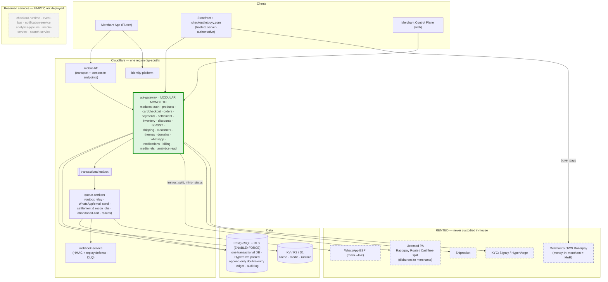

# LETBUYY — EXECUTABLE ARCHITECTURE V1

> **Document type:** Authoritative, implementation-ready architecture decision record (ARB final).
> **Status:** FROZEN & EXECUTABLE. This document **supersedes and replaces** both `LETBUYY_FINAL_ARCHITECTURE_FREEZE.md` and `CODEX_CHECKOUT_PLATFORM_BUILD_MISSION.md`.
> **Date:** 2026-06-08
> **Authority model:** The **Architecture Freeze is the source of truth.** The Build Mission supplies implementation detail only. **On every conflict, the Freeze wins** and the Mission is rewritten to comply. Architecture the Freeze rejects is **not** preserved here.
> **Design envelope (the only numbers that govern this document):** India only — first **100 → 1,000 → 10,000** merchants. Not Shopify's end-state. Not 1,000,000 merchants.
> **Decision states:** every decision below is exactly one of **APPROVED**, **DEFERRED** (with a named trigger), or **REJECTED** (with a reason). No "maybe", no "future consideration", no "it depends".

---

# 1. Executive Verdict

LetBuyy will ship a **modular monolith and rent the rails.** The executable system is **one modular monolith (`api-gateway`) + two already-real satellite processes (`queue-workers`, `mobile-bff`) + `identity-platform`, over one transactional PostgreSQL with RLS, on Cloudflare, in one region (ap-south)** — where **merchants bring their own Razorpay (merchant = merchant-of-record) and a licensed Payment Aggregator (Razorpay Route / Cashfree) custodies and disburses all money.** The Build Mission's "22 logical services," its activation of the six reserved service roots, its standalone event-bus, saga engine, schema registry, Wasm/extension hosts, analytics pipeline and media service, and its full in-WhatsApp commerce stack are **rejected or deferred**: they implement Shopify's destination for a platform with ~0 merchants. What survives from the Mission is exactly the load-bearing engineering the Freeze already named — a **server-authoritative cart/checkout-session, a double-entry settlement ledger, a transactional outbox, a tenant-isolation/RLS kernel, an idempotency + money-safety kernel, WhatsApp order-lifecycle + COD confirmation, and the provider-mode honesty discipline** — built as **modules inside the monolith**, every external provider behind one adapter interface defaulting to **mock**, with each live path marked `[HUMAN-REQUIRED]`. We choose implementation over architecture, revenue over complexity, and operational reality over engineering dreams.

---

# 2. Final Architecture Principles (non-negotiable)

1. **One modular monolith, not a service mesh.** All 24 logical "contexts" are **modules/packages inside `api-gateway`** with enforced (Packwerk-style) boundaries. A service is extracted **only** when a measured hot-path or team boundary forces it, with ARB sign-off — never preemptively.
2. **Rent money movement; never custody it.** Merchant is MoR on their own PSP for money-in. A licensed PA disburses money-out. LetBuyy **only instructs splits and mirrors status.** This single regulatory decision deletes the entire in-house "payout/disbursement engine."
3. **Correctness over elegance.** Build the parts that must be *correct and safe* to production grade (server cart, settlement ledger, signed checkout handoff, PA-split, RLS isolation, outbox). Defer or reject the parts that are merely *elegant* (extensions, Wasm, event sourcing, CQRS, vault).
4. **Mock-by-default, honest-always.** Every external dependency = one adapter interface + a real adapter (code-complete, fixture-tested) + a mock adapter (default). Mode is `LETBUYY_<PROVIDER>_MODE=mock|sandbox|live`, default `mock`. A **provider-mode honesty badge** (live/sandbox/scaffold) is mandatory on every money/fulfillment surface — a stub must **never** read as `success`.
5. **Reliable events via one transactional outbox — not an event bus.** DB write + outbox row commit atomically; `queue-workers` relays. No standalone `event-bus` service, no event sourcing, no CQRS, no schema-registry infrastructure.
6. **Tenant isolation is layered and fail-closed.** App-layer `store_id`/`site_id` predicate guard (query-lint) **+** Postgres RLS `ENABLE`+`FORCE` + tenant-GUC policy on every tenant table. Unset GUC ⇒ zero rows.
7. **One transactional DB, no premature scale infra.** No sharding, no read replica, no partitioning, no multi-region for the 100→10k envelope. Write `store_id`/`site_id` down as the future shard axis (a seam), build nothing for it now.
8. **`channel` is first-class.** `channel ∈ {web, whatsapp, instagram, pos, api}` on cart/checkout/order. WhatsApp is a **commerce channel**, not a notifier — but scoped (Principle 11).
9. **0% transaction fee is permanent on every paid tier.** Kill the 2.5% GMV free-tier rake immediately. Monetize adjacencies (WhatsApp credits, shipping spread, AI credits, marketplace rev-share later), never the sale.
10. **Reserved services stay empty.** `checkout-runtime`, `event-bus`, `notification-service`, `analytics-pipeline`, `media-service`, `search-service` remain **manifest-only**; their behavior lives in `api-gateway` + `queue-workers`. Reserved **packages** may hold library code, but no reserved *service* is deployed.
11. **WhatsApp ships scoped:** order-lifecycle messages + COD confirmation + opt-in consent ledger first. Broadcasts, campaigns, inbox, catalog sync, in-thread checkout are deferred.
12. **No new architecture documents.** Implementation produces code, migrations, tests, and the ledger/status/report files — not more blueprints. This document is the contract; deviation requires ARB sign-off measured against the 100→10k envelope.

---

# 3. Approved Architecture

Every component below is **APPROVED** for build inside the monolith topology.

**Runtime & platform**
- **`api-gateway` — the modular monolith.** Houses modules: auth · products · cart/checkout · orders · payments · inventory · discounts · tax/GST · shipping · settlement · customers · themes · domains · whatsapp · notifications · media-refs · billing · analytics-read.
- **`queue-workers`** — outbox relay; WhatsApp/email send; settlement & reconciliation jobs; abandoned-cart timer; webhook delivery; analytics rollups; stale-reservation sweeper.
- **`mobile-bff`** — transport boundary + composite/fan-in endpoints for the Flutter merchant app (kills N+1 dashboard round-trips).
- **`identity-platform`** — buyer OTP, merchant/staff login, OAuth2/PKCE, claims→GUC bridge.
- **`webhook-service`** — already real; outbound merchant webhooks (HMAC + timestamp-window + nonce replay defense, DLQ, outbox-sourced).
- **Cloudflare, one region (ap-south):** Workers + Queues + KV/R2/D1, **Hyperdrive pooling** (currently-unused binding, now used) in front of Postgres.
- **PostgreSQL + RLS**, one transactional DB (Supabase for 100→1k, with a documented managed-Postgres exit for the 10k horizon).

**Load-bearing foundation primitives (right-sized from Mission F1–F12)**
- **Tenant-isolation kernel** — per-transaction `SET LOCAL` tenant GUC from validated JWT claims; app-layer data-access wrapper that *requires* a tenant predicate (query-lint); migration helper applying `ENABLE`+`FORCE` RLS + tenant-GUC policy. **Fail-closed.**
- **Transactional outbox** — `writeWithOutbox(tx, rows, event)`; `queue-workers` relay sets `published_at`; crash between write and publish loses nothing.
- **Typed event catalog (library, not a bus)** — versioned event types in `packages/event-core`, published via outbox, consumed idempotently (dedupe on `event_id`).
- **Idempotency kernel** — key store + middleware + unique partial indexes; duplicate submit/webhook ⇒ exactly one effect.
- **Money kernel (highest rigor) — APPROVED with full Mission F6 rigor retained.** `bigint` minor-units + `currency`; **append-only double-entry ledger** (balanced debit/credit, reversing entries only — no UPDATE/DELETE); accounts `pa_clearing, merchant_payable, platform_revenue, gst_payable, cod_receivable, reserve, vendor_payable, refund_clearing`; balance-invariant checker (Σdebit=Σcredit per store+currency); **property-based tests + reconciliation harness (zero-break or explained-in-suspense) + reversing-entry coverage + concurrency test** are all required green. Single-writer = settlement module.
- **Scoped compensation (not a general saga engine)** — persisted, idempotent compensation for the money-critical flows only: checkout-confirm, refund, settlement. "Payment captured but order-create failed ⇒ auto-refund" must pass.
- **Migration & rollback framework** — every migration ships a forward **and** a rollback; RLS/FORCE template; a partition helper exists as a **dormant seam** (partitioning itself is deferred — see §5).
- **Observability kernel (right-sized)** — structured logger (`request_id, trace_id, store_id, channel, actor`) with PII/PAN redaction via `replayable-secret-redaction`; basic in-process tracing; a metrics registry; an append-only **audit-log relay**; alerting; backups + a tested restore drill.
- **Security kernel** — field-level PII encryption + KMS envelope (mock KMS behind a real interface); webhook signature + timestamp-window + nonce verifier; JWT/PKCE claims→GUC bridge; maker-checker + step-up scaffolding for payouts/refunds.
- **Module-boundary enforcement** — import rules; single-writer table ownership; route files ≤ 1500 lines (split into folder modules); single-source for crypto / currency+date formatting / CMS slug.

**Commerce capability modules**
- **Server-authoritative cart / checkout-session** with signed `checkout_url` handoff; `channel` + email capture; abandonment enqueue. *(Replaces the client-only React cart.)*
- **Hosted checkout origin `checkout.letbuyy.com`** — single server-validated checkout surface served from the monolith/storefront read-path (shrinks PCI scope), re-validating inventory + discount at confirm.
- **Orders** — immutable order + financial/fulfillment state machines; FulfillmentOrder-per-location; created **only** via the checkout flow.
- **Payments** — one adapter interface; live implementations for **Razorpay (money-in, merchant keys) + UPI + COD**, and **Cashfree / Razorpay-Route for split-settlement**; everything else dormant behind the same interface; tokenization, reconcile-on-uncertainty, replay-safe webhooks.
- **Inventory** — Available/Committed/Reserved/Consumed with reservation TTL and **optimistic-concurrency** decrement (oversell-proof); multi-location; stale-reservation sweeper.
- **Discounts** — code + automatic; 3-class `combines_with`; usage limits.
- **Tax / GST** — place-of-supply CGST/SGST vs IGST; HSN rates; inclusive/exclusive; immutable GST invoice (IRN/QR via mock IRP); marketplace TCS.
- **Shipping** — zones/profiles/rates; **pincode + COD serviceability**; one real carrier (**Shiprocket**) for AWB/label/tracking, others mocked behind the adapter.
- **Notifications router** — WhatsApp-first channel selection (→ SMS → email → push); preferences/suppression/consent; retries; delivery tracking.
- **Email** — MJML/Liquid render; multi-ESP failover (Resend/SES/SendGrid) behind one interface; SPF/DKIM/DMARC; bounce/suppression; v1 transactional template set.
- **WhatsApp (scoped)** — order-lifecycle utility messages on `order.paid|shipped|delivered`, **COD confirmation (reply-to-confirm)**, and an **opt-in consent ledger** (DPDP); BSP/Meta adapter in mock.
- **Settlement** — ingest PA settlement + COD remittance → post double-entry ledger → reconcile → break-management/suspense; payout via PA split-instruction (mock, **no self-custody**); reserves; fee/commission engine.
- **Billing** — plans/subscriptions (UPI AutoPay mandates mocked + cards), plan gating, usage metering, dunning, merchant GST invoices.
- **Customers/Identity/Security** — passwordless buyer OTP; merchant/staff login + RBAC (enforce stored `employee_permissions` scopes); **DPDP consent ledger + DSR export/erasure**; layered tenant isolation.
- **Thin internal-ops sliver** — manual refund; **maker-checker on any manual payout**; dispute/chargeback log; merchant-KYC review queue (real KYC provider: Signzy/HyperVerge). Everything else runs on SQL.
- **Analytics (read-only rollups)** — dashboard materialized views/queries in-monolith + `queue-workers` rollups. No pipeline service.
- **Media-refs** — signed R2 upload module in-monolith (no media service).

---

# 4. Rejected Architecture

Each item is **REJECTED** for the 100→10k envelope. (Existing dormant scaffolding directories — e.g. `services/event-bus`, `packages/extension-host`, `packages/projection-runtime`, `packages/distributed-runtime`, `packages/orchestration` — stay **empty/dormant**; no investment.)

| # | Rejected (from the Build Mission / old plan) | Reason |
|---|---|---|
| R-1 | **22-service / 13-service decomposition** | A distributed monolith for a 6–9 person team: 13+ pipelines, cross-service transactions, 4+ checkout hops where a monolith has 0. Coupling of a monolith with the ops pain of microservices. |
| R-2 | **Activating the 6 reserved services** (`checkout-runtime`, `event-bus`, `notification-service`, `analytics-pipeline`, `media-service`, `search-service`) | Manifest-only today; their behavior belongs in `api-gateway` + `queue-workers`. Activation invents topology no beta merchant would notice. |
| R-3 | **Standalone `checkout-runtime` service / `checkout-edge` worker** | One server-authoritative checkout is a set of **routes in the monolith** + the hosted origin. A separate runtime adds hops and PCI surface for no gain. |
| R-4 | **Standalone event-bus + schema registry + general saga engine** | A transactional **outbox** gives reliable events without the infrastructure. Compensation is scoped to money flows, not a general engine. |
| R-5 | **Event Sourcing & CQRS** (`projection-runtime`, etc.) | Solves a scale/audit problem LetBuyy does not have; the outbox + append-only ledger + audit relay already deliver the needed guarantees. |
| R-6 | **Self-custodied payout / disbursement engine** | Moving money in India needs a PA/PG licence. Rent Razorpay Route / Cashfree split. **Never build in-house in this envelope.** |
| R-7 | **Full in-WhatsApp commerce** (catalog→cart→in-thread checkout→pay, Flows, support inbox) as P0/P1 | Years premature; the durable wedge is order-lifecycle + COD-confirm (two S-sized features). Rest is P2/P3 upside. |
| R-8 | **Analytics pipeline service / warehouse** | 30k orders/mo is trivial; dashboard rollups on the transactional DB (+ replica later) suffice. |
| R-9 | **`media-service` activation / transform service** | A signed-upload module to R2 in the monolith covers beta needs. |
| R-10 | **Fraud ML scoring engine** | Cold-start: no labelled data. The India fraud lever is **COD confirmation over WhatsApp** + an RTO gate, a heuristic. |
| R-11 | **3rd-party App Marketplace + Checkout Extensions + Wasm runtime + Workflow engine** | An empty mall with no supply; extensibility forces sandbox/versioning/review burden for zero near-term value. Design seams only. |
| R-12 | **Reseller *network* / marketplace** | Edges toward the dead GlowRoad model; Meesho owns that motion. (Reseller *links* are deferred, not rejected — see §5.) |
| R-13 | **Multi-region, sharding, read replica, hot-table partitioning, service mesh, cross-merchant wallet/Shop-Pay vault** | Scale infrastructure for a problem the envelope does not contain. |
| R-14 | **Blanket transaction fee / 2.5% GMV free-tier rake** | Forfeits the single wedge (0% forever). UPI MDR≈0 means a fee buys almost nothing and costs the brand. **Kill the rake now.** |
| R-15 | **AI agents / NLU / copilots in P0/P1** | No beta merchant blocks on this; it is P2 upside (product/theme copilots). Build a seam, not a model. |

---

# 5. Deferred Architecture

Each item is **DEFERRED** with an explicit reconsideration trigger. Deferred ⇒ **removed from P0/P1.**

| Capability | Phase | Reconsider when… |
|---|---|---|
| Hot-table **partitioning** (orders, ledger_entries, payment_transactions, webhook_deliveries) | P2 | Sustained volume approaches ~1k–10k merchants / table growth makes vacuum or query latency bite. Helper seam exists now. |
| **Read replica** for storefront reads | P3 | Storefront read latency or OLTP contention is measured, not assumed. |
| **Managed-Postgres exit** (RDS/Cloud SQL) off Supabase | P2/P3 | Supabase OLTP write-amplification cost or limits become the bottleneck. |
| **Reseller links** (registration, tracking links/coupons, last-click attribution, flat/per-product commission, **PA-split payout**) | P2 | A merchant asks for it **with revenue attached**, and the PA-split rail is live. |
| **WhatsApp broadcasts / campaigns / support inbox / catalog sync / in-thread checkout** | P2–P3 | Order-lifecycle + COD-confirm are shipped and adopted; consent ledger proven. |
| **Advanced analytics** (LTV/RFM, dynamic segments, funnel analytics) | P1/P2 | Dashboard rollups are live and merchants request deeper cohorting. |
| **AI product/theme copilots, WA NLU** | P2 | Core OS is stable; copy/theme generation has a willing-to-pay audience. |
| **Gift cards as a tender** on the payment ledger | P2 | Settlement ledger is live (gift-card is a tender on it, not a separate engine). |
| **Draft orders / B2B / price lists / metafields / localization depth** | P2/P3 | A revenue-bearing merchant requires it. |
| **First-party app catalog seeding** | P2 | Real merchant demand for installable apps appears. |
| **3rd-party app marketplace (re-open)** | — | ~5,000 merchants **with** inbound developer demand. |
| **Full internal Operations OS** (risk/T&S/support desk with reviewer UIs) | P2+ | Beyond the thin sliver (refund, maker-checker, dispute log, KYC queue), ops volume forces tooling. |
| **Media transforms / search service** | P2+ | Postgres FTS / in-monolith media stop sufficing on a proven hot-path. |
| **Service extraction** (split any module into a service) | — | A measured hot-path or team boundary forces it, with ARB sign-off. |

---

# 6. Final Service Topology

**PRODUCTION SERVICES (deployed, real code):**
- `apps/merchant-control-plane` (web) · `apps/storefront-runtime` (+ hosted `checkout.letbuyy.com` read-path) · `apps/identity-platform` · `apps/mobile/merchant-app` (Flutter)
- `services/api-gateway` — **the modular monolith** (all commerce modules)
- `services/queue-workers` — async jobs + outbox relay
- `services/mobile-bff` — transport + composite endpoints
- `services/webhook-service` — outbound merchant webhooks

**RESERVED SERVICES (manifest-only — remain EMPTY, NOT deployed):**
- `services/checkout-runtime` · `services/event-bus` · `services/notification-service` · `services/analytics-pipeline` · `services/media-service` · `services/search-service`
- Their *capabilities* are implemented as modules in `api-gateway` (checkout, notifications, media-refs, analytics-read) and jobs in `queue-workers` (settlement, rollups, sends). Reserved **packages** (`checkout-core`, `event-core`, `notification-core`, `billing-core`, `payments`, `commerce-core`, `tenant-core`, `auth-core`, `shared-types`) hold **library** code — that is allowed; deploying a reserved *service* is not.

**DORMANT / DEFERRED SCAFFOLDING (exists, no investment, do not wire as active topology):**
- `packages/extension-host`, `packages/projection-runtime`, `packages/distributed-runtime`, `packages/orchestration`, `packages/runtime-composition`, `packages/app-engine`, `packages/search-core`, `packages/theme-engine` (extensibility/CQRS/mesh artifacts behind §4 rejections; theme-engine stays only as far as the existing theme editor needs).

**DEPRECATED ALIASES (never reference as active topology):** `apps/admin`, `apps/auth`, `apps/checkout`, `apps/internal`, `apps/merchant`, `apps/storefront`, `apps/analytics`, `apps/storefront-runtime/consumer-storefront`, `apps/mobile/operator-team-app`. Historical references only under `docs/archive/`. Reserved mobile roots `apps/mobile/shopper-app` and `apps/mobile/operator-app` stay **empty**.

---

# 7. Final Database Architecture

**Engine & tenancy.** One transactional PostgreSQL (Supabase now; managed-Postgres exit documented for P2/P3). **Tenant model:** layered isolation — app-layer query-lint requiring a `store_id`/`site_id` predicate **+** RLS `ENABLE`+`FORCE` + tenant-GUC policy on **every** tenant table; unset GUC ⇒ zero rows (fail-closed). Normalize the `orders.store_id` vs `site_id` and `users` vs `users_custom` duplication toward `site_id`/`sites` (TD-7).

**Migrations.** Continue the existing sequence. **Reality check: the live max migration is `137` (`137_mobile_storefront_localization.sql`), not `133` as the Build Mission states — the Mission's stated DB baseline is stale.** Therefore **new migrations begin at `138`**, each with a paired rollback. Indicative forward set for approved scope (numbers sequential from 138; one capability per migration, split as needed):

| Capability | Tables (owned, single-writer) |
|---|---|
| Outbox | `outbox` |
| Money/ledger | `ledger_accounts`, `ledger_entries` (append-only) |
| Idempotency | `idempotency_keys` |
| Audit | `audit_logs` (append-only) |
| Cart | `carts`, `cart_items` (+ `channel`) |
| Checkout | `checkout_sessions`, `store_branding` |
| Payments | `payments`, `payment_attempts`, `payment_transactions`, `payment_credentials` (KMS-encrypted) |
| Orders | `orders` (normalized to `site_id`), `fulfillment_orders`, `order_risk_assessments`, `returns` |
| Inventory | `inventory_levels` (+ `version`), `inventory_reservations`, `locations` |
| Discounts | `discounts`, `discount_allocations` |
| Tax/GST | `tax_registrations`, `tax_overrides`, `gst_invoices` (immutable), `hsn_rates` |
| Shipping | `shipping_zones`, `shipping_profiles`, `shipping_rates`, `shipments` |
| Notifications/webhooks | `notification_logs`, `webhook_subscriptions`, `webhook_deliveries` |
| Email | `email_logs`, `email_suppressions`, `sender_domains` |
| WhatsApp | `wa_templates`, `wa_sessions`, `wa_optins`, `whatsapp_messages` (build on `132_mobile_whatsapp_commerce.sql`) |
| Settlement/money-out | `settlements`, `reserves`, `payouts`, `payout_items`, `recon_breaks` |
| Billing | `plans`, `subscriptions`, `mandates`, `invoices` |
| Identity/security/consent | `users`/`roles`/`sessions`/`api_keys` (as needed), `consents`, `store_credit` |
| Analytics/media | `media_assets`, analytics **materialized views**; (`resellers`, `reseller_links`, `reseller_commissions` are **P2**, not built now) |

**Partitioning.** **DEFERRED to P2.** 30k orders/mo is trivial for Postgres; do **not** partition now. Keep the partition **helper** (mirroring `131_hot_table_partition_shadow_mirror.sql`) as a dormant seam and write `store_id`/`site_id` down as the shard axis. *(This overrides the Mission's instruction to partition orders/payment_transactions/webhook_deliveries/whatsapp_messages immediately.)*

**Outbox.** Single transactional outbox table; dual-write (domain rows + event) commits atomically; `queue-workers` relay publishes and stamps `published_at`. No event-store, no projections.

**Ledger.** Append-only, double-entry, reversing-entries-only; balance-invariant enforced (Σdebit=Σcredit per store+currency); UPDATE/DELETE rejected at the DB layer; settlement is the sole writer.

---

# 8. Final Payments Architecture

**Money-in (merchant-owned PSP — load-bearing regulatory call): APPROVED.** The merchant is **merchant-of-record on their own Razorpay**; buyers pay into the merchant's account. LetBuyy never custodies money-in. Beta providers: **Razorpay + UPI + COD**; all other PSPs dormant behind one adapter interface.

**Money-out (PA-split, no custody): APPROVED.** A licensed PA (**Razorpay Route / Cashfree**) custodies and disburses. LetBuyy implements a **thin split-instruction + statement + reconciliation mirror**, tracking status `initiated → processing → settled → failed`. **No self-custody, ever, in this envelope** (R-6). Live PA keys/Route onboarding = `[HUMAN-REQUIRED]`; mock by default.

**Ledger model: APPROVED (double-entry).** Every money event posts balanced debit/credit into `ledger_entries` across the eight named accounts. Settlement ingests PA settlement + COD remittance, posts to the ledger, reconciles to **zero break or explained suspense**. COD cash-in-transit is modeled explicitly.

**Reconciliation: APPROVED.** Reconciliation harness replays PSP + COD remittance fixtures and asserts the ledger reconciles; `recon_breaks` captures and ages any break; manual break resolution requires **maker-checker + step-up**.

**Safety: APPROVED.** Confirm the **payment-forgery fix** live (verify must bind order_id **and** payment_id **and** signature; unique index on `provider_payment_id`); replay-safe webhooks (signature + timestamp-window + nonce); idempotent capture/refund; reconcile-on-uncertainty (e.g., UPI collect timeout).

---

# 9. Final Checkout Architecture

**Server-authoritative cart: APPROVED (P0).** One server cart entity in the monolith — enforces price, discount, inventory, min-order, and (later) B2B rules; carries `channel` + captured email; emits abandonment events. Replaces the client-only React cart. Produces a **signed `checkout_url` handoff.**

**Checkout session: APPROVED (P0).** An authoritative state machine orchestrating the engines **in-process** (no `checkout-runtime` service): contact → delivery → payment-intent → confirm. Idempotent confirm. Branding tokens are data, never executable code.

**Hosted checkout: APPROVED.** Single server-validated origin `checkout.letbuyy.com`, served from the monolith/storefront read-path — shrinks PCI scope and standardizes the buyer experience across merchant custom domains.

**Inventory validation: APPROVED.** At confirm, re-validate inventory (`FOR UPDATE` / optimistic-concurrency, oversell-proof) and re-check discount/coupon/gift-card. Concurrent reserve on the last unit ⇒ exactly one winner.

**Payment flow & compensation: APPROVED.** Checkout creates the payment session via the payments adapter; on confirm failure the **scoped compensation** path runs (e.g., payment captured but order-create failed ⇒ auto-refund). Order is created **only** via this flow.

---

# 10. Final Merchant OS (what ships before beta)

**IA: operator-first.** Reorder so **Orders / Money / Customers** are primary (today buried under Settings). A merchant opens the app to run today's business, not to rebuild a theme.

**Ships before beta (APPROVED):** Dashboard (thin, BFF fan-in) · Products · Orders · Inventory (basic) · Customers · Themes (the differentiator — protect it) · Domains · Discounts · **Payments (connect own Razorpay)** · **Payouts + settlement statement (real PA-split status, not sandbox `success`)** · **WhatsApp order updates + COD-confirm** · Staff (enforce stored permission scopes) · Billing/Subscription (wired to published pricing) · **provider-mode honesty badge on every money/fulfillment surface.**

**Deferred (not before beta):** Gift Cards (P2 tender) · Advanced Analytics (P1/P2) · CMS depth · AI Studio (P2) · Apps marketplace (P2) · Localization/Metafields (leave blocked) · Reseller links (P2).

**Removed outright:** the parallel "parity" read-only feature catalog (`merchant_feature_screen.dart` / `merchant_feature_definitions.dart`) — it duplicates real screens to inflate apparent coverage (TD-5). `operator-app` / `shopper-app` stay reserved-empty.

---

# 11. Final WhatsApp Strategy

**Ships (APPROVED, P1):**
1. **Order-lifecycle utility messages** wired to the outbox on `order.paid` / `order.shipped` / `order.delivered` (free inside the 24-hour window; ~₹0.125 otherwise — trivial cost, durable differentiator).
2. **COD confirmation** (reply-to-confirm) — doubles as the India fraud/RTO lever; no-confirm ⇒ auto-cancel/hold.
3. **Opt-in consent ledger** (DPDP) governing all WhatsApp sends.

Implemented as a `channel=whatsapp` module reusing the notification router + order events; **BSP/Meta adapter in mock** (WABA + BSP + HSM template approval = `[HUMAN-REQUIRED]`).

**Deferred (DEFERRED, P2–P3):** support inbox (P2) · broadcasts (P2, monetized 35–70% credit margin) · campaigns (P2) · Meta catalog sync (P3) · in-thread WhatsApp checkout (P3). **Rejected as P0/P1:** full in-WhatsApp commerce stack and WhatsApp NLU/AI (R-7, R-15).

---

# 12. Final Roadmap

**P0 — weeks 0–8, "make it exist" (≈28 eng-weeks, ~8 calendar weeks parallelized):**
Fix mobile login (real Turnstile + secrets) · deploy payment-forgery + RLS fixes live + unique index on `provider_payment_id` · **transactional outbox** · **tenant-isolation/RLS kernel + query-lint guard** · **money/double-entry settlement ledger** (full rigor) · **idempotency kernel** · **server cart/checkout-session + signed handoff** · **real payouts via PA-split** · provider-mode honesty badge · real KYC (Signzy/HyperVerge) · one real carrier (Shiprocket) replacing scaffold labels · finish domain migration to `letbuyy.com` · observability/security kernels (logging+redaction, webhook verify, audit relay) · backups + restore drill.

**P1 — months 2–6, "operate & grow":**
WhatsApp order-lifecycle + COD-confirm + consent ledger · abandoned-checkout recovery · triggered transactional email/WhatsApp on `order.*` · GST place-of-supply + invoice + TCS · COD/RTO heuristic gate · NDR/RTO + COD reconciliation · push wired · CRM LTV/RFM + dynamic segments (light) · fine-grained RBAC enforcement · BFF composite endpoints · multi-ESP email failover.

**P2 — months 6–12, "differentiate":**
WhatsApp broadcasts + support inbox · marketing audiences + campaigns · AI product/theme copilots · reseller links + attribution + commission (PA-split payout) · checkout settings + funnel analytics · **DB partitioning of hot tables** · gift cards as tender · first-party app-catalog seeding · thin internal-ops beyond the sliver.

**P3 — year 2, "scale":**
Reseller payouts/leaderboards (if demanded) · loyalty/rewards · WhatsApp catalog + in-thread checkout · unified inbox · AI support/analytics agents · B2B price lists · read replica + chosen shard execution **if metrics demand** · managed-Postgres exit if Supabase limits bite.

---

# 13. Final Team Plan (6–9 engineers — no fantasy staffing)

A 6–9 person team ships this **because it is a monolith** (one process in local dev, enforced module boundaries, no 13 pipelines). Suggested P0 squads:

| Squad | Owns | P0 items |
|---|---|---|
| **Finance / Payments** (critical path) | money kernel, ledger, PA-split, reconciliation | payouts, settlement ledger, payments safety |
| **Checkout** | server cart, checkout session, outbox | cart/session, signed handoff, outbox |
| **Mobile** | Flutter merchant app | login fix, honesty badge in app |
| **Platform / Security** | RLS kernel, query-lint, security deploys, domain migration | RLS+forgery fixes live, tenant guard, observability/security kernels |
| **Fulfillment / Identity** | KYC, carrier, identity | real KYC, Shiprocket, OTP/login |

One **DB-owning engineer** enforces module boundaries + RLS discipline and reviews every migration (forward+rollback). Extract a service only when a module's measured scaling or a team boundary forces it — with ARB sign-off, against this freeze.

---

# 14. Final Cost Analysis

**Build:** P0 ≈ **~28 engineer-weeks (~8 calendar weeks parallelized)**; P1 ≈ ~50 weeks; P2 ≈ ~50 weeks. Rejecting the 13/22-service plan, the extensibility/Wasm runtime, the in-house disbursement engine, and multi-region removes **multiple quarters** of work and 13+ CI/CD pipelines.

**Run:** marginal cost ≈ **₹15–60 / active merchant / month** (excl. metered WhatsApp/AI) ⇒ ~**85–92% subscription gross margin**. Supabase Pro (~$25/mo) + Cloudflare usage dominate fixed cost; per-merchant share is small. The real cost *risks* are an uncapped free tier and bundling metered WhatsApp/AI — both handled by **usage caps + credit metering** (and killing the GMV rake, not adding a fee).

**Vendors to onboard for P0 (all pay-as-you-go, all `[HUMAN-REQUIRED]` for live):** Cloudflare Turnstile · a PA with split (Razorpay Route / Cashfree) · KYC (Signzy / HyperVerge) · Shiprocket · WhatsApp BSP (Twilio/Meta) for P1 · an ESP (Resend/SES/SendGrid) for P1.

---

# 15. Final Risk Register (real risks only — hypothetical scale risks removed)

| ID | Risk | Sev | Mitigation |
|---|---|---|---|
| R1 | Unlicensed payment-aggregator exposure if LetBuyy custodies funds | S0 | PA-split; explicit "we do not custody" stance (Principle 2) |
| R2 | Stubbed rails report `success` ⇒ merchant believes paid/shipped | S0 | Provider-mode honesty badge; ban silent success (Principle 4) |
| R3 | Payment forgery (verify bound to too-few fields) | S0 | Confirm fix live + bind order+payment+signature + unique index |
| R4 | Cross-tenant RLS hole / service-role bypass | S0/S1 | Layered isolation: query-lint guard + RLS `ENABLE`+`FORCE`; confirm Migration 107 live |
| R5 | Mobile login unusable on prod (Turnstile placeholder) | S0 | Real Turnstile + secrets (P0) |
| R6 | COD/RTO cash leakage (the #1 India operational risk) | S1 | COD-confirm-over-WhatsApp + RTO gate on Growth+ |
| R7 | Settlement reconciliation errors (no ledger) | S1 | Double-entry ledger + reconciliation harness (P0) |
| R8 | DPDP non-compliance on WhatsApp opt-in / customer data | S1 | Consent ledger + DSR export/erasure path |
| R9 | GST mis-calc (place-of-supply / HSN) | S1 | HSN-rate table + place-of-supply engine + e-invoice (mock IRP) |
| R10 | Single-region DB SPOF | S2 | Backups + tested restore drill; read replica at P3 if needed |
| R11 | **Scope creep back toward 13/22 services / marketplace / extensions** | S2 | **This document is the guardrail; any deviation needs ARB sign-off against the 100→10k envelope** |
| R12 | Stale baselines in implementation inputs (e.g. "migrations at 133" vs real 137) drive wrong assumptions | S2 | Ground every migration/topology decision in live repo state, not the Mission's stated baseline |

---

# 16. Final Implementation Backlog (architecture → build order)

Complexity: XS ≤1wk · S 1–3wk · M 1–2mo · L quarter. Priority = roadmap phase.

| Phase | Feature | Depends on | Complexity | Priority |
|---|---|---|---|---|
| P0 | Foundation kernels: tenant/RLS + outbox + idempotency + money/ledger + migration framework + observability/security kernels | — | M | P0 |
| P0 | Mobile login fix (Turnstile + secrets) | — | S | P0 |
| P0 | Deploy payment-forgery + RLS fixes live; unique index `provider_payment_id` | foundation | XS | P0 |
| P0 | Server cart + checkout session + signed handoff | foundation | M | P0 |
| P0 | Hosted checkout origin `checkout.letbuyy.com` | server cart | S | P0 |
| P0 | Inventory reservation + optimistic-concurrency | foundation | S | P0 |
| P0 | Payments adapter (Razorpay/UPI/COD) + safety + replay-safe webhooks | foundation | M | P0 |
| P0 | PA-split payout mirror + settlement ledger + reconciliation harness | money kernel, payments | M | P0 |
| P0 | Provider-mode honesty badge (all money/fulfillment surfaces) | — | S | P0 |
| P0 | Real KYC (Signzy/HyperVerge) gate for payouts | foundation | S | P0 |
| P0 | One real carrier (Shiprocket) — replace scaffold labels | foundation | S | P0 |
| P0 | Finish domain migration to `letbuyy.com` | — | S | P0 |
| P0 | Backups + tested restore drill; basic alerting | foundation | XS | P0 |
| P1 | Orders state machines + FulfillmentOrder-per-location | checkout, payments, inventory | M | P1 |
| P1 | WhatsApp order-lifecycle + COD-confirm + consent ledger | foundation, orders, notifications | S | P1 |
| P1 | Notifications router + abandoned-checkout recovery | foundation, cart | S | P1 |
| P1 | Transactional email + multi-ESP failover + templates | notifications | S | P1 |
| P1 | GST place-of-supply + invoice + TCS | foundation, orders | M | P1 |
| P1 | Discounts (3-class combines_with) | foundation | S | P1 |
| P1 | Shipping zones/rates + pincode/COD serviceability + tracking ingest | foundation, orders | M | P1 |
| P1 | COD/RTO heuristic gate + RTO/COD reconciliation | whatsapp, settlement | S | P1 |
| P1 | RBAC enforcement + BFF composite endpoints | identity | S | P1 |
| P1 | DPDP DSR (export/erasure) | consent ledger | S | P1 |
| P1 | Billing: subscriptions + plan gating + dunning + merchant GST invoices (AutoPay mock) | foundation | M | P1 |
| P1 | Thin internal-ops sliver (manual refund, maker-checker payout, dispute log, KYC queue) | settlement, identity | S | P1 |
| P2 | DB partitioning of hot tables | volume trigger | M | P2 |
| P2 | Reseller links + attribution + commission (PA-split payout) | settlement live | M | P2 |
| P2 | WhatsApp broadcasts/inbox/campaigns; AI copilots; gift-card tender; funnel analytics | P1 complete | L | P2 |
| P3 | Read replica / shard execution / managed-Postgres exit (if metrics demand) | measured need | L | P3 |

---

# 17. Final Architecture Diagram (approved-only)

---

# 18. Final Sign-Off Statement

> **LetBuyy ships a modular monolith (`api-gateway`) plus `queue-workers`, `mobile-bff`, `identity-platform`, and `webhook-service`, over one RLS-isolated PostgreSQL, on Cloudflare in one region, for India — where merchants are merchant-of-record on their own Razorpay and a licensed payment aggregator custodies and disburses all money. The first build is the load-bearing engineering that makes a business runnable and safe: tenant isolation, a transactional outbox, an idempotency kernel, a double-entry settlement ledger with PA-split payouts, a server-authoritative cart and hosted checkout, real KYC and a real carrier, the two security deploys, and WhatsApp order-lifecycle + COD confirmation — every external provider behind one adapter defaulting to mock, every live path marked `[HUMAN-REQUIRED]`, every stub honestly badged. Everything that imitates Shopify's end-state — 22 services, the six reserved services, a standalone event bus, a saga engine, event sourcing, CQRS, extensions, a Wasm runtime, an in-house disbursement engine, full in-WhatsApp commerce, an analytics pipeline, a media service, fraud ML, a reseller network, multi-region, sharding, and partitioning — is rejected or deferred until a specific scale or a specific revenue-bearing merchant forces the question. This document is the contract; any deviation requires Architecture Review Board sign-off, measured against the 100 → 1,000 → 10,000-merchant envelope, not against Shopify.**

---

## Appendix A — Area-by-Area Decision Matrix

Format: **Freeze position → Mission position → conflict → FINAL → reasoning.**

| Area | Freeze | Mission | Conflict? | FINAL | Reasoning |
|---|---|---|---|---|---|
| **Payments** | Merchant-owned PSP; Razorpay+UPI+COD; Cashfree split | Provider-agnostic, 7 PSPs, full session machine | Breadth | **APPROVED (merchant PSP + Razorpay/UPI/COD + Cashfree split; rest dormant)** | Freeze wins on scope; adapter keeps the seam |
| **Checkout** | Routes in monolith + hosted origin | Activate `checkout-runtime` + edge | Topology | **APPROVED (in-monolith) / REJECTED (runtime service)** | One origin, zero hops |
| **Settlement** | Thin mirror over PA; no custody | Settlement jobs + reconciliation | Aligned | **APPROVED** | PA disburses; LetBuyy reconciles |
| **Ledger** | Double-entry settlement ledger (P0) | Double-entry money kernel (F6, full rigor) | Aligned | **APPROVED (full F6 rigor)** | Money is load-bearing; keep property/recon/concurrency tests |
| **Cart** | Server-authoritative cart (P0) | Server cart module | Aligned | **APPROVED** | Replaces client-only cart |
| **Orders** | Keep; created via checkout | Order + risk + returns + FO-per-location | Aligned | **APPROVED** | State machines + FulfillmentOrder kept |
| **Inventory** | Basic; race-safe confirm | Reservation + optimistic concurrency | Aligned | **APPROVED** | Oversell-proof |
| **Shipping** | One real carrier (Shiprocket) | Multi-aggregator adapters | Breadth | **APPROVED (Shiprocket live; others mock)** | One real carrier for beta |
| **Tax/GST** | Place-of-supply + invoice (P1) | Tax + e-invoice + TCS | Aligned | **APPROVED (P1)** | India-correct GST |
| **WhatsApp** | Lifecycle + COD-confirm + consent | Full in-WA commerce + Flows | Scope | **APPROVED (lifecycle+COD+consent, P1) / DEFERRED (full commerce, P2-3)** | Two S-features = the wedge |
| **Notifications** | WhatsApp-first router (P1) | Router + activate notification-service | Topology | **APPROVED (router in monolith/QW) / REJECTED (service)** | No new service root |
| **Merchant OS** | Operator-first; thin beta subset | (control plane assumed) | Aligned | **APPROVED (operator-first IA)** | Orders/Money/Customers primary |
| **Billing** | Ships for beta; kill GMV rake | Plans+mandates+dunning+metering | Aligned | **APPROVED (AutoPay mock); kill 2.5% rake** | Subscription spine + adjacencies |
| **Identity** | OTP, login, RBAC, claims→GUC | OTP/OAuth2/PKCE/claims→GUC | Aligned | **APPROVED** | Layered isolation |
| **Security** | RLS+forgery deploys; query-lint; PII enc | Security kernel (F10) + DPDP DSR | Aligned | **APPROVED** | Both security deploys mandatory |
| **Analytics** | Dashboard rollup enough; defer advanced | Activate analytics-pipeline + MVs | Topology | **APPROVED (in-DB rollups/MVs) / REJECTED (pipeline) / DEFERRED (advanced, P1/2)** | 30k orders/mo is trivial |
| **AI** | Defer (P2 copilots) | NLU + catalog/intent/support/score | Scope | **REJECTED (P0/P1) / DEFERRED (P2)** | Cold-start; seam only |
| **Reseller** | Links only, P2, gated on PA-split | Reseller tenant + commission routes | Scope/phase | **DEFERRED (links, P2) / REJECTED (network)** | Meesho owns the network motion |
| **App Marketplace** | Reject now | (apps exist in repo) | Aligned | **REJECTED (now) / DEFERRED (~5k + dev demand)** | Empty mall, no supply |
| **Extensibility (Wasm/extensions/workflow)** | Reject | (extension-host package exists) | Aligned | **REJECTED** | Seams only; decade-early |
| **Infrastructure** | Cloudflare one region; Hyperdrive | Cloudflare + CF-for-SaaS | Aligned | **APPROVED (one region, use Hyperdrive)** | No multi-region |
| **Database** | One DB + RLS; no partition/shard now | Partition hot tables now; RLS+FORCE | Partitioning | **APPROVED (one DB + RLS+FORCE) / DEFERRED (partitioning P2)** | Trivial scale; seam kept |
| **Cloudflare** | Keep | Keep + edge worker for checkout | Edge service | **APPROVED (keep) / REJECTED (checkout-edge service)** | Hosted origin from monolith |
| **Mobile** | Fix login; honesty badge; widget tests | (merchant app) | Aligned | **APPROVED** | Login is 100% blocker |
| **Operations** | Thin sliver only | (internal OS implied) | Scope | **APPROVED (sliver) / DEFERRED (full OS, P2+)** | SQL + thin admin at 100 |
| **Event bus / outbox** | Outbox only | Event-bus + schema registry + saga | Infra | **APPROVED (outbox + typed catalog + scoped compensation) / REJECTED (bus/registry/saga engine)** | Outbox gives reliability without the rebuild |
| **Media** | Refs in monolith | Activate media-service | Topology | **APPROVED (module) / REJECTED (service)** | Signed R2 upload suffices |
| **Fraud** | COD-confirm heuristic + RTO gate | Pluggable risk + ML hooks | Scope | **APPROVED (heuristic) / REJECTED (ML engine)** | No labelled data |
| **Foundation kernel** | Outbox+ledger+RLS+idempotency | 12 primitives F1–F12 | Right-sizing | **APPROVED (right-sized: keep F1,F2,F5,F6,F7,F8,F11,F12 + scoped F3/F4/F9/F10)** | Keep load-bearing; trim bus/saga/SLO over-build |

---

## Appendix B — The 15 Mandated Conflicts (forced resolutions)

1. **Modular Monolith vs 22 Services** → **APPROVED monolith; REJECTED 22 services.** Contexts become modules.
2. **Monolith vs Activated Reserved Services** → **REJECTED activation; reserved services stay EMPTY.** Behavior in `api-gateway` + `queue-workers`.
3. **Checkout Modules vs Checkout Runtime** → **APPROVED checkout modules + hosted origin; REJECTED `checkout-runtime`/`checkout-edge` services.** `checkout-core` package allowed as a library.
4. **WhatsApp Lifecycle vs Full WhatsApp Commerce** → **APPROVED lifecycle + COD-confirm + consent (P1); DEFERRED full commerce (P2/P3).**
5. **Basic Analytics vs Analytics Pipeline** → **APPROVED in-DB rollups/MVs; REJECTED `analytics-pipeline` service; DEFERRED advanced analytics (P1/P2).**
6. **Reseller Links vs Reseller Ecosystem** → **DEFERRED links (P2, PA-split gated); REJECTED network.**
7. **Foundation Kernel vs Over-Engineering** → **APPROVED right-sized foundation** (tenant/outbox/idempotency/money/migration/channel/boundaries/test-harness kept; event-bus, schema registry, general saga engine, full SLO/load-chaos governance trimmed/scoped).
8. **Event Bus vs Simple Outbox** → **APPROVED transactional outbox + typed catalog; REJECTED standalone event-bus + schema-registry infra.**
9. **Observability Scope** → **APPROVED structured logs+redaction, basic tracing/metrics, audit relay, alerting, backups+restore (P0/P1); DEFERRED full SLO/SLI + load/chaos governance proofs (P2).**
10. **AI Scope** → **REJECTED in P0/P1; DEFERRED to P2 (copilots).** Seam only.
11. **Marketplace Scope** → **REJECTED 3rd-party marketplace now; DEFERRED first-party seeding (P2); re-open at ~5k + developer demand.**
12. **Media Service Scope** → **APPROVED media-refs module (signed R2); REJECTED `media-service` activation.**
13. **Billing Scope** → **APPROVED subscriptions/plan-gating/dunning/merchant-GST-invoice (AutoPay mock); kill 2.5% GMV rake.**
14. **Fraud Scope** → **APPROVED COD-confirm heuristic + RTO gate; REJECTED fraud ML engine.**
15. **Internal Operations Scope** → **APPROVED thin sliver (refund, maker-checker payout, dispute log, KYC queue); DEFERRED full risk/T&S/support OS (P2+).**

---

## Appendix C — Build-Mission task reconciliation (001–016 → final phase)

| Mission task | Final status | Where it lands |
|---|---|---|
| 001 Foundation | **APPROVED (right-sized)** | P0 kernels (trim event-bus/saga/SLO over-build; keep money rigor) |
| 002 Cart | **APPROVED** | P0 server cart |
| 003 Checkout | **APPROVED (in-monolith, no `checkout-runtime`)** | P0 checkout session + hosted origin |
| 004 Payment | **APPROVED (Razorpay/UPI/COD live; rest dormant)** | P0 payments |
| 005 Order | **APPROVED (heuristic fraud, not ML)** | P1 orders |
| 006 Inventory | **APPROVED** | P0 inventory |
| 007 Discount | **APPROVED** | P1 discounts |
| 008 Tax/GST | **APPROVED** | P1 tax |
| 009 Shipping | **APPROVED (Shiprocket live)** | P1 shipping |
| 010 Notifications | **APPROVED (router in monolith/QW; webhook-service kept) / REJECTED (`notification-service`)** | P1 notifications |
| 011 Email | **APPROVED** | P1 email |
| 012 WhatsApp | **SCOPED: APPROVED lifecycle+COD+consent (P1); DEFERRED full commerce/IG/NLU (P2-3)** | P1 (scoped) |
| 013 Settlement | **APPROVED (PA-split, no custody)** | P0 settlement ledger |
| 014 Billing | **APPROVED (AutoPay mock)** | P1 billing |
| 015 Security | **APPROVED (+ fix date-helper single-source violation)** | P0/P1 security + DSR |
| 016 Observability | **APPROVED (right-sized) / REJECTED (`analytics-pipeline`,`media-service` activation) / DEFERRED (SLO+load/chaos, advanced analytics, AI, reseller analytics)** | P0/P1 basics; P2 advanced |

*End of `LETBUYY_EXECUTABLE_ARCHITECTURE_V1.md` — the official, executable LetBuyy architecture.*
