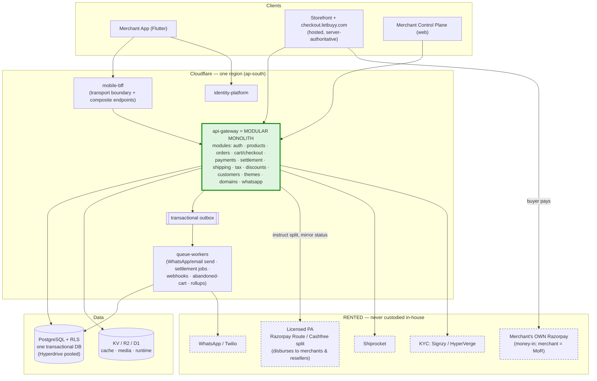

# LETBUYY — FINAL ARCHITECTURE FREEZE

> **Document type:** Architecture Review Board decision record — the freeze before implementation begins.
> **Date:** 2026-06-08
> **Inputs reconciled:** `LETBUYY_CHECKOUT_PLATFORM_MASTER_PLAN.md`, `LETBUYY_CHECKOUT_PLATFORM_CTO_REVIEW.md`, `LETBUYY_MERCHANT_OS_MASTER_AUDIT.md`, `LETBUYY_MERCHANT_OS_EXEC_ONEPAGER.md`, `LETBUYY_BUSINESS_MASTER_PLAN.md`, `PRODUCTION_READINESS_DEEP_AUDIT_2026-06-07.md` (+ V1).
> **Mandate:** Challenge and *adjust* the current architecture. Do not invent new systems. Do not expand scope. Do not design for 1,000,000 merchants.
> **Design envelope (the only three numbers that govern this freeze):** first **100**, first **1,000**, first **10,000** merchants — India only.

---

## 0. THE FREEZE IN ONE PAGE

LetBuyy's problem was never engineering capability — it was **designing the destination instead of the road.** The checkout master plan benchmarks Shopify's *end state* (13 services, pods, Wasm extensibility, an app ecosystem) and proposes a scale-model of it with ~0 merchants. This board freezes a far smaller system.

**The five-word verdict: ship a monolith, rent rails.**

The frozen architecture is: **one modular monolith (`api-gateway`) + two already-real satellite processes (`queue-workers`, `mobile-bff`) + one transactional Postgres with RLS, on Cloudflare, in one region, with merchants bringing their own Razorpay and a licensed PA (Razorpay Route / Cashfree) custodying and disbursing all money.** Everything else on the original roadmap is deferred or rejected.

**The four things that must become real before beta (all already named in prior docs — none are new systems):**

1. **Mobile login** — replace the placeholder Turnstile config. (Blocks 100% of usage today.)
2. **Money-out that actually moves** — a thin split-instruction + statement + reconciliation layer over Razorpay Route/Cashfree (the PA disburses; LetBuyy never custodies) backed by a **double-entry settlement ledger.**
3. **Server-authoritative cart/checkout-session** — replace the client-only React cart.
4. **WhatsApp order-lifecycle + COD confirmation** — the India wedge, wired to `order.paid`/`order.shipped`.

Plus two non-negotiable security deploys: the **payment-forgery fix** and the **cross-tenant RLS fix** (both committed; confirm live).

**The single most important *decision* in this freeze is regulatory, not technical: LetBuyy does not custody or disburse funds.** Merchants are the merchant-of-record on their own PSP; the licensed PA moves money. This one decision deletes an entire quarter of "payout engine" work and removes the unlicensed-payment-aggregator risk.

---

## 1. PHASE 1 — ARCHITECTURE FREEZE REVIEW

Verdict legend: **KEEP** (as-is) · **ADJUST** (keep the intent, change the shape) · **DEFER** (right idea, wrong time) · **REJECT** (do not build in the 100→10k envelope).

| # | Decision | Verdict | Why |
|---|---|---|---|
| 1 | **Shared Checkout** (one hosted checkout surface) | **ADJUST** | Keep *one server-authoritative hosted checkout*, but it is a **set of routes inside the monolith**, not a separate "checkout platform." A single checkout origin is good for PCI scope and consistency. Reject the cross-merchant *shared vault* (Shop-Pay analog) — years premature. |
| 2 | **checkout.letbuyy.com** (dedicated checkout origin) | **KEEP** | A separate origin is the cheapest way to (a) shrink PCI scope, (b) hold one server cart/session, (c) standardise the buyer experience across merchant custom domains. Serve it from the monolith/storefront read-path — *not* a `checkout-runtime` service (that reserved service stays empty). |
| 3 | **Merchant-owned payment credentials** (Model C — merchant's own Razorpay) | **KEEP — load-bearing** | This is the single most important regulatory call. The merchant is merchant-of-record on their own PSP; LetBuyy never custodies money-in. It is the India-correct, license-light model and the foundation of the 0%-fee promise. (Master plan §"Model C".) |
| 4 | **Modular Monolith** | **KEEP — emphatically** | The CTO review is right: Shopify *is* a modular monolith (Rails + Packwerk), sharded only after years at scale. Clean `api-gateway` into enforced module boundaries. 13 services for a 6–9 person team is a distributed monolith — the coupling of a monolith with the ops pain of microservices. |
| 5 | **Cloudflare-first infrastructure** | **KEEP** | Workers + Queues + D1/KV/R2 + Hyperdrive + Durable Objects is already real, cheap, and edge-close to India. No reason to move. Use the **already-paid Hyperdrive binding** (currently unused) for pooled Postgres. |
| 6 | **PostgreSQL** (one transactional DB) | **KEEP** | One transactional DB with RLS is correct for this scale. Pick `store_id` as the eventual shard axis *on paper*; do not shard now. |
| 7 | **Supabase** | **ADJUST (keep, with an exit option)** | Fine for 100→1,000. Two known risks: (a) **OLTP write-amplification** is the first cost bottleneck, not Cloudflare requests; (b) the gateway runs as **service-role, bypassing RLS** — one missing `site_id` filter = cross-tenant leak. Mitigate with query-lint + sampling now; keep a managed-Postgres (RDS/Cloud SQL) exit documented for the 10k horizon. |
| 8 | **WhatsApp-first commerce** | **KEEP — and ELEVATE to P0/P1** | Make `channel` (web/whatsapp/instagram/pos) a **first-class dimension on orders**. WhatsApp is the wedge, not a notifier. But scope it down to order-lifecycle + COD-confirm first (see Phase 5). |
| 9 | **Reseller system** | **DEFER to P2** | Build reseller *links* for a merchant's own store — never a reseller *network* (GlowRoad is a tombstone). Gated behind the real payout rail; pointless before money moves. |
| 10 | **Subscription-only pricing** | **ADJUST** | Subscription alone will not cover CAC on ₹299–₹999 merchants. Keep subscription as the spine, add **adjacency margin** (WhatsApp credits 35–70%, shipping spread, AI credits, marketplace rev-share later). |
| 11 | **Zero transaction fee model** | **KEEP as the permanent headline; ADJUST the free-tier reality** | 0% on UPI/prepaid forever is the wedge and costs almost nothing (UPI MDR ≈ 0). **Kill the 2.5% GMV free-tier rake** (`plans.gmv_percentage = 2.50`) immediately. Cap free-tier cost with usage caps + an optional COD handling fee, not a GMV tax. |
| 12 | **Merchant OS concept** | **KEEP — re-IA to operator-first** | The concept is right and the control plane is real. Reorder the IA so Orders/Customers/Money are primary (today they're buried under Settings). Ship a thin beta subset (Phase 4). |
| 13 | **Checkout Platform concept** | **ADJUST → "checkout modules," not a platform** | Kill the 13-service "platform" framing. It is order + payment + cart + tax + shipping + discount **modules inside the monolith** plus the hosted checkout origin. |
| 14 | **Internal Operations OS concept** | **DEFER (build only the beta-critical sliver)** | At 100 merchants you run ops on SQL + a thin admin. Build only: manual refund, **maker-checker on any manual payout**, a dispute/chargeback log, and basic merchant KYC review. Risk-scoring/T&S/support-desk full build is P2+. |

---

## 2. PHASE 2 — WHAT SHOULD NOT BE BUILT

The expensive temptations. For each: why not now, and the **scale trigger** that would reopen the question.

| Capability | Verdict | Why not now | Reconsider at |
|---|---|---|---|
| **3rd-party App Marketplace** | REJECT (for now) | An empty mall: no merchants, no app demand. The bridge/OAuth backend already exists; the *catalog* is the unbuilt part and has no supply. | ~5,000 merchants **with** inbound developer demand |
| **Checkout Extensions** | REJECT | No merchant at this scale needs to inject UI into checkout; it forces a sandbox + versioning + review burden. | 10,000+ merchants + ecosystem |
| **Wasm extensibility runtime** | REJECT | Shopify built this after a decade. Pure cost, zero near-term merchant value. Design *seams* only. | Not in the 100→10k envelope |
| **Workflow / Flow engine** | REJECT | Automations can be a handful of hard-coded triggers (order.paid → WhatsApp) — not a general engine. | 10,000+ merchants |
| **Multi-region** | REJECT | India-only beta. One region (ap-south). Multi-region adds replication + consistency cost for no buyer. | Data-residency mandate or 10k+ with global merchants |
| **Event Sourcing** | REJECT | A transactional **outbox** gives you reliable events without the rebuild-from-log complexity. | Not in envelope |
| **CQRS** | REJECT | One DB + read replica for storefront is enough. CQRS is a solution to a scale problem you don't have. | Not in envelope |
| **Service Mesh** | REJECT | You have ~3 processes, not 30. A mesh is infrastructure for a problem you've chosen not to create. | Not in envelope |
| **Microservices (13-service plan)** | REJECT | A distributed monolith for a 6–9 person team: 13 CI/CD pipelines, cross-service transactions, 4+ checkout hops where a monolith has 0. | Split a module out *only* when its scaling or team boundary forces it |
| **Self-custodied payout/disbursement engine** | REJECT (regulatory) | Moving money in India needs a PA/PG licence. Rent Razorpay Route / Cashfree split; the PA disburses, you instruct. | Never build in-house in this envelope |
| **Cross-merchant wallet / Shop-Pay vault** | REJECT | Network effect you can't seed; PCI + fraud surface. | Millions of buyers |
| **Developer platform / CLI / API explorer** | DEFER | ~80% of the gap is DX polish for an audience that isn't here yet. | With the app marketplace, 5k+ |
| **Gift cards as a full engine** | DEFER | Schema + a 1,278-LOC ledger migration exist but are **archived**. Ship later as a *tender* on the payment ledger. | P2, post-settlement-ledger |
| **Draft orders / B2B / price lists** | DEFER | Niche for the micro-seller wedge. | P2/P3 |
| **Fraud ML scoring** | REJECT (use a heuristic) | Cold-start: no labelled data. The real India fraud lever is **COD confirmation over WhatsApp**, not a model. | 10k+ with order history |
| **Reserved services** (`checkout-runtime`, `search-service`, `media-service`, `notification-service`, `event-bus`, `analytics-pipeline`) | KEEP EMPTY | They are manifest-only today. Their behavior lives in `api-gateway` + `queue-workers`. Don't fill them. | Extract only on a proven hot-path |

**One-line rule for Phase 2:** *if it imitates Shopify's end-state and no beta merchant would notice its absence, do not build it.*

---

## 3. PHASE 3 — CHECKOUT SYSTEM ADJUSTMENTS

### 3.1 What is MISSING (build, in order)

1. **Server-authoritative cart / checkout-session** — the client-only React cart cannot enforce price, discount, inventory, min-order, or B2B rules safely. *This is P0.* One entity, in the monolith, producing a signed handoff to the hosted checkout.
2. **Double-entry settlement ledger** — orders↔payouts reconciliation. Today the wallet balance is arithmetic on fiction. *P0.*
3. **PA-split disbursement mirror** — a thin split-instruction + statement + reconciliation layer over Razorpay Route/Cashfree. The PA disburses; LetBuyy mirrors status (`initiated→processing→settled→failed`). *P0.*
4. **Real carrier labels** — replace `createScaffoldLogisticsProvider` (fake `logistics.test.letbuyy.store` PDFs) with one real carrier (Shiprocket). *P0/P1.*
5. **Abandoned checkout** — persist cart+email at email-capture, 10-min timer, recovery event consumed by `queue-workers`. *P1, pure revenue.*
6. **COD/RTO risk via WhatsApp confirmation** — heuristic, not ML. *P1.*
7. **GST place-of-supply + invoice** — CGST/SGST/IGST by intra/inter-state, HSN rates, GSTIN, e-invoice. Harder than US sales tax; the archived audit shows invoice logic exists — productionise it. *P1.*

### 3.2 What is OVERBUILT (cut)

- The **13-service decomposition** → collapse into modules in the monolith.
- A separate **`checkout-runtime`, `notification-service`, `email-service`, `search-service`** → keep checkout/notifications in `api-gateway` + `queue-workers`; search is Postgres FTS at this scale.
- **Checkout extension runtime / token service for extensions** → not now.
- **Fraud ML scoring engine** → replace with COD-confirm heuristic.
- **Multi-PSP normalisation across 7 providers** → support **Razorpay + UPI + COD** for beta; add Cashfree for split-settlement. Defer Stripe/PayPal/PhonePe normalisation.

### 3.3 What to SIMPLIFY

- **One payments adapter interface**, two live implementations (Razorpay for money-in via the merchant's own keys; Cashfree/Razorpay-Route for split-settlement). Everything else behind the same interface, dormant.
- **One hosted checkout flow** (single-page), server-validated at confirm (`FOR UPDATE` inventory + coupon/gift-card re-check already race-safe — keep that).
- **Transactional outbox now** for DB↔event dual-write — the one piece of "distributed systems" worth adding, because it makes WhatsApp/email/settlement events reliable without an event-sourcing rebuild.

### 3.4 What to POSTPONE

Checkout extensions, gift-card tender, draft orders, post-purchase upsell surface, multi-region, the cross-merchant vault, and any PSP beyond Razorpay/Cashfree/UPI/COD.

**Checkout one-liner:** *build the parts that must be **correct and safe** (server cart, settlement ledger, signed handoff, PA-split), rent or defer the parts that are merely **elegant** (extensions, vault, 13 services).*

---

## 4. PHASE 4 — MERCHANT OS ADJUSTMENTS

| Module | Before beta? | Call | Note |
|---|---|---|---|
| Dashboard | Yes (thin) | KEEP | Single composite endpoint (add BFF fan-in) — today it's N round-trips. |
| Products | Yes | KEEP | Already strong. |
| Orders | Yes | KEEP | Already strong; add export later. |
| Inventory | Yes (basic) | KEEP | POs/transfers can stay; not beta-critical but already built. |
| Customers | Yes | KEEP | Strong; LTV/RFM later. |
| Themes | Yes | KEEP | The differentiator — protect it. |
| Domains | Yes | KEEP | Strong. |
| Discounts | Yes | KEEP | On-phone creation is a win. |
| **Payments (connect own Razorpay)** | **Yes** | KEEP | The money-in path; un-placeholder the key. |
| **Payouts + settlement statement** | **Yes** | ADJUST | Must reflect *real* PA-split status, not sandbox `success`. |
| **WhatsApp order updates** | **Yes** | ELEVATE | Order-lifecycle + COD-confirm = the wedge. |
| Staff | Yes (basic) | KEEP | Enforce the stored `employee_permissions` scopes (today role-coarse). |
| Billing/Subscription | Yes | KEEP | Wire to published pricing. |
| Gift Cards | No | DEFER | Ship as tender post-ledger. |
| Analytics (advanced) | No | DEFER | Dashboard rollup is enough for beta. |
| CMS (depth) | No | DEFER | Pages/blog exist; fine. |
| AI Studio | No | DEFER | Turn on product-copilot in P2. |
| Apps marketplace | No | DEFER | Empty catalog. |
| Localization / Metafields | No | DEFER | Hard-blocked today; leave blocked. |
| Reseller | No | DEFER (P2) | Links, not network. |

**REMOVE outright:** the **parallel "parity" read-only feature catalog** (`merchant_feature_screen.dart` / `merchant_feature_definitions.dart`) — it duplicates real screens to inflate apparent coverage and confuses merchants. Keep `operator-app`/`shopper-app` **reserved (empty)**.

**REDESIGN:** the information architecture from **store-builder-first → operator-first.** A merchant opens the app to *run today's business* (orders, money, customers), not to rebuild their theme. Add the **provider-mode honesty badge** across every money/fulfillment surface so a sandbox no-op never reads as success.

---

## 5. PHASE 5 — WHATSAPP COMMERCE REVIEW

Ranked by **(ROI × merchant demand) ÷ engineering effort**. Effort: XS ≤1wk, S 1–3wk, M 1–2mo, L quarter.

| Capability | ROI | Effort | Merchant demand | Verdict |
|---|---|---|---|---|
| **Order-lifecycle messages** (paid/shipped/delivered) | ★★★★★ | S | ★★★★★ | **P0/P1 — build first** |
| **COD confirmation** (reply-to-confirm) | ★★★★★ | S | ★★★★★ | **P1 — doubles as the fraud lever** |
| Customer support (shared inbox) | ★★★☆☆ | M | ★★★★☆ | P2 |
| Broadcasts (consented audiences) | ★★★★☆ | M | ★★★★☆ | P2 (monetised — 35–70% credit margin) |
| Campaigns (scheduled marketing) | ★★★☆☆ | M | ★★★☆☆ | P2 |
| Catalog sync (Meta catalog) | ★★☆☆☆ | L | ★★★☆☆ | P3 |
| WhatsApp checkout (in-thread pay) | ★★☆☆☆ | L | ★★★☆☆ | P3 |

**The smallest WhatsApp feature set that creates a durable India advantage:**

> **Order-lifecycle utility messages + COD confirmation, wired to the outbox on `order.paid` / `order.shipped` / `order.delivered`, with a consent (opt-in) ledger.**

That is two S-sized features. Utility messages are ~₹0.125 (free inside the 24-hour window), so the cost is trivial and the differentiator is real and durable — it is exactly what Shiprocket Engage and QuickSell are racing toward, and what "your store, settled T+1, with WhatsApp updates by default" promises. Everything else (broadcast, campaigns, catalog, in-thread checkout) is P2/P3 upside.

---

## 6. PHASE 6 — RESELLER SYSTEM REVIEW

**Reframe the proposal.** "Merchant-owned reseller network" is too big and edges toward the dead GlowRoad model. Build **reseller links for a merchant's own store**, universal across WhatsApp/Instagram/Facebook/Telegram/offline.

### 6.1 Minimum viable reseller architecture (P2 — gated behind the real payout rail)

| Component | MVP scope | Note |
|---|---|---|
| Reseller registration | A merchant invites a reseller; reseller gets an account scoped to that store | reuse identity |
| Tracking links | One unique link (or coupon) per reseller | `reseller_links`, `attribution_events` |
| Attribution | Last-click on the order at checkout | simplest correct model |
| Commission engine | Flat % or per-product rule, computed on `order.paid` | `reseller_commissions` |
| Payouts | **Reuse the PA-split rail** — the PA pays the reseller; LetBuyy instructs the split | no new money system |

### 6.2 Defer to P3 (or never in the envelope)

Multi-tier referral, leaderboards, reseller analytics dashboards, multi-channel attribution beyond link/coupon, and anything resembling a *reseller marketplace/network*. **Reject the network entirely** — Meesho owns that motion; LetBuyy's job is to let a merchant pay their own resellers, not to become a marketplace.

**Reseller one-liner:** *links + attribution + commission + PA-split payout — and not one feature more until a merchant asks for it with revenue attached.*

---

## 7. PHASE 7 — BUSINESS MODEL REVIEW

### 7.1 Pricing (KEEP the 5-tier shape, published)

| Tier | Price/mo | For | Headline txn fee |
|---|---|---|---|
| Free | ₹0 (capped) | First-time / social sellers | **0%** (kill the 2.5% GMV rake) |
| Starter | **₹299** | Solo sellers going pro | **0%** |
| Growth | **₹799** | Growing D2C (abandoned cart, RTO/COD gate) | **0%** |
| Pro | **₹2,499** | Multi-channel brands (reseller links, IG/WA, API) | **0%** |
| Enterprise | Custom | High-GMV / B2B | **0%** |

### 7.2 Monetisation reality (subscription is the spine, adjacencies are the muscle)

UPI MDR ≈ 0, so there is **almost no payment margin to capture** — which is the wedge *and* the trap. Fund the business on: **WhatsApp credit markup** (resell ₹0.88 marketing at ₹1.20–1.50, 35–70% GM), **shipping aggregation spread** (resell Shiprocket/Delhivery rates), **AI content credits** (cost+40%), **theme/app marketplace rev-share** (15–20%, later), **domain reselling**, and **lending/working-capital referral** (much later). Subscription gross margin is ~85–92% (marginal cost ≈ ₹15–60/active merchant/mo).

### 7.3 The transaction-fee question — recommendation

**Stay 0% on prepaid/UPI on every paid tier, permanently. Do NOT introduce a blanket transaction fee later.**

- *Why permanent:* the 0% promise is the one claim that simultaneously beats Shopify (steerage), Instamojo (2–5%), and your own current free-tier rake. Introducing a fee later would forfeit the single wedge the whole strategy rests on — and on UPI there is almost no margin to harvest anyway, so a fee buys little and costs the brand.
- *Where a fee is acceptable:* (a) an **optional, merchant-set COD handling fee** (passed to the buyer) — COD has real cost (RTO, cash handling) and merchants expect it; (b) a **free-tier cost ceiling** via usage caps and a small COD/convenience fee — never a GMV rake. Paid tiers stay clean 0%.
- *Net:* 0% is a marketing asset, not just a price. Say it on every page. Monetise adjacencies, not the sale.

---

## 8. PHASE 8 — 100-BETA-MERCHANT REALITY TEST

**Assume 100 merchants, 1,000 orders/day (~30k/mo), India only.**

### 8.1 The scale is trivial — stop architecting for it

- 30k orders/mo is nothing for Postgres or Cloudflare Workers. **No partitioning, no sharding, no read replica, no CQRS, no multi-region is required.** (Do add the **outbox** and *write down* `store_id` as the future shard axis — design seams, not infrastructure.)
- The first real cost bottleneck is **Supabase OLTP write-amplification + the unused Hyperdrive binding**, not request volume. Cheap to fix (sample request logs, use Hyperdrive, edge-cache storefront reads).

### 8.2 What is ACTUALLY required for the first 12 months

**Must exist (P0/P1):** fixed mobile login · the two security deploys (payment-forgery + RLS) · server cart/checkout-session · real payouts via PA-split + double-entry settlement ledger · one real carrier · GST invoice · WhatsApp order-lifecycle + COD confirm · merchant KYC (real provider) · provider-mode honesty badge · basic monitoring/alerting · backups + a restore drill.

**Thin internal ops (build the sliver):** manual refund, **maker-checker on manual payouts**, a dispute/chargeback log, merchant-KYC review queue. Run everything else on SQL.

### 8.3 Operational, support & compliance risks (the things that actually bite at 100)

- **COD/RTO cash leakage** — the #1 India operational risk. Mitigate with COD-confirm-over-WhatsApp + an RTO gate on Growth+.
- **Reconciliation load** — without the settlement ledger, finance is manual and error-prone. Ledger is P0 *because* of this, not for elegance.
- **Support via WhatsApp** — beta support will arrive on WhatsApp; a shared inbox is P2, but route beta support through a single number from day one.
- **Compliance:** *do not custody funds* (PA-split) — the one decision that keeps LetBuyy out of payment-aggregator licensing; **GST e-invoicing**; **DPDP Act** consent for WhatsApp opt-in and customer data; **PCI scope minimised** by merchant-own-PSP + hosted fields on `checkout.letbuyy.com`.
- **Tenant-isolation risk** — gateway runs as service-role; one missing `site_id` filter leaks across stores. Add the query-lint guard before onboarding merchant #1.

### 8.4 What is NOT required for 12 months

App marketplace, checkout extensions, Wasm runtime, multi-region, event sourcing/CQRS, service mesh, fraud ML, developer platform, reseller *network*, gift-card engine, cross-merchant wallet, AI "store operator," and 10 of the 13 proposed services.

---

## 9. PHASE 9 — FINAL FROZEN ARCHITECTURE

### 9.1 Decisions Approved (KEEP)

1. Modular monolith (`api-gateway`) + `queue-workers` + `mobile-bff` + one Postgres (RLS) on Cloudflare, one region.
2. Merchant-owned payment credentials (merchant = MoR on their own Razorpay).
3. `checkout.letbuyy.com` as a single hosted, server-authoritative checkout origin (served from the monolith/storefront path).
4. PostgreSQL + Supabase (with documented exit), Hyperdrive pooling, R2/KV/D1.
5. WhatsApp as a first-class commerce channel (`channel` dimension on orders).
6. 0% transaction fee as the permanent headline on all paid tiers.
7. 5-tier published pricing (Free/₹299/₹799/₹2,499/Custom).
8. The strong, already-real mobile surfaces: theme editor, products, orders, inventory, customers, domains, discounts, staff.

### 9.2 Decisions Adjusted

1. "Checkout Platform" → **checkout modules in the monolith** (not 13 services, not `checkout-runtime`).
2. "Payout-service that disburses" → **thin split-instruction + statement + reconciliation over a licensed PA** (LetBuyy never custodies).
3. Subscription-only → **subscription + adjacency margin** (WhatsApp/shipping/AI/marketplace).
4. Merchant OS IA → **operator-first** (Orders/Money/Customers primary).
5. WhatsApp → scoped to **order-lifecycle + COD-confirm** first.
6. Free tier → **kill the 2.5% GMV rake**, cap by usage + optional COD fee.
7. Supabase → keep **with a query-lint tenant guard** and a documented managed-Postgres exit.

### 9.3 Decisions Deferred

Reseller links (P2) · gift cards as tender (P2) · WhatsApp broadcasts/campaigns/inbox (P2) · AI copilots (P2) · advanced analytics/RFM (P1/P2) · app-store catalog (P2) · DB partitioning (P2, at ~1k–10k) · developer platform (P3) · WhatsApp catalog/checkout (P3) · draft orders/B2B (P2/P3) · internal risk/T&S/support desk full build (P2).

### 9.4 Decisions Rejected (not in the 100→10k envelope)

13 microservices · self-custodied payout engine · checkout extensions · Wasm runtime · workflow engine · multi-region · event sourcing · CQRS · service mesh · cross-merchant wallet · fraud ML · 3rd-party app marketplace · reseller *network* · filling the 6 reserved services.

### 9.5 Required P0 features (weeks 0–8 — "make it exist")

| # | Feature | Owner | Note |
|---|---|---|---|
| P0-1 | Fix mobile login (real Turnstile + secrets) | Mobile | 0%→usable |
| P0-2 | Deploy payment-forgery + RLS fixes; unique index on `provider_payment_id` | Platform | confirm *live* |
| P0-3 | Real payouts via PA-split (Razorpay Route/Cashfree) | Finance | PA disburses; LetBuyy instructs |
| P0-4 | Double-entry settlement ledger | Finance | orders↔payouts reconciliation |
| P0-5 | Server-authoritative cart/checkout-session | Checkout | signed handoff to hosted checkout |
| P0-6 | Provider-mode honesty badge (live/sandbox/scaffold) | Platform | ban silent `success` |
| P0-7 | Real KYC (Signzy/HyperVerge) | Identity | gate for payouts |
| P0-8 | One real carrier (Shiprocket) — replace scaffold labels | Fulfillment | real AWB/label |
| P0-9 | Transactional outbox | Platform | reliable events for WhatsApp/email/settlement |
| P0-10 | Finish domain migration; pick `.store` or `.com` | Platform | 143 literals |

### 9.6 Required P1 features (months 2–6 — "operate & grow")

WhatsApp order-lifecycle + COD-confirm (with consent ledger) · abandoned-checkout recovery · triggered transactional email/WhatsApp on `order.*` · GST place-of-supply + invoice · COD/RTO heuristic gate · NDR/RTO + COD reconciliation · push wired · CRM LTV/RFM + dynamic segments · fine-grained RBAC enforcement · BFF composite endpoints (dashboard fan-in).

### 9.7 Required P2 features (months 6–12 — "differentiate")

WhatsApp broadcasts + support inbox + consent · marketing audience builder + campaigns · AI product + theme copilots · reseller links + attribution + commission (PA-split payout) · checkout settings + funnel analytics in app · DB partitioning of hot tables (orders, ledger_entries, payment_transactions, webhook_deliveries) · gift cards as tender · first-party app catalog seeding.

### 9.8 Required P3 features (year 2 — "scale")

Reseller payouts/leaderboards/multi-tier · loyalty/rewards · WhatsApp catalog + in-thread checkout · unified customer inbox · AI support/analytics agents · B2B price lists · internal risk/T&S/support tooling with reviewer UIs · read replica + chosen shard execution if metrics demand.

### 9.9 Technical Debt Register (carry into implementation)

| ID | Debt | Severity | Action |
|---|---|---|---|
| TD-1 | Stubbed providers return `success` (payouts/labels/KYC) | S0 | Provider-mode honesty badge (P0-6) |
| TD-2 | Client-only cart; checkout logic smeared across gateway | S0 | Server cart/session (P0-5) |
| TD-3 | No settlement ledger (only dead `legacy/firebase`) | S0 | Double-entry ledger (P0-4) |
| TD-4 | Gateway service-role bypasses RLS | S1 | Query-lint `site_id` guard |
| TD-5 | Parallel "parity" UI duplicates real screens | S2 | Delete |
| TD-6 | Archived gift-card (`048_*`) + returns (`049_*`) migrations | S2 | Re-activate or delete — don't leave half-real |
| TD-7 | Duplicate `users`/`users_custom`; `orders.store_id` + `site_id` | S1 | Normalise to `site_id`/`sites` |
| TD-8 | ~167–173 validators, ~8 real; ~90 import cycles reported as 0 | S2 | Add ≥1 build/execute/query check; fix `madge` cycles |
| TD-9 | 143 hardcoded `letbuyy.store` literals | S1 | Finish migration (P0-10) |
| TD-10 | ~3 tests for ~55K LOC mobile | S2 | Widget tests for login/orders/payouts/checkout |
| TD-11 | No transactional outbox (dual-write risk) | S1 | Add outbox (P0-9) |
| TD-12 | Reserved services imply a topology that doesn't exist | S3 | Keep empty; document as reserved |

### 9.10 Risk Register

| ID | Risk | Severity | Mitigation |
|---|---|---|---|
| R1 | Unlicensed payment-aggregator exposure if LetBuyy custodies funds | S0 | PA-split; explicit "we do not custody" stance |
| R2 | Stubbed rails report success → merchant believes paid/shipped | S0 | Honesty badge (P0-6) |
| R3 | Payment forgery (verify checks only order_id\|payment_id) | S0 | Confirm fix live + unique index (P0-2) |
| R4 | Cross-tenant RLS hole / service-role bypass | S0/S1 | Confirm Migration 107 live; query-lint guard |
| R5 | Mobile login unusable on prod | S0 | Real Turnstile (P0-1) |
| R6 | COD/RTO cash leakage | S1 | COD-confirm-over-WhatsApp + RTO gate |
| R7 | Settlement reconciliation errors (no ledger) | S1 | Double-entry ledger (P0-4) |
| R8 | DPDP non-compliance on WhatsApp opt-in/customer data | S1 | Consent ledger; data-deletion path |
| R9 | GST mis-calc (place-of-supply/HSN) | S1 | HSN-rate table + place-of-supply engine + e-invoice |
| R10 | Single-region DB SPOF | S2 | Backups + tested restore; read replica at P3 |
| R11 | Scope creep back toward 13 services / marketplace | S2 | This freeze is the guardrail; ARB sign-off to deviate |

### 9.11 Cost Impact

- **Build:** P0 ≈ **~28 engineer-weeks (~8 calendar weeks parallelised)**; P1 ≈ ~50 weeks; P2 ≈ ~50 weeks. Rejecting the 13-service plan, the extensibility runtime, the disbursement engine and multi-region removes **multiple quarters** of work and 13 CI/CD pipelines.
- **Run:** marginal cost ≈ **₹15–60 / active merchant / month** (excl. metered WhatsApp/AI) → ~85–92% subscription GM. Supabase Pro (~$25/mo) + Cloudflare usage dominate; per-merchant share is small. The cost *risks* are an uncapped free tier and bundling metered WhatsApp/AI — both handled by caps + credit metering.
- **Vendors to onboard for P0:** Cloudflare Turnstile, a PA with split (Razorpay Route / Cashfree), a KYC provider (Signzy/HyperVerge), Shiprocket. All pay-as-you-go.

### 9.12 Team Impact

- **A 6–9 person team can ship this** *because* it is a monolith. The 13-service plan would have required either a much larger team or a permanently slower one (13 pipelines, distributed debugging, cross-service transactions).
- **Suggested squad shape for P0:** Finance/Payments (P0-3/4, the critical path) · Checkout (P0-5/9) · Mobile (P0-1) · Platform/Sec (P0-2/6/10) · Fulfillment/Identity (P0-7/8). One DB-owning engineer enforces the module boundaries + RLS discipline.
- **Operating model:** one transactional DB and enforced Packwerk-style module boundaries keep local dev to a single process. Extract a service only when a module's scaling or team boundary *forces* it — with ARB sign-off, measured against this freeze.

### 9.13 Final Architecture Diagram (frozen)

---

## 10. THE FROZEN POSITION (sign-off statement)

> **LetBuyy will ship a modular monolith on Cloudflare + Postgres, in one region, for India, where merchants bring their own Razorpay and a licensed payment aggregator custodies and disburses all money. The first build is the four rails that make a business runnable — login, money-out (PA-split + settlement ledger), server checkout, and WhatsApp order updates — plus the two security deploys. Everything that imitates Shopify's end-state — 13 services, extensions, Wasm, marketplace, multi-region, a disbursement engine, a reseller network — is rejected or deferred until a specific scale or a specific merchant with revenue attached forces the question. We prefer implementation over architecture, revenue over complexity, and operational reality over engineering dreams.**

Any deviation from this freeze requires Architecture Review Board sign-off, measured against the 100 → 1,000 → 10,000-merchant envelope — not against Shopify.

*End of LETBUYY_FINAL_ARCHITECTURE_FREEZE.*
