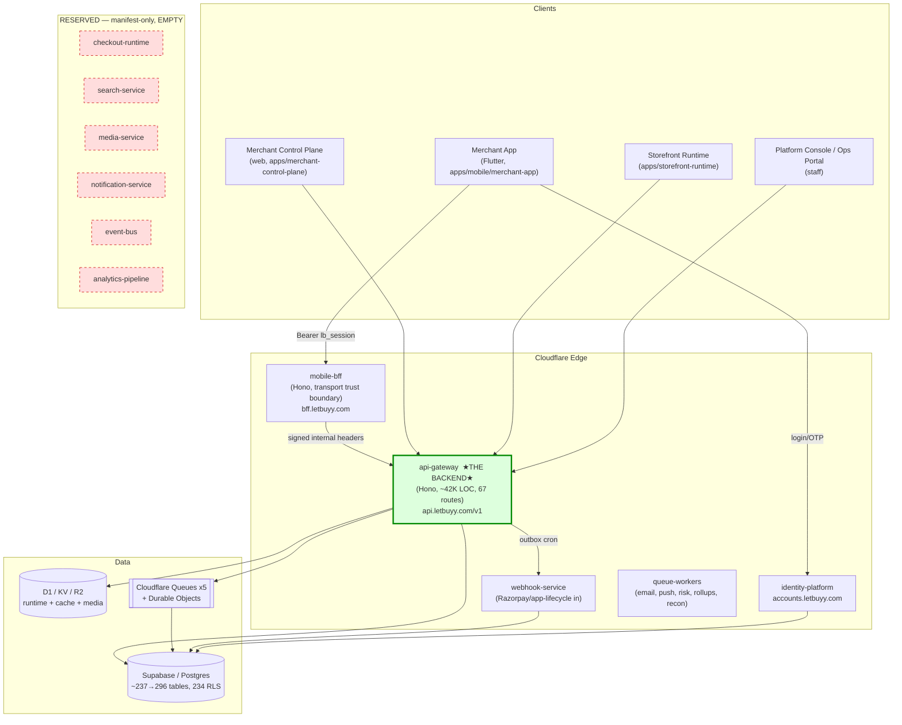
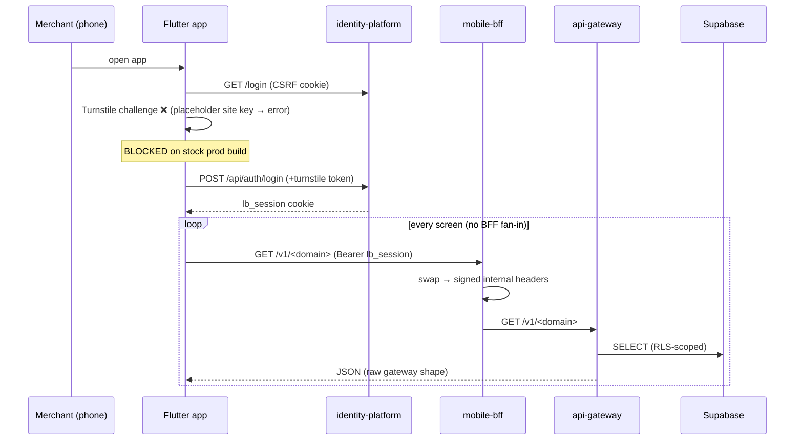
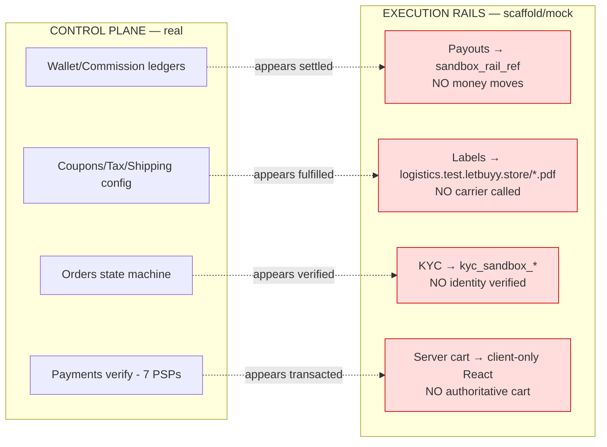

# LETBUYY MERCHANT OS — MASTER AUDIT, GAP ANALYSIS & 3-YEAR IMPLEMENTATION BLUEPRINT

> **Author:** Principal-Staff-Engineer / Commerce-Systems-Architect audit pass
> **Date:** 2026-06-08
> **Scope:** The complete LetBuyy merchant ecosystem, viewed through the lens of one question — *can a merchant run 100% of their business from mobile?*
> **Status of this document:** Canonical merchant-side audit. Supersedes `docs/LETBUYY_MERCHANT_MOBILE_MASTER_REPORT.md` (it is broadened from "mobile app" to "Merchant Operating System"). Stays consistent with `LETBUYY_CHECKOUT_PLATFORM_MASTER_PLAN.md`, `LETBUYY_CHECKOUT_PLATFORM_CTO_REVIEW.md`, `LETBUYY_BUSINESS_MASTER_PLAN.md`, `PRODUCTION_READINESS_DEEP_AUDIT_2026-06-07.md`, and `docs/LETBUYY_INTERNAL_OPERATING_SYSTEM_MASTER_REPORT.md`.
> **Method:** Direct source inspection of `apps/`, `services/`, `packages/`, `database/`, plus five parallel code investigators and direct grep verification of every load-bearing claim. Evidence is cited as `path:line` throughout. This audit treats LetBuyy as a direct competitor to Shopify, Dukaan, Razorpay, Shiprocket, Zoko, QuickSell, and Instamojo, and protects no prior architecture decision.

---

## 0. TABLE OF CONTENTS

1. Executive Summary & The Verdict
2. Master Scorecard
3. Methodology, Evidence Base & Classification Legend
4. **Phase 1** — Architecture Reverse-Engineering (system, service & data-flow maps)
5. **Phase 2** — Merchant App Feature Inventory (the full matrix)
6. **Phase 3** — Shopify Mobile Parity Analysis
7. **Phase 4** — Checkout System Integration Audit
8. **Phase 5** — WhatsApp Commerce Audit & Roadmap
9. **Phase 6** — Reseller / Social Commerce Audit & Roadmap
10. **Phase 7** — Customer CRM Audit
11. **Phase 8** — Marketing OS Audit
12. **Phase 9** — Finance OS Audit
13. **Phase 10** — Shipping OS Audit
14. **Phase 11** — AI Commerce Audit
15. **Phase 12** — Target Merchant OS Design (per-module blueprint)
16. **Phase 13** — Database Gap Analysis & Cleanup Plan
17. **Phase 14** — Documentation Debt Audit & Single-Source-of-Truth
18. **Phase 15** — 3-Year Implementation Roadmap (P0–P4)
19. Risk Register
20. Cost Analysis
21. Brutal Review (the closing argument)
22. Appendix A — Evidence Index
23. Appendix B — Reconciliations & Corrections to prior audits

---

## 1. EXECUTIVE SUMMARY & THE VERDICT

### 1.1 The one question

**Can a LetBuyy merchant run 100% of their business from mobile today? No. Two answers, two altitudes:**

- **On a stock production build, a merchant cannot run *0%* of their business — because they cannot log in.** The shipped `dart-defines/production.json` carries placeholder Cloudflare Turnstile credentials (`TURNSTILE_SITE_KEY` / `TURNSTILE_TOKEN` = `SKIP_NEEDS_HUMAN_*`), and the Turnstile challenge screen errors out instantly while `StoreAuthService` rejects any token that begins with `SKIP_NEEDS_HUMAN_`. Time-to-first-screen on a clean prod build is effectively zero. (`apps/mobile/merchant-app/dart-defines/production.json:7-8`; `apps/mobile/merchant-app/lib/services/store_auth_service.dart:323`; `.../screens/auth/turnstile_challenge_screen.dart:26`.)
- **If you hand-inject a real Turnstile site key and the platform secrets, a merchant can perform roughly 50–55% of day-to-day operational tasks from the phone** — and a few of them better than Shopify's own app. But the *money-out, fulfillment, growth, and after-sale* halves of "running a business" are missing or faked: **payouts don't disburse, shipping labels are fabricated, KYC verification is stubbed, there is no marketing/campaign tooling, and resellers do not exist.**

So the honest headline is: **LetBuyy has built an impressive merchant *control surface* sitting on top of hollow *execution rails*.** The phone can *describe* a business (products, orders, prices, themes, staff) with surprising depth. It cannot yet *run* one end-to-end, because the rails that move money to the merchant and goods to the customer are scaffolds that return `success: true` without doing anything.

### 1.2 The five sentences a CTO needs

1. **The control plane is real and unusually deep.** A Dio-based typed Dart API client (`packages/dart/api_client`, ~2,700 LOC) fronts ~33 merchant domains with Bearer + `lb_session` cookie auth, `X-Store-ID`, idempotency keys and retries; the Flutter app has working CRUD across products, orders, inventory, customers, discounts, domains, themes, staff and CMS — far beyond scaffolding.
2. **The backend is a genuine multi-tenant SaaS, concentrated in one service.** `services/api-gateway` (~42K LOC, 67 route files, Supabase/Postgres + D1 + KV + R2 + queues + Durable Objects, real RBAC via `site_memberships`) is the *sole* commerce backend; the six "microservices" the topology advertises (`checkout-runtime`, `search-service`, `media-service`, `notification-service`, `event-bus`, `analytics-pipeline`) are **empty manifest-only placeholders**.
3. **Three money-and-fulfillment-critical capabilities are scaffolds masquerading as implemented:** payouts (`payout-transfer-adapter` returns `sandbox_<rail>_<ref>` and throws in live mode — *no money moves*), shipping labels (`createScaffoldLogisticsProvider` emits fake `logistics.test.letbuyy.store/*.pdf` URLs — *no carrier is called*), and KYC (`kyc_sandbox_*` synthetic IDs — *no identity is verified*). All three are wired end-to-end (routes, tables, idempotency, env vars) and need real adapter HTTP + live credentials, not new architecture.
4. **Two whole growth domains are essentially 0% built:** reseller/affiliate/social-commerce (zero code) and marketing/campaigns (only in-app notifications + coupons exist; no email, SMS, push campaigns, loyalty, or abandoned-cart recovery). WhatsApp is ~45% (real Twilio send/receive + templates; no broadcasts, campaigns, support inbox, or analytics).
5. **The governance signal is misleading.** ~167–173 validators "pass," but only ~8 do real program analysis; the rest string-match Markdown/JSON, 43+ self-declare "not-live-evidence," and `madge` finds ~89–93 real circular import cycles while the repo's own validator reports zero. Green CI here does **not** mean production-ready.

### 1.3 What is genuinely good (do not break these)

- **In-app visual theme + section editor** with live WebView preview and undo/redo (`screens/editor/section_editor_screen.dart`, 975 LOC) — *better than Shopify's mobile theme experience*, which is list-based.
- **Full discount and gift-card *creation* on the phone** — Shopify forces merchants to desktop for this.
- **Full staff administration on mobile** (create/invite/role/remove) — Shopify only *enforces* permissions on mobile, it doesn't let you *manage* staff there.
- **Inventory depth** — purchase orders, suppliers, transfers, barcode-scanned stock adjust — ahead of LetBuyy's own web admin and most India-first competitors.
- **A clean, fail-closed mobile BFF trust boundary** (`services/mobile-bff`, Hono on Cloudflare) that swaps the mobile session for signed internal headers — architecturally correct.

### 1.4 What is dangerously misleading inside the product

- **A parallel "parity" UI.** Every commerce feature exists *twice*: a real dedicated screen *and* a generic read-only `MerchantFeatureScreen` reachable via `/features/*` that just lists `/v1/<endpoint>` rows with no create/edit (`screens/parity/merchant_feature_screen.dart`, catalog `merchant_feature_definitions.dart`, 604 LOC). It inflates the apparent surface area to satisfy a "parity" narrative.
- **Stubbed providers report success.** Payouts, labels and KYC return `success: true` with sandbox references; the mobile client cannot distinguish a real transfer from a sandbox no-op without inspecting `provider_mode`. A merchant can believe they were paid when nothing happened. This is the single most dangerous product behavior in the system.

### 1.5 The strategic read (consistent with the business & checkout plans)

The bottleneck is **the backend execution rails and the configuration/secret gap, not the phone**. LetBuyy will not fail for lack of UI. The defensible wedge — *zero-steerage, UPI-native, WhatsApp-native, phone-first stores for Indian micro-sellers* — is real and under-served by Shopify (whose India steerage tax is the opening) and only partially contested by Razorpay (money) and Shiprocket (logistics) moving sideways. To capture it, LetBuyy must **make the three scaffolds real, unblock mobile login, and build WhatsApp-order-lifecycle + a settlement ledger** — and must **resist** building the 13-microservice, Wasm-extensibility, cross-merchant-wallet roadmap that the CTO review already rejected.

---

## 2. MASTER SCORECARD

All scores are x/5 unless noted; they are *evidence-weighted readiness*, not effort. "Real %" is the share of the named domain that is production-real vs. stub/mock/missing.

| Layer / Domain | Score | Real % | One-line justification | Evidence |
|---|---|---|---|---|
| **Merchant OS overall (mobile)** | **2.4** | ~50% | Deep control surface, hollow execution rails; cannot log in on stock prod build. | this doc |
| Mobile app (Flutter UI + data layer) | 2.5 | ~70% UI | Real CRUD across ~25 domains; blocked by login config; no marketing/resellers. | `apps/mobile/merchant-app` |
| Mobile BFF (transport boundary) | 3.5 | ~95% | Correct, fail-closed credential-exchange proxy; thin by design, no aggregation. | `services/mobile-bff/src/index.ts` |
| API gateway (commerce backend) | 3.5 | ~75% | Genuine multi-tenant SaaS; held back by stubbed provider execution. | `services/api-gateway` |
| Database / schema | 3.5 | ~80% | Mature 237→~296 tables, 234 RLS-enabled; missing settlement/abandoned/reseller tables; dup `users` vs `users_custom`. | `database/supabase` |
| Checkout transactional core | 3.0 | 60–70% | Orders/payments/discounts/tax real; cart client-only; fraud/settlement greenfield. | `routes/orders.ts`, `routes/payments.ts` |
| **Finance OS** | 2.8 | ~60% | Wallet/ledger/commission real; **payouts don't disburse**; no invoices/credit-notes/chargebacks. | `routes/payouts.ts`, `payout-transfer-adapter` |
| **Shipping OS** | 2.5 | ~45% | Zones/rates/tax config real; **labels are fabricated**; no NDR/RTO/COD-recon/exchange. | `logistics-adapter/index.ts` |
| **WhatsApp commerce** | 2.25 | ~45% | Real Twilio send/receive + templates; no broadcast/campaign/inbox/analytics/catalog/checkout. | `routes/whatsapp.ts`, `whatsapp-commerce-adapter` |
| Customer CRM | 3.0 | ~65% | Strong customer record, tags, segments, addresses, WA timeline; no RFM/LTV/automation. | `routes/customers.ts` (51 db calls) |
| AI commerce | 1.5 | ~25% | Real OpenAI adapter + credit ledger, but generation gated off until provider configured. | `routes/ai.ts`, `ai-generation-adapter` |
| **Marketing OS** | 0.75 | ~15% | Only notifications + coupons; no email/SMS/push campaigns, funnels, loyalty, abandoned-cart. | (greenfield) |
| **Reseller / social commerce** | 0.5 | ~0% | Zero code. Commission engine is merchant→platform fees only. | (greenfield) |
| Internal / staff OS (context) | 2.0 | ~40% | Risk/fraud/support/T&S = 0 tables; SRE/incident plane real (3.0–3.5). | `docs/LETBUYY_INTERNAL_OPERATING_SYSTEM_MASTER_REPORT.md` |
| Money movement (payout/settlement) | 1.0 | ~10% | Ledger rows persist; no double-entry settlement; no disbursement. | `payout-transfer-adapter/index.ts:63,88` |

**Weighted verdict: 2.4 / 5 — "Promising control plane, unbuilt execution plane."**

---

## 3. METHODOLOGY, EVIDENCE BASE & CLASSIFICATION LEGEND

### 3.1 How this audit was produced

1. **Repository topology recon** — 7.7 GB working tree, 3,686 git-tracked files, full canonical runtime map confirmed against `AGENTS.md`/`CLAUDE.md`.
2. **Five parallel code investigators** — (a) mobile merchant app, (b) mobile backend (BFF + gateway), (c) database/RLS, (d) cross-cutting domains (WhatsApp, reseller, marketing, finance, shipping), (e) prior-audit harvest.
3. **Direct grep verification** of the five most load-bearing claims (payout/logistics/KYC scaffolds, Turnstile sentinels, BFF host) — every one is cited with `path:line`.
4. **Cross-reconciliation** against the existing audit corpus so this document builds on, rather than contradicts, prior verified work (see Appendix B for the corrections this pass makes).

### 3.2 Classification legend

| Tag | Meaning |
|---|---|
| `FULLY_IMPLEMENTED` | Real code, real API, real DB, would work in prod with credentials. |
| `PARTIALLY_IMPLEMENTED` | Core path real, material sub-paths stub/mock/missing. |
| `STUB` | UI/route exists, returns placeholder or `[SKIP - NEEDS BACKEND]`. |
| `MOCK` | Returns synthetic/fabricated data that *looks* real (the dangerous class). |
| `BLOCKED` | Real code, gated off by missing backend contract / config / secret. |
| `BROKEN` | Wired but non-functional as shipped. |
| `MISSING` | No code at all (greenfield). |

### 3.3 Severity & complexity scales (used in gap tables)

- **Severity:** `S0` launch-blocking · `S1` critical · `S2` major · `S3` minor.
- **Complexity:** `XS` ≤1wk · `S` 1–3wk · `M` 1–2mo · `L` 1 quarter · `XL` multi-quarter.

---

## 4. PHASE 1 — ARCHITECTURE REVERSE-ENGINEERING

### 4.1 Canonical runtime topology (what is real vs. reserved)

LetBuyy advertises a microservice fleet. In reality it is a **modular monolith on Cloudflare Workers + Supabase**, with one fat gateway doing the work and a thin mobile BFF in front of it. The "services" that would imply a distributed system are empty.



**Key architectural facts (verified):**

- **One backend, not many.** `services/api-gateway/src/index.ts` mounts 67 route modules and owns auth, products, orders, customers, inventory, payments, payouts, returns, shipping-tax, coupons, analytics, domains, themes, apps, staff, WhatsApp, notifications, AI, CMS, media. `AGENTS.md` makes it canonical: *"`services/api-gateway` is the sole Commerce API backend."*
- **The mobile BFF is a credential-exchange proxy, nothing more.** `services/mobile-bff/src/index.ts` (217 LOC) extracts the mobile session, swaps it for signed internal headers via `@letbuyy/auth-core`, allow-lists ~40 path prefixes, and forwards. **Zero business logic, zero data access, zero fixtures.** It fails closed: if `INTERNAL_API_SECRET` is unset/placeholder it returns HTTP 500 globally.
- **Six services are theater.** `checkout-runtime`, `search-service`, `media-service`, `notification-service`, `event-bus`, `analytics-pipeline` each contain exactly two files (`runtime.manifest.json` + `AGENTS.md`), no `src/`. Their manifests explicitly defer to api-gateway/queue-workers. **Search and a dedicated notification service are therefore effectively unbuilt**; checkout logic lives *inside* the gateway, not in `checkout-runtime` (the central architectural debt the checkout plan names).
- **Async backbone is real.** `services/queue-workers` (8 modules) is a genuine Cloudflare Queue consumer: order-confirmation email (Resend), push dispatcher (real FCM service-account OAuth + APNS JWT), risk-scoring, review checks, support automation, executive-analytics rollups, incident reminders, and a scheduled custom-domain reconciler — with DLQ, idempotency and a circuit breaker. `services/webhook-service` handles inbound Razorpay webhooks with timing-safe signature verification.

### 4.2 Mobile request/data-flow (the chatty-proxy problem)



**Architectural consequence:** because the BFF does no aggregation, the home/dashboard screen issues *N* sequential gateway round-trips over a mobile network (analytics + payout summary + store status + …). There are no mobile-optimized composite endpoints. This is fine at 100 merchants and a latency tax at 10,000.

### 4.3 Service map (responsibilities & reality)

| Runtime | Role | Reality | Evidence |
|---|---|---|---|
| `apps/mobile/merchant-app` | Merchant phone OS (Flutter) | Real, deep, login-blocked | this doc §5 |
| `apps/mobile/operator-app`, `apps/mobile/shopper-app` | reserved | **Empty** (2 files each, no Dart source) | manifest-only |
| `apps/merchant-control-plane` | Merchant web admin | Real (web) | `apps/merchant-control-plane` |
| `apps/storefront-runtime` | Customer storefront + Liquid renderer | Real (renderer IS implemented — prior false-positive corrected) | `apps/storefront-runtime` |
| `apps/identity-platform` | Auth (accounts.letbuyy.com) | Real | `store_auth_service.dart` targets it |
| `apps/app-marketplace`, `apps/developer-portal`, `apps/theme-marketplace` | platform surfaces | Real backend, hollow catalogs | prior marketplace audits |
| `apps/platform-console`, `apps/platform-operations-portal` | staff OS | ~2.0/5; risk/support/T&S greenfield | internal-OS report |
| `services/api-gateway` | **the** commerce backend | Real, mature | §4.1 |
| `services/mobile-bff` | mobile transport boundary | Real, thin | §4.1 |
| `services/webhook-service` | inbound webhooks | Real | §4.1 |
| `services/queue-workers` | async jobs | Real | §4.1 |
| `services/{checkout-runtime,search-service,media-service,notification-service,event-bus,analytics-pipeline}` | reserved | **Empty placeholders** | manifests |

### 4.4 The "execution rail" map — where success is faked

This is the spine of the brutal review. The control plane is real; these four rails are not:



---

## 5. PHASE 2 — MERCHANT APP FEATURE INVENTORY

### 5.1 App architecture (verified)

- **Framework:** Flutter/Dart (`sdk ^3.10.0`), single package `letbuyy_store`. Android + iOS shells present.
- **Routing:** imperative `Navigator` + named routes via `onGenerateRoute` (`lib/app/routes.dart`, 473 LOC). `go_router` is declared in `pubspec` but **unused** for the main graph. Entry is an `AuthWrapper` state machine (loading → login → wizard → main → error).
- **State:** `provider` / `ChangeNotifier`; ~32 services registered in one `MultiProvider` in `main.dart`.
- **Data layer:** shared internal package `letbuyy_api_client` (`packages/dart/api_client/lib/src/api_client.dart`, ~2,700 LOC) on **Dio** — typed sub-APIs for ~33 domains, Bearer + `lb_session` cookie, `X-Store-ID`, idempotency keys, request IDs, retries. Real plumbing.
- **Hosts:** data → `https://bff.letbuyy.com/v1`; auth → `https://accounts.letbuyy.com`. (Host alignment on `.com` is now correct in both app config and `services/mobile-bff/wrangler.toml:87` — the prior report's `.com`/`.store` mismatch is **resolved**; 143 `.store` literals remain elsewhere.)
- **Scale:** ~55K LOC, ~133–152 Dart files, ~60 screens, 33 services. **3 test files** (model-only) — effectively untested.

### 5.2 Full feature inventory matrix

Legend per §3.2. "Real API?" = does the screen call a real gateway endpoint backed by real DB.

| # | Feature | State | Real API? | Evidence | Notes |
|---|---|---|---|---|---|
| 1 | **Login / password auth** | **BLOCKED (prod)** | Yes | `store_auth_service.dart:147`, `turnstile_challenge_screen.dart:26`, `dart-defines/production.json:7-8` | Real identity flow; placeholder Turnstile site key → challenge errors instantly; `StoreAuthService` rejects `SKIP_NEEDS_HUMAN_*` tokens. **Hard wall.** |
| 2 | Sign-up + OTP + set-password | FULLY (same blocker) | Yes | `store_auth_service.dart:186-255`, `screens/auth/otp_screen.dart` | Chain is real; gated by same Turnstile wall. On `invalid_credentials` the screen silently flips to sign-up — confusing UX (`login_screen.dart:171-185`). |
| 3 | Store creation / onboarding wizard | FULLY | Yes | `screens/wizard/create_store_wizard.dart:343-364` (1,811 LOC), `store_service.dart:79,141` | `createStore`→`publishStore`→`adopt`; subdomain availability check; progress saved. |
| 4 | Dashboard / Home | FULLY | Yes | `screens/dashboard/home_screen.dart:53-63` | Pulls analytics + payout summary + publish toggle. N round-trips (no BFF fan-in). |
| 5 | Products (CRUD, bulk, CSV, barcode) | FULLY | Yes | `screens/products/products_screen.dart:66`, `product_service.dart` | Full CRUD, bulk, CSV import, scanner; 1,326-LOC form. "Hide/more-actions" are coming-soon snackbars (`products_screen.dart:1308,1319`). |
| 6 | Collections | FULLY | Yes | `product_service.dart:215-230` | create/update/delete. |
| 7 | Inventory (levels/locations/suppliers/POs/transfers) | FULLY | Yes | `inventory_service.dart:570-765` (5 screens) | adjustStock, scanned-adjust, PO receive, transfer ship/receive. **Ahead of web admin.** |
| 8 | Orders (fulfill/status/refund/draft) | FULLY | Yes | `order_service.dart:132-327`, `orders/order_detail_screen.dart:130` | Full lifecycle; export is coming-soon (`orders_screen.dart:316`). |
| 9 | Returns / refunds | FULLY (UI) | Yes (refund exec stubbed) | `return_service.dart:68-106` | createReturn/updateStatus/completeRefund real at API; refund disbursement depends on PSP refund path. |
| 10 | Shipping zones/rates | FULLY | Yes | `shipping_tax_service.dart`, `settings/shipping_screen.dart` (889 LOC) | Config real. |
| 11 | **Buy a shipping label (AWB)** | **MOCK** | Yes (fake) | `routes/shipping-labels.ts`, `logistics-adapter/index.ts:158,161,175` | **Fabricated** — `logistics.test.letbuyy.store/*.pdf`, synthetic shipment IDs, no carrier call even in `live`. |
| 12 | Taxes / GST rules | FULLY | Yes | `settings/taxes_screen.dart` | list/create/update/remove. |
| 13 | Customers / CRM record | FULLY | Yes | `customer_service.dart:49-256`, `customers/customer_detail_screen.dart` (1,758 LOC) | tags, email, merge, segments, addresses, WA timeline. |
| 14 | Discounts / coupons | FULLY | Yes | `coupon_service.dart:45-73` | create/update/toggle/delete — **on phone** (Shopify can't). |
| 15 | Gift cards | FULLY | Yes | `product_service.dart:243` | issue/list — **on phone**. |
| 16 | Money: payout statements / wallet / commission | FULLY (UI) | Yes (exec stubbed) | `money_service.dart:28-110` (3 tabs) | Statements/reconcile persist with idempotency; **disbursement is fake** (see #17). |
| 17 | **Receive a payout (money-out)** | **MOCK** | Yes (fake) | `routes/payouts.ts`, `payout-transfer-adapter/index.ts:63,88` | sandbox → `sandbox_<rail>_<ref>`; live → throws. **No funds move.** |
| 18 | Payments (Razorpay connect / COD toggle) | PARTIAL | Yes | `settings/settings_screen.dart:232`, `subscription/connect_razorpay_screen.dart` | UI real; `RAZORPAY_KEY_ID` is placeholder → live charge unprovable. |
| 19 | KYC | PARTIAL | Yes (verify stubbed) | `kyc_service.dart`, `kyc-verification-adapter/index.ts:45` | Real document state machine; verification returns `kyc_sandbox_*`. |
| 20 | 2FA / security (TOTP) | FULLY | Yes | `two_factor_service.dart`, `lib/totp.ts` | enroll/verify/disable. |
| 21 | Staff / users | FULLY | Yes | `staff_service.dart:119-148` | create/invite/role/remove — **on phone**. RBAC role-coarse. |
| 22 | Domains (buy/verify/SSL/health) | FULLY | Yes | `custom_domains.dart:22-182` (1,179-LOC screen) | Very complete; real Vercel + registrar (ResellerClub/OpenSRS). |
| 23 | Themes / section editor / preview | FULLY | Yes | `theme_service.dart:27-149`, `editor/section_editor_screen.dart` (975 LOC) | **Strongest area; beats Shopify mobile.** |
| 24 | Analytics dashboard | FULLY (rollup-dependent) | Yes | `analytics_service.dart`, `analytics/analytics_screen.dart` (474 LOC) | `/v1/analytics/dashboard`; depends on queue rollup running, else stale/zero. |
| 25 | Apps marketplace + app-bridge runtime | FULLY | Yes | `app_marketplace_service.dart`, `apps/app_bridge_runtime_screen.dart` | Browse/install + signed embed sessions. Catalog is empty (0 apps). |
| 26 | AI Studio (generate/credits) | BLOCKED | Yes (gated) | `ai_studio_service.dart:237-314`, `ai/ai_screen.dart:475` | Throws `AiFeatureUnavailableException` until provider configured. |
| 27 | CMS: pages / blog / nav / media | FULLY | Yes | `cms_service.dart`, `media_service.dart` (6 screens) | Real. |
| 28 | Reviews | FULLY | Yes | `review_service.dart` | list/reply/update/remove. |
| 29 | Form submissions / leads | FULLY | Yes | `form_submission_service.dart` | `/v1/form-submissions`. |
| 30 | Notifications prefs / push | PARTIAL | Yes (no real token) | `push_service.dart`, `main.dart:65-79` | Prefs real; `MOBILE_PUSH_DEVICE_TOKEN: ""` → no real FCM/APNs registration. |
| 31 | WhatsApp (status/timeline/template) | PARTIAL | Yes (per-customer only) | `whatsapp_service.dart:27-83` | Send template + timeline; degrades on `WHATSAPP_UNAVAILABLE`. No broadcast/campaign. |
| 32 | Billing / subscription / pricing | FULLY | Yes | `subscription_service.dart`, `subscription/pricing_screen.dart` | Plan catalog/history/upgrade. Prices "Pending" upstream. |
| 33 | Store health | FULLY | Yes | `store_health/store_health_screen.dart` | `/v1/stores/:id/health`. |
| 34 | Localization & Markets | **BLOCKED** | No | `platform_blocked_service.dart:27-36` | Hard `[SKIP-NEEDS-BACKEND]` (ledger S-025). |
| 35 | Custom data / metafields | **BLOCKED** | No | `platform_blocked_service.dart:37-47` | Hard `[SKIP-NEEDS-BACKEND]` (S-026). |
| 36 | Checkout/policies/security settings | STUB | Partial | `merchant_feature_definitions.dart:321,382,432` | Generic parity screen renders `[SKIP - NEEDS BACKEND]` (no endpoint). |
| 37 | **Marketing (campaigns/email/SMS)** | **MISSING** | — | `marketing/` = reviews + leads only | No campaign builder, email/SMS/push marketing, abandoned-cart. |
| 38 | **Resellers / dropship** | **MISSING** | — | no match in repo | Entirely absent. |
| 39 | Parallel "parity" feature catalog | STUB (theater) | Read-only | `parity/merchant_feature_screen.dart`, `merchant_feature_definitions.dart` (604 LOC) | Duplicate read-only surface inflating apparent coverage. |

### 5.3 Roll-up by state

| State | Count (of 39) | Reading |
|---|---|---|
| FULLY_IMPLEMENTED | 21 | Genuine depth in catalog/orders/inventory/CRM/themes/domains/staff/CMS. |
| PARTIALLY_IMPLEMENTED | 5 | Payments, KYC, push, WhatsApp, returns — real core, faked/blocked edges. |
| MOCK (dangerous) | 2 | Payout disbursement, shipping label — *report success, do nothing*. |
| BLOCKED | 4 | Login, AI, localization, metafields — code real, contract/config missing. |
| STUB | 2 | Parity catalog, checkout/policy settings. |
| MISSING | 2 | Marketing, resellers (each a whole product line). |
| BROKEN | 1 | Login on stock prod build (the BLOCKED above is also functionally broken). |

### 5.4 Top 10 most damning mobile findings

1. **Production login is dead on arrival** — placeholder Turnstile in `dart-defines/{production,staging}.json`; no merchant can authenticate with committed config.
2. **Payouts can't pay** — `payout-transfer-adapter` never calls a transfer rail; merchants create statements that never disburse.
3. **Shipping labels are fabricated** — fake `.test.letbuyy.store` PDFs; no real AWB.
4. **Two parallel UIs = governance theater** — every feature exists as a real screen *and* a read-only parity row.
5. **Stubbed providers return `success`** — merchants can't tell a real action from a sandbox no-op.
6. **AI Studio is a facade** until a provider is wired (`AiFeatureUnavailableException`).
7. **No marketing/growth tooling and no resellers** — half of "run a business" is absent.
8. **Push isn't wired** — empty device token; FCM/APNs dispatcher exists but never receives a real token.
9. **~3 tests for ~55K LOC** — no widget tests for login, orders, payouts, checkout.
10. **Single-store fragility** — `StoreContext._selectInitialStore` silently falls back to `stores.first` on ID mismatch (`store_context.dart:101`); coarse RBAC.

---

## 6. PHASE 3 — SHOPIFY MOBILE PARITY ANALYSIS

Benchmark: the **Shopify mobile admin app** (not Shopify's web admin or Plus). Columns: Shopify capability → LetBuyy capability → Gap → Severity → Complexity → Business impact.

### 6.1 Sell & operate

| Domain | Shopify mobile | LetBuyy mobile | Gap | Sev | Cx | Business impact |
|---|---|---|---|---|---|---|
| Store creation | Desktop-led | **Full in-app wizard** | LetBuyy *ahead* | — | — | Phone-first onboarding is a wedge. |
| Products | Full CRUD, media, variants | Full CRUD + CSV + barcode | Parity (+barcode) | S3 | XS | Strong. |
| Inventory | Levels, transfers | Levels + **POs/suppliers/transfers** | LetBuyy *ahead* | — | — | Multi-location sellers. |
| Orders | Full, timeline, notes | Full lifecycle, refund | Parity; export missing | S2 | S | Export coming-soon. |
| Draft orders | Yes | Convert-draft only | Partial | S2 | S | Sales-rep flows weak. |
| Discounts | **View only on mobile** | **Create/edit on mobile** | LetBuyy *ahead* | — | — | Marketing-on-the-go. |
| Gift cards | Limited | Issue/list on mobile | LetBuyy *ahead* | — | — | — |
| Customers/CRM | Full record, segments | Full record + WA timeline | Parity (+WA) | S3 | — | — |

### 6.2 Money & fulfillment (the gap that matters)

| Domain | Shopify mobile | LetBuyy mobile | Gap | Sev | Cx | Business impact |
|---|---|---|---|---|---|---|
| Payments setup | Shopify Payments / providers | Razorpay connect + COD | Config-only; key placeholder | S1 | S | Can't prove live charge. |
| **Payouts** | Real balance + payout schedule | **Statements that never disburse** | **Money doesn't move** | **S0** | M | Cannot run a business. |
| Returns/RMA | Full | API real, exec partial | Refund disbursement | S1 | M | After-sale broken. |
| **Shipping labels** | Buy real label, real AWB | **Fabricated PDFs** | **No real carrier** | **S0** | M | Cannot fulfill. |
| Shipping config | Zones/rates | Zones/rates/tax | Parity | S3 | — | — |
| Taxes | Automatic + manual | Manual GST rules | Auto-tax engine missing | S2 | L | India GST/TCS. |
| Fraud/risk | Shopify Protect, risk flags | **None on order** | 0 risk scoring | S1 | L | COD/RTO exposure. |

### 6.3 Grow & extend

| Domain | Shopify mobile | LetBuyy mobile | Gap | Sev | Cx | Business impact |
|---|---|---|---|---|---|---|
| Marketing/campaigns | Email, automations, audiences | **None** | Whole domain missing | S1 | XL | No growth loop. |
| Abandoned checkout recovery | Yes | **None** | Missing | S1 | M | Lost revenue. |
| Push/notifications to customers | Yes | Prefs only, no real push | Push unwired | S2 | S | No re-engagement. |
| Apps | Mature store | Bridge real, **0 apps** | Empty catalog | S2 | L | No ecosystem. |
| Themes/editor | List-based mobile | **Visual section editor** | LetBuyy *ahead* | — | — | Differentiator. |
| Domains | Buy/connect | Buy/verify/SSL/health | Parity+ | — | — | — |
| Staff | Enforce perms only | **Manage staff** | LetBuyy *ahead* | — | — | — |
| Analytics | Rich, real-time | Dashboard, rollup-dependent | Behind on depth | S2 | M | MRR/cohorts absent. |
| AI (Sidekick) | Sidekick assistant | AI Studio (gated off) | Provider unwired | S2 | M | No copilot. |

### 6.4 Parity verdict

- **LetBuyy *wins* on 5 mobile surfaces** Shopify deliberately under-serves on phone: **visual theme editing, discount/gift-card creation, staff management, inventory PO/transfer depth, and phone-first store creation.** These are real, marketable differentiators.
- **LetBuyy *loses catastrophically* on the two that define "running a business": money-out (payouts) and fulfillment (labels)** — both `S0` because they are *mock*, not merely missing.
- **LetBuyy has *no* growth layer** (marketing, abandoned-cart, resellers) where Shopify has a mature one.
- **Net:** LetBuyy mobile is, today, a **superior storefront-builder and catalog manager** and an **inferior business-operations console**. The strategic move is to keep the builder lead and make the rails real — not to chase Shopify's app-ecosystem breadth.

---

## 7. PHASE 4 — CHECKOUT SYSTEM INTEGRATION AUDIT

The merchant app must eventually surface the checkout platform's controls (branding, analytics, recovery, payment orchestration). This phase audits **how ready the merchant app + backend are for the checkout architecture described in `LETBUYY_CHECKOUT_PLATFORM_MASTER_PLAN.md`**, and which contracts are missing.

### 7.1 Checkout core reality (from code + checkout plan, reconciled)

| Checkout capability | State | Where | Mobile control surface today? | Missing contract |
|---|---|---|---|---|
| Orders state machine | FULLY | `routes/orders.ts` (~1,348 LOC, `VALID_TRANSITIONS`) | Yes (orders screen) | — |
| Payment verification (7 PSPs) | FULLY | `routes/payments.ts` (~861 LOC); Razorpay/Stripe/PayPal/Cashfree/PhonePe/UPI/COD adapters | Connect/COD toggle only | Per-store payment-method config UI |
| Discounts engine | FULLY | `routes/coupons.ts` | Yes | Cart-level / automatic discounts |
| Tax + shipping at checkout | FULLY (config) | `routes/shipping-tax.ts` | Config only | Auto-tax (GST/TCS) engine |
| **Server cart / checkout-session** | **MISSING** (client-only) | `cart-context.tsx` (React) | None | **Authoritative server cart** (S0 for checkout) |
| **Abandoned checkout** | MISSING | — | None | `abandoned_checkouts` table + recovery jobs |
| **Fraud / risk at order** | MISSING | — | None | order-risk scoring, COD-confirm-over-WhatsApp |
| Checkout branding | PARTIAL | theme engine | Theme editor (not checkout-scoped) | checkout-branding contract |
| Checkout analytics | PARTIAL | analytics rollups | Dashboard only | funnel/abandonment events |
| Checkout extensions | MISSING (correctly deferred) | — | None | extension seams (P2 per CTO review) |
| Gift cards / draft orders | PARTIAL/ARCHIVED | `048_*`, `049_*` archived migrations | Issue gift cards | re-activate or scope-cut |
| **Settlement / payout engine** | MOCK | `payout-transfer-adapter` | Statements (no disburse) | **PA-split disbursement** (S0) |

### 7.2 Missing merchant-app ↔ checkout contracts

The merchant app will need these endpoints/screens once checkout v2 lands; **none exist today**:

1. **Checkout settings** — payment-method ordering, COD rules, express-checkout toggles. (Today `checkout` settings render `[SKIP - NEEDS BACKEND]`, `merchant_feature_definitions.dart:321`.)
2. **Abandoned-checkout list + one-tap recovery** (WhatsApp/email nudge).
3. **Order-risk queue** — review COD orders, confirm-over-WhatsApp, RTO risk flag.
4. **Checkout funnel analytics** — views → add-to-cart → checkout → paid, by source.
5. **Settlement statement that reflects *real* disbursement state** (`initiated/processing/settled/failed` from the PA), not a sandbox `success`.

### 7.3 Alignment with the CTO review (what NOT to wire into mobile yet)

Per `LETBUYY_CHECKOUT_PLATFORM_CTO_REVIEW.md` (a *5/10 architecture on an 8/10 opportunity; delete half the roadmap*), the merchant app should **not** grow surfaces for: third-party Wasm checkout extensions, a cross-merchant wallet, a self-custodied payout engine, or 13 microservices. **Rent money rails (Razorpay Route / Cashfree split) so LetBuyy never custodies funds** — this also removes the payment-aggregator licensing exposure and shrinks the payout build from "engine" to "status mirror."

**Phase 4 verdict:** the merchant app is **ready to *display* checkout state but not to *govern* it.** The highest-leverage merchant-app checkout work is a thin **Checkout Settings + Abandoned-Checkout + COD-risk** trio — all of which depend on backend contracts that must be built first.

---

## 8. PHASE 5 — WHATSAPP COMMERCE AUDIT & ROADMAP

WhatsApp is the channel that makes the India-first wedge real. Today it is **~45% — a real 1:1 messaging integration with none of the commerce or growth layer.**

### 8.1 Current state

| Capability | State | Where | Evidence |
|---|---|---|---|
| Send/receive messages (Twilio) | REAL | `whatsapp-commerce-adapter` (315 LOC, `api.twilio.com`) | proven Twilio HTTP |
| Inbound webhook handling | REAL | `routes/whatsapp.ts` (13 routes) | — |
| Message templates | REAL | content/template flow | — |
| Per-customer timeline in app | REAL | `whatsapp_service.dart:27-83` | mobile |
| Sandbox mode | REAL | adapter | — |
| **Catalog on WhatsApp** | MISSING | — | no product-catalog sync to WA |
| **Order via WhatsApp** | MISSING | — | no WA→order creation |
| **Checkout/payment via WhatsApp** | MISSING | — | no pay-link lifecycle |
| **Order-lifecycle notifications** (paid/shipped/delivered) | MISSING | — | not wired to `order.paid` |
| **Broadcasts** | MISSING | — | no audience send |
| **Campaigns** | MISSING | — | no scheduled marketing |
| **Automation/flows** | MISSING | — | no rules engine |
| **Support inbox** | MISSING | — | no agent console |
| **Analytics** | MISSING | — | no delivery/read/CTR |
| **CRM sync** | PARTIAL | timeline only | no opt-in/consent ledger |

### 8.2 Why this is the most important roadmap in the document

The business plan's defensible wedge is *"settled T+1 with WhatsApp order updates by default."* Shiprocket Engage 360 and QuickSell are already encircling this. **Order-lifecycle WhatsApp notifications are the single highest-ROI, lowest-cost feature in the whole audit** (utility messages are ~₹0.125 and free inside the 24-hour window per the business plan's WhatsApp economics).

### 8.3 WhatsApp Commerce roadmap

| Wave | Capability | Backend | Mobile | DB tables | Cost | Sev |
|---|---|---|---|---|---|---|
| **W1 (P0)** | Order-lifecycle utility messages (paid/shipped/delivered/COD-confirm) wired to outbox events | template send on `order.*` events via queue-workers | toggle + per-order resend | `wa_message_log`, `wa_templates`, `wa_consent` | S | S0 |
| W1 | COD confirmation over WhatsApp (doubles as fraud lever) | reply-capture → order flag | COD-risk badge | `wa_cod_confirmations` | S | S1 |
| **W2 (P1)** | Broadcasts to consented audiences + opt-in ledger (DPDP-compliant) | audience builder + rate-limited send | broadcast composer | `wa_broadcasts`, `wa_audiences` | M | S1 |
| W2 | WhatsApp support inbox (shared agent console) | conversation store + assignment | inbox screen | `wa_conversations`, `wa_assignments` | M | S2 |
| **W3 (P2)** | Catalog sync + WA order creation + pay-link | Meta catalog API + order draft | catalog manager | `wa_catalog_sync` | L | S2 |
| W3 | Campaigns + automation flows + analytics | scheduler + rules + event rollups | campaign builder | `wa_campaigns`, `wa_flow_rules`, `wa_analytics` | L | S2 |

**Phase 5 verdict (2.25/5):** real pipe, no commerce. Ship **W1 first** — it is the cheapest durable differentiator LetBuyy can build.

---

## 9. PHASE 6 — RESELLER / SOCIAL COMMERCE AUDIT & ROADMAP

**State: 0% — pure greenfield.** There is no reseller, affiliate, referral, attribution, or commission-to-third-party code anywhere in the repo. The existing "commission" system is **merchant→platform fees only** (`commission_reconciliation_entries`), not reseller payouts.

### 9.1 What exists vs. what's needed

| Capability | State | Note |
|---|---|---|
| Reseller registration | MISSING | no `resellers` table/route |
| Attribution (link/coupon) | MISSING | no tracking-link or attribution model |
| Commission engine (3rd-party) | MISSING | only platform-fee reconciliation |
| Tracking links | MISSING | — |
| Coupon attribution | MISSING | coupons exist but no reseller binding |
| Referral / multi-tier | MISSING | — |
| Reseller payouts | MISSING | blocked behind real payout rail anyway |
| Leaderboards / analytics | MISSING | — |

### 9.2 Strategic guardrail (critical — from the business plan)

**Do NOT build a reseller *network* (a GlowRoad/Meesho-style marketplace).** GlowRoad is a tombstone — Amazon acquired it (2022) and shut it down (Dec 2024). The standalone reseller-network model died. **Build reseller *links* for the merchant's own store** — universal across WhatsApp, Instagram, Facebook, Telegram, YouTube, and offline — so a merchant can recruit their own resellers and pay them a margin. This is a *feature of the store*, not a separate marketplace.

### 9.3 Reseller roadmap (deliberately late — P2/P3)

| Wave | Capability | Backend | Mobile | DB tables | Cost | Sev |
|---|---|---|---|---|---|---|
| R1 (P2) | Reseller registration + tracking links + attribution | link service + click/convert events | reseller list + invite | `resellers`, `reseller_links`, `attribution_events` | M | S2 |
| R1 | Commission rules + per-reseller coupon binding | rules engine on order | commission config | `reseller_commissions`, `reseller_commission_rules` | M | S2 |
| R2 (P3) | Reseller payouts (rides on real payout rail) | PA-split to reseller | reseller payout view | (reuse payout tables) | M | S2 |
| R2 | Leaderboards, multi-tier referral, analytics | rollups | dashboard | `reseller_referrals`, `reseller_analytics` | L | S3 |

**Phase 6 verdict (0.5/5):** correctly *absent* for now. It is a **P2+ growth lever, gated behind a real payout rail** — building it before payouts disburse would be building a commission you can't pay.

---

## 10. PHASE 7 — CUSTOMER CRM AUDIT

**State: 3.0/5 — the strongest of the growth-adjacent domains.** The customer *record* is genuinely deep; the *intelligence and automation* layer is missing.

| Capability | State | Evidence | Gap |
|---|---|---|---|
| Customer record (CRUD) | FULLY | `routes/customers.ts` (55 routes, 51 db calls) | — |
| Tags / notes | FULLY | `customer_service.dart` | — |
| Segments | FULLY | mobile + API | static only (no dynamic rules) |
| Addresses CRUD | FULLY | customer detail screen | — |
| Merge / dedupe | FULLY | `customer_service.dart` | — |
| Purchase history | FULLY | order joins | — |
| WhatsApp timeline | PARTIAL | timeline only | no unified inbox |
| **LTV** | MISSING | — | no lifetime-value calc |
| **RFM segmentation** | MISSING | — | no recency/frequency/monetary |
| **Retention / cohort** | MISSING | — | no cohort engine |
| **Customer groups / B2B** | PARTIAL | tags as proxy | no price lists |
| **Customer automations** | MISSING | — | no win-back/birthday flows |
| **Support tickets** | MISSING | (internal-OS: 0 ticket tables) | no merchant-facing support |

**CRM roadmap:** (P1) LTV + RFM + dynamic segments (feeds marketing audiences); (P2) win-back/birthday/abandoned automations tied to WhatsApp/email; (P2) unified customer inbox (WhatsApp + email + form leads); (P3) B2B price lists & customer groups. **Phase 7 verdict:** the record is ready to be the *substrate* for marketing — the missing piece is turning data into action.

---

## 11. PHASE 8 — MARKETING OS AUDIT

**State: 0.75/5 (~15%) — the second greenfield domain.** Only two ingredients exist: in-app notifications and coupons/discounts. There is no outbound marketing engine.

| Capability | State | Note |
|---|---|---|
| Coupons / discounts | FULLY | `routes/coupons.ts` (real, on mobile) |
| In-app notifications | FULLY | `routes/notifications.ts` + push dispatcher |
| **Email marketing** | MISSING | Resend adapter exists (transactional) but **no campaign layer** |
| **SMS marketing** | MISSING | — |
| **Push campaigns** | MISSING | push pipe real, no campaign UI; device token unwired |
| **WhatsApp marketing** | MISSING | see Phase 5 (broadcasts/campaigns) |
| **Abandoned-checkout recovery** | MISSING | no `abandoned_checkouts` |
| **Campaigns / funnels / automations** | MISSING | no orchestration |
| **Loyalty / rewards** | MISSING | — |
| **Affiliate** | MISSING | see Phase 6 |

### 11.1 Marketing roadmap

| Wave | Capability | Depends on | Cost | Sev |
|---|---|---|---|---|
| M1 (P1) | Transactional → triggered email/WhatsApp on `order.*` (wire the existing Resend/Twilio adapters to outbox) | outbox events (exist) | S | S1 |
| M1 (P1) | Abandoned-checkout recovery (email + WhatsApp) | server cart (P0), `abandoned_checkouts` | M | S1 |
| M2 (P2) | Audience builder over CRM segments (RFM) + broadcast send | CRM RFM (P1) | M | S2 |
| M2 (P2) | Campaign scheduler + basic funnels + delivery analytics | rollups | M | S2 |
| M3 (P3) | Loyalty/rewards + automation flows | — | L | S3 |

**Phase 8 verdict:** LetBuyy has the *channels* (email, push, WhatsApp pipes) but none of the *orchestration*. The cheapest first step is **triggered transactional marketing** (wiring adapters already in the repo to `order.*` events) — it overlaps with Phase 5 W1 and Phase 9, so build them together.

---

## 12. PHASE 9 — FINANCE OS AUDIT

**State: 2.8/5 (~60%) — real ledgers, fake disbursement.** This is the domain where "looks done, isn't" is most dangerous, because it concerns the merchant's money.

| Capability | State | Evidence | Reality |
|---|---|---|---|
| Wallet (read) | PARTIAL | `routes/wallet.ts` (GET only) | summarizes `wallet_ledger_entries`; balance is only as real as its inputs |
| Commission reconciliation | FULLY | `commission_reconciliation_entries` | platform-fee recon real |
| Payout statements | FULLY (records) | `routes/payouts.ts` (12 db, idempotent) | statements persist |
| **Payout disbursement** | **MOCK** | `payout-transfer-adapter/index.ts:63,88` | `sandbox_<rail>` / throws in live — **no money moves** |
| **Double-entry settlement ledger** | MISSING | (only dead `legacy/firebase/settlementService.ts`) | no authoritative settlement |
| GST handling | PARTIAL | tax rules | no GSTR-8/TCS/e-invoice |
| Invoices | MISSING | — | — |
| Credit notes | MISSING | — | — |
| Refund ledger | PARTIAL | `routes/returns.ts` (`provider_refund_id`) | refund recorded; disbursement via PSP |
| Chargebacks | MISSING | (internal-OS: 0 chargeback tables) | — |
| Reconciliation (COD/bank) | MISSING | — | — |

### 12.1 The licensing-shaped guardrail

Per the CTO review: **LetBuyy must not custody or disburse funds itself** (that is an unlicensed payment-aggregator activity in India). The finance build is therefore **not "build a payout engine"** but **"mirror a licensed PA's split-settlement state"** (Razorpay Route / Cashfree Payouts). This shrinks the P0 from an XL engine to an M-sized **status-mirror + double-entry ledger**.

### 12.2 Finance roadmap

| Wave | Capability | Cost | Sev |
|---|---|---|---|
| F1 (P0) | Real disbursement via PA-split (Razorpay Route/Cashfree) + status mirror (`initiated→settled→failed`) | M | S0 |
| F1 (P0) | Double-entry settlement ledger (`settlement_ledger`, `settlement_lines`) reconciling orders↔payouts | M | S0 |
| F2 (P1) | COD remittance reconciliation + bank-statement match | M | S1 |
| F2 (P1) | GST invoices + e-invoice/e-way + TCS/GSTR-8 export | L | S1 |
| F3 (P2) | Credit notes, chargeback/dispute ledger | M | S2 |

**Phase 9 verdict:** the merchant app shows financial truth that may be fiction. **Fixing disbursement + a settlement ledger is the #1 build in the entire roadmap** — without it, every other feature decorates a business that can't get paid.

---

## 13. PHASE 10 — SHIPPING OS AUDIT

**State: 2.5/5 (~45%) — config real, fulfillment fabricated.** Zones, rates and tax configuration are genuine; the act of *buying a label and getting a real AWB* is a scaffold.

| Capability | State | Evidence | Reality |
|---|---|---|---|
| Shipping zones / rates | FULLY | `routes/shipping-tax.ts` (21 db) | config real |
| Tax rules (GST) | FULLY | shipping-tax | manual real |
| Carrier rate-shopping | PARTIAL | `routes/shipping-labels.ts` | UI/route exist |
| **Label / AWB purchase** | **MOCK** | `logistics-adapter/index.ts:158,161,175,211-219` | `createScaffoldLogisticsProvider`; fake `logistics.test.letbuyy.store/*.pdf`; no Shiprocket/Delhivery/Pickrr call even in `live` |
| Tracking | PARTIAL/STUB | — | synthetic shipment IDs |
| **NDR (non-delivery)** | MISSING | — | no NDR workflow |
| **RTO (return-to-origin)** | MISSING | — | no RTO prediction/handling |
| Returns workflow | PARTIAL | `routes/returns.ts` | RMA real, exchange missing |
| Exchanges | MISSING | — | — |
| **COD reconciliation** | MISSING | — | (overlaps Finance) |
| Warehouse ops / inventory sync | PARTIAL | inventory transfers | no carrier inventory sync |

### 13.1 Shipping roadmap

| Wave | Capability | Cost | Sev |
|---|---|---|---|
| SH1 (P0/P1) | Real carrier integration — replace `createScaffoldLogisticsProvider` with Shiprocket/Delhivery HTTP (rate, buy, AWB, label, track) | M | S0/S1 |
| SH1 | Tracking webhooks → order status + WhatsApp "shipped/delivered" (ties to Phase 5 W1) | S | S1 |
| SH2 (P1) | NDR + RTO workflows; COD reconciliation (ties to Finance F2) | M | S1 |
| SH3 (P2) | Exchanges, multi-warehouse, carrier inventory sync | L | S2 |

**Phase 10 verdict:** the merchant app *looks* like it can fulfill orders and *cannot*. Wiring one real carrier (Shiprocket is the obvious India default) converts a mock into a moat-adjacent capability and unlocks WhatsApp shipping notifications for free.

---

## 14. PHASE 11 — AI COMMERCE AUDIT

**State: 1.5/5 (~25%) — real adapter, gated off.** The foundation is more real than expected; the product is not switched on.

| Capability | State | Evidence |
|---|---|---|
| AI generation adapter (OpenAI-compatible) | REAL | `ai-generation-adapter` (`api.openai.com`) |
| AI credit ledger + purchase | REAL (gated) | `ai-credit-purchase-adapter`, `routes/ai.ts` (17 db) |
| AI Studio UI | BLOCKED | `ai_screen.dart:475` throws `AiFeatureUnavailableException` until provider configured |
| AI product creation | PARTIAL | generation exists; not wired to product form |
| AI store/theme builder | MISSING | — |
| AI marketing agent | MISSING | — |
| AI analytics agent | MISSING | — |
| AI support agent | MISSING | — |
| AI commerce copilot ("Sidekick") | MISSING | — |

### 14.1 AI strategy (resist the hype, ship the wedge)

LetBuyy already has the expensive part (a real generation + credit-metering backend). The right sequence is **narrow, merchant-loved copilots**, not an autonomous "store operator":

| Wave | Capability | Cost | Sev |
|---|---|---|---|
| AI1 (P2) | Switch on AI product-content generation (title/description/SEO/translation) inside the product form | S | S2 |
| AI2 (P2) | AI theme/section drafting inside the existing visual editor (leverage the differentiator) | M | S2 |
| AI3 (P3) | WhatsApp support copilot (suggested replies over the inbox from Phase 5 W2) | M | S3 |
| AI4 (P3) | Analytics-narrative + marketing-copy agents | M | S3 |

**Phase 11 verdict:** do **not** build an "AI store operator." Turn on the product copilot (cheap, already 80% there) and the theme copilot (compounds the editor lead). Everything else is P3.

---

## 15. PHASE 12 — TARGET MERCHANT OS DESIGN

The target is **one coherent "Merchant OS"** — an operator-first information architecture (today's app is store-builder-first, burying Orders/Customers/Analytics under Settings). The design principle: **the phone governs the business; the rails execute it; nothing reports success it didn't perform.**

```mermaid
graph TD
  Root["Merchant OS (mobile + web parity)"]
  Root --> Dash[Dashboard]
  Root --> Sell["SELL: Orders · Products · Inventory · Discounts · Gift cards"]
  Root --> Cust["RELATE: Customers/CRM · WhatsApp inbox · Reviews"]
  Root --> Money["MONEY: Payments · Payouts · Wallet · Settlement · GST"]
  Root --> Fulfil["FULFILL: Shipping · Labels · Returns · NDR/RTO · COD"]
  Root --> Grow["GROW: Marketing · Campaigns · Abandoned-cart · Resellers · Loyalty"]
  Root --> Build["BUILD: Themes · Domains · Apps · CMS"]
  Root --> Intel["INTELLIGENCE: Analytics · AI copilots"]
  Root --> Admin["ADMIN: Staff/RBAC · Settings · KYC · Billing"]

  classDef p0 fill:#fdd,stroke:#c00; classDef p1 fill:#fe9,stroke:#c80; classDef ok fill:#dfd,stroke:#080;
  class Money,Fulfil p0;
  class Grow,Cust p1;
  class Sell,Build,Dash,Admin ok;
```

### 15.1 Per-module blueprint

For each module: **Responsibilities · APIs · DB tables · Queues/Events · Permissions · Mobile UX · Dependencies · Today's state.**

| Module | Responsibilities | Core APIs | Key DB tables | Queues / Events | Permissions | Mobile UX | Depends on | State |
|---|---|---|---|---|---|---|---|---|
| **Dashboard** | KPI snapshot, alerts, today's money/orders | `/v1/analytics/dashboard`, `/v1/payouts/summary` | `analytics_rollups_daily` | rollup cron | viewer+ | composite home (needs BFF fan-in) | Analytics, Finance | FULLY (chatty) |
| **Orders** | lifecycle, fulfill, refund, draft | `/v1/orders/*` | `orders`, `order_lines`, `fulfillments` | `order.*` events | ops | list/detail/fulfill | Payments, Shipping | FULLY |
| **Products** | catalog, variants, media, collections | `/v1/products/*`, `/v1/categories/*` | `products`, `variants`, `collections` | `product.*` | catalog | CRUD+CSV+barcode | Media | FULLY |
| **Inventory** | levels, locations, POs, transfers | `/v1/inventory/*` | `inventory_levels`, `purchase_orders`, `transfers` | stock events | inventory | scan-adjust, PO | Products | FULLY |
| **Discounts/Gift cards** | coupons, automatic, gift cards | `/v1/coupons/*`, gift-card routes | `coupons`, `gift_cards` | redemption | marketing | create on phone | Orders | FULLY |
| **Customers/CRM** | record, segments, LTV/RFM, inbox | `/v1/customers/*` | `customers`, `customer_segments`, `customer_addresses` | — | crm | record + inbox | WhatsApp | PARTIAL (no LTV/RFM) |
| **WhatsApp** | lifecycle msgs, broadcast, inbox, catalog | `/v1/whatsapp/*` | `wa_*` (to build) | `order.*`→template send | comms | inbox + composer | Twilio, Orders, Consent | PARTIAL (45%) |
| **Payments** | PSP config, verify, methods | `/v1/payments/*` | `payment_intents`, `provider_*` | `payment.*` | finance | connect + method order | PSP adapters | FULLY (config-light) |
| **Payouts/Wallet** | balance, statements, **disbursement** | `/v1/payouts/*`, `/v1/wallet` | `payout_statements`, `wallet_ledger_entries` | payout status | finance | statement + status | **PA-split rail** | **MOCK (disburse)** |
| **Settlement/GST** | double-entry ledger, GST, invoices | (to build) | `settlement_ledger`, `settlement_lines`, `invoices` | reconciliation | finance | statements, GST export | Payouts | MISSING |
| **Shipping/Fulfillment** | rates, **labels/AWB**, tracking, returns, NDR/RTO | `/v1/shipping-labels/*`, `/v1/returns/*` | `shipments`, `labels`, `returns`, `ndr`, `rto` | tracking webhooks | fulfillment | buy label, track | **real carrier** | **MOCK (labels)** |
| **Marketing/Campaigns** | email/SMS/push/WA campaigns, abandoned-cart, loyalty | (to build) | `campaigns`, `audiences`, `abandoned_checkouts`, `loyalty_*` | scheduler, send | marketing | composer | CRM, channels | MISSING |
| **Resellers** | registration, links, attribution, commission, payouts | (to build) | `resellers`, `reseller_links`, `reseller_commissions`, `attribution_events` | attribution | growth | reseller mgmt | Payouts | MISSING |
| **Themes** | install, visual section editor, publish | `/v1/themes/*` | `themes`, `theme_drafts` | publish | design | **visual editor (lead)** | Theme engine | FULLY |
| **Domains** | buy, verify, SSL, health | `/v1/domains/*`, `/v1/custom-domains/*` | `custom_domains` | reconciler | admin | full flow | Vercel, registrar | FULLY |
| **Apps** | browse, install, OAuth, bridge | `/v1/app-store/*` | `app_*` | lifecycle webhooks | admin | bridge runtime | — | FULLY (empty catalog) |
| **CMS** | pages, blog, nav, media | `/v1/pages,blog,media` | `pages`, `posts`, `media` | — | content | editors | Media | FULLY |
| **Analytics** | rollups, funnels, cohorts | `/v1/analytics/*` | `analytics_rollups_daily`, funnel events (to build) | rollup cron | viewer | charts | rollup job | PARTIAL |
| **AI** | product/theme/marketing copilots | `/v1/ai/*` | `ai_credits`, `ai_jobs` | generation | varies | in-context copilots | OpenAI adapter | BLOCKED |
| **Staff/RBAC** | invite, **fine-grained roles** | `/v1/employee/*` | `site_memberships`, `site_role_permissions`, `employee_permissions` | — | owner/admin | staff mgmt | tenant-context | PARTIAL (role-coarse) |
| **Settings/KYC/Billing** | profile, KYC, plan | `/v1/kyc`, `/v1/onboarding`, subscription | `kyc_*`, `subscriptions` | — | admin | settings | **real KYC**, PA | PARTIAL (KYC stubbed) |

### 15.2 Three cross-cutting platform requirements

1. **Provider-mode honesty contract** — every execution rail must return `provider_mode` (`live|sandbox|scaffold`) and the mobile app must visibly badge non-live results. *Ban silent `success` from scaffolds.* (Highest-severity product fix; ~XS.)
2. **BFF aggregation layer** — add composite endpoints (`/v1/mobile/home`, `/v1/mobile/order/:id`) so the dashboard is one round-trip, not N. (Performance; M.)
3. **Fine-grained RBAC enforcement** — `employee_permissions` jsonb scopes are *stored but not enforced*; the gateway checks role category. Enforce scopes at middleware. (Security; S.)

---

## 16. PHASE 13 — DATABASE GAP ANALYSIS & CLEANUP PLAN

**State: 3.5/5.** Primary store is **Supabase/Postgres** (~237 baseline tables growing to ~296 with later migrations; 234 RLS-enabled; ~134 migration files); Cloudflare **D1/KV/R2** hold runtime/cache/media only. Tenancy is `site_id`/`store_id` → `sites` (AGENTS.md forbids a `stores` table — store is UI/URL only).

### 16.1 Coverage by domain

| Domain | Tables | State | Notable |
|---|---|---|---|
| Identity/auth | many | REAL | `users`, `users_custom` (**duplicate — risk**), `sessions`, `customer_credentials` |
| Stores/tenancy | core | REAL | `sites`, `site_memberships`, `site_roles`, `site_role_permissions` |
| Products/inventory | ~ | REAL | products, variants, inventory, POs, transfers |
| Orders | ~ | REAL | `orders` has **both `store_id` and `site_id` — inconsistency**; draft orders added (migration 116) |
| Customers | ~ | REAL | deep |
| Payments/wallet/commission | ~ | REAL | `wallet_ledger_entries`, `commission_reconciliation_entries`, `payout_statements` |
| Shipping | ~ | PARTIAL | zones/rates real; no `ndr`/`rto`/`shipment_tracking` |
| Themes/apps/CMS | ~ | REAL | — |
| Analytics | ~ | REAL | `analytics_rollups_daily`; no funnel/cohort tables |
| WhatsApp | minimal | PARTIAL | added migration 132; no broadcast/campaign/consent tables |
| Staff/RBAC | ~ | REAL | `employee_permissions` (stored, **not enforced**) |

### 16.2 Missing tables for a Merchant OS

- **Finance:** `settlement_ledger`, `settlement_lines`, `invoices`, `credit_notes`, `chargebacks`, `cod_remittances`, `tax_jurisdictions`, multi-currency support.
- **Checkout/marketing:** `abandoned_checkouts`, `checkout_sessions` (server cart), `campaigns`, `audiences`, `loyalty_accounts`.
- **WhatsApp:** `wa_message_log`, `wa_templates`, `wa_consent`, `wa_broadcasts`, `wa_conversations`, `wa_campaigns`.
- **Resellers:** `resellers`, `reseller_links`, `attribution_events`, `reseller_commissions`, `reseller_payouts`.
- **Risk/T&S (internal-OS):** `order_risk_scores`, `fraud_signals`, `disputes`, `support_tickets`, `ts_cases` (all 0 today).

### 16.3 Dead / duplicate / risky

- **`users` vs `users_custom`** — duplicate identity tables; pick one, migrate, drop the other.
- **`orders.store_id` AND `orders.site_id`** — dual tenancy keys; normalize to `site_id` per AGENTS.md.
- **Archived-but-real migrations** — gift cards (`048_*`) and returns/refunds engine (`049_*`, 1,506 LOC) live in archived migrations; decide *re-activate or delete*, don't leave half-real.
- **Soft deletes without pruning** → table bloat over time; add retention jobs.
- **Service-role bypass** — the gateway uses the Supabase service-role key, which **bypasses RLS entirely**; tenant isolation therefore depends on *application middleware*, not the database. This is the single biggest tenancy risk: a missing `site_id` filter in one route = cross-tenant leak.

### 16.4 RLS / tenancy verdict

234/237 tables RLS-enabled and ~356–464 policies is genuinely strong — **but** Migration 107 (2026-06-07) had to fix baseline RLS that omitted `TO service_role`, which had exposed password hashes/session tokens to anon PostgREST. The fix is in code; **deployment must be confirmed**. Net: RLS is a real second line of defense, but because the gateway runs as service-role, the *first* line is application-layer `site_id` discipline — which must be lint-enforced.

### 16.5 Cleanup plan (ordered)

1. **(P0)** Confirm Migration 107 (+ payment-forgery fix) is *deployed*, not just committed.
2. **(P0)** Add a lint/test that every gateway query filters by `site_id` (defense against service-role bypass).
3. **(P1)** Resolve `users`/`users_custom` and `orders.store_id`/`site_id` duplications.
4. **(P1)** Decide fate of archived gift-card/returns migrations.
5. **(P1)** Add the missing Finance/checkout tables (settlement, abandoned, invoices).
6. **(P2)** Partition hot append tables (request logs, telemetry, outbox, queue jobs, webhook deliveries) — zero `PARTITION BY` today; needed at 1,000–10,000 merchants.
7. **(P2)** Retention/pruning jobs for soft-deleted rows.

---

## 17. PHASE 14 — DOCUMENTATION DEBT AUDIT & SINGLE-SOURCE-OF-TRUTH

The repo root and `docs/` are drowning in overlapping audit and "Codex mission/ledger/status" files. This is *documentation bloat that obscures the real architecture*.

### 17.1 The debt (observed)

- **~33 Markdown files at repo root**, including **17 `CODEX_*` mission/ledger/status files** (e.g. `CODEX_FOUNDATION_HARDENING_LEDGER.md` is 118 KB) — process exhaust, not architecture.
- **~15+ `LETBUYY_*_MASTER_*` audits** split across root and `docs/` with overlapping scope (business, checkout ×3, internal-OS, mobile, apps-marketplace, developer-platform, themes, UI ×2, design-system).
- **Two FORENSIC_REPORT directories**, multiple `PRODUCTION_READINESS_*` (V1 superseded by V2), and P0–P4 masters — several superseded but not marked.
- **Conflicting guidance:** domain-at-launch (`.store` vs `.com`), validator counts (167/169/172/173), and a 13-microservice plan that the same-date CTO review rejects (see Appendix B).

### 17.2 Single-Source-of-Truth structure (proposed)

```
docs/
  00-CANON/
    ARCHITECTURE.md         ← merges AGENTS.md topology + this audit §4
    MERCHANT_OS.md          ← this document (canonical merchant-side)
    CHECKOUT.md             ← checkout master plan + CTO review, reconciled
    BUSINESS.md             ← business master plan + pricing
    SECURITY.md             ← P0 security master + deep audit (deployed-state tracked)
    ROADMAP.md              ← single P0–P4 roadmap (this §18)
  10-AUDITS/                ← dated, read-only, point-in-time
  90-archive/               ← CODEX_* exhaust, superseded reports, FORENSIC_*
```

**Rules:** (1) one canonical doc per domain; everything else is dated audit or archive. (2) `CODEX_*` process files move to `90-archive/` (or `.gitignore` the ledgers). (3) Every superseded doc gets a top banner pointing to its replacement. (4) Resolve the three contradictions in Appendix B *in the canon*, so no two live docs disagree.

**Phase 14 verdict:** the documentation-to-shipping-code ratio is a symptom of "governance theater." Collapsing to ~6 canonical docs + a dated audit archive will do more for new-engineer velocity than any single feature.

---

## 18. PHASE 15 — 3-YEAR IMPLEMENTATION ROADMAP (P0–P4)

Sequenced for a **6–9 person team** building a **modular monolith** (per the CTO review — *not* 13 microservices). The organizing logic: **make the rails real and login work (P0) → close the operate/grow gaps (P1) → differentiate (P2) → scale & extend (P3) → optional bets (P4).** ROI is qualitative (merchant-value × revenue-unlock ÷ cost).

### 18.1 P0 — Unblock "run a business at all" (Weeks 0–8)

| # | Initiative | Why (business impact) | Eng cost | Depends on | Risk | Owner | ROI |
|---|---|---|---|---|---|---|---|
| P0-1 | **Fix mobile login** — inject real Turnstile site key + platform secrets into `dart-defines`; remove `SKIP_NEEDS_HUMAN_*` path on prod | App is unusable without it (0% today) | XS | Cloudflare Turnstile key | Low | Mobile | ★★★★★ |
| P0-2 | **Deploy the two security fixes** — confirm payment-forgery fix + Migration 107 RLS are *live*, add global unique index on `provider_payment_id` | Free-goods/free-Enterprise exploit + cross-tenant credential read | S | — | High if unshipped | Platform | ★★★★★ |
| P0-3 | **Real payout disbursement via PA-split** (Razorpay Route/Cashfree) + status mirror | Merchants can't get paid; #1 reason to exist | M | PA contract, KYC | Med | Finance | ★★★★★ |
| P0-4 | **Double-entry settlement ledger** | Wallet balance is currently fiction | M | P0-3 | Med | Finance | ★★★★★ |
| P0-5 | **Provider-mode honesty contract** — every rail returns `live/sandbox/scaffold`; app badges non-live | Merchants believe fake success today (dangerous) | XS | — | Low | Platform | ★★★★★ |
| P0-6 | **Real KYC** (Signzy/HyperVerge live) | Gate for real payouts; onboarding theater today | S | KYC vendor | Med | Identity | ★★★★☆ |
| P0-7 | **One real carrier (Shiprocket)** replacing `createScaffoldLogisticsProvider` | Merchants can't fulfill; labels are fake | M | Shiprocket API | Med | Fulfillment | ★★★★★ |
| P0-8 | **Finish domain migration** — 143 hardcoded `letbuyy.store` literals; decide launch on `.store` *or* `.com` (don't straddle) | Half-done migration is a latent prod break | S | decision | Med | Platform | ★★★★☆ |

**P0 exit:** a merchant can log in, sell, get paid for real, and ship a real label — on `~50%→~75%` of operating tasks, safely.

### 18.2 P1 — Close the operate & grow gaps (Months 2–6)

| # | Initiative | Business impact | Cost | Depends on | Owner | ROI |
|---|---|---|---|---|---|---|
| P1-1 | **WhatsApp order-lifecycle notifications** (paid/shipped/delivered/COD-confirm) | The wedge; cheapest durable differentiator | S | outbox events, carrier tracking | Comms | ★★★★★ |
| P1-2 | **Triggered transactional marketing** (wire Resend/Twilio to `order.*`) | First growth loop; adapters already exist | S | outbox | Marketing | ★★★★☆ |
| P1-3 | **Abandoned-checkout recovery** + server cart/`checkout_sessions` | Recovers lost revenue; checkout-correctness | M | server cart | Checkout | ★★★★☆ |
| P1-4 | **Push notifications wired** (real FCM/APNs token) | Re-engagement channel dead today | S | — | Mobile | ★★★☆☆ |
| P1-5 | **COD/RTO risk + COD-confirm-over-WhatsApp** | India fraud lever (not ML — cold start) | M | P1-1 | Risk | ★★★★☆ |
| P1-6 | **NDR/RTO + COD reconciliation** | After-sale + cash-match | M | P0-7, P0-4 | Fulfillment | ★★★☆☆ |
| P1-7 | **CRM LTV/RFM + dynamic segments** | Substrate for marketing audiences | M | — | CRM | ★★★☆☆ |
| P1-8 | **Fine-grained RBAC enforcement** | Multi-staff safety; scopes stored not enforced | S | — | Platform | ★★★☆☆ |
| P1-9 | **GST invoices + e-invoice/e-way + TCS** | India compliance for scale | L | P0-4 | Finance | ★★★☆☆ |
| P1-10 | **BFF aggregation** (composite mobile endpoints) | Dashboard latency at scale | M | — | Mobile | ★★★☆☆ |

**P1 exit:** merchant can operate *and* grow from the phone; WhatsApp-native, fraud-aware, compliant.

### 18.3 P2 — Differentiate (Months 6–12)

| # | Initiative | Business impact | Cost | Owner | ROI |
|---|---|---|---|---|---|
| P2-1 | **WhatsApp broadcasts + support inbox + consent ledger** | Owns the India channel vs Shiprocket/QuickSell | M | Comms | ★★★★☆ |
| P2-2 | **Marketing audience builder + campaigns + analytics** | Real growth product | M | Marketing | ★★★☆☆ |
| P2-3 | **AI product copilot + AI theme drafting** (turn on the gated adapter) | Compounds the editor lead; cheap | S–M | AI | ★★★★☆ |
| P2-4 | **Reseller links + attribution + commission** (links, *not* a network) | Social-commerce wedge | M | Growth | ★★★☆☆ |
| P2-5 | **Checkout settings + funnel analytics in app** | Govern checkout, not just view | M | Checkout | ★★★☆☆ |
| P2-6 | **App-store catalog seeding** (first-party apps) | Ecosystem starts | L | Platform | ★★☆☆☆ |
| P2-7 | **DB partitioning of hot tables** | Scale to 1,000–10,000 | M | Platform | ★★★☆☆ |

### 18.4 P3 — Scale & extend (Year 2)

| # | Initiative | Business impact | Cost | ROI |
|---|---|---|---|---|
| P3-1 | Reseller payouts + leaderboards + multi-tier | Growth depth | M | ★★★☆☆ |
| P3-2 | Loyalty/rewards + automation flows | Retention | L | ★★★☆☆ |
| P3-3 | WhatsApp catalog + WA order/checkout | Conversational commerce | L | ★★★☆☆ |
| P3-4 | Unified customer inbox (WA+email+leads) | Support consolidation | M | ★★★☆☆ |
| P3-5 | AI support/analytics agents | Cost-to-serve | M | ★★☆☆☆ |
| P3-6 | B2B price lists / customer groups | New segment | M | ★★☆☆☆ |
| P3-7 | Internal risk/T&S/support tables + reviewer UIs | Platform safety at scale | L | ★★★☆☆ |

### 18.5 P4 — Optional bets / explicitly deferred (Year 3+)

Per the CTO review, **roughly half the originally-imagined roadmap should not be built in 3 years.** Park these unless data demands them:

- Third-party **Wasm checkout extensibility runtime** (P2 in checkout plan → defer; design seams only).
- **Cross-merchant wallet / Shop-Pay-style vault.**
- **Self-custodied payout/disbursement engine** (regulatory — keep renting PA rails).
- **13 microservices** (stay a modular monolith; extract only at proven scale).
- Separate **notification/email/search/event-bus/analytics services** (keep in gateway + queue-workers until they hurt).
- **Multi-region / international**, full **draft-orders/B2B**, **lending**.

### 18.6 Roadmap dependency view

```mermaid
graph LR
  P01[P0-1 Login] --> USABLE((Usable))
  P02[P0-2 Security] --> USABLE
  P03[P0-3 Payouts/PA] --> P04[P0-4 Settlement ledger]
  P06[P0-6 KYC] --> P03
  P07[P0-7 Carrier] --> P16[P1-6 NDR/RTO/COD]
  P04 --> P19[P1-9 GST]
  P07 --> P11[P1-1 WA lifecycle]
  P11 --> P21[P2-1 WA broadcast/inbox]
  P17[P1-7 RFM] --> P22[P2-2 Campaigns]
  P03 --> P24[P2-4 Reseller commission]
  P24 --> P31[P3-1 Reseller payouts]
  classDef p0 fill:#fdd,stroke:#c00; class P01,P02,P03,P04,P06,P07 p0;
```

---

## 19. RISK REGISTER

| ID | Risk | Likelihood | Impact | Severity | Mitigation |
|---|---|---|---|---|---|
| R1 | **Stubbed rails report success** — merchant believes paid/shipped when nothing happened | High (today) | Severe (trust, legal) | **S0** | Provider-mode honesty contract (P0-5); ban scaffold `success`. |
| R2 | **Payment forgery** — Razorpay verify checks only `order_id\|payment_id`, not amount/ownership/capture | Confirmed in baseline; fix committed | Severe (free goods, free Enterprise) | **S0** | Confirm fix *deployed*; add unique index on `provider_payment_id` (P0-2). |
| R3 | **Cross-tenant credential read** — baseline RLS `USING(true)` without `TO service_role` | Confirmed; Migration 107 fixes | Severe (account takeover) | **S0** | Verify Migration 107 live; pen-test PostgREST (P0-2). |
| R4 | **Service-role bypass** — gateway runs as service-role, RLS not first line | Structural | Severe (one missing `site_id` = leak) | S1 | Lint/test every query for `site_id` (P0). |
| R5 | **Mobile login unusable on prod** — placeholder Turnstile | Confirmed | Severe (0% usable) | **S0** | Real Turnstile key (P0-1). |
| R6 | **Payment-aggregator licensing** — self-disbursing payouts is unlicensed money movement in India | High if built as planned | Severe (regulatory) | S0 | Rent PA-split rails; never custody funds (P0-3). |
| R7 | **No order-level fraud/risk** — COD/RTO exposure | High at scale | Major (cash loss) | S1 | COD-confirm-over-WhatsApp first; risk tables (P1-5). |
| R8 | **Domain migration straddle** — 143 `.store` literals, env can't reach | Medium | Major (latent break) | S1 | Pick one domain; finish migration (P0-8). |
| R9 | **Governance theater masks reality** — green CI ≠ working; 89–93 real import cycles reported as 0 | Ongoing | Major (false confidence) | S2 | Add ≥1 real build/execute/query check; fix `madge` cycles. |
| R10 | **Analytics depends on cron rollup** — silent zero/stale dashboards if job not deployed | Medium | Moderate | S2 | Health-check the rollup; fallback live counts. |
| R11 | **Chatty BFF** — N round-trips per screen | Low now, high at scale | Moderate (latency) | S2 | BFF aggregation (P1-10). |
| R12 | **Single-store fallback** — `stores.first` on ID mismatch | Low | Moderate (wrong-store actions) | S3 | Explicit store-selection guard. |
| R13 | **~3 tests for ~55K LOC mobile** | Ongoing | Major (regression risk) | S2 | Widget tests for login/orders/payouts/checkout. |
| R14 | **Two growth domains unbuilt** (marketing, resellers) | Certain | Strategic (no growth loop) | S1 | P1–P2 marketing; P2 reseller links. |
| R15 | **Reseller-network temptation** — repeating GlowRoad's dead model | Medium | Strategic (wasted quarters) | S2 | Build reseller *links*, not a *network*. |

---

## 20. COST ANALYSIS

Indicative, for a 6–9 person team. "Eng-weeks" assume one capable full-stack/Flutter engineer; "Vendor" is recurring run-cost.

### 20.1 Build cost by tier

| Tier | Headline scope | Eng-weeks (est.) | Calendar | New vendors |
|---|---|---|---|---|
| **P0** | Login, security deploy, real payouts (PA), settlement ledger, honesty contract, KYC, one carrier, domain finish | **~28** | ~8 weeks (parallelized) | PA-split (Razorpay Route/Cashfree), KYC (Signzy/HyperVerge), Shiprocket, Turnstile |
| **P1** | WA lifecycle, triggered marketing, abandoned-cart + server cart, push, COD/RTO risk, NDR/COD-recon, RFM, RBAC, GST, BFF aggregation | **40–60** | ~4 months | (Twilio/Resend already present) |
| **P2** | WA broadcast/inbox, campaigns, AI copilots, reseller links, checkout settings, app catalog, partitioning | **40–60** | ~6 months | Meta WABA |
| **P3** | Reseller payouts, loyalty, WA catalog/checkout, unified inbox, AI agents, B2B, internal risk/T&S | **60–90** | Year 2 | — |
| **P4** | Deferred bets | — | Year 3+ (mostly *don't*) | — |

### 20.2 Run-cost & margin (from the business plan, retained)

- **Marginal cost ≈ ₹15–60 / active merchant / month** → ~**85–92% subscription gross margin** at the recommended 5-tier INR pricing (Free ₹0 / Starter ₹299 / Growth ₹799 / Pro ₹2,499 / Enterprise custom), **headline 0% LetBuyy transaction fee always**.
- **Kill the 2.5%-GMV free-tier rake** (`plans.gmv_percentage`; baseline column default is 0 but the free plan was configured at 2.50) — it is strategically incoherent with a zero-steerage pitch.
- **WhatsApp economics (eff. 1 Jul 2025):** marketing ~₹0.88/msg; utility ~₹0.125 (free in 24-hr window); auth ~₹0.125; service replies free → WhatsApp markup (35–70%), shipping spread, AI credits (cost+40%) and marketplace rev-share are the monetization, *not* a GMV rake.

### 20.3 Cost of NOT doing P0

The honest accounting: **every week P0 is undone, the product's effective value is ₹0** — a merchant cannot log in, cannot get paid, cannot ship. P0 is not "improvement," it is "existence." P1+ ROI is only realizable on top of a shipped P0.

---

## 21. BRUTAL REVIEW (the closing argument)

**LetBuyy is an impressively engineered control plane bolted onto an unbuilt execution plane, wrapped in governance theater that hides the difference.**

The engineering talent is real and visible: a 42K-LOC multi-tenant gateway that typechecks clean under strict mode, fixed-point money, idempotent writes, `FOR UPDATE`-safe primary checkout, timing-safe webhook signatures, a correct fail-closed BFF, a genuine async backbone with DLQs and circuit breakers, and a Flutter app with a *better mobile theme editor than Shopify's.* This is not a toy.

And yet a merchant cannot run a single rupee of business through it today, because:

1. **They can't log in.** The flagship app ships with placeholder Turnstile credentials that make the login screen error before it renders. The most-shipped configuration is a brick.
2. **They can't get paid.** "Payouts" create database rows and return `sandbox_<rail>` references; the transfer adapter has *zero* HTTP calls and throws in live mode. The wallet balance is arithmetic on fiction.
3. **They can't ship.** "Buy a label" returns a PDF URL at `logistics.test.letbuyy.store` and a shipment ID like `shiprocket_<order>_<weight>`. No carrier is ever contacted.
4. **They can't be verified.** KYC returns `kyc_sandbox_*`. Onboarding "verification" verifies nothing.
5. **They can't grow.** There is no marketing, no campaigns, no abandoned-cart, no resellers, and WhatsApp — the entire India thesis — is a 1:1 message pipe with none of the commerce or broadcast layer.

The most dangerous property is not that these are missing — it is that **they are wired end-to-end and report `success`.** A merchant tapping "settle payout" sees a confirmation. Nothing happened. That is worse than a disabled button; it is a lie the product tells its customer. Fixing the *honesty contract* (P0-5) is a one-week change and the most important single fix in this document after login.

The governance layer actively obscures all of this. ~167–173 validators are green; ~8 do real analysis; 43+ self-declare "not-live-evidence"; `madge` finds ~90 circular import cycles the repo's own validator reports as zero; `pnpm test` mostly re-runs the validators. The repo *feels* rigorous and *is* fragile. The 33 root Markdown files and 17 `CODEX_*` ledgers are the same impulse: motion mistaken for progress.

The strategic temptation is to add surface — more screens, more "parity," the 13-microservice diagram, the Wasm extensibility runtime, the cross-merchant wallet. **Resist all of it.** The CTO review is right: this is a 5/10 architecture on an 8/10 opportunity, and the fix is to *delete half the roadmap and make four rails real.* LetBuyy's actual moat is narrow and winnable — *the Indian micro-seller who wants their own branded store, their own payout, settled T+1, with WhatsApp order updates by default, on their phone, for 0% transaction fee.* Shopify structurally can't serve them (steerage tax); Meesho only offers a marketplace stall; Dukaan vacated the floor; Razorpay and Shiprocket are the real threats, encircling from money and logistics.

**To win it, the order of operations is not negotiable:** turn on login, deploy the two security fixes, rent a payout rail and build a settlement ledger, wire one real carrier, switch on WhatsApp order-lifecycle messages, and badge every sandbox result honestly. Everything in this audit after that is upside. Nothing before it can be skipped.

**Final grade: 2.4 / 5 — "the hard, correct parts are built; the parts that make it a business are not. Finite, fixable, and mostly a matter of finishing rather than inventing."**

---

## 22. APPENDIX A — EVIDENCE INDEX (load-bearing claims)

| Claim | File:line |
|---|---|
| Mobile login blocked (Turnstile placeholder) | `apps/mobile/merchant-app/dart-defines/production.json:7-8`; `staging.json:7-8`; `lib/services/store_auth_service.dart:323`; `lib/screens/auth/turnstile_challenge_screen.dart:26` |
| Razorpay key placeholder | `dart-defines/production.json:6`, `staging.json:6` |
| BFF host now aligned on `.com` | `lib/config/app_config.dart:11,17`; `dart-defines/production.json:2-3`; `services/mobile-bff/wrangler.toml:87` |
| Payout disbursement is fake | `packages/infrastructure/payout-transfer-adapter/index.ts:63,88` |
| Shipping labels fabricated | `packages/infrastructure/logistics-adapter/index.ts:158,161,175,211-219` |
| KYC stubbed | `packages/infrastructure/kyc-verification-adapter/index.ts:45` |
| Mobile BFF is transport-only | `services/mobile-bff/src/index.ts` (217 LOC) |
| Gateway is the sole backend | `services/api-gateway/src/index.ts`; `AGENTS.md` |
| Reserved services empty | `services/{checkout-runtime,search-service,media-service,notification-service,event-bus,analytics-pipeline}/` (2 files each) |
| 143 `.store` literals remain | grep `letbuyy\.store` across `*.ts/tsx/dart/toml` |
| GMV-rake column | `database/supabase/migrations/000_baseline.sql:10384` (`gmv_percentage numeric(4,2) DEFAULT 0`) |
| Parallel parity UI | `lib/screens/parity/merchant_feature_screen.dart`; `lib/.../merchant_feature_definitions.dart` (604 LOC) |
| AI gated off | `lib/services/ai_studio_service.dart:237-314`; `lib/screens/ai/ai_screen.dart:475` |
| Platform-blocked domains | `lib/services/platform_blocked_service.dart:27-47` |

## 23. APPENDIX B — RECONCILIATIONS & CORRECTIONS TO PRIOR AUDITS

1. **BFF host mismatch — RESOLVED.** The prior mobile report flagged app→`bff.letbuyy.com` vs worker→`bff.letbuyy.store`. Current config aligns both on `.com` (`wrangler.toml:87`, `app_config.dart`). The login blocker is now *purely* the Turnstile/secret placeholders, not a dead host.
2. **Domain at launch — UNRESOLVED CONTRADICTION.** `PRODUCTION_READINESS_MASTER_PLAN` says launch on `.store`, defer `.com`; SEO/memory treat `.com` as canonical. This audit's position: **pick one and finish the migration (P0-8); do not straddle 143 literals.**
3. **Validator count drift.** Cited as 167/169/172/173 across docs as the count grew; use "~167–173," and note only ~8 do real analysis.
4. **13 microservices — REJECTED.** The checkout master plan proposes 13 services; the same-date CTO review rejects it for a modular monolith. This audit sides with the **modular monolith**.
5. **LiquidJS renderer — NOT missing.** Earlier "renderer missing" was a false positive; it IS implemented (20/20 tests). Do not resurrect.
6. **Two P0 security items, not one.** Treat *both* the payment-forgery exploit (Deep Audit V2) and the unauthenticated customer-account authorization collapse (`verifyStoreCustomer`, Master Execution Plan) as P0 — different docs named different "worst" items; they are complementary.
7. **Shipping reconciliation.** One investigator reported shipping "55% real / labels work"; direct code read (and grep) proves the label/AWB path is a *scaffold*. This audit classifies shipping **config = real, label/AWB = MOCK**, net 2.5/5.
8. **Inventory-count drift.** Mobile ~55K LOC / ~133–152 files / ~60 screens; tables ~237 baseline → ~296 current; RLS policies ~356–464. Ranges used deliberately.

---

*End of LETBUYY_MERCHANT_OS_MASTER_AUDIT. Companion deliverables: `LETBUYY_MERCHANT_OS_EXEC_ONEPAGER.md`, `LETBUYY_MERCHANT_OS_ROADMAP.xlsx`, `LETBUYY_MERCHANT_OS_BOARD_DECK.pptx`.*
