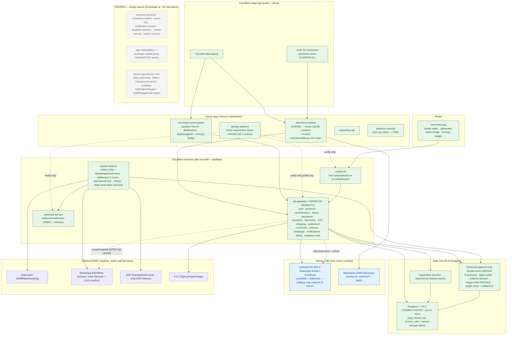

# LETBUYY CANONICAL ARCHITECTURE MATRIX

> **Document type:** Single-page-ish source of truth — the component-level classification matrix across ALL domains, the canonical target-architecture diagram, and the platform-wide classification totals (Architecture Review Board, companion to `STRATEGIC_WINNERS_MASTER_PLAN.md`).
> **Date:** 2026-06-10
> **Repo:** `/Users/saai_sidd/Git/Letbuyy_Store` · evidence pinned at `stepup/main` @ `5cf9e64e`, working tree dirty.
> **How to read:** one row per significant component across every domain. **Classification** is the verbatim spine legend. **Winner-or-replaced-by** names what survives (for CANONICAL/TRANSITIONAL/FROZEN) or what replaces it (for LEGACY/DEAD). **Wave** is when it lands/dies. **Owner-squad** is who owns it. **Forensic/Action IDs** trace to the sibling deliverables + the forensic master.
> **Source of every row:** `_ANCHOR_DECISIONS_SPINE.md` (A0–A9) + the nine domain deliverables + `FORENSIC_MASTER_2026_06_10/`. This matrix invents nothing; it densifies the winners those documents fixed.

---

## Classification legend (verbatim from the spine)

| Class | Meaning |
|---|---|
| **CANONICAL** | The winner — build/finish it. Exists at 10k merchants. |
| **TRANSITIONAL** | Real today, kept only until the winner lands. A managed bridge. |
| **LEGACY** | Superseded; freeze, then delete after migration proves zero drift. |
| **DEAD** | No value or actively dangerous; SAFE_DELETE / remove now. |
| **FROZEN** | Rejected-for-envelope; keep an empty seam; reconsider at ≈5k merchants + developer/theme-author demand. |

Owner squads: **Identity · Money(Payments) · Security/DB · Commerce · Theme-Platform · Storefront · Merchant-OS · Mobile · Design-Systems · Platform · Growth.**

---

## 1. The Canonical Architecture Matrix (component-level, all domains)

### 1.1 Topology & runtimes (A0/A9)

| Domain | Component / Path | Classification | Winner-or-replaced-by | Wave | Owner-squad | Forensic/Action IDs |
|---|---|---|---|---|---|---|
| Infrastructure | `services/api-gateway` (modular monolith, ~83k LOC) | **CANONICAL** | The monolith — auth/products/cart/checkout/orders/payments/inventory/discounts/GST/shipping/settlement/customers/themes/whatsapp/notifications/billing/analytics-read | 0→ | Platform | A0; TOPO; PLT |
| Infrastructure | `services/queue-workers` | **CANONICAL** | Outbox relay + WhatsApp/email send + settlement/recon jobs + abandoned-cart + rollups + stale-reservation sweeper | 0→ | Platform | A0; PLT |
| Infrastructure | `services/webhook-service` | **CANONICAL** | Outbound webhooks (HMAC + dedupe) | 0→ | Platform | A0; PLT; PAY-016/017 |
| Infrastructure | `services/mobile-bff` (305-line stub) | **CANONICAL (incomplete)** | A real composite/fan-in BFF (`/v1/dashboard`) — build composites | 2-3 (interim 1) | Platform/Mobile | PLT-009; PERF-001/002 |
| Identity | `apps/identity-platform` | **CANONICAL** | The sole token issuer for all 3 realms | 0→7 | Identity | A1; IDN-005 |
| Merchant-OS | `apps/merchant-control-plane` | **CANONICAL** | The merchant web OS (operator-first) | 0→ | Merchant-OS | A7; SHOP-007 |
| Storefront | `apps/storefront-runtime` | **CANONICAL** | The one buyer runtime (hosts Liquid + hosted checkout) | 0→4 | Storefront | A6; TOPO-005 |
| Mobile | `apps/mobile/merchant-app` (Flutter, ~71k LOC) | **CANONICAL (incomplete)** | The merchant mobile app — fix release signing | 2-4 | Mobile | A7; MOB; TOPO |
| Infrastructure | `apps/marketing-site` | **CANONICAL** | Keep (cheap, necessary; outside §6) | — | Platform | A9; PLT |
| Platform | `apps/platform-console` | **CANONICAL (consolidate)** | The surviving thin ops sliver (tentative — ARB pick) | 3 | Platform | A9; LEG-022 (UNVERIFIED survivor) |
| Platform | `apps/platform-operations-portal` | **LEGACY** | Fold into the surviving ops console | 3 | Platform | A9; LEG-023 |
| Theme-Platform | `apps/theme-marketplace` | **FROZEN (machinery CANONICAL)** | Machinery kept; catalog dormant until W5 | 5 | Theme-Platform | A5; LEG-049; THEME-008 |
| Platform | `apps/app-marketplace` (19,557 LOC) | **FROZEN** | De-deploy; keep OAuth2/PKCE seam (R-11) | 2 | Platform | A9; LEG-020; SHOP-006 |
| Platform | `apps/developer-portal` (4,903 LOC) | **FROZEN** | De-deploy; reconsider at ≈5k merchants (R-11) | 2 | Platform | A9; LEG-021 |
| Infrastructure | `services/checkout-runtime` (manifest-only) | **FROZEN-empty** | Capability in monolith | — | Platform | A9; LEG-012; PLT-014 |
| Infrastructure | `services/event-bus` (manifest-only) | **FROZEN-empty** | Transactional outbox + typed catalog | — | Platform | A9; LEG-013 |
| Infrastructure | `services/notification-service` (manifest-only) | **FROZEN-empty** | `notification-core` + queue-workers | — | Platform | A9; LEG-014 |
| Infrastructure | `services/analytics-pipeline` (manifest-only) | **FROZEN-empty** | queue-workers rollups | — | Platform | A9; LEG-015 |
| Infrastructure | `services/media-service` (manifest-only) | **FROZEN-empty** | Media in monolith | — | Platform | A9; LEG-016 |
| Infrastructure | `services/search-service` (manifest-only) | **FROZEN-empty** | Search in monolith | — | Platform | A9; LEG-017 |
| Mobile | `apps/mobile/shopper-app`, `apps/mobile/operator-app` | **FROZEN-empty** | Reserved | — | Mobile | A7; LEG-018/019 |

### 1.2 Identity / Auth / Sessions / Consent (A1)

| Domain | Component / Path | Classification | Winner-or-replaced-by | Wave | Owner-squad | Forensic/Action IDs |
|---|---|---|---|---|---|---|
| Identity | `identity-platform` lib (orchestrator) | **CANONICAL** | The surviving issuer; add default-deny `middleware.ts` | 1→7 | Identity | A1; IDN-005 |
| Authentication | Buyer OTP (CSPRNG, single-use) + host-only cookie | **CANONICAL** | Passwordless buyer realm (leapfrog: no Multipass) | 0→ | Identity | A1; IDN; AUTH §7 |
| Authentication | Merchant bcrypt-12 password + rotating reuse-detecting session | **CANONICAL** | Kept under identity-platform issuance | 3 | Identity | A1; AUTH §1 |
| Authentication | App-marketplace OAuth2 + PKCE-S256 install flow | **CANONICAL** | The one aligned reusable asset; reuse for consumer-OAuth | — | Identity | A1; SHOP-006; AUTH §10 |
| Token signing | Shared `AUTH_SECRET` HS256 across 7 trust domains | **TRANSITIONAL → re-key** | identity-platform sole asymmetric signer (EdDSA/Ed25519; ES256 fallback); all verify-only | 2 | Identity/Security | A1; IDN C-TOK; AUTH-002; ISSUE-027 |
| Sessions | gateway `sessions` table (merchant, authoritative) | **CANONICAL (consolidate)** | The issuer's storage layer under identity-platform | 3 | Identity | A1; IDN-006 |
| Sessions | Per-app session libs (`merchant-control-plane`/`storefront-runtime`/`platform-console`, ×4) | **LEGACY** | One `auth-core` import per app | 2 | Identity | A1; LEG-030; TOPO |
| Sessions | `sessions_v2` (159) / `session-services.ts` v2 / `session-core` ifaces | **DEAD** | (dead successor; SAFE_DELETE) | 2 | Identity | A1; LEG-053; SESSION_FORENSICS |
| Authorization | DB-backed `employee_permissions` ops RBAC + dual-control | **CANONICAL** | Kept (a strength); console = step-up+MFA consumer | 2 | Identity | A1; FOUNDATION RBAC |
| Authorization | `user_metadata.role` client-writable channel | **DEAD** | Role only from `app_metadata`/DB | 2-4 | Identity/Security | A1; AUTH-004 |
| Authorization | `super_admin_allowlist` anon-writable RLS policy | **DEAD (S0)** | `TO service_role` + audited migration writes | **0** | Security/DB | A1/A2; AUTH-003; FND-005; ISSUE-003 |
| MFA | TOTP plumbing (`enforceMerchantMfaIfEnrolled`) | **CANONICAL (extend)** | Step-up TOTP all realms + merchant enrollment + recovery codes | 4(/6) | Identity | A1; IDN-022; AUTH-023 |
| Passkeys | `FEATURE_PASSKEY` flag (zero consumers) | **CANONICAL but DEFERRED** | identity-platform WebAuthn on the asymmetric kernel; demand-gated | 8 | Identity | A1; IDN-027; D-12 |
| Consent | DPDP consent ledger + DSR export/erasure | **ABSENT → CANONICAL** | Build in identity-platform; fail-closed; gates WhatsApp | 4(/5-6) | Identity | A1; IDN-021; D-10; R8 |
| OIDC | `oauth2/*` + `.well-known/*` → `oidcSkeletonResponse` (501/placeholder JWKS) | **ABSENT/501 → CANONICAL but DEFERRED** | A real OIDC provider; flag-off + 404 until real (never placeholder JWKS) | 7 | Identity | A1; IDN-024; AUTH-020 |
| OIDC | `MOCK_JWKS` literal | **DEAD** | Remove in token-cutover D0; serve 404 | 1-2 | Identity | A1; IDN-029; AUTH-020 |
| Authentication | `/api/auth/switch` takeover path (HEAD) | **DEAD (S0)** | The working-tree fixed `route.ts` (commit + deploy) | **0** | Identity/Security | A1; LEG-028; ISSUE-001 |
| Authentication | gateway `routes/auth.ts` session-mint (1,441 LOC) | **LEGACY** | identity-platform sole issuer; gateway → verify-only | 2 | Identity | A1; LEG-024; AUTH-011 |
| Authentication | gateway `identity-foundation/` shadow stack (18 files, 1,655 LOC) | **DEAD (wired-scaffold)** | identity-platform (delete after verify-only) | 2 | Identity | A1; LEG-025; TOPO-007 |
| Authentication | Legacy Supabase `/auth/*` + second reset pipeline | **LEGACY** | identity-platform OTP + host-scoped cookies | 2 | Identity | A1; LEG-026/027; AUTH-010/022 |
| Identity | 6 identity micro-packages (`{identity,session,token,permission,organization,audit}-core`) | **LEGACY** | Fold into `auth-core` with sub-path exports | 2 | Identity | A1; LEG-029; TOPO-029 |

### 1.3 Tenant isolation (A2)

| Domain | Component / Path | Classification | Winner-or-replaced-by | Wave | Owner-squad | Forensic/Action IDs |
|---|---|---|---|---|---|---|
| Tenant Isolation | App-layer query-lint guard (`createTenantGuardedSupabaseClient`/`tenantScoped`) | **CANONICAL (permanent outer)** | Kept as L1 defense-in-depth (stops being sole control) | 0→ | Security/DB | A2; TEN §3; FND-012 |
| Tenant Isolation | Ownership checks (`verifySiteOwnership`/`verifyStoreOwnership`) | **CANONICAL (permanent)** | L2 value layer; lint-enforced in CI | 2 | Security/DB | A2; TEN §3 |
| Tenant Isolation | `app_tenant` RLS-subject pooled connection + `SET LOCAL app.site_id` | **CANONICAL (new)** | THE load-bearing tenant data path (L3) | 1 | Security/DB | A2; TEN §4 |
| Tenant Isolation | `current_site_id()`/`set_current_site_id()` + `tenantGucSetLocalStatement` | **CANONICAL** (was dead) | Executed per request via the L3 connection | 1 | Security/DB | A2; TEN §3 |
| Tenant Isolation | FORCE+GUC policy on baseline tenant tables (~220 of 261) | **CANONICAL (extend)** | FORCE+GUC on all 261 via template backfill | 2 | Security/DB | A2; V1 §7; FND-009 |
| Tenant Isolation | `storeContext()`/`requireStoreOwner()` middleware | **TRANSITIONAL → CANONICAL** | A default-deny tenant gate (fail-closed on omission) | 3 | Security/DB | A2; TEN §3 |
| Tenant Isolation | `service_role` as the default gateway connection | **TRANSITIONAL → FROZEN-narrow** | Demoted to audited break-glass escape hatch | 1 | Security/DB | A2; FND-008; DB-004 |
| Tenant Isolation | 6 `USING(true)`→PUBLIC baseline policies (products/orders/sites/store_customers/billing/subscriptions) | **DEAD (S0)** | `TO service_role` + owner + GUC policies | **0** | Security/DB | A2; FND-001…009; ISSUE-004…008 |
| Tenant Isolation | queue-workers raw `service_role` + payload `site_id` | **TRANSITIONAL → CANONICAL** | Guarded worker client + payload-vs-FK assertion + per-job GUC + in CI | 2 | Security/DB/Platform | A2; FND-014; PLT |
| Tenant Isolation | `tenant-isolation-validator.mjs` (api-gateway-only, regex) | **TRANSITIONAL → CANONICAL** | AST-based, all-services, forbids `USING(true)` | 2 | Security/DB | A2; TEN §3 |
| Tenant Isolation | `orders.store_id` ≡ `site_id` + sync trigger | **LEGACY** | Single `site_id`; `store_id` → generated then dropped | 5 | Security/DB | A2; LEG-051; DUP-1; TD-7 |
| Tenant Isolation | `users` vs `users_custom` dual tables | **LEGACY** | `users_custom` canonical; `users` → view | 5 | Security/DB | A2; LEG-052; DUP-2; TD-7 |
| Tenant Isolation | REVOKE UPDATE/DELETE on ledger/audit + RESTRICT FKs | **CANONICAL (new)** | Defense-in-depth REVOKE; RESTRICT on money/audit | 2 | Security/DB | A2/A3; DB-009/014/030 |

### 1.4 Money / Ledger / Settlement / Reconciliation / Billing (A3)

| Domain | Component / Path | Classification | Winner-or-replaced-by | Wave | Owner-squad | Forensic/Action IDs |
|---|---|---|---|---|---|---|
| Ledger | `ledger_accounts`/`ledger_transactions`/`ledger_entries` (8 accounts, 139) | **CANONICAL** | The single money source of truth | 1→ | Money | A3; MNY §2; 139:75-142 |
| Ledger | `post_ledger_transaction` (139:223) | **CANONICAL** | The posting primitive (remove GUC-from-param at wrapper) | 1 | Money | A3; MNY §3; 139:223 |
| Ledger | `ledger_account_balance_minor` (160:173) | **CANONICAL** | The balance authority (balance always derived) | 1 | Money | A3; MNY §2; 160:173 |
| Payments | `payments` (V1 session, bigint paise) | **CANONICAL** | The only payment-truth row | 1 | Money | A3; MNY §3; 142:43 |
| Payments | `confirm_order_payment_with_ledger` (baseline:1590, posts NO ledger) | **TRANSITIONAL → adapter (LEGACY)** | Post the capture ledger in-RPC, or route via the V1 capture API | 1 | Money | A3; PAY-001; LEG-031; ISSUE-010/011 |
| Payments | `payment_transactions` (legacy capture, dual row) | **TRANSITIONAL → LEGACY** | Demote to compat shadow of `payments`; delete after backfill | 5 | Money | A3; LEG-054; DUP-5 |
| Settlement | `settlements`/`reserves`/`payouts`/`payout_items`/`recon_breaks` | **CANONICAL** | The settlement set; fix recon-break sign + int→bigint | 1 | Money | A3; MNY §3; 151:84-191 |
| Settlement | `claim_payout_statement_release` (160:357) | **CANONICAL** | The payout-double-release fix done right | 1 | Money | A3; PAY-013; 160:357 |
| Settlement | `payoutRail()` → `'razorpayx'` (self-custody) | **DEAD** | PA-split (`razorpay_route`/Cashfree); never custody | 1 | Money | A3; PAY-014; LEG-039; ISSUE-014 |
| Settlement | `post_settlement_ledger_transaction` GUC-from-param (151:23) | **CANONICAL (role) / DEAD (GUC-from-param)** | Derive tenant from authenticated principal in-RPC | 1 | Money/Security | A3/A2; PAY-020; LEG-041 |
| Reconciliation | `money_ledger_site_reconciliations` (no auto-plug) | **CANONICAL** | The honesty gate that surfaces drift | 1 | Money | A3; MNY §3; 160:212-254 |
| Reconciliation | Reconciliation harness (PSP+COD fixtures) | **CANONICAL (new/extend)** | Ties the book to provider reality; zero-break-or-suspense | 1-3 | Money | A3; MNY §4 |
| Settlement | `verifySensitiveActionStepUp` (string-length check) | **DEAD** | Real HMAC/stored-challenge step-up (153 tables) | 1 | Money/Security | A3; PAY-018; LEG-040; ISSUE-012 |
| Refunds | `complete_order_refund` (baseline:1039, un-ledgered) | **TRANSITIONAL → adapter (LEGACY)** | Add `post_ledger_transaction` (debit `merchant_payable`/credit `refund_clearing`) | 1 | Money | A3; PAY-002; LEG-032; ISSUE-018 |
| Money (COD) | COD remittance (`cod-reconciliation.ts:305`, writes only `wallet_ledger_entries`) | **TRANSITIONAL → adapter (LEGACY)** | COD adapter posts `cod_receivable`/relieve; short/over → signed break | 1 | Money | A3; PAY-003; LEG-033; ISSUE-019 |
| Money (wallet) | `wallet_ledger_entries` (compat, mutable single-entry) | **LEGACY** | Read-only projection of canonical; writes → `post_ledger_transaction` | 1→5 | Money | A3; LEG-034; DUP-4 |
| Money (tenders) | `gift_card_ledger_entries` + mutable `gift_card_accounts.balance` | **LEGACY** | Gift cards as a tender on the ledger | 5 | Money | A3; LEG-036; PAY-027 |
| Money (tenders) | `gift_cards.balance` (duplicate, different precision) | **DEAD** | Unify onto the single ledger-backed gift-card liability | 5 | Money | A3; DUP-8; DB-020 |
| Money (tenders) | `store_credit_ledger_entries` + mutable balance | **LEGACY** | Store credit as a ledger tender | 5 | Money | A3; LEG-037; 153:54 |
| Money (tenders) | `ai_credits.balance` (mutable) | **LEGACY** | AI credits as a ledger tender (P2 capability) | 5 | Money | A3; LEG-038; DB §8.4 |
| Money (representation) | int32-paise + numeric-rupee + numeric(16,4) money columns | **LEGACY** | `bigint` minor units (paise) everywhere | 5 | Money/DB | A3; LEG-043; DB-002/003; ISSUE-025 |
| Billing | Merchant subscriptions/AutoPay-mock/dunning/plan-gating (152) | **CANONICAL** | The monetization spine | — | Money | A3; SHOP-004; Freeze §7 |
| Billing | `commission_bps DEFAULT 300` (3% GMV rake) + 18% GST-on-fee | **DEAD** | `commission_bps=0`, permanent 0% fee | 1 | Money | A3; LEG-042; ARCH-001; ISSUE-015 |
| Money (events) | `emitDomainEvent` (post-commit Supabase call, swallows errors) | **TRANSITIONAL → fix** | Same-transaction outbox write; never swallow | 1 | Money/Platform | A3; PAY-007; ARCH-004 |
| Money (compensation) | `compensation_actions` (rows written, zero executors) | **TRANSITIONAL → build executor** | queue-workers consumer runs idempotent refund via the canonical adapter | 1 | Money/Platform | A3; PAY-026 |
| Money (secret) | webhook internal secret `|| AUTH_SECRET` fallback | **DEAD (the fallback)** | Dedicated `INTERNAL_API_SECRET` | 1-2 | Money/Security | A3; PAY-023; webhook:543 |

### 1.5 Commerce / Checkout (A4)

| Domain | Component / Path | Classification | Winner-or-replaced-by | Wave | Owner-squad | Forensic/Action IDs |
|---|---|---|---|---|---|---|
| Orders | `create_checkout_order`/`create_order_with_inventory_reservations` RPC | **CANONICAL** | The one server-side order path (already true) | — | Commerce | A4; CHK §1; ARCH-003 |
| Orders | `order_items` relational vs `orders.items` JSONB | **CANONICAL (relational) / LEGACY (JSONB)** | `order_items` authoritative; drop JSONB | 5 | Commerce/DB | A4; LEG-055; DUP-6 |
| Orders | `orders.{subtotal,total}` numeric | **LEGACY** | Add `*_minor bigint`; derive amounts from minor units | 5 | Commerce/Money | A3/A4; PAY-006; DB-003 |
| Checkout | Hosted `checkout.letbuyy.com` origin | **CANONICAL (to-build)** | Build+deploy the server-authoritative origin (signed handoff) | 3 | Commerce | A4; SHOP-003; CHK-015 |
| Checkout | Public `POST /:subdomain/orders` (pre-payment order door) | **TRANSITIONAL → gate** | Gate behind the signed handoff; reserve-with-TTL not hard-decrement | 3 | Commerce | A4; CHK-001/012 |
| Checkout | `planCheckoutStateTransition` (guarded forward-only state machine) | **CANONICAL** | The checkout-session state machine in the monolith | 3 | Commerce | A4; CHK §1; checkout-core:147 |
| Checkout | Wasm checkout-extensions/app-functions runtime in the payment route | **DEAD (R-11)** | Documented seam only; rip out the executor | 3 | Commerce/Security | A4; LEG-011; SHOP PM-1; CHK §12 |
| Cart | Server-authoritative cart (live path) | **CANONICAL** | The cart authority | — | Commerce | A4; CHK §1 |
| Cart | Client-only React cart (`cart-context.tsx`, `stock:999`) | **LEGACY** | Demote to a thin view | 3 | Commerce | A4; CHK side-doors |
| Inventory | Reserve→commit RPC + `version` optimistic concurrency | **CANONICAL** | The one inventory lifecycle | 3 | Commerce | A4; CHK-002 |
| Inventory | Stale-reservation sweeper (DDL exists, never scheduled) | **CANONICAL (wire it)** | Schedule it in queue-workers | 3 | Commerce/Platform | A4; CHK-003/005 |
| Inventory | Direct-`available`-decrement side doors + order-edit add-item-without-reservation | **LEGACY** | Unify onto the one reserve→commit path | 3 | Commerce | A4; CHK-004 |
| Discounts | Typed 3-class `combines_with` engine (dormant) | **CANONICAL (activate)** | The discount engine | 3 | Commerce | A4; V1 §3 |
| Discounts | Scalar single-code discount RPC (live) | **TRANSITIONAL → LEGACY** | Replaced by the typed engine | 3 | Commerce | A4; CHK § |
| Shipping | Carrier integration (scaffold labels) | **CANONICAL (build, P1)** | Shiprocket-real (AWB/label/tracking); others mocked behind the adapter | 3 | Commerce | V1 §3/§16 (P0 Shiprocket); R; derived |
| Shipping | Zones/profiles/rates + pincode + COD serviceability | **CANONICAL (build, P1)** | The shipping module (`shipping_zones`/`shipping_rates`/`shipments`) | 3 | Commerce | V1 §3/§16 (P1); derived |
| GST | Place-of-supply CGST/SGST vs IGST + HSN rates | **CANONICAL (build, P1)** | The place-of-supply engine + `hsn_rates` | 3 | Commerce | V1 §3/§16 (P1 GST); R9; A4 |
| GST | Immutable GST invoice (IRN/QR via mock IRP) + TCS | **CANONICAL (build, P1)** | `gst_invoices` (immutable) + marketplace TCS | 3 | Commerce | V1 §3/§16; A4 (P1) |
| Customers | `store_customers` PII | **CANONICAL** | Tenant-isolated behind RLS+GUC | 0(leak)→3 | Commerce/Security | A2/A4; FND; ISSUE-008 |
| Customers | `store_customers` `USING(true)` PUBLIC policy | **DEAD (S0, PII leak)** | Drop/replace with owner+GUC policy | **0** | Security/DB | A2; FND; ISSUE-008 |
| Customers | CRM LTV/RFM + dynamic segments (light) | **CANONICAL (build, P1)** | Light CRM in the monolith | 3 | Commerce/Growth | V1 §16 (P1); derived |

### 1.6 Theme (A5)

| Domain | Component / Path | Classification | Winner-or-replaced-by | Wave | Owner-squad | Forensic/Action IDs |
|---|---|---|---|---|---|---|
| Theme Engine | Theme architecture model (sections/blocks/JSON-templates/section-groups/schema) | **CANONICAL** | The OS-2.0-shaped model in `packages/theme-engine` | — | Theme-Platform | A5; DEC-1; THEME §1 |
| Theme Runtime | React section-registry renderer (live, ~24 sections) | **LEGACY (FROZEN first)** | Liquid renderer (winner); React = first-party fast-path; delete-or-freeze at W6 by data | 1→4(→6) | Theme-Platform/Storefront | A5; DEC-1; LEG-044; THEME-002 |
| Theme Runtime | Liquid/portable renderer (`LiquidRenderer`/`JsonContractThemeRenderer`, flag-OFF) | **CANONICAL** | The ecosystem renderer; default at W4 (per-theme + canary) | 4 | Theme-Platform | A5; DEC-1/3; LEG-048; THEME-001 |
| Theme Runtime | Data-only sandbox (drop scrub, `ownPropertyOnly`, upload forbids ``) | **CANONICAL** | The security-load-bearing render contract | 4 | Theme-Platform/Security | A5; DEC-6; THEME §2 |
| Theme Runtime | Regex output-sanitizer (`theme-renderer.ts:606`) | **DEAD (replace at flip)** | DOMPurify/allowlist sanitizer (Wave-3/4 entry gate) | 4 | Security/Theme-Platform | A5; DEC-6; THEME-012 |
| Theme Engine | theme-engine contracts/schema/validator/bundle (60+ importers) | **CANONICAL (contracts)** | The contract source of truth; renderer un-orphaned at W4 | 2→4 | Theme-Platform | A5; DEC-9; LEG-048; PLT |
| Theme Engine | 3 schema sources (engine + storefront `RUNTIME_SECTION_SCHEMAS` + DB manifests) | **CANONICAL (1) + LEGACY (2)** | Engine `BUILT_IN_SECTION_SCHEMAS` as the single generated source | 2 | Theme-Platform | A5; DEC-3; LEG-045; THEME-005 |
| Theme Engine | Dual draft systems (`theme_editor_drafts` + `theme_instance_drafts`/`theme_draft_patches`) | **CANONICAL (1) + LEGACY (1)** | The instance/patch spine; `theme_editor_drafts` → shim → drop | 2→4 | Theme-Platform/Platform | A5; DEC-4; LEG-047; THEME-004 |
| Theme Engine | Dual compose paths (storefront `template-resolver.ts` re-impl) | **CANONICAL (1) + LEGACY (1)** | Engine `composeStorefrontTheme`; storefront calls it | 2 | Storefront/Theme-Platform | A5; DEC-5; LEG-046; THEME-003 |
| Theme Engine | Versioning/release/rollback (`theme_releases`, `rollbackRelease`) | **CANONICAL** | The release/rollback spine (de-dup snapshot column) | 2 | Theme-Platform | A5; THEME §3.5/THEME-019 |
| Theme Engine | Section library (~20 renderable + 4 placeholders + announcementBar mismatch) | **CANONICAL (renderable) + LEGACY (placeholders)** | Port renderable to Liquid; implement/remove placeholders | 2-3 | Theme-Platform/Storefront | A5; DEC-8; THEME-009/010 |
| Theme Engine | Dynamic sources / metafield binding (absent) | **CANONICAL (DEFERRED W4)** | A `dataBinding` resolver registry (collections/pages/blogs/metafields) | 4 | Theme-Platform | A5; SHOP-014; THEME-007 |
| Theme Engine | Theme blocks (reusable, nestable) | **CANONICAL (DEFERRED W4)** | Nestable reusable theme blocks (leapfrog) | 4 | Theme-Platform | A5; SHOP-015 |
| Theme Editor | Web editor (`editor/page.tsx`, no drag-reorder) | **CANONICAL (protect)** | Renderer-agnostic; gains drag-reorder + Issues panel | 3-4 | Merchant-OS | A5; DEC-7; THEME-006/016 |
| Theme Editor | Flutter editor (`section_editor_screen.dart`) | **CANONICAL (protect)** | Renderer-agnostic; the strongest part of the mobile app | — | Mobile | A5; DEC-7; THEME §3.3 |
| Theme Editor | "AI hooks" (deterministic stubs labeled AI) | **DEAD (rename, R-15)** | Honest "Smart defaults / Quick fill" | 1 | Theme-Platform | A5; THEME-011 |
| Theme-Platform | theme-marketplace machinery (real) vs catalog (one theme) | **CANONICAL (machinery) / DORMANT (catalog)** | Machinery kept; seed 5–10 first-party themes at W5 | 5 | Theme-Platform | A5; DEC-10; LEG-049; THEME-008 |
| Theme-Platform | Theme app-blocks / extensions seam (`appBlockSlot` + `@app`) | **FROZEN** | Keep the seam; 1st-party at W5, 3rd-party gated to W6 (R-11) | 5-6 | Theme-Platform | A5; THEME §3.9; R-11 |

### 1.7 Storefront (A6)

| Domain | Component / Path | Classification | Winner-or-replaced-by | Wave | Owner-squad | Forensic/Action IDs |
|---|---|---|---|---|---|---|
| Storefront Runtime | `storefront-runtime` SSR/RSC composition + read path | **CANONICAL** | One runtime; hosts Liquid at target state | 0→4 | Storefront | A6; SHOP §3 |
| Storefront Runtime | 3-tier KV-versioned storefront cache | **CANONICAL** | Already Shopify-grade for the envelope; keep | — | Storefront | A6; PERFORMANCE_AUDIT |
| Storefront Runtime | Hyperdrive pooled DB (storefront read only today) | **CANONICAL (under-utilized)** | Widen usage as tenancy lands | 1-2 | Platform/Storefront | A6; PLT; ARCH P7 |
| Storefront Runtime | `runtime-composition` package (wired into storefront page) | **DEAD (DELETE_AFTER unwire)** | Storefront query-layer in the runtime/monolith | 2 | Storefront/Platform | A6; LEG-008; TOPO-005 |
| Storefront Runtime | Headless Hydrogen/Oxygen tier | **FROZEN** (deferred seam, not built) | One Liquid-SSR runtime | — | Storefront | A6; SHOP ID-6/SHOP-021 |

### 1.8 Merchant OS / Mobile / UI-UX (A7/A8)

| Domain | Component / Path | Classification | Winner-or-replaced-by | Wave | Owner-squad | Forensic/Action IDs |
|---|---|---|---|---|---|---|
| Merchant OS | Operator-first IA (Orders/Money/Customers primary) | **CANONICAL** | Finish across web + mobile; add a first-class Money node | 3 | Merchant-OS | A7; SHOP-007; UIUX-009 |
| UI/UX | `packages/typescript/ui/src/tokens.ts` (DTCG, 1,388 LOC) | **CANONICAL** | The SINGLE web token source | 2→ | Design-Systems | A8; UIUX §2 |
| UI/UX | `tokens.json` (DTCG/W3C interchange) | **CANONICAL** | Figma/codegen interchange (CI-gated parity) | 2 | Design-Systems | A8; UIUX §2.1 |
| UI/UX | Mobile generated bridge `letbuyy_color_tokens.dart` | **CANONICAL** | Consumes the one source (extend to carry type+density) | 2-3 | Mobile/Design-Systems | A8; MOB-004; UIUX §2 |
| UI/UX | Mobile `ThemeData` (`store_theme.dart`) bypassing the bridge | **TRANSITIONAL → re-point** | Re-point at the generated bridge | 2-3 | Mobile | A8; UIUX-004/005; MOB-004 |
| UI/UX | Duplicate `LetbuyyColorTokens` + `AppColors`/`StoreAdminColors`/Light\|Dark color classes | **LEGACY** | Reconcile to the generated bridge | 2-3 | Mobile/Design-Systems | A8; MOB-004; UIUX-011/012/023 |
| UI/UX | `AppNavigation` shell (`app-navigation.tsx`, 2/9 adoption) | **CANONICAL** | One app shell rolled 2/9 → 9/9 (merchant first) | 4-5 (badge/IA earlier) | Design-Systems/Merchant-OS | A8; UIUX-003/019/027 |
| UI/UX | 8 hand-rolled navs (`AdminShell`/`Sidebar`/`HeaderBar`, etc.) + 4 sidebar widths | **LEGACY** | Adopt `AppNavigation` | 4-5 | Design-Systems | A8; UIUX-003 |
| UI/UX | `LetbuyyThemeProvider` + `ThemeScript` (9/9, dark-mode controller) | **CANONICAL** | Keep; only reachability (toggle in 7/9) remains | 4 | Design-Systems | A8; UIUX-008 |
| UI/UX | Provider-mode honesty badge (does NOT exist as a component) | **ABSENT → CANONICAL** | New `ProviderModeBadge` in `@letbuyy/ui` + Flutter, on every money/fulfillment surface | 2-3 | Design-Systems/Merchant-OS | A7/A8; V1 §1 P4; FREEZE §4 |
| UI/UX | Design-system ratchet (baselines drift as "passing") | **TRANSITIONAL → CANONICAL** | Ratchet that BLOCKS new drift; stylelint wired to CI; 10%/release burn-down | 4-5 | Design-Systems/Platform | A8; UIUX-001/002 |
| UI/UX | Naked `rgb()/hsl()` (573) / raw px (1,382 spacing + 536 font) / arbitrary radius (328) | **LEGACY (ratchet-down)** | `--lb-*` tokens | 4-5 | Design-Systems | A8; UIUX-004/021/022/028 |
| Mobile | `mobile-bff` composite endpoints | **CANONICAL (build)** | Real fan-in (`/v1/dashboard`); interim `Future.wait` | 2-3 (interim 1) | Mobile/Platform | A7; PLT-009; PERF-001/002 |
| Mobile | TD-5 parity catalog (`merchant_feature_*`, 974 LOC, routed) | **DEAD** | Real merchant screens | 3 | Mobile | A7; LEG-072; TOPO-012 |
| Mobile | `packages/dart/services` (8-LOC phantom facade) | **DEAD (SAFE_DELETE)** | App-local services over `letbuyy_api_client` | 2 | Mobile | LEG-073; TOPO-028 |
| Mobile | debug-keystore release config | **DEAD (fix)** | Real release signing/pipeline | 2-3 | Mobile | A7; MOB; PLT |

### 1.9 Growth: Analytics / Notifications / WhatsApp / Billing-spine (A9/A1/A3)

| Domain | Component / Path | Classification | Winner-or-replaced-by | Wave | Owner-squad | Forensic/Action IDs |
|---|---|---|---|---|---|---|
| Analytics | Analytics-read module (in monolith) + rollup jobs (queue-workers) | **CANONICAL** | Stays in the monolith + workers; `analytics-pipeline` empty | 1-3 | Growth/Platform | A9; V1 §3/§10; R-2 |
| Analytics | Mobile dashboard ~7 serial round-trips (N+1) | **TRANSITIONAL → fix** | BFF composite `/v1/dashboard`; interim `Future.wait` | 1-3 | Mobile/Platform | PERF-001/002; PLT-009 |
| Notifications | Notifications router (WhatsApp→SMS→email→push) | **CANONICAL (build, P1)** | In monolith; preferences/suppression/consent; multi-ESP failover | 3 | Growth | A9; V1 §3/§16; R-2; derived |
| Notifications | Transactional email + abandoned-checkout recovery | **CANONICAL (build, P1)** | queue-workers sends; multi-ESP | 3 | Growth | V1 §16 (P1); derived |
| WhatsApp | `channel=whatsapp` order-lifecycle + COD-confirm (reply-to-confirm) | **CANONICAL (scoped, P1)** | Scoped commerce module on `order.*` events + the notification router | 3 | Growth | A9; V1 §11; ISSUE COD/RTO |
| WhatsApp | Opt-in consent ledger (DPDP) for WhatsApp sends | **CANONICAL (build, P1)** | The shared consent ledger (identity track); fail-closed | 4 | Growth/Identity | A1; V1 §11; R8 |
| WhatsApp | Full in-WhatsApp commerce (catalog→cart→in-thread checkout, broadcasts, inbox) | **FROZEN** (not built) | Order-lifecycle + COD-confirm only (R-7) | P2-P3 | Growth | A9; V1 §11; R-7 |
| Billing (spine) | Subscriptions/AutoPay-mock/dunning/plan-gating (152) | **CANONICAL** | The monetization spine (0% transaction fee) | — | Money/Growth | A3; SHOP-004; Freeze §7 |
| Billing (money) | 3% GMV rake + GST-on-fee | **DEAD** | `commission_bps=0` (see §1.4) | 1 | Money | A3; LEG-042; ISSUE-015 |

### 1.10 Platform / Governance / Deploy / Infra (A0)

| Domain | Component / Path | Classification | Winner-or-replaced-by | Wave | Owner-squad | Forensic/Action IDs |
|---|---|---|---|---|---|---|
| Deployments | `main` 30 commits behind `stepup/main` (deploy meta-blocker) | **TRANSITIONAL → fix (W0 META)** | Merge `stepup/main`→`develop`→`main`; branch-lag guard | **0** | Platform | A0; TOPO-001/002; ISSUE-002 |
| Deployments | `production-deploy.yml` (9-app Vercel matrix) | **TRANSITIONAL → retarget** | Deploy matrix = V1 8-runtime list | 2 | Platform | A0; PLT; TOPO-004 |
| Deployments | `deploy-staging.yml` (duplicate of `staging-deploy.yml`) | **DEAD (SAFE_DELETE)** | One staging workflow | 0 | Platform | A0; LEG-067; TOPO-016 |
| Governance | 181 validators / `validate-governance.mjs` | **TRANSITIONAL → retarget** | A suite that enforces V1 (not the 9-app/CQRS canon) | 1-2 | Platform | A0; ARCH-005/006; TOPO-024 |
| Governance | ~36 rejected-architecture validators (replay/projection/saga/CRDT/failover/WAL/lease/multi-region) | **DEAD (SAFE_DELETE)** | Retargeted V1-conformance validators | 2 | Platform | A0; LEG-063; TOPO-024 |
| Governance | Real-invariant validators (tenant-isolation, session-security, single-writer, antifabrication, crypto/currency single-source) | **CANONICAL** | Keep — the value the suite should be | — | Platform | A0; PLT (KEEP bucket) |
| Governance | New validators (rollback pairing ≥138, deploy↔V1 contract, `letbuyy.store` ban, `commission_bps=0`, topology anti-fabrication) | **CANONICAL (ADD)** | Close the real gaps V1 needs | 2 | Platform | A0; PLT (ADD bucket) |
| Governance | Runtime-manifest authority prose (`workflowAuthority`/`replayOperationsOwnership` in 13 manifests) | **LEGACY** | Slim manifest schema (root/platform/deploy/deps) | 2 | Platform | A0; LEG-064; TOPO-014 |
| Constitution | `AGENTS.md` (stale, 9-app canon, "19 migrations" vs 91) | **TRANSITIONAL → regenerate** | The generated map of V1 §6; re-rank CLAUDE.md (V1 first) | 2 | Platform | A0; LEG-076; TOPO-003/021 |
| Constitution | `LETBUYY_EXECUTABLE_ARCHITECTURE_V1.md` + Freeze | **CANONICAL** | The single constitution | — | Platform | A0 |
| Constitution | `LETBUYY_CHECKOUT_PLATFORM_ARCHITECTURE.md` (1M-merchant/22-service maximalist) | **DEAD (→ archive)** | V1 (the rejected vision) | 2 | Platform | A0; LEG-075 |
| Infrastructure | `production-topology.json` (6 reserved services as `production` + Helm) | **TRANSITIONAL → regenerate** | Derived from the actual deploy matrix; reserved marked `reserved` | 2 | Platform | A0; LEG-065; TOPO-013 |
| Infrastructure | `infrastructure/deployment/{kubernetes,helm}` (fantasy infra) | **DEAD (→ archive)** | Cloudflare Workers + Vercel only | 2 | Platform | A0; LEG-066; TOPO-015 |
| Infrastructure | `legacy/firebase/` (~15,323 LOC abandoned backend) | **DEAD (→ archive)** | Supabase + Workers | 2 | Platform | A0; LEG-071; TOPO-019 (UNVERIFIED git-tracked count) |
| Infrastructure | `letbuyy.store` domain literals (143 files; `api.letbuyy.store` vs `bff.letbuyy.com` split-brain) | **LEGACY** | `letbuyy.com` canonical + `.store` 301s | 2 | Platform | A0; LEG-077; TOPO-006 |
| Events | Transactional outbox (dual-write non-atomic today) | **CANONICAL (fix)** | Same-transaction outbox + typed catalog (NOT an event bus) | 1 | Platform/Money | A9; ARCH-004; PAY-007 |
| Packages | `app-engine`/`application-services`/`extension-host`/`projection-runtime`/`orchestration`/`distributed-runtime` (~13,345 LOC) | **DEAD (SAFE_DELETE)** | Nothing (capability absent from envelope) | 2 | Platform | A9; LEG-001…006; TOPO-008 |
| Packages | `search-core` (leaked via `api-types` `export *`) | **TRANSITIONAL → un-leak (then SAFE_DELETE)** | Search in monolith; reserved `search-service` empty | 2 | Platform | A9; LEG-007; TOPO-026 |
| Packages | `schema-registry-execution.adapter.ts` | **DEAD (SAFE_DELETE)** | `event-core` typed catalog | 2 | Platform | A9; LEG-009; ARCH-027 |
| Packages | gateway `graphql/` (6 files, dead-by-flag in prod) | **LEGACY (DELETE_AFTER)** | REST routes (V1 scope) | 3 | Platform | LEG-010; TOPO-018 |
| DB | ~37 product-dead tables (theme-legacy ×6, ops-theater, diagnostics) | **DEAD (SAFE_DELETE, after writer confirmation)** | Nothing (pure dead weight) | 5 | Security/DB | LEG-061/050; DB §6.1 (UNVERIFIED live writers) |
| DB | 8 partition-shadow tables + active mirror | **FROZEN (seam) / TRANSITIONAL (mirror off)** | Partitioning DEFERRED to P2; keep seam, disable the mirror | 5 | Security/DB | LEG-057; DUP-9; ARCH-031 |
| DB | Duplicate `provider_payment_id` unique index (two names) | **DEAD (SAFE_DELETE one)** | One unique index | 5 | Security/DB | LEG-062; A-6 |
| DB | Migrations 138/140/157 missing rollback + dup prefix 129 | **TRANSITIONAL → fix** | Author 3 rollbacks; renumber dup; add pairing validator | 1-2/5 | Platform/DB | LEG-058/059; TOPO-011 |
| Docs | ~60+ superseded root governance/mission/ledger docs (21 CODEX_* triples, 33 audit reports) | **DEAD (→ archive)** | One constitution + one current STATUS | 2 | Platform | A0; LEG-075; TOPO-020/037 |

---

## 2. Target Architecture (the canonical end-state — Mermaid)

> The V1 8-runtime topology: modular monolith + 4 satellites + workers + identity + storefront (Liquid themes) + canonical ledger + PA-split (never custody) + RLS-isolated Postgres. Reserved services are empty seams. Rejected machinery (CQRS/saga/multi-region, app-marketplace, headless Hydrogen, Wasm checkout) is FROZEN, not deployed.

**Diagram invariants (what the picture asserts):**
- **One issuer:** every token is minted by `identity-platform` (asymmetric); every other runtime is **verify-only** (dashed lines).
- **One ledger:** the canonical double-entry ledger is the sole money truth; balance is derived; the single writer is the settlement module in the monolith.
- **Rent, never custody:** money-in flows to the **merchant's own Razorpay** (merchant = MoR); money-out is a **PA-split instruction + mirror** — LetBuyy never holds funds. There is no `razorpayx` self-custody node.
- **RLS is load-bearing:** the gateway connects under `app_tenant` (RLS-subject) with a per-transaction GUC; `service_role` is a narrow escape hatch, not the default.
- **One storefront runtime** hosting **Liquid** + the **hosted checkout origin**; no headless tier.
- **Reserved services are empty;** the rejected end-state machinery is a frozen seam, not a deployed tier.

---

## 3. Classification Totals (platform-wide rollup)

> Counts are of the **significant components in this matrix** (§1, ~120 rows across all domains). A single physical artifact can carry two aspects (e.g. `payout_statements` = CANONICAL logic + LEGACY representation, or `theme-engine` = CANONICAL contracts + LEGACY-dormant renderer); it is tallied under its **dominant strategic action**. These are component-level counts, not LOC and not the sibling-doc internal sub-counts (which differ by denominator — see the per-doc notes).

### 3.1 Headline totals

| Classification | Count | Share | What it means for the program |
|---|---:|---:|---|
| **CANONICAL** | **58** | ~48% | The winners to build/finish. The core (monolith, ledger, identity issuer, RLS+GUC, Liquid, server checkout, one design system) is largely *built* — the work is completion + wiring. |
| **TRANSITIONAL** | **18** | ~15% | Managed bridges — real today, kept only until the winner lands (token re-key, service_role→GUC cutover, BFF stub, ratchet, AGENTS/topology regen, missing-rollback fixes). |
| **LEGACY** | **24** | ~20% | Superseded; delete after the winner serves + zero-drift proof (gateway auth-mint, compat ledgers, dual keys/tables, React renderer, schema/draft/compose forks, hand-rolled navs, `.store` literals). |
| **DEAD** | **15** | ~12% | SAFE_DELETE / remove now — no winner required (the S0 vuln paths, razorpayx, forgeable step-up, 3% rake, CQRS package cluster, fiction validators, k8s/Helm, Firebase, ~37 dead tables, dead-table/index dups). |
| **FROZEN** | **6** | ~5% | Rejected-for-envelope empty seams (reserved services, app-marketplace + developer-portal, theme/app 3rd-party seam, headless Hydrogen, partition seam, AI/reseller capabilities). |
| **Total** | **~121** | 100% | — |

### 3.2 By cluster (where the work concentrates)

| Cluster | CANONICAL | TRANSITIONAL | LEGACY | DEAD | FROZEN | Net story |
|---|---:|---:|---:|---:|---:|---|
| Identity/Auth/Sessions/Consent | 8 | 1 | 4 | 4 | 1 | Consolidate 4 impls → 1 issuer; re-key to asymmetric; 2 S0s die W0. |
| Tenancy | 6 | 3 | 2 | 1 | 0 | Flip the load-bearing layer to RLS+GUC; the PUBLIC leaks die W0. |
| Money/Ledger/Settlement/Recon/Billing | 11 | 5 | 8 | 8 | 0 | One ledger feeds everything; razorpayx + rake + forgeable step-up die W1. |
| Commerce/Checkout | 11 | 2 | 4 | 2 | 0 | Server-authoritative completion (hosted origin, GST, shipping); Wasm path dies. |
| Theme | 12 | 1 | 5 | 2 | 1 | Liquid wins; React frozen (not deleted for completeness) until W6 by data. |
| Storefront | 3 | 0 | 0 | 1 | 1 | One runtime hosting Liquid; `runtime-composition` dies; no headless. |
| Merchant-OS/Mobile/UI-UX | 7 | 2 | 4 | 3 | 0 | One token source + one shell + honesty badge; TD-5 + phantom die. |
| Growth (Analytics/Notif/WhatsApp/Billing-spine) | 6 | 1 | 0 | 1 | 1 | Capabilities in monolith+workers; WhatsApp scoped; reserved stay empty. |
| Platform/Governance/Deploy/Infra | 9 | 3 | 4 | 8 | 2 | Fix the meta-blocker; retarget governance to V1; archive the fantasy infra. |

### 3.3 By wave (when classifications resolve)

| Wave | Headline movements |
|---|---|
| **0** | DEAD: the 3 security S0 paths (switch, 6 PUBLIC policies, anon allowlist) + the duplicate staging workflow. TRANSITIONAL→fix: the deploy meta-blocker (the keystone). |
| **1** | DEAD: razorpayx, forgeable step-up, 3% rake, GUC-from-param, AUTH_SECRET fallback. CANONICAL lands: ledgered capture/refund/COD, PA-split, RLS-subject connection, outbox-atomic. |
| **2** | DEAD: the ~13.3k-LOC CQRS cluster, ~36 fiction validators, k8s/Helm, Firebase. CANONICAL: FORCE+GUC on 261 tables, identity collapse + token re-key, governance retargeted to V1, AGENTS regenerated, domain→letbuyy.com; FROZEN: app-marketplace + developer-portal de-deployed. |
| **3** | CANONICAL lands: hosted checkout origin, GST, Shipping (Shiprocket), Notifications router, scoped WhatsApp, ops-console consolidation, mobile-bff composites, honesty badge, mobile signing; LEGACY: client cart, scalar discount RPC, inventory side doors die. |
| **4** | CANONICAL: Liquid becomes the default renderer (per-theme + canary), dynamic sources + theme-blocks, consent ledger, MFA; LEGACY: storefront forks + `theme_editor_drafts` die; `runtime-composition` gone (unwired W2). |
| **5-6** | LEGACY: bigint money cutover, `store_id`/`site_id` + `users`/`users_custom` normalization, ~37 dead tables dropped; theme catalog seeded; React renderer delete-or-freeze decided by data. |
| **7-8** | CANONICAL but DEFERRED resolves: OIDC provider, WebAuthn passkeys, 3rd-party theme/app authoring — all demand-gated at ≈5k merchants. |

### 3.4 The one-number summary

**~48% of the platform's significant components are already the canonical winner** (built or near-built — the hard core V1 asked for). **~12% are pure dead weight to delete now** (no winner needed; ~28.7k LOC of it — the CQRS cluster + Firebase — plus the live S0 paths and the money-correctness violations). **~35% are bridges or losers** (TRANSITIONAL + LEGACY) that resolve as their winners land across Waves 1–6. **~5% are frozen seams** held against named future triggers. The program is therefore **deletion and completion, not new construction** — consistent with the forensic master's verdict that the fixes "mostly exist; they are unmerged, unwired, or one default-number away."

---

## 4. Traceability

- **Anchor coverage:** every row carries its anchor (A0–A9). A0 = topology/governance/deploy/domain; A1 = identity; A2 = tenancy; A3 = money; A4 = commerce/checkout; A5 = theme; A6 = storefront; A7 = merchant-OS/mobile; A8 = UI/UX; A9 = platform apps/reserved/events.
- **Sibling-doc IDs:** IDN/D-(identity), MNY via PAY/DB (money), TEN via FND/DB (tenancy), THEME/DEC (theme), UIUX/MOB (UI/mobile), LEG/DEL (legacy/deletion), PLT/TOPO (platform), SHOP (Shopify alignment).
- **Forensic anchoring:** `FORENSIC_MASTER_2026_06_10/TOP_250_PLATFORM_ISSUES.md` (ISSUE-001…291) + per-phase IDs (AUTH/PAY/DB/FND/CHK/THEME/TOPO/UIUX/MOB/ARCH).
- **Narrative + ABR depth:** `STRATEGIC_WINNERS_MASTER_PLAN.md` (same directory) — the 32-domain master table + the 9-cluster 13-field ABR blocks + the cross-domain reconciliation.

### UNVERIFIED (preserved from the source audits, never silently upgraded)

- **Which of `platform-console` / `platform-operations-portal` survives** (the ops-sliver consolidation) is an **ARB decision, not a code fact** (the matrix tentatively marks `platform-console` CANONICAL, the other LEGACY).
- **`legacy/` git-tracked file count** (37 reported by topology vs empty from the Linux mount) — on-disk LOC confirmed; classification unchanged; proof = `git ls-files legacy/` from the macOS repo root.
- **Live-DB writers for the ~37 product-dead tables + 6 superseded theme tables** cannot be confirmed code-only (some are RPC/ops-script written) — proof = `pg_stat_user_tables` write counts before any DROP.
- **The 6 anon RLS table GRANTs** are set by Supabase's managed bootstrap (not repo SQL) — proof = an anon-key probe / `\dp public.orders` before final S0 sign-off (migration 107's header is strong evidence they are live).
- **Full RLS/FORCE coverage per tenant table** (≈41–76/261 confirmed in migrations) needs live `pg_policies` introspection.
- **`pnpm turbo build` green baseline** across the workspaces (assumed by the dead-package deletions; not executed — runtime > sandbox timeout).

*End of Canonical Architecture Matrix. One row per significant component; evidence pinned at `stepup/main` @ `5cf9e64e`, working tree dirty, 2026-06-10. Companion narrative: `STRATEGIC_WINNERS_MASTER_PLAN.md`.*
