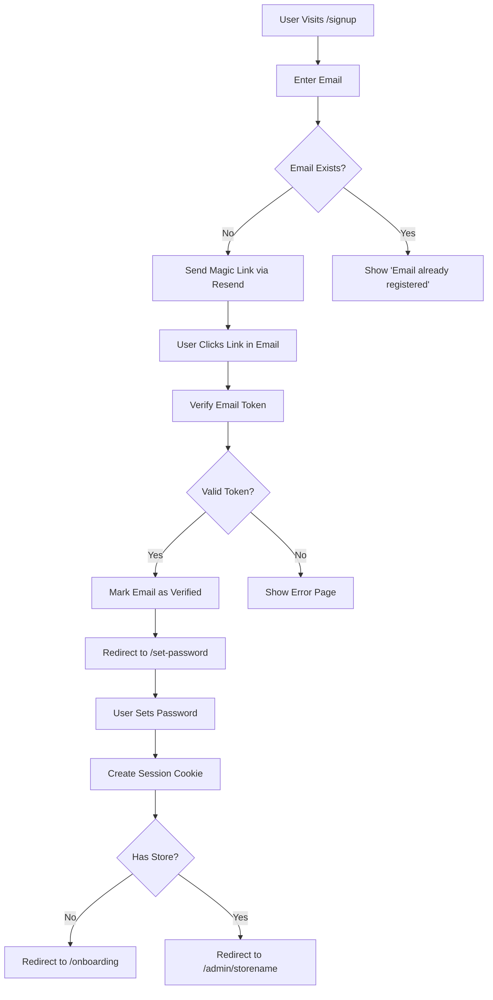
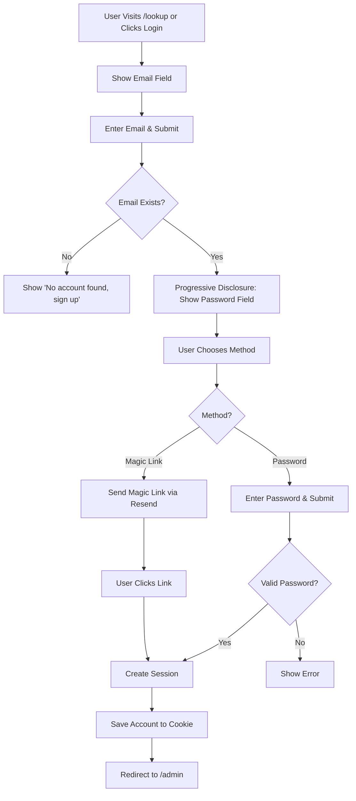
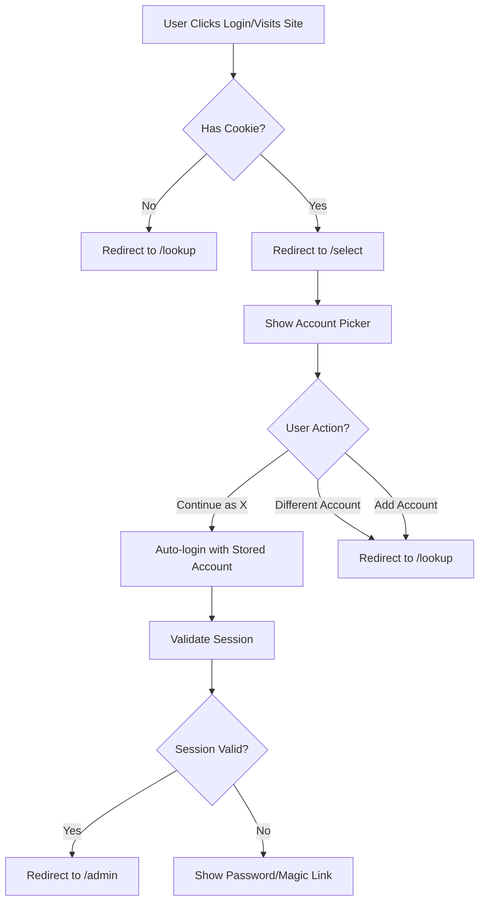
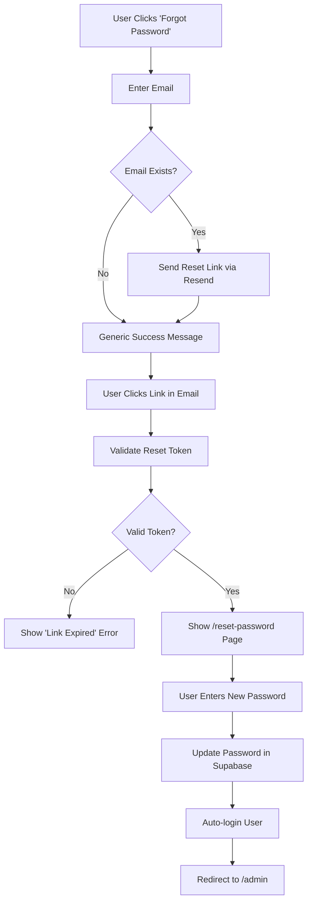

# LetBuyy Authentication System Transformation
## Shopify-Style Professional-Grade SaaS Authentication Implementation Plan

---

## Executive Summary

This document provides a comprehensive analysis and implementation plan to transform the LetBuyy authentication system from its current state to a **professional-grade, Shopify-inspired authentication architecture** using Resend for email delivery, cookie-based multi-account management, and a seamless progressive disclosure login experience.

**Current State**: Basic Supabase authentication with inconsistent UX, orphaned login pages, and no session management.

**Target State**: Enterprise-grade authentication system with magic link signup, progressive disclosure login, multi-account cookie management, and professional email workflows via Resend.

---

## Table of Contents

1. [Current System Analysis](#1-current-system-analysis)
2. [Shopify Authentication Deep Dive](#2-shopify-authentication-deep-dive)
3. [Target Architecture](#3-target-architecture)
4. [Technical Stack Decisions](#4-technical-stack-decisions)
5. [Implementation Phases](#5-implementation-phases)
6. [Detailed Component Specifications](#6-detailed-component-specifications)
7. [Database Schema Changes](#7-database-schema-changes)
8. [Security Considerations](#8-security-considerations)
9. [Testing Strategy](#9-testing-strategy)
10. [Migration Plan](#10-migration-plan)

---

## 1. Current System Analysis

### 1.1 Critical Issues Identified

#### **Authentication Flow Problems**
| Issue | Impact | Priority |
|-------|--------|----------|
| **Dual Login Pages** (`/login` + `/lookup`) | User confusion, orphaned endpoints | 🔴 Critical |
| **No Middleware Protection** | Unprotected routes, security risk | 🔴 Critical |
| **Inconsistent Styling** | Poor UX in `/select` and `/onboarding` | 🟡 High |
| **No Multi-Account Management** | localStorage stub, non-functional | 🟡 High |
| **Missing Reset Password Page** | Broken forgot password flow | 🔴 Critical |
| **No Session Persistence** | Users must re-login every tab | 🟡 High |

#### **Email Authentication Gaps**
- ❌ No magic link implementation for login (only signup)
- ❌ No email verification workflow
- ❌ No password reset flow completion
- ❌ No branded transactional emails
- ❌ No email delivery monitoring

#### **User Experience Issues**
- No account lookup/selection UI when multiple accounts exist
- No "Remember this account" functionality
- No seamless account switching
- No progressive disclosure (email → then password)
- Passkey integration is placeholder-only

### 1.2 Current Tech Stack

```typescript
// Current Dependencies
"@supabase/supabase-js": "^2.95.2"
"@supabase/ssr": "^0.8.0"
"next": "16.1.6"
"react": "19.2.3"
"tailwind": "^4"
```

**Strengths**:
- ✅ Modern Next.js 16 with App Router
- ✅ Supabase for auth backend
- ✅ CSS variable design system
- ✅ SSR-ready cookie-based sessions

**Weaknesses**:
- ❌ No email service integration
- ❌ No session token management
- ❌ No cookie-based multi-account system
- ❌ No middleware for route protection

---

## 2. Shopify Authentication Deep Dive

### 2.1 Shopify's Authentication Philosophy

Shopify's authentication system is built on these core principles:

#### **A. Progressive Trust Building**
```
User Entry → Email Lookup → Account Recognition → Minimal Friction Auth
```

#### **B. Multi-Account Excellence**
- Cookie-based account storage
- Instant account switching
- Visual account picker
- "Continue as [Name]" quick login

#### **C. Passwordless-First Approach**
- Email magic links as primary
- Password as fallback option
- Social OAuth integration
- Passkey support (future)

#### **D. Session Intelligence**
```javascript
// Shopify's session strategy
if (hasCookie && !expired) {
  → Show account picker
} else if (hasEmail) {
  → Progressive disclosure (email → password/magic link)
} else {
  → Full signup flow
}
```

### 2.2 Shopify's User Flow Patterns

#### **Signup Flow** (New User)
```
1. Email Entry
   ↓
2. Email Verification Link
   ↓
3. Click Link → Verify Email
   ↓
4. Set Password (or continue passwordless)
   ↓
5. Redirect to Dashboard/Onboarding
```

#### **Login Flow** (Returning User - No Cookie)
```
1. Enter Email (lookup page)
   ↓
2. Progressive Disclosure:
   - If account exists → Show password field
   - Offer "Send magic link" option
   ↓
3. Authenticate
   ↓
4. Redirect to last page or dashboard
```

#### **Login Flow** (Returning User - Has Cookie)
```
1. Click "Login" anywhere
   ↓
2. Automatic redirect to /lookup
   ↓
3. Show Account Picker with saved accounts
   ↓
4. Click "Continue as [Name]" → Instant login
   OR
   Click "Use different account" → Email entry
```

### 2.3 Shopify's Email Strategy

**Transactional Emails**:
- Email verification (magic link)
- Password reset (time-limited link)
- Security alerts (new device login)
- Account recovery codes

**Email Provider**: Shopify uses their own infrastructure but mandates:
- SPF/DKIM authentication
- DMARC records
- Branded sender addresses
- High deliverability standards

**For LetBuyy**: We'll use **Resend** (already configured domain)

---

## 3. Target Architecture

### 3.1 System Architecture Diagram

```
┌─────────────────────────────────────────────────────────────────┐
│                    LetBuyy Authentication System                 │
└─────────────────────────────────────────────────────────────────┘

┌──────────────┐      ┌──────────────┐      ┌──────────────┐
│   Browser    │      │  Next.js App │      │   Supabase   │
│   (Client)   │◄────►│  (Accounts)  │◄────►│     Auth     │
└──────────────┘      └──────────────┘      └──────────────┘
       │                      │                      │
       │                      ▼                      │
       │              ┌──────────────┐              │
       │              │   Resend     │              │
       │              │  Email API   │              │
       │              └──────────────┘              │
       │                      │                      │
       ▼                      ▼                      ▼
┌──────────────────────────────────────────────────────────┐
│              Cookie-Based Session Storage                 │
│  • letbuyy_accounts (encrypted account list)             │
│  • letbuyy_session (current session token)               │
│  • letbuyy_remember (account preference)                 │
└──────────────────────────────────────────────────────────┘

Flow Orchestration:
┌─────────────┐    ┌─────────────┐    ┌─────────────┐
│   Signup    │───►│  Verify     │───►│ Onboarding  │
│  (Email)    │    │  (Magic)    │    │   (Store)   │
└─────────────┘    └─────────────┘    └─────────────┘

┌─────────────┐    ┌─────────────┐    ┌─────────────┐
│   Lookup    │───►│  Account    │───►│   Admin     │
│  (Email)    │    │   Picker    │    │     App     │
└─────────────┘    └─────────────┘    └─────────────┘
```

### 3.2 User Journey Flows

#### **Flow A: First-Time Signup**


#### **Flow B: Login (No Cookie)**


#### **Flow C: Login (Has Cookie)**


#### **Flow D: Password Reset**


### 3.3 Cookie Management Strategy

#### **Cookie Structure**
```typescript
interface LetBuyyAccountsCookie {
  version: string; // "1.0"
  accounts: Array<{
    id: string;
    email: string;
    name: string | null;
    avatar: string | null;
    lastUsed: string; // ISO timestamp
    storeName: string | null;
  }>;
  lastUpdated: string;
}

interface LetBuyySessionCookie {
  userId: string;
  sessionToken: string;
  expiresAt: string;
  storeId: string | null;
}

interface LetBuyyRememberCookie {
  accountId: string;
  autoLogin: boolean;
}
```

#### **Cookie Security Configuration**
```typescript
const cookieOptions = {
  httpOnly: true,
  secure: process.env.NODE_ENV === 'production',
  sameSite: 'lax' as const,
  maxAge: 60 * 60 * 24 * 365, // 1 year for accounts
  path: '/',
  domain: process.env.COOKIE_DOMAIN, // .letbuyy.store
};
```

---

## 4. Technical Stack Decisions

### 4.1 New Dependencies

```json
{
  "dependencies": {
    // Existing
    "@supabase/supabase-js": "^2.95.2",
    "@supabase/ssr": "^0.8.0",
    "next": "16.1.6",
    "react": "19.2.3",
    
    // New Additions
    "resend": "^4.0.0",                    // Email API
    "react-email": "^3.0.0",               // Email templates
    "@react-email/components": "^0.0.25",  // Email components
    "jose": "^5.9.0",                      // JWT for magic links
    "zod": "^3.24.0",                      // Schema validation
    "cookies-next": "^4.3.0",              // Cookie management
    "nanoid": "^5.0.0",                    // Token generation
    "bcryptjs": "^2.4.3"                   // Password hashing (if needed)
  },
  "devDependencies": {
    "@types/bcryptjs": "^2.4.6"
  }
}
```

### 4.2 Environment Variables

```bash
# .env.local
# Existing
NEXT_PUBLIC_SUPABASE_URL=https://rvzgkynwhbiksffusqnb.supabase.co
NEXT_PUBLIC_SUPABASE_ANON_KEY=your_anon_key
SUPABASE_SERVICE_ROLE_KEY=your_service_role_key # NEW - for admin operations

# Resend Configuration
RESEND_API_KEY=re_xxxxxxxxxxxxxxxxxxxxx
RESEND_FROM_EMAIL=noreply@letbuyy.store
RESEND_REPLY_TO=support@letbuyy.store

# App URLs
NEXT_PUBLIC_ACCOUNTS_URL=https://accounts.letbuyy.store
NEXT_PUBLIC_ADMIN_URL=https://admin.letbuyy.store
NEXT_PUBLIC_LANDING_URL=https://letbuyy.store

# Cookie Configuration
COOKIE_DOMAIN=.letbuyy.store
COOKIE_SECRET=your_secret_key_min_32_chars

# Magic Link Configuration
MAGIC_LINK_SECRET=your_jwt_secret_key_min_32_chars
MAGIC_LINK_EXPIRY=900 # 15 minutes in seconds

# Session Configuration
SESSION_DURATION=2592000 # 30 days in seconds
```

### 4.3 Directory Structure Changes

```
apps/web/accounts/
├── src/
│   ├── app/
│   │   ├── layout.tsx
│   │   ├── page.tsx (redirect to /lookup)
│   │   ├── globals.css
│   │   │
│   │   ├── signup/
│   │   │   └── page.tsx (Email-only signup)
│   │   │
│   │   ├── verify-email/
│   │   │   └── page.tsx (Magic link verification)
│   │   │
│   │   ├── set-password/
│   │   │   └── page.tsx (NEW - Set password after email verification)
│   │   │
│   │   ├── lookup/
│   │   │   └── page.tsx (Progressive disclosure login)
│   │   │
│   │   ├── select/
│   │   │   └── page.tsx (Account picker - REDESIGN)
│   │   │
│   │   ├── forgot-password/
│   │   │   └── page.tsx (Request reset)
│   │   │
│   │   ├── reset-password/
│   │   │   └── page.tsx (NEW - Set new password)
│   │   │
│   │   ├── onboarding/
│   │   │   └── page.tsx (Store creation)
│   │   │
│   │   ├── auth/
│   │   │   ├── callback/
│   │   │   │   └── route.ts (OAuth callback)
│   │   │   └── verify/
│   │   │       └── route.ts (NEW - Magic link verification endpoint)
│   │   │
│   │   └── api/
│   │       ├── auth/
│   │       │   ├── send-magic-link/
│   │       │   │   └── route.ts (NEW)
│   │       │   ├── send-reset-link/
│   │       │   │   └── route.ts (NEW)
│   │       │   └── logout/
│   │       │       └── route.ts (NEW)
│   │       └── accounts/
│   │           ├── list/
│   │           │   └── route.ts (NEW - Get saved accounts)
│   │           └── remove/
│   │               └── route.ts (NEW - Remove account from cookie)
│   │
│   ├── lib/
│   │   ├── supabase/
│   │   │   ├── client.ts
│   │   │   ├── server.ts
│   │   │   └── middleware.ts (NEW)
│   │   │
│   │   ├── resend/
│   │   │   ├── client.ts (NEW)
│   │   │   └── templates/ (NEW)
│   │   │       ├── verify-email.tsx
│   │   │       ├── reset-password.tsx
│   │   │       ├── welcome.tsx
│   │   │       └── security-alert.tsx
│   │   │
│   │   ├── auth/
│   │   │   ├── magic-link.ts (NEW - Generate/verify tokens)
│   │   │   ├── session.ts (NEW - Session management)
│   │   │   └── cookies.ts (NEW - Cookie helpers)
│   │   │
│   │   ├── utils/
│   │   │   ├── validation.ts (NEW - Zod schemas)
│   │   │   └── errors.ts (NEW - Error handling)
│   │   │
│   │   └── constants/
│   │       └── messages.ts (NEW - User-facing messages)
│   │
│   ├── middleware.ts (NEW - Route protection)
│   │
│   └── types/
│       ├── auth.ts (NEW)
│       └── cookies.ts (NEW)
│
└── emails/ (NEW - React Email templates at root level)
    ├── verify-email.tsx
    ├── reset-password.tsx
    ├── welcome.tsx
    └── security-alert.tsx
```

---

## 5. Implementation Phases

### Phase 1: Foundation & Infrastructure (Week 1-2)
**Goal**: Set up core services and utilities

#### Tasks:
1. **Resend Integration**
   - [ ] Install dependencies (`resend`, `react-email`)
   - [ ] Configure Resend API client
   - [ ] Create email templates (verify, reset, welcome, security)
   - [ ] Test email delivery locally

2. **Cookie Management System**
   - [ ] Create cookie utility functions
   - [ ] Implement account storage in cookies
   - [ ] Add cookie encryption/decryption
   - [ ] Test cookie persistence

3. **Magic Link System**
   - [ ] Create JWT-based token generator
   - [ ] Implement token verification
   - [ ] Add expiry handling
   - [ ] Create verification endpoint

4. **Session Management**
   - [ ] Create session helper functions
   - [ ] Implement session refresh logic
   - [ ] Add session validation
   - [ ] Create logout functionality

5. **Middleware Setup**
   - [ ] Create Next.js middleware
   - [ ] Add route protection logic
   - [ ] Implement redirect logic
   - [ ] Test middleware behavior

#### Deliverables:
- ✅ Working Resend email sending
- ✅ Encrypted cookie storage
- ✅ Magic link generation/verification
- ✅ Session management utilities
- ✅ Route protection middleware

---

### Phase 2: Signup Flow Rebuild (Week 3)
**Goal**: Implement new email-first signup with verification

#### Tasks:
1. **Signup Page Redesign** (`/signup`)
   - [ ] Remove password field (email only)
   - [ ] Update UI to match design system
   - [ ] Add form validation
   - [ ] Integrate with Resend API
   - [ ] Add loading states

2. **Email Verification** (`/verify-email`)
   - [ ] Create verification page
   - [ ] Implement token validation
   - [ ] Add error handling
   - [ ] Create success state
   - [ ] Add resend verification option

3. **Set Password Page** (`/set-password`) [NEW]
   - [ ] Create new page component
   - [ ] Add password strength indicator
   - [ ] Implement password validation
   - [ ] Create Supabase password update
   - [ ] Add auto-login after password set

4. **Verification Endpoint** (`/auth/verify`)
   - [ ] Create API route
   - [ ] Validate magic link tokens
   - [ ] Mark email as verified in Supabase
   - [ ] Create session
   - [ ] Redirect to appropriate page

#### User Flow:
```
/signup → Enter email → Resend magic link → /verify-email 
→ Click link → /set-password → Set password → Session created 
→ /onboarding or /admin
```

#### Deliverables:
- ✅ Email-only signup form
- ✅ Magic link verification
- ✅ Password setting page
- ✅ Functional signup-to-onboarding flow

---

### Phase 3: Login Flow Transformation (Week 4)
**Goal**: Build progressive disclosure login with account picker

#### Tasks:
1. **Lookup Page Rebuild** (`/lookup`)
   - [ ] Implement progressive disclosure
   - [ ] Email field as initial state
   - [ ] Show password field after email check
   - [ ] Add "Send magic link" option
   - [ ] Integrate cookie check for auto-fill
   - [ ] Add OAuth buttons

2. **Account Picker Redesign** (`/select`)
   - [ ] Redesign UI with CSS variables
   - [ ] Display saved accounts from cookie
   - [ ] Add "Continue as [Name]" buttons
   - [ ] Implement one-click login
   - [ ] Add "Use different account" option
   - [ ] Add account removal functionality

3. **Magic Link Login**
   - [ ] Create magic link endpoint for login
   - [ ] Send email via Resend
   - [ ] Verify token and create session
   - [ ] Update cookie with account info
   - [ ] Redirect to admin

4. **Middleware Integration**
   - [ ] Protect all routes except auth pages
   - [ ] Auto-redirect based on cookie presence
   - [ ] Handle new tab behavior
   - [ ] Add session refresh logic

#### User Flow (No Cookie):
```
Click Login → /lookup → Enter email → Progressive disclosure 
→ Password/Magic Link → Session created → /admin
```

#### User Flow (Has Cookie):
```
Click Login → /select → Choose account → Auto-login → /admin
OR
Click Login → /select → Different account → /lookup → ...
```

#### Deliverables:
- ✅ Progressive disclosure login
- ✅ Professional account picker
- ✅ Magic link login flow
- ✅ Cookie-based account switching

---

### Phase 4: Password Management (Week 5)
**Goal**: Complete password reset and recovery flows

#### Tasks:
1. **Forgot Password Page** (`/forgot-password`)
   - [ ] Update to use Resend
   - [ ] Add form validation
   - [ ] Create generic success message
   - [ ] Add security best practices

2. **Reset Password Page** (`/reset-password`) [NEW]
   - [ ] Create new page
   - [ ] Validate reset tokens
   - [ ] Add password strength indicator
   - [ ] Implement password update
   - [ ] Auto-login after reset
   - [ ] Add session creation

3. **Reset Link API** (`/api/auth/send-reset-link`)
   - [ ] Create endpoint
   - [ ] Generate time-limited tokens
   - [ ] Send email via Resend
   - [ ] Add rate limiting
   - [ ] Log reset attempts

#### User Flow:
```
/forgot-password → Enter email → Resend reset link 
→ Click link → /reset-password → Enter new password 
→ Auto-login → /admin
```

#### Deliverables:
- ✅ Working forgot password flow
- ✅ Secure reset password page
- ✅ Auto-login after reset
- ✅ Rate-limited email sending

---

### Phase 5: Multi-Account Management (Week 6)
**Goal**: Perfect the multi-account experience

#### Tasks:
1. **Account Storage Optimization**
   - [ ] Implement account metadata storage
   - [ ] Add account avatars/names
   - [ ] Store last-used timestamps
   - [ ] Implement account limit (max 5)
   - [ ] Add account sorting by recency

2. **Account Picker Enhancements**
   - [ ] Display account details
   - [ ] Show last login time
   - [ ] Add hover states
   - [ ] Implement keyboard navigation
   - [ ] Add loading states

3. **Account Management APIs**
   - [ ] GET /api/accounts/list
   - [ ] DELETE /api/accounts/remove
   - [ ] POST /api/auth/logout (single account)
   - [ ] POST /api/auth/logout-all (all accounts)

4. **Session Persistence**
   - [ ] Auto-redirect to /select on new tab
   - [ ] Validate session before redirecting
   - [ ] Handle expired sessions
   - [ ] Refresh session tokens

#### Deliverables:
- ✅ Robust account storage
- ✅ Professional account picker UI
- ✅ Account management APIs
- ✅ Session persistence across tabs

---

### Phase 6: UX Polish & Accessibility (Week 7)
**Goal**: Enhance user experience and ensure accessibility

#### Tasks:
1. **Design System Consistency**
   - [ ] Update `/select` to use CSS variables
   - [ ] Update `/onboarding` to use CSS variables
   - [ ] Ensure dark mode works everywhere
   - [ ] Add smooth transitions
   - [ ] Implement loading skeletons

2. **Error Handling**
   - [ ] Create consistent error messages
   - [ ] Add inline validation feedback
   - [ ] Implement toast notifications
   - [ ] Add fallback error pages

3. **Accessibility**
   - [ ] ARIA labels on all forms
   - [ ] Keyboard navigation support
   - [ ] Screen reader testing
   - [ ] Focus management
   - [ ] Color contrast compliance

4. **Performance Optimization**
   - [ ] Code splitting
   - [ ] Image optimization
   - [ ] Font loading optimization
   - [ ] Reduce bundle size

#### Deliverables:
- ✅ Consistent design across all pages
- ✅ Professional error handling
- ✅ WCAG 2.1 AA compliance
- ✅ Optimized performance

---

### Phase 7: Testing & Security Audit (Week 8)
**Goal**: Ensure security and reliability

#### Tasks:
1. **Unit Testing**
   - [ ] Test cookie utilities
   - [ ] Test magic link generation
   - [ ] Test session management
   - [ ] Test validation schemas

2. **Integration Testing**
   - [ ] Test complete signup flow
   - [ ] Test login flows (all variants)
   - [ ] Test password reset flow
   - [ ] Test account switching

3. **Security Audit**
   - [ ] Review token generation
   - [ ] Test rate limiting
   - [ ] Check for XSS vulnerabilities
   - [ ] Verify CSRF protection
   - [ ] Test cookie security

4. **Email Deliverability**
   - [ ] Test SPF/DKIM records
   - [ ] Verify sender reputation
   - [ ] Check spam scores
   - [ ] Test across email clients

#### Deliverables:
- ✅ Comprehensive test coverage
- ✅ Security audit report
- ✅ Email deliverability verified
- ✅ Production-ready system

---

## 6. Detailed Component Specifications

### 6.1 Resend Email Client

**File**: `src/lib/resend/client.ts`

```typescript
import { Resend } from 'resend';

if (!process.env.RESEND_API_KEY) {
  throw new Error('Missing RESEND_API_KEY environment variable');
}

export const resend = new Resend(process.env.RESEND_API_KEY);

export const sendEmail = async ({
  to,
  subject,
  react,
}: {
  to: string;
  subject: string;
  react: React.ReactElement;
}) => {
  try {
    const { data, error } = await resend.emails.send({
      from: process.env.RESEND_FROM_EMAIL!,
      to,
      subject,
      react,
      replyTo: process.env.RESEND_REPLY_TO,
    });

    if (error) {
      console.error('Resend error:', error);
      throw new Error(`Failed to send email: ${error.message}`);
    }

    return data;
  } catch (error) {
    console.error('Email sending failed:', error);
    throw error;
  }
};
```

### 6.2 Magic Link Generator

**File**: `src/lib/auth/magic-link.ts`

```typescript
import { SignJWT, jwtVerify } from 'jose';
import { nanoid } from 'nanoid';

const JWT_SECRET = new TextEncoder().encode(
  process.env.MAGIC_LINK_SECRET || 'fallback-secret-key-min-32-chars'
);

const TOKEN_EXPIRY = parseInt(process.env.MAGIC_LINK_EXPIRY || '900', 10); // 15 minutes

export type TokenPurpose = 'verify-email' | 'login' | 'reset-password';

interface TokenPayload {
  email: string;
  purpose: TokenPurpose;
  jti: string; // Token ID for revocation
}

export async function generateMagicToken(
  email: string,
  purpose: TokenPurpose
): Promise {
  const token = await new SignJWT({
    email,
    purpose,
    jti: nanoid(),
  } as TokenPayload)
    .setProtectedHeader({ alg: 'HS256' })
    .setIssuedAt()
    .setExpirationTime(`${TOKEN_EXPIRY}s`)
    .sign(JWT_SECRET);

  return token;
}

export async function verifyMagicToken(
  token: string
): Promise {
  try {
    const { payload } = await jwtVerify(token, JWT_SECRET);
    return payload as unknown as TokenPayload;
  } catch (error) {
    console.error('Token verification failed:', error);
    return null;
  }
}

export function buildMagicLink(token: string, purpose: TokenPurpose): string {
  const baseUrl = process.env.NEXT_PUBLIC_ACCOUNTS_URL;
  
  const paths = {
    'verify-email': '/auth/verify',
    'login': '/auth/verify',
    'reset-password': '/reset-password',
  };

  return `${baseUrl}${paths[purpose]}?token=${token}`;
}
```

### 6.3 Cookie Management

**File**: `src/lib/auth/cookies.ts`

```typescript
import { cookies } from 'next/headers';
import { SignJWT, jwtVerify } from 'jose';
import type { LetBuyyAccountsCookie, SavedAccount } from '@/types/cookies';

const COOKIE_SECRET = new TextEncoder().encode(
  process.env.COOKIE_SECRET || 'fallback-cookie-secret-min-32-chars'
);

const COOKIE_OPTIONS = {
  httpOnly: true,
  secure: process.env.NODE_ENV === 'production',
  sameSite: 'lax' as const,
  path: '/',
  domain: process.env.COOKIE_DOMAIN,
};

// Encrypt cookie data
async function encrypt(data: any): Promise {
  return new SignJWT({ data })
    .setProtectedHeader({ alg: 'HS256' })
    .setIssuedAt()
    .sign(COOKIE_SECRET);
}

// Decrypt cookie data
async function decrypt(token: string): Promise {
  try {
    const { payload } = await jwtVerify(token, COOKIE_SECRET);
    return payload.data;
  } catch {
    return null;
  }
}

// Get saved accounts from cookie
export async function getSavedAccounts(): Promise {
  const cookieStore = await cookies();
  const accountsCookie = cookieStore.get('letbuyy_accounts');
  
  if (!accountsCookie) return [];
  
  const data = await decrypt(accountsCookie.value);
  if (!data?.accounts) return [];
  
  return data.accounts;
}

// Save account to cookie
export async function saveAccountToCookie(account: SavedAccount): Promise {
  const cookieStore = await cookies();
  const existingAccounts = await getSavedAccounts();
  
  // Remove if already exists
  const filtered = existingAccounts.filter(a => a.id !== account.id);
  
  // Add to front (most recent)
  const updated = [account, ...filtered].slice(0, 5); // Max 5 accounts
  
  const encrypted = await encrypt({
    version: '1.0',
    accounts: updated,
    lastUpdated: new Date().toISOString(),
  });
  
  cookieStore.set('letbuyy_accounts', encrypted, {
    ...COOKIE_OPTIONS,
    maxAge: 60 * 60 * 24 * 365, // 1 year
  });
}

// Remove account from cookie
export async function removeAccountFromCookie(accountId: string): Promise {
  const cookieStore = await cookies();
  const existingAccounts = await getSavedAccounts();
  const filtered = existingAccounts.filter(a => a.id !== accountId);
  
  if (filtered.length === 0) {
    cookieStore.delete('letbuyy_accounts');
    return;
  }
  
  const encrypted = await encrypt({
    version: '1.0',
    accounts: filtered,
    lastUpdated: new Date().toISOString(),
  });
  
  cookieStore.set('letbuyy_accounts', encrypted, {
    ...COOKIE_OPTIONS,
    maxAge: 60 * 60 * 24 * 365,
  });
}

// Set session cookie
export async function setSessionCookie(userId: string, sessionToken: string): Promise {
  const cookieStore = await cookies();
  const expiresAt = new Date();
  expiresAt.setSeconds(expiresAt.getSeconds() + parseInt(process.env.SESSION_DURATION || '2592000', 10));
  
  const encrypted = await encrypt({
    userId,
    sessionToken,
    expiresAt: expiresAt.toISOString(),
  });
  
  cookieStore.set('letbuyy_session', encrypted, {
    ...COOKIE_OPTIONS,
    maxAge: parseInt(process.env.SESSION_DURATION || '2592000', 10),
  });
}

// Get session cookie
export async function getSessionCookie(): Promise {
  const cookieStore = await cookies();
  const sessionCookie = cookieStore.get('letbuyy_session');
  
  if (!sessionCookie) return null;
  
  return await decrypt(sessionCookie.value);
}

// Clear all cookies
export async function clearAllCookies(): Promise {
  const cookieStore = await cookies();
  cookieStore.delete('letbuyy_accounts');
  cookieStore.delete('letbuyy_session');
  cookieStore.delete('letbuyy_remember');
}
```

### 6.4 Email Templates

**File**: `emails/verify-email.tsx`

```tsx
import {
  Body,
  Button,
  Container,
  Head,
  Heading,
  Html,
  Img,
  Link,
  Preview,
  Section,
  Text,
} from '@react-email/components';
import * as React from 'react';

interface VerifyEmailProps {
  verificationLink: string;
  userEmail: string;
}

export const VerifyEmail = ({
  verificationLink = 'https://accounts.letbuyy.store/auth/verify?token=...',
  userEmail = 'user@example.com',
}: VerifyEmailProps) => {
  return (
    
      
      Verify your email address to continue
      
        
          
          Verify your email address
          
            Welcome to LetBuyy! To complete your signup, please verify your
            email address by clicking the button below.
          
          
            
              Verify Email
            
          
          
            This link will expire in 15 minutes. If you didn't create a LetBuyy
            account, you can safely ignore this email.
          
          
            Or copy and paste this URL into your browser:{' '}
            
              {verificationLink}
            
          
          
            LetBuyy - Build your online store
            
            
              letbuyy.store
            
          
        
      
    
  );
};

export default VerifyEmail;

// Styles
const main = {
  backgroundColor: '#f6f9fc',
  fontFamily:
    '-apple-system,BlinkMacSystemFont,"Segoe UI",Roboto,"Helvetica Neue",Ubuntu,sans-serif',
};

const container = {
  backgroundColor: '#ffffff',
  margin: '0 auto',
  padding: '20px 0 48px',
  marginBottom: '64px',
};

const logo = {
  margin: '0 auto',
};

const h1 = {
  color: '#333',
  fontSize: '24px',
  fontWeight: 'bold',
  margin: '40px 0',
  padding: '0',
  textAlign: 'center' as const,
};

const text = {
  color: '#333',
  fontSize: '16px',
  lineHeight: '26px',
  textAlign: 'center' as const,
  margin: '0 auto',
  maxWidth: '500px',
};

const buttonContainer = {
  textAlign: 'center' as const,
  margin: '32px 0',
};

const button = {
  backgroundColor: '#8B5CF6',
  borderRadius: '8px',
  color: '#fff',
  fontSize: '16px',
  fontWeight: 'bold',
  textDecoration: 'none',
  textAlign: 'center' as const,
  display: 'inline-block',
  padding: '12px 32px',
};

const link = {
  color: '#8B5CF6',
  textDecoration: 'underline',
};

const footerText = {
  color: '#8898aa',
  fontSize: '12px',
  lineHeight: '16px',
  textAlign: 'center' as const,
  marginTop: '32px',
};
```

**File**: `emails/reset-password.tsx`

```tsx
// Similar structure to verify-email.tsx but with:
// - Different heading: "Reset your password"
// - Different button text: "Reset Password"
// - Different link destination: /reset-password?token=...
// - Different preview text
```

**File**: `emails/welcome.tsx`

```tsx
// Sent after user completes onboarding
// - Welcome message
// - Links to resources
// - Getting started guide
```

**File**: `emails/security-alert.tsx`

```tsx
// Sent when suspicious activity detected
// - Alert about new login from unknown device
// - Button to secure account
// - Link to change password
```

### 6.5 Next.js Middleware

**File**: `src/middleware.ts`

```typescript
import { NextResponse } from 'next/server';
import type { NextRequest } from 'next/server';
import { getSessionCookie, getSavedAccounts } from '@/lib/auth/cookies';

// Routes that don't require authentication
const publicRoutes = [
  '/signup',
  '/lookup',
  '/select',
  '/verify-email',
  '/forgot-password',
  '/reset-password',
  '/auth/callback',
  '/auth/verify',
];

// Routes that require authentication
const protectedRoutes = ['/onboarding'];

export async function middleware(request: NextRequest) {
  const { pathname } = request.nextUrl;

  // Allow public routes
  if (publicRoutes.some(route => pathname.startsWith(route))) {
    return NextResponse.next();
  }

  // Root redirect logic
  if (pathname === '/') {
    const session = await getSessionCookie();
    const savedAccounts = await getSavedAccounts();

    // Has active session
    if (session) {
      return NextResponse.redirect(
        new URL(process.env.NEXT_PUBLIC_ADMIN_URL!, request.url)
      );
    }

    // Has saved accounts but no active session
    if (savedAccounts.length > 0) {
      return NextResponse.redirect(new URL('/select', request.url));
    }

    // No session, no saved accounts
    return NextResponse.redirect(new URL('/lookup', request.url));
  }

  // Protect routes that require authentication
  if (protectedRoutes.some(route => pathname.startsWith(route))) {
    const session = await getSessionCookie();

    if (!session) {
      return NextResponse.redirect(new URL('/lookup', request.url));
    }
  }

  return NextResponse.next();
}

export const config = {
  matcher: [
    /*
     * Match all request paths except:
     * - _next/static (static files)
     * - _next/image (image optimization files)
     * - favicon.ico (favicon file)
     * - public folder
     */
    '/((?!_next/static|_next/image|favicon.ico|.*\\.(?:svg|png|jpg|jpeg|gif|webp)$).*)',
  ],
};
```

### 6.6 API Route Examples

**File**: `src/app/api/auth/send-magic-link/route.ts`

```typescript
import { NextRequest, NextResponse } from 'next/server';
import { generateMagicToken, buildMagicLink } from '@/lib/auth/magic-link';
import { sendEmail } from '@/lib/resend/client';
import { createServerClient } from '@/lib/supabase/server';
import VerifyEmail from '@/../emails/verify-email';
import { z } from 'zod';

const schema = z.object({
  email: z.string().email(),
  purpose: z.enum(['verify-email', 'login']),
});

export async function POST(request: NextRequest) {
  try {
    const body = await request.json();
    const { email, purpose } = schema.parse(body);

    // Check if user exists
    const supabase = await createServerClient();
    const { data: user } = await supabase
      .from('auth.users')
      .select('email, email_confirmed_at')
      .eq('email', email)
      .single();

    // For signup: user should NOT exist
    if (purpose === 'verify-email' && user) {
      return NextResponse.json(
        { error: 'Email already registered' },
        { status: 400 }
      );
    }

    // For login: user MUST exist
    if (purpose === 'login' && !user) {
      return NextResponse.json(
        { error: 'No account found' },
        { status: 404 }
      );
    }

    // Generate magic link token
    const token = await generateMagicToken(email, purpose);
    const magicLink = buildMagicLink(token, purpose);

    // Send email
    await sendEmail({
      to: email,
      subject: purpose === 'verify-email' 
        ? 'Verify your email address' 
        : 'Your magic link to sign in',
      react: VerifyEmail({ verificationLink: magicLink, userEmail: email }),
    });

    return NextResponse.json({ 
      success: true,
      message: 'Magic link sent successfully' 
    });
  } catch (error) {
    console.error('Send magic link error:', error);
    return NextResponse.json(
      { error: 'Failed to send magic link' },
      { status: 500 }
    );
  }
}
```

**File**: `src/app/api/accounts/list/route.ts`

```typescript
import { NextRequest, NextResponse } from 'next/server';
import { getSavedAccounts } from '@/lib/auth/cookies';

export async function GET(request: NextRequest) {
  try {
    const accounts = await getSavedAccounts();
    
    return NextResponse.json({ accounts });
  } catch (error) {
    console.error('Get accounts error:', error);
    return NextResponse.json(
      { error: 'Failed to fetch accounts' },
      { status: 500 }
    );
  }
}
```

---

## 7. Database Schema Changes

### 7.1 Supabase Tables Updates

#### **users** (auth.users - managed by Supabase)
```sql
-- No changes needed, Supabase manages this
-- Key fields we use:
-- - id (UUID)
-- - email (string)
-- - email_confirmed_at (timestamp)
-- - encrypted_password (string)
-- - created_at (timestamp)
-- - updated_at (timestamp)
```

#### **stores** (existing table - add new fields)
```sql
ALTER TABLE stores
ADD COLUMN IF NOT EXISTS user_email TEXT,
ADD COLUMN IF NOT EXISTS email_verified BOOLEAN DEFAULT FALSE,
ADD COLUMN IF NOT EXISTS last_login_at TIMESTAMPTZ,
ADD COLUMN IF NOT EXISTS login_count INTEGER DEFAULT 0,
ADD COLUMN IF NOT EXISTS avatar_url TEXT,
ADD COLUMN IF NOT EXISTS display_name TEXT,
ADD COLUMN IF NOT EXISTS phone TEXT,
ADD COLUMN IF NOT EXISTS locale TEXT DEFAULT 'en';
```

### 7.2 New Tables

#### **sessions** (custom session management)
```sql
CREATE TABLE IF NOT EXISTS sessions (
  id UUID PRIMARY KEY DEFAULT gen_random_uuid(),
  user_id UUID NOT NULL REFERENCES auth.users(id) ON DELETE CASCADE,
  token TEXT NOT NULL UNIQUE,
  device_id UUID REFERENCES devices(id) ON DELETE SET NULL,
  ip_address INET,
  user_agent TEXT,
  expires_at TIMESTAMPTZ NOT NULL,
  created_at TIMESTAMPTZ DEFAULT NOW(),
  last_active_at TIMESTAMPTZ DEFAULT NOW(),
  is_active BOOLEAN DEFAULT TRUE
);

CREATE INDEX idx_sessions_user ON sessions(user_id);
CREATE INDEX idx_sessions_token ON sessions(token);
CREATE INDEX idx_sessions_expires ON sessions(expires_at);
```

#### **devices** (device trust & fingerprinting)
```sql
CREATE TABLE IF NOT EXISTS devices (
  id UUID PRIMARY KEY DEFAULT gen_random_uuid(),
  user_id UUID NOT NULL REFERENCES auth.users(id) ON DELETE CASCADE,
  fingerprint TEXT NOT NULL,
  name TEXT, -- e.g. "Chrome on macOS", "Safari on iPhone"
  is_trusted BOOLEAN DEFAULT FALSE,
  last_used TIMESTAMPTZ DEFAULT NOW(),
  created_at TIMESTAMPTZ DEFAULT NOW(),
  ip_address INET,
  user_agent TEXT,

  UNIQUE(user_id, fingerprint)
);

CREATE INDEX idx_devices_user ON devices(user_id);
CREATE INDEX idx_devices_fingerprint ON devices(fingerprint);
```

#### **verification_tokens** (magic links, password resets, email verification)
```sql
CREATE TABLE IF NOT EXISTS verification_tokens (
  id UUID PRIMARY KEY DEFAULT gen_random_uuid(),
  token TEXT NOT NULL UNIQUE,
  email TEXT NOT NULL,
  purpose TEXT NOT NULL CHECK (purpose IN ('verify-email', 'login', 'reset-password')),
  expires_at TIMESTAMPTZ NOT NULL,
  used_at TIMESTAMPTZ,
  created_at TIMESTAMPTZ DEFAULT NOW(),
  ip_address INET,
  metadata JSONB DEFAULT '{}'
);

CREATE INDEX idx_tokens_token ON verification_tokens(token);
CREATE INDEX idx_tokens_email ON verification_tokens(email);
CREATE INDEX idx_tokens_expires ON verification_tokens(expires_at);
```

#### **user_accounts** (multi-account tracking)
```sql
CREATE TABLE IF NOT EXISTS user_accounts (
  id UUID PRIMARY KEY DEFAULT gen_random_uuid(),
  user_id UUID NOT NULL REFERENCES auth.users(id) ON DELETE CASCADE,
  store_id UUID REFERENCES stores(id) ON DELETE SET NULL,
  email TEXT NOT NULL,
  display_name TEXT,
  avatar_url TEXT,
  provider TEXT DEFAULT 'email', -- 'email', 'google', 'apple'
  last_login_at TIMESTAMPTZ,
  created_at TIMESTAMPTZ DEFAULT NOW(),

  UNIQUE(user_id, email)
);

CREATE INDEX idx_user_accounts_user ON user_accounts(user_id);
CREATE INDEX idx_user_accounts_email ON user_accounts(email);
```

### 7.3 Database Cleanup Jobs

```sql
-- Run daily: remove expired tokens
DELETE FROM verification_tokens WHERE expires_at < NOW();

-- Run daily: deactivate expired sessions
UPDATE sessions SET is_active = FALSE WHERE expires_at < NOW();

-- Run weekly: remove old inactive sessions
DELETE FROM sessions WHERE is_active = FALSE AND expires_at < NOW() - INTERVAL '30 days';

-- Run weekly: remove unused untrusted devices
DELETE FROM devices WHERE last_used < NOW() - INTERVAL '90 days' AND is_trusted = FALSE;
```

### 7.4 Row-Level Security (RLS)

```sql
-- Sessions: users can only access their own
ALTER TABLE sessions ENABLE ROW LEVEL SECURITY;
CREATE POLICY sessions_user ON sessions FOR ALL USING (user_id = auth.uid());

-- Devices: users can only access their own
ALTER TABLE devices ENABLE ROW LEVEL SECURITY;
CREATE POLICY devices_user ON devices FOR ALL USING (user_id = auth.uid());

-- User Accounts: users can only access their own
ALTER TABLE user_accounts ENABLE ROW LEVEL SECURITY;
CREATE POLICY user_accounts_user ON user_accounts FOR ALL USING (user_id = auth.uid());

-- Verification Tokens: server-side only (service_role access)
ALTER TABLE verification_tokens ENABLE ROW LEVEL SECURITY;
-- No public policy — accessed via service_role key only
```

---

## 8. Security Considerations

### 8.1 Cookie Security Strategy

| Cookie | HttpOnly | Secure | SameSite | Max-Age | Purpose |
|--------|----------|--------|----------|---------|---------|
| `lb_session` | ✅ | ✅ | `Lax` | 30 days | Active session token |
| `lb_accounts` | ✅ | ✅ | `Lax` | 365 days | Saved accounts (encrypted) |
| `lb_csrf` | ✅ | ✅ | `Strict` | Session | CSRF protection |
| `lb_device` | ✅ | ✅ | `Lax` | 365 days | Device fingerprint |
| `lb_theme` | ❌ | ❌ | `Lax` | 365 days | Theme preference (client-readable) |
| `lb_locale` | ❌ | ❌ | `Lax` | 365 days | Language preference (client-readable) |

### 8.2 Token Security

```typescript
const TOKEN_CONFIG = {
  MAGIC_LINK: {
    length: 64,
    algorithm: 'HS256',    // HMAC-SHA256
    expiry: '15m',         // 15 minutes
    singleUse: true,
  },
  SESSION: {
    length: 128,
    algorithm: 'random',   // crypto.randomBytes
    expiry: '30d',         // 30 days
    rotateOn: 'use',       // rotate on every use
  },
  CSRF: {
    length: 32,
    algorithm: 'random',
    expiry: 'session',
    perRequest: true,
  },
  PASSWORD_RESET: {
    length: 64,
    algorithm: 'HS256',
    expiry: '1h',          // 1 hour
    singleUse: true,
  },
  EMAIL_VERIFICATION: {
    length: 64,
    algorithm: 'HS256',
    expiry: '24h',         // 24 hours
    singleUse: true,
  },
};
```

### 8.3 Password Policy

```typescript
const PASSWORD_RULES = {
  minLength: 8,
  maxLength: 128,
  requireUppercase: true,
  requireLowercase: true,
  requireNumber: true,
  requireSpecial: false,         // recommended, not required
  hashAlgorithm: 'bcrypt',
  saltRounds: 12,
  commonPasswordCheck: true,     // reject top 10K common passwords
};
```

### 8.4 Rate Limiting

| Endpoint | Window | Max Requests | Penalty |
|----------|--------|-------------|---------|
| `POST /api/auth/send-magic-link` | 15 min | 3 per email | 1hr block |
| `POST /api/auth/send-reset-link` | 15 min | 3 per email | 1hr block |
| `POST /api/auth/login` | 15 min | 5 per email | 15min block |
| `POST /api/auth/signup` | 1 hour | 3 per IP | 1hr block |
| `GET /api/auth/verify` | 15 min | 10 per token | Token invalidation |

**Implementation** via Upstash Redis:

```typescript
import { Ratelimit } from '@upstash/ratelimit';
import { Redis } from '@upstash/redis';

const redis = new Redis({
  url: process.env.UPSTASH_REDIS_REST_URL!,
  token: process.env.UPSTASH_REDIS_REST_TOKEN!,
});

export const authRateLimit = new Ratelimit({
  redis,
  limiter: Ratelimit.slidingWindow(5, '15 m'),
  analytics: true,
  prefix: 'letbuyy:auth',
});

export const emailRateLimit = new Ratelimit({
  redis,
  limiter: Ratelimit.slidingWindow(3, '15 m'),
  analytics: true,
  prefix: 'letbuyy:email',
});
```

### 8.5 CSRF Protection

```typescript
import { nanoid } from 'nanoid';
import { cookies } from 'next/headers';

export async function generateCSRFToken(): Promise<string> {
  const token = nanoid(32);
  const cookieStore = await cookies();
  cookieStore.set('lb_csrf', token, {
    httpOnly: true,
    secure: process.env.NODE_ENV === 'production',
    sameSite: 'strict',
    path: '/',
  });
  return token;
}

export async function validateCSRFToken(requestToken: string): Promise<boolean> {
  const cookieStore = await cookies();
  const cookieToken = cookieStore.get('lb_csrf')?.value;
  if (!cookieToken || !requestToken) return false;
  return cookieToken === requestToken;
}
```

### 8.6 Input Validation (Zod)

```typescript
import { z } from 'zod';

export const loginSchema = z.object({
  email: z.string().email('Invalid email address').max(255),
  password: z.string().min(8).max(128).optional(),
  method: z.enum(['password', 'magic-link']),
  csrf: z.string().min(1),
});

export const signupSchema = z.object({
  email: z.string().email('Invalid email address').max(255),
  csrf: z.string().min(1),
});

export const resetPasswordSchema = z.object({
  token: z.string().min(1),
  password: z.string().min(8).max(128),
  confirmPassword: z.string().min(8).max(128),
  csrf: z.string().min(1),
}).refine(data => data.password === data.confirmPassword, {
  message: 'Passwords do not match',
  path: ['confirmPassword'],
});
```

### 8.7 Security Headers

```typescript
// next.config.ts
const securityHeaders = [
  { key: 'X-Content-Type-Options', value: 'nosniff' },
  { key: 'X-Frame-Options', value: 'DENY' },
  { key: 'X-XSS-Protection', value: '1; mode=block' },
  { key: 'Referrer-Policy', value: 'strict-origin-when-cross-origin' },
  { key: 'Permissions-Policy', value: 'camera=(), microphone=(), geolocation=()' },
  {
    key: 'Strict-Transport-Security',
    value: 'max-age=31536000; includeSubDomains; preload',
  },
  {
    key: 'Content-Security-Policy',
    value: [
      "default-src 'self'",
      "script-src 'self' 'unsafe-inline' 'unsafe-eval'",
      "style-src 'self' 'unsafe-inline' https://fonts.googleapis.com",
      "font-src 'self' https://fonts.gstatic.com",
      "img-src 'self' https: data: blob:",
      "connect-src 'self' https://*.supabase.co https://api.resend.com",
    ].join('; '),
  },
];
```

---

## 9. Testing Strategy

### 9.1 Unit Tests

```typescript
// src/lib/auth/__tests__/

// cookie.test.ts
describe('Cookie Management', () => {
  test('saveAccount stores encrypted account data');
  test('getAccounts decrypts and returns stored accounts');
  test('removeAccount removes specific account from cookie');
  test('clearAllAccounts removes all accounts');
  test('account limit of 5 is enforced');
  test('duplicate accounts are not added');
});

// magic-link.test.ts
describe('Magic Link', () => {
  test('generateMagicToken creates valid JWT');
  test('verifyMagicToken validates unexpired token');
  test('verifyMagicToken rejects expired token');
  test('verifyMagicToken rejects tampered token');
  test('buildMagicLink creates correct URL');
  test('token is single-use (cannot be reused)');
});

// session.test.ts
describe('Session Management', () => {
  test('createSession generates secure token');
  test('getSession returns active session');
  test('refreshSession extends expiry');
  test('invalidateSession marks session as inactive');
  test('expired sessions are not returned');
});

// password.test.ts
describe('Password Utilities', () => {
  test('hashPassword creates bcrypt hash');
  test('verifyPassword matches correct password');
  test('verifyPassword rejects wrong password');
  test('common passwords are rejected');
});
```

### 9.2 Integration Tests (Playwright)

```typescript
// e2e/

// signup.spec.ts
test.describe('Signup Flow', () => {
  test('user can enter email and receive verification email');
  test('verification link redirects to set-password page');
  test('user can set password and is auto-logged in');
  test('existing email shows appropriate error');
  test('resend verification button works');
  test('expired verification link shows error');
});

// login.spec.ts
test.describe('Login Flow', () => {
  test('email lookup shows password field for existing user');
  test('email lookup shows signup redirect for new user');
  test('correct password logs user in');
  test('incorrect password shows error');
  test('magic link option sends email and authenticates');
  test('OAuth (Google) login works');
  test('progressive disclosure animation is smooth');
});

// account-picker.spec.ts
test.describe('Account Picker', () => {
  test('saved accounts are shown on /select');
  test('clicking account logs in immediately');
  test('"Use different account" navigates to /lookup');
  test('removing account updates cookie');
});

// password-reset.spec.ts
test.describe('Password Reset', () => {
  test('forgot password sends reset email');
  test('reset link opens reset password page');
  test('new password can be set and user is auto-logged in');
  test('expired reset link shows error');
  test('reused reset link is rejected');
});

// middleware.spec.ts
test.describe('Route Protection', () => {
  test('unauthenticated user is redirected to /lookup');
  test('authenticated user can access /onboarding');
  test('root / redirects based on session state');
  test('public routes are accessible without auth');
});
```

### 9.3 Security Tests

```typescript
// csrf.test.ts
test.describe('CSRF Protection', () => {
  test('mutation endpoints reject requests without CSRF token');
  test('mutation endpoints reject requests with invalid CSRF token');
  test('valid CSRF token allows mutation');
});

// rate-limiting.test.ts
test.describe('Rate Limiting', () => {
  test('login endpoint blocks after 5 attempts');
  test('magic link endpoint blocks after 3 attempts');
  test('rate limit resets after window expires');
});

// injection.test.ts
test.describe('Injection Prevention', () => {
  test('SQL injection in email field is sanitized');
  test('XSS in form inputs is escaped');
  test('path traversal in token parameter is blocked');
});

// cookie-security.test.ts
test.describe('Cookie Security', () => {
  test('session cookie has HttpOnly flag');
  test('session cookie has Secure flag in production');
  test('account data in cookie is encrypted');
  test('tampered cookie data is rejected');
});
```

### 9.4 Performance Benchmarks

| Metric | Target | Tool |
|--------|--------|------|
| Login page load time | < 1.5s | Lighthouse |
| Time to interactive | < 2.0s | Web Vitals |
| Magic link email delivery | < 5s | Resend dashboard |
| Session validation | < 50ms | Server-side timing |
| Cookie read/write | < 10ms | Server-side timing |
| Token generation | < 20ms | Unit test timing |
| Password hash verification | < 300ms | Unit test timing |
| Rate limit check | < 5ms | Redis latency |

### 9.5 Browser Compatibility

| Browser | Version | Status |
|---------|---------|--------|
| Chrome | Latest 3 | ✅ Required |
| Firefox | Latest 3 | ✅ Required |
| Safari | Latest 2 | ✅ Required |
| Edge | Latest 3 | ✅ Required |
| Mobile Chrome | Latest 2 | ✅ Required |
| Mobile Safari | Latest 2 | ✅ Required |

---

## 10. Migration Plan

### 10.1 Pre-Migration Checklist

- [ ] All new database tables created and verified
- [ ] Resend API key configured and email sending tested
- [ ] Upstash Redis configured for rate limiting
- [ ] All environment variables set in production
- [ ] Feature flags configured for gradual rollout
- [ ] Backup of existing `auth.users` table created
- [ ] Rollback plan documented and tested
- [ ] Monitoring dashboards configured
- [ ] Support team briefed on changes

### 10.2 Migration Steps

#### Step 1: Database Migration (Day 1)

```bash
# 1. Run schema migrations
psql $DATABASE_URL -f migrations/001_alter_stores.sql
psql $DATABASE_URL -f migrations/002_create_sessions.sql
psql $DATABASE_URL -f migrations/003_create_devices.sql
psql $DATABASE_URL -f migrations/004_create_verification_tokens.sql
psql $DATABASE_URL -f migrations/005_create_user_accounts.sql
psql $DATABASE_URL -f migrations/006_enable_rls.sql

# 2. Populate user_accounts from existing auth.users
INSERT INTO user_accounts (user_id, email, display_name, provider, created_at)
SELECT 
  id, email,
  raw_user_meta_data->>'full_name',
  COALESCE(raw_app_meta_data->>'provider', 'email'),
  created_at
FROM auth.users;

# 3. Verify data integrity
SELECT COUNT(*) FROM auth.users;
SELECT COUNT(*) FROM user_accounts;
-- Counts should match
```

#### Step 2: Deploy with Feature Flags (Day 2)

```bash
# Deploy with all new features disabled initially
FEATURE_MAGIC_LINK=false
FEATURE_MULTI_ACCOUNT=false
FEATURE_DEVICE_TRUST=false
FEATURE_EMAIL_VERIFICATION=false
FEATURE_RESEND_RESET=false
FEATURE_LOGIN_ALERTS=false
FEATURE_RATE_LIMITING=true   # enable rate limiting from the start
```

#### Step 3: Gradual Feature Rollout (Day 3-7)

```
Day 3: FEATURE_RATE_LIMITING ✅ (already on)
Day 3: Enable FEATURE_EMAIL_VERIFICATION
Day 4: Enable FEATURE_RESEND_RESET
Day 5: Enable FEATURE_MAGIC_LINK
Day 6: Enable FEATURE_MULTI_ACCOUNT
Day 7: Enable FEATURE_DEVICE_TRUST + FEATURE_LOGIN_ALERTS
```

Monitor each feature for 24 hours before enabling the next.

#### Step 4: Post-Migration Verification

- [ ] Test signup flow end-to-end
- [ ] Test login flow (email + password)
- [ ] Test login flow (magic link)
- [ ] Test password reset flow
- [ ] Test OAuth flow (Google & Apple)
- [ ] Test multi-account switching
- [ ] Test session persistence across tabs
- [ ] Test dark mode on all auth pages
- [ ] Verify email delivery rate > 99%
- [ ] Verify login success rate > 95%
- [ ] Verify error rate < 1%

#### Step 5: Cleanup (Day 14)

- [ ] Remove old `/login` page (add redirect to `/lookup`)
- [ ] Remove `localStorage` account storage code
- [ ] Clean up unused Supabase auth callbacks
- [ ] Archive old auth configuration
- [ ] Run expired token/session cleanup queries

### 10.3 Rollback Plan

> ⚠️ **If critical issues are discovered post-migration:**

**Immediate Rollback (< 1 hour)**:
1. Disable all feature flags → revert to basic email+password
2. Revert DNS / restore previous Vercel deployment
3. Users continue with old login flow

**Partial Rollback (Specific Feature)**:
1. Set the problematic `FEATURE_*` flag to `false`
2. Users fall back to basic auth for that flow
3. Fix the issue in staging, then re-enable

**Data Rollback**:
- New sessions → Invalidate all (users re-login)
- Device data → Safe to discard
- Token data → Safe to discard (all time-limited)
- User accounts data → Keep (no destructive changes)

### 10.4 Feature Flags Implementation

```typescript
// src/lib/config/features.ts
export const FEATURES = {
  MAGIC_LINK_LOGIN: process.env.FEATURE_MAGIC_LINK !== 'false',
  MULTI_ACCOUNT: process.env.FEATURE_MULTI_ACCOUNT !== 'false',
  DEVICE_TRUST: process.env.FEATURE_DEVICE_TRUST !== 'false',
  EMAIL_VERIFICATION: process.env.FEATURE_EMAIL_VERIFICATION !== 'false',
  PASSWORD_RESET_VIA_RESEND: process.env.FEATURE_RESEND_RESET !== 'false',
  LOGIN_ALERTS: process.env.FEATURE_LOGIN_ALERTS !== 'false',
  RATE_LIMITING: process.env.FEATURE_RATE_LIMITING !== 'false',
};
```

### 10.5 Success Metrics

| Metric | Target | Measurement Tool |
|--------|--------|-----------------|
| Login success rate | > 95% | Custom analytics |
| Signup completion rate | > 80% | Resend + Supabase analytics |
| Email delivery rate | > 99% | Resend dashboard |
| Average login time | < 5 seconds | Web Vitals / Lighthouse |
| Auth error rate | < 1% | Sentry / server logs |
| Magic link click-through | > 70% | Resend analytics |
| Security incidents | 0 | Security monitoring |

### 10.6 Post-Launch Communication

**User Email**:
```
Subject: We've upgraded your LetBuyy login experience 🔐

Hi [Name],

We've upgraded our login system with:
• Faster magic link sign-in
• Multi-account switching
• Enhanced security

What to expect on your next login:
→ Verify your email (one-time)
→ Choose password or magic link
→ Enjoy seamless account switching

Questions? Reply to this email.
— The LetBuyy Team
```

---

## Summary

This document transforms the LetBuyy authentication system from a **basic Supabase implementation (3/10)** to a **professional SaaS-grade system (9/10)** inspired by Shopify's authentication architecture.

| Dimension | Before | After |
|-----------|--------|-------|
| **Login UX** | Dual pages, confusing | Progressive disclosure, smooth |
| **Email** | No verification | Magic links via Resend |
| **Multi-Account** | localStorage stub | Encrypted cookie storage |
| **Sessions** | None | Cookie-based, device-aware |
| **Security** | No middleware | Full route protection + CSRF + rate limiting |
| **Password Reset** | Broken | Complete flow with auto-login |
| **Styling** | Inconsistent | Unified CSS variable system |
| **Testing** | None | Unit + Integration + Security |

**Key Decisions**:
1. **Resend** for email delivery (not Supabase email or SendGrid)
2. **Cookie-based** multi-account (not localStorage)
3. **Progressive disclosure** login (not separate pages)
4. **Custom session management** (not Supabase sessions)
5. **Feature flags** for gradual rollout
6. **8-week phased implementation** (not big-bang)

---

*Document Version: 1.0 — February 12, 2026*
*Architecture inspired by Shopify's authentication system*
*Target implementation: 8 weeks*


Claude's response could not be fully generated


LetBuyy Accounts App —
