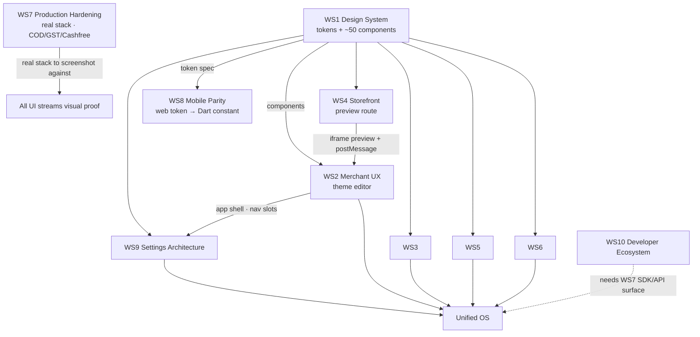

# LETBUYY MASTER EXECUTION BLUEPRINT — V2 (10 Workstreams)

> **Version:** 2.0 · supersedes v1.0 for program structure. **Keep v1.0** for the full repository intelligence maps (Phase A). This V2 adds the three missing workstreams (**WS7 Production Hardening in Codex format, WS9 Settings Architecture, WS10 Developer Ecosystem**), the **6‑wave** schedule, the file‑level **collision matrix**, the **dependency graph**, **quality gates**, and **per‑workstream launch prompts**.
> **North Star:** Transform LetBuyy from "a collection of powerful features" into a **Unified Commerce Operating System** where every product feels built by the same company and every merchant workflow feels intentional.
> **Law:** Architecture is fundamentally correct — do NOT redesign. 128 validators green at all times. 57/57 typecheck · 287/287 tests · 5/5 E2E stay green. Self‑hosted fonts (Geist/Inter per design tokens), Lucide icons. `[SKIP — NEEDS HUMAN/BACKEND]` and continue when blocked.

---

## 1. THE 10 WORKSTREAMS (domain‑owned, parallel‑safe)

| WS | Name | Owns (only these paths) | Type | Agents | Priority | Mission doc |
|----|------|--------------------------|------|--------|----------|-------------|
| **WS1** | Design System | `packages/typescript/ui/**` | UI | 1 | **P0** | `CODEX_DESIGN_SYSTEM_MISSION.md` |
| **WS2** | Merchant Control Plane UX | `apps/merchant-control-plane/src/**` *(excl. `…/settings/**` → WS9)* | UI | 1–2 | **P0** | `CODEX_MERCHANT_UX_MISSION.md` |
| **WS3** | Marketplace UX | `apps/app-marketplace/src/**` + `apps/theme-marketplace/src/**` | UI | 1 | P1 | `CODEX_MARKETPLACE_UX_MISSION.md` |
| **WS4** | Storefront Polish | `apps/storefront-runtime/src/**` | UI | 1 | P1 | `CODEX_STOREFRONT_MISSION.md` |
| **WS5** | Platform Operations | `apps/platform-console/src/**` + `apps/platform-operations-portal/src/**` | UI | 1 | P2 | `CODEX_OPERATIONS_MISSION.md` |
| **WS6** | Identity & Marketing | `apps/identity-platform/src/**` + `apps/marketing-site/src/**` | UI | 1 | P1 | `CODEX_IDENTITY_MARKETING_MISSION.md` |
| **WS7** | Production Hardening | `services/**` + `database/**` + `packages/infrastructure/**` + `scripts/staging/**` | Backend | 1 | **P0** | `CODEX_PRODUCTION_HARDENING_MISSION.md` *(new)* |
| **WS8** | Mobile Parity | `apps/mobile/**` + `packages/dart/**` | Mobile | 1 | P2 | `CODEX_MOBILE_PARITY_MISSION.md` |
| **WS9** | **Settings Architecture** | `apps/merchant-control-plane/src/app/[store]/settings/**` + `…/src/components/settings/**` | UI | 1 | **P0 (biggest gap)** | `CODEX_SETTINGS_ARCHITECTURE_MISSION.md` *(new)* |
| **WS10** | Developer Ecosystem | `apps/developer-portal/**` *(new app)* | UI/Docs | 1 | P3 | `CODEX_DEVELOPER_ECOSYSTEM_MISSION.md` *(new)* |

**Why WS9 is carved out of WS2:** the Settings hub is a large, cohesive surface (13 existing scattered pages + ~8 missing) and the #1 maturity gap (~20%). Giving it a **dedicated owner over `…/settings/**`** lets it run in parallel with WS2 (which owns the *rest* of `merchant-control-plane/src`) **without file collision** — WS2 must exclude the `settings/**` subtree.

---

## 2. FILE‑LEVEL COLLISION MATRIX (the safety core)

Pairwise‑disjoint ownership. The only shared **read‑only** dependency is `@letbuyy/ui` (owned by WS1; all UI streams consume it).

| Potential collision | Owner | Rule for everyone else |
|---|---|---|
| `packages/typescript/ui/**` | **WS1** | Consume only. Need a missing component? Build it locally under your app's `src/components/_local-ui/` + log `[CONSOLIDATE → @letbuyy/ui]`. |
| `apps/merchant-control-plane/src/app/[store]/settings/**` | **WS9** | WS2 must NOT touch `settings/**`. |
| `apps/merchant-control-plane/src/**` (non‑settings) | **WS2** | WS9 must NOT touch non‑settings pages. |
| `apps/merchant-control-plane/src/components/Sidebar.tsx`, `layout.tsx`, `globals.css` | **WS2** (owns app shell) | WS9 adds a **settings‑local** layout (`…/settings/layout.tsx`) and its own CSS module; it does not edit the global shell. WS2 exposes nav slots; WS9 registers its routes via a shared route manifest, not by editing the Sidebar. |
| `apps/storefront-runtime/src/**` preview route | **WS4** | WS2's theme‑editor (live preview) **consumes** WS4's preview route read‑only; WS4 owns/creates it. Handoff edge (see §4). |
| `services/**`, `database/**`, `infrastructure/**` | **WS7** | All UI streams: never edit. Need data? `[SKIP — NEEDS BACKEND]`. |
| `apps/developer-portal/**` | **WS10** | New app, isolated. |
| Root configs (`package.json`, `pnpm-lock.yaml`, `turbo.json`, `tsconfig*`) | **shared** | Edit only the `package.json` *inside your owned folder*. Root/lockfile change → `[NEEDS HUMAN MERGE]`. |
| `docs/governance/**`, `scripts/validators/**` | **governance** | Read‑only for all (only WS7 may, in lockstep, with care). |

**Mandatory isolation technique — git worktrees + branches:**
```
git worktree add ../lb-ws1 stream/WS1-designsystem
git worktree add ../lb-ws2 stream/WS2-merchant
git worktree add ../lb-ws7 stream/WS7-hardening
git worktree add ../lb-ws9 stream/WS9-settings
# …one per active workstream
```
Each Codex instance runs in its own worktree/branch with its **own ledger** (`CODEX_WS#_LEDGER.md`). Human merges branches in dependency order. No agent ever sees another's uncommitted edits → zero collision even on shared files.

---

## 3. SHARED OPERATING CONTRACT (all workstreams)

1. **Continuous & autonomous, 24h+.** Finish → update your ledger → next unblocked task. Never stop while unblocked work remains.
2. **The Green Law.** Tree green after every commit; full `pnpm run validate:governance` (128/128) at every phase gate. 3 failed attempts → revert, log `BLOCKED`, move on.
3. **No‑Architecture Law (UI streams WS1‑6, WS8‑10).** Touch only your owned UI paths + consume `@letbuyy/ui`/`api-client`/`shared-types`. Never edit backend/contracts/db/governance. Backend need → `[SKIP — NEEDS BACKEND]` with exact endpoint/field. **WS7 is the only backend stream.**
4. **Visual Proof Law (UI streams).** Every change → before/after screenshot. During development use Storybook/component screenshots; after push, prove the real flow against staging preview deployments and the staging gateway/database.
5. **One‑Design‑System Law (UI streams).** Compose from `@letbuyy/ui`; tokens are the only source of color/spacing/type; no new ad‑hoc CSS; shrink bespoke `globals.css` as you migrate.
6. **SKIP‑and‑continue.** Human/backend/cross‑stream blockers → append to your ledger `## SKIPPED — NEEDS HUMAN / BACKEND / OTHER‑STREAM` and continue.
7. **No fabrication.** Every `DONE` = command + result (+ screenshot for UI). **Anti‑thrash:** 3 strikes → BLOCKED → next. **Small reversible commits.**
8. **Accessibility baseline** on every new component (keyboard, focus, ARIA, WCAG‑AA). `ConfirmDialog` on destructive actions. Build stays **network‑free** (no `next/font/google`).
9. **Reasoning:** `xhigh` for design system, theme editor, settings hub, migration/baseline work; `medium` for page migrations and mechanical edits.

---

## 4. DEPENDENCY GRAPH & HANDOFFS



**Critical path:** WS7 (real stack) + WS1 (design system) → unblock all UI proof and composition → WS2/WS9 (the merchant OS) → WS3/WS4/WS5/WS6 polish → WS8 mobile parity → WS10 dev ecosystem.

**Handoff protocol (each edge has an explicit contract):**
- **WS1 → consumers:** WS1 publishes a *stable component API list* in its ledger after each batch; it is **additive‑only** (never breaks/renames exports) during the parallel window. Consumers build `_local-ui/` fallbacks until a component lands, then swap.
- **WS4 → WS2 (theme editor preview):** WS4 owns/creates the storefront `/_preview` route that renders a draft `settings_data` (read‑only via existing gateway endpoints) and the postMessage protocol (`section:select`, `section:highlight`, `settings:update`). WS2's editor embeds it in an iframe. Contract documented in both ledgers; if a new gateway endpoint is required → `[SKIP — NEEDS BACKEND]` (WS7 picks it up).
- **WS2 → WS9 (app shell):** WS2 owns the Sidebar + global layout and exposes a **route manifest** + nav slot for "Settings"; WS9 registers its settings routes into that manifest rather than editing the Sidebar. WS9 owns everything *under* `settings/**`.
- **WS1 → WS8 (tokens):** WS1 emits a machine‑readable token file (`tokens.ts` / CSS vars); WS8 generates the Dart constant equivalents (web `--lb-color-primary: #8B5CF6` → `LbColors.primary`). One token source, two renderers.

---

## 5. THE 6‑WAVE SCHEDULE

| Wave | Workstreams launched | Goal / maturity delta | Gate |
|---|---|---|---|
| **Wave 0 — Foundation** | **WS7**, **WS1** | Real stack bootable + provisioned; design system → ~50 components, tokens locked, Storybook. *(Prod‑readiness ✅ baseline proven — WS7 now closes real‑E2E + COD/GST/Cashfree depth.)* UX maturity n/a; **unblocks everything**. | Fresh DB boots; 128/128; component API list published. |
| **Wave 1 — Merchant Core** | **WS2**, **WS9** | Admin OS: layout grammar + feedback + empty states + nav + home (WS2) and the unified **Settings hub** (WS9), in parallel (disjoint subtrees). Merchant UX 45% → ~65%; Settings 20% → ~70%. | All admin + settings pages on grammar; 128/128; before/after. |
| **Wave 2 — Flagship & Productivity** | **WS2** (theme editor) + **WS4** (preview route) | Live theme editor (canvas + section tree + visual select) via the WS4↔WS2 handoff; IndexTable/bulk/saved‑views/⌘K. Merchant UX → ~80%. | Live preview operational; productivity upgraded; 128/128. |
| **Wave 3 — Ecosystem Surfaces** | **WS3**, **WS6** | Premium app + theme marketplaces (trust signals, install/consent), polished onboarding + pricing. Marketplaces 55% → ~80%; Identity/Marketing → ~80%. | Marketplaces + onboarding redesigned; 128/128. |
| **Wave 4 — Operations & Mobile** | **WS5**, **WS8** | Platform console (leadership) + ops portal (employee CRM/tickets/health) built out; mobile token parity (web design language → Dart). Operations 10% → ~60%; Mobile 60% → ~80%. | Ops modules functional; mobile uses shared tokens; 128/128. |
| **Wave 5 — Developer Moat** | **WS10** | `developers.letbuyy.store`: API/OAuth/Webhook docs + Theme SDK + App SDK + quick‑start (consumes WS7's real API surface). Dev ecosystem 5% → ~40%. | Dev portal live with docs + SDK scaffolds; 128/128. |

**Launch reality on one M4 machine:** run **Wave 0 (WS7 + WS1) now**; at +12–24h add **Wave 1 (WS2 + WS9)**; then sequence Waves 2→5 as each stabilizes. 4–6 concurrent agents is the practical ceiling for clean merges.

---

## 6. QUALITY GATES

**Per‑wave gate (all must pass before the next wave merges):** `pnpm turbo typecheck` (57/57) · `pnpm lint` · `pnpm turbo build` (network‑free) · `pnpm test` (287/287) · E2E (5/5) · `pnpm run validate:governance` (128/128) · before/after screenshots recorded · zero edits outside the wave's owned paths.

**Per‑workstream completion:** every success criterion in that WS's mission proven with evidence; its ledger shows all tasks DONE or `[SKIP]`; its status report written.

**Platform‑wide readiness:** fresh environment provisions from baseline; real J1‑J5 E2E green; all 9 apps function; one design language across web + mobile; Settings hub complete; theme editor live; marketplaces trustworthy; governance 128/128.

---

## 7. PER‑WORKSTREAM LAUNCH PROMPTS (paste into each Codex instance)

> Each runs in its own worktree/branch, owns only its paths, keeps the repo green, SKIPs‑and‑continues, and maintains its own `CODEX_WS#_LEDGER.md`.

**WS1 — Design System** → `Read docs/Codex_waves/CODEX_DESIGN_SYSTEM_MISSION.md. Own ONLY packages/typescript/ui/**. Build tokens + the full Polaris‑parity component set, each with a Storybook story + screenshot; additive‑only (never break exports); publish the component API list to CODEX_WS1_LEDGER.md. Keep 128/128. Begin now.`

**WS2 — Merchant UX** → `Read docs/Codex_waves/CODEX_MERCHANT_UX_MISSION.md + LETBUYY_MERCHANT_EXPERIENCE_AUDIT.md. Own ONLY apps/merchant-control-plane/src/** EXCEPT .../settings/** (WS9 owns that). Consume @letbuyy/ui (never edit it). Migrate every non‑settings page to the layout grammar + feedback + empty states + nav + home + theme editor + productivity. Before/after screenshots. [SKIP — NEEDS BACKEND] for missing data. Keep 128/128. Begin now.`

**WS7 — Production Hardening** → `Read docs/Codex_waves/CODEX_PRODUCTION_HARDENING_MISSION.md + CODEX_PRODUCTION_READINESS_MISSION.md. Own ONLY services/**, database/**, packages/infrastructure/**, scripts/staging/**. NEVER edit apps/** or packages/typescript/**. Close staging real‑E2E (J1‑J5 on staging Postgres), COD/GST/Cashfree, build stability, scaffold services. Keep 128/128. Maintain CODEX_WS7_LEDGER.md. Begin now.`

**WS9 — Settings Architecture** → `Read docs/Codex_waves/CODEX_SETTINGS_ARCHITECTURE_MISSION.md. Own ONLY apps/merchant-control-plane/src/app/[store]/settings/** and .../src/components/settings/**. Consume @letbuyy/ui. Build the unified Shopify‑style Settings hub (shell + grouped panes), migrate the 13 existing scattered settings pages, add the missing panes against existing gateway data ([SKIP — NEEDS BACKEND] otherwise). Before/after screenshots. Keep 128/128. Maintain CODEX_WS9_LEDGER.md. Begin now.`

**WS10 — Developer Ecosystem** → `Read docs/Codex_waves/CODEX_DEVELOPER_ECOSYSTEM_MISSION.md. Own ONLY apps/developer-portal/** (create it). Consume @letbuyy/ui. Scaffold developers.letbuyy.store: API reference, OAuth/Webhook docs, Theme SDK + App SDK quick‑starts (document the real WS7 surface; [SKIP — NEEDS BACKEND] for unbuilt SDK bits). Keep 128/128. Begin now.`

**WS3/WS4/WS5/WS6/WS8** → launch from their existing mission docs (`CODEX_MARKETPLACE_UX_MISSION.md`, `CODEX_STOREFRONT_MISSION.md`, `CODEX_OPERATIONS_MISSION.md`, `CODEX_IDENTITY_MARKETING_MISSION.md`, `CODEX_MOBILE_PARITY_MISSION.md`), each owning only its paths, per the matrix in §2.

---

## 8. PLAYBOOK — running the program

1. **Create worktrees** (one per active WS). 2. **Wave 0:** launch WS7 + WS1; wait for their gates. 3. **Wave 1:** launch WS2 + WS9 (disjoint subtrees). 4. After each wave's gate, **merge branches in dependency order** (WS7 → WS1 → WS2/WS9 → WS3/WS4 → WS5/WS6 → WS8 → WS10), running the per‑wave gate after each merge. 5. **Monitor** each ledger for `BLOCKED`/`SKIP`; resolve human‑gated items in batches. 6. **Escalate** only on: cross‑stream contract change, lockfile conflict (`[NEEDS HUMAN MERGE]`), or a governance change request. 7. **Track maturity** against the Wave table's deltas.

---

## 9. NORTH STAR

Ten agents, ten disjoint domains, one design language, one page grammar, one Settings OS, a live theme editor, trustworthy marketplaces, and a developer portal — every surface advancing in parallel on the existing, untouched platform, and not one agent able to break another's files.
