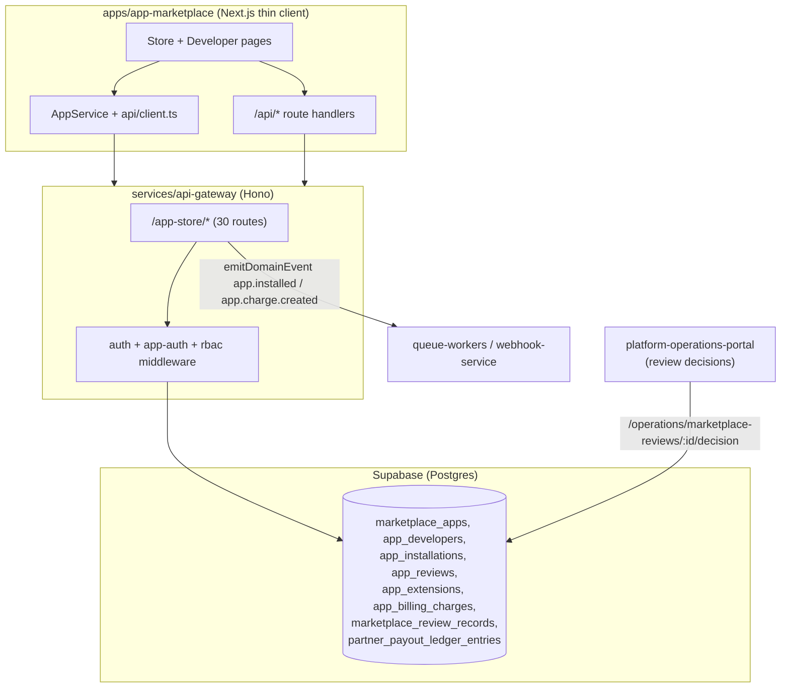
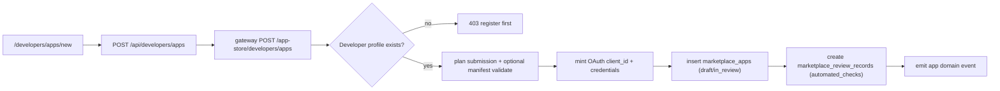
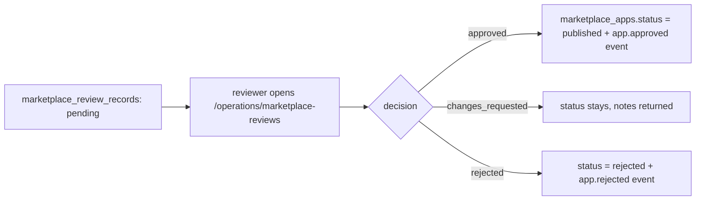
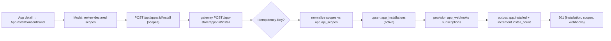
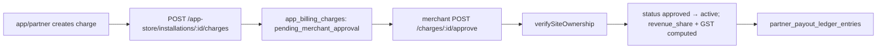
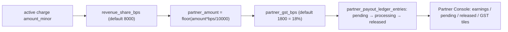
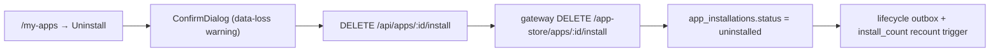

# LetBuyy Apps Marketplace — Master Audit

**Scope:** `apps/app-marketplace` (storefront + developer portal) and its backing app-store APIs in `services/api-gateway/src/routes/app-store/*`, the `@letbuyy/api-client` app-store surface, and the marketplace database schema. Other apps (merchant, consumer, themes, developer-portal, admin) are referenced only where they directly affect the Apps Marketplace.
**Benchmark:** Shopify App Store (2025–2026 state, web-researched) with side glances at Atlassian Marketplace, Stripe Apps, and Cloudflare.
**Method:** Full read of all 35 marketplace source files (~3,887 LOC), the 30 app-store gateway endpoints (~3,940 LOC of routes; ~4,455 with the `app-auth` middleware and the `/app` data API), the `marketplace_*`/`app_*` schema in `database/supabase/migrations/000_baseline.sql`, and the CSS/design system. No build was run; UI/responsiveness assessed from `globals.css` + components. Every code claim is cited by file.
**Date:** 2026-06-06

> This master document carries the cross-cutting findings (architecture, flows, merchant & developer experience, the top-100 issue register, and the brutal review). The 13 phase sub-reports live in [`docs/apps-marketplace-audit/`](apps-marketplace-audit/) and are linked in [§ Sub-report index](#sub-report-index).

---

## 0. The one-paragraph verdict

LetBuyy has built a **genuinely Shopify-shaped app *platform* and an empty, under-powered app *marketplace*.** The backend is real and surprisingly complete: Supabase-backed catalog, OAuth 2.0 authorize/token/refresh with JWT minting, a billing API with merchant-approval semantics, an extension/manifest registry with eight extension types, the **three mandatory GDPR compliance webhooks Shopify requires** (`customers/data-request`, `customers/redact`, `shop/redact`), idempotent installs, webhook provisioning, and a partner payout ledger with Indian GST. That is far more than a prototype. But the storefront that sits on top of it is a thin shell that (a) has **no apps in it** — there is zero catalog seed data and the homepage literally says so — (b) **exposes maybe a third of the platform's capabilities**, (c) ships **dead UI** (non-functional pricing/rating filters, fake "collections," a category-icon rendering bug), and (d) **cannot update or version a published app at all** because no update endpoint exists. A merchant arriving today would find an empty store with trustworthy-looking but meaningless badges; a developer would find a real API they cannot fully self-serve, a 15%-vs-20% revenue-share contradiction, and no way to ship version 2 of their app. **The platform is a B-; the marketplace experience is a D.**

---

## 1. Phase 1 — Application discovery & architecture

### 1.1 What the Apps Marketplace actually is

`apps/app-marketplace` is a **Next.js 16 / React 19 thin client** (its own test suite calls it `app-marketplace-thin-client`). It renders UI and proxies every data operation to the platform API gateway via `@letbuyy/api-client`'s `appStore` namespace. When the gateway is unreachable or unconfigured, the app degrades to a `MarketplaceUnavailable` state rather than showing fake data (`src/lib/app-service.ts`, `src/components/MarketplaceUnavailable.tsx`).

**Inventory (35 files, ~3,887 LOC):**

| Layer | Files | Notes |
|---|---|---|
| Store pages | `app/page.tsx` (home/directory), `(store)/apps/[slug]`, `(store)/categories`, `(store)/categories/[slug]`, `(store)/collections/[slug]`, `(store)/search` | Catalog, detail, categories, collections, search |
| Developer pages | `(auth)/developers`, `/developers/register`, `/developers/dashboard`, `/developers/apps/new`, `(auth)/my-apps` | Portal, 3-step registration, partner console, submit-app, installed apps |
| API routes (BFF) | `api/apps`, `api/apps/search`, `api/apps/[id]`, `api/apps/[id]/install`, `api/apps/[id]/reviews`, `api/developers`, `api/developers/register`, `api/developers/apps` | Thin pass-throughs to the gateway |
| Components | `AppCard`, `AppInstallConsentPanel`, `InstalledAppsGrid`, `CategoryGrid`, `Header`, `Footer`, `StarRating`, `MarketplaceUnavailable` | |
| Lib | `app-service.ts`, `marketplace-display.ts`, `api/client.ts`, `constants/categories.ts`, `proxy.ts`, `logger.ts` | 29 hard-coded categories; INR price formatting |

**The backend it talks to** (`services/api-gateway/src/routes/app-store.ts` + `app-store/*.ts` ≈ 3,940 LOC; ~4,455 with the `app-auth` middleware and the `/app` data API; 30 endpoints) is the real system of record, persisting to these tables (`000_baseline.sql`): `marketplace_apps`, `app_developers`, `app_categories`, `app_extensions` (8 types), `app_installations`, `app_reviews`, `app_webhooks`, `app_billing_charges`, `marketplace_review_records`, `partner_payout_ledger_entries`. DB triggers keep `install_count` and `rating_avg` denormalized.

### 1.2 Architecture diagram

### 1.3 The nine lifecycle flows

**App submission**

**App review & publishing** (note: the *decision* lives in the operations portal, not the marketplace)

**App installation**

**App billing**

**Developer revenue / payout**

**App uninstall**

**App update** — **there is no flow.** No `PATCH`/`PUT /developers/apps/:id` exists in the gateway, and there is no edit page in the marketplace. Once submitted, a listing cannot be edited or versioned through the product. (See [§3](#3-phase-3--merchant-experience), [Feature Gap](apps-marketplace-audit/APPS_FEATURE_GAP_ANALYSIS.md).)

**Developer onboarding**

### 1.4 Backend capability vs. storefront exposure

This is the central architectural story. The gateway implements much more than the UI surfaces.

| Capability | Backend endpoint | Exposed in marketplace UI? |
|---|---|---|
| Catalog list/detail/search | `GET /app-store/apps`, `/apps/:id` | ✅ Yes |
| Reviews (verified-install only) | `GET/POST /apps/:id/reviews` | ✅ Read yes; **no write UI** |
| Categories | `GET /categories` | ⚠️ UI uses 29 hard-coded categories instead |
| Install / uninstall | `POST/DELETE /apps/:id/install` | ✅ Yes |
| **OAuth authorize/token/refresh** | `/apps/:id/oauth/authorize`, `/oauth/token`, `/oauth/token-exchange` | ❌ Not used; install posts scopes directly |
| **Billing charge + approve** | `/installations/:id/charges`, `/charges/:id/approve` | ❌ No UI (only a passive banner) |
| **Extensions / functions registry** | `/installations/:id/extensions`, `/functions/...` | ❌ No UI |
| **Embed session / App Bridge fetch** | `/installations/:id/embed-session`, `/bridge/fetch` | ❌ No UI (detail page raw-iframes `app_url`) |
| **Manifest validation** | `/developers/apps/manifest/validate` | ❌ No UI |
| **API key rotation** | `/developers/apps/:id/api-key` | ❌ No UI |
| Partner dashboard | `/partners/dashboard` | ✅ Yes |
| Collaborator code | `/partners/collaborator-code` | ✅ Read-only display |
| GDPR compliance webhooks | `/compliance/customers/*`, `/compliance/shop/redact` | ✅ Backend only (correct) |
| **App update / new version** | — none — | ❌ Does not exist anywhere |

**Implication:** the platform could power a real ecosystem; the *marketplace product* currently can't drive one because the self-serve surfaces (OAuth consent, billing, versioning, extension config, key management) aren't built into it.

---

## 2. Phase 2 — Shopify benchmark (summary)

Full detail: **[SHOPIFY_APP_STORE_COMPARISON.md](apps-marketplace-audit/SHOPIFY_APP_STORE_COMPARISON.md).** Headlines:

- **Parity (real):** OAuth, scoped install consent, billing-with-merchant-approval, the three mandatory GDPR webhooks, extension/manifest model, partner payout accounting. LetBuyy genuinely mirrors Shopify's *platform* primitives.
- **Behind:** discovery (Shopify has data-driven categories, curated collections, search ranking, recommendations; LetBuyy has hard-coded categories + fake collections + dead filters), trust signals (Shopify's "Built for Shopify" is *earned*; LetBuyy's "Built for LetBuyy" is hard-coded on every app), billing UX (Shopify hosts the plan page and automates trials/proration/usage; LetBuyy has no billing UI), developer self-service (no app editing/versioning/analytics depth), and review rigor (Shopify gates on real checks; LetBuyy's automated checks are rubber stamps).
- **Economics:** Shopify takes **0% on the first \$1M lifetime, 15% above**; LetBuyy's UI promises **15% commission** but the backend default is **20%** (`revenue_share_bps = 8000`).

---

## 3. Phase 3 — Merchant experience

Answering the eight prescribed questions against the actual code:

| Question | Verdict | Evidence |
|---|---|---|
| Can merchants **discover** apps? | **Weak** | Catalog is empty (no seed data); discovery is a single filterable directory sorted by `install_count`; "collections" are cosmetic re-sorts; category nav is hard-coded. |
| Can merchants **compare** apps? | **No** | No compare view, no side-by-side, no "alternatives," no rating histogram; cards show only stars + installs + price. |
| Can merchants **trust** apps? | **Mixed/misleading** | "Built for LetBuyy" badge is hard-coded on *every* app (`AppCard.tsx`); "Verified" maps to `app_developers.verified` (real). Verified-install-only reviews are a genuine plus, but there are no reviews because there are no installs. |
| Can merchants **understand pricing**? | **Partly** | Detail page renders monthly/yearly/trial/usage rows (`apps/[slug]/page.tsx`), but the catalog/submission only carry `price_monthly`; `usage_based` is offered in UI yet rejected by the DB CHECK constraint. |
| Can merchants **understand permissions**? | **Yes (shallow)** | Consent modal lists declared scopes with human labels + raw scope code (`AppInstallConsentPanel.tsx`). But it's all-or-nothing: no per-scope opt-out, no "why this scope," no data-handling disclosure. |
| Can merchants **safely install**? | **Partly** | Install is idempotent and scope-normalized server-side; but it **bypasses the real OAuth consent flow**, and the post-install embed iframe uses `sandbox="allow-scripts allow-same-origin"` together. |
| Can merchants **safely uninstall**? | **Yes** | `InstalledAppsGrid` shows a `ConfirmDialog` with an explicit data-loss warning; backend flips status and recounts installs. Good. |
| Can merchants **judge quality**? | **No** | No "last updated" reliability signal that's trustworthy (defaults to epoch), no install trend, no support responsiveness, no changelog, no editorial review. |

**Top merchant friction:** there is nothing to install; trust badges are meaningless; pricing model promises exceed what's collected; discovery is flat.

---

## 4. Phase 4 — Developer experience

| Question | Verdict | Evidence |
|---|---|---|
| Can developers **build** apps? | **Yes, via raw API** | Real OAuth, scopes, webhooks, extensions, manifest validation, App Bridge fetch exist in the gateway + `@letbuyy/api-client`. |
| Can developers **submit** apps? | **Yes (basic)** | `/developers/apps/new` → draft/in_review; slug uniqueness, manifest plan, credential minting. But the form collects no icon/screenshot upload (drop zones are decorative), no scopes, no webhooks, no redirect URIs. |
| Can developers **monetize**? | **Accounting yes, UX no** | Payout ledger + GST + revenue share are computed and shown; but there's no UI to define plans, no usage metering UI, and the **commission is contradictory (15% promised / 20% coded)**. |
| Can developers **update** apps? | **No** | No update/version endpoint or page. A published app is frozen. |
| Can developers **manage support**? | **No** | Only a `support_email` field; no ticketing, no review replies, no merchant messaging. |
| Can developers **track installs**? | **Aggregate only** | Dashboard tiles: active installs, uninstalls, earnings, GST, avg rating. No per-app, no time series, no funnel, no churn. |
| Can developers **track revenue**? | **Partly** | Payout ledger entries + pending/released; no statements, no invoices, no export. |
| Can developers **understand review requirements**? | **Barely** | The 3-step register summarizes terms; submission lists generic "automated_checks" but there is no published review policy, rubric, or checklist in the product. |

Full detail: **[DEVELOPER_TRUST_SCORECARD.md](apps-marketplace-audit/DEVELOPER_TRUST_SCORECARD.md).**

---

## 5. Cross-cutting confirmed defects (evidence table)

| # | Finding | Evidence (file) | Type |
|---|---|---|---|
| D1 | **Empty catalog** — no seed apps/categories/developers; homepage admits "the app catalog API returned no rows." | `000_baseline.sql` (0 INSERTs), `app/page.tsx` empty state | Showstopper |
| D2 | **No app update/version flow** anywhere. | gateway routes (no PATCH/PUT), no edit page | Critical |
| D3 | **Revenue share contradiction:** UI "15% commission"; backend default `revenue_share_bps = 8000` (20% platform). | `developers/register/page.tsx`, `apps/new/page.tsx` vs `queue-execution.adapter.ts:449`, `billing-oauth-routes.ts:150` | Critical (trust) |
| D4 | **Dead filter UI:** Search "Pricing" + "Rating" filters are static `
`s with no handlers/state. | `(store)/search/page.tsx` | High |
| D5 | **Fake collections:** staff-picks/trending/made-in-india all just call `listApps` with a different sort; "Made in India" applies no country filter. | `(store)/collections/[slug]/page.tsx` | High |
| D6 | **Category icon bug:** `cat.icon` is a Material icon *name* string; rendered literally (`{cat.icon} {cat.name}`) in search sidebar, category header, and submit dropdown. | `search/page.tsx`, `categories/[slug]/page.tsx`, `apps/new/page.tsx` | High (visible) |
| D7 | **Hard-coded "Built for LetBuyy"** badge on every card/detail — meaningless trust signal. | `AppCard.tsx`, `apps/[slug]/page.tsx` | High (trust) |
| D8 | **Search injection risk:** raw `search` interpolated into PostgREST `.or()` filter. | `app-store.ts` `GET /apps` | High (security) |
| D9 | **OAuth consent bypassed:** install posts the full declared scope list directly; real `/oauth/authorize` unused by UI; no granular consent. | `AppInstallConsentPanel.tsx`, `install-lifecycle-routes.ts` | High |
| D10 | **`usage_based` pricing mismatch:** offered in UI, rejected by DB CHECK (`free/freemium/one_time/recurring`). | `apps/new/page.tsx`, `marketplace-display.ts` vs `000_baseline.sql:9726` | Medium |
| D11 | **Submission can't carry scopes/webhooks/redirect URIs/media;** upload zones are decorative. | `apps/new/page.tsx` | High (dev) |
| D12 | **Review automated_checks are rubber stamps** (always passed/warning; no scan/lint/scope justification). | `developer-routes.ts` submit handler | High (security) |
| D13 | **Reviews count uses first 10 loaded**, not true total, on detail header. | `apps/[slug]/page.tsx` | Low |
| D14 | **No mobile navigation:** `<768px` hides nav; `<640px` also hides search + My Apps + Build; no hamburger. | `globals.css` @media, `Header.tsx` | High (mobile) |
| D15 | **Dead "edit" affordance:** dashboard renders a `Pencil` icon but there's no edit route. | `developers/dashboard/page.tsx` | Medium |

Each defect is expanded with severity and fix in the [Top-100 register](#7-phase-17--top-100-issue-register) and the relevant sub-report.

---

## 6. Phases 5–16 — sub-report index

| Phase | Report | Bottom line |
|---|---|---|
| 5 | [APPS_MARKETPLACE_UI_UX_AUDIT.md](apps-marketplace-audit/APPS_MARKETPLACE_UI_UX_AUDIT.md) | Solid design-token system and a11y labels; undermined by dead controls, inconsistent icon rendering, and two parallel UI idioms (token-based home vs inline-style dev pages). |
| 6 | [APPS_CONTENT_GAP_ANALYSIS.md](apps-marketplace-audit/APPS_CONTENT_GAP_ANALYSIS.md) | Honest empty states (good), but placeholder-driven detail pages, meaningless badges, and copy that over-promises (made-in-india, 15% commission). |
| 7 | [APPS_FEATURE_GAP_ANALYSIS.md](apps-marketplace-audit/APPS_FEATURE_GAP_ANALYSIS.md) | Critical-missing: app update/versioning, billing UI, OAuth consent UI, developer analytics, app health/API-usage. |
| 8 | [APP_DISCOVERY_AUDIT.md](apps-marketplace-audit/APP_DISCOVERY_AUDIT.md) | No featured/trending/recommended logic; flat directory; weak ilike search; hard-coded taxonomy. |
| 9 | [APP_INSTALLATION_JOURNEY_AUDIT.md](apps-marketplace-audit/APP_INSTALLATION_JOURNEY_AUDIT.md) | Install/uninstall are the most polished flows; consent is shallow; no post-install setup/billing/onboarding. |
| 10 | [APP_REVIEW_SYSTEM_AUDIT.md](apps-marketplace-audit/APP_REVIEW_SYSTEM_AUDIT.md) | Review *record* model exists; gating is human + rubber-stamp automation; no security scanning, no update re-review. |
| 11 | [APP_PLATFORM_ARCHITECTURE_AUDIT.md](apps-marketplace-audit/APP_PLATFORM_ARCHITECTURE_AUDIT.md) | The strongest area: OAuth/billing/extensions/compliance/idempotency are real. Can support an ecosystem if the product catches up. |
| 12 | [APPS_RESPONSIVENESS_REPORT.md](apps-marketplace-audit/APPS_RESPONSIVENESS_REPORT.md) | Breakpoints exist but mobile loses all navigation; no 320px handling; data tables/dev console not mobile-designed. |
| 13 | [MERCHANT_TRUST_SCORECARD.md](apps-marketplace-audit/MERCHANT_TRUST_SCORECARD.md) | **41/100.** Honest outages + verified reviews + uninstall warning are good; empty catalog + fake badges + no quality signals are not. |
| 14 | [DEVELOPER_TRUST_SCORECARD.md](apps-marketplace-audit/DEVELOPER_TRUST_SCORECARD.md) | **44/100.** Real API + payout accounting; but no versioning, contradictory economics, thin self-service, no analytics. |
| 15 | [ECOSYSTEM_SCALABILITY_REPORT.md](apps-marketplace-audit/ECOSYSTEM_SCALABILITY_REPORT.md) | Schema/architecture scale to 1,000s; discovery, review throughput, and developer self-service break first — well before 100 quality apps. |
| 16 | [LETBUYY_APPS_MARKETPLACE_V2.md](apps-marketplace-audit/LETBUYY_APPS_MARKETPLACE_V2.md) | Target design across discovery, listings, billing, OAuth, analytics, review, and economics. |

---

## 7. Phase 17 — Top 100 issue register

Severity: **S0** = blocks launch / data-or-trust integrity · **S1** = major experience/economic gap · **S2** = quality/correctness · **S3** = polish.
M = merchant impact, D = developer impact.

| # | Issue | Sev | M | D | Recommended fix |
|---|---|---|---|---|---|
| 1 | Catalog has no seed data; marketplace is empty in every environment | S0 | ●●● | ●●● | Seed categories + launch-partner apps; gate launch on N live apps |
| 2 | No app update/version endpoint or UI | S0 | ●● | ●●● | Add `PATCH /developers/apps/:id` + version records + update review |
| 3 | Revenue share 15% (UI) vs 20% (code default 8000 bps) | S0 | ○ | ●●● | Reconcile to one published rate; fix `revenue_share_bps` default |
| 4 | Search `.or()` raw-string injection | S0 | ●● | ● | Escape/parameterize; use `.ilike` builders or RPC full-text |
| 5 | "Built for LetBuyy" badge hard-coded on all apps | S1 | ●●● | ● | Make it an earned program with criteria, like Built for Shopify |
| 6 | Review automated_checks always pass (no real gate) | S1 | ●●● | ● | Add static scan, scope justification, manifest lint, URL/TLS checks |
| 7 | OAuth authorize/consent flow unused by UI | S1 | ●● | ●●● | Route install through `/oauth/authorize`; granular consent |
| 8 | No billing UI (plan select, charge approval, usage) | S1 | ●● | ●●● | Build managed pricing page + charge-approval surface |
| 9 | Dead Pricing/Rating filters in search | S1 | ●●● | ○ | Wire to query params + backend filters or remove |
| 10 | Fake collections (staff-picks/trending/made-in-india) | S1 | ●● | ● | Real curation tables + trending math + country filter |
| 11 | Mobile hides all nav <768/<640px, no hamburger | S1 | ●●● | ● | Add mobile menu + bottom nav; keep search reachable |
| 12 | Category icon name rendered as literal text | S1 | ●● | ● | Use `<MaterialIcon name=…>` everywhere (already in `CategoryGrid`) |
| 13 | Submission can't set scopes/webhooks/redirect URIs | S1 | ○ | ●●● | Add manifest + scopes + webhooks + OAuth config to submit form |
| 14 | Icon/screenshot upload zones are decorative | S1 | ●● | ●●● | Wire to media-service uploads |
| 15 | No developer per-app analytics (installs over time, funnel, churn) | S1 | ○ | ●●● | Build analytics from install/charge events |
| 16 | No app health / API-usage / rate-limit monitoring | S1 | ● | ●●● | Surface request volume, error rate, p95 (cf. BFS perf gates) |
| 17 | `usage_based` pricing offered in UI, rejected by DB CHECK | S2 | ● | ●● | Add to CHECK + billing or remove from UI |
| 18 | Reviews header counts only first 10 loaded | S3 | ● | ○ | Use `review_count` total |
| 19 | Hard-coded categories diverge from DB `app_categories` | S2 | ●● | ● | Drive nav from `GET /categories`; align slugs |
| 20 | No category app counts / empty-category handling pre-fetch | S2 | ●● | ○ | Precompute counts; hide empty categories |
| 21 | Detail "Updated" defaults to epoch (1970) when missing | S2 | ●● | ● | Hide or show "—" when no timestamp |
| 22 | No review write UI (verified reviewer can't submit in product) | S1 | ●●● | ● | Add review composer on `/my-apps` per active install |
| 23 | No developer reply to reviews | S2 | ● | ●● | Add reply model + UI |
| 24 | No rating distribution / histogram | S3 | ●● | ○ | Add 1–5 breakdown on detail |
| 25 | No "alternatives / similar apps" beyond same-category sample | S2 | ●● | ● | Recommendation service |
| 26 | No compare-apps view | S2 | ●● | ○ | Add compare tray |
| 27 | No featured/sponsored/editorial surfaces | S1 | ●● | ●● | Curation + (optional) paid placement |
| 28 | No app onboarding/setup after install | S1 | ●●● | ●● | Post-install setup checklist + deep link |
| 29 | Embed iframe uses `allow-scripts`+`allow-same-origin` | S1 | ●● | ● | Tighten sandbox; serve apps cross-origin only |
| 30 | No granular/optional scope consent | S2 | ●● | ● | Optional scopes + incremental auth |
| 31 | No data-handling / privacy disclosure on listing | S1 | ●●● | ● | Require data-collected disclosure (App Store style) |
| 32 | No support SLA / responsiveness signal | S2 | ●● | ● | Track + display response time |
| 33 | No changelog / release notes | S1 | ●● | ●● | Version notes per release |
| 34 | No app status page / incident signal | S3 | ● | ● | Optional status URL |
| 35 | Partner Console "Submit New App" but no edit/manage per app | S1 | ○ | ●●● | App management detail page |
| 36 | Dashboard `Pencil` edit icon is dead | S2 | ○ | ●● | Wire to edit or remove |
| 37 | Collaborator code shown but no grant/redeem flow in UI | S2 | ○ | ●● | Build collaborator request/approve |
| 38 | No API key visibility/rotation UI (endpoint exists) | S1 | ○ | ●●● | Surface key + rotate + secret reveal-once |
| 39 | No manifest validation UI (endpoint exists) | S2 | ○ | ●● | Pre-submit validator in submit flow |
| 40 | No extension configuration UI | S1 | ● | ●● | Extension registry management |
| 41 | No webhooks management UI for developers | S1 | ○ | ●● | Subscriptions CRUD + delivery logs |
| 42 | No sandbox / dev-store provisioning in product | S1 | ○ | ●●● | One-click dev store from console |
| 43 | No SDK/CLI references in product | S2 | ○ | ●● | Link CLI + SDKs; scaffolding |
| 44 | Docs links unverified (`docs.letbuyy.store/apps`,`/api`) | S2 | ● | ●●● | Ensure docs exist; link from submit |
| 45 | No published review policy / rubric | S1 | ● | ●●● | Publish requirements + timelines |
| 46 | No update re-review path (ties to #2) | S1 | ●● | ●● | Re-review on version/scope change |
| 47 | No scope-change consent on update | S1 | ●●● | ● | Re-consent when scopes grow |
| 48 | No app suspension/again-review UX in marketplace | S2 | ● | ●● | Status messaging for suspended/rejected |
| 49 | No trust/security badges earned via review | S1 | ●●● | ● | Tiered badges w/ criteria |
| 50 | No verified developer KYC depth (tax_id collected, not verified) | S2 | ●● | ●● | Verify GSTIN/identity before payouts |
| 51 | Country list cosmetic (`US/GB/Other` flags) w/ India-only payout copy | S3 | ○ | ● | Align supported geos with payout rails |
| 52 | No localization despite India focus (en only) | S2 | ●● | ● | i18n (Hindi + regional) |
| 53 | INR-only price formatting; no multi-currency | S2 | ●● | ● | Currency per geo |
| 54 | No accessibility audit; some click-only filters (div onClick) | S2 | ●● | ○ | Keyboard/ARIA on all controls |
| 55 | Search filters non-semantic `
` not buttons | S2 | ●● | ○ | Use buttons/links |
| 56 | No pagination/infinite scroll on directory (limit 24) | S2 | ●● | ● | Add pagination UI |
| 57 | No sort persistence on category page (select inert) | S2 | ●● | ○ | Wire category sort |
| 58 | Two divergent UI systems (tokens vs inline styles) | S2 | ● | ● | Consolidate on design system |
| 59 | Hardcoded red error styles ignore dark mode | S3 | ● | ● | Use tokens |
| 60 | No skeletons on server pages (only search) | S3 | ● | ○ | Add suspense skeletons |
| 61 | No empty-search suggestions / popular queries | S3 | ●● | ○ | Suggest categories/queries |
| 62 | Search debounce 300ms but no request cancellation | S3 | ● | ○ | Abort stale fetches |
| 63 | Client-side re-sort masks backend sort gaps | S2 | ● | ● | Trust server sort; fix backend |
| 64 | No "new/updated" recency badges | S3 | ● | ● | Surface recency |
| 65 | No install count credibility (no anti-gaming) | S2 | ●● | ● | Dedupe/active-only counts (trigger does active-only — good) |
| 66 | No review moderation/abuse reporting UI | S2 | ●● | ● | Report + moderate |
| 67 | No partner payout statements/exports | S2 | ○ | ●● | Monthly statements + CSV |
| 68 | No tax invoice generation for GST | S2 | ○ | ●● | GST invoices |
| 69 | No refund/chargeback handling in billing | S1 | ●● | ●● | Refund + dispute flow |
| 70 | No trial management UI (trial_days rendered, not set) | S2 | ●● | ●● | Trial config in submit/billing |
| 71 | No annual plan capture in submit (yearly rendered, not set) | S2 | ● | ●● | Add yearly + usage tiers |
| 72 | No proration/plan-change semantics | S2 | ●● | ●● | Managed plan changes |
| 73 | No per-store install scoping clarity in UI | S2 | ●● | ● | Show which store install targets |
| 74 | Install consent doesn't show billing terms inline | S2 | ●●● | ● | Combine scope + price + trial in one consent |
| 75 | No "works with theme X / app Y" compatibility | S2 | ●● | ● | Compatibility metadata |
| 76 | No app categories multi-tag (single category_id) | S2 | ●● | ● | Many-to-many tags |
| 77 | No keyword/synonym search (ilike only on name/tagline) | S2 | ●● | ● | Full-text + synonyms |
| 78 | Description rendered with naive markdown subset | S3 | ● | ● | Proper sanitized markdown |
| 79 | No screenshot lightbox/zoom | S3 | ●● | ● | Lightbox |
| 80 | No video/demo support | S3 | ●● | ● | Media types |
| 81 | No "report a problem with this listing" | S3 | ●● | ● | Listing report |
| 82 | No developer profile/page depth (links to `/developers/:slug`) | S2 | ●● | ●● | Build dev profile page |
| 83 | No app-by-developer cross-listing | S3 | ●● | ● | Dev → other apps |
| 84 | No featured developers / partner directory | S3 | ● | ●● | Partner directory |
| 85 | No notifications (review decisions, payouts, reviews) | S1 | ● | ●● | In-app + email events (events emitted, no UI) |
| 86 | No audit visibility for merchants (what app did) | S2 | ●● | ● | App activity log |
| 87 | No uninstall reason capture / win-back | S3 | ● | ●● | Reason prompt |
| 88 | No rate limiting visible on public catalog APIs | S2 | ● | ● | Document + enforce |
| 89 | No caching/CDN strategy stated for catalog | S2 | ● | ● | Cache published catalog |
| 90 | No SEO depth (basic metadata only; no structured data) | S2 | ●● | ●● | JSON-LD, sitemaps |
| 91 | No analytics/telemetry on marketplace funnels | S2 | ● | ● | Instrument discovery→install |
| 92 | No A/B or experimentation surface | S3 | ● | ● | Experiment framework |
| 93 | No multi-environment catalog parity checks | S3 | ● | ● | Seed parity tests |
| 94 | No "private/internal" app distribution UX (type exists in schema) | S2 | ● | ●● | Private app install links |
| 95 | No org/team roles for developer accounts | S2 | ○ | ●● | Team management |
| 96 | No 2FA/security posture shown for developers | S2 | ○ | ●● | Security settings |
| 97 | No listing preview before submit | S3 | ○ | ●● | Preview mode |
| 98 | No draft autosave on submit form | S3 | ○ | ●● | Autosave drafts |
| 99 | No app archival/delisting self-service | S2 | ● | ●● | Delist flow |
| 100 | No 320px layout coverage (smallest breakpoint 480px) | S2 | ●● | ○ | Add ≤360px handling |

---

## 8. Phase 18 — Brutal review (as a Shopify App Review lead would see it)

**What they'd praise.** The platform team did the hard, unglamorous things right. OAuth 2.0 with real JWT minting and refresh, an install path that's idempotent and normalizes scopes against the app's declared `api_scopes`, a billing model that requires explicit merchant approval before any charge activates, the *exact* three mandatory GDPR webhooks Shopify itself enforces, a manifest/extension registry with eight extension types, and a partner payout ledger that already models revenue share and Indian GST. The verified-install-only review rule (`app-store.ts`) is stricter than many marketplaces. The honest `MarketplaceUnavailable` outage state instead of a fake empty grid shows judgment. This is not vaporware.

**What they'd reject on sight.** A marketplace with **no apps in it** is not reviewable as a marketplace. The homepage's own copy ("the app catalog API returned no rows in this environment") is the tell. Then the trust theater: a green **"Built for LetBuyy" badge hard-coded onto every single card** would fail review instantly — Shopify spent years making "Built for Shopify" mean something, and stamping it unconditionally is the opposite. The **dead Pricing and Rating filters**, the **fake "Staff Picks/Trending/Made in India" collections** that are just re-sorts of the same query (with "Made in India" applying no India filter at all), and the **category icons that render as the literal string `inventory_2`** are the kind of defects that say "this was assembled, not finished."

**What they'd redesign.** Discovery, end to end — data-driven categories with real counts, genuine trending math, editorial collections, recommendations, and a search that does more than `ILIKE` on name and tagline. The install consent, to run through the real OAuth flow with billing terms shown in the same approval, and to re-consent when an update widens scopes.

**What they'd remove.** The hard-coded badge, the dead filters, the fake collections, and the `usage_based` option the database will reject.

**What they'd rebuild from scratch.** The **developer lifecycle**: there is no way to edit a listing, ship a new version, configure scopes/webhooks/extensions, upload media, see per-app analytics, or manage API keys *in the product* — even though the API can do most of it. And the **economics must be made truthful**: you cannot tell developers "15% commission" while the code defaults to a 20% platform cut.

**Would they let it into the App Store?** No — not because the foundation is weak, but because the storefront isn't a store yet: it's an empty, partly-wired showroom in front of a good warehouse. Fill the catalog, make the trust signals earned, wire the developer lifecycle to the API that already exists, fix the economics, and this is a credible commerce app ecosystem. Until then it reads as a platform demo, not a marketplace.

---

*Continue to the [sub-report index](#6-phases-516--sub-report-index) for phase-level detail.*
