# LETBUYY_CODEX_IMPLEMENTATION_MASTER — Ordered Execution Plan for Codex

Parent: `LETBUYY_MASTER_EXECUTION_PLAN.md` (verdicts) + `P0`–`P4` masters (per-issue detail).
Audience: Codex (autonomous implementation agent) and the humans reviewing its PRs.
Objective: execute all approved fixes with **minimal architectural risk**, in dependency order, with explicit migration/test/deploy/rollback gates at each step.

---

## 0. Operating Rules for Codex (read first)

1. **Follow repository governance.** `AGENTS.md` is canonical, then local `AGENTS.md`, then `docs/governance/`. DB tables use `sites`; `stores` is a view (do not write to it). Run `node scripts/validate-governance.mjs` after any topology/import/package/env/migration change.
2. **One concern per PR.** Each work item below is a separate PR with its own tests. Do not batch unrelated changes.
3. **Flag-guard risky changes.** Every behavior change that affects the customer-session contract, DB access path, caching, or the WS11–WS13 stack ships behind a feature flag defaulting to the *current* behavior, so rollback is a flag flip.
4. **Never weaken security to pass a test.** If a fix breaks a client, fix the client (e.g., storefront app, mobile) in the same PR or a blocking-linked PR.
5. **Migrations are additive-first.** Add columns/tables before switching readers; remove old columns only after all readers are migrated and one release has passed.
6. **Do not enable WS11–WS13 in production** until the staging-proof gate (Phase 5) passes.
7. **Confirm before destructive DB steps.** Any `DROP`, partition swap, or JSONB-column removal requires the human-approval environment.

---

## 1. Dependency Graph

```mermaid
flowchart TD
  subgraph PH1["Phase 1 — Security foundation (BLOCKS BETA)"]
    A1["P0-A.1 customer-session primitive (auth-core)"]
    A2["P0-A.2 customer-session middleware (gateway)"]
    A3["P0-A.3 rewrite verifyStoreCustomer"]
    A4["P0-A.4-8 gate REST routes + GraphQL + tokenize password"]
    A5["P0-B identity set-password OTP binding"]
    A6["P0-C CSRF unify + cover public mutations"]
    A7["P0-D customer-auth rate limit + Turnstile"]
  end
  subgraph PH2["Phase 2 — Release safety (BLOCKS BETA)"]
    B1["P0-E.1 pipeline fail-closed"]
    B2["P0-E.2 secrets-before-deploy"]
    B3["P0-E.3 migration diff/backup gate"]
    B4["P0-E.4 WS11-13 flag OFF in prod"]
    B5["Smoke suite (identity/storefront/checkout/webhook/queue)"]
  end
  subgraph PH3["Phase 3 — Cost/idle (post-beta-safe, pre-1k)"]
    C1["P1-1 request-log sampling"]
    C2["P1-4 cron no-op"]
    C3["P1-5 worker log sampling"]
    C4["P1-6 atomic rate limit"]
    C5["P1-7 queue write batch + bulk single-path"]
  end
  subgraph PH4["Phase 4 — Performance (pre-1k)"]
    D1["P2-1 edge cache + purge-on-publish"]
    D2["P1-2 pooled SQL reads (Hyperdrive)"]
    D3["P2-2 view-counter de-hot"]
    D4["P2-4 keyset pagination / drop exact counts"]
    D5["P2-5 trigram search indexes"]
    D6["P2-6 async export"]
    D7["P2-7 variant diff + checkout deferral"]
  end
  subgraph PH5["Phase 5 — Scale + WS11-13 rollout (pre-10k)"]
    E1["P3-1 partition + retention"]
    E2["P3-3 analytics/search projections"]
    E3["P3-4 dual-model consolidation"]
    E4["P3-5 queue storm controls"]
    E5["P1-3 + P2-3 GraphQL fan-out/N+1 fixes"]
    E6["P3-7 deploy + prove WS11-13 in staging, then graduated enable"]
  end
  subgraph PH6["Phase 6 — Product (parallelizable, non-blocking)"]
    F1["P4-1 multi-template editor"]
    F2["P4-2 GraphQL cart"]
    F3["P4-4 API ownership consolidation"]
    F4["P4-5 developer-portal deploy decision"]
  end

  A1-->A2-->A3-->A4
  A4-->A6
  A1-->A7
  A5-->B5
  A4-->B5
  B4-->E6
  C4-->D2
  D1-->D2
  C1-->E1
  C5-->E4
  E5-->E6
  D1-->E2
  A4-->F2
  B1-->B2-->B3
  PH1-->PH2
  PH2-->PH3
  PH3-->PH4
  PH4-->PH5
```

Critical path to the beta: **A1→A2→A3→A4 (+A5, A6, A7) and B1→B2→B3→B4→B5.** Nothing in Phases 3–6 is required for the 100-merchant beta.

---

## 2. Safe Refactor Sequence (the order Codex executes)

### PHASE 1 — Security foundation (beta blocker)

| Step | Work item | Depends on | Flag | Key files |
|---|---|---|---|---|
| 1.1 | Build `customer-session` issue/verify in `auth-core` | — | n/a (new code) | `packages/auth-core/src/customer-session.ts`, `…/index.ts` |
| 1.2 | Add `requireCustomerSession`/`optionalCustomerSession` middleware | 1.1 | n/a | `services/api-gateway/src/middleware/customer-session.ts` |
| 1.3 | Rewrite `verifyStoreCustomer` to read session, not body | 1.2 | `CUSTOMER_LEGACY_AUTH` | `services/api-gateway/src/routes/storefront.ts:1058` |
| 1.4 | Gate orders/addresses/profile/wishlist; stop returning `password_hash`; issue session on login | 1.3 | `CUSTOMER_LEGACY_AUTH` | `storefront.ts:3018,3271,3457,3596…`; |
| 1.5 | Tokenize password reset (`request-reset`/`confirm`); delete email-addressable mutation | 1.4 | — | `storefront.ts:2934`; migration `077` |
| 1.6 | Remove `/customer/by-email`,`/customer/status`,`/orders/contact` from public; internal-guard if needed | 1.4 | — | `storefront.ts:2966,2990,3293` |
| 1.7 | Enforce session on GraphQL `customer`/`order` resolvers | 1.4 | `FEATURE_GRAPHQL` | `services/api-gateway/src/graphql/storefront.ts:496-521` |
| 1.8 | Identity set-password OTP-intent binding | — (parallel) | — | `apps/identity-platform/src/app/api/auth/{verify,set-password}/route.ts`; migration `078` |
| 1.9 | Unify CSRF cookie name → `letbuyy_csrf` (dual-read shim) across identity/gateway/mobile | — (parallel) | dual-read | `apps/identity-platform/src/lib/auth/*`, `services/api-gateway/src/middleware/security.ts:261`, `store_auth_service.dart:86` |
| 1.10 | Cover public mutations (reviews/contact) with CSRF/Turnstile | 1.9 | — | `storefront.ts:3487,3795` |
| 1.11 | `customerAuthRateLimit` (DO/atomic) + Turnstile on login/password/track | 1.1 | — | `services/api-gateway/src/middleware/rateLimit.ts`, `storefront.ts` |
| 1.12 | Update storefront-runtime app + mobile to the session contract | 1.4 | — | `apps/storefront-runtime/src/**`, mobile |

### PHASE 2 — Release safety (beta blocker)

| Step | Work item | Depends on | Key files |
|---|---|---|---|
| 2.1 | Make missing release creds a hard failure; add `if: always()` + "no skipped required job" gate | — | `.github/workflows/production-deploy.yml:19-21,84,117,217,250` |
| 2.2 | Reorder secrets-before-deploy (or versions upload→deploy); add `CUSTOMER_SESSION_SECRET` | 2.1 | `production-deploy.yml:118-141,149-158` |
| 2.3 | Migration diff artifact + backup/restore point + manual approval env | 2.1 | `production-deploy.yml:85` |
| 2.4 | Add `FEATURE_GRAPHQL/EXTENSIONS/LIQUID` flags, default OFF in prod | — | `services/api-gateway/src/index.ts:185-203`, `wrangler.toml` |
| 2.5 | Build smoke suite (identity login, storefront product read, checkout create, webhook bad-signature reject, queue health) | 1.4, 1.8 | `tests/e2e/smoke/**` |

### PHASE 3 — Cost / idle (pre-1k)
3.1 P1-1 log sampling → 3.2 P1-4 cron no-op → 3.3 P1-5 worker log sampling → 3.4 P1-6 atomic rate limit → 3.5 P1-7 queue batch + bulk single path. All flag-guarded; rollback = flag flip.

### PHASE 4 — Performance (pre-1k)
4.1 P2-1 edge cache (+purge-on-publish) → 4.2 P1-2 pooled reads (depends on cache so misses are pooled) → 4.3 P2-2 view counter → 4.4 P2-4 pagination → 4.5 P2-5 trigram indexes → 4.6 P2-6 async export → 4.7 P2-7 variant diff + checkout deferral.

### PHASE 5 — Scale + WS11-13 (pre-10k)
5.1 P1-3/P2-3 GraphQL fan-out + N+1 → 5.2 P3-5 queue storm controls → 5.3 P3-3 projections → 5.4 P3-1 partitioning/retention (windowed) → 5.5 P3-4 dual-model consolidation → 5.6 P3-7 deploy+prove WS11-13 in staging → graduated prod enable.

### PHASE 6 — Product (parallel, non-blocking)
6.1 P4-2 GraphQL cart (or explicit unsupported) → 6.2 P4-1 multi-template editor → 6.3 P4-4 API ownership consolidation + validator → 6.4 P4-5 developer-portal decision → 6.5 P4-3 docs/messaging.

---

## 3. Database Migration Sequence

Strict order; each is its own migration file, additive-first, staging-proven before production. Do not reorder.

| # | Migration | Type | Reversible? | Gate |
|---|---|---|---|---|
| 077 | `customer_reset_tokens` (cols on `customer_credentials`) | additive | yes | Phase 1.5 |
| 078 | `password_set_intents` (new table) | additive | yes | Phase 1.8 |
| 087 | `theme_template_drafts` (col on `theme_editor_drafts`) | additive | yes | Phase 6 |
| 084 | `analytics_rollups` (+ projection state) | additive | yes | Phase 5.3 |
| 079 | partition `worker_request_logs` | online schema change | yes (legacy kept) | Phase 5.4, maintenance window |
| 080 | partition `runtime_telemetry_metrics` | online schema change | yes | Phase 5.4 |
| 081 | partition `outbox_events` (drain first) | online schema change | yes | Phase 5.4 |
| 082 | partition `platform_queue_jobs` (drain first) | online schema change | yes | Phase 5.4 |
| 083 | partition `webhook_deliveries` | online schema change | yes | Phase 5.4 |
| 085 | `orders_items_reconcile` (report→converge) | data migration | reader-flag | Phase 5.5 |
| 086 | `products_variants_reconcile` | data migration | reader-flag | Phase 5.5 |

Rules:
- 077/078/087/084 are safe anytime (additive, nullable).
- 079–083: create-new → backfill-copy → rename-swap; keep `*_legacy` one retention cycle; add `pg_cron` partition lifecycle job; verify all existing `(…, created_at)` indexes still serve queries via `EXPLAIN`.
- 085/086: produce a divergence report first; migrate readers to relational source behind a flag; only drop JSONB columns after one clean release.

---

## 4. Test Sequence

Run in this order; a phase does not merge until its tests are green.

1. **Unit (Phase 1):** `customer-session` issue/verify/expiry/tamper; password-reset token single-use/expiry; set-password OTP-intent.
2. **Gateway integration (Phase 1):** unauthenticated customer reads/writes → 401; body `customer_id` ignored; GraphQL `customer` without session → error; `password_hash` never in any response (grep gate).
3. **Red-team regression (Phase 1):** automate the kill chain (by-email → login → address overwrite → password set) and assert each step now fails. This test is the beta gate.
4. **Smoke (Phase 2):** identity login, storefront product read, checkout create, webhook bad-signature reject, queue health — against **staging**, not local.
5. **Cost/perf (Phase 3–4):** GraphQL query produces O(1) log rows; idle env produces 0 cron events; cache hit-rate ≥80%; list endpoints constant-time; load test (storefront home/list/detail/login/checkout) with p50/p95/p99 + DB CPU + cache hit recorded.
6. **Migration (Phase 5):** partition swap on a staging clone with prod-scale synthetic data; retention job drops only out-of-window partitions; reconciliation report shows JSONB/relational convergence.
7. **WS11-13 (Phase 5):** run `tests/api-graphql/*`, `tests/app-platform/*`, `tests/theme-engine/*`, `tests/federation/app-extensions-quality-gate` against the **deployed** staging environment.
8. **Governance (every phase):** `node scripts/validate-governance.mjs` green on a clean tree.

---

## 5. Deployment Sequence

Per release, in this order (enforced by the hardened pipeline from Phase 2):

1. Pre-flight: governance green; required secrets present (fail otherwise); migration diff artifact produced; backup/restore point taken.
2. Apply DB migrations (additive ones anytime; partition/data migrations only in an approved window).
3. Set/verify Worker secrets **before** deploying the revision (incl. `CUSTOMER_SESSION_SECRET`).
4. Deploy Workers (api-gateway, webhook-service, queue-workers) with WS11-13 flags OFF in production.
5. Deploy Vercel apps (and `developer-portal` per the Phase 6.4 decision).
6. Smoke-test production; on failure, auto-roll-back to the prior revision (revert deploy + flag flip; additive migrations are forward-compatible).
7. WS11-13: enable in staging → run deployed-env tests → graduated production enablement (internal → beta cohort → general), watching fan-out cost/latency dashboards.

Rollback per layer:
- **Code/behavior:** flag flip (preferred) or redeploy prior Worker/app revision.
- **Customer-session cutover:** `CUSTOMER_LEGACY_AUTH=on` restores old routes for one release window only.
- **Migrations:** additive → ignore; partitions → rename-swap back to `*_legacy`; data migrations → repoint reader flag to JSONB.
- **Pipeline:** PR revert.

---

## 6. Definition of Done (per priority)

- **P0 (beta gate):** kill-chain red-team test fails at every step; no `password_hash` in responses; identity set-password requires a fresh OTP intent; one CSRF cookie name; customer-auth throttled + Turnstile; pipeline cannot skip required jobs or serve before secrets; WS11-13 OFF in prod; staging smoke green.
- **P1:** idle cost ~0; anon storefront traffic not logged per-request; GraphQL O(1) logs/limits; Hyperdrive in hot read path (or removal decision recorded).
- **P2:** ≥80% storefront cache hit with correct purge-on-publish; no synchronous hot-row view write on cache hits; constant-time list endpoints; async export; load test within targets.
- **P3:** five hot tables partitioned + retained; analytics/search off OLTP; single source of truth per entity; queue storm controls live; WS11-13 proven in deployed staging before prod enablement.
- **P4:** multi-template editing; GraphQL `cart` real or loud-unsupported; no app-local route runs commerce logic (validator-enforced); developer-portal topology/pipeline consistent; messaging matches shipped capability.

---

## 7. What Codex Must NOT Do
- Do not implement a Liquid renderer — it exists (`packages/theme-engine/src/theme-renderer.ts:104-211`).
- Do not "secure" the operations routes' missing auth — they have RBAC (`routes/operations.ts:56`); only add MFA/step-up as hardening.
- Do not rebuild app-bridge/OAuth validation — it is SSRF/redirect/scope hardened (`packages/app-engine/src/index.ts:1326,1348`, `routes/app-store.ts:1234`).
- Do not add `(…, created_at)` indexes to the hot tables — they already exist.
- Do not enable the GraphQL/extension/Liquid stack in production before the Phase 5 staging-proof gate.
- Do not modify production behavior outside a feature flag during Phases 1–5.
