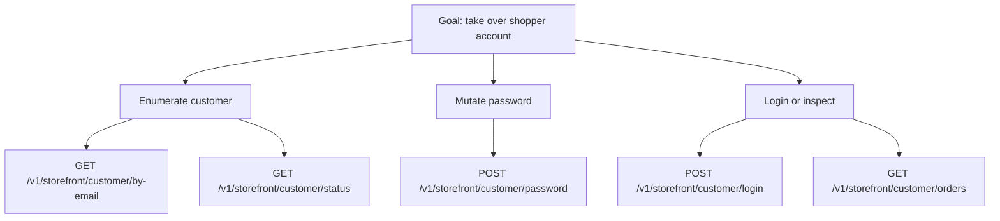
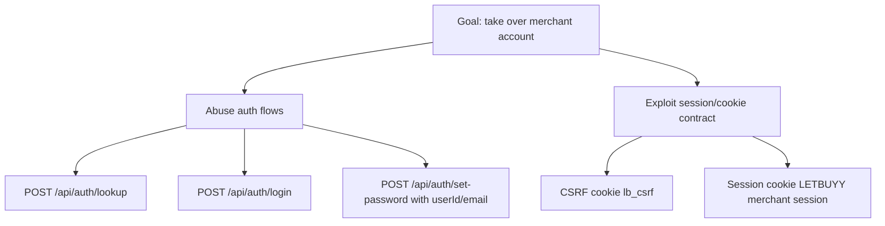
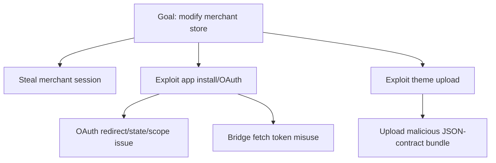
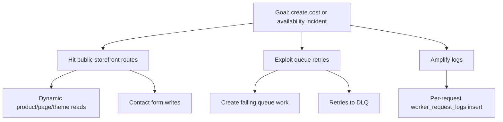
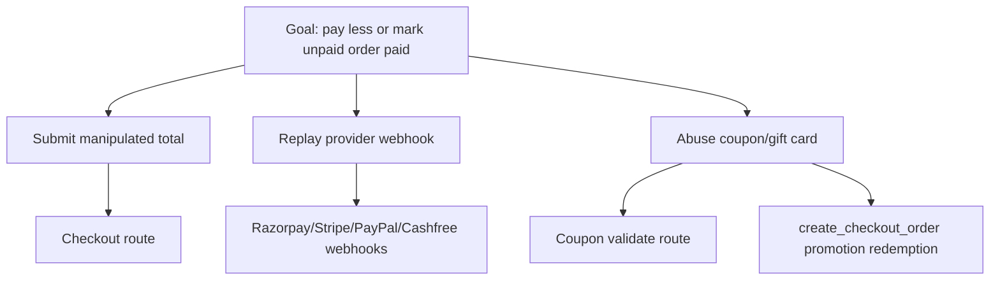
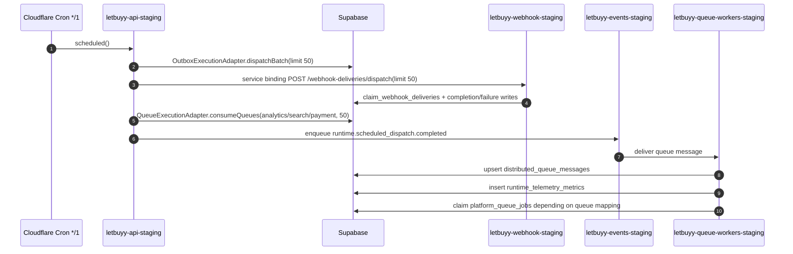

# LetBuyy CTO War Room Report

Generated on: 2026-06-05  
Repository root: `/Users/saai_sidd/Git/Letbuyy_Store`  
Input: `/docs/LETBUYY_DEEP_AUDIT_REPORT.md` plus targeted source checks for exact files, functions, and deployment paths.  
Purpose: turn the architecture audit into a launch and execution decision document.

## Evidence Anchors

This report is not a second broad audit. It compresses the prior audit into an execution plan and adds exact code anchors where the plan needs file/function precision.

Primary anchors:

| Evidence | File |
|---|---|
| API gateway route ordering, public/protected split, scheduled dispatch | `services/api-gateway/src/index.ts:110`, `services/api-gateway/src/index.ts:168`, `services/api-gateway/src/index.ts:261` |
| Cloudflare API Worker bindings, cron, observability | `services/api-gateway/wrangler.toml:10`, `services/api-gateway/wrangler.toml:19`, `services/api-gateway/wrangler.toml:44` |
| Queue worker consumers, retries, concurrency | `services/queue-workers/wrangler.toml:217` |
| Queue worker DB persistence and platform queue draining | `services/queue-workers/src/index.ts:62`, `services/queue-workers/src/index.ts:160`, `services/queue-workers/src/platform-queue-consumer.ts:168` |
| Public storefront customer/account routes | `services/api-gateway/src/routes/storefront.ts:2693`, `services/api-gateway/src/routes/storefront.ts:2759`, `services/api-gateway/src/routes/storefront.ts:3096`, `services/api-gateway/src/routes/storefront.ts:3118` |
| Gateway observability per-request DB write | `services/api-gateway/src/middleware/observability.ts:63`, `services/api-gateway/src/execution/observability-execution.adapter.ts:51` |
| Gateway rate limiting and query-cost limiter | `services/api-gateway/src/middleware/rateLimit.ts:110`, `services/api-gateway/src/middleware/rateLimit.ts:242`, `services/api-gateway/src/middleware/rateLimit.ts:602` |
| Gateway CSRF and input prefilter | `services/api-gateway/src/middleware/security.ts:174`, `services/api-gateway/src/middleware/security.ts:244` |
| Webhook verification and dispatch | `services/webhook-service/src/index.ts:266`, `services/webhook-service/src/index.ts:832`, `services/webhook-service/src/index.ts:857`, `services/webhook-service/src/index.ts:1043`, `services/webhook-service/src/index.ts:1253`, `services/webhook-service/src/index.ts:1390` |
| Checkout server-side order creation | `services/api-gateway/src/execution/order-execution.adapter.ts:142`, `database/supabase/migrations/073_order_item_required_field_compatibility.sql:56` |
| Payment ledger adapters | `services/api-gateway/src/execution/payment-execution.adapter.ts:28`, `services/api-gateway/src/execution/payment-execution.adapter.ts:63`, `services/api-gateway/src/execution/payment-execution.adapter.ts:85` |
| Idempotency | `services/api-gateway/src/execution/idempotency-execution.adapter.ts:35`, `database/supabase/migrations/000_baseline.sql:9454` |
| Theme renderer capability | `packages/theme-engine/src/theme-renderer.ts:12`, `packages/theme-engine/src/theme-renderer.ts:57`, `packages/theme-engine/src/theme-bundle.ts:158` |
| Theme editor UI | `apps/merchant-control-plane/src/app/[store]/online-store/themes/[themeId]/editor/page.tsx:696`, `apps/merchant-control-plane/src/app/[store]/online-store/themes/[themeId]/editor/page.tsx:812`, `apps/merchant-control-plane/src/app/[store]/online-store/themes/[themeId]/editor/page.tsx:1131` |
| Theme API routes | `services/api-gateway/src/routes/themes.ts:361`, `services/api-gateway/src/routes/themes.ts:413`, `services/api-gateway/src/routes/themes.ts:451`, `services/api-gateway/src/routes/themes.ts:466` |
| App marketplace OAuth/app bridge/install | `packages/app-engine/src/index.ts:347`, `packages/app-engine/src/index.ts:365`, `services/api-gateway/src/routes/app-store.ts:675`, `services/api-gateway/src/routes/app-store.ts:775`, `services/api-gateway/src/routes/app-store.ts:1467` |
| Production deployment workflow | `.github/workflows/production-deploy.yml:19`, `.github/workflows/production-deploy.yml:117`, `.github/workflows/production-deploy.yml:125`, `.github/workflows/production-deploy.yml:183` |
| Hot operational tables | `database/supabase/migrations/000_baseline.sql:1215`, `database/supabase/migrations/000_baseline.sql:1291`, `database/supabase/migrations/000_baseline.sql:13112` |

External pricing references used only for cost modeling:

- Cloudflare pricing: <https://www.cloudflare.com/plans/>. Relevant current published lines include Workers requests at `$0.30 / million requests`, CPU at `$0.02 / million CPU ms`, R2 Class B at `$0.36 / million requests`, KV writes at `$5.00 / million requests`, D1 rows written at `$1.00 / million rows`, and Queues operations at `$0.40 / million operations`.
- Supabase pricing: <https://supabase.com/pricing>.
- Vercel pricing: <https://vercel.com/pricing>. Relevant current published lines include Pro at `$20/mo + additional usage`, Pro 10M Edge Requests included, and Fast Data Transfer overage starting at `$0.15/GB`.

Cost numbers below are model outputs. The repository does not contain live Cloudflare, Supabase, Vercel, or payment-provider billing exports.

## Section 1: Executive Decision

## NO

LetBuyy should not launch today.

### Why

The platform has real commerce architecture, but the current code has customer-facing safety failures and operational release hygiene failures. Merchants cannot safely use LetBuyy until customer account routes are locked down, governance validation passes, and production release confidence is restored.

The launch decision is not blocked by lack of ambition or by missing Shopify parity. It is blocked by safe merchant operation.

### What Blocks Launch

| Blocker | Evidence | Why it blocks launch |
|---|---|---|
| Public customer password mutation | `services/api-gateway/src/routes/storefront.ts:2759` defines `POST /storefront/customer/password`. | A public storefront route can persist password state using store/customer inputs rather than a signed customer reset/session flow. |
| Public customer order access | `services/api-gateway/src/routes/storefront.ts:3096` defines `GET /storefront/customer/orders`; `services/api-gateway/src/routes/storefront.ts:3118` defines public contact order lookup. | Customer order history and PII cannot be exposed through email/contact-only access. |
| Customer enumeration | `services/api-gateway/src/routes/storefront.ts:2791` and `services/api-gateway/src/routes/storefront.ts:2815`. | Attackers can test whether a customer exists and whether a password is set. |
| Public storefront login lacks a dedicated auth limiter | Public storefront router is mounted before `authMiddleware` at `services/api-gateway/src/index.ts:177-182`; customer login is at `storefront.ts:2843`; only query-cost rate limit is global at `index.ts:166`. | Brute-force risk is not controlled at the customer-auth workflow level. |
| Governance validation is not green | Prior run of `pnpm run validate:governance` failed at stale artifact validation due local `.next`, `.turbo`, `.vercel`, and `node_modules` directories under app roots. | The root governance contract requires generated artifacts to stay out of runtime authority. A launch from an unclean workspace creates false confidence. |
| Production release workflow can skip critical deploy jobs | `.github/workflows/production-deploy.yml:19-21` computes credential flags; deploy/migration steps are conditional. | A production launch can appear operational while migrations or deploys were skipped due missing credentials. |

### What Does Not Block Launch

| Non-blocker | Evidence | Why it can wait |
|---|---|---|
| Full Shopify feature parity | Theme/app/POS/markets gaps exist, but first 100 merchants need safe core commerce, not every Shopify feature. | Missing advanced Shopify features are product roadmap issues, not launch blockers. |
| Liquid compatibility | `packages/theme-engine/src/theme-renderer.ts:57-72` marks Liquid as unsupported. | A JSON-contract theme MVP can launch if expectations are explicit. |
| App marketplace depth | App OAuth, installs, bridge fetch, and developer routes exist, but the app ecosystem can launch after core merchant flow. | App marketplace can be beta/disabled while stores launch. |
| 10,000 merchant scale | Current architecture is not ready for 10,000 merchants. | First launch decision should target 100 safe merchants. |
| Webhook verification parity | Razorpay, Stripe, PayPal, and Cashfree verification paths are present in `services/webhook-service/src/index.ts`. | Needs tests, but not the primary launch blocker. |
| Server-side checkout price recalculation | `OrderExecutionAdapter.createOrder` calls `create_checkout_order`; SQL recalculates shipping, coupons, gift cards, and inventory side effects. | Needs tests, but source has the correct architecture. |

## Section 2: Top 100 Issues

| Rank | Severity | Area | Description |
|---:|---|---|---|
| 1 | Critical | Security | Public customer password mutation route at `services/api-gateway/src/routes/storefront.ts:2759` must be replaced with token/session-bound reset and set-password flows. |
| 2 | Critical | Security | Public customer order history route at `services/api-gateway/src/routes/storefront.ts:3096` can expose order records without a proven signed customer session. |
| 3 | Critical | Security | Public contact order lookup at `services/api-gateway/src/routes/storefront.ts:3118` can expose orders through contact identifiers. |
| 4 | Critical | Security | Customer enumeration through `/customer/by-email` at `storefront.ts:2791`. |
| 5 | Critical | Security | Customer password-state enumeration through `/customer/status` at `storefront.ts:2815`. |
| 6 | High | Security | Customer login at `storefront.ts:2843` lacks a dedicated public-auth brute-force limiter comparable to identity app limits. |
| 7 | High | Security | Legacy order credential create/login routes at `storefront.ts:2920` and `storefront.ts:2952` create a second customer auth surface. |
| 8 | High | Security | Identity set-password route accepts `userId` and `email` without requiring session at `apps/identity-platform/src/app/api/auth/set-password/route.ts:13` and `:34`. |
| 9 | High | Security | Gateway input validation logs dangerous content but explicitly does not block it at `services/api-gateway/src/middleware/security.ts:191-203`. |
| 10 | High | Security | Gateway CORS allows credentialed requests from any single-label `*.letbuyy.store` at `services/api-gateway/src/index.ts:143-151`; custom-domain and subdomain takeover controls must be proven. |
| 11 | High | Security | Platform console/operations production MFA and allowlist enforcement are governance requirements but not proven by source-level launch tests. |
| 12 | High | Security | App marketplace bridge fetch at `services/api-gateway/src/routes/app-store.ts:775` proxies embedded app reads and needs abuse tests before public partner use. |
| 13 | High | Security | App OAuth token flows at `services/api-gateway/src/routes/app-store.ts:1391` and install at `:1467` need replay, redirect, scope, and revocation tests. |
| 14 | High | Security | Theme package upload at `services/api-gateway/src/routes/themes.ts:466` validates JSON-contract bundles but does not prove package signing/provenance. |
| 15 | High | Security | Public contact form at `storefront.ts:3620` inserts submissions without visible captcha or rate-limit specialization. |
| 16 | High | Reliability | `pnpm run validate:governance` failed due stale artifacts, blocking a clean release claim. |
| 17 | High | Infrastructure | Production deploy jobs skip when credentials are missing in `.github/workflows/production-deploy.yml:84`, `:117`, `:217`. |
| 18 | High | Infrastructure | Worker secrets are set after `wrangler deploy` at `.github/workflows/production-deploy.yml:117-140`, creating revision/secret race risk. |
| 19 | High | Infrastructure | `apps/developer-portal` exists but is absent from production deploy matrix at `.github/workflows/production-deploy.yml:183`. |
| 20 | High | Cost | API Worker observability has `head_sampling_rate = 1` and invocation logs enabled at `services/api-gateway/wrangler.toml:10-17`. |
| 21 | High | Cost | Queue Worker observability also has full sampling and invocation logs at `services/queue-workers/wrangler.toml:10-17`. |
| 22 | High | Cost | API cron runs every minute in staging and production at `services/api-gateway/wrangler.toml:19-20` and `:180-181`. |
| 23 | High | Cost | Scheduled dispatch always enqueues `runtime.scheduled_dispatch.completed` to `EVENT_QUEUE` at `services/api-gateway/src/index.ts:292-309`. |
| 24 | High | Cost | Every API request attempts a Supabase request-log write through `observability.ts:97-127`. |
| 25 | High | Scalability | `worker_request_logs` table exists in OLTP schema at `database/supabase/migrations/000_baseline.sql:13112`; high-volume request logs share the commerce database. |
| 26 | High | Scalability | Queue workers write `distributed_queue_messages` and `runtime_telemetry_metrics` per message at `services/queue-workers/src/index.ts:62` and `:86`. |
| 27 | High | Scalability | Queue worker maps generic event queues to database queue drains at `platform-queue-consumer.ts:156-178`. |
| 28 | High | Scalability | Production queue concurrency is high: events 25, analytics 20, search 20, runtime 20 at `services/queue-workers/wrangler.toml:217-267`. |
| 29 | High | Performance | Public storefront routes repeatedly resolve store/theme/page/product data without an observed Cache API layer. |
| 30 | High | Performance | `loadPublishedStore` at `storefront.ts:547` is called by many public routes and hits `sites`. |
| 31 | High | Performance | `loadCurrentThemeRelease` at `storefront.ts:635` queries current release per storefront/theme request. |
| 32 | High | Performance | `queryPublicProducts` at `storefront.ts:737` can request exact counts and paginated product data. |
| 33 | High | Performance | Product listing route at `products.ts:119` uses `select('*', { count: 'exact' })` at `products.ts:148`. |
| 34 | High | Performance | Order list route at `orders.ts:230` can include `order_items(*)` and exact counts at `orders.ts:257`. |
| 35 | High | Performance | Analytics dashboard pulls current and previous orders directly from `orders` at `analytics.ts:29` and `:33`. |
| 36 | High | Performance | Analytics order status route reads all order statuses for a store at `analytics.ts:123`. |
| 37 | High | Performance | Export products route selects `*` at `export.ts:115`; export orders route selects `*` at `export.ts:178`. |
| 38 | High | Performance | Storefront `/directory` calculates global counts at `storefront.ts:1280-1283`. |
| 39 | High | Product | Customer account safety is below launch quality despite rich storefront/customer features. |
| 40 | High | Product | Theme editor page selector is hardcoded as `Home page` at `apps/merchant-control-plane/.../editor/page.tsx:1131`. |
| 41 | High | Product | Liquid renderer is explicitly unsupported at `packages/theme-engine/src/theme-renderer.ts:57-72`. |
| 42 | High | Product | Shopify-like markets, multi-language, tax engine, subscriptions, gift cards, abandoned cart, and POS are not launch-ready as full products. |
| 43 | High | Technical Debt | Hono gateway and app-local Next API routes coexist, risking drift from the sole-commerce-backend rule. |
| 44 | High | Technical Debt | `orders.items jsonb` and normalized `order_items` coexist; `order_items` starts at baseline line `10003`, `orders` at `10110`. |
| 45 | High | Technical Debt | `products.variants jsonb` and `product_variants` coexist; baseline `product_variants` at `10501`, `products` at `10572`. |
| 46 | High | Technical Debt | Compatibility fallbacks for missing columns/tables exist in route and execution adapters, masking migration drift. |
| 47 | High | Technical Debt | Source-light service roots can be mistaken for deployable production services. |
| 48 | Medium | Security | Storefront reviews create path at `storefront.ts:3312` needs abuse controls before public scale. |
| 49 | Medium | Security | Product review image/body fields need sanitization and moderation workflow proof. |
| 50 | Medium | Security | Internal storefront payment routes use `X-Internal-API-Secret` at `storefront.ts:1056`; rotation and replay policy need tests. |
| 51 | Medium | Reliability | Webhook dispatch endpoint at `services/webhook-service/src/index.ts:832` needs circuit breaker around partner delivery. |
| 52 | Medium | Reliability | App lifecycle dispatch at `services/webhook-service/src/index.ts:742` can fan out to partner systems. |
| 53 | Medium | Reliability | Outbox dispatch limit is fixed at 50 in scheduled dispatch at `index.ts:270-274`. |
| 54 | Medium | Reliability | Webhook delivery dispatch limit is fixed at 50 in scheduled dispatch at `index.ts:284-287`. |
| 55 | Medium | Reliability | Database queue drain limit is fixed at 50 per scheduled dispatch at `index.ts:291`. |
| 56 | Medium | Cost | KV rate-limit fallback performs read and write per limited request at `rateLimit.ts:203-207` and `:328-333`. |
| 57 | Medium | Cost | Redis query-cost limiter performs separate read and write HTTP calls at `rateLimit.ts:369` and `:397`. |
| 58 | Medium | Cost | Dynamic storefront APIs can create Worker and Supabase load even for cacheable catalog/theme/page reads. |
| 59 | Medium | Cost | R2 media reads can become Class B operation drivers once storefront images scale. |
| 60 | Medium | Cost | Vercel wildcard storefront routing can drive data transfer/function costs if dynamic pages are not cached. |
| 61 | Medium | Scalability | Analytics and reporting read directly from OLTP tables instead of projections. |
| 62 | Medium | Scalability | Search indexing exists through queues, but public search/product list still uses OLTP query paths. |
| 63 | Medium | Scalability | Hot operational tables need retention/partition policy: outbox, queues, request logs, telemetry, webhook deliveries. |
| 64 | Medium | Scalability | Durable Object binding exists, but runtime coordination usage is not yet a proven scaling backbone. |
| 65 | Medium | Infrastructure | DNS is split between Vercel wildcard and Cloudflare Worker API/webhooks; custom-domain takeover prevention must be automated. |
| 66 | Medium | Infrastructure | Production smoke tests are endpoint-light relative to auth, checkout, webhook, and queue risks. |
| 67 | Medium | Infrastructure | Supabase production migration workflow needs diff, backup, and rollback gates before launch. |
| 68 | Medium | Infrastructure | Staging and production Worker cron are both every minute, causing background traffic even when idle. |
| 69 | Medium | Product | Merchant dashboard breadth exists, but core workflows still need launch QA for empty/error/loading states. |
| 70 | Medium | Product | App marketplace developer portal deployment decision is unresolved. |
| 71 | Medium | Product | Theme marketplace purchase/install exists, but package review/provenance workflow needs hardening. |
| 72 | Medium | Product | Shipping is too simple for broad commerce; first launch can tolerate it only with explicit limits. |
| 73 | Medium | Product | Tax support is not a full tax engine; India GST invoice support exists but broader jurisdiction handling can wait. |
| 74 | Medium | Product | Abandoned cart automation is not launch-critical but will affect revenue conversion after launch. |
| 75 | Medium | Technical Debt | `any` remains in route and app files, including idempotency replay casts in orders/inventory/storefront routes. |
| 76 | Medium | Technical Debt | Inline style usage remains in frontend apps, making design-system consistency harder. |
| 77 | Medium | Technical Debt | `console.error` and `console.warn` remain in source; structured logging should replace raw logs where production-facing. |
| 78 | Medium | Technical Debt | App marketplace has both standalone Next API routes and gateway app-store routes. |
| 79 | Medium | Technical Debt | Theme marketplace has standalone app logic plus gateway theme routes. |
| 80 | Medium | Technical Debt | Dart/mobile models need parity with TypeScript shared contracts before mobile launch. |
| 81 | Medium | Performance | Storefront page/policy/navigation routes call separate DB functions instead of a composed storefront bootstrap payload. |
| 82 | Medium | Performance | `listPublicProductReviews` at `storefront.ts:348` always limits 50 but is uncached. |
| 83 | Medium | Performance | `listPublicStorefrontAppBlocks` at `storefront.ts:664` uses nested app extension joins on public storefront paths. |
| 84 | Medium | Performance | `loadStorefrontPageBySlug` at `storefront.ts:862` tries modern page and legacy page fallback. |
| 85 | Medium | Performance | `validateCouponForStore` at `storefront.ts:2538` performs live coupon validation on public storefront reads. |
| 86 | Medium | Performance | Contact form insert at `storefront.ts:3625` can become write-amplified spam. |
| 87 | Medium | Performance | Media list at `media.ts:19` uses exact count and pagination from OLTP. |
| 88 | Medium | Performance | Theme editor fetches releases, sections, and editor payload separately at editor page lines `671`, `696`, and `697`. |
| 89 | Medium | Performance | Theme preview shell uses inline computed style at editor page `1680-1694`, risking render churn in a large editor. |
| 90 | Low | Product | POS can wait; no source-backed POS runtime exists. |
| 91 | Low | Product | Advanced markets and multi-currency can wait for first 100 merchants. |
| 92 | Low | Product | Multi-language storefront management can wait if India-first launch scope is explicit. |
| 93 | Low | Product | Subscriptions can wait unless pricing plan requires recurring consumer payments. |
| 94 | Low | Product | Gift cards exist in checkout SQL but need productized UI before being marketed. |
| 95 | Low | Product | Developer app billing can wait behind core app install security. |
| 96 | Low | Reliability | Replay/restoration governance exists, but live provider-backed evidence is not in source. |
| 97 | Low | Reliability | D1 evidence tables exist but are not current production certification proof. |
| 98 | Low | Infrastructure | Cloudflare Hyperdrive binding exists; real connection pooling effectiveness needs live metrics. |
| 99 | Low | Cost | Dynamic Workers pricing is not relevant unless Workers for Platforms/Dynamic Workers are actually used. |
| 100 | Low | Documentation | Generated intelligence docs must distinguish planned behavior from shipped behavior to avoid founder/operator confusion. |

## Section 3: Launch Blockers

Only issues that prevent first merchant launch are listed here.

| Blocker | Severity | Fix Effort | Revenue Impact |
|---|---|---:|---|
| Remove public customer password mutation route and replace with signed reset/session flow. Evidence: `storefront.ts:2759`. | Critical | 2-3 days | Prevents launch; customer account takeover risk destroys trust. |
| Require signed customer session for order history and remove public contact-only order history. Evidence: `storefront.ts:3096`, `storefront.ts:3118`. | Critical | 2-3 days | Prevents launch; order PII exposure is unacceptable. |
| Remove customer enumeration endpoints or make them non-oracular. Evidence: `storefront.ts:2791`, `storefront.ts:2815`. | Critical | 1 day | Prevents launch; enables targeted attacks and privacy leakage. |
| Add public customer-auth rate limits and abuse controls. Evidence: public route mount at `index.ts:177-182`, login at `storefront.ts:2843`. | High | 1-2 days | Prevents paid launch; brute-force risk for shopper accounts. |
| Clean generated artifacts and get governance validation green. Evidence: stale artifact failure in prior validation run. | High | 0.5-1 day | Blocks release confidence and violates root governance contract. |
| Harden production workflow skip behavior and secret/deploy order. Evidence: `.github/workflows/production-deploy.yml:19-21`, `:117-140`. | High | 1-2 days | Blocks reliable launch; a failed/skipped deploy can strand merchants. |
| Add minimum smoke tests for identity, storefront, checkout, webhook signature rejection, and queue health. Evidence: production smoke starts at `.github/workflows/production-deploy.yml:248`. | High | 2-4 days | Prevents safe launch; otherwise regressions reach merchants. |

## Section 4: Security Red Team Analysis

### Attack Tree: Customer Account Takeover

| Attack | Attack path | Probability | Impact | Fix |
|---|---|---|---|---|
| Customer password takeover | Use `/customer/by-email` and `/customer/status` to find a target, then call `/customer/password` with store/customer identifiers. | High until route is removed. | Critical: account takeover, order PII exposure, merchant trust loss. | Delete public password persistence route; implement signed reset token with expiry, one-time use, and customer session binding. |
| Customer order scraping | Call `/customer/orders` or `/:subdomain/orders/contact` with known email/contact data. | High for targeted attacks. | Critical: exposes order history, phone/email/address fragments, and purchase behavior. | Require customer session JWT/cookie tied to `store_id` and `customer_id`; remove contact-only order history. |
| Customer enumeration | Use `/customer/by-email` and `/customer/status`. | High. | High: makes phishing, credential stuffing, and privacy abuse easier. | Return uniform responses and move state checks behind authenticated customer flows. |

### Attack Tree: Merchant Account Takeover

| Attack | Attack path | Probability | Impact | Fix |
|---|---|---|---|---|
| Password reset/set abuse | Identity set-password accepts `userId` and `email` after OTP step at `apps/identity-platform/src/app/api/auth/set-password/route.ts:13-57`. | Medium; requires user id or OTP-stage compromise. | Critical if exploitable: merchant ATO. | Require short-lived server-side password-set transaction id created by OTP verification, not raw `userId/email` from client. |
| Credential stuffing | Identity login has Turnstile and rate limits; public customer login does not have equivalent route-specific controls. | Low for merchant auth, high for customer auth. | High. | Keep identity controls; mirror controls for customer auth. |
| CSRF bypass across app/gateway contracts | Identity uses `lb_csrf`; gateway expects `letbuyy_csrf`. | Medium integration risk. | Medium to high if cross-app mutations are inconsistent. | Add integration tests for identity-to-gateway mutation flows and document token names. |

### Attack Tree: Store Takeover

| Attack | Attack path | Probability | Impact | Fix |
|---|---|---|---|---|
| App bridge abuse | Abuse `/app-store/bridge/fetch` proxy at `app-store.ts:775` if token/scopes/revocation tests are weak. | Medium. | High: app can read merchant data through bridge. | Add explicit bridge threat-model tests; keep bridge GET-only until scoped writes have review. |
| OAuth redirect abuse | App OAuth redirect validation exists in `packages/app-engine/src/index.ts:365-390`; token exchange in `app-store.ts:1391`. | Medium. | High: malicious app captures grants. | Add tests for HTTPS-only redirect, exact registered URI match, state replay, code expiry, token revocation. |
| Theme package abuse | Theme bundle upload route at `themes.ts:466` validates JSON-contract schema but provenance/signing is not proven. | Medium. | High: storefront defacement or malicious links. | Add package signing/provenance, review status gates, and sanitization tests for theme content fields. |

### Attack Tree: API Abuse and Cost Attack

| Attack | Attack path | Probability | Impact | Fix |
|---|---|---|---|---|
| Public route cost attack | Flood public storefront product/page/status routes. | High on public internet. | High: Worker requests, rate-limit KV/Redis ops, Supabase reads, request-log writes. | Cache public reads, sample logs, add WAF/rate rules per subdomain and endpoint class. |
| Contact form spam | POST `/:subdomain/contact` at `storefront.ts:3620` inserts DB rows. | High. | Medium to high: DB writes and merchant spam. | Add Turnstile, per-store/IP rate limit, honeypot, and spam quarantine. |
| Queue retry storm | Failing queue messages retry 6-10 times with concurrency in `services/queue-workers/wrangler.toml:217-267`. | Medium. | High: queue ops and DB writes amplify. | Add circuit breakers, per-queue budget, and fail-fast quarantine for deterministic errors. |

### Attack Tree: Payment and Coupon Abuse

| Attack | Attack path | Probability | Impact | Fix |
|---|---|---|---|---|
| Client total manipulation | Attempt to send fake totals to checkout. | Low based on source. | High if broken, but current server-side recalculation mitigates. | Keep `OrderExecutionAdapter.createOrder` and SQL `create_checkout_order`; add end-to-end tests. |
| Webhook replay | Replay provider webhook. | Low to medium. | High if idempotency fails. | Source stores `payment_webhook_events`; add replay tests per provider. |
| Coupon enumeration | Hit public coupon validation route at `storefront.ts:2531` and `validateCouponForStore` at `:2538`. | Medium. | Medium: discount leakage/abuse. | Rate-limit coupon validation, return non-oracular errors, and enforce redemption in `create_checkout_order`. |

## Section 5: Cloudflare Cost Forensics

### Why Staging Can Generate Thousands of Requests

Staging can generate thousands of Cloudflare invocations without real merchants because it has always-on background topology:

1. `letbuyy-api-staging` has a cron trigger every minute at `services/api-gateway/wrangler.toml:89-90`.
2. Each cron runs `runScheduledDispatch` at `services/api-gateway/src/index.ts:261`.
3. The scheduled job dispatches outbox events, calls the webhook Worker service binding, drains database platform queues, and enqueues a completion event to `EVENT_QUEUE` at `index.ts:269-309`.
4. `letbuyy-queue-workers-staging` consumes `letbuyy-events-staging` and other queues with batch and retry settings at `services/queue-workers/wrangler.toml:120-179`.
5. Each consumed queue message writes to Supabase `distributed_queue_messages` and `runtime_telemetry_metrics` at `services/queue-workers/src/index.ts:62-127`.
6. Queue workers also drain database-backed platform queues through `consumePlatformQueuesForCloudflareQueue` at `platform-queue-consumer.ts:168`.
7. API observability records a Supabase request log for every HTTP request at `services/api-gateway/src/middleware/observability.ts:97-127`.
8. Observability logs and invocation logs are fully sampled in Worker configs.

### Invocation Flow Diagram

### Invocation Multipliers

| Multiplier | Source | Cost path |
|---|---|---|
| One API Worker cron per minute | `wrangler.toml:19-20`, `:180-181` | 1,440 scheduled invocations/day, about 43,200/month per environment before traffic. |
| Webhook Worker service call per cron when configured | `index.ts:277-289` | Adds Worker service invocation and DB work even when no partner traffic exists. |
| Completion event per cron | `index.ts:292-309` | Creates Cloudflare Queue operations plus queue-worker invocation. |
| Queue persistence per message | `queue-workers/src/index.ts:62-127` | Writes queue history and telemetry rows. |
| DB queue drain per queue message | `platform-queue-consumer.ts:168-178` | One Cloudflare Queue message can claim and process additional Supabase queue rows. |
| Per-request request log | `observability.ts:97-127` | Every API hit schedules a Supabase insert. |
| Full invocation logs | Worker `wrangler.toml` observability lines | Log volume and observability retention cost. |

### Infinite Loops, Recursive Workers, Retry Storms

| Pattern | Found? | Evidence | Decision |
|---|---|---|---|
| Direct recursive Worker HTTP loop | Not proven. | API cron calls webhook service binding; queue worker has API service binding but no proven unconditional API callback loop in inspected paths. | Monitor, but not the current primary cost source. |
| Hidden scheduler | Yes. | API Worker cron every minute in all env configs. | Make staging cron opt-in or no-op when idle. |
| Queue storm potential | Yes. | Queue consumers have max retries 6-10 and high concurrency at `queue-workers/wrangler.toml:217-267`. | Add circuit breakers and per-queue budgets. |
| Retry storm potential | Yes. | `message.retry()` on exceptions in `queue-workers/src/index.ts:177`. | Fail deterministic errors to quarantine faster. |
| DB write amplification | Yes. | Request logs, queue messages, telemetry, outbox, webhook deliveries. | Move/sampling/retention immediately. |

### Cloudflare Monthly Cost Model

Model: staging plus early production with background cron, 40M API requests/month, 5M queue messages/month, 10M KV rate-limit reads/writes/month, 20M R2 Class B reads/month, low D1 usage because D1 is currently evidence/control-plane oriented.

| Component | Source driver | Estimated monthly cost | Notes |
|---|---|---:|---|
| Workers requests | API + webhook + queue Worker invocations | `$12-$80` | Cloudflare requests are cheap; CPU can dominate only if handlers are heavy. |
| Workers CPU | route validation, DB fetches, theme composition | `$20-$250` | Highly sensitive to CPU ms; no live metrics in repo. |
| Queues operations | scheduled completion events, event/search/analytics/payment queues | `$2-$40` | Queue storms can exceed this quickly. |
| KV operations | rate-limit fallback reads/writes | `$5-$80` | KV writes are expensive relative to reads; Redis may be cheaper for high-frequency rate limits. |
| R2 operations/storage | media uploads and storefront image reads | `$10-$300+` | Image-heavy storefronts can drive Class B reads. |
| D1 | runtime evidence/control tables | `$0-$20` | Current D1 is not main commerce DB. |
| Cloudflare logs/observability | full sampling/invocation logs | account dependent | Hard to model from source; reduce sampling before launch. |

Conclusion: Cloudflare will probably not bankrupt LetBuyy first at 100-1,000 merchants. Supabase OLTP write amplification and Vercel/storefront bandwidth are more dangerous. Cloudflare becomes dangerous if queue retries, KV fallback rate limiting, or R2 image reads run uncontrolled.

## Section 6: Top 50 Performance Bottlenecks

| Rank | Exact file/function | Why it is slow | Impact | Fix |
|---:|---|---|---|---|
| 1 | `services/api-gateway/src/middleware/observability.ts:63` `observability` | Every request schedules a Supabase `worker_request_logs` insert. | DB write amplification on all traffic. | Sample success logs; always log errors/payment/admin; stream high-volume logs outside OLTP. |
| 2 | `services/api-gateway/src/index.ts:261` `runScheduledDispatch` | Runs every minute and performs outbox, webhook, DB queue, and queue enqueue work. | Background load in staging/production even when idle. | Add no-op preflight and environment-specific schedule controls. |
| 3 | `services/api-gateway/src/index.ts:292` scheduled completion enqueue | Enqueues `runtime.scheduled_dispatch.completed` every cron run. | Creates queue and queue-worker work just to say cron ran. | Emit only when work was processed or on failures. |
| 4 | `services/queue-workers/src/index.ts:160` `queue` | Each message persists queue record and telemetry, then may drain DB queues. | Queue messages multiply into DB writes. | Batch telemetry and disable DB queue drain for completion/no-op events. |
| 5 | `services/queue-workers/src/platform-queue-consumer.ts:168` `consumePlatformQueuesForCloudflareQueue` | Cloudflare Queue message triggers Supabase queue claims. | A small CF queue can drain many DB jobs. | Separate trigger queues from DB-drain queues; cap per source. |
| 6 | `services/api-gateway/src/middleware/rateLimit.ts:602` `queryCostRateLimit` | Public requests hit Redis or KV for rate checking. | Adds network/storage ops to every API call. | Apply to high-risk routes, cache safe GETs before gateway, use WAF for coarse anonymous limits. |
| 7 | `services/api-gateway/src/middleware/rateLimit.ts:358` `checkRedisQueryCostLimit` | Performs one Redis read pipeline and one write pipeline. | Two external calls before handler work. | Use Lua/scripted atomic update or KV/Durable Object bucket for specific routes. |
| 8 | `services/api-gateway/src/middleware/rateLimit.ts:317` `checkKvQueryCostLimit` | KV get and put per request. | KV write cost and latency at traffic scale. | Avoid KV limiter on cacheable public GETs. |
| 9 | `services/api-gateway/src/routes/storefront.ts:547` `loadPublishedStore` | Store lookup is repeated across public routes. | Storefront page requests cause repeated Supabase reads. | Introduce cached storefront bootstrap by subdomain/store id. |
| 10 | `services/api-gateway/src/routes/storefront.ts:635` `loadCurrentThemeRelease` | Loads current theme release per theme/storefront route. | Theme release lookup is hot and cacheable. | Cache current release per store and purge on publish/rollback. |
| 11 | `services/api-gateway/src/routes/storefront.ts:664` `listPublicStorefrontAppBlocks` | Nested join on app installations/extensions during storefront reads. | App blocks can slow storefront home/product pages. | Precompute active app block manifest into theme release/storefront cache. |
| 12 | `services/api-gateway/src/routes/storefront.ts:737` `queryPublicProducts` | Product list can use exact counts and range pagination. | High public catalog traffic hits OLTP. | Cache category/product collection pages; use cursor pagination and precomputed counts. |
| 13 | `services/api-gateway/src/routes/storefront.ts:2474` `GET /:subdomain/products` | Calls store resolution then product query on public path. | Core storefront browsing stays dynamic. | Edge cache by subdomain, query params, and product update tag. |
| 14 | `services/api-gateway/src/routes/storefront.ts:2491` `GET /:subdomain/products/by-ids` | Public batch lookup can be used by carts/wishlists repeatedly. | Repeated product hydration cost. | Cap ids and cache product hydration payloads. |
| 15 | `services/api-gateway/src/routes/storefront.ts:2510` `GET /:subdomain/products/:slug` | Product detail joins variants at `storefront.ts:2520`. | Product pages are hot and cacheable but dynamic. | Cache product detail plus variant payload; purge on product/variant update. |
| 16 | `services/api-gateway/src/routes/storefront.ts:839` `listStorefrontPages` | Reads pages per storefront navigation/page request. | Static pages are dynamic DB reads. | Cache page/nav manifest per store. |
| 17 | `services/api-gateway/src/routes/storefront.ts:862` `loadStorefrontPageBySlug` | Tries current CMS pages and legacy fallback. | Extra DB branch on page routes. | Migrate legacy pages or precompute compatibility view. |
| 18 | `services/api-gateway/src/routes/storefront.ts:901` `listStorefrontPolicies` | Policy pages are static but fetched dynamically. | Avoidable DB reads. | Cache policy manifest per store. |
| 19 | `services/api-gateway/src/routes/storefront.ts:921` `loadNavigationMenu` | Menu and menu items are fetched live. | Every page may load navigation. | Include nav in storefront bootstrap cache. |
| 20 | `services/api-gateway/src/routes/storefront.ts:1195` `GET /lookup` | Store lookup path uses variable select and status handling. | High request rate from apps can stress `sites`. | Cache store lookup and status result. |
| 21 | `services/api-gateway/src/routes/storefront.ts:1256` `GET /directory` | Reads recent stores and global exact counts at `storefront.ts:1280-1283`. | Directory can become expensive and not launch-critical. | Disable/cache directory in production launch or move to projection. |
| 22 | `services/api-gateway/src/routes/storefront.ts:1387` theme preview | Loads preview token, draft, releases, app blocks. | Preview can be slow for merchants. | Scope preview traffic and cache non-draft assets. |
| 23 | `services/api-gateway/src/routes/storefront.ts:1566` `POST /:subdomain/orders` | Checkout path calls idempotency, order creation RPC, usage, GST invoice, events. | Correct but heavy critical path. | Keep synchronous minimum; defer invoice/events where safe. |
| 24 | `services/api-gateway/src/execution/order-execution.adapter.ts:142` `createOrder` | RPC plus usage recording plus invoice generation. | Checkout latency and failure coupling. | Make usage/invoice async after order commit if payment flow permits. |
| 25 | `services/api-gateway/src/execution/order-execution.adapter.ts:210` `generateAndPersistGstInvoice` | Runs after order creation in execution adapter. | Adds DB work to checkout. | Defer to queue for non-COD orders or cache invoice template inputs. |
| 26 | `services/api-gateway/src/routes/storefront.ts:2538` `validateCouponForStore` | Public coupon validation hits DB. | Coupon guessing can create read spikes. | Rate-limit and move validation into checkout-only for launch. |
| 27 | `services/api-gateway/src/routes/storefront.ts:2693` `customer/find-or-create` | Public customer bootstrap reads/writes customers. | Checkout and account creation can write-amplify. | Bind to checkout session and rate-limit. |
| 28 | `services/api-gateway/src/routes/storefront.ts:3620` contact route | Public form insert writes directly to OLTP. | Spam can create DB write load. | Turnstile, queue/quarantine, per-store limits. |
| 29 | `services/api-gateway/src/routes/products.ts:119` list products | Uses exact count and `select('*')` at `products.ts:148`. | Merchant product list slows with catalog size. | Select only columns needed; keyset pagination; count cache. |
| 30 | `services/api-gateway/src/routes/products.ts:176` collections list | Reads collections per merchant store. | Moderate admin page load. | Cache low-change collection summaries. |
| 31 | `services/api-gateway/src/execution/product-execution.adapter.ts:314` `replaceProductOptions` | Replaces options after product updates. | Product update can do multiple DB operations. | Transactional RPC for product/options/variants. |
| 32 | `services/api-gateway/src/execution/product-execution.adapter.ts:331` `replaceProductVariants` | Variant replacement can be expensive. | Slower product save for variant-rich products. | Diff variants instead of replace-all. |
| 33 | `services/api-gateway/src/execution/product-execution.adapter.ts:372` `setInventoryAvailable` | Inventory update tied to variant/product mutation. | Coupled product save latency. | Move inventory adjustments to dedicated inventory workflow. |
| 34 | `services/api-gateway/src/routes/orders.ts:230` order list | Uses exact count, sorting, range, optional `order_items(*)`. | Merchant order page gets slow with volume. | Dedicated order summary projection and cursor pagination. |
| 35 | `services/api-gateway/src/routes/orders.ts:297` order detail | Can fetch `order_items(*)`. | Acceptable for one order, but not for list. | Ensure detail-only expansion, never default list expansion. |
| 36 | `services/api-gateway/src/routes/orders.ts:449` fulfill order | Logistics label side effect and event emission. | Fulfillment mutation can block on provider-style work. | Queue label creation if provider latency is high. |
| 37 | `services/api-gateway/src/routes/orders.ts:540` refund order | Idempotency plus refund workflow plus inventory return. | High correctness needs, moderate latency. | Keep idempotent; add async inventory reconciliation where safe. |
| 38 | `services/api-gateway/src/routes/payments.ts:651` Razorpay order route | Loads payable order and creates provider order. | Critical payment latency. | Cache plan/provider config; keep DB lookup indexed by store/order. |
| 39 | `services/api-gateway/src/routes/payments.ts:750` Razorpay verify route | Confirms payment and emits order-paid event. | Payment confirmation latency. | Keep synchronous confirmation; queue non-essential events. |
| 40 | `services/webhook-service/src/index.ts:776` `dispatchWebhookDeliveries` | Claims and delivers partner webhooks with network calls. | Slow partner endpoints can consume Worker time. | Add timeout, concurrency cap, and circuit breaker per subscription. |
| 41 | `services/webhook-service/src/index.ts:857` Razorpay webhook | Signature, upsert event, load context, update order/subscription. | Correct but can be hot during payment bursts. | Keep idempotency index hot; avoid heavy logging and long side effects. |
| 42 | `services/api-gateway/src/routes/analytics.ts:12` dashboard | Pulls current/previous orders and counts products/customers. | OLTP analytics slows as orders grow. | Use daily rollups/projections. |
| 43 | `services/api-gateway/src/routes/analytics.ts:60` revenue | Reads paid orders by date range. | Dashboard load grows with order volume. | Precomputed revenue rollup by site/date. |
| 44 | `services/api-gateway/src/routes/analytics.ts:94` top products | Orders products by `total_sold`. | Needs index/projection. | Maintain product sales rollup. |
| 45 | `services/api-gateway/src/routes/export.ts:83` export products | `select('*')` and CSV in Worker memory. | Large exports can exceed memory/time. | Async export job, streaming, selected columns. |
| 46 | `services/api-gateway/src/routes/export.ts:141` export orders | `select('*')` and CSV in Worker memory. | Large order exports are dangerous. | Queue export and write CSV to R2. |
| 47 | `services/api-gateway/src/routes/media.ts:19` media list | Exact count and range from media table. | Media library slows with asset count. | Cursor pagination and thumbnail metadata cache. |
| 48 | `services/api-gateway/src/routes/media.ts:57` media upload | Upload metadata and R2/object path work in request. | Upload latency and failure coupling. | Direct-to-R2 signed upload with async metadata finalize. |
| 49 | `apps/merchant-control-plane/.../editor/page.tsx:696` theme editor load | Fetches sections and editor payload separately; releases fetched at `:671`. | Editor boot has multiple network trips. | Add combined editor bootstrap endpoint. |
| 50 | `services/api-gateway/src/execution/theme-execution.adapter.ts:1097` `publish` | Validates config, saves release, updates instance. | Theme publish latency grows with bundle/config complexity. | Keep publish synchronous but prevalidate drafts and cache schema. |

## Section 7: Top 50 Cost Optimizations

Savings are modeled for the 1,000-merchant scenario from the audit: about 40M storefront API requests/month plus merchant/admin traffic. Actual values must be replaced with Cloudflare/Supabase/Vercel billing exports.

| Rank | Optimization | Files/paths | Estimated monthly savings |
|---:|---|---|---:|
| 1 | Stop writing `worker_request_logs` for every successful public GET; sample 1-5%. | `observability.ts:97`, `000_baseline.sql:13112` | `$300-$2,500` mostly Supabase compute/storage. |
| 2 | Cache public product detail/list responses at edge. | `storefront.ts:2474`, `storefront.ts:2510` | `$250-$2,000`. |
| 3 | Cache store/theme/page/navigation bootstrap per store. | `loadPublishedStore`, `loadCurrentThemeRelease`, `loadNavigationMenu` | `$200-$1,800`. |
| 4 | Make cron no-op and stop completion event when no work exists. | `index.ts:261-309` | `$50-$600` plus reduced noise. |
| 5 | Reduce Worker observability sampling from 1.0 to targeted/error-heavy. | `wrangler.toml:10-17`, queue worker `:10-17` | `$50-$500`. |
| 6 | Lower staging cron frequency or disable staging cron unless testing queues. | `services/api-gateway/wrangler.toml:89-90` | `$20-$300`. |
| 7 | Add queue circuit breakers and deterministic-error quarantine. | `queue-workers/src/index.ts:177`, `wrangler.toml:217-267` | `$100-$1,500` during incidents. |
| 8 | Move analytics dashboard to rollups. | `analytics.ts:12`, `analytics.ts:60` | `$150-$1,200`. |
| 9 | Move exports to async R2 jobs. | `export.ts:83`, `export.ts:141` | `$50-$800` plus reliability. |
| 10 | Disable/cache storefront directory global counts. | `storefront.ts:1256`, `:1280-1283` | `$20-$500`. |
| 11 | Avoid KV fallback for high-volume public GET rate limits. | `rateLimit.ts:317`, `rateLimit.ts:602` | `$30-$700`. |
| 12 | Use one atomic Redis op or route-specific limiter. | `rateLimit.ts:358-404` | `$20-$500`. |
| 13 | Add WAF rules for anonymous public route floods. | Cloudflare config/governance | `$100-$5,000` during attacks. |
| 14 | Quarantine contact form submissions instead of direct OLTP insert. | `storefront.ts:3620` | `$20-$400`. |
| 15 | Turnstile contact/review/customer public writes. | `storefront.ts:3312`, `:3620` | `$50-$1,000` during spam. |
| 16 | Direct-to-R2 media uploads. | `media.ts:57` | `$20-$300`. |
| 17 | Cache R2 image responses with long TTL and content hashes. | media/service config | `$50-$1,000`. |
| 18 | Pre-render or cache policy/pages/blog public content. | `storefront.ts:2617-2671`, `:3565` | `$50-$700`. |
| 19 | Remove exact counts from merchant product lists. | `products.ts:148` | `$20-$300`. |
| 20 | Remove exact counts from merchant order lists. | `orders.ts:257` | `$30-$500`. |
| 21 | Use cursor pagination for media library. | `media.ts:39-42` | `$10-$200`. |
| 22 | Precompute app block manifest. | `storefront.ts:664` | `$20-$400`. |
| 23 | Cache theme schema for editor. | `themes.ts:329`, editor page `:696` | `$10-$200`. |
| 24 | Combined theme editor bootstrap endpoint. | editor page `:671`, `:696-697` | `$10-$150`. |
| 25 | Defer GST invoice creation from checkout critical path. | `order-execution.adapter.ts:210` | `$20-$300`. |
| 26 | Defer usage recording where not entitlement-blocking. | `saas-execution.adapter.ts:108` | `$20-$300`. |
| 27 | Batch queue telemetry inserts. | `queue-workers/src/index.ts:86-127` | `$20-$400`. |
| 28 | Partition/retention for webhook deliveries. | `000_baseline.sql:1361` | `$20-$300`. |
| 29 | Partition/retention for platform queue jobs. | `000_baseline.sql:1291` | `$30-$600`. |
| 30 | Partition/retention for outbox events. | `000_baseline.sql:1215` | `$20-$500`. |
| 31 | Reduce queue retries for deterministic validation failures. | `wrangler.toml:217-267` | `$20-$800` during incidents. |
| 32 | Cap public `products/by-ids` input. | `storefront.ts:2491` | `$10-$300`. |
| 33 | Rate-limit coupon validation and cache invalid codes briefly. | `storefront.ts:2538` | `$10-$250`. |
| 34 | Consolidate storefront multiple small API calls into bootstrap response. | storefront runtime/gateway client | `$50-$1,000`. |
| 35 | Use stale-while-revalidate for storefront data. | Worker cache layer | `$100-$2,000`. |
| 36 | Add per-store cache purge on product/theme/page updates. | product/theme/page execution adapters | `$100-$2,000`. |
| 37 | Move search reads to search index. | queue search path and storefront search | `$50-$1,000`. |
| 38 | Move top-products analytics to rollup. | `analytics.ts:94` | `$20-$500`. |
| 39 | Disable developer/app marketplace public dynamic pages until beta. | app marketplace routes | `$10-$200`. |
| 40 | Use image thumbnails and srcsets. | media/storefront components | `$50-$1,500` bandwidth/R2. |
| 41 | Add Vercel caching headers for Next app pages. | app route handlers | `$100-$2,000`. |
| 42 | Remove duplicate app-local API calls where gateway can cache. | app `src/app/api` routes | `$20-$500`. |
| 43 | Add spend alerts and hard budgets on Vercel/Cloudflare. | deployment/infrastructure | Avoids runaway spend, not steady-state savings. |
| 44 | Keep app marketplace webhooks disabled for unapproved apps. | `app-store.ts:1592`, webhook dispatch | `$10-$500`. |
| 45 | Backoff partner webhook retries by subscription health. | `webhook-service/src/index.ts:776` | `$20-$1,000`. |
| 46 | Stop storing high-cardinality telemetry in Supabase. | `runtime_telemetry_metrics` baseline `11592` | `$50-$1,000`. |
| 47 | Move production request logs to Logpush/R2/SIEM. | observability middleware | `$100-$2,000`. |
| 48 | Use database read replicas only after caching. | Supabase config | Prevents expensive premature compute. |
| 49 | Disable source-light service deployments. | `services/*/runtime.manifest.json` | Avoids accidental fixed cost. |
| 50 | Remove unsupported public features from launch navigation. | apps route configs | Saves support cost more than cloud cost. |

## Section 8: Revenue Priority Matrix

Scores: Revenue and Merchant Demand are 1-5, Complexity is 1-5 where 5 is hardest, Priority is launch decision.

| Feature | Revenue | Merchant Demand | Complexity | Urgency | Priority |
|---|---:|---:|---:|---:|---|
| Secure merchant signup/login | 5 | 5 | 3 | 5 | P0 |
| Store creation/onboarding | 5 | 5 | 3 | 5 | P0 |
| Product catalog with variants | 5 | 5 | 4 | 5 | P0 |
| Storefront product browsing | 5 | 5 | 4 | 5 | P0 |
| Cart and checkout | 5 | 5 | 5 | 5 | P0 |
| Razorpay/Cashfree/COD payments | 5 | 5 | 5 | 5 | P0 |
| Orders and fulfillment basics | 5 | 5 | 4 | 5 | P0 |
| Safe customer account/order history | 4 | 4 | 4 | 5 | P0 |
| Theme selection and publish | 4 | 5 | 4 | 4 | P0 |
| Basic shipping rules | 4 | 4 | 3 | 4 | P1 |
| Coupons/discounts | 4 | 4 | 3 | 4 | P1 |
| Basic analytics dashboard | 4 | 4 | 3 | 4 | P1 |
| Custom domains | 4 | 5 | 5 | 4 | P1 |
| SEO basics, sitemap, policies | 4 | 4 | 3 | 4 | P1 |
| Media/image management | 4 | 4 | 3 | 4 | P1 |
| Theme editor multi-template | 3 | 4 | 4 | 3 | P2 |
| App marketplace installs | 3 | 3 | 5 | 3 | P2 |
| Developer portal | 2 | 2 | 4 | 2 | P3 |
| Advanced reports | 3 | 3 | 4 | 2 | P3 |
| Abandoned cart | 4 | 3 | 4 | 3 | P2 |
| Subscriptions | 3 | 2 | 5 | 2 | P3 |
| Gift cards | 3 | 2 | 4 | 2 | P3 |
| Markets/multi-currency | 3 | 2 | 5 | 2 | P3 |
| Multi-language | 2 | 2 | 4 | 2 | P3 |
| POS | 2 | 1 | 5 | 1 | P4 |

### Top 20 Features to Build or Harden Next

1. Secure customer account/session system.
2. Public storefront edge caching.
3. Production launch smoke suite.
4. Product catalog/variants cleanup.
5. Checkout provider regression suite.
6. Order management and fulfillment basics.
7. Merchant onboarding/store creation hardening.
8. Theme publish/rollback visual QA.
9. Basic shipping settings.
10. Coupons/discounts launch safety.
11. Basic analytics rollups.
12. Media upload and image optimization.
13. Custom domain verification/takeover prevention.
14. SEO basics: sitemap, robots, structured data, canonical URLs.
15. Payment incident and webhook replay runbooks.
16. Admin/operator MFA and audit logs.
17. Storefront pages/policies/blog basics.
18. Merchant dashboard empty/error/loading state QA.
19. App marketplace beta behind review gates.
20. Theme marketplace package review/provenance.

## Section 9: Shopify Gap Prioritization

This section ignores feature count. It asks what matters before the first 100 merchants.

### MUST HAVE Before First 100 Merchants

- Secure merchant authentication and onboarding.
- Secure customer account and order-history access.
- Store creation tied to `sites` ownership.
- Products, variants, images, inventory basics.
- Public storefront browsing with acceptable mobile performance.
- Cart and checkout with server-side price recalculation.
- Razorpay/Cashfree/COD payment flows with verified webhooks.
- Orders list/detail/status/fulfillment basics.
- Theme select/install/publish with JSON-contract expectation.
- Store policies, contact page, SEO basics.
- Basic shipping and discount rules.
- Deployment validation green and smoke tests.
- Operational runbook for payments, webhooks, queue backlog, and database migration.

### SHOULD HAVE Before 1,000 Merchants

- Custom domain automation and takeover prevention.
- Analytics rollups and basic reports.
- Abandoned cart email capture and recovery.
- Better theme editor: multi-template editing and visual regression.
- Media optimization and direct-to-R2 uploads.
- Search index and product discovery.
- App marketplace private beta.
- Customer address/profile management after customer auth is fixed.
- Refund and return workflows.
- GST/tax reports for India-first merchants.

### CAN WAIT

- Shopify Liquid compatibility.
- POS.
- Full markets/multi-currency.
- Full multi-language management.
- Advanced workflow automation.
- Public app marketplace at scale.
- Subscription products.
- Gift cards as a marketed feature.
- Enterprise analytics/BI.
- International tax engine outside launch jurisdictions.
- Advanced B2B commerce.

## Section 10: Database Stress Test

The repository does not contain live query stats. This model uses source-observed execution paths and the audit traffic scenarios.

### Scenario Inputs

| Scale | Merchants | Visits/merchant/month | Storefront API req/visit | Orders/merchant/month | Storefront API req/month |
|---|---:|---:|---:|---:|---:|
| Small launch | 100 | 2,000 | 8 | 50 | 1.6M |
| Growth | 1,000 | 5,000 | 8 | 75 | 40M |
| Scale target | 10,000 | 10,000 | 8 | 100 | 800M |

### Estimated Database Load

| Scale | Query volume/month | Write volume/month | Queue volume/month | Storage growth/month | First bottleneck |
|---|---:|---:|---:|---:|---|
| 100 merchants | 10M-25M reads | 2M-5M writes | 50K-300K queue jobs/events | 5-30 GB including logs/media metadata | Request logs and dynamic storefront reads. |
| 1,000 merchants | 200M-600M reads | 45M-100M writes | 1M-5M queue jobs/events | 50-300 GB depending logs/media | Supabase OLTP write amplification and analytics/order queries. |
| 10,000 merchants | 4B-12B reads | 850M-1.8B writes | 15M-60M queue jobs/events | 500GB-3TB+ | Current Supabase-centric OLTP model and uncached storefront traffic. |

### Exact First Bottleneck

The first bottleneck is not Cloudflare Worker request pricing. It is Supabase OLTP pressure from:

- Per-request writes to `worker_request_logs` through `observability.ts:97-127`.
- Public storefront reads that repeatedly hit `sites`, `theme_releases`, `products`, `pages`, `navigation_menus`, `app_installations`, and `policies`.
- Analytics routes reading `orders` directly at `services/api-gateway/src/routes/analytics.ts:29`, `:60`, `:123`.
- Queue workers persisting message and metric rows at `services/queue-workers/src/index.ts:62-127`.
- Operational tables in the primary Supabase schema: `outbox_events`, `platform_queue_jobs`, `webhook_deliveries`, `runtime_telemetry_metrics`, `worker_request_logs`.

### Survival Answer

| Scale | Will current schema survive? | Condition |
|---|---|---|
| 100 merchants | Yes after P0 fixes. | Cache public reads lightly, sample logs, and clean launch blockers. |
| 1,000 merchants | Yes with focused work. | Need caching, index verification, log sampling, queue budgets, and analytics rollups. |
| 10,000 merchants | No in current form. | Needs partitioning/retention, projections, dedicated search, cache-first storefront, and load-test proof. |

## Section 11: Technical Debt Analysis

| Rank | Debt item | Evidence | Fix |
|---:|---|---|---|
| 1 | Public customer auth routes are compatibility-style, not secure product auth. | `storefront.ts:2693-3118`. | Replace with customer session package and token flows. |
| 2 | Hono gateway and app-local API route handlers overlap. | Multiple `apps/*/src/app/api` plus `services/api-gateway`. | Decide proxy/remove per route. |
| 3 | Orders have JSONB and normalized item models. | `orders` baseline `10110`; `order_items` baseline `10003`. | Make normalized table authoritative. |
| 4 | Products have JSONB and normalized variant models. | `products` baseline `10572`; `product_variants` `10501`. | Make normalized variants authoritative. |
| 5 | Compatibility missing-column/table fallbacks remain. | `products.ts:41-58`, `orders.ts:52-65`, `theme-execution.adapter.ts:105-146`. | Replace with migration gates. |
| 6 | Reserved service roots look active. | `services/analytics-pipeline`, `checkout-runtime`, `event-bus`, `media-service`, `notification-service`, `search-service`. | Mark planned or implement deployable packages. |
| 7 | Liquid renderer type exists but implementation is unsupported. | `theme-renderer.ts:12`, `:57`. | Productize JSON-contract only or implement Liquid. |
| 8 | Theme editor only exposes home page. | editor page `:1131`. | Multi-template editor. |
| 9 | Request logs stored in OLTP. | `worker_request_logs` baseline `13112`. | Move/sampling/retention. |
| 10 | Queue telemetry stored in OLTP. | `runtime_telemetry_metrics` baseline `11592`. | Move to analytics/log storage. |
| 11 | Cron dispatch creates routine queue work. | `index.ts:292-309`. | No-op when no work. |
| 12 | Queue worker drains DB queues implicitly. | `platform-queue-consumer.ts:156-178`. | Explicit queue/drain ownership. |
| 13 | Production deploy can skip critical steps. | workflow credential flags. | Fail release if missing credentials. |
| 14 | Secrets set after deploy. | workflow lines `117-140`. | Validate/apply before deploy where possible. |
| 15 | Developer portal deployment undefined. | app exists, production matrix omitted. | Add or mark non-prod. |
| 16 | Exact counts in list endpoints. | `products.ts:148`, `orders.ts:257`, `media.ts:39`. | Cursor/count cache. |
| 17 | Analytics reads raw orders. | `analytics.ts`. | Rollups. |
| 18 | Export builds CSV synchronously. | `export.ts:83`, `:141`. | Async R2 exports. |
| 19 | App marketplace bridge is broad future surface. | `app-store.ts:775`. | Keep beta and heavily test. |
| 20 | App lifecycle webhooks can create partner retry load. | `webhook-service/src/index.ts:742`, `:776`. | Circuit breakers. |
| 21 | Theme package provenance absent. | `themes.ts:466`. | Signing/review metadata. |
| 22 | Public contact writes to DB. | `storefront.ts:3625`. | Queue/quarantine. |
| 23 | Customer order credential legacy path. | `storefront.ts:2920`, `:2952`. | Remove after customer session launch. |
| 24 | Identity set-password client carries raw `userId/email`. | identity set-password route `:34-57`. | Server-side transaction id. |
| 25 | CSRF token names differ between identity and gateway. | `lb_csrf` vs `letbuyy_csrf`. | Integration contract tests. |
| 26 | `any` casts remain in idempotency replay. | orders/inventory/storefront routes. | Typed response envelope. |
| 27 | Production `console.*` remains. | multiple source hits. | Structured logger wrapper. |
| 28 | Inline styles remain. | theme editor and frontend components. | Tokenized UI styles. |
| 29 | Theme editor fetches multiple bootstrap resources. | editor page `:671`, `:696-697`. | Combined endpoint. |
| 30 | Storefront bootstrap is not composed. | many `storefront.ts` loaders. | One cached bootstrap payload. |
| 31 | App marketplace Next app has its own API handlers. | `apps/app-marketplace/src/app/api`. | Gateway-only marketplace backend. |
| 32 | Theme marketplace app has local API handlers. | `apps/theme-marketplace/src/app/api`. | Gateway-only theme backend. |
| 33 | Shared TypeScript/Dart model parity is manual. | packages TS and Dart. | Generate/audit schemas. |
| 34 | Source-derived docs can be mistaken for shipped evidence. | docs/governance generated docs. | Label planned/scaffolded/built. |
| 35 | Custom domain automation proof missing. | DNS split in `infrastructure/dns/dns.tf`. | Verification workflow. |
| 36 | Platform operations access controls need proof. | platform console/operations surfaces. | MFA/allowlist tests. |
| 37 | Rate limiting on public storefront is generic. | query cost middleware. | Route-specific limiter. |
| 38 | KV fallback cost can surprise. | rateLimit KV functions. | Budget routing. |
| 39 | Redis rate limit network calls add latency. | rateLimit Redis functions. | Atomic/DO limiter. |
| 40 | Webhook partner dispatch not isolated enough. | webhook dispatch functions. | Per-partner budgets. |
| 41 | Media service reserved but media lives in gateway. | `services/media-service` plus `routes/media.ts`. | Choose ownership. |
| 42 | Search service reserved but search indexing lives in queues/gateway. | `services/search-service`; queue search functions. | Choose ownership. |
| 43 | Notification service reserved but notification side effects in queue workers. | queue consumer notification methods. | Choose ownership. |
| 44 | Checkout runtime reserved while checkout in gateway/SQL. | `services/checkout-runtime`; order execution adapter. | Choose ownership. |
| 45 | Operational certification is plan-heavy. | config/runtime governance. | Store live evidence. |
| 46 | App install count best-effort silent failure. | `app-store.ts:1607-1620`. | Queue metric/update or ignore from launch. |
| 47 | Public directory is not core launch value. | `storefront.ts:1256`. | Disable until cached. |
| 48 | Theme Liquid type may confuse developers. | theme renderer type. | Remove public Liquid mention. |
| 49 | App scopes need central policy tests. | `packages/app-engine/src/index.ts:347`. | Scope matrix tests. |
| 50 | Too many surfaces for launch. | apps/services/packages inventory. | Ruthless MVP launch boundary. |

## Section 12: Production Readiness Scorecard

| Capability | Score | Launch read |
|---|---:|---|
| Authentication | 68 | Merchant auth is credible; customer auth is not. |
| Authorization | 55 | Gateway auth/RBAC exists, but public storefront/customer route classification needs tests. |
| Checkout | 70 | Server-side recalculation exists; needs regression tests and latency cleanup. |
| Orders | 65 | Core CRUD/status/fulfillment/refund exists; reporting/list performance needs work. |
| Payments | 72 | Provider verification and ledger adapters exist; needs replay and incident tests. |
| Themes | 58 | JSON-contract editor/publish/rollback exists; Liquid and multi-template depth missing. |
| Storefront | 52 | Functionally broad; security and caching block launch. |
| Merchant Dashboard | 60 | Broad surface exists; needs launch QA and route ownership cleanup. |
| Analytics | 38 | Too OLTP-heavy for growth. |
| Cloudflare Infrastructure | 62 | Strong topology; cron/queues/logging need cost controls. |
| Database | 54 | Broad schema; hot tables, dual models, and retention need work. |
| Monitoring | 50 | Logs/metrics exist, but too much goes into OLTP and live dashboards are not source-proven. |
| Observability | 48 | Full logging exists; sampling/retention/correlation need production design. |
| CI/CD | 57 | Workflows exist; validation currently fails and deploy skip semantics are unsafe. |

Overall launch readiness: `NO GO`, score `57/100`.

## Section 13: The Next 30 Days

### Week 1: Stop Launch-Blocking Risk

| Task | Files | Effort |
|---|---|---:|
| Remove or lock `POST /storefront/customer/password`; design signed customer reset transaction. | `services/api-gateway/src/routes/storefront.ts:2759`; likely new customer auth schema/package. | 1.5 days |
| Require signed customer session for `/customer/orders`; remove contact-only order history or require signed order token. | `storefront.ts:3096`, `storefront.ts:3118`. | 1.5 days |
| Remove or non-oracularize customer lookup/status endpoints. | `storefront.ts:2791`, `storefront.ts:2815`. | 0.5 day |
| Add customer-auth route-specific rate limits and Turnstile where public. | `storefront.ts:2843`; `rateLimit.ts`; storefront runtime customer forms. | 1 day |
| Clean generated artifacts and rerun governance validation. | `.next`, `.turbo`, `.vercel`, `node_modules`; `scripts/validate-governance.mjs`. | 0.5 day |
| Patch production workflow to fail on missing release credentials and verify secrets before deploy. | `.github/workflows/production-deploy.yml:19-21`, `:117-140`. | 1 day |
| Add smoke tests: identity login, storefront product read, checkout create, webhook bad signature, queue health. | `tests/e2e/smoke`, Worker health routes. | 2 days |

### Week 2: Cut Cost and Latency at the Source

| Task | Files | Effort |
|---|---|---:|
| Add observability sampling: 100% errors/payment/admin, 1-5% anonymous successful GETs. | `services/api-gateway/src/middleware/observability.ts`, `observability-execution.adapter.ts`. | 1 day |
| Stop scheduled completion events when cron does no work. | `services/api-gateway/src/index.ts:261-309`. | 0.5 day |
| Add queue circuit breaker and deterministic-error quarantine. | `services/queue-workers/src/index.ts`, `platform-queue-consumer.ts`. | 2 days |
| Add storefront bootstrap cache for store/theme/nav/pages/policies. | `services/api-gateway/src/routes/storefront.ts`; `CACHE` binding in `wrangler.toml`. | 3 days |
| Add cache purge on product/theme/page publish. | `product-execution.adapter.ts`, `theme-execution.adapter.ts`, page/CMS routes. | 2 days |

### Week 3: Stabilize Core Commerce

| Task | Files | Effort |
|---|---|---:|
| Add checkout SQL/RPC regression tests for coupons, gift cards, shipping, COD, Cashfree, inventory reservations. | `database/supabase/migrations/073*`, `074*`, `075*`; order routes. | 3 days |
| Add payment webhook replay/signature tests for Razorpay, Stripe, PayPal, Cashfree. | `services/webhook-service/src/index.ts`. | 2 days |
| Remove exact count from product/order/media default list paths. | `products.ts:148`, `orders.ts:257`, `media.ts:39`. | 1.5 days |
| Build analytics rollup for launch dashboard. | `analytics.ts`, queue consumer rollup methods. | 2 days |
| Add payment/webhook/queue incident runbooks. | `docs/operations` or `docs/governance`. | 1 day |

### Week 4: Launch Candidate Hardening

| Task | Files | Effort |
|---|---|---:|
| Run 100-merchant synthetic load and record DB/Worker metrics. | load script under ignored `.codex` or governed test scripts; dashboards. | 2 days |
| Add custom-domain takeover prevention checklist and workflow. | `infrastructure/dns/dns.tf`; custom domain routes/docs. | 2 days |
| Add platform console/operator access tests for MFA/allowlist/audit. | `apps/platform-console`, `apps/platform-operations-portal`, gateway admin/operations routes. | 2 days |
| Decide developer portal launch status: deploy matrix or mark non-prod. | `apps/developer-portal`; `.github/workflows/production-deploy.yml`. | 0.5 day |
| Final go/no-go run: governance, build/typecheck, smoke, load, payment replay. | root scripts and CI workflows. | 1 day |

## Section 14: The Next 90 Days

### Month 1

- Close all launch blockers.
- Launch to controlled first merchants only after green governance and smoke tests.
- Cache storefront public reads.
- Sample logs and add hot-table retention.
- Prove checkout/payment/webhook regressions.

### Month 2

- Move analytics to rollups/projections.
- Move exports to async R2 jobs.
- Clean API ownership by removing/proxying duplicate app-local commerce routes.
- Harden custom domains.
- Productize customer accounts after secure session rollout.
- Start app marketplace private beta only.

### Month 3

- Run 1,000-merchant load simulation with cost dashboard.
- Add search index and remove OLTP search pressure.
- Add multi-template theme editor.
- Add app OAuth/bridge security test suite.
- Build operator replay tools for queues/webhooks.
- Publish first public readiness score with live evidence.

## Section 15: The Truth

### What Shopify Engineers Would Praise

- The runtime boundary model is unusually serious: apps, services, packages, database, infrastructure, and governance are separated.
- The Hono API gateway centralizes commerce backend intent instead of scattering everything through Next route handlers.
- Checkout server-side recalculation exists through `OrderExecutionAdapter.createOrder` and `create_checkout_order`.
- Webhook verification exists for major payment providers.
- Idempotency is treated as a first-class execution adapter.
- Theme/app marketplace ambitions are represented in real contracts, not only UI mockups.
- Cloudflare topology is explicit in `wrangler.toml`.
- Governance validators are broad and enforce architecture boundaries.

### What Shopify Engineers Would Reject

- Public customer password and order routes are not acceptable for production commerce.
- Per-request OLTP logging is not acceptable at commerce scale.
- Dynamic storefront reads without an edge cache are not acceptable.
- JSONB/relational dual models for products and orders would be considered migration debt.
- Source-light services and unsupported Liquid renderer types would be treated as confusing product signals.
- Production deployment workflows that skip critical jobs based on missing credentials would not pass release engineering review.
- Full-sampling logs and always-on cron in staging/production would be challenged immediately.

### What Shopify Engineers Would Immediately Rewrite

- Customer account auth/session/order-history implementation.
- Storefront bootstrap and caching layer.
- Observability ingestion path.
- Analytics/reporting read model.
- Export architecture.
- Queue retry/circuit-breaker controls.
- Product/order list pagination and count strategy.
- Theme capability messaging around Liquid.
- Deployment release gates and smoke tests.

### What Shopify Engineers Would Keep

- Monorepo package boundary direction.
- Central API gateway pattern.
- Cloudflare Worker split between API, webhook, and queues.
- Idempotency adapter concept.
- Payment webhook event storage.
- Server-side checkout RPC.
- Theme JSON-contract MVP if positioned honestly.
- App marketplace contract foundations, behind beta gates.
- Runtime manifests and governance validators, after making them green and less aspirational.

### Final War Room Position

Do not launch LetBuyy today.

Launch becomes realistic when these seven items are complete:

1. Customer account routes are safe.
2. Governance validation is green.
3. Production deploy cannot silently skip release-critical work.
4. Checkout/payment/webhook smoke tests pass.
5. Public storefront reads are cached.
6. Per-request OLTP logging is sampled or moved.
7. Operator runbooks exist for payment, queue, webhook, and migration incidents.

After that, LetBuyy can launch to a controlled first 100 merchants. It should not market itself as Shopify-complete. It should market a narrow, reliable India-first commerce MVP: store setup, themes, products, checkout, payments, orders, policies, and basic analytics.
