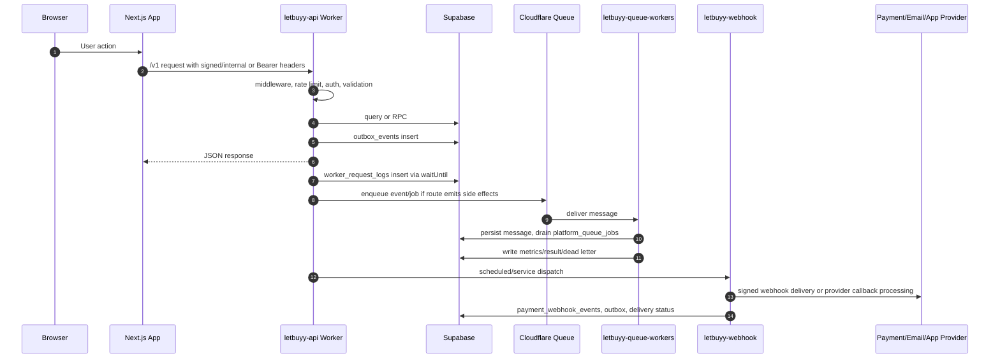
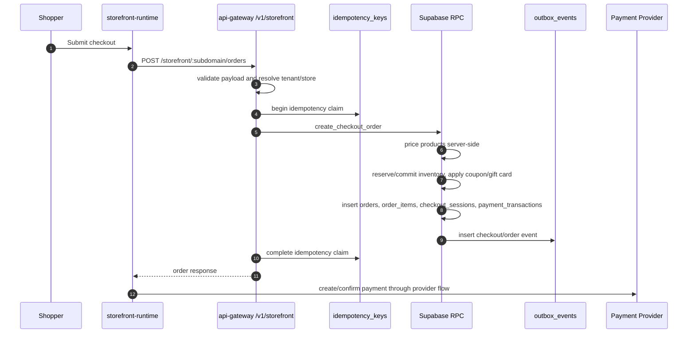
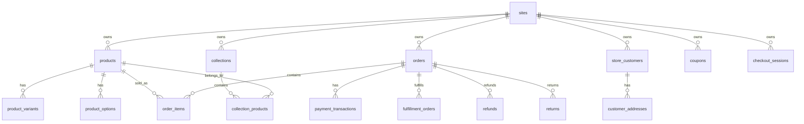
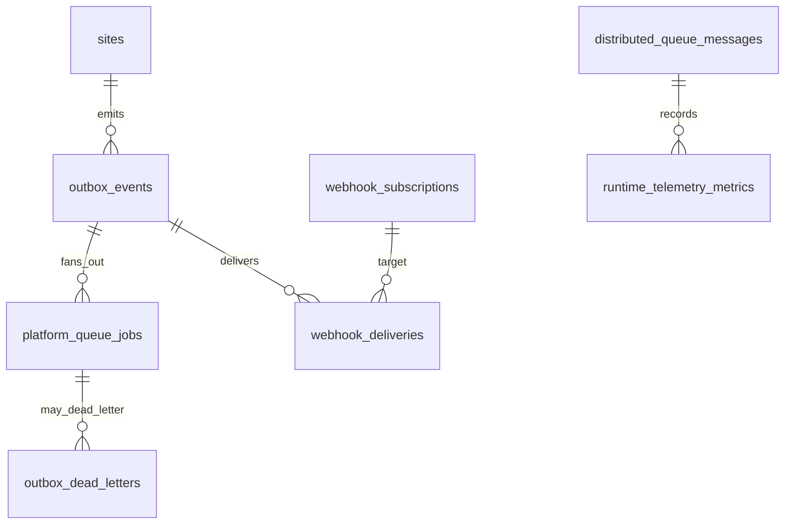
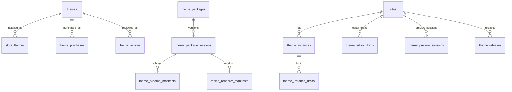
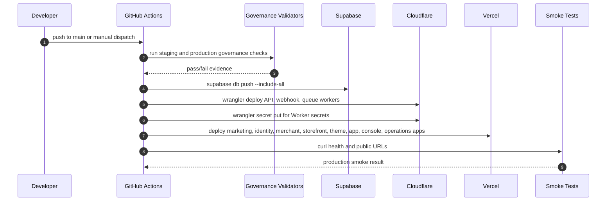

# LetBuyy Deep Codebase Audit and Architecture Research

Generated on: 2026-06-05  
Repository root: `/Users/saai_sidd/Git/Letbuyy_Store`  
Scope: source-backed architecture, implementation, security, performance, database, deployment, Cloudflare, and product-readiness audit.  
Constraint honored: no production source code was modified. This report is the only intended artifact.

## Evidence Method

This report is based on direct source inspection of the current working tree. Evidence references use repository-relative paths and line numbers where useful. Cost modeling also references current vendor pricing pages because infrastructure pricing cannot be verified from repository source alone.

Primary source evidence:

- Root governance instructions: `AGENTS.md`.
- Repository memory and risk register: `memory/lessons.md`, `tasks/todo.md`.
- Runtime manifests, package manifests, and workspace files: `runtime.manifest.json`, `package.json`, `pubspec.yaml`, `pnpm-workspace.yaml`, `turbo.json`.
- Cloudflare Worker configs: `services/api-gateway/wrangler.toml`, `services/webhook-service/wrangler.toml`, `services/queue-workers/wrangler.toml`.
- Hono API gateway: `services/api-gateway/src/index.ts`, `services/api-gateway/src/routes/*.ts`.
- Middleware and execution adapters: `services/api-gateway/src/middleware/*.ts`, `services/api-gateway/src/execution/*.ts`.
- Queue and webhook workers: `services/queue-workers/src/*`, `services/webhook-service/src/*`.
- Theme engine and editor: `packages/theme-engine/src/*`, `apps/merchant-control-plane/src/app/[store]/online-store/themes/[themeId]/editor/page.tsx`.
- Storefront runtime: `apps/storefront-runtime/src/app/api/*`, `apps/storefront-runtime/src/components/sections/*`, `apps/storefront-runtime/src/lib/api/client.ts`.
- Database migrations: `database/supabase/migrations/*.sql`, `database/cloudflare/d1/migrations/*.sql`.
- CI/CD and infrastructure: `.github/workflows/*.yml`, `infrastructure/dns/dns.tf`, deployment and monitoring folders.
- Governance validation: `pnpm run validate:governance`.

Important distinction:

- Source-backed facts are labeled as observed or evidenced.
- Cost projections require traffic and usage assumptions. Those assumptions are listed explicitly. The repository does not contain live billing, real traffic, production database telemetry, or Cloudflare analytics exports.

External pricing and product sources referenced:

- Cloudflare Workers pricing: <https://developers.cloudflare.com/workers/platform/pricing/>
- Cloudflare Queues pricing: <https://developers.cloudflare.com/queues/platform/pricing/>
- Cloudflare R2 pricing: <https://developers.cloudflare.com/r2/pricing/>
- Cloudflare Workers KV pricing: <https://developers.cloudflare.com/kv/platform/pricing/>
- Cloudflare D1 pricing: <https://developers.cloudflare.com/d1/platform/pricing/>
- Cloudflare Durable Objects pricing: <https://developers.cloudflare.com/durable-objects/platform/pricing/>
- Supabase pricing: <https://supabase.com/pricing>
- Supabase compute add-ons: <https://supabase.com/docs/guides/platform/compute-add-ons>
- Vercel pricing: <https://vercel.com/pricing>
- Resend pricing: <https://resend.com/docs/knowledge-base/what-is-resend-pricing>
- Upstash Redis pricing: <https://upstash.com/pricing/redis>
- Cloudflare Turnstile plans: <https://developers.cloudflare.com/turnstile/plans/>
- Razorpay pricing: <https://razorpay.com/pricing/>
- Shopify sections and blocks: <https://help.shopify.com/en/manual/online-store/themes/theme-structure/sections-and-blocks>
- Shopify overview: <https://help.shopify.com/en/manual/intro-to-shopify/overview>
- Shopify Winter 2026 editions: <https://www.shopify.com/editions/winter2026>

## Executive Summary

LetBuyy is not a small prototype. It is a large, governance-heavy, multi-runtime commerce platform with a real architecture spine: a Hono Cloudflare API gateway, separate Next.js applications for identity, merchant operations, storefront runtime, marketplaces, console surfaces, mobile Flutter apps, and a large set of domain packages for commerce, checkout, tenant, auth, theme, CMS, app engine, events, billing, orchestration, projections, and infrastructure adapters.

The codebase already contains substantial implementation for core commerce flows:

- Store creation and merchant authentication are centered in `apps/identity-platform`.
- Merchant dashboard operations exist in `apps/merchant-control-plane`.
- Storefront rendering exists in `apps/storefront-runtime`.
- Commerce API authority is concentrated in `services/api-gateway`.
- Checkout order creation recalculates prices server-side through `OrderExecutionAdapter.createOrder` and the `create_checkout_order` database function.
- Payment confirmation has ledger-aware RPCs through `PaymentExecutionAdapter`.
- Provider webhook verification is implemented in `services/webhook-service`.
- Theme editing, draft save, publishing, rollback, preview sessions, and JSON-contract theme package upload exist.
- App marketplace work is more than a catalog: the gateway supports app OAuth, app installation, app lifecycle webhooks, admin embed sessions, bridge fetch, app charges, developer registration, reviews, and partner dashboard routes.
- Enterprise governance is unusually developed: runtime manifests, topology validators, dependency validators, queue lifecycle validators, replay validators, survivability validators, and operational evidence validators are present.

The largest strategic issue is that the repository contains far more planned and governance-mode infrastructure than proven live product evidence. There are many manifests, validators, operational tables, recovery contracts, and certification gates, but the source also contains compatibility fallback code, app-local Next route handlers, generated local artifacts, source-light reserved services, and customer-facing routes whose security posture is weaker than the merchant/admin side.

The most important risks are:

1. Public storefront customer routes expose sensitive workflows without a signed customer session in several cases. The worker has endpoints that can set or inspect customer state using only `store_id` and `email`, including `/v1/storefront/customer/password`, `/v1/storefront/customer/by-email`, `/v1/storefront/customer/status`, `/v1/storefront/customer/orders`, and `/v1/storefront/:subdomain/orders/contact`.
2. Cost risk is driven less by Worker request pricing and more by write amplification: every API request writes a `worker_request_logs` row asynchronously, scheduled cron runs every minute, scheduled dispatch emits a queue event every run, Cloudflare queue consumers drain database queues, and storefront/media/object reads can drive R2 Class B operations.
3. The current theme system is a JSON-contract renderer, not a Shopify Liquid-equivalent runtime. `packages/theme-engine/src/theme-renderer.ts` explicitly marks the `LiquidRenderer` as `unsupported`.
4. The database schema is broad but inconsistent. Current source has 237 SQL tables across Supabase and D1 migrations, 382 indexes, 352 policies, 230 RLS enable statements, and 97 functions. Entity lifecycle columns are inconsistent, some core records still mix JSONB and relational representations, and many compatibility paths handle missing columns/tables.
5. Production readiness is blocked by operational hygiene. `pnpm run validate:governance` passes a very large number of architecture/runtime/dependency/cloud/governance checks, but fails at the stale artifact validator because local generated directories exist under app/service/package roots.
6. Deployment coverage is not complete. Production workflows deploy major apps and Workers, but `apps/developer-portal` is present as an app package/runtime and is not included in the production Vercel deploy matrix observed in `.github/workflows/production-deploy.yml`.
7. The current platform should be able to support 100 merchants if the public customer-route security issues are fixed and generated artifacts are cleaned. It can likely support 1,000 merchants with focused indexing, caching, and write-amplification control. It is not ready for 10,000 merchants without changing observability ingestion, storefront caching, queue drain controls, and database scaling. It is not ready for 100,000 merchants in the current architecture.

Readiness score:

| Dimension | Score | Summary |
|---|---:|---|
| Architecture | 72 | Strong runtime boundaries and package governance, but overextended and partially aspirational. |
| Security | 48 | Merchant auth is improving, webhook verification exists, but public customer routes are high risk. |
| Scalability | 45 | Good event/queue intent, but DB write amplification and Supabase-centric runtime are bottlenecks. |
| Reliability | 52 | Extensive governance and recovery contracts, but limited proof of live execution and stale local artifacts. |
| Maintainability | 58 | Good package boundaries, but duplicate app route handlers, compatibility fallbacks, and many route modules create complexity. |
| Developer Experience | 61 | Monorepo and validators are strong; validation volume, local pollution, and generated docs drift increase friction. |
| Merchant Experience | 54 | Broad merchant surfaces exist, but Shopify-depth workflows are incomplete. |
| Overall | 56 | Serious platform under construction, not production-ready at Shopify-class scale. |

## Phase 1: Repository Discovery

### Monorepo Shape

The workspace is a pnpm/Turbo monorepo. `pnpm-workspace.yaml` includes `apps/*`, `apps/mobile/*`, `packages/*`, `packages/typescript/*`, `packages/dart/*`, and `services/*`. The root `package.json` defines governance, validation, typecheck, test, build, deployment, and security scripts. The root `turbo.json` defines `build`, `lint`, `typecheck`, `test`, `verify`, and output directories such as `.next`, `dist`, and `build`.

The root architecture contract in `AGENTS.md` defines LetBuyy as a Shopify-class, multi-tenant commerce and site-builder SaaS. It mandates that database tables use `sites`, UI and URLs may say store, `services/api-gateway` is the sole Commerce API backend, apps must use versioned gateway contracts, runtime roots need local `AGENTS.md` and `runtime.manifest.json`, deprecated app aliases are forbidden, active runtimes must not import `legacy/*` or repository-level `infrastructure/*`, new entity tables require lifecycle and audit columns, and generated artifacts must remain ignored and untracked.

### Repository Map

```text
.
|-- .github
|   `-- workflows
|-- apps
|   |-- app-marketplace
|   |-- developer-portal
|   |-- identity-platform
|   |-- marketing-site
|   |-- merchant-control-plane
|   |-- mobile
|   |   |-- merchant-app
|   |   |-- operator-app
|   |   `-- shopper-app
|   |-- platform-console
|   |-- platform-operations-portal
|   |-- storefront-runtime
|   `-- theme-marketplace
|-- config
|   |-- cloudflare
|   |-- env
|   |-- eslint
|   |-- runtime
|   |-- supabase
|   `-- vercel
|-- database
|   |-- cloudflare/d1/migrations
|   `-- supabase
|       |-- migrations
|       |-- scripts
|       |-- seeds
|       `-- verification
|-- docs
|-- infrastructure
|   |-- ci-cd
|   |-- cloudflare
|   |-- deployment
|   |-- dns
|   |-- monitoring
|   |-- observability
|   |-- scripts
|   `-- security
|-- packages
|   |-- app-engine
|   |-- application-services
|   |-- auth-core
|   |-- billing-core
|   |-- checkout-core
|   |-- cms-core
|   |-- commerce-core
|   |-- dart
|   |-- distributed-runtime
|   |-- event-core
|   |-- infrastructure
|   |-- notification-core
|   |-- orchestration
|   |-- payments
|   |-- projection-runtime
|   |-- runtime-composition
|   |-- search-core
|   |-- shared-types
|   |-- tenant-core
|   |-- theme-engine
|   `-- typescript
`-- services
    |-- analytics-pipeline
    |-- api-gateway
    |-- checkout-runtime
    |-- event-bus
    |-- media-service
    |-- notification-service
    |-- queue-workers
    |-- search-service
    `-- webhook-service
```

Generated/local artifact pollution observed:

```text
apps/*/.next
apps/*/.turbo
apps/*/.vercel
apps/*/node_modules
services/*/.turbo
services/*/.wrangler
services/*/node_modules
packages/*/.turbo
packages/*/dist
packages/*/node_modules
```

These directories are not necessarily tracked, but they caused the stale artifact validator to fail. The governance contract says generated outputs must remain ignored, untracked, and excluded from architecture intelligence.

### Purpose of Major Directories

| Directory | Purpose | Evidence |
|---|---|---|
| `apps/` | User-facing and operator-facing runtimes. Next.js web apps and Flutter mobile apps. | `pnpm-workspace.yaml`, app `package.json`, mobile `pubspec.yaml`, runtime manifests. |
| `services/` | Independently deployable Cloudflare Workers and reserved service roots. | `services/api-gateway/wrangler.toml`, `services/webhook-service/wrangler.toml`, `services/queue-workers/wrangler.toml`. |
| `packages/` | Shared domain contracts, execution contracts, runtime composition, provider adapters, UI, utilities, Dart libraries. | Package manifests and `src/index.ts` exports. |
| `database/` | Supabase SQL migrations, D1 migrations, seeds, verification. | `database/supabase/migrations`, `database/cloudflare/d1/migrations`. |
| `config/` | Runtime, environment, Cloudflare, Supabase, Vercel, ESLint governance. | `config/runtime`, `config/env`, `config/cloudflare`. |
| `infrastructure/` | DNS, deployment, monitoring, observability, security, operations scripts. | `infrastructure/dns/dns.tf`, deployment folders. |
| `.github/workflows/` | CI, architecture governance, staging deployment, production deployment. | `ci.yml`, `production-deploy.yml`, `deploy-staging.yml`, `architecture-governance.yml`. |
| `docs/` | Generated and human-authored operational memory. | Root governance and docs tree. |

### Package Boundary Assessment

The package structure largely follows the architecture contract:

- Cross-runtime primitives live in `packages/shared-types`.
- Tenant isolation contracts live in `packages/tenant-core`.
- Commerce contracts live in `packages/commerce-core`.
- Checkout contracts and schemas live in `packages/checkout-core`.
- Auth contracts live in `packages/auth-core`.
- Theme contracts and renderer interfaces live in `packages/theme-engine`.
- App marketplace/app blocks/OAuth contracts live in `packages/app-engine`.
- Workflow declarations live in `packages/application-services`.
- Events, queue, outbox, replay, and orchestration contracts live in `packages/orchestration` and `packages/distributed-runtime`.
- Runtime response shaping lives in `packages/runtime-composition`.
- Provider adapters live in `packages/infrastructure`.

Observed dependency direction is consistent with governance according to `pnpm run validate:governance`: dependency manifest validation, dependency graph validation, circular import validation, package export validation, provider isolation validation, and domain boundary validation all passed.

### Architecture Boundary Diagram

```mermaid
flowchart TB
  subgraph WebApps["Next.js Applications"]
    Marketing["marketing-site"]
    Identity["identity-platform"]
    Merchant["merchant-control-plane"]
    Storefront["storefront-runtime"]
    AppMarket["app-marketplace"]
    ThemeMarket["theme-marketplace"]
    Console["platform-console"]
    OpsPortal["platform-operations-portal"]
    DevPortal["developer-portal"]
  end

  subgraph Workers["Cloudflare Workers"]
    Gateway["services/api-gateway: Hono /v1"]
    Webhook["services/webhook-service"]
    QueueWorkers["services/queue-workers"]
    DO["LetbuyyRuntimeDurableObject"]
  end

  subgraph Packages["Shared Packages"]
    SharedTypes["shared-types"]
    CommerceCore["commerce-core"]
    CheckoutCore["checkout-core"]
    AuthCore["auth-core"]
    ThemeEngine["theme-engine"]
    AppEngine["app-engine"]
    RuntimeComp["runtime-composition"]
    InfraAdapters["infrastructure adapters"]
  end

  subgraph Data["Data and Provider Layer"]
    Supabase["Supabase Postgres/Auth"]
    D1["Cloudflare D1"]
    R2["Cloudflare R2"]
    KV["Cloudflare KV"]
    Queues["Cloudflare Queues"]
    Hyperdrive["Cloudflare Hyperdrive"]
    Payments["Razorpay/Stripe/PayPal/Cashfree"]
    Email["Resend"]
    Redis["Upstash Redis"]
  end

  Marketing --> Identity
  Identity --> Gateway
  Merchant --> Gateway
  Storefront --> Gateway
  AppMarket --> Gateway
  ThemeMarket --> Gateway
  Console --> Gateway
  OpsPortal --> Gateway
  DevPortal --> Gateway

  Gateway --> Supabase
  Gateway --> R2
  Gateway --> KV
  Gateway --> Queues
  Gateway --> Hyperdrive
  Gateway --> Webhook
  Gateway --> DO
  Gateway --> Payments
  Gateway --> Redis
  Webhook --> Supabase
  Webhook --> Payments
  QueueWorkers --> Supabase
  QueueWorkers --> Queues

  WebApps --> Packages
  Workers --> Packages
  Packages --> InfraAdapters
```



## Phase 2: Application Inventory

### Application Summary

| Application | Purpose | Status | Risk |
|---|---|---|---|
| `apps/identity-platform` | Merchant authentication, signup, OTP, reset password, session, onboarding, store selection. | Active and security-sensitive. Uses Next route handlers and signed worker calls. | Medium-high: auth logic is split between Next and gateway, but rate limiting, CSRF, and Turnstile exist. |
| `apps/merchant-control-plane` | Per-store merchant dashboard: products, orders, themes, content, analytics, settings, billing. | Active and broad. | High: many app-local proxy/API routes increase duplication and surface area. |
| `apps/storefront-runtime` | Wildcard tenant storefront, shopper browsing, cart, checkout, customer account, reviews, policies, theme rendering. | Active and public-facing. | Critical: customer/order lookup routes have weak session requirements in gateway. |
| `apps/marketing-site` | Public marketing, pricing, conversion flow. | Active. | Low-medium: should not host auth. Uses client theme scripts/localStorage for preferences. |
| `apps/app-marketplace` | App catalog, developer registration, app search/install/reviews. | Active. | Medium: marketplace is implemented but app ecosystem security/compliance is incomplete. |
| `apps/theme-marketplace` | Theme catalog, theme details, checkout, acquisition workflow. | Active. | Medium: marketplace exists, but theme runtime is JSON-contract rather than Liquid ecosystem. |
| `apps/platform-console` | Super admin console scaffold. | Active scaffold. | High: operator auth/MFA is early and needs production hardening. |
| `apps/platform-operations-portal` | Employee operations portal scaffold. | Active scaffold. | High: operations routes expose powerful runtime controls and need strict controls. |
| `apps/developer-portal` | Developer/partner portal. | Present as runtime/package. | Medium-high: present in workspace but absent from production deploy matrix observed in `.github/workflows/production-deploy.yml`. |
| `apps/mobile/merchant-app` | Flutter merchant app for builder/editor/dashboard/products/themes/preview. | Active mobile source. | Medium: mobile parity likely incomplete, but has substantial Dart code. |
| `apps/mobile/operator-app` | Flutter operator scaffold. | Scaffold. | Medium-high: operator access must be hardened before production. |
| `apps/mobile/shopper-app` | Reserved shopper app runtime. | Source-light/reserved. | Low immediate, high future if advertised as available. |

### Application Detail

#### Identity Platform

- Entry points: `apps/identity-platform/src/app`, `src/proxy.ts`, `src/app/api/auth/*`.
- Runtime: Next.js.
- Key dependencies: `@letbuyy/api-client`, `@letbuyy/auth-core`, `@letbuyy/ui`, `@letbuyy/utils`, `bcryptjs`, `jose`, `next`, `react`, `react-email`.
- Security controls observed:
  - `src/lib/rate-limit.ts` calls the gateway rate-limit service.
  - `src/lib/auth/cookies.ts` defines HTTP-only session cookies and a readable `lb_csrf` cookie.
  - `src/lib/auth/csrf.ts` validates double-submit CSRF.
  - `src/lib/turnstile.ts` verifies Cloudflare Turnstile.
  - `src/lib/api/client.ts` signs internal worker calls with timestamp/signature headers.
- Risk:
  - Auth logic is partly in Next route handlers and partly in worker routes.
  - `console.error` remains in several auth routes according to local `AGENTS.md` and source scans.
  - CSRF cookie name differs from gateway CSRF cookie name: identity uses `lb_csrf`; gateway middleware expects `letbuyy_csrf`. This is acceptable only if identity routes never rely on gateway CSRF middleware directly.

#### Merchant Control Plane

- Entry points: `apps/merchant-control-plane/src/app`, especially store-scoped routes under `src/app/[store]`.
- Runtime: Next.js.
- Key dependencies: `@letbuyy/api-client`, `@letbuyy/auth-core`, `@letbuyy/shared-types`, `@letbuyy/theme-engine`, `@letbuyy/ui`, `lucide-react`, `next`.
- API route volume: many app-local proxy routes under `src/app/api/stores/[store]`.
- Theme editor:
  - `apps/merchant-control-plane/src/app/[store]/online-store/themes/[themeId]/editor/page.tsx` is a client editor.
  - It fetches `/api/themes/:themeId/editor`, `/sections`, `/releases`.
  - It saves draft by POSTing `{ draftConfig }` to `/api/themes/:themeId/editor/draft`.
  - It publishes by PUTing `{ templateConfig }` to `/api/themes/:themeId/editor`.
  - It implements undo/redo, add/remove/move sections, add/remove blocks, device preview, versions panel, and a local preview canvas.
- Risk:
  - Large client component surface.
  - Editor preview is local/schema-driven, not guaranteed to be the same execution path as the actual storefront renderer.
  - App-local API routes may duplicate worker contracts.

#### Storefront Runtime

- Entry points: `apps/storefront-runtime/src/app`, wildcard store routes, `src/app/api/*`.
- Runtime: Next.js.
- Key dependencies: `@letbuyy/api-client`, `@letbuyy/app-engine`, `@letbuyy/auth-core`, `@letbuyy/checkout-core`, `@letbuyy/cms-core`, `@letbuyy/commerce-core`, `@letbuyy/runtime-composition`, `@letbuyy/shared-types`, `@letbuyy/tenant-core`, `@letbuyy/theme-engine`.
- Rendering:
  - React section components exist in `src/components/sections`.
  - Observed section files include `about-section`, `app-block-slot`, `banner-carousel`, `brand-marquee`, `category-grid`, `contact-form`, `cta-section`, `experience-timeline`, `featured-products`, `hero`, `newsletter`, `portfolio-grid`, `product-detail-section`, `product-grid`, `rich-content-section`, `services-grid`, `skills-section`, `testimonials`, `trust-badges`.
- API behavior:
  - `src/lib/api/client.ts` calls the gateway and can include `X-Internal-API-Secret` for internal storefront payment/order endpoints.
  - Storefront app-local customer/order routes proxy to gateway public storefront routes.
- Risk:
  - Public customer account flows need session enforcement at the gateway, not only in the Next app.
  - Cart and wishlist use localStorage for guest state, which is acceptable for non-secret UI/guest state but should be migration-safe.

#### App Marketplace

- Entry points: `apps/app-marketplace/src/app`.
- Runtime: Next.js.
- Key dependencies: `@letbuyy/api-client`, `@letbuyy/auth-core`, `@letbuyy/shared-types`, `@letbuyy/ui`, `jose`, `lucide-react`, `server-only`.
- Gateway support:
  - App catalog, categories, reviews, installations, OAuth authorize/token/token-exchange, bridge fetch, app charges, developer registration, partner dashboard.
- Risk:
  - App execution model is still narrow: bridge fetch is scoped GET only, app block rendering is inline/iframe data, and app compliance review likely incomplete.

#### Theme Marketplace

- Entry points: `apps/theme-marketplace/src/app`.
- Runtime: Next.js.
- Key dependencies: `@letbuyy/api-client`, `@letbuyy/auth-core`, `@letbuyy/shared-types`, `@letbuyy/theme-engine`, `@letbuyy/ui`.
- Gateway support:
  - Public theme list/details, purchase, install, schema, package upload, editor, draft, publish, preview session, releases, rollback.
- Risk:
  - Theme runtime is not equivalent to Shopify Liquid.
  - Third-party portable bundle path exists, but active rendering is JSON-contract plus React components.

#### Platform Console and Operations Portal

- Entry points: `apps/platform-console/src/app`, `apps/platform-operations-portal/src/app`.
- Runtime: Next.js.
- Gateway support:
  - `/v1/internal/console` public mounted route with signed/internal access.
  - `/v1/operations` protected operational routes with marketplace reviews, outbox dispatch, webhook dispatch, jobs consume, runtime queues, replay, incidents, failover drills, chaos experiments, load tests, deployments, readiness gates, evidence reports.
- Risk:
  - Powerful operational routes require production-grade MFA, allowlists, audit, IP controls, and separation of support vs SRE privileges.

### Runtime Status Table

| Runtime | Build system | Entrypoint | Primary dependencies | Current status |
|---|---|---|---|---|
| `identity-platform` | Next.js + pnpm/Turbo | `src/app` | auth-core, api-client, UI, jose, bcryptjs | Active, security critical |
| `merchant-control-plane` | Next.js + pnpm/Turbo | `src/app` | api-client, shared-types, theme-engine, UI | Active, broad dashboard |
| `storefront-runtime` | Next.js + pnpm/Turbo | `src/app` | theme-engine, checkout-core, app-engine, runtime-composition | Active public runtime |
| `marketing-site` | Next.js + pnpm/Turbo | `src/app` | UI, utils, animation libs | Active public site |
| `app-marketplace` | Next.js + pnpm/Turbo | `src/app` | app/auth/shared/UI packages | Active marketplace |
| `theme-marketplace` | Next.js + pnpm/Turbo | `src/app` | theme-engine, api-client, UI | Active marketplace |
| `platform-console` | Next.js + pnpm/Turbo | `src/app` | api-client, auth-core, zod | Admin scaffold |
| `platform-operations-portal` | Next.js + pnpm/Turbo | `src/app` | api-client, auth-core, shared-types | Operations scaffold |
| `developer-portal` | Next.js + pnpm/Turbo | `src/app` | UI, Next, React | Present, deployment gap |
| `mobile/merchant-app` | Flutter/Dart | `lib/main.dart` | local Dart packages | Active mobile source |
| `mobile/operator-app` | Flutter/Dart | `lib/main.dart` | local Dart packages | Scaffold |
| `mobile/shopper-app` | Reserved | runtime manifest | none observed | Reserved |

## Phase 3: Cloudflare Architecture Analysis

### Worker Inventory

| Worker | Config | Trigger type | Main routes or handlers | Dependencies | Risk |
|---|---|---|---|---|---|
| `letbuyy-api` | `services/api-gateway/wrangler.toml` | HTTP routes, cron trigger, Durable Object binding, queue producers, service binding | `/health`, `/v1/*`, scheduled dispatcher, `LetbuyyRuntimeDurableObject` | Supabase, R2, KV, D1, Hyperdrive, queues, webhook service, Upstash, payment providers | High cost/reliability centrality |
| `letbuyy-webhook` | `services/webhook-service/wrangler.toml` | HTTP routes, service binding target | `/health`, provider webhooks, app lifecycle dispatch, webhook delivery dispatch | Supabase, provider signature adapters, API gateway service binding | Medium-high side-effect risk |
| `letbuyy-queue-workers` | `services/queue-workers/wrangler.toml` | Cloudflare Queue consumers | `queue()` consumer for events, analytics, search, notifications, runtime, DLQ | Supabase, queue adapters, event/notification/runtime packages | High retry storm/write amplification risk |

Reserved service roots with manifests but no equivalent active Worker source/package observed:

| Reserved root | Status | Risk |
|---|---|---|
| `services/analytics-pipeline` | Runtime manifest only/source-light | Do not advertise as live pipeline. |
| `services/checkout-runtime` | Runtime manifest only/source-light | Checkout execution currently lives in API gateway/DB RPCs. |
| `services/event-bus` | Runtime manifest only/source-light | Event routing implemented via outbox/queues, not an independent source service. |
| `services/media-service` | Runtime manifest only/source-light | Media route exists in API gateway; dedicated service not active. |
| `services/notification-service` | Runtime manifest only/source-light | Notification route/queue paths exist, dedicated service not active. |
| `services/search-service` | Runtime manifest only/source-light | Search indexing uses DB queue/search_documents paths, dedicated service not active. |

### API Gateway Cloudflare Bindings

`services/api-gateway/wrangler.toml` declares:

- Worker name: `letbuyy-api`.
- Main: `src/index.ts`.
- Compatibility date: `2026-05-25`.
- Node.js compatibility enabled.
- Cron trigger: `*/1 * * * *`.
- R2 bucket binding for media.
- KV namespace `CACHE`.
- Hyperdrive binding.
- D1 binding `RUNTIME_DB`.
- Durable Object namespace `RUNTIME_COORDINATOR`.
- Service binding `WEBHOOK_SERVICE`.
- Analytics Engine dataset.
- Queue producers: `EVENT_QUEUE`, `ANALYTICS_QUEUE`, `SEARCH_QUEUE`, `NOTIFICATION_QUEUE`, `RUNTIME_QUEUE`.

Production queue names include `letbuyy-events-production`, `letbuyy-analytics-queue-production`, `letbuyy-search-queue-production`, `letbuyy-notifications-queue-production`, and `letbuyy-production-queue`.

### API Gateway Middleware Stack

Observed in `services/api-gateway/src/index.ts`:

```text
securityHeaders
requestId
inputValidation
errorResponseSanitizer
request timing
observability
CORS
health routes
/v1 base path
apiVersioning
queryCostRateLimit
public routes
authMiddleware
csrfProtection
rateLimit(max 300)
protected routes
```

Important details:

- `queryCostRateLimit` is mounted on all `/v1` routes before public/protected route split.
- Public routes before auth include `auth`, `contacts`, `storefront`, `themes`, `app-store`, and `internal/console`.
- Protected routes after `authMiddleware` and `csrfProtection` include stores, products, orders, payments, upload, portfolio, resume, employees, admin, blog, customers, notifications, media, AI, export, shipping-tax, onboarding, inventory, coupons, categories, analytics, reviews, form submissions, pages, and operations.
- CORS allows LetBuyy domains and wildcard tenant subdomains matching `https://[a-z0-9-]+.letbuyy.store`.

### Cron Trigger Behavior

`services/api-gateway/src/index.ts` exports `scheduled(controller, env, ctx)` and calls `runScheduledDispatch`. The scheduled dispatcher:

1. Creates an `OutboxExecutionAdapter`.
2. Creates a `QueueExecutionAdapter`.
3. Creates Cloudflare queue producers.
4. Dispatches outbox events with batch size 50.
5. Calls `WEBHOOK_SERVICE.fetch('/webhook-deliveries/dispatch')` with batch size 50.
6. Consumes database queues `analytics-events`, `search-indexing`, and `payment-events` with batch size 50.
7. Enqueues `runtime.scheduled_dispatch.completed` to `EVENT_QUEUE`.
8. Logs success or failure.

Cost and reliability impact:

- A cron every minute creates 43,200 scheduled invocations in a 30-day month before user traffic.
- Every successful scheduled run emits a queue event, creating at least queue write/read/delete cost and a queue-worker invocation downstream.
- If the database or webhook service is degraded, the scheduled dispatcher can repeatedly hit failing paths every minute.
- The dispatcher has multiple side effects per run. This needs backoff and circuit breaker evidence before production scale.

### Queue Worker Behavior

`services/queue-workers/src/index.ts` handles Cloudflare Queue messages. For each message it normalizes payload, inserts into `distributed_queue_messages`, records `runtime_telemetry_metrics`, calls `consumePlatformQueuesForCloudflareQueue`, acks on success, and calls `message.retry()` on error.

`services/queue-workers/src/platform-queue-consumer.ts` maps Cloudflare queue names to database queue names:

- Search queue -> `search-indexing`.
- Payment queue -> `payment-events`.
- Analytics or notification queue -> `analytics-events`.
- Default event queue -> `analytics-events`, `search-indexing`, and `payment-events`.

It then claims up to 25 or 100 database jobs via RPC `claim_platform_queue_jobs`, processes side effects, and completes/fails jobs via RPC.

Risk:

- One Cloudflare Queue message can trigger draining of multiple database queue families.
- Production `wrangler.toml` sets max concurrency up to 25 for events, 20 for analytics, 20 for search, 10 for notifications, 20 for runtime, with retries up to 6-10.
- A poison message or DB outage can cause queue retries and repeated DB writes.
- If scheduled cron emits a queue event every minute and event queue consumers also drain database queues, idle systems still produce recurring work.

### Webhook Worker Behavior

`services/webhook-service/src/index.ts` supports `/health`, `/app-lifecycle/dispatch`, `/webhook-deliveries/dispatch`, and provider webhooks for Razorpay, Stripe, PayPal, and Cashfree.

Provider webhook verification is present:

- Razorpay HMAC verification uses raw body and `RAZORPAY_WEBHOOK_SECRET`.
- Stripe, PayPal, and Cashfree provider adapters verify signatures.
- Invalid signatures return error responses before side effects.
- `payment_webhook_events` are upserted on provider/provider event identifiers for idempotency.
- Outbox events are emitted for payment lifecycle changes.

App lifecycle webhook dispatch uses HTTPS target URL checks, signs payloads with HMAC headers, and limits response body preview to 2,000 characters. This means older governance memory that said webhook verification was missing is stale for the current worker. The current risk is parity and coverage across every provider/callback surface, not absence of verification in `services/webhook-service`.

### Cloudflare Invocation Flow



### Invocation Explosion Risks

| Risk | Evidence | Why it matters |
|---|---|---|
| Per-request observability write | `services/api-gateway/src/middleware/observability.ts` writes `worker_request_logs` in `waitUntil`. | Every dynamic API request creates a Supabase insert. At high storefront traffic, request logging can become a write-heavy cost and latency-adjacent bottleneck. |
| One-minute cron | `services/api-gateway/wrangler.toml` has `*/1 * * * *`. | 43,200 scheduled invocations/month plus downstream queue emissions even before user traffic. |
| Cron emits queue event every run | `runScheduledDispatch` enqueues `runtime.scheduled_dispatch.completed` to `EVENT_QUEUE`. | Idle system still creates queue operations and queue-worker work. |
| Queue consumer drains DB queues per message | `platform-queue-consumer.ts` maps queues and drains multiple DB queues. | One Cloudflare message can cause multiple DB jobs to be claimed, processed, completed, failed, or retried. |
| High queue retry counts | `services/queue-workers/wrangler.toml` has retries 6-10. | Provider/DB outage can multiply reads/writes. |
| Storefront public traffic all hits Worker API for dynamic data | `storefront.ts` exposes lookup, products, pages, policies, customer, reviews, contact. | Without aggressive caching, dynamic storefront traffic scales database and Worker load linearly. |
| Product view counter write | `ProductExecutionAdapter.recordStorefrontView` updates `products.view_count`. | Popular product pages can produce hot-row writes. |
| R2 read operations | Media upload route and R2 binding present. | R2 egress is free, but Class B reads are not free. Asset-heavy storefronts can move cost to operations. |
| KV rate limiting writes | Rate limiter falls back to KV and writes counters. | KV writes are relatively expensive compared with reads. High public traffic increases KV operation volume if Upstash is not used. |
| Operations routes can manually dispatch/replay | `/v1/operations/outbox/dispatch`, `/webhook-deliveries/dispatch`, `/jobs/consume`, runtime redrive routes. | Admin/operator mistakes can cause replay storms if not guarded by approval workflows and budgets. |

### High Risk Cost Areas

1. Supabase request-log write amplification.
2. Queue storm from cron plus queue retries plus DB queue draining.
3. Storefront dynamic product/catalog traffic without edge caching.
4. R2 Class B reads for media-heavy storefronts.
5. KV rate-limit writes if Upstash is absent or fails and KV fallback handles production traffic.
6. Operational replay/redrive endpoints if exposed to insufficiently constrained operators.
7. Product view counter hot updates.
8. Search and analytics projections if every product/order event fans into multiple persistent tables.

## Phase 4: Request Flow Analysis

### API Gateway Route Inventory

The API gateway mounts these Hono route modules under `/v1`:

| Route module | Mount | Auth posture |
|---|---|---|
| `auth.ts` | `/auth` | Public with `authRateLimit` |
| `contacts.ts` | `/contacts` | Public |
| `storefront.ts` | `/storefront` | Public plus internal secret checks for selected endpoints |
| `themes.ts` | `/themes` | Mixed public and auth middleware inside router |
| `app-store.ts` | `/app-store` | Mixed public and auth middleware inside router |
| `internal-console.ts` | `/internal/console` | Mounted before global auth; route uses internal controls |
| `stores.ts` | `/stores` | Protected |
| `products.ts` | `/products` | Protected |
| `orders.ts` | `/orders` | Protected |
| `payments.ts` | `/payments` | Protected |
| `upload.ts` | `/upload` | Protected |
| `portfolio.ts` | `/portfolio` | Protected |
| `resume.ts` | `/resume` | Protected |
| `employee.ts` | `/employees` | Protected |
| `admin.ts` | `/admin` | Protected |
| `blog.ts` | `/blog` | Protected |
| `customers.ts` | `/customers` | Protected |
| `notifications.ts` | `/notifications` | Protected |
| `media.ts` | `/media` | Protected |
| `ai.ts` | `/ai` | Protected |
| `export.ts` | `/export` | Protected |
| `shipping-tax.ts` | `/shipping-tax` | Protected |
| `onboarding.ts` | `/onboarding` | Protected |
| `inventory.ts` | `/inventory` | Protected |
| `coupons.ts` | `/coupons` | Protected |
| `categories.ts` | `/categories` | Protected |
| `analytics.ts` | `/analytics` | Protected |
| `reviews.ts` | `/reviews` | Protected |
| `form-submissions.ts` | `/form-submissions` | Protected |
| `pages.ts` | `/pages` | Protected |
| `operations.ts` | `/operations` | Protected |

### Representative Endpoint Analysis

Because the gateway exposes hundreds of routes, the table below groups endpoints by behavior and risk. Detailed route extraction from source is included after the grouped analysis.

| Endpoint family | Example routes | Auth | Validation | DB operations | External calls | Performance/security concern |
|---|---|---|---|---|---|---|
| Storefront store lookup | `GET /v1/storefront/:subdomain`, `/lookup`, `/status` | Public | Query/param logic in route | `sites`, theme release/draft tables, products/pages/policies depending route | None directly | Needs caching and strict tenant resolution. |
| Storefront products | `GET /:subdomain/products`, `/products/by-ids`, `/products/:slug` | Public | Query parsing in route | `products`, possibly reviews/categories | None | Public catalog traffic can cause DB load. |
| Storefront order creation | `POST /:subdomain/orders` | Public | Zod create order schema | RPC `create_checkout_order`, idempotency keys, orders/items/outbox | Payment provider later | Stronger than older memory: server-side pricing and idempotency exist. |
| Storefront payment | Razorpay/Cashfree/Stripe/PayPal creation and verification routes in `storefront.ts` | Public/internal depending path | Payment schemas and amount comparisons | Orders/payment transaction RPCs | Payment provider APIs | Provider-specific retries and idempotency must be monitored. |
| Storefront customer lookup | `/customer/find-or-create`, `/password`, `/by-email`, `/status`, `/orders` | Public | Partial/manual | `store_customers`, `orders` | None | Critical: weak customer session enforcement and enumeration risk. |
| Merchant products | `GET/POST/PATCH/DELETE /v1/products` | Protected | Zod schemas from `commerce-core` | `products`, `product_options`, `product_variants`, inventory RPC, usage meters, outbox | None | Product create/update can be multi-write; variant update deletes/reinserts. |
| Merchant orders | `GET/POST/PATCH /v1/orders`, fulfill/refund | Protected | Zod schemas | `orders`, `order_items`, idempotency, RPCs, outbox, logistics label | Logistics provider adapter in test mode | Good idempotency, but list joins and searches need indexes. |
| Themes | `/themes`, `/schema`, `/editor`, `/draft`, `/publish`, `/preview-session`, `/releases`, `/packages/upload` | Mixed | Zod theme schemas | themes, store_themes, theme_instances, drafts, releases, packages, manifests | Razorpay for paid theme purchase | Strong JSON-contract flow; Liquid unsupported. |
| App marketplace | `/app-store/apps`, `/install`, `/oauth/*`, `/bridge/fetch`, `/charges` | Mixed | Some Zod, some manual | marketplace apps, installations, app charges, subscriptions, outbox | App webhooks via webhook worker | App bridge is useful but not full app runtime. |
| Operations | `/operations/*` | Protected | Mixed | outbox, webhooks, queues, runtime evidence tables | Webhook service, queue drains | Powerful routes need strict role and approval enforcement. |
| Analytics | `/analytics/dashboard`, `/revenue`, `/top-products`, `/orders` | Protected | Manual query | orders/products/customers | None | Some endpoints aggregate in app memory from selected rows. |
| Export/import | `/export/products`, `/export/orders`, `/import-products` | Protected | Query/manual | products/orders/sites | None | Large exports can be expensive; query cost rate limit adds cost points. |
| Media/upload | `/upload`, `/media` | Protected | Manual/Zod mix | media tables, R2 | R2 | R2 operations and signed URL policy need controls. |

### Extracted Hono Route Map

The following route list was generated from `services/api-gateway/src/routes/*.ts`. It is intentionally compact but complete enough to show the gateway surface area.

```text
admin: GET /dashboard, /users, /stores, /subscriptions, /analytics, /audit-logs, /employees
admin: PATCH /stores/:id/status, /employees/:id/deactivate
admin: POST /employees/invite
admin: DELETE /stores/:id, /employees/:id
ai: GET /credits, /usage
ai: POST /generate, /usage/:id/rate, /credits/purchase
analytics: GET /dashboard, /revenue, /top-products, /orders
app-store: GET /categories, /apps, /apps/:id, /apps/:id/reviews, /installations, /developers/me, /developers/apps, /partners/dashboard, /developers/:id
app-store: POST /apps/:id/reviews, /installations/:id/embed-session, /bridge/fetch, /installations/:id/charges, /charges/:id/approve, /apps/:id/oauth/authorize, /oauth/token, /oauth/token-exchange, /apps/:id/install, /partners/collaborator-code, /developers/register, /developers/apps
app-store: DELETE /apps/:id/install
blog: GET /posts, /posts/:id, /categories, /tags, /comments
blog: POST /posts, /categories, /tags
blog: PATCH /posts/:id, /comments/:id
blog: DELETE /posts/:id, /categories/:id, /comments/:id
categories: GET /, /:id
categories: POST /
categories: PATCH /:id
categories: DELETE /:id
contacts: POST /; GET /
coupons: GET /, /:id; POST /, /validate; PATCH /:id; DELETE /:id
customers: GET /, /:email, /:email/addresses; POST /:email/addresses; PATCH /:email/addresses/:id; DELETE /:email/addresses/:id
employee: POST /auth/login, /auth/accept-invite, /, /invite
employee: GET /, /me, /tickets, /analytics
employee: PATCH /:id; DELETE /:id
export: GET /products, /orders; POST /import-products
form-submissions: GET /; PATCH /:id; DELETE /:id
inventory: GET /locations, /suppliers, /purchase-orders, /transfers, /levels, /history
inventory: POST /locations, /suppliers, /purchase-orders, /purchase-orders/:id/receive, /transfers, /transfers/:id/ship, /transfers/:id/receive, /adjust, /bulk-adjust
media: GET /; POST /; PATCH /:id; DELETE /:id
notifications: GET /, /count, /preferences; PATCH /:id/read; POST /read-all, /email-log, /onboarding-failure-log; PUT /preferences; DELETE /:id
onboarding: POST /start, /:attemptId/complete, /check-subdomain; GET /status, /templates; PUT /:attemptId/step/:step
operations: GET /marketplace-reviews, /outbox, /outbox/dead-letters, /jobs, /webhook-deliveries, /webhook-subscriptions, /request-logs, /entitlements/:siteId, /usage, /runtime/overview, /runtime/queues/:queueName, /runtime/replays, /runtime/control-commands, /runtime/incidents, /runtime/event-store/integrity, /runtime/certification-reports
operations: POST /marketplace-reviews/:id/decision, /outbox/dispatch, /webhook-deliveries/dispatch, /outbox/dead-letters/:id/replay, /jobs/consume, /webhook-subscriptions, /usage/record, /runtime/queues/:queueName/recover-leases, /runtime/queues/:queueName/redrive-dead-letters, /runtime/replays, /runtime/replays/:replayId/authorize, /runtime/control-commands, /runtime/incidents, /runtime/failover-drills, /runtime/chaos-experiments, /runtime/load-tests, /runtime/deployments, /runtime/readiness-gates, /runtime/deployment-health-gates, /runtime/event-store/integrity, /runtime/event-store/archive, /runtime/dashboards, /runtime/sre/error-budgets, /runtime/security/enforcement-events, /runtime/regional-routing-overrides, /runtime/certification-reports
operations: PATCH /webhook-subscriptions/:id, /runtime/incidents/:incidentId/status
orders: GET /, /:id; POST /, /:id/fulfill, /:id/refund/complete, /:id/refund; PATCH /:id
pages: GET /, /policies, /navigation; POST /, /policies; PUT /navigation/:location; PATCH /policies/:id, /:id; DELETE /policies/:id, /:id
payments: GET /plans, /subscription, /subscription/history; POST /subscription/cancel, /subscription/order, /subscription/verify, /razorpay/order, /razorpay/verify, /stripe/checkout
portfolio: GET /; POST /; PATCH /:id; DELETE /:id
products: GET /, /collections, /gift-cards, /:id; POST /, /collections, /gift-cards, /bulk; PATCH /:id; DELETE /:id
resume: GET /section/:section, /, /versions; POST /section/:section, /:section, /export; PATCH /section/:section/:id, /:section/:id; DELETE /section/:section/:id, /:section/:id
reviews: GET /; PATCH /:id; DELETE /:id
shipping-tax: GET /shipping/zones, /shipping, /taxes; POST /shipping/zones, /shipping, /taxes; PATCH /shipping/zones/:id, /shipping/:id, /taxes/:id; DELETE /shipping/zones/:id, /shipping/:id, /taxes/:id
storefront: GET /internal/orders/:orderId/payable, /lookup, /directory, /store/:storeId, /store/:storeId/products, /store/:storeId/coupons/validate, /reviews, /:subdomain/theme-preview, /:subdomain, /:subdomain/status, /:subdomain/products, /:subdomain/products/by-ids, /:subdomain/products/:slug, /:subdomain/coupons/validate, /:subdomain/categories, /:subdomain/navigation, /:subdomain/pages, /:subdomain/policies, /:subdomain/policies/:policyType, /:subdomain/pages/:slug, /customer/by-email, /customer/status, /customer/wishlist, /customer/orders, /:subdomain/orders/contact, /customer/addresses, /:subdomain/blog, /:subdomain/blog/:slug
storefront: POST /internal/payments/reference, /internal/payments/confirm, /internal/payments/failure, /:subdomain/orders, /customer/find-or-create, /customer/password, /customer/login, /customer/login-success, /customer/order-credential, /customer/order-credential/login, /customer/order-credential/login-success, /customer/order-stats, /customer/wishlist, /customer/wishlist/sync, /customer/activity, /reviews, /customer/addresses, /:subdomain/contact
storefront: PATCH /customer/profile, /customer/addresses/:id
storefront: DELETE /customer/wishlist, /customer/addresses/:id
stores: GET /:id/payment-config, /, /public/:subdomain, /handle/:handle, /:id; POST /:id/payment-config, /, /:id/publish; PATCH /:id; DELETE /:id
themes: GET /, /categories, /industries, /purchases/list, /installations/list, /:slug/schema, /:slug/editor, /:slug/releases, /:slug
themes: PUT /:slug/editor/draft
themes: DELETE /:slug/editor/draft
themes: POST /:slug/publish, /:slug/preview-session, /:slug/releases/:releaseId/rollback, /packages/upload, /:slug/install, /:slug/purchase, /:slug/purchase/verify
upload: POST /; DELETE /*
```

### Next API Route Inventory

The Next applications still expose many app-local API routes:

- `apps/identity-platform`: auth lifecycle routes for accounts, create store, login, logout, lookup, reset password, send magic/reset, session, set password, signup, stores, switch, validate subdomain, verify OTP, verify link, and email notification routes.
- `apps/merchant-control-plane`: store-scoped proxy/API routes for AI, analytics, billing, blog comments, categories, collections, content, coupons, customers, dashboard setup, form submissions, gift cards, inventory, media, navigation, notifications, orders, pages, payment config, plan, policies, posts, products, reviews, settings, shipping, taxes, upload, users, subscription, theme editor/draft/preview/releases/sections/install/publish.
- `apps/storefront-runtime`: customer account, coupons, orders, reviews, seed, store lookup, themes.
- `apps/app-marketplace`: apps, app install, reviews, developers.
- `apps/theme-marketplace`: themes and auth callback.
- `apps/platform-console`: console auth callback/login/logout/MFA.

Architectural implication:

The repository governance says apps should reach commerce through versioned gateway contracts. The current code mostly uses proxies and gateway clients, but the large number of Next route handlers means the app boundary remains wide. Any future refactor must avoid moving business logic back into these route handlers.

### Checkout Request Sequence



## Phase 5: Database Audit

### Migration Inventory

Current source contains:

```text
database/supabase/migrations/000_baseline.sql
database/supabase/migrations/073_order_item_required_field_compatibility.sql
database/supabase/migrations/074_cod_pending_status.sql
database/supabase/migrations/075_cashfree_payment_provider.sql
database/cloudflare/d1/migrations/0001_provider_execution_foundation.sql
```

This differs from the generated root `AGENTS.md` memory that reports 65 Supabase migrations. Current source has one large dumped baseline plus three later Supabase deltas. That drift matters: generated intelligence should be refreshed after topology or migration history changes.

SQL source counts from current migrations:

| Metric | Count |
|---|---:|
| Migration files | 5 total, 4 Supabase, 1 D1 |
| Tables | 237 |
| Indexes | 382 |
| Policies | 352 |
| RLS enable statements | 230 |
| Function definitions | 97 |
| Reference/foreign-key mentions | 800 |

### Major Schema Areas

| Area | Key tables | Notes |
|---|---|---|
| Tenancy/store | `sites`, `site_memberships`, `site_roles`, `site_role_permissions`, `site_entitlement_overrides` | `sites` is the owner table; no `stores` table was observed. |
| Commerce catalog | `products`, `product_variants`, `product_options`, `collections`, `collection_products`, `smart_collections`, `product_categories`, `product_reviews` | Both `products.variants jsonb` and relational variants exist. |
| Checkout/order | `orders`, `order_items`, `checkout_sessions`, `payment_transactions`, `payment_attempts`, `refunds`, `returns`, `fulfillment_orders`, `inventory_reservations` | Order creation RPC is central. `orders.items jsonb` remains alongside `order_items`. |
| Inventory | `inventory_levels`, `inventory_locations`, `inventory_events`, `inventory_adjustments`, `inventory_transfers`, `purchase_orders`, `suppliers` | Rich inventory model exists. Some lifecycle/audit columns are inconsistent. |
| Payments | `payment_transactions`, `payment_attempts`, `payment_webhook_events`, `refund_transactions`, `subscriptions`, `billing_history` | Provider webhooks upsert events. |
| Gift cards/promotions | `gift_card_accounts`, `gift_card_ledger_entries`, `gift_card_redemptions`, `gift_cards`, `promotions`, `promotion_codes`, `promotion_redemptions`, `coupons` | Server checkout applies promotions/gift cards. |
| Theme | `themes`, `theme_packages`, `theme_package_versions`, `theme_schema_manifests`, `theme_renderer_manifests`, `theme_instances`, `theme_instance_drafts`, `theme_editor_drafts`, `theme_preview_sessions`, `theme_releases`, `store_themes` | Broad JSON-contract theme lifecycle. |
| App marketplace | `marketplace_apps`, `app_categories`, `app_developers`, `app_extensions`, `app_installations`, `app_reviews`, `app_billing_charges`, `app_webhooks`, `webhook_subscriptions` | App install, billing, OAuth, webhooks supported. |
| CMS/content | `pages`, `storefront_pages`, `storefront_page_revisions`, `storefront_policies`, `navigation_menus`, `navigation_menu_items`, `blog_posts`, `blog_categories`, `blog_tags`, `blog_comments` | Good breadth. |
| Customer | `store_customers`, `customer_addresses`, `customer_credentials`, `customer_wishlists`, `customer_activity_log` | Storefront customer auth needs stronger API session model. |
| Orchestration | `outbox_events`, `outbox_dead_letters`, `platform_queue_jobs`, `webhook_deliveries`, `distributed_queue_messages`, `runtime_*`, `projection_*`, `workflow_*` | Extensive operational schema. |
| Observability | `worker_request_logs`, `operation_metrics`, `runtime_structured_logs`, `runtime_telemetry_metrics`, `runtime_telemetry_spans` | Can become high write volume. |
| Cloudflare D1 evidence | `provider_execution_evidence`, `d1_migration_lineage`, `replay_restoration_lineage`, `rollback_lineage` | D1 is used for provider execution evidence, not primary commerce data. |

### ER Diagram: Core Commerce



### ER Diagram: Runtime Eventing and Webhooks



### ER Diagram: Theme System



### Data Consistency Strengths

1. Tenant ownership uses `site_id`/`store_id` consistently in core tables.
2. RLS is broadly enabled. The migration count found 230 RLS enable statements and 352 policies.
3. `create_checkout_order` requires `p_store_id` and `p_idempotency_key`.
4. Checkout order creation calls `create_order_with_inventory_reservations`, locks the created order, applies promotions/gift cards, inserts checkout session, writes payment transaction, writes inventory events, and emits outbox event.
5. `OrderExecutionAdapter.createOrder` refuses unsafe compatibility creation if required order RPCs are missing.
6. `IdempotencyExecutionAdapter` hashes canonical request bodies and rejects reuse with a different body.
7. Payment mutation functions use ledger-aware RPCs for attach/confirm/failure.
8. Theme releases are immutable snapshots with rollback support.

### Data Consistency Risks

| Risk | Evidence | Impact |
|---|---|---|
| Mixed JSONB and relational source of truth | `orders.items jsonb` and `order_items`; `products.variants jsonb` and `product_variants`; `carts.items jsonb` without relational cart lines. | Queries and business logic can drift; reporting and fulfillment can read different representations. |
| Lifecycle columns inconsistent | Many tables lack `deleted_at`, `created_by`, or `updated_by`; examples include `outbox_events`, app tables, payment webhook events, product options/variants. | Governance says new entity tables need lifecycle/audit columns; current schema is not uniform. |
| Compatibility fallback code | Product/order routes catch missing `deleted_at`, missing audit columns, missing `order_items` relation. | Indicates historical migration drift and increases code complexity. |
| Direct raw DB errors in routes | Several routes return `{ code: 'DB_ERROR', message: error.message }`; sanitizer normalizes some but not all error codes. | Risk of leaking schema details if sanitizer misses format or route uses nonstandard code. |
| Public customer endpoints use email/store lookup | Storefront routes can return/order update customer state from email/store_id. | PII and account takeover risk. |
| Request logs on every request | `worker_request_logs` insert per API request. | Table growth and write IOPS scale with all API traffic. |
| Hot counters | Product view count update and denormalized install/review counts. | Lock contention and high write frequency under public traffic. |

### Query Pattern Findings

Observed query patterns likely to become slow:

- `analytics.ts` loads orders/products/customers and aggregates in route code.
- `products.ts` searches with `ilike('%term%')`.
- `orders.ts` searches `order_number`, `customer_email`, and `customer_name` using `or(...ilike...)`.
- `app-store.ts` searches app names/taglines with `ilike`.
- `themes.ts` searches theme name/description with `ilike`.
- `internal-console.ts` performs multiple count queries and subscription amount scans.
- `storefront.ts` is large and performs many store/customer/catalog lookups from public routes.
- `ProductExecutionAdapter.recordStorefrontView` performs a hot product row update.

Recommended indexes to verify with `EXPLAIN` in production-like data:

| Query family | Suggested index strategy |
|---|---|
| Storefront product listing | `(store_id, deleted_at, is_active, created_at)`, `(store_id, slug)`, `(store_id, category)`, optional trigram/search index for name. |
| Order lists | `(store_id, deleted_at, created_at)`, `(store_id, status, created_at)`, `(store_id, payment_status, created_at)`, search-specific index for `order_number`, `customer_email`. |
| Customer lookup | Unique/partial index `(store_id, lower(email)) WHERE deleted_at IS NULL`. |
| Checkout idempotency | Unique/partial index on `(site_id, idempotency_key)` in `checkout_sessions`. |
| Outbox dispatcher | `(status, next_attempt_at, available_at)`, `(site_id, status)`. |
| Queue jobs | `(queue_name, status, available_at, locked_at)`. |
| Webhook deliveries | `(status, next_attempt_at, locked_at)`, `(subscription_id, event_id)`. |
| Worker logs | Partition or BRIN index by `created_at`; avoid unbounded B-tree growth. |
| Theme current release | `(store_id, is_current, release_status, deleted_at)`. |

### Scale Survival Estimate

This section is source-informed but not a substitute for load testing. The repository lacks production traffic data, row counts, p95 latency, and Supabase compute metrics.

| Scale | Likelihood with current architecture | Main bottleneck |
|---|---|---|
| 100 merchants | Likely after security fixes and artifact cleanup. | Public customer route security and operational hygiene. |
| 1,000 merchants | Plausible with caching, indexes, and observability sampling. | Supabase write amplification, storefront catalog traffic, queue retry behavior. |
| 10,000 merchants | Not ready without architecture changes. | Request-log writes, public storefront DB reads, search/analytics aggregation, queue drain contention. |
| 100,000 merchants | Not realistic on current implementation. | Single primary Supabase-centric commerce runtime, limited cache strategy, no demonstrated multi-region/live failover evidence, operational write volume. |

## Phase 6: Shopify Competitor Gap Analysis

Shopify currently provides a mature ecosystem across store setup, themes, sections/blocks, metafields/metaobjects, app store, POS, markets, payments, fraud analysis, shipping, B2B, and admin operations. Official Shopify help documents confirm that Shopify themes support sections and blocks, app blocks, dynamic sources from metafields/metaobjects, rearrangement, nested blocks, and JSON templates. Shopify Winter 2026 material also emphasizes B2B, Shop Pay in markets, POS subscriptions, and Functions replacing Scripts.

LetBuyy has many comparable foundations, but most are early or partial compared with Shopify.

| Feature | LetBuyy Status | Shopify Status | Gap |
|---|---|---|---|
| Store creation | Implemented via identity/onboarding and `sites`. | Mature guided onboarding. | Need production polish, domain verification, plan enforcement proof. |
| Merchant auth | Implemented with identity platform, sessions, CSRF, rate limit, Turnstile. | Mature account system with staff/security controls. | Need unified canonical auth ownership and operator MFA hardening. |
| Storefront runtime | Implemented with Next runtime and gateway storefront routes. | Mature hosted storefront plus CDN plus themes. | Need caching, customer security, SEO completeness, high traffic proof. |
| Themes | JSON-contract theme engine, marketplace, editor, releases. | Liquid/JSON templates, Online Store 2.0, theme store. | No Liquid runtime; limited theme developer ecosystem. |
| Theme editor | Client editor supports sections, blocks, settings, preview, save/publish. | Mature visual editor with dynamic sources, templates, app/theme blocks. | LetBuyy preview is local and schema-driven; no dynamic sources/metafields equivalent. |
| Products | CRUD, options/variants, inventory sync. | Mature product model with variants, metafields, media, bundles via apps. | Mixed JSONB/relational variants and limited bulk workflows. |
| Collections | Basic collection routes and smart collections table. | Manual and automated collections mature. | Smart collection execution not clearly complete. |
| Orders | Listing, create, status transition, fulfillment, refund intent. | Mature order management, risk, fulfillment, edits, returns. | Need order edits, fraud, advanced fulfillment workflows. |
| Inventory | Locations, suppliers, transfers, purchase orders, adjustments. | Multi-location inventory mature. | Need load proof and UI workflow maturity. |
| Customers | Store customers, addresses, wishlist, credentials. | Mature customer accounts, segments, privacy. | Public customer account API is high risk. |
| Analytics | Dashboard/revenue/top products/order stats. | Mature reports, cohorts, attribution, live view. | LetBuyy analytics is route-level and likely basic. |
| Checkout | Server-side order creation and provider payment flows. | Highly optimized Shopify Checkout with extensibility. | No checkout extensibility/Functions equivalent; public customer flow risk. |
| Payments | Razorpay/Stripe/PayPal/Cashfree adapters and webhooks. | Shopify Payments plus gateway ecosystem. | Need reconciliation, dispute/fraud, settlement dashboards, country compliance. |
| Discounts | Coupons/promotions/gift card integration exists. | Mature discounts, Functions, codes, automatic discounts. | Need UI depth, stacking rules, targeting, validation proof. |
| Shipping | Shipping zones/rates, logistics label adapter. | Mature shipping labels/rates/fulfillment network. | Need carrier integrations, label purchase, tracking, returns. |
| Apps | Marketplace, install, OAuth, embed session, bridge fetch, app charges, app webhooks. | Large app store, app extensions, Functions, webhooks, APIs. | LetBuyy app runtime is early; bridge is scoped GET only; no full Admin/Storefront API ecosystem. |
| Webhooks | Outbox, webhook deliveries, app lifecycle dispatch, provider verification. | Mature webhook ecosystem with subscriptions, retries, delivery logs. | Need public docs, subscription APIs, delivery dashboards, tenant self-service. |
| SEO | Product/page policy routes and JSON-LD evidence. | Mature SEO fields, redirects, sitemaps, structured data. | Need canonical sitemap/robots/redirect tooling and merchant SEO workflows. |
| Blog | Blog routes/tables. | Mature blog, tags, authors. | LetBuyy implementation basic. |
| Pages | Storefront pages and policies exist. | Mature pages and rich content. | Need editor/preview/versioning polish. |
| Markets | Locale/currency fields exist, no full markets engine. | Shopify Markets mature, including B2B markets on higher tiers. | Major missing feature. |
| Multi-language | Theme locales in bundle schema, site locale. | Mature translation/localization ecosystem. | LetBuyy lacks full translation workflows. |
| Tax engine | Tax rates and GST invoice helpers exist. | Mature tax engine and external tax apps. | India GST started, global tax not ready. |
| Reports | Operational tables and analytics routes exist. | Mature reports by plan. | LetBuyy reports incomplete. |
| Abandoned cart | `carts` has abandoned/recovery flags. | Mature abandoned checkout recovery. | Recovery workflow not proven. |
| Subscriptions | Subscription tables/payments app routes. | Shopify subscriptions app and APIs. | LetBuyy subscription commerce not complete. |
| Gift cards | Gift card tables, issue route, redemption in checkout. | Mature gift cards. | Need merchant UI and fraud controls. |
| POS | Mobile/operator apps exist but no POS runtime. | Shopify POS mature with hardware. | Major missing feature. |
| Admin experience | Merchant dashboard broad. | Mature Shopify Admin. | LetBuyy has breadth but not equivalent depth, speed, or polish. |
| B2B | Site roles/memberships, some plan/entitlement tables. | B2B features expanding in 2026. | Major missing feature. |
| Fraud/risk | Not materially observed except payment provider use. | Fraud analysis on Shopify Payments. | Missing. |
| Metafields/metaobjects | Not observed as first-class product/theme data model. | Core Shopify custom data system. | Major missing. |
| Flow/automation | Queue/orchestration foundations exist. | Shopify Flow mature. | Operational foundations exist, merchant automation missing. |
| Theme app blocks | App block slot exists. | Shopify app blocks integrated with editor. | LetBuyy app block support primitive and manual. |
| Developer platform docs | Developer portal present. | Mature docs and partner ecosystem. | Developer portal not in prod deploy matrix and app APIs are early. |

Critical missing features:

1. Secure customer account API model.
2. Shopify-grade checkout extensibility.
3. Liquid-compatible or similarly powerful third-party theme runtime.
4. Metafields/metaobjects/custom data.
5. Markets, multi-currency, duties, region pricing.
6. Full tax engine beyond India GST foundations.
7. Fraud/risk/dispute management.
8. Merchant-facing automation/Flow equivalent.
9. Mature app API ecosystem and app review/compliance pipeline.
10. POS and omnichannel inventory.
11. Abandoned checkout recovery workflow.
12. Enterprise-grade reporting.
13. Theme developer tooling and theme code editing.
14. Bulk operations/import/export at scale.
15. High-volume storefront caching/CDN strategy.

## Phase 7: Theme System Audit

### Current Theme Architecture

Observed components:

- `packages/theme-engine/src/theme-registry.ts`: static/canonical section schema registry.
- `packages/theme-engine/src/theme-bundle.ts`: portable JSON-contract theme bundle schema.
- `packages/theme-engine/src/theme-renderer.ts`: renderer interface with `JsonContractThemeRenderer` and `LiquidRenderer`.
- `packages/theme-engine/src/execution-runtime.ts`: runtime composition and section/block lifecycle contracts.
- `services/api-gateway/src/routes/themes.ts`: theme list, schema, editor, draft, publish, preview session, releases, rollback, package upload, install, purchase.
- `services/api-gateway/src/execution/theme-execution.adapter.ts`: store ownership, editor, draft/release/publish logic.
- `apps/merchant-control-plane/.../editor/page.tsx`: merchant theme editor UI.
- `apps/storefront-runtime/src/components/sections/*`: React components that render known section types.

### Theme Bundle Contract

The portable bundle schema includes:

- `schema_version`
- package metadata
- settings schema
- settings data
- templates
- sections
- blocks
- locales
- renderer manifest

The renderer manifest supports `engine: 'json-contract'` and has `liquid_ready: false` by default. The bundle validator checks:

- Section definition key matches section type.
- Section references only existing block definitions.
- Block definition key matches block type.
- Template references existing section definitions.
- Template block references existing block definitions.
- Section block type constraints.

This is a solid start for a governed JSON theme ecosystem.

### Liquid Equivalent

There is no implemented Liquid equivalent. `packages/theme-engine/src/theme-renderer.ts` defines:

- `ThemeRendererEngine = 'json-contract' | 'liquid'`
- `JsonContractThemeRenderer` returns `status: 'rendered'`
- `LiquidRenderer` returns `status: 'unsupported'` with warning that Liquid is reserved and not implemented in the JSON-contract phase.

This is the clearest theme-system gap against Shopify.

### Section and Block System

The static registry defines many section types:

- `header`
- `announcementBar`
- `heroBanner`
- `productGrid`
- `footer`
- `featuredProducts`
- `testimonials`
- `aboutSection`
- `collectionFilter`
- `newsletter`
- `contentPage`
- `instagramFeed`
- `faqAccordion`
- `videoHero`
- `trustBadges`
- `appBlockSlot`
- `categoryGrid`
- `brandMarquee`
- `portfolioGrid`
- `servicesGrid`
- `skillsSection`
- `experienceTimeline`
- `contactForm`
- `ctaSection`

Blocks are section-specific. Some schemas include `sample_blocks` and `blocks_schema`.

Validation controls:

- Rejects dangerous keys like `__proto__`, `constructor`, `dangerouslySetInnerHTML`, event handler keys, `srcdoc`, `script`.
- Rejects unsafe URL protocols such as `javascript:`, `vbscript:`, `data:text/html`.
- Enforces array limits and block limits.
- Validates fields by schema type.
- Validates template size with default max serialized length of 256 KB.

### Customizer System

The merchant editor supports:

- Loading theme schema and editor state.
- Normalizing settings and section schema.
- Undo/redo.
- Add, move, remove sections.
- Add and remove blocks.
- Toggle visibility.
- Theme settings panel.
- Section/block settings form.
- Device preview modes.
- Draft save.
- Publish.
- Release version panel.

Limitations:

- Preview is local React UI, not necessarily the exact storefront renderer.
- Page selector is hardcoded to "Home page" in the editor UI.
- Dynamic sources/metafields/metaobjects are not first-class.
- No theme code editor.
- No Liquid rendering.
- No nested theme blocks equivalent to Shopify's newest model.
- App block slot exists but is primitive: inline card or iframe URL rendered by `app-block-slot.tsx`.

### Completion Estimate

| Theme capability | Completion estimate | Rationale |
|---|---:|---|
| JSON schema contracts | 70% | Strong Zod schemas, bundle validation, registry. |
| Built-in storefront rendering | 55% | Many React sections, but coverage and runtime parity are limited. |
| Merchant visual editing | 45% | Useful editor exists, but preview/page/template/developer capabilities are early. |
| Theme marketplace purchase/install | 50% | Routes and tables exist, but full acquisition/review/licensing experience unclear. |
| Theme releases/rollback | 65% | Good source structure and tables. |
| Third-party theme ecosystem | 25% | Bundle upload exists, but no Liquid/code runtime and limited docs/tooling. |
| Shopify parity | 30% | JSON-contract approach is real but far from Shopify Online Store ecosystem. |

Overall theme system estimate: 45% complete for a LetBuyy-native JSON theme system; 25-30% complete against Shopify's theme platform.

## Phase 8: Security Audit

### Security Strengths

- Gateway security headers are applied globally.
- Gateway has request IDs, trace IDs, structured logs, and sanitized error middleware for selected error codes.
- API gateway global query cost rate limiting exists.
- Auth routes have stricter auth rate limit.
- Protected routes require `authMiddleware`.
- Browser mutations after auth require CSRF unless Bearer or internally signed.
- Identity platform uses CSRF, rate limiting, and Turnstile in login/signup/reset flows.
- Provider webhook verification exists in webhook worker.
- Checkout server-side price calculation exists.
- Payment attach/confirm/failure uses database RPCs and idempotency.
- Internal app calls are signed with timestamp/signature headers.
- RLS is broadly enabled.
- Service role references are in server/worker/shared utility code, not directly observed in client components.

### Critical Findings

#### SEC-1: Public customer password set route can update password by store and email

Evidence:

- `services/api-gateway/src/routes/storefront.ts` exposes `POST /customer/password` under public `/v1/storefront`.
- The route family is mounted before `authMiddleware`.
- Related customer routes accept `store_id` and `email`.

Impact:

An attacker who knows or guesses a store ID and customer email could attempt account takeover by setting or resetting customer credentials unless an upstream Next route enforces a token. The worker route itself is public and should not rely on app-local constraints.

Exploitation path:

1. Identify store/subdomain and customer email through order forms, leaks, or enumeration.
2. Call public gateway customer password endpoint.
3. Set a password and log in through customer login route.

Recommended fix:

- Require a signed, short-lived password setup token bound to `store_id`, email, and purpose.
- Store token hash and expiry server-side.
- Never allow password mutation by email/store alone.
- Add strict rate limit and audit event.
- Return generic responses to avoid enumeration.

#### SEC-2: Public customer order lookup can disclose order history

Evidence:

- `GET /v1/storefront/customer/orders` takes customer/store information.
- `GET /v1/storefront/:subdomain/orders/contact` returns order contact status.
- These are public storefront routes.

Impact:

Customer PII and order metadata can be exposed by email/contact enumeration.

Exploitation path:

1. Guess customer email or phone.
2. Query public order/contact endpoint.
3. Infer purchase history, order count, credential state, or contact metadata.

Recommended fix:

- Require signed customer session cookie/token or one-time order lookup token.
- For guest order lookup, require order number plus email/phone and rate-limit heavily.
- Mask responses and avoid existence confirmation.

#### SEC-3: Public customer find/status routes enable account enumeration

Evidence:

- `/customer/find-or-create`
- `/customer/by-email`
- `/customer/status`

Impact:

Attackers can enumerate which emails are customers of specific stores.

Recommended fix:

- Restrict to internal signed calls from storefront runtime or require customer session.
- Return generic state.
- Add per-store and per-IP rate limiting.

### High Findings

| ID | Finding | Impact | Recommended fix |
|---|---|---|---|
| SEC-4 | CSRF protection is mounted only after protected gateway routes; public storefront mutations are not covered. | Public contact/review/customer routes are exposed to browser-origin abuse and automation. | Add route-specific CSRF/bot controls where browser cookies are used; keep API-token flows separate. |
| SEC-5 | Gateway `inputValidation` logs dangerous patterns but does not block them. | Malicious payloads may be stored if downstream schema allows rich text/content. | Block dangerous payloads in sensitive routes or sanitize on write/render. |
| SEC-6 | Several routes return raw `error.message` with `DB_ERROR`; sanitizer only normalizes known envelope shapes. | Potential schema/internal leakage. | Standardize `dbErrorBody()` usage and extend sanitizer tests. |
| SEC-7 | Operator routes have broad runtime control abilities. | Compromised operator account could trigger replays, dispatches, failover drills, load tests. | Enforce RBAC, MFA, allowlists, approval workflows, and rate budgets. |
| SEC-8 | Service role utility package exists in `packages/typescript/utils/src/supabase.ts`. | Accidental import into client bundle would be severe. | Add validator to prevent `getSupabaseServiceClient` import from client/app components. |
| SEC-9 | App iframe block can render external URLs. | App block iframe can be phishing or tracking surface. | Require app review, iframe allowlist, CSP sandbox, signed app block manifests. |
| SEC-10 | Local generated artifacts include `.next` and `node_modules` under runtime roots. | Artifact pollution can hide source truth or leak local generated state. | Clean before handoff/CI; enforce stale artifact validator locally. |

### Medium Findings

| ID | Finding | Impact | Fix |
|---|---|---|---|
| SEC-11 | Identity app CSRF cookie name differs from gateway CSRF cookie name. | Easy integration mistake across app/gateway boundaries. | Document and unify token semantics or keep boundary explicit. |
| SEC-12 | Production `console.error` and `console.warn` remain. | Log redaction and PII risk. | Replace with structured redacted logger. |
| SEC-13 | `localStorage` is used broadly for theme/language/cart/wishlist. | Mostly non-secret, but cart/wishlist data can leak on shared devices. | Keep secrets out, add privacy copy and expiry. |
| SEC-14 | `dangerouslySetInnerHTML` appears in theme scripts/JSON-LD/token CSS. | Can be safe if static, risky if fed user data. | Add explicit safe-source wrappers and lint allowlist. |
| SEC-15 | App OAuth/app bridge is early. | Partner apps can expand blast radius. | Add app review, secret rotation, scope audit, webhook compliance checks. |

### Low Findings

- Legacy `X-XSS-Protection` header is not harmful but obsolete.
- Public theme/app lists use search filters that can be abused for scraping.
- Turnstile feature flag must be on in production to be meaningful.
- Some auth rate-limit behavior allows all in local/dev, which is correct for dev but should be documented for staging tests.

## Phase 9: Performance Audit

### Performance Architecture Summary

The largest performance risk is not one slow function. It is cumulative dynamic work:

- Next apps proxy to Hono.
- Hono logs every request to Supabase.
- Many routes query Supabase directly.
- Public storefront data is dynamic and not clearly cached at the edge.
- Queue consumers write operational rows for every message.
- Theme rendering uses React components and JSON config, not precompiled static pages.
- Search and analytics are mostly database-backed, not an external indexed service in active use.

### Top 50 Performance Issues

| Rank | Issue | Evidence | Severity |
|---:|---|---|---|
| 1 | Per-request `worker_request_logs` insert. | `observability.ts` inserts every request via `waitUntil`. | Critical |
| 2 | Public storefront catalog routes likely hit Supabase per request. | `storefront.ts` product/page/policy routes. | Critical |
| 3 | One-minute cron dispatches work even at idle. | `wrangler.toml` cron `*/1 * * * *`. | High |
| 4 | Cron emits queue event on every run. | `runScheduledDispatch` enqueues completion event. | High |
| 5 | Queue worker drains database queues per Cloudflare message. | `platform-queue-consumer.ts`. | High |
| 6 | Queue retries can multiply DB writes. | `queue-workers/wrangler.toml` retries 6-10. | High |
| 7 | Product view counter updates hot product rows. | `ProductExecutionAdapter.recordStorefrontView`. | High |
| 8 | Product search uses `ilike '%term%'`. | `products.ts`. | High |
| 9 | Order search uses multi-column `ilike`. | `orders.ts`. | High |
| 10 | App/theme marketplace search uses `ilike`. | `app-store.ts`, `themes.ts`. | Medium-high |
| 11 | Analytics endpoints aggregate in route code. | `analytics.ts`. | Medium-high |
| 12 | Internal console summary does many count scans. | `internal-console.ts`. | Medium-high |
| 13 | Storefront reviews/contact routes can be spammed. | `storefront.ts`. | Medium-high |
| 14 | Theme editor is a very large client component. | Editor page around 1,900 lines. | Medium |
| 15 | Editor local preview can diverge from actual storefront. | Editor renders `PreviewCanvas`. | Medium |
| 16 | Product variant update deletes/reinserts variants. | `replaceProductVariants`. | Medium |
| 17 | Product option update deletes/reinserts options. | `replaceProductOptions`. | Medium |
| 18 | Inventory sync loops variant inserts and RPC calls. | `replaceProductVariants` calls `setInventoryAvailable` per variant. | Medium-high |
| 19 | Checkout RPC performs many writes synchronously. | `create_checkout_order`. | Medium-high |
| 20 | GST invoice generation performs extra order/site/item/tax queries after checkout. | `OrderExecutionAdapter.generateAndPersistGstInvoice`. | Medium |
| 21 | Theme package upload persists multiple schema/manifests. | `schema-registry-execution.adapter.ts`. | Medium |
| 22 | App review rating recomputes all ratings. | `app-store.ts` review submit selects all ratings. | Medium |
| 23 | Public route query-cost limiter uses KV/Redis for every `/v1` request. | `rateLimit.ts`. | Medium |
| 24 | KV fallback writes counters on every limited request. | `checkKvRateLimit`, `checkKvQueryCostLimit`. | Medium |
| 25 | R2 media serving can incur per-read operation cost. | R2 binding and media/upload routes. | Medium |
| 26 | Order lists include `order_items(*)` join by default. | `orders.ts`. | Medium |
| 27 | Fallback retry query without `order_items` doubles query attempt on schema errors. | `orders.ts`. | Medium |
| 28 | Compatibility paths for missing `deleted_at` double query attempts on schema errors. | products/orders/routes. | Medium |
| 29 | Storefront theme preview loads draft/release data from DB. | `storefront.ts` preview routes. | Medium |
| 30 | Webhook dispatch can call many external URLs concurrently. | `dispatchAppLifecycleSubscriptions`. | Medium-high |
| 31 | Payment provider verification routes may do provider calls synchronously. | `storefront.ts`, webhook worker. | Medium |
| 32 | Large JSONB fields in theme templates can increase row size and serialization. | theme tables, `template_config`. | Medium |
| 33 | Large JSONB order/product fields duplicate relational data. | `orders.items`, `products.variants`. | Medium |
| 34 | `worker_request_logs` table has no visible partitioning. | migration table. | High over time |
| 35 | `runtime_telemetry_metrics` can grow quickly. | queue worker metrics. | Medium |
| 36 | Outbox table has no `deleted_at` and can grow indefinitely. | `outbox_events` schema. | Medium |
| 37 | Webhook delivery response previews stored in DB. | `webhook_deliveries.response_body_preview`. | Medium |
| 38 | App bridge fetch performs internal HTTP fetch back to gateway. | `app-store.ts /bridge/fetch`. | Medium |
| 39 | Identity login calls multiple worker endpoints and email/device logic. | identity login route. | Medium |
| 40 | Turnstile verification adds external fetch latency to auth. | `turnstile.ts`. | Low-medium |
| 41 | Supabase service role calls bypass RLS but still hit PostgREST. | gateway adapters. | Medium |
| 42 | Hyperdrive binding exists but source uses Supabase REST clients extensively. | `wrangler.toml` vs adapters. | Medium |
| 43 | No clear CDN cache policy for storefront product/page JSON. | source inspection. | High |
| 44 | No explicit backpressure around scheduled DB queue drain. | `runScheduledDispatch`. | High |
| 45 | Operations load-test/chaos endpoints in same gateway. | `operations.ts`. | Medium |
| 46 | Many Next apps deploy separately, increasing cold-start and routing overhead. | production workflow matrix. | Medium |
| 47 | Local generated artifacts slow search/validation and confuse tooling. | stale artifact validator. | Medium |
| 48 | `ilike` search should graduate to `search_documents` or provider search. | search-core/search_documents exists. | Medium |
| 49 | App/theme listing joins developer/category/reviews inline. | app-store/theme routes. | Medium |
| 50 | No observed load-test evidence tied to real provider metrics. | validators pass contracts, not live traffic. | High for readiness |

### Performance Priorities

1. Add cache strategy for public storefront reads.
2. Sample or batch request logs.
3. Partition/retention policy for `worker_request_logs`, telemetry, outbox, webhook deliveries.
4. Replace public search `ilike` with search documents/provider.
5. Put hard budgets on cron dispatch and queue drains.
6. Convert hot counters to async aggregated events.
7. Add production-like load tests for checkout, catalog, storefront home, product page, and customer login.

## Phase 10: Cost Analysis

### Verifiable Cost Drivers from Code

| Cost driver | Source evidence |
|---|---|
| Worker dynamic requests | API gateway is central for apps/storefront. |
| Worker CPU | Hono middleware, validation, auth, JSON serialization, scheduled dispatch. |
| Queue operations | API gateway queue producers, queue workers, retries, scheduled events. |
| Supabase compute and storage | Primary database for commerce, checkout, users, logs, queues. |
| Supabase write amplification | Request logs, outbox, queue jobs, telemetry, webhook deliveries. |
| R2 storage/operations | R2 binding for media. |
| KV or Upstash Redis | Rate limit storage. |
| Vercel bandwidth/functions | Next apps deploy on Vercel and app-local API routes exist. |
| Resend email | Identity and notification email code. |
| Payment fees | Razorpay/Stripe/PayPal/Cashfree provider flows. |

### Pricing Baseline

As of the current pricing pages checked:

- Cloudflare Workers Paid includes request and CPU-duration quota and then charges per additional requests and CPU duration, with a low monthly platform minimum.
- Cloudflare Queues charges by operations. In most successful deliveries a message costs three operations: write, read, delete. Paid plan includes a monthly operation threshold and then charges by operation volume.
- Cloudflare R2 Standard charges storage per GB-month, Class A writes/list operations, Class B reads, and no internet egress.
- Cloudflare KV paid includes reads/writes/deletes/list thresholds, with overage per million operations and per GB-month storage.
- Cloudflare D1 paid includes row read/write thresholds, then row read/write and storage overage.
- Durable Objects charge requests, duration, and storage/row operations depending backend.
- Supabase Pro starts at 25 USD/month with included quota and compute credits; compute add-ons range from small fixed monthly compute to large dedicated compute tiers.
- Vercel Pro includes usage pools for edge requests, data transfer, ISR, functions, images, and then usage-based overage.
- Resend transactional email plans start with a free tier and move to paid monthly email allotments.
- Upstash Redis has a free command tier, pay-as-you-go commands, and fixed plans.
- Cloudflare Turnstile Free supports most production apps but has widget/hostname limits.
- Razorpay standard pricing is percentage-based on successful transactions, which is a revenue-linked cost rather than infrastructure cost.

### Scenario Assumptions

The repository does not include production traffic. The following model is transparent and intentionally conservative. It is not a claim that LetBuyy currently receives this traffic.

| Merchant count | Monthly storefront visits/merchant | API requests/visit | Orders/merchant/month | Media read intensity | Notes |
|---:|---:|---:|---:|---|---|
| 100 | 2,000 | 8 | 50 | Low | Early production. |
| 1,000 | 5,000 | 8 | 75 | Medium | Growing SMB platform. |
| 10,000 | 10,000 | 8 | 100 | High | Serious national scale. |
| 100,000 | 20,000 | 8 | 150 | Very high | Shopify-class traffic. |

Approximate monthly dynamic API requests:

- 100 merchants: 1.6 million storefront API requests plus merchant/admin traffic.
- 1,000 merchants: 40 million storefront API requests plus merchant/admin traffic.
- 10,000 merchants: 800 million storefront API requests plus merchant/admin traffic.
- 100,000 merchants: 16 billion storefront API requests plus merchant/admin traffic.

### Monthly Cost Estimate

These estimates exclude payment processing fees because those scale with GMV, not infrastructure. Razorpay at 2% plus GST can dwarf infrastructure at high GMV.

| Scale | Cloudflare Workers/Queues/R2/KV | Supabase/Postgres | Vercel apps | Email/Redis/monitoring | Estimated infra/month | Main cost risk |
|---|---:|---:|---:|---:|---:|---|
| 100 merchants | 5-25 USD | 25-110 USD | 20-100 USD | 20-80 USD | 70-315 USD | Supabase write volume starts before Worker cost. |
| 1,000 merchants | 25-150 USD | 110-410 USD | 100-500 USD | 80-300 USD | 315-1,360 USD | Database compute and Vercel bandwidth/functions. |
| 10,000 merchants | 300-2,000 USD | 960-3,730+ USD | 1,000-8,000 USD | 500-2,500 USD | 2,760-16,230+ USD | Supabase scale, Vercel data transfer, R2 reads, logs. |
| 100,000 merchants | 5,000-50,000+ USD | Enterprise/custom or self-managed shards | 20,000-150,000+ USD | 5,000-50,000+ USD | 30,000-250,000+ USD | Architecture, not unit price: DB/log/storefront traffic. |

### What Will Bankrupt the Project First

1. Payment failure/retry and webhook/queue storms if bugs create unbounded queue work.
2. Supabase write amplification from request logs, queue jobs, telemetry, and webhook deliveries.
3. Storefront traffic routed through dynamic API requests with no edge cache.
4. Vercel data transfer and function overage if storefront and app-local API routes stay dynamic.
5. R2 Class B operation volume on image-heavy storefronts.
6. Support/operations time caused by manual recovery and debugging without tight live observability.

### Cost Risk Mitigations

| Risk | Mitigation |
|---|---|
| Worker requests | Cache public storefront responses at edge; move stable theme/product/page data behind cache tags. |
| Worker CPU | Keep validation lightweight, avoid large JSON payloads, precompute theme composition. |
| Request-log writes | Sample logs, batch logs, or stream logs to analytics storage with retention. |
| Queue storms | Add circuit breakers, per-queue budgets, dead-letter thresholds, and no-op cron if no queued work. |
| Supabase scale | Partition hot operational tables, add read replicas/search, isolate logs from commerce OLTP. |
| R2 operation cost | Image CDN transformations/cache headers, consolidate image variants, pre-render thumbnails. |
| Vercel overage | Push storefront dynamic APIs to Cloudflare edge cache or consolidate runtime hosting. |
| Email cost | Template deduplication, rate limits, domain reputation monitoring, resend suppression. |

## Phase 11: Deployment Audit

### Deployment Inventory

Observed deployment authority is split across GitHub Actions, Cloudflare Worker `wrangler.toml` files, Vercel project configuration, Supabase database scripts, and Terraform DNS.

| Surface | Evidence | Current behavior |
|---|---|---|
| General CI | `.github/workflows/ci.yml` | Runs typecheck, lint, unit tests, governance validation, and filtered Turbo builds on PR and main/develop pushes. |
| Architecture governance | `.github/workflows/architecture-governance.yml` | Runs specialized validators for topology, runtime manifests, imports, dependencies, operational lifecycle, rollout, survivability, staging, rollback, queues, replay, and provider isolation. |
| Staging deployment | `.github/workflows/deploy-staging.yml`, `.github/workflows/staging-runtime-deployment.yml` | Deploys Workers and Vercel apps when credentials are available, and runs staging runtime governance workflows. |
| Production deployment | `.github/workflows/production-deploy.yml` | Runs staging e2e, pushes Supabase migrations, deploys Cloudflare Workers, deploys Vercel apps, then smoke-tests production URLs. |
| Cloudflare Worker config | `services/api-gateway/wrangler.toml`, `services/webhook-service/wrangler.toml`, `services/queue-workers/wrangler.toml` | Defines production Worker names, queue bindings, service bindings, KV, R2, D1, Hyperdrive, Durable Objects, Analytics Engine, cron triggers, and routes. |
| DNS | `infrastructure/dns/dns.tf` | Root and `www` point to Vercel, `accounts`, `admin`, `console`, and `team` CNAME to Vercel DNS, `api` and `webhooks` point to Cloudflare Worker routes, wildcard tenant routing points to Vercel. |
| Environment contracts | `config/env/*`, `config/env/ownership/*` | Environment variables are documented and ownership is separated from local runtime `.env` files. |
| Runtime manifests | app/service `runtime.manifest.json` files | Validators treat manifests as deployment and ownership authority. |

### Production Deployment Flow



### Deployment Strengths

1. The repository has more deployment governance than most early commerce platforms. There are validators for runtime topology, manifests, dependencies, queues, replay, rollback, Cloudflare bindings, staging lifecycle, and survivability.
2. Worker bindings are declared explicitly in `wrangler.toml`. This makes the intended production Cloudflare topology inspectable without relying on operator memory.
3. Production deployment is staged in logical steps: e2e gate, database migration, Worker deploy, app deploy, smoke test.
4. DNS is represented as Terraform under `infrastructure/dns/dns.tf`, which reduces hidden DNS drift.
5. There are separate staging and production workflows, not a single deploy script with an environment flag.

### Deployment Risks

| Severity | Risk | Evidence | Impact | Recommended fix |
|---|---|---|---|---|
| High | Governance currently fails in this workspace because generated local artifacts exist. | `pnpm run validate:governance` failed at the stale artifact validator after many validators passed. | CI cannot be treated as green until local artifact pollution is cleaned and ignored. | Remove local generated artifacts, confirm they are ignored, rerun governance. |
| High | Production workflow can skip deploy steps when credentials are missing. | `.github/workflows/production-deploy.yml` computes credential availability and conditionally skips migration/deploy jobs. | A green-looking workflow can be misread if critical deploy jobs were skipped. | Make missing production credentials a hard failure for release branches, while allowing explicit dry-run workflows. |
| High | Worker secrets are set after `wrangler deploy`. | Production workflow deploys Workers, then runs `wrangler secret put`. | A newly deployed Worker revision can start before a new required secret is present. | Validate required secrets before deploy and apply secret changes before traffic cutover where possible. |
| High | Developer portal appears as an app/runtime but is not in the observed production app deploy matrix. | `apps/developer-portal` exists with package/runtime files; production matrix lists marketing, identity, merchant, storefront, theme, app, platform-console, platform-operations-portal. | Developer platform may drift from production deployment, especially as app ecosystem features grow. | Add developer portal to deployment matrix or explicitly document it as non-production. |
| Medium | Production DB migration uses broad Supabase push. | `.github/workflows/production-deploy.yml` uses Supabase CLI migration push behavior. | Accidental migration mistakes can be pushed directly to production without a visible rollback plan in the workflow. | Add migration diff review, backup checkpoint, dry-run output, lock timeout, and rollback notes per release. |
| Medium | Rollback authority exists but is not obviously part of an automatic failed-smoke rollback. | Rollback governance files and validators exist; production workflow smoke-tests after deploy. | Failed smoke tests may require manual rollback under incident pressure. | Wire failed smoke test to a documented rollback job or create an operator-approved rollback dispatch. |
| Medium | Wildcard storefront DNS points to Vercel while API/webhook routes are on Workers. | `infrastructure/dns/dns.tf`. | Split routing is acceptable, but custom-domain ownership and takeover prevention must be rigorously enforced. | Add automated custom-domain verification and expiry checks to operations workflows. |
| Medium | Source-light service roots may look deployable but lack full implementation packages. | Reserved roots such as `services/analytics-pipeline`, `checkout-runtime`, `event-bus`, `media-service`, `notification-service`, and `search-service`. | Operators may overestimate service maturity. | Label reserved services clearly in manifests and deployment docs; do not deploy placeholders. |
| Low | Production smoke coverage appears endpoint-light. | Workflow smoke tests public URLs and Worker health-style URLs. | Smoke can miss merchant auth, checkout, webhook, and tenant routing regressions. | Add synthetic flows for login, storefront product listing, checkout intent, webhook signature rejection, and queue drain. |

### Deployment Readiness Assessment

Current deployment maturity is stronger than the product runtime maturity. The repository can express and validate a deployment topology, but successful production operation still depends on cleaning generated artifacts, tightening workflow skip semantics, expanding smoke tests, and proving that rollback procedures work under provider-backed conditions.

The most important deployment gap is not the absence of CI/CD. It is the gap between governance contracts and live operational evidence. The codebase has detailed plan-mode evidence contracts. Production readiness requires execute-mode evidence that current releases can migrate, deploy, roll back, handle provider webhook failures, drain queues, and serve tenant storefronts under load.

## Phase 12: Code Quality Audit

### Code Quality Summary

The codebase is organized with strong intent. Package boundaries, runtime manifests, domain packages, and validators show architectural discipline. The quality problems are mostly caused by breadth: LetBuyy attempts to cover storefronts, checkout, app marketplace, theme marketplace, developer platform, admin console, employee operations, mobile apps, queues, workflows, projections, distributed runtime, observability, billing, and governance at once.

This produces four recurring quality patterns:

1. Compatibility fallbacks and source-light contracts coexist with real implementations.
2. App-local Next API routes coexist with the Hono API gateway.
3. Some database models keep both JSONB compatibility fields and normalized tables.
4. Operational governance is more mature than some customer-facing security and product flows.

### Dead, Reserved, or Source-Light Areas

| Area | Evidence | Assessment |
|---|---|---|
| Reserved service roots | `services/analytics-pipeline`, `services/checkout-runtime`, `services/event-bus`, `services/media-service`, `services/notification-service`, `services/search-service` | These roots communicate planned service authority but should not be treated as production implementations unless their package/runtime files show deployable code. |
| Mobile shopper app | `apps/mobile/shopper-app` | Repository inventory identifies it as reserved/source-light. Shopper mobile should not be marketed as complete. |
| Liquid theme renderer | `packages/theme-engine/src/theme-renderer.ts` | Explicitly unsupported. Liquid compatibility is planned, not implemented. |
| Production certification evidence | governance config and validators | Evidence contracts exist, but source does not provide live Cloudflare/Supabase/Vercel telemetry proving production certification. |

### Duplicate or Split Ownership

| Ownership area | Split observed | Risk |
|---|---|---|
| Commerce API | Hono gateway plus many app-local Next API route handlers | Confusing ownership and possible inconsistent auth/validation behavior. |
| Payments | Gateway payment routes, storefront payment Next routes, webhook worker, subscription checkout UI | Requires strict canonical ownership to avoid inconsistent total verification and provider handling. |
| Customer accounts | Public storefront routes plus storefront runtime account pages | Several public routes bypass signed customer session checks. |
| Theme marketplace | Theme marketplace app plus merchant control-plane theme editor plus gateway theme routes | Feature ownership is distributed and needs contract discipline. |
| Product variants | `products.variants jsonb` plus `product_variants` tables | Compatibility and normalized paths can drift. |
| Orders | `orders.items jsonb` plus `order_items` table | Reporting and fulfillment code can read different representations. |
| Auth CSRF cookies | identity platform uses `lb_csrf`; gateway CSRF middleware expects `letbuyy_csrf` | Different cookie names are manageable, but app/gateway flows need explicit contract tests. |

### Dependency and Circularity Findings

The governance validator ran through dependency, package export, dependency graph, and circular import checks before the stale artifact failure. That is strong evidence that the current source tree has no validator-detected circular dependency or package export violation at the time of this audit. This does not prove every runtime dependency is operationally ideal, but it does show that automated boundary checks are active.

### Top 100 Refactor Opportunities

The following refactor list is intentionally concrete and source-backed. It is ordered by likely risk reduction, not by implementation size.

| Rank | Area | Refactor opportunity |
|---:|---|---|
| 1 | Storefront security | Replace `/v1/storefront/customer/password` with tokenized reset/set-password flows and remove direct email/password mutation. |
| 2 | Storefront security | Require signed customer sessions for `/v1/storefront/customer/orders`. |
| 3 | Storefront security | Remove or protect `/v1/storefront/customer/by-email` and `/v1/storefront/customer/status` to prevent enumeration. |
| 4 | Storefront security | Add customer-login-specific rate limits to public storefront login and credential routes. |
| 5 | Storefront security | Add Turnstile or equivalent anti-abuse controls to public contact and customer account endpoints. |
| 6 | Gateway contracts | Convert storefront public payloads to package-owned Zod schemas instead of route-local parsing. |
| 7 | Gateway contracts | Create a single customer session validator used by all customer-account storefront routes. |
| 8 | Payments | Document and enforce canonical payment ownership between gateway, storefront Next routes, and webhook worker. |
| 9 | Payments | Add provider-specific replay tests for Razorpay, Stripe, PayPal, and Cashfree webhooks. |
| 10 | Payments | Add idempotency tests for payment attach/confirm/failure paths. |
| 11 | Checkout | Add integration tests around `create_checkout_order` for coupons, gift cards, shipping, inventory, COD, and Cashfree. |
| 12 | Checkout | Move compatibility assumptions in order creation into explicit migration gates. |
| 13 | Orders | Migrate read paths away from `orders.items jsonb` where normalized `order_items` exists. |
| 14 | Products | Migrate product variant reads away from `products.variants jsonb` where `product_variants` exists. |
| 15 | Carts | Normalize hot cart item access or explicitly cap `carts.items` size. |
| 16 | Database | Add a lifecycle-column audit report for every merchant-owned table. |
| 17 | Database | Add tenant-isolation tests proving each merchant-owned table has `site_id` or explicit ownership policy. |
| 18 | Database | Add index coverage checks for every high-volume `site_id`, `created_at`, `status`, and `deleted_at` query. |
| 19 | Database | Partition or retention-limit `worker_request_logs`. |
| 20 | Database | Partition or retention-limit `platform_queue_jobs`. |
| 21 | Database | Partition or retention-limit `runtime_telemetry_metrics`. |
| 22 | Database | Add retention and archive policy for `webhook_deliveries`. |
| 23 | Database | Add retention and archive policy for `outbox_events`. |
| 24 | Observability | Sample successful request logs and keep full logs for errors, admin actions, and payment flows. |
| 25 | Observability | Stream high-cardinality runtime telemetry outside the commerce OLTP database. |
| 26 | Observability | Add dashboards for queue age, queue retry count, webhook failure count, and Worker error rate. |
| 27 | Cloudflare cron | Make scheduled dispatch no-op when there is no outbox or queue work instead of always emitting completion events. |
| 28 | Cloudflare queues | Add per-queue budget and circuit breaker logic to queue workers. |
| 29 | Cloudflare queues | Add dashboard-visible DLQ replay controls with rate limits. |
| 30 | Cloudflare queues | Separate analytics/search/payment DB drains from generic event queue processing. |
| 31 | Cloudflare Worker | Add route-level cache policy metadata for public storefront routes. |
| 32 | Cloudflare Worker | Add Cache API integration for stable public product, collection, policy, page, and theme responses. |
| 33 | Cloudflare Worker | Add stale-while-revalidate behavior for public storefront data. |
| 34 | Cloudflare Worker | Avoid logging full request metadata for high-volume anonymous storefront traffic. |
| 35 | API design | Consolidate app-local commerce Next API route handlers behind gateway clients. |
| 36 | API design | Add OpenAPI generation from Hono route schemas and domain package Zod contracts. |
| 37 | API design | Add endpoint inventory tests that verify `/v1` routes and app `/api/v1` proxies remain aligned. |
| 38 | API design | Add version deprecation policy and compatibility window for API clients. |
| 39 | API client | Centralize retries, request IDs, auth headers, and error formatting in shared API client packages. |
| 40 | Identity | Align identity CSRF and gateway CSRF contracts with explicit integration tests. |
| 41 | Identity | Ensure every identity mutation has rate limit, CSRF, and Turnstile coverage where appropriate. |
| 42 | Identity | Add session cookie contract tests for Secure, HTTP-only, SameSite, and production domain behavior. |
| 43 | Admin auth | Complete platform-console MFA and allowlist enforcement before production operations. |
| 44 | Admin auth | Add audit log tests for platform-console and operations-portal privileged actions. |
| 45 | RBAC | Create a unified permission matrix for merchant, employee, platform operator, partner, developer, and customer actors. |
| 46 | RBAC | Add route tests that prove shopper tokens cannot access merchant or platform routes. |
| 47 | Theme system | Promote JSON-contract renderer capability documentation to merchant-facing product limits. |
| 48 | Theme system | Implement or explicitly defer Liquid compatibility, removing ambiguous renderer selection paths. |
| 49 | Theme system | Add schema validation tests for section/block settings, dynamic sources, and app blocks. |
| 50 | Theme system | Add visual regression tests for theme preview, draft, publish, rollback, and mobile breakpoints. |
| 51 | Theme system | Replace hardcoded editor page selection with multi-template editing. |
| 52 | Theme system | Add asset pipeline governance for theme CSS, JS, fonts, and image assets. |
| 53 | Theme system | Add theme package signing or provenance checks for uploaded packages. |
| 54 | App marketplace | Add app OAuth threat-model tests for redirect URI validation, state, token exchange, and scope enforcement. |
| 55 | App marketplace | Expand bridge fetch beyond scoped GET only if proxy signing, scope, and rate limits are complete. |
| 56 | App marketplace | Add lifecycle webhook delivery dashboards and replay tooling. |
| 57 | App marketplace | Add app review workflow tests for approval, rejection, suspension, and uninstall cleanup. |
| 58 | App marketplace | Add mandatory GDPR webhook enforcement before public app installs. |
| 59 | Search | Move storefront search to a dedicated search index path rather than OLTP query fallback. |
| 60 | Analytics | Move analytics aggregation to event stream/projection storage instead of hot OLTP scans. |
| 61 | Reports | Build report projections for sales, tax, inventory, and customer cohorts. |
| 62 | Inventory | Add stock reservation expiry worker tests and reconciliation jobs. |
| 63 | Inventory | Add multi-location inventory contracts if Shopify-like scale is required. |
| 64 | Shipping | Build carrier-rate abstraction and zone/rule tests beyond static shipping behavior. |
| 65 | Tax | Add tax calculation authority, jurisdiction rules, GST invoices, and audit reports. |
| 66 | Discounts | Expand promotion engine tests for stacking, usage limits, customer eligibility, and time windows. |
| 67 | Gift cards | Add ledger, redemption, refund, and fraud controls for gift card flows. |
| 68 | Subscriptions | Add recurring billing contracts only after payment ledger and webhook idempotency are proven. |
| 69 | SEO | Add structured data, sitemap, robots, canonical URL, redirect, and metadata tests per tenant. |
| 70 | Blog/CMS | Add content workflow states, scheduled publish, revisions, and author permissions. |
| 71 | Media | Implement production media service ownership or keep media inside gateway with documented limits. |
| 72 | Media | Add image transformation, size limits, malware scanning policy, and cache headers. |
| 73 | Developer portal | Add developer portal to deployment matrix or remove it from active runtime inventory. |
| 74 | Reserved services | Mark source-light service roots as planned/non-deployable in deployment docs. |
| 75 | CI | Make production credential absence fail release workflows unless explicitly marked dry-run. |
| 76 | CI | Add changed-runtime build matrix that never misses package dependency changes. |
| 77 | CI | Add generated-artifact cleanup validation before build and after build. |
| 78 | CI | Add smoke tests for identity login, storefront product page, checkout intent, and webhook signature rejection. |
| 79 | CI | Add database migration dry-run and rollback evidence to PRs touching migrations. |
| 80 | Deployment | Set or verify Worker secrets before deploying revisions that require them. |
| 81 | Deployment | Add automatic or operator-approved rollback path after failed production smoke. |
| 82 | Deployment | Add custom-domain takeover-prevention verification job. |
| 83 | Deployment | Add Cloudflare route and DNS drift detection. |
| 84 | Governance | Split generated intelligence refresh from docs-only audit reports so audits do not create architecture authority accidentally. |
| 85 | Governance | Add a machine-readable list of production-ready versus planned runtimes. |
| 86 | Governance | Add validator for public route auth classification. |
| 87 | Governance | Add validator for mutation routes without idempotency where side effects can duplicate. |
| 88 | Governance | Add validator for route-local `any` and route-local commerce DTO drift. |
| 89 | Governance | Add validator for direct Supabase clients in client components. |
| 90 | TypeScript | Remove remaining `any` usage or isolate it behind explicit adapter types. |
| 91 | TypeScript | Add stricter no-floating-promises and no-unsafe-assignment checks per package. |
| 92 | Frontend | Reduce inline style usage in favor of tokens and shared Tailwind patterns. |
| 93 | Frontend | Add loading, empty, error, retry, disabled, focus, and dark-mode tests for all merchant screens. |
| 94 | Frontend | Add table virtualization or pagination discipline to dense merchant lists. |
| 95 | Frontend | Add accessibility checks for identity, checkout, merchant forms, and theme editor controls. |
| 96 | Mobile | Align Dart models with canonical TypeScript shared contracts through generated or audited schemas. |
| 97 | Mobile | Add mobile API client auth/session parity with web runtime contracts. |
| 98 | Documentation | Distinguish planned, scaffolded, and production behavior in every generated governance doc. |
| 99 | Documentation | Add operator runbooks for payment incidents, queue backlog, webhook failure, and database migration rollback. |
| 100 | Product architecture | Create a ruthless MVP boundary so Shopify-class breadth does not block hardening core commerce. |

### Code Quality Verdict

LetBuyy has strong architectural scaffolding but too much concurrent surface area. The next engineering phase should reduce ambiguity: secure customer routes, consolidate API ownership, remove local generated artifacts, prove database/index behavior under load, and explicitly label planned services and planned Shopify-like capabilities. The codebase does not need more abstract governance before those practical issues are resolved.

## Phase 13: Production Readiness Score

### Scorecard

| Dimension | Score | Evidence behind score |
|---|---:|---|
| Architecture | 72 | Runtime segmentation, service/package boundaries, Cloudflare Worker topology, and governance validators are strong. Score is reduced by source-light reserved services and split app-local/gateway API ownership. |
| Security | 48 | Merchant identity has CSRF, Turnstile, rate limiting, signed internal calls, and HTTP-only sessions. Webhook verification exists. Score is reduced heavily by public storefront customer endpoints that allow email-based lookup, password mutation, and order access without a signed customer session. |
| Scalability | 45 | Queue, outbox, projection, runtime composition, and Cloudflare bindings show scalability intent. Score is reduced by OLTP write amplification, dynamic storefront traffic, cron every minute, DB queue drains, and lack of source-proven load evidence. |
| Reliability | 52 | Idempotency adapters, webhook event storage, queue retries, DLQ, rollback governance, replay governance, and telemetry are present. Score is reduced by stale artifact validation failure, broad compatibility fallbacks, and lack of live failover evidence. |
| Maintainability | 58 | Package and import governance is strong. Score is reduced by breadth, duplicate ownership, route-local logic, JSONB/relational dual models, and many compatibility paths. |
| Developer Experience | 61 | pnpm/Turbo, validators, manifests, and shared packages are helpful. Score is reduced by validation volume, generated-artifact failures, and the cognitive load of many planned surfaces. |
| Merchant Experience | 54 | Merchant dashboard, products, orders, settings, themes, app/theme marketplaces, and analytics surfaces exist. Score is reduced by incomplete Shopify-like features, limited theme engine depth, and production readiness gaps. |
| Overall | 56 | LetBuyy is a serious platform under construction. It is not yet a production-ready Shopify-class platform. |

### Production Blockers

| Priority | Blocker | Why it blocks production |
|---|---|---|
| P0 | Public storefront customer account security | Customer PII, order history, and password state must not be addressable by email-only public routes. |
| P0 | Governance validation failure from generated artifacts | The root governance contract requires generated outputs to stay out of architecture authority and validation. |
| P0 | Operator access controls | Platform console and operations portal need production-grade allowlists, MFA, audit logging, and route tests before real operations. |
| P0 | Storefront caching strategy | Dynamic storefront API traffic will create avoidable Worker, database, Vercel, and R2 cost before product-market scale. |
| P0 | Request-log write amplification | Writing a DB row for every request will degrade OLTP performance and inflate storage/compute costs. |
| P1 | Queue storm controls | Cloudflare queues and database queues need hard budgets, circuit breakers, and better no-op scheduling. |
| P1 | Deployment workflow hardening | Credentials, rollback, developer portal deployment, and migration gates need tighter release behavior. |
| P1 | Database index and retention proof | Hot tables need query-plan evidence, retention policies, and partition strategy. |
| P1 | Checkout/payment end-to-end proof | Server-side price calculation and webhook verification exist, but need broad provider and replay tests. |
| P1 | Theme capability clarity | Merchants must not expect Liquid-level theme capability from the current JSON-contract renderer. |

### Production Readiness by Capability

| Capability | Readiness | Notes |
|---|---|---|
| Merchant signup/login | Medium | Identity platform has strong controls, but production flow needs continuous end-to-end tests. |
| Store creation | Medium | Present in identity/onboarding/gateway paths, but needs operational proof and scale tests. |
| Product catalog | Medium | Core product surfaces exist; variant model needs cleanup and query performance proof. |
| Storefront browsing | Medium | Runtime exists; must add edge caching, SEO proof, and load tests. |
| Customer account | Low | Public customer routes are the largest security issue. |
| Cart/checkout | Medium | Order creation has server-side recalculation; broader checkout UX/provider tests needed. |
| Payments | Medium | Provider verification and ledger adapters exist; provider parity and incident runbooks needed. |
| Orders/fulfillment | Medium | Core routes and data model exist; reporting, refund, and fulfillment depth need hardening. |
| Themes | Medium-low | JSON-contract editor/publish/rollback exists; not Liquid equivalent. |
| App marketplace | Medium-low | Broad API exists; public ecosystem requires OAuth/security/compliance proof. |
| Analytics/reports | Low-medium | Events and analytics routes exist, but OLTP analytics must move to projections/warehouse. |
| Operations | Low-medium | Console/operations portals exist but need access controls and runbooks. |
| Deployment | Medium | CI/CD is present; production readiness blocked by artifact validation and workflow risks. |

## Phase 14: Executive Summary and Roadmap

### 1. Current Project State

LetBuyy is a broad multi-tenant commerce platform with meaningful implementation in several critical areas. It has:

- A central Cloudflare Hono API gateway.
- Dedicated Cloudflare webhook and queue workers.
- Separate web runtimes for identity, merchant control plane, storefront runtime, app marketplace, theme marketplace, marketing, console, operations, and developer portal.
- Flutter app roots for merchant and operator apps, with shopper app reserved.
- Domain packages for commerce, checkout, auth, tenant, CMS, theme, app engine, events, notifications, search, billing, payments, orchestration, projections, distributed runtime, infrastructure adapters, UI, utilities, and API clients.
- A wide Supabase schema with RLS, policies, indexes, functions, idempotency, outbox, queues, telemetry, themes, apps, payments, orders, products, customers, carts, pages, blogs, and operational tables.
- Active Cloudflare bindings for Workers, queues, KV, R2, D1, Hyperdrive, Durable Objects, service bindings, and Analytics Engine.
- CI/CD and governance validators covering many boundaries.

It is not merely a UI shell. It contains real server-side commerce and platform logic. The issue is maturity and proof: the platform is trying to be Shopify, an app platform, a theme platform, a mobile platform, and an enterprise operations platform at the same time. Core product hardening is not yet at the level required for live scale.

### 2. Biggest Risks

| Rank | Risk | Why it matters |
|---:|---|---|
| 1 | Public customer account route security | This can expose or mutate customer records with weak public inputs. It is the highest immediate risk. |
| 2 | Write amplification | Request logs, telemetry, queue jobs, webhooks, and outbox rows can overload Supabase before merchant scale. |
| 3 | Dynamic storefront cost | Storefront traffic can create large Worker/database/Vercel/R2 costs without cache discipline. |
| 4 | Deployment false confidence | Governance is strong but currently fails on generated artifacts; deploy workflows can skip steps if credentials are absent. |
| 5 | Theme capability gap | JSON-contract themes are useful, but not Shopify Liquid-level customization. |
| 6 | Split API ownership | Hono gateway and app-local Next API routes can drift in auth, validation, and behavior. |
| 7 | Database model drift | JSONB compatibility fields and relational tables can create inconsistent reads. |
| 8 | Operator security | Platform operations require stricter access control, MFA, audit, and production runbooks. |
| 9 | App ecosystem security | OAuth, app scopes, bridge fetch, lifecycle webhooks, and app blocks need deep abuse testing. |
| 10 | Over-broad roadmap | Too many product surfaces can prevent the core storefront/checkout/admin loop from becoming production-grade. |

### 3. Biggest Opportunities

| Opportunity | Why it is valuable |
|---|---|
| Governance advantage | LetBuyy already has validators and architecture contracts that can prevent boundary drift if kept green. |
| Cloudflare edge architecture | API, webhooks, queues, R2, KV, D1, DO, and service bindings are a good fit for global commerce edge workloads. |
| Domain package structure | Shared contracts can support web, mobile, Workers, and app/developer surfaces without duplicating logic. |
| Theme/app marketplaces | The platform already has scaffolding for extensibility, a major differentiator if security and billing mature. |
| India-first commerce | GST invoices, COD, Razorpay/Cashfree, and localized merchant workflows can differentiate from generic Shopify clones. |
| Runtime composition/projections | Existing projection and runtime-composition packages can become the foundation for scalable reads and analytics. |
| Idempotency and webhook storage | Payment and webhook reliability foundations are already present and can be expanded. |

### 4. Immediate Fixes

These are the fixes that should happen before serious production usage:

1. Lock down storefront customer routes. Replace public email-only password, lookup, and order routes with session-bound or signed-token flows.
2. Clean generated local artifacts and rerun `pnpm run validate:governance` until it passes.
3. Add route-level tests for public, customer-auth, merchant-auth, internal, and platform-operator endpoints.
4. Add customer login rate limits and abuse controls.
5. Sample or move `worker_request_logs` away from per-request OLTP writes.
6. Make scheduled dispatch no-op when there is no work and stop emitting routine completion queue events.
7. Add cache headers and Cloudflare Cache API for public storefront catalog/theme/page responses.
8. Add query plan checks for hot product, storefront, cart, order, customer, webhook, queue, and telemetry queries.
9. Add production deployment hard failures for missing credentials on release workflows.
10. Add smoke tests for identity login, storefront product page, checkout order creation, payment webhook signature rejection, and queue DLQ behavior.

### 5. 30 Day Roadmap

| Week | Workstream | Deliverables |
|---|---|---|
| 1 | Security | Secure customer account endpoints, add customer session contract tests, remove email-only order/password access. |
| 1 | Governance | Clean generated artifacts, enforce ignore rules, get `pnpm run validate:governance` green. |
| 1 | Deployment | Make release workflow credential absence fail; add developer portal deployment decision. |
| 2 | Checkout/payments | Add provider replay tests, idempotency tests, checkout RPC tests, and payment incident runbook. |
| 2 | Observability | Add log sampling, queue metrics, webhook failure dashboard, request-error dashboard. |
| 3 | Storefront performance | Add edge caching for catalog/theme/page data and benchmark storefront response paths. |
| 3 | Database | Add hot-query index review, retention policy, and partition plan for logs/queues/telemetry. |
| 4 | API ownership | Identify app-local Next routes that should proxy `/api/v1` to gateway or be removed. |
| 4 | Product scope | Declare MVP product boundary for launch: stores, themes, products, checkout, payments, orders, customers, pages, basic analytics. |

### 6. 90 Day Roadmap

| Month | Workstream | Deliverables |
|---|---|---|
| 1 | Hardening | Close P0 security issues, green governance, production smoke suite, rollback procedure. |
| 2 | Scale foundation | Cache public reads, move analytics/search out of OLTP hot paths, add queue budgets, add DB retention/partitioning. |
| 2 | Merchant product | Finish core merchant workflows: product variants, inventory, orders, refunds, policies, shipping, discounts, analytics basics. |
| 2 | Theme product | Stabilize JSON-contract editor, multi-template editing, preview/publish/rollback visual tests, theme package validation. |
| 3 | App platform | Harden OAuth, scopes, app lifecycle webhooks, app reviews, developer portal deployment, app-block security. |
| 3 | Operations | Complete platform console controls: MFA, allowlists, audit logs, incident runbooks, queue/webhook replay UI. |
| 3 | Load proof | Run controlled load tests for 100, 1,000, and 10,000 merchant scenarios with query, cost, and latency evidence. |

### 7. 12 Month Roadmap

| Quarter | Objective | Target state |
|---|---|---|
| Q1 | Production MVP | Secure customer/merchant flows, reliable checkout, green governance, cacheable storefront, operator runbooks. |
| Q2 | Scale and analytics | Projection-backed analytics, search index, database partitioning, queue storm controls, cost dashboards. |
| Q3 | Platform ecosystem | Public developer portal, app marketplace compliance, app billing, theme marketplace monetization, extension review. |
| Q4 | Shopify-class depth | Multi-market support, advanced reports, tax engine, subscriptions, gift cards, abandoned cart, automation, POS exploration. |

### Merchant Scale Answers

#### Can LetBuyy support 100 merchants?

Yes, after immediate security and hygiene fixes. The current architecture has enough runtime structure, database coverage, and deployment automation to support 100 merchants if traffic is modest and operators are hands-on. However, public customer route security must be fixed first. A 100-merchant launch should also require green governance validation, basic storefront caching, and smoke tests for signup, product browsing, checkout, payment webhooks, and merchant order management.

#### Can LetBuyy support 1,000 merchants?

Likely yes, but only with focused hardening. At 1,000 merchants, the biggest issues become database write volume, dynamic storefront traffic, webhook failures, and support operations. The architecture can probably carry this scale if public reads are cached, request logs are sampled or streamed elsewhere, hot indexes are verified, queue budgets are enforced, and operator tooling is ready. Without those changes, Supabase and Vercel/Worker usage could become unstable or expensive.

#### Can LetBuyy support 10,000 merchants?

Not in the current state. The platform has the conceptual architecture for this scale, but not the source-proven runtime discipline. It needs projection-backed analytics, dedicated search, aggressive storefront edge caching, database partitioning/retention, queue storm controls, load-test evidence, deployment rollback proof, and stronger operational observability. The current one-minute cron, per-request DB logging, dynamic storefront patterns, and OLTP-heavy analytics/search paths would become major bottlenecks.

#### Can LetBuyy support 100,000 merchants?

No, not with the current implementation and deployment model. Supporting 100,000 merchants requires a different level of operational architecture: sharded or partitioned commerce data, separate log/telemetry storage, edge-first storefront rendering, dedicated search infrastructure, event-stream analytics, custom-domain automation, multi-region failover, incident response staffing, cost controls, and mature app/theme ecosystem governance. The current codebase can evolve in that direction, but it is not currently close to that operating model.

### Final Verdict

LetBuyy is a serious, ambitious commerce platform with unusually strong architecture governance for its stage. Its most valuable asset is not any single UI or route; it is the disciplined boundary model around apps, services, packages, runtime manifests, Cloudflare Workers, and database governance.

The platform is also overextended. It contains many Shopify-like surfaces, but not all of them are production-grade. The highest-leverage next step is not adding more features. It is to harden the core loop:

```text
merchant signup -> store creation -> product setup -> theme publish -> storefront browse -> cart -> checkout -> payment -> order management -> customer account
```

Once that loop is secure, observable, cacheable, and tested under load, the marketplace, theme ecosystem, mobile apps, analytics, and enterprise governance can compound. Until then, the biggest risks are security exposure, write amplification, cost growth, and false confidence from governance artifacts that are ahead of live runtime proof.

## Appendix A: Current Validation Result

Command executed:

```bash
pnpm run validate:governance
```

Observed result:

- Architecture, runtime, topology, dependency, package export, circular import, package ownership, provider isolation, TypeScript governance, Cloudflare topology, Cloudflare env, queue lifecycle, deployment, rollback, survivability, operational lifecycle, staging, replay, and related validators ran.
- The validation run failed at the stale artifact validator.
- The reported blocker was local generated artifact pollution under app roots, including `.next`, `.turbo`, `.vercel`, and `node_modules` directories.

Interpretation:

The architecture governance stack is active and broad, but the current workspace is not clean enough to claim a passing governance state. Because the user requested no code changes, this audit did not delete generated artifacts.

## Appendix B: Practical Audit Limits

This audit verified the repository source, configuration, migrations, manifests, and workflows available in the working tree. It did not have access to:

- Live Cloudflare analytics.
- Live Supabase query statistics.
- Vercel usage and function logs.
- Real production traffic.
- Real production database size.
- Provider dashboards for Razorpay, Stripe, PayPal, Cashfree, Resend, or Upstash.
- A live merchant cohort.

Therefore, performance and cost estimates are scenario models. Security, architecture, deployment, and product-readiness findings are source-backed.
