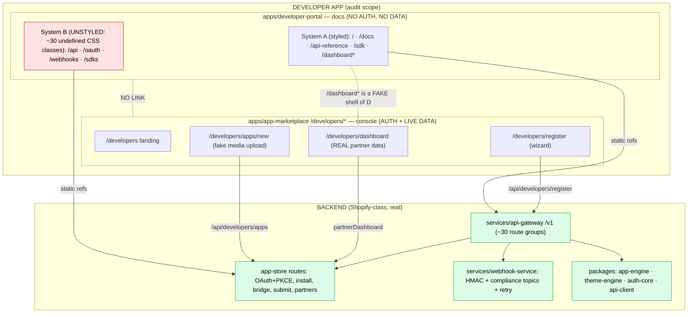
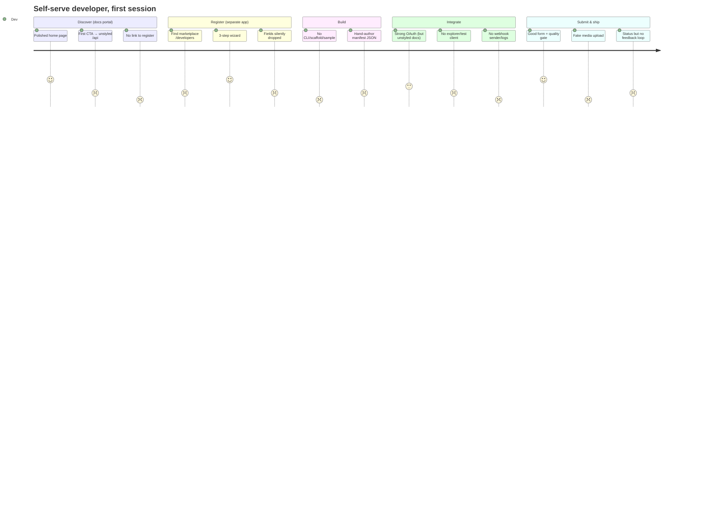
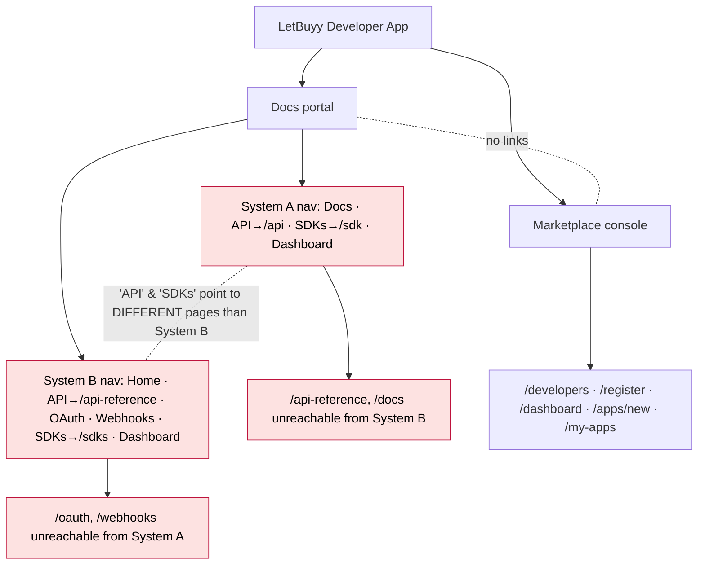

# LetBuyy Developer Platform — Master Audit

**Scope:** The LetBuyy **Developer Application** only — `apps/developer-portal` (the docs/reference portal) plus the developer-facing slice of `apps/app-marketplace` (`/developers/*`, `/my-apps`) and the gateway/services they document. Merchant, consumer, theme-editor, and admin apps are excluded except where they back a developer capability.

**Question this audit answers:** *Why would a developer choose — or not choose — LetBuyy today?*

**Method:** Every file, route, component, and content array in the Developer App was read directly (not assumed). Backend claims were spot-verified against `services/api-gateway` and `services/webhook-service`. Shopify was benchmarked against current Shopify developer documentation. A live run was attempted for screenshots but is not feasible in-sandbox (no `pnpm`/`next` resolution); UI/responsiveness conclusions are therefore code-based and, where it matters most (undefined CSS), **proven by repo-wide grep**.

**Date:** 2026-06-06.

---

## 0. Headline verdict

> **LetBuyy has a Shopify-class backend wrapped in a pre-alpha developer experience.** The platform can technically host an app across its full lifecycle — OAuth with PKCE, scoped APIs, signed webhooks with compliance topics, app submission with a quality gate, theme bundles, billing with INR/GST payouts. But the surface a developer actually touches — onboarding, docs polish, navigation, a CLI, an explorer, an SDK, a credential UI — is missing, duplicated, contradictory, or unstyled. **The gap is almost entirely developer experience, not capability.**

**Would a developer choose LetBuyy today?**
- **A determined, well-supported partner (e.g., a launch partner with a LetBuyy contact):** *Yes, cautiously* — the backend is real and the OAuth/payments/compliance model is genuinely solid.
- **A self-serve developer evaluating in 30 minutes:** *No* — they will hit an unstyled reference page on their first click, find two contradictory API pages and a placeholder dashboard, look for a CLI/explorer/SDK and find none, and conclude "internal alpha."

**Overall platform maturity: ~2.1 / 5 vs Shopify.** Backend-heavy categories (auth, billing, webhooks, extensions) score 3–4; everything developer-facing (CLI, explorer, onboarding, docs polish, IA) scores 0–2.

**The good news:** ~80% of the gap is front-end, documentation, IA, and tooling work on an already-capable backend. LetBuyy doesn't need to *build* a Shopify-class platform — it needs to *expose* the one it already has.

---

## 1. Phase 1 — Application discovery & architecture

### 1.1 What the "Developer App" actually is
It is **two disconnected surfaces** that share a name but not a shell, design system, auth, or links:

| Surface | Where | Auth | Data | Purpose | State |
|---|---|---|---|---|---|
| **Docs portal** | `apps/developer-portal` (developers.letbuyy.store) | None | None (static arrays) | Reference docs for API/OAuth/webhooks/SDK/themes | Self-described "D0 app / partner dashboard **shell**" |
| **Partner console** | `apps/app-marketplace/.../developers/*` (apps.letbuyy.store) | Merchant session | **Live** (partner dashboard API) | Register, submit apps, view installs/earnings/payouts | Functional |

The docs portal **itself** contains **two parallel page systems**:
- **System A** (`PortalChrome` + `reference.ts`): `/`, `/docs`, `/api-reference`, `/sdk`, `/dashboard` — **styled** by `globals.css`.
- **System B** (`developer-docs.tsx` + `developer-surface.ts`): `/api`, `/oauth`, `/webhooks`, `/sdks` — richer content but built from **~30 CSS classes that are defined nowhere** → renders unstyled.

### 1.2 Architecture diagram

`*` `/dashboard` in the portal is a non-functional placeholder for the **real** dashboard that already exists in the console.

### 1.3 Developer user journey (current)

### 1.4 Navigation tree (current, with defects)

**Full route inventory, duplication map, orphans, and the redesigned IA** are in [INFORMATION_ARCHITECTURE_REDESIGN.md](developer-platform-audit/INFORMATION_ARCHITECTURE_REDESIGN.md).

---

## 2. Phase 3 — Developer experience audit (the eight questions)

For each first-time-developer question: **answer · problem · impact · severity.**

| # | Question | Answer | Problem | Severity |
|---|---|---|---|---|
| 1 | **Can a developer understand the platform?** | Partly | Polished home, but the next click is unstyled; two contradictory page systems; internal jargon ("D0","WS11") | 🟥 |
| 2 | **Can a developer build an app?** | Yes, manually | No CLI/scaffold/sample/local-dev; hand-author JSON against reference tables | 🟥 |
| 3 | **Can a developer publish an app?** | Mostly (backend) | Submission + quality gate exist, but media upload is fake and there's no listing builder/feedback loop | 🟧 |
| 4 | **Can a developer make money?** | Yes | App charges, INR, GST, payouts are real and India-localized; but revenue terms are buried in a wizard step | 🟨 |
| 5 | **Can a developer discover APIs?** | Weakly | Curated tables only; no OpenAPI, no search, no explorer; two API pages contradict on GraphQL | 🟥 |
| 6 | **Can a developer understand webhooks?** | Yes (contract) | Excellent HMAC+compliance contract — but unstyled, with no test sender or delivery log | 🟧 |
| 7 | **Can a developer test integrations?** | No | No dev-store create, no sandbox, no webhook sender, no logs, no explorer | 🟥 |
| 8 | **Can a developer onboard without documentation?** | No | No quickstart/scaffold; the docs themselves are reference-only with no on-ramp | 🟥 |

**DX summary:** A developer can *eventually* build and even monetize on LetBuyy, but only by supplying the entire developer-experience layer themselves (test harness, client code, patience for unstyled/contradictory docs). That is the line between *"has APIs"* and *"is a developer platform."* Full per-step friction analysis: [APP_CREATION_JOURNEY_AUDIT.md](developer-platform-audit/APP_CREATION_JOURNEY_AUDIT.md).

---

## 3. What's genuinely strong (so the team doesn't over-correct)

These are real, verified, and should be **preserved and advertised**, not rebuilt:
- **OAuth 2.0 done right:** auth-code + **PKCE S256**, hashed short-lived codes, replay protection, refresh rotation, merchant-session token-exchange, embed sessions, scoped server API that rejects misuse. *Arguably the best part of the platform.*
- **Payment safety by design:** server owns totals; client amount is a hint that triggers `AMOUNT_MISMATCH`; idempotency on all retryable mutations; provider HMAC verification (Razorpay/Stripe/Cashfree/PayPal).
- **Compliance built in:** mandatory `customers/data_request`, `customers/redact`, `shop/redact` topics — GDPR-style parity with Shopify.
- **Honest, source-backed docs ethos:** "Truth source, not aspirational docs," with an explicit `SKIP` ledger. Rare and valuable — keep the spirit, fix the packaging.
- **A real, data-backed Partner Console** (installs/earnings/payouts/GST/ratings).
- **India-localized monetization** (INR/GST/UPI) — a genuine differentiator vs Shopify defaults.

---

## 4. Phase 15 — Brutal review (if Shopify's DX team reviewed LetBuyy today)

*Unvarnished, as requested.*

**What they would praise**
- "The OAuth/PKCE implementation and payment-safety model are legitimately good — better than a lot of platforms that ship glossy docs over weak backends."
- "The honesty is unusual and admirable — you actually label what's missing instead of faking it. The compliance topics mirror ours; you understand the domain."
- "The Partner Console has real data and India-localized payouts — that's a moat we don't lean into."

**What they would reject**
- "Half your reference docs render unstyled because ~30 CSS classes are referenced and never defined. This would never pass our review — it reads as broken."
- "You ship two API reference pages that **disagree** about whether GraphQL exists, and two SDK pages, with two headers whose identical labels go to different pages. Pick one."
- "You ship a **fake dashboard** next to a real one. That's worse than no dashboard."
- "Your 'source-backed' docs cite a file that doesn't exist. The one promise your docs make, they break."
- "Your app-submission icon/screenshot uploaders are decorative `
`s. A developer can't actually submit a complete listing."

**What they would immediately redesign**
- The information architecture: one portal, one nav, one design system, docs ⇄ console cross-links, a sidebar + search.
- The onboarding: a `create-letbuyy` scaffold + `letbuyy app dev` so the first experience is a *running app*, not a registration form.

**What they would remove**
- The duplicate pages (`/api` **or** `/api-reference`; `/sdk` **or** `/sdks`), the fake `/dashboard`, the fake uploaders, and all internal jargon ("D0", "WS11", "ws13", raw `file.ts:line` as primary citations) from public copy.

**What they would rebuild from scratch**
- The **developer-facing surface**: a generated OpenAPI-driven reference + GraphiQL, a CLI, a published App Bridge + server SDK, and the console UIs for keys/webhooks/analytics that today are routes without screens.
- *Notably, they would NOT rebuild the backend* — they'd say "this is already most of the way to ours; stop hiding it."

**One-sentence Shopify verdict:** *"You've built the hard 80% (the platform) and skipped the visible 20% (the experience) — which is exactly the 20% developers judge you on."*

---

## 5. Consolidated recommendation & roadmap

Because the gap is overwhelmingly surface-level, a small amount of front-end/tooling work yields a large trust and adoption gain.

**Phase 0 — "Stop looking broken" (days, ~no backend):**
1. Define the ~30 missing CSS classes (or port System B → System A). *(Fixes 4 reference pages + 3 state screens — highest visual ROI in the repo.)*
2. Delete the fake `/dashboard`; link to the real Partner Console.
3. Fix the broken `CODEX_WS10_LEDGER.md` citation; add CI to validate every `source:` path.
4. One header; de-duplicate `/api`↔`/api-reference` and `/sdk`↔`/sdks`; resolve the GraphQL contradiction.
5. Make app-submission uploaders real (or remove them); fix the silent register step.

**Phase 1 — "Make it coherent" (weeks):** generate OpenAPI → single restyled reference + Postman; cross-link docs ⇄ console; add a quickstart, an error-code catalog, and a webhook-receiver tutorial; surface pricing/revenue and support/status.

**Phase 2 — "Make it a platform" (1–2 quarters):** ship `letbuyy` CLI + scaffold; GraphiQL; App Bridge SDK + 1 server SDK (normalizing envelope/key-casing); console UIs for API keys, webhook test/logs, analytics, dev-store create; listing builder + reviewer feedback loop.

**Phase 3 — "Make it competitive":** multi-language SDKs, sample apps, EventBridge/PubSub delivery, design-system docs primitives, i18n, deprecation policy.

> Projected effect of Phase 0 alone: developer **trust** rises from ~4/10 to ~7/10 with essentially no backend change, because the underlying technical credibility (≈8/10) is already there and currently masked by surface defects.

---

## 6. Companion reports (index)

| Phase | Report | Covers |
|---|---|---|
| 2 | [SHOPIFY_COMPARISON_MATRIX.md](developer-platform-audit/SHOPIFY_COMPARISON_MATRIX.md) | 24-category LetBuyy-vs-Shopify matrix + scores |
| 4 | [DEVELOPER_UI_UX_AUDIT.md](developer-platform-audit/DEVELOPER_UI_UX_AUDIT.md) | Per-page 0–10 ratings; the undefined-CSS finding |
| 5 | [INFORMATION_ARCHITECTURE_REDESIGN.md](developer-platform-audit/INFORMATION_ARCHITECTURE_REDESIGN.md) | Nav defects, sitemaps, redesigned IA |
| 6 | [CONTENT_GAP_ANALYSIS.md](developer-platform-audit/CONTENT_GAP_ANALYSIS.md) | Current text → problem → replacement |
| 7 | [DEVELOPER_FEATURE_GAP_ANALYSIS.md](developer-platform-audit/DEVELOPER_FEATURE_GAP_ANALYSIS.md) | Critical/Important/Nice-to-have gaps |
| 8 | [APP_CREATION_JOURNEY_AUDIT.md](developer-platform-audit/APP_CREATION_JOURNEY_AUDIT.md) | Signup→publish friction ledger |
| 9 | [API_EXPERIENCE_AUDIT.md](developer-platform-audit/API_EXPERIENCE_AUDIT.md) | Discoverability, consistency, errors, SDKs |
| 10 | [DOCUMENTATION_GAP_ANALYSIS.md](developer-platform-audit/DOCUMENTATION_GAP_ANALYSIS.md) | Coverage matrix vs Shopify docs |
| 11 | [RESPONSIVENESS_REPORT.md](developer-platform-audit/RESPONSIVENESS_REPORT.md) | 320→1920px per-breakpoint findings |
| 12 | [DEVELOPER_TRUST_SCORECARD.md](developer-platform-audit/DEVELOPER_TRUST_SCORECARD.md) | Trust signals + weighted score |
| 13 | [LETBUYY_DEVELOPER_PLATFORM_V2.md](developer-platform-audit/LETBUYY_DEVELOPER_PLATFORM_V2.md) | Ideal-platform blueprint |
| 14 | [TOP_100_ISSUES.md](developer-platform-audit/TOP_100_ISSUES.md) | 100 ranked issues w/ fixes |

*Phases 1, 3, and 15 are contained in this master document.*

---

## 7. Evidence base
**LetBuyy (read this audit):** `apps/developer-portal/src/**` (all routes, `PortalChrome.tsx`, `_local-ui/developer-docs.tsx`, `lib/reference.ts`, `lib/developer-surface.ts`, `globals.css`); `apps/app-marketplace/src/app/(auth)/developers/**`, `…/api/developers/**`, `…/lib/api/client.ts`; `services/api-gateway/src/routes/app-store*`, `services/webhook-service/src/*`, `packages/typescript/api-client/src/index.ts`, `packages/typescript/ui/src/{layout,index}.tsx`. Key verifications: repo-wide grep proving undefined System-B CSS classes; confirmation that no OpenAPI is checked in; confirmation that `apps/developer-portal/CODEX_WS10_LEDGER.md` (cited as a source) does not exist.

**Shopify (current docs):** see the Sources section of [SHOPIFY_COMPARISON_MATRIX.md](developer-platform-audit/SHOPIFY_COMPARISON_MATRIX.md).
