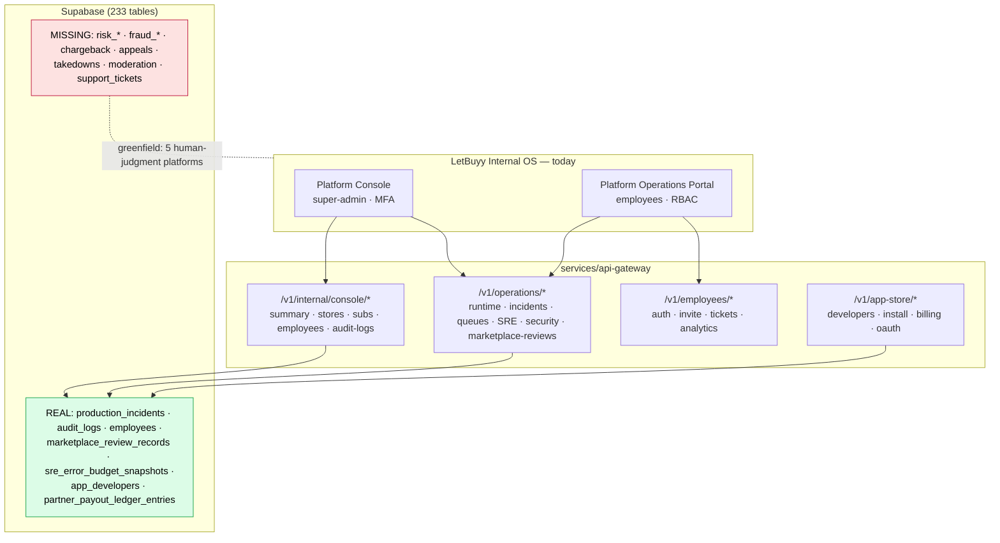
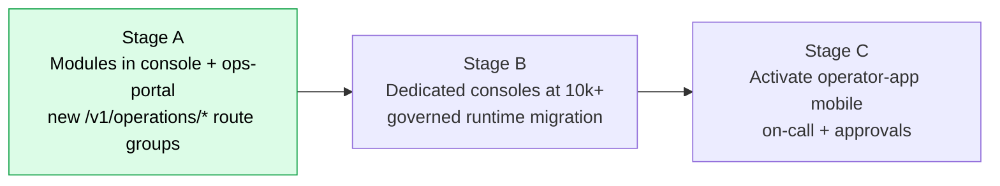
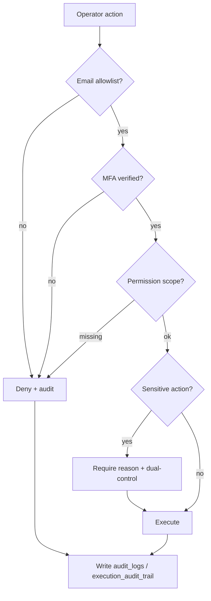

# LetBuyy Internal Operating System — Master Audit & Design

**Scope:** The internal, non-merchant-facing operating system required to run LetBuyy as a billion-dollar commerce platform — the surfaces, services, data, and processes that employees, operators, risk, trust & safety, reviewers, support, finance, and leadership use. Merchant/shopper/partner-facing apps are referenced only where they feed an internal capability.

**Question this audit answers:** *Can LetBuyy be safely operated at 100, 1,000, 10,000, and 100,000 merchants — and what does it take to get there without breaking its own governance?*

**Method:** Every internal runtime was read directly from source — `apps/platform-console`, `apps/platform-operations-portal`, the `/v1/operations/*`, `/v1/internal/console/*`, `/v1/employees/*`, and `/v1/app-store/*` gateway route groups, and the `000_baseline.sql` schema (233 tables). Capability claims are grounded in real files, endpoints, and table definitions. Absence claims ("greenfield") were proven by `grep` against the schema, not assumed. Benchmarked against Shopify, Stripe, Cloudflare, Atlassian, and Notion internal-tooling practice.

**Date:** 2026-06-06.

**Companion docs (this folder → `docs/internal-operating-system-audit/`):**

1. [MERCHANT_OPERATIONS_CONSOLE.md](internal-operating-system-audit/MERCHANT_OPERATIONS_CONSOLE.md)
2. [SUPPORT_OPERATIONS_PLATFORM.md](internal-operating-system-audit/SUPPORT_OPERATIONS_PLATFORM.md)
3. [RISK_DETECTION_PLATFORM.md](internal-operating-system-audit/RISK_DETECTION_PLATFORM.md)
4. [TRUST_AND_SAFETY_PLATFORM.md](internal-operating-system-audit/TRUST_AND_SAFETY_PLATFORM.md)
5. [APP_REVIEW_PLATFORM.md](internal-operating-system-audit/APP_REVIEW_PLATFORM.md)
6. [THEME_REVIEW_PLATFORM.md](internal-operating-system-audit/THEME_REVIEW_PLATFORM.md)
7. [DEVELOPER_OPERATIONS_PLATFORM.md](internal-operating-system-audit/DEVELOPER_OPERATIONS_PLATFORM.md)
8. [INCIDENT_RESPONSE_PLATFORM.md](internal-operating-system-audit/INCIDENT_RESPONSE_PLATFORM.md)
9. [EXECUTIVE_ANALYTICS_PLATFORM.md](internal-operating-system-audit/EXECUTIVE_ANALYTICS_PLATFORM.md)

---

## 0. Headline verdict

> **LetBuyy already has the skeleton of an internal operating system that most seed-stage commerce startups never build — and a backend control plane (`/v1/operations/*`) that is genuinely Cloudflare-flavoured. What it is missing is not architecture. It is the five human-decision systems that turn a control plane into a company: Risk, Trust & Safety case management, Support ticketing, App/Theme review *workflow* UI, and an executive data layer. Today those exist as honest empty states, not as tools.**

The internal OS splits cleanly into two halves, and they are at very different maturity:

- **The machine half (runtime, queues, incidents, SRE, security enforcement, certification)** is real. `services/api-gateway/src/routes/operations.ts` exposes ~45 operational endpoints backed by ~25 Supabase projection tables. This is a 3.5/5 control plane hiding behind a read-only console page.
- **The human half (risk decisions, abuse cases, appeals, takedowns, support tickets, reviewer queues, finance ops)** is mostly absent or stubbed. The console's own pages say so out loud via a `SkipBackendPanel` component that names the missing contract.

**Overall internal-OS maturity: ~2.0 / 5 vs a billion-dollar benchmark.** The infrastructure/operations axis scores 3–4; every human-judgment platform scores 0–2.

**The good news, restated for LetBuyy specifically:** the two governed operator apps (`platform-console`, `platform-operations-portal`), the employee RBAC tables (`employees`, `employee_roles`, `employee_permissions`), the immutable `audit_logs` trail, and the `/v1/operations/*` plane mean **~70% of the *plumbing* for the internal OS is already in place and governance-approved.** The work is to build judgment workflows *on top of* it — not to invent a new platform.

### Maturity scorecard vs benchmark

| Internal platform | LetBuyy today | Benchmark | Score /5 | Evidence |
|---|---|---|---|---|
| Merchant Operations Console | Read-only directory | Shopify | 2.0 | `platform-console/stores`, ops-portal `merchant-health`, `/internal/console/stores` |
| Support Operations | Stub (probe fails) | Stripe / Intercom | 1.0 | `/employees/tickets` exists; `probeTicketInfrastructure` returns "not configured"; **0 ticket tables** |
| Risk Detection | Greenfield | Stripe Radar | 0.5 | **0 `risk_`/`fraud`/`chargeback` tables**; only infra `security_enforcement_events` |
| Trust & Safety | Read-only audit view | Shopify T&S | 1.0 | `platform-console/trust-safety` reads audit logs; **0 case/appeal/takedown tables** |
| App Review | Backend real, no workflow UI | Shopify App Review | 2.0 | `marketplace_review_records`, `/operations/marketplace-reviews[/:id/decision]` |
| Theme Review | Shared queue, no theme checks | Shopify Theme Store | 1.5 | `marketplace_review_records` (type=theme); no automated theme QA |
| Developer Operations | Strong backend, thin ops UI | Stripe / Shopify Partners | 2.5 | `app_developers`, `partner_payout_ledger_entries`, API-key + OAuth issuance |
| Incident Response | Strong backend, read-only UI | Cloudflare / PagerDuty | 3.0 | `production_incidents` (sev1–4), `/operations/runtime/incidents` GET/POST/PATCH |
| Executive Analytics | 30-day counters | Stripe Sigma / Notion | 1.5 | `/internal/console/analytics` + `/summary`; **no warehouse, cohorts, MRR/ARR/churn** |
| **Operations / SRE control plane** | **Real** | **Cloudflare** | **3.5** | `sre_error_budget_snapshots`, `runtime_slo_definitions`, `operational_certification_reports`, ~45 ops endpoints |

---

## 1. What the internal OS *is* today

LetBuyy's internal OS is **two governed web apps + one gateway control plane**, not the 12-subdomain fleet the vision imagines. This is by design: `AGENTS.md`, `docs/governance/topology-purification.md`, and `docs/governance/platform-operations-governance.md` forbid casually adding app roots and explicitly split operator work into two surfaces.

| Surface | Root | Actor | Auth | Backs onto | Today |
|---|---|---|---|---|---|
| **Platform Console** | `apps/platform-console` | Super-admin / leadership | Magic-link + MFA/TOTP (`LETBUYY_PLATFORM_SESSION_COOKIE`) | `/v1/internal/console/*`, `/v1/operations/*` | Dashboard, stores, revenue, subscriptions, users, employees, analytics, audit-logs, trust-safety, operations, marketplace-governance |
| **Platform Operations Portal** | `apps/platform-operations-portal` | Employees (support/ops/marketing) | Employee session + invite (`/v1/employees/auth`) | `/v1/employees/*`, `/v1/operations/*` | Support, tickets, CRM, merchant-health, retention, onboarding, communications, campaigns, marketing |
| **Operations control plane** | `services/api-gateway` `/v1/operations/*` | Operators via token | `PLATFORM_CONSOLE_API_TOKEN` / employee auth | ~25 projection tables | ~45 endpoints: runtime overview, incidents, queues, replays, deployments, SRE, security, certification, marketplace reviews |
| **Reserved operator mobile** | `apps/mobile/operator-app` | Operators (future) | — | — | Manifest-only; **not active** until activation governance |

---

## 2. The team map → surface map

The vision lists ~12 internal teams. Each needs a home. Here is how those teams map onto LetBuyy's **governed** topology — what exists, and where new work lands.

| Team | Primary console (today) | Backing contract | Status |
|---|---|---|---|
| Executive / Leadership | Platform Console → Dashboard, Revenue, Analytics | `/internal/console/summary`,`/analytics` | Partial (counters only) |
| Merchant Success | Ops Portal → merchant-health, CRM, retention | `/employees/*` | Partial |
| Support | Ops Portal → support, tickets | `/employees/tickets` | **Stub** |
| Risk | *(none — proposed Risk module)* | *(none)* | **Greenfield** |
| Trust & Safety | Platform Console → trust-safety (read-only) | `/internal/console/audit-logs`, `/operations/runtime/overview` | Read-only |
| Theme Review | *(shared)* Ops Portal → marketplace reviews | `/operations/marketplace-reviews` | Backend only |
| App Review | *(shared)* Ops Portal → marketplace reviews | `/operations/marketplace-reviews[/:id/decision]` | Backend only |
| Developer Relations / Ops | App Marketplace `/developers/*` + Console partner views | `/app-store/developers/*`,`/partners/*` | Partial |
| Finance Operations | Platform Console → Revenue, Subscriptions | `/internal/console/subscriptions` | Partial |
| Operations / Platform Eng | Platform Console → Operations | `/operations/runtime/overview` | **Real** |
| Incident Response | Platform Console → Operations (incidents panel) | `/operations/runtime/incidents` | Backend real, UI read-only |
| Marketplace Governance | Platform Console → marketplace-governance | *(placeholder)* | Stub |

**Key governance fact:** there is no `apps/internal`, `apps/admin`, `apps/risk`, or `apps/support`. Those are *forbidden* alias roots (`topology-purification.md`). Every team above is a **module inside `platform-console` or `platform-operations-portal`**, or a future console added through governance. This is the spine of the current→target plan in §5.

---

## 3. The 13-console internal OS model

Mapping the vision's `internal.letbuyy.store` decomposition onto LetBuyy reality. "Console" here means a **module/route group**, not a separate app.

```mermaid
graph TD
  ROOT["LetBuyy Operating System"]
  ROOT --> GOV["Platform Console (super-admin)"]
  ROOT --> WORK["Operations Portal (employees)"]

  GOV --> EXEC["Executive Dashboard ✦partial"]
  GOV --> MOPS["Merchant Operations ✦partial"]
  GOV --> RISK["Risk Console ✦greenfield"]
  GOV --> TS["Trust & Safety ✦read-only"]
  GOV --> MKTGOV["Marketplace Governance ✦stub"]
  GOV --> BILL["Billing / Finance ✦partial"]
  GOV --> AUDIT["Audit Center ✦real"]
  GOV --> INC["Incident Center ✦backend-real"]

  WORK --> SUP["Support Desk ✦stub"]
  WORK --> APPREV["App Review ✦backend-real"]
  WORK --> THEMEREV["Theme Review ✦backend-real"]
  WORK --> DEVOPS["Developer Operations ✦partial"]
  WORK --> COMPLY["Compliance Center ✦greenfield"]

  classDef real fill:#dcfce7,stroke:#16a34a,color:#000;
  classDef part fill:#fef9c3,stroke:#ca8a04,color:#000;
  classDef gap fill:#fde2e1,stroke:#be123c,color:#000;
  class AUDIT,INC real;
  class EXEC,MOPS,BILL,DEVOPS,APPREV,THEMEREV part;
  class RISK,TS,MKTGOV,SUP,COMPLY gap;
```

**Ownership split (must not collapse):** the console owns *governance and privileged administration*; the operations portal owns *employee execution with narrower permissions and stronger per-action audit*. `platform-operations-governance.md` makes this a hard rule. Risk **detection** (machine) belongs to the console/leadership view; Risk **decisions** (human) belong to the operations portal. Same for App/Theme review: the queue is shared, the *decision* is an employee action.

---

## 4. Capability matrix (evidence-backed)

| Capability | Exists? | Where | Proof |
|---|---|---|---|
| Immutable audit trail | ✅ | `audit_logs` (+`audit_activity_events`,`execution_audit_trail`) | actor_type ∈ {user,employee,super_admin,system}; old/new values, ip, user_agent |
| Employee RBAC | ✅ | `employees`,`employee_roles`,`employee_permissions`,`employee_invites` | 10 roles, status invited/active/disabled/removed, jsonb permissions |
| MFA / TOTP for operators | ✅ | `platform-console` `(auth)/mfa`, `console-session.ts` | magic-link + MFA gate, dev bypass fails closed in prod |
| Incident records | ✅ | `production_incidents`,`production_incident_events` | sev1–4, commander, affected_runtimes/regions, postmortem_url |
| SRE / error budgets | ✅ | `sre_error_budget_snapshots`,`runtime_slo_definitions` | `/operations/runtime/sre/error-budgets` |
| Security enforcement | ✅ | `security_enforcement_events` | control_name, severity, passed/failed/waived/remediated |
| Marketplace review queue | ✅ | `marketplace_review_records` | submission_type app/theme, 5 statuses, automated_checks jsonb |
| Partner payouts | ✅ | `partner_payout_ledger_entries` | 80% rev-share (8000 bps), INR, razorpay rails |
| Runtime/queue control | ✅ | `/operations/runtime/*` (~45 endpoints) | overview, queues, replays, deployments, certification |
| Risk scoring / fraud | ❌ | — | **0 `risk_`/`fraud`/`chargeback` tables** |
| Abuse cases / appeals / takedowns | ❌ | — | **0 `appeal`/`takedown`/`moderation`/`safety_case` tables** |
| Support tickets | ❌ | endpoint only | `/employees/tickets` returns "not configured"; **0 ticket tables** |
| Reviewer workflow UI | ❌ | — | console `marketplace-governance` is `SkipBackendPanel` placeholders |
| Data warehouse / cohorts / MRR-ARR | ❌ | — | analytics = 30-day counters; `SkipBackendPanel` admits funnels missing |

---

## 5. Current → target: the governance-compliant build path

The vision wants "lots of new apps." LetBuyy's own constitution says **new app roots require a governance doc update, a validator update, CI enforcement, and an ownership decision before any source is added** (`repository-topology.md`, `topology-purification.md`). So the path is staged, not a fleet drop.

### Stage A — Build inside the two existing apps (no new app roots)

Everything in the 13-console model can ship as **modules** under `platform-console/src/app/(dashboard)/*` and `platform-operations-portal/src/app/(dashboard)/*`, backed by **new gateway route groups** under the already-mounted `/v1/operations/*` and `/v1/internal/console/*` namespaces. This needs **zero topology changes** and passes `node scripts/validate-governance.mjs` as-is.

New gateway route groups to add (names follow existing convention):

- `/v1/operations/risk/*` — signals, scores, cases (Risk Console)
- `/v1/operations/trust-safety/*` — cases, appeals, takedowns (T&S)
- `/v1/operations/support/*` — tickets, threads, macros (Support Desk)
- `/v1/operations/marketplace-reviews/*` — extend with theme-QA + app-security checks
- `/v1/internal/console/analytics/*` — funnels, cohorts, MRR/ARR (Exec)

New tables follow `AGENTS.md` rules (id, created_at, updated_at, deleted_at, audit columns, indexes, RLS) — see each platform doc for proposed schemas.

### Stage B — Promote to dedicated consoles only when scale demands

Separate operator surfaces (`risk.`, `trust.`, `reviews.`) become worth their cost around the 10k-merchant mark, when teams specialize and blast-radius isolation matters. Promotion is a *governed migration*: update `repository-topology.md` + `runtime-boundaries.md`, add the runtime manifest, extend `scripts/validators/runtime-validator.mjs`'s allowed-roots, wire CI, and record an ownership decision — **in one reviewed change**, per `topology-purification.md`'s runtime-migration rules.

### Stage C — Activate the reserved operator mobile app

`apps/mobile/operator-app` is the *only* sanctioned new operator root. It is manifest-only today and activates on-call/incident/approval flows on mobile once a human-approved scope adds source, tests, and deployment config.

---

## 6. Data foundation: what to build

| Domain | Real tables (reuse) | Missing tables (add in Stage A) |
|---|---|---|
| Audit | `audit_logs`, `audit_activity_events`, `execution_audit_trail` | `case_audit_events` (link to T&S/Risk cases) |
| Risk | `security_enforcement_events` (infra only) | `risk_signals`, `risk_scores`, `risk_rules`, `chargeback_events`, `velocity_counters` |
| Trust & Safety | — | `ts_cases`, `ts_case_events`, `ts_appeals`, `ts_takedowns`, `ts_evidence` |
| Support | `employees` | `support_tickets`, `ticket_messages`, `ticket_macros`, `ticket_sla_clocks` |
| App/Theme Review | `marketplace_review_records`, `app_developers`, `theme_packages` | `review_check_runs`, `review_decisions`, `review_appeals` |
| Finance | `subscriptions`, `partner_payout_ledger_entries`, `app_billing_charges` | `revenue_snapshots`, `mrr_arr_rollups`, `dunning_events` |
| Exec analytics | `runtime_telemetry_metrics`, console counters | `metric_rollups`, `cohort_snapshots`, `funnel_steps` |
| Incident / SRE | `production_incidents`, `sre_error_budget_snapshots`, `runtime_slo_definitions`, `operational_certification_reports` | `oncall_schedules`, `incident_postmortems` |

---

## 7. Permissions, audit & access model (cross-cutting)

This is the part billion-dollar platforms get right and startups skip. LetBuyy already has the primitives; they must be *enforced everywhere* before any operator surface is production-ready (`platform-operations-governance.md`).

Every operator surface must enforce: **email allowlist · MFA/TOTP · RBAC with explicit permission scopes · audit logging for reads and writes · reason capture for sensitive actions · IP/VPN controls where risk requires · sanitized errors / redacted logs.**

**Permission tiers (proposed, built on `employee_roles`):**

| Tier | Example roles | Can | Cannot |
|---|---|---|---|
| Viewer | viewer, analyst | Read dashboards, search, export non-PII | Mutate, view full PII, suspend |
| Operator | support, ops, reviewer | Act on tickets/reviews, soft actions w/ reason | Suspend stores, issue refunds > limit, change RBAC |
| Lead | manager, t&s-lead, risk-lead | Suspensions, takedowns, refunds, appeals decisions | Change platform config, manage employees |
| Admin | super_admin | Everything w/ dual-control + immutable audit | — |

---

## 8. Scaling: 100 → 100,000 merchants

| Dimension | 100 merchants | 1,000 | 10,000 | 100,000 |
|---|---|---|---|---|
| **Org shape** | Founders do everything | First support + ops hire | Specialized Risk/T&S/Review teams | 24×7 follow-the-sun, regional |
| **Risk** | Manual eyeballing | Rules + velocity flags | ML scoring + queues | Real-time scoring, network graph |
| **Trust & Safety** | Ad hoc takedowns | Case queue + appeals SLA | Tiered reviewers + policy versioning | Automated triage + human review pool |
| **Support** | Shared inbox | Ticketing + macros | SLA tiers + CSAT + escalation | Deflection, self-serve, AI assist |
| **Review** | Founder reviews each app | Single reviewer queue | Automated checks + reviewer pool | Continuous + post-publish monitoring |
| **Incident** | Slack + a doc | `production_incidents` + on-call rota | SEV process + error budgets | Multi-region command, blameless PM |
| **Exec analytics** | Console counters | MRR/ARR rollups | Cohorts + warehouse | Self-serve BI (Sigma-style) |
| **Topology** | Modules in 2 apps | Modules in 2 apps | Promote 2–3 consoles (Stage B) | Dedicated consoles + operator mobile |
| **Surface** | `platform-console` + ops-portal | same | + `risk.`/`reviews.` consoles | full governed fleet |

The headline: **LetBuyy can run to ~10,000 merchants inside the two existing apps** if the human-judgment modules are built. Separate consoles are a >10k optimization, not a prerequisite.

---

## 9. Roadmap (phased, governance-aware)

**Phase 0 — Make the real plane visible (weeks).** Wire the existing `/v1/operations/*` data (incidents, SRE, security, certification) into proper console UI. It already returns data; the UI is read-only summaries. *Highest ROI: capability exists, just unsurfaced.*

**Phase 1 — Stand up the two missing judgment systems most likely to cause a fire: Risk + Trust & Safety.** New tables + `/v1/operations/risk/*` and `/v1/operations/trust-safety/*` route groups + console/ops-portal modules. Detect → review → suspend → appeal → reinstate, every action audited forever.

**Phase 2 — Support Desk + Reviewer workflow UI.** Turn `/employees/tickets` from stub into real ticketing; turn `marketplace_review_records` into an actual reviewer queue with automated checks.

**Phase 3 — Executive data layer.** Funnels, cohorts, MRR/ARR/churn rollups; promote analytics beyond 30-day counters.

**Phase 4 — Finance + Compliance ops.** Dunning, payout reconciliation, GDPR/data-request workflows (the `/compliance/*` webhooks already exist).

**Phase 5 — Scale topology.** Promote dedicated consoles (Stage B) and activate operator mobile (Stage C) when team specialization demands it.

---

## 10. The one-paragraph brief for leadership

LetBuyy is not missing an internal operating system — it is missing the **human-judgment layer** of one. The infrastructure control plane (`/v1/operations/*`, ~45 endpoints, ~25 projection tables) is real and Cloudflare-class. The governance model (`platform-console` + `platform-operations-portal`, immutable `audit_logs`, employee RBAC, MFA) is already correct and already protects you from the most common startup failure: ungoverned god-mode admin panels. What you do not yet have are **Risk scoring, Trust & Safety case management, Support ticketing, reviewer workflow UI, and an executive data layer** — and you can build all five as modules inside the two apps you already own, without touching topology, before you ever need a separate `risk.letbuyy.store`. Do that, and you can operate safely to ~10,000 merchants on the bones you have.

---

*Continue to the nine platform docs in [`internal-operating-system-audit/`](internal-operating-system-audit/) for per-platform purpose, users, workflows, permissions, dashboards, alerts, automations, audit logging, review processes, escalation, current→target design, benchmark, and scaling.*
