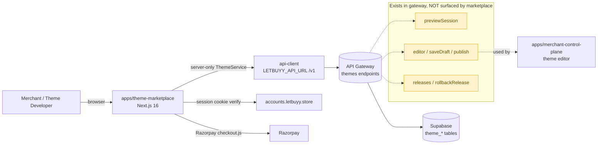
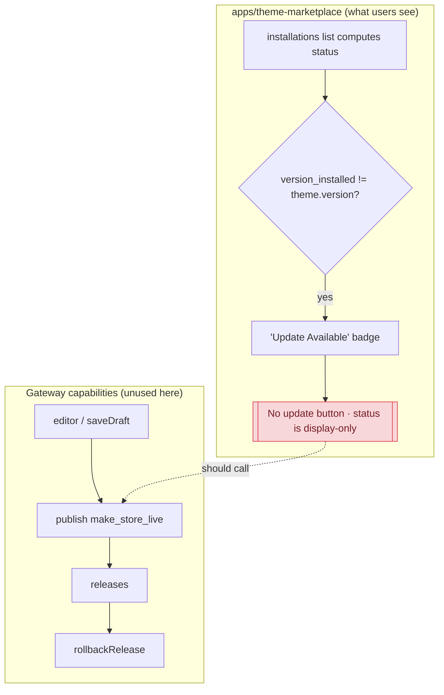

# LetBuyy Themes Marketplace — Master Audit

**Scope:** `apps/theme-marketplace` only (plus the gateway/theme-engine/merchant surfaces that directly feed it).
**Benchmark:** Shopify Theme Store (web-verified, 2025–2026 facts).
**Method:** Every route, page, component, API handler, service, and the theme data model were read directly from source. Shopify facts were verified by web search. Claims below carry `file:line` evidence.
**Date:** 2026-06-06
**Verdict in one line:** A beautifully art-directed storefront shell wrapped around an empty catalog, a half-wired checkout, and no real developer or review system — it *looks* like a theme store and *behaves* like a high-fidelity prototype.

> Companion deep-dives (same folder, `docs/themes-marketplace-audit/`):
> [Shopify comparison](themes-marketplace-audit/SHOPIFY_THEME_STORE_COMPARISON.md) ·
> [UI/UX](themes-marketplace-audit/THEME_MARKETPLACE_UI_UX_AUDIT.md) ·
> [Content gap](themes-marketplace-audit/THEME_CONTENT_GAP_ANALYSIS.md) ·
> [Feature gap](themes-marketplace-audit/THEME_FEATURE_GAP_ANALYSIS.md) ·
> [Discovery](themes-marketplace-audit/THEME_DISCOVERY_AUDIT.md) ·
> [Installation journey](themes-marketplace-audit/THEME_INSTALLATION_JOURNEY_AUDIT.md) ·
> [Review system](themes-marketplace-audit/THEME_REVIEW_SYSTEM_AUDIT.md) ·
> [Responsiveness](themes-marketplace-audit/THEME_RESPONSIVENESS_REPORT.md) ·
> [Merchant trust scorecard](themes-marketplace-audit/MERCHANT_TRUST_SCORECARD.md) ·
> [Developer trust scorecard](themes-marketplace-audit/DEVELOPER_TRUST_SCORECARD.md) ·
> [Marketplace V2 design](themes-marketplace-audit/LETBUYY_THEME_MARKETPLACE_V2.md)

---

## Executive summary

LetBuyy Themes Marketplace is a Next.js 16 app (`@letbuyy/theme-marketplace`, 34 source files, ~5,330 LOC, 18 routes, 2 API handlers) that acts as a **thin server-side proxy** to a gateway API (`@letbuyy/api-client`). It owns no data of its own; the catalog, purchases, installs, and uploads all live behind `LETBUYY_API_URL`. The visual craft is genuinely high — the homepage, theme cards, and detail page are art-directed to look like a premium product. But underneath, the marketplace is not yet a marketplace:

1. **The catalog is empty.** The only theme seeded anywhere in the repository is a single store theme, `urban-kicks` (`database/supabase/seeds/urban-kicks-theme.sql`; a migration is literally named `055_only_urban_kicks_theme_catalog.sql`). Meanwhile the homepage hero advertises **"50+ Premium Themes"** and **"10K+ Active Installs"** as hardcoded constants (`src/app/page.tsx:7-12`), and the SEO metadata says "Discover 50+ professionally designed themes" (`src/app/layout.tsx:41`). The category cards directly below the hero read their counts from the live API and will render **"0 themes"** (`src/app/page.tsx:45-50,339`) — a self-contradiction visible on first paint.

2. **Whole features are decorative.** The catalog's layout filter, price-range filter, and industry filter each render warning banners admitting they "need backend support before they change API results" (`src/app/themes/page.tsx:518-520,448-450,364-366`). The navbar's ⌘K search box does not search (`src/components/layout/navbar.tsx:124-201`). The notification bell calls an endpoint that does not exist in this app (`/api/notifications/count`, `navbar.tsx:322`). The theme card's "Preview theme" and "Save" affordances are non-interactive `<span>`s (`src/components/theme-card.tsx:46-53`). The detail page's "Preview in your store" and "Save" buttons are hard-`disabled` (`src/app/themes/[slug]/page.tsx:470-512`). The Downloads page shows hardcoded file sizes ("2.4 MB", "3.1 MB"…) and dead download buttons (`src/app/dashboard/downloads/page.tsx:25-28,84-101`). Settings persists nothing and hardcodes the identity "Saai Sidd / saai@letbuyy.store" (`src/app/dashboard/settings/page.tsx:38-48,14-17`).

3. **Checkout is half-wired and leaks a developer placeholder.** Payment is Razorpay-only, INR-only; the Stripe option is a disabled "Not configured" button (`src/app/checkout/page.tsx:366-374`) — directly contradicting the homepage claim "Stripe & Razorpay integrated" (`page.tsx:25`). The coupon field only pops a toast saying coupons "are not configured" (`checkout/page.tsx:212-218`). After a real payment, the success page shows a literal engineering placeholder to the customer: **"[SKIP - NEEDS BACKEND] Receipt, license, and payment confirmation require the payment provider settlement endpoint."** (`src/app/checkout/success/page.tsx:65`), with Order/Amount/License all reading "pending provider confirmation."

4. **There is no review system and no real developer experience.** A `ThemeReview` type is defined (`packages/theme-engine/src/index.ts:1021-1033`) but no themes API lists or accepts reviews, and no UI renders or collects them; `ThemeService.getThemeReviews` just digs reviews out of the buyer's own purchase record (`src/lib/theme-service.ts:91-100`). "Submitting a theme" is a single hidden file input that uploads a raw JSON bundle from the gallery sidebar (`src/components/theme-upload-panel.tsx`), with no metadata form, no screenshots, no pricing setup, no preview, no versioning, and no visible approval status.

5. **The platform is more capable than the marketplace shows.** The gateway client already exposes `previewSession`, `editor`, `saveDraft`, `publish`, `releases`, and `rollbackRelease` (`packages/typescript/api-client/src/index.ts:1482-1495`), and the real theme editor/preview/publish/rollback lives in `merchant-control-plane`. The marketplace wires up **none** of it — even disabling a "Preview" button whose backing API method exists.

**Why a merchant would not buy here today:** there is effectively nothing to buy (one theme), no working preview, no reviews/ratings to trust, dead Legal/Support/Refund links (`src/components/layout/footer.tsx:11-28`), and a post-payment screen that says the backend isn't finished.

**Why a developer would not publish here today:** there is no submission portal, no listing/pricing/asset workflow, no revenue dashboard, no analytics, no payout terms, no documented review bar, and no author profile — versus Shopify's 15% revenue share, structured 5-stage review, and merchant reach across 800+ listings.

**Maturity rating: 2.0 / 10** as a *marketplace* (it is a strong ~7/10 as a *visual front-end prototype*). The gap to a credible store is not polish; it is the absence of the marketplace's core nouns and verbs.

---

## Scorecard at a glance

| Dimension | LetBuyy today | Shopify Theme Store | Grade |
|---|---|---|---|
| Catalog depth | 1 theme seeded | ~800+ (incl. ~12–24 free) | F |
| Discovery (search/filter/sort) | URL filters exist; layout/price/industry/search are non-functional | Full search, industry + catalog-size facets, trust-ranked | D− |
| Theme preview / demo | Disabled button; `previewSession` API exists but unwired | Try-before-you-buy live in your store | F |
| Reviews & ratings | Type defined; no API, no UI, no submission | Star ratings + written merchant reviews per listing | F |
| Checkout | Razorpay/INR only; Stripe disabled; coupons fake; success page leaks placeholder | Mature, taxed, receipted, final-sale | D− |
| Install / publish / rollback | Install replaces storefront with no preview/rollback in this app | Publish/preview/rollback in editor | D |
| Developer submission | Upload a JSON file from sidebar | Partner portal, listing builder, 5-stage review | F |
| Developer revenue / analytics | None in this app | 15% rev-share, payouts, performance signals | F |
| Trust & legal (Terms/Privacy/Refund/Support) | All footer legal/support links are `#` | Full legal, support SLAs, partner vetting | F |
| Visual / brand craft | Excellent, premium, cohesive | Functional, utilitarian | A− (LetBuyy wins) |
| Content honesty | Fake hero metrics, unverified claims, visible dev placeholders | Accurate listings | F |

---

## Phase 1 — Application discovery & architecture

### 1.1 What the app actually is

- **Package:** `@letbuyy/theme-marketplace` (`apps/theme-marketplace/package.json`), Next.js `16.1.6`, React `19.2.3`, Tailwind v4, Framer Motion, `lucide-react`.
- **Runtime classification (manifest):** `marketplace-control-plane`; declared actors are **`merchant`** and **`theme-developer`** (`runtime.manifest.json`). So the app is *intended* to serve buyers and sellers — but the seller surface is one file input.
- **Data ownership:** none. Every dynamic value comes from the gateway through `ThemeService` → `createThemeMarketplaceApiClient` → `@letbuyy/api-client` against `LETBUYY_API_URL` (`src/lib/theme-service.ts`, `src/lib/api/client.ts`). If the API URL is unset or a call throws, the app surfaces a first-class `MarketplaceUnavailable` retry state (`src/components/marketplace-unavailable.tsx`) — which is genuinely good engineering.
- **Auth:** session cookie verified server-side (`LETBUYY_MERCHANT_SESSION_COOKIE`), with `/checkout`, `/dashboard`, `/install` gated by `proxy.ts` and redirected to `accounts.letbuyy.store`. Note: `AuthProvider` is mounted with `initialAuthenticated` but **never** `initialUser` (`src/app/layout.tsx:100`), so the navbar always falls back to the literal name "User" with an empty email even when logged in (`navbar.tsx:220-223,442-445`).

### 1.2 Route inventory (18 routes)

| Route | Type | Real backing logic? |
|---|---|---|
| `/` | page | Featured + category counts from API; rest is static marketing |
| `/themes` | page | Catalog list (real); layout/price/industry/search filters **non-functional** |
| `/themes/[slug]` | page | Detail (real data); preview/save **disabled** |
| `/pricing` | page | Static plans; Pro CTA points to a broken `/checkout?plan=` path |
| `/checkout` | page | Razorpay only; Stripe disabled; coupon fake |
| `/checkout/success` | page | **Leaks `[SKIP - NEEDS BACKEND]` placeholder** |
| `/install` | page | Server action install (real) |
| `/dashboard` | page | Real counts from purchases/installs |
| `/dashboard/purchases` | page | Real list; **Download button dead** |
| `/dashboard/installations` | page | Real list; **"Customize" → public detail page**, no update action |
| `/dashboard/downloads` | page | **Fake sizes, dead download buttons** |
| `/dashboard/settings` | page | **Hardcoded identity, persists nothing** |
| `/api/themes` | GET/POST | List (real) / upload bundle (real proxy) |
| `/api/themes/[slug]` | GET/POST | Get (real) / purchase + verify (real proxy) |
| `/auth/callback` | GET | Redirect to accounts |
| `/` `layout`,`loading` | — | Shell, skeletons (good) |

### 1.3 System architecture



### 1.4 Theme submission flow (as built)

```mermaid
flowchart TD
  A[Logged-in user on /themes] --> B[Sidebar: Theme Upload Panel]
  B --> C[Pick a .json file]
  C --> D[POST /api/themes bundle]
  D --> E[ThemeService.uploadThemePackage]
  E --> F[api.themes.uploadPackage -> /themes/packages/upload]
  F --> G{200?}
  G -->|yes| H[Toast: 'Uploaded {name}' + router.refresh]
  G -->|no| I[Inline error text]
  H --> Z((No metadata form · no screenshots · no pricing<br/>no preview · no version · no approval status shown))
  style Z fill:#f8d7da,stroke:#dc3545,color:#721c24
```

### 1.5 Theme purchase flow (as built)

```mermaid
flowchart TD
  A[Detail page] -->|paid| B[/checkout?theme=slug/]
  B --> C[GET /api/themes/slug -> theme]
  C --> D[Enter name + email · choose Razorpay · Stripe disabled]
  D --> E[POST /api/themes/slug action=purchase currency=INR]
  E --> F{payment_required?}
  F -->|already owned / false| G[/checkout/success/]
  F -->|razorpay| H[Load checkout.js · open Razorpay]
  H --> I[handler -> POST action=verify_purchase]
  I --> J{verified?}
  J -->|yes| G
  J -->|no| K[Toast critical + inline error]
  G --> L[[Success page shows '[SKIP - NEEDS BACKEND]'<br/>Order/Amount/License = 'pending provider confirmation']]
  style L fill:#f8d7da,stroke:#dc3545,color:#721c24
```

### 1.6 Theme install flow (as built)

```mermaid
flowchart TD
  A[Free: Add to library OR post-purchase 'Install'] --> B[/install?theme=slug/]
  B --> C[getThemeBySlug + getUserStores]
  C --> D{has stores?}
  D -->|no| E[Empty state -> Open Admin to create store]
  D -->|yes| F[Select store from dropdown]
  F --> G[Server action installThemeAction]
  G --> H[api.themes.install slug store_id config_overrides={} ]
  H --> I{ok?}
  I -->|yes| J[/dashboard/installations?installed=slug/]
  I -->|purchase err| K[?error=purchase_required]
  I -->|other| L[?error=install_failed]
  J --> M[[No preview · no draft · no rollback in this app<br/>'current storefront styling will be replaced']]
  style M fill:#fff3cd,stroke:#e0a800,color:#665100
```

### 1.7 Theme update & publish flow (as built vs. available)



### 1.8 Theme review / approval flow (as built)

```mermaid
flowchart TD
  A[Developer uploads JSON bundle] --> B[/themes/packages/upload]
  B --> C{Approval / QA / malware scan?}
  C --> D[[Not visible in marketplace. No status, queue,<br/>or developer-facing review state in this app]]
  E[Customer star reviews] --> F[[ThemeReview type exists but no list/create API,<br/>no UI, no submission. getThemeReviews reads<br/>reviews embedded in the buyer's own purchase]]
  G[Operations review queue] --> H[/operations/marketplace-reviews/:id/decision<br/>lives in platform-operations-portal, not here]
  style D fill:#f8d7da,stroke:#dc3545,color:#721c24
  style F fill:#f8d7da,stroke:#dc3545,color:#721c24
```

**Phase 1 conclusion:** the marketplace is a *catalog + acquisition* front-end. The connective tissue of a real store — preview, reviews, developer onboarding, update/rollback, settled payments — is either disabled, faked, or living in another app. The architecture (thin client, explicit unavailable state, server-only secrets) is sound; the product surface is incomplete.

---

## Phase 3 — Merchant experience audit

**Persona:** a store owner deciding whether to dress their LetBuyy storefront in a marketplace theme.

| Question the merchant asks | Reality in code | Verdict |
|---|---|---|
| Can I find themes easily? | One theme exists; search box in navbar doesn't search (`navbar.tsx:124-201`); catalog search works but layout/price/industry filters are inert (`themes/page.tsx:516-521`) | ❌ |
| Can I compare themes? | No compare view; cards show price/rating/installs/author only (`theme-card.tsx`); "similar themes" needs ≥2 themes to exist (`[slug]/page.tsx:280-289`) | ❌ |
| Can I trust the themes? | No reviews shown, ratings are bare numbers, author is plain text (no profile), Legal/Refund/Support footer links are `#` (`footer.tsx:11-28`) | ❌ |
| Can I preview before buying? | "Preview in your store" is **disabled** with a "needs backend" note (`[slug]/page.tsx:470-512`); card "Preview theme" is a non-clickable span | ❌ |
| Can I install safely? | Install immediately "replaces" storefront styling (`install/page.tsx:145-147`); no preview, no draft, no rollback, no backup messaging in this app | ⚠️ |
| Do I understand quality / performance? | No Lighthouse/perf data, no accessibility info, no "X stores use this", no changelog | ❌ |
| Do I know what support I get? | "24/7 support" claimed on home (`page.tsx:33`) and pricing FAQ, but Support/Contact links are `#` and there is no support surface | ❌ |
| Is checkout trustworthy? | Razorpay/INR only, Stripe shown then disabled, fake coupon, and the **success page tells me the backend is unfinished** (`checkout/success/page.tsx:65`) | ❌ |
| Does the dashboard work? | Counts are real; but Downloads are fake/dead, "Customize" goes to a public marketing page, Settings saves nothing, badge always says "Free Plan" (`dashboard/layout.tsx:54-63`) | ⚠️ |

**Top merchant friction points (ranked):**
1. **Nothing to buy** — one theme; categories show "0".
2. **No preview** — the single most important pre-purchase action is disabled.
3. **Post-payment placeholder** — the success screen reads like a staging build.
4. **No trust signals** — no reviews, no real author identity, no legal pages.
5. **Mixed pricing models** — per-theme one-time purchase (checkout) vs. Free/Pro/Unlimited subscriptions (pricing page) that don't connect; "Subscribe" on Pro routes to `/checkout?plan=pro`, which checkout can't handle (it only reads `?theme=`), yielding "No theme selected" (`checkout/page.tsx:172,343-349`).
6. **Dead dashboard actions** — Download, Customize, Update-available all look live but aren't.
7. **Currency confusion** — `formatPrice` defaults to USD (`utils.ts:10-18`), detail page shows USD with an "INR reference," checkout charges INR; the home value-prop promises "global transactions" while the only rail is India-centric Razorpay.

---

## Phase 4 — Theme developer experience audit

**Persona:** a professional theme studio deciding whether to build for and sell on LetBuyy.

| Question the developer asks | Reality in code | Verdict |
|---|---|---|
| Can I submit a theme? | Yes, technically: upload one `.json` bundle via a sidebar file input (`theme-upload-panel.tsx`) → `POST /themes/packages/upload` | ⚠️ minimal |
| Is there a listing/asset workflow? | No name/description/screenshots/pricing/preview/category form anywhere in this app | ❌ |
| Can I test / preview my theme? | Not from the marketplace; `previewSession` exists in the API but is unwired here | ❌ |
| Can I version / update / roll back? | Gateway has `releases`/`rollbackRelease`, but the marketplace exposes no developer-facing version management | ❌ |
| Can I monetize? | Theme model carries `letbuyy_price_usd/inr` (+ wordpress/shopify/html/react prices) but there's no UI for a developer to set price or pick a license | ❌ |
| Can I see analytics? | None. No installs/views/conversion/revenue surface for an author | ❌ |
| Can I manage support / respond to buyers? | No developer inbox, no review replies (no reviews at all) | ❌ |
| Can I track revenue / payouts? | No earnings dashboard, no payout schedule, no rev-share terms documented | ❌ |
| Do I understand the approval bar? | No published requirements, QA checklist, or rejection reasons surfaced to developers | ❌ |
| Do I get an author identity? | `author_name` renders as plain text on cards/detail; no profile page, no portfolio, no verified badge | ❌ |

**Developer verdict:** there is no developer *product* — only an upload endpoint. Compared to Shopify (Partner account, listing builder, 5-stage review with written feedback, 15% revenue share, payout reporting, and merchant reach), a serious studio has no reason to invest. See [DEVELOPER_TRUST_SCORECARD](themes-marketplace-audit/DEVELOPER_TRUST_SCORECARD.md).

---

## Phase 15 — Top 100 marketplace issues

Severity: **P0** = blocks trust/launch or breaks a core flow; **P1** = major gap vs. benchmark; **P2** = quality/polish. Impact columns: **M** merchant, **D** developer.

### P0 — Critical (1–28)

| # | Issue | Evidence | M | D | Fix |
|---|---|---|---|---|---|
|1|Catalog is effectively empty (1 seeded theme)|`seeds/urban-kicks-theme.sql`; `055_only_urban_kicks_theme_catalog.sql`|●|●|Seed/onboard a real catalog before any GA|
|2|Hero claims "50+ Premium Themes" (hardcoded)|`page.tsx:7-12`|●||Derive from API or remove|
|3|Hero claims "10K+ Active Installs" (hardcoded)|`page.tsx:7-12`|●||Remove or compute real metric|
|4|Category cards render real "0 themes" beside the "50+" claim|`page.tsx:45-50,339`|●||Fix data or copy; never contradict on one screen|
|5|Checkout success leaks `[SKIP - NEEDS BACKEND]`|`checkout/success/page.tsx:65`|●||Wire settlement; remove placeholder|
|6|Post-payment Order/Amount/License all "pending provider confirmation"|`checkout/success/page.tsx:36-61`|●||Real receipt + license issuance|
|7|Theme preview disabled (core pre-purchase action)|`[slug]/page.tsx:470-512`|●|●|Wire `previewSession`|
|8|No customer reviews/ratings system (type only)|`theme-engine:1021-1033`; `theme-service.ts:91-100`|●|●|Build reviews API + UI + moderation|
|9|No developer submission portal (just file upload)|`theme-upload-panel.tsx`|●|●|Build listing/asset/pricing workflow|
|10|No developer revenue/payout model|absent in app|●|●|Define + surface rev-share & payouts|
|11|All Legal links dead (Privacy/Terms/Refund/License)|`footer.tsx:23-28`|●|●|Publish real legal pages|
|12|Support & Contact links dead|`footer.tsx:17-22`|●|●|Provide support surface/SLA|
|13|"24/7 support" claim with no support system|`page.tsx:33`; pricing FAQ|●||Remove or build support|
|14|Pro "Subscribe" routes to broken `/checkout?plan=pro`|`pricing.tsx:34`; `checkout.tsx:172`|●||Build subscription checkout or relink|
|15|"Unlimited" plan CTA is `#` (dead)|`pricing.tsx:54`|●||Real contact/sales flow|
|16|Two unconnected pricing models (per-theme vs. subscription)|`checkout` vs `pricing.tsx`|●||Pick/connect one model|
|17|Stripe advertised but disabled at checkout|`page.tsx:25` vs `checkout/page.tsx:366-374`|●||Align claim with reality|
|18|Settings persists nothing (fake Save)|`settings/page.tsx:14-17`|●||Wire profile/notification persistence|
|19|Settings hardcodes a real-looking identity|`settings/page.tsx:38-48`|●||Load from session user|
|20|Downloads buttons dead + fake file sizes|`downloads/page.tsx:25-28,84-101`|●||Real artifacts + signed URLs|
|21|Purchases "Download" button dead|`purchases/page.tsx:83-86`|●||Wire download/license delivery|
|22|"Customize" links to public detail page, not editor|`installations/page.tsx:133-139`|●||Deep-link to merchant editor|
|23|"Update Available" shown with no update action|`installations/page.tsx:11-14,54`|●||Add update/apply-release action|
|24|Navbar ⌘K search doesn't search|`navbar.tsx:124-201`|●||Real search or remove input|
|25|Notification bell hits non-existent endpoint|`navbar.tsx:322`|●||Implement or remove|
|26|Layout/price/industry filters are inert|`themes/page.tsx:516-521,448-450`|●||Back filters with API params|
|27|Navbar never shows logged-in identity (no `initialUser`)|`layout.tsx:100`; `navbar.tsx:220-223`|●||Pass session user to provider|
|28|No refund workflow despite "30-day money-back" promise|`pricing.tsx:75-77`|●||Build refunds (`orders.refund` exists) or change copy|

### P1 — Major gaps (29–70)

| # | Issue | Evidence | M | D |
|---|---|---|---|---|
|29|No theme demo stores / live sandbox|`demo_url` optional only|●|●|
|30|No changelog / release notes per theme|absent|●|●|
|31|No version history surfaced to merchants|absent|●||
|32|No performance metrics (Lighthouse/Core Web Vitals)|absent|●|●|
|33|No accessibility report per theme|absent|●||
|34|No compatibility matrix (browsers/devices/features)|`supported_platforms` text only|●||
|35|No developer profile/portfolio page|`author_name` plain text|●|●|
|36|No "X stores use this theme" social proof|`install_count` only, unseeded|●||
|37|No wishlist/favorites (Save is decorative)|`theme-card.tsx:50-53`|●||
|38|No collections/curation (editor's picks, bundles)|absent|●|●|
|39|No trending/popular/new rows (Trending → `/themes`)|`navbar.tsx:642`|●||
|40|No theme documentation/setup guide surface|`#` links|●|●|
|41|No theme support channel per developer|absent|●|●|
|42|No license tiers UI (single/multi/unlimited modeled only)|`theme-engine:1003`|●|●|
|43|No tax/invoice handling ("Calculated by provider")|`checkout/page.tsx:472`|●||
|44|No order history/receipts surface|absent|●||
|45|No email notifications (receipts/updates)|toggles fake|●||
|46|No theme search relevance/ranking|API `sort` only|●|●|
|47|No empty-catalog merchandising (just "seed data" copy)|`themes/page.tsx:582-585`|●||
|48|No multi-currency display beyond USD/INR ref|`utils.ts:10-18`|●||
|49|No "compare to Shopify/WordPress price" actually merchandised|`standaloneRows` only if seeded|●|●|
|50|Preview API exists but unused (capability waste)|`api-client:1490`|●|●|
|51|Publish/rollback exist but unused in acquisition flow|`api-client:1488-1495`|●||
|52|No draft/preview before install (destructive apply)|`install/page.tsx:145-147`|●||
|53|No uninstall / revert theme action|absent|●||
|54|No theme categories beyond 5 fixed values|`theme-engine:950`|●|●|
|55|No industry taxonomy seeded (filter empty)|`themes/page.tsx:447-451`|●|●|
|56|No moderation/anti-malware visible for uploads|`theme-engine` validates JSON shape only|●|●|
|57|No rate limiting/anti-abuse on public upload path|`api/themes/route.ts:43-64`|●|●|
|58|No developer agreement/terms gate before upload|absent|●|●|
|59|No screenshot/asset upload (only JSON bundle)|`theme-upload-panel.tsx`|●|●|
|60|No theme analytics for merchants (views→install funnel)|absent|●||
|61|No saved searches / alerts|absent|●||
|62|No localization/i18n (en-US/en-IN mixed)|`[slug]/page.tsx:147,454`|●||
|63|No "report a problem" on a theme|absent|●|●|
|64|No price filter actually applied server-side|`themes/page.tsx:109-113`|●||
|65|No pagination UI (limit 30, no next page)|`themes/page.tsx:284`|●||
|66|No sort persistence/labeling for "newest" vs "recent"|`themes/page.tsx:87-91`|●||
|67|No author verification/trust badges|absent|●|●|
|68|No bundle/multi-theme purchase|absent|●||
|69|No gift/transfer license|absent|●||
|70|No subscription management (badge hardcoded Free)|`dashboard/layout.tsx:54-63`|●||

### P2 — Quality / polish (71–100)

| # | Issue | Evidence |
|---|---|---|
|71|Stats say "4" categories; catalog defines 5|`page.tsx:11` vs `theme-engine:950`|
|72|`formatPrice` USD default vs INR checkout mismatch|`utils.ts:10-18`|
|73|`renderStars` helper unused; ratings shown as bare number|`utils.ts:28-30`|
|74|`download_count`/`purchase_count` modeled, never shown|`theme-engine:985-987`|
|75|"Marketplace proof" card shows review_count with no reviews|`[slug]/page.tsx:515-543`|
|76|`CATEGORY_PREVIEW_FALLBACK` reuses landing.png for saas|`themes/page.tsx:58-64`|
|77|Inline `<style transform:none>` scattered to fight hover lift|`pricing.tsx:146`, dashboards|
|78|TypeScript `any` in API route + pages (flagged in AGENTS)|`api/themes/route.ts:19`|
|79|`useFormStatus` install button optimistic only|`theme-action-feedback.tsx:65-99`|
|80|Mixed date locales (en-IN vs en-US)|`[slug]:147` vs `purchases:61`|
|81|Search suggestions come only from current page rows|`themes/page.tsx:235-256`|
|82|Hero bento uses fixed pixel heights (fragile)|`page.tsx:142-214`|
|83|Faux browser chrome implies live preview that isn't|`page.tsx:301-327`|
|84|"Built with ♥ in India" + INR-only belies "global"|`footer.tsx:86-88`|
|85|No favicon/OG image asset wired (OG text only)|`layout.tsx:46-57`|
|86|Disabled buttons rely on opacity, weak affordance|`[slug]:470-512`|
|87|Coupon UI present but always rejects|`checkout/page.tsx:410-422`|
|88|Two `Promise.all`-able calls run sequentially on dashboard|`dashboard/page.tsx:9-12`|
|89|`getThemeReviews` does an N-scan over purchases|`theme-service.ts:91-100`|
|90|Category counts = N sequential API calls on home|`page.tsx:45-49`|
|91|No skeleton on detail page (only marketing skeleton)|`loading.tsx`|
|92|`marketplace-unavailable` copy duplicated default vs prop|`marketplace-unavailable.tsx:12-16`|
|93|`Trending` and `Browse All` both go to `/themes`|`navbar.tsx:640-642`|
|94|No `noindex` on empty/placeholder pages|`layout.tsx:58-61`|
|95|`install` sends empty `config_overrides` always|`theme-service.ts:138-141`|
|96|Tag chips capped at 3 with no overflow indicator|`theme-card.tsx:24,89-99`|
|97|`publicationLabel` returns "Not listed" silently|`[slug]:143-148`|
|98|Reviews count pluralization edge (0 reviews shown)|`theme-card.tsx:108-112`|
|99|No analytics/telemetry on funnel events|absent|
|100|Documentation/API/Changelog footer links are `#`|`footer.tsx:11-16`|

Full per-area detail in the companion files; this list is the consolidated backlog.

---

## Phase 16 — Brutal review (if Shopify's Theme Store team reviewed LetBuyy today)

**What they would praise**
- The **visual direction**. The homepage, theme cards, and detail hero are more striking than most of Shopify's own utilitarian listings. The dark glass aesthetic, bento hero, and category "browser-frame" cards are genuinely premium.
- The **thin-client discipline**: server-only API access, no provider secrets in client code, an explicit `MarketplaceUnavailable` retry state instead of a silent empty grid (`marketplace-unavailable.tsx`), and URL-addressable catalog filters for reproducible QA.
- The **theme engine** behind it (sectioned, schema-validated, sanitized JSON, releases/rollback) is a real foundation — arguably the strongest asset in the whole system.

**What they would reject (immediately, at intake)**
- **An empty store.** One theme. Shopify would not list a store that can't populate a single category row. The "50+/10K+" hero over a "0 themes" grid is an automatic content rejection.
- **A checkout that ships a `[SKIP - NEEDS BACKEND]` note to paying customers.** That alone fails review on professionalism and payment-integrity grounds.
- **No preview.** Try-before-you-buy is table stakes; LetBuyy *disables* it while the API to power it already exists.
- **No reviews, no developer program, no legal pages.** A marketplace without ratings, a submission/review pipeline, payout terms, or Terms/Refund/Privacy is not a marketplace.

**What they would redesign**
- Discovery: make every filter real, add collections/trending/curation, add demo stores, and rank by trust (rating × installs × recency), the way Shopify's 2024–2025 redesign added industry/catalog-size facets.
- The detail page: lead with a live demo and a reviews section; turn "Marketplace proof" into actual social proof.
- Checkout: one coherent pricing model, real receipts/licenses, taxes, and—if "global"—a non-INR rail.

**What they would remove**
- Every decorative control that implies a capability it lacks: the non-searching ⌘K box, the dead notification bell, the fake coupon, the disabled preview/save, the fake Downloads, the fake Settings save, and all `#` footer links. In a trust product, a dead button is worse than a missing one.

**What they would rebuild from scratch**
- The **developer side** end-to-end: a partner onboarding, a listing builder (assets, screenshots, pricing, categories), a documented multi-stage review with written feedback, anti-abuse/malware scanning, and a revenue/payout/analytics dashboard.
- The **trust layer**: reviews/ratings with verified-purchase, author profiles, legal/support pages, and refund handling.

**The honest bottom line:** LetBuyy has built the *poster* for a theme store and a strong *engine* underneath, but almost none of the *marketplace*. It should either (a) reframe today's app as a single-tenant "LetBuyy official themes" showcase and delete every multi-seller pretense, or (b) commit to the V2 build-out in [LETBUYY_THEME_MARKETPLACE_V2](themes-marketplace-audit/LETBUYY_THEME_MARKETPLACE_V2.md). What it must not do is launch the current surface as a "marketplace": the gap between what it claims and what it does is exactly the kind of thing that destroys merchant and developer trust on contact.

---

*Generated from direct source review of `apps/theme-marketplace` and supporting packages, plus web-verified Shopify Theme Store benchmarks. See companion documents for phase-level evidence.*
