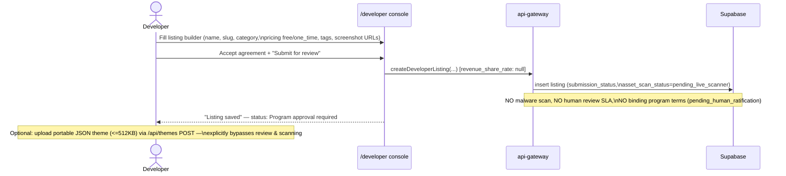
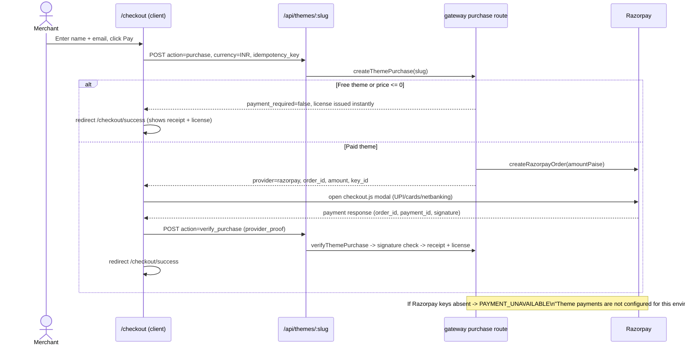
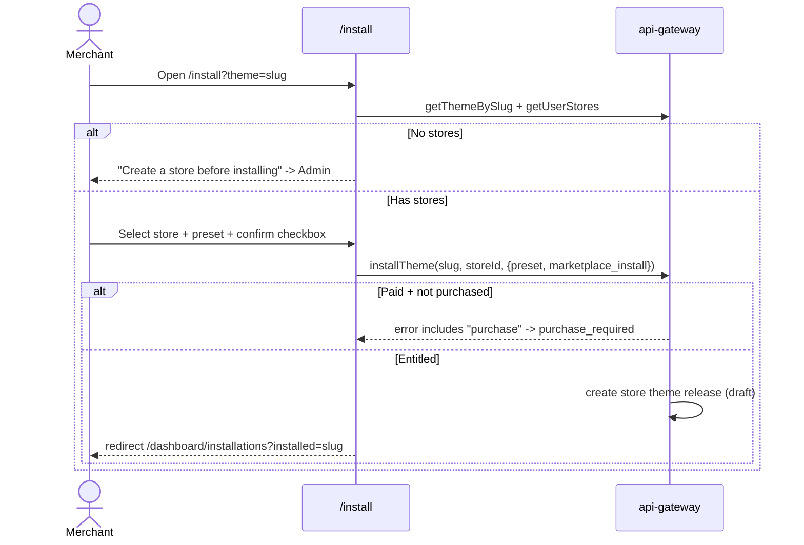
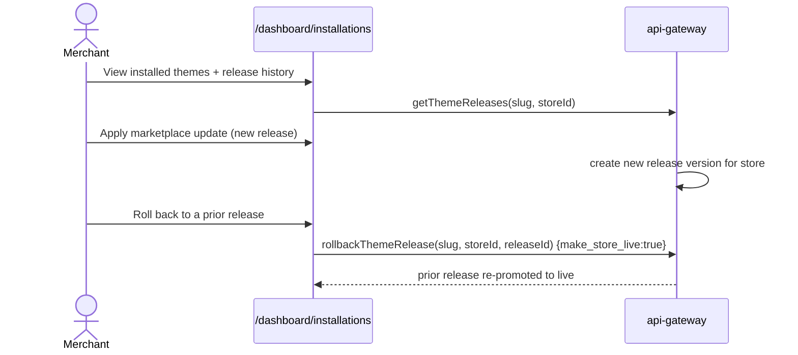
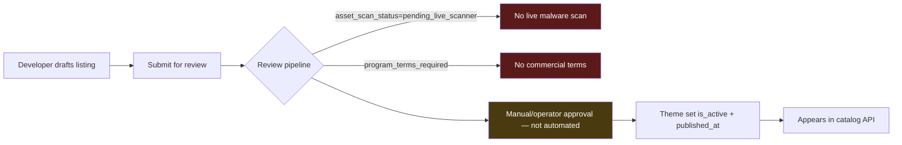
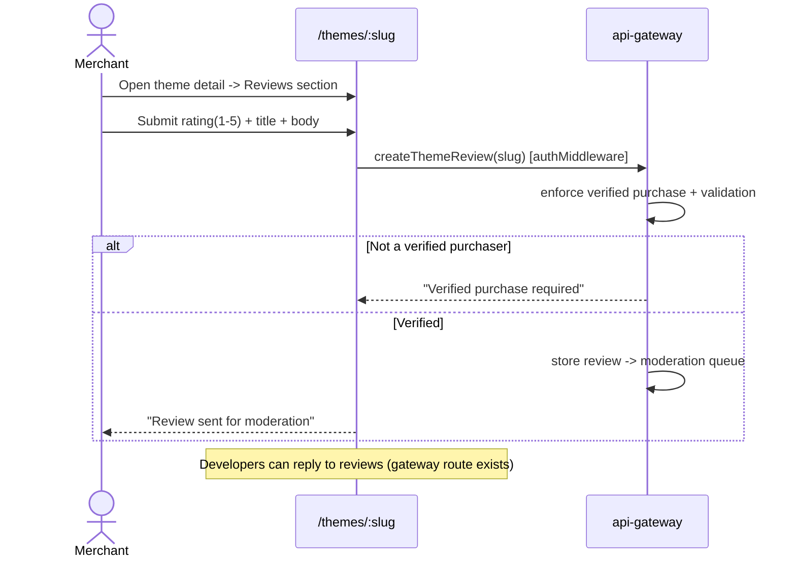

# LetBuyy Themes Marketplace — Master Audit

**Scope:** `apps/theme-marketplace` (plus the `services/api-gateway` theme routes and `database/supabase` theme seeds that directly back it — referenced only where they affect the marketplace).
**Benchmark:** Shopify Theme Store (June 2026), with Framer/Webflow marketplaces referenced for the V2 design.
**Date:** 2026-06-07
**Method:** Direct source read — every route, page, component, service, API handler, and seed in the ownership boundary — plus live research of the current Shopify Theme Store. Every claim is tied to a `file:line` or a cited URL.
**Authoring lenses:** Theme Store architect, theme review lead, marketplace PM, merchant-experience architect, ecosystem designer, frontend platform architect, UX research lead, SaaS marketplace reviewer.

> **This file supersedes the 2026-06-06 master audit.** That version described a catalog of *exactly one theme*, "16 hardcoded `letbuyy.store`" references, `support@letbuyy.store`, a checkout success page that "confirms nothing," and missing compare/collections/authors/refunds. **All of those are now stale.** A "step-up" pass (DB seed `theme-marketplace-sample-catalog.sql`, 2026-06-07; verification `055` rewrite + `091` integrity, 2026-06-06 21:43) retired the single-theme rule, seeded 10 sample themes, added 11 marketplace tables, wired compare/collections/author profiles/saved searches/faceted filters/page-number pagination/refunds/receipts, reduced domain drift to **2** cosmetic references, and moved support to `support@letbuyy.com`. This audit reflects the **current** code. Where it diverges from the prior doc, the prior doc is stale.

---

## 0. How to read this / verdict at a glance

LetBuyy's Themes Marketplace is **a genuinely well-built, unusually honest, pre-production thin-client front end with a comprehensive backend API surface — and almost no marketplace as an *ecosystem*.** The plumbing is real and now fairly complete. The supply, the proof, and the developer economics are not.

This codebase is the opposite of "governance theater." It is solid engineering with an empty stage. The catalog is **11 active themes** — one real production theme (`urban-kicks`) wired into the storefront renderer, plus **10 first-party "LetBuyy Samples"** seeded with deliberately honest zeros. There are **zero third-party developers**, **zero reviews**, **zero ratings**, **zero installs**, **no downloadable artifacts**, **no live payouts**, **no malware scanner**, and **draft legal pages**. Every one of those zeros is *intentionally honest* — the team ships an automated test that fails the build if anyone adds a fake "10K+ users" or "24/7 support" badge (`apps/theme-marketplace/tests/foundation-honesty.test.mjs`). That honesty is a real asset. It is also a precise inventory of everything that does not yet exist.

| Dimension | Score (/10) | One-line verdict |
|---|---|---|
| Frontend engineering quality | 8 | Clean Next.js 16 thin client, real faceted filters, real states, accessible primitives. |
| Backend API completeness | 7 | 1,283-line theme route + 1,568-line adapter: catalog→purchase→install→rollback→reviews→refunds. |
| **Honesty / absence of fake content** | **10** | Best-in-class. An enforced test bans fabricated metrics and dead links. |
| Catalog depth & quality | 2 | 11 themes, first-party only, SVG placeholder previews, all-zero proof signals. |
| Merchant trust signals | 2 | No reviews, ratings, installs, performance, or accessibility data exists yet. |
| Developer value proposition | 2 | Revenue share is `null`; payouts, scanner, and program terms all "pending." |
| Theme discovery | 6 | Strong facets/sort/compare/collections — over a catalog too small to need them. |
| Purchase / checkout | 6 | Real Razorpay flow, idempotent, real receipt + license — but INR-only, env-gated. |
| Installation / lifecycle | 6 | Preview→install→publish→rollback modeled end-to-end; downloads not wired to storage. |
| Review & quality enforcement | 3 | Verified-purchase reviews + reports exist; no scanner, no Lighthouse gate, no human SLA. |
| Content & copy | 6 | Honest and professional, but thin and metadata-empty. |
| Production readiness | 3 | Architecturally close; gated on storage, payments, payouts, scanner, legal. |

**Would a merchant buy a theme here today?** No — not because the store is broken, but because there is nothing to choose between, no proof any theme is good, no way to try it without owning a store, and nothing to download. **Would a professional theme developer publish here today?** No — because they cannot learn their revenue share, cannot get paid, cannot run analytics, and have no audience to sell to.

**The strategic finding:** LetBuyy has built the hardest 70% (the runtime, the contracts, the lifecycle, and an honesty culture) and skipped the 30% that actually makes a marketplace a marketplace (third-party supply, social proof, try-before-buy, downloads, and developer payouts). The roadmap in Phase 14–15 is therefore about **activation and ecosystem**, not rewrites.

---

## 1. Phase 1 — Complete application discovery

### 1.1 What the application is

`@letbuyy/theme-marketplace` is a Next.js 16 (React 19) App-Router app on port 9005. It is a **thin client**: it holds no theme data of its own. Every catalog read, purchase, install, review, and developer action is delegated to the `@letbuyy/api-client` package, which calls the versioned `services/api-gateway`. When the gateway cannot be reached, the app returns an explicit, retryable "Marketplace temporarily unavailable" state rather than an empty catalog (`src/lib/theme-service.ts` → `MarketplaceUnavailableError`; `src/components/marketplace-unavailable.tsx`).

It also refuses to hardcode infrastructure: `src/lib/public-urls.ts`, `src/lib/site-url.ts`, and `src/lib/api/client.ts` **throw** if their `NEXT_PUBLIC_*`/`LETBUYY_API_URL` env vars are unset rather than falling back to a staging host — a recent hardening that the prior audit predates.

### 1.2 Route inventory (every route, verified)

| Route | File | Type | Indexed? | Backed by real data? |
|---|---|---|---|---|
| `/` | `app/page.tsx` | Page | Yes | Live API (featured, category counts, collections) |
| `/themes` | `app/themes/page.tsx` | Page | Yes | Live API (faceted filter/sort/paginate/saved-search) |
| `/themes/[slug]` | `app/themes/[slug]/page.tsx` | Page | Yes | Live API (detail, reviews, preview, report) |
| `/themes/compare` | `app/themes/compare/page.tsx` | Page | Yes | Live API (up to 4 themes side-by-side) |
| `/collections/[slug]` | `app/collections/[slug]/page.tsx` | Page | Yes | Live API (collection items) |
| `/authors/[handle]` | `app/authors/[handle]/page.tsx` | Page | Yes | Live API (developer profile + portfolio) |
| `/pricing` | `app/pricing/page.tsx` | Page (client) | Yes | Static plan copy + FAQ |
| `/checkout` | `app/checkout/page.tsx` | Page (client) | No | Live API + Razorpay checkout.js |
| `/checkout/success` | `app/checkout/success/page.tsx` | Page | No | Live API (receipt + license key) |
| `/install` | `app/install/page.tsx` | Page | No | Live API (store list + install) |
| `/dashboard` (+ layout) | `app/dashboard/page.tsx` | Page | No | Live API (account summary) |
| `/dashboard/purchases` | `app/dashboard/purchases/page.tsx` | Page | No | Live API (orders, receipts, refund request) |
| `/dashboard/downloads` | `app/dashboard/downloads/page.tsx` | Page | No | Live API (artifact groups — `pending_storage`) |
| `/dashboard/installations` | `app/dashboard/installations/page.tsx` | Page | No | Live API (releases, rollback) |
| `/dashboard/favorites` | `app/dashboard/favorites/page.tsx` | Page | No | Client store (favorites) |
| `/dashboard/settings` | `app/dashboard/settings/page.tsx` | Page | No | Live API (marketplace settings) |
| `/developer` | `app/developer/page.tsx` | Page | **No (noindex)** | Live API (listing builder + program status) |
| `/developer/listings/new` | `app/developer/listings/new/page.tsx` | Page | No | **Stub** — re-exports `/developer` verbatim |
| `/docs`, `/docs/api` | `app/docs/*` | Page | No (noindex) | Static reference (accurate) |
| `/support`, `/about`, `/contact` | `app/*` | Page | No (noindex) | Static + `mailto:support@letbuyy.com` |
| `/legal/{license,privacy,refund,terms}` | `app/legal/*` | Page | No (noindex) | **"Draft policy"** structured placeholders |
| `/api/themes` | `app/api/themes/route.ts` | API (GET/POST) | — | Proxy to gateway; POST = JSON theme upload (rate-limited) |
| `/api/themes/[slug]` | `app/api/themes/[slug]/route.ts` | API (GET/POST) | — | Proxy: purchase / verify / preview-session |
| `/auth/callback` | `app/auth/callback/route.ts` | API | — | SSO session handoff |

Notable discovery findings:

- **`/developer/listings/new` is a one-line stub:** `export { metadata, default } from '../../page';`. The "create a new listing" deep-link silently renders the developer landing page — a dead-end UX.
- **Almost the entire informational surface is `noindex`** (developer, docs, support, about, contact, all legal). Only `/`, `/themes`, `/themes/[slug]`, `/pricing` (and collections/authors) are indexable. Safe, but it forfeits the content-marketing SEO Shopify leans on heavily.
- **Two stale-domain bugs remain:** store hostnames render as `${subdomain}.letbuyy.store` in `app/install/page.tsx:29` and `app/dashboard/installations/page.tsx:86`, contradicting the canonical `letbuyy.com` migration. (Down from the "16 references" the prior audit reported — the URL helper libraries no longer hardcode `.store`.)

### 1.3 Marketplace architecture

```mermaid
flowchart TD
    U[Merchant / Developer]
    subgraph TM["apps/theme-marketplace (Next.js 16 thin client)"]
        PG[Server Pages: home, catalog, detail, compare,\ncollections, authors, dashboard, install]
        RT[Route handlers: /api/themes, /api/themes/:slug]
        SVC[ThemeService — src/lib/theme-service.ts]
        CL[@letbuyy/api-client]
        UI[@letbuyy/ui design system]
        TE[@letbuyy/theme-engine types]
    end
    subgraph GW["services/api-gateway"]
        TR[routes/themes.ts + auxiliary routes]
        EX[theme-execution.adapter.ts]
    end
    subgraph EXT["External / infra"]
        DB[(Supabase Postgres:\nthemes, purchases, receipts,\nreviews, releases, listings)]
        RP[Razorpay]
        ST[(Object storage — NOT configured)]
        SC[Malware scanner — NOT configured]
        PO[Payouts — NOT configured]
    end
    U --> PG --> SVC --> CL --> TR --> EX --> DB
    U --> RT --> SVC
    PG --> UI
    SVC --> TE
    EX -. INR checkout .-> RP
    EX -. pending_storage .-> ST
    EX -. pending_live_scanner .-> SC
    EX -. pending_program_terms .-> PO
    SVC -- gateway down --> MU[MarketplaceUnavailable\nretryable error state]
```

### 1.4 Theme submission flow



### 1.5 Theme purchase flow



### 1.6 Theme installation flow



### 1.7 Theme update & rollback flow



### 1.8 Theme publishing flow (developer → live)



### 1.9 Theme review flow



### 1.10 What the backend actually implements (reality check)

The gateway is not a stub. `services/api-gateway/src/routes/themes.ts` (1,283 lines) + `theme-execution.adapter.ts` (1,568 lines) + auxiliary routes (542 lines) implement real handlers for: catalog list, categories, industries, schema, editor draft save/delete, publish, preview-session, releases, rollback, package upload, reviews (list/create/reply), downloads, reports, refunds, single theme, install, purchase, and purchase verify. The step-up migration also created 11 backing tables (`developer_profiles`, `theme_collections`, `theme_collection_items`, `theme_saved_searches`, `theme_download_artifacts`, `theme_purchase_receipts`, `theme_refund_requests`, `theme_reports`, `theme_marketplace_settings`, `theme_developer_listings`, `theme_developer_payout_accounts` — per `verification/091`). Purchase genuinely integrates Razorpay (`createRazorpayOrder` from `@letbuyy/infrastructure/razorpay-adapter`) with idempotency and a free-theme fast path.

But six operational gates are explicitly unfinished, and the code names each one honestly:

| Capability | Status marker in code | Effect |
|---|---|---|
| Artifact downloads | `delivery_status='pending_storage'` (seed); `live_storage_status` (themes route ~818) | Buyers cannot actually download theme files. |
| Developer payouts | `onboarding_status:'pending_program_terms'` (aux routes ~476) | Developers cannot be paid. |
| Malware/asset scan | `asset_scan_status:'pending_live_scanner'` (aux routes ~510) | No security gate on uploads. |
| Receipts / GST | `gst_registration:'pending_human_sign_off'` (themes ~1249) | Tax invoices not legally final. |
| Program terms | `metadata.program_terms:'pending_human_ratification'` (seed) | No binding developer agreement. |
| Revenue share | `revenue_share_rate: null` (developer page) | Developers cannot learn their cut. |

### 1.11 Catalog reality (the central fact, corrected)

The previous audit's headline — "a catalog of exactly one theme, enforced in the database" — is **no longer true**. `database/supabase/verification/055_only_urban_kicks_theme_catalog.sql` was rewritten: *"The old single-theme invariant has been retired: Urban Kicks must remain active, but the catalog may contain N active themes."* The current catalog is:

- **`urban-kicks`** — one real production theme with a 19-section renderer manifest wired to `storefront-runtime` (`database/supabase/seeds/urban-kicks-theme.sql`).
- **10 "LetBuyy Samples"** — `commerce-canvas`, `bazaar-minimal`, `portfolio-studio`, `creator-grid`, `resume-slate`, `cv-focus`, `launch-landing`, `event-splash`, `saas-console`, `app-startup` — across 5 categories, seeded with **honest zeros** (`install_count=0, review_count=0, rating_avg=0, download_count=0, purchase_count=0`), SVG placeholder previews, `performance_report: pending-lighthouse-run`, `accessibility_report: pending-a11y-run`, and download artifacts at `delivery_status: pending_storage`. The seed comment is explicit: *"Metrics are intentionally honest zeros; production creative/copy remains a human content task."*

So the catalog is no longer "one theme" — it is **11 first-party themes with zero third-party supply and zero proof signals.** That is a materially better story than a hard-enforced monotheme, but it is still not a marketplace: it is a first-party sample set used to exercise the workflows.

---

## 2. Phase 2 — Shopify Theme Store benchmark

Current Shopify facts (June 2026, sourced):

- **Catalog scale:** ~1,110 premium themes plus free themes; *Horizon* ships as a family of 10 free first-party themes.
- **Premium pricing:** one-time, typically **$100–$500** (e.g., Motion ~$400, Wonder ~$390, Impulse ~$400). Lifetime access for a single store; free updates for platform compatibility.
- **Developer revenue share:** **15%** on Theme Store sales (since Jan 1, 2025; 30% for self-distributed), plus a 2.9% processing fee.
- **Review/approval:** a **5-stage** review by Shopify's theme team; minimum average **Lighthouse performance ≥ 60** and **accessibility ≥ 90** across home/product/collection on desktop *and* mobile; must use Shopify's **Skeleton** codebase or fully original code; **exclusive** distribution; a `/listings` folder is required (since May 15, 2025). Rejected themes can trigger temporary submission suspension if resubmitted unfixed.
- **Buyer trust:** every theme has a **demo store**, screenshots, a feature list, version history, a developer profile with support, and **merchant reviews** ("I love it / Neutral / I'm not happy," surfaced as a positive %).
- **Try-before-buy:** merchants install **any** theme as an unlimited free **trial** in their own store (all options work; they just can't edit code or publish it live) — Shopify's single most important conversion mechanic.
- **Refunds:** theme sales are **final / non-refundable** (instant source-code access); the only exception is transferring a paid theme between stores you own.

### 2.1 Side-by-side comparison

| Capability | Shopify Theme Store | LetBuyy Themes Marketplace | Gap |
|---|---|---|---|
| Themes available | ~1,110 premium + free | **11 first-party (urban-kicks + 10 samples)** | Critical |
| Independent developers | Thousands of partners | **0** | Critical |
| Demo / live preview | Full demo store per theme | `demo_url` field + store-bound preview session (auth + store required) | Important |
| Try-before-buy trial | Unlimited in-store trial | **None** — no trial concept | Critical |
| Reviews & ratings | Merchant reviews, % positive | Verified-purchase reviews **exist in code; 0 data** | Critical (empty) |
| Install counts / social proof | Shown | Fields exist; **all zero**; UI says "No install data" | Critical (empty) |
| Performance signals | Lighthouse ≥60 enforced + shown | `performance_report: pending-lighthouse-run`; **not surfaced** | Critical |
| Accessibility signals | Lighthouse ≥90 enforced | `accessibility_report: pending-a11y-run`; **not surfaced** | Critical |
| Changelog / version history | Per theme | Field seeded; **not rendered** on detail page | Important |
| Pricing model | One-time $100–$500 USD | One-time **INR only**; no subscription | Important (geo) |
| Checkout | Shopify billing | Razorpay (real, env-gated), receipt + license | Minor |
| Downloads / source access | Instant on purchase | **`pending_storage` — not downloadable** | Critical |
| Review/approval pipeline | 5-stage human + automated gates | Listing form + `pending_live_scanner`; no SLA | Critical |
| Malware/code scanning | Enforced | **None active** | Critical |
| Developer revenue share | 15%, documented | **`null` / "Program approval required"** | Critical |
| Developer payouts | Automated | **`pending_program_terms`** | Critical |
| Developer analytics | Dashboard with real data | Dashboard shell, **no data** | Important |
| Legal (license/refund/terms) | Finalized | **"Draft policy" placeholders** | Important |
| Refund policy | Clear (final sale) | Recorded + operator review; draft policy | Important |
| Fabricated metrics | N/A | **None — banned by an enforced test** | LetBuyy wins |
| Honest outage state | — | Explicit retryable "unavailable" | LetBuyy wins |

**Reading of the benchmark:** LetBuyy matches or exceeds Shopify on *engineering hygiene and honesty* (no fake numbers, explicit failure states, URL-backed faceted filters, accessible primitives, env-required hosts) while being two orders of magnitude behind on *what a marketplace is actually for*: supply, proof, trial, downloads, and developer economics. The single highest-leverage gap is **try-before-buy** — the mechanic that makes Shopify's store convert, and for which LetBuyy already owns the API (`previewSession`) but ships no experience.

---

## 3. Phase 3 — Merchant experience audit

**Persona:** a store owner choosing a marketplace theme for their LetBuyy storefront.

| The merchant asks… | Reality in code | Verdict |
|---|---|---|
| Can I find themes easily? | Navbar search → `/themes?q=` (`navbar.tsx`); catalog has search + autocomplete (catalog-wide via `getThemeSuggestions`), category, free/paid, industry, price-range (min/max INR), 11 layout facets, 7 sorts, page-number pagination — all URL-backed (`themes/page.tsx`) | ✅ engine; ⚠️ only 11 themes to find |
| Can I compare themes? | Yes — `/themes/compare` puts up to 4 themes side-by-side (price, category, rating, installs, platforms, industries, features, version) (`themes/compare/page.tsx`) | ✅ (empty cells: "No install data yet") |
| Can I trust the themes? | No reviews/ratings exist (0 data); author is one first-party "LetBuyy Samples"; legal pages are drafts; no perf/a11y/changelog surfaced | ❌ |
| Can I preview before buying? | A `demo_url` link exists, and "Preview in your store" creates a `previewSession` — **but only if I'm signed in and already own a store** (`themes/[slug]/page.tsx`). No anonymous/sandbox demo. | ⚠️ |
| Can I install safely? | Install picks a store + preset + confirm checkbox, creates a **draft release**, and the install copy promises preview/publish/rollback from installation history (`install/page.tsx`, `installations/page.tsx`) | ✅ (better than prior audit) |
| Do I understand quality/performance? | No Lighthouse score, no accessibility report, no compatibility matrix, no changelog surfaced on the detail page (data fields exist but aren't rendered) | ❌ |
| Do I know what support I get? | Support/contact route to dashboards + `mailto:support@letbuyy.com`; honest but thin; no per-theme support SLA | ⚠️ |
| Is checkout trustworthy? | Real Razorpay (UPI/cards/netbanking); honest "PAYMENT_UNAVAILABLE" fallback; **coupon field is permanently disabled** ("not configured"); tax = "Confirmed by provider" | ⚠️ |
| Does the success page confirm my purchase? | **Yes (corrected):** `/checkout/success` fetches the receipt and shows order/receipt number, theme, amount, payment status, and license key (with honest "Pending receipt issue" fallback) (`checkout/success/page.tsx`) | ✅ |
| Can I download what I bought? | No — every artifact shows a `pending_storage` status chip instead of a download button (`dashboard/downloads/page.tsx`) | ❌ |
| Can I get a refund? | Yes — a refund-request form exists on `/dashboard/purchases`; it records the request for operator review (`requestRefundAction`) | ⚠️ (no live execution) |

**Top merchant friction (ranked):** (1) essentially first-party-only supply — nothing independent to choose; (2) no verified reviews/ratings/installs (all zero); (3) no try-before-buy without owning a store; (4) purchased themes are not downloadable (`pending_storage`); (5) no performance/accessibility/changelog facts to judge quality; (6) legal (terms/refund/license/privacy) is unpublished while paid goods are sold; (7) coupons advertised but disabled; (8) INR-only checkout despite USD price fields in the model.

---

## 4. Phase 4 — Theme developer experience audit

**Persona:** a professional theme studio deciding whether to build for LetBuyy.

| The developer asks… | Reality in code | Verdict |
|---|---|---|
| Can I create a listing? | Yes — `/developer` has a real listing-builder form (name, slug, category, pricing free/one_time, descriptions, industries, tags, platforms, amount INR, screenshot URLs, license tier, agreement + submit) wired to `createDeveloperListing` (`developer/page.tsx`) | ✅ form exists |
| Can I upload theme assets? | Only a portable **JSON** bundle (≤512KB) via the upload panel; **no zip/image/asset pipeline**; copy admits "review, malware scanning, and commercial approval are not completed by this local upload" (`theme-upload-panel.tsx`) | ❌ |
| Is there a real submission queue / status? | Listing rows show `submission_status` + `asset_scan_status` (e.g., "Program approval required", "Scanner setup required"); no review SLA or written feedback loop | ⚠️ shell |
| Can I test/preview my theme? | Not from the developer surface | ❌ |
| Can I version / update / roll back? | Gateway has releases/rollback, but it's exposed to **merchants** (installations), not developers | ❌ |
| Can I monetize? | Pricing fields exist, but **revenue share is `null`** and the program-status card reads "Program approval required" / "Provider setup required" (`developer/page.tsx`) | ❌ |
| Can I see analytics? | A "Listings" + "Program status" shell with **no data**; no views→install funnel | ❌ |
| Can I get paid? | No — `payout_account` is `pending_program_terms`; no payout provider, schedule, or rate | ❌ |
| Do I understand the approval bar? | None published; no performance/originality/exclusivity requirements documented | ❌ |
| Do I get an author identity? | `/authors/[handle]` profile pages exist and render developer profile + portfolio — but only "LetBuyy Samples" is seeded; no verification badge for third parties | ⚠️ |
| Is "create new listing" a real page? | **No** — `/developer/listings/new` re-exports the `/developer` landing page (stub) | ❌ |

**Developer verdict:** there is a developer *surface* (a listing form, an author-profile route, a JSON upload) but **no developer *business***. The three things a studio actually needs — a known revenue share, a path to get paid, and an audience — are all `null`/`pending`. A serious studio cannot rationally invest today. See Phase 13.

---

## 5. Phase 5 — UI / UX audit

### 5.1 The biggest UX seam: two design systems in one app

The app renders in **two visually distinct languages**, and the seam shows as users move from marketing to catalog:

- **Bespoke "premium dark" system** — `app/globals.css` tokens (`--color-primary`, `.glass-card`, `.btn-primary`, gradient text, grid overlays). Used by Home, Navbar, Footer, ThemeCard, Checkout, Install, Dashboard, Success, Pricing.
- **Shared `@letbuyy/ui` admin system** — `--lb-*` density/color tokens, `Page`/`PageHeader`/`Section`/`Card`/`Table`. Used by the catalog, detail, compare, collections, authors, developer, docs, support, about, contact, legal.

The home and cards feel like a premium consumer product; the catalog/detail feel like the internal merchant admin. For a storefront whose entire job is to *sell taste*, this inconsistency undercuts the premium first impression. (Checkout even mixes both within one screen.)

### 5.2 Page-by-page ratings

| Page | Rating | Notes |
|---|---:|---|
| Home `/` | 8/10 | Strong hero + bento + category cards; honest derived stats; but reuses one preview image per category and uses raw `` (LCP risk). |
| Catalog `/themes` | 7/10 | Excellent faceted filter rail, URL-backed, `aria-current`, page-number pagination, saved-search; admin-system look; the developer-console card sits in the buyer's sidebar. |
| Detail `/themes/[slug]` | 6/10 | Screenshots, overview, features, tags, reviews (gated by verified purchase), color presets, report, similar themes; **no demo embed, no perf/a11y/changelog** surfaced. |
| Compare `/themes/compare` | 7/10 | Real side-by-side table; honest empty cells. |
| Checkout | 6/10 | Clear summary, real Razorpay, honest fallbacks; disabled coupon adds noise; design-system mix. |
| Success | 7/10 | **Now shows order/receipt, amount, license key** with honest pending fallbacks. |
| Install | 6/10 | Good store picker + preset + confirm; promises rollback from history. |
| Dashboard (purchases/downloads/installations) | 6/10 | Solid IA; refund + receipts wired; downloads bottom out at `pending_storage`. |
| Pricing | 5/10 | Honest FAQ and "Live path" badge; still lists capabilities marked "not included" that read like a gap list. |
| Developer | 4/10 | Real form, but program economics are all "pending"; `listings/new` is a stub. |
| Docs / API docs | 6/10 | Accurate, honest, `noindex`. |
| Support / About / Contact | 5/10 | Honest, route to dashboards + mailto; thin. |
| Legal (×4) | 3/10 | "Draft policy" structured placeholders pending legal sign-off. |

### 5.3 Accessibility (quick pass)

Positive: `aria-current` on filters, focus-visible rings throughout, `aria-label`s on icon buttons and screenshot rails, semantic `<dl>`/`<nav>`/`<table>`, min tap targets via `--lb-density-button-height`/`min-h-11`, body-scroll lock on mobile drawer, `role="status"` banners. Risks: heavy reliance on opacity for disabled affordances; gradient-on-glass contrast in dark mode (e.g., `text-white/50` captions) likely fails WCAG AA; raw `` previews lack width/height (CLS). Recommend a formal WCAG 2.1 AA audit before GA.

---

## 6. Phase 6 — Content audit

### 6.1 Placeholder / "pending" inventory (current)

| Surface | Content state | Evidence |
|---|---|---|
| `/legal/{terms,privacy,refund,license}` | Structured **"Draft policy"** pages, body: "require legal approval before production publication" | `components/policy-draft-page.tsx`, `legal/*` |
| `/developer` program status | "Program approval required" / "Provider setup required" | `developer/page.tsx` |
| `/developer/listings/new` | Stub (re-export of `/developer`) | `developer/listings/new/page.tsx` |
| Checkout coupons | Disabled input + "Theme coupons are not configured for this environment" | `checkout/page.tsx` |
| Dashboard downloads | Per-artifact `pending_storage` status chips, no download | `dashboard/downloads/page.tsx` |
| Detail features (unseeded themes) | "Feature metadata unavailable" | `themes/[slug]/page.tsx` |
| Theme cards | "No reviews", "Install data unavailable" when zero | `theme-card.tsx` |
| Theme metrics (samples) | Honest zeros for installs/reviews/ratings/downloads/purchases | `seeds/theme-marketplace-sample-catalog.sql` |
| Perf/a11y reports (samples) | `pending-lighthouse-run` / `pending-a11y-run` | seed |

### 6.2 Accuracy / honesty

**Best-in-class.** No fabricated metrics anywhere; home stats are derived ("Themes listed" = API total, "Categories" = 5). Featured-section copy literally says "Ratings appear only after review data exists." The honesty is *enforced*: `tests/foundation-honesty.test.mjs` fails the build on `href="#"`, `[SKIP`/`NEEDS BACKEND`, `50+`, `10K+`, `24/7 support`, and `30-day money-back` strings, and asserts that preview/review/report/refund/download/developer controls are wired to real service methods. This is the single most commendable property of the codebase.

### 6.3 Remaining content liabilities

1. **Selling paid goods with no published Terms/Privacy/Refund/License** is a legal and PSP-compliance risk (Razorpay onboarding typically requires these), not just a content gap.
2. **Domain drift (now small):** 2 `${subdomain}.letbuyy.store` storefront-host references (`install/page.tsx:29`, `dashboard/installations/page.tsx:86`) versus the canonical `letbuyy.com`.
3. **Pricing page reads partly as a gap list:** the "not included" rows (subscription billing, standalone downloads "when available", payout activation, external scanner) are honest but advertise absence.
4. **Catalog copy implies breadth it lacks:** OG/marketing language ("for Every Business", "Premium Themes") sits over 11 first-party samples.

---

## 7. Phase 7 — Feature gap analysis (vs. Shopify)

### 7.1 CRITICAL MISSING (blocks "marketplace" status)
- **Third-party supply** — the catalog is first-party-only (urban-kicks + 10 samples); zero independent developers.
- **Any real social proof** — reviews, ratings, and install counts all exist in code but hold **zero data**.
- **Try-before-buy** — no in-store trial; preview requires owning a store; no anonymous/sandbox demo.
- **Working downloads** — purchased artifacts are `pending_storage`; nothing is deliverable.
- **Developer economics** — revenue share `null`, payouts `pending_program_terms`, no analytics data.
- **Malware/asset scanning** — `pending_live_scanner`; JSON-only uploads bypass scanning.
- **Human review pipeline / quality bar** — no documented requirements, no SLA, no written feedback.
- **Published legal** — terms/privacy/refund/license are drafts.

### 7.2 IMPORTANT MISSING (table-stakes parity)
- **Performance (Lighthouse) and accessibility** reports surfaced per theme (data fields exist; not rendered).
- **Changelog / version history** on the detail page (seeded; not rendered).
- **Embedded live demo** on the listing; per-theme demo stores.
- **Subscription/entitlement billing** (advertised as "not included").
- **Email notifications** (receipts, updates) — settings defer these.
- **GST tax invoices** finalized (structure exists; `pending_human_sign_off`).
- **A non-INR rail** or aligned copy (USD price fields exist but checkout is INR-only).
- **`/developer/listings/new`** as a real page (currently a stub).

### 7.3 NICE TO HAVE
- Trust-composite ranking (rating × installs × recency), bundles, gift/transfer licenses, multi-currency display, i18n (mixed en-IN/en-US), ultra-wide (>1280px) layout, clickable tag/feature chips on cards, theme wishlists beyond favorites.

---

## 8. Phase 8 — Theme discovery audit

**What exists and works (engine — genuinely strong):** URL-addressable search with catalog-wide autocomplete (`getThemeSuggestions`), category (5 + all), free/paid pricing, data-driven industry facets, **price-range min/max (INR)**, **11 layout facets**, **7 sorts** (trending, popular, rating, recent, name, price-low, price-high), **page-number pagination**, saved searches (server action, auth-gated), `aria-current` selected states, and curated **collections** (`new-samples`, `free-to-start`, `paid-samples`) surfaced on the home page and at `/collections/[slug]`. There is also a **compare** surface and **author-profile** pages. This is a more capable discovery layer than the prior audit credited.

**What starves it:** content. With 11 first-party themes (10 of them honest-zero samples), every facet resolves to a handful of rows or none; "trending/popular/rating" sorts are meaningless without installs/reviews; the home "Featured = top-4 by rating" shows themes that all have rating 0; category counts read like "2 themes". Discovery machinery is good; the inventory and the signals that would *rank* it (installs, ratings, recency velocity) do not exist yet.

**Can a merchant discover the *best* theme?** No — not because discovery is broken, but because there is no quality signal to discover *by*, and almost nothing to choose between. Discovery is a solved problem waiting on supply and proof.

---

## 9. Phase 9 — Theme installation journey audit

**Free theme:** Detail → "Add to library"/Install → `/install?theme=slug` → pick store + preset + tick the impact-confirmation checkbox → server action `installTheme` → redirect to `/dashboard/installations?installed=slug`.

**Paid theme:** Detail → Buy → `/checkout?theme=slug` → name/email → Razorpay (UPI/cards/netbanking) → verify → `/checkout/success` (receipt + license) → "Install Theme" → same install flow.

Journey assessment (corrected from prior audit):

1. **Install is modeled as a draft release with rollback.** Install copy: "Marketplace install creates a release for the selected store. You can preview, publish, and roll back from the marketplace installation history." `installations` exposes `getThemeReleases` + `rollbackThemeRelease`. This is the safe pattern, not a one-way apply. ✅
2. **Purchase confirmation is concrete.** Success page renders order/receipt number, amount, payment status, and license key (`checkout/success/page.tsx`). ✅
3. **No store = dead end out.** Without a store, the flow links to Admin to create one (`install/page.tsx`), losing the thread. ⚠️
4. **No anonymous preview.** "Preview in your store" requires sign-in + an owned store; there is no try-before-buy for prospects. ❌ (highest-impact gap)
5. **Downloads don't deliver.** Even after a successful purchase, `/dashboard/downloads` shows `pending_storage` chips, not files. ❌
6. **Post-install editing leaves the app.** "Open editor" deep-links to the merchant admin (`installations/page.tsx`). Reasonable, but the marketplace owns none of the customize step.
7. **No uninstall** surfaced in the marketplace (rollback yes; remove no).

**Net:** the install/rollback lifecycle is the second-strongest part of the product (after the engine). The blockers are *upstream* (no anonymous preview to drive intent) and *downstream* (no actual download/delivery).

---

## 10. Phase 10 — Theme review-system audit

This phase covers two distinct "review" meanings.

**(a) Theme *approval* review (developer → catalog).** There is no human review pipeline. A developer either fills the listing form (`createDeveloperListing`, which writes a record with `asset_scan_status: pending_live_scanner`) or uploads a JSON bundle (`/api/themes` POST) whose own copy states "marketplace review, malware scanning, and commercial approval are **not** completed by this local upload." Validation is schema-shape only; there is **no malware/asset scan** (uploads are JSON ≤512KB, so there are no binary assets to scan — which both limits attack surface and rules out real asset-bearing themes), **no performance/originality/exclusivity bar**, and **no SLA or written-feedback loop**. Versus Shopify's 5-stage human review with Lighthouse gates (perf ≥60, a11y ≥90) and emailed rejection reasons, LetBuyy has the engine-level guardrails but **none of the program layer** — exactly the part that makes a marketplace safe to trust.

**(b) Buyer *reviews* (merchant → theme).** This is genuinely well-designed in code: `createThemeReview` is `authMiddleware`-gated and enforces **verified purchase**, validates rating (1–5) + title (≥3) + body (≥10), and routes submissions to a **moderation** queue ("Review sent for moderation"). Developers can reply (gateway route exists). The detail page renders the reviews section with a rating distribution summary. **But there is zero review data**, so none of this is visible to a real user yet.

**How malicious themes are prevented today:** schema validation + key/URL sanitization in the engine, plus a 512KB JSON cap and a per-IP upload rate limit (`/api/themes`: 5 uploads/min). No live scanner. **How quality is enforced:** schema validity only — no design, performance, or accessibility bar.

---

## 11. Phase 11 — Responsiveness report (code-based)

> **Live caveat:** a real device/screenshot pass could not be run in this environment (no browser against the app's localhost). The following is static analysis of the actual Tailwind breakpoints and `globals.css`; confirm on real devices before GA.

Foundation: mobile-first Tailwind v4, `.container-main` max-width 1280px with fixed 24px inline padding, `prefers-color-scheme` dark/light with a no-flash inline script.

| Width | Assessment | Risks |
|---|---|---|
| 320 px | Workable | Hero bento is `grid-cols-2` at all sizes → paired cards feel cramped; fixed 24px gutters leave ~272px content. |
| 375 / 390 px | Good | Headline scales (`text-4xl`); CTAs stack (`flex-col sm:flex-row`). |
| 768 px (md) | Good | Catalog switches to `[filter-rail | results]`; footer/pricing multi-col. |
| 1024 px (lg) | Good | Catalog results 2-col (`xl:grid-cols-3` at xl); dashboard sidebar appears. |
| 1280 px | Optimal | Hits container cap. |
| 1440 / 1920 px | Acceptable | Content centered at 1280; no ultra-wide (`2xl`) expansion — desktop real estate unused. |

**Specific issues:** (1) On mobile, the catalog's full filter rail **and the developer-console card** stack *above* results — a phone user scrolls search + category + pricing + industry + price + layout + sort + clear + a developer card before seeing a theme; move filters to a bottom-sheet and remove the developer card from the buyer catalog. (2) Hero bento is 2-col even at 320px. (3) Home/category previews use raw `` (LCP/CLS risk on slow mobile). (4) Fixed 24px container padding isn't reduced on tiny screens. (5) No layout use of space above 1280px. **Foundation: 7/10** — solid structure; catalog mobile ordering and unoptimized hero images are the main fixes.

---

## 12. Phase 12 — Merchant trust scorecard

| Trust criterion | Weight | Score /10 | Evidence |
|---|---:|---:|---|
| Brand & visual credibility | 15% | 8 | Premium, cohesive marketing surface (`page.tsx`, `navbar.tsx`). |
| Catalog credibility (choice) | 20% | 2 | 11 first-party themes; 0 independent developers. |
| Social proof (reviews/ratings/installs) | 20% | 1 | All systems built; **zero data**; UI shows "No reviews"/"Install data unavailable". |
| Pre-purchase confidence (demo/preview) | 15% | 4 | `previewSession` + `demo_url` exist, but preview needs an owned store; no anon demo. |
| Purchase integrity (receipt/license/invoice) | 15% | 6 | Real Razorpay + receipt number + license key on success; GST `pending_human_sign_off`. |
| Policy transparency (terms/refund/privacy) | 10% | 2 | All legal pages are "Draft policy" placeholders. |
| Support availability | 5% | 3 | Honest `mailto:support@letbuyy.com` + dashboard routing; no SLA. |
| **Weighted total** | 100% | **≈3.6** | Strong shell + honest checkout; weak proof, supply, and policy. |

**Verdict:** A merchant's first impression is high-trust, and checkout now leaves them with a real receipt and license. Trust still collapses at the moment they look for *choice*, *proof* (reviews/ratings/installs), a *trial*, or a *published refund policy*. The honesty of the copy protects the brand from bait-and-switch, but honesty about emptiness is still emptiness.

---

## 13. Phase 13 — Developer trust scorecard

| Trust criterion | Weight | Score /10 | Evidence |
|---|---:|---:|---|
| Can I list a real (asset-bearing) theme? | 20% | 2 | Listing form exists; only JSON upload, no zip/screenshot asset pipeline. |
| Is revenue share defined? | 20% | 0 | `revenue_share_rate: null`; "Program approval required" (`developer/page.tsx`). |
| Will I get paid (payouts)? | 20% | 0 | `payout_account` = `pending_program_terms`; no provider/schedule/rate. |
| Is there a clear, fair review process? | 15% | 1 | No published bar/SLA; upload bypasses review + scanning. |
| Do I get analytics? | 10% | 1 | Listings + program-status shell; no funnel data. |
| Author identity / brand | 10% | 3 | `/authors/[handle]` profile pages exist; no verification for third parties. |
| Support tooling (reply to buyers/reviews) | 5% | 2 | Review-reply route exists in gateway; no developer inbox UI; no reviews yet. |
| **Weighted total** | 100% | **≈1.4** | A developer surface without a developer business. |

**Verdict:** Better than "nothing" (a real listing form and author profiles now exist), but a professional studio still cannot rationally invest: revenue share is undefined, payouts are off, there's no audience, and no analytics. The developer page is best read as a **spec for the program to build**, not a console to use.

---

## 14. Phase 14 — LetBuyy Theme Marketplace V2 (target design)

**Benchmarks:** Shopify (trust, 5-stage review, 15% revenue share, try-before-buy), Framer (creator-led listings, live previews, designer brand), Webflow (cloneable templates, designer profiles, curated quality).

**North star:** *A creator-led, trust-ranked theme store where a prospect can preview any theme live in one click (no store required), read verified reviews and real performance/accessibility facts, buy with a receipt + GST invoice, install to a draft and roll back safely, and actually download what they bought — and where independent developers can list real asset-bearing themes, see a known revenue share, pass a documented review with malware scanning, and get paid with transparent analytics.* **Ship nothing decorative; activate what already exists.**

### 14.1 Information architecture

```
/                         Home: real trending/curated rows (only once signals exist)
/themes                   Catalog: facets + collections + pagination (already strong)
/themes/[slug]            Detail: live demo FIRST, reviews, changelog, perf/a11y, author
/collections/[slug]       Editor's picks / industry bundles (exists)
/authors/[handle]         Developer profile: portfolio, ratings, support SLA, verified badge
/preview/[token]          Try-before-buy: previewSession with an anonymous sandbox (NEW)
/checkout, /checkout/success   One model; receipt + GST invoice + license (mostly built)
/install                  Non-destructive: draft -> preview -> publish -> rollback (built)
/dashboard                Buyer: purchases, installs, WORKING downloads, updates, invoices
/developer                Seller console: listings, submissions, analytics, payouts
/developer/listings/new   Real listing builder (assets, zip, pricing, presets) — replace stub
/legal/{terms,privacy,refund,license}, /support, /docs, /changelog
```

### 14.2 The decisive product choices

1. **Make "try in my store" the centerpiece.** Embed a live demo on every listing and ship an **anonymous sandbox preview** (`/preview/[token]`) so prospects without a store can experience a theme. This is the highest-ROI single feature; the `previewSession` API already exists.
2. **Activate the proof layer before scaling supply.** Surface the verified-purchase reviews, ratings distribution, install counts, and the already-seeded `performance_report`/`accessibility_report`/`changelog` fields on the detail page. Run the deferred Lighthouse/a11y jobs so the fields hold real values.
3. **Finish fulfillment.** Wire object storage so `theme_download_artifacts` produce real files, sizes, checksums, and signed URLs — a purchase that can't be downloaded is not a sale.
4. **Stand up the developer business** end-to-end: a published **revenue share** (benchmark 15%), payout onboarding (the queue adapter already models `razorpay_route`/`razorpayx`/`upi`/`manual` rails), an **asset/zip upload + malware scanner**, a documented multi-stage review with written feedback and an SLA, real analytics, and a verified author badge. Replace the `/developer/listings/new` stub with a real builder.
5. **Publish legal and finalize GST** before GA — it is both a trust and a PSP-compliance prerequisite for selling.
6. **Decide the monetization story:** keep per-theme one-time INR as the spine, either build the subscription/entitlement tier or remove it from copy, and add a non-INR rail (or drop the USD/WordPress/Shopify/HTML/React price fields until multi-platform export ships).
7. **Recruit real supply.** Seed 30–50 genuine, visually distinct themes with real screenshots (replace SVG placeholders) and onboard the first 5–10 third-party developers. The discovery engine is already ready for them.
8. **Unify the design system** — collapse bespoke `globals.css` tokens and `@letbuyy/ui` into one language so marketing and catalog feel like one product — and fix the 2 `letbuyy.store` host references.

### 14.3 Phased roadmap

| Phase | Theme | Outcome |
|---|---|---|
| P0 (1–2 wks) | **Coherence & compliance:** publish legal, finalize GST, fix 2 domain refs, resolve coupon/subscription copy, replace `listings/new` stub, one design system pass | Stops trust erosion; payment-compliant |
| P1 (2–4 wks) | **Activate proof:** surface reviews/ratings/installs + perf/a11y/changelog; run Lighthouse/a11y jobs | Merchants can judge quality |
| P2 (2–4 wks) | **Try-before-buy:** embedded live demo + anonymous sandbox preview | Converts prospects without a store |
| P3 (3–5 wks) | **Fulfillment:** object storage → real downloads (files, checksums, signed URLs) | Purchases deliver |
| P4 (6–10 wks) | **Developer business:** revenue share + payouts + asset/zip pipeline + malware scan + documented review SLA + analytics + verified authors | Studios can list and get paid |
| P5 (ongoing) | **Supply & growth:** recruit 30–50 real themes + first third-party devs; trust ranking, bundles, i18n, multi-currency, ultra-wide layout | Becomes a real marketplace |

---

## 15. Phase 15 — Top 100 issues (current code)

Severity: **P0** blocks trust/launch or a core flow; **P1** major gap vs. benchmark; **P2** quality/polish. Impact: **M** merchant, **D** developer. Verified against the current post–step-up code. (Items the prior audit listed that are now **resolved** — compare view, collections, author profiles, saved searches, price/tag/feature facets, page-number pagination, refunds, receipts on the success page, hardcoded-host fallbacks, `support@letbuyy.store` — are intentionally excluded.)

### P0 — Critical (1–20)

| # | Issue | Evidence | M | D | Fix |
|---|---|---|---|---|---|
|1|Zero third-party supply (first-party only)|seed `theme-marketplace-sample-catalog.sql` (author "LetBuyy Samples")|●|●|Recruit/onboard independent developers|
|2|Reviews/ratings/installs hold **zero data**|`theme-card.tsx` "No reviews"; seed metrics all 0|●|●|Generate real engagement; seed pilot reviews|
|3|Developer revenue share undefined|`revenue_share_rate: null` (`developer/page.tsx`)|●|●|Publish rate (benchmark ≈15%)|
|4|Developer payouts not configured|`onboarding_status: pending_program_terms`|●|●|Stand up payout provider + onboarding|
|5|Purchased themes **not downloadable**|`dashboard/downloads/page.tsx` `pending_storage`|●||Wire object storage + signed URLs|
|6|No malware/asset scanning|`asset_scan_status: pending_live_scanner`|●|●|Integrate scanner before publish|
|7|No try-before-buy (preview needs owned store)|`themes/[slug]/page.tsx` previewSession|●|●|Anonymous sandbox preview|
|8|Terms of Service unpublished (draft)|`legal/terms/page.tsx` + `policy-draft-page.tsx`|●|●|Publish legal|
|9|Privacy Policy unpublished (draft)|`legal/privacy/page.tsx`|●||Publish legal|
|10|Refund Policy unpublished while selling|`legal/refund/page.tsx`|●||Publish + finalize flow|
|11|License Agreement unpublished (draft)|`legal/license/page.tsx`|●|●|Publish license terms|
|12|No human review pipeline / quality bar / SLA|`developer/page.tsx`; upload copy|●|●|Documented multi-stage review|
|13|Selling paid goods w/o legal = PSP compliance risk|`legal/*` drafts + Razorpay|●||Publish legal before GA|
|14|No asset/zip pipeline (JSON-only uploads)|`theme-upload-panel.tsx`|●|●|Real asset/zip submission|
|15|GST tax invoice not finalized|`gst_registration: pending_human_sign_off`|●||Legal sign-off + live invoices|
|16|Performance (Lighthouse) data not produced/surfaced|seed `pending-lighthouse-run`|●|●|Run jobs + render on detail|
|17|Accessibility data not produced/surfaced|seed `pending-a11y-run`|●||Run jobs + render on detail|
|18|Coupons advertised but permanently disabled|`checkout/page.tsx`|●||Build or remove coupon UI|
|19|`/developer/listings/new` is a stub|`developer/listings/new/page.tsx`|●|●|Build real listing builder|
|20|Catalog is 10 honest-zero samples + 1 real theme|seed + `urban-kicks-theme.sql`|●|●|Seed real, distinct themes|

### P1 — Major gaps (21–60)

| # | Issue | Evidence | M | D |
|---|---|---|---|---|
|21|No embedded live demo on listing|`themes/[slug]/page.tsx`|●|●|
|22|Changelog/version history not rendered (data exists)|seed `changelog`|●|●|
|23|INR-only checkout despite USD price fields|`checkout/page.tsx`; `theme-catalog.ts`|●||
|24|No email notifications (receipts/updates)|`settings/page.tsx`|●||
|25|2 stale `${subdomain}.letbuyy.store` host refs|`install/page.tsx:29`,`installations/page.tsx:86`|●||
|26|No verified-author badge for third parties|`authors/[handle]`|●|●|
|27|No developer analytics data (funnel)|`developer/page.tsx`||●|
|28|No review rejection/written-feedback loop|gateway review routes||●|
|29|Compatibility matrix not rendered (data exists)|seed `compatibility`|●||
|30|Perf/a11y reports not rendered on detail (data exists)|`themes/[slug]/page.tsx`|●||
|31|Home "Featured = top-4 by rating" but all ratings 0|`page.tsx`|●||
|32|Category counts read like "2 themes"|`page.tsx` countMap|●||
|33|Trending/popular sorts meaningless w/o signals|`themes/page.tsx` SORT_OPTIONS|●||
|34|No anonymous/sandbox preview|`themes/[slug]`|●|●|
|35|Developer-console card sits in buyer's catalog sidebar|`themes/page.tsx`|●|●|
|36|No uninstall in marketplace (rollback only)|`installations/page.tsx`|●||
|37|No multi-currency display|`utils.ts` formatThemePrice|●||
|38|Mixed i18n locales (en-IN / en-US)|`[slug]` vs others|●||
|39|Home/category previews use raw ``|`page.tsx`|●||
|40|Hero bento is 2-col even at 320px|`page.tsx`|●||
|41|No ultra-wide layout above 1280px|`globals.css`|●||
|42|Two design systems (marketing vs catalog)|`globals.css` vs `@letbuyy/ui`|●|●|
|43|Sample previews are SVG placeholders, not screenshots|`public/previews/*.svg`|●|●|
|44|All themes by one author (no diversity)|seed author_handle|●|●|
|45|Sample `demo_url` points to `/themes/slug?demo=sample`|seed|●||
|46|"X stores use this" proof hidden at 0|`theme-card.tsx`|●||
|47|Tag/feature chips not clickable as facets on cards|`theme-card.tsx`|●||
|48|`download_count`/`purchase_count` modeled, never shown|`theme-catalog.ts`|●||
|49|Settings defers most prefs to backend|`settings/page.tsx`|●||
|50|No funnel telemetry (browse→preview→buy→install)|absent|●|●|
|51|Pricing "not included" rows read as a gap list|`pricing/page.tsx`|●||
|52|Marketing/OG copy implies breadth (11 themes)|`layout.tsx`,`page.tsx`|●||
|53|No bundle / gift / transfer licensing|absent|●||
|54|No trust-composite ranking (rating×installs×recency)|`themes/page.tsx`|●||
|55|Preview requires explicit store selection (friction)|`[slug]/page.tsx`|●||
|56|Refund has no live provider execution|`legal/refund`; aux routes|●||
|57|No per-theme structured data (Product/Offer/Rating)|`layout.tsx` JSON-LD site-level|●||
|58|Similar-themes section thin with 11 themes|`[slug]/page.tsx`|●||
|59|Saved-search alerts only "when provider configured"|`themes/page.tsx`|●||
|60|Sample themes overlap categories/sections|seed sections|●||

### P2 — Quality / polish (61–100)

| # | Issue | Evidence |
|---|---|---|
|61|Same preview image reused per category on home|`page.tsx` CATEGORIES|
|62|Detail hero `next/image sizes="100vw"` (LCP)|`themes/[slug]/page.tsx`|
|63|Disabled affordances rely on opacity only|`checkout` coupon, `upload` label|
|64|`noindex` on docs/support/legal/developer won't rank when finished|`docs/page.tsx` etc.|
|65|Coupon "Apply" always warns (UX noise)|`checkout/page.tsx`|
|66|Tax shown as vague "Confirmed by provider"|`checkout/page.tsx`|
|67|"Every Business" copy vs INR-only India-first|`footer.tsx`,`layout.tsx`|
|68|Mixed date locales across pages|`[slug]` vs `purchases`|
|69|Catalog filters + dev card stack above results on mobile|`themes/page.tsx`|
|70|Fixed 24px container padding on tiny screens|`globals.css`|
|71|Lint warnings reported (typed `any`) — verify|CODEX status docs|
|72|Author profiles only first-party seeded|`authors/[handle]`|
|73|Favicon wiring not confirmed|`layout.tsx`|
|74|Review pluralization paths render at 0 reviews|`theme-card.tsx`|
|75|Some empty-state copy is dev-facing|`themes/page.tsx`|
|76|Install presets (default/conversion/editorial) unexplained|`install/page.tsx`|
|77|Dashboard "Premium Licenses" stat likely always 0|`dashboard/page.tsx`|
|78|Featured renders `MarketplaceUnavailable` inline on API fail|`page.tsx` (acceptable)|
|79|Sitemap omits collections/authors routes|`sitemap.ts`|
|80|Legal/docs noindex means they won't be found when ready|`robots.ts`+metadata|
|81|Price filter is numeric min/max, no slider|`themes/page.tsx`|
|82|Engine-ish layout facet values shown to buyers (splash, single-page)|`themes/page.tsx`|
|83|Color presets identical "Default" across samples|seed color_presets|
|84|No new/updated badges on cards|`theme-card.tsx`|
|85|No quick-look/preview modal from card|`theme-card.tsx`|
|86|Navbar search is a form, no ⌘K shortcut|`navbar.tsx`|
|87|Compare needs manual theme selection|`theme-compare-selection.tsx`|
|88|No share/copy-link affordance on detail|`[slug]/page.tsx`|
|89|Card shows version but no "last updated" relative date|`theme-card.tsx`|
|90|No dedicated category landing pages (only filtered `/themes`)|routing|
|91|Sample descriptions generic ("A sample … theme for …")|seed|
|92|`font_pairings` all Inter/Inter in samples|seed|
|93|`supported_platforms` lists WP/HTML/React but no export delivered|seed + downloads|
|94|Checkout collects name/email manually even if logged in|`checkout/page.tsx`|
|95|No order-confirmation email|absent|
|96|Report exists on detail but not from purchases/installs|`[slug]` vs dashboard|
|97|Payout rails modeled but sandbox-only (`planSandboxAppPayoutTransfer`)|queue adapter|
|98|No license-tier enforcement at purchase|`developer` license_tiers metadata|
|99|`info-placeholder.tsx` exists but few/no pages use it now|`components/info-placeholder.tsx`|
|100|Verify shared OG image asset exists (`/og/*`)|`layout.tsx`|

---

## 16. Phase 16 — Brutal review (if Shopify's Theme Store team reviewed LetBuyy today)

**What they would praise**
- **The honesty.** The app fabricates nothing — explicit `MarketplaceUnavailable`, honest "pending" states, and an *enforced build test* (`foundation-honesty.test.mjs`) that bans fake metrics and dead links. In a trust product, that discipline is rare and genuinely impressive.
- **The engine and lifecycle.** Sectioned, schema-validated, sanitized themes with releases + rollback and a real storefront renderer (`urban-kicks`, 19 section renderers). Install-to-draft with rollback is the *correct* model and is already built.
- **The discovery layer.** Faceted, URL-backed search with catalog-wide autocomplete, price/layout/industry facets, collections, compare, page-number pagination, saved searches — more capable than many live marketplaces.
- **The checkout.** A real Razorpay order→verify→receipt→license flow with idempotency and a free-theme fast path, plus a success page that confirms order, amount, and license key.
- **The hardening.** Server-only secrets, env-required hosts (no staging fallback), per-IP upload rate limiting.

**What they would reject (at intake)**
- **No third-party supply and no proof.** A "marketplace" of 11 first-party themes with zero reviews, ratings, or installs is a sample set, not a store.
- **No try-before-buy.** The one mechanic that makes a theme store convert is absent (despite owning the API).
- **Purchases that can't be downloaded.** `pending_storage` means a completed sale delivers no file.
- **No developer business.** Revenue share `null`, payouts off, no scanner, no review SLA — a studio can't list, can't trust the process, can't get paid.
- **Unpublished legal while charging money.** Terms/privacy/refund/license are drafts.

**What they would redesign**
- Detail page: lead with an embedded live demo; surface the already-seeded performance, accessibility, and changelog data; show the reviews and author block prominently.
- Home/discovery: replace rating-based "Featured" (all zeros) with curated/editorial rows until real signals exist.
- Pricing/checkout: one coherent monetization story; drop or build the disabled coupon and the "not included" subscription rows.

**What they would remove**
- The disabled coupon field, the `/developer/listings/new` stub, the developer-console card wedged into the buyer's catalog sidebar, and SVG placeholder "previews" masquerading as theme screenshots.

**What they would rebuild from scratch**
- The **developer program** end-to-end: onboarding + binding agreement, asset/zip upload + malware scanning, a documented multi-stage review with written feedback and an SLA, revenue share + payouts + analytics + verified author identity.
- The **fulfillment path**: object storage so downloads actually deliver.

**The honest bottom line**
LetBuyy has built a strong *engine*, a genuinely good *discovery and checkout shell*, and — rare and valuable — an *enforced culture of not lying*. Since the prior audit it has retired the single-theme rule, seeded a catalog, and wired receipts, refunds, compare, collections, and author profiles. But it still has almost none of the *marketplace*: no independent supply, no proof, no trial, no downloads, no payouts, no scanner, no published legal. The recommendation is unchanged in spirit: either **(a) reframe today's product as "LetBuyy Official Themes"** — a first-party, single-publisher showcase — and drop the multi-seller framing until the developer program and real supply exist; or **(b) commit to the V2 activation plan** in Phase 14. What it must not do is market the current surface as a multi-seller "marketplace": the distance between that word and the product is exactly what erodes merchant and developer trust on contact. The good news is that the remaining work is overwhelmingly *activation* (run the jobs, wire storage, publish the terms, define the share, recruit supply), not *re-architecture*.

---

## 17. Appendix

### 17.1 Key evidence index
- Thin-client data layer & honest failure: `apps/theme-marketplace/src/lib/theme-service.ts`; `src/lib/api/client.ts`; `src/components/marketplace-unavailable.tsx`.
- Enforced honesty: `apps/theme-marketplace/tests/foundation-honesty.test.mjs`.
- Catalog reality (retired monotheme + 10 honest-zero samples): `database/supabase/verification/055_only_urban_kicks_theme_catalog.sql`; `database/supabase/seeds/theme-marketplace-sample-catalog.sql`; `database/supabase/verification/091_theme_marketplace_stepup_catalog_integrity.sql`; `database/supabase/seeds/urban-kicks-theme.sql`.
- Backend surface: `services/api-gateway/src/routes/themes.ts` (1,283 lines); `src/execution/theme-execution.adapter.ts`; `src/lib/theme-marketplace-auxiliary-routes.ts`.
- Purchase/Razorpay: `services/api-gateway/src/routes/themes.ts` (purchase ~946–1141, `createRazorpayOrder`); `apps/theme-marketplace/src/app/checkout/page.tsx`; `src/app/checkout/success/page.tsx`.
- Developer program deferral: `src/app/developer/page.tsx`; `src/components/theme-upload-panel.tsx`; `src/app/developer/listings/new/page.tsx` (stub).
- Install/lifecycle: `src/app/install/page.tsx`; `src/app/dashboard/installations/page.tsx`.
- Downloads pending storage: `src/app/dashboard/downloads/page.tsx`.
- Refunds/receipts: `src/app/dashboard/purchases/page.tsx`.
- Discovery: `src/app/themes/page.tsx`; compare `src/app/themes/compare/page.tsx`; collections `src/app/collections/[slug]/page.tsx`; authors `src/app/authors/[handle]/page.tsx`.
- Legal drafts: `src/app/legal/*` + `src/components/policy-draft-page.tsx`.
- Domain drift (2 refs): `src/app/install/page.tsx:29`; `src/app/dashboard/installations/page.tsx:86`.

### 17.2 Shopify benchmark sources (web-verified, June 2026)
- Theme Store revenue share (15% / 30%): https://shopify.dev/docs/storefronts/themes/store/revenue-share
- Theme Store requirements (Lighthouse perf ≥60 / a11y ≥90, Skeleton/original, exclusivity): https://shopify.dev/docs/storefronts/themes/store/requirements
- Submit a theme / 5-stage review process: https://shopify.dev/docs/storefronts/themes/store/review-process/submit-theme
- Updated requirements & submission (effective May 15, 2025): https://shopify.dev/changelog/updated-shopify-theme-store-requirements-and-submission-process-effective-may-15-2025
- Pricing, ~1,110 premium themes, Horizon free themes, ratings, demo, try-before-buy: https://themes.shopify.com/

*Generated from a direct source read of `apps/theme-marketplace` and the theme surfaces that back it, plus web-verified Shopify Theme Store benchmarks. Supersedes the 2026-06-06 master audit, which predated the marketplace "step-up" (retired single-theme rule, 10-theme sample catalog, receipts/refunds/compare/collections/author profiles, and reduced domain drift).*


