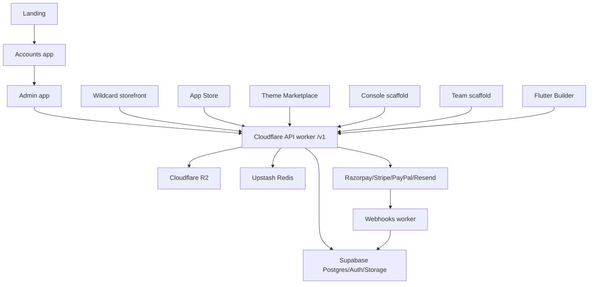

# Dependency Graph

## Runtime Graph

## Package Dependency Direction

- Apps may import shared packages.
- Workers may import worker-local libraries and shared TypeScript contracts when workspace packaging supports it.
- Shared packages must not import apps.
- `packages/typescript/api-types` should remain UI-free and side-effect-light.
- `packages/typescript/ui` should remain framework-design focused and must not import app routing, Supabase service role clients, or worker internals.
- Dart apps may import `packages/dart/*`; Dart shared packages must not import app-specific screens.

## Current Coupling Patterns

- Accounts and admin call worker APIs through signed internal worker clients.
- Storefront uses worker APIs for public and internal commerce flows, with some privileged internal calls protected by static internal secrets.
- App-store and theme-marketplace use app-local service wrappers around worker APIs.
- Theme schemas are shared through `packages/typescript/api-types`, while runtime validation lives in worker theme services and rendering lives in storefront.
- Webhooks worker writes directly to Supabase because provider callbacks cannot rely on user-session worker auth.

## Forbidden Dependencies

- Client components must not import service-role Supabase clients.
- Shared packages must not depend on app-specific route handlers.
- Storefront customer auth must not depend on merchant/admin session state.
- Migrations must not depend on generated app artifacts.
- Theme runtime must not execute arbitrary tenant JavaScript.
- Console/team privileged operations must not bypass worker audit, RBAC, and tenant controls.

## Approved Integration Contracts

- HTTP API: `/v1` worker routes, exposed through `/api/v1` at Next app boundaries when needed.
- Validation: Zod schemas in `backend/workers/api/src/schemas` for inbound worker payloads.
- Tenant context: `TenantContext`, store ownership checks, memberships, roles, permissions, and explicit public-published checks.
- Events: outbox events, queue jobs, webhook deliveries, and audit activity events.
- Theme: schema registry, approved renderer keys, draft/release workflow, data-binding engine, template resolver.
