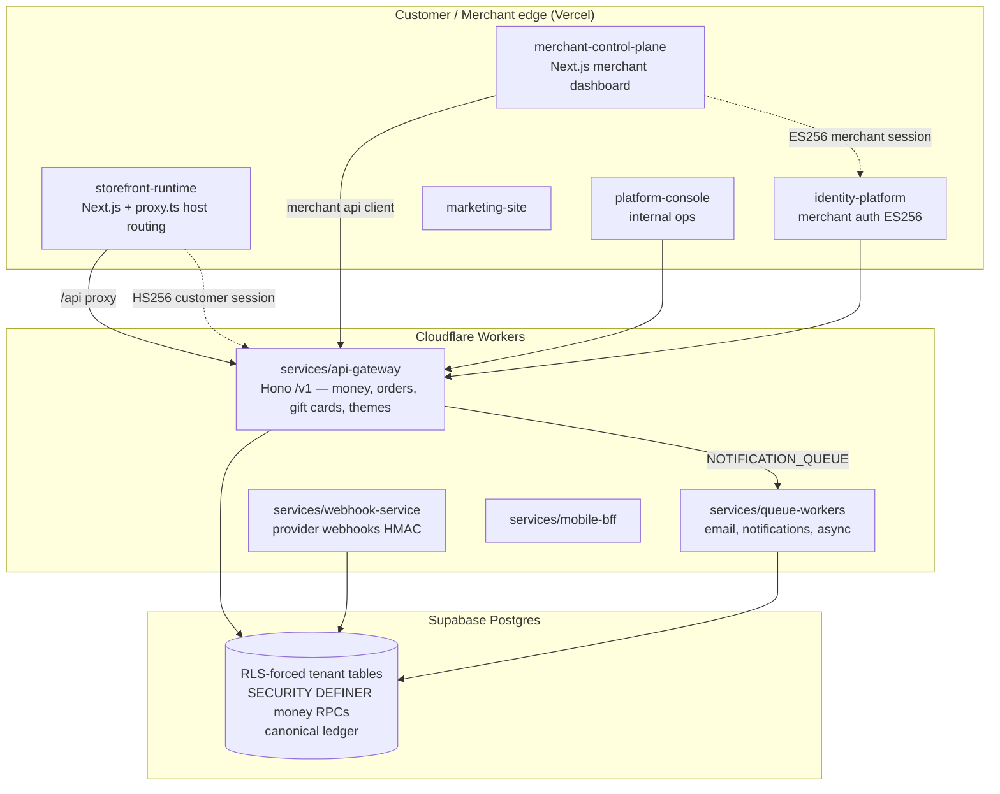

# LetBuyy Repository Map

> Hand-authored from repository truth + the Graphify code graph (52,246 nodes / 66,761 edges / 3,279 communities over 3,677 files). Governance source of truth remains `GOVERNANCE_REWRITE_2026_06_10/LETBUYY_CONSTITUTION.md` → root `AGENTS.md` → local `AGENTS.md`.

## 1. Topology at a glance

## 2. Apps (`apps/*`) — canonical runtime targets

| App | Stack | Role | Deploy |
|-----|-------|------|--------|
| `storefront-runtime` | Next.js 16 | Customer storefront; subdomain/custom-domain routing via `src/proxy.ts`; React theme render path (Liquid canary-off) | Vercel |
| `merchant-control-plane` | Next.js 16 | Merchant dashboard — products, collections, inventory, orders, shipping, GST, discounts, gift cards, appearance, settings | Vercel |
| `identity-platform` | Next.js 16 | Merchant identity/auth UI (ES256 issuer) | Vercel |
| `marketing-site` | Next.js 16 | Public marketing | Vercel |
| `platform-console` | Next.js 16 | Internal operator console | Vercel |
| `mobile/merchant-app` | Flutter/Dart | Merchant mobile app (~5,134 graph nodes — largest single tree) | store release |

Frozen / pending consolidation (NOT production deploy targets): `app-marketplace`, `theme-marketplace`, `developer-portal`, `platform-operations-portal`. Reserved (manifest-only): `mobile/shopper-app`, `mobile/operator-app`.

## 3. Services (`services/*`) — Cloudflare Workers

| Service | Stack | Role |
|---------|-------|------|
| `api-gateway` | Hono | The canonical `/v1` gateway — orders, checkout, payments, refunds, payouts, gift cards, products, themes, customers. ~3,623 graph nodes; 140 `route.ts` route files across apps proxy into it. |
| `queue-workers` | Workers + Queues | Transactional email (Resend), notifications, async jobs (`isTransactionalEmailJob`). |
| `webhook-service` | Workers | Provider webhook ingestion with HMAC verification. |
| `mobile-bff` | Workers | Backend-for-frontend for the Flutter merchant app (Turnstile-gated login). |

Reserved (manifest-only, not implemented): `checkout-runtime`, `search-service`, `media-service`, `notification-service`, `event-bus`, `analytics-pipeline`.

## 4. Packages (`packages/*`) — shared domain cores

| Package | Purpose |
|---------|---------|
| `commerce-core` | Product/collection/gift-card schemas + helpers (`CreateGiftCardSchema`, `generateGiftCardCodeFromBytes`). |
| `checkout-core` | Checkout/refund schemas (`gift_card_code`, refund methods). |
| `auth-core` | Customer session (HS256) + storefront gate tokens. |
| `commerce-core` / `event-core` / `billing-core` / `notification-core` | Domain logic + canonical email templates. |
| `theme-engine` | Liquid + JSON renderer (`JsonContractThemeRenderer`, `LiquidRenderer`); server-only `jsdom` sanitizer (webpackIgnore-isolated from client bundles). |
| `shared-types` | Zod schemas + types (`GiftCardSchema`, platform domain). |
| `typescript/api-client` | Typed gateway client used by every app proxy. |
| `typescript/ui` | Design-system component library (`@letbuyy/ui`). |
| `infrastructure` | Supabase/Resend/Razorpay adapters. |
| `dart/api_client` | Flutter API client. |

## 5. Auth & identity

- **Two issuers, never crossed:** merchant sessions are **ES256** (identity-platform); customer sessions are **HS256** via `CUSTOMER_SESSION_SECRET` (`issueCustomerSession`). Enforced by the identity-sole-issuer governance validator.
- Step-up auth (HMAC-SHA256) gates refunds/payouts. Turnstile + rate-limit gate registration/login.

## 6. Databases & schemas

- **Supabase Postgres**, migrations under `database/supabase/migrations/` (sequential, baseline `000_baseline.sql` + 001..174). Highest: `174_v1_gift_card_refund_restore.sql`.
- **RLS forced** on tenant tables (`rls-force-coverage` validator); no public `USING (true)` policies.
- **Money = canonical ledger only:** all money mutations are `SECURITY DEFINER` RPCs (`create_checkout_order`, `confirm_order_payment_with_ledger`, `complete_order_refund`, `issue_gift_card`, `set_gift_card_status`, `restore_gift_card_on_refund`). TS never writes money tables directly (`canonical-ledger-only` validator).

## 7. Workflows (`.github/workflows/`)

`ci.yml`, `production-deploy.yml` (workers + Vercel matrix + gated `supabase db push`), `staging-deploy.yml`, `branch-lag-monitor.yml`, `architecture-governance.yml`, `live-production-certification.yml`, `hot-table-partition-maintenance.yml`, + the AI-infra additions (`security-review.yml`, `full-security-audit.yml`).

## 8. Governance

`node scripts/validate-governance.mjs` runs **107 validators** (domain-boundary, route-ownership, route-line-count ≤1500, sequential-migration, rollback-integrity, canonical-ledger-only, rls-force-coverage, no-public-USING-true, theme-governance, no-new-react-sections, whole-repo-end-state, …). Must pass green after any topology/import/migration/governance change.
