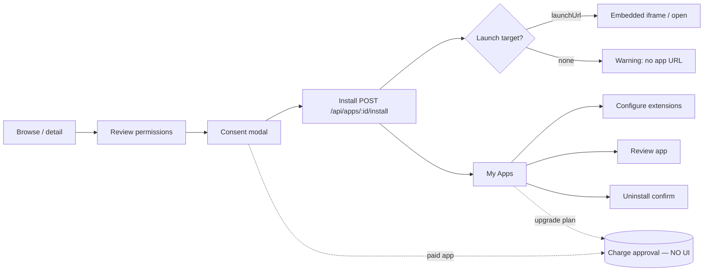

# App Installation Journey Audit (Phase 9)

**Parent:** [`../LETBUYY_APPS_MARKETPLACE_MASTER_AUDIT.md`](../LETBUYY_APPS_MARKETPLACE_MASTER_AUDIT.md) · **Date:** 2026-06-07

Step-by-step simulation of the merchant journey: **browse → view permissions → install → authorize → configure → use → upgrade plan → cancel → uninstall.** Each step is rated and friction is cited.

## Journey map

## Step-by-step

| Step | What happens | Friction | Grade |
|---|---|---|---|
| **Browse** | Detail page is rich (hero, preview, pricing, permissions, reviews, trust) (`apps/[slug]/page.tsx`) | Screenshots are placeholders if none; empty catalog | B |
| **View permissions** | Dedicated "Permission review" section + sidebar list with human-readable scope labels (`apps/[slug]/page.tsx:379-408`, `marketplace-display.ts:107`) | None — clear | A− |
| **Consent** | Modal names target store, lists each scope (label + raw code), states billing terms, links privacy/terms (`AppInstallConsentPanel.tsx:205-279`) | None — best-in-class moment | A− |
| **Install** | POST `/api/apps/:id/install` (session-gated by `proxy.ts:9` + `requireSession`) → gateway mints app token immediately (`install-lifecycle-routes.ts:128`); idempotency-aware | **Two install paths**: default direct-token; OAuth path **throws** if its flag is on (`AppInstallConsentPanel.tsx:90`) | C+ |
| **Authorize (OAuth)** | Full PKCE S256 authorize/token flow exists in backend (`billing-oauth-routes.ts:530`) | **Never invoked by UI** | F (as a UX) |
| **Launch / use** | On success, panel shows embedded `iframe` or "Open full screen" — but only from `launchUrl` | `embedUrl` hardcoded null (`:67`) → real embedded admin session never used; if no `launchUrl`, warning "listing does not expose a direct app URL" | C |
| **Configure** | "My Apps" → per-install `ExtensionConfigPanel` | **Stub**: "requires an approved BFF route" (`ExtensionConfigPanel.tsx:17`); Settings is external link or disabled button | D |
| **Upgrade plan / pay** | — | **No UI exists** to create/approve a charge; `createCharge`/`approveCharge` unused; no plans/tiers | F |
| **Cancel plan** | — | No subscription-cancel UI distinct from uninstall | F |
| **Uninstall** | "My Apps" `ConfirmDialog` with explicit data-loss note (`InstalledAppsGrid.tsx:153-166`); backend revokes token, disables subscriptions, fires `shop/redact` (`install-lifecycle-routes.ts:257,344`) | None — clean | A− |
| **Review** | Inline `ReviewComposer` on active installs → `POST /api/apps/:id/reviews` (install required) | None | B+ |

## The decisive break: the paid path

The journey is **excellent through install and uninstall**, then **falls off a cliff for anything involving money or configuration**:

- A merchant can install a `recurring`-priced app, but there is **no surface to approve its charge** — the backend `POST /charges/:id/approve` (which even verifies Razorpay payment proof, `billing-oauth-routes.ts:286-331`) is unreachable from the marketplace.
- There is **no upgrade/downgrade/cancel-plan** flow distinct from a full uninstall.
- **Configuration is a stub** despite a complete extension/function registry backend (`extension-routes.ts:73-297`).

So the realistic merchant outcome today: *install a free app, maybe launch it via an external URL, and uninstall it.* Anything paid or configurable dead-ends.

## Edge cases & states

- **Not signed in:** `proxy.ts` redirects protected routes to `accounts.letbuyy.store/lookup` (stale domain) and returns 401 for protected APIs (`proxy.ts:7,22-34`). Install consent surfaces 401/403 copy (`AppInstallConsentPanel.tsx:47-49`).
- **No launch target:** explicit warning banner (`AppInstallConsentPanel.tsx:161`, `apps/[slug]/page.tsx:611`).
- **Backend down:** `MarketplaceUnavailable` / honest errors throughout.
- **Idempotency:** install/uninstall/charges dedupe on idempotency key (`install-lifecycle-routes.ts:63`).

## Recommendations (in journey order)

1. **Build the charge-approval surface** (My Apps + detail) — wire `createCharge`/`approveCharge`; this is the missing half of the journey.
2. **Wire real configuration** — replace the `ExtensionConfigPanel` stub with `extensionRegistry`/`update*Registration`.
3. **Wire embedded launch** — use `embedSession` instead of the hardcoded-null `embedUrl`.
4. **Add plan management** — upgrade/downgrade/cancel distinct from uninstall (needs pricing plans, Master #60).
5. **Collapse install to one path** (OAuth) and remove the throw.
6. **Add granted-scope review + per-scope revocation** in My Apps.

The install/uninstall bookends are genuinely strong; the work is to **build the middle of the journey** (pay, configure, manage) that the backend already supports.
