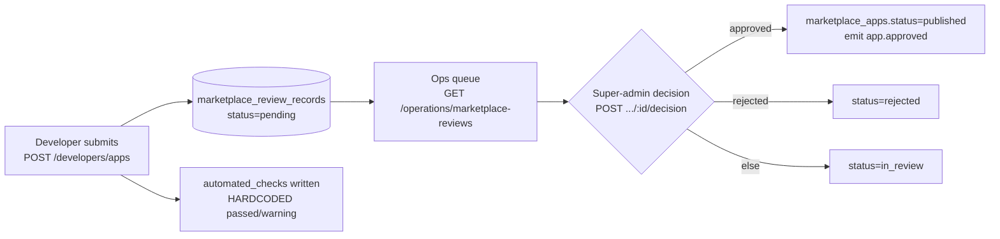

# App Review System Audit (Phase 10)

**Parent:** [`../LETBUYY_APPS_MARKETPLACE_MASTER_AUDIT.md`](../LETBUYY_APPS_MARKETPLACE_MASTER_AUDIT.md) · **Date:** 2026-06-07

How an app gets from "submitted" to "published," how malicious apps are kept out, and how this compares to Shopify's review bar. Short version: **there is a real human approval gate with proper RBAC, but the automated safety layer in front of it is fake, the published policy is a placeholder, and there is no re-review on update because updates don't exist.**

## 1. The pipeline

## 2. Submission

`POST /app-store/developers/apps` (`developer-routes.ts:576`) creates the `marketplace_apps` row and, when status ≠ `draft`, a `marketplace_review_records` row, then emits `app.submitted` (`:665-730`). Requirements to submit are thin:

- **Only a developer *profile* is required** — even a `pending` (unapproved) developer can submit (no approval check at submit).
- The manifest is validated (real Zod validation, `developer-routes.ts:603`), which is genuine.
- **But the four "automated checks" are decorative**: `schema_validation`, `developer_profile`, `extension_lifecycle_contract`, etc. are written as `'passed'`/`'warning'` **regardless of the payload** (`developer-routes.ts:683-701`). They look like a safety gate on the review record but perform no scanning.

## 3. Review & decision

The decision endpoint is **properly locked down**: `POST /operations/marketplace-reviews/:id/decision` requires `requireRoleCategory('ops')` + `requireSuperAdmin` (`operations.ts:320,58`). `approved` flips `marketplace_apps.status` to `published` and emits `app.approved` (`operations.ts:136,171`); `rejected` → `rejected`; anything else → `in_review`. This is the strongest part of the review system — a real RBAC-gated human gate.

**But:** it lives entirely in the **platform-operations-portal**, not the marketplace, and there is **no developer-facing view of review status beyond the dashboard badge** plus the changes_requested/rejected action section (`developers/dashboard/page.tsx:321-336`). The published *policy/rubric* a developer would prepare against is a **placeholder** (`review-requirements/page.tsx:18,35`).

## 4. How are malicious apps prevented?

| Threat | Control present? | Evidence |
|---|---|---|
| Malicious manifest / bad schema | Partial — Zod manifest validation real | `developer-routes.ts:603` |
| Over-broad scopes | Partial — scopes constrained to app's allowed set; enforced at runtime | `app-engine:1330`, `app-auth.ts:86` |
| Malicious code / static analysis | **No** — no security scanning | none found |
| Phishing redirect URIs | Partial — OAuth redirect URIs HTTPS-validated | `app-engine:1352` |
| Data exfiltration via app API | Partial — scoped tokens, secret-key writes rejected | `app-api.ts:95-124` |
| Abusive reviews | Weak — one review per user/app; install required; **no abuse reporting (buttons disabled)** | `app_reviews` unique; `apps/[slug]:493` |
| Malicious updates | **N/A** — no update path, so also no update review | §Master flow 5 |

The runtime controls (scope enforcement, redirect validation, secret rejection) are real and good. The **pre-publish safety layer is the gap**: no static/security scan, and the "automated checks" are theater.

## 5. Versus Shopify

| | Shopify | LetBuyy |
|---|---|---|
| Automated checks before human | Real (install, OAuth, performance, GDPR webhook presence) | **Hardcoded passed** |
| Human review | Yes | Yes (super-admin) |
| Published guidelines/rubric | Detailed, public | Placeholder page |
| Mandatory GDPR webhooks enforced at review | Yes (rejection if absent) | Auto-subscribed at install (present), but **not verified as a review gate** |
| Re-review on update | Yes | No update path |
| Quality program (Built for Shopify) | Yes (perf p95<500ms, Lighthouse, design, integration, annual re-review) | **None** |

## 6. Recommendations

1. **Make the automated checks real** — manifest+scope sanity, redirect-URI/HTTPS validation, mandatory-webhook presence, a basic static/security scan, broken-link checks — and **block** the human queue on hard failures instead of writing `passed`.
2. **Gate submission on developer approval** (don't let `pending` developers submit) and **build self-serve approval** (Master #5).
3. **Publish a real review policy + rubric + SLA** (replace the placeholder).
4. **Add a developer-facing review-status timeline** with reviewer notes.
5. **Add update review** once the update/version path exists (Master #2), including staged rollout.
6. **Add a quality program** ("Built for LetBuyy") with measurable perf/design/integration bars and a backing DB column.
7. **Implement abuse reporting** for reviews and listings (the buttons already exist, disabled).

The bones of governance are here (RBAC human gate, runtime scope enforcement); what's missing is the **automated safety layer**, the **published policy**, and the **update-review loop**.
