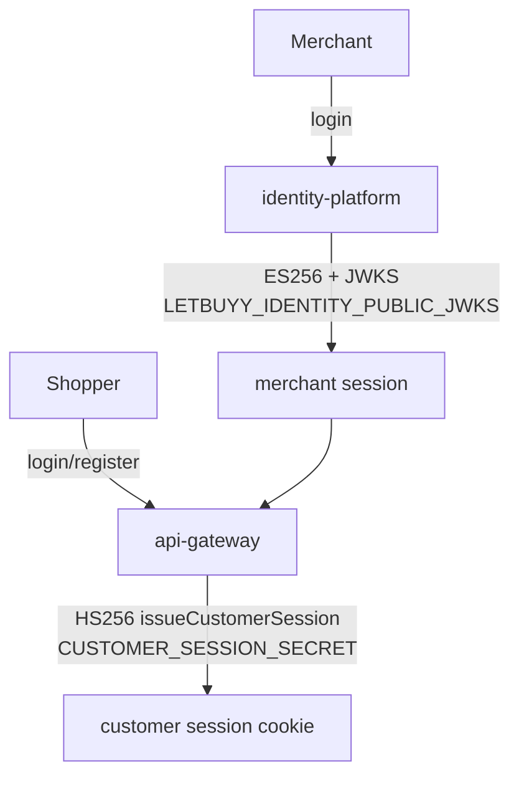

# Auth Map

## Two issuers, never crossed

| | Customer | Merchant |
|---|----------|----------|
| Issuer | api-gateway (`issueCustomerSession`, `packages/auth-core`) | identity-platform |
| Algorithm | **HS256** (`CUSTOMER_SESSION_SECRET`) | **ES256** (public JWKS) |
| Tables | `store_customers`, `customer_credentials` | merchant/users |
| Proxy | storefront `/api/customer/*` → gateway | merchant api-client |

## Guards
- **Step-up** (HMAC-SHA256, `STEP_UP_SIGNING_SECRET`) gates refunds + payouts.
- **Registration/login** — Turnstile + rate-limit + not-exists precondition (no takeover); enumeration-safe.
- **Single-issuer invariant** — `scripts/validators/identity-sole-issuer-validator.mjs`; no code mints a merchant token with the customer secret or vice-versa.
- **Sessions** — verified (signature/expiry/audience) on every protected route.
