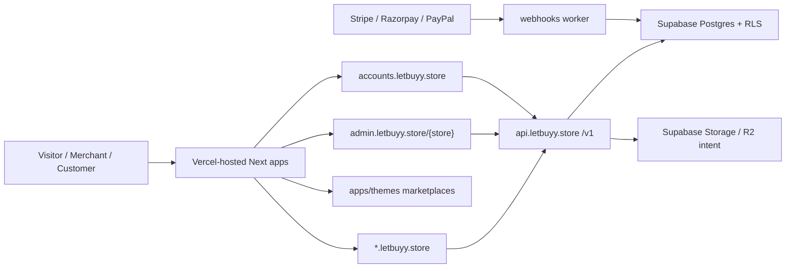
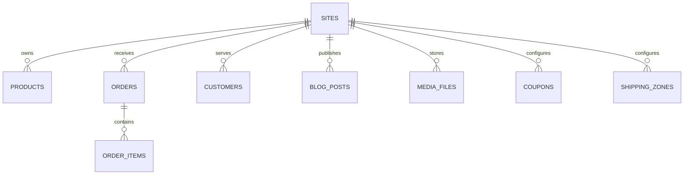

<!-- GENERATED BY scripts/generate-repository-intelligence.mjs ON 2026-05-22T11:07:13.830Z. Regenerate after architecture, routing, schema, or deployment changes. -->
# LetBuyy Master System Intelligence

> This is the repository brain for LetBuyy. It is generated from actual source files, manifests, migrations, route handlers, middleware, workers, package boundaries, infrastructure files, tasks, and lessons. It intentionally uses env variable names only and never copies secret values.

## 1. Platform Overview

LetBuyy is a multi-tenant SaaS platform for e-commerce stores, portfolios, resumes, blogs, landing pages, theme marketplace, app marketplace, internal platform operations, and native builder workflows. The platform strategy is Shopify-class: tenants own sites/stores, storefronts are resolved by subdomain or custom domain, merchants manage operations through an admin dashboard, and shared backend APIs enforce identity, isolation, payments, inventory, content, and analytics.

- Business model: Free, Starter, Business, Enterprise tiers plus app/theme marketplace revenue.
- Current platform source roots: apps/flutter/builder, apps/flutter/super_admin, apps/flutter/team, apps/web/administrative/console, apps/web/administrative/team, apps/web/consumer/accounts, apps/web/consumer/admin, apps/web/consumer/app-store, apps/web/consumer/landing, apps/web/consumer/storefront, apps/web/consumer/theme-marketplace, backend/workers/api, backend/workers/webhooks, packages/dart/core, packages/dart/models, packages/dart/services, packages/dart/ui_kit, packages/typescript/api-types, packages/typescript/ui, packages/typescript/utils.
- Current source files scanned: 1301.
- Current package manifests: 15.
- Current Supabase migrations: 55.
- Current Next routes/pages/layouts/handlers: 276.
- Current Hono route modules: 30.

## 2. Complete Tech Stack Analysis

### Package Manifests

#### @letbuyy/console

- Package: @letbuyy/console
- File: apps/web/administrative/console/package.json
- Scripts: dev, build, start, lint
- Runtime dependencies: @letbuyy/api-types, @letbuyy/ui, @letbuyy/utils, @supabase/ssr, @supabase/supabase-js, lucide-react, next, react, react-dom
- Dev dependencies: @tailwindcss/postcss, @types/node, @types/react, @types/react-dom, eslint, eslint-config-next, tailwindcss, typescript
- Peer dependencies: none declared

#### @letbuyy/team

- Package: @letbuyy/team
- File: apps/web/administrative/team/package.json
- Scripts: dev, build, start, lint
- Runtime dependencies: @letbuyy/api-types, @letbuyy/ui, @letbuyy/utils, @supabase/ssr, @supabase/supabase-js, lucide-react, next, react, react-dom
- Dev dependencies: @tailwindcss/postcss, @types/node, @types/react, @types/react-dom, eslint, eslint-config-next, tailwindcss, typescript
- Peer dependencies: none declared

#### @letbuyy/accounts

- Package: @letbuyy/accounts
- File: apps/web/consumer/accounts/package.json
- Scripts: dev, build, start, lint
- Runtime dependencies: @letbuyy/api-types, @letbuyy/utils, @react-email/components, @supabase/ssr, @supabase/supabase-js, @upstash/ratelimit, @upstash/redis, bcryptjs, jose, next, react, react-dom, react-email, resend
- Dev dependencies: @tailwindcss/postcss, @types/node, @types/react, @types/react-dom, eslint, eslint-config-next, tailwindcss, typescript
- Peer dependencies: none declared

#### @letbuyy/admin

- Package: @letbuyy/admin
- File: apps/web/consumer/admin/package.json
- Scripts: dev, build, start, lint
- Runtime dependencies: @letbuyy/api-types, @letbuyy/ui, @letbuyy/utils, lucide-react, next, react, react-dom
- Dev dependencies: @tailwindcss/postcss, @types/node, @types/react, @types/react-dom, eslint, eslint-config-next, tailwindcss, typescript
- Peer dependencies: none declared

#### @letbuyy/app-store

- Package: @letbuyy/app-store
- File: apps/web/consumer/app-store/package.json
- Scripts: dev, build, start, lint
- Runtime dependencies: @letbuyy/api-types, @letbuyy/ui, @letbuyy/utils, @supabase/ssr, @supabase/supabase-js, jose, lucide-react, next, react, react-dom
- Dev dependencies: @tailwindcss/postcss, @types/node, @types/react, @types/react-dom, eslint, eslint-config-next, tailwindcss, typescript
- Peer dependencies: none declared

#### @letbuyy/landing

- Package: @letbuyy/landing
- File: apps/web/consumer/landing/package.json
- Scripts: dev, build, start, lint
- Runtime dependencies: @gsap/react, @letbuyy/api-types, @letbuyy/utils, @supabase/ssr, @supabase/supabase-js, framer-motion, gsap, lenis, next, react, react-dom
- Dev dependencies: @tailwindcss/postcss, @types/node, @types/react, @types/react-dom, eslint, eslint-config-next, tailwindcss, typescript
- Peer dependencies: none declared

#### @letbuyy/storefront

- Package: @letbuyy/storefront
- File: apps/web/consumer/storefront/package.json
- Scripts: dev, build, start, lint
- Runtime dependencies: @letbuyy/api-types, @letbuyy/utils, @paypal/checkout-server-sdk, @vercel/speed-insights, clsx, framer-motion, jose, lucide-react, next, react, react-dom, server-only, stripe, tailwind-merge
- Dev dependencies: @tailwindcss/postcss, @types/node, @types/react, @types/react-dom, eslint, eslint-config-next, tailwindcss, typescript
- Peer dependencies: none declared

#### @letbuyy/theme-marketplace

- Package: @letbuyy/theme-marketplace
- File: apps/web/consumer/theme-marketplace/package.json
- Scripts: dev, build, start, lint
- Runtime dependencies: @letbuyy/api-types, @letbuyy/utils, @supabase/ssr, @supabase/supabase-js, clsx, framer-motion, lucide-react, next, react, react-dom, server-only, stripe, tailwind-merge
- Dev dependencies: @tailwindcss/postcss, @types/node, @types/react, @types/react-dom, eslint, eslint-config-next, tailwindcss, typescript
- Peer dependencies: none declared

#### letbuyy-functions

- Package: letbuyy-functions
- File: backend/_legacy/functions/package.json
- Scripts: lint, build, serve, predeploy, deploy, logs
- Runtime dependencies: @google-cloud/run, @google-cloud/vision, bcryptjs, cors, firebase-admin, firebase-functions, googleapis, nodemailer, otplib
- Dev dependencies: @types/bcryptjs, @types/cors, @types/node, @types/nodemailer, @typescript-eslint/eslint-plugin, @typescript-eslint/parser, eslint, eslint-config-google, eslint-plugin-import, firebase-functions-test, typescript
- Peer dependencies: none declared

#### @letbuyy/api

- Package: @letbuyy/api
- File: backend/workers/api/package.json
- Scripts: dev, deploy, typecheck
- Runtime dependencies: @letbuyy/api-types, @supabase/supabase-js, bcryptjs, hono, zod
- Dev dependencies: @cloudflare/workers-types, typescript, wrangler
- Peer dependencies: none declared

#### @letbuyy/webhooks

- Package: @letbuyy/webhooks
- File: backend/workers/webhooks/package.json
- Scripts: dev, deploy, typecheck
- Runtime dependencies: hono
- Dev dependencies: @cloudflare/workers-types, typescript, wrangler
- Peer dependencies: none declared

#### letbuyy-store

- Package: letbuyy-store
- File: package.json
- Scripts: preinstall, build, dev, lint, typecheck
- Runtime dependencies: none declared
- Dev dependencies: turbo
- Peer dependencies: none declared

#### @letbuyy/api-types

- Package: @letbuyy/api-types
- File: packages/typescript/api-types/package.json
- Scripts: build, typecheck
- Runtime dependencies: none declared
- Dev dependencies: typescript
- Peer dependencies: none declared

#### @letbuyy/ui

- Package: @letbuyy/ui
- File: packages/typescript/ui/package.json
- Scripts: build, typecheck
- Runtime dependencies: none declared
- Dev dependencies: @types/react, react, typescript
- Peer dependencies: react, react-dom

#### @letbuyy/utils

- Package: @letbuyy/utils
- File: packages/typescript/utils/package.json
- Scripts: build, typecheck
- Runtime dependencies: @supabase/supabase-js
- Dev dependencies: @types/node, typescript
- Peer dependencies: none declared

### Workspace and Build System

- Root package manager: `pnpm@10.6.2` from root `package.json`.
- Turborepo tasks: build, dev, lint, test, typecheck.
- pnpm workspace roots: web administrative apps, web consumer apps, TypeScript packages, backend workers.
- Flutter/Dart workspace exists through root `pubspec.yaml`, `analysis_options.yaml`, and package/app `pubspec.yaml` files, but Dart packages are not part of pnpm workspace.
- Vercel install command currently removes app-local Next copies before install, which signals dependency skew debt rather than a normal deployment primitive.

### Config Files

- `apps/web/administrative/console/next.config.ts`
- `apps/web/administrative/team/next.config.ts`
- `apps/web/consumer/accounts/next.config.ts`
- `apps/web/consumer/admin/next.config.ts`
- `apps/web/consumer/app-store/next.config.ts`
- `apps/web/consumer/landing/next.config.ts`
- `apps/web/consumer/storefront/next.config.ts`
- `apps/web/consumer/theme-marketplace/next.config.ts`
- `backend/workers/api/wrangler.toml`
- `backend/workers/webhooks/wrangler.toml`
- `infrastructure/dns.tf`
- `pnpm-workspace.yaml`
- `turbo.json`
- `vercel.json`
- `pubspec.yaml`

## 3. Complete Monorepo Intelligence

### Source Area Counts

| Area | Files |
|---|---:|
| administrative console | 22 |
| administrative team portal | 20 |
| app marketplace | 38 |
| cloudflare api worker | 76 |
| cloudflare webhooks worker | 4 |
| consumer admin merchant app | 161 |
| consumer auth app | 58 |
| consumer storefront app | 203 |
| documentation | 95 |
| flutter builder | 150 |
| flutter super admin | 18 |
| flutter team | 18 |
| infrastructure as code | 1 |
| lessons memory | 1 |
| marketing landing app | 33 |
| root or shared config | 118 |
| shared api types package | 4 |
| shared dart core package | 30 |
| shared dart models package | 54 |
| shared dart services package | 54 |
| shared dart ui kit package | 25 |
| shared web ui package | 6 |
| shared web utils package | 6 |
| supabase database | 70 |
| task memory | 1 |
| theme marketplace | 35 |

### Extension Counts

| Extension | Files |
|---|---:|
| .css | 12 |
| .dart | 292 |
| .js | 25 |
| .json | 65 |
| .kts | 9 |
| .md | 143 |
| .mjs | 18 |
| .properties | 18 |
| .sql | 70 |
| .tf | 1 |
| .toml | 3 |
| .ts | 326 |
| .tsx | 301 |
| .yaml | 18 |

### Application Boundaries

- Admin Alias: `apps/web/consumer/admin`, 161 scanned files, Compatibility AGENTS for the merchant/admin dashboard. Do not add source code under apps/admin.
- Storefront Alias: `apps/web/consumer/storefront`, 203 scanned files, Compatibility AGENTS for public storefront rendering, checkout, accounts, and theme previews.
- Merchant Alias: `apps/web/consumer/admin`, 161 scanned files, Merchant operating console alias. Source lives in consumer/admin.
- Internal Alias: `apps/web/administrative`, 42 scanned files, Internal platform governance alias covering console and team apps.
- Auth Alias: `apps/web/consumer/accounts`, 58 scanned files, Identity and onboarding portal alias. All platform auth pages belong in accounts.
- Analytics Alias: `backend/workers/api/src/routes/analytics.ts`, 1 scanned files, Analytics system ownership alias spanning worker analytics and merchant dashboards.
- Checkout Alias: `apps/web/consumer/storefront/src/app/store/[subdomain]/checkout`, 4 scanned files, Checkout ownership alias spanning storefront checkout pages and payment APIs.
- Accounts: `apps/web/consumer/accounts`, 58 scanned files, All merchant authentication, signup, password, OTP, OAuth callback, session, onboarding and store selection UI.
- Admin: `apps/web/consumer/admin`, 161 scanned files, Per-store merchant dashboard, adaptive CMS, products, orders, settings, themes, analytics, and site-type-specific operations.
- Storefront: `apps/web/consumer/storefront`, 203 scanned files, Wildcard tenant storefronts, public product catalog, customer accounts, cart, checkout, policy pages, and theme previews.
- Landing: `apps/web/consumer/landing`, 33 scanned files, Public marketing site, pricing, and conversion flow. Must not host auth pages.
- App Store: `apps/web/consumer/app-store`, 38 scanned files, Extension marketplace, developer app submission, app search, install routes and app review APIs.
- Theme Marketplace: `apps/web/consumer/theme-marketplace`, 35 scanned files, Theme catalog, theme detail pages, checkout, Supabase-backed theme service, and theme acquisition workflow.
- Console: `apps/web/administrative/console`, 22 scanned files, Super admin scaffold for platform operations, users, stores, subscriptions, analytics, employees, audit logs, and MFA.
- Team: `apps/web/administrative/team`, 20 scanned files, Employee portal scaffold for support, operations, users, stores, marketing and invite flows.
- Flutter Builder: `apps/flutter/builder`, 150 scanned files, Native/mobile store builder, editor, dashboard, products, themes, preview systems and merchant operations.
- Flutter Super Admin: `apps/flutter/super_admin`, 18 scanned files, Native super admin scaffold.
- Flutter Team: `apps/flutter/team`, 18 scanned files, Native team scaffold.

### Package Boundaries

- UI Alias: `packages/typescript/ui`, 6 scanned files, Shared web UI component alias.
- Database Alias: `backend/supabase`, 70 scanned files, Database schema, migrations, RLS, seed and Supabase config ownership alias.
- API Alias: `backend/workers/api`, 76 scanned files, Cloudflare Hono API worker ownership alias.
- Shared Alias: `packages`, 179 scanned files, Shared TypeScript and Dart contracts, utilities, services, and models.
- Config Alias: `.`, 0 scanned files, Root workspace, Vercel, Turborepo, pnpm, Cloudflare, Supabase and Terraform config governance.
- Auth Alias: `packages/typescript/utils/src/auth.ts`, 1 scanned files, Shared auth helper and platform identity governance alias.
- Analytics Alias: `backend/workers/api/src/routes/analytics.ts`, 1 scanned files, Shared analytics contract and event governance alias.
- Payments Alias: `backend/workers/api/src/routes/payments.ts`, 1 scanned files, Payment route, checkout provider and webhook governance alias.
- TypeScript UI: `packages/typescript/ui`, 6 scanned files, Shared Button, Input, DataTable package and design-system extraction point.
- TypeScript Utils: `packages/typescript/utils`, 6 scanned files, Shared Supabase, API and auth utility package.
- API Types: `packages/typescript/api-types`, 4 scanned files, Shared TypeScript domain and API contract package.
- Dart Core: `packages/dart/core`, 30 scanned files, Dart constants, config, responsive helpers and platform utility package.
- Dart Models: `packages/dart/models`, 54 scanned files, Dart commerce, seller, order, cart, analytics, return and notification models.
- Dart Services: `packages/dart/services`, 54 scanned files, Dart data, payment, analytics, order, auth, storage and notification services.
- Dart UI Kit: `packages/dart/ui_kit`, 25 scanned files, Flutter widgets, themes, empty/loading/error states, and app UI primitives.

## 4. Full Authentication Intelligence

| File | Area | Lines | Route Surface | Flags |
|---|---:|---:|---|---|
| `apps/flutter/builder/ios/Runner/Assets.xcassets/AppIcon.appiconset/Contents.json` | flutter builder | 1 | source | none |
| `apps/flutter/builder/lib/app/auth_wrapper.dart` | flutter builder | 156 | source | none |
| `apps/flutter/builder/lib/models/store_auth_request_model.dart` | flutter builder | 127 | source | none |
| `apps/flutter/builder/lib/screens/auth/error_screen.dart` | flutter builder | 98 | source | TODO/FIXME/HACK |
| `apps/flutter/builder/lib/screens/auth/login_screen.dart` | flutter builder | 642 | source | none |
| `apps/flutter/builder/lib/services/store_auth_service.dart` | flutter builder | 161 | source | none |
| `apps/web/administrative/console/src/app/(auth)/login/page.tsx` | administrative console | 54 | page:/login | TODO/FIXME/HACK |
| `apps/web/administrative/console/src/app/(auth)/mfa/page.tsx` | administrative console | 42 | page:/mfa | TODO/FIXME/HACK |
| `apps/web/administrative/console/src/app/page.tsx` | administrative console | 7 | page:/ | TODO/FIXME/HACK |
| `apps/web/administrative/team/src/app/(auth)/invite/page.tsx` | administrative team portal | 49 | page:/invite | TODO/FIXME/HACK |
| `apps/web/administrative/team/src/app/(auth)/login/page.tsx` | administrative team portal | 47 | page:/login | TODO/FIXME/HACK |
| `apps/web/administrative/team/src/app/page.tsx` | administrative team portal | 6 | page:/ | none |
| `apps/web/consumer/accounts/.vercel/project.json` | consumer auth app | 1 | source | none |
| `apps/web/consumer/accounts/README.md` | consumer auth app | 39 | source | none |
| `apps/web/consumer/accounts/eslint.config.mjs` | consumer auth app | 28 | source | none |
| `apps/web/consumer/accounts/next-env.d.ts` | consumer auth app | 7 | source | none |
| `apps/web/consumer/accounts/next.config.ts` | consumer auth app | 10 | source | none |
| `apps/web/consumer/accounts/package.json` | consumer auth app | 38 | source | rate limiting reference |
| `apps/web/consumer/accounts/postcss.config.mjs` | consumer auth app | 8 | source | none |
| `apps/web/consumer/accounts/src/app/api/auth/accounts/route.ts` | consumer auth app | 18 | route:/api/auth/accounts | none |
| `apps/web/consumer/accounts/src/app/api/auth/create-store/route.ts` | consumer auth app | 124 | route:/api/auth/create-store | CSRF reference, console.error |
| `apps/web/consumer/accounts/src/app/api/auth/login/route.ts` | consumer auth app | 130 | route:/api/auth/login | CSRF reference, console.error, rate limiting reference |
| `apps/web/consumer/accounts/src/app/api/auth/logout/route.ts` | consumer auth app | 66 | route:/api/auth/logout | CSRF reference, console.error |
| `apps/web/consumer/accounts/src/app/api/auth/lookup/route.ts` | consumer auth app | 61 | route:/api/auth/lookup | console.error, rate limiting reference |
| `apps/web/consumer/accounts/src/app/api/auth/reset-password/route.ts` | consumer auth app | 129 | route:/api/auth/reset-password | CSRF reference, console.error, rate limiting reference |
| `apps/web/consumer/accounts/src/app/api/auth/send-magic/route.ts` | consumer auth app | 80 | route:/api/auth/send-magic | CSRF reference, console.error, rate limiting reference |
| `apps/web/consumer/accounts/src/app/api/auth/send-reset/route.ts` | consumer auth app | 71 | route:/api/auth/send-reset | CSRF reference, console.error, rate limiting reference |
| `apps/web/consumer/accounts/src/app/api/auth/session/route.ts` | consumer auth app | 27 | route:/api/auth/session | console.error |
| `apps/web/consumer/accounts/src/app/api/auth/set-password/route.ts` | consumer auth app | 105 | route:/api/auth/set-password | CSRF reference, console.error, rate limiting reference |
| `apps/web/consumer/accounts/src/app/api/auth/signup/route.ts` | consumer auth app | 118 | route:/api/auth/signup | CSRF reference, console.error, rate limiting reference |
| `apps/web/consumer/accounts/src/app/api/auth/stores/route.ts` | consumer auth app | 54 | route:/api/auth/stores | console.error |
| `apps/web/consumer/accounts/src/app/api/auth/switch/route.ts` | consumer auth app | 94 | route:/api/auth/switch | CSRF reference, console.error |
| `apps/web/consumer/accounts/src/app/api/auth/validate-subdomain/route.ts` | consumer auth app | 29 | route:/api/auth/validate-subdomain | none |
| `apps/web/consumer/accounts/src/app/api/auth/verify-otp/route.ts` | consumer auth app | 67 | route:/api/auth/verify-otp | CSRF reference, console.error, rate limiting reference |
| `apps/web/consumer/accounts/src/app/api/auth/verify/route.ts` | consumer auth app | 127 | route:/api/auth/verify | console.error, rate limiting reference |
| `apps/web/consumer/accounts/src/app/api/email/store-creation-failure/route.ts` | consumer auth app | 59 | route:/api/email/store-creation-failure | console.error |
| `apps/web/consumer/accounts/src/app/api/email/store-creation-success/route.ts` | consumer auth app | 47 | route:/api/email/store-creation-success | console.error |
| `apps/web/consumer/accounts/src/app/auth/callback/route.ts` | consumer auth app | 117 | route:/auth/callback | console.error |
| `apps/web/consumer/accounts/src/app/check-email/page.tsx` | consumer auth app | 184 | page:/check-email | CSRF reference, client component, inline React style, uses localStorage |
| `apps/web/consumer/accounts/src/app/forgot-password/page.tsx` | consumer auth app | 161 | page:/forgot-password | CSRF reference, client component, rate limiting reference, uses localStorage |
| `apps/web/consumer/accounts/src/app/globals.css` | consumer auth app | 1232 | source | none |
| `apps/web/consumer/accounts/src/app/layout.tsx` | consumer auth app | 56 | layout:/ | TypeScript any, uses localStorage |
| `apps/web/consumer/accounts/src/app/login/page.tsx` | consumer auth app | 414 | page:/login | CSRF reference, client component, inline React style, uses localStorage |
| `apps/web/consumer/accounts/src/app/lookup/page.tsx` | consumer auth app | 597 | page:/lookup | CSRF reference, TypeScript any, client component, inline React style |
| `apps/web/consumer/accounts/src/app/onboarding/page.tsx` | consumer auth app | 912 | page:/onboarding | CSRF reference, client component, inline React style, uses localStorage |
| `apps/web/consumer/accounts/src/app/page.tsx` | consumer auth app | 7 | page:/ | none |
| `apps/web/consumer/accounts/src/app/reset-password/page.tsx` | consumer auth app | 248 | page:/reset-password | CSRF reference, client component, inline React style, uses localStorage |
| `apps/web/consumer/accounts/src/app/select/page.tsx` | consumer auth app | 186 | page:/select | client component, inline React style, uses localStorage |
| `apps/web/consumer/accounts/src/app/set-password/page.tsx` | consumer auth app | 273 | page:/set-password | CSRF reference, client component, inline React style, uses localStorage |
| `apps/web/consumer/accounts/src/app/signup/page.tsx` | consumer auth app | 669 | page:/signup | CSRF reference, client component, inline React style, rate limiting reference |
| `apps/web/consumer/accounts/src/components/AuthIcon.tsx` | consumer auth app | 268 | source | none |
| `apps/web/consumer/accounts/src/components/TurnstileWidget.tsx` | consumer auth app | 144 | source | TypeScript any, client component |
| `apps/web/consumer/accounts/src/lib/api/worker-client.ts` | consumer auth app | 111 | source | none |
| `apps/web/consumer/accounts/src/lib/auth/cookies.ts` | consumer auth app | 182 | source | CSRF reference, TypeScript any |
| `apps/web/consumer/accounts/src/lib/auth/csrf.ts` | consumer auth app | 26 | source | CSRF reference |
| `apps/web/consumer/accounts/src/lib/auth/device.ts` | consumer auth app | 102 | source | none |
| `apps/web/consumer/accounts/src/lib/auth/password.ts` | consumer auth app | 44 | source | none |
| `apps/web/consumer/accounts/src/lib/auth/session.ts` | consumer auth app | 88 | source | none |
| `apps/web/consumer/accounts/src/lib/auth/tokens.ts` | consumer auth app | 122 | source | TypeScript any |
| `apps/web/consumer/accounts/src/lib/config/features.ts` | consumer auth app | 18 | source | none |
| `apps/web/consumer/accounts/src/lib/config/urls.ts` | consumer auth app | 29 | source | none |
| `apps/web/consumer/accounts/src/lib/csrf-client.ts` | consumer auth app | 24 | source | CSRF reference |
| `apps/web/consumer/accounts/src/lib/db/schema.sql` | consumer auth app | 73 | source | none |
| `apps/web/consumer/accounts/src/lib/email/resend.ts` | consumer auth app | 396 | source | console.error |
| `apps/web/consumer/accounts/src/lib/rate-limit.ts` | consumer auth app | 83 | source | rate limiting reference |
| `apps/web/consumer/accounts/src/lib/supabase/client.ts` | consumer auth app | 9 | source | none |
| `apps/web/consumer/accounts/src/lib/supabase/server.ts` | consumer auth app | 34 | source | none |
| `apps/web/consumer/accounts/src/lib/turnstile.ts` | consumer auth app | 42 | source | console.error |
| `apps/web/consumer/accounts/src/proxy.ts` | consumer auth app | 68 | source | CSRF reference |
| `apps/web/consumer/accounts/tsconfig.json` | consumer auth app | 35 | source | none |
| `apps/web/consumer/admin/src/app/[store]/access_account/checkout/select-plan/page.tsx` | consumer admin merchant app | 49 | page:/[store]/access_account/checkout/select-plan | none |
| `apps/web/consumer/admin/src/app/[store]/dashboard/page.tsx` | consumer admin merchant app | 113 | page:/[store]/dashboard | none |
| `apps/web/consumer/admin/src/app/[store]/layout.tsx` | consumer admin merchant app | 44 | layout:/[store] | none |
| `apps/web/consumer/admin/src/app/[store]/login/page.tsx` | consumer admin merchant app | 31 | page:/[store]/login | client component |
| `apps/web/consumer/admin/src/app/[store]/settings/layout.tsx` | consumer admin merchant app | 35 | layout:/[store]/settings | none |
| `apps/web/consumer/admin/src/app/[store]/settings/subscribe/checkout/page.tsx` | consumer admin merchant app | 53 | page:/[store]/settings/subscribe/checkout | none |
| `apps/web/consumer/admin/src/app/api/auth/logout/route.ts` | consumer admin merchant app | 61 | route:/api/auth/logout | console.error |
| `apps/web/consumer/admin/src/app/api/subscribe/status/route.ts` | consumer admin merchant app | 71 | route:/api/subscribe/status | console.error, payment provider reference |
| `apps/web/consumer/admin/src/app/api/themes/[themeId]/preview-session/route.ts` | consumer admin merchant app | 41 | route:/api/themes/[themeId]/preview-session | none |
| `apps/web/consumer/admin/src/app/page.tsx` | consumer admin merchant app | 38 | page:/ | none |
| `apps/web/consumer/admin/src/app/stores/page.tsx` | consumer admin merchant app | 23 | page:/stores | none |
| `apps/web/consumer/admin/src/lib/auth/session.ts` | consumer admin merchant app | 126 | source | none |
| `apps/web/consumer/app-store/src/app/(auth)/developers/apps/new/page.tsx` | app marketplace | 298 | page:/developers/apps/new | client component, inline React style |
| `apps/web/consumer/app-store/src/app/(auth)/developers/dashboard/page.tsx` | app marketplace | 220 | page:/developers/dashboard | inline React style |
| `apps/web/consumer/app-store/src/app/(auth)/developers/page.tsx` | app marketplace | 127 | page:/developers | inline React style, webhook reference |
| `apps/web/consumer/app-store/src/app/(auth)/developers/register/page.tsx` | app marketplace | 275 | page:/developers/register | client component, inline React style |
| `apps/web/consumer/app-store/src/app/(auth)/my-apps/page.tsx` | app marketplace | 112 | page:/my-apps | inline React style |
| `apps/web/consumer/landing/src/app/signup/page.tsx` | marketing landing app | 23 | page:/signup | client component |
| `apps/web/consumer/storefront/consumer-storefront/coming-soon/components/shared/email-signup.tsx` | consumer storefront app | 89 | source | client component, inline React style |
| `apps/web/consumer/storefront/consumer-storefront/stores/urban-kicks/sections/newsletter.json` | consumer storefront app | 64 | source | none |
| ... | 83 more |  | See master intelligence |  |

- Accounts app has routes for lookup, login, signup, reset password, set password, check email, select store, OAuth callback, and multiple auth API handlers.
- API worker has `auth.ts`, auth schema, auth middleware, auth rate limit, and service role references for server-side Supabase operations.
- Storefront customer auth is implemented separately under storefront API routes and customer auth context.
- Console/team apps are scaffolded auth surfaces requiring production allowlists, 2FA, and audit controls before real internal operations.

## 5. Complete Storefront Architecture

| File | Area | Lines | Route Surface | Flags |
|---|---:|---:|---|---|
| `AGENT_PROMPT_claude_setup.md` | root or shared config | 656 | source | TODO/FIXME/HACK, payment provider reference, uses localStorage, webhook reference |
| `CLAUDE.md` | root or shared config | 540 | source | CSRF reference, client component, console.log, non-standard updated_at trigger name |
| `apps/flutter/builder/lib/screens/products/import_products_screen.dart` | flutter builder | 589 | source | none |
| `apps/flutter/builder/lib/screens/products/product_form_screen.dart` | flutter builder | 615 | source | none |
| `apps/flutter/builder/lib/screens/products/products_screen.dart` | flutter builder | 1116 | source | TODO/FIXME/HACK |
| `apps/flutter/builder/lib/services/product_service.dart` | flutter builder | 147 | source | none |
| `apps/flutter/builder/lib/widgets/editor/preview_sections/preview_products.dart` | flutter builder | 311 | source | none |
| `apps/flutter/builder/lib/widgets/products/bulk_action_bar.dart` | flutter builder | 150 | source | none |
| `apps/flutter/builder/lib/widgets/products/filter_tabs.dart` | flutter builder | 159 | source | none |
| `apps/flutter/builder/lib/widgets/products/product_card.dart` | flutter builder | 175 | source | none |
| `apps/flutter/builder/lib/widgets/products/product_search_bar.dart` | flutter builder | 64 | source | none |
| `apps/web/consumer/accounts/src/lib/config/urls.ts` | consumer auth app | 29 | source | none |
| `apps/web/consumer/admin/src/app/[store]/products/[productId]/page.tsx` | consumer admin merchant app | 2 | page:/[store]/products/[productId] | none |
| `apps/web/consumer/admin/src/app/[store]/products/collections/page.tsx` | consumer admin merchant app | 205 | page:/[store]/products/collections | client component, inline React style |
| `apps/web/consumer/admin/src/app/[store]/products/gift-cards/page.tsx` | consumer admin merchant app | 196 | page:/[store]/products/gift-cards | client component, inline React style |
| `apps/web/consumer/admin/src/app/[store]/products/inventory/page.tsx` | consumer admin merchant app | 140 | page:/[store]/products/inventory | client component, inline React style |
| `apps/web/consumer/admin/src/app/[store]/products/new/page.tsx` | consumer admin merchant app | 914 | page:/[store]/products/new | client component, inline React style |
| `apps/web/consumer/admin/src/app/[store]/products/page.tsx` | consumer admin merchant app | 236 | page:/[store]/products | client component, inline React style |
| `apps/web/consumer/admin/src/app/[store]/products/purchase-orders/page.tsx` | consumer admin merchant app | 37 | page:/[store]/products/purchase-orders | client component, inline React style |
| `apps/web/consumer/admin/src/app/[store]/products/transfers/page.tsx` | consumer admin merchant app | 37 | page:/[store]/products/transfers | client component, inline React style |
| `apps/web/consumer/admin/src/app/api/stores/[store]/products/[productId]/route.ts` | consumer admin merchant app | 78 | route:/api/stores/[store]/products/[productId] | none |
| `apps/web/consumer/admin/src/app/api/stores/[store]/products/import/route.ts` | consumer admin merchant app | 33 | route:/api/stores/[store]/products/import | none |
| `apps/web/consumer/admin/src/app/api/stores/[store]/products/route.ts` | consumer admin merchant app | 74 | route:/api/stores/[store]/products | none |
| `apps/web/consumer/storefront/README.md` | consumer storefront app | 40 | source | none |
| `apps/web/consumer/storefront/consumer-storefront/coming-soon/components/blog/blog-coming-soon.tsx` | consumer storefront app | 132 | source | client component, inline React style |
| `apps/web/consumer/storefront/consumer-storefront/coming-soon/components/landing/landing-coming-soon.tsx` | consumer storefront app | 133 | source | client component, inline React style |
| `apps/web/consumer/storefront/consumer-storefront/coming-soon/components/portfolio/portfolio-coming-soon.tsx` | consumer storefront app | 140 | source | client component, inline React style |
| `apps/web/consumer/storefront/consumer-storefront/coming-soon/components/resume/resume-coming-soon.tsx` | consumer storefront app | 138 | source | client component, inline React style |
| `apps/web/consumer/storefront/consumer-storefront/coming-soon/components/shared/animated-background.tsx` | consumer storefront app | 68 | source | client component, inline React style |
| `apps/web/consumer/storefront/consumer-storefront/coming-soon/components/shared/countdown-timer.tsx` | consumer storefront app | 63 | source | client component, inline React style |
| `apps/web/consumer/storefront/consumer-storefront/coming-soon/components/shared/email-signup.tsx` | consumer storefront app | 89 | source | client component, inline React style |
| `apps/web/consumer/storefront/consumer-storefront/coming-soon/components/shared/powered-by.tsx` | consumer storefront app | 20 | source | inline React style |
| `apps/web/consumer/storefront/consumer-storefront/coming-soon/components/store/store-coming-soon.tsx` | consumer storefront app | 142 | source | client component, inline React style |
| `apps/web/consumer/storefront/consumer-storefront/coming-soon/index.tsx` | consumer storefront app | 37 | source | client component |
| `apps/web/consumer/storefront/consumer-storefront/coming-soon/styles/coming-soon.css` | consumer storefront app | 533 | source | none |
| `apps/web/consumer/storefront/consumer-storefront/stores/urban-kicks/assets/custom.css` | consumer storefront app | 376 | source | none |
| `apps/web/consumer/storefront/consumer-storefront/stores/urban-kicks/assets/custom.js` | consumer storefront app | 85 | source | none |
| `apps/web/consumer/storefront/consumer-storefront/stores/urban-kicks/assets/theme.css` | consumer storefront app | 235 | source | none |
| `apps/web/consumer/storefront/consumer-storefront/stores/urban-kicks/config/settings.json` | consumer storefront app | 177 | source | none |
| `apps/web/consumer/storefront/consumer-storefront/stores/urban-kicks/dynamic/README.md` | consumer storefront app | 39 | source | none |
| `apps/web/consumer/storefront/consumer-storefront/stores/urban-kicks/dynamic/index.ts` | consumer storefront app | 172 | source | none |
| `apps/web/consumer/storefront/consumer-storefront/stores/urban-kicks/dynamic/pages/account-page.tsx` | consumer storefront app | 9 | source | none |
| `apps/web/consumer/storefront/consumer-storefront/stores/urban-kicks/dynamic/pages/cart-page.tsx` | consumer storefront app | 13 | source | none |
| `apps/web/consumer/storefront/consumer-storefront/stores/urban-kicks/dynamic/pages/checkout-page.tsx` | consumer storefront app | 10 | source | payment provider reference |
| `apps/web/consumer/storefront/consumer-storefront/stores/urban-kicks/dynamic/pages/home-page.tsx` | consumer storefront app | 66 | source | none |
| `apps/web/consumer/storefront/consumer-storefront/stores/urban-kicks/dynamic/pages/orders-page.tsx` | consumer storefront app | 9 | source | none |
| `apps/web/consumer/storefront/consumer-storefront/stores/urban-kicks/dynamic/pages/product-detail-page.tsx` | consumer storefront app | 10 | source | none |
| `apps/web/consumer/storefront/consumer-storefront/stores/urban-kicks/dynamic/pages/shop-page.tsx` | consumer storefront app | 42 | source | none |
| `apps/web/consumer/storefront/consumer-storefront/stores/urban-kicks/dynamic/section-renderer.tsx` | consumer storefront app | 83 | source | none |
| `apps/web/consumer/storefront/consumer-storefront/stores/urban-kicks/index.ts` | consumer storefront app | 30 | source | none |
| `apps/web/consumer/storefront/consumer-storefront/stores/urban-kicks/locales/en.json` | consumer storefront app | 246 | source | none |
| `apps/web/consumer/storefront/consumer-storefront/stores/urban-kicks/locales/hi.json` | consumer storefront app | 246 | source | none |
| `apps/web/consumer/storefront/consumer-storefront/stores/urban-kicks/locales/ta.json` | consumer storefront app | 246 | source | none |
| `apps/web/consumer/storefront/consumer-storefront/stores/urban-kicks/preview/README.md` | consumer storefront app | 17 | source | none |
| `apps/web/consumer/storefront/consumer-storefront/stores/urban-kicks/preview/components/preview-shell.tsx` | consumer storefront app | 560 | source | client component, inline React style |
| `apps/web/consumer/storefront/consumer-storefront/stores/urban-kicks/preview/components/search-overlay.tsx` | consumer storefront app | 338 | source | client component, uses localStorage |
| `apps/web/consumer/storefront/consumer-storefront/stores/urban-kicks/preview/components/sections/brand-marquee.tsx` | consumer storefront app | 71 | source | client component |
| `apps/web/consumer/storefront/consumer-storefront/stores/urban-kicks/preview/components/sections/category-grid.tsx` | consumer storefront app | 142 | source | client component, inline React style |
| `apps/web/consumer/storefront/consumer-storefront/stores/urban-kicks/preview/components/sections/footer-section.tsx` | consumer storefront app | 95 | source | client component, inline React style, payment provider reference |
| `apps/web/consumer/storefront/consumer-storefront/stores/urban-kicks/preview/components/sections/header-section.tsx` | consumer storefront app | 135 | source | client component, inline React style |
| `apps/web/consumer/storefront/consumer-storefront/stores/urban-kicks/preview/components/sections/trust-badges.tsx` | consumer storefront app | 94 | source | client component |
| `apps/web/consumer/storefront/consumer-storefront/stores/urban-kicks/preview/context/wishlist-context.tsx` | consumer storefront app | 68 | source | client component, uses localStorage |
| `apps/web/consumer/storefront/consumer-storefront/stores/urban-kicks/preview/index.ts` | consumer storefront app | 35 | source | none |
| `apps/web/consumer/storefront/consumer-storefront/stores/urban-kicks/preview/lib/mock-data.ts` | consumer storefront app | 219 | source | none |
| `apps/web/consumer/storefront/consumer-storefront/stores/urban-kicks/preview/pages/cart-page.tsx` | consumer storefront app | 333 | source | client component, inline React style |
| `apps/web/consumer/storefront/consumer-storefront/stores/urban-kicks/preview/pages/home-page.tsx` | consumer storefront app | 72 | source | client component |
| `apps/web/consumer/storefront/consumer-storefront/stores/urban-kicks/preview/pages/new-arrivals-page.tsx` | consumer storefront app | 96 | source | client component |
| `apps/web/consumer/storefront/consumer-storefront/stores/urban-kicks/preview/pages/product-detail-page.tsx` | consumer storefront app | 272 | source | client component, inline React style |
| `apps/web/consumer/storefront/consumer-storefront/stores/urban-kicks/preview/pages/shop-page.tsx` | consumer storefront app | 213 | source | client component |
| `apps/web/consumer/storefront/consumer-storefront/stores/urban-kicks/preview/pages/track-order-page.tsx` | consumer storefront app | 240 | source | client component |
| `apps/web/consumer/storefront/consumer-storefront/stores/urban-kicks/preview/pages/wishlist-page.tsx` | consumer storefront app | 132 | source | TypeScript any, client component |
| `apps/web/consumer/storefront/consumer-storefront/stores/urban-kicks/preview/section-renderer.tsx` | consumer storefront app | 108 | source | client component |
| `apps/web/consumer/storefront/consumer-storefront/stores/urban-kicks/sections/brand-marquee.json` | consumer storefront app | 74 | source | none |
| `apps/web/consumer/storefront/consumer-storefront/stores/urban-kicks/sections/category-grid.json` | consumer storefront app | 82 | source | none |
| `apps/web/consumer/storefront/consumer-storefront/stores/urban-kicks/sections/footer.json` | consumer storefront app | 80 | source | none |
| `apps/web/consumer/storefront/consumer-storefront/stores/urban-kicks/sections/header.json` | consumer storefront app | 100 | source | none |
| `apps/web/consumer/storefront/consumer-storefront/stores/urban-kicks/sections/hero.json` | consumer storefront app | 101 | source | none |
| `apps/web/consumer/storefront/consumer-storefront/stores/urban-kicks/sections/newsletter.json` | consumer storefront app | 64 | source | none |
| `apps/web/consumer/storefront/consumer-storefront/stores/urban-kicks/sections/product-grid.json` | consumer storefront app | 114 | source | none |
| `apps/web/consumer/storefront/consumer-storefront/stores/urban-kicks/sections/testimonials.json` | consumer storefront app | 100 | source | none |
| `apps/web/consumer/storefront/consumer-storefront/stores/urban-kicks/sections/trust-badges.json` | consumer storefront app | 74 | source | none |
| `apps/web/consumer/storefront/consumer-storefront/stores/urban-kicks/templates/index.json` | consumer storefront app | 227 | source | none |
| `apps/web/consumer/storefront/consumer-storefront/stores/urban-kicks/theme.json` | consumer storefront app | 126 | source | none |
| `apps/web/consumer/storefront/eslint.config.mjs` | consumer storefront app | 28 | source | none |
| `apps/web/consumer/storefront/next-env.d.ts` | consumer storefront app | 7 | source | none |
| `apps/web/consumer/storefront/next.config.ts` | consumer storefront app | 84 | source | none |
| `apps/web/consumer/storefront/package.json` | consumer storefront app | 38 | source | payment provider reference |
| `apps/web/consumer/storefront/postcss.config.mjs` | consumer storefront app | 8 | source | none |
| `apps/web/consumer/storefront/src/app/api/coupons/validate/route.ts` | consumer storefront app | 36 | route:/api/coupons/validate | console.error |
| `apps/web/consumer/storefront/src/app/api/customer/addresses/route.ts` | consumer storefront app | 148 | route:/api/customer/addresses | console.error |
| `apps/web/consumer/storefront/src/app/api/customer/auto-create/route.ts` | consumer storefront app | 32 | route:/api/customer/auto-create | console.error |
| `apps/web/consumer/storefront/src/app/api/customer/check/route.ts` | consumer storefront app | 28 | route:/api/customer/check | console.error |
| `apps/web/consumer/storefront/src/app/api/customer/login/route.ts` | consumer storefront app | 53 | route:/api/customer/login | console.error |
| `apps/web/consumer/storefront/src/app/api/customer/logout/route.ts` | consumer storefront app | 17 | route:/api/customer/logout | console.error |
| `apps/web/consumer/storefront/src/app/api/customer/orders/route.ts` | consumer storefront app | 19 | route:/api/customer/orders | console.error |
| `apps/web/consumer/storefront/src/app/api/customer/profile/route.ts` | consumer storefront app | 41 | route:/api/customer/profile | console.error |
| `apps/web/consumer/storefront/src/app/api/customer/session/route.ts` | consumer storefront app | 33 | route:/api/customer/session | console.error |
| `apps/web/consumer/storefront/src/app/api/customer/set-password/route.ts` | consumer storefront app | 59 | route:/api/customer/set-password | console.error |
| `apps/web/consumer/storefront/src/app/api/customer/wishlist/route.ts` | consumer storefront app | 63 | route:/api/customer/wishlist | none |
| `apps/web/consumer/storefront/src/app/api/customer/wishlist/sync/route.ts` | consumer storefront app | 24 | route:/api/customer/wishlist/sync | uses localStorage |
| `apps/web/consumer/storefront/src/app/api/orders/check/route.ts` | consumer storefront app | 25 | route:/api/orders/check | console.error |
| `apps/web/consumer/storefront/src/app/api/orders/login/route.ts` | consumer storefront app | 31 | route:/api/orders/login | console.error |
| `apps/web/consumer/storefront/src/app/api/orders/route.ts` | consumer storefront app | 52 | route:/api/orders | console.error, payment provider reference |
| `apps/web/consumer/storefront/src/app/api/orders/set-password/route.ts` | consumer storefront app | 31 | route:/api/orders/set-password | console.error |
| `apps/web/consumer/storefront/src/app/api/payments/paypal/capture/route.ts` | consumer storefront app | 46 | route:/api/payments/paypal/capture | console.error, payment provider reference |
| `apps/web/consumer/storefront/src/app/api/payments/paypal/create/route.ts` | consumer storefront app | 55 | route:/api/payments/paypal/create | console.error, payment provider reference |
| `apps/web/consumer/storefront/src/app/api/payments/paypal/webhook/route.ts` | consumer storefront app | 80 | route:/api/payments/paypal/webhook | console.error, payment provider reference, webhook reference |
| `apps/web/consumer/storefront/src/app/api/payments/razorpay/create/route.ts` | consumer storefront app | 42 | route:/api/payments/razorpay/create | console.error, payment provider reference |
| `apps/web/consumer/storefront/src/app/api/payments/razorpay/verify/route.ts` | consumer storefront app | 48 | route:/api/payments/razorpay/verify | console.error, payment provider reference |
| `apps/web/consumer/storefront/src/app/api/payments/stripe/checkout/route.ts` | consumer storefront app | 69 | route:/api/payments/stripe/checkout | console.error, payment provider reference |
| `apps/web/consumer/storefront/src/app/api/payments/stripe/webhook/route.ts` | consumer storefront app | 67 | route:/api/payments/stripe/webhook | console.error, payment provider reference, webhook reference |
| `apps/web/consumer/storefront/src/app/api/reviews/route.ts` | consumer storefront app | 74 | route:/api/reviews | console.error |
| `apps/web/consumer/storefront/src/app/api/seed/route.ts` | consumer storefront app | 17 | route:/api/seed | none |
| `apps/web/consumer/storefront/src/app/api/store-lookup/route.ts` | consumer storefront app | 30 | route:/api/store-lookup | console.error |
| `apps/web/consumer/storefront/src/app/api/themes/install/route.ts` | consumer storefront app | 17 | route:/api/themes/install | none |
| `apps/web/consumer/storefront/src/app/api/themes/route.ts` | consumer storefront app | 123 | route:/api/themes | console.error |
| `apps/web/consumer/storefront/src/app/globals.css` | consumer storefront app | 210 | source | none |
| `apps/web/consumer/storefront/src/app/layout.tsx` | consumer storefront app | 24 | layout:/ | none |
| `apps/web/consumer/storefront/src/app/page.tsx` | consumer storefront app | 100 | page:/ | console.error |
| `apps/web/consumer/storefront/src/app/preview/coming-soon/page.tsx` | consumer storefront app | 53 | page:/preview/coming-soon | client component, inline React style |
| ... | 203 more |  | See master intelligence |  |

- Storefront app owns wildcard-style routes under `src/app/store/[subdomain]` and theme previews under `src/app/theme-preview/urban-kicks`.
- Storefront includes customer account pages, cart, checkout, orders, returns, shop, product detail, policy pages, and dynamic layout.
- Storefront also carries an `urban-kicks` theme package under `consumer-storefront/stores/urban-kicks` with sections, templates, locales, dynamic pages, preview pages, CSS, and custom assets.

## 6. UI/UX System Intelligence

| File | Area | Lines | Route Surface | Flags |
|---|---:|---:|---|---|
| `analysis_options.yaml` | root or shared config | 48 | source | none |
| `apps/flutter/builder/CHANGELOG.md` | flutter builder | 11 | source | none |
| `apps/flutter/builder/README.md` | flutter builder | 17 | source | none |
| `apps/flutter/builder/analysis_options.yaml` | flutter builder | 9 | source | none |
| `apps/flutter/builder/android/.gradle/8.14/gc.properties` | flutter builder | 0 | source | none |
| `apps/flutter/builder/android/.gradle/buildOutputCleanup/cache.properties` | flutter builder | 3 | source | none |
| `apps/flutter/builder/android/.gradle/vcs-1/gc.properties` | flutter builder | 0 | source | none |
| `apps/flutter/builder/android/app/build.gradle.kts` | flutter builder | 50 | source | TODO/FIXME/HACK |
| `apps/flutter/builder/android/app/google-services.json` | flutter builder | 171 | source | none |
| `apps/flutter/builder/android/build.gradle.kts` | flutter builder | 25 | source | none |
| `apps/flutter/builder/android/gradle.properties` | flutter builder | 3 | source | none |
| `apps/flutter/builder/android/gradle/wrapper/gradle-wrapper.properties` | flutter builder | 6 | source | none |
| `apps/flutter/builder/android/local.properties` | flutter builder | 5 | source | none |
| `apps/flutter/builder/android/settings.gradle.kts` | flutter builder | 30 | source | none |
| `apps/flutter/builder/ios/Runner/Assets.xcassets/AppIcon.appiconset/Contents.json` | flutter builder | 1 | source | none |
| `apps/flutter/builder/ios/Runner/Assets.xcassets/LaunchImage.imageset/Contents.json` | flutter builder | 24 | source | none |
| `apps/flutter/builder/ios/Runner/Assets.xcassets/LaunchImage.imageset/README.md` | flutter builder | 5 | source | none |
| `apps/flutter/builder/lib/app/app.dart` | flutter builder | 29 | source | none |
| `apps/flutter/builder/lib/app/auth_wrapper.dart` | flutter builder | 156 | source | none |
| `apps/flutter/builder/lib/app/routes.dart` | flutter builder | 180 | source | payment provider reference |
| `apps/flutter/builder/lib/config/supabase_config.dart` | flutter builder | 30 | source | payment provider reference |
| `apps/flutter/builder/lib/firebase_options.dart` | flutter builder | 76 | source | none |
| `apps/flutter/builder/lib/main.dart` | flutter builder | 83 | source | none |
| `apps/flutter/builder/lib/models/order_model.dart` | flutter builder | 407 | source | payment provider reference |
| `apps/flutter/builder/lib/models/store_auth_request_model.dart` | flutter builder | 127 | source | none |
| `apps/flutter/builder/lib/models/store_model.dart` | flutter builder | 515 | source | payment provider reference |
| `apps/flutter/builder/lib/models/store_theme_model.dart` | flutter builder | 303 | source | none |
| `apps/flutter/builder/lib/models/theme_editor_models.dart` | flutter builder | 161 | source | none |
| `apps/flutter/builder/lib/screens/analytics/analytics_screen.dart` | flutter builder | 381 | source | none |
| `apps/flutter/builder/lib/screens/auth/error_screen.dart` | flutter builder | 98 | source | TODO/FIXME/HACK |
| `apps/flutter/builder/lib/screens/auth/login_screen.dart` | flutter builder | 642 | source | none |
| `apps/flutter/builder/lib/screens/customize/theme_screen.dart` | flutter builder | 609 | source | none |
| `apps/flutter/builder/lib/screens/dashboard/home_screen.dart` | flutter builder | 690 | source | none |
| `apps/flutter/builder/lib/screens/download/download_screen.dart` | flutter builder | 430 | source | none |
| `apps/flutter/builder/lib/screens/editor/section_editor_screen.dart` | flutter builder | 750 | source | none |
| `apps/flutter/builder/lib/screens/landing/data/landing_content.dart` | flutter builder | 111 | source | none |
| `apps/flutter/builder/lib/screens/landing/landing_screen.dart` | flutter builder | 172 | source | none |
| `apps/flutter/builder/lib/screens/landing/widgets/components/floating_nav_bar.dart` | flutter builder | 508 | source | none |
| `apps/flutter/builder/lib/screens/landing/widgets/components/mesh_background.dart` | flutter builder | 71 | source | none |
| `apps/flutter/builder/lib/screens/landing/widgets/components/shimmer_button.dart` | flutter builder | 146 | source | none |
| `apps/flutter/builder/lib/screens/landing/widgets/hero/chart_painter.dart` | flutter builder | 65 | source | none |
| `apps/flutter/builder/lib/screens/landing/widgets/hero/floating_card.dart` | flutter builder | 89 | source | none |
| `apps/flutter/builder/lib/screens/landing/widgets/hero/hero.dart` | flutter builder | 7 | source | none |
| `apps/flutter/builder/lib/screens/landing/widgets/hero/laptop_mockup.dart` | flutter builder | 480 | source | none |
| `apps/flutter/builder/lib/screens/landing/widgets/hero/live_badge.dart` | flutter builder | 43 | source | none |
| `apps/flutter/builder/lib/screens/landing/widgets/hero/stat_card.dart` | flutter builder | 62 | source | none |
| `apps/flutter/builder/lib/screens/landing/widgets/sections/bento_features.dart` | flutter builder | 343 | source | none |
| `apps/flutter/builder/lib/screens/landing/widgets/sections/comparison_section.dart` | flutter builder | 542 | source | none |
| `apps/flutter/builder/lib/screens/landing/widgets/sections/cta_section.dart` | flutter builder | 302 | source | none |
| `apps/flutter/builder/lib/screens/landing/widgets/sections/footer_section.dart` | flutter builder | 297 | source | none |
| `apps/flutter/builder/lib/screens/landing/widgets/sections/hero_section.dart` | flutter builder | 383 | source | payment provider reference |
| `apps/flutter/builder/lib/screens/landing/widgets/sections/how_it_works_section.dart` | flutter builder | 497 | source | none |
| `apps/flutter/builder/lib/screens/landing/widgets/sections/marquee_section.dart` | flutter builder | 303 | source | none |
| `apps/flutter/builder/lib/screens/landing/widgets/sections/pricing_section.dart` | flutter builder | 723 | source | none |
| `apps/flutter/builder/lib/screens/landing/widgets/sections/testimonials_section.dart` | flutter builder | 296 | source | none |
| `apps/flutter/builder/lib/screens/main/store_main_screen.dart` | flutter builder | 182 | source | none |
| `apps/flutter/builder/lib/screens/orders/orders_screen.dart` | flutter builder | 1139 | source | TODO/FIXME/HACK |
| `apps/flutter/builder/lib/screens/premium/upgrade_screen.dart` | flutter builder | 338 | source | TODO/FIXME/HACK, payment provider reference |
| `apps/flutter/builder/lib/screens/preview/live_preview_screen.dart` | flutter builder | 181 | source | none |
| `apps/flutter/builder/lib/screens/products/import_products_screen.dart` | flutter builder | 589 | source | none |
| `apps/flutter/builder/lib/screens/products/product_form_screen.dart` | flutter builder | 615 | source | none |
| `apps/flutter/builder/lib/screens/products/products_screen.dart` | flutter builder | 1116 | source | TODO/FIXME/HACK |
| `apps/flutter/builder/lib/screens/settings/domain_settings_screen.dart` | flutter builder | 291 | source | none |
| `apps/flutter/builder/lib/screens/settings/help_screen.dart` | flutter builder | 299 | source | none |
| `apps/flutter/builder/lib/screens/settings/seo_settings_screen.dart` | flutter builder | 310 | source | none |
| `apps/flutter/builder/lib/screens/settings/settings_screen.dart` | flutter builder | 464 | source | TODO/FIXME/HACK, payment provider reference |
| `apps/flutter/builder/lib/screens/settings/store_details_screen.dart` | flutter builder | 291 | source | none |
| `apps/flutter/builder/lib/screens/splash/splash_screen.dart` | flutter builder | 212 | source | none |
| `apps/flutter/builder/lib/screens/subscription/connect_razorpay_screen.dart` | flutter builder | 605 | source | payment provider reference |
| `apps/flutter/builder/lib/screens/subscription/pricing_screen.dart` | flutter builder | 627 | source | TODO/FIXME/HACK, payment provider reference |
| `apps/flutter/builder/lib/screens/wizard/create_store_wizard.dart` | flutter builder | 1636 | source | TODO/FIXME/HACK |
| `apps/flutter/builder/lib/screens/wizard/store_published_screen.dart` | flutter builder | 782 | source | none |
| `apps/flutter/builder/lib/services/analytics_service.dart` | flutter builder | 171 | source | none |
| `apps/flutter/builder/lib/services/api_client.dart` | flutter builder | 140 | source | none |
| `apps/flutter/builder/lib/services/domain_service.dart` | flutter builder | 265 | source | none |
| `apps/flutter/builder/lib/services/language_service.dart` | flutter builder | 601 | source | none |
| `apps/flutter/builder/lib/services/order_service.dart` | flutter builder | 129 | source | none |
| `apps/flutter/builder/lib/services/preview_service.dart` | flutter builder | 232 | source | none |
| `apps/flutter/builder/lib/services/product_service.dart` | flutter builder | 147 | source | none |
| `apps/flutter/builder/lib/services/storage_service.dart` | flutter builder | 44 | source | none |
| `apps/flutter/builder/lib/services/store_auth_service.dart` | flutter builder | 161 | source | none |
| `apps/flutter/builder/lib/services/store_service.dart` | flutter builder | 203 | source | none |
| `apps/flutter/builder/lib/services/subscription_service.dart` | flutter builder | 226 | source | payment provider reference |
| `apps/flutter/builder/lib/services/theme_provider.dart` | flutter builder | 100 | source | none |
| `apps/flutter/builder/lib/services/theme_service.dart` | flutter builder | 171 | source | none |
| `apps/flutter/builder/lib/theme/app_theme_colors.dart` | flutter builder | 171 | source | none |
| `apps/flutter/builder/lib/theme/dark_theme_colors.dart` | flutter builder | 238 | source | none |
| `apps/flutter/builder/lib/theme/light_theme_colors.dart` | flutter builder | 267 | source | none |
| `apps/flutter/builder/lib/theme/store_admin_colors.dart` | flutter builder | 231 | source | none |
| `apps/flutter/builder/lib/theme/store_theme.dart` | flutter builder | 567 | source | none |
| `apps/flutter/builder/lib/utils/theme_resolver.dart` | flutter builder | 9 | source | none |
| `apps/flutter/builder/lib/widgets/dashboard/activity_timeline.dart` | flutter builder | 270 | source | none |
| `apps/flutter/builder/lib/widgets/dashboard/animated_revenue_chart.dart` | flutter builder | 590 | source | none |
| `apps/flutter/builder/lib/widgets/dashboard/bento_grid.dart` | flutter builder | 169 | source | none |
| `apps/flutter/builder/lib/widgets/dashboard/dashboard_header.dart` | flutter builder | 113 | source | none |
| `apps/flutter/builder/lib/widgets/dashboard/glass_stat_card.dart` | flutter builder | 529 | source | none |
| `apps/flutter/builder/lib/widgets/dashboard/hero_store_card.dart` | flutter builder | 956 | source | none |
| `apps/flutter/builder/lib/widgets/dashboard/insights_grid.dart` | flutter builder | 120 | source | none |
| `apps/flutter/builder/lib/widgets/dashboard/performance_chart_card.dart` | flutter builder | 215 | source | none |
| `apps/flutter/builder/lib/widgets/dashboard/quick_actions_grid.dart` | flutter builder | 276 | source | none |
| `apps/flutter/builder/lib/widgets/dashboard/recent_activity_feed.dart` | flutter builder | 146 | source | none |
| `apps/flutter/builder/lib/widgets/dashboard/skeleton_loader.dart` | flutter builder | 184 | source | none |
| `apps/flutter/builder/lib/widgets/editor/add_section_sheet.dart` | flutter builder | 192 | source | none |
| `apps/flutter/builder/lib/widgets/editor/block_editor.dart` | flutter builder | 269 | source | none |
| `apps/flutter/builder/lib/widgets/editor/compact_settings_sheet.dart` | flutter builder | 1435 | source | none |
| `apps/flutter/builder/lib/widgets/editor/device_frames/device_frame_preview.dart` | flutter builder | 315 | source | none |
| `apps/flutter/builder/lib/widgets/editor/device_frames/laptop_frame.dart` | flutter builder | 389 | source | none |
| `apps/flutter/builder/lib/widgets/editor/device_frames/phone_frame.dart` | flutter builder | 277 | source | none |
| `apps/flutter/builder/lib/widgets/editor/device_frames/samsung_frame.dart` | flutter builder | 287 | source | none |
| `apps/flutter/builder/lib/widgets/editor/device_frames/tablet_frame.dart` | flutter builder | 82 | source | none |
| `apps/flutter/builder/lib/widgets/editor/editor_toolbar.dart` | flutter builder | 191 | source | none |
| `apps/flutter/builder/lib/widgets/editor/header_editor_sheet.dart` | flutter builder | 801 | source | none |
| `apps/flutter/builder/lib/widgets/editor/layers_drawer.dart` | flutter builder | 268 | source | none |
| `apps/flutter/builder/lib/widgets/editor/preview_sections/preview_about.dart` | flutter builder | 79 | source | none |
| `apps/flutter/builder/lib/widgets/editor/preview_sections/preview_footer.dart` | flutter builder | 621 | source | none |
| `apps/flutter/builder/lib/widgets/editor/preview_sections/preview_header.dart` | flutter builder | 256 | source | none |
| `apps/flutter/builder/lib/widgets/editor/preview_sections/preview_hero.dart` | flutter builder | 159 | source | none |
| `apps/flutter/builder/lib/widgets/editor/preview_sections/preview_newsletter.dart` | flutter builder | 133 | source | none |
| `apps/flutter/builder/lib/widgets/editor/preview_sections/preview_products.dart` | flutter builder | 311 | source | none |
| `apps/flutter/builder/lib/widgets/editor/preview_sections/preview_testimonials.dart` | flutter builder | 132 | source | none |
| ... | 669 more |  | See master intelligence |  |

- Shared web UI package currently exposes Button, Input, DataTable.
- Dart UI kit includes themes and reusable widgets including shimmer loading, empty state, error views, badges, buttons, text fields, and rating widgets.
- UI debt signals: 220 client component files, 165 inline-style files, 53 localStorage files.

## 7. Database Intelligence

### Migration Files

- `backend/supabase/migrations/001_initial_schema.sql`
- `backend/supabase/migrations/002_roles_and_permissions.sql`
- `backend/supabase/migrations/003_align_schema.sql`
- `backend/supabase/migrations/004_plan_alignment.sql`
- `backend/supabase/migrations/005_auth_system.sql`
- `backend/supabase/migrations/006_store_platform.sql`
- `backend/supabase/migrations/007_fix_stores_trigger.sql`
- `backend/supabase/migrations/008_fix_constraints_and_columns.sql`
- `backend/supabase/migrations/009_online_store_themes.sql`
- `backend/supabase/migrations/010_products_section.sql`
- `backend/supabase/migrations/011_plans_table.sql`
- `backend/supabase/migrations/012_fix_rls_recursion.sql`
- `backend/supabase/migrations/013_fix_subscription_rls.sql`
- `backend/supabase/migrations/014_fix_stale_super_admins_refs.sql`
- `backend/supabase/migrations/015_fix_audit_null_actor.sql`
- `backend/supabase/migrations/016_razorpay_plan_ids.sql`
- `backend/supabase/migrations/017_app_store_ecosystem.sql`
- `backend/supabase/migrations/018_theme_marketplace_extensions.sql`
- `backend/supabase/migrations/019_fix_product_rls.sql`
- `backend/supabase/migrations/020_notifications.sql`
- `backend/supabase/migrations/021_blog_system.sql`
- `backend/supabase/migrations/022_media_and_forms.sql`
- `backend/supabase/migrations/022a_deactivate_non_urban_kicks_themes.sql`
- `backend/supabase/migrations/023_customer_system.sql`
- `backend/supabase/migrations/024_ai_and_notifications.sql`
- `backend/supabase/migrations/025_customer_credentials.sql`
- `backend/supabase/migrations/026_store_customers.sql`
- `backend/supabase/migrations/027_missing_tables.sql`
- `backend/supabase/migrations/028_schema_compliance.sql`
- `backend/supabase/migrations/029_order_items.sql`
- `backend/supabase/migrations/030_theme_editor_and_payment_events.sql`
- `backend/supabase/migrations/031_enterprise_events_theme_releases.sql`
- `backend/supabase/migrations/032_inventory_reservations_order_commit.sql`
- `backend/supabase/migrations/033_payment_state_machine.sql`
- `backend/supabase/migrations/034_inventory_level_runtime.sql`
- `backend/supabase/migrations/035_payment_failure_state.sql`
- `backend/supabase/migrations/036_shipping_tax_runtime_alignment.sql`
- `backend/supabase/migrations/037_product_reviews_moderation_status.sql`
- `backend/supabase/migrations/038_form_submissions_runtime_alignment.sql`
- `backend/supabase/migrations/039_pages_runtime_alignment.sql`
- `backend/supabase/migrations/040_portfolio_resume_runtime_alignment.sql`
- `backend/supabase/migrations/041_store_employee_runtime_alignment.sql`
- `backend/supabase/migrations/042_collections_gift_cards_runtime_alignment.sql`
- `backend/supabase/migrations/043_app_store_runtime_alignment.sql`
- `backend/supabase/migrations/044_theme_purchase_payment_runtime.sql`
- `backend/supabase/migrations/045_tenant_context_idempotency_foundation.sql`
- `backend/supabase/migrations/046_checkout_payment_inventory_ledgers.sql`
- `backend/supabase/migrations/047_enterprise_theme_engine_foundation.sql`
- `backend/supabase/migrations/048_promotions_and_gift_card_ledgers.sql`
- `backend/supabase/migrations/049_fulfillment_returns_refund_engine.sql`
- `backend/supabase/migrations/050_purchase_orders_and_transfers_engine.sql`
- `backend/supabase/migrations/051_outbox_dispatcher_observability.sql`
- `backend/supabase/migrations/052_saas_entitlements_usage_metering.sql`
- `backend/supabase/migrations/053_search_analytics_queue_consumers.sql`
- `backend/supabase/migrations/054_storefront_cms_navigation_backfill.sql`

### Tables Created

- `ai_credits`
- `ai_usage`
- `analytics_event_stream`
- `analytics_events`
- `analytics_rollups_daily`
- `app_categories`
- `app_developers`
- `app_extensions`
- `app_installations`
- `app_reviews`
- `app_webhooks`
- `audit_activity_events`
- `audit_logs`
- `billing_history`
- `blog_categories`
- `blog_comments`
- `blog_post_tags`
- `blog_posts`
- `blog_tags`
- `carts`
- `certifications`
- `checkout_sessions`
- `collection_products`
- `collections`
- `contacts`
- `coupons`
- `customer_activity_log`
- `customer_addresses`
- `customer_credentials`
- `customer_wishlists`
- `device_tokens`
- `devices`
- `education`
- `email_logs`
- `employee_invites`
- `employee_permissions`
- `employee_roles`
- `employees`
- `form_submissions`
- `fulfillment_order_lines`
- `fulfillment_orders`
- `gallery_items`
- `gift_card_accounts`
- `gift_card_ledger_entries`
- `gift_card_redemptions`
- `gift_cards`
- `idempotency_keys`
- `inventory_adjustments`
- `inventory_events`
- `inventory_level_duplicate_snapshots`
- `inventory_levels`
- `inventory_locations`
- `inventory_reservations`
- `inventory_transfer_lines`
- `inventory_transfer_receipts`
- `inventory_transfers`
- `lead_forms`
- `leads`
- `marketplace_apps`
- `media`
- `media_assets`
- `navigation_menu_items`
- `navigation_menus`
- `notification_preferences`
- `notifications`
- `onboarding_attempts`
- `operation_metrics`
- `order_items`
- `order_line_adjustments`
- `order_shipping_lines`
- `order_tax_lines`
- `orders`
- `outbox_dead_letters`
- `outbox_events`
- `pages`
- `payment_attempts`
- `payment_transactions`
- `payment_webhook_events`
- `plan_entitlements`
- `plans`
- `platform_queue_jobs`
- `product_options`
- `product_reviews`
- `product_variants`
- `products`
- `projects`
- `promotion_codes`
- `promotion_effects`
- `promotion_redemptions`
- `promotion_rules`
- `promotion_usage_counters`
- `promotions`
- `purchase_order_lines`
- `purchase_order_receipts`
- `purchase_orders`
- `refund_attempts`
- `refund_lines`
- `refund_transactions`
- `refunds`
- `restock_events`
- `resume_versions`
- `return_lines`
- `return_requests`
- `returns`
- `search_documents`
- `sessions`
- `shipment_events`
- `shipments`
- `shipping_rates`
- `shipping_zones`
- `site_api_clients`
- `site_entitlement_overrides`
- `site_memberships`
- `site_role_permissions`
- `site_roles`
- `site_usage_meters`
- `sites`
- `skill_endorsements`
- `skills`
- `smart_collections`
- `store_customers`
- `store_surveys`
- `store_themes`
- `storefront_cache_tags`
- `storefront_page_revisions`
- `storefront_pages`
- `storefront_policies`
- `storefront_slug_redirects`
- `subscriptions`
- `super_admins`
- `suppliers`
- `tax_rates`
- `testimonials`
- `theme_assets`
- `theme_block_definitions`
- `theme_draft_patches`
- `theme_editor_drafts`
- `theme_instance_drafts`
- `theme_instances`
- `theme_layouts`
- `theme_migrations`
- `theme_package_versions`
- `theme_packages`
- `theme_presets`
- `theme_preview_sessions`
- `theme_purchases`
- `theme_releases`
- `theme_renderer_manifests`
- `theme_reviews`
- `theme_schema_manifests`
- `theme_section_definitions`
- `theme_template_assignments`
- `theme_templates`
- `themes`
- `usage_meter_entries`
- `user_profiles`
- `users`
- `users_custom`
- `verification_tokens`
- `webhook_deliveries`
- `webhook_subscriptions`
- `wishlists`
- `work_experience`
- `worker_request_logs`

### Indexes Created

- `idx_activity_log_customer`
- `idx_activity_log_store`
- `idx_activity_log_type`
- `idx_adjustments_product`
- `idx_ai_credits_store`
- `idx_ai_usage_feature`
- `idx_ai_usage_store`
- `idx_analytics_event_stream_site_created`
- `idx_analytics_event_stream_type_created`
- `idx_analytics_rollups_daily_site_date`
- `idx_analytics_site`
- `idx_analytics_store`
- `idx_analytics_type`
- `idx_app_developers_country`
- `idx_app_developers_status`
- `idx_app_developers_user`
- `idx_app_extensions_app`
- `idx_app_extensions_type`
- `idx_app_installations_app`
- `idx_app_installations_status`
- `idx_app_installations_store`
- `idx_app_reviews_app`
- `idx_app_reviews_rating`
- `idx_app_reviews_user`
- `idx_app_webhooks_app`
- `idx_audit_activity_events_action_created`
- `idx_audit_activity_events_actor_created`
- `idx_audit_activity_events_store_created`
- `idx_audit_logs_actor`
- `idx_audit_logs_created`
- `idx_audit_logs_resource`
- `idx_billing_history_payment_id`
- `idx_billing_history_store`
- `idx_billing_history_user`
- `idx_blog_categories_store`
- `idx_blog_comments_post`
- `idx_blog_comments_store`
- `idx_blog_posts_active`
- `idx_blog_posts_author`
- `idx_blog_posts_category`
- `idx_blog_posts_featured`
- `idx_blog_posts_published`
- `idx_blog_posts_search`
- `idx_blog_posts_store`
- `idx_blog_tags_store`
- `idx_carts_abandoned`
- `idx_carts_active`
- `idx_carts_session`
- `idx_carts_store_customer`
- `idx_certifications_store_active`
- `idx_checkout_sessions_order`
- `idx_checkout_sessions_site_created`
- `idx_collections_store_active`
- `idx_collections_store_id`
- `idx_contact_submissions_store`
- `idx_contacts_active`
- `idx_contacts_site`
- `idx_coupons_active`
- `idx_coupons_store_code_active`
- `idx_customer_addresses_store`
- `idx_customer_credentials_store`
- `idx_customer_wishlists_customer`
- `idx_customer_wishlists_store`
- `idx_devices_user`
- `idx_education_store_active`
- `idx_email_logs_created`
- `idx_email_logs_recipient`
- `idx_email_logs_status`
- `idx_email_logs_type`
- `idx_employee_invites_email`
- `idx_employee_invites_token`
- `idx_employees_email`
- `idx_employees_role`
- `idx_employees_store_status_active`
- `idx_form_submissions_created`
- `idx_form_submissions_store`
- `idx_form_submissions_store_type_status_active`
- `idx_form_submissions_type`
- `idx_fulfillment_order_lines_fulfillment`
- `idx_fulfillment_order_lines_order_item`
- `idx_fulfillment_orders_order`
- `idx_fulfillment_orders_site_status`
- `idx_gallery_store`
- `idx_gift_card_accounts_site_status`
- `idx_gift_card_ledger_account_created`
- `idx_gift_card_redemptions_order`
- `idx_gift_cards_code`
- `idx_gift_cards_store_active`
- `idx_gift_cards_store_id`
- `idx_idempotency_keys_expires_at`
- `idx_idempotency_keys_site_scope`
- `idx_idempotency_keys_status_locked`
- `idx_inventory_events_order`
- `idx_inventory_events_product_created`
- `idx_inventory_events_site_created`
- `idx_inventory_level_duplicate_snapshots_product`
- `idx_inventory_levels_default_variant_unique`
- `idx_inventory_levels_location`
- `idx_inventory_levels_product`
- `idx_inventory_levels_variant_unique`
- `idx_inventory_locations_store`
- `idx_inventory_reservations_order`
- `idx_inventory_reservations_product_status`
- `idx_inventory_reservations_store_status`
- `idx_inventory_transfer_lines_transfer`
- `idx_inventory_transfer_receipts_transfer`
- `idx_inventory_transfers_site_status`
- `idx_leads_active`
- `idx_leads_site`
- `idx_leads_store`
- `idx_marketplace_apps_category`
- `idx_marketplace_apps_developer`
- `idx_marketplace_apps_pricing`
- `idx_marketplace_apps_slug`
- `idx_marketplace_apps_status`
- `idx_media_active`
- `idx_media_assets_store_type`
- `idx_media_created`
- `idx_media_folder`
- `idx_media_store`
- `idx_navigation_menu_items_menu_order`
- `idx_navigation_menus_store_location`
- `idx_notification_prefs_user_store`
- `idx_notifications_active`
- `idx_notifications_created`
- `idx_notifications_type`
- `idx_notifications_user`
- `idx_onboarding_created`
- `idx_onboarding_status`
- `idx_onboarding_user`
- `idx_operation_metrics_name_recorded`
- `idx_operation_metrics_site_recorded`
- `idx_order_items_active`
- `idx_order_items_order`
- `idx_order_items_product`
- `idx_order_line_adjustments_order`
- `idx_order_shipping_lines_order`
- `idx_order_tax_lines_order`
- `idx_orders_active`
- `idx_orders_last_payment_event_id`
- `idx_orders_payment_id`
- `idx_orders_site`
- `idx_orders_status`
- `idx_orders_store`
- `idx_outbox_dead_letters_event_type`
- `idx_outbox_dead_letters_site_created`
- `idx_outbox_events_dead_lettered`
- `idx_outbox_events_dispatch_claim`
- `idx_outbox_events_event_id`
- `idx_outbox_events_locked_by`
- `idx_outbox_events_site_status_available`
- `idx_outbox_events_status_available`
- `idx_outbox_events_store_created`
- `idx_outbox_events_type_created`
- `idx_pages_site`
- `idx_pages_store`
- `idx_pages_store_slug_active`
- `idx_pages_store_status_active`
- `idx_payment_attempts_order_created`
- `idx_payment_attempts_provider_event`
- `idx_payment_attempts_site_status`
- `idx_payment_transactions_idempotency`
- `idx_payment_transactions_provider_order`
- `idx_payment_transactions_site_status`
- `idx_payment_txn_gateway`
- `idx_payment_txn_order`
- `idx_payment_txn_store`
- `idx_payment_webhook_events_event_type`
- `idx_payment_webhook_events_provider_status`
- `idx_plan_entitlements_active`
- `idx_plans_active`
- `idx_plans_site_type`
- `idx_platform_queue_jobs_claim`
- `idx_platform_queue_jobs_event_id`
- `idx_platform_queue_jobs_site_created`
- `idx_portfolio_projects_store`
- `idx_portfolio_projects_store_active`
- `idx_product_options_product_id`
- `idx_product_reviews_active`
- `idx_product_reviews_product`
- `idx_product_reviews_store`
- `idx_product_reviews_store_status_created`
- `idx_product_variants_product_id`
- `idx_products_active`
- `idx_products_site`
- `idx_products_store`
- `idx_projects_active`
- `idx_projects_site`
- `idx_promotion_codes_promotion`
- `idx_promotion_effects_promotion`
- `idx_promotion_redemptions_customer`
- `idx_promotion_redemptions_order`
- `idx_promotion_rules_promotion`
- `idx_promotion_usage_site`
- `idx_promotions_site_status_priority`
- `idx_purchase_order_lines_po`
- `idx_purchase_order_receipts_po`
- `idx_purchase_orders_site_status`
- `idx_refund_attempts_refund_created`
- `idx_refund_lines_refund`
- `idx_refund_transactions_idempotency`
- `idx_refund_transactions_order_created`
- `idx_refunds_order`
- `idx_refunds_site_status`
- `idx_restock_events_return`
- `idx_return_lines_return`
- `idx_return_requests_order`
- `idx_return_requests_store`
- `idx_returns_order`
- `idx_returns_site_status`
- `idx_search_documents_site_type`
- `idx_search_documents_vector`
- `idx_sessions_expires`
- `idx_sessions_token`
- `idx_sessions_user`
- `idx_shipment_events_shipment`
- `idx_shipments_order`
- `idx_shipments_tracking`
- `idx_shipping_rates_zone_active`
- `idx_shipping_zones_store_active`
- `idx_site_api_clients_site_status`
- `idx_site_entitlement_overrides_active`
- `idx_site_memberships_custom_user`
- `idx_site_memberships_email`
- `idx_site_memberships_legacy_user`
- `idx_site_memberships_site_status`
- `idx_site_role_permissions_role`
- `idx_site_roles_site`
- `idx_site_roles_system_slug`
- `idx_site_usage_meters_site_period`
- `idx_sites_active`
- `idx_sites_current_theme_release`
- `idx_sites_custom_user`
- `idx_sites_site_type`
- `idx_sites_status`
- `idx_sites_store_name`
- `idx_sites_storefront_release_version`
- `idx_sites_subdomain`
- `idx_sites_trial_ends`
- `idx_sites_trial_status`
- ... 80 additional entries omitted here; see master intelligence catalog.

### RLS Tables Detected

- `ai_credits`
- `ai_usage`
- `analytics_event_stream`
- `analytics_events`
- `analytics_rollups_daily`
- `app_categories`
- `app_developers`
- `app_extensions`
- `app_installations`
- `app_reviews`
- `app_webhooks`
- `audit_activity_events`
- `audit_logs`
- `billing_history`
- `blog_categories`
- `blog_comments`
- `blog_post_tags`
- `blog_posts`
- `blog_tags`
- `carts`
- `certifications`
- `checkout_sessions`
- `collection_products`
- `collections`
- `contacts`
- `coupons`
- `customer_activity_log`
- `customer_addresses`
- `customer_credentials`
- `customer_wishlists`
- `device_tokens`
- `devices`
- `education`
- `email_logs`
- `employee_invites`
- `employee_roles`
- `employees`
- `form_submissions`
- `fulfillment_order_lines`
- `fulfillment_orders`
- `gallery_items`
- `gift_card_accounts`
- `gift_card_ledger_entries`
- `gift_card_redemptions`
- `gift_cards`
- `idempotency_keys`
- `inventory_adjustments`
- `inventory_events`
- `inventory_level_duplicate_snapshots`
- `inventory_levels`
- `inventory_locations`
- `inventory_reservations`
- `inventory_transfer_lines`
- `inventory_transfer_receipts`
- `inventory_transfers`
- `lead_forms`
- `leads`
- `marketplace_apps`
- `media`
- `media_assets`
- `navigation_menu_items`
- `navigation_menus`
- `notification_preferences`
- `notifications`
- `onboarding_attempts`
- `operation_metrics`
- `order_items`
- `order_line_adjustments`
- `order_shipping_lines`
- `order_tax_lines`
- `orders`
- `outbox_dead_letters`
- `outbox_events`
- `pages`
- `payment_attempts`
- `payment_transactions`
- `payment_webhook_events`
- `plan_entitlements`
- `plans`
- `platform_queue_jobs`
- `product_options`
- `product_reviews`
- `product_variants`
- `products`
- `projects`
- `promotion_codes`
- `promotion_effects`
- `promotion_redemptions`
- `promotion_rules`
- `promotion_usage_counters`
- `promotions`
- `purchase_order_lines`
- `purchase_order_receipts`
- `purchase_orders`
- `refund_attempts`
- `refund_lines`
- `refund_transactions`
- `refunds`
- `restock_events`
- `resume_versions`
- `return_lines`
- `return_requests`
- `returns`
- `search_documents`
- `sessions`
- `shipment_events`
- `shipments`
- `shipping_rates`
- `shipping_zones`
- `site_api_clients`
- `site_entitlement_overrides`
- `site_memberships`
- `site_role_permissions`
- `site_roles`
- `site_usage_meters`
- `sites`
- `skill_endorsements`
- `skills`
- `smart_collections`
- `store_customers`
- `store_surveys`
- `store_themes`
- `storefront_cache_tags`
- `storefront_page_revisions`
- `storefront_pages`
- `storefront_policies`
- `storefront_slug_redirects`
- `subscriptions`
- `super_admins`
- `suppliers`
- `tax_rates`
- `testimonials`
- `theme_assets`
- `theme_block_definitions`
- `theme_draft_patches`
- `theme_editor_drafts`
- `theme_instance_drafts`
- `theme_instances`
- `theme_layouts`
- `theme_migrations`
- `theme_package_versions`
- `theme_packages`
- `theme_presets`
- `theme_preview_sessions`
- `theme_purchases`
- `theme_releases`
- `theme_renderer_manifests`
- `theme_reviews`
- `theme_schema_manifests`
- `theme_section_definitions`
- `theme_template_assignments`
- `theme_templates`
- `themes`
- `usage_meter_entries`
- `user_profiles`
- `users`
- `users_custom`
- `verification_tokens`
- `webhook_deliveries`
- `webhook_subscriptions`
- `wishlists`
- `work_experience`
- `worker_request_logs`

### Functions and Triggers

- Functions: `adjust_inventory_level`, `attach_order_payment_reference`, `attach_order_payment_reference_with_ledger`, `claim_outbox_events`, `claim_platform_queue_jobs`, `claim_webhook_deliveries`, `complete_order_refund`, `complete_outbox_event`, `complete_platform_queue_job`, `complete_webhook_delivery`, `confirm_order_payment`, `confirm_order_payment_with_ledger`, `create_checkout_order`, `create_inventory_transfer_with_lines`, `create_notification`, `create_order_fulfillment`, `create_order_return_and_refund`, `create_order_with_inventory_reservations`, `create_purchase_order_with_lines`, `ensure_default_inventory_location`, `ensure_inventory_level_for_location`, `evaluate_checkout_promotion`, `fail_outbox_event`, `fail_platform_queue_job`, `fail_webhook_delivery`, `generate_order_number`, `get_usage_limit_from_entitlements`, `increment_analytics_rollup`, `increment_version`, `log_audit_event`, `notify_on_app_install`, `notify_on_theme_purchase`, `public.is_super_admin`, `publish_theme_release`, `receive_inventory_transfer`, `receive_inventory_transfer_line`, `receive_purchase_order`, `receive_purchase_order_line`, `record_order_payment_failure`, `record_order_payment_failure_with_ledger`, `record_site_usage`, `release_order_inventory`, `release_order_inventory_with_ledger`, `replay_outbox_dead_letter`, `resolve_site_entitlements`, `set_inventory_level_available`, `ship_inventory_transfer`, `stores_delete_fn`, `stores_insert_fn`, `stores_update_fn`, `sync_product_review_moderation_status`, `update_app_install_count`, `update_app_rating`, `update_store_customers_updated_at`, `update_theme_install_count`, `update_theme_rating`, `update_updated_at`, `validate_subdomain`.
- Triggers: `CREATE`, `audit_employee_invites`, `audit_employees`, `audit_subscriptions`, `audit_super_admins`, `notify_app_install`, `notify_theme_purchase`, `set_order_number`, `shipping_rates_updated_at`, `shipping_zones_updated_at`, `stores_delete_trigger`, `stores_insert_trigger`, `stores_update_trigger`, `trg_`, `trg_ai_credits_updated_at`, `trg_blog_categories_updated_at`, `trg_blog_comments_updated_at`, `trg_blog_posts_updated_at`, `trg_checkout_sessions_updated_at`, `trg_coupons_updated_at`, `trg_customer_addresses_updated_at`, `trg_customer_credentials_updated_at`, `trg_form_submissions_updated_at`, `trg_gift_card_accounts_updated_at`, `trg_gift_card_ledger_entries_updated_at`, `trg_gift_card_redemptions_updated_at`, `trg_inventory_events_updated_at`, `trg_media_updated_at`, `trg_notification_prefs_updated_at`, `trg_order_items_updated_at`, `trg_order_line_adjustments_updated_at`, `trg_order_shipping_lines_updated_at`, `trg_order_tax_lines_updated_at`, `trg_payment_attempts_updated_at`, `trg_payment_transactions_updated_at`, `trg_product_reviews_moderation_status`, `trg_promotion_codes_updated_at`, `trg_promotion_effects_updated_at`, `trg_promotion_redemptions_updated_at`, `trg_promotion_rules_updated_at`, `trg_promotion_usage_counters_updated_at`, `trg_promotions_updated_at`, `trg_refund_attempts_updated_at`, `trg_refund_transactions_updated_at`, `trg_return_requests_updated_at`, `trg_store_customers_updated`, `update_analytics_event_stream_updated_at`, `update_analytics_rollups_daily_updated_at`, `update_app_developers_updated_at`, `update_app_rating_on_review`, `update_app_reviews_updated_at`, `update_carts_updated_at`, `update_idempotency_keys_updated_at`, `update_install_count_on_change`, `update_inventory_levels_updated_at`, `update_inventory_reservations_updated_at`, `update_marketplace_apps_updated_at`, `update_notification_prefs_updated_at`, `update_operation_metrics_updated_at`, `update_orders_updated_at`, `update_outbox_dead_letters_updated_at`, `update_outbox_events_updated_at`, `update_pages_updated_at`, `update_payment_webhook_events_updated_at`, `update_plan_entitlements_updated_at`, `update_plans_updated_at`, `update_platform_queue_jobs_updated_at`, `update_portfolio_projects_updated_at`, `update_products_updated_at`, `update_projects_updated_at`, `update_search_documents_updated_at`, `update_site_api_clients_updated_at`, `update_site_entitlement_overrides_updated_at`, `update_site_memberships_updated_at`, `update_site_role_permissions_updated_at`, `update_site_roles_updated_at`, `update_site_usage_meters_updated_at`, `update_sites_updated_at`, `update_storefront_cache_tags_updated_at`, `update_subscriptions_updated_at`, `update_theme_editor_drafts_updated_at`, `update_theme_install_count_on_change`, `update_theme_preview_sessions_updated_at`, `update_theme_purchases_updated_at`, `update_theme_rating_on_review`, `update_theme_releases_updated_at`, `update_theme_reviews_updated_at`, `update_usage_meter_entries_updated_at`, `update_user_profiles_updated_at`, `update_users_updated_at`, `update_webhook_deliveries_updated_at`, `update_webhook_subscriptions_updated_at`, `update_worker_request_logs_updated_at`.

## 8. Complete API Intelligence

### Hono Route Modules

#### backend/workers/api/src/routes/admin.ts
- USE *
- GET /dashboard
- GET /users
- GET /stores
- PATCH /stores/:id/status
- DELETE /stores/:id
- GET /subscriptions
- GET /analytics
- GET /audit-logs
- GET /employees
- POST /employees/invite
- PATCH /employees/:id/deactivate
- DELETE /employees/:id
- Flags: TODO/FIXME/HACK, TypeScript any.

#### backend/workers/api/src/routes/ai.ts
- GET /credits
- GET /usage
- POST /generate
- POST /usage/:id/rate
- POST /credits/purchase

#### backend/workers/api/src/routes/analytics.ts
- GET /dashboard
- GET /revenue
- GET /top-products
- GET /orders

#### backend/workers/api/src/routes/app-store.ts
- GET /categories
- GET /apps
- GET /apps/:id
- GET /apps/:id/reviews
- POST /apps/:id/reviews
- GET /installations
- POST /apps/:id/install
- DELETE /apps/:id/install
- GET /developers/me
- POST /developers/register
- GET /developers/apps
- POST /developers/apps
- GET /developers/:id

#### backend/workers/api/src/routes/auth.ts
- No direct route regex matches; inspect module for nested router behavior.
- Flags: service role reference, webhook reference.

#### backend/workers/api/src/routes/blog.ts
- GET /posts
- GET /posts/:id
- POST /posts
- PATCH /posts/:id
- DELETE /posts/:id
- GET /categories
- POST /categories
- DELETE /categories/:id
- GET /tags
- POST /tags
- GET /comments
- PATCH /comments/:id
- DELETE /comments/:id

#### backend/workers/api/src/routes/categories.ts
- GET /
- POST /
- GET /:id
- PATCH /:id
- DELETE /:id

#### backend/workers/api/src/routes/contacts.ts
- POST /
- GET /
- Flags: TODO/FIXME/HACK.

#### backend/workers/api/src/routes/coupons.ts
- GET /
- POST /
- GET /:id
- PATCH /:id
- DELETE /:id
- POST /validate

#### backend/workers/api/src/routes/customers.ts
- GET /
- GET /:email
- GET /:email/addresses
- POST /:email/addresses
- PATCH /:email/addresses/:id
- DELETE /:email/addresses/:id

#### backend/workers/api/src/routes/employee.ts
- POST /auth/login
- POST /auth/accept-invite
- GET /
- POST /
- GET /me
- POST /invite
- GET /tickets
- GET /analytics
- PATCH /:id
- DELETE /:id
- Flags: TODO/FIXME/HACK, service role reference.

#### backend/workers/api/src/routes/export.ts
- GET /products
- GET /orders
- POST /import-products

#### backend/workers/api/src/routes/form-submissions.ts
- GET /
- PATCH /:id
- DELETE /:id

#### backend/workers/api/src/routes/inventory.ts
- GET /locations
- POST /locations
- GET /suppliers
- POST /suppliers
- GET /purchase-orders
- POST /purchase-orders
- POST /purchase-orders/:id/receive
- GET /transfers
- POST /transfers
- POST /transfers/:id/ship
- POST /transfers/:id/receive
- GET /levels
- POST /adjust
- POST /bulk-adjust
- GET /history
- Flags: TypeScript any.

#### backend/workers/api/src/routes/media.ts
- GET /
- POST /
- PATCH /:id
- DELETE /:id
- Flags: webhook reference.

#### backend/workers/api/src/routes/notifications.ts
- GET /
- GET /count
- PATCH /:id/read
- POST /read-all
- GET /preferences
- PUT /preferences
- POST /email-log
- POST /onboarding-failure-log
- DELETE /:id

#### backend/workers/api/src/routes/onboarding.ts
- POST /start
- GET /status
- PUT /:attemptId/step/:step
- POST /:attemptId/complete
- POST /check-subdomain
- GET /templates
- Flags: TypeScript any.

#### backend/workers/api/src/routes/operations.ts
- USE *
- POST /outbox/dispatch
- POST /webhook-deliveries/dispatch
- GET /outbox
- GET /outbox/dead-letters
- POST /outbox/dead-letters/:id/replay
- GET /jobs
- POST /jobs/consume
- GET /webhook-deliveries
- GET /webhook-subscriptions
- POST /webhook-subscriptions
- PATCH /webhook-subscriptions/:id
- GET /request-logs
- GET /entitlements/:siteId
- GET /usage
- POST /usage/record
- Flags: webhook reference.

#### backend/workers/api/src/routes/orders.ts
- GET /
- GET /:id
- PATCH /:id
- POST /
- POST /:id/fulfill
- POST /:id/refund/complete
- POST /:id/refund
- Flags: TypeScript any.

#### backend/workers/api/src/routes/pages.ts
- GET /
- POST /
- PATCH /:id
- DELETE /:id

#### backend/workers/api/src/routes/payments.ts
- GET /plans
- GET /subscription
- GET /subscription/history
- POST /subscription/cancel
- POST /subscription/order
- POST /subscription/verify
- POST /razorpay/order
- POST /razorpay/verify
- POST /stripe/checkout
- Flags: payment provider reference.

#### backend/workers/api/src/routes/portfolio.ts
- GET /
- POST /
- PATCH /:id
- DELETE /:id

#### backend/workers/api/src/routes/products.ts
- GET /
- GET /collections
- POST /collections
- GET /gift-cards
- POST /gift-cards
- GET /:id
- POST /
- PATCH /:id
- POST /bulk
- DELETE /:id

#### backend/workers/api/src/routes/resume.ts
- GET /section/:section
- POST /section/:section
- PATCH /section/:section/:id
- DELETE /section/:section/:id
- GET /
- POST /:section
- PATCH /:section/:id
- DELETE /:section/:id
- POST /export
- GET /versions

#### backend/workers/api/src/routes/reviews.ts
- GET /
- PATCH /:id
- DELETE /:id

#### backend/workers/api/src/routes/shipping-tax.ts
- GET /shipping/zones
- POST /shipping/zones
- PATCH /shipping/zones/:id
- DELETE /shipping/zones/:id
- GET /shipping
- POST /shipping
- PATCH /shipping/:id
- DELETE /shipping/:id
- GET /taxes
- POST /taxes
- PATCH /taxes/:id
- DELETE /taxes/:id

#### backend/workers/api/src/routes/storefront.ts
- GET /internal/orders/:orderId/payable
- POST /internal/payments/reference
- POST /internal/payments/confirm
- POST /internal/payments/failure
- GET /lookup
- GET /directory
- GET /store/:storeId
- GET /store/:storeId/products
- GET /store/:storeId/coupons/validate
- GET /reviews
- GET /:subdomain/theme-preview
- GET /:subdomain
- GET /:subdomain/status
- POST /:subdomain/orders
- POST /:subdomain/payments/razorpay/order
- POST /:subdomain/payments/razorpay/verify
- GET /:subdomain/products
- GET /:subdomain/products/by-ids
- GET /:subdomain/products/:slug
- GET /:subdomain/coupons/validate
- GET /:subdomain/categories
- GET /:subdomain/navigation
- GET /:subdomain/pages
- GET /:subdomain/policies
- GET /:subdomain/policies/:policyType
- GET /:subdomain/pages/:slug
- POST /customer/find-or-create
- POST /customer/password
- GET /customer/by-email
- GET /customer/status
- POST /customer/login
- POST /customer/login-success
- POST /customer/order-credential
- POST /customer/order-credential/login
- POST /customer/order-credential/login-success
- POST /customer/order-stats
- GET /customer/wishlist
- GET /customer/orders
- GET /:subdomain/orders/contact
- POST /customer/wishlist
- DELETE /customer/wishlist
- POST /customer/wishlist/sync
- POST /customer/activity
- PATCH /customer/profile
- POST /reviews
- GET /customer/addresses
- POST /customer/addresses
- PATCH /customer/addresses/:id
- DELETE /customer/addresses/:id
- GET /:subdomain/blog
- POST /:subdomain/contact
- Flags: TypeScript any, payment provider reference.

#### backend/workers/api/src/routes/stores.ts
- GET /:id/payment-config
- POST /:id/payment-config
- GET /
- GET /public/:subdomain
- GET /handle/:handle
- GET /:id
- POST /
- PATCH /:id
- POST /:id/publish
- DELETE /:id
- Flags: payment provider reference.

#### backend/workers/api/src/routes/themes.ts
- USE /
- USE /:slug/editor
- USE /:slug/editor/*
- USE /:slug/publish
- USE /:slug/preview-session
- USE /:slug/releases
- USE /:slug/releases/*
- USE /:slug/install
- USE /:slug/purchase
- USE /:slug/purchase/*
- USE /purchases/list
- USE /installations/list
- GET /
- GET /categories
- GET /industries
- GET /purchases/list
- GET /installations/list
- GET /:slug/schema
- GET /:slug/editor
- PUT /:slug/editor/draft
- DELETE /:slug/editor/draft
- POST /:slug/publish
- POST /:slug/preview-session
- GET /:slug/releases
- POST /:slug/releases/:releaseId/rollback
- GET /:slug
- POST /:slug/install
- POST /:slug/purchase
- POST /:slug/purchase/verify
- Flags: payment provider reference.

#### backend/workers/api/src/routes/upload.ts
- POST /
- DELETE /*
- Flags: console.error.

### Next API Route Handlers

| File | Area | Lines | Route Surface | Flags |
|---|---:|---:|---|---|
| `apps/web/consumer/accounts/src/app/api/auth/accounts/route.ts` | consumer auth app | 18 | route:/api/auth/accounts | none |
| `apps/web/consumer/accounts/src/app/api/auth/create-store/route.ts` | consumer auth app | 124 | route:/api/auth/create-store | CSRF reference, console.error |
| `apps/web/consumer/accounts/src/app/api/auth/login/route.ts` | consumer auth app | 130 | route:/api/auth/login | CSRF reference, console.error, rate limiting reference |
| `apps/web/consumer/accounts/src/app/api/auth/logout/route.ts` | consumer auth app | 66 | route:/api/auth/logout | CSRF reference, console.error |
| `apps/web/consumer/accounts/src/app/api/auth/lookup/route.ts` | consumer auth app | 61 | route:/api/auth/lookup | console.error, rate limiting reference |
| `apps/web/consumer/accounts/src/app/api/auth/reset-password/route.ts` | consumer auth app | 129 | route:/api/auth/reset-password | CSRF reference, console.error, rate limiting reference |
| `apps/web/consumer/accounts/src/app/api/auth/send-magic/route.ts` | consumer auth app | 80 | route:/api/auth/send-magic | CSRF reference, console.error, rate limiting reference |
| `apps/web/consumer/accounts/src/app/api/auth/send-reset/route.ts` | consumer auth app | 71 | route:/api/auth/send-reset | CSRF reference, console.error, rate limiting reference |
| `apps/web/consumer/accounts/src/app/api/auth/session/route.ts` | consumer auth app | 27 | route:/api/auth/session | console.error |
| `apps/web/consumer/accounts/src/app/api/auth/set-password/route.ts` | consumer auth app | 105 | route:/api/auth/set-password | CSRF reference, console.error, rate limiting reference |
| `apps/web/consumer/accounts/src/app/api/auth/signup/route.ts` | consumer auth app | 118 | route:/api/auth/signup | CSRF reference, console.error, rate limiting reference |
| `apps/web/consumer/accounts/src/app/api/auth/stores/route.ts` | consumer auth app | 54 | route:/api/auth/stores | console.error |
| `apps/web/consumer/accounts/src/app/api/auth/switch/route.ts` | consumer auth app | 94 | route:/api/auth/switch | CSRF reference, console.error |
| `apps/web/consumer/accounts/src/app/api/auth/validate-subdomain/route.ts` | consumer auth app | 29 | route:/api/auth/validate-subdomain | none |
| `apps/web/consumer/accounts/src/app/api/auth/verify-otp/route.ts` | consumer auth app | 67 | route:/api/auth/verify-otp | CSRF reference, console.error, rate limiting reference |
| `apps/web/consumer/accounts/src/app/api/auth/verify/route.ts` | consumer auth app | 127 | route:/api/auth/verify | console.error, rate limiting reference |
| `apps/web/consumer/accounts/src/app/api/email/store-creation-failure/route.ts` | consumer auth app | 59 | route:/api/email/store-creation-failure | console.error |
| `apps/web/consumer/accounts/src/app/api/email/store-creation-success/route.ts` | consumer auth app | 47 | route:/api/email/store-creation-success | console.error |
| `apps/web/consumer/admin/src/app/api/auth/logout/route.ts` | consumer admin merchant app | 61 | route:/api/auth/logout | console.error |
| `apps/web/consumer/admin/src/app/api/plans/route.ts` | consumer admin merchant app | 39 | route:/api/plans | none |
| `apps/web/consumer/admin/src/app/api/stores/[store]/ai/route.ts` | consumer admin merchant app | 35 | route:/api/stores/[store]/ai | none |
| `apps/web/consumer/admin/src/app/api/stores/[store]/analytics/route.ts` | consumer admin merchant app | 43 | route:/api/stores/[store]/analytics | none |
| `apps/web/consumer/admin/src/app/api/stores/[store]/billing/route.ts` | consumer admin merchant app | 39 | route:/api/stores/[store]/billing | none |
| `apps/web/consumer/admin/src/app/api/stores/[store]/blog-comments/[commentId]/route.ts` | consumer admin merchant app | 54 | route:/api/stores/[store]/blog-comments/[commentId] | none |
| `apps/web/consumer/admin/src/app/api/stores/[store]/blog-comments/route.ts` | consumer admin merchant app | 33 | route:/api/stores/[store]/blog-comments | none |
| `apps/web/consumer/admin/src/app/api/stores/[store]/categories/[categoryId]/route.ts` | consumer admin merchant app | 54 | route:/api/stores/[store]/categories/[categoryId] | none |
| `apps/web/consumer/admin/src/app/api/stores/[store]/categories/route.ts` | consumer admin merchant app | 55 | route:/api/stores/[store]/categories | none |
| `apps/web/consumer/admin/src/app/api/stores/[store]/collections/route.ts` | consumer admin merchant app | 55 | route:/api/stores/[store]/collections | none |
| `apps/web/consumer/admin/src/app/api/stores/[store]/content/[section]/[itemId]/route.ts` | consumer admin merchant app | 54 | route:/api/stores/[store]/content/[section]/[itemId] | none |
| `apps/web/consumer/admin/src/app/api/stores/[store]/content/[section]/route.ts` | consumer admin merchant app | 56 | route:/api/stores/[store]/content/[section] | none |
| `apps/web/consumer/admin/src/app/api/stores/[store]/coupons/[couponId]/route.ts` | consumer admin merchant app | 72 | route:/api/stores/[store]/coupons/[couponId] | none |
| `apps/web/consumer/admin/src/app/api/stores/[store]/coupons/route.ts` | consumer admin merchant app | 98 | route:/api/stores/[store]/coupons | none |
| `apps/web/consumer/admin/src/app/api/stores/[store]/customers/route.ts` | consumer admin merchant app | 34 | route:/api/stores/[store]/customers | none |
| `apps/web/consumer/admin/src/app/api/stores/[store]/dashboard/setup/route.ts` | consumer admin merchant app | 39 | route:/api/stores/[store]/dashboard/setup | none |
| `apps/web/consumer/admin/src/app/api/stores/[store]/form-submissions/[submissionId]/route.ts` | consumer admin merchant app | 54 | route:/api/stores/[store]/form-submissions/[submissionId] | none |
| `apps/web/consumer/admin/src/app/api/stores/[store]/form-submissions/route.ts` | consumer admin merchant app | 35 | route:/api/stores/[store]/form-submissions | none |
| `apps/web/consumer/admin/src/app/api/stores/[store]/gift-cards/route.ts` | consumer admin merchant app | 55 | route:/api/stores/[store]/gift-cards | none |
| `apps/web/consumer/admin/src/app/api/stores/[store]/inventory/levels/route.ts` | consumer admin merchant app | 33 | route:/api/stores/[store]/inventory/levels | none |
| `apps/web/consumer/admin/src/app/api/stores/[store]/media/[mediaId]/route.ts` | consumer admin merchant app | 28 | route:/api/stores/[store]/media/[mediaId] | none |
| `apps/web/consumer/admin/src/app/api/stores/[store]/media/route.ts` | consumer admin merchant app | 40 | route:/api/stores/[store]/media | none |
| `apps/web/consumer/admin/src/app/api/stores/[store]/notifications/route.ts` | consumer admin merchant app | 65 | route:/api/stores/[store]/notifications | none |
| `apps/web/consumer/admin/src/app/api/stores/[store]/orders/[orderId]/route.ts` | consumer admin merchant app | 37 | route:/api/stores/[store]/orders/[orderId] | none |
| `apps/web/consumer/admin/src/app/api/stores/[store]/orders/route.ts` | consumer admin merchant app | 34 | route:/api/stores/[store]/orders | none |
| `apps/web/consumer/admin/src/app/api/stores/[store]/pages/[pageId]/route.ts` | consumer admin merchant app | 54 | route:/api/stores/[store]/pages/[pageId] | none |
| `apps/web/consumer/admin/src/app/api/stores/[store]/pages/route.ts` | consumer admin merchant app | 62 | route:/api/stores/[store]/pages | none |
| `apps/web/consumer/admin/src/app/api/stores/[store]/payment-config/route.ts` | consumer admin merchant app | 56 | route:/api/stores/[store]/payment-config | none |
| `apps/web/consumer/admin/src/app/api/stores/[store]/plan/cancel/route.ts` | consumer admin merchant app | 33 | route:/api/stores/[store]/plan/cancel | none |
| `apps/web/consumer/admin/src/app/api/stores/[store]/plan/route.ts` | consumer admin merchant app | 26 | route:/api/stores/[store]/plan | none |
| `apps/web/consumer/admin/src/app/api/stores/[store]/posts/[postId]/route.ts` | consumer admin merchant app | 57 | route:/api/stores/[store]/posts/[postId] | none |
| `apps/web/consumer/admin/src/app/api/stores/[store]/posts/route.ts` | consumer admin merchant app | 66 | route:/api/stores/[store]/posts | none |
| `apps/web/consumer/admin/src/app/api/stores/[store]/products/[productId]/route.ts` | consumer admin merchant app | 78 | route:/api/stores/[store]/products/[productId] | none |
| `apps/web/consumer/admin/src/app/api/stores/[store]/products/import/route.ts` | consumer admin merchant app | 33 | route:/api/stores/[store]/products/import | none |
| `apps/web/consumer/admin/src/app/api/stores/[store]/products/route.ts` | consumer admin merchant app | 74 | route:/api/stores/[store]/products | none |
| `apps/web/consumer/admin/src/app/api/stores/[store]/reviews/[reviewId]/route.ts` | consumer admin merchant app | 54 | route:/api/stores/[store]/reviews/[reviewId] | none |
| `apps/web/consumer/admin/src/app/api/stores/[store]/reviews/route.ts` | consumer admin merchant app | 34 | route:/api/stores/[store]/reviews | none |
| `apps/web/consumer/admin/src/app/api/stores/[store]/settings/route.ts` | consumer admin merchant app | 76 | route:/api/stores/[store]/settings | none |
| `apps/web/consumer/admin/src/app/api/stores/[store]/shipping/zones/[zoneId]/route.ts` | consumer admin merchant app | 54 | route:/api/stores/[store]/shipping/zones/[zoneId] | none |
| `apps/web/consumer/admin/src/app/api/stores/[store]/shipping/zones/route.ts` | consumer admin merchant app | 65 | route:/api/stores/[store]/shipping/zones | none |
| `apps/web/consumer/admin/src/app/api/stores/[store]/taxes/[taxId]/route.ts` | consumer admin merchant app | 54 | route:/api/stores/[store]/taxes/[taxId] | none |
| `apps/web/consumer/admin/src/app/api/stores/[store]/taxes/route.ts` | consumer admin merchant app | 93 | route:/api/stores/[store]/taxes | none |
| `apps/web/consumer/admin/src/app/api/stores/[store]/upload/route.ts` | consumer admin merchant app | 53 | route:/api/stores/[store]/upload | none |
| `apps/web/consumer/admin/src/app/api/stores/[store]/users/[employeeId]/route.ts` | consumer admin merchant app | 54 | route:/api/stores/[store]/users/[employeeId] | none |
| `apps/web/consumer/admin/src/app/api/stores/[store]/users/route.ts` | consumer admin merchant app | 55 | route:/api/stores/[store]/users | none |
| `apps/web/consumer/admin/src/app/api/subscribe/route.ts` | consumer admin merchant app | 26 | route:/api/subscribe | none |
| `apps/web/consumer/admin/src/app/api/subscribe/status/route.ts` | consumer admin merchant app | 71 | route:/api/subscribe/status | console.error, payment provider reference |
| `apps/web/consumer/admin/src/app/api/subscribe/verify/route.ts` | consumer admin merchant app | 32 | route:/api/subscribe/verify | none |
| `apps/web/consumer/admin/src/app/api/themes/[themeId]/editor/draft/route.ts` | consumer admin merchant app | 93 | route:/api/themes/[themeId]/editor/draft | none |
| `apps/web/consumer/admin/src/app/api/themes/[themeId]/editor/route.ts` | consumer admin merchant app | 114 | route:/api/themes/[themeId]/editor | none |
| `apps/web/consumer/admin/src/app/api/themes/[themeId]/preview-session/route.ts` | consumer admin merchant app | 41 | route:/api/themes/[themeId]/preview-session | none |
| `apps/web/consumer/admin/src/app/api/themes/[themeId]/releases/[releaseId]/rollback/route.ts` | consumer admin merchant app | 42 | route:/api/themes/[themeId]/releases/[releaseId]/rollback | none |
| `apps/web/consumer/admin/src/app/api/themes/[themeId]/releases/route.ts` | consumer admin merchant app | 33 | route:/api/themes/[themeId]/releases | none |
| `apps/web/consumer/admin/src/app/api/themes/[themeId]/sections/reorder/route.ts` | consumer admin merchant app | 88 | route:/api/themes/[themeId]/sections/reorder | TypeScript any |
| `apps/web/consumer/admin/src/app/api/themes/[themeId]/sections/route.ts` | consumer admin merchant app | 35 | route:/api/themes/[themeId]/sections | none |
| `apps/web/consumer/admin/src/app/api/themes/install/route.ts` | consumer admin merchant app | 46 | route:/api/themes/install | none |
| `apps/web/consumer/admin/src/app/api/themes/publish/route.ts` | consumer admin merchant app | 47 | route:/api/themes/publish | none |
| `apps/web/consumer/admin/src/app/api/themes/route.ts` | consumer admin merchant app | 49 | route:/api/themes | none |
| `apps/web/consumer/app-store/src/app/api/apps/[id]/install/route.ts` | app marketplace | 56 | route:/api/apps/[id]/install | console.error |
| `apps/web/consumer/app-store/src/app/api/apps/[id]/reviews/route.ts` | app marketplace | 56 | route:/api/apps/[id]/reviews | none |
| `apps/web/consumer/app-store/src/app/api/apps/[id]/route.ts` | app marketplace | 30 | route:/api/apps/[id] | none |
| `apps/web/consumer/app-store/src/app/api/apps/route.ts` | app marketplace | 36 | route:/api/apps | console.error |
| `apps/web/consumer/app-store/src/app/api/apps/search/route.ts` | app marketplace | 29 | route:/api/apps/search | console.error |
| `apps/web/consumer/app-store/src/app/api/developers/apps/route.ts` | app marketplace | 37 | route:/api/developers/apps | none |
| `apps/web/consumer/app-store/src/app/api/developers/register/route.ts` | app marketplace | 32 | route:/api/developers/register | none |
| `apps/web/consumer/app-store/src/app/api/developers/route.ts` | app marketplace | 56 | route:/api/developers | console.error |
| `apps/web/consumer/storefront/src/app/api/coupons/validate/route.ts` | consumer storefront app | 36 | route:/api/coupons/validate | console.error |
| `apps/web/consumer/storefront/src/app/api/customer/addresses/route.ts` | consumer storefront app | 148 | route:/api/customer/addresses | console.error |
| `apps/web/consumer/storefront/src/app/api/customer/auto-create/route.ts` | consumer storefront app | 32 | route:/api/customer/auto-create | console.error |
| `apps/web/consumer/storefront/src/app/api/customer/check/route.ts` | consumer storefront app | 28 | route:/api/customer/check | console.error |
| `apps/web/consumer/storefront/src/app/api/customer/login/route.ts` | consumer storefront app | 53 | route:/api/customer/login | console.error |
| `apps/web/consumer/storefront/src/app/api/customer/logout/route.ts` | consumer storefront app | 17 | route:/api/customer/logout | console.error |
| `apps/web/consumer/storefront/src/app/api/customer/orders/route.ts` | consumer storefront app | 19 | route:/api/customer/orders | console.error |
| `apps/web/consumer/storefront/src/app/api/customer/profile/route.ts` | consumer storefront app | 41 | route:/api/customer/profile | console.error |
| `apps/web/consumer/storefront/src/app/api/customer/session/route.ts` | consumer storefront app | 33 | route:/api/customer/session | console.error |
| `apps/web/consumer/storefront/src/app/api/customer/set-password/route.ts` | consumer storefront app | 59 | route:/api/customer/set-password | console.error |
| `apps/web/consumer/storefront/src/app/api/customer/wishlist/route.ts` | consumer storefront app | 63 | route:/api/customer/wishlist | none |
| `apps/web/consumer/storefront/src/app/api/customer/wishlist/sync/route.ts` | consumer storefront app | 24 | route:/api/customer/wishlist/sync | uses localStorage |
| `apps/web/consumer/storefront/src/app/api/orders/check/route.ts` | consumer storefront app | 25 | route:/api/orders/check | console.error |
| `apps/web/consumer/storefront/src/app/api/orders/login/route.ts` | consumer storefront app | 31 | route:/api/orders/login | console.error |
| `apps/web/consumer/storefront/src/app/api/orders/route.ts` | consumer storefront app | 52 | route:/api/orders | console.error, payment provider reference |
| `apps/web/consumer/storefront/src/app/api/orders/set-password/route.ts` | consumer storefront app | 31 | route:/api/orders/set-password | console.error |
| `apps/web/consumer/storefront/src/app/api/payments/paypal/capture/route.ts` | consumer storefront app | 46 | route:/api/payments/paypal/capture | console.error, payment provider reference |
| `apps/web/consumer/storefront/src/app/api/payments/paypal/create/route.ts` | consumer storefront app | 55 | route:/api/payments/paypal/create | console.error, payment provider reference |
| `apps/web/consumer/storefront/src/app/api/payments/paypal/webhook/route.ts` | consumer storefront app | 80 | route:/api/payments/paypal/webhook | console.error, payment provider reference, webhook reference |
| `apps/web/consumer/storefront/src/app/api/payments/razorpay/create/route.ts` | consumer storefront app | 42 | route:/api/payments/razorpay/create | console.error, payment provider reference |
| `apps/web/consumer/storefront/src/app/api/payments/razorpay/verify/route.ts` | consumer storefront app | 48 | route:/api/payments/razorpay/verify | console.error, payment provider reference |
| `apps/web/consumer/storefront/src/app/api/payments/stripe/checkout/route.ts` | consumer storefront app | 69 | route:/api/payments/stripe/checkout | console.error, payment provider reference |
| `apps/web/consumer/storefront/src/app/api/payments/stripe/webhook/route.ts` | consumer storefront app | 67 | route:/api/payments/stripe/webhook | console.error, payment provider reference, webhook reference |
| `apps/web/consumer/storefront/src/app/api/reviews/route.ts` | consumer storefront app | 74 | route:/api/reviews | console.error |
| `apps/web/consumer/storefront/src/app/api/seed/route.ts` | consumer storefront app | 17 | route:/api/seed | none |
| `apps/web/consumer/storefront/src/app/api/store-lookup/route.ts` | consumer storefront app | 30 | route:/api/store-lookup | console.error |
| `apps/web/consumer/storefront/src/app/api/themes/install/route.ts` | consumer storefront app | 17 | route:/api/themes/install | none |
| `apps/web/consumer/storefront/src/app/api/themes/route.ts` | consumer storefront app | 123 | route:/api/themes | console.error |
| `apps/web/consumer/theme-marketplace/src/app/api/themes/[slug]/route.ts` | theme marketplace | 33 | route:/api/themes/[slug] | console.error |
| `apps/web/consumer/theme-marketplace/src/app/api/themes/route.ts` | theme marketplace | 34 | route:/api/themes | TypeScript any, console.error |

## 9. Cloudflare and Vercel Intelligence

- Wrangler files: `backend/workers/api/wrangler.toml`, `backend/workers/webhooks/wrangler.toml`.
- Terraform files: `infrastructure/dns.tf`.
- Vercel config: `vercel.json`.
- Middleware files: .
- Cloudflare DNS intent is represented through Terraform. Worker runtime intent is represented through `wrangler.toml` files.

## 10. Checkout and Payment Intelligence

| File | Area | Lines | Route Surface | Flags |
|---|---:|---:|---|---|
| `AGENT_PROMPT_claude_setup.md` | root or shared config | 656 | source | TODO/FIXME/HACK, payment provider reference, uses localStorage, webhook reference |
| `CLAUDE.md` | root or shared config | 540 | source | CSRF reference, client component, console.log, non-standard updated_at trigger name |
| `apps/flutter/builder/lib/app/routes.dart` | flutter builder | 180 | source | payment provider reference |
| `apps/flutter/builder/lib/config/supabase_config.dart` | flutter builder | 30 | source | payment provider reference |
| `apps/flutter/builder/lib/models/order_model.dart` | flutter builder | 407 | source | payment provider reference |
| `apps/flutter/builder/lib/models/store_model.dart` | flutter builder | 515 | source | payment provider reference |
| `apps/flutter/builder/lib/screens/landing/widgets/sections/hero_section.dart` | flutter builder | 383 | source | payment provider reference |
| `apps/flutter/builder/lib/screens/orders/orders_screen.dart` | flutter builder | 1139 | source | TODO/FIXME/HACK |
| `apps/flutter/builder/lib/screens/premium/upgrade_screen.dart` | flutter builder | 338 | source | TODO/FIXME/HACK, payment provider reference |
| `apps/flutter/builder/lib/screens/settings/settings_screen.dart` | flutter builder | 464 | source | TODO/FIXME/HACK, payment provider reference |
| `apps/flutter/builder/lib/screens/subscription/connect_razorpay_screen.dart` | flutter builder | 605 | source | payment provider reference |
| `apps/flutter/builder/lib/screens/subscription/pricing_screen.dart` | flutter builder | 627 | source | TODO/FIXME/HACK, payment provider reference |
| `apps/flutter/builder/lib/services/order_service.dart` | flutter builder | 129 | source | none |
| `apps/flutter/builder/lib/services/subscription_service.dart` | flutter builder | 226 | source | payment provider reference |
| `apps/flutter/builder/pubspec.yaml` | flutter builder | 94 | source | payment provider reference |
| `apps/web/administrative/console/src/app/(auth)/login/page.tsx` | administrative console | 54 | page:/login | TODO/FIXME/HACK |
| `apps/web/administrative/console/src/app/(auth)/mfa/page.tsx` | administrative console | 42 | page:/mfa | TODO/FIXME/HACK |
| `apps/web/administrative/team/src/app/(auth)/invite/page.tsx` | administrative team portal | 49 | page:/invite | TODO/FIXME/HACK |
| `apps/web/administrative/team/src/app/(auth)/login/page.tsx` | administrative team portal | 47 | page:/login | TODO/FIXME/HACK |
| `apps/web/consumer/admin/src/app/[store]/access_account/checkout/select-plan/SelectPlanClient.tsx` | consumer admin merchant app | 602 | source | client component, inline React style |
| `apps/web/consumer/admin/src/app/[store]/access_account/checkout/select-plan/layout.tsx` | consumer admin merchant app | 73 | layout:/[store]/access_account/checkout/select-plan | inline React style |
| `apps/web/consumer/admin/src/app/[store]/access_account/checkout/select-plan/page.tsx` | consumer admin merchant app | 49 | page:/[store]/access_account/checkout/select-plan | none |
| `apps/web/consumer/admin/src/app/[store]/orders/page.tsx` | consumer admin merchant app | 240 | page:/[store]/orders | client component, inline React style |
| `apps/web/consumer/admin/src/app/[store]/products/purchase-orders/page.tsx` | consumer admin merchant app | 37 | page:/[store]/products/purchase-orders | client component, inline React style |
| `apps/web/consumer/admin/src/app/[store]/settings/billing/page.tsx` | consumer admin merchant app | 210 | page:/[store]/settings/billing | client component, inline React style, payment provider reference |
| `apps/web/consumer/admin/src/app/[store]/settings/checkout/page.tsx` | consumer admin merchant app | 193 | page:/[store]/settings/checkout | client component, inline React style |
| `apps/web/consumer/admin/src/app/[store]/settings/payments/page.tsx` | consumer admin merchant app | 224 | page:/[store]/settings/payments | client component, inline React style, payment provider reference |
| `apps/web/consumer/admin/src/app/[store]/settings/subscribe/checkout/SubscribeCheckoutClient.tsx` | consumer admin merchant app | 625 | source | client component, inline React style, payment provider reference |
| `apps/web/consumer/admin/src/app/[store]/settings/subscribe/checkout/layout.tsx` | consumer admin merchant app | 71 | layout:/[store]/settings/subscribe/checkout | inline React style |
| `apps/web/consumer/admin/src/app/[store]/settings/subscribe/checkout/page.tsx` | consumer admin merchant app | 53 | page:/[store]/settings/subscribe/checkout | none |
| `apps/web/consumer/admin/src/app/api/stores/[store]/orders/[orderId]/route.ts` | consumer admin merchant app | 37 | route:/api/stores/[store]/orders/[orderId] | none |
| `apps/web/consumer/admin/src/app/api/stores/[store]/orders/route.ts` | consumer admin merchant app | 34 | route:/api/stores/[store]/orders | none |
| `apps/web/consumer/admin/src/app/api/stores/[store]/payment-config/route.ts` | consumer admin merchant app | 56 | route:/api/stores/[store]/payment-config | none |
| `apps/web/consumer/admin/src/app/api/subscribe/status/route.ts` | consumer admin merchant app | 71 | route:/api/subscribe/status | console.error, payment provider reference |
| `apps/web/consumer/admin/src/app/api/themes/[themeId]/sections/reorder/route.ts` | consumer admin merchant app | 88 | route:/api/themes/[themeId]/sections/reorder | TypeScript any |
| `apps/web/consumer/landing/src/components/FAQ.tsx` | marketing landing app | 104 | source | TypeScript any, client component, payment provider reference |
| `apps/web/consumer/landing/src/components/Features.tsx` | marketing landing app | 113 | source | client component, payment provider reference |
| `apps/web/consumer/landing/src/components/FeaturesSection.tsx` | marketing landing app | 60 | source | inline React style, payment provider reference |
| `apps/web/consumer/landing/src/components/Testimonials.tsx` | marketing landing app | 80 | source | client component, payment provider reference |
| `apps/web/consumer/landing/src/components/TestimonialsSection.tsx` | marketing landing app | 49 | source | payment provider reference |
| `apps/web/consumer/storefront/consumer-storefront/stores/urban-kicks/dynamic/pages/account-page.tsx` | consumer storefront app | 9 | source | none |
| `apps/web/consumer/storefront/consumer-storefront/stores/urban-kicks/dynamic/pages/cart-page.tsx` | consumer storefront app | 13 | source | none |
| `apps/web/consumer/storefront/consumer-storefront/stores/urban-kicks/dynamic/pages/checkout-page.tsx` | consumer storefront app | 10 | source | payment provider reference |
| `apps/web/consumer/storefront/consumer-storefront/stores/urban-kicks/dynamic/pages/orders-page.tsx` | consumer storefront app | 9 | source | none |
| `apps/web/consumer/storefront/consumer-storefront/stores/urban-kicks/preview/components/preview-shell.tsx` | consumer storefront app | 560 | source | client component, inline React style |
| `apps/web/consumer/storefront/consumer-storefront/stores/urban-kicks/preview/components/sections/footer-section.tsx` | consumer storefront app | 95 | source | client component, inline React style, payment provider reference |
| `apps/web/consumer/storefront/consumer-storefront/stores/urban-kicks/preview/components/sections/header-section.tsx` | consumer storefront app | 135 | source | client component, inline React style |
| `apps/web/consumer/storefront/consumer-storefront/stores/urban-kicks/preview/pages/cart-page.tsx` | consumer storefront app | 333 | source | client component, inline React style |
| `apps/web/consumer/storefront/consumer-storefront/stores/urban-kicks/preview/pages/track-order-page.tsx` | consumer storefront app | 240 | source | client component |
| `apps/web/consumer/storefront/consumer-storefront/stores/urban-kicks/sections/footer.json` | consumer storefront app | 80 | source | none |
| `apps/web/consumer/storefront/consumer-storefront/stores/urban-kicks/sections/header.json` | consumer storefront app | 100 | source | none |
| `apps/web/consumer/storefront/consumer-storefront/stores/urban-kicks/sections/product-grid.json` | consumer storefront app | 114 | source | none |
| `apps/web/consumer/storefront/package.json` | consumer storefront app | 38 | source | payment provider reference |
| `apps/web/consumer/storefront/src/app/api/coupons/validate/route.ts` | consumer storefront app | 36 | route:/api/coupons/validate | console.error |
| `apps/web/consumer/storefront/src/app/api/customer/auto-create/route.ts` | consumer storefront app | 32 | route:/api/customer/auto-create | console.error |
| `apps/web/consumer/storefront/src/app/api/customer/orders/route.ts` | consumer storefront app | 19 | route:/api/customer/orders | console.error |
| `apps/web/consumer/storefront/src/app/api/orders/check/route.ts` | consumer storefront app | 25 | route:/api/orders/check | console.error |
| `apps/web/consumer/storefront/src/app/api/orders/login/route.ts` | consumer storefront app | 31 | route:/api/orders/login | console.error |
| `apps/web/consumer/storefront/src/app/api/orders/route.ts` | consumer storefront app | 52 | route:/api/orders | console.error, payment provider reference |
| `apps/web/consumer/storefront/src/app/api/orders/set-password/route.ts` | consumer storefront app | 31 | route:/api/orders/set-password | console.error |
| `apps/web/consumer/storefront/src/app/api/payments/paypal/capture/route.ts` | consumer storefront app | 46 | route:/api/payments/paypal/capture | console.error, payment provider reference |
| `apps/web/consumer/storefront/src/app/api/payments/paypal/create/route.ts` | consumer storefront app | 55 | route:/api/payments/paypal/create | console.error, payment provider reference |
| `apps/web/consumer/storefront/src/app/api/payments/paypal/webhook/route.ts` | consumer storefront app | 80 | route:/api/payments/paypal/webhook | console.error, payment provider reference, webhook reference |
| `apps/web/consumer/storefront/src/app/api/payments/razorpay/create/route.ts` | consumer storefront app | 42 | route:/api/payments/razorpay/create | console.error, payment provider reference |
| `apps/web/consumer/storefront/src/app/api/payments/razorpay/verify/route.ts` | consumer storefront app | 48 | route:/api/payments/razorpay/verify | console.error, payment provider reference |
| `apps/web/consumer/storefront/src/app/api/payments/stripe/checkout/route.ts` | consumer storefront app | 69 | route:/api/payments/stripe/checkout | console.error, payment provider reference |
| `apps/web/consumer/storefront/src/app/api/payments/stripe/webhook/route.ts` | consumer storefront app | 67 | route:/api/payments/stripe/webhook | console.error, payment provider reference, webhook reference |
| `apps/web/consumer/storefront/src/app/store/[subdomain]/account/orders/page.tsx` | consumer storefront app | 163 | page:/store/[subdomain]/account/orders | client component, inline React style |
| `apps/web/consumer/storefront/src/app/store/[subdomain]/cart/layout.tsx` | consumer storefront app | 6 | layout:/store/[subdomain]/cart | client component |
| `apps/web/consumer/storefront/src/app/store/[subdomain]/cart/page.tsx` | consumer storefront app | 192 | page:/store/[subdomain]/cart | client component, inline React style |
| `apps/web/consumer/storefront/src/app/store/[subdomain]/checkout/checkout-client.tsx` | consumer storefront app | 923 | source | client component, console.error, inline React style, payment provider reference |
| `apps/web/consumer/storefront/src/app/store/[subdomain]/checkout/page.tsx` | consumer storefront app | 24 | page:/store/[subdomain]/checkout | none |
| `apps/web/consumer/storefront/src/app/store/[subdomain]/checkout/paypal-return/page.tsx` | consumer storefront app | 121 | page:/store/[subdomain]/checkout/paypal-return | client component, console.error, inline React style, payment provider reference |
| `apps/web/consumer/storefront/src/app/store/[subdomain]/checkout/success/page.tsx` | consumer storefront app | 88 | page:/store/[subdomain]/checkout/success | client component, inline React style, payment provider reference |
| `apps/web/consumer/storefront/src/app/store/[subdomain]/orders/orders-client.tsx` | consumer storefront app | 437 | source | client component, inline React style |
| `apps/web/consumer/storefront/src/app/store/[subdomain]/orders/page.tsx` | consumer storefront app | 20 | page:/store/[subdomain]/orders | none |
| `apps/web/consumer/storefront/src/app/store/[subdomain]/product/[productId]/add-to-cart-button.tsx` | consumer storefront app | 29 | source | client component |
| `apps/web/consumer/storefront/src/app/theme-preview/layout.tsx` | consumer storefront app | 8 | layout:/theme-preview | client component |
| `apps/web/consumer/storefront/src/app/theme-preview/urban-kicks/_components/preview-shell.tsx` | consumer storefront app | 516 | source | client component, inline React style |
| `apps/web/consumer/storefront/src/app/theme-preview/urban-kicks/_context/checkout-context.tsx` | consumer storefront app | 127 | source | client component, payment provider reference |
| `apps/web/consumer/storefront/src/app/theme-preview/urban-kicks/_lib/mock-data.ts` | consumer storefront app | 393 | source | payment provider reference |
| `apps/web/consumer/storefront/src/app/theme-preview/urban-kicks/cart/page.tsx` | consumer storefront app | 324 | page:/theme-preview/urban-kicks/cart | client component, inline React style |
| `apps/web/consumer/storefront/src/app/theme-preview/urban-kicks/checkout/confirmation/page.tsx` | consumer storefront app | 174 | page:/theme-preview/urban-kicks/checkout/confirmation | client component |
| `apps/web/consumer/storefront/src/app/theme-preview/urban-kicks/checkout/page.tsx` | consumer storefront app | 684 | page:/theme-preview/urban-kicks/checkout | client component, payment provider reference |
| `apps/web/consumer/storefront/src/app/theme-preview/urban-kicks/layout.tsx` | consumer storefront app | 15 | layout:/theme-preview/urban-kicks | client component |
| `apps/web/consumer/storefront/src/app/theme-preview/urban-kicks/track-order/page.tsx` | consumer storefront app | 342 | page:/theme-preview/urban-kicks/track-order | client component, inline React style |
| `apps/web/consumer/storefront/src/components/cart-icon.tsx` | consumer storefront app | 28 | source | client component |
| `apps/web/consumer/storefront/src/context/cart-context.tsx` | consumer storefront app | 95 | source | client component, console.error, uses localStorage |
| `apps/web/consumer/storefront/src/lib/order-service.ts` | consumer storefront app | 241 | source | console.error, payment provider reference |
| `apps/web/consumer/storefront/src/lib/payment-order.ts` | consumer storefront app | 92 | source | payment provider reference |
| `apps/web/consumer/storefront/src/lib/paypal.ts` | consumer storefront app | 182 | source | payment provider reference, webhook reference |
| `apps/web/consumer/storefront/src/lib/store-service.ts` | consumer storefront app | 547 | source | console.error, payment provider reference |
| `apps/web/consumer/storefront/src/lib/stripe.ts` | consumer storefront app | 97 | source | payment provider reference, webhook reference |
| `apps/web/consumer/storefront/src/lib/themes/store/luxe-atelier.ts` | consumer storefront app | 84 | source | payment provider reference |
| `apps/web/consumer/storefront/src/lib/themes/store/natures-basket.ts` | consumer storefront app | 83 | source | payment provider reference |
| `apps/web/consumer/storefront/src/lib/themes/store/neon-tech.ts` | consumer storefront app | 84 | source | payment provider reference |
| `apps/web/consumer/storefront/src/lib/themes/store/urban-kicks.ts` | consumer storefront app | 85 | source | payment provider reference |
| `apps/web/consumer/storefront/src/types/store.ts` | consumer storefront app | 557 | source | payment provider reference |
| `apps/web/consumer/theme-marketplace/package.json` | theme marketplace | 37 | source | payment provider reference |
| `apps/web/consumer/theme-marketplace/src/app/checkout/page.tsx` | theme marketplace | 183 | page:/checkout | TypeScript any, client component, inline React style, payment provider reference |
| `apps/web/consumer/theme-marketplace/src/app/checkout/success/page.tsx` | theme marketplace | 102 | page:/checkout/success | inline React style, payment provider reference |
| `apps/web/consumer/theme-marketplace/src/app/page.tsx` | theme marketplace | 451 | page:/ | TypeScript any, inline React style, payment provider reference |
| `apps/web/consumer/theme-marketplace/src/app/themes/[slug]/page.tsx` | theme marketplace | 289 | page:/themes/[slug] | TypeScript any, inline React style |
| `apps/web/consumer/theme-marketplace/src/types/index.ts` | theme marketplace | 126 | source | payment provider reference |
| `backend/_legacy/firestore.indexes.json` | root or shared config | 87 | source | none |
| `backend/_legacy/functions/lib/bankIfscSearch.js` | root or shared config | 242 | source | console.error, payment provider reference |
| `backend/_legacy/functions/lib/commissionService.d.ts` | root or shared config | 8 | source | TypeScript any |
| `backend/_legacy/functions/lib/index.d.ts` | root or shared config | 22 | source | payment provider reference, webhook reference |
| `backend/_legacy/functions/lib/index.js` | root or shared config | 191 | source | console.log, payment provider reference, webhook reference |
| `backend/_legacy/functions/lib/notifications.d.ts` | root or shared config | 8 | source | TypeScript any |
| `backend/_legacy/functions/lib/orderNotifications.d.ts` | root or shared config | 3 | source | none |
| `backend/_legacy/functions/lib/orderNotifications.js` | root or shared config | 164 | source | console.error, console.log |
| `backend/_legacy/functions/lib/razorpayService.d.ts` | root or shared config | 8 | source | TypeScript any, payment provider reference |
| `backend/_legacy/functions/lib/razorpayService.js` | root or shared config | 302 | source | console.error, console.log, hardcoded payment key id, payment provider reference |
| `backend/_legacy/functions/lib/subscriptionService.d.ts` | root or shared config | 37 | source | TypeScript any, payment provider reference |
| `backend/_legacy/functions/lib/subscriptionService.js` | root or shared config | 635 | source | console.error, console.log, payment provider reference, webhook reference |
| `backend/_legacy/functions/lib/subscriptionWebhook.d.ts` | root or shared config | 3 | source | webhook reference |
| `backend/_legacy/functions/lib/subscriptionWebhook.js` | root or shared config | 350 | source | console.error, console.log, payment provider reference, webhook reference |
| `backend/_legacy/functions/lib/walletService.d.ts` | root or shared config | 8 | source | TypeScript any |
| `backend/_legacy/functions/package-lock.json` | root or shared config | 12246 | source | payment provider reference |
| `backend/_legacy/functions/src/bankIfscSearch.ts` | root or shared config | 249 | source | console.error, payment provider reference |
| `backend/_legacy/functions/src/commissionService.ts` | root or shared config | 590 | source | console.error, console.log |
| `backend/_legacy/functions/src/index.ts` | root or shared config | 235 | source | console.log, payment provider reference, webhook reference |
| `backend/_legacy/functions/src/orderNotifications.ts` | root or shared config | 170 | source | TODO/FIXME/HACK, TypeScript any, console.error, console.log |
| `backend/_legacy/functions/src/razorpayService.ts` | root or shared config | 443 | source | TypeScript any, console.error, console.log, payment provider reference |
| `backend/_legacy/functions/src/returnService.ts` | root or shared config | 1098 | source | TypeScript any, console.error, console.log, payment provider reference |
| `backend/_legacy/functions/src/settlementService.ts` | root or shared config | 581 | source | TODO/FIXME/HACK, TypeScript any, console.error, console.log |
| `backend/_legacy/functions/src/subscriptionService.ts` | root or shared config | 985 | source | TODO/FIXME/HACK, TypeScript any, console.error, console.log |
| `backend/_legacy/functions/src/subscriptionWebhook.ts` | root or shared config | 501 | source | TypeScript any, console.error, console.log, payment provider reference |
| `backend/supabase/migrations/001_initial_schema.sql` | supabase database | 620 | source | orders JSONB items schema |
| `backend/supabase/migrations/003_align_schema.sql` | supabase database | 296 | source | orders JSONB items schema, payment provider reference |
| `backend/supabase/migrations/006_store_platform.sql` | supabase database | 453 | source | orders JSONB items schema, service role reference, webhook reference |
| `backend/supabase/migrations/011_plans_table.sql` | supabase database | 398 | source | payment provider reference, webhook reference |
| `backend/supabase/migrations/016_razorpay_plan_ids.sql` | supabase database | 8 | source | payment provider reference |
| `backend/supabase/migrations/023_customer_system.sql` | supabase database | 185 | source | payment provider reference |
| `backend/supabase/migrations/027_missing_tables.sql` | supabase database | 352 | source | non-standard updated_at trigger name, orders JSONB items schema, service role reference |
| `backend/supabase/migrations/029_order_items.sql` | supabase database | 117 | source | service role reference, webhook reference |
| `backend/supabase/migrations/030_theme_editor_and_payment_events.sql` | supabase database | 206 | source | payment provider reference, service role reference, webhook reference |
| `backend/supabase/migrations/032_inventory_reservations_order_commit.sql` | supabase database | 730 | source | orders JSONB items schema, service role reference |
| `backend/supabase/migrations/033_payment_state_machine.sql` | supabase database | 257 | source | service role reference, webhook reference |
| ... | 138 more |  | See master intelligence |  |

- Providers detected: Razorpay, Stripe, PayPal.
- Webhook surfaces detected in storefront Next API routes and separate Cloudflare webhooks worker.
- Admin subscription checkout currently references Razorpay checkout script and test signature behavior in source flags.

## 11. Analytics and Events Intelligence

| File | Area | Lines | Route Surface | Flags |
|---|---:|---:|---|---|
| `AGENT_PROMPT_claude_setup.md` | root or shared config | 656 | source | TODO/FIXME/HACK, payment provider reference, uses localStorage, webhook reference |
| `CLAUDE.md` | root or shared config | 540 | source | CSRF reference, client component, console.log, non-standard updated_at trigger name |
| `Prompt.md` | root or shared config | 694 | source | TODO/FIXME/HACK, console.log, webhook reference |
| `apps/flutter/builder/lib/screens/analytics/analytics_screen.dart` | flutter builder | 381 | source | none |
| `apps/flutter/builder/lib/screens/dashboard/home_screen.dart` | flutter builder | 690 | source | none |
| `apps/flutter/builder/lib/screens/landing/widgets/hero/stat_card.dart` | flutter builder | 62 | source | none |
| `apps/flutter/builder/lib/screens/main/store_main_screen.dart` | flutter builder | 182 | source | none |
| `apps/flutter/builder/lib/services/analytics_service.dart` | flutter builder | 171 | source | none |
| `apps/flutter/builder/lib/theme/store_admin_colors.dart` | flutter builder | 231 | source | none |
| `apps/flutter/builder/lib/widgets/dashboard/activity_timeline.dart` | flutter builder | 270 | source | none |
| `apps/flutter/builder/lib/widgets/dashboard/animated_revenue_chart.dart` | flutter builder | 590 | source | none |
| `apps/flutter/builder/lib/widgets/dashboard/bento_grid.dart` | flutter builder | 169 | source | none |
| `apps/flutter/builder/lib/widgets/dashboard/dashboard_header.dart` | flutter builder | 113 | source | none |
| `apps/flutter/builder/lib/widgets/dashboard/glass_stat_card.dart` | flutter builder | 529 | source | none |
| `apps/flutter/builder/lib/widgets/dashboard/hero_store_card.dart` | flutter builder | 956 | source | none |
| `apps/flutter/builder/lib/widgets/dashboard/insights_grid.dart` | flutter builder | 120 | source | none |
| `apps/flutter/builder/lib/widgets/dashboard/performance_chart_card.dart` | flutter builder | 215 | source | none |
| `apps/flutter/builder/lib/widgets/dashboard/quick_actions_grid.dart` | flutter builder | 276 | source | none |
| `apps/flutter/builder/lib/widgets/dashboard/recent_activity_feed.dart` | flutter builder | 146 | source | none |
| `apps/flutter/builder/lib/widgets/dashboard/skeleton_loader.dart` | flutter builder | 184 | source | none |
| `apps/flutter/builder/lib/widgets/home/stats_row.dart` | flutter builder | 238 | source | none |
| `apps/web/administrative/console/src/app/(dashboard)/analytics/page.tsx` | administrative console | 26 | page:/analytics | TODO/FIXME/HACK |
| `apps/web/administrative/console/src/app/(dashboard)/audit-logs/page.tsx` | administrative console | 29 | page:/audit-logs | TODO/FIXME/HACK |
| `apps/web/administrative/console/src/app/(dashboard)/employees/page.tsx` | administrative console | 20 | page:/employees | TODO/FIXME/HACK |
| `apps/web/administrative/console/src/app/(dashboard)/layout.tsx` | administrative console | 47 | layout:/ | none |
| `apps/web/administrative/console/src/app/(dashboard)/page.tsx` | administrative console | 31 | page:/ | TODO/FIXME/HACK |
| `apps/web/administrative/console/src/app/(dashboard)/settings/page.tsx` | administrative console | 28 | page:/settings | TODO/FIXME/HACK |
| `apps/web/administrative/console/src/app/(dashboard)/stores/page.tsx` | administrative console | 22 | page:/stores | TODO/FIXME/HACK |
| `apps/web/administrative/console/src/app/(dashboard)/subscriptions/page.tsx` | administrative console | 26 | page:/subscriptions | TODO/FIXME/HACK |
| `apps/web/administrative/console/src/app/(dashboard)/users/page.tsx` | administrative console | 22 | page:/users | TODO/FIXME/HACK |
| `apps/web/administrative/console/src/app/page.tsx` | administrative console | 7 | page:/ | TODO/FIXME/HACK |
| `apps/web/administrative/team/src/app/(dashboard)/layout.tsx` | administrative team portal | 46 | layout:/ | TODO/FIXME/HACK |
| `apps/web/administrative/team/src/app/(dashboard)/marketing/page.tsx` | administrative team portal | 26 | page:/marketing | TODO/FIXME/HACK |
| `apps/web/administrative/team/src/app/(dashboard)/operations/page.tsx` | administrative team portal | 26 | page:/operations | TODO/FIXME/HACK |
| `apps/web/administrative/team/src/app/(dashboard)/page.tsx` | administrative team portal | 31 | page:/ | TODO/FIXME/HACK |
| `apps/web/administrative/team/src/app/(dashboard)/stores/page.tsx` | administrative team portal | 20 | page:/stores | TODO/FIXME/HACK |
| `apps/web/administrative/team/src/app/(dashboard)/support/page.tsx` | administrative team portal | 15 | page:/support | TODO/FIXME/HACK |
| `apps/web/administrative/team/src/app/(dashboard)/users/page.tsx` | administrative team portal | 20 | page:/users | TODO/FIXME/HACK |
| `apps/web/consumer/admin/src/app/[store]/analytics/page.tsx` | consumer admin merchant app | 169 | page:/[store]/analytics | client component, inline React style |
| `apps/web/consumer/admin/src/app/[store]/ats-score/page.tsx` | consumer admin merchant app | 5 | page:/[store]/ats-score | none |
| `apps/web/consumer/admin/src/app/[store]/dashboard/DashboardClient.tsx` | consumer admin merchant app | 308 | source | client component, inline React style |
| `apps/web/consumer/admin/src/app/[store]/dashboard/loading.tsx` | consumer admin merchant app | 6 | loading:/[store]/dashboard | none |
| `apps/web/consumer/admin/src/app/[store]/dashboard/page.tsx` | consumer admin merchant app | 113 | page:/[store]/dashboard | none |
| `apps/web/consumer/admin/src/app/[store]/settings/payments/page.tsx` | consumer admin merchant app | 224 | page:/[store]/settings/payments | client component, inline React style, payment provider reference |
| `apps/web/consumer/admin/src/app/api/stores/[store]/analytics/route.ts` | consumer admin merchant app | 43 | route:/api/stores/[store]/analytics | none |
| `apps/web/consumer/admin/src/app/api/stores/[store]/dashboard/setup/route.ts` | consumer admin merchant app | 39 | route:/api/stores/[store]/dashboard/setup | none |
| `apps/web/consumer/app-store/src/app/(auth)/developers/dashboard/page.tsx` | app marketplace | 220 | page:/developers/dashboard | inline React style |
| `apps/web/consumer/app-store/src/app/(auth)/developers/page.tsx` | app marketplace | 127 | page:/developers | inline React style, webhook reference |
| `apps/web/consumer/app-store/src/proxy.ts` | app marketplace | 39 | source | none |
| `apps/web/consumer/storefront/src/app/api/payments/paypal/webhook/route.ts` | consumer storefront app | 80 | route:/api/payments/paypal/webhook | console.error, payment provider reference, webhook reference |
| `apps/web/consumer/storefront/src/app/api/payments/stripe/webhook/route.ts` | consumer storefront app | 67 | route:/api/payments/stripe/webhook | console.error, payment provider reference, webhook reference |
| `apps/web/consumer/storefront/src/app/store/[subdomain]/orders/orders-client.tsx` | consumer storefront app | 437 | source | client component, inline React style |
| `apps/web/consumer/storefront/src/components/layout/dynamic-header.tsx` | consumer storefront app | 506 | source | client component, inline React style |
| `apps/web/consumer/storefront/src/components/layout/floating-header.tsx` | consumer storefront app | 89 | source | client component |
| `apps/web/consumer/storefront/src/lib/paypal.ts` | consumer storefront app | 182 | source | payment provider reference, webhook reference |
| `apps/web/consumer/storefront/src/lib/stripe.ts` | consumer storefront app | 97 | source | payment provider reference, webhook reference |
| `apps/web/consumer/theme-marketplace/src/app/checkout/success/page.tsx` | theme marketplace | 102 | page:/checkout/success | inline React style, payment provider reference |
| `apps/web/consumer/theme-marketplace/src/app/dashboard/downloads/page.tsx` | theme marketplace | 113 | page:/dashboard/downloads | TypeScript any, inline React style |
| `apps/web/consumer/theme-marketplace/src/app/dashboard/installations/page.tsx` | theme marketplace | 122 | page:/dashboard/installations | TypeScript any, inline React style |
| `apps/web/consumer/theme-marketplace/src/app/dashboard/layout.tsx` | theme marketplace | 98 | layout:/dashboard | client component |
| `apps/web/consumer/theme-marketplace/src/app/dashboard/page.tsx` | theme marketplace | 121 | page:/dashboard | TypeScript any, inline React style |
| `apps/web/consumer/theme-marketplace/src/app/dashboard/purchases/page.tsx` | theme marketplace | 108 | page:/dashboard/purchases | TypeScript any, inline React style |
| `apps/web/consumer/theme-marketplace/src/app/dashboard/settings/page.tsx` | theme marketplace | 147 | page:/dashboard/settings | client component, inline React style |
| `apps/web/consumer/theme-marketplace/src/hooks/useAuth.ts` | theme marketplace | 66 | source | client component |
| `backend/_legacy/functions/lib/analyticsService.d.ts` | root or shared config | 7 | source | TypeScript any |
| `backend/_legacy/functions/lib/analyticsService.js` | root or shared config | 318 | source | console.error, console.log |
| `backend/_legacy/functions/lib/index.d.ts` | root or shared config | 22 | source | payment provider reference, webhook reference |
| `backend/_legacy/functions/lib/index.js` | root or shared config | 191 | source | console.log, payment provider reference, webhook reference |
| `backend/_legacy/functions/lib/subscriptionService.js` | root or shared config | 635 | source | console.error, console.log, payment provider reference, webhook reference |
| `backend/_legacy/functions/lib/subscriptionWebhook.d.ts` | root or shared config | 3 | source | webhook reference |
| `backend/_legacy/functions/lib/subscriptionWebhook.js` | root or shared config | 350 | source | console.error, console.log, payment provider reference, webhook reference |
| `backend/_legacy/functions/src/analyticsService.ts` | root or shared config | 457 | source | console.error, console.log |
| `backend/_legacy/functions/src/domainMapping.ts` | root or shared config | 195 | source | console.error, console.log |
| `backend/_legacy/functions/src/index.ts` | root or shared config | 235 | source | console.log, payment provider reference, webhook reference |
| `backend/_legacy/functions/src/returnService.ts` | root or shared config | 1098 | source | TypeScript any, console.error, console.log, payment provider reference |
| `backend/_legacy/functions/src/subscriptionService.ts` | root or shared config | 985 | source | TODO/FIXME/HACK, TypeScript any, console.error, console.log |
| `backend/_legacy/functions/src/subscriptionWebhook.ts` | root or shared config | 501 | source | TypeScript any, console.error, console.log, payment provider reference |
| `backend/supabase/migrations/006_store_platform.sql` | supabase database | 453 | source | orders JSONB items schema, service role reference, webhook reference |
| `backend/supabase/migrations/010_products_section.sql` | supabase database | 150 | source | none |
| `backend/supabase/migrations/011_plans_table.sql` | supabase database | 398 | source | payment provider reference, webhook reference |
| `backend/supabase/migrations/017_app_store_ecosystem.sql` | supabase database | 270 | source | service role reference, webhook reference |
| `backend/supabase/migrations/029_order_items.sql` | supabase database | 117 | source | service role reference, webhook reference |
| `backend/supabase/migrations/030_theme_editor_and_payment_events.sql` | supabase database | 206 | source | payment provider reference, service role reference, webhook reference |
| `backend/supabase/migrations/031_enterprise_events_theme_releases.sql` | supabase database | 599 | source | service role reference, webhook reference |
| `backend/supabase/migrations/033_payment_state_machine.sql` | supabase database | 257 | source | service role reference, webhook reference |
| `backend/supabase/migrations/035_payment_failure_state.sql` | supabase database | 163 | source | service role reference, webhook reference |
| `backend/supabase/migrations/045_tenant_context_idempotency_foundation.sql` | supabase database | 67 | source | service role reference |
| `backend/supabase/migrations/051_outbox_dispatcher_observability.sql` | supabase database | 828 | source | service role reference, webhook reference |
| `backend/supabase/migrations/052_saas_entitlements_usage_metering.sql` | supabase database | 708 | source | service role reference, webhook reference |
| `backend/supabase/migrations/053_search_analytics_queue_consumers.sql` | supabase database | 381 | source | service role reference |
| `backend/supabase/verification/031_enterprise_events_theme_releases.sql` | supabase database | 98 | source | none |
| `backend/supabase/verification/033_payment_state_machine.sql` | supabase database | 68 | source | webhook reference |
| `backend/workers/api/src/index.ts` | cloudflare api worker | 260 | hono:40 | TypeScript any, console.error, payment provider reference, rate limiting reference |
| `backend/workers/api/src/routes/analytics.ts` | cloudflare api worker | 142 | hono:4 | none |
| `backend/workers/api/src/routes/auth.ts` | cloudflare api worker | 696 | source | service role reference, webhook reference |
| `backend/workers/api/src/routes/media.ts` | cloudflare api worker | 183 | hono:4 | webhook reference |
| `backend/workers/api/src/routes/operations.ts` | cloudflare api worker | 374 | hono:16 | webhook reference |
| `backend/workers/api/src/schemas/operations.schema.ts` | cloudflare api worker | 62 | source | webhook reference |
| `backend/workers/api/src/services/event.service.ts` | cloudflare api worker | 95 | source | webhook reference |
| `backend/workers/api/src/services/outbox.service.ts` | cloudflare api worker | 519 | source | webhook reference |
| ... | 106 more |  | See master intelligence |  |

## 12. Performance Intelligence

| File | Area | Lines | Route Surface | Flags |
|---|---:|---:|---|---|
| `apps/flutter/builder/android/.gradle/buildOutputCleanup/cache.properties` | flutter builder | 3 | source | none |
| `apps/flutter/builder/android/gradle.properties` | flutter builder | 3 | source | none |
| `apps/flutter/builder/ios/Runner/Assets.xcassets/AppIcon.appiconset/Contents.json` | flutter builder | 1 | source | none |
| `apps/flutter/builder/ios/Runner/Assets.xcassets/LaunchImage.imageset/Contents.json` | flutter builder | 24 | source | none |
| `apps/flutter/builder/ios/Runner/Assets.xcassets/LaunchImage.imageset/README.md` | flutter builder | 5 | source | none |
| `apps/flutter/builder/lib/screens/customize/theme_screen.dart` | flutter builder | 609 | source | none |
| `apps/flutter/builder/lib/screens/products/import_products_screen.dart` | flutter builder | 589 | source | none |
| `apps/flutter/builder/lib/screens/products/products_screen.dart` | flutter builder | 1116 | source | TODO/FIXME/HACK |
| `apps/flutter/builder/lib/screens/settings/store_details_screen.dart` | flutter builder | 291 | source | none |
| `apps/flutter/builder/lib/widgets/editor/preview_sections/preview_header.dart` | flutter builder | 256 | source | none |
| `apps/flutter/builder/lib/widgets/editor/preview_sections/preview_hero.dart` | flutter builder | 159 | source | none |
| `apps/flutter/builder/lib/widgets/shared/image_picker_widget.dart` | flutter builder | 161 | source | none |
| `apps/flutter/builder/lib/widgets/shared/loading_overlay.dart` | flutter builder | 89 | source | none |
| `apps/flutter/super_admin/android/.gradle/buildOutputCleanup/cache.properties` | flutter super admin | 3 | source | none |
| `apps/flutter/super_admin/android/gradle.properties` | flutter super admin | 3 | source | none |
| `apps/flutter/super_admin/ios/Runner/Assets.xcassets/AppIcon.appiconset/Contents.json` | flutter super admin | 123 | source | none |
| `apps/flutter/super_admin/ios/Runner/Assets.xcassets/LaunchImage.imageset/Contents.json` | flutter super admin | 24 | source | none |
| `apps/flutter/super_admin/ios/Runner/Assets.xcassets/LaunchImage.imageset/README.md` | flutter super admin | 5 | source | none |
| `apps/flutter/team/android/.gradle/buildOutputCleanup/cache.properties` | flutter team | 3 | source | none |
| `apps/flutter/team/android/gradle.properties` | flutter team | 3 | source | none |
| `apps/flutter/team/ios/Runner/Assets.xcassets/AppIcon.appiconset/Contents.json` | flutter team | 123 | source | none |
| `apps/flutter/team/ios/Runner/Assets.xcassets/LaunchImage.imageset/Contents.json` | flutter team | 24 | source | none |
| `apps/flutter/team/ios/Runner/Assets.xcassets/LaunchImage.imageset/README.md` | flutter team | 5 | source | none |
| `apps/web/administrative/console/next-env.d.ts` | administrative console | 7 | source | none |
| `apps/web/administrative/team/next-env.d.ts` | administrative team portal | 7 | source | none |
| `apps/web/consumer/accounts/next-env.d.ts` | consumer auth app | 7 | source | none |
| `apps/web/consumer/accounts/src/lib/rate-limit.ts` | consumer auth app | 83 | source | rate limiting reference |
| `apps/web/consumer/admin/next-env.d.ts` | consumer admin merchant app | 7 | source | none |
| `apps/web/consumer/admin/src/app/[store]/dashboard/loading.tsx` | consumer admin merchant app | 6 | loading:/[store]/dashboard | none |
| `apps/web/consumer/admin/src/lib/auth/session.ts` | consumer admin merchant app | 126 | source | none |
| `apps/web/consumer/app-store/next-env.d.ts` | app marketplace | 7 | source | none |
| `apps/web/consumer/app-store/next.config.ts` | app marketplace | 12 | source | none |
| `apps/web/consumer/landing/next-env.d.ts` | marketing landing app | 7 | source | none |
| `apps/web/consumer/landing/src/components/Footer.tsx` | marketing landing app | 103 | source | client component |
| `apps/web/consumer/landing/src/components/Header.tsx` | marketing landing app | 271 | source | client component |
| `apps/web/consumer/landing/src/components/Navbar.tsx` | marketing landing app | 34 | source | none |
| `apps/web/consumer/storefront/consumer-storefront/stores/urban-kicks/preview/README.md` | consumer storefront app | 17 | source | none |
| `apps/web/consumer/storefront/next-env.d.ts` | consumer storefront app | 7 | source | none |
| `apps/web/consumer/storefront/src/components/content/rich-content.tsx` | consumer storefront app | 99 | source | none |
| `apps/web/consumer/theme-marketplace/next-env.d.ts` | theme marketplace | 7 | source | none |
| `apps/web/consumer/theme-marketplace/src/app/themes/[slug]/page.tsx` | theme marketplace | 289 | page:/themes/[slug] | TypeScript any, inline React style |
| `apps/web/consumer/theme-marketplace/src/components/theme-card.tsx` | theme marketplace | 111 | source | client component |
| `backend/supabase/migrations/031_enterprise_events_theme_releases.sql` | supabase database | 599 | source | service role reference, webhook reference |
| `packages/dart/core/lib/src/utils/image_picker_helper.dart` | shared dart core package | 146 | source | none |
| `packages/dart/services/lib/src/cache_service.dart` | shared dart services package | 219 | source | none |
| `packages/dart/services/lib/src/reels_preload_provider.dart` | shared dart services package | 246 | source | none |
| `packages/dart/ui_kit/lib/src/widgets/loading_indicator.dart` | shared dart ui kit package | 0 | source | none |
| `packages/dart/ui_kit/lib/src/widgets/loading_overlay.dart` | shared dart ui kit package | 56 | source | none |
| `packages/dart/ui_kit/lib/src/widgets/network_image_widget.dart` | shared dart ui kit package | 0 | source | none |
| `packages/dart/ui_kit/lib/src/widgets/shimmer_loading.dart` | shared dart ui kit package | 0 | source | none |

- Performance debt includes generated worker `dist` artifacts tracked in git, localStorage-heavy preview/client flows, and unverified Lighthouse targets.
- Storefront performance depends on tenant lookup caching, image optimization, ISR/cache invalidation, and minimizing hydration for commerce pages.

## 13. Security Intelligence

| File | Area | Lines | Route Surface | Flags |
|---|---:|---:|---|---|
| `AGENT_PROMPT_claude_setup.md` | root or shared config | 656 | source | TODO/FIXME/HACK, payment provider reference, uses localStorage, webhook reference |
| `CLAUDE.md` | root or shared config | 540 | source | CSRF reference, client component, console.log, non-standard updated_at trigger name |
| `Prompt.md` | root or shared config | 694 | source | TODO/FIXME/HACK, console.log, webhook reference |
| `apps/flutter/builder/ios/Runner/Assets.xcassets/AppIcon.appiconset/Contents.json` | flutter builder | 1 | source | none |
| `apps/flutter/builder/lib/app/auth_wrapper.dart` | flutter builder | 156 | source | none |
| `apps/flutter/builder/lib/models/store_auth_request_model.dart` | flutter builder | 127 | source | none |
| `apps/flutter/builder/lib/screens/auth/error_screen.dart` | flutter builder | 98 | source | TODO/FIXME/HACK |
| `apps/flutter/builder/lib/screens/auth/login_screen.dart` | flutter builder | 642 | source | none |
| `apps/flutter/builder/lib/services/store_auth_service.dart` | flutter builder | 161 | source | none |
| `apps/web/administrative/console/src/app/(auth)/login/page.tsx` | administrative console | 54 | page:/login | TODO/FIXME/HACK |
| `apps/web/administrative/console/src/app/(auth)/mfa/page.tsx` | administrative console | 42 | page:/mfa | TODO/FIXME/HACK |
| `apps/web/administrative/team/src/app/(auth)/invite/page.tsx` | administrative team portal | 49 | page:/invite | TODO/FIXME/HACK |
| `apps/web/administrative/team/src/app/(auth)/login/page.tsx` | administrative team portal | 47 | page:/login | TODO/FIXME/HACK |
| `apps/web/consumer/accounts/.vercel/project.json` | consumer auth app | 1 | source | none |
| `apps/web/consumer/accounts/README.md` | consumer auth app | 39 | source | none |
| `apps/web/consumer/accounts/eslint.config.mjs` | consumer auth app | 28 | source | none |
| `apps/web/consumer/accounts/next-env.d.ts` | consumer auth app | 7 | source | none |
| `apps/web/consumer/accounts/next.config.ts` | consumer auth app | 10 | source | none |
| `apps/web/consumer/accounts/package.json` | consumer auth app | 38 | source | rate limiting reference |
| `apps/web/consumer/accounts/postcss.config.mjs` | consumer auth app | 8 | source | none |
| `apps/web/consumer/accounts/src/app/api/auth/accounts/route.ts` | consumer auth app | 18 | route:/api/auth/accounts | none |
| `apps/web/consumer/accounts/src/app/api/auth/create-store/route.ts` | consumer auth app | 124 | route:/api/auth/create-store | CSRF reference, console.error |
| `apps/web/consumer/accounts/src/app/api/auth/login/route.ts` | consumer auth app | 130 | route:/api/auth/login | CSRF reference, console.error, rate limiting reference |
| `apps/web/consumer/accounts/src/app/api/auth/logout/route.ts` | consumer auth app | 66 | route:/api/auth/logout | CSRF reference, console.error |
| `apps/web/consumer/accounts/src/app/api/auth/lookup/route.ts` | consumer auth app | 61 | route:/api/auth/lookup | console.error, rate limiting reference |
| `apps/web/consumer/accounts/src/app/api/auth/reset-password/route.ts` | consumer auth app | 129 | route:/api/auth/reset-password | CSRF reference, console.error, rate limiting reference |
| `apps/web/consumer/accounts/src/app/api/auth/send-magic/route.ts` | consumer auth app | 80 | route:/api/auth/send-magic | CSRF reference, console.error, rate limiting reference |
| `apps/web/consumer/accounts/src/app/api/auth/send-reset/route.ts` | consumer auth app | 71 | route:/api/auth/send-reset | CSRF reference, console.error, rate limiting reference |
| `apps/web/consumer/accounts/src/app/api/auth/session/route.ts` | consumer auth app | 27 | route:/api/auth/session | console.error |
| `apps/web/consumer/accounts/src/app/api/auth/set-password/route.ts` | consumer auth app | 105 | route:/api/auth/set-password | CSRF reference, console.error, rate limiting reference |
| `apps/web/consumer/accounts/src/app/api/auth/signup/route.ts` | consumer auth app | 118 | route:/api/auth/signup | CSRF reference, console.error, rate limiting reference |
| `apps/web/consumer/accounts/src/app/api/auth/stores/route.ts` | consumer auth app | 54 | route:/api/auth/stores | console.error |
| `apps/web/consumer/accounts/src/app/api/auth/switch/route.ts` | consumer auth app | 94 | route:/api/auth/switch | CSRF reference, console.error |
| `apps/web/consumer/accounts/src/app/api/auth/validate-subdomain/route.ts` | consumer auth app | 29 | route:/api/auth/validate-subdomain | none |
| `apps/web/consumer/accounts/src/app/api/auth/verify-otp/route.ts` | consumer auth app | 67 | route:/api/auth/verify-otp | CSRF reference, console.error, rate limiting reference |
| `apps/web/consumer/accounts/src/app/api/auth/verify/route.ts` | consumer auth app | 127 | route:/api/auth/verify | console.error, rate limiting reference |
| `apps/web/consumer/accounts/src/app/api/email/store-creation-failure/route.ts` | consumer auth app | 59 | route:/api/email/store-creation-failure | console.error |
| `apps/web/consumer/accounts/src/app/api/email/store-creation-success/route.ts` | consumer auth app | 47 | route:/api/email/store-creation-success | console.error |
| `apps/web/consumer/accounts/src/app/auth/callback/route.ts` | consumer auth app | 117 | route:/auth/callback | console.error |
| `apps/web/consumer/accounts/src/app/check-email/page.tsx` | consumer auth app | 184 | page:/check-email | CSRF reference, client component, inline React style, uses localStorage |
| `apps/web/consumer/accounts/src/app/forgot-password/page.tsx` | consumer auth app | 161 | page:/forgot-password | CSRF reference, client component, rate limiting reference, uses localStorage |
| `apps/web/consumer/accounts/src/app/globals.css` | consumer auth app | 1232 | source | none |
| `apps/web/consumer/accounts/src/app/layout.tsx` | consumer auth app | 56 | layout:/ | TypeScript any, uses localStorage |
| `apps/web/consumer/accounts/src/app/login/page.tsx` | consumer auth app | 414 | page:/login | CSRF reference, client component, inline React style, uses localStorage |
| `apps/web/consumer/accounts/src/app/lookup/page.tsx` | consumer auth app | 597 | page:/lookup | CSRF reference, TypeScript any, client component, inline React style |
| `apps/web/consumer/accounts/src/app/onboarding/page.tsx` | consumer auth app | 912 | page:/onboarding | CSRF reference, client component, inline React style, uses localStorage |
| `apps/web/consumer/accounts/src/app/page.tsx` | consumer auth app | 7 | page:/ | none |
| `apps/web/consumer/accounts/src/app/reset-password/page.tsx` | consumer auth app | 248 | page:/reset-password | CSRF reference, client component, inline React style, uses localStorage |
| `apps/web/consumer/accounts/src/app/select/page.tsx` | consumer auth app | 186 | page:/select | client component, inline React style, uses localStorage |
| `apps/web/consumer/accounts/src/app/set-password/page.tsx` | consumer auth app | 273 | page:/set-password | CSRF reference, client component, inline React style, uses localStorage |
| `apps/web/consumer/accounts/src/app/signup/page.tsx` | consumer auth app | 669 | page:/signup | CSRF reference, client component, inline React style, rate limiting reference |
| `apps/web/consumer/accounts/src/components/AuthIcon.tsx` | consumer auth app | 268 | source | none |
| `apps/web/consumer/accounts/src/components/TurnstileWidget.tsx` | consumer auth app | 144 | source | TypeScript any, client component |
| `apps/web/consumer/accounts/src/lib/api/worker-client.ts` | consumer auth app | 111 | source | none |
| `apps/web/consumer/accounts/src/lib/auth/cookies.ts` | consumer auth app | 182 | source | CSRF reference, TypeScript any |
| `apps/web/consumer/accounts/src/lib/auth/csrf.ts` | consumer auth app | 26 | source | CSRF reference |
| `apps/web/consumer/accounts/src/lib/auth/device.ts` | consumer auth app | 102 | source | none |
| `apps/web/consumer/accounts/src/lib/auth/password.ts` | consumer auth app | 44 | source | none |
| `apps/web/consumer/accounts/src/lib/auth/session.ts` | consumer auth app | 88 | source | none |
| `apps/web/consumer/accounts/src/lib/auth/tokens.ts` | consumer auth app | 122 | source | TypeScript any |
| `apps/web/consumer/accounts/src/lib/config/features.ts` | consumer auth app | 18 | source | none |
| `apps/web/consumer/accounts/src/lib/config/urls.ts` | consumer auth app | 29 | source | none |
| `apps/web/consumer/accounts/src/lib/csrf-client.ts` | consumer auth app | 24 | source | CSRF reference |
| `apps/web/consumer/accounts/src/lib/db/schema.sql` | consumer auth app | 73 | source | none |
| `apps/web/consumer/accounts/src/lib/email/resend.ts` | consumer auth app | 396 | source | console.error |
| `apps/web/consumer/accounts/src/lib/rate-limit.ts` | consumer auth app | 83 | source | rate limiting reference |
| `apps/web/consumer/accounts/src/lib/supabase/client.ts` | consumer auth app | 9 | source | none |
| `apps/web/consumer/accounts/src/lib/supabase/server.ts` | consumer auth app | 34 | source | none |
| `apps/web/consumer/accounts/src/lib/turnstile.ts` | consumer auth app | 42 | source | console.error |
| `apps/web/consumer/accounts/src/proxy.ts` | consumer auth app | 68 | source | CSRF reference |
| `apps/web/consumer/accounts/tsconfig.json` | consumer auth app | 35 | source | none |
| `apps/web/consumer/admin/src/app/[store]/access_account/checkout/select-plan/page.tsx` | consumer admin merchant app | 49 | page:/[store]/access_account/checkout/select-plan | none |
| `apps/web/consumer/admin/src/app/[store]/dashboard/page.tsx` | consumer admin merchant app | 113 | page:/[store]/dashboard | none |
| `apps/web/consumer/admin/src/app/[store]/layout.tsx` | consumer admin merchant app | 44 | layout:/[store] | none |
| `apps/web/consumer/admin/src/app/[store]/settings/layout.tsx` | consumer admin merchant app | 35 | layout:/[store]/settings | none |
| `apps/web/consumer/admin/src/app/[store]/settings/subscribe/checkout/page.tsx` | consumer admin merchant app | 53 | page:/[store]/settings/subscribe/checkout | none |
| `apps/web/consumer/admin/src/app/api/auth/logout/route.ts` | consumer admin merchant app | 61 | route:/api/auth/logout | console.error |
| `apps/web/consumer/admin/src/app/api/subscribe/status/route.ts` | consumer admin merchant app | 71 | route:/api/subscribe/status | console.error, payment provider reference |
| `apps/web/consumer/admin/src/app/page.tsx` | consumer admin merchant app | 38 | page:/ | none |
| `apps/web/consumer/admin/src/app/stores/page.tsx` | consumer admin merchant app | 23 | page:/stores | none |
| `apps/web/consumer/admin/src/lib/auth/session.ts` | consumer admin merchant app | 126 | source | none |
| `apps/web/consumer/app-store/src/app/(auth)/developers/apps/new/page.tsx` | app marketplace | 298 | page:/developers/apps/new | client component, inline React style |
| `apps/web/consumer/app-store/src/app/(auth)/developers/dashboard/page.tsx` | app marketplace | 220 | page:/developers/dashboard | inline React style |
| `apps/web/consumer/app-store/src/app/(auth)/developers/page.tsx` | app marketplace | 127 | page:/developers | inline React style, webhook reference |
| `apps/web/consumer/app-store/src/app/(auth)/developers/register/page.tsx` | app marketplace | 275 | page:/developers/register | client component, inline React style |
| `apps/web/consumer/app-store/src/app/(auth)/my-apps/page.tsx` | app marketplace | 112 | page:/my-apps | inline React style |
| `apps/web/consumer/storefront/src/app/api/customer/login/route.ts` | consumer storefront app | 53 | route:/api/customer/login | console.error |
| `apps/web/consumer/storefront/src/app/api/payments/paypal/webhook/route.ts` | consumer storefront app | 80 | route:/api/payments/paypal/webhook | console.error, payment provider reference, webhook reference |
| `apps/web/consumer/storefront/src/app/api/payments/stripe/webhook/route.ts` | consumer storefront app | 67 | route:/api/payments/stripe/webhook | console.error, payment provider reference, webhook reference |
| `apps/web/consumer/storefront/src/app/store/[subdomain]/account/layout.tsx` | consumer storefront app | 149 | layout:/store/[subdomain]/account | client component, inline React style |
| `apps/web/consumer/storefront/src/components/account/account-bottom-sheet.tsx` | consumer storefront app | 477 | source | client component, inline React style |
| `apps/web/consumer/storefront/src/context/customer-auth-context.tsx` | consumer storefront app | 216 | source | client component, uses localStorage |
| `apps/web/consumer/storefront/src/context/wishlist-context.tsx` | consumer storefront app | 93 | source | client component, uses localStorage |
| `apps/web/consumer/storefront/src/lib/paypal.ts` | consumer storefront app | 182 | source | payment provider reference, webhook reference |
| `apps/web/consumer/storefront/src/lib/session.ts` | consumer storefront app | 116 | source | none |
| `apps/web/consumer/storefront/src/lib/stripe.ts` | consumer storefront app | 97 | source | payment provider reference, webhook reference |
| `apps/web/consumer/theme-marketplace/src/app/auth/callback/route.ts` | theme marketplace | 44 | route:/auth/callback | none |
| `apps/web/consumer/theme-marketplace/src/components/auth-provider.tsx` | theme marketplace | 15 | source | client component |
| `apps/web/consumer/theme-marketplace/src/hooks/useAuth.ts` | theme marketplace | 66 | source | client component |
| `apps/web/consumer/theme-marketplace/src/lib/api/worker-client.ts` | theme marketplace | 109 | source | none |
| `backend/_legacy/functions/lib/adminAuth.d.ts` | root or shared config | 9 | source | none |
| `backend/_legacy/functions/lib/adminAuth.js` | root or shared config | 1068 | source | console.error, console.log |
| `backend/_legacy/functions/lib/index.d.ts` | root or shared config | 22 | source | payment provider reference, webhook reference |
| `backend/_legacy/functions/lib/index.js` | root or shared config | 191 | source | console.log, payment provider reference, webhook reference |
| `backend/_legacy/functions/lib/sellerAuth.d.ts` | root or shared config | 15 | source | none |
| `backend/_legacy/functions/lib/sellerAuth.js` | root or shared config | 1330 | source | console.error, console.log |
| `backend/_legacy/functions/lib/storeAuth.d.ts` | root or shared config | 8 | source | TypeScript any |
| `backend/_legacy/functions/lib/storeAuth.js` | root or shared config | 293 | source | none |
| `backend/_legacy/functions/lib/subscriptionService.js` | root or shared config | 635 | source | console.error, console.log, payment provider reference, webhook reference |
| `backend/_legacy/functions/lib/subscriptionWebhook.d.ts` | root or shared config | 3 | source | webhook reference |
| `backend/_legacy/functions/lib/subscriptionWebhook.js` | root or shared config | 350 | source | console.error, console.log, payment provider reference, webhook reference |
| `backend/_legacy/functions/src/adminAuth.ts` | root or shared config | 1334 | source | TypeScript any, console.error, console.log |
| `backend/_legacy/functions/src/adminTOTP.ts` | root or shared config | 392 | source | TypeScript any, console.error, console.log |
| `backend/_legacy/functions/src/index.ts` | root or shared config | 235 | source | console.log, payment provider reference, webhook reference |
| `backend/_legacy/functions/src/returnService.ts` | root or shared config | 1098 | source | TypeScript any, console.error, console.log, payment provider reference |
| `backend/_legacy/functions/src/sellerAuth.ts` | root or shared config | 1630 | source | TypeScript any, console.error, console.log |
| `backend/_legacy/functions/src/storeAuth.ts` | root or shared config | 455 | source | none |
| `backend/_legacy/functions/src/subscriptionService.ts` | root or shared config | 985 | source | TODO/FIXME/HACK, TypeScript any, console.error, console.log |
| `backend/_legacy/functions/src/subscriptionWebhook.ts` | root or shared config | 501 | source | TypeScript any, console.error, console.log, payment provider reference |
| `backend/supabase/migrations/005_auth_system.sql` | supabase database | 77 | source | none |
| `backend/supabase/migrations/006_store_platform.sql` | supabase database | 453 | source | orders JSONB items schema, service role reference, webhook reference |
| `backend/supabase/migrations/011_plans_table.sql` | supabase database | 398 | source | payment provider reference, webhook reference |
| `backend/supabase/migrations/015_fix_audit_null_actor.sql` | supabase database | 45 | source | none |
| `backend/supabase/migrations/017_app_store_ecosystem.sql` | supabase database | 270 | source | service role reference, webhook reference |
| `backend/supabase/migrations/029_order_items.sql` | supabase database | 117 | source | service role reference, webhook reference |
| `backend/supabase/migrations/030_theme_editor_and_payment_events.sql` | supabase database | 206 | source | payment provider reference, service role reference, webhook reference |
| `backend/supabase/migrations/031_enterprise_events_theme_releases.sql` | supabase database | 599 | source | service role reference, webhook reference |
| `backend/supabase/migrations/033_payment_state_machine.sql` | supabase database | 257 | source | service role reference, webhook reference |
| `backend/supabase/migrations/035_payment_failure_state.sql` | supabase database | 163 | source | service role reference, webhook reference |
| `backend/supabase/migrations/051_outbox_dispatcher_observability.sql` | supabase database | 828 | source | service role reference, webhook reference |
| `backend/supabase/migrations/052_saas_entitlements_usage_metering.sql` | supabase database | 708 | source | service role reference, webhook reference |
| `backend/supabase/verification/033_payment_state_machine.sql` | supabase database | 68 | source | webhook reference |
| `backend/workers/api/src/index.ts` | cloudflare api worker | 260 | hono:40 | TypeScript any, console.error, payment provider reference, rate limiting reference |
| `backend/workers/api/src/lib/auth-user.ts` | cloudflare api worker | 88 | source | none |
| `backend/workers/api/src/lib/internal-auth.ts` | cloudflare api worker | 62 | source | none |
| `backend/workers/api/src/middleware/auth.ts` | cloudflare api worker | 301 | source | console.error, service role reference |
| `backend/workers/api/src/middleware/security.ts` | cloudflare api worker | 129 | source | CSRF reference |
| `backend/workers/api/src/routes/ai.ts` | cloudflare api worker | 216 | hono:5 | none |
| `backend/workers/api/src/routes/app-store.ts` | cloudflare api worker | 598 | hono:13 | none |
| `backend/workers/api/src/routes/auth.ts` | cloudflare api worker | 696 | source | service role reference, webhook reference |
| ... | 132 more |  | See master intelligence |  |

### Environment Variable Names Referenced

- `ACCOUNTS_URL`
- `ACTION_ICONS`
- `ADMIN_URL`
- `AI`
- `AI_TOOLS`
- `ALL_THEMES`
- `ANALYTICS_KV`
- `ANALYTICS_QUEUE`
- `ANALYTICS_WIDGETS`
- `ANTHROPIC_KEY`
- `API_URL`
- `APPROVED_SECTION_RENDERERS`
- `APP_CATEGORIES`
- `APP_NAME`
- `APP_URL`
- `AUTH_SECRET`
- `BLOG_POSTS`
- `BRAND_COLOR`
- `BRAND_GALLERY`
- `BROWSER`
- `CATEGORY_LABELS`
- `COMPATIBILITY_RENDERER_KEYS`
- `COOKIE_DOMAIN`
- `COOKIE_SECRET`
- `CUSTOMER_SESSION_SECRET`
- `DEFAULT_BADGES`
- `DEFAULT_CATEGORIES`
- `DEFAULT_NAV`
- `DEFAULT_NAV_PAGES`
- `DEFAULT_PREFS`
- `DEFAULT_RESUME_SECTIONS`
- `DEFAULT_TEMPLATE`
- `DEFAULT_THEME_SETTINGS`
- `DEVICE_TRUST`
- `EMAIL_CONFIG`
- `EMAIL_QUEUE`
- `EMAIL_SEND`
- `EMAIL_VERIFICATION`
- `EMAIL_VERIFY`
- `ENCRYPTION_KEY`
- `ENVIRONMENT`
- `EXTRA_SECTIONS`
- `FEATURE_DEVICE_TRUST`
- `FEATURE_EMAIL_VERIFICATION`
- `FEATURE_ICONS`
- `FEATURE_LOGIN_ALERTS`
- `FEATURE_MAGIC_LINK`
- `FEATURE_MULTI_ACCOUNT`
- `FEATURE_PASSKEY`
- `FEATURE_RATE_LIMITING`
- `FEATURE_RESEND_RESET`
- `FEATURE_TURNSTILE`
- `FIREBASE_WEB_API_KEY`
- `FONT_MAP`
- `FORBIDDEN_AT_RULES`
- `FORBIDDEN_PROPERTIES`
- `FORBIDDEN_VALUES`
- `GLOBAL_SHORTCUTS`
- `GOOGLE_AI_KEY`
- `GOOGLE_FONTS_MAP`
- `ICON_MAP`
- `IMAGE_QUEUE`
- `INITIAL_STATE`
- `INTERNAL_API_SECRET`
- `KEY_NAME`
- `KV`
- `LABEL_ICONS`
- `LB_APP_CLIENT_ID`
- `LB_APP_CLIENT_SECRET`
- `LB_PROXY_SECRET`
- `LETBUYY_API_BASE_URL`
- `LETBUYY_API_URL`
- `LETBUYY_INTERNAL_API_SECRET`
- `LETBUYY_RAZORPAY_KEY_ID`
- `LETBUYY_RAZORPAY_KEY_SECRET`
- `LOGIN_ALERTS`
- `LOGO_URL`
- `MAGIC_LINK`
- `MAGIC_LINK_EXPIRY`
- `MAGIC_LINK_LOGIN`
- `MAGIC_LINK_SECRET`
- `MAX_FILE_SIZE`
- `MAX_SELECTORS`
- `MEDIA_FILES`
- `MOBILE_TABS`
- `MOCK_ORDERS`
- `MOCK_PRODUCTS`
- `MODEL_TPM_LIMITS`
- `MULTI_ACCOUNT`
- `NEXT_PUBLIC_ACCOUNTS_URL`
- `NEXT_PUBLIC_ADMIN_URL`
- `NEXT_PUBLIC_API_BASE_URL`
- `NEXT_PUBLIC_API_URL`
- `NEXT_PUBLIC_STOREFRONT_LOCAL_URL`
- `NEXT_PUBLIC_STOREFRONT_URL`
- `NEXT_PUBLIC_SUPABASE_ANON_KEY`
- `NEXT_PUBLIC_SUPABASE_URL`
- `NEXT_PUBLIC_THEMES_URL`
- `NEXT_PUBLIC_TURNSTILE_SITE_KEY`
- `NEXT_PUBLIC_URL`
- `NODE_ENV`
- `NO_REPLY_EMAIL`
- `ORDER_ITEMS`
- `ORDER_STATUS_COLORS`
- `ORDER_TRANSITIONS`
- `OTP_EXPIRY_MS`
- `OUTPUT_SCHEMAS`
- `PARTICLE_STYLES`
- `PASSWORD_RESET`
- `PASSWORD_RESET_VIA_RESEND`
- `PAYMENT_CONFIG_ENCRYPTION_KEY`
- `PAYMENT_METHODS`
- `PAYPAL_CLIENT_ID`
- `PAYPAL_CLIENT_SECRET`
- `PAYPAL_MODE`
- `PAYPAL_WEBHOOK_ID`
- `PLAN_CONFIGS`
- `PLAN_LIMITS`
- `PLATFORM_ICONS`
- `PORTFOLIO_TEMPLATES`
- `PREVIEW_SECRET`
- `PRODUCTION_ADMIN_URL`
- `PRODUCT_SELECT_COMPAT`
- `PRODUCT_SELECT_FULL`
- `PRODUCT_SELECT_MINIMAL`
- `PROMPT_TEMPLATES`
- `PROVIDER_MAP`
- `R2_BUCKET`
- `R2_PORTFOLIO_MEDIA`
- `R2_PUBLIC_URL`
- `RATE_LIMITING`
- `RATE_LIMITS`
- `RAZORPAY_KEY_ID`
- `RAZORPAY_KEY_SECRET`
- `RAZORPAY_WEBHOOK_SECRET`
- `REDIS`
- `RESEND_API_KEY`
- `RESEND_DOMAIN`
- `RESEND_FROM_EMAIL`
- `RESEND_REPLY_TO`
- `REVALIDATION_SECRET`
- `ROLE_PERMISSIONS`
- `ROLE_TEMPLATES`
- `ROLLOVER_CAPS`
- `ROUTE_LABELS`
- `SECTION_REGISTRY`
- `SECTION_SCHEMAS`
- `SESSION_DURATION`
- `SESSION_SECRET`
- `SETUP_CONFIGS`
- `SHIPPING_METHODS`
- `SHIPPING_ZONES`
- `SIDEBAR_CONFIG`
- `SITE_TYPES`
- `SITE_TYPE_LABELS`
- `SITE_TYPE_META`
- `SIZES_MAP`
- `SORT_LABELS`
- `STATS_CONFIG`
- `STATUS_CONFIG`
- `STEP_SCHEMAS`
- `STOREFRONT_SITE_RELEASE_SELECT`
- `STOREFRONT_SITE_SELECT`
- `STOREFRONT_URL`
- `STRIPE_PRICE_BUSINESS_A`
- `STRIPE_PRICE_BUSINESS_M`
- `STRIPE_PRICE_ENTERPRISE_A`
- `STRIPE_PRICE_ENTERPRISE_M`
- `STRIPE_PRICE_STARTER_A`
- `STRIPE_PRICE_STARTER_M`
- `STRIPE_SECRET_KEY`
- `STRIPE_WEBHOOK_SECRET`
- `SUPABASE`
- `SUPABASE_ANON_KEY`
- `SUPABASE_SERVICE_ROLE_KEY`
- `SUPABASE_URL`
- `SUPPORT_EMAIL`
- `TASK_MODEL_MAP`
- `TASK_ROUTING`
- `THEME_META`
- `THEME_PRESETS`
- `THEME_REGISTRY`
- `THEME_SETTINGS_SCHEMA`
- `TOKEN_EXPIRY_MS`
- `TOTP_ENCRYPTION_KEY`
- `TRIAL_DAYS`
- `TURNSTILE_SECRET`
- `TURNSTILE_SECRET_KEY`
- `UPSTASH_REDIS_REST_TOKEN`
- `UPSTASH_REDIS_REST_URL`
- `UPSTASH_REDIS_TOKEN`
- `UPSTASH_REDIS_URL`
- `VALID_TRANSITIONS`
- `VIEWPORT_WIDTHS`
- `WARN_DEEP_NESTING`
- `WARN_ID_SELECTORS`
- `WARN_IMPORTANT`
- `WARN_INLINE_URLS`
- `WARN_UNIVERSAL_SELECTOR`

### Env-like Files Detected

- `all.env`
- `apps/web/administrative/console/.env.local`
- `apps/web/administrative/team/.env.local`
- `apps/web/consumer/accounts/.env.local`
- `apps/web/consumer/accounts/.vercel/.env.development.local`
- `apps/web/consumer/admin/.env.local`
- `apps/web/consumer/app-store/.env.local`
- `apps/web/consumer/landing/.env.local`
- `apps/web/consumer/landing/.vercel/.env.development.local`
- `apps/web/consumer/storefront/.env.local`
- `apps/web/consumer/theme-marketplace/.env.local`

### Service Role References

- `backend/supabase/migrations/006_store_platform.sql`
- `backend/supabase/migrations/008_fix_constraints_and_columns.sql`
- `backend/supabase/migrations/012_fix_rls_recursion.sql`
- `backend/supabase/migrations/013_fix_subscription_rls.sql`
- `backend/supabase/migrations/017_app_store_ecosystem.sql`
- `backend/supabase/migrations/019_fix_product_rls.sql`
- `backend/supabase/migrations/027_missing_tables.sql`
- `backend/supabase/migrations/029_order_items.sql`
- `backend/supabase/migrations/030_theme_editor_and_payment_events.sql`
- `backend/supabase/migrations/031_enterprise_events_theme_releases.sql`
- `backend/supabase/migrations/032_inventory_reservations_order_commit.sql`
- `backend/supabase/migrations/033_payment_state_machine.sql`
- `backend/supabase/migrations/034_inventory_level_runtime.sql`
- `backend/supabase/migrations/035_payment_failure_state.sql`
- `backend/supabase/migrations/045_tenant_context_idempotency_foundation.sql`
- `backend/supabase/migrations/046_checkout_payment_inventory_ledgers.sql`
- `backend/supabase/migrations/047_enterprise_theme_engine_foundation.sql`
- `backend/supabase/migrations/048_promotions_and_gift_card_ledgers.sql`
- `backend/supabase/migrations/049_fulfillment_returns_refund_engine.sql`
- `backend/supabase/migrations/050_purchase_orders_and_transfers_engine.sql`
- `backend/supabase/migrations/051_outbox_dispatcher_observability.sql`
- `backend/supabase/migrations/052_saas_entitlements_usage_metering.sql`
- `backend/supabase/migrations/053_search_analytics_queue_consumers.sql`
- `backend/workers/api/src/index.ts`
- `backend/workers/api/src/lib/supabase.ts`
- `backend/workers/api/src/middleware/auth.ts`
- `backend/workers/api/src/routes/auth.ts`
- `backend/workers/api/src/routes/employee.ts`
- `backend/workers/webhooks/src/index.ts`
- `docs/LETBUYY.md`
- `docs/analysis/Part4_Implementation_Roadmap_Operations.md`
- `docs/archive/administrative/08_Database_API_Roadmap.md`
- `docs/archive/analysis/Analysis_Part3_Admin_Storefront_Deploy.md`
- `docs/archive/analysis/Part2_Architecture.md`
- `docs/archive/analysis/Part7_Deployment_and_Migration.md`
- `docs/archive/consumer/01_Architecture.md`
- `docs/archive/consumer/02_Authentication_and_Security.md`
- `docs/archive/consumer/08_Database_Schema.md`
- `docs/archive/consumer/12_Implementation_Roadmap.md`
- `docs/archive/consumer/14_Theme_Implementation.md`
- `docs/archive/consumer/15_App_Store_Implementation.md`
- `docs/archive/consumer/16_Customer_Management.md`
- `docs/archive/consumer/17_Storefront_Landing.md`
- `docs/archive/marketplace/THEME_MARKETPLACE_MASTER_PLAN.md`
- `docs/archive/marketplace/Theme_Integration_Original.md`
- `docs/archive/security/LetBuyy_Authentication_System_Transformation.md`
- `docs/archive/security/Secrets_Rotation_Checklist.md`
- `implementation/09_DATABASE_ARCHITECTURE.md`
- `packages/typescript/utils/src/supabase.ts`
- `scripts/generate-repository-intelligence.mjs`
- `scripts/generate-system-intelligence-report.mjs`
- `tasks/todo.md`

## 14. Conflict and Technical Debt Intelligence

- Files with TODO/FIXME/HACK: 47.
- Files with `any`: 69.
- Files with `console.log`: 50.
- Files with inline React styles: 165.
- Files with localStorage: 53.
- Files with hardcoded payment key ids: 2.
- Duplicate/non-standard migration numeric prefixes: 022: backend/supabase/migrations/022_media_and_forms.sql, backend/supabase/migrations/022a_deactivate_non_urban_kicks_themes.sql.
- Tracked generated artifacts detected: none in fixed scan list.

### Risk-Flagged Files

- `AGENT_PROMPT_claude_setup.md`: TODO/FIXME/HACK, payment provider reference, uses localStorage, webhook reference.
- `CLAUDE.md`: CSRF reference, client component, console.log, non-standard updated_at trigger name, payment provider reference, uses localStorage, webhook reference.
- `Prompt.md`: TODO/FIXME/HACK, console.log, webhook reference.
- `apps/flutter/builder/android/app/build.gradle.kts`: TODO/FIXME/HACK.
- `apps/flutter/builder/lib/app/routes.dart`: payment provider reference.
- `apps/flutter/builder/lib/config/supabase_config.dart`: payment provider reference.
- `apps/flutter/builder/lib/models/order_model.dart`: payment provider reference.
- `apps/flutter/builder/lib/models/store_model.dart`: payment provider reference.
- `apps/flutter/builder/lib/screens/auth/error_screen.dart`: TODO/FIXME/HACK.
- `apps/flutter/builder/lib/screens/landing/widgets/sections/hero_section.dart`: payment provider reference.
- `apps/flutter/builder/lib/screens/orders/orders_screen.dart`: TODO/FIXME/HACK.
- `apps/flutter/builder/lib/screens/premium/upgrade_screen.dart`: TODO/FIXME/HACK, payment provider reference.
- `apps/flutter/builder/lib/screens/products/products_screen.dart`: TODO/FIXME/HACK.
- `apps/flutter/builder/lib/screens/settings/settings_screen.dart`: TODO/FIXME/HACK, payment provider reference.
- `apps/flutter/builder/lib/screens/subscription/connect_razorpay_screen.dart`: payment provider reference.
- `apps/flutter/builder/lib/screens/subscription/pricing_screen.dart`: TODO/FIXME/HACK, payment provider reference.
- `apps/flutter/builder/lib/screens/wizard/create_store_wizard.dart`: TODO/FIXME/HACK.
- `apps/flutter/builder/lib/services/subscription_service.dart`: payment provider reference.
- `apps/flutter/builder/pubspec.yaml`: payment provider reference.
- `apps/flutter/super_admin/android/app/build.gradle.kts`: TODO/FIXME/HACK.
- `apps/flutter/team/android/app/build.gradle.kts`: TODO/FIXME/HACK.
- `apps/web/administrative/console/src/app/(auth)/login/page.tsx`: TODO/FIXME/HACK.
- `apps/web/administrative/console/src/app/(auth)/mfa/page.tsx`: TODO/FIXME/HACK.
- `apps/web/administrative/console/src/app/(dashboard)/analytics/page.tsx`: TODO/FIXME/HACK.
- `apps/web/administrative/console/src/app/(dashboard)/audit-logs/page.tsx`: TODO/FIXME/HACK.
- `apps/web/administrative/console/src/app/(dashboard)/employees/page.tsx`: TODO/FIXME/HACK.
- `apps/web/administrative/console/src/app/(dashboard)/page.tsx`: TODO/FIXME/HACK.
- `apps/web/administrative/console/src/app/(dashboard)/settings/page.tsx`: TODO/FIXME/HACK.
- `apps/web/administrative/console/src/app/(dashboard)/stores/page.tsx`: TODO/FIXME/HACK.
- `apps/web/administrative/console/src/app/(dashboard)/subscriptions/page.tsx`: TODO/FIXME/HACK.
- `apps/web/administrative/console/src/app/(dashboard)/users/page.tsx`: TODO/FIXME/HACK.
- `apps/web/administrative/console/src/app/page.tsx`: TODO/FIXME/HACK.
- `apps/web/administrative/team/src/app/(auth)/invite/page.tsx`: TODO/FIXME/HACK.
- `apps/web/administrative/team/src/app/(auth)/login/page.tsx`: TODO/FIXME/HACK.
- `apps/web/administrative/team/src/app/(dashboard)/layout.tsx`: TODO/FIXME/HACK.
- `apps/web/administrative/team/src/app/(dashboard)/marketing/page.tsx`: TODO/FIXME/HACK.
- `apps/web/administrative/team/src/app/(dashboard)/operations/page.tsx`: TODO/FIXME/HACK.
- `apps/web/administrative/team/src/app/(dashboard)/page.tsx`: TODO/FIXME/HACK.
- `apps/web/administrative/team/src/app/(dashboard)/stores/page.tsx`: TODO/FIXME/HACK.
- `apps/web/administrative/team/src/app/(dashboard)/support/page.tsx`: TODO/FIXME/HACK.
- `apps/web/administrative/team/src/app/(dashboard)/users/page.tsx`: TODO/FIXME/HACK.
- `apps/web/consumer/accounts/package.json`: rate limiting reference.
- `apps/web/consumer/accounts/src/app/api/auth/create-store/route.ts`: CSRF reference, console.error.
- `apps/web/consumer/accounts/src/app/api/auth/login/route.ts`: CSRF reference, console.error, rate limiting reference.
- `apps/web/consumer/accounts/src/app/api/auth/logout/route.ts`: CSRF reference, console.error.
- `apps/web/consumer/accounts/src/app/api/auth/lookup/route.ts`: console.error, rate limiting reference.
- `apps/web/consumer/accounts/src/app/api/auth/reset-password/route.ts`: CSRF reference, console.error, rate limiting reference.
- `apps/web/consumer/accounts/src/app/api/auth/send-magic/route.ts`: CSRF reference, console.error, rate limiting reference.
- `apps/web/consumer/accounts/src/app/api/auth/send-reset/route.ts`: CSRF reference, console.error, rate limiting reference.
- `apps/web/consumer/accounts/src/app/api/auth/session/route.ts`: console.error.
- `apps/web/consumer/accounts/src/app/api/auth/set-password/route.ts`: CSRF reference, console.error, rate limiting reference.
- `apps/web/consumer/accounts/src/app/api/auth/signup/route.ts`: CSRF reference, console.error, rate limiting reference.
- `apps/web/consumer/accounts/src/app/api/auth/stores/route.ts`: console.error.
- `apps/web/consumer/accounts/src/app/api/auth/switch/route.ts`: CSRF reference, console.error.
- `apps/web/consumer/accounts/src/app/api/auth/verify-otp/route.ts`: CSRF reference, console.error, rate limiting reference.
- `apps/web/consumer/accounts/src/app/api/auth/verify/route.ts`: console.error, rate limiting reference.
- `apps/web/consumer/accounts/src/app/api/email/store-creation-failure/route.ts`: console.error.
- `apps/web/consumer/accounts/src/app/api/email/store-creation-success/route.ts`: console.error.
- `apps/web/consumer/accounts/src/app/auth/callback/route.ts`: console.error.
- `apps/web/consumer/accounts/src/app/check-email/page.tsx`: CSRF reference, client component, inline React style, uses localStorage.
- `apps/web/consumer/accounts/src/app/forgot-password/page.tsx`: CSRF reference, client component, rate limiting reference, uses localStorage.
- `apps/web/consumer/accounts/src/app/layout.tsx`: TypeScript any, uses localStorage.
- `apps/web/consumer/accounts/src/app/login/page.tsx`: CSRF reference, client component, inline React style, uses localStorage.
- `apps/web/consumer/accounts/src/app/lookup/page.tsx`: CSRF reference, TypeScript any, client component, inline React style, rate limiting reference, uses localStorage.
- `apps/web/consumer/accounts/src/app/onboarding/page.tsx`: CSRF reference, client component, inline React style, uses localStorage.
- `apps/web/consumer/accounts/src/app/reset-password/page.tsx`: CSRF reference, client component, inline React style, uses localStorage.
- `apps/web/consumer/accounts/src/app/select/page.tsx`: client component, inline React style, uses localStorage.
- `apps/web/consumer/accounts/src/app/set-password/page.tsx`: CSRF reference, client component, inline React style, uses localStorage.
- `apps/web/consumer/accounts/src/app/signup/page.tsx`: CSRF reference, client component, inline React style, rate limiting reference, uses localStorage.
- `apps/web/consumer/accounts/src/components/TurnstileWidget.tsx`: TypeScript any, client component.
- `apps/web/consumer/accounts/src/lib/auth/cookies.ts`: CSRF reference, TypeScript any.
- `apps/web/consumer/accounts/src/lib/auth/csrf.ts`: CSRF reference.
- `apps/web/consumer/accounts/src/lib/auth/tokens.ts`: TypeScript any.
- `apps/web/consumer/accounts/src/lib/csrf-client.ts`: CSRF reference.
- `apps/web/consumer/accounts/src/lib/email/resend.ts`: console.error.
- `apps/web/consumer/accounts/src/lib/rate-limit.ts`: rate limiting reference.
- `apps/web/consumer/accounts/src/lib/turnstile.ts`: console.error.
- `apps/web/consumer/accounts/src/proxy.ts`: CSRF reference.
- `apps/web/consumer/admin/src/app/[store]/access_account/checkout/select-plan/SelectPlanClient.tsx`: client component, inline React style.
- `apps/web/consumer/admin/src/app/[store]/access_account/checkout/select-plan/layout.tsx`: inline React style.
- `apps/web/consumer/admin/src/app/[store]/ai/page.tsx`: client component, inline React style.
- `apps/web/consumer/admin/src/app/[store]/analytics/page.tsx`: client component, inline React style.
- `apps/web/consumer/admin/src/app/[store]/appearance/page.tsx`: client component, inline React style.
- `apps/web/consumer/admin/src/app/[store]/categories/page.tsx`: client component, inline React style.
- `apps/web/consumer/admin/src/app/[store]/certifications/page.tsx`: client component, inline React style.
- `apps/web/consumer/admin/src/app/[store]/comments/page.tsx`: client component, inline React style.
- `apps/web/consumer/admin/src/app/[store]/contact/page.tsx`: client component, inline React style.
- `apps/web/consumer/admin/src/app/[store]/coupons/page.tsx`: client component, inline React style.
- `apps/web/consumer/admin/src/app/[store]/customers/page.tsx`: client component, inline React style.
- `apps/web/consumer/admin/src/app/[store]/dashboard/DashboardClient.tsx`: client component, inline React style.
- `apps/web/consumer/admin/src/app/[store]/education/page.tsx`: client component, inline React style.
- `apps/web/consumer/admin/src/app/[store]/experience/page.tsx`: client component, inline React style.
- `apps/web/consumer/admin/src/app/[store]/export/page.tsx`: client component, console.error, inline React style.
- `apps/web/consumer/admin/src/app/[store]/gallery/page.tsx`: client component, inline React style.
- `apps/web/consumer/admin/src/app/[store]/leads/page.tsx`: client component, inline React style.
- `apps/web/consumer/admin/src/app/[store]/login/page.tsx`: client component.
- `apps/web/consumer/admin/src/app/[store]/online-store/page.tsx`: client component.
- `apps/web/consumer/admin/src/app/[store]/online-store/pages/page.tsx`: client component, inline React style.
- `apps/web/consumer/admin/src/app/[store]/online-store/preferences/page.tsx`: TODO/FIXME/HACK, client component, console.error, inline React style.
- `apps/web/consumer/admin/src/app/[store]/online-store/themes/[themeId]/editor/page.tsx`: client component, inline React style.
- `apps/web/consumer/admin/src/app/[store]/online-store/themes/page.tsx`: client component, console.error, inline React style.
- `apps/web/consumer/admin/src/app/[store]/orders/page.tsx`: client component, inline React style.
- `apps/web/consumer/admin/src/app/[store]/pages/page.tsx`: client component.
- `apps/web/consumer/admin/src/app/[store]/posts/page.tsx`: client component, inline React style.
- `apps/web/consumer/admin/src/app/[store]/products/collections/page.tsx`: client component, inline React style.
- `apps/web/consumer/admin/src/app/[store]/products/gift-cards/page.tsx`: client component, inline React style.
- `apps/web/consumer/admin/src/app/[store]/products/inventory/page.tsx`: client component, inline React style.
- `apps/web/consumer/admin/src/app/[store]/products/new/page.tsx`: client component, inline React style.
- `apps/web/consumer/admin/src/app/[store]/products/page.tsx`: client component, inline React style.
- `apps/web/consumer/admin/src/app/[store]/products/purchase-orders/page.tsx`: client component, inline React style.
- `apps/web/consumer/admin/src/app/[store]/products/transfers/page.tsx`: client component, inline React style.
- `apps/web/consumer/admin/src/app/[store]/projects/page.tsx`: client component, inline React style.
- `apps/web/consumer/admin/src/app/[store]/reviews/page.tsx`: client component, inline React style.
- `apps/web/consumer/admin/src/app/[store]/settings/billing/page.tsx`: client component, inline React style, payment provider reference.
- `apps/web/consumer/admin/src/app/[store]/settings/checkout/page.tsx`: client component, inline React style.
- `apps/web/consumer/admin/src/app/[store]/settings/domains/page.tsx`: client component, inline React style.
- `apps/web/consumer/admin/src/app/[store]/settings/general/page.tsx`: client component, inline React style.
- `apps/web/consumer/admin/src/app/[store]/settings/notifications/page.tsx`: client component, inline React style.
- `apps/web/consumer/admin/src/app/[store]/settings/page.tsx`: client component.
- `apps/web/consumer/admin/src/app/[store]/settings/payments/page.tsx`: client component, inline React style, payment provider reference.
- `apps/web/consumer/admin/src/app/[store]/settings/plan/page.tsx`: client component, inline React style.
- `apps/web/consumer/admin/src/app/[store]/settings/policies/page.tsx`: client component, inline React style.
- `apps/web/consumer/admin/src/app/[store]/settings/shipping/page.tsx`: client component, inline React style.
- `apps/web/consumer/admin/src/app/[store]/settings/subscribe/checkout/SubscribeCheckoutClient.tsx`: client component, inline React style, payment provider reference.
- `apps/web/consumer/admin/src/app/[store]/settings/subscribe/checkout/layout.tsx`: inline React style.
- `apps/web/consumer/admin/src/app/[store]/settings/taxes/page.tsx`: client component, inline React style.
- `apps/web/consumer/admin/src/app/[store]/settings/users/page.tsx`: client component, inline React style.
- `apps/web/consumer/admin/src/app/[store]/skills/page.tsx`: client component, inline React style.
- `apps/web/consumer/admin/src/app/[store]/testimonials/page.tsx`: client component, inline React style.
- `apps/web/consumer/admin/src/app/api/auth/logout/route.ts`: console.error.
- `apps/web/consumer/admin/src/app/api/subscribe/status/route.ts`: console.error, payment provider reference.
- `apps/web/consumer/admin/src/app/api/themes/[themeId]/sections/reorder/route.ts`: TypeScript any.
- `apps/web/consumer/admin/src/app/launching-soon/page.tsx`: inline React style.
- `apps/web/consumer/admin/src/app/layout.tsx`: uses localStorage.
- `apps/web/consumer/admin/src/app/stores/AllStoresClient.tsx`: client component, inline React style, uses localStorage.
- `apps/web/consumer/admin/src/components/AISidebar.tsx`: client component, inline React style.
- `apps/web/consumer/admin/src/components/AdminShell.tsx`: client component, inline React style.
- `apps/web/consumer/admin/src/components/CommandPalette.tsx`: client component.
- `apps/web/consumer/admin/src/components/HeaderBar.tsx`: client component, inline React style, uses localStorage.
- `apps/web/consumer/admin/src/components/NotificationsPanel.tsx`: client component, inline React style.
- `apps/web/consumer/admin/src/components/SettingsSidebar.tsx`: client component.
- `apps/web/consumer/admin/src/components/Sidebar.tsx`: client component, inline React style.
- `apps/web/consumer/admin/src/components/StubPage.tsx`: client component, inline React style.
- `apps/web/consumer/admin/src/components/TrialBanner.tsx`: client component, inline React style.
- `apps/web/consumer/admin/src/components/WelcomeScreen.tsx`: client component, inline React style.
- `apps/web/consumer/admin/src/components/plans/ComparePlans.tsx`: client component.
- `apps/web/consumer/admin/src/components/plans/PlanBillingTimeline.tsx`: client component.
- `apps/web/consumer/admin/src/components/plans/PlanCard.tsx`: client component.
- `apps/web/consumer/admin/src/components/theme-editor/AddSectionModal.tsx`: client component, inline React style.
- `apps/web/consumer/admin/src/components/theme-editor/CenterPanel.tsx`: client component, inline React style.
- `apps/web/consumer/admin/src/components/theme-editor/EditorHeader.tsx`: client component, inline React style.
- `apps/web/consumer/admin/src/components/theme-editor/IconRail.tsx`: client component.
- `apps/web/consumer/admin/src/components/theme-editor/LeftSidebar.tsx`: client component, inline React style.
- `apps/web/consumer/admin/src/components/theme-editor/RightSidebar.tsx`: client component, inline React style.
- `apps/web/consumer/admin/src/components/theme-editor/SchemaFormRenderer.tsx`: client component, inline React style.
- `apps/web/consumer/admin/src/components/theme-editor/SectionItem.tsx`: client component, inline React style.
- `apps/web/consumer/admin/src/components/theme-editor/ThemeSettingsPanel.tsx`: client component, inline React style.
- `apps/web/consumer/admin/src/hooks/useEditorHistory.ts`: client component.
- `apps/web/consumer/admin/src/hooks/useEditorUrl.ts`: client component.
- `apps/web/consumer/app-store/src/app/(auth)/developers/apps/new/page.tsx`: client component, inline React style.
- `apps/web/consumer/app-store/src/app/(auth)/developers/dashboard/page.tsx`: inline React style.
- `apps/web/consumer/app-store/src/app/(auth)/developers/page.tsx`: inline React style, webhook reference.
- `apps/web/consumer/app-store/src/app/(auth)/developers/register/page.tsx`: client component, inline React style.
- `apps/web/consumer/app-store/src/app/(auth)/my-apps/page.tsx`: inline React style.
- `apps/web/consumer/app-store/src/app/(store)/apps/[slug]/page.tsx`: TypeScript any, inline React style.
- `apps/web/consumer/app-store/src/app/(store)/categories/[slug]/page.tsx`: TypeScript any, inline React style.
- `apps/web/consumer/app-store/src/app/(store)/categories/page.tsx`: inline React style.
- `apps/web/consumer/app-store/src/app/(store)/collections/[slug]/page.tsx`: TypeScript any, inline React style.
- `apps/web/consumer/app-store/src/app/(store)/search/page.tsx`: TypeScript any, client component, console.error, inline React style.
- `apps/web/consumer/app-store/src/app/api/apps/[id]/install/route.ts`: console.error.
- `apps/web/consumer/app-store/src/app/api/apps/route.ts`: console.error.
- `apps/web/consumer/app-store/src/app/api/apps/search/route.ts`: console.error.
- `apps/web/consumer/app-store/src/app/api/developers/route.ts`: console.error.
- `apps/web/consumer/app-store/src/app/layout.tsx`: uses localStorage.
- `apps/web/consumer/app-store/src/app/page.tsx`: TypeScript any, inline React style.
- `apps/web/consumer/app-store/src/components/AppCard.tsx`: inline React style.
- `apps/web/consumer/app-store/src/components/Header.tsx`: client component, uses localStorage.
- `apps/web/consumer/app-store/src/components/HeroSection.tsx`: inline React style.
- `apps/web/consumer/app-store/src/components/StarRating.tsx`: inline React style.
- `apps/web/consumer/landing/src/app/create/page.tsx`: client component.
- `apps/web/consumer/landing/src/app/layout.tsx`: uses localStorage.
- `apps/web/consumer/landing/src/app/page.tsx`: client component.
- `apps/web/consumer/landing/src/app/signup/page.tsx`: client component.
- `apps/web/consumer/landing/src/components/Capabilities.tsx`: client component.
- `apps/web/consumer/landing/src/components/FAQ.tsx`: TypeScript any, client component, payment provider reference.
- `apps/web/consumer/landing/src/components/Features.tsx`: client component, payment provider reference.
- `apps/web/consumer/landing/src/components/FeaturesSection.tsx`: inline React style, payment provider reference.
- `apps/web/consumer/landing/src/components/FinalCTA.tsx`: client component.
- `apps/web/consumer/landing/src/components/Footer.tsx`: client component.
- `apps/web/consumer/landing/src/components/Header.tsx`: client component.
- `apps/web/consumer/landing/src/components/Hero.tsx`: client component.
- `apps/web/consumer/landing/src/components/HowItWorks.tsx`: client component.
- `apps/web/consumer/landing/src/components/Pricing.tsx`: client component, inline React style.
- `apps/web/consumer/landing/src/components/PricingSection.tsx`: inline React style.
- `apps/web/consumer/landing/src/components/SiteTypes.tsx`: client component.
- `apps/web/consumer/landing/src/components/SocialProof.tsx`: client component.
- `apps/web/consumer/landing/src/components/Testimonials.tsx`: client component, payment provider reference.
- `apps/web/consumer/landing/src/components/TestimonialsSection.tsx`: payment provider reference.
- `apps/web/consumer/landing/src/components/ThemeProvider.tsx`: client component, uses localStorage.
- `apps/web/consumer/storefront/consumer-storefront/coming-soon/components/blog/blog-coming-soon.tsx`: client component, inline React style.
- `apps/web/consumer/storefront/consumer-storefront/coming-soon/components/landing/landing-coming-soon.tsx`: client component, inline React style.
- `apps/web/consumer/storefront/consumer-storefront/coming-soon/components/portfolio/portfolio-coming-soon.tsx`: client component, inline React style.
- `apps/web/consumer/storefront/consumer-storefront/coming-soon/components/resume/resume-coming-soon.tsx`: client component, inline React style.
- `apps/web/consumer/storefront/consumer-storefront/coming-soon/components/shared/animated-background.tsx`: client component, inline React style.
- `apps/web/consumer/storefront/consumer-storefront/coming-soon/components/shared/countdown-timer.tsx`: client component, inline React style.
- `apps/web/consumer/storefront/consumer-storefront/coming-soon/components/shared/email-signup.tsx`: client component, inline React style.
- `apps/web/consumer/storefront/consumer-storefront/coming-soon/components/shared/powered-by.tsx`: inline React style.
- `apps/web/consumer/storefront/consumer-storefront/coming-soon/components/store/store-coming-soon.tsx`: client component, inline React style.
- `apps/web/consumer/storefront/consumer-storefront/coming-soon/index.tsx`: client component.
- `apps/web/consumer/storefront/consumer-storefront/stores/urban-kicks/dynamic/pages/checkout-page.tsx`: payment provider reference.
- `apps/web/consumer/storefront/consumer-storefront/stores/urban-kicks/preview/components/preview-shell.tsx`: client component, inline React style.
- `apps/web/consumer/storefront/consumer-storefront/stores/urban-kicks/preview/components/search-overlay.tsx`: client component, uses localStorage.
- `apps/web/consumer/storefront/consumer-storefront/stores/urban-kicks/preview/components/sections/brand-marquee.tsx`: client component.
- `apps/web/consumer/storefront/consumer-storefront/stores/urban-kicks/preview/components/sections/category-grid.tsx`: client component, inline React style.
- `apps/web/consumer/storefront/consumer-storefront/stores/urban-kicks/preview/components/sections/footer-section.tsx`: client component, inline React style, payment provider reference.
- `apps/web/consumer/storefront/consumer-storefront/stores/urban-kicks/preview/components/sections/header-section.tsx`: client component, inline React style.
- `apps/web/consumer/storefront/consumer-storefront/stores/urban-kicks/preview/components/sections/trust-badges.tsx`: client component.
- `apps/web/consumer/storefront/consumer-storefront/stores/urban-kicks/preview/context/wishlist-context.tsx`: client component, uses localStorage.
- `apps/web/consumer/storefront/consumer-storefront/stores/urban-kicks/preview/pages/cart-page.tsx`: client component, inline React style.
- `apps/web/consumer/storefront/consumer-storefront/stores/urban-kicks/preview/pages/home-page.tsx`: client component.
- `apps/web/consumer/storefront/consumer-storefront/stores/urban-kicks/preview/pages/new-arrivals-page.tsx`: client component.
- `apps/web/consumer/storefront/consumer-storefront/stores/urban-kicks/preview/pages/product-detail-page.tsx`: client component, inline React style.
- `apps/web/consumer/storefront/consumer-storefront/stores/urban-kicks/preview/pages/shop-page.tsx`: client component.
- `apps/web/consumer/storefront/consumer-storefront/stores/urban-kicks/preview/pages/track-order-page.tsx`: client component.
- `apps/web/consumer/storefront/consumer-storefront/stores/urban-kicks/preview/pages/wishlist-page.tsx`: TypeScript any, client component.
- `apps/web/consumer/storefront/consumer-storefront/stores/urban-kicks/preview/section-renderer.tsx`: client component.
- `apps/web/consumer/storefront/package.json`: payment provider reference.
- `apps/web/consumer/storefront/src/app/api/coupons/validate/route.ts`: console.error.
- `apps/web/consumer/storefront/src/app/api/customer/addresses/route.ts`: console.error.
- `apps/web/consumer/storefront/src/app/api/customer/auto-create/route.ts`: console.error.
- `apps/web/consumer/storefront/src/app/api/customer/check/route.ts`: console.error.
- `apps/web/consumer/storefront/src/app/api/customer/login/route.ts`: console.error.
- `apps/web/consumer/storefront/src/app/api/customer/logout/route.ts`: console.error.
- `apps/web/consumer/storefront/src/app/api/customer/orders/route.ts`: console.error.
- `apps/web/consumer/storefront/src/app/api/customer/profile/route.ts`: console.error.
- `apps/web/consumer/storefront/src/app/api/customer/session/route.ts`: console.error.
- `apps/web/consumer/storefront/src/app/api/customer/set-password/route.ts`: console.error.
- `apps/web/consumer/storefront/src/app/api/customer/wishlist/sync/route.ts`: uses localStorage.
- `apps/web/consumer/storefront/src/app/api/orders/check/route.ts`: console.error.
- `apps/web/consumer/storefront/src/app/api/orders/login/route.ts`: console.error.
- `apps/web/consumer/storefront/src/app/api/orders/route.ts`: console.error, payment provider reference.
- `apps/web/consumer/storefront/src/app/api/orders/set-password/route.ts`: console.error.
- `apps/web/consumer/storefront/src/app/api/payments/paypal/capture/route.ts`: console.error, payment provider reference.
- `apps/web/consumer/storefront/src/app/api/payments/paypal/create/route.ts`: console.error, payment provider reference.
- `apps/web/consumer/storefront/src/app/api/payments/paypal/webhook/route.ts`: console.error, payment provider reference, webhook reference.
- `apps/web/consumer/storefront/src/app/api/payments/razorpay/create/route.ts`: console.error, payment provider reference.
- `apps/web/consumer/storefront/src/app/api/payments/razorpay/verify/route.ts`: console.error, payment provider reference.
- `apps/web/consumer/storefront/src/app/api/payments/stripe/checkout/route.ts`: console.error, payment provider reference.
- `apps/web/consumer/storefront/src/app/api/payments/stripe/webhook/route.ts`: console.error, payment provider reference, webhook reference.
- `apps/web/consumer/storefront/src/app/api/reviews/route.ts`: console.error.
- `apps/web/consumer/storefront/src/app/api/store-lookup/route.ts`: console.error.
- `apps/web/consumer/storefront/src/app/api/themes/route.ts`: console.error.
- `apps/web/consumer/storefront/src/app/page.tsx`: console.error.
- `apps/web/consumer/storefront/src/app/preview/coming-soon/page.tsx`: client component, inline React style.
- `apps/web/consumer/storefront/src/app/store/[subdomain]/account/addresses/page.tsx`: client component, inline React style.
- `apps/web/consumer/storefront/src/app/store/[subdomain]/account/layout.tsx`: client component, inline React style.
- `apps/web/consumer/storefront/src/app/store/[subdomain]/account/orders/page.tsx`: client component, inline React style.
- `apps/web/consumer/storefront/src/app/store/[subdomain]/account/settings/page.tsx`: client component, inline React style.
- `apps/web/consumer/storefront/src/app/store/[subdomain]/account/wishlist/page.tsx`: client component, inline React style.
- `apps/web/consumer/storefront/src/app/store/[subdomain]/cart/layout.tsx`: client component.
- `apps/web/consumer/storefront/src/app/store/[subdomain]/cart/page.tsx`: client component, inline React style.
- `apps/web/consumer/storefront/src/app/store/[subdomain]/checkout/checkout-client.tsx`: client component, console.error, inline React style, payment provider reference.
- `apps/web/consumer/storefront/src/app/store/[subdomain]/checkout/paypal-return/page.tsx`: client component, console.error, inline React style, payment provider reference.
- `apps/web/consumer/storefront/src/app/store/[subdomain]/checkout/success/page.tsx`: client component, inline React style, payment provider reference.
- `apps/web/consumer/storefront/src/app/store/[subdomain]/layout.tsx`: console.error, inline React style.
- `apps/web/consumer/storefront/src/app/store/[subdomain]/orders/orders-client.tsx`: client component, inline React style.
- `apps/web/consumer/storefront/src/app/store/[subdomain]/product/[productId]/add-to-cart-button.tsx`: client component.
- `apps/web/consumer/storefront/src/app/store/[subdomain]/product/[productId]/product-details-client.tsx`: TypeScript any, client component, inline React style.
- `apps/web/consumer/storefront/src/app/store/[subdomain]/shop/enhanced-shop-grid.tsx`: TypeScript any, client component, inline React style.
- `apps/web/consumer/storefront/src/app/storefront-landing.tsx`: client component, inline React style.
- `apps/web/consumer/storefront/src/app/theme-preview/layout.tsx`: client component.
- `apps/web/consumer/storefront/src/app/theme-preview/urban-kicks/_components/brand-marquee.tsx`: client component.
- `apps/web/consumer/storefront/src/app/theme-preview/urban-kicks/_components/category-section.tsx`: client component.
- `apps/web/consumer/storefront/src/app/theme-preview/urban-kicks/_components/preview-shell.tsx`: client component, inline React style.
- `apps/web/consumer/storefront/src/app/theme-preview/urban-kicks/_components/search-overlay.tsx`: client component, uses localStorage.
- `apps/web/consumer/storefront/src/app/theme-preview/urban-kicks/_components/trust-features.tsx`: client component.
- `apps/web/consumer/storefront/src/app/theme-preview/urban-kicks/_context/checkout-context.tsx`: client component, payment provider reference.
- `apps/web/consumer/storefront/src/app/theme-preview/urban-kicks/_context/wishlist-context.tsx`: client component, uses localStorage.
- `apps/web/consumer/storefront/src/app/theme-preview/urban-kicks/_lib/mock-data.ts`: payment provider reference.
- `apps/web/consumer/storefront/src/app/theme-preview/urban-kicks/cart/page.tsx`: client component, inline React style.
- `apps/web/consumer/storefront/src/app/theme-preview/urban-kicks/checkout/confirmation/page.tsx`: client component.
- `apps/web/consumer/storefront/src/app/theme-preview/urban-kicks/checkout/page.tsx`: client component, payment provider reference.
- `apps/web/consumer/storefront/src/app/theme-preview/urban-kicks/layout.tsx`: client component.
- `apps/web/consumer/storefront/src/app/theme-preview/urban-kicks/new-arrivals/page.tsx`: client component, inline React style.
- `apps/web/consumer/storefront/src/app/theme-preview/urban-kicks/page.tsx`: client component.
- `apps/web/consumer/storefront/src/app/theme-preview/urban-kicks/product/[id]/page.tsx`: client component, inline React style.
- `apps/web/consumer/storefront/src/app/theme-preview/urban-kicks/shop/page.tsx`: client component.
- `apps/web/consumer/storefront/src/app/theme-preview/urban-kicks/track-order/page.tsx`: client component, inline React style.
- `apps/web/consumer/storefront/src/app/theme-preview/urban-kicks/wishlist/page.tsx`: TypeScript any, client component.
- `apps/web/consumer/storefront/src/components/account/account-bottom-sheet.tsx`: client component, inline React style.
- `apps/web/consumer/storefront/src/components/cart-icon.tsx`: client component.
- `apps/web/consumer/storefront/src/components/coming-soon.tsx`: client component, inline React style.
- `apps/web/consumer/storefront/src/components/layout/dynamic-footer.tsx`: client component, inline React style.
- `apps/web/consumer/storefront/src/components/layout/dynamic-header.tsx`: client component, inline React style.
- `apps/web/consumer/storefront/src/components/layout/floating-header.tsx`: client component.
- `apps/web/consumer/storefront/src/components/policy-page.tsx`: TypeScript any, client component, inline React style.
- `apps/web/consumer/storefront/src/components/product/product-reviews.tsx`: client component, inline React style.
- `apps/web/consumer/storefront/src/components/sections/about-section.tsx`: TypeScript any, client component, inline React style.
- `apps/web/consumer/storefront/src/components/sections/banner-carousel.tsx`: TypeScript any, client component, inline React style.
- `apps/web/consumer/storefront/src/components/sections/contact-form.tsx`: client component, inline React style.

## 15. Future Roadmap Intelligence

- AI-powered storefront generation should build on theme schemas, merchant onboarding, product/content models, and preview rendering.
- AI analytics should consume structured event tables, order/product/customer aggregates, and tenant-isolated dashboards.
- Passkeys/WebAuthn should be added through the accounts app and API worker with device/session revocation.
- Edge-native rendering requires tenant lookup cache, custom domain verification, and clear ISR invalidation semantics.
- App ecosystem work should unify developer app submissions, OAuth permissions, webhook delivery, install lifecycle, billing, and review moderation.
- Global scale requires multi-region data strategy, cache-key hardening, queue-backed webhooks, and observable order/payment reconciliation.

# Exhaustive Source File Intelligence Catalog

The following catalog is intentionally verbose to satisfy autonomous execution needs. Each record is derived from the current source tree and is meant to give future agents file-level orientation without opening the whole repository first.

## File: AGENT_PROMPT_claude_setup.md

- Path: `AGENT_PROMPT_claude_setup.md`
- Area: root or shared config
- Ownership root: `.`
- Extension/type: `.md`
- Size bytes: 22081
- Line count: 656
- Route classification: not a directly detected Next route
- Next handlers: none detected
- Hono routes detected: none detected
- Import count: 0
- Import sample: none detected
- Env names referenced: none detected
- Flags: TODO/FIXME/HACK, payment provider reference, uses localStorage, webhook reference
- Leading source signals: # 🤖 Agent Prompt — Generate Production-Grade `.claude/` Folder | > **What this is:** A comprehensive prompt you give to your AI coding agent (Claude Code, Cursor, Windsurf, etc.) at the ROOT of any SaaS project. | > It will analyze your entire codebase, research latest best practices, and generate a complete `.claude/` context system tailored to YOUR project.
- Contains client component directive: no
- Contains localStorage usage: yes
- Contains inline React styles: no
- Contains console.log: no
- Contains TypeScript any signal: no
- Contains TODO/FIXME/HACK: yes
- Contains service role reference: no
- Contains payment provider reference: yes
- Contains webhook reference: yes
- Contains CSRF reference: no
- Contains rate limiting reference: no
- Database tables created: not a SQL table creation file
- Database tables altered: not detected
- Database indexes created: not detected
- Database RLS tables enabled: not detected
- Database policies created: not detected
- Database functions created: not detected
- Database triggers created: not detected
- Database references: not detected
- Tenant isolation relevance: not directly signaled by filename/header
- Auth relevance: not directly signaled by path
- Payment relevance: not directly signaled by path
- Storefront relevance: not directly signaled by path
- Admin relevance: not directly signaled by path
- API relevance: not directly signaled by path
- UI relevance: not directly signaled by path
- Operational caution: inspect this file before touching root or shared config behavior.
- Verification hint: changes here should be checked with the owning app/package command where available.
- Documentation cross-reference: local AGENTS.md for `.` plus topic docs under `docs/`.
- Source authority: this record is generated from file metadata and lightweight content scanning, not from archived docs.
- Route governance note: not a direct route, but imports may still affect route behavior.
- Schema governance note: no direct SQL schema ownership detected.
- Runtime governance note: runtime effects are indirect unless imported by routes or services.
- Security governance note: security-sensitive surface, require explicit threat review.
- Data ownership note: contains commerce or tenant-owned domain language.
- Shared boundary note: app/local changes should stay within ownership boundary unless intentionally extracted.
- Frontend boundary note: not under a Next app route directory.
- Worker boundary note: not directly in a worker runtime.
- Database boundary note: not directly under Supabase database boundary.
- Mobile boundary note: not directly a Flutter/Dart runtime file.
- Deployment boundary note: no direct deployment config marker detected.
- Observability note: no direct observability marker detected.
- Caching note: no direct cache marker detected.
- External integration note: no direct external integration marker detected.
- Testing note: not a test file by path.
- Refactor note: if this file is touched, preserve existing import style and local folder conventions.
- Review note: if this file has risk flags, inspect adjacent services and schemas before patching.
- Tenant-safety note: changes that read or write merchant data must prove store ownership before access.
- Payment-safety note: changes that affect totals, checkout, subscriptions, refunds, or webhooks must be idempotent.
- Auth-safety note: changes that affect cookies, sessions, redirects, or credentials must be reviewed against accounts/app worker ownership.
- Regeneration rule: rerun `node scripts/generate-repository-intelligence.mjs` after changing this file if it alters routes, schemas, env, auth, payments, or deployment.

## File: CLAUDE.md

- Path: `CLAUDE.md`
- Area: root or shared config
- Ownership root: `.`
- Extension/type: `.md`
- Size bytes: 28863
- Line count: 540
- Route classification: not a directly detected Next route
- Next handlers: none detected
- Hono routes detected: none detected
- Import count: 0
- Import sample: none detected
- Env names referenced: none detected
- Flags: CSRF reference, client component, console.log, non-standard updated_at trigger name, payment provider reference, uses localStorage, webhook reference
- Leading source signals: # LetBuyy — Multi-Tenant SaaS Platform | > Shopify-class platform for e-commerce stores, portfolios, resumes, blogs & landing pages. | > Freemium SaaS with subscription tiers. India-first, then global.
- Contains client component directive: yes
- Contains localStorage usage: yes
- Contains inline React styles: no
- Contains console.log: yes
- Contains TypeScript any signal: no
- Contains TODO/FIXME/HACK: no
- Contains service role reference: no
- Contains payment provider reference: yes
- Contains webhook reference: yes
- Contains CSRF reference: yes
- Contains rate limiting reference: no
- Database tables created: not a SQL table creation file
- Database tables altered: not detected
- Database indexes created: not detected
- Database RLS tables enabled: not detected
- Database policies created: not detected
- Database functions created: not detected
- Database triggers created: not detected
- Database references: not detected
- Tenant isolation relevance: yes, inspect ownership and RLS assumptions
- Auth relevance: not directly signaled by path
- Payment relevance: not directly signaled by path
- Storefront relevance: not directly signaled by path
- Admin relevance: not directly signaled by path
- API relevance: not directly signaled by path
- UI relevance: not directly signaled by path
- Operational caution: inspect this file before touching root or shared config behavior.
- Verification hint: changes here should be checked with the owning app/package command where available.
- Documentation cross-reference: local AGENTS.md for `.` plus topic docs under `docs/`.
- Source authority: this record is generated from file metadata and lightweight content scanning, not from archived docs.
- Route governance note: not a direct route, but imports may still affect route behavior.
- Schema governance note: no direct SQL schema ownership detected.
- Runtime governance note: runtime effects are indirect unless imported by routes or services.
- Security governance note: security-sensitive surface, require explicit threat review.
- Data ownership note: contains commerce or tenant-owned domain language.
- Shared boundary note: app/local changes should stay within ownership boundary unless intentionally extracted.
- Frontend boundary note: not under a Next app route directory.
- Worker boundary note: not directly in a worker runtime.
- Database boundary note: not directly under Supabase database boundary.
- Mobile boundary note: not directly a Flutter/Dart runtime file.
- Deployment boundary note: no direct deployment config marker detected.
- Observability note: no direct observability marker detected.
- Caching note: no direct cache marker detected.
- External integration note: no direct external integration marker detected.
- Testing note: not a test file by path.
- Refactor note: if this file is touched, preserve existing import style and local folder conventions.
- Review note: if this file has risk flags, inspect adjacent services and schemas before patching.
- Tenant-safety note: changes that read or write merchant data must prove store ownership before access.
- Payment-safety note: changes that affect totals, checkout, subscriptions, refunds, or webhooks must be idempotent.
- Auth-safety note: changes that affect cookies, sessions, redirects, or credentials must be reviewed against accounts/app worker ownership.
- Regeneration rule: rerun `node scripts/generate-repository-intelligence.mjs` after changing this file if it alters routes, schemas, env, auth, payments, or deployment.

## File: Prompt.md

- Path: `Prompt.md`
- Area: root or shared config
- Ownership root: `.`
- Extension/type: `.md`
- Size bytes: 21150
- Line count: 694
- Route classification: not a directly detected Next route
- Next handlers: none detected
- Hono routes detected: none detected
- Import count: 0
- Import sample: none detected
- Env names referenced: none detected
- Flags: TODO/FIXME/HACK, console.log, webhook reference
- Leading source signals: # ╔══════════════════════════════════════════════════════════════════════════════╗ | # ║  LETBUYY STORE — SUPREME REPOSITORY INTELLIGENCE EXTRACTION SYSTEM         ║ | # ║  AUTONOMOUS CODEX EXECUTION · ZERO SHORTCUTS · FULL PLATFORM ANALYSIS      ║ | # ║  TARGET OUTPUT: master-system-intelligence.md (20,000+ LINES MINIMUM)      ║
- Contains client component directive: no
- Contains localStorage usage: no
- Contains inline React styles: no
- Contains console.log: yes
- Contains TypeScript any signal: no
- Contains TODO/FIXME/HACK: yes
- Contains service role reference: no
- Contains payment provider reference: no
- Contains webhook reference: yes
- Contains CSRF reference: no
- Contains rate limiting reference: no
- Database tables created: not a SQL table creation file
- Database tables altered: not detected
- Database indexes created: not detected
- Database RLS tables enabled: not detected
- Database policies created: not detected
- Database functions created: not detected
- Database triggers created: not detected
- Database references: not detected
- Tenant isolation relevance: not directly signaled by filename/header
- Auth relevance: not directly signaled by path
- Payment relevance: not directly signaled by path
- Storefront relevance: not directly signaled by path
- Admin relevance: not directly signaled by path
- API relevance: not directly signaled by path
- UI relevance: not directly signaled by path
- Operational caution: inspect this file before touching root or shared config behavior.
- Verification hint: changes here should be checked with the owning app/package command where available.
- Documentation cross-reference: local AGENTS.md for `.` plus topic docs under `docs/`.
- Source authority: this record is generated from file metadata and lightweight content scanning, not from archived docs.
- Route governance note: not a direct route, but imports may still affect route behavior.
- Schema governance note: no direct SQL schema ownership detected.
- Runtime governance note: runtime effects are indirect unless imported by routes or services.
- Security governance note: security-sensitive surface, require explicit threat review.
- Data ownership note: no commerce entity marker in path/header.
- Shared boundary note: app/local changes should stay within ownership boundary unless intentionally extracted.
- Frontend boundary note: not under a Next app route directory.
- Worker boundary note: not directly in a worker runtime.
- Database boundary note: not directly under Supabase database boundary.
- Mobile boundary note: not directly a Flutter/Dart runtime file.
- Deployment boundary note: no direct deployment config marker detected.
- Observability note: no direct observability marker detected.
- Caching note: no direct cache marker detected.
- External integration note: no direct external integration marker detected.
- Testing note: not a test file by path.
- Refactor note: if this file is touched, preserve existing import style and local folder conventions.
- Review note: if this file has risk flags, inspect adjacent services and schemas before patching.
- Tenant-safety note: changes that read or write merchant data must prove store ownership before access.
- Payment-safety note: changes that affect totals, checkout, subscriptions, refunds, or webhooks must be idempotent.
- Auth-safety note: changes that affect cookies, sessions, redirects, or credentials must be reviewed against accounts/app worker ownership.
- Regeneration rule: rerun `node scripts/generate-repository-intelligence.mjs` after changing this file if it alters routes, schemas, env, auth, payments, or deployment.

## File: analysis_options.yaml

- Path: `analysis_options.yaml`
- Area: root or shared config
- Ownership root: `.`
- Extension/type: `.yaml`
- Size bytes: 1690
- Line count: 48
- Route classification: not a directly detected Next route
- Next handlers: none detected
- Hono routes detected: none detected
- Import count: 0
- Import sample: none detected
- Env names referenced: none detected
- Flags: none detected
- Leading source signals: # This file configures the analyzer, which statically analyzes Dart code to | # check for errors, warnings, and lints. | # | # The issues identified by the analyzer are surfaced in the UI of Dart-enabled
- Contains client component directive: no
- Contains localStorage usage: no
- Contains inline React styles: no
- Contains console.log: no
- Contains TypeScript any signal: no
- Contains TODO/FIXME/HACK: no
- Contains service role reference: no
- Contains payment provider reference: no
- Contains webhook reference: no
- Contains CSRF reference: no
- Contains rate limiting reference: no
- Database tables created: not a SQL table creation file
- Database tables altered: not detected
- Database indexes created: not detected
- Database RLS tables enabled: not detected
- Database policies created: not detected
- Database functions created: not detected
- Database triggers created: not detected
- Database references: not detected
- Tenant isolation relevance: not directly signaled by filename/header
- Auth relevance: not directly signaled by path
- Payment relevance: not directly signaled by path
- Storefront relevance: not directly signaled by path
- Admin relevance: not directly signaled by path
- API relevance: not directly signaled by path
- UI relevance: not directly signaled by path
- Operational caution: inspect this file before touching root or shared config behavior.
- Verification hint: changes here should be checked with the owning app/package command where available.
- Documentation cross-reference: local AGENTS.md for `.` plus topic docs under `docs/`.
- Source authority: this record is generated from file metadata and lightweight content scanning, not from archived docs.
- Route governance note: not a direct route, but imports may still affect route behavior.
- Schema governance note: no direct SQL schema ownership detected.
- Runtime governance note: runtime effects are indirect unless imported by routes or services.
- Security governance note: no high-signal security marker from scanner.
- Data ownership note: no commerce entity marker in path/header.
- Shared boundary note: app/local changes should stay within ownership boundary unless intentionally extracted.
- Frontend boundary note: not under a Next app route directory.
- Worker boundary note: not directly in a worker runtime.
- Database boundary note: not directly under Supabase database boundary.
- Mobile boundary note: not directly a Flutter/Dart runtime file.
- Deployment boundary note: no direct deployment config marker detected.
- Observability note: no direct observability marker detected.
- Caching note: no direct cache marker detected.
- External integration note: no direct external integration marker detected.
- Testing note: not a test file by path.
- Refactor note: if this file is touched, preserve existing import style and local folder conventions.
- Review note: if this file has risk flags, inspect adjacent services and schemas before patching.
- Tenant-safety note: changes that read or write merchant data must prove store ownership before access.
- Payment-safety note: changes that affect totals, checkout, subscriptions, refunds, or webhooks must be idempotent.
- Auth-safety note: changes that affect cookies, sessions, redirects, or credentials must be reviewed against accounts/app worker ownership.
- Regeneration rule: rerun `node scripts/generate-repository-intelligence.mjs` after changing this file if it alters routes, schemas, env, auth, payments, or deployment.

## File: apps/flutter/builder/CHANGELOG.md

- Path: `apps/flutter/builder/CHANGELOG.md`
- Area: flutter builder
- Ownership root: `apps/flutter/builder`
- Extension/type: `.md`
- Size bytes: 256
- Line count: 11
- Route classification: not a directly detected Next route
- Next handlers: none detected
- Hono routes detected: none detected
- Import count: 0
- Import sample: none detected
- Env names referenced: none detected
- Flags: none detected
- Leading source signals: # Store App Changelog | All notable changes to the LetBuyy Store Builder app will be documented in this file.
- Contains client component directive: no
- Contains localStorage usage: no
- Contains inline React styles: no
- Contains console.log: no
- Contains TypeScript any signal: no
- Contains TODO/FIXME/HACK: no
- Contains service role reference: no
- Contains payment provider reference: no
- Contains webhook reference: no
- Contains CSRF reference: no
- Contains rate limiting reference: no
- Database tables created: not a SQL table creation file
- Database tables altered: not detected
- Database indexes created: not detected
- Database RLS tables enabled: not detected
- Database policies created: not detected
- Database functions created: not detected
- Database triggers created: not detected
- Database references: not detected
- Tenant isolation relevance: not directly signaled by filename/header
- Auth relevance: not directly signaled by path
- Payment relevance: not directly signaled by path
- Storefront relevance: not directly signaled by path
- Admin relevance: not directly signaled by path
- API relevance: not directly signaled by path
- UI relevance: yes
- Operational caution: inspect this file before touching flutter builder behavior.
- Verification hint: changes here should be checked with the owning app/package command where available.
- Documentation cross-reference: local AGENTS.md for `apps/flutter/builder` plus topic docs under `docs/`.
- Source authority: this record is generated from file metadata and lightweight content scanning, not from archived docs.
- Route governance note: not a direct route, but imports may still affect route behavior.
- Schema governance note: no direct SQL schema ownership detected.
- Runtime governance note: runtime effects are indirect unless imported by routes or services.
- Security governance note: no high-signal security marker from scanner.
- Data ownership note: no commerce entity marker in path/header.
- Shared boundary note: app/local changes should stay within ownership boundary unless intentionally extracted.
- Frontend boundary note: not under a Next app route directory.
- Worker boundary note: not directly in a worker runtime.
- Database boundary note: not directly under Supabase database boundary.
- Mobile boundary note: Flutter/Dart analysis and Material icon rules apply.
- Deployment boundary note: no direct deployment config marker detected.
- Observability note: no direct observability marker detected.
- Caching note: no direct cache marker detected.
- External integration note: no direct external integration marker detected.
- Testing note: not a test file by path.
- Refactor note: if this file is touched, preserve existing import style and local folder conventions.
- Review note: if this file has risk flags, inspect adjacent services and schemas before patching.
- Tenant-safety note: changes that read or write merchant data must prove store ownership before access.
- Payment-safety note: changes that affect totals, checkout, subscriptions, refunds, or webhooks must be idempotent.
- Auth-safety note: changes that affect cookies, sessions, redirects, or credentials must be reviewed against accounts/app worker ownership.
- Regeneration rule: rerun `node scripts/generate-repository-intelligence.mjs` after changing this file if it alters routes, schemas, env, auth, payments, or deployment.

## File: apps/flutter/builder/README.md

- Path: `apps/flutter/builder/README.md`
- Area: flutter builder
- Ownership root: `apps/flutter/builder`
- Extension/type: `.md`
- Size bytes: 548
- Line count: 17
- Route classification: not a directly detected Next route
- Next handlers: none detected
- Hono routes detected: none detected
- Import count: 0
- Import sample: none detected
- Env names referenced: none detected
- Flags: none detected
- Leading source signals: # store | A new Flutter project.
- Contains client component directive: no
- Contains localStorage usage: no
- Contains inline React styles: no
- Contains console.log: no
- Contains TypeScript any signal: no
- Contains TODO/FIXME/HACK: no
- Contains service role reference: no
- Contains payment provider reference: no
- Contains webhook reference: no
- Contains CSRF reference: no
- Contains rate limiting reference: no
- Database tables created: not a SQL table creation file
- Database tables altered: not detected
- Database indexes created: not detected
- Database RLS tables enabled: not detected
- Database policies created: not detected
- Database functions created: not detected
- Database triggers created: not detected
- Database references: not detected
- Tenant isolation relevance: not directly signaled by filename/header
- Auth relevance: not directly signaled by path
- Payment relevance: not directly signaled by path
- Storefront relevance: not directly signaled by path
- Admin relevance: not directly signaled by path
- API relevance: not directly signaled by path
- UI relevance: yes
- Operational caution: inspect this file before touching flutter builder behavior.
- Verification hint: changes here should be checked with the owning app/package command where available.
- Documentation cross-reference: local AGENTS.md for `apps/flutter/builder` plus topic docs under `docs/`.
- Source authority: this record is generated from file metadata and lightweight content scanning, not from archived docs.
- Route governance note: not a direct route, but imports may still affect route behavior.
- Schema governance note: no direct SQL schema ownership detected.
- Runtime governance note: runtime effects are indirect unless imported by routes or services.
- Security governance note: no high-signal security marker from scanner.
- Data ownership note: no commerce entity marker in path/header.
- Shared boundary note: app/local changes should stay within ownership boundary unless intentionally extracted.
- Frontend boundary note: not under a Next app route directory.
- Worker boundary note: not directly in a worker runtime.
- Database boundary note: not directly under Supabase database boundary.
- Mobile boundary note: Flutter/Dart analysis and Material icon rules apply.
- Deployment boundary note: no direct deployment config marker detected.
- Observability note: no direct observability marker detected.
- Caching note: no direct cache marker detected.
- External integration note: no direct external integration marker detected.
- Testing note: not a test file by path.
- Refactor note: if this file is touched, preserve existing import style and local folder conventions.
- Review note: if this file has risk flags, inspect adjacent services and schemas before patching.
- Tenant-safety note: changes that read or write merchant data must prove store ownership before access.
- Payment-safety note: changes that affect totals, checkout, subscriptions, refunds, or webhooks must be idempotent.
- Auth-safety note: changes that affect cookies, sessions, redirects, or credentials must be reviewed against accounts/app worker ownership.
- Regeneration rule: rerun `node scripts/generate-repository-intelligence.mjs` after changing this file if it alters routes, schemas, env, auth, payments, or deployment.

## File: apps/flutter/builder/analysis_options.yaml

- Path: `apps/flutter/builder/analysis_options.yaml`
- Area: flutter builder
- Ownership root: `apps/flutter/builder`
- Extension/type: `.yaml`
- Size bytes: 211
- Line count: 9
- Route classification: not a directly detected Next route
- Next handlers: none detected
- Hono routes detected: none detected
- Import count: 0
- Import sample: none detected
- Env names referenced: none detected
- Flags: none detected
- Leading source signals: # This file configures the analyzer, which statically analyzes Dart code to | # check for errors, warnings, and lints. | # Include root analysis options
- Contains client component directive: no
- Contains localStorage usage: no
- Contains inline React styles: no
- Contains console.log: no
- Contains TypeScript any signal: no
- Contains TODO/FIXME/HACK: no
- Contains service role reference: no
- Contains payment provider reference: no
- Contains webhook reference: no
- Contains CSRF reference: no
- Contains rate limiting reference: no
- Database tables created: not a SQL table creation file
- Database tables altered: not detected
- Database indexes created: not detected
- Database RLS tables enabled: not detected
- Database policies created: not detected
- Database functions created: not detected
- Database triggers created: not detected
- Database references: not detected
- Tenant isolation relevance: not directly signaled by filename/header
- Auth relevance: not directly signaled by path
- Payment relevance: not directly signaled by path
- Storefront relevance: not directly signaled by path
- Admin relevance: not directly signaled by path
- API relevance: not directly signaled by path
- UI relevance: yes
- Operational caution: inspect this file before touching flutter builder behavior.
- Verification hint: changes here should be checked with the owning app/package command where available.
- Documentation cross-reference: local AGENTS.md for `apps/flutter/builder` plus topic docs under `docs/`.
- Source authority: this record is generated from file metadata and lightweight content scanning, not from archived docs.
- Route governance note: not a direct route, but imports may still affect route behavior.
- Schema governance note: no direct SQL schema ownership detected.
- Runtime governance note: runtime effects are indirect unless imported by routes or services.
- Security governance note: no high-signal security marker from scanner.
- Data ownership note: no commerce entity marker in path/header.
- Shared boundary note: app/local changes should stay within ownership boundary unless intentionally extracted.
- Frontend boundary note: not under a Next app route directory.
- Worker boundary note: not directly in a worker runtime.
- Database boundary note: not directly under Supabase database boundary.
- Mobile boundary note: Flutter/Dart analysis and Material icon rules apply.
- Deployment boundary note: no direct deployment config marker detected.
- Observability note: no direct observability marker detected.
- Caching note: no direct cache marker detected.
- External integration note: no direct external integration marker detected.
- Testing note: not a test file by path.
- Refactor note: if this file is touched, preserve existing import style and local folder conventions.
- Review note: if this file has risk flags, inspect adjacent services and schemas before patching.
- Tenant-safety note: changes that read or write merchant data must prove store ownership before access.
- Payment-safety note: changes that affect totals, checkout, subscriptions, refunds, or webhooks must be idempotent.
- Auth-safety note: changes that affect cookies, sessions, redirects, or credentials must be reviewed against accounts/app worker ownership.
- Regeneration rule: rerun `node scripts/generate-repository-intelligence.mjs` after changing this file if it alters routes, schemas, env, auth, payments, or deployment.

## File: apps/flutter/builder/android/.gradle/8.14/gc.properties

- Path: `apps/flutter/builder/android/.gradle/8.14/gc.properties`
- Area: flutter builder
- Ownership root: `apps/flutter/builder`
- Extension/type: `.properties`
- Size bytes: 0
- Line count: 0
- Route classification: not a directly detected Next route
- Next handlers: none detected
- Hono routes detected: none detected
- Import count: 0
- Import sample: none detected
- Env names referenced: none detected
- Flags: none detected
- Leading source signals: not read or empty
- Contains client component directive: no
- Contains localStorage usage: no
- Contains inline React styles: no
- Contains console.log: no
- Contains TypeScript any signal: no
- Contains TODO/FIXME/HACK: no
- Contains service role reference: no
- Contains payment provider reference: no
- Contains webhook reference: no
- Contains CSRF reference: no
- Contains rate limiting reference: no
- Database tables created: not a SQL table creation file
- Database tables altered: not detected
- Database indexes created: not detected
- Database RLS tables enabled: not detected
- Database policies created: not detected
- Database functions created: not detected
- Database triggers created: not detected
- Database references: not detected
- Tenant isolation relevance: not directly signaled by filename/header
- Auth relevance: not directly signaled by path
- Payment relevance: not directly signaled by path
- Storefront relevance: not directly signaled by path
- Admin relevance: not directly signaled by path
- API relevance: not directly signaled by path
- UI relevance: yes
- Operational caution: inspect this file before touching flutter builder behavior.
- Verification hint: changes here should be checked with the owning app/package command where available.
- Documentation cross-reference: local AGENTS.md for `apps/flutter/builder` plus topic docs under `docs/`.
- Source authority: this record is generated from file metadata and lightweight content scanning, not from archived docs.
- Route governance note: not a direct route, but imports may still affect route behavior.
- Schema governance note: no direct SQL schema ownership detected.
- Runtime governance note: runtime effects are indirect unless imported by routes or services.
- Security governance note: no high-signal security marker from scanner.
- Data ownership note: no commerce entity marker in path/header.
- Shared boundary note: app/local changes should stay within ownership boundary unless intentionally extracted.
- Frontend boundary note: not under a Next app route directory.
- Worker boundary note: not directly in a worker runtime.
- Database boundary note: not directly under Supabase database boundary.
- Mobile boundary note: Flutter/Dart analysis and Material icon rules apply.
- Deployment boundary note: deployment or build config marker detected.
- Observability note: no direct observability marker detected.
- Caching note: no direct cache marker detected.
- External integration note: no direct external integration marker detected.
- Testing note: not a test file by path.
- Refactor note: if this file is touched, preserve existing import style and local folder conventions.
- Review note: if this file has risk flags, inspect adjacent services and schemas before patching.
- Tenant-safety note: changes that read or write merchant data must prove store ownership before access.
- Payment-safety note: changes that affect totals, checkout, subscriptions, refunds, or webhooks must be idempotent.
- Auth-safety note: changes that affect cookies, sessions, redirects, or credentials must be reviewed against accounts/app worker ownership.
- Regeneration rule: rerun `node scripts/generate-repository-intelligence.mjs` after changing this file if it alters routes, schemas, env, auth, payments, or deployment.

## File: apps/flutter/builder/android/.gradle/buildOutputCleanup/cache.properties

- Path: `apps/flutter/builder/android/.gradle/buildOutputCleanup/cache.properties`
- Area: flutter builder
- Ownership root: `apps/flutter/builder`
- Extension/type: `.properties`
- Size bytes: 50
- Line count: 3
- Route classification: not a directly detected Next route
- Next handlers: none detected
- Hono routes detected: none detected
- Import count: 0
- Import sample: none detected
- Env names referenced: none detected
- Flags: none detected
- Leading source signals: #Fri May 22 01:26:47 IST 2026 | gradle.version=8.14
- Contains client component directive: no
- Contains localStorage usage: no
- Contains inline React styles: no
- Contains console.log: no
- Contains TypeScript any signal: no
- Contains TODO/FIXME/HACK: no
- Contains service role reference: no
- Contains payment provider reference: no
- Contains webhook reference: no
- Contains CSRF reference: no
- Contains rate limiting reference: no
- Database tables created: not a SQL table creation file
- Database tables altered: not detected
- Database indexes created: not detected
- Database RLS tables enabled: not detected
- Database policies created: not detected
- Database functions created: not detected
- Database triggers created: not detected
- Database references: not detected
- Tenant isolation relevance: not directly signaled by filename/header
- Auth relevance: not directly signaled by path
- Payment relevance: not directly signaled by path
- Storefront relevance: not directly signaled by path
- Admin relevance: not directly signaled by path
- API relevance: not directly signaled by path
- UI relevance: yes
- Operational caution: inspect this file before touching flutter builder behavior.
- Verification hint: changes here should be checked with the owning app/package command where available.
- Documentation cross-reference: local AGENTS.md for `apps/flutter/builder` plus topic docs under `docs/`.
- Source authority: this record is generated from file metadata and lightweight content scanning, not from archived docs.
- Route governance note: not a direct route, but imports may still affect route behavior.
- Schema governance note: no direct SQL schema ownership detected.
- Runtime governance note: runtime effects are indirect unless imported by routes or services.
- Security governance note: no high-signal security marker from scanner.
- Data ownership note: no commerce entity marker in path/header.
- Shared boundary note: app/local changes should stay within ownership boundary unless intentionally extracted.
- Frontend boundary note: not under a Next app route directory.
- Worker boundary note: not directly in a worker runtime.
- Database boundary note: not directly under Supabase database boundary.
- Mobile boundary note: Flutter/Dart analysis and Material icon rules apply.
- Deployment boundary note: deployment or build config marker detected.
- Observability note: no direct observability marker detected.
- Caching note: cache behavior may be involved.
- External integration note: no direct external integration marker detected.
- Testing note: not a test file by path.
- Refactor note: if this file is touched, preserve existing import style and local folder conventions.
- Review note: if this file has risk flags, inspect adjacent services and schemas before patching.
- Tenant-safety note: changes that read or write merchant data must prove store ownership before access.
- Payment-safety note: changes that affect totals, checkout, subscriptions, refunds, or webhooks must be idempotent.
- Auth-safety note: changes that affect cookies, sessions, redirects, or credentials must be reviewed against accounts/app worker ownership.
- Regeneration rule: rerun `node scripts/generate-repository-intelligence.mjs` after changing this file if it alters routes, schemas, env, auth, payments, or deployment.

## File: apps/flutter/builder/android/.gradle/vcs-1/gc.properties

- Path: `apps/flutter/builder/android/.gradle/vcs-1/gc.properties`
- Area: flutter builder
- Ownership root: `apps/flutter/builder`
- Extension/type: `.properties`
- Size bytes: 0
- Line count: 0
- Route classification: not a directly detected Next route
- Next handlers: none detected
- Hono routes detected: none detected
- Import count: 0
- Import sample: none detected
- Env names referenced: none detected
- Flags: none detected
- Leading source signals: not read or empty
- Contains client component directive: no
- Contains localStorage usage: no
- Contains inline React styles: no
- Contains console.log: no
- Contains TypeScript any signal: no
- Contains TODO/FIXME/HACK: no
- Contains service role reference: no
- Contains payment provider reference: no
- Contains webhook reference: no
- Contains CSRF reference: no
- Contains rate limiting reference: no
- Database tables created: not a SQL table creation file
- Database tables altered: not detected
- Database indexes created: not detected
- Database RLS tables enabled: not detected
- Database policies created: not detected
- Database functions created: not detected
- Database triggers created: not detected
- Database references: not detected
- Tenant isolation relevance: not directly signaled by filename/header
- Auth relevance: not directly signaled by path
- Payment relevance: not directly signaled by path
- Storefront relevance: not directly signaled by path
- Admin relevance: not directly signaled by path
- API relevance: not directly signaled by path
- UI relevance: yes
- Operational caution: inspect this file before touching flutter builder behavior.
- Verification hint: changes here should be checked with the owning app/package command where available.
- Documentation cross-reference: local AGENTS.md for `apps/flutter/builder` plus topic docs under `docs/`.
- Source authority: this record is generated from file metadata and lightweight content scanning, not from archived docs.
- Route governance note: not a direct route, but imports may still affect route behavior.
- Schema governance note: no direct SQL schema ownership detected.
- Runtime governance note: runtime effects are indirect unless imported by routes or services.
- Security governance note: no high-signal security marker from scanner.
- Data ownership note: no commerce entity marker in path/header.
- Shared boundary note: app/local changes should stay within ownership boundary unless intentionally extracted.
- Frontend boundary note: not under a Next app route directory.
- Worker boundary note: not directly in a worker runtime.
- Database boundary note: not directly under Supabase database boundary.
- Mobile boundary note: Flutter/Dart analysis and Material icon rules apply.
- Deployment boundary note: deployment or build config marker detected.
- Observability note: no direct observability marker detected.
- Caching note: no direct cache marker detected.
- External integration note: no direct external integration marker detected.
- Testing note: not a test file by path.
- Refactor note: if this file is touched, preserve existing import style and local folder conventions.
- Review note: if this file has risk flags, inspect adjacent services and schemas before patching.
- Tenant-safety note: changes that read or write merchant data must prove store ownership before access.
- Payment-safety note: changes that affect totals, checkout, subscriptions, refunds, or webhooks must be idempotent.
- Auth-safety note: changes that affect cookies, sessions, redirects, or credentials must be reviewed against accounts/app worker ownership.
- Regeneration rule: rerun `node scripts/generate-repository-intelligence.mjs` after changing this file if it alters routes, schemas, env, auth, payments, or deployment.

## File: apps/flutter/builder/android/app/build.gradle.kts

- Path: `apps/flutter/builder/android/app/build.gradle.kts`
- Area: flutter builder
- Ownership root: `apps/flutter/builder`
- Extension/type: `.kts`
- Size bytes: 1327
- Line count: 50
- Route classification: not a directly detected Next route
- Next handlers: none detected
- Hono routes detected: none detected
- Import count: 0
- Import sample: none detected
- Env names referenced: none detected
- Flags: TODO/FIXME/HACK
- Leading source signals: plugins { | id("com.android.application") | id("kotlin-android") | // The Flutter Gradle Plugin must be applied after the Android and Kotlin Gradle plugins.
- Contains client component directive: no
- Contains localStorage usage: no
- Contains inline React styles: no
- Contains console.log: no
- Contains TypeScript any signal: no
- Contains TODO/FIXME/HACK: yes
- Contains service role reference: no
- Contains payment provider reference: no
- Contains webhook reference: no
- Contains CSRF reference: no
- Contains rate limiting reference: no
- Database tables created: not a SQL table creation file
- Database tables altered: not detected
- Database indexes created: not detected
- Database RLS tables enabled: not detected
- Database policies created: not detected
- Database functions created: not detected
- Database triggers created: not detected
- Database references: not detected
- Tenant isolation relevance: not directly signaled by filename/header
- Auth relevance: not directly signaled by path
- Payment relevance: not directly signaled by path
- Storefront relevance: not directly signaled by path
- Admin relevance: not directly signaled by path
- API relevance: not directly signaled by path
- UI relevance: yes
- Operational caution: inspect this file before touching flutter builder behavior.
- Verification hint: changes here should be checked with the owning app/package command where available.
- Documentation cross-reference: local AGENTS.md for `apps/flutter/builder` plus topic docs under `docs/`.
- Source authority: this record is generated from file metadata and lightweight content scanning, not from archived docs.
- Route governance note: not a direct route, but imports may still affect route behavior.
- Schema governance note: no direct SQL schema ownership detected.
- Runtime governance note: runtime effects are indirect unless imported by routes or services.
- Security governance note: no high-signal security marker from scanner.
- Data ownership note: no commerce entity marker in path/header.
- Shared boundary note: app/local changes should stay within ownership boundary unless intentionally extracted.
- Frontend boundary note: not under a Next app route directory.
- Worker boundary note: not directly in a worker runtime.
- Database boundary note: not directly under Supabase database boundary.
- Mobile boundary note: Flutter/Dart analysis and Material icon rules apply.
- Deployment boundary note: deployment or build config marker detected.
- Observability note: no direct observability marker detected.
- Caching note: no direct cache marker detected.
- External integration note: no direct external integration marker detected.
- Testing note: not a test file by path.
- Refactor note: if this file is touched, preserve existing import style and local folder conventions.
- Review note: if this file has risk flags, inspect adjacent services and schemas before patching.
- Tenant-safety note: changes that read or write merchant data must prove store ownership before access.
- Payment-safety note: changes that affect totals, checkout, subscriptions, refunds, or webhooks must be idempotent.
- Auth-safety note: changes that affect cookies, sessions, redirects, or credentials must be reviewed against accounts/app worker ownership.
- Regeneration rule: rerun `node scripts/generate-repository-intelligence.mjs` after changing this file if it alters routes, schemas, env, auth, payments, or deployment.

## File: apps/flutter/builder/android/app/google-services.json

- Path: `apps/flutter/builder/android/app/google-services.json`
- Area: flutter builder
- Ownership root: `apps/flutter/builder`
- Extension/type: `.json`
- Size bytes: 4960
- Line count: 171
- Route classification: not a directly detected Next route
- Next handlers: none detected
- Hono routes detected: none detected
- Import count: 0
- Import sample: none detected
- Env names referenced: none detected
- Flags: none detected
- Leading source signals: { | "project_info": { | "project_number": "468123057306", | "project_id": "letbuy-y",
- Contains client component directive: no
- Contains localStorage usage: no
- Contains inline React styles: no
- Contains console.log: no
- Contains TypeScript any signal: no
- Contains TODO/FIXME/HACK: no
- Contains service role reference: no
- Contains payment provider reference: no
- Contains webhook reference: no
- Contains CSRF reference: no
- Contains rate limiting reference: no
- Database tables created: not a SQL table creation file
- Database tables altered: not detected
- Database indexes created: not detected
- Database RLS tables enabled: not detected
- Database policies created: not detected
- Database functions created: not detected
- Database triggers created: not detected
- Database references: not detected
- Tenant isolation relevance: not directly signaled by filename/header
- Auth relevance: not directly signaled by path
- Payment relevance: not directly signaled by path
- Storefront relevance: not directly signaled by path
- Admin relevance: not directly signaled by path
- API relevance: yes
- UI relevance: yes
- Operational caution: inspect this file before touching flutter builder behavior.
- Verification hint: changes here should be checked with the owning app/package command where available.
- Documentation cross-reference: local AGENTS.md for `apps/flutter/builder` plus topic docs under `docs/`.
- Source authority: this record is generated from file metadata and lightweight content scanning, not from archived docs.
- Route governance note: not a direct route, but imports may still affect route behavior.
- Schema governance note: no direct SQL schema ownership detected.
- Runtime governance note: runtime effects are indirect unless imported by routes or services.
- Security governance note: no high-signal security marker from scanner.
- Data ownership note: no commerce entity marker in path/header.
- Shared boundary note: app/local changes should stay within ownership boundary unless intentionally extracted.
- Frontend boundary note: not under a Next app route directory.
- Worker boundary note: not directly in a worker runtime.
- Database boundary note: not directly under Supabase database boundary.
- Mobile boundary note: Flutter/Dart analysis and Material icon rules apply.
- Deployment boundary note: no direct deployment config marker detected.
- Observability note: no direct observability marker detected.
- Caching note: no direct cache marker detected.
- External integration note: no direct external integration marker detected.
- Testing note: not a test file by path.
- Refactor note: if this file is touched, preserve existing import style and local folder conventions.
- Review note: if this file has risk flags, inspect adjacent services and schemas before patching.
- Tenant-safety note: changes that read or write merchant data must prove store ownership before access.
- Payment-safety note: changes that affect totals, checkout, subscriptions, refunds, or webhooks must be idempotent.
- Auth-safety note: changes that affect cookies, sessions, redirects, or credentials must be reviewed against accounts/app worker ownership.
- Regeneration rule: rerun `node scripts/generate-repository-intelligence.mjs` after changing this file if it alters routes, schemas, env, auth, payments, or deployment.

## File: apps/flutter/builder/android/build.gradle.kts

- Path: `apps/flutter/builder/android/build.gradle.kts`
- Area: flutter builder
- Ownership root: `apps/flutter/builder`
- Extension/type: `.kts`
- Size bytes: 537
- Line count: 25
- Route classification: not a directly detected Next route
- Next handlers: none detected
- Hono routes detected: none detected
- Import count: 0
- Import sample: none detected
- Env names referenced: none detected
- Flags: none detected
- Leading source signals: allprojects { | repositories { | google() | mavenCentral()
- Contains client component directive: no
- Contains localStorage usage: no
- Contains inline React styles: no
- Contains console.log: no
- Contains TypeScript any signal: no
- Contains TODO/FIXME/HACK: no
- Contains service role reference: no
- Contains payment provider reference: no
- Contains webhook reference: no
- Contains CSRF reference: no
- Contains rate limiting reference: no
- Database tables created: not a SQL table creation file
- Database tables altered: not detected
- Database indexes created: not detected
- Database RLS tables enabled: not detected
- Database policies created: not detected
- Database functions created: not detected
- Database triggers created: not detected
- Database references: not detected
- Tenant isolation relevance: not directly signaled by filename/header
- Auth relevance: not directly signaled by path
- Payment relevance: not directly signaled by path
- Storefront relevance: not directly signaled by path
- Admin relevance: not directly signaled by path
- API relevance: not directly signaled by path
- UI relevance: yes
- Operational caution: inspect this file before touching flutter builder behavior.
- Verification hint: changes here should be checked with the owning app/package command where available.
- Documentation cross-reference: local AGENTS.md for `apps/flutter/builder` plus topic docs under `docs/`.
- Source authority: this record is generated from file metadata and lightweight content scanning, not from archived docs.
- Route governance note: not a direct route, but imports may still affect route behavior.
- Schema governance note: no direct SQL schema ownership detected.
- Runtime governance note: runtime effects are indirect unless imported by routes or services.
- Security governance note: no high-signal security marker from scanner.
- Data ownership note: no commerce entity marker in path/header.
- Shared boundary note: app/local changes should stay within ownership boundary unless intentionally extracted.
- Frontend boundary note: not under a Next app route directory.
- Worker boundary note: not directly in a worker runtime.
- Database boundary note: not directly under Supabase database boundary.
- Mobile boundary note: Flutter/Dart analysis and Material icon rules apply.
- Deployment boundary note: deployment or build config marker detected.
- Observability note: no direct observability marker detected.
- Caching note: no direct cache marker detected.
- External integration note: no direct external integration marker detected.
- Testing note: not a test file by path.
- Refactor note: if this file is touched, preserve existing import style and local folder conventions.
- Review note: if this file has risk flags, inspect adjacent services and schemas before patching.
- Tenant-safety note: changes that read or write merchant data must prove store ownership before access.
- Payment-safety note: changes that affect totals, checkout, subscriptions, refunds, or webhooks must be idempotent.
- Auth-safety note: changes that affect cookies, sessions, redirects, or credentials must be reviewed against accounts/app worker ownership.
- Regeneration rule: rerun `node scripts/generate-repository-intelligence.mjs` after changing this file if it alters routes, schemas, env, auth, payments, or deployment.

## File: apps/flutter/builder/android/gradle.properties

- Path: `apps/flutter/builder/android/gradle.properties`
- Area: flutter builder
- Ownership root: `apps/flutter/builder`
- Extension/type: `.properties`
- Size bytes: 138
- Line count: 3
- Route classification: not a directly detected Next route
- Next handlers: none detected
- Hono routes detected: none detected
- Import count: 0
- Import sample: none detected
- Env names referenced: none detected
- Flags: none detected
- Leading source signals: org.gradle.jvmargs=-Xmx8G -XX:MaxMetaspaceSize=4G -XX:ReservedCodeCacheSize=512m -XX:+HeapDumpOnOutOfMemoryError | android.useAndroidX=true
- Contains client component directive: no
- Contains localStorage usage: no
- Contains inline React styles: no
- Contains console.log: no
- Contains TypeScript any signal: no
- Contains TODO/FIXME/HACK: no
- Contains service role reference: no
- Contains payment provider reference: no
- Contains webhook reference: no
- Contains CSRF reference: no
- Contains rate limiting reference: no
- Database tables created: not a SQL table creation file
- Database tables altered: not detected
- Database indexes created: not detected
- Database RLS tables enabled: not detected
- Database policies created: not detected
- Database functions created: not detected
- Database triggers created: not detected
- Database references: not detected
- Tenant isolation relevance: not directly signaled by filename/header
- Auth relevance: not directly signaled by path
- Payment relevance: not directly signaled by path
- Storefront relevance: not directly signaled by path
- Admin relevance: not directly signaled by path
- API relevance: not directly signaled by path
- UI relevance: yes
- Operational caution: inspect this file before touching flutter builder behavior.
- Verification hint: changes here should be checked with the owning app/package command where available.
- Documentation cross-reference: local AGENTS.md for `apps/flutter/builder` plus topic docs under `docs/`.
- Source authority: this record is generated from file metadata and lightweight content scanning, not from archived docs.
- Route governance note: not a direct route, but imports may still affect route behavior.
- Schema governance note: no direct SQL schema ownership detected.
- Runtime governance note: runtime effects are indirect unless imported by routes or services.
- Security governance note: no high-signal security marker from scanner.
- Data ownership note: no commerce entity marker in path/header.
- Shared boundary note: app/local changes should stay within ownership boundary unless intentionally extracted.
- Frontend boundary note: not under a Next app route directory.
- Worker boundary note: not directly in a worker runtime.
- Database boundary note: not directly under Supabase database boundary.
- Mobile boundary note: Flutter/Dart analysis and Material icon rules apply.
- Deployment boundary note: deployment or build config marker detected.
- Observability note: no direct observability marker detected.
- Caching note: cache behavior may be involved.
- External integration note: no direct external integration marker detected.
- Testing note: not a test file by path.
- Refactor note: if this file is touched, preserve existing import style and local folder conventions.
- Review note: if this file has risk flags, inspect adjacent services and schemas before patching.
- Tenant-safety note: changes that read or write merchant data must prove store ownership before access.
- Payment-safety note: changes that affect totals, checkout, subscriptions, refunds, or webhooks must be idempotent.
- Auth-safety note: changes that affect cookies, sessions, redirects, or credentials must be reviewed against accounts/app worker ownership.
- Regeneration rule: rerun `node scripts/generate-repository-intelligence.mjs` after changing this file if it alters routes, schemas, env, auth, payments, or deployment.

## File: apps/flutter/builder/android/gradle/wrapper/gradle-wrapper.properties

- Path: `apps/flutter/builder/android/gradle/wrapper/gradle-wrapper.properties`
- Area: flutter builder
- Ownership root: `apps/flutter/builder`
- Extension/type: `.properties`
- Size bytes: 201
- Line count: 6
- Route classification: not a directly detected Next route
- Next handlers: none detected
- Hono routes detected: none detected
- Import count: 0
- Import sample: none detected
- Env names referenced: none detected
- Flags: none detected
- Leading source signals: distributionBase=GRADLE_USER_HOME | distributionPath=wrapper/dists | zipStoreBase=GRADLE_USER_HOME | zipStorePath=wrapper/dists
- Contains client component directive: no
- Contains localStorage usage: no
- Contains inline React styles: no
- Contains console.log: no
- Contains TypeScript any signal: no
- Contains TODO/FIXME/HACK: no
- Contains service role reference: no
- Contains payment provider reference: no
- Contains webhook reference: no
- Contains CSRF reference: no
- Contains rate limiting reference: no
- Database tables created: not a SQL table creation file
- Database tables altered: not detected
- Database indexes created: not detected
- Database RLS tables enabled: not detected
- Database policies created: not detected
- Database functions created: not detected
- Database triggers created: not detected
- Database references: not detected
- Tenant isolation relevance: not directly signaled by filename/header
- Auth relevance: not directly signaled by path
- Payment relevance: not directly signaled by path
- Storefront relevance: not directly signaled by path
- Admin relevance: not directly signaled by path
- API relevance: not directly signaled by path
- UI relevance: yes
- Operational caution: inspect this file before touching flutter builder behavior.
- Verification hint: changes here should be checked with the owning app/package command where available.
- Documentation cross-reference: local AGENTS.md for `apps/flutter/builder` plus topic docs under `docs/`.
- Source authority: this record is generated from file metadata and lightweight content scanning, not from archived docs.
- Route governance note: not a direct route, but imports may still affect route behavior.
- Schema governance note: no direct SQL schema ownership detected.
- Runtime governance note: runtime effects are indirect unless imported by routes or services.
- Security governance note: no high-signal security marker from scanner.
- Data ownership note: no commerce entity marker in path/header.
- Shared boundary note: app/local changes should stay within ownership boundary unless intentionally extracted.
- Frontend boundary note: not under a Next app route directory.
- Worker boundary note: not directly in a worker runtime.
- Database boundary note: not directly under Supabase database boundary.
- Mobile boundary note: Flutter/Dart analysis and Material icon rules apply.
- Deployment boundary note: deployment or build config marker detected.
- Observability note: no direct observability marker detected.
- Caching note: no direct cache marker detected.
- External integration note: no direct external integration marker detected.
- Testing note: not a test file by path.
- Refactor note: if this file is touched, preserve existing import style and local folder conventions.
- Review note: if this file has risk flags, inspect adjacent services and schemas before patching.
- Tenant-safety note: changes that read or write merchant data must prove store ownership before access.
- Payment-safety note: changes that affect totals, checkout, subscriptions, refunds, or webhooks must be idempotent.
- Auth-safety note: changes that affect cookies, sessions, redirects, or credentials must be reviewed against accounts/app worker ownership.
- Regeneration rule: rerun `node scripts/generate-repository-intelligence.mjs` after changing this file if it alters routes, schemas, env, auth, payments, or deployment.

## File: apps/flutter/builder/android/local.properties

- Path: `apps/flutter/builder/android/local.properties`
- Area: flutter builder
- Ownership root: `apps/flutter/builder`
- Extension/type: `.properties`
- Size bytes: 156
- Line count: 5
- Route classification: not a directly detected Next route
- Next handlers: none detected
- Hono routes detected: none detected
- Import count: 0
- Import sample: none detected
- Env names referenced: none detected
- Flags: none detected
- Leading source signals: sdk.dir=/Users/saai_sidd/Library/Android/sdk | flutter.sdk=/opt/homebrew/share/flutter | flutter.buildMode=debug | flutter.versionName=1.0.0
- Contains client component directive: no
- Contains localStorage usage: no
- Contains inline React styles: no
- Contains console.log: no
- Contains TypeScript any signal: no
- Contains TODO/FIXME/HACK: no
- Contains service role reference: no
- Contains payment provider reference: no
- Contains webhook reference: no
- Contains CSRF reference: no
- Contains rate limiting reference: no
- Database tables created: not a SQL table creation file
- Database tables altered: not detected
- Database indexes created: not detected
- Database RLS tables enabled: not detected
- Database policies created: not detected
- Database functions created: not detected
- Database triggers created: not detected
- Database references: not detected
- Tenant isolation relevance: not directly signaled by filename/header
- Auth relevance: not directly signaled by path
- Payment relevance: not directly signaled by path
- Storefront relevance: not directly signaled by path
- Admin relevance: not directly signaled by path
- API relevance: not directly signaled by path
- UI relevance: yes
- Operational caution: inspect this file before touching flutter builder behavior.
- Verification hint: changes here should be checked with the owning app/package command where available.
- Documentation cross-reference: local AGENTS.md for `apps/flutter/builder` plus topic docs under `docs/`.
- Source authority: this record is generated from file metadata and lightweight content scanning, not from archived docs.
- Route governance note: not a direct route, but imports may still affect route behavior.
- Schema governance note: no direct SQL schema ownership detected.
- Runtime governance note: runtime effects are indirect unless imported by routes or services.
- Security governance note: no high-signal security marker from scanner.
- Data ownership note: no commerce entity marker in path/header.
- Shared boundary note: app/local changes should stay within ownership boundary unless intentionally extracted.
- Frontend boundary note: not under a Next app route directory.
- Worker boundary note: not directly in a worker runtime.
- Database boundary note: not directly under Supabase database boundary.
- Mobile boundary note: Flutter/Dart analysis and Material icon rules apply.
- Deployment boundary note: no direct deployment config marker detected.
- Observability note: no direct observability marker detected.
- Caching note: no direct cache marker detected.
- External integration note: no direct external integration marker detected.
- Testing note: not a test file by path.
- Refactor note: if this file is touched, preserve existing import style and local folder conventions.
- Review note: if this file has risk flags, inspect adjacent services and schemas before patching.
- Tenant-safety note: changes that read or write merchant data must prove store ownership before access.
- Payment-safety note: changes that affect totals, checkout, subscriptions, refunds, or webhooks must be idempotent.
- Auth-safety note: changes that affect cookies, sessions, redirects, or credentials must be reviewed against accounts/app worker ownership.
- Regeneration rule: rerun `node scripts/generate-repository-intelligence.mjs` after changing this file if it alters routes, schemas, env, auth, payments, or deployment.

## File: apps/flutter/builder/android/settings.gradle.kts

- Path: `apps/flutter/builder/android/settings.gradle.kts`
- Area: flutter builder
- Ownership root: `apps/flutter/builder`
- Extension/type: `.kts`
- Size bytes: 879
- Line count: 30
- Route classification: not a directly detected Next route
- Next handlers: none detected
- Hono routes detected: none detected
- Import count: 0
- Import sample: none detected
- Env names referenced: none detected
- Flags: none detected
- Leading source signals: pluginManagement { | val flutterSdkPath = | run { | val properties = java.util.Properties()
- Contains client component directive: no
- Contains localStorage usage: no
- Contains inline React styles: no
- Contains console.log: no
- Contains TypeScript any signal: no
- Contains TODO/FIXME/HACK: no
- Contains service role reference: no
- Contains payment provider reference: no
- Contains webhook reference: no
- Contains CSRF reference: no
- Contains rate limiting reference: no
- Database tables created: not a SQL table creation file
- Database tables altered: not detected
- Database indexes created: not detected
- Database RLS tables enabled: not detected
- Database policies created: not detected
- Database functions created: not detected
- Database triggers created: not detected
- Database references: not detected
- Tenant isolation relevance: not directly signaled by filename/header
- Auth relevance: not directly signaled by path
- Payment relevance: not directly signaled by path
- Storefront relevance: not directly signaled by path
- Admin relevance: yes
- API relevance: not directly signaled by path
- UI relevance: yes
- Operational caution: inspect this file before touching flutter builder behavior.
- Verification hint: changes here should be checked with the owning app/package command where available.
- Documentation cross-reference: local AGENTS.md for `apps/flutter/builder` plus topic docs under `docs/`.
- Source authority: this record is generated from file metadata and lightweight content scanning, not from archived docs.
- Route governance note: not a direct route, but imports may still affect route behavior.
- Schema governance note: no direct SQL schema ownership detected.
- Runtime governance note: runtime effects are indirect unless imported by routes or services.
- Security governance note: no high-signal security marker from scanner.
- Data ownership note: no commerce entity marker in path/header.
- Shared boundary note: app/local changes should stay within ownership boundary unless intentionally extracted.
- Frontend boundary note: not under a Next app route directory.
- Worker boundary note: not directly in a worker runtime.
- Database boundary note: not directly under Supabase database boundary.
- Mobile boundary note: Flutter/Dart analysis and Material icon rules apply.
- Deployment boundary note: deployment or build config marker detected.
- Observability note: no direct observability marker detected.
- Caching note: no direct cache marker detected.
- External integration note: no direct external integration marker detected.
- Testing note: not a test file by path.
- Refactor note: if this file is touched, preserve existing import style and local folder conventions.
- Review note: if this file has risk flags, inspect adjacent services and schemas before patching.
- Tenant-safety note: changes that read or write merchant data must prove store ownership before access.
- Payment-safety note: changes that affect totals, checkout, subscriptions, refunds, or webhooks must be idempotent.
- Auth-safety note: changes that affect cookies, sessions, redirects, or credentials must be reviewed against accounts/app worker ownership.
- Regeneration rule: rerun `node scripts/generate-repository-intelligence.mjs` after changing this file if it alters routes, schemas, env, auth, payments, or deployment.

## File: apps/flutter/builder/ios/Runner/Assets.xcassets/AppIcon.appiconset/Contents.json

- Path: `apps/flutter/builder/ios/Runner/Assets.xcassets/AppIcon.appiconset/Contents.json`
- Area: flutter builder
- Ownership root: `apps/flutter/builder`
- Extension/type: `.json`
- Size bytes: 2097
- Line count: 1
- Route classification: not a directly detected Next route
- Next handlers: none detected
- Hono routes detected: none detected
- Import count: 0
- Import sample: none detected
- Env names referenced: none detected
- Flags: none detected
- Leading source signals: {"images":[{"size":"20x20","idiom":"iphone","filename":"Icon-App-20x20@2x.png","scale":"2x"},{"size":"20x20","idiom":"iphone","filename":"Icon-App-20x20@3x.png","scale":"3x"},{"size":"29x29","idiom":"iphone","filename":"Icon-App-29x29@1x.png","scale":"1x"},{"size":"29x29","idiom":"iphone","filename":"Icon-App-29x29@2x.png","scale":"2x"},{"size":"29x29","idiom":"iphone","filename":"Icon-App-29x29@3x.png","scale":"3x"},{"size":"40x40","idiom":"iphone","filename":"Icon-App-40x40@2x.png","scale":"2x"},{"size":"40x40","idiom":"iphone","filename":"Icon-App-40x40@3x.png","scale":"3x"},{"size":"57x57","idiom":"iphone","filename":"Icon-App-57x57@1x.png","scale":"1x"},{"size":"57x57","idiom":"iphone","filename":"Icon-App-57x57@2x.png","scale":"2x"},{"size":"60x60","idiom":"iphone","filename":"Icon-App-60x60@2x.png","scale":"2x"},{"size":"60x60","idiom":"iphone","filename":"Icon-App-60x60@3x.png","scale":"3x"},{"size":"20x20","idiom":"ipad","filename":"Icon-App-20x20@1x.png","scale":"1x"},{"size":"20x20","idiom":"ipad","filename":"Icon-App-20x20@2x.png","scale":"2x"},{"size":"29x29","idiom":"ipad","filename":"Icon-App-29x29@1x.png","scale":"1x"},{"size":"29x29","idiom":"ipad","filename":"Icon-App-29x29@2x.png","scale":"2x"},{"size":"40x40","idiom":"ipad","filename":"Icon-App-40x40@1x.png","scale":"1x"},{"size":"40x40","idiom":"ipad","filename":"Icon-App-40x40@2x.png","scale":"2x"},{"size":"50x50","idiom":"ipad","filename":"Icon-App-50x50@1x.png","scale":"1x"},{"size":"50x50","idiom":"ipad","filename":"Icon-App-50x50@2x.png","scale":"2x"},{"size":"72x72","idiom":"ipad","filename":"Icon-App-72x72@1x.png","scale":"1x"},{"size":"72x72","idiom":"ipad","filename":"Icon-App-72x72@2x.png","scale":"2x"},{"size":"76x76","idiom":"ipad","filename":"Icon-App-76x76@1x.png","scale":"1x"},{"size":"76x76","idiom":"ipad","filename":"Icon-App-76x76@2x.png","scale":"2x"},{"size":"83.5x83.5","idiom":"ipad","filename":"Icon-App-83.5x83.5@2x.png","scale":"2x"},{"size":"1024x1024","idiom":"ios-marketing","filename":"Icon-App-1024x1024@1x.png","scale":"1x"}],"info":{"version":1,"author":"xcode"}}
- Contains client component directive: no
- Contains localStorage usage: no
- Contains inline React styles: no
- Contains console.log: no
- Contains TypeScript any signal: no
- Contains TODO/FIXME/HACK: no
- Contains service role reference: no
- Contains payment provider reference: no
- Contains webhook reference: no
- Contains CSRF reference: no
- Contains rate limiting reference: no
- Database tables created: not a SQL table creation file
- Database tables altered: not detected
- Database indexes created: not detected
- Database RLS tables enabled: not detected
- Database policies created: not detected
- Database functions created: not detected
- Database triggers created: not detected
- Database references: not detected
- Tenant isolation relevance: not directly signaled by filename/header
- Auth relevance: not directly signaled by path
- Payment relevance: not directly signaled by path
- Storefront relevance: not directly signaled by path
- Admin relevance: not directly signaled by path
- API relevance: not directly signaled by path
- UI relevance: yes
- Operational caution: inspect this file before touching flutter builder behavior.
- Verification hint: changes here should be checked with the owning app/package command where available.
- Documentation cross-reference: local AGENTS.md for `apps/flutter/builder` plus topic docs under `docs/`.
- Source authority: this record is generated from file metadata and lightweight content scanning, not from archived docs.
- Route governance note: not a direct route, but imports may still affect route behavior.
- Schema governance note: no direct SQL schema ownership detected.
- Runtime governance note: runtime effects are indirect unless imported by routes or services.
- Security governance note: no high-signal security marker from scanner.
- Data ownership note: no commerce entity marker in path/header.
- Shared boundary note: app/local changes should stay within ownership boundary unless intentionally extracted.
- Frontend boundary note: not under a Next app route directory.
- Worker boundary note: not directly in a worker runtime.
- Database boundary note: not directly under Supabase database boundary.
- Mobile boundary note: Flutter/Dart analysis and Material icon rules apply.
- Deployment boundary note: no direct deployment config marker detected.
- Observability note: no direct observability marker detected.
- Caching note: no direct cache marker detected.
- External integration note: no direct external integration marker detected.
- Testing note: not a test file by path.
- Refactor note: if this file is touched, preserve existing import style and local folder conventions.
- Review note: if this file has risk flags, inspect adjacent services and schemas before patching.
- Tenant-safety note: changes that read or write merchant data must prove store ownership before access.
- Payment-safety note: changes that affect totals, checkout, subscriptions, refunds, or webhooks must be idempotent.
- Auth-safety note: changes that affect cookies, sessions, redirects, or credentials must be reviewed against accounts/app worker ownership.
- Regeneration rule: rerun `node scripts/generate-repository-intelligence.mjs` after changing this file if it alters routes, schemas, env, auth, payments, or deployment.

## File: apps/flutter/builder/ios/Runner/Assets.xcassets/LaunchImage.imageset/Contents.json

- Path: `apps/flutter/builder/ios/Runner/Assets.xcassets/LaunchImage.imageset/Contents.json`
- Area: flutter builder
- Ownership root: `apps/flutter/builder`
- Extension/type: `.json`
- Size bytes: 391
- Line count: 24
- Route classification: not a directly detected Next route
- Next handlers: none detected
- Hono routes detected: none detected
- Import count: 0
- Import sample: none detected
- Env names referenced: none detected
- Flags: none detected
- Leading source signals: { | "images" : [ | { | "idiom" : "universal",
- Contains client component directive: no
- Contains localStorage usage: no
- Contains inline React styles: no
- Contains console.log: no
- Contains TypeScript any signal: no
- Contains TODO/FIXME/HACK: no
- Contains service role reference: no
- Contains payment provider reference: no
- Contains webhook reference: no
- Contains CSRF reference: no
- Contains rate limiting reference: no
- Database tables created: not a SQL table creation file
- Database tables altered: not detected
- Database indexes created: not detected
- Database RLS tables enabled: not detected
- Database policies created: not detected
- Database functions created: not detected
- Database triggers created: not detected
- Database references: not detected
- Tenant isolation relevance: not directly signaled by filename/header
- Auth relevance: not directly signaled by path
- Payment relevance: not directly signaled by path
- Storefront relevance: not directly signaled by path
- Admin relevance: not directly signaled by path
- API relevance: not directly signaled by path
- UI relevance: yes
- Operational caution: inspect this file before touching flutter builder behavior.
- Verification hint: changes here should be checked with the owning app/package command where available.
- Documentation cross-reference: local AGENTS.md for `apps/flutter/builder` plus topic docs under `docs/`.
- Source authority: this record is generated from file metadata and lightweight content scanning, not from archived docs.
- Route governance note: not a direct route, but imports may still affect route behavior.
- Schema governance note: no direct SQL schema ownership detected.
- Runtime governance note: runtime effects are indirect unless imported by routes or services.
- Security governance note: no high-signal security marker from scanner.
- Data ownership note: no commerce entity marker in path/header.
- Shared boundary note: app/local changes should stay within ownership boundary unless intentionally extracted.
- Frontend boundary note: not under a Next app route directory.
- Worker boundary note: not directly in a worker runtime.
- Database boundary note: not directly under Supabase database boundary.
- Mobile boundary note: Flutter/Dart analysis and Material icon rules apply.
- Deployment boundary note: no direct deployment config marker detected.
- Observability note: no direct observability marker detected.
- Caching note: no direct cache marker detected.
- External integration note: no direct external integration marker detected.
- Testing note: not a test file by path.
- Refactor note: if this file is touched, preserve existing import style and local folder conventions.
- Review note: if this file has risk flags, inspect adjacent services and schemas before patching.
- Tenant-safety note: changes that read or write merchant data must prove store ownership before access.
- Payment-safety note: changes that affect totals, checkout, subscriptions, refunds, or webhooks must be idempotent.
- Auth-safety note: changes that affect cookies, sessions, redirects, or credentials must be reviewed against accounts/app worker ownership.
- Regeneration rule: rerun `node scripts/generate-repository-intelligence.mjs` after changing this file if it alters routes, schemas, env, auth, payments, or deployment.

## File: apps/flutter/builder/ios/Runner/Assets.xcassets/LaunchImage.imageset/README.md

- Path: `apps/flutter/builder/ios/Runner/Assets.xcassets/LaunchImage.imageset/README.md`
- Area: flutter builder
- Ownership root: `apps/flutter/builder`
- Extension/type: `.md`
- Size bytes: 336
- Line count: 5
- Route classification: not a directly detected Next route
- Next handlers: none detected
- Hono routes detected: none detected
- Import count: 0
- Import sample: none detected
- Env names referenced: none detected
- Flags: none detected
- Leading source signals: # Launch Screen Assets | You can customize the launch screen with your own desired assets by replacing the image files in this directory.
- Contains client component directive: no
- Contains localStorage usage: no
- Contains inline React styles: no
- Contains console.log: no
- Contains TypeScript any signal: no
- Contains TODO/FIXME/HACK: no
- Contains service role reference: no
- Contains payment provider reference: no
- Contains webhook reference: no
- Contains CSRF reference: no
- Contains rate limiting reference: no
- Database tables created: not a SQL table creation file
- Database tables altered: not detected
- Database indexes created: not detected
- Database RLS tables enabled: not detected
- Database policies created: not detected
- Database functions created: not detected
- Database triggers created: not detected
- Database references: not detected
- Tenant isolation relevance: not directly signaled by filename/header
- Auth relevance: not directly signaled by path
- Payment relevance: not directly signaled by path
- Storefront relevance: not directly signaled by path
- Admin relevance: not directly signaled by path
- API relevance: not directly signaled by path
- UI relevance: yes
- Operational caution: inspect this file before touching flutter builder behavior.
- Verification hint: changes here should be checked with the owning app/package command where available.
- Documentation cross-reference: local AGENTS.md for `apps/flutter/builder` plus topic docs under `docs/`.
- Source authority: this record is generated from file metadata and lightweight content scanning, not from archived docs.
- Route governance note: not a direct route, but imports may still affect route behavior.
- Schema governance note: no direct SQL schema ownership detected.
- Runtime governance note: runtime effects are indirect unless imported by routes or services.
- Security governance note: no high-signal security marker from scanner.
- Data ownership note: no commerce entity marker in path/header.
- Shared boundary note: app/local changes should stay within ownership boundary unless intentionally extracted.
- Frontend boundary note: not under a Next app route directory.
- Worker boundary note: not directly in a worker runtime.
- Database boundary note: not directly under Supabase database boundary.
- Mobile boundary note: Flutter/Dart analysis and Material icon rules apply.
- Deployment boundary note: no direct deployment config marker detected.
- Observability note: no direct observability marker detected.
- Caching note: no direct cache marker detected.
- External integration note: no direct external integration marker detected.
- Testing note: not a test file by path.
- Refactor note: if this file is touched, preserve existing import style and local folder conventions.
- Review note: if this file has risk flags, inspect adjacent services and schemas before patching.
- Tenant-safety note: changes that read or write merchant data must prove store ownership before access.
- Payment-safety note: changes that affect totals, checkout, subscriptions, refunds, or webhooks must be idempotent.
- Auth-safety note: changes that affect cookies, sessions, redirects, or credentials must be reviewed against accounts/app worker ownership.
- Regeneration rule: rerun `node scripts/generate-repository-intelligence.mjs` after changing this file if it alters routes, schemas, env, auth, payments, or deployment.

## File: apps/flutter/builder/lib/app/app.dart

- Path: `apps/flutter/builder/lib/app/app.dart`
- Area: flutter builder
- Ownership root: `apps/flutter/builder`
- Extension/type: `.dart`
- Size bytes: 846
- Line count: 29
- Route classification: not a directly detected Next route
- Next handlers: none detected
- Hono routes detected: none detected
- Import count: 6
- Import sample: ../services/theme_provider.dart, ../theme/store_theme.dart, auth_wrapper.dart, package:flutter/material.dart, package:provider/provider.dart, routes.dart
- Env names referenced: none detected
- Flags: none detected
- Leading source signals: import 'package:flutter/material.dart'; | import 'package:provider/provider.dart'; | import '../theme/store_theme.dart'; | import '../services/theme_provider.dart';
- Contains client component directive: no
- Contains localStorage usage: no
- Contains inline React styles: no
- Contains console.log: no
- Contains TypeScript any signal: no
- Contains TODO/FIXME/HACK: no
- Contains service role reference: no
- Contains payment provider reference: no
- Contains webhook reference: no
- Contains CSRF reference: no
- Contains rate limiting reference: no
- Database tables created: not a SQL table creation file
- Database tables altered: not detected
- Database indexes created: not detected
- Database RLS tables enabled: not detected
- Database policies created: not detected
- Database functions created: not detected
- Database triggers created: not detected
- Database references: not detected
- Tenant isolation relevance: not directly signaled by filename/header
- Auth relevance: not directly signaled by path
- Payment relevance: not directly signaled by path
- Storefront relevance: not directly signaled by path
- Admin relevance: not directly signaled by path
- API relevance: not directly signaled by path
- UI relevance: yes
- Operational caution: inspect this file before touching flutter builder behavior.
- Verification hint: changes here should be checked with the owning app/package command where available.
- Documentation cross-reference: local AGENTS.md for `apps/flutter/builder` plus topic docs under `docs/`.
- Source authority: this record is generated from file metadata and lightweight content scanning, not from archived docs.
- Route governance note: not a direct route, but imports may still affect route behavior.
- Schema governance note: no direct SQL schema ownership detected.
- Runtime governance note: runtime effects are indirect unless imported by routes or services.
- Security governance note: no high-signal security marker from scanner.
- Data ownership note: contains commerce or tenant-owned domain language.
- Shared boundary note: app/local changes should stay within ownership boundary unless intentionally extracted.
- Frontend boundary note: not under a Next app route directory.
- Worker boundary note: not directly in a worker runtime.
- Database boundary note: not directly under Supabase database boundary.
- Mobile boundary note: Flutter/Dart analysis and Material icon rules apply.
- Deployment boundary note: no direct deployment config marker detected.
- Observability note: no direct observability marker detected.
- Caching note: no direct cache marker detected.
- External integration note: no direct external integration marker detected.
- Testing note: not a test file by path.
- Refactor note: if this file is touched, preserve existing import style and local folder conventions.
- Review note: if this file has risk flags, inspect adjacent services and schemas before patching.
- Tenant-safety note: changes that read or write merchant data must prove store ownership before access.
- Payment-safety note: changes that affect totals, checkout, subscriptions, refunds, or webhooks must be idempotent.
- Auth-safety note: changes that affect cookies, sessions, redirects, or credentials must be reviewed against accounts/app worker ownership.
- Regeneration rule: rerun `node scripts/generate-repository-intelligence.mjs` after changing this file if it alters routes, schemas, env, auth, payments, or deployment.

## File: apps/flutter/builder/lib/app/auth_wrapper.dart

- Path: `apps/flutter/builder/lib/app/auth_wrapper.dart`
- Area: flutter builder
- Ownership root: `apps/flutter/builder`
- Extension/type: `.dart`
- Size bytes: 4390
- Line count: 156
- Route classification: not a directly detected Next route
- Next handlers: none detected
- Hono routes detected: none detected
- Import count: 12
- Import sample: ../screens/auth/error_screen.dart, ../screens/auth/login_screen.dart, ../screens/main/store_main_screen.dart, ../screens/wizard/create_store_wizard.dart, ../services/store_auth_service.dart, ../services/store_service.dart, ../services/theme_provider.dart, ../theme/app_theme_colors.dart
- Env names referenced: none detected
- Flags: none detected
- Leading source signals: import 'dart:async'; | import 'package:flutter/material.dart'; | import 'package:provider/provider.dart'; | import 'package:supabase_flutter/supabase_flutter.dart';
- Contains client component directive: no
- Contains localStorage usage: no
- Contains inline React styles: no
- Contains console.log: no
- Contains TypeScript any signal: no
- Contains TODO/FIXME/HACK: no
- Contains service role reference: no
- Contains payment provider reference: no
- Contains webhook reference: no
- Contains CSRF reference: no
- Contains rate limiting reference: no
- Database tables created: not a SQL table creation file
- Database tables altered: not detected
- Database indexes created: not detected
- Database RLS tables enabled: not detected
- Database policies created: not detected
- Database functions created: not detected
- Database triggers created: not detected
- Database references: not detected
- Tenant isolation relevance: not directly signaled by filename/header
- Auth relevance: yes
- Payment relevance: not directly signaled by path
- Storefront relevance: not directly signaled by path
- Admin relevance: not directly signaled by path
- API relevance: not directly signaled by path
- UI relevance: yes
- Operational caution: inspect this file before touching flutter builder behavior.
- Verification hint: changes here should be checked with the owning app/package command where available.
- Documentation cross-reference: local AGENTS.md for `apps/flutter/builder` plus topic docs under `docs/`.
- Source authority: this record is generated from file metadata and lightweight content scanning, not from archived docs.
- Route governance note: not a direct route, but imports may still affect route behavior.
- Schema governance note: no direct SQL schema ownership detected.
- Runtime governance note: runtime effects are indirect unless imported by routes or services.
- Security governance note: no high-signal security marker from scanner.
- Data ownership note: no commerce entity marker in path/header.
- Shared boundary note: app/local changes should stay within ownership boundary unless intentionally extracted.
- Frontend boundary note: not under a Next app route directory.
- Worker boundary note: not directly in a worker runtime.
- Database boundary note: not directly under Supabase database boundary.
- Mobile boundary note: Flutter/Dart analysis and Material icon rules apply.
- Deployment boundary note: no direct deployment config marker detected.
- Observability note: no direct observability marker detected.
- Caching note: no direct cache marker detected.
- External integration note: external integration marker detected.
- Testing note: not a test file by path.
- Refactor note: if this file is touched, preserve existing import style and local folder conventions.
- Review note: if this file has risk flags, inspect adjacent services and schemas before patching.
- Tenant-safety note: changes that read or write merchant data must prove store ownership before access.
- Payment-safety note: changes that affect totals, checkout, subscriptions, refunds, or webhooks must be idempotent.
- Auth-safety note: changes that affect cookies, sessions, redirects, or credentials must be reviewed against accounts/app worker ownership.
- Regeneration rule: rerun `node scripts/generate-repository-intelligence.mjs` after changing this file if it alters routes, schemas, env, auth, payments, or deployment.

## File: apps/flutter/builder/lib/app/routes.dart

- Path: `apps/flutter/builder/lib/app/routes.dart`
- Area: flutter builder
- Ownership root: `apps/flutter/builder`
- Extension/type: `.dart`
- Size bytes: 6100
- Line count: 180
- Route classification: not a directly detected Next route
- Next handlers: none detected
- Hono routes detected: none detected
- Import count: 20
- Import sample: ../screens/analytics/analytics_screen.dart, ../screens/auth/error_screen.dart, ../screens/auth/login_screen.dart, ../screens/download/download_screen.dart, ../screens/landing/landing_screen.dart, ../screens/main/store_main_screen.dart, ../screens/orders/orders_screen.dart, ../screens/premium/upgrade_screen.dart
- Env names referenced: none detected
- Flags: payment provider reference
- Leading source signals: import 'package:flutter/material.dart'; | // Only import landing screen eagerly - it's the first screen users see | import '../screens/landing/landing_screen.dart';
- Contains client component directive: no
- Contains localStorage usage: no
- Contains inline React styles: no
- Contains console.log: no
- Contains TypeScript any signal: no
- Contains TODO/FIXME/HACK: no
- Contains service role reference: no
- Contains payment provider reference: yes
- Contains webhook reference: no
- Contains CSRF reference: no
- Contains rate limiting reference: no
- Database tables created: not a SQL table creation file
- Database tables altered: not detected
- Database indexes created: not detected
- Database RLS tables enabled: not detected
- Database policies created: not detected
- Database functions created: not detected
- Database triggers created: not detected
- Database references: not detected
- Tenant isolation relevance: not directly signaled by filename/header
- Auth relevance: not directly signaled by path
- Payment relevance: not directly signaled by path
- Storefront relevance: not directly signaled by path
- Admin relevance: not directly signaled by path
- API relevance: not directly signaled by path
- UI relevance: yes
- Operational caution: inspect this file before touching flutter builder behavior.
- Verification hint: changes here should be checked with the owning app/package command where available.
- Documentation cross-reference: local AGENTS.md for `apps/flutter/builder` plus topic docs under `docs/`.
- Source authority: this record is generated from file metadata and lightweight content scanning, not from archived docs.
- Route governance note: not a direct route, but imports may still affect route behavior.
- Schema governance note: no direct SQL schema ownership detected.
- Runtime governance note: runtime effects are indirect unless imported by routes or services.
- Security governance note: security-sensitive surface, require explicit threat review.
- Data ownership note: no commerce entity marker in path/header.
- Shared boundary note: app/local changes should stay within ownership boundary unless intentionally extracted.
- Frontend boundary note: not under a Next app route directory.
- Worker boundary note: not directly in a worker runtime.
- Database boundary note: not directly under Supabase database boundary.
- Mobile boundary note: Flutter/Dart analysis and Material icon rules apply.
- Deployment boundary note: no direct deployment config marker detected.
- Observability note: no direct observability marker detected.
- Caching note: no direct cache marker detected.
- External integration note: no direct external integration marker detected.
- Testing note: not a test file by path.
- Refactor note: if this file is touched, preserve existing import style and local folder conventions.
- Review note: if this file has risk flags, inspect adjacent services and schemas before patching.
- Tenant-safety note: changes that read or write merchant data must prove store ownership before access.
- Payment-safety note: changes that affect totals, checkout, subscriptions, refunds, or webhooks must be idempotent.
- Auth-safety note: changes that affect cookies, sessions, redirects, or credentials must be reviewed against accounts/app worker ownership.
- Regeneration rule: rerun `node scripts/generate-repository-intelligence.mjs` after changing this file if it alters routes, schemas, env, auth, payments, or deployment.

## File: apps/flutter/builder/lib/config/supabase_config.dart

- Path: `apps/flutter/builder/lib/config/supabase_config.dart`
- Area: flutter builder
- Ownership root: `apps/flutter/builder`
- Extension/type: `.dart`
- Size bytes: 1237
- Line count: 30
- Route classification: not a directly detected Next route
- Next handlers: none detected
- Hono routes detected: none detected
- Import count: 0
- Import sample: none detected
- Env names referenced: none detected
- Flags: payment provider reference
- Leading source signals: /// Supabase & API configuration for the builder app. | class AppConfig { | AppConfig._();
- Contains client component directive: no
- Contains localStorage usage: no
- Contains inline React styles: no
- Contains console.log: no
- Contains TypeScript any signal: no
- Contains TODO/FIXME/HACK: no
- Contains service role reference: no
- Contains payment provider reference: yes
- Contains webhook reference: no
- Contains CSRF reference: no
- Contains rate limiting reference: no
- Database tables created: not a SQL table creation file
- Database tables altered: not detected
- Database indexes created: not detected
- Database RLS tables enabled: not detected
- Database policies created: not detected
- Database functions created: not detected
- Database triggers created: not detected
- Database references: not detected
- Tenant isolation relevance: not directly signaled by filename/header
- Auth relevance: not directly signaled by path
- Payment relevance: not directly signaled by path
- Storefront relevance: not directly signaled by path
- Admin relevance: not directly signaled by path
- API relevance: not directly signaled by path
- UI relevance: yes
- Operational caution: inspect this file before touching flutter builder behavior.
- Verification hint: changes here should be checked with the owning app/package command where available.
- Documentation cross-reference: local AGENTS.md for `apps/flutter/builder` plus topic docs under `docs/`.
- Source authority: this record is generated from file metadata and lightweight content scanning, not from archived docs.
- Route governance note: not a direct route, but imports may still affect route behavior.
- Schema governance note: no direct SQL schema ownership detected.
- Runtime governance note: runtime effects are indirect unless imported by routes or services.
- Security governance note: security-sensitive surface, require explicit threat review.
- Data ownership note: no commerce entity marker in path/header.
- Shared boundary note: app/local changes should stay within ownership boundary unless intentionally extracted.
- Frontend boundary note: not under a Next app route directory.
- Worker boundary note: not directly in a worker runtime.
- Database boundary note: not directly under Supabase database boundary.
- Mobile boundary note: Flutter/Dart analysis and Material icon rules apply.
- Deployment boundary note: no direct deployment config marker detected.
- Observability note: no direct observability marker detected.
- Caching note: no direct cache marker detected.
- External integration note: external integration marker detected.
- Testing note: not a test file by path.
- Refactor note: if this file is touched, preserve existing import style and local folder conventions.
- Review note: if this file has risk flags, inspect adjacent services and schemas before patching.
- Tenant-safety note: changes that read or write merchant data must prove store ownership before access.
- Payment-safety note: changes that affect totals, checkout, subscriptions, refunds, or webhooks must be idempotent.
- Auth-safety note: changes that affect cookies, sessions, redirects, or credentials must be reviewed against accounts/app worker ownership.
- Regeneration rule: rerun `node scripts/generate-repository-intelligence.mjs` after changing this file if it alters routes, schemas, env, auth, payments, or deployment.

## File: apps/flutter/builder/lib/firebase_options.dart

- Path: `apps/flutter/builder/lib/firebase_options.dart`
- Area: flutter builder
- Ownership root: `apps/flutter/builder`
- Extension/type: `.dart`
- Size bytes: 2578
- Line count: 76
- Route classification: not a directly detected Next route
- Next handlers: none detected
- Hono routes detected: none detected
- Import count: 2
- Import sample: package:firebase_core/firebase_core.dart, package:flutter/foundation.dart
- Env names referenced: none detected
- Flags: none detected
- Leading source signals: // File generated by FlutterFire CLI. | // ignore_for_file: type=lint | import 'package:firebase_core/firebase_core.dart' show FirebaseOptions; | import 'package:flutter/foundation.dart'
- Contains client component directive: no
- Contains localStorage usage: no
- Contains inline React styles: no
- Contains console.log: no
- Contains TypeScript any signal: no
- Contains TODO/FIXME/HACK: no
- Contains service role reference: no
- Contains payment provider reference: no
- Contains webhook reference: no
- Contains CSRF reference: no
- Contains rate limiting reference: no
- Database tables created: not a SQL table creation file
- Database tables altered: not detected
- Database indexes created: not detected
- Database RLS tables enabled: not detected
- Database policies created: not detected
- Database functions created: not detected
- Database triggers created: not detected
- Database references: not detected
- Tenant isolation relevance: not directly signaled by filename/header
- Auth relevance: not directly signaled by path
- Payment relevance: not directly signaled by path
- Storefront relevance: not directly signaled by path
- Admin relevance: not directly signaled by path
- API relevance: not directly signaled by path
- UI relevance: yes
- Operational caution: inspect this file before touching flutter builder behavior.
- Verification hint: changes here should be checked with the owning app/package command where available.
- Documentation cross-reference: local AGENTS.md for `apps/flutter/builder` plus topic docs under `docs/`.
- Source authority: this record is generated from file metadata and lightweight content scanning, not from archived docs.
- Route governance note: not a direct route, but imports may still affect route behavior.
- Schema governance note: no direct SQL schema ownership detected.
- Runtime governance note: runtime effects are indirect unless imported by routes or services.
- Security governance note: no high-signal security marker from scanner.
- Data ownership note: no commerce entity marker in path/header.
- Shared boundary note: app/local changes should stay within ownership boundary unless intentionally extracted.
- Frontend boundary note: not under a Next app route directory.
- Worker boundary note: not directly in a worker runtime.
- Database boundary note: not directly under Supabase database boundary.
- Mobile boundary note: Flutter/Dart analysis and Material icon rules apply.
- Deployment boundary note: no direct deployment config marker detected.
- Observability note: no direct observability marker detected.
- Caching note: no direct cache marker detected.
- External integration note: external integration marker detected.
- Testing note: not a test file by path.
- Refactor note: if this file is touched, preserve existing import style and local folder conventions.
- Review note: if this file has risk flags, inspect adjacent services and schemas before patching.
- Tenant-safety note: changes that read or write merchant data must prove store ownership before access.
- Payment-safety note: changes that affect totals, checkout, subscriptions, refunds, or webhooks must be idempotent.
- Auth-safety note: changes that affect cookies, sessions, redirects, or credentials must be reviewed against accounts/app worker ownership.
- Regeneration rule: rerun `node scripts/generate-repository-intelligence.mjs` after changing this file if it alters routes, schemas, env, auth, payments, or deployment.

## File: apps/flutter/builder/lib/main.dart

- Path: `apps/flutter/builder/lib/main.dart`
- Area: flutter builder
- Ownership root: `apps/flutter/builder`
- Extension/type: `.dart`
- Size bytes: 2693
- Line count: 83
- Route classification: not a directly detected Next route
- Next handlers: none detected
- Hono routes detected: none detected
- Import count: 18
- Import sample: app/app.dart, config/supabase_config.dart, firebase_options.dart, package:firebase_core/firebase_core.dart, package:flutter/foundation.dart, package:flutter/material.dart, package:google_fonts/google_fonts.dart, package:provider/provider.dart
- Env names referenced: none detected
- Flags: none detected
- Leading source signals: import 'package:flutter/foundation.dart'; | import 'package:flutter/material.dart'; | import 'package:firebase_core/firebase_core.dart'; | import 'package:google_fonts/google_fonts.dart';
- Contains client component directive: no
- Contains localStorage usage: no
- Contains inline React styles: no
- Contains console.log: no
- Contains TypeScript any signal: no
- Contains TODO/FIXME/HACK: no
- Contains service role reference: no
- Contains payment provider reference: no
- Contains webhook reference: no
- Contains CSRF reference: no
- Contains rate limiting reference: no
- Database tables created: not a SQL table creation file
- Database tables altered: not detected
- Database indexes created: not detected
- Database RLS tables enabled: not detected
- Database policies created: not detected
- Database functions created: not detected
- Database triggers created: not detected
- Database references: not detected
- Tenant isolation relevance: not directly signaled by filename/header
- Auth relevance: not directly signaled by path
- Payment relevance: not directly signaled by path
- Storefront relevance: not directly signaled by path
- Admin relevance: not directly signaled by path
- API relevance: not directly signaled by path
- UI relevance: yes
- Operational caution: inspect this file before touching flutter builder behavior.
- Verification hint: changes here should be checked with the owning app/package command where available.
- Documentation cross-reference: local AGENTS.md for `apps/flutter/builder` plus topic docs under `docs/`.
- Source authority: this record is generated from file metadata and lightweight content scanning, not from archived docs.
- Route governance note: not a direct route, but imports may still affect route behavior.
- Schema governance note: no direct SQL schema ownership detected.
- Runtime governance note: runtime effects are indirect unless imported by routes or services.
- Security governance note: no high-signal security marker from scanner.
- Data ownership note: no commerce entity marker in path/header.
- Shared boundary note: app/local changes should stay within ownership boundary unless intentionally extracted.
- Frontend boundary note: not under a Next app route directory.
- Worker boundary note: not directly in a worker runtime.
- Database boundary note: not directly under Supabase database boundary.
- Mobile boundary note: Flutter/Dart analysis and Material icon rules apply.
- Deployment boundary note: no direct deployment config marker detected.
- Observability note: no direct observability marker detected.
- Caching note: no direct cache marker detected.
- External integration note: external integration marker detected.
- Testing note: not a test file by path.
- Refactor note: if this file is touched, preserve existing import style and local folder conventions.
- Review note: if this file has risk flags, inspect adjacent services and schemas before patching.
- Tenant-safety note: changes that read or write merchant data must prove store ownership before access.
- Payment-safety note: changes that affect totals, checkout, subscriptions, refunds, or webhooks must be idempotent.
- Auth-safety note: changes that affect cookies, sessions, redirects, or credentials must be reviewed against accounts/app worker ownership.
- Regeneration rule: rerun `node scripts/generate-repository-intelligence.mjs` after changing this file if it alters routes, schemas, env, auth, payments, or deployment.

## File: apps/flutter/builder/lib/models/order_model.dart

- Path: `apps/flutter/builder/lib/models/order_model.dart`
- Area: flutter builder
- Ownership root: `apps/flutter/builder`
- Extension/type: `.dart`
- Size bytes: 11331
- Line count: 407
- Route classification: not a directly detected Next route
- Next handlers: none detected
- Hono routes detected: none detected
- Import count: 0
- Import sample: none detected
- Env names referenced: none detected
- Flags: payment provider reference
- Leading source signals: // ============================================================ | // ORDER MODEL | // Data model for store orders in the builder app | // ============================================================
- Contains client component directive: no
- Contains localStorage usage: no
- Contains inline React styles: no
- Contains console.log: no
- Contains TypeScript any signal: no
- Contains TODO/FIXME/HACK: no
- Contains service role reference: no
- Contains payment provider reference: yes
- Contains webhook reference: no
- Contains CSRF reference: no
- Contains rate limiting reference: no
- Database tables created: not a SQL table creation file
- Database tables altered: not detected
- Database indexes created: not detected
- Database RLS tables enabled: not detected
- Database policies created: not detected
- Database functions created: not detected
- Database triggers created: not detected
- Database references: not detected
- Tenant isolation relevance: not directly signaled by filename/header
- Auth relevance: not directly signaled by path
- Payment relevance: not directly signaled by path
- Storefront relevance: not directly signaled by path
- Admin relevance: not directly signaled by path
- API relevance: not directly signaled by path
- UI relevance: yes
- Operational caution: inspect this file before touching flutter builder behavior.
- Verification hint: changes here should be checked with the owning app/package command where available.
- Documentation cross-reference: local AGENTS.md for `apps/flutter/builder` plus topic docs under `docs/`.
- Source authority: this record is generated from file metadata and lightweight content scanning, not from archived docs.
- Route governance note: not a direct route, but imports may still affect route behavior.
- Schema governance note: no direct SQL schema ownership detected.
- Runtime governance note: runtime effects are indirect unless imported by routes or services.
- Security governance note: security-sensitive surface, require explicit threat review.
- Data ownership note: contains commerce or tenant-owned domain language.
- Shared boundary note: app/local changes should stay within ownership boundary unless intentionally extracted.
- Frontend boundary note: not under a Next app route directory.
- Worker boundary note: not directly in a worker runtime.
- Database boundary note: not directly under Supabase database boundary.
- Mobile boundary note: Flutter/Dart analysis and Material icon rules apply.
- Deployment boundary note: no direct deployment config marker detected.
- Observability note: no direct observability marker detected.
- Caching note: no direct cache marker detected.
- External integration note: no direct external integration marker detected.
- Testing note: not a test file by path.
- Refactor note: if this file is touched, preserve existing import style and local folder conventions.
- Review note: if this file has risk flags, inspect adjacent services and schemas before patching.
- Tenant-safety note: changes that read or write merchant data must prove store ownership before access.
- Payment-safety note: changes that affect totals, checkout, subscriptions, refunds, or webhooks must be idempotent.
- Auth-safety note: changes that affect cookies, sessions, redirects, or credentials must be reviewed against accounts/app worker ownership.
- Regeneration rule: rerun `node scripts/generate-repository-intelligence.mjs` after changing this file if it alters routes, schemas, env, auth, payments, or deployment.

## File: apps/flutter/builder/lib/models/store_auth_request_model.dart

- Path: `apps/flutter/builder/lib/models/store_auth_request_model.dart`
- Area: flutter builder
- Ownership root: `apps/flutter/builder`
- Extension/type: `.dart`
- Size bytes: 4035
- Line count: 127
- Route classification: not a directly detected Next route
- Next handlers: none detected
- Hono routes detected: none detected
- Import count: 0
- Import sample: none detected
- Env names referenced: none detected
- Flags: none detected
- Leading source signals: /// Auth request status | enum AuthRequestStatus { pending, approved, rejected, expired } | /// Store authentication request model
- Contains client component directive: no
- Contains localStorage usage: no
- Contains inline React styles: no
- Contains console.log: no
- Contains TypeScript any signal: no
- Contains TODO/FIXME/HACK: no
- Contains service role reference: no
- Contains payment provider reference: no
- Contains webhook reference: no
- Contains CSRF reference: no
- Contains rate limiting reference: no
- Database tables created: not a SQL table creation file
- Database tables altered: not detected
- Database indexes created: not detected
- Database RLS tables enabled: not detected
- Database policies created: not detected
- Database functions created: not detected
- Database triggers created: not detected
- Database references: not detected
- Tenant isolation relevance: not directly signaled by filename/header
- Auth relevance: yes
- Payment relevance: not directly signaled by path
- Storefront relevance: not directly signaled by path
- Admin relevance: not directly signaled by path
- API relevance: not directly signaled by path
- UI relevance: yes
- Operational caution: inspect this file before touching flutter builder behavior.
- Verification hint: changes here should be checked with the owning app/package command where available.
- Documentation cross-reference: local AGENTS.md for `apps/flutter/builder` plus topic docs under `docs/`.
- Source authority: this record is generated from file metadata and lightweight content scanning, not from archived docs.
- Route governance note: not a direct route, but imports may still affect route behavior.
- Schema governance note: no direct SQL schema ownership detected.
- Runtime governance note: runtime effects are indirect unless imported by routes or services.
- Security governance note: no high-signal security marker from scanner.
- Data ownership note: no commerce entity marker in path/header.
- Shared boundary note: app/local changes should stay within ownership boundary unless intentionally extracted.
- Frontend boundary note: not under a Next app route directory.
- Worker boundary note: not directly in a worker runtime.
- Database boundary note: not directly under Supabase database boundary.
- Mobile boundary note: Flutter/Dart analysis and Material icon rules apply.
- Deployment boundary note: no direct deployment config marker detected.
- Observability note: observability/event/logging marker detected.
- Caching note: no direct cache marker detected.
- External integration note: no direct external integration marker detected.
- Testing note: not a test file by path.
- Refactor note: if this file is touched, preserve existing import style and local folder conventions.
- Review note: if this file has risk flags, inspect adjacent services and schemas before patching.
- Tenant-safety note: changes that read or write merchant data must prove store ownership before access.
- Payment-safety note: changes that affect totals, checkout, subscriptions, refunds, or webhooks must be idempotent.
- Auth-safety note: changes that affect cookies, sessions, redirects, or credentials must be reviewed against accounts/app worker ownership.
- Regeneration rule: rerun `node scripts/generate-repository-intelligence.mjs` after changing this file if it alters routes, schemas, env, auth, payments, or deployment.

## File: apps/flutter/builder/lib/models/store_model.dart

- Path: `apps/flutter/builder/lib/models/store_model.dart`
- Area: flutter builder
- Ownership root: `apps/flutter/builder`
- Extension/type: `.dart`
- Size bytes: 19265
- Line count: 515
- Route classification: not a directly detected Next route
- Next handlers: none detected
- Hono routes detected: none detected
- Import count: 1
- Import sample: package:letbuyy_models/letbuyy_models.dart
- Env names referenced: none detected
- Flags: payment provider reference
- Leading source signals: import 'package:letbuyy_models/letbuyy_models.dart'; | /// Store status enum | enum StoreStatus { draft, published, suspended }
- Contains client component directive: no
- Contains localStorage usage: no
- Contains inline React styles: no
- Contains console.log: no
- Contains TypeScript any signal: no
- Contains TODO/FIXME/HACK: no
- Contains service role reference: no
- Contains payment provider reference: yes
- Contains webhook reference: no
- Contains CSRF reference: no
- Contains rate limiting reference: no
- Database tables created: not a SQL table creation file
- Database tables altered: not detected
- Database indexes created: not detected
- Database RLS tables enabled: not detected
- Database policies created: not detected
- Database functions created: not detected
- Database triggers created: not detected
- Database references: not detected
- Tenant isolation relevance: not directly signaled by filename/header
- Auth relevance: not directly signaled by path
- Payment relevance: not directly signaled by path
- Storefront relevance: not directly signaled by path
- Admin relevance: not directly signaled by path
- API relevance: not directly signaled by path
- UI relevance: yes
- Operational caution: inspect this file before touching flutter builder behavior.
- Verification hint: changes here should be checked with the owning app/package command where available.
- Documentation cross-reference: local AGENTS.md for `apps/flutter/builder` plus topic docs under `docs/`.
- Source authority: this record is generated from file metadata and lightweight content scanning, not from archived docs.
- Route governance note: not a direct route, but imports may still affect route behavior.
- Schema governance note: no direct SQL schema ownership detected.
- Runtime governance note: runtime effects are indirect unless imported by routes or services.
- Security governance note: security-sensitive surface, require explicit threat review.
- Data ownership note: no commerce entity marker in path/header.
- Shared boundary note: app/local changes should stay within ownership boundary unless intentionally extracted.
- Frontend boundary note: not under a Next app route directory.
- Worker boundary note: not directly in a worker runtime.
- Database boundary note: not directly under Supabase database boundary.
- Mobile boundary note: Flutter/Dart analysis and Material icon rules apply.
- Deployment boundary note: no direct deployment config marker detected.
- Observability note: no direct observability marker detected.
- Caching note: no direct cache marker detected.
- External integration note: no direct external integration marker detected.
- Testing note: not a test file by path.
- Refactor note: if this file is touched, preserve existing import style and local folder conventions.
- Review note: if this file has risk flags, inspect adjacent services and schemas before patching.
- Tenant-safety note: changes that read or write merchant data must prove store ownership before access.
- Payment-safety note: changes that affect totals, checkout, subscriptions, refunds, or webhooks must be idempotent.
- Auth-safety note: changes that affect cookies, sessions, redirects, or credentials must be reviewed against accounts/app worker ownership.
- Regeneration rule: rerun `node scripts/generate-repository-intelligence.mjs` after changing this file if it alters routes, schemas, env, auth, payments, or deployment.

## File: apps/flutter/builder/lib/models/store_theme_model.dart

- Path: `apps/flutter/builder/lib/models/store_theme_model.dart`
- Area: flutter builder
- Ownership root: `apps/flutter/builder`
- Extension/type: `.dart`
- Size bytes: 9340
- Line count: 303
- Route classification: not a directly detected Next route
- Next handlers: none detected
- Hono routes detected: none detected
- Import count: 1
- Import sample: package:flutter/material.dart
- Env names referenced: none detected
- Flags: none detected
- Leading source signals: import 'package:flutter/material.dart'; | /// Pre-built store theme model | class StoreThemeModel {
- Contains client component directive: no
- Contains localStorage usage: no
- Contains inline React styles: no
- Contains console.log: no
- Contains TypeScript any signal: no
- Contains TODO/FIXME/HACK: no
- Contains service role reference: no
- Contains payment provider reference: no
- Contains webhook reference: no
- Contains CSRF reference: no
- Contains rate limiting reference: no
- Database tables created: not a SQL table creation file
- Database tables altered: not detected
- Database indexes created: not detected
- Database RLS tables enabled: not detected
- Database policies created: not detected
- Database functions created: not detected
- Database triggers created: not detected
- Database references: not detected
- Tenant isolation relevance: not directly signaled by filename/header
- Auth relevance: not directly signaled by path
- Payment relevance: not directly signaled by path
- Storefront relevance: not directly signaled by path
- Admin relevance: not directly signaled by path
- API relevance: not directly signaled by path
- UI relevance: yes
- Operational caution: inspect this file before touching flutter builder behavior.
- Verification hint: changes here should be checked with the owning app/package command where available.
- Documentation cross-reference: local AGENTS.md for `apps/flutter/builder` plus topic docs under `docs/`.
- Source authority: this record is generated from file metadata and lightweight content scanning, not from archived docs.
- Route governance note: not a direct route, but imports may still affect route behavior.
- Schema governance note: no direct SQL schema ownership detected.
- Runtime governance note: runtime effects are indirect unless imported by routes or services.
- Security governance note: no high-signal security marker from scanner.
- Data ownership note: contains commerce or tenant-owned domain language.
- Shared boundary note: app/local changes should stay within ownership boundary unless intentionally extracted.
- Frontend boundary note: not under a Next app route directory.
- Worker boundary note: not directly in a worker runtime.
- Database boundary note: not directly under Supabase database boundary.
- Mobile boundary note: Flutter/Dart analysis and Material icon rules apply.
- Deployment boundary note: no direct deployment config marker detected.
- Observability note: no direct observability marker detected.
- Caching note: no direct cache marker detected.
- External integration note: no direct external integration marker detected.
- Testing note: not a test file by path.
- Refactor note: if this file is touched, preserve existing import style and local folder conventions.
- Review note: if this file has risk flags, inspect adjacent services and schemas before patching.
- Tenant-safety note: changes that read or write merchant data must prove store ownership before access.
- Payment-safety note: changes that affect totals, checkout, subscriptions, refunds, or webhooks must be idempotent.
- Auth-safety note: changes that affect cookies, sessions, redirects, or credentials must be reviewed against accounts/app worker ownership.
- Regeneration rule: rerun `node scripts/generate-repository-intelligence.mjs` after changing this file if it alters routes, schemas, env, auth, payments, or deployment.

## File: apps/flutter/builder/lib/models/theme_editor_models.dart

- Path: `apps/flutter/builder/lib/models/theme_editor_models.dart`
- Area: flutter builder
- Ownership root: `apps/flutter/builder`
- Extension/type: `.dart`
- Size bytes: 4878
- Line count: 161
- Route classification: not a directly detected Next route
- Next handlers: none detected
- Hono routes detected: none detected
- Import count: 0
- Import sample: none detected
- Env names referenced: none detected
- Flags: none detected
- Leading source signals: class ThemeCatalogItem { | final String id; | final String slug; | final String name;
- Contains client component directive: no
- Contains localStorage usage: no
- Contains inline React styles: no
- Contains console.log: no
- Contains TypeScript any signal: no
- Contains TODO/FIXME/HACK: no
- Contains service role reference: no
- Contains payment provider reference: no
- Contains webhook reference: no
- Contains CSRF reference: no
- Contains rate limiting reference: no
- Database tables created: not a SQL table creation file
- Database tables altered: not detected
- Database indexes created: not detected
- Database RLS tables enabled: not detected
- Database policies created: not detected
- Database functions created: not detected
- Database triggers created: not detected
- Database references: not detected
- Tenant isolation relevance: not directly signaled by filename/header
- Auth relevance: not directly signaled by path
- Payment relevance: not directly signaled by path
- Storefront relevance: not directly signaled by path
- Admin relevance: not directly signaled by path
- API relevance: not directly signaled by path
- UI relevance: yes
- Operational caution: inspect this file before touching flutter builder behavior.
- Verification hint: changes here should be checked with the owning app/package command where available.
- Documentation cross-reference: local AGENTS.md for `apps/flutter/builder` plus topic docs under `docs/`.
- Source authority: this record is generated from file metadata and lightweight content scanning, not from archived docs.
- Route governance note: not a direct route, but imports may still affect route behavior.
- Schema governance note: no direct SQL schema ownership detected.
- Runtime governance note: runtime effects are indirect unless imported by routes or services.
- Security governance note: no high-signal security marker from scanner.
- Data ownership note: contains commerce or tenant-owned domain language.
- Shared boundary note: app/local changes should stay within ownership boundary unless intentionally extracted.
- Frontend boundary note: not under a Next app route directory.
- Worker boundary note: not directly in a worker runtime.
- Database boundary note: not directly under Supabase database boundary.
- Mobile boundary note: Flutter/Dart analysis and Material icon rules apply.
- Deployment boundary note: no direct deployment config marker detected.
- Observability note: no direct observability marker detected.
- Caching note: no direct cache marker detected.
- External integration note: no direct external integration marker detected.
- Testing note: not a test file by path.
- Refactor note: if this file is touched, preserve existing import style and local folder conventions.
- Review note: if this file has risk flags, inspect adjacent services and schemas before patching.
- Tenant-safety note: changes that read or write merchant data must prove store ownership before access.
- Payment-safety note: changes that affect totals, checkout, subscriptions, refunds, or webhooks must be idempotent.
- Auth-safety note: changes that affect cookies, sessions, redirects, or credentials must be reviewed against accounts/app worker ownership.
- Regeneration rule: rerun `node scripts/generate-repository-intelligence.mjs` after changing this file if it alters routes, schemas, env, auth, payments, or deployment.

## File: apps/flutter/builder/lib/screens/analytics/analytics_screen.dart

- Path: `apps/flutter/builder/lib/screens/analytics/analytics_screen.dart`
- Area: flutter builder
- Ownership root: `apps/flutter/builder`
- Extension/type: `.dart`
- Size bytes: 11378
- Line count: 381
- Route classification: not a directly detected Next route
- Next handlers: none detected
- Hono routes detected: none detected
- Import count: 6
- Import sample: ../../models/store_model.dart, ../../services/store_service.dart, ../../widgets/home/stats_row.dart, package:flutter/material.dart, package:letbuyy_ui_kit/letbuyy_ui_kit.dart, package:provider/provider.dart
- Env names referenced: none detected
- Flags: none detected
- Leading source signals: import 'package:flutter/material.dart'; | import 'package:provider/provider.dart'; | import 'package:letbuyy_ui_kit/letbuyy_ui_kit.dart'; | import '../../services/store_service.dart';
- Contains client component directive: no
- Contains localStorage usage: no
- Contains inline React styles: no
- Contains console.log: no
- Contains TypeScript any signal: no
- Contains TODO/FIXME/HACK: no
- Contains service role reference: no
- Contains payment provider reference: no
- Contains webhook reference: no
- Contains CSRF reference: no
- Contains rate limiting reference: no
- Database tables created: not a SQL table creation file
- Database tables altered: not detected
- Database indexes created: not detected
- Database RLS tables enabled: not detected
- Database policies created: not detected
- Database functions created: not detected
- Database triggers created: not detected
- Database references: not detected
- Tenant isolation relevance: not directly signaled by filename/header
- Auth relevance: not directly signaled by path
- Payment relevance: not directly signaled by path
- Storefront relevance: not directly signaled by path
- Admin relevance: not directly signaled by path
- API relevance: not directly signaled by path
- UI relevance: yes
- Operational caution: inspect this file before touching flutter builder behavior.
- Verification hint: changes here should be checked with the owning app/package command where available.
- Documentation cross-reference: local AGENTS.md for `apps/flutter/builder` plus topic docs under `docs/`.
- Source authority: this record is generated from file metadata and lightweight content scanning, not from archived docs.
- Route governance note: not a direct route, but imports may still affect route behavior.
- Schema governance note: no direct SQL schema ownership detected.
- Runtime governance note: runtime effects are indirect unless imported by routes or services.
- Security governance note: no high-signal security marker from scanner.
- Data ownership note: no commerce entity marker in path/header.
- Shared boundary note: app/local changes should stay within ownership boundary unless intentionally extracted.
- Frontend boundary note: not under a Next app route directory.
- Worker boundary note: not directly in a worker runtime.
- Database boundary note: not directly under Supabase database boundary.
- Mobile boundary note: Flutter/Dart analysis and Material icon rules apply.
- Deployment boundary note: no direct deployment config marker detected.
- Observability note: observability/event/logging marker detected.
- Caching note: no direct cache marker detected.
- External integration note: no direct external integration marker detected.
- Testing note: not a test file by path.
- Refactor note: if this file is touched, preserve existing import style and local folder conventions.
- Review note: if this file has risk flags, inspect adjacent services and schemas before patching.
- Tenant-safety note: changes that read or write merchant data must prove store ownership before access.
- Payment-safety note: changes that affect totals, checkout, subscriptions, refunds, or webhooks must be idempotent.
- Auth-safety note: changes that affect cookies, sessions, redirects, or credentials must be reviewed against accounts/app worker ownership.
- Regeneration rule: rerun `node scripts/generate-repository-intelligence.mjs` after changing this file if it alters routes, schemas, env, auth, payments, or deployment.

## File: apps/flutter/builder/lib/screens/auth/error_screen.dart

- Path: `apps/flutter/builder/lib/screens/auth/error_screen.dart`
- Area: flutter builder
- Ownership root: `apps/flutter/builder`
- Extension/type: `.dart`
- Size bytes: 2825
- Line count: 98
- Route classification: not a directly detected Next route
- Next handlers: none detected
- Hono routes detected: none detected
- Import count: 2
- Import sample: ../../app/routes.dart, package:flutter/material.dart
- Env names referenced: none detected
- Flags: TODO/FIXME/HACK
- Leading source signals: import 'package:flutter/material.dart'; | import '../../app/routes.dart'; | /// Error Screen for non-sellers or no KYC
- Contains client component directive: no
- Contains localStorage usage: no
- Contains inline React styles: no
- Contains console.log: no
- Contains TypeScript any signal: no
- Contains TODO/FIXME/HACK: yes
- Contains service role reference: no
- Contains payment provider reference: no
- Contains webhook reference: no
- Contains CSRF reference: no
- Contains rate limiting reference: no
- Database tables created: not a SQL table creation file
- Database tables altered: not detected
- Database indexes created: not detected
- Database RLS tables enabled: not detected
- Database policies created: not detected
- Database functions created: not detected
- Database triggers created: not detected
- Database references: not detected
- Tenant isolation relevance: not directly signaled by filename/header
- Auth relevance: yes
- Payment relevance: not directly signaled by path
- Storefront relevance: not directly signaled by path
- Admin relevance: not directly signaled by path
- API relevance: not directly signaled by path
- UI relevance: yes
- Operational caution: inspect this file before touching flutter builder behavior.
- Verification hint: changes here should be checked with the owning app/package command where available.
- Documentation cross-reference: local AGENTS.md for `apps/flutter/builder` plus topic docs under `docs/`.
- Source authority: this record is generated from file metadata and lightweight content scanning, not from archived docs.
- Route governance note: not a direct route, but imports may still affect route behavior.
- Schema governance note: no direct SQL schema ownership detected.
- Runtime governance note: runtime effects are indirect unless imported by routes or services.
- Security governance note: no high-signal security marker from scanner.
- Data ownership note: no commerce entity marker in path/header.
- Shared boundary note: app/local changes should stay within ownership boundary unless intentionally extracted.
- Frontend boundary note: not under a Next app route directory.
- Worker boundary note: not directly in a worker runtime.
- Database boundary note: not directly under Supabase database boundary.
- Mobile boundary note: Flutter/Dart analysis and Material icon rules apply.
- Deployment boundary note: no direct deployment config marker detected.
- Observability note: no direct observability marker detected.
- Caching note: no direct cache marker detected.
- External integration note: no direct external integration marker detected.
- Testing note: not a test file by path.
- Refactor note: if this file is touched, preserve existing import style and local folder conventions.
- Review note: if this file has risk flags, inspect adjacent services and schemas before patching.
- Tenant-safety note: changes that read or write merchant data must prove store ownership before access.
- Payment-safety note: changes that affect totals, checkout, subscriptions, refunds, or webhooks must be idempotent.
- Auth-safety note: changes that affect cookies, sessions, redirects, or credentials must be reviewed against accounts/app worker ownership.
- Regeneration rule: rerun `node scripts/generate-repository-intelligence.mjs` after changing this file if it alters routes, schemas, env, auth, payments, or deployment.

## File: apps/flutter/builder/lib/screens/auth/login_screen.dart

- Path: `apps/flutter/builder/lib/screens/auth/login_screen.dart`
- Area: flutter builder
- Ownership root: `apps/flutter/builder`
- Extension/type: `.dart`
- Size bytes: 25499
- Line count: 642
- Route classification: not a directly detected Next route
- Next handlers: none detected
- Hono routes detected: none detected
- Import count: 12
- Import sample: ../../app/routes.dart, ../../services/language_service.dart, ../../services/store_auth_service.dart, ../../services/store_service.dart, ../../services/theme_provider.dart, ../../theme/app_theme_colors.dart, dart:async, package:flutter/material.dart
- Env names referenced: none detected
- Flags: none detected
- Leading source signals: // lib/screens/auth/login_screen.dart | // 🔐 LOGIN SCREEN — Supabase Auth | // Premium glassmorphism design with smooth animations
- Contains client component directive: no
- Contains localStorage usage: no
- Contains inline React styles: no
- Contains console.log: no
- Contains TypeScript any signal: no
- Contains TODO/FIXME/HACK: no
- Contains service role reference: no
- Contains payment provider reference: no
- Contains webhook reference: no
- Contains CSRF reference: no
- Contains rate limiting reference: no
- Database tables created: not a SQL table creation file
- Database tables altered: not detected
- Database indexes created: not detected
- Database RLS tables enabled: not detected
- Database policies created: not detected
- Database functions created: not detected
- Database triggers created: not detected
- Database references: not detected
- Tenant isolation relevance: not directly signaled by filename/header
- Auth relevance: yes
- Payment relevance: not directly signaled by path
- Storefront relevance: not directly signaled by path
- Admin relevance: not directly signaled by path
- API relevance: not directly signaled by path
- UI relevance: yes
- Operational caution: inspect this file before touching flutter builder behavior.
- Verification hint: changes here should be checked with the owning app/package command where available.
- Documentation cross-reference: local AGENTS.md for `apps/flutter/builder` plus topic docs under `docs/`.
- Source authority: this record is generated from file metadata and lightweight content scanning, not from archived docs.
- Route governance note: not a direct route, but imports may still affect route behavior.
- Schema governance note: no direct SQL schema ownership detected.
- Runtime governance note: runtime effects are indirect unless imported by routes or services.
- Security governance note: no high-signal security marker from scanner.
- Data ownership note: no commerce entity marker in path/header.
- Shared boundary note: app/local changes should stay within ownership boundary unless intentionally extracted.
- Frontend boundary note: not under a Next app route directory.
- Worker boundary note: not directly in a worker runtime.
- Database boundary note: not directly under Supabase database boundary.
- Mobile boundary note: Flutter/Dart analysis and Material icon rules apply.
- Deployment boundary note: no direct deployment config marker detected.
- Observability note: no direct observability marker detected.
- Caching note: no direct cache marker detected.
- External integration note: external integration marker detected.
- Testing note: not a test file by path.
- Refactor note: if this file is touched, preserve existing import style and local folder conventions.
- Review note: if this file has risk flags, inspect adjacent services and schemas before patching.
- Tenant-safety note: changes that read or write merchant data must prove store ownership before access.
- Payment-safety note: changes that affect totals, checkout, subscriptions, refunds, or webhooks must be idempotent.
- Auth-safety note: changes that affect cookies, sessions, redirects, or credentials must be reviewed against accounts/app worker ownership.
- Regeneration rule: rerun `node scripts/generate-repository-intelligence.mjs` after changing this file if it alters routes, schemas, env, auth, payments, or deployment.

## File: apps/flutter/builder/lib/screens/customize/theme_screen.dart

- Path: `apps/flutter/builder/lib/screens/customize/theme_screen.dart`
- Area: flutter builder
- Ownership root: `apps/flutter/builder`
- Extension/type: `.dart`
- Size bytes: 21126
- Line count: 609
- Route classification: not a directly detected Next route
- Next handlers: none detected
- Hono routes detected: none detected
- Import count: 10
- Import sample: ../../models/store_model.dart, ../../models/store_theme_model.dart, ../../services/store_service.dart, ../../theme/app_theme_colors.dart, ../../widgets/shared/loading_overlay.dart, package:flutter/material.dart, package:flutter/services.dart, package:letbuyy_models/letbuyy_models.dart
- Env names referenced: none detected
- Flags: none detected
- Leading source signals: import 'package:flutter/material.dart'; | import 'package:flutter/services.dart'; | import 'package:provider/provider.dart'; | import 'package:letbuyy_ui_kit/letbuyy_ui_kit.dart' hide LoadingOverlay;
- Contains client component directive: no
- Contains localStorage usage: no
- Contains inline React styles: no
- Contains console.log: no
- Contains TypeScript any signal: no
- Contains TODO/FIXME/HACK: no
- Contains service role reference: no
- Contains payment provider reference: no
- Contains webhook reference: no
- Contains CSRF reference: no
- Contains rate limiting reference: no
- Database tables created: not a SQL table creation file
- Database tables altered: not detected
- Database indexes created: not detected
- Database RLS tables enabled: not detected
- Database policies created: not detected
- Database functions created: not detected
- Database triggers created: not detected
- Database references: not detected
- Tenant isolation relevance: not directly signaled by filename/header
- Auth relevance: not directly signaled by path
- Payment relevance: not directly signaled by path
- Storefront relevance: not directly signaled by path
- Admin relevance: not directly signaled by path
- API relevance: not directly signaled by path
- UI relevance: yes
- Operational caution: inspect this file before touching flutter builder behavior.
- Verification hint: changes here should be checked with the owning app/package command where available.
- Documentation cross-reference: local AGENTS.md for `apps/flutter/builder` plus topic docs under `docs/`.
- Source authority: this record is generated from file metadata and lightweight content scanning, not from archived docs.
- Route governance note: not a direct route, but imports may still affect route behavior.
- Schema governance note: no direct SQL schema ownership detected.
- Runtime governance note: runtime effects are indirect unless imported by routes or services.
- Security governance note: no high-signal security marker from scanner.
- Data ownership note: contains commerce or tenant-owned domain language.
- Shared boundary note: app/local changes should stay within ownership boundary unless intentionally extracted.
- Frontend boundary note: not under a Next app route directory.
- Worker boundary note: not directly in a worker runtime.
- Database boundary note: not directly under Supabase database boundary.
- Mobile boundary note: Flutter/Dart analysis and Material icon rules apply.
- Deployment boundary note: no direct deployment config marker detected.
- Observability note: no direct observability marker detected.
- Caching note: no direct cache marker detected.
- External integration note: no direct external integration marker detected.
- Testing note: not a test file by path.
- Refactor note: if this file is touched, preserve existing import style and local folder conventions.
- Review note: if this file has risk flags, inspect adjacent services and schemas before patching.
- Tenant-safety note: changes that read or write merchant data must prove store ownership before access.
- Payment-safety note: changes that affect totals, checkout, subscriptions, refunds, or webhooks must be idempotent.
- Auth-safety note: changes that affect cookies, sessions, redirects, or credentials must be reviewed against accounts/app worker ownership.
- Regeneration rule: rerun `node scripts/generate-repository-intelligence.mjs` after changing this file if it alters routes, schemas, env, auth, payments, or deployment.

## File: apps/flutter/builder/lib/screens/dashboard/home_screen.dart

- Path: `apps/flutter/builder/lib/screens/dashboard/home_screen.dart`
- Area: flutter builder
- Ownership root: `apps/flutter/builder`
- Extension/type: `.dart`
- Size bytes: 23801
- Line count: 690
- Route classification: not a directly detected Next route
- Next handlers: none detected
- Hono routes detected: none detected
- Import count: 15
- Import sample: ../../app/routes.dart, ../../models/store_model.dart, ../../services/store_auth_service.dart, ../../services/store_service.dart, ../../theme/app_theme_colors.dart, ../../widgets/dashboard/activity_timeline.dart, ../../widgets/dashboard/animated_revenue_chart.dart, ../../widgets/dashboard/hero_store_card.dart
- Env names referenced: none detected
- Flags: none detected
- Leading source signals: import 'package:flutter/material.dart'; | import 'package:flutter/services.dart'; | import 'package:provider/provider.dart'; | import 'package:flutter_animate/flutter_animate.dart';
- Contains client component directive: no
- Contains localStorage usage: no
- Contains inline React styles: no
- Contains console.log: no
- Contains TypeScript any signal: no
- Contains TODO/FIXME/HACK: no
- Contains service role reference: no
- Contains payment provider reference: no
- Contains webhook reference: no
- Contains CSRF reference: no
- Contains rate limiting reference: no
- Database tables created: not a SQL table creation file
- Database tables altered: not detected
- Database indexes created: not detected
- Database RLS tables enabled: not detected
- Database policies created: not detected
- Database functions created: not detected
- Database triggers created: not detected
- Database references: not detected
- Tenant isolation relevance: not directly signaled by filename/header
- Auth relevance: not directly signaled by path
- Payment relevance: not directly signaled by path
- Storefront relevance: not directly signaled by path
- Admin relevance: yes
- API relevance: not directly signaled by path
- UI relevance: yes
- Operational caution: inspect this file before touching flutter builder behavior.
- Verification hint: changes here should be checked with the owning app/package command where available.
- Documentation cross-reference: local AGENTS.md for `apps/flutter/builder` plus topic docs under `docs/`.
- Source authority: this record is generated from file metadata and lightweight content scanning, not from archived docs.
- Route governance note: not a direct route, but imports may still affect route behavior.
- Schema governance note: no direct SQL schema ownership detected.
- Runtime governance note: runtime effects are indirect unless imported by routes or services.
- Security governance note: no high-signal security marker from scanner.
- Data ownership note: no commerce entity marker in path/header.
- Shared boundary note: app/local changes should stay within ownership boundary unless intentionally extracted.
- Frontend boundary note: not under a Next app route directory.
- Worker boundary note: not directly in a worker runtime.
- Database boundary note: not directly under Supabase database boundary.
- Mobile boundary note: Flutter/Dart analysis and Material icon rules apply.
- Deployment boundary note: no direct deployment config marker detected.
- Observability note: no direct observability marker detected.
- Caching note: no direct cache marker detected.
- External integration note: no direct external integration marker detected.
- Testing note: not a test file by path.
- Refactor note: if this file is touched, preserve existing import style and local folder conventions.
- Review note: if this file has risk flags, inspect adjacent services and schemas before patching.
- Tenant-safety note: changes that read or write merchant data must prove store ownership before access.
- Payment-safety note: changes that affect totals, checkout, subscriptions, refunds, or webhooks must be idempotent.
- Auth-safety note: changes that affect cookies, sessions, redirects, or credentials must be reviewed against accounts/app worker ownership.
- Regeneration rule: rerun `node scripts/generate-repository-intelligence.mjs` after changing this file if it alters routes, schemas, env, auth, payments, or deployment.

## File: apps/flutter/builder/lib/screens/download/download_screen.dart

- Path: `apps/flutter/builder/lib/screens/download/download_screen.dart`
- Area: flutter builder
- Ownership root: `apps/flutter/builder`
- Extension/type: `.dart`
- Size bytes: 15519
- Line count: 430
- Route classification: not a directly detected Next route
- Next handlers: none detected
- Hono routes detected: none detected
- Import count: 8
- Import sample: dart:ui, package:flutter/material.dart, package:flutter_animate/flutter_animate.dart, package:letbuyy_models/letbuyy_models.dart, package:letbuyy_services/letbuyy_services.dart, package:letbuyy_ui_kit/letbuyy_ui_kit.dart, package:provider/provider.dart, package:url_launcher/url_launcher.dart
- Env names referenced: none detected
- Flags: none detected
- Leading source signals: import 'package:letbuyy_ui_kit/letbuyy_ui_kit.dart'; | // lib/screens/download/download_screen.dart | // 📱 Premium APK Download Landing Page for Store Builder App
- Contains client component directive: no
- Contains localStorage usage: no
- Contains inline React styles: no
- Contains console.log: no
- Contains TypeScript any signal: no
- Contains TODO/FIXME/HACK: no
- Contains service role reference: no
- Contains payment provider reference: no
- Contains webhook reference: no
- Contains CSRF reference: no
- Contains rate limiting reference: no
- Database tables created: not a SQL table creation file
- Database tables altered: not detected
- Database indexes created: not detected
- Database RLS tables enabled: not detected
- Database policies created: not detected
- Database functions created: not detected
- Database triggers created: not detected
- Database references: not detected
- Tenant isolation relevance: not directly signaled by filename/header
- Auth relevance: not directly signaled by path
- Payment relevance: not directly signaled by path
- Storefront relevance: not directly signaled by path
- Admin relevance: not directly signaled by path
- API relevance: not directly signaled by path
- UI relevance: yes
- Operational caution: inspect this file before touching flutter builder behavior.
- Verification hint: changes here should be checked with the owning app/package command where available.
- Documentation cross-reference: local AGENTS.md for `apps/flutter/builder` plus topic docs under `docs/`.
- Source authority: this record is generated from file metadata and lightweight content scanning, not from archived docs.
- Route governance note: not a direct route, but imports may still affect route behavior.
- Schema governance note: no direct SQL schema ownership detected.
- Runtime governance note: runtime effects are indirect unless imported by routes or services.
- Security governance note: no high-signal security marker from scanner.
- Data ownership note: no commerce entity marker in path/header.
- Shared boundary note: app/local changes should stay within ownership boundary unless intentionally extracted.
- Frontend boundary note: not under a Next app route directory.
- Worker boundary note: not directly in a worker runtime.
- Database boundary note: not directly under Supabase database boundary.
- Mobile boundary note: Flutter/Dart analysis and Material icon rules apply.
- Deployment boundary note: no direct deployment config marker detected.
- Observability note: no direct observability marker detected.
- Caching note: no direct cache marker detected.
- External integration note: no direct external integration marker detected.
- Testing note: not a test file by path.
- Refactor note: if this file is touched, preserve existing import style and local folder conventions.
- Review note: if this file has risk flags, inspect adjacent services and schemas before patching.
- Tenant-safety note: changes that read or write merchant data must prove store ownership before access.
- Payment-safety note: changes that affect totals, checkout, subscriptions, refunds, or webhooks must be idempotent.
- Auth-safety note: changes that affect cookies, sessions, redirects, or credentials must be reviewed against accounts/app worker ownership.
- Regeneration rule: rerun `node scripts/generate-repository-intelligence.mjs` after changing this file if it alters routes, schemas, env, auth, payments, or deployment.

## File: apps/flutter/builder/lib/screens/editor/section_editor_screen.dart

- Path: `apps/flutter/builder/lib/screens/editor/section_editor_screen.dart`
- Area: flutter builder
- Ownership root: `apps/flutter/builder`
- Extension/type: `.dart`
- Size bytes: 25341
- Line count: 750
- Route classification: not a directly detected Next route
- Next handlers: none detected
- Hono routes detected: none detected
- Import count: 17
- Import sample: ../../models/store_model.dart, ../../services/store_service.dart, ../../theme/app_theme_colors.dart, ../../widgets/editor/add_section_sheet.dart, ../../widgets/editor/compact_settings_sheet.dart, ../../widgets/editor/device_frames/device_frame_preview.dart, ../../widgets/editor/editor_toolbar.dart, ../../widgets/editor/header_editor_sheet.dart
- Env names referenced: none detected
- Flags: none detected
- Leading source signals: import 'package:flutter/material.dart'; | import 'package:flutter/services.dart'; | import 'package:letbuyy_ui_kit/letbuyy_ui_kit.dart'; | import 'package:letbuyy_models/letbuyy_models.dart';
- Contains client component directive: no
- Contains localStorage usage: no
- Contains inline React styles: no
- Contains console.log: no
- Contains TypeScript any signal: no
- Contains TODO/FIXME/HACK: no
- Contains service role reference: no
- Contains payment provider reference: no
- Contains webhook reference: no
- Contains CSRF reference: no
- Contains rate limiting reference: no
- Database tables created: not a SQL table creation file
- Database tables altered: not detected
- Database indexes created: not detected
- Database RLS tables enabled: not detected
- Database policies created: not detected
- Database functions created: not detected
- Database triggers created: not detected
- Database references: not detected
- Tenant isolation relevance: not directly signaled by filename/header
- Auth relevance: not directly signaled by path
- Payment relevance: not directly signaled by path
- Storefront relevance: not directly signaled by path
- Admin relevance: not directly signaled by path
- API relevance: not directly signaled by path
- UI relevance: yes
- Operational caution: inspect this file before touching flutter builder behavior.
- Verification hint: changes here should be checked with the owning app/package command where available.
- Documentation cross-reference: local AGENTS.md for `apps/flutter/builder` plus topic docs under `docs/`.
- Source authority: this record is generated from file metadata and lightweight content scanning, not from archived docs.
- Route governance note: not a direct route, but imports may still affect route behavior.
- Schema governance note: no direct SQL schema ownership detected.
- Runtime governance note: runtime effects are indirect unless imported by routes or services.
- Security governance note: no high-signal security marker from scanner.
- Data ownership note: no commerce entity marker in path/header.
- Shared boundary note: app/local changes should stay within ownership boundary unless intentionally extracted.
- Frontend boundary note: not under a Next app route directory.
- Worker boundary note: not directly in a worker runtime.
- Database boundary note: not directly under Supabase database boundary.
- Mobile boundary note: Flutter/Dart analysis and Material icon rules apply.
- Deployment boundary note: no direct deployment config marker detected.
- Observability note: no direct observability marker detected.
- Caching note: no direct cache marker detected.
- External integration note: no direct external integration marker detected.
- Testing note: not a test file by path.
- Refactor note: if this file is touched, preserve existing import style and local folder conventions.
- Review note: if this file has risk flags, inspect adjacent services and schemas before patching.
- Tenant-safety note: changes that read or write merchant data must prove store ownership before access.
- Payment-safety note: changes that affect totals, checkout, subscriptions, refunds, or webhooks must be idempotent.
- Auth-safety note: changes that affect cookies, sessions, redirects, or credentials must be reviewed against accounts/app worker ownership.
- Regeneration rule: rerun `node scripts/generate-repository-intelligence.mjs` after changing this file if it alters routes, schemas, env, auth, payments, or deployment.

## File: apps/flutter/builder/lib/screens/landing/data/landing_content.dart

- Path: `apps/flutter/builder/lib/screens/landing/data/landing_content.dart`
- Area: flutter builder
- Ownership root: `apps/flutter/builder`
- Extension/type: `.dart`
- Size bytes: 3610
- Line count: 111
- Route classification: not a directly detected Next route
- Next handlers: none detected
- Hono routes detected: none detected
- Import count: 1
- Import sample: package:flutter/material.dart
- Env names referenced: none detected
- Flags: none detected
- Leading source signals: import 'package:flutter/material.dart'; | class LandingContent { | static const String navLogo = 'LetBuyy';
- Contains client component directive: no
- Contains localStorage usage: no
- Contains inline React styles: no
- Contains console.log: no
- Contains TypeScript any signal: no
- Contains TODO/FIXME/HACK: no
- Contains service role reference: no
- Contains payment provider reference: no
- Contains webhook reference: no
- Contains CSRF reference: no
- Contains rate limiting reference: no
- Database tables created: not a SQL table creation file
- Database tables altered: not detected
- Database indexes created: not detected
- Database RLS tables enabled: not detected
- Database policies created: not detected
- Database functions created: not detected
- Database triggers created: not detected
- Database references: not detected
- Tenant isolation relevance: not directly signaled by filename/header
- Auth relevance: not directly signaled by path
- Payment relevance: not directly signaled by path
- Storefront relevance: not directly signaled by path
- Admin relevance: not directly signaled by path
- API relevance: not directly signaled by path
- UI relevance: yes
- Operational caution: inspect this file before touching flutter builder behavior.
- Verification hint: changes here should be checked with the owning app/package command where available.
- Documentation cross-reference: local AGENTS.md for `apps/flutter/builder` plus topic docs under `docs/`.
- Source authority: this record is generated from file metadata and lightweight content scanning, not from archived docs.
- Route governance note: not a direct route, but imports may still affect route behavior.
- Schema governance note: no direct SQL schema ownership detected.
- Runtime governance note: runtime effects are indirect unless imported by routes or services.
- Security governance note: no high-signal security marker from scanner.
- Data ownership note: no commerce entity marker in path/header.
- Shared boundary note: app/local changes should stay within ownership boundary unless intentionally extracted.
- Frontend boundary note: not under a Next app route directory.
- Worker boundary note: not directly in a worker runtime.
- Database boundary note: not directly under Supabase database boundary.
- Mobile boundary note: Flutter/Dart analysis and Material icon rules apply.
- Deployment boundary note: no direct deployment config marker detected.
- Observability note: no direct observability marker detected.
- Caching note: no direct cache marker detected.
- External integration note: no direct external integration marker detected.
- Testing note: not a test file by path.
- Refactor note: if this file is touched, preserve existing import style and local folder conventions.
- Review note: if this file has risk flags, inspect adjacent services and schemas before patching.
- Tenant-safety note: changes that read or write merchant data must prove store ownership before access.
- Payment-safety note: changes that affect totals, checkout, subscriptions, refunds, or webhooks must be idempotent.
- Auth-safety note: changes that affect cookies, sessions, redirects, or credentials must be reviewed against accounts/app worker ownership.
- Regeneration rule: rerun `node scripts/generate-repository-intelligence.mjs` after changing this file if it alters routes, schemas, env, auth, payments, or deployment.

## File: apps/flutter/builder/lib/screens/landing/landing_screen.dart

- Path: `apps/flutter/builder/lib/screens/landing/landing_screen.dart`
- Area: flutter builder
- Ownership root: `apps/flutter/builder`
- Extension/type: `.dart`
- Size bytes: 5931
- Line count: 172
- Route classification: not a directly detected Next route
- Next handlers: none detected
- Hono routes detected: none detected
- Import count: 13
- Import sample: ../../app/routes.dart, package:flutter/material.dart, widgets/components/floating_nav_bar.dart, widgets/components/mesh_background.dart, widgets/sections/bento_features.dart, widgets/sections/comparison_section.dart, widgets/sections/cta_section.dart, widgets/sections/footer_section.dart
- Env names referenced: none detected
- Flags: none detected
- Leading source signals: import 'package:flutter/material.dart'; | import '../../app/routes.dart'; | // Critical above-the-fold components (load immediately)
- Contains client component directive: no
- Contains localStorage usage: no
- Contains inline React styles: no
- Contains console.log: no
- Contains TypeScript any signal: no
- Contains TODO/FIXME/HACK: no
- Contains service role reference: no
- Contains payment provider reference: no
- Contains webhook reference: no
- Contains CSRF reference: no
- Contains rate limiting reference: no
- Database tables created: not a SQL table creation file
- Database tables altered: not detected
- Database indexes created: not detected
- Database RLS tables enabled: not detected
- Database policies created: not detected
- Database functions created: not detected
- Database triggers created: not detected
- Database references: not detected
- Tenant isolation relevance: not directly signaled by filename/header
- Auth relevance: not directly signaled by path
- Payment relevance: not directly signaled by path
- Storefront relevance: not directly signaled by path
- Admin relevance: not directly signaled by path
- API relevance: not directly signaled by path
- UI relevance: yes
- Operational caution: inspect this file before touching flutter builder behavior.
- Verification hint: changes here should be checked with the owning app/package command where available.
- Documentation cross-reference: local AGENTS.md for `apps/flutter/builder` plus topic docs under `docs/`.
- Source authority: this record is generated from file metadata and lightweight content scanning, not from archived docs.
- Route governance note: not a direct route, but imports may still affect route behavior.
- Schema governance note: no direct SQL schema ownership detected.
- Runtime governance note: runtime effects are indirect unless imported by routes or services.
- Security governance note: no high-signal security marker from scanner.
- Data ownership note: contains commerce or tenant-owned domain language.
- Shared boundary note: app/local changes should stay within ownership boundary unless intentionally extracted.
- Frontend boundary note: not under a Next app route directory.
- Worker boundary note: not directly in a worker runtime.
- Database boundary note: not directly under Supabase database boundary.
- Mobile boundary note: Flutter/Dart analysis and Material icon rules apply.
- Deployment boundary note: no direct deployment config marker detected.
- Observability note: no direct observability marker detected.
- Caching note: no direct cache marker detected.
- External integration note: no direct external integration marker detected.
- Testing note: not a test file by path.
- Refactor note: if this file is touched, preserve existing import style and local folder conventions.
- Review note: if this file has risk flags, inspect adjacent services and schemas before patching.
- Tenant-safety note: changes that read or write merchant data must prove store ownership before access.
- Payment-safety note: changes that affect totals, checkout, subscriptions, refunds, or webhooks must be idempotent.
- Auth-safety note: changes that affect cookies, sessions, redirects, or credentials must be reviewed against accounts/app worker ownership.
- Regeneration rule: rerun `node scripts/generate-repository-intelligence.mjs` after changing this file if it alters routes, schemas, env, auth, payments, or deployment.

## File: apps/flutter/builder/lib/screens/landing/widgets/components/floating_nav_bar.dart

- Path: `apps/flutter/builder/lib/screens/landing/widgets/components/floating_nav_bar.dart`
- Area: flutter builder
- Ownership root: `apps/flutter/builder`
- Extension/type: `.dart`
- Size bytes: 19687
- Line count: 508
- Route classification: not a directly detected Next route
- Next handlers: none detected
- Hono routes detected: none detected
- Import count: 4
- Import sample: dart:math, dart:ui, package:flutter/material.dart, package:flutter_animate/flutter_animate.dart
- Env names referenced: none detected
- Flags: none detected
- Leading source signals: import 'dart:ui'; | import 'dart:math' as math; | import 'package:flutter/material.dart'; | import 'package:flutter_animate/flutter_animate.dart';
- Contains client component directive: no
- Contains localStorage usage: no
- Contains inline React styles: no
- Contains console.log: no
- Contains TypeScript any signal: no
- Contains TODO/FIXME/HACK: no
- Contains service role reference: no
- Contains payment provider reference: no
- Contains webhook reference: no
- Contains CSRF reference: no
- Contains rate limiting reference: no
- Database tables created: not a SQL table creation file
- Database tables altered: not detected
- Database indexes created: not detected
- Database RLS tables enabled: not detected
- Database policies created: not detected
- Database functions created: not detected
- Database triggers created: not detected
- Database references: not detected
- Tenant isolation relevance: not directly signaled by filename/header
- Auth relevance: not directly signaled by path
- Payment relevance: not directly signaled by path
- Storefront relevance: not directly signaled by path
- Admin relevance: not directly signaled by path
- API relevance: not directly signaled by path
- UI relevance: yes
- Operational caution: inspect this file before touching flutter builder behavior.
- Verification hint: changes here should be checked with the owning app/package command where available.
- Documentation cross-reference: local AGENTS.md for `apps/flutter/builder` plus topic docs under `docs/`.
- Source authority: this record is generated from file metadata and lightweight content scanning, not from archived docs.
- Route governance note: not a direct route, but imports may still affect route behavior.
- Schema governance note: no direct SQL schema ownership detected.
- Runtime governance note: runtime effects are indirect unless imported by routes or services.
- Security governance note: no high-signal security marker from scanner.
- Data ownership note: no commerce entity marker in path/header.
- Shared boundary note: app/local changes should stay within ownership boundary unless intentionally extracted.
- Frontend boundary note: not under a Next app route directory.
- Worker boundary note: not directly in a worker runtime.
- Database boundary note: not directly under Supabase database boundary.
- Mobile boundary note: Flutter/Dart analysis and Material icon rules apply.
- Deployment boundary note: no direct deployment config marker detected.
- Observability note: no direct observability marker detected.
- Caching note: no direct cache marker detected.
- External integration note: no direct external integration marker detected.
- Testing note: not a test file by path.
- Refactor note: if this file is touched, preserve existing import style and local folder conventions.
- Review note: if this file has risk flags, inspect adjacent services and schemas before patching.
- Tenant-safety note: changes that read or write merchant data must prove store ownership before access.
- Payment-safety note: changes that affect totals, checkout, subscriptions, refunds, or webhooks must be idempotent.
- Auth-safety note: changes that affect cookies, sessions, redirects, or credentials must be reviewed against accounts/app worker ownership.
- Regeneration rule: rerun `node scripts/generate-repository-intelligence.mjs` after changing this file if it alters routes, schemas, env, auth, payments, or deployment.

## File: apps/flutter/builder/lib/screens/landing/widgets/components/mesh_background.dart

- Path: `apps/flutter/builder/lib/screens/landing/widgets/components/mesh_background.dart`
- Area: flutter builder
- Ownership root: `apps/flutter/builder`
- Extension/type: `.dart`
- Size bytes: 2238
- Line count: 71
- Route classification: not a directly detected Next route
- Next handlers: none detected
- Hono routes detected: none detected
- Import count: 2
- Import sample: dart:math, package:flutter/material.dart
- Env names referenced: none detected
- Flags: none detected
- Leading source signals: import 'dart:math' as math; | import 'package:flutter/material.dart'; | class AnimatedMeshBackground extends StatefulWidget {
- Contains client component directive: no
- Contains localStorage usage: no
- Contains inline React styles: no
- Contains console.log: no
- Contains TypeScript any signal: no
- Contains TODO/FIXME/HACK: no
- Contains service role reference: no
- Contains payment provider reference: no
- Contains webhook reference: no
- Contains CSRF reference: no
- Contains rate limiting reference: no
- Database tables created: not a SQL table creation file
- Database tables altered: not detected
- Database indexes created: not detected
- Database RLS tables enabled: not detected
- Database policies created: not detected
- Database functions created: not detected
- Database triggers created: not detected
- Database references: not detected
- Tenant isolation relevance: not directly signaled by filename/header
- Auth relevance: not directly signaled by path
- Payment relevance: not directly signaled by path
- Storefront relevance: not directly signaled by path
- Admin relevance: not directly signaled by path
- API relevance: not directly signaled by path
- UI relevance: yes
- Operational caution: inspect this file before touching flutter builder behavior.
- Verification hint: changes here should be checked with the owning app/package command where available.
- Documentation cross-reference: local AGENTS.md for `apps/flutter/builder` plus topic docs under `docs/`.
- Source authority: this record is generated from file metadata and lightweight content scanning, not from archived docs.
- Route governance note: not a direct route, but imports may still affect route behavior.
- Schema governance note: no direct SQL schema ownership detected.
- Runtime governance note: runtime effects are indirect unless imported by routes or services.
- Security governance note: no high-signal security marker from scanner.
- Data ownership note: no commerce entity marker in path/header.
- Shared boundary note: app/local changes should stay within ownership boundary unless intentionally extracted.
- Frontend boundary note: not under a Next app route directory.
- Worker boundary note: not directly in a worker runtime.
- Database boundary note: not directly under Supabase database boundary.
- Mobile boundary note: Flutter/Dart analysis and Material icon rules apply.
- Deployment boundary note: no direct deployment config marker detected.
- Observability note: no direct observability marker detected.
- Caching note: no direct cache marker detected.
- External integration note: no direct external integration marker detected.
- Testing note: not a test file by path.
- Refactor note: if this file is touched, preserve existing import style and local folder conventions.
- Review note: if this file has risk flags, inspect adjacent services and schemas before patching.
- Tenant-safety note: changes that read or write merchant data must prove store ownership before access.
- Payment-safety note: changes that affect totals, checkout, subscriptions, refunds, or webhooks must be idempotent.
- Auth-safety note: changes that affect cookies, sessions, redirects, or credentials must be reviewed against accounts/app worker ownership.
- Regeneration rule: rerun `node scripts/generate-repository-intelligence.mjs` after changing this file if it alters routes, schemas, env, auth, payments, or deployment.

## File: apps/flutter/builder/lib/screens/landing/widgets/components/shimmer_button.dart

- Path: `apps/flutter/builder/lib/screens/landing/widgets/components/shimmer_button.dart`
- Area: flutter builder
- Ownership root: `apps/flutter/builder`
- Extension/type: `.dart`
- Size bytes: 5460
- Line count: 146
- Route classification: not a directly detected Next route
- Next handlers: none detected
- Hono routes detected: none detected
- Import count: 3
- Import sample: package:flutter/material.dart, package:flutter_animate/flutter_animate.dart, package:shimmer/shimmer.dart
- Env names referenced: none detected
- Flags: none detected
- Leading source signals: import 'package:flutter/material.dart'; | import 'package:flutter_animate/flutter_animate.dart'; | import 'package:shimmer/shimmer.dart';
- Contains client component directive: no
- Contains localStorage usage: no
- Contains inline React styles: no
- Contains console.log: no
- Contains TypeScript any signal: no
- Contains TODO/FIXME/HACK: no
- Contains service role reference: no
- Contains payment provider reference: no
- Contains webhook reference: no
- Contains CSRF reference: no
- Contains rate limiting reference: no
- Database tables created: not a SQL table creation file
- Database tables altered: not detected
- Database indexes created: not detected
- Database RLS tables enabled: not detected
- Database policies created: not detected
- Database functions created: not detected
- Database triggers created: not detected
- Database references: not detected
- Tenant isolation relevance: not directly signaled by filename/header
- Auth relevance: not directly signaled by path
- Payment relevance: not directly signaled by path
- Storefront relevance: not directly signaled by path
- Admin relevance: not directly signaled by path
- API relevance: not directly signaled by path
- UI relevance: yes
- Operational caution: inspect this file before touching flutter builder behavior.
- Verification hint: changes here should be checked with the owning app/package command where available.
- Documentation cross-reference: local AGENTS.md for `apps/flutter/builder` plus topic docs under `docs/`.
- Source authority: this record is generated from file metadata and lightweight content scanning, not from archived docs.
- Route governance note: not a direct route, but imports may still affect route behavior.
- Schema governance note: no direct SQL schema ownership detected.
- Runtime governance note: runtime effects are indirect unless imported by routes or services.
- Security governance note: no high-signal security marker from scanner.
- Data ownership note: no commerce entity marker in path/header.
- Shared boundary note: app/local changes should stay within ownership boundary unless intentionally extracted.
- Frontend boundary note: not under a Next app route directory.
- Worker boundary note: not directly in a worker runtime.
- Database boundary note: not directly under Supabase database boundary.
- Mobile boundary note: Flutter/Dart analysis and Material icon rules apply.
- Deployment boundary note: no direct deployment config marker detected.
- Observability note: no direct observability marker detected.
- Caching note: no direct cache marker detected.
- External integration note: no direct external integration marker detected.
- Testing note: not a test file by path.
- Refactor note: if this file is touched, preserve existing import style and local folder conventions.
- Review note: if this file has risk flags, inspect adjacent services and schemas before patching.
- Tenant-safety note: changes that read or write merchant data must prove store ownership before access.
- Payment-safety note: changes that affect totals, checkout, subscriptions, refunds, or webhooks must be idempotent.
- Auth-safety note: changes that affect cookies, sessions, redirects, or credentials must be reviewed against accounts/app worker ownership.
- Regeneration rule: rerun `node scripts/generate-repository-intelligence.mjs` after changing this file if it alters routes, schemas, env, auth, payments, or deployment.

## File: apps/flutter/builder/lib/screens/landing/widgets/hero/chart_painter.dart

- Path: `apps/flutter/builder/lib/screens/landing/widgets/hero/chart_painter.dart`
- Area: flutter builder
- Ownership root: `apps/flutter/builder`
- Extension/type: `.dart`
- Size bytes: 2109
- Line count: 65
- Route classification: not a directly detected Next route
- Next handlers: none detected
- Hono routes detected: none detected
- Import count: 1
- Import sample: package:flutter/material.dart
- Env names referenced: none detected
- Flags: none detected
- Leading source signals: import 'package:flutter/material.dart'; | /// Simple static chart painter - no animation for performance | class SimpleChartPainter extends CustomPainter {
- Contains client component directive: no
- Contains localStorage usage: no
- Contains inline React styles: no
- Contains console.log: no
- Contains TypeScript any signal: no
- Contains TODO/FIXME/HACK: no
- Contains service role reference: no
- Contains payment provider reference: no
- Contains webhook reference: no
- Contains CSRF reference: no
- Contains rate limiting reference: no
- Database tables created: not a SQL table creation file
- Database tables altered: not detected
- Database indexes created: not detected
- Database RLS tables enabled: not detected
- Database policies created: not detected
- Database functions created: not detected
- Database triggers created: not detected
- Database references: not detected
- Tenant isolation relevance: not directly signaled by filename/header
- Auth relevance: not directly signaled by path
- Payment relevance: not directly signaled by path
- Storefront relevance: not directly signaled by path
- Admin relevance: not directly signaled by path
- API relevance: not directly signaled by path
- UI relevance: yes
- Operational caution: inspect this file before touching flutter builder behavior.
- Verification hint: changes here should be checked with the owning app/package command where available.
- Documentation cross-reference: local AGENTS.md for `apps/flutter/builder` plus topic docs under `docs/`.
- Source authority: this record is generated from file metadata and lightweight content scanning, not from archived docs.
- Route governance note: not a direct route, but imports may still affect route behavior.
- Schema governance note: no direct SQL schema ownership detected.
- Runtime governance note: runtime effects are indirect unless imported by routes or services.
- Security governance note: no high-signal security marker from scanner.
- Data ownership note: no commerce entity marker in path/header.
- Shared boundary note: app/local changes should stay within ownership boundary unless intentionally extracted.
- Frontend boundary note: not under a Next app route directory.
- Worker boundary note: not directly in a worker runtime.
- Database boundary note: not directly under Supabase database boundary.
- Mobile boundary note: Flutter/Dart analysis and Material icon rules apply.
- Deployment boundary note: no direct deployment config marker detected.
- Observability note: no direct observability marker detected.
- Caching note: no direct cache marker detected.
- External integration note: no direct external integration marker detected.
- Testing note: not a test file by path.
- Refactor note: if this file is touched, preserve existing import style and local folder conventions.
- Review note: if this file has risk flags, inspect adjacent services and schemas before patching.
- Tenant-safety note: changes that read or write merchant data must prove store ownership before access.
- Payment-safety note: changes that affect totals, checkout, subscriptions, refunds, or webhooks must be idempotent.
- Auth-safety note: changes that affect cookies, sessions, redirects, or credentials must be reviewed against accounts/app worker ownership.
- Regeneration rule: rerun `node scripts/generate-repository-intelligence.mjs` after changing this file if it alters routes, schemas, env, auth, payments, or deployment.

## File: apps/flutter/builder/lib/screens/landing/widgets/hero/floating_card.dart

- Path: `apps/flutter/builder/lib/screens/landing/widgets/hero/floating_card.dart`
- Area: flutter builder
- Ownership root: `apps/flutter/builder`
- Extension/type: `.dart`
- Size bytes: 2578
- Line count: 89
- Route classification: not a directly detected Next route
- Next handlers: none detected
- Hono routes detected: none detected
- Import count: 1
- Import sample: package:flutter/material.dart
- Env names referenced: none detected
- Flags: none detected
- Leading source signals: import 'package:flutter/material.dart'; | /// Floating Card widget for hero mockup | class FloatingCard extends StatelessWidget {
- Contains client component directive: no
- Contains localStorage usage: no
- Contains inline React styles: no
- Contains console.log: no
- Contains TypeScript any signal: no
- Contains TODO/FIXME/HACK: no
- Contains service role reference: no
- Contains payment provider reference: no
- Contains webhook reference: no
- Contains CSRF reference: no
- Contains rate limiting reference: no
- Database tables created: not a SQL table creation file
- Database tables altered: not detected
- Database indexes created: not detected
- Database RLS tables enabled: not detected
- Database policies created: not detected
- Database functions created: not detected
- Database triggers created: not detected
- Database references: not detected
- Tenant isolation relevance: not directly signaled by filename/header
- Auth relevance: not directly signaled by path
- Payment relevance: not directly signaled by path
- Storefront relevance: not directly signaled by path
- Admin relevance: not directly signaled by path
- API relevance: not directly signaled by path
- UI relevance: yes
- Operational caution: inspect this file before touching flutter builder behavior.
- Verification hint: changes here should be checked with the owning app/package command where available.
- Documentation cross-reference: local AGENTS.md for `apps/flutter/builder` plus topic docs under `docs/`.
- Source authority: this record is generated from file metadata and lightweight content scanning, not from archived docs.
- Route governance note: not a direct route, but imports may still affect route behavior.
- Schema governance note: no direct SQL schema ownership detected.
- Runtime governance note: runtime effects are indirect unless imported by routes or services.
- Security governance note: no high-signal security marker from scanner.
- Data ownership note: no commerce entity marker in path/header.
- Shared boundary note: app/local changes should stay within ownership boundary unless intentionally extracted.
- Frontend boundary note: not under a Next app route directory.
- Worker boundary note: not directly in a worker runtime.
- Database boundary note: not directly under Supabase database boundary.
- Mobile boundary note: Flutter/Dart analysis and Material icon rules apply.
- Deployment boundary note: no direct deployment config marker detected.
- Observability note: no direct observability marker detected.
- Caching note: no direct cache marker detected.
- External integration note: no direct external integration marker detected.
- Testing note: not a test file by path.
- Refactor note: if this file is touched, preserve existing import style and local folder conventions.
- Review note: if this file has risk flags, inspect adjacent services and schemas before patching.
- Tenant-safety note: changes that read or write merchant data must prove store ownership before access.
- Payment-safety note: changes that affect totals, checkout, subscriptions, refunds, or webhooks must be idempotent.
- Auth-safety note: changes that affect cookies, sessions, redirects, or credentials must be reviewed against accounts/app worker ownership.
- Regeneration rule: rerun `node scripts/generate-repository-intelligence.mjs` after changing this file if it alters routes, schemas, env, auth, payments, or deployment.

## File: apps/flutter/builder/lib/screens/landing/widgets/hero/hero.dart

- Path: `apps/flutter/builder/lib/screens/landing/widgets/hero/hero.dart`
- Area: flutter builder
- Ownership root: `apps/flutter/builder`
- Extension/type: `.dart`
- Size bytes: 179
- Line count: 7
- Route classification: not a directly detected Next route
- Next handlers: none detected
- Hono routes detected: none detected
- Import count: 0
- Import sample: none detected
- Env names referenced: none detected
- Flags: none detected
- Leading source signals: // Hero section components barrel export | export 'stat_card.dart'; | export 'live_badge.dart'; | export 'floating_card.dart';
- Contains client component directive: no
- Contains localStorage usage: no
- Contains inline React styles: no
- Contains console.log: no
- Contains TypeScript any signal: no
- Contains TODO/FIXME/HACK: no
- Contains service role reference: no
- Contains payment provider reference: no
- Contains webhook reference: no
- Contains CSRF reference: no
- Contains rate limiting reference: no
- Database tables created: not a SQL table creation file
- Database tables altered: not detected
- Database indexes created: not detected
- Database RLS tables enabled: not detected
- Database policies created: not detected
- Database functions created: not detected
- Database triggers created: not detected
- Database references: not detected
- Tenant isolation relevance: not directly signaled by filename/header
- Auth relevance: not directly signaled by path
- Payment relevance: not directly signaled by path
- Storefront relevance: not directly signaled by path
- Admin relevance: not directly signaled by path
- API relevance: not directly signaled by path
- UI relevance: yes
- Operational caution: inspect this file before touching flutter builder behavior.
- Verification hint: changes here should be checked with the owning app/package command where available.
- Documentation cross-reference: local AGENTS.md for `apps/flutter/builder` plus topic docs under `docs/`.
- Source authority: this record is generated from file metadata and lightweight content scanning, not from archived docs.
- Route governance note: not a direct route, but imports may still affect route behavior.
- Schema governance note: no direct SQL schema ownership detected.
- Runtime governance note: runtime effects are indirect unless imported by routes or services.
- Security governance note: no high-signal security marker from scanner.
- Data ownership note: no commerce entity marker in path/header.
- Shared boundary note: app/local changes should stay within ownership boundary unless intentionally extracted.
- Frontend boundary note: not under a Next app route directory.
- Worker boundary note: not directly in a worker runtime.
- Database boundary note: not directly under Supabase database boundary.
- Mobile boundary note: Flutter/Dart analysis and Material icon rules apply.
- Deployment boundary note: no direct deployment config marker detected.
- Observability note: no direct observability marker detected.
- Caching note: no direct cache marker detected.
- External integration note: no direct external integration marker detected.
- Testing note: not a test file by path.
- Refactor note: if this file is touched, preserve existing import style and local folder conventions.
- Review note: if this file has risk flags, inspect adjacent services and schemas before patching.
- Tenant-safety note: changes that read or write merchant data must prove store ownership before access.
- Payment-safety note: changes that affect totals, checkout, subscriptions, refunds, or webhooks must be idempotent.
- Auth-safety note: changes that affect cookies, sessions, redirects, or credentials must be reviewed against accounts/app worker ownership.
- Regeneration rule: rerun `node scripts/generate-repository-intelligence.mjs` after changing this file if it alters routes, schemas, env, auth, payments, or deployment.

## File: apps/flutter/builder/lib/screens/landing/widgets/hero/laptop_mockup.dart

- Path: `apps/flutter/builder/lib/screens/landing/widgets/hero/laptop_mockup.dart`
- Area: flutter builder
- Ownership root: `apps/flutter/builder`
- Extension/type: `.dart`
- Size bytes: 18709
- Line count: 480
- Route classification: not a directly detected Next route
- Next handlers: none detected
- Hono routes detected: none detected
- Import count: 6
- Import sample: chart_painter.dart, floating_card.dart, live_badge.dart, package:flutter/material.dart, package:flutter_animate/flutter_animate.dart, stat_card.dart
- Env names referenced: none detected
- Flags: none detected
- Leading source signals: import 'package:flutter/material.dart'; | import 'package:flutter_animate/flutter_animate.dart'; | import 'stat_card.dart'; | import 'live_badge.dart';
- Contains client component directive: no
- Contains localStorage usage: no
- Contains inline React styles: no
- Contains console.log: no
- Contains TypeScript any signal: no
- Contains TODO/FIXME/HACK: no
- Contains service role reference: no
- Contains payment provider reference: no
- Contains webhook reference: no
- Contains CSRF reference: no
- Contains rate limiting reference: no
- Database tables created: not a SQL table creation file
- Database tables altered: not detected
- Database indexes created: not detected
- Database RLS tables enabled: not detected
- Database policies created: not detected
- Database functions created: not detected
- Database triggers created: not detected
- Database references: not detected
- Tenant isolation relevance: not directly signaled by filename/header
- Auth relevance: not directly signaled by path
- Payment relevance: not directly signaled by path
- Storefront relevance: not directly signaled by path
- Admin relevance: not directly signaled by path
- API relevance: not directly signaled by path
- UI relevance: yes
- Operational caution: inspect this file before touching flutter builder behavior.
- Verification hint: changes here should be checked with the owning app/package command where available.
- Documentation cross-reference: local AGENTS.md for `apps/flutter/builder` plus topic docs under `docs/`.
- Source authority: this record is generated from file metadata and lightweight content scanning, not from archived docs.
- Route governance note: not a direct route, but imports may still affect route behavior.
- Schema governance note: no direct SQL schema ownership detected.
- Runtime governance note: runtime effects are indirect unless imported by routes or services.
- Security governance note: no high-signal security marker from scanner.
- Data ownership note: no commerce entity marker in path/header.
- Shared boundary note: app/local changes should stay within ownership boundary unless intentionally extracted.
- Frontend boundary note: not under a Next app route directory.
- Worker boundary note: not directly in a worker runtime.
- Database boundary note: not directly under Supabase database boundary.
- Mobile boundary note: Flutter/Dart analysis and Material icon rules apply.
- Deployment boundary note: no direct deployment config marker detected.
- Observability note: no direct observability marker detected.
- Caching note: no direct cache marker detected.
- External integration note: no direct external integration marker detected.
- Testing note: not a test file by path.
- Refactor note: if this file is touched, preserve existing import style and local folder conventions.
- Review note: if this file has risk flags, inspect adjacent services and schemas before patching.
- Tenant-safety note: changes that read or write merchant data must prove store ownership before access.
- Payment-safety note: changes that affect totals, checkout, subscriptions, refunds, or webhooks must be idempotent.
- Auth-safety note: changes that affect cookies, sessions, redirects, or credentials must be reviewed against accounts/app worker ownership.
- Regeneration rule: rerun `node scripts/generate-repository-intelligence.mjs` after changing this file if it alters routes, schemas, env, auth, payments, or deployment.

## File: apps/flutter/builder/lib/screens/landing/widgets/hero/live_badge.dart

- Path: `apps/flutter/builder/lib/screens/landing/widgets/hero/live_badge.dart`
- Area: flutter builder
- Ownership root: `apps/flutter/builder`
- Extension/type: `.dart`
- Size bytes: 1320
- Line count: 43
- Route classification: not a directly detected Next route
- Next handlers: none detected
- Hono routes detected: none detected
- Import count: 2
- Import sample: package:flutter/material.dart, package:flutter_animate/flutter_animate.dart
- Env names referenced: none detected
- Flags: none detected
- Leading source signals: import 'package:flutter/material.dart'; | import 'package:flutter_animate/flutter_animate.dart'; | /// Simple live badge without animation controller - uses flutter_animate
- Contains client component directive: no
- Contains localStorage usage: no
- Contains inline React styles: no
- Contains console.log: no
- Contains TypeScript any signal: no
- Contains TODO/FIXME/HACK: no
- Contains service role reference: no
- Contains payment provider reference: no
- Contains webhook reference: no
- Contains CSRF reference: no
- Contains rate limiting reference: no
- Database tables created: not a SQL table creation file
- Database tables altered: not detected
- Database indexes created: not detected
- Database RLS tables enabled: not detected
- Database policies created: not detected
- Database functions created: not detected
- Database triggers created: not detected
- Database references: not detected
- Tenant isolation relevance: not directly signaled by filename/header
- Auth relevance: not directly signaled by path
- Payment relevance: not directly signaled by path
- Storefront relevance: not directly signaled by path
- Admin relevance: not directly signaled by path
- API relevance: not directly signaled by path
- UI relevance: yes
- Operational caution: inspect this file before touching flutter builder behavior.
- Verification hint: changes here should be checked with the owning app/package command where available.
- Documentation cross-reference: local AGENTS.md for `apps/flutter/builder` plus topic docs under `docs/`.
- Source authority: this record is generated from file metadata and lightweight content scanning, not from archived docs.
- Route governance note: not a direct route, but imports may still affect route behavior.
- Schema governance note: no direct SQL schema ownership detected.
- Runtime governance note: runtime effects are indirect unless imported by routes or services.
- Security governance note: no high-signal security marker from scanner.
- Data ownership note: no commerce entity marker in path/header.
- Shared boundary note: app/local changes should stay within ownership boundary unless intentionally extracted.
- Frontend boundary note: not under a Next app route directory.
- Worker boundary note: not directly in a worker runtime.
- Database boundary note: not directly under Supabase database boundary.
- Mobile boundary note: Flutter/Dart analysis and Material icon rules apply.
- Deployment boundary note: no direct deployment config marker detected.
- Observability note: no direct observability marker detected.
- Caching note: no direct cache marker detected.
- External integration note: no direct external integration marker detected.
- Testing note: not a test file by path.
- Refactor note: if this file is touched, preserve existing import style and local folder conventions.
- Review note: if this file has risk flags, inspect adjacent services and schemas before patching.
- Tenant-safety note: changes that read or write merchant data must prove store ownership before access.
- Payment-safety note: changes that affect totals, checkout, subscriptions, refunds, or webhooks must be idempotent.
- Auth-safety note: changes that affect cookies, sessions, redirects, or credentials must be reviewed against accounts/app worker ownership.
- Regeneration rule: rerun `node scripts/generate-repository-intelligence.mjs` after changing this file if it alters routes, schemas, env, auth, payments, or deployment.

## File: apps/flutter/builder/lib/screens/landing/widgets/hero/stat_card.dart

- Path: `apps/flutter/builder/lib/screens/landing/widgets/hero/stat_card.dart`
- Area: flutter builder
- Ownership root: `apps/flutter/builder`
- Extension/type: `.dart`
- Size bytes: 1939
- Line count: 62
- Route classification: not a directly detected Next route
- Next handlers: none detected
- Hono routes detected: none detected
- Import count: 1
- Import sample: package:flutter/material.dart
- Env names referenced: none detected
- Flags: none detected
- Leading source signals: import 'package:flutter/material.dart'; | /// Stat Card widget for dashboard mockup | class StatCard extends StatelessWidget {
- Contains client component directive: no
- Contains localStorage usage: no
- Contains inline React styles: no
- Contains console.log: no
- Contains TypeScript any signal: no
- Contains TODO/FIXME/HACK: no
- Contains service role reference: no
- Contains payment provider reference: no
- Contains webhook reference: no
- Contains CSRF reference: no
- Contains rate limiting reference: no
- Database tables created: not a SQL table creation file
- Database tables altered: not detected
- Database indexes created: not detected
- Database RLS tables enabled: not detected
- Database policies created: not detected
- Database functions created: not detected
- Database triggers created: not detected
- Database references: not detected
- Tenant isolation relevance: not directly signaled by filename/header
- Auth relevance: not directly signaled by path
- Payment relevance: not directly signaled by path
- Storefront relevance: not directly signaled by path
- Admin relevance: not directly signaled by path
- API relevance: not directly signaled by path
- UI relevance: yes
- Operational caution: inspect this file before touching flutter builder behavior.
- Verification hint: changes here should be checked with the owning app/package command where available.
- Documentation cross-reference: local AGENTS.md for `apps/flutter/builder` plus topic docs under `docs/`.
- Source authority: this record is generated from file metadata and lightweight content scanning, not from archived docs.
- Route governance note: not a direct route, but imports may still affect route behavior.
- Schema governance note: no direct SQL schema ownership detected.
- Runtime governance note: runtime effects are indirect unless imported by routes or services.
- Security governance note: no high-signal security marker from scanner.
- Data ownership note: no commerce entity marker in path/header.
- Shared boundary note: app/local changes should stay within ownership boundary unless intentionally extracted.
- Frontend boundary note: not under a Next app route directory.
- Worker boundary note: not directly in a worker runtime.
- Database boundary note: not directly under Supabase database boundary.
- Mobile boundary note: Flutter/Dart analysis and Material icon rules apply.
- Deployment boundary note: no direct deployment config marker detected.
- Observability note: no direct observability marker detected.
- Caching note: no direct cache marker detected.
- External integration note: no direct external integration marker detected.
- Testing note: not a test file by path.
- Refactor note: if this file is touched, preserve existing import style and local folder conventions.
- Review note: if this file has risk flags, inspect adjacent services and schemas before patching.
- Tenant-safety note: changes that read or write merchant data must prove store ownership before access.
- Payment-safety note: changes that affect totals, checkout, subscriptions, refunds, or webhooks must be idempotent.
- Auth-safety note: changes that affect cookies, sessions, redirects, or credentials must be reviewed against accounts/app worker ownership.
- Regeneration rule: rerun `node scripts/generate-repository-intelligence.mjs` after changing this file if it alters routes, schemas, env, auth, payments, or deployment.

## File: apps/flutter/builder/lib/screens/landing/widgets/sections/bento_features.dart

- Path: `apps/flutter/builder/lib/screens/landing/widgets/sections/bento_features.dart`
- Area: flutter builder
- Ownership root: `apps/flutter/builder`
- Extension/type: `.dart`
- Size bytes: 12696
- Line count: 343
- Route classification: not a directly detected Next route
- Next handlers: none detected
- Hono routes detected: none detected
- Import count: 2
- Import sample: package:flutter/material.dart, package:flutter_animate/flutter_animate.dart
- Env names referenced: none detected
- Flags: none detected
- Leading source signals: import 'package:flutter/material.dart'; | import 'package:flutter_animate/flutter_animate.dart'; | class BentoFeaturesSection extends StatefulWidget {
- Contains client component directive: no
- Contains localStorage usage: no
- Contains inline React styles: no
- Contains console.log: no
- Contains TypeScript any signal: no
- Contains TODO/FIXME/HACK: no
- Contains service role reference: no
- Contains payment provider reference: no
- Contains webhook reference: no
- Contains CSRF reference: no
- Contains rate limiting reference: no
- Database tables created: not a SQL table creation file
- Database tables altered: not detected
- Database indexes created: not detected
- Database RLS tables enabled: not detected
- Database policies created: not detected
- Database functions created: not detected
- Database triggers created: not detected
- Database references: not detected
- Tenant isolation relevance: not directly signaled by filename/header
- Auth relevance: not directly signaled by path
- Payment relevance: not directly signaled by path
- Storefront relevance: not directly signaled by path
- Admin relevance: not directly signaled by path
- API relevance: not directly signaled by path
- UI relevance: yes
- Operational caution: inspect this file before touching flutter builder behavior.
- Verification hint: changes here should be checked with the owning app/package command where available.
- Documentation cross-reference: local AGENTS.md for `apps/flutter/builder` plus topic docs under `docs/`.
- Source authority: this record is generated from file metadata and lightweight content scanning, not from archived docs.
- Route governance note: not a direct route, but imports may still affect route behavior.
- Schema governance note: no direct SQL schema ownership detected.
- Runtime governance note: runtime effects are indirect unless imported by routes or services.
- Security governance note: no high-signal security marker from scanner.
- Data ownership note: no commerce entity marker in path/header.
- Shared boundary note: app/local changes should stay within ownership boundary unless intentionally extracted.
- Frontend boundary note: not under a Next app route directory.
- Worker boundary note: not directly in a worker runtime.
- Database boundary note: not directly under Supabase database boundary.
- Mobile boundary note: Flutter/Dart analysis and Material icon rules apply.
- Deployment boundary note: no direct deployment config marker detected.
- Observability note: no direct observability marker detected.
- Caching note: no direct cache marker detected.
- External integration note: no direct external integration marker detected.
- Testing note: not a test file by path.
- Refactor note: if this file is touched, preserve existing import style and local folder conventions.
- Review note: if this file has risk flags, inspect adjacent services and schemas before patching.
- Tenant-safety note: changes that read or write merchant data must prove store ownership before access.
- Payment-safety note: changes that affect totals, checkout, subscriptions, refunds, or webhooks must be idempotent.
- Auth-safety note: changes that affect cookies, sessions, redirects, or credentials must be reviewed against accounts/app worker ownership.
- Regeneration rule: rerun `node scripts/generate-repository-intelligence.mjs` after changing this file if it alters routes, schemas, env, auth, payments, or deployment.

## File: apps/flutter/builder/lib/screens/landing/widgets/sections/comparison_section.dart

- Path: `apps/flutter/builder/lib/screens/landing/widgets/sections/comparison_section.dart`
- Area: flutter builder
- Ownership root: `apps/flutter/builder`
- Extension/type: `.dart`
- Size bytes: 19460
- Line count: 542
- Route classification: not a directly detected Next route
- Next handlers: none detected
- Hono routes detected: none detected
- Import count: 2
- Import sample: package:flutter/material.dart, package:flutter_animate/flutter_animate.dart
- Env names referenced: none detected
- Flags: none detected
- Leading source signals: import 'package:flutter/material.dart'; | import 'package:flutter_animate/flutter_animate.dart'; | class ComparisonSection extends StatefulWidget {
- Contains client component directive: no
- Contains localStorage usage: no
- Contains inline React styles: no
- Contains console.log: no
- Contains TypeScript any signal: no
- Contains TODO/FIXME/HACK: no
- Contains service role reference: no
- Contains payment provider reference: no
- Contains webhook reference: no
- Contains CSRF reference: no
- Contains rate limiting reference: no
- Database tables created: not a SQL table creation file
- Database tables altered: not detected
- Database indexes created: not detected
- Database RLS tables enabled: not detected
- Database policies created: not detected
- Database functions created: not detected
- Database triggers created: not detected
- Database references: not detected
- Tenant isolation relevance: not directly signaled by filename/header
- Auth relevance: not directly signaled by path
- Payment relevance: not directly signaled by path
- Storefront relevance: not directly signaled by path
- Admin relevance: not directly signaled by path
- API relevance: not directly signaled by path
- UI relevance: yes
- Operational caution: inspect this file before touching flutter builder behavior.
- Verification hint: changes here should be checked with the owning app/package command where available.
- Documentation cross-reference: local AGENTS.md for `apps/flutter/builder` plus topic docs under `docs/`.
- Source authority: this record is generated from file metadata and lightweight content scanning, not from archived docs.
- Route governance note: not a direct route, but imports may still affect route behavior.
- Schema governance note: no direct SQL schema ownership detected.
- Runtime governance note: runtime effects are indirect unless imported by routes or services.
- Security governance note: no high-signal security marker from scanner.
- Data ownership note: no commerce entity marker in path/header.
- Shared boundary note: app/local changes should stay within ownership boundary unless intentionally extracted.
- Frontend boundary note: not under a Next app route directory.
- Worker boundary note: not directly in a worker runtime.
- Database boundary note: not directly under Supabase database boundary.
- Mobile boundary note: Flutter/Dart analysis and Material icon rules apply.
- Deployment boundary note: no direct deployment config marker detected.
- Observability note: no direct observability marker detected.
- Caching note: no direct cache marker detected.
- External integration note: no direct external integration marker detected.
- Testing note: not a test file by path.
- Refactor note: if this file is touched, preserve existing import style and local folder conventions.
- Review note: if this file has risk flags, inspect adjacent services and schemas before patching.
- Tenant-safety note: changes that read or write merchant data must prove store ownership before access.
- Payment-safety note: changes that affect totals, checkout, subscriptions, refunds, or webhooks must be idempotent.
- Auth-safety note: changes that affect cookies, sessions, redirects, or credentials must be reviewed against accounts/app worker ownership.
- Regeneration rule: rerun `node scripts/generate-repository-intelligence.mjs` after changing this file if it alters routes, schemas, env, auth, payments, or deployment.

## File: apps/flutter/builder/lib/screens/landing/widgets/sections/cta_section.dart

- Path: `apps/flutter/builder/lib/screens/landing/widgets/sections/cta_section.dart`
- Area: flutter builder
- Ownership root: `apps/flutter/builder`
- Extension/type: `.dart`
- Size bytes: 10035
- Line count: 302
- Route classification: not a directly detected Next route
- Next handlers: none detected
- Hono routes detected: none detected
- Import count: 2
- Import sample: package:flutter/material.dart, package:flutter_animate/flutter_animate.dart
- Env names referenced: none detected
- Flags: none detected
- Leading source signals: import 'package:flutter/material.dart'; | import 'package:flutter_animate/flutter_animate.dart'; | class CTASection extends StatefulWidget {
- Contains client component directive: no
- Contains localStorage usage: no
- Contains inline React styles: no
- Contains console.log: no
- Contains TypeScript any signal: no
- Contains TODO/FIXME/HACK: no
- Contains service role reference: no
- Contains payment provider reference: no
- Contains webhook reference: no
- Contains CSRF reference: no
- Contains rate limiting reference: no
- Database tables created: not a SQL table creation file
- Database tables altered: not detected
- Database indexes created: not detected
- Database RLS tables enabled: not detected
- Database policies created: not detected
- Database functions created: not detected
- Database triggers created: not detected
- Database references: not detected
- Tenant isolation relevance: not directly signaled by filename/header
- Auth relevance: not directly signaled by path
- Payment relevance: not directly signaled by path
- Storefront relevance: not directly signaled by path
- Admin relevance: not directly signaled by path
- API relevance: not directly signaled by path
- UI relevance: yes
- Operational caution: inspect this file before touching flutter builder behavior.
- Verification hint: changes here should be checked with the owning app/package command where available.
- Documentation cross-reference: local AGENTS.md for `apps/flutter/builder` plus topic docs under `docs/`.
- Source authority: this record is generated from file metadata and lightweight content scanning, not from archived docs.
- Route governance note: not a direct route, but imports may still affect route behavior.
- Schema governance note: no direct SQL schema ownership detected.
- Runtime governance note: runtime effects are indirect unless imported by routes or services.
- Security governance note: no high-signal security marker from scanner.
- Data ownership note: no commerce entity marker in path/header.
- Shared boundary note: app/local changes should stay within ownership boundary unless intentionally extracted.
- Frontend boundary note: not under a Next app route directory.
- Worker boundary note: not directly in a worker runtime.
- Database boundary note: not directly under Supabase database boundary.
- Mobile boundary note: Flutter/Dart analysis and Material icon rules apply.
- Deployment boundary note: no direct deployment config marker detected.
- Observability note: no direct observability marker detected.
- Caching note: no direct cache marker detected.
- External integration note: no direct external integration marker detected.
- Testing note: not a test file by path.
- Refactor note: if this file is touched, preserve existing import style and local folder conventions.
- Review note: if this file has risk flags, inspect adjacent services and schemas before patching.
- Tenant-safety note: changes that read or write merchant data must prove store ownership before access.
- Payment-safety note: changes that affect totals, checkout, subscriptions, refunds, or webhooks must be idempotent.
- Auth-safety note: changes that affect cookies, sessions, redirects, or credentials must be reviewed against accounts/app worker ownership.
- Regeneration rule: rerun `node scripts/generate-repository-intelligence.mjs` after changing this file if it alters routes, schemas, env, auth, payments, or deployment.

## File: apps/flutter/builder/lib/screens/landing/widgets/sections/footer_section.dart

- Path: `apps/flutter/builder/lib/screens/landing/widgets/sections/footer_section.dart`
- Area: flutter builder
- Ownership root: `apps/flutter/builder`
- Extension/type: `.dart`
- Size bytes: 9893
- Line count: 297
- Route classification: not a directly detected Next route
- Next handlers: none detected
- Hono routes detected: none detected
- Import count: 2
- Import sample: package:flutter/material.dart, package:flutter_animate/flutter_animate.dart
- Env names referenced: none detected
- Flags: none detected
- Leading source signals: import 'package:flutter/material.dart'; | import 'package:flutter_animate/flutter_animate.dart'; | class FooterSection extends StatefulWidget {
- Contains client component directive: no
- Contains localStorage usage: no
- Contains inline React styles: no
- Contains console.log: no
- Contains TypeScript any signal: no
- Contains TODO/FIXME/HACK: no
- Contains service role reference: no
- Contains payment provider reference: no
- Contains webhook reference: no
- Contains CSRF reference: no
- Contains rate limiting reference: no
- Database tables created: not a SQL table creation file
- Database tables altered: not detected
- Database indexes created: not detected
- Database RLS tables enabled: not detected
- Database policies created: not detected
- Database functions created: not detected
- Database triggers created: not detected
- Database references: not detected
- Tenant isolation relevance: not directly signaled by filename/header
- Auth relevance: not directly signaled by path
- Payment relevance: not directly signaled by path
- Storefront relevance: not directly signaled by path
- Admin relevance: not directly signaled by path
- API relevance: not directly signaled by path
- UI relevance: yes
- Operational caution: inspect this file before touching flutter builder behavior.
- Verification hint: changes here should be checked with the owning app/package command where available.
- Documentation cross-reference: local AGENTS.md for `apps/flutter/builder` plus topic docs under `docs/`.
- Source authority: this record is generated from file metadata and lightweight content scanning, not from archived docs.
- Route governance note: not a direct route, but imports may still affect route behavior.
- Schema governance note: no direct SQL schema ownership detected.
- Runtime governance note: runtime effects are indirect unless imported by routes or services.
- Security governance note: no high-signal security marker from scanner.
- Data ownership note: no commerce entity marker in path/header.
- Shared boundary note: app/local changes should stay within ownership boundary unless intentionally extracted.
- Frontend boundary note: not under a Next app route directory.
- Worker boundary note: not directly in a worker runtime.
- Database boundary note: not directly under Supabase database boundary.
- Mobile boundary note: Flutter/Dart analysis and Material icon rules apply.
- Deployment boundary note: no direct deployment config marker detected.
- Observability note: no direct observability marker detected.
- Caching note: no direct cache marker detected.
- External integration note: no direct external integration marker detected.
- Testing note: not a test file by path.
- Refactor note: if this file is touched, preserve existing import style and local folder conventions.
- Review note: if this file has risk flags, inspect adjacent services and schemas before patching.
- Tenant-safety note: changes that read or write merchant data must prove store ownership before access.
- Payment-safety note: changes that affect totals, checkout, subscriptions, refunds, or webhooks must be idempotent.
- Auth-safety note: changes that affect cookies, sessions, redirects, or credentials must be reviewed against accounts/app worker ownership.
- Regeneration rule: rerun `node scripts/generate-repository-intelligence.mjs` after changing this file if it alters routes, schemas, env, auth, payments, or deployment.

## File: apps/flutter/builder/lib/screens/landing/widgets/sections/hero_section.dart

- Path: `apps/flutter/builder/lib/screens/landing/widgets/sections/hero_section.dart`
- Area: flutter builder
- Ownership root: `apps/flutter/builder`
- Extension/type: `.dart`
- Size bytes: 15178
- Line count: 383
- Route classification: not a directly detected Next route
- Next handlers: none detected
- Hono routes detected: none detected
- Import count: 4
- Import sample: ../components/shimmer_button.dart, ../hero/laptop_mockup.dart, package:flutter/material.dart, package:flutter_animate/flutter_animate.dart
- Env names referenced: none detected
- Flags: payment provider reference
- Leading source signals: import 'package:flutter/material.dart'; | import 'package:flutter_animate/flutter_animate.dart'; | import '../components/shimmer_button.dart'; | import '../hero/laptop_mockup.dart';
- Contains client component directive: no
- Contains localStorage usage: no
- Contains inline React styles: no
- Contains console.log: no
- Contains TypeScript any signal: no
- Contains TODO/FIXME/HACK: no
- Contains service role reference: no
- Contains payment provider reference: yes
- Contains webhook reference: no
- Contains CSRF reference: no
- Contains rate limiting reference: no
- Database tables created: not a SQL table creation file
- Database tables altered: not detected
- Database indexes created: not detected
- Database RLS tables enabled: not detected
- Database policies created: not detected
- Database functions created: not detected
- Database triggers created: not detected
- Database references: not detected
- Tenant isolation relevance: not directly signaled by filename/header
- Auth relevance: not directly signaled by path
- Payment relevance: not directly signaled by path
- Storefront relevance: not directly signaled by path
- Admin relevance: not directly signaled by path
- API relevance: not directly signaled by path
- UI relevance: yes
- Operational caution: inspect this file before touching flutter builder behavior.
- Verification hint: changes here should be checked with the owning app/package command where available.
- Documentation cross-reference: local AGENTS.md for `apps/flutter/builder` plus topic docs under `docs/`.
- Source authority: this record is generated from file metadata and lightweight content scanning, not from archived docs.
- Route governance note: not a direct route, but imports may still affect route behavior.
- Schema governance note: no direct SQL schema ownership detected.
- Runtime governance note: runtime effects are indirect unless imported by routes or services.
- Security governance note: security-sensitive surface, require explicit threat review.
- Data ownership note: no commerce entity marker in path/header.
- Shared boundary note: app/local changes should stay within ownership boundary unless intentionally extracted.
- Frontend boundary note: not under a Next app route directory.
- Worker boundary note: not directly in a worker runtime.
- Database boundary note: not directly under Supabase database boundary.
- Mobile boundary note: Flutter/Dart analysis and Material icon rules apply.
- Deployment boundary note: no direct deployment config marker detected.
- Observability note: no direct observability marker detected.
- Caching note: no direct cache marker detected.
- External integration note: no direct external integration marker detected.
- Testing note: not a test file by path.
- Refactor note: if this file is touched, preserve existing import style and local folder conventions.
- Review note: if this file has risk flags, inspect adjacent services and schemas before patching.
- Tenant-safety note: changes that read or write merchant data must prove store ownership before access.
- Payment-safety note: changes that affect totals, checkout, subscriptions, refunds, or webhooks must be idempotent.
- Auth-safety note: changes that affect cookies, sessions, redirects, or credentials must be reviewed against accounts/app worker ownership.
- Regeneration rule: rerun `node scripts/generate-repository-intelligence.mjs` after changing this file if it alters routes, schemas, env, auth, payments, or deployment.

## File: apps/flutter/builder/lib/screens/landing/widgets/sections/how_it_works_section.dart

- Path: `apps/flutter/builder/lib/screens/landing/widgets/sections/how_it_works_section.dart`
- Area: flutter builder
- Ownership root: `apps/flutter/builder`
- Extension/type: `.dart`
- Size bytes: 19388
- Line count: 497
- Route classification: not a directly detected Next route
- Next handlers: none detected
- Hono routes detected: none detected
- Import count: 2
- Import sample: package:flutter/material.dart, package:flutter_animate/flutter_animate.dart
- Env names referenced: none detected
- Flags: none detected
- Leading source signals: import 'package:flutter/material.dart'; | import 'package:flutter_animate/flutter_animate.dart'; | class HowItWorksSection extends StatefulWidget {
- Contains client component directive: no
- Contains localStorage usage: no
- Contains inline React styles: no
- Contains console.log: no
- Contains TypeScript any signal: no
- Contains TODO/FIXME/HACK: no
- Contains service role reference: no
- Contains payment provider reference: no
- Contains webhook reference: no
- Contains CSRF reference: no
- Contains rate limiting reference: no
- Database tables created: not a SQL table creation file
- Database tables altered: not detected
- Database indexes created: not detected
- Database RLS tables enabled: not detected
- Database policies created: not detected
- Database functions created: not detected
- Database triggers created: not detected
- Database references: not detected
- Tenant isolation relevance: not directly signaled by filename/header
- Auth relevance: not directly signaled by path
- Payment relevance: not directly signaled by path
- Storefront relevance: not directly signaled by path
- Admin relevance: not directly signaled by path
- API relevance: not directly signaled by path
- UI relevance: yes
- Operational caution: inspect this file before touching flutter builder behavior.
- Verification hint: changes here should be checked with the owning app/package command where available.
- Documentation cross-reference: local AGENTS.md for `apps/flutter/builder` plus topic docs under `docs/`.
- Source authority: this record is generated from file metadata and lightweight content scanning, not from archived docs.
- Route governance note: not a direct route, but imports may still affect route behavior.
- Schema governance note: no direct SQL schema ownership detected.
- Runtime governance note: runtime effects are indirect unless imported by routes or services.
- Security governance note: no high-signal security marker from scanner.
- Data ownership note: no commerce entity marker in path/header.
- Shared boundary note: app/local changes should stay within ownership boundary unless intentionally extracted.
- Frontend boundary note: not under a Next app route directory.
- Worker boundary note: not directly in a worker runtime.
- Database boundary note: not directly under Supabase database boundary.
- Mobile boundary note: Flutter/Dart analysis and Material icon rules apply.
- Deployment boundary note: no direct deployment config marker detected.
- Observability note: no direct observability marker detected.
- Caching note: no direct cache marker detected.
- External integration note: no direct external integration marker detected.
- Testing note: not a test file by path.
- Refactor note: if this file is touched, preserve existing import style and local folder conventions.
- Review note: if this file has risk flags, inspect adjacent services and schemas before patching.
- Tenant-safety note: changes that read or write merchant data must prove store ownership before access.
- Payment-safety note: changes that affect totals, checkout, subscriptions, refunds, or webhooks must be idempotent.
- Auth-safety note: changes that affect cookies, sessions, redirects, or credentials must be reviewed against accounts/app worker ownership.
- Regeneration rule: rerun `node scripts/generate-repository-intelligence.mjs` after changing this file if it alters routes, schemas, env, auth, payments, or deployment.

## File: apps/flutter/builder/lib/screens/landing/widgets/sections/marquee_section.dart

- Path: `apps/flutter/builder/lib/screens/landing/widgets/sections/marquee_section.dart`
- Area: flutter builder
- Ownership root: `apps/flutter/builder`
- Extension/type: `.dart`
- Size bytes: 12360
- Line count: 303
- Route classification: not a directly detected Next route
- Next handlers: none detected
- Hono routes detected: none detected
- Import count: 2
- Import sample: package:flutter/material.dart, package:flutter_animate/flutter_animate.dart
- Env names referenced: none detected
- Flags: none detected
- Leading source signals: import 'package:flutter/material.dart'; | import 'package:flutter_animate/flutter_animate.dart'; | class MarqueeSection extends StatefulWidget {
- Contains client component directive: no
- Contains localStorage usage: no
- Contains inline React styles: no
- Contains console.log: no
- Contains TypeScript any signal: no
- Contains TODO/FIXME/HACK: no
- Contains service role reference: no
- Contains payment provider reference: no
- Contains webhook reference: no
- Contains CSRF reference: no
- Contains rate limiting reference: no
- Database tables created: not a SQL table creation file
- Database tables altered: not detected
- Database indexes created: not detected
- Database RLS tables enabled: not detected
- Database policies created: not detected
- Database functions created: not detected
- Database triggers created: not detected
- Database references: not detected
- Tenant isolation relevance: not directly signaled by filename/header
- Auth relevance: not directly signaled by path
- Payment relevance: not directly signaled by path
- Storefront relevance: not directly signaled by path
- Admin relevance: not directly signaled by path
- API relevance: not directly signaled by path
- UI relevance: yes
- Operational caution: inspect this file before touching flutter builder behavior.
- Verification hint: changes here should be checked with the owning app/package command where available.
- Documentation cross-reference: local AGENTS.md for `apps/flutter/builder` plus topic docs under `docs/`.
- Source authority: this record is generated from file metadata and lightweight content scanning, not from archived docs.
- Route governance note: not a direct route, but imports may still affect route behavior.
- Schema governance note: no direct SQL schema ownership detected.
- Runtime governance note: runtime effects are indirect unless imported by routes or services.
- Security governance note: no high-signal security marker from scanner.
- Data ownership note: no commerce entity marker in path/header.
- Shared boundary note: app/local changes should stay within ownership boundary unless intentionally extracted.
- Frontend boundary note: not under a Next app route directory.
- Worker boundary note: not directly in a worker runtime.
- Database boundary note: not directly under Supabase database boundary.
- Mobile boundary note: Flutter/Dart analysis and Material icon rules apply.
- Deployment boundary note: no direct deployment config marker detected.
- Observability note: no direct observability marker detected.
- Caching note: no direct cache marker detected.
- External integration note: no direct external integration marker detected.
- Testing note: not a test file by path.
- Refactor note: if this file is touched, preserve existing import style and local folder conventions.
- Review note: if this file has risk flags, inspect adjacent services and schemas before patching.
- Tenant-safety note: changes that read or write merchant data must prove store ownership before access.
- Payment-safety note: changes that affect totals, checkout, subscriptions, refunds, or webhooks must be idempotent.
- Auth-safety note: changes that affect cookies, sessions, redirects, or credentials must be reviewed against accounts/app worker ownership.
- Regeneration rule: rerun `node scripts/generate-repository-intelligence.mjs` after changing this file if it alters routes, schemas, env, auth, payments, or deployment.

## File: apps/flutter/builder/lib/screens/landing/widgets/sections/pricing_section.dart

- Path: `apps/flutter/builder/lib/screens/landing/widgets/sections/pricing_section.dart`
- Area: flutter builder
- Ownership root: `apps/flutter/builder`
- Extension/type: `.dart`
- Size bytes: 26566
- Line count: 723
- Route classification: not a directly detected Next route
- Next handlers: none detected
- Hono routes detected: none detected
- Import count: 2
- Import sample: package:flutter/material.dart, package:flutter_animate/flutter_animate.dart
- Env names referenced: none detected
- Flags: none detected
- Leading source signals: import 'package:flutter/material.dart'; | import 'package:flutter_animate/flutter_animate.dart'; | class PricingSection extends StatefulWidget {
- Contains client component directive: no
- Contains localStorage usage: no
- Contains inline React styles: no
- Contains console.log: no
- Contains TypeScript any signal: no
- Contains TODO/FIXME/HACK: no
- Contains service role reference: no
- Contains payment provider reference: no
- Contains webhook reference: no
- Contains CSRF reference: no
- Contains rate limiting reference: no
- Database tables created: not a SQL table creation file
- Database tables altered: not detected
- Database indexes created: not detected
- Database RLS tables enabled: not detected
- Database policies created: not detected
- Database functions created: not detected
- Database triggers created: not detected
- Database references: not detected
- Tenant isolation relevance: not directly signaled by filename/header
- Auth relevance: not directly signaled by path
- Payment relevance: not directly signaled by path
- Storefront relevance: not directly signaled by path
- Admin relevance: not directly signaled by path
- API relevance: not directly signaled by path
- UI relevance: yes
- Operational caution: inspect this file before touching flutter builder behavior.
- Verification hint: changes here should be checked with the owning app/package command where available.
- Documentation cross-reference: local AGENTS.md for `apps/flutter/builder` plus topic docs under `docs/`.
- Source authority: this record is generated from file metadata and lightweight content scanning, not from archived docs.
- Route governance note: not a direct route, but imports may still affect route behavior.
- Schema governance note: no direct SQL schema ownership detected.
- Runtime governance note: runtime effects are indirect unless imported by routes or services.
- Security governance note: no high-signal security marker from scanner.
- Data ownership note: no commerce entity marker in path/header.
- Shared boundary note: app/local changes should stay within ownership boundary unless intentionally extracted.
- Frontend boundary note: not under a Next app route directory.
- Worker boundary note: not directly in a worker runtime.
- Database boundary note: not directly under Supabase database boundary.
- Mobile boundary note: Flutter/Dart analysis and Material icon rules apply.
- Deployment boundary note: no direct deployment config marker detected.
- Observability note: no direct observability marker detected.
- Caching note: no direct cache marker detected.
- External integration note: no direct external integration marker detected.
- Testing note: not a test file by path.
- Refactor note: if this file is touched, preserve existing import style and local folder conventions.
- Review note: if this file has risk flags, inspect adjacent services and schemas before patching.
- Tenant-safety note: changes that read or write merchant data must prove store ownership before access.
- Payment-safety note: changes that affect totals, checkout, subscriptions, refunds, or webhooks must be idempotent.
- Auth-safety note: changes that affect cookies, sessions, redirects, or credentials must be reviewed against accounts/app worker ownership.
- Regeneration rule: rerun `node scripts/generate-repository-intelligence.mjs` after changing this file if it alters routes, schemas, env, auth, payments, or deployment.

## File: apps/flutter/builder/lib/screens/landing/widgets/sections/testimonials_section.dart

- Path: `apps/flutter/builder/lib/screens/landing/widgets/sections/testimonials_section.dart`
- Area: flutter builder
- Ownership root: `apps/flutter/builder`
- Extension/type: `.dart`
- Size bytes: 10494
- Line count: 296
- Route classification: not a directly detected Next route
- Next handlers: none detected
- Hono routes detected: none detected
- Import count: 3
- Import sample: ../../data/landing_content.dart, package:flutter/material.dart, package:flutter_animate/flutter_animate.dart
- Env names referenced: none detected
- Flags: none detected
- Leading source signals: import 'package:flutter/material.dart'; | import 'package:flutter_animate/flutter_animate.dart'; | import '../../data/landing_content.dart';
- Contains client component directive: no
- Contains localStorage usage: no
- Contains inline React styles: no
- Contains console.log: no
- Contains TypeScript any signal: no
- Contains TODO/FIXME/HACK: no
- Contains service role reference: no
- Contains payment provider reference: no
- Contains webhook reference: no
- Contains CSRF reference: no
- Contains rate limiting reference: no
- Database tables created: not a SQL table creation file
- Database tables altered: not detected
- Database indexes created: not detected
- Database RLS tables enabled: not detected
- Database policies created: not detected
- Database functions created: not detected
- Database triggers created: not detected
- Database references: not detected
- Tenant isolation relevance: not directly signaled by filename/header
- Auth relevance: not directly signaled by path
- Payment relevance: not directly signaled by path
- Storefront relevance: not directly signaled by path
- Admin relevance: not directly signaled by path
- API relevance: not directly signaled by path
- UI relevance: yes
- Operational caution: inspect this file before touching flutter builder behavior.
- Verification hint: changes here should be checked with the owning app/package command where available.
- Documentation cross-reference: local AGENTS.md for `apps/flutter/builder` plus topic docs under `docs/`.
- Source authority: this record is generated from file metadata and lightweight content scanning, not from archived docs.
- Route governance note: not a direct route, but imports may still affect route behavior.
- Schema governance note: no direct SQL schema ownership detected.
- Runtime governance note: runtime effects are indirect unless imported by routes or services.
- Security governance note: no high-signal security marker from scanner.
- Data ownership note: no commerce entity marker in path/header.
- Shared boundary note: app/local changes should stay within ownership boundary unless intentionally extracted.
- Frontend boundary note: not under a Next app route directory.
- Worker boundary note: not directly in a worker runtime.
- Database boundary note: not directly under Supabase database boundary.
- Mobile boundary note: Flutter/Dart analysis and Material icon rules apply.
- Deployment boundary note: no direct deployment config marker detected.
- Observability note: no direct observability marker detected.
- Caching note: no direct cache marker detected.
- External integration note: no direct external integration marker detected.
- Testing note: test surface, keep deterministic and focused.
- Refactor note: if this file is touched, preserve existing import style and local folder conventions.
- Review note: if this file has risk flags, inspect adjacent services and schemas before patching.
- Tenant-safety note: changes that read or write merchant data must prove store ownership before access.
- Payment-safety note: changes that affect totals, checkout, subscriptions, refunds, or webhooks must be idempotent.
- Auth-safety note: changes that affect cookies, sessions, redirects, or credentials must be reviewed against accounts/app worker ownership.
- Regeneration rule: rerun `node scripts/generate-repository-intelligence.mjs` after changing this file if it alters routes, schemas, env, auth, payments, or deployment.

## File: apps/flutter/builder/lib/screens/main/store_main_screen.dart

- Path: `apps/flutter/builder/lib/screens/main/store_main_screen.dart`
- Area: flutter builder
- Ownership root: `apps/flutter/builder`
- Extension/type: `.dart`
- Size bytes: 5262
- Line count: 182
- Route classification: not a directly detected Next route
- Next handlers: none detected
- Hono routes detected: none detected
- Import count: 8
- Import sample: ../../theme/app_theme_colors.dart, ../customize/theme_screen.dart, ../dashboard/home_screen.dart, ../editor/section_editor_screen.dart, ../products/products_screen.dart, ../settings/settings_screen.dart, package:flutter/material.dart, package:flutter/services.dart
- Env names referenced: none detected
- Flags: none detected
- Leading source signals: import 'package:flutter/material.dart'; | import 'package:flutter/services.dart'; | import '../../theme/app_theme_colors.dart'; | import '../dashboard/home_screen.dart';
- Contains client component directive: no
- Contains localStorage usage: no
- Contains inline React styles: no
- Contains console.log: no
- Contains TypeScript any signal: no
- Contains TODO/FIXME/HACK: no
- Contains service role reference: no
- Contains payment provider reference: no
- Contains webhook reference: no
- Contains CSRF reference: no
- Contains rate limiting reference: no
- Database tables created: not a SQL table creation file
- Database tables altered: not detected
- Database indexes created: not detected
- Database RLS tables enabled: not detected
- Database policies created: not detected
- Database functions created: not detected
- Database triggers created: not detected
- Database references: not detected
- Tenant isolation relevance: not directly signaled by filename/header
- Auth relevance: not directly signaled by path
- Payment relevance: not directly signaled by path
- Storefront relevance: not directly signaled by path
- Admin relevance: not directly signaled by path
- API relevance: not directly signaled by path
- UI relevance: yes
- Operational caution: inspect this file before touching flutter builder behavior.
- Verification hint: changes here should be checked with the owning app/package command where available.
- Documentation cross-reference: local AGENTS.md for `apps/flutter/builder` plus topic docs under `docs/`.
- Source authority: this record is generated from file metadata and lightweight content scanning, not from archived docs.
- Route governance note: not a direct route, but imports may still affect route behavior.
- Schema governance note: no direct SQL schema ownership detected.
- Runtime governance note: runtime effects are indirect unless imported by routes or services.
- Security governance note: no high-signal security marker from scanner.
- Data ownership note: contains commerce or tenant-owned domain language.
- Shared boundary note: app/local changes should stay within ownership boundary unless intentionally extracted.
- Frontend boundary note: not under a Next app route directory.
- Worker boundary note: not directly in a worker runtime.
- Database boundary note: not directly under Supabase database boundary.
- Mobile boundary note: Flutter/Dart analysis and Material icon rules apply.
- Deployment boundary note: no direct deployment config marker detected.
- Observability note: no direct observability marker detected.
- Caching note: no direct cache marker detected.
- External integration note: no direct external integration marker detected.
- Testing note: not a test file by path.
- Refactor note: if this file is touched, preserve existing import style and local folder conventions.
- Review note: if this file has risk flags, inspect adjacent services and schemas before patching.
- Tenant-safety note: changes that read or write merchant data must prove store ownership before access.
- Payment-safety note: changes that affect totals, checkout, subscriptions, refunds, or webhooks must be idempotent.
- Auth-safety note: changes that affect cookies, sessions, redirects, or credentials must be reviewed against accounts/app worker ownership.
- Regeneration rule: rerun `node scripts/generate-repository-intelligence.mjs` after changing this file if it alters routes, schemas, env, auth, payments, or deployment.

## File: apps/flutter/builder/lib/screens/orders/orders_screen.dart

- Path: `apps/flutter/builder/lib/screens/orders/orders_screen.dart`
- Area: flutter builder
- Ownership root: `apps/flutter/builder`
- Extension/type: `.dart`
- Size bytes: 39568
- Line count: 1139
- Route classification: not a directly detected Next route
- Next handlers: none detected
- Hono routes detected: none detected
- Import count: 9
- Import sample: ../../models/order_model.dart, ../../services/order_service.dart, ../../services/store_service.dart, ../../theme/app_theme_colors.dart, package:flutter/material.dart, package:flutter/services.dart, package:intl/intl.dart, package:letbuyy_ui_kit/letbuyy_ui_kit.dart
- Env names referenced: none detected
- Flags: TODO/FIXME/HACK
- Leading source signals: // ============================================================ | // ORDERS SCREEN v2 | // Enhanced order management with toolbar, filters, and bulk actions | // ============================================================
- Contains client component directive: no
- Contains localStorage usage: no
- Contains inline React styles: no
- Contains console.log: no
- Contains TypeScript any signal: no
- Contains TODO/FIXME/HACK: yes
- Contains service role reference: no
- Contains payment provider reference: no
- Contains webhook reference: no
- Contains CSRF reference: no
- Contains rate limiting reference: no
- Database tables created: not a SQL table creation file
- Database tables altered: not detected
- Database indexes created: not detected
- Database RLS tables enabled: not detected
- Database policies created: not detected
- Database functions created: not detected
- Database triggers created: not detected
- Database references: not detected
- Tenant isolation relevance: not directly signaled by filename/header
- Auth relevance: not directly signaled by path
- Payment relevance: not directly signaled by path
- Storefront relevance: not directly signaled by path
- Admin relevance: yes
- API relevance: not directly signaled by path
- UI relevance: yes
- Operational caution: inspect this file before touching flutter builder behavior.
- Verification hint: changes here should be checked with the owning app/package command where available.
- Documentation cross-reference: local AGENTS.md for `apps/flutter/builder` plus topic docs under `docs/`.
- Source authority: this record is generated from file metadata and lightweight content scanning, not from archived docs.
- Route governance note: not a direct route, but imports may still affect route behavior.
- Schema governance note: no direct SQL schema ownership detected.
- Runtime governance note: runtime effects are indirect unless imported by routes or services.
- Security governance note: no high-signal security marker from scanner.
- Data ownership note: contains commerce or tenant-owned domain language.
- Shared boundary note: app/local changes should stay within ownership boundary unless intentionally extracted.
- Frontend boundary note: not under a Next app route directory.
- Worker boundary note: not directly in a worker runtime.
- Database boundary note: not directly under Supabase database boundary.
- Mobile boundary note: Flutter/Dart analysis and Material icon rules apply.
- Deployment boundary note: no direct deployment config marker detected.
- Observability note: no direct observability marker detected.
- Caching note: no direct cache marker detected.
- External integration note: no direct external integration marker detected.
- Testing note: not a test file by path.
- Refactor note: if this file is touched, preserve existing import style and local folder conventions.
- Review note: if this file has risk flags, inspect adjacent services and schemas before patching.
- Tenant-safety note: changes that read or write merchant data must prove store ownership before access.
- Payment-safety note: changes that affect totals, checkout, subscriptions, refunds, or webhooks must be idempotent.
- Auth-safety note: changes that affect cookies, sessions, redirects, or credentials must be reviewed against accounts/app worker ownership.
- Regeneration rule: rerun `node scripts/generate-repository-intelligence.mjs` after changing this file if it alters routes, schemas, env, auth, payments, or deployment.

## File: apps/flutter/builder/lib/screens/premium/upgrade_screen.dart

- Path: `apps/flutter/builder/lib/screens/premium/upgrade_screen.dart`
- Area: flutter builder
- Ownership root: `apps/flutter/builder`
- Extension/type: `.dart`
- Size bytes: 10571
- Line count: 338
- Route classification: not a directly detected Next route
- Next handlers: none detected
- Hono routes detected: none detected
- Import count: 3
- Import sample: package:flutter/material.dart, package:flutter_animate/flutter_animate.dart, package:letbuyy_ui_kit/letbuyy_ui_kit.dart
- Env names referenced: none detected
- Flags: TODO/FIXME/HACK, payment provider reference
- Leading source signals: import 'package:letbuyy_ui_kit/letbuyy_ui_kit.dart'; | import 'package:flutter/material.dart'; | import 'package:flutter_animate/flutter_animate.dart';
- Contains client component directive: no
- Contains localStorage usage: no
- Contains inline React styles: no
- Contains console.log: no
- Contains TypeScript any signal: no
- Contains TODO/FIXME/HACK: yes
- Contains service role reference: no
- Contains payment provider reference: yes
- Contains webhook reference: no
- Contains CSRF reference: no
- Contains rate limiting reference: no
- Database tables created: not a SQL table creation file
- Database tables altered: not detected
- Database indexes created: not detected
- Database RLS tables enabled: not detected
- Database policies created: not detected
- Database functions created: not detected
- Database triggers created: not detected
- Database references: not detected
- Tenant isolation relevance: not directly signaled by filename/header
- Auth relevance: not directly signaled by path
- Payment relevance: not directly signaled by path
- Storefront relevance: not directly signaled by path
- Admin relevance: not directly signaled by path
- API relevance: not directly signaled by path
- UI relevance: yes
- Operational caution: inspect this file before touching flutter builder behavior.
- Verification hint: changes here should be checked with the owning app/package command where available.
- Documentation cross-reference: local AGENTS.md for `apps/flutter/builder` plus topic docs under `docs/`.
- Source authority: this record is generated from file metadata and lightweight content scanning, not from archived docs.
- Route governance note: not a direct route, but imports may still affect route behavior.
- Schema governance note: no direct SQL schema ownership detected.
- Runtime governance note: runtime effects are indirect unless imported by routes or services.
- Security governance note: security-sensitive surface, require explicit threat review.
- Data ownership note: no commerce entity marker in path/header.
- Shared boundary note: app/local changes should stay within ownership boundary unless intentionally extracted.
- Frontend boundary note: not under a Next app route directory.
- Worker boundary note: not directly in a worker runtime.
- Database boundary note: not directly under Supabase database boundary.
- Mobile boundary note: Flutter/Dart analysis and Material icon rules apply.
- Deployment boundary note: no direct deployment config marker detected.
- Observability note: no direct observability marker detected.
- Caching note: no direct cache marker detected.
- External integration note: no direct external integration marker detected.
- Testing note: not a test file by path.
- Refactor note: if this file is touched, preserve existing import style and local folder conventions.
- Review note: if this file has risk flags, inspect adjacent services and schemas before patching.
- Tenant-safety note: changes that read or write merchant data must prove store ownership before access.
- Payment-safety note: changes that affect totals, checkout, subscriptions, refunds, or webhooks must be idempotent.
- Auth-safety note: changes that affect cookies, sessions, redirects, or credentials must be reviewed against accounts/app worker ownership.
- Regeneration rule: rerun `node scripts/generate-repository-intelligence.mjs` after changing this file if it alters routes, schemas, env, auth, payments, or deployment.

## File: apps/flutter/builder/lib/screens/preview/live_preview_screen.dart

- Path: `apps/flutter/builder/lib/screens/preview/live_preview_screen.dart`
- Area: flutter builder
- Ownership root: `apps/flutter/builder`
- Extension/type: `.dart`
- Size bytes: 5169
- Line count: 181
- Route classification: not a directly detected Next route
- Next handlers: none detected
- Hono routes detected: none detected
- Import count: 4
- Import sample: package:flutter/material.dart, package:letbuyy_ui_kit/letbuyy_ui_kit.dart, package:url_launcher/url_launcher.dart, package:webview_flutter/webview_flutter.dart
- Env names referenced: none detected
- Flags: none detected
- Leading source signals: import 'package:flutter/material.dart'; | import 'package:webview_flutter/webview_flutter.dart'; | import 'package:letbuyy_ui_kit/letbuyy_ui_kit.dart'; | import 'package:url_launcher/url_launcher.dart';
- Contains client component directive: no
- Contains localStorage usage: no
- Contains inline React styles: no
- Contains console.log: no
- Contains TypeScript any signal: no
- Contains TODO/FIXME/HACK: no
- Contains service role reference: no
- Contains payment provider reference: no
- Contains webhook reference: no
- Contains CSRF reference: no
- Contains rate limiting reference: no
- Database tables created: not a SQL table creation file
- Database tables altered: not detected
- Database indexes created: not detected
- Database RLS tables enabled: not detected
- Database policies created: not detected
- Database functions created: not detected
- Database triggers created: not detected
- Database references: not detected
- Tenant isolation relevance: not directly signaled by filename/header
- Auth relevance: not directly signaled by path
- Payment relevance: not directly signaled by path
- Storefront relevance: not directly signaled by path
- Admin relevance: not directly signaled by path
- API relevance: not directly signaled by path
- UI relevance: yes
- Operational caution: inspect this file before touching flutter builder behavior.
- Verification hint: changes here should be checked with the owning app/package command where available.
- Documentation cross-reference: local AGENTS.md for `apps/flutter/builder` plus topic docs under `docs/`.
- Source authority: this record is generated from file metadata and lightweight content scanning, not from archived docs.
- Route governance note: not a direct route, but imports may still affect route behavior.
- Schema governance note: no direct SQL schema ownership detected.
- Runtime governance note: runtime effects are indirect unless imported by routes or services.
- Security governance note: no high-signal security marker from scanner.
- Data ownership note: no commerce entity marker in path/header.
- Shared boundary note: app/local changes should stay within ownership boundary unless intentionally extracted.
- Frontend boundary note: not under a Next app route directory.
- Worker boundary note: not directly in a worker runtime.
- Database boundary note: not directly under Supabase database boundary.
- Mobile boundary note: Flutter/Dart analysis and Material icon rules apply.
- Deployment boundary note: no direct deployment config marker detected.
- Observability note: no direct observability marker detected.
- Caching note: no direct cache marker detected.
- External integration note: no direct external integration marker detected.
- Testing note: not a test file by path.
- Refactor note: if this file is touched, preserve existing import style and local folder conventions.
- Review note: if this file has risk flags, inspect adjacent services and schemas before patching.
- Tenant-safety note: changes that read or write merchant data must prove store ownership before access.
- Payment-safety note: changes that affect totals, checkout, subscriptions, refunds, or webhooks must be idempotent.
- Auth-safety note: changes that affect cookies, sessions, redirects, or credentials must be reviewed against accounts/app worker ownership.
- Regeneration rule: rerun `node scripts/generate-repository-intelligence.mjs` after changing this file if it alters routes, schemas, env, auth, payments, or deployment.

## File: apps/flutter/builder/lib/screens/products/import_products_screen.dart

- Path: `apps/flutter/builder/lib/screens/products/import_products_screen.dart`
- Area: flutter builder
- Ownership root: `apps/flutter/builder`
- Extension/type: `.dart`
- Size bytes: 20627
- Line count: 589
- Route classification: not a directly detected Next route
- Next handlers: none detected
- Hono routes detected: none detected
- Import count: 9
- Import sample: ../../models/store_model.dart, ../../services/product_service.dart, ../../services/store_service.dart, ../../theme/app_theme_colors.dart, ../../widgets/shared/loading_overlay.dart, package:flutter/material.dart, package:flutter/services.dart, package:letbuyy_ui_kit/letbuyy_ui_kit.dart
- Env names referenced: none detected
- Flags: none detected
- Leading source signals: import 'package:flutter/material.dart'; | import 'package:flutter/services.dart'; | import 'package:provider/provider.dart'; | import 'package:letbuyy_ui_kit/letbuyy_ui_kit.dart' hide LoadingOverlay;
- Contains client component directive: no
- Contains localStorage usage: no
- Contains inline React styles: no
- Contains console.log: no
- Contains TypeScript any signal: no
- Contains TODO/FIXME/HACK: no
- Contains service role reference: no
- Contains payment provider reference: no
- Contains webhook reference: no
- Contains CSRF reference: no
- Contains rate limiting reference: no
- Database tables created: not a SQL table creation file
- Database tables altered: not detected
- Database indexes created: not detected
- Database RLS tables enabled: not detected
- Database policies created: not detected
- Database functions created: not detected
- Database triggers created: not detected
- Database references: not detected
- Tenant isolation relevance: not directly signaled by filename/header
- Auth relevance: not directly signaled by path
- Payment relevance: not directly signaled by path
- Storefront relevance: yes
- Admin relevance: yes
- API relevance: not directly signaled by path
- UI relevance: yes
- Operational caution: inspect this file before touching flutter builder behavior.
- Verification hint: changes here should be checked with the owning app/package command where available.
- Documentation cross-reference: local AGENTS.md for `apps/flutter/builder` plus topic docs under `docs/`.
- Source authority: this record is generated from file metadata and lightweight content scanning, not from archived docs.
- Route governance note: not a direct route, but imports may still affect route behavior.
- Schema governance note: no direct SQL schema ownership detected.
- Runtime governance note: runtime effects are indirect unless imported by routes or services.
- Security governance note: no high-signal security marker from scanner.
- Data ownership note: contains commerce or tenant-owned domain language.
- Shared boundary note: app/local changes should stay within ownership boundary unless intentionally extracted.
- Frontend boundary note: not under a Next app route directory.
- Worker boundary note: not directly in a worker runtime.
- Database boundary note: not directly under Supabase database boundary.
- Mobile boundary note: Flutter/Dart analysis and Material icon rules apply.
- Deployment boundary note: no direct deployment config marker detected.
- Observability note: no direct observability marker detected.
- Caching note: no direct cache marker detected.
- External integration note: no direct external integration marker detected.
- Testing note: not a test file by path.
- Refactor note: if this file is touched, preserve existing import style and local folder conventions.
- Review note: if this file has risk flags, inspect adjacent services and schemas before patching.
- Tenant-safety note: changes that read or write merchant data must prove store ownership before access.
- Payment-safety note: changes that affect totals, checkout, subscriptions, refunds, or webhooks must be idempotent.
- Auth-safety note: changes that affect cookies, sessions, redirects, or credentials must be reviewed against accounts/app worker ownership.
- Regeneration rule: rerun `node scripts/generate-repository-intelligence.mjs` after changing this file if it alters routes, schemas, env, auth, payments, or deployment.

## File: apps/flutter/builder/lib/screens/products/product_form_screen.dart

- Path: `apps/flutter/builder/lib/screens/products/product_form_screen.dart`
- Area: flutter builder
- Ownership root: `apps/flutter/builder`
- Extension/type: `.dart`
- Size bytes: 20811
- Line count: 615
- Route classification: not a directly detected Next route
- Next handlers: none detected
- Hono routes detected: none detected
- Import count: 7
- Import sample: ../../services/product_service.dart, ../../services/store_service.dart, package:flutter/material.dart, package:flutter/services.dart, package:letbuyy_models/letbuyy_models.dart, package:letbuyy_ui_kit/letbuyy_ui_kit.dart, package:provider/provider.dart
- Env names referenced: none detected
- Flags: none detected
- Leading source signals: import 'package:flutter/material.dart'; | import 'package:flutter/services.dart'; | import 'package:provider/provider.dart'; | import 'package:letbuyy_ui_kit/letbuyy_ui_kit.dart';
- Contains client component directive: no
- Contains localStorage usage: no
- Contains inline React styles: no
- Contains console.log: no
- Contains TypeScript any signal: no
- Contains TODO/FIXME/HACK: no
- Contains service role reference: no
- Contains payment provider reference: no
- Contains webhook reference: no
- Contains CSRF reference: no
- Contains rate limiting reference: no
- Database tables created: not a SQL table creation file
- Database tables altered: not detected
- Database indexes created: not detected
- Database RLS tables enabled: not detected
- Database policies created: not detected
- Database functions created: not detected
- Database triggers created: not detected
- Database references: not detected
- Tenant isolation relevance: not directly signaled by filename/header
- Auth relevance: not directly signaled by path
- Payment relevance: not directly signaled by path
- Storefront relevance: yes
- Admin relevance: yes
- API relevance: not directly signaled by path
- UI relevance: yes
- Operational caution: inspect this file before touching flutter builder behavior.
- Verification hint: changes here should be checked with the owning app/package command where available.
- Documentation cross-reference: local AGENTS.md for `apps/flutter/builder` plus topic docs under `docs/`.
- Source authority: this record is generated from file metadata and lightweight content scanning, not from archived docs.
- Route governance note: not a direct route, but imports may still affect route behavior.
- Schema governance note: no direct SQL schema ownership detected.
- Runtime governance note: runtime effects are indirect unless imported by routes or services.
- Security governance note: no high-signal security marker from scanner.
- Data ownership note: contains commerce or tenant-owned domain language.
- Shared boundary note: app/local changes should stay within ownership boundary unless intentionally extracted.
- Frontend boundary note: not under a Next app route directory.
- Worker boundary note: not directly in a worker runtime.
- Database boundary note: not directly under Supabase database boundary.
- Mobile boundary note: Flutter/Dart analysis and Material icon rules apply.
- Deployment boundary note: no direct deployment config marker detected.
- Observability note: no direct observability marker detected.
- Caching note: no direct cache marker detected.
- External integration note: no direct external integration marker detected.
- Testing note: not a test file by path.
- Refactor note: if this file is touched, preserve existing import style and local folder conventions.
- Review note: if this file has risk flags, inspect adjacent services and schemas before patching.
- Tenant-safety note: changes that read or write merchant data must prove store ownership before access.
- Payment-safety note: changes that affect totals, checkout, subscriptions, refunds, or webhooks must be idempotent.
- Auth-safety note: changes that affect cookies, sessions, redirects, or credentials must be reviewed against accounts/app worker ownership.
- Regeneration rule: rerun `node scripts/generate-repository-intelligence.mjs` after changing this file if it alters routes, schemas, env, auth, payments, or deployment.

## File: apps/flutter/builder/lib/screens/products/products_screen.dart

- Path: `apps/flutter/builder/lib/screens/products/products_screen.dart`
- Area: flutter builder
- Ownership root: `apps/flutter/builder`
- Extension/type: `.dart`
- Size bytes: 38959
- Line count: 1116
- Route classification: not a directly detected Next route
- Next handlers: none detected
- Hono routes detected: none detected
- Import count: 11
- Import sample: ../../models/store_model.dart, ../../services/product_service.dart, ../../services/store_service.dart, ../../theme/app_theme_colors.dart, ../../widgets/shared/loading_overlay.dart, import_products_screen.dart, package:flutter/material.dart, package:flutter/services.dart
- Env names referenced: none detected
- Flags: TODO/FIXME/HACK
- Leading source signals: import 'package:flutter/material.dart'; | import 'package:flutter/services.dart'; | import 'package:provider/provider.dart'; | import 'package:letbuyy_ui_kit/letbuyy_ui_kit.dart' hide LoadingOverlay;
- Contains client component directive: no
- Contains localStorage usage: no
- Contains inline React styles: no
- Contains console.log: no
- Contains TypeScript any signal: no
- Contains TODO/FIXME/HACK: yes
- Contains service role reference: no
- Contains payment provider reference: no
- Contains webhook reference: no
- Contains CSRF reference: no
- Contains rate limiting reference: no
- Database tables created: not a SQL table creation file
- Database tables altered: not detected
- Database indexes created: not detected
- Database RLS tables enabled: not detected
- Database policies created: not detected
- Database functions created: not detected
- Database triggers created: not detected
- Database references: not detected
- Tenant isolation relevance: not directly signaled by filename/header
- Auth relevance: not directly signaled by path
- Payment relevance: not directly signaled by path
- Storefront relevance: yes
- Admin relevance: yes
- API relevance: not directly signaled by path
- UI relevance: yes
- Operational caution: inspect this file before touching flutter builder behavior.
- Verification hint: changes here should be checked with the owning app/package command where available.
- Documentation cross-reference: local AGENTS.md for `apps/flutter/builder` plus topic docs under `docs/`.
- Source authority: this record is generated from file metadata and lightweight content scanning, not from archived docs.
- Route governance note: not a direct route, but imports may still affect route behavior.
- Schema governance note: no direct SQL schema ownership detected.
- Runtime governance note: runtime effects are indirect unless imported by routes or services.
- Security governance note: no high-signal security marker from scanner.
- Data ownership note: contains commerce or tenant-owned domain language.
- Shared boundary note: app/local changes should stay within ownership boundary unless intentionally extracted.
- Frontend boundary note: not under a Next app route directory.
- Worker boundary note: not directly in a worker runtime.
- Database boundary note: not directly under Supabase database boundary.
- Mobile boundary note: Flutter/Dart analysis and Material icon rules apply.
- Deployment boundary note: no direct deployment config marker detected.
- Observability note: no direct observability marker detected.
- Caching note: no direct cache marker detected.
- External integration note: no direct external integration marker detected.
- Testing note: not a test file by path.
- Refactor note: if this file is touched, preserve existing import style and local folder conventions.
- Review note: if this file has risk flags, inspect adjacent services and schemas before patching.
- Tenant-safety note: changes that read or write merchant data must prove store ownership before access.
- Payment-safety note: changes that affect totals, checkout, subscriptions, refunds, or webhooks must be idempotent.
- Auth-safety note: changes that affect cookies, sessions, redirects, or credentials must be reviewed against accounts/app worker ownership.
- Regeneration rule: rerun `node scripts/generate-repository-intelligence.mjs` after changing this file if it alters routes, schemas, env, auth, payments, or deployment.

## File: apps/flutter/builder/lib/screens/settings/domain_settings_screen.dart

- Path: `apps/flutter/builder/lib/screens/settings/domain_settings_screen.dart`
- Area: flutter builder
- Ownership root: `apps/flutter/builder`
- Extension/type: `.dart`
- Size bytes: 9297
- Line count: 291
- Route classification: not a directly detected Next route
- Next handlers: none detected
- Hono routes detected: none detected
- Import count: 6
- Import sample: ../../models/store_model.dart, ../../services/store_service.dart, package:flutter/material.dart, package:flutter/services.dart, package:letbuyy_ui_kit/letbuyy_ui_kit.dart, package:provider/provider.dart
- Env names referenced: none detected
- Flags: none detected
- Leading source signals: import 'package:flutter/material.dart'; | import 'package:flutter/services.dart'; | import 'package:provider/provider.dart'; | import 'package:letbuyy_ui_kit/letbuyy_ui_kit.dart';
- Contains client component directive: no
- Contains localStorage usage: no
- Contains inline React styles: no
- Contains console.log: no
- Contains TypeScript any signal: no
- Contains TODO/FIXME/HACK: no
- Contains service role reference: no
- Contains payment provider reference: no
- Contains webhook reference: no
- Contains CSRF reference: no
- Contains rate limiting reference: no
- Database tables created: not a SQL table creation file
- Database tables altered: not detected
- Database indexes created: not detected
- Database RLS tables enabled: not detected
- Database policies created: not detected
- Database functions created: not detected
- Database triggers created: not detected
- Database references: not detected
- Tenant isolation relevance: not directly signaled by filename/header
- Auth relevance: not directly signaled by path
- Payment relevance: not directly signaled by path
- Storefront relevance: not directly signaled by path
- Admin relevance: yes
- API relevance: not directly signaled by path
- UI relevance: yes
- Operational caution: inspect this file before touching flutter builder behavior.
- Verification hint: changes here should be checked with the owning app/package command where available.
- Documentation cross-reference: local AGENTS.md for `apps/flutter/builder` plus topic docs under `docs/`.
- Source authority: this record is generated from file metadata and lightweight content scanning, not from archived docs.
- Route governance note: not a direct route, but imports may still affect route behavior.
- Schema governance note: no direct SQL schema ownership detected.
- Runtime governance note: runtime effects are indirect unless imported by routes or services.
- Security governance note: no high-signal security marker from scanner.
- Data ownership note: no commerce entity marker in path/header.
- Shared boundary note: app/local changes should stay within ownership boundary unless intentionally extracted.
- Frontend boundary note: not under a Next app route directory.
- Worker boundary note: not directly in a worker runtime.
- Database boundary note: not directly under Supabase database boundary.
- Mobile boundary note: Flutter/Dart analysis and Material icon rules apply.
- Deployment boundary note: no direct deployment config marker detected.
- Observability note: no direct observability marker detected.
- Caching note: no direct cache marker detected.
- External integration note: no direct external integration marker detected.
- Testing note: not a test file by path.
- Refactor note: if this file is touched, preserve existing import style and local folder conventions.
- Review note: if this file has risk flags, inspect adjacent services and schemas before patching.
- Tenant-safety note: changes that read or write merchant data must prove store ownership before access.
- Payment-safety note: changes that affect totals, checkout, subscriptions, refunds, or webhooks must be idempotent.
- Auth-safety note: changes that affect cookies, sessions, redirects, or credentials must be reviewed against accounts/app worker ownership.
- Regeneration rule: rerun `node scripts/generate-repository-intelligence.mjs` after changing this file if it alters routes, schemas, env, auth, payments, or deployment.

## File: apps/flutter/builder/lib/screens/settings/help_screen.dart

- Path: `apps/flutter/builder/lib/screens/settings/help_screen.dart`
- Area: flutter builder
- Ownership root: `apps/flutter/builder`
- Extension/type: `.dart`
- Size bytes: 9010
- Line count: 299
- Route classification: not a directly detected Next route
- Next handlers: none detected
- Hono routes detected: none detected
- Import count: 3
- Import sample: package:flutter/material.dart, package:letbuyy_ui_kit/letbuyy_ui_kit.dart, package:url_launcher/url_launcher.dart
- Env names referenced: none detected
- Flags: none detected
- Leading source signals: import 'package:flutter/material.dart'; | import 'package:url_launcher/url_launcher.dart'; | import 'package:letbuyy_ui_kit/letbuyy_ui_kit.dart';
- Contains client component directive: no
- Contains localStorage usage: no
- Contains inline React styles: no
- Contains console.log: no
- Contains TypeScript any signal: no
- Contains TODO/FIXME/HACK: no
- Contains service role reference: no
- Contains payment provider reference: no
- Contains webhook reference: no
- Contains CSRF reference: no
- Contains rate limiting reference: no
- Database tables created: not a SQL table creation file
- Database tables altered: not detected
- Database indexes created: not detected
- Database RLS tables enabled: not detected
- Database policies created: not detected
- Database functions created: not detected
- Database triggers created: not detected
- Database references: not detected
- Tenant isolation relevance: not directly signaled by filename/header
- Auth relevance: not directly signaled by path
- Payment relevance: not directly signaled by path
- Storefront relevance: not directly signaled by path
- Admin relevance: yes
- API relevance: not directly signaled by path
- UI relevance: yes
- Operational caution: inspect this file before touching flutter builder behavior.
- Verification hint: changes here should be checked with the owning app/package command where available.
- Documentation cross-reference: local AGENTS.md for `apps/flutter/builder` plus topic docs under `docs/`.
- Source authority: this record is generated from file metadata and lightweight content scanning, not from archived docs.
- Route governance note: not a direct route, but imports may still affect route behavior.
- Schema governance note: no direct SQL schema ownership detected.
- Runtime governance note: runtime effects are indirect unless imported by routes or services.
- Security governance note: no high-signal security marker from scanner.
- Data ownership note: no commerce entity marker in path/header.
- Shared boundary note: app/local changes should stay within ownership boundary unless intentionally extracted.
- Frontend boundary note: not under a Next app route directory.
- Worker boundary note: not directly in a worker runtime.
- Database boundary note: not directly under Supabase database boundary.
- Mobile boundary note: Flutter/Dart analysis and Material icon rules apply.
- Deployment boundary note: no direct deployment config marker detected.
- Observability note: no direct observability marker detected.
- Caching note: no direct cache marker detected.
- External integration note: no direct external integration marker detected.
- Testing note: not a test file by path.
- Refactor note: if this file is touched, preserve existing import style and local folder conventions.
- Review note: if this file has risk flags, inspect adjacent services and schemas before patching.
- Tenant-safety note: changes that read or write merchant data must prove store ownership before access.
- Payment-safety note: changes that affect totals, checkout, subscriptions, refunds, or webhooks must be idempotent.
- Auth-safety note: changes that affect cookies, sessions, redirects, or credentials must be reviewed against accounts/app worker ownership.
- Regeneration rule: rerun `node scripts/generate-repository-intelligence.mjs` after changing this file if it alters routes, schemas, env, auth, payments, or deployment.

## File: apps/flutter/builder/lib/screens/settings/seo_settings_screen.dart

- Path: `apps/flutter/builder/lib/screens/settings/seo_settings_screen.dart`
- Area: flutter builder
- Ownership root: `apps/flutter/builder`
- Extension/type: `.dart`
- Size bytes: 8477
- Line count: 310
- Route classification: not a directly detected Next route
- Next handlers: none detected
- Hono routes detected: none detected
- Import count: 5
- Import sample: ../../models/store_model.dart, ../../services/store_service.dart, package:flutter/material.dart, package:letbuyy_ui_kit/letbuyy_ui_kit.dart, package:provider/provider.dart
- Env names referenced: none detected
- Flags: none detected
- Leading source signals: import 'package:flutter/material.dart'; | import 'package:provider/provider.dart'; | import 'package:letbuyy_ui_kit/letbuyy_ui_kit.dart'; | import '../../services/store_service.dart';
- Contains client component directive: no
- Contains localStorage usage: no
- Contains inline React styles: no
- Contains console.log: no
- Contains TypeScript any signal: no
- Contains TODO/FIXME/HACK: no
- Contains service role reference: no
- Contains payment provider reference: no
- Contains webhook reference: no
- Contains CSRF reference: no
- Contains rate limiting reference: no
- Database tables created: not a SQL table creation file
- Database tables altered: not detected
- Database indexes created: not detected
- Database RLS tables enabled: not detected
- Database policies created: not detected
- Database functions created: not detected
- Database triggers created: not detected
- Database references: not detected
- Tenant isolation relevance: not directly signaled by filename/header
- Auth relevance: not directly signaled by path
- Payment relevance: not directly signaled by path
- Storefront relevance: not directly signaled by path
- Admin relevance: yes
- API relevance: not directly signaled by path
- UI relevance: yes
- Operational caution: inspect this file before touching flutter builder behavior.
- Verification hint: changes here should be checked with the owning app/package command where available.
- Documentation cross-reference: local AGENTS.md for `apps/flutter/builder` plus topic docs under `docs/`.
- Source authority: this record is generated from file metadata and lightweight content scanning, not from archived docs.
- Route governance note: not a direct route, but imports may still affect route behavior.
- Schema governance note: no direct SQL schema ownership detected.
- Runtime governance note: runtime effects are indirect unless imported by routes or services.
- Security governance note: no high-signal security marker from scanner.
- Data ownership note: no commerce entity marker in path/header.
- Shared boundary note: app/local changes should stay within ownership boundary unless intentionally extracted.
- Frontend boundary note: not under a Next app route directory.
- Worker boundary note: not directly in a worker runtime.
- Database boundary note: not directly under Supabase database boundary.
- Mobile boundary note: Flutter/Dart analysis and Material icon rules apply.
- Deployment boundary note: no direct deployment config marker detected.
- Observability note: no direct observability marker detected.
- Caching note: no direct cache marker detected.
- External integration note: no direct external integration marker detected.
- Testing note: not a test file by path.
- Refactor note: if this file is touched, preserve existing import style and local folder conventions.
- Review note: if this file has risk flags, inspect adjacent services and schemas before patching.
- Tenant-safety note: changes that read or write merchant data must prove store ownership before access.
- Payment-safety note: changes that affect totals, checkout, subscriptions, refunds, or webhooks must be idempotent.
- Auth-safety note: changes that affect cookies, sessions, redirects, or credentials must be reviewed against accounts/app worker ownership.
- Regeneration rule: rerun `node scripts/generate-repository-intelligence.mjs` after changing this file if it alters routes, schemas, env, auth, payments, or deployment.

## File: apps/flutter/builder/lib/screens/settings/settings_screen.dart

- Path: `apps/flutter/builder/lib/screens/settings/settings_screen.dart`
- Area: flutter builder
- Ownership root: `apps/flutter/builder`
- Extension/type: `.dart`
- Size bytes: 16637
- Line count: 464
- Route classification: not a directly detected Next route
- Next handlers: none detected
- Hono routes detected: none detected
- Import count: 16
- Import sample: ../../app/routes.dart, ../../models/store_model.dart, ../../services/store_auth_service.dart, ../../services/store_service.dart, ../../services/subscription_service.dart, ../../services/theme_provider.dart, ../../theme/app_theme_colors.dart, ../../widgets/settings/settings_tile.dart
- Env names referenced: none detected
- Flags: TODO/FIXME/HACK, payment provider reference
- Leading source signals: import 'package:flutter/material.dart'; | import 'package:flutter/services.dart'; | import 'package:provider/provider.dart'; | import 'package:letbuyy_ui_kit/letbuyy_ui_kit.dart';
- Contains client component directive: no
- Contains localStorage usage: no
- Contains inline React styles: no
- Contains console.log: no
- Contains TypeScript any signal: no
- Contains TODO/FIXME/HACK: yes
- Contains service role reference: no
- Contains payment provider reference: yes
- Contains webhook reference: no
- Contains CSRF reference: no
- Contains rate limiting reference: no
- Database tables created: not a SQL table creation file
- Database tables altered: not detected
- Database indexes created: not detected
- Database RLS tables enabled: not detected
- Database policies created: not detected
- Database functions created: not detected
- Database triggers created: not detected
- Database references: not detected
- Tenant isolation relevance: not directly signaled by filename/header
- Auth relevance: not directly signaled by path
- Payment relevance: not directly signaled by path
- Storefront relevance: not directly signaled by path
- Admin relevance: yes
- API relevance: not directly signaled by path
- UI relevance: yes
- Operational caution: inspect this file before touching flutter builder behavior.
- Verification hint: changes here should be checked with the owning app/package command where available.
- Documentation cross-reference: local AGENTS.md for `apps/flutter/builder` plus topic docs under `docs/`.
- Source authority: this record is generated from file metadata and lightweight content scanning, not from archived docs.
- Route governance note: not a direct route, but imports may still affect route behavior.
- Schema governance note: no direct SQL schema ownership detected.
- Runtime governance note: runtime effects are indirect unless imported by routes or services.
- Security governance note: security-sensitive surface, require explicit threat review.
- Data ownership note: no commerce entity marker in path/header.
- Shared boundary note: app/local changes should stay within ownership boundary unless intentionally extracted.
- Frontend boundary note: not under a Next app route directory.
- Worker boundary note: not directly in a worker runtime.
- Database boundary note: not directly under Supabase database boundary.
- Mobile boundary note: Flutter/Dart analysis and Material icon rules apply.
- Deployment boundary note: no direct deployment config marker detected.
- Observability note: no direct observability marker detected.
- Caching note: no direct cache marker detected.
- External integration note: no direct external integration marker detected.
- Testing note: not a test file by path.
- Refactor note: if this file is touched, preserve existing import style and local folder conventions.
- Review note: if this file has risk flags, inspect adjacent services and schemas before patching.
- Tenant-safety note: changes that read or write merchant data must prove store ownership before access.
- Payment-safety note: changes that affect totals, checkout, subscriptions, refunds, or webhooks must be idempotent.
- Auth-safety note: changes that affect cookies, sessions, redirects, or credentials must be reviewed against accounts/app worker ownership.
- Regeneration rule: rerun `node scripts/generate-repository-intelligence.mjs` after changing this file if it alters routes, schemas, env, auth, payments, or deployment.

## File: apps/flutter/builder/lib/screens/settings/store_details_screen.dart

- Path: `apps/flutter/builder/lib/screens/settings/store_details_screen.dart`
- Area: flutter builder
- Ownership root: `apps/flutter/builder`
- Extension/type: `.dart`
- Size bytes: 8062
- Line count: 291
- Route classification: not a directly detected Next route
- Next handlers: none detected
- Hono routes detected: none detected
- Import count: 6
- Import sample: ../../models/store_model.dart, ../../services/store_service.dart, package:flutter/material.dart, package:image_picker/image_picker.dart, package:letbuyy_ui_kit/letbuyy_ui_kit.dart, package:provider/provider.dart
- Env names referenced: none detected
- Flags: none detected
- Leading source signals: import 'package:flutter/material.dart'; | import 'package:provider/provider.dart'; | import 'package:image_picker/image_picker.dart'; | import 'package:letbuyy_ui_kit/letbuyy_ui_kit.dart';
- Contains client component directive: no
- Contains localStorage usage: no
- Contains inline React styles: no
- Contains console.log: no
- Contains TypeScript any signal: no
- Contains TODO/FIXME/HACK: no
- Contains service role reference: no
- Contains payment provider reference: no
- Contains webhook reference: no
- Contains CSRF reference: no
- Contains rate limiting reference: no
- Database tables created: not a SQL table creation file
- Database tables altered: not detected
- Database indexes created: not detected
- Database RLS tables enabled: not detected
- Database policies created: not detected
- Database functions created: not detected
- Database triggers created: not detected
- Database references: not detected
- Tenant isolation relevance: not directly signaled by filename/header
- Auth relevance: not directly signaled by path
- Payment relevance: not directly signaled by path
- Storefront relevance: not directly signaled by path
- Admin relevance: yes
- API relevance: not directly signaled by path
- UI relevance: yes
- Operational caution: inspect this file before touching flutter builder behavior.
- Verification hint: changes here should be checked with the owning app/package command where available.
- Documentation cross-reference: local AGENTS.md for `apps/flutter/builder` plus topic docs under `docs/`.
- Source authority: this record is generated from file metadata and lightweight content scanning, not from archived docs.
- Route governance note: not a direct route, but imports may still affect route behavior.
- Schema governance note: no direct SQL schema ownership detected.
- Runtime governance note: runtime effects are indirect unless imported by routes or services.
- Security governance note: no high-signal security marker from scanner.
- Data ownership note: no commerce entity marker in path/header.
- Shared boundary note: app/local changes should stay within ownership boundary unless intentionally extracted.
- Frontend boundary note: not under a Next app route directory.
- Worker boundary note: not directly in a worker runtime.
- Database boundary note: not directly under Supabase database boundary.
- Mobile boundary note: Flutter/Dart analysis and Material icon rules apply.
- Deployment boundary note: no direct deployment config marker detected.
- Observability note: no direct observability marker detected.
- Caching note: no direct cache marker detected.
- External integration note: no direct external integration marker detected.
- Testing note: not a test file by path.
- Refactor note: if this file is touched, preserve existing import style and local folder conventions.
- Review note: if this file has risk flags, inspect adjacent services and schemas before patching.
- Tenant-safety note: changes that read or write merchant data must prove store ownership before access.
- Payment-safety note: changes that affect totals, checkout, subscriptions, refunds, or webhooks must be idempotent.
- Auth-safety note: changes that affect cookies, sessions, redirects, or credentials must be reviewed against accounts/app worker ownership.
- Regeneration rule: rerun `node scripts/generate-repository-intelligence.mjs` after changing this file if it alters routes, schemas, env, auth, payments, or deployment.

## File: apps/flutter/builder/lib/screens/splash/splash_screen.dart

- Path: `apps/flutter/builder/lib/screens/splash/splash_screen.dart`
- Area: flutter builder
- Ownership root: `apps/flutter/builder`
- Extension/type: `.dart`
- Size bytes: 6827
- Line count: 212
- Route classification: not a directly detected Next route
- Next handlers: none detected
- Hono routes detected: none detected
- Import count: 4
- Import sample: ../../app/routes.dart, package:flutter/material.dart, package:flutter_animate/flutter_animate.dart, package:letbuyy_ui_kit/letbuyy_ui_kit.dart
- Env names referenced: none detected
- Flags: none detected
- Leading source signals: import 'package:letbuyy_ui_kit/letbuyy_ui_kit.dart'; | import 'package:flutter/material.dart'; | import 'package:flutter_animate/flutter_animate.dart'; | import '../../app/routes.dart';
- Contains client component directive: no
- Contains localStorage usage: no
- Contains inline React styles: no
- Contains console.log: no
- Contains TypeScript any signal: no
- Contains TODO/FIXME/HACK: no
- Contains service role reference: no
- Contains payment provider reference: no
- Contains webhook reference: no
- Contains CSRF reference: no
- Contains rate limiting reference: no
- Database tables created: not a SQL table creation file
- Database tables altered: not detected
- Database indexes created: not detected
- Database RLS tables enabled: not detected
- Database policies created: not detected
- Database functions created: not detected
- Database triggers created: not detected
- Database references: not detected
- Tenant isolation relevance: not directly signaled by filename/header
- Auth relevance: not directly signaled by path
- Payment relevance: not directly signaled by path
- Storefront relevance: not directly signaled by path
- Admin relevance: not directly signaled by path
- API relevance: not directly signaled by path
- UI relevance: yes
- Operational caution: inspect this file before touching flutter builder behavior.
- Verification hint: changes here should be checked with the owning app/package command where available.
- Documentation cross-reference: local AGENTS.md for `apps/flutter/builder` plus topic docs under `docs/`.
- Source authority: this record is generated from file metadata and lightweight content scanning, not from archived docs.
- Route governance note: not a direct route, but imports may still affect route behavior.
- Schema governance note: no direct SQL schema ownership detected.
- Runtime governance note: runtime effects are indirect unless imported by routes or services.
- Security governance note: no high-signal security marker from scanner.
- Data ownership note: no commerce entity marker in path/header.
- Shared boundary note: app/local changes should stay within ownership boundary unless intentionally extracted.
- Frontend boundary note: not under a Next app route directory.
- Worker boundary note: not directly in a worker runtime.
- Database boundary note: not directly under Supabase database boundary.
- Mobile boundary note: Flutter/Dart analysis and Material icon rules apply.
- Deployment boundary note: no direct deployment config marker detected.
- Observability note: no direct observability marker detected.
- Caching note: no direct cache marker detected.
- External integration note: no direct external integration marker detected.
- Testing note: not a test file by path.
- Refactor note: if this file is touched, preserve existing import style and local folder conventions.
- Review note: if this file has risk flags, inspect adjacent services and schemas before patching.
- Tenant-safety note: changes that read or write merchant data must prove store ownership before access.
- Payment-safety note: changes that affect totals, checkout, subscriptions, refunds, or webhooks must be idempotent.
- Auth-safety note: changes that affect cookies, sessions, redirects, or credentials must be reviewed against accounts/app worker ownership.
- Regeneration rule: rerun `node scripts/generate-repository-intelligence.mjs` after changing this file if it alters routes, schemas, env, auth, payments, or deployment.

## File: apps/flutter/builder/lib/screens/subscription/connect_razorpay_screen.dart

- Path: `apps/flutter/builder/lib/screens/subscription/connect_razorpay_screen.dart`
- Area: flutter builder
- Ownership root: `apps/flutter/builder`
- Extension/type: `.dart`
- Size bytes: 18578
- Line count: 605
- Route classification: not a directly detected Next route
- Next handlers: none detected
- Hono routes detected: none detected
- Import count: 10
- Import sample: ../../models/store_model.dart, ../../services/api_client.dart, ../../services/store_service.dart, ../../services/subscription_service.dart, ../../theme/app_theme_colors.dart, package:flutter/material.dart, package:flutter/services.dart, package:flutter_animate/flutter_animate.dart
- Env names referenced: none detected
- Flags: payment provider reference
- Leading source signals: import 'package:flutter/material.dart'; | import 'package:flutter/services.dart'; | import 'package:flutter_animate/flutter_animate.dart'; | import 'package:provider/provider.dart';
- Contains client component directive: no
- Contains localStorage usage: no
- Contains inline React styles: no
- Contains console.log: no
- Contains TypeScript any signal: no
- Contains TODO/FIXME/HACK: no
- Contains service role reference: no
- Contains payment provider reference: yes
- Contains webhook reference: no
- Contains CSRF reference: no
- Contains rate limiting reference: no
- Database tables created: not a SQL table creation file
- Database tables altered: not detected
- Database indexes created: not detected
- Database RLS tables enabled: not detected
- Database policies created: not detected
- Database functions created: not detected
- Database triggers created: not detected
- Database references: not detected
- Tenant isolation relevance: not directly signaled by filename/header
- Auth relevance: not directly signaled by path
- Payment relevance: yes
- Storefront relevance: not directly signaled by path
- Admin relevance: not directly signaled by path
- API relevance: not directly signaled by path
- UI relevance: yes
- Operational caution: inspect this file before touching flutter builder behavior.
- Verification hint: changes here should be checked with the owning app/package command where available.
- Documentation cross-reference: local AGENTS.md for `apps/flutter/builder` plus topic docs under `docs/`.
- Source authority: this record is generated from file metadata and lightweight content scanning, not from archived docs.
- Route governance note: not a direct route, but imports may still affect route behavior.
- Schema governance note: no direct SQL schema ownership detected.
- Runtime governance note: runtime effects are indirect unless imported by routes or services.
- Security governance note: security-sensitive surface, require explicit threat review.
- Data ownership note: contains commerce or tenant-owned domain language.
- Shared boundary note: app/local changes should stay within ownership boundary unless intentionally extracted.
- Frontend boundary note: not under a Next app route directory.
- Worker boundary note: not directly in a worker runtime.
- Database boundary note: not directly under Supabase database boundary.
- Mobile boundary note: Flutter/Dart analysis and Material icon rules apply.
- Deployment boundary note: no direct deployment config marker detected.
- Observability note: no direct observability marker detected.
- Caching note: no direct cache marker detected.
- External integration note: external integration marker detected.
- Testing note: not a test file by path.
- Refactor note: if this file is touched, preserve existing import style and local folder conventions.
- Review note: if this file has risk flags, inspect adjacent services and schemas before patching.
- Tenant-safety note: changes that read or write merchant data must prove store ownership before access.
- Payment-safety note: changes that affect totals, checkout, subscriptions, refunds, or webhooks must be idempotent.
- Auth-safety note: changes that affect cookies, sessions, redirects, or credentials must be reviewed against accounts/app worker ownership.
- Regeneration rule: rerun `node scripts/generate-repository-intelligence.mjs` after changing this file if it alters routes, schemas, env, auth, payments, or deployment.

## File: apps/flutter/builder/lib/screens/subscription/pricing_screen.dart

- Path: `apps/flutter/builder/lib/screens/subscription/pricing_screen.dart`
- Area: flutter builder
- Ownership root: `apps/flutter/builder`
- Extension/type: `.dart`
- Size bytes: 20444
- Line count: 627
- Route classification: not a directly detected Next route
- Next handlers: none detected
- Hono routes detected: none detected
- Import count: 10
- Import sample: ../../models/store_model.dart, ../../services/api_client.dart, ../../services/store_service.dart, ../../services/subscription_service.dart, ../../theme/app_theme_colors.dart, package:flutter/material.dart, package:flutter/services.dart, package:flutter_animate/flutter_animate.dart
- Env names referenced: none detected
- Flags: TODO/FIXME/HACK, payment provider reference
- Leading source signals: import 'package:flutter/material.dart'; | import 'package:flutter/services.dart'; | import 'package:flutter_animate/flutter_animate.dart'; | import 'package:provider/provider.dart';
- Contains client component directive: no
- Contains localStorage usage: no
- Contains inline React styles: no
- Contains console.log: no
- Contains TypeScript any signal: no
- Contains TODO/FIXME/HACK: yes
- Contains service role reference: no
- Contains payment provider reference: yes
- Contains webhook reference: no
- Contains CSRF reference: no
- Contains rate limiting reference: no
- Database tables created: not a SQL table creation file
- Database tables altered: not detected
- Database indexes created: not detected
- Database RLS tables enabled: not detected
- Database policies created: not detected
- Database functions created: not detected
- Database triggers created: not detected
- Database references: not detected
- Tenant isolation relevance: not directly signaled by filename/header
- Auth relevance: not directly signaled by path
- Payment relevance: yes
- Storefront relevance: not directly signaled by path
- Admin relevance: not directly signaled by path
- API relevance: not directly signaled by path
- UI relevance: yes
- Operational caution: inspect this file before touching flutter builder behavior.
- Verification hint: changes here should be checked with the owning app/package command where available.
- Documentation cross-reference: local AGENTS.md for `apps/flutter/builder` plus topic docs under `docs/`.
- Source authority: this record is generated from file metadata and lightweight content scanning, not from archived docs.
- Route governance note: not a direct route, but imports may still affect route behavior.
- Schema governance note: no direct SQL schema ownership detected.
- Runtime governance note: runtime effects are indirect unless imported by routes or services.
- Security governance note: security-sensitive surface, require explicit threat review.
- Data ownership note: contains commerce or tenant-owned domain language.
- Shared boundary note: app/local changes should stay within ownership boundary unless intentionally extracted.
- Frontend boundary note: not under a Next app route directory.
- Worker boundary note: not directly in a worker runtime.
- Database boundary note: not directly under Supabase database boundary.
- Mobile boundary note: Flutter/Dart analysis and Material icon rules apply.
- Deployment boundary note: no direct deployment config marker detected.
- Observability note: no direct observability marker detected.
- Caching note: no direct cache marker detected.
- External integration note: no direct external integration marker detected.
- Testing note: not a test file by path.
- Refactor note: if this file is touched, preserve existing import style and local folder conventions.
- Review note: if this file has risk flags, inspect adjacent services and schemas before patching.
- Tenant-safety note: changes that read or write merchant data must prove store ownership before access.
- Payment-safety note: changes that affect totals, checkout, subscriptions, refunds, or webhooks must be idempotent.
- Auth-safety note: changes that affect cookies, sessions, redirects, or credentials must be reviewed against accounts/app worker ownership.
- Regeneration rule: rerun `node scripts/generate-repository-intelligence.mjs` after changing this file if it alters routes, schemas, env, auth, payments, or deployment.

## File: apps/flutter/builder/lib/screens/wizard/create_store_wizard.dart

- Path: `apps/flutter/builder/lib/screens/wizard/create_store_wizard.dart`
- Area: flutter builder
- Ownership root: `apps/flutter/builder`
- Extension/type: `.dart`
- Size bytes: 56859
- Line count: 1636
- Route classification: not a directly detected Next route
- Next handlers: none detected
- Hono routes detected: none detected
- Import count: 12
- Import sample: ../../app/routes.dart, ../../models/store_theme_model.dart, ../../services/language_service.dart, ../../services/store_auth_service.dart, ../../services/store_service.dart, ../../services/theme_provider.dart, ../../theme/app_theme_colors.dart, ../../theme/store_admin_colors.dart
- Env names referenced: none detected
- Flags: TODO/FIXME/HACK
- Leading source signals: import 'package:flutter/material.dart'; | import 'package:flutter/services.dart'; | import 'package:provider/provider.dart'; | import '../../widgets/wizard/wizard_container.dart';
- Contains client component directive: no
- Contains localStorage usage: no
- Contains inline React styles: no
- Contains console.log: no
- Contains TypeScript any signal: no
- Contains TODO/FIXME/HACK: yes
- Contains service role reference: no
- Contains payment provider reference: no
- Contains webhook reference: no
- Contains CSRF reference: no
- Contains rate limiting reference: no
- Database tables created: not a SQL table creation file
- Database tables altered: not detected
- Database indexes created: not detected
- Database RLS tables enabled: not detected
- Database policies created: not detected
- Database functions created: not detected
- Database triggers created: not detected
- Database references: not detected
- Tenant isolation relevance: not directly signaled by filename/header
- Auth relevance: not directly signaled by path
- Payment relevance: not directly signaled by path
- Storefront relevance: not directly signaled by path
- Admin relevance: not directly signaled by path
- API relevance: not directly signaled by path
- UI relevance: yes
- Operational caution: inspect this file before touching flutter builder behavior.
- Verification hint: changes here should be checked with the owning app/package command where available.
- Documentation cross-reference: local AGENTS.md for `apps/flutter/builder` plus topic docs under `docs/`.
- Source authority: this record is generated from file metadata and lightweight content scanning, not from archived docs.
- Route governance note: not a direct route, but imports may still affect route behavior.
- Schema governance note: no direct SQL schema ownership detected.
- Runtime governance note: runtime effects are indirect unless imported by routes or services.
- Security governance note: no high-signal security marker from scanner.
- Data ownership note: no commerce entity marker in path/header.
- Shared boundary note: app/local changes should stay within ownership boundary unless intentionally extracted.
- Frontend boundary note: not under a Next app route directory.
- Worker boundary note: not directly in a worker runtime.
- Database boundary note: not directly under Supabase database boundary.
- Mobile boundary note: Flutter/Dart analysis and Material icon rules apply.
- Deployment boundary note: no direct deployment config marker detected.
- Observability note: no direct observability marker detected.
- Caching note: no direct cache marker detected.
- External integration note: no direct external integration marker detected.
- Testing note: not a test file by path.
- Refactor note: if this file is touched, preserve existing import style and local folder conventions.
- Review note: if this file has risk flags, inspect adjacent services and schemas before patching.
- Tenant-safety note: changes that read or write merchant data must prove store ownership before access.
- Payment-safety note: changes that affect totals, checkout, subscriptions, refunds, or webhooks must be idempotent.
- Auth-safety note: changes that affect cookies, sessions, redirects, or credentials must be reviewed against accounts/app worker ownership.
- Regeneration rule: rerun `node scripts/generate-repository-intelligence.mjs` after changing this file if it alters routes, schemas, env, auth, payments, or deployment.

## File: apps/flutter/builder/lib/screens/wizard/store_published_screen.dart

- Path: `apps/flutter/builder/lib/screens/wizard/store_published_screen.dart`
- Area: flutter builder
- Ownership root: `apps/flutter/builder`
- Extension/type: `.dart`
- Size bytes: 26502
- Line count: 782
- Route classification: not a directly detected Next route
- Next handlers: none detected
- Hono routes detected: none detected
- Import count: 9
- Import sample: ../../app/routes.dart, ../../services/store_service.dart, ../../theme/store_admin_colors.dart, package:flutter/material.dart, package:flutter/services.dart, package:flutter_animate/flutter_animate.dart, package:provider/provider.dart, package:share_plus/share_plus.dart
- Env names referenced: none detected
- Flags: none detected
- Leading source signals: import 'package:flutter/material.dart'; | import 'package:flutter/services.dart'; | import 'package:flutter_animate/flutter_animate.dart'; | import 'package:share_plus/share_plus.dart';
- Contains client component directive: no
- Contains localStorage usage: no
- Contains inline React styles: no
- Contains console.log: no
- Contains TypeScript any signal: no
- Contains TODO/FIXME/HACK: no
- Contains service role reference: no
- Contains payment provider reference: no
- Contains webhook reference: no
- Contains CSRF reference: no
- Contains rate limiting reference: no
- Database tables created: not a SQL table creation file
- Database tables altered: not detected
- Database indexes created: not detected
- Database RLS tables enabled: not detected
- Database policies created: not detected
- Database functions created: not detected
- Database triggers created: not detected
- Database references: not detected
- Tenant isolation relevance: not directly signaled by filename/header
- Auth relevance: not directly signaled by path
- Payment relevance: not directly signaled by path
- Storefront relevance: not directly signaled by path
- Admin relevance: not directly signaled by path
- API relevance: not directly signaled by path
- UI relevance: yes
- Operational caution: inspect this file before touching flutter builder behavior.
- Verification hint: changes here should be checked with the owning app/package command where available.
- Documentation cross-reference: local AGENTS.md for `apps/flutter/builder` plus topic docs under `docs/`.
- Source authority: this record is generated from file metadata and lightweight content scanning, not from archived docs.
- Route governance note: not a direct route, but imports may still affect route behavior.
- Schema governance note: no direct SQL schema ownership detected.
- Runtime governance note: runtime effects are indirect unless imported by routes or services.
- Security governance note: no high-signal security marker from scanner.
- Data ownership note: no commerce entity marker in path/header.
- Shared boundary note: app/local changes should stay within ownership boundary unless intentionally extracted.
- Frontend boundary note: not under a Next app route directory.
- Worker boundary note: not directly in a worker runtime.
- Database boundary note: not directly under Supabase database boundary.
- Mobile boundary note: Flutter/Dart analysis and Material icon rules apply.
- Deployment boundary note: no direct deployment config marker detected.
- Observability note: no direct observability marker detected.
- Caching note: no direct cache marker detected.
- External integration note: no direct external integration marker detected.
- Testing note: not a test file by path.
- Refactor note: if this file is touched, preserve existing import style and local folder conventions.
- Review note: if this file has risk flags, inspect adjacent services and schemas before patching.
- Tenant-safety note: changes that read or write merchant data must prove store ownership before access.
- Payment-safety note: changes that affect totals, checkout, subscriptions, refunds, or webhooks must be idempotent.
- Auth-safety note: changes that affect cookies, sessions, redirects, or credentials must be reviewed against accounts/app worker ownership.
- Regeneration rule: rerun `node scripts/generate-repository-intelligence.mjs` after changing this file if it alters routes, schemas, env, auth, payments, or deployment.

## File: apps/flutter/builder/lib/services/analytics_service.dart

- Path: `apps/flutter/builder/lib/services/analytics_service.dart`
- Area: flutter builder
- Ownership root: `apps/flutter/builder`
- Extension/type: `.dart`
- Size bytes: 4929
- Line count: 171
- Route classification: not a directly detected Next route
- Next handlers: none detected
- Hono routes detected: none detected
- Import count: 2
- Import sample: api_client.dart, package:flutter/foundation.dart
- Env names referenced: none detected
- Flags: none detected
- Leading source signals: import 'package:flutter/foundation.dart'; | import 'api_client.dart';
- Contains client component directive: no
- Contains localStorage usage: no
- Contains inline React styles: no
- Contains console.log: no
- Contains TypeScript any signal: no
- Contains TODO/FIXME/HACK: no
- Contains service role reference: no
- Contains payment provider reference: no
- Contains webhook reference: no
- Contains CSRF reference: no
- Contains rate limiting reference: no
- Database tables created: not a SQL table creation file
- Database tables altered: not detected
- Database indexes created: not detected
- Database RLS tables enabled: not detected
- Database policies created: not detected
- Database functions created: not detected
- Database triggers created: not detected
- Database references: not detected
- Tenant isolation relevance: not directly signaled by filename/header
- Auth relevance: not directly signaled by path
- Payment relevance: not directly signaled by path
- Storefront relevance: not directly signaled by path
- Admin relevance: not directly signaled by path
- API relevance: yes
- UI relevance: yes
- Operational caution: inspect this file before touching flutter builder behavior.
- Verification hint: changes here should be checked with the owning app/package command where available.
- Documentation cross-reference: local AGENTS.md for `apps/flutter/builder` plus topic docs under `docs/`.
- Source authority: this record is generated from file metadata and lightweight content scanning, not from archived docs.
- Route governance note: not a direct route, but imports may still affect route behavior.
- Schema governance note: no direct SQL schema ownership detected.
- Runtime governance note: runtime effects are indirect unless imported by routes or services.
- Security governance note: no high-signal security marker from scanner.
- Data ownership note: no commerce entity marker in path/header.
- Shared boundary note: app/local changes should stay within ownership boundary unless intentionally extracted.
- Frontend boundary note: not under a Next app route directory.
- Worker boundary note: not directly in a worker runtime.
- Database boundary note: not directly under Supabase database boundary.
- Mobile boundary note: Flutter/Dart analysis and Material icon rules apply.
- Deployment boundary note: no direct deployment config marker detected.
- Observability note: observability/event/logging marker detected.
- Caching note: no direct cache marker detected.
- External integration note: no direct external integration marker detected.
- Testing note: not a test file by path.
- Refactor note: if this file is touched, preserve existing import style and local folder conventions.
- Review note: if this file has risk flags, inspect adjacent services and schemas before patching.
- Tenant-safety note: changes that read or write merchant data must prove store ownership before access.
- Payment-safety note: changes that affect totals, checkout, subscriptions, refunds, or webhooks must be idempotent.
- Auth-safety note: changes that affect cookies, sessions, redirects, or credentials must be reviewed against accounts/app worker ownership.
- Regeneration rule: rerun `node scripts/generate-repository-intelligence.mjs` after changing this file if it alters routes, schemas, env, auth, payments, or deployment.

## File: apps/flutter/builder/lib/services/api_client.dart

- Path: `apps/flutter/builder/lib/services/api_client.dart`
- Area: flutter builder
- Ownership root: `apps/flutter/builder`
- Extension/type: `.dart`
- Size bytes: 4823
- Line count: 140
- Route classification: not a directly detected Next route
- Next handlers: none detected
- Hono routes detected: none detected
- Import count: 6
- Import sample: ../config/supabase_config.dart, dart:convert, dart:io, package:flutter/foundation.dart, package:http/http.dart, package:supabase_flutter/supabase_flutter.dart
- Env names referenced: none detected
- Flags: none detected
- Leading source signals: import 'dart:convert'; | import 'dart:io'; | import 'package:flutter/foundation.dart';
- Contains client component directive: no
- Contains localStorage usage: no
- Contains inline React styles: no
- Contains console.log: no
- Contains TypeScript any signal: no
- Contains TODO/FIXME/HACK: no
- Contains service role reference: no
- Contains payment provider reference: no
- Contains webhook reference: no
- Contains CSRF reference: no
- Contains rate limiting reference: no
- Database tables created: not a SQL table creation file
- Database tables altered: not detected
- Database indexes created: not detected
- Database RLS tables enabled: not detected
- Database policies created: not detected
- Database functions created: not detected
- Database triggers created: not detected
- Database references: not detected
- Tenant isolation relevance: not directly signaled by filename/header
- Auth relevance: not directly signaled by path
- Payment relevance: not directly signaled by path
- Storefront relevance: not directly signaled by path
- Admin relevance: not directly signaled by path
- API relevance: yes
- UI relevance: yes
- Operational caution: inspect this file before touching flutter builder behavior.
- Verification hint: changes here should be checked with the owning app/package command where available.
- Documentation cross-reference: local AGENTS.md for `apps/flutter/builder` plus topic docs under `docs/`.
- Source authority: this record is generated from file metadata and lightweight content scanning, not from archived docs.
- Route governance note: not a direct route, but imports may still affect route behavior.
- Schema governance note: no direct SQL schema ownership detected.
- Runtime governance note: runtime effects are indirect unless imported by routes or services.
- Security governance note: no high-signal security marker from scanner.
- Data ownership note: no commerce entity marker in path/header.
- Shared boundary note: app/local changes should stay within ownership boundary unless intentionally extracted.
- Frontend boundary note: not under a Next app route directory.
- Worker boundary note: not directly in a worker runtime.
- Database boundary note: not directly under Supabase database boundary.
- Mobile boundary note: Flutter/Dart analysis and Material icon rules apply.
- Deployment boundary note: no direct deployment config marker detected.
- Observability note: no direct observability marker detected.
- Caching note: no direct cache marker detected.
- External integration note: no direct external integration marker detected.
- Testing note: not a test file by path.
- Refactor note: if this file is touched, preserve existing import style and local folder conventions.
- Review note: if this file has risk flags, inspect adjacent services and schemas before patching.
- Tenant-safety note: changes that read or write merchant data must prove store ownership before access.
- Payment-safety note: changes that affect totals, checkout, subscriptions, refunds, or webhooks must be idempotent.
- Auth-safety note: changes that affect cookies, sessions, redirects, or credentials must be reviewed against accounts/app worker ownership.
- Regeneration rule: rerun `node scripts/generate-repository-intelligence.mjs` after changing this file if it alters routes, schemas, env, auth, payments, or deployment.

## File: apps/flutter/builder/lib/services/domain_service.dart

- Path: `apps/flutter/builder/lib/services/domain_service.dart`
- Area: flutter builder
- Ownership root: `apps/flutter/builder`
- Extension/type: `.dart`
- Size bytes: 7757
- Line count: 265
- Route classification: not a directly detected Next route
- Next handlers: none detected
- Hono routes detected: none detected
- Import count: 2
- Import sample: api_client.dart, package:flutter/foundation.dart
- Env names referenced: none detected
- Flags: none detected
- Leading source signals: import 'package:flutter/foundation.dart'; | import 'api_client.dart';
- Contains client component directive: no
- Contains localStorage usage: no
- Contains inline React styles: no
- Contains console.log: no
- Contains TypeScript any signal: no
- Contains TODO/FIXME/HACK: no
- Contains service role reference: no
- Contains payment provider reference: no
- Contains webhook reference: no
- Contains CSRF reference: no
- Contains rate limiting reference: no
- Database tables created: not a SQL table creation file
- Database tables altered: not detected
- Database indexes created: not detected
- Database RLS tables enabled: not detected
- Database policies created: not detected
- Database functions created: not detected
- Database triggers created: not detected
- Database references: not detected
- Tenant isolation relevance: not directly signaled by filename/header
- Auth relevance: not directly signaled by path
- Payment relevance: not directly signaled by path
- Storefront relevance: not directly signaled by path
- Admin relevance: not directly signaled by path
- API relevance: yes
- UI relevance: yes
- Operational caution: inspect this file before touching flutter builder behavior.
- Verification hint: changes here should be checked with the owning app/package command where available.
- Documentation cross-reference: local AGENTS.md for `apps/flutter/builder` plus topic docs under `docs/`.
- Source authority: this record is generated from file metadata and lightweight content scanning, not from archived docs.
- Route governance note: not a direct route, but imports may still affect route behavior.
- Schema governance note: no direct SQL schema ownership detected.
- Runtime governance note: runtime effects are indirect unless imported by routes or services.
- Security governance note: no high-signal security marker from scanner.
- Data ownership note: no commerce entity marker in path/header.
- Shared boundary note: app/local changes should stay within ownership boundary unless intentionally extracted.
- Frontend boundary note: not under a Next app route directory.
- Worker boundary note: not directly in a worker runtime.
- Database boundary note: not directly under Supabase database boundary.
- Mobile boundary note: Flutter/Dart analysis and Material icon rules apply.
- Deployment boundary note: no direct deployment config marker detected.
- Observability note: no direct observability marker detected.
- Caching note: no direct cache marker detected.
- External integration note: no direct external integration marker detected.
- Testing note: not a test file by path.
- Refactor note: if this file is touched, preserve existing import style and local folder conventions.
- Review note: if this file has risk flags, inspect adjacent services and schemas before patching.
- Tenant-safety note: changes that read or write merchant data must prove store ownership before access.
- Payment-safety note: changes that affect totals, checkout, subscriptions, refunds, or webhooks must be idempotent.
- Auth-safety note: changes that affect cookies, sessions, redirects, or credentials must be reviewed against accounts/app worker ownership.
- Regeneration rule: rerun `node scripts/generate-repository-intelligence.mjs` after changing this file if it alters routes, schemas, env, auth, payments, or deployment.

## File: apps/flutter/builder/lib/services/language_service.dart

- Path: `apps/flutter/builder/lib/services/language_service.dart`
- Area: flutter builder
- Ownership root: `apps/flutter/builder`
- Extension/type: `.dart`
- Size bytes: 27571
- Line count: 601
- Route classification: not a directly detected Next route
- Next handlers: none detected
- Hono routes detected: none detected
- Import count: 2
- Import sample: package:flutter/material.dart, package:shared_preferences/shared_preferences.dart
- Env names referenced: none detected
- Flags: none detected
- Leading source signals: // lib/services/language_service.dart | // 🌐 LANGUAGE SERVICE - Handles i18n for the app | import 'package:flutter/material.dart';
- Contains client component directive: no
- Contains localStorage usage: no
- Contains inline React styles: no
- Contains console.log: no
- Contains TypeScript any signal: no
- Contains TODO/FIXME/HACK: no
- Contains service role reference: no
- Contains payment provider reference: no
- Contains webhook reference: no
- Contains CSRF reference: no
- Contains rate limiting reference: no
- Database tables created: not a SQL table creation file
- Database tables altered: not detected
- Database indexes created: not detected
- Database RLS tables enabled: not detected
- Database policies created: not detected
- Database functions created: not detected
- Database triggers created: not detected
- Database references: not detected
- Tenant isolation relevance: not directly signaled by filename/header
- Auth relevance: not directly signaled by path
- Payment relevance: not directly signaled by path
- Storefront relevance: not directly signaled by path
- Admin relevance: not directly signaled by path
- API relevance: yes
- UI relevance: yes
- Operational caution: inspect this file before touching flutter builder behavior.
- Verification hint: changes here should be checked with the owning app/package command where available.
- Documentation cross-reference: local AGENTS.md for `apps/flutter/builder` plus topic docs under `docs/`.
- Source authority: this record is generated from file metadata and lightweight content scanning, not from archived docs.
- Route governance note: not a direct route, but imports may still affect route behavior.
- Schema governance note: no direct SQL schema ownership detected.
- Runtime governance note: runtime effects are indirect unless imported by routes or services.
- Security governance note: no high-signal security marker from scanner.
- Data ownership note: no commerce entity marker in path/header.
- Shared boundary note: app/local changes should stay within ownership boundary unless intentionally extracted.
- Frontend boundary note: not under a Next app route directory.
- Worker boundary note: not directly in a worker runtime.
- Database boundary note: not directly under Supabase database boundary.
- Mobile boundary note: Flutter/Dart analysis and Material icon rules apply.
- Deployment boundary note: no direct deployment config marker detected.
- Observability note: no direct observability marker detected.
- Caching note: no direct cache marker detected.
- External integration note: no direct external integration marker detected.
- Testing note: not a test file by path.
- Refactor note: if this file is touched, preserve existing import style and local folder conventions.
- Review note: if this file has risk flags, inspect adjacent services and schemas before patching.
- Tenant-safety note: changes that read or write merchant data must prove store ownership before access.
- Payment-safety note: changes that affect totals, checkout, subscriptions, refunds, or webhooks must be idempotent.
- Auth-safety note: changes that affect cookies, sessions, redirects, or credentials must be reviewed against accounts/app worker ownership.
- Regeneration rule: rerun `node scripts/generate-repository-intelligence.mjs` after changing this file if it alters routes, schemas, env, auth, payments, or deployment.

## File: apps/flutter/builder/lib/services/order_service.dart

- Path: `apps/flutter/builder/lib/services/order_service.dart`
- Area: flutter builder
- Ownership root: `apps/flutter/builder`
- Extension/type: `.dart`
- Size bytes: 4386
- Line count: 129
- Route classification: not a directly detected Next route
- Next handlers: none detected
- Hono routes detected: none detected
- Import count: 3
- Import sample: ../models/order_model.dart, api_client.dart, package:flutter/foundation.dart
- Env names referenced: none detected
- Flags: none detected
- Leading source signals: import 'package:flutter/foundation.dart'; | import '../models/order_model.dart'; | import 'api_client.dart';
- Contains client component directive: no
- Contains localStorage usage: no
- Contains inline React styles: no
- Contains console.log: no
- Contains TypeScript any signal: no
- Contains TODO/FIXME/HACK: no
- Contains service role reference: no
- Contains payment provider reference: no
- Contains webhook reference: no
- Contains CSRF reference: no
- Contains rate limiting reference: no
- Database tables created: not a SQL table creation file
- Database tables altered: not detected
- Database indexes created: not detected
- Database RLS tables enabled: not detected
- Database policies created: not detected
- Database functions created: not detected
- Database triggers created: not detected
- Database references: not detected
- Tenant isolation relevance: not directly signaled by filename/header
- Auth relevance: not directly signaled by path
- Payment relevance: not directly signaled by path
- Storefront relevance: not directly signaled by path
- Admin relevance: not directly signaled by path
- API relevance: yes
- UI relevance: yes
- Operational caution: inspect this file before touching flutter builder behavior.
- Verification hint: changes here should be checked with the owning app/package command where available.
- Documentation cross-reference: local AGENTS.md for `apps/flutter/builder` plus topic docs under `docs/`.
- Source authority: this record is generated from file metadata and lightweight content scanning, not from archived docs.
- Route governance note: not a direct route, but imports may still affect route behavior.
- Schema governance note: no direct SQL schema ownership detected.
- Runtime governance note: runtime effects are indirect unless imported by routes or services.
- Security governance note: no high-signal security marker from scanner.
- Data ownership note: contains commerce or tenant-owned domain language.
- Shared boundary note: app/local changes should stay within ownership boundary unless intentionally extracted.
- Frontend boundary note: not under a Next app route directory.
- Worker boundary note: not directly in a worker runtime.
- Database boundary note: not directly under Supabase database boundary.
- Mobile boundary note: Flutter/Dart analysis and Material icon rules apply.
- Deployment boundary note: no direct deployment config marker detected.
- Observability note: no direct observability marker detected.
- Caching note: no direct cache marker detected.
- External integration note: no direct external integration marker detected.
- Testing note: not a test file by path.
- Refactor note: if this file is touched, preserve existing import style and local folder conventions.
- Review note: if this file has risk flags, inspect adjacent services and schemas before patching.
- Tenant-safety note: changes that read or write merchant data must prove store ownership before access.
- Payment-safety note: changes that affect totals, checkout, subscriptions, refunds, or webhooks must be idempotent.
- Auth-safety note: changes that affect cookies, sessions, redirects, or credentials must be reviewed against accounts/app worker ownership.
- Regeneration rule: rerun `node scripts/generate-repository-intelligence.mjs` after changing this file if it alters routes, schemas, env, auth, payments, or deployment.

## File: apps/flutter/builder/lib/services/preview_service.dart

- Path: `apps/flutter/builder/lib/services/preview_service.dart`
- Area: flutter builder
- Ownership root: `apps/flutter/builder`
- Extension/type: `.dart`
- Size bytes: 6206
- Line count: 232
- Route classification: not a directly detected Next route
- Next handlers: none detected
- Hono routes detected: none detected
- Import count: 3
- Import sample: ../config/supabase_config.dart, ../models/store_model.dart, package:flutter/foundation.dart
- Env names referenced: none detected
- Flags: none detected
- Leading source signals: import 'package:flutter/foundation.dart'; | import '../config/supabase_config.dart'; | import '../models/store_model.dart';
- Contains client component directive: no
- Contains localStorage usage: no
- Contains inline React styles: no
- Contains console.log: no
- Contains TypeScript any signal: no
- Contains TODO/FIXME/HACK: no
- Contains service role reference: no
- Contains payment provider reference: no
- Contains webhook reference: no
- Contains CSRF reference: no
- Contains rate limiting reference: no
- Database tables created: not a SQL table creation file
- Database tables altered: not detected
- Database indexes created: not detected
- Database RLS tables enabled: not detected
- Database policies created: not detected
- Database functions created: not detected
- Database triggers created: not detected
- Database references: not detected
- Tenant isolation relevance: not directly signaled by filename/header
- Auth relevance: not directly signaled by path
- Payment relevance: not directly signaled by path
- Storefront relevance: not directly signaled by path
- Admin relevance: not directly signaled by path
- API relevance: yes
- UI relevance: yes
- Operational caution: inspect this file before touching flutter builder behavior.
- Verification hint: changes here should be checked with the owning app/package command where available.
- Documentation cross-reference: local AGENTS.md for `apps/flutter/builder` plus topic docs under `docs/`.
- Source authority: this record is generated from file metadata and lightweight content scanning, not from archived docs.
- Route governance note: not a direct route, but imports may still affect route behavior.
- Schema governance note: no direct SQL schema ownership detected.
- Runtime governance note: runtime effects are indirect unless imported by routes or services.
- Security governance note: no high-signal security marker from scanner.
- Data ownership note: no commerce entity marker in path/header.
- Shared boundary note: app/local changes should stay within ownership boundary unless intentionally extracted.
- Frontend boundary note: not under a Next app route directory.
- Worker boundary note: not directly in a worker runtime.
- Database boundary note: not directly under Supabase database boundary.
- Mobile boundary note: Flutter/Dart analysis and Material icon rules apply.
- Deployment boundary note: no direct deployment config marker detected.
- Observability note: no direct observability marker detected.
- Caching note: no direct cache marker detected.
- External integration note: external integration marker detected.
- Testing note: not a test file by path.
- Refactor note: if this file is touched, preserve existing import style and local folder conventions.
- Review note: if this file has risk flags, inspect adjacent services and schemas before patching.
- Tenant-safety note: changes that read or write merchant data must prove store ownership before access.
- Payment-safety note: changes that affect totals, checkout, subscriptions, refunds, or webhooks must be idempotent.
- Auth-safety note: changes that affect cookies, sessions, redirects, or credentials must be reviewed against accounts/app worker ownership.
- Regeneration rule: rerun `node scripts/generate-repository-intelligence.mjs` after changing this file if it alters routes, schemas, env, auth, payments, or deployment.

## File: apps/flutter/builder/lib/services/product_service.dart

- Path: `apps/flutter/builder/lib/services/product_service.dart`
- Area: flutter builder
- Ownership root: `apps/flutter/builder`
- Extension/type: `.dart`
- Size bytes: 4809
- Line count: 147
- Route classification: not a directly detected Next route
- Next handlers: none detected
- Hono routes detected: none detected
- Import count: 3
- Import sample: api_client.dart, dart:io, package:flutter/foundation.dart
- Env names referenced: none detected
- Flags: none detected
- Leading source signals: import 'dart:io'; | import 'package:flutter/foundation.dart';
- Contains client component directive: no
- Contains localStorage usage: no
- Contains inline React styles: no
- Contains console.log: no
- Contains TypeScript any signal: no
- Contains TODO/FIXME/HACK: no
- Contains service role reference: no
- Contains payment provider reference: no
- Contains webhook reference: no
- Contains CSRF reference: no
- Contains rate limiting reference: no
- Database tables created: not a SQL table creation file
- Database tables altered: not detected
- Database indexes created: not detected
- Database RLS tables enabled: not detected
- Database policies created: not detected
- Database functions created: not detected
- Database triggers created: not detected
- Database references: not detected
- Tenant isolation relevance: not directly signaled by filename/header
- Auth relevance: not directly signaled by path
- Payment relevance: not directly signaled by path
- Storefront relevance: yes
- Admin relevance: not directly signaled by path
- API relevance: yes
- UI relevance: yes
- Operational caution: inspect this file before touching flutter builder behavior.
- Verification hint: changes here should be checked with the owning app/package command where available.
- Documentation cross-reference: local AGENTS.md for `apps/flutter/builder` plus topic docs under `docs/`.
- Source authority: this record is generated from file metadata and lightweight content scanning, not from archived docs.
- Route governance note: not a direct route, but imports may still affect route behavior.
- Schema governance note: no direct SQL schema ownership detected.
- Runtime governance note: runtime effects are indirect unless imported by routes or services.
- Security governance note: no high-signal security marker from scanner.
- Data ownership note: contains commerce or tenant-owned domain language.
- Shared boundary note: app/local changes should stay within ownership boundary unless intentionally extracted.
- Frontend boundary note: not under a Next app route directory.
- Worker boundary note: not directly in a worker runtime.
- Database boundary note: not directly under Supabase database boundary.
- Mobile boundary note: Flutter/Dart analysis and Material icon rules apply.
- Deployment boundary note: no direct deployment config marker detected.
- Observability note: no direct observability marker detected.
- Caching note: no direct cache marker detected.
- External integration note: no direct external integration marker detected.
- Testing note: not a test file by path.
- Refactor note: if this file is touched, preserve existing import style and local folder conventions.
- Review note: if this file has risk flags, inspect adjacent services and schemas before patching.
- Tenant-safety note: changes that read or write merchant data must prove store ownership before access.
- Payment-safety note: changes that affect totals, checkout, subscriptions, refunds, or webhooks must be idempotent.
- Auth-safety note: changes that affect cookies, sessions, redirects, or credentials must be reviewed against accounts/app worker ownership.
- Regeneration rule: rerun `node scripts/generate-repository-intelligence.mjs` after changing this file if it alters routes, schemas, env, auth, payments, or deployment.

## File: apps/flutter/builder/lib/services/storage_service.dart

- Path: `apps/flutter/builder/lib/services/storage_service.dart`
- Area: flutter builder
- Ownership root: `apps/flutter/builder`
- Extension/type: `.dart`
- Size bytes: 1313
- Line count: 44
- Route classification: not a directly detected Next route
- Next handlers: none detected
- Hono routes detected: none detected
- Import count: 3
- Import sample: api_client.dart, dart:io, package:flutter/foundation.dart
- Env names referenced: none detected
- Flags: none detected
- Leading source signals: import 'dart:io'; | import 'package:flutter/foundation.dart';
- Contains client component directive: no
- Contains localStorage usage: no
- Contains inline React styles: no
- Contains console.log: no
- Contains TypeScript any signal: no
- Contains TODO/FIXME/HACK: no
- Contains service role reference: no
- Contains payment provider reference: no
- Contains webhook reference: no
- Contains CSRF reference: no
- Contains rate limiting reference: no
- Database tables created: not a SQL table creation file
- Database tables altered: not detected
- Database indexes created: not detected
- Database RLS tables enabled: not detected
- Database policies created: not detected
- Database functions created: not detected
- Database triggers created: not detected
- Database references: not detected
- Tenant isolation relevance: not directly signaled by filename/header
- Auth relevance: not directly signaled by path
- Payment relevance: not directly signaled by path
- Storefront relevance: not directly signaled by path
- Admin relevance: not directly signaled by path
- API relevance: yes
- UI relevance: yes
- Operational caution: inspect this file before touching flutter builder behavior.
- Verification hint: changes here should be checked with the owning app/package command where available.
- Documentation cross-reference: local AGENTS.md for `apps/flutter/builder` plus topic docs under `docs/`.
- Source authority: this record is generated from file metadata and lightweight content scanning, not from archived docs.
- Route governance note: not a direct route, but imports may still affect route behavior.
- Schema governance note: no direct SQL schema ownership detected.
- Runtime governance note: runtime effects are indirect unless imported by routes or services.
- Security governance note: no high-signal security marker from scanner.
- Data ownership note: no commerce entity marker in path/header.
- Shared boundary note: app/local changes should stay within ownership boundary unless intentionally extracted.
- Frontend boundary note: not under a Next app route directory.
- Worker boundary note: not directly in a worker runtime.
- Database boundary note: not directly under Supabase database boundary.
- Mobile boundary note: Flutter/Dart analysis and Material icon rules apply.
- Deployment boundary note: no direct deployment config marker detected.
- Observability note: no direct observability marker detected.
- Caching note: no direct cache marker detected.
- External integration note: no direct external integration marker detected.
- Testing note: not a test file by path.
- Refactor note: if this file is touched, preserve existing import style and local folder conventions.
- Review note: if this file has risk flags, inspect adjacent services and schemas before patching.
- Tenant-safety note: changes that read or write merchant data must prove store ownership before access.
- Payment-safety note: changes that affect totals, checkout, subscriptions, refunds, or webhooks must be idempotent.
- Auth-safety note: changes that affect cookies, sessions, redirects, or credentials must be reviewed against accounts/app worker ownership.
- Regeneration rule: rerun `node scripts/generate-repository-intelligence.mjs` after changing this file if it alters routes, schemas, env, auth, payments, or deployment.

## File: apps/flutter/builder/lib/services/store_auth_service.dart

- Path: `apps/flutter/builder/lib/services/store_auth_service.dart`
- Area: flutter builder
- Ownership root: `apps/flutter/builder`
- Extension/type: `.dart`
- Size bytes: 5500
- Line count: 161
- Route classification: not a directly detected Next route
- Next handlers: none detected
- Hono routes detected: none detected
- Import count: 3
- Import sample: api_client.dart, package:flutter/foundation.dart, package:supabase_flutter/supabase_flutter.dart
- Env names referenced: none detected
- Flags: none detected
- Leading source signals: import 'package:flutter/foundation.dart'; | import 'package:supabase_flutter/supabase_flutter.dart'; | import 'api_client.dart';
- Contains client component directive: no
- Contains localStorage usage: no
- Contains inline React styles: no
- Contains console.log: no
- Contains TypeScript any signal: no
- Contains TODO/FIXME/HACK: no
- Contains service role reference: no
- Contains payment provider reference: no
- Contains webhook reference: no
- Contains CSRF reference: no
- Contains rate limiting reference: no
- Database tables created: not a SQL table creation file
- Database tables altered: not detected
- Database indexes created: not detected
- Database RLS tables enabled: not detected
- Database policies created: not detected
- Database functions created: not detected
- Database triggers created: not detected
- Database references: not detected
- Tenant isolation relevance: not directly signaled by filename/header
- Auth relevance: yes
- Payment relevance: not directly signaled by path
- Storefront relevance: not directly signaled by path
- Admin relevance: not directly signaled by path
- API relevance: yes
- UI relevance: yes
- Operational caution: inspect this file before touching flutter builder behavior.
- Verification hint: changes here should be checked with the owning app/package command where available.
- Documentation cross-reference: local AGENTS.md for `apps/flutter/builder` plus topic docs under `docs/`.
- Source authority: this record is generated from file metadata and lightweight content scanning, not from archived docs.
- Route governance note: not a direct route, but imports may still affect route behavior.
- Schema governance note: no direct SQL schema ownership detected.
- Runtime governance note: runtime effects are indirect unless imported by routes or services.
- Security governance note: no high-signal security marker from scanner.
- Data ownership note: no commerce entity marker in path/header.
- Shared boundary note: app/local changes should stay within ownership boundary unless intentionally extracted.
- Frontend boundary note: not under a Next app route directory.
- Worker boundary note: not directly in a worker runtime.
- Database boundary note: not directly under Supabase database boundary.
- Mobile boundary note: Flutter/Dart analysis and Material icon rules apply.
- Deployment boundary note: no direct deployment config marker detected.
- Observability note: no direct observability marker detected.
- Caching note: no direct cache marker detected.
- External integration note: external integration marker detected.
- Testing note: not a test file by path.
- Refactor note: if this file is touched, preserve existing import style and local folder conventions.
- Review note: if this file has risk flags, inspect adjacent services and schemas before patching.
- Tenant-safety note: changes that read or write merchant data must prove store ownership before access.
- Payment-safety note: changes that affect totals, checkout, subscriptions, refunds, or webhooks must be idempotent.
- Auth-safety note: changes that affect cookies, sessions, redirects, or credentials must be reviewed against accounts/app worker ownership.
- Regeneration rule: rerun `node scripts/generate-repository-intelligence.mjs` after changing this file if it alters routes, schemas, env, auth, payments, or deployment.

## File: apps/flutter/builder/lib/services/store_service.dart

- Path: `apps/flutter/builder/lib/services/store_service.dart`
- Area: flutter builder
- Ownership root: `apps/flutter/builder`
- Extension/type: `.dart`
- Size bytes: 7144
- Line count: 203
- Route classification: not a directly detected Next route
- Next handlers: none detected
- Hono routes detected: none detected
- Import count: 4
- Import sample: ../models/store_model.dart, api_client.dart, dart:io, package:flutter/foundation.dart
- Env names referenced: none detected
- Flags: none detected
- Leading source signals: import 'dart:io'; | import 'package:flutter/foundation.dart';
- Contains client component directive: no
- Contains localStorage usage: no
- Contains inline React styles: no
- Contains console.log: no
- Contains TypeScript any signal: no
- Contains TODO/FIXME/HACK: no
- Contains service role reference: no
- Contains payment provider reference: no
- Contains webhook reference: no
- Contains CSRF reference: no
- Contains rate limiting reference: no
- Database tables created: not a SQL table creation file
- Database tables altered: not detected
- Database indexes created: not detected
- Database RLS tables enabled: not detected
- Database policies created: not detected
- Database functions created: not detected
- Database triggers created: not detected
- Database references: not detected
- Tenant isolation relevance: not directly signaled by filename/header
- Auth relevance: not directly signaled by path
- Payment relevance: not directly signaled by path
- Storefront relevance: not directly signaled by path
- Admin relevance: not directly signaled by path
- API relevance: yes
- UI relevance: yes
- Operational caution: inspect this file before touching flutter builder behavior.
- Verification hint: changes here should be checked with the owning app/package command where available.
- Documentation cross-reference: local AGENTS.md for `apps/flutter/builder` plus topic docs under `docs/`.
- Source authority: this record is generated from file metadata and lightweight content scanning, not from archived docs.
- Route governance note: not a direct route, but imports may still affect route behavior.
- Schema governance note: no direct SQL schema ownership detected.
- Runtime governance note: runtime effects are indirect unless imported by routes or services.
- Security governance note: no high-signal security marker from scanner.
- Data ownership note: no commerce entity marker in path/header.
- Shared boundary note: app/local changes should stay within ownership boundary unless intentionally extracted.
- Frontend boundary note: not under a Next app route directory.
- Worker boundary note: not directly in a worker runtime.
- Database boundary note: not directly under Supabase database boundary.
- Mobile boundary note: Flutter/Dart analysis and Material icon rules apply.
- Deployment boundary note: no direct deployment config marker detected.
- Observability note: no direct observability marker detected.
- Caching note: no direct cache marker detected.
- External integration note: no direct external integration marker detected.
- Testing note: not a test file by path.
- Refactor note: if this file is touched, preserve existing import style and local folder conventions.
- Review note: if this file has risk flags, inspect adjacent services and schemas before patching.
- Tenant-safety note: changes that read or write merchant data must prove store ownership before access.
- Payment-safety note: changes that affect totals, checkout, subscriptions, refunds, or webhooks must be idempotent.
- Auth-safety note: changes that affect cookies, sessions, redirects, or credentials must be reviewed against accounts/app worker ownership.
- Regeneration rule: rerun `node scripts/generate-repository-intelligence.mjs` after changing this file if it alters routes, schemas, env, auth, payments, or deployment.

## File: apps/flutter/builder/lib/services/subscription_service.dart

- Path: `apps/flutter/builder/lib/services/subscription_service.dart`
- Area: flutter builder
- Ownership root: `apps/flutter/builder`
- Extension/type: `.dart`
- Size bytes: 6770
- Line count: 226
- Route classification: not a directly detected Next route
- Next handlers: none detected
- Hono routes detected: none detected
- Import count: 3
- Import sample: api_client.dart, package:flutter/foundation.dart, package:letbuyy_models/letbuyy_models.dart
- Env names referenced: none detected
- Flags: payment provider reference
- Leading source signals: import 'package:flutter/foundation.dart'; | import 'package:letbuyy_models/letbuyy_models.dart'; | import 'api_client.dart';
- Contains client component directive: no
- Contains localStorage usage: no
- Contains inline React styles: no
- Contains console.log: no
- Contains TypeScript any signal: no
- Contains TODO/FIXME/HACK: no
- Contains service role reference: no
- Contains payment provider reference: yes
- Contains webhook reference: no
- Contains CSRF reference: no
- Contains rate limiting reference: no
- Database tables created: not a SQL table creation file
- Database tables altered: not detected
- Database indexes created: not detected
- Database RLS tables enabled: not detected
- Database policies created: not detected
- Database functions created: not detected
- Database triggers created: not detected
- Database references: not detected
- Tenant isolation relevance: not directly signaled by filename/header
- Auth relevance: not directly signaled by path
- Payment relevance: yes
- Storefront relevance: not directly signaled by path
- Admin relevance: not directly signaled by path
- API relevance: yes
- UI relevance: yes
- Operational caution: inspect this file before touching flutter builder behavior.
- Verification hint: changes here should be checked with the owning app/package command where available.
- Documentation cross-reference: local AGENTS.md for `apps/flutter/builder` plus topic docs under `docs/`.
- Source authority: this record is generated from file metadata and lightweight content scanning, not from archived docs.
- Route governance note: not a direct route, but imports may still affect route behavior.
- Schema governance note: no direct SQL schema ownership detected.
- Runtime governance note: runtime effects are indirect unless imported by routes or services.
- Security governance note: security-sensitive surface, require explicit threat review.
- Data ownership note: contains commerce or tenant-owned domain language.
- Shared boundary note: app/local changes should stay within ownership boundary unless intentionally extracted.
- Frontend boundary note: not under a Next app route directory.
- Worker boundary note: not directly in a worker runtime.
- Database boundary note: not directly under Supabase database boundary.
- Mobile boundary note: Flutter/Dart analysis and Material icon rules apply.
- Deployment boundary note: no direct deployment config marker detected.
- Observability note: no direct observability marker detected.
- Caching note: no direct cache marker detected.
- External integration note: no direct external integration marker detected.
- Testing note: not a test file by path.
- Refactor note: if this file is touched, preserve existing import style and local folder conventions.
- Review note: if this file has risk flags, inspect adjacent services and schemas before patching.
- Tenant-safety note: changes that read or write merchant data must prove store ownership before access.
- Payment-safety note: changes that affect totals, checkout, subscriptions, refunds, or webhooks must be idempotent.
- Auth-safety note: changes that affect cookies, sessions, redirects, or credentials must be reviewed against accounts/app worker ownership.
- Regeneration rule: rerun `node scripts/generate-repository-intelligence.mjs` after changing this file if it alters routes, schemas, env, auth, payments, or deployment.

## File: apps/flutter/builder/lib/services/theme_provider.dart

- Path: `apps/flutter/builder/lib/services/theme_provider.dart`
- Area: flutter builder
- Ownership root: `apps/flutter/builder`
- Extension/type: `.dart`
- Size bytes: 2769
- Line count: 100
- Route classification: not a directly detected Next route
- Next handlers: none detected
- Hono routes detected: none detected
- Import count: 2
- Import sample: package:flutter/material.dart, package:shared_preferences/shared_preferences.dart
- Env names referenced: none detected
- Flags: none detected
- Leading source signals: import 'package:flutter/material.dart'; | import 'package:shared_preferences/shared_preferences.dart'; | /// Theme Provider - Manages app theme state with persistence
- Contains client component directive: no
- Contains localStorage usage: no
- Contains inline React styles: no
- Contains console.log: no
- Contains TypeScript any signal: no
- Contains TODO/FIXME/HACK: no
- Contains service role reference: no
- Contains payment provider reference: no
- Contains webhook reference: no
- Contains CSRF reference: no
- Contains rate limiting reference: no
- Database tables created: not a SQL table creation file
- Database tables altered: not detected
- Database indexes created: not detected
- Database RLS tables enabled: not detected
- Database policies created: not detected
- Database functions created: not detected
- Database triggers created: not detected
- Database references: not detected
- Tenant isolation relevance: not directly signaled by filename/header
- Auth relevance: not directly signaled by path
- Payment relevance: not directly signaled by path
- Storefront relevance: not directly signaled by path
- Admin relevance: not directly signaled by path
- API relevance: yes
- UI relevance: yes
- Operational caution: inspect this file before touching flutter builder behavior.
- Verification hint: changes here should be checked with the owning app/package command where available.
- Documentation cross-reference: local AGENTS.md for `apps/flutter/builder` plus topic docs under `docs/`.
- Source authority: this record is generated from file metadata and lightweight content scanning, not from archived docs.
- Route governance note: not a direct route, but imports may still affect route behavior.
- Schema governance note: no direct SQL schema ownership detected.
- Runtime governance note: runtime effects are indirect unless imported by routes or services.
- Security governance note: no high-signal security marker from scanner.
- Data ownership note: contains commerce or tenant-owned domain language.
- Shared boundary note: app/local changes should stay within ownership boundary unless intentionally extracted.
- Frontend boundary note: not under a Next app route directory.
- Worker boundary note: not directly in a worker runtime.
- Database boundary note: not directly under Supabase database boundary.
- Mobile boundary note: Flutter/Dart analysis and Material icon rules apply.
- Deployment boundary note: no direct deployment config marker detected.
- Observability note: no direct observability marker detected.
- Caching note: no direct cache marker detected.
- External integration note: no direct external integration marker detected.
- Testing note: not a test file by path.
- Refactor note: if this file is touched, preserve existing import style and local folder conventions.
- Review note: if this file has risk flags, inspect adjacent services and schemas before patching.
- Tenant-safety note: changes that read or write merchant data must prove store ownership before access.
- Payment-safety note: changes that affect totals, checkout, subscriptions, refunds, or webhooks must be idempotent.
- Auth-safety note: changes that affect cookies, sessions, redirects, or credentials must be reviewed against accounts/app worker ownership.
- Regeneration rule: rerun `node scripts/generate-repository-intelligence.mjs` after changing this file if it alters routes, schemas, env, auth, payments, or deployment.

## File: apps/flutter/builder/lib/services/theme_service.dart

- Path: `apps/flutter/builder/lib/services/theme_service.dart`
- Area: flutter builder
- Ownership root: `apps/flutter/builder`
- Extension/type: `.dart`
- Size bytes: 4473
- Line count: 171
- Route classification: not a directly detected Next route
- Next handlers: none detected
- Hono routes detected: none detected
- Import count: 3
- Import sample: ../models/theme_editor_models.dart, api_client.dart, package:flutter/foundation.dart
- Env names referenced: none detected
- Flags: none detected
- Leading source signals: import 'package:flutter/foundation.dart'; | import '../models/theme_editor_models.dart'; | import 'api_client.dart';
- Contains client component directive: no
- Contains localStorage usage: no
- Contains inline React styles: no
- Contains console.log: no
- Contains TypeScript any signal: no
- Contains TODO/FIXME/HACK: no
- Contains service role reference: no
- Contains payment provider reference: no
- Contains webhook reference: no
- Contains CSRF reference: no
- Contains rate limiting reference: no
- Database tables created: not a SQL table creation file
- Database tables altered: not detected
- Database indexes created: not detected
- Database RLS tables enabled: not detected
- Database policies created: not detected
- Database functions created: not detected
- Database triggers created: not detected
- Database references: not detected
- Tenant isolation relevance: not directly signaled by filename/header
- Auth relevance: not directly signaled by path
- Payment relevance: not directly signaled by path
- Storefront relevance: not directly signaled by path
- Admin relevance: not directly signaled by path
- API relevance: yes
- UI relevance: yes
- Operational caution: inspect this file before touching flutter builder behavior.
- Verification hint: changes here should be checked with the owning app/package command where available.
- Documentation cross-reference: local AGENTS.md for `apps/flutter/builder` plus topic docs under `docs/`.
- Source authority: this record is generated from file metadata and lightweight content scanning, not from archived docs.
- Route governance note: not a direct route, but imports may still affect route behavior.
- Schema governance note: no direct SQL schema ownership detected.
- Runtime governance note: runtime effects are indirect unless imported by routes or services.
- Security governance note: no high-signal security marker from scanner.
- Data ownership note: contains commerce or tenant-owned domain language.
- Shared boundary note: app/local changes should stay within ownership boundary unless intentionally extracted.
- Frontend boundary note: not under a Next app route directory.
- Worker boundary note: not directly in a worker runtime.
- Database boundary note: not directly under Supabase database boundary.
- Mobile boundary note: Flutter/Dart analysis and Material icon rules apply.
- Deployment boundary note: no direct deployment config marker detected.
- Observability note: no direct observability marker detected.
- Caching note: no direct cache marker detected.
- External integration note: no direct external integration marker detected.
- Testing note: not a test file by path.
- Refactor note: if this file is touched, preserve existing import style and local folder conventions.
- Review note: if this file has risk flags, inspect adjacent services and schemas before patching.
- Tenant-safety note: changes that read or write merchant data must prove store ownership before access.
- Payment-safety note: changes that affect totals, checkout, subscriptions, refunds, or webhooks must be idempotent.
- Auth-safety note: changes that affect cookies, sessions, redirects, or credentials must be reviewed against accounts/app worker ownership.
- Regeneration rule: rerun `node scripts/generate-repository-intelligence.mjs` after changing this file if it alters routes, schemas, env, auth, payments, or deployment.

## File: apps/flutter/builder/lib/theme/app_theme_colors.dart

- Path: `apps/flutter/builder/lib/theme/app_theme_colors.dart`
- Area: flutter builder
- Ownership root: `apps/flutter/builder`
- Extension/type: `.dart`
- Size bytes: 9415
- Line count: 171
- Route classification: not a directly detected Next route
- Next handlers: none detected
- Hono routes detected: none detected
- Import count: 3
- Import sample: dark_theme_colors.dart, light_theme_colors.dart, package:flutter/material.dart
- Env names referenced: none detected
- Flags: none detected
- Leading source signals: import 'package:flutter/material.dart'; | import 'dark_theme_colors.dart'; | import 'light_theme_colors.dart';
- Contains client component directive: no
- Contains localStorage usage: no
- Contains inline React styles: no
- Contains console.log: no
- Contains TypeScript any signal: no
- Contains TODO/FIXME/HACK: no
- Contains service role reference: no
- Contains payment provider reference: no
- Contains webhook reference: no
- Contains CSRF reference: no
- Contains rate limiting reference: no
- Database tables created: not a SQL table creation file
- Database tables altered: not detected
- Database indexes created: not detected
- Database RLS tables enabled: not detected
- Database policies created: not detected
- Database functions created: not detected
- Database triggers created: not detected
- Database references: not detected
- Tenant isolation relevance: not directly signaled by filename/header
- Auth relevance: not directly signaled by path
- Payment relevance: not directly signaled by path
- Storefront relevance: not directly signaled by path
- Admin relevance: not directly signaled by path
- API relevance: not directly signaled by path
- UI relevance: yes
- Operational caution: inspect this file before touching flutter builder behavior.
- Verification hint: changes here should be checked with the owning app/package command where available.
- Documentation cross-reference: local AGENTS.md for `apps/flutter/builder` plus topic docs under `docs/`.
- Source authority: this record is generated from file metadata and lightweight content scanning, not from archived docs.
- Route governance note: not a direct route, but imports may still affect route behavior.
- Schema governance note: no direct SQL schema ownership detected.
- Runtime governance note: runtime effects are indirect unless imported by routes or services.
- Security governance note: no high-signal security marker from scanner.
- Data ownership note: contains commerce or tenant-owned domain language.
- Shared boundary note: app/local changes should stay within ownership boundary unless intentionally extracted.
- Frontend boundary note: not under a Next app route directory.
- Worker boundary note: not directly in a worker runtime.
- Database boundary note: not directly under Supabase database boundary.
- Mobile boundary note: Flutter/Dart analysis and Material icon rules apply.
- Deployment boundary note: no direct deployment config marker detected.
- Observability note: no direct observability marker detected.
- Caching note: no direct cache marker detected.
- External integration note: no direct external integration marker detected.
- Testing note: not a test file by path.
- Refactor note: if this file is touched, preserve existing import style and local folder conventions.
- Review note: if this file has risk flags, inspect adjacent services and schemas before patching.
- Tenant-safety note: changes that read or write merchant data must prove store ownership before access.
- Payment-safety note: changes that affect totals, checkout, subscriptions, refunds, or webhooks must be idempotent.
- Auth-safety note: changes that affect cookies, sessions, redirects, or credentials must be reviewed against accounts/app worker ownership.
- Regeneration rule: rerun `node scripts/generate-repository-intelligence.mjs` after changing this file if it alters routes, schemas, env, auth, payments, or deployment.

## File: apps/flutter/builder/lib/theme/dark_theme_colors.dart

- Path: `apps/flutter/builder/lib/theme/dark_theme_colors.dart`
- Area: flutter builder
- Ownership root: `apps/flutter/builder`
- Extension/type: `.dart`
- Size bytes: 8137
- Line count: 238
- Route classification: not a directly detected Next route
- Next handlers: none detected
- Hono routes detected: none detected
- Import count: 1
- Import sample: package:flutter/material.dart
- Env names referenced: none detected
- Flags: none detected
- Leading source signals: import 'package:flutter/material.dart'; | /// Dark Premium Theme Colors for Store Builder | /// Uses 2025/2026 design trends: glassmorphism, bento grids, micro-interactions
- Contains client component directive: no
- Contains localStorage usage: no
- Contains inline React styles: no
- Contains console.log: no
- Contains TypeScript any signal: no
- Contains TODO/FIXME/HACK: no
- Contains service role reference: no
- Contains payment provider reference: no
- Contains webhook reference: no
- Contains CSRF reference: no
- Contains rate limiting reference: no
- Database tables created: not a SQL table creation file
- Database tables altered: not detected
- Database indexes created: not detected
- Database RLS tables enabled: not detected
- Database policies created: not detected
- Database functions created: not detected
- Database triggers created: not detected
- Database references: not detected
- Tenant isolation relevance: not directly signaled by filename/header
- Auth relevance: not directly signaled by path
- Payment relevance: not directly signaled by path
- Storefront relevance: not directly signaled by path
- Admin relevance: not directly signaled by path
- API relevance: not directly signaled by path
- UI relevance: yes
- Operational caution: inspect this file before touching flutter builder behavior.
- Verification hint: changes here should be checked with the owning app/package command where available.
- Documentation cross-reference: local AGENTS.md for `apps/flutter/builder` plus topic docs under `docs/`.
- Source authority: this record is generated from file metadata and lightweight content scanning, not from archived docs.
- Route governance note: not a direct route, but imports may still affect route behavior.
- Schema governance note: no direct SQL schema ownership detected.
- Runtime governance note: runtime effects are indirect unless imported by routes or services.
- Security governance note: no high-signal security marker from scanner.
- Data ownership note: contains commerce or tenant-owned domain language.
- Shared boundary note: app/local changes should stay within ownership boundary unless intentionally extracted.
- Frontend boundary note: not under a Next app route directory.
- Worker boundary note: not directly in a worker runtime.
- Database boundary note: not directly under Supabase database boundary.
- Mobile boundary note: Flutter/Dart analysis and Material icon rules apply.
- Deployment boundary note: no direct deployment config marker detected.
- Observability note: no direct observability marker detected.
- Caching note: no direct cache marker detected.
- External integration note: no direct external integration marker detected.
- Testing note: not a test file by path.
- Refactor note: if this file is touched, preserve existing import style and local folder conventions.
- Review note: if this file has risk flags, inspect adjacent services and schemas before patching.
- Tenant-safety note: changes that read or write merchant data must prove store ownership before access.
- Payment-safety note: changes that affect totals, checkout, subscriptions, refunds, or webhooks must be idempotent.
- Auth-safety note: changes that affect cookies, sessions, redirects, or credentials must be reviewed against accounts/app worker ownership.
- Regeneration rule: rerun `node scripts/generate-repository-intelligence.mjs` after changing this file if it alters routes, schemas, env, auth, payments, or deployment.

## File: apps/flutter/builder/lib/theme/light_theme_colors.dart

- Path: `apps/flutter/builder/lib/theme/light_theme_colors.dart`
- Area: flutter builder
- Ownership root: `apps/flutter/builder`
- Extension/type: `.dart`
- Size bytes: 8981
- Line count: 267
- Route classification: not a directly detected Next route
- Next handlers: none detected
- Hono routes detected: none detected
- Import count: 1
- Import sample: package:flutter/material.dart
- Env names referenced: none detected
- Flags: none detected
- Leading source signals: import 'package:flutter/material.dart'; | /// Light Premium Theme Colors for Store Builder | /// Mirror of DarkThemeColors with light mode equivalents
- Contains client component directive: no
- Contains localStorage usage: no
- Contains inline React styles: no
- Contains console.log: no
- Contains TypeScript any signal: no
- Contains TODO/FIXME/HACK: no
- Contains service role reference: no
- Contains payment provider reference: no
- Contains webhook reference: no
- Contains CSRF reference: no
- Contains rate limiting reference: no
- Database tables created: not a SQL table creation file
- Database tables altered: not detected
- Database indexes created: not detected
- Database RLS tables enabled: not detected
- Database policies created: not detected
- Database functions created: not detected
- Database triggers created: not detected
- Database references: not detected
- Tenant isolation relevance: not directly signaled by filename/header
- Auth relevance: not directly signaled by path
- Payment relevance: not directly signaled by path
- Storefront relevance: not directly signaled by path
- Admin relevance: not directly signaled by path
- API relevance: not directly signaled by path
- UI relevance: yes
- Operational caution: inspect this file before touching flutter builder behavior.
- Verification hint: changes here should be checked with the owning app/package command where available.
- Documentation cross-reference: local AGENTS.md for `apps/flutter/builder` plus topic docs under `docs/`.
- Source authority: this record is generated from file metadata and lightweight content scanning, not from archived docs.
- Route governance note: not a direct route, but imports may still affect route behavior.
- Schema governance note: no direct SQL schema ownership detected.
- Runtime governance note: runtime effects are indirect unless imported by routes or services.
- Security governance note: no high-signal security marker from scanner.
- Data ownership note: contains commerce or tenant-owned domain language.
- Shared boundary note: app/local changes should stay within ownership boundary unless intentionally extracted.
- Frontend boundary note: not under a Next app route directory.
- Worker boundary note: not directly in a worker runtime.
- Database boundary note: not directly under Supabase database boundary.
- Mobile boundary note: Flutter/Dart analysis and Material icon rules apply.
- Deployment boundary note: no direct deployment config marker detected.
- Observability note: no direct observability marker detected.
- Caching note: no direct cache marker detected.
- External integration note: no direct external integration marker detected.
- Testing note: not a test file by path.
- Refactor note: if this file is touched, preserve existing import style and local folder conventions.
- Review note: if this file has risk flags, inspect adjacent services and schemas before patching.
- Tenant-safety note: changes that read or write merchant data must prove store ownership before access.
- Payment-safety note: changes that affect totals, checkout, subscriptions, refunds, or webhooks must be idempotent.
- Auth-safety note: changes that affect cookies, sessions, redirects, or credentials must be reviewed against accounts/app worker ownership.
- Regeneration rule: rerun `node scripts/generate-repository-intelligence.mjs` after changing this file if it alters routes, schemas, env, auth, payments, or deployment.

## File: apps/flutter/builder/lib/theme/store_admin_colors.dart

- Path: `apps/flutter/builder/lib/theme/store_admin_colors.dart`
- Area: flutter builder
- Ownership root: `apps/flutter/builder`
- Extension/type: `.dart`
- Size bytes: 9540
- Line count: 231
- Route classification: not a directly detected Next route
- Next handlers: none detected
- Hono routes detected: none detected
- Import count: 1
- Import sample: package:flutter/material.dart
- Env names referenced: none detected
- Flags: none detected
- Leading source signals: import 'package:flutter/material.dart'; | /// Store Admin Colors | /// Unified color system for LetBuyy Store Admin app (Landing Page + Dashboard)
- Contains client component directive: no
- Contains localStorage usage: no
- Contains inline React styles: no
- Contains console.log: no
- Contains TypeScript any signal: no
- Contains TODO/FIXME/HACK: no
- Contains service role reference: no
- Contains payment provider reference: no
- Contains webhook reference: no
- Contains CSRF reference: no
- Contains rate limiting reference: no
- Database tables created: not a SQL table creation file
- Database tables altered: not detected
- Database indexes created: not detected
- Database RLS tables enabled: not detected
- Database policies created: not detected
- Database functions created: not detected
- Database triggers created: not detected
- Database references: not detected
- Tenant isolation relevance: not directly signaled by filename/header
- Auth relevance: not directly signaled by path
- Payment relevance: not directly signaled by path
- Storefront relevance: not directly signaled by path
- Admin relevance: yes
- API relevance: not directly signaled by path
- UI relevance: yes
- Operational caution: inspect this file before touching flutter builder behavior.
- Verification hint: changes here should be checked with the owning app/package command where available.
- Documentation cross-reference: local AGENTS.md for `apps/flutter/builder` plus topic docs under `docs/`.
- Source authority: this record is generated from file metadata and lightweight content scanning, not from archived docs.
- Route governance note: not a direct route, but imports may still affect route behavior.
- Schema governance note: no direct SQL schema ownership detected.
- Runtime governance note: runtime effects are indirect unless imported by routes or services.
- Security governance note: no high-signal security marker from scanner.
- Data ownership note: contains commerce or tenant-owned domain language.
- Shared boundary note: app/local changes should stay within ownership boundary unless intentionally extracted.
- Frontend boundary note: not under a Next app route directory.
- Worker boundary note: not directly in a worker runtime.
- Database boundary note: not directly under Supabase database boundary.
- Mobile boundary note: Flutter/Dart analysis and Material icon rules apply.
- Deployment boundary note: no direct deployment config marker detected.
- Observability note: no direct observability marker detected.
- Caching note: no direct cache marker detected.
- External integration note: no direct external integration marker detected.
- Testing note: not a test file by path.
- Refactor note: if this file is touched, preserve existing import style and local folder conventions.
- Review note: if this file has risk flags, inspect adjacent services and schemas before patching.
- Tenant-safety note: changes that read or write merchant data must prove store ownership before access.
- Payment-safety note: changes that affect totals, checkout, subscriptions, refunds, or webhooks must be idempotent.
- Auth-safety note: changes that affect cookies, sessions, redirects, or credentials must be reviewed against accounts/app worker ownership.
- Regeneration rule: rerun `node scripts/generate-repository-intelligence.mjs` after changing this file if it alters routes, schemas, env, auth, payments, or deployment.

## File: apps/flutter/builder/lib/theme/store_theme.dart

- Path: `apps/flutter/builder/lib/theme/store_theme.dart`
- Area: flutter builder
- Ownership root: `apps/flutter/builder`
- Extension/type: `.dart`
- Size bytes: 17650
- Line count: 567
- Route classification: not a directly detected Next route
- Next handlers: none detected
- Hono routes detected: none detected
- Import count: 3
- Import sample: package:flutter/material.dart, package:google_fonts/google_fonts.dart, package:letbuyy_ui_kit/letbuyy_ui_kit.dart
- Env names referenced: none detected
- Flags: none detected
- Leading source signals: import 'package:flutter/material.dart'; | import 'package:google_fonts/google_fonts.dart'; | import 'package:letbuyy_ui_kit/letbuyy_ui_kit.dart';
- Contains client component directive: no
- Contains localStorage usage: no
- Contains inline React styles: no
- Contains console.log: no
- Contains TypeScript any signal: no
- Contains TODO/FIXME/HACK: no
- Contains service role reference: no
- Contains payment provider reference: no
- Contains webhook reference: no
- Contains CSRF reference: no
- Contains rate limiting reference: no
- Database tables created: not a SQL table creation file
- Database tables altered: not detected
- Database indexes created: not detected
- Database RLS tables enabled: not detected
- Database policies created: not detected
- Database functions created: not detected
- Database triggers created: not detected
- Database references: not detected
- Tenant isolation relevance: not directly signaled by filename/header
- Auth relevance: not directly signaled by path
- Payment relevance: not directly signaled by path
- Storefront relevance: not directly signaled by path
- Admin relevance: not directly signaled by path
- API relevance: not directly signaled by path
- UI relevance: yes
- Operational caution: inspect this file before touching flutter builder behavior.
- Verification hint: changes here should be checked with the owning app/package command where available.
- Documentation cross-reference: local AGENTS.md for `apps/flutter/builder` plus topic docs under `docs/`.
- Source authority: this record is generated from file metadata and lightweight content scanning, not from archived docs.
- Route governance note: not a direct route, but imports may still affect route behavior.
- Schema governance note: no direct SQL schema ownership detected.
- Runtime governance note: runtime effects are indirect unless imported by routes or services.
- Security governance note: no high-signal security marker from scanner.
- Data ownership note: contains commerce or tenant-owned domain language.
- Shared boundary note: app/local changes should stay within ownership boundary unless intentionally extracted.
- Frontend boundary note: not under a Next app route directory.
- Worker boundary note: not directly in a worker runtime.
- Database boundary note: not directly under Supabase database boundary.
- Mobile boundary note: Flutter/Dart analysis and Material icon rules apply.
- Deployment boundary note: no direct deployment config marker detected.
- Observability note: no direct observability marker detected.
- Caching note: no direct cache marker detected.
- External integration note: no direct external integration marker detected.
- Testing note: not a test file by path.
- Refactor note: if this file is touched, preserve existing import style and local folder conventions.
- Review note: if this file has risk flags, inspect adjacent services and schemas before patching.
- Tenant-safety note: changes that read or write merchant data must prove store ownership before access.
- Payment-safety note: changes that affect totals, checkout, subscriptions, refunds, or webhooks must be idempotent.
- Auth-safety note: changes that affect cookies, sessions, redirects, or credentials must be reviewed against accounts/app worker ownership.
- Regeneration rule: rerun `node scripts/generate-repository-intelligence.mjs` after changing this file if it alters routes, schemas, env, auth, payments, or deployment.

## File: apps/flutter/builder/lib/utils/theme_resolver.dart

- Path: `apps/flutter/builder/lib/utils/theme_resolver.dart`
- Area: flutter builder
- Ownership root: `apps/flutter/builder`
- Extension/type: `.dart`
- Size bytes: 293
- Line count: 9
- Route classification: not a directly detected Next route
- Next handlers: none detected
- Hono routes detected: none detected
- Import count: 0
- Import sample: none detected
- Env names referenced: none detected
- Flags: none detected
- Leading source signals: class ThemeResolver { | /// Resolve theme-specific asset URLs or placeholders | static String getThemeAssetUrl(String themeId, String assetName) {
- Contains client component directive: no
- Contains localStorage usage: no
- Contains inline React styles: no
- Contains console.log: no
- Contains TypeScript any signal: no
- Contains TODO/FIXME/HACK: no
- Contains service role reference: no
- Contains payment provider reference: no
- Contains webhook reference: no
- Contains CSRF reference: no
- Contains rate limiting reference: no
- Database tables created: not a SQL table creation file
- Database tables altered: not detected
- Database indexes created: not detected
- Database RLS tables enabled: not detected
- Database policies created: not detected
- Database functions created: not detected
- Database triggers created: not detected
- Database references: not detected
- Tenant isolation relevance: yes, inspect ownership and RLS assumptions
- Auth relevance: not directly signaled by path
- Payment relevance: not directly signaled by path
- Storefront relevance: not directly signaled by path
- Admin relevance: not directly signaled by path
- API relevance: not directly signaled by path
- UI relevance: yes
- Operational caution: inspect this file before touching flutter builder behavior.
- Verification hint: changes here should be checked with the owning app/package command where available.
- Documentation cross-reference: local AGENTS.md for `apps/flutter/builder` plus topic docs under `docs/`.
- Source authority: this record is generated from file metadata and lightweight content scanning, not from archived docs.
- Route governance note: not a direct route, but imports may still affect route behavior.
- Schema governance note: no direct SQL schema ownership detected.
- Runtime governance note: runtime effects are indirect unless imported by routes or services.
- Security governance note: no high-signal security marker from scanner.
- Data ownership note: contains commerce or tenant-owned domain language.
- Shared boundary note: app/local changes should stay within ownership boundary unless intentionally extracted.
- Frontend boundary note: not under a Next app route directory.
- Worker boundary note: not directly in a worker runtime.
- Database boundary note: not directly under Supabase database boundary.
- Mobile boundary note: Flutter/Dart analysis and Material icon rules apply.
- Deployment boundary note: no direct deployment config marker detected.
- Observability note: no direct observability marker detected.
- Caching note: no direct cache marker detected.
- External integration note: no direct external integration marker detected.
- Testing note: not a test file by path.
- Refactor note: if this file is touched, preserve existing import style and local folder conventions.
- Review note: if this file has risk flags, inspect adjacent services and schemas before patching.
- Tenant-safety note: changes that read or write merchant data must prove store ownership before access.
- Payment-safety note: changes that affect totals, checkout, subscriptions, refunds, or webhooks must be idempotent.
- Auth-safety note: changes that affect cookies, sessions, redirects, or credentials must be reviewed against accounts/app worker ownership.
- Regeneration rule: rerun `node scripts/generate-repository-intelligence.mjs` after changing this file if it alters routes, schemas, env, auth, payments, or deployment.

## File: apps/flutter/builder/lib/widgets/dashboard/activity_timeline.dart

- Path: `apps/flutter/builder/lib/widgets/dashboard/activity_timeline.dart`
- Area: flutter builder
- Ownership root: `apps/flutter/builder`
- Extension/type: `.dart`
- Size bytes: 7803
- Line count: 270
- Route classification: not a directly detected Next route
- Next handlers: none detected
- Hono routes detected: none detected
- Import count: 4
- Import sample: ../../theme/app_theme_colors.dart, dart:ui, package:flutter/material.dart, package:flutter_animate/flutter_animate.dart
- Env names referenced: none detected
- Flags: none detected
- Leading source signals: import 'package:flutter/material.dart'; | import 'dart:ui'; | import 'package:flutter_animate/flutter_animate.dart'; | import '../../theme/app_theme_colors.dart';
- Contains client component directive: no
- Contains localStorage usage: no
- Contains inline React styles: no
- Contains console.log: no
- Contains TypeScript any signal: no
- Contains TODO/FIXME/HACK: no
- Contains service role reference: no
- Contains payment provider reference: no
- Contains webhook reference: no
- Contains CSRF reference: no
- Contains rate limiting reference: no
- Database tables created: not a SQL table creation file
- Database tables altered: not detected
- Database indexes created: not detected
- Database RLS tables enabled: not detected
- Database policies created: not detected
- Database functions created: not detected
- Database triggers created: not detected
- Database references: not detected
- Tenant isolation relevance: not directly signaled by filename/header
- Auth relevance: not directly signaled by path
- Payment relevance: not directly signaled by path
- Storefront relevance: not directly signaled by path
- Admin relevance: yes
- API relevance: not directly signaled by path
- UI relevance: yes
- Operational caution: inspect this file before touching flutter builder behavior.
- Verification hint: changes here should be checked with the owning app/package command where available.
- Documentation cross-reference: local AGENTS.md for `apps/flutter/builder` plus topic docs under `docs/`.
- Source authority: this record is generated from file metadata and lightweight content scanning, not from archived docs.
- Route governance note: not a direct route, but imports may still affect route behavior.
- Schema governance note: no direct SQL schema ownership detected.
- Runtime governance note: runtime effects are indirect unless imported by routes or services.
- Security governance note: no high-signal security marker from scanner.
- Data ownership note: contains commerce or tenant-owned domain language.
- Shared boundary note: app/local changes should stay within ownership boundary unless intentionally extracted.
- Frontend boundary note: not under a Next app route directory.
- Worker boundary note: not directly in a worker runtime.
- Database boundary note: not directly under Supabase database boundary.
- Mobile boundary note: Flutter/Dart analysis and Material icon rules apply.
- Deployment boundary note: no direct deployment config marker detected.
- Observability note: no direct observability marker detected.
- Caching note: no direct cache marker detected.
- External integration note: no direct external integration marker detected.
- Testing note: not a test file by path.
- Refactor note: if this file is touched, preserve existing import style and local folder conventions.
- Review note: if this file has risk flags, inspect adjacent services and schemas before patching.
- Tenant-safety note: changes that read or write merchant data must prove store ownership before access.
- Payment-safety note: changes that affect totals, checkout, subscriptions, refunds, or webhooks must be idempotent.
- Auth-safety note: changes that affect cookies, sessions, redirects, or credentials must be reviewed against accounts/app worker ownership.
- Regeneration rule: rerun `node scripts/generate-repository-intelligence.mjs` after changing this file if it alters routes, schemas, env, auth, payments, or deployment.

## File: apps/flutter/builder/lib/widgets/dashboard/animated_revenue_chart.dart

- Path: `apps/flutter/builder/lib/widgets/dashboard/animated_revenue_chart.dart`
- Area: flutter builder
- Ownership root: `apps/flutter/builder`
- Extension/type: `.dart`
- Size bytes: 19483
- Line count: 590
- Route classification: not a directly detected Next route
- Next handlers: none detected
- Hono routes detected: none detected
- Import count: 5
- Import sample: ../../theme/app_theme_colors.dart, dart:math, package:fl_chart/fl_chart.dart, package:flutter/material.dart, package:flutter/services.dart
- Env names referenced: none detected
- Flags: none detected
- Leading source signals: import 'package:flutter/material.dart'; | import 'package:flutter/services.dart'; | import 'package:fl_chart/fl_chart.dart'; | import 'dart:math' as math;
- Contains client component directive: no
- Contains localStorage usage: no
- Contains inline React styles: no
- Contains console.log: no
- Contains TypeScript any signal: no
- Contains TODO/FIXME/HACK: no
- Contains service role reference: no
- Contains payment provider reference: no
- Contains webhook reference: no
- Contains CSRF reference: no
- Contains rate limiting reference: no
- Database tables created: not a SQL table creation file
- Database tables altered: not detected
- Database indexes created: not detected
- Database RLS tables enabled: not detected
- Database policies created: not detected
- Database functions created: not detected
- Database triggers created: not detected
- Database references: not detected
- Tenant isolation relevance: not directly signaled by filename/header
- Auth relevance: not directly signaled by path
- Payment relevance: not directly signaled by path
- Storefront relevance: not directly signaled by path
- Admin relevance: yes
- API relevance: not directly signaled by path
- UI relevance: yes
- Operational caution: inspect this file before touching flutter builder behavior.
- Verification hint: changes here should be checked with the owning app/package command where available.
- Documentation cross-reference: local AGENTS.md for `apps/flutter/builder` plus topic docs under `docs/`.
- Source authority: this record is generated from file metadata and lightweight content scanning, not from archived docs.
- Route governance note: not a direct route, but imports may still affect route behavior.
- Schema governance note: no direct SQL schema ownership detected.
- Runtime governance note: runtime effects are indirect unless imported by routes or services.
- Security governance note: no high-signal security marker from scanner.
- Data ownership note: no commerce entity marker in path/header.
- Shared boundary note: app/local changes should stay within ownership boundary unless intentionally extracted.
- Frontend boundary note: not under a Next app route directory.
- Worker boundary note: not directly in a worker runtime.
- Database boundary note: not directly under Supabase database boundary.
- Mobile boundary note: Flutter/Dart analysis and Material icon rules apply.
- Deployment boundary note: no direct deployment config marker detected.
- Observability note: no direct observability marker detected.
- Caching note: no direct cache marker detected.
- External integration note: no direct external integration marker detected.
- Testing note: not a test file by path.
- Refactor note: if this file is touched, preserve existing import style and local folder conventions.
- Review note: if this file has risk flags, inspect adjacent services and schemas before patching.
- Tenant-safety note: changes that read or write merchant data must prove store ownership before access.
- Payment-safety note: changes that affect totals, checkout, subscriptions, refunds, or webhooks must be idempotent.
- Auth-safety note: changes that affect cookies, sessions, redirects, or credentials must be reviewed against accounts/app worker ownership.
- Regeneration rule: rerun `node scripts/generate-repository-intelligence.mjs` after changing this file if it alters routes, schemas, env, auth, payments, or deployment.

## File: apps/flutter/builder/lib/widgets/dashboard/bento_grid.dart

- Path: `apps/flutter/builder/lib/widgets/dashboard/bento_grid.dart`
- Area: flutter builder
- Ownership root: `apps/flutter/builder`
- Extension/type: `.dart`
- Size bytes: 4475
- Line count: 169
- Route classification: not a directly detected Next route
- Next handlers: none detected
- Hono routes detected: none detected
- Import count: 4
- Import sample: ../../theme/app_theme_colors.dart, dart:ui, package:flutter/material.dart, package:flutter_animate/flutter_animate.dart
- Env names referenced: none detected
- Flags: none detected
- Leading source signals: import 'package:flutter/material.dart'; | import 'dart:ui'; | import 'package:flutter_animate/flutter_animate.dart'; | import '../../theme/app_theme_colors.dart';
- Contains client component directive: no
- Contains localStorage usage: no
- Contains inline React styles: no
- Contains console.log: no
- Contains TypeScript any signal: no
- Contains TODO/FIXME/HACK: no
- Contains service role reference: no
- Contains payment provider reference: no
- Contains webhook reference: no
- Contains CSRF reference: no
- Contains rate limiting reference: no
- Database tables created: not a SQL table creation file
- Database tables altered: not detected
- Database indexes created: not detected
- Database RLS tables enabled: not detected
- Database policies created: not detected
- Database functions created: not detected
- Database triggers created: not detected
- Database references: not detected
- Tenant isolation relevance: not directly signaled by filename/header
- Auth relevance: not directly signaled by path
- Payment relevance: not directly signaled by path
- Storefront relevance: not directly signaled by path
- Admin relevance: yes
- API relevance: not directly signaled by path
- UI relevance: yes
- Operational caution: inspect this file before touching flutter builder behavior.
- Verification hint: changes here should be checked with the owning app/package command where available.
- Documentation cross-reference: local AGENTS.md for `apps/flutter/builder` plus topic docs under `docs/`.
- Source authority: this record is generated from file metadata and lightweight content scanning, not from archived docs.
- Route governance note: not a direct route, but imports may still affect route behavior.
- Schema governance note: no direct SQL schema ownership detected.
- Runtime governance note: runtime effects are indirect unless imported by routes or services.
- Security governance note: no high-signal security marker from scanner.
- Data ownership note: contains commerce or tenant-owned domain language.
- Shared boundary note: app/local changes should stay within ownership boundary unless intentionally extracted.
- Frontend boundary note: not under a Next app route directory.
- Worker boundary note: not directly in a worker runtime.
- Database boundary note: not directly under Supabase database boundary.
- Mobile boundary note: Flutter/Dart analysis and Material icon rules apply.
- Deployment boundary note: no direct deployment config marker detected.
- Observability note: no direct observability marker detected.
- Caching note: no direct cache marker detected.
- External integration note: no direct external integration marker detected.
- Testing note: not a test file by path.
- Refactor note: if this file is touched, preserve existing import style and local folder conventions.
- Review note: if this file has risk flags, inspect adjacent services and schemas before patching.
- Tenant-safety note: changes that read or write merchant data must prove store ownership before access.
- Payment-safety note: changes that affect totals, checkout, subscriptions, refunds, or webhooks must be idempotent.
- Auth-safety note: changes that affect cookies, sessions, redirects, or credentials must be reviewed against accounts/app worker ownership.
- Regeneration rule: rerun `node scripts/generate-repository-intelligence.mjs` after changing this file if it alters routes, schemas, env, auth, payments, or deployment.

## File: apps/flutter/builder/lib/widgets/dashboard/dashboard_header.dart

- Path: `apps/flutter/builder/lib/widgets/dashboard/dashboard_header.dart`
- Area: flutter builder
- Ownership root: `apps/flutter/builder`
- Extension/type: `.dart`
- Size bytes: 3374
- Line count: 113
- Route classification: not a directly detected Next route
- Next handlers: none detected
- Hono routes detected: none detected
- Import count: 3
- Import sample: ../../theme/app_theme_colors.dart, package:flutter/material.dart, package:flutter_animate/flutter_animate.dart
- Env names referenced: none detected
- Flags: none detected
- Leading source signals: import 'package:flutter/material.dart'; | import '../../theme/app_theme_colors.dart'; | import 'package:flutter_animate/flutter_animate.dart';
- Contains client component directive: no
- Contains localStorage usage: no
- Contains inline React styles: no
- Contains console.log: no
- Contains TypeScript any signal: no
- Contains TODO/FIXME/HACK: no
- Contains service role reference: no
- Contains payment provider reference: no
- Contains webhook reference: no
- Contains CSRF reference: no
- Contains rate limiting reference: no
- Database tables created: not a SQL table creation file
- Database tables altered: not detected
- Database indexes created: not detected
- Database RLS tables enabled: not detected
- Database policies created: not detected
- Database functions created: not detected
- Database triggers created: not detected
- Database references: not detected
- Tenant isolation relevance: not directly signaled by filename/header
- Auth relevance: not directly signaled by path
- Payment relevance: not directly signaled by path
- Storefront relevance: not directly signaled by path
- Admin relevance: yes
- API relevance: not directly signaled by path
- UI relevance: yes
- Operational caution: inspect this file before touching flutter builder behavior.
- Verification hint: changes here should be checked with the owning app/package command where available.
- Documentation cross-reference: local AGENTS.md for `apps/flutter/builder` plus topic docs under `docs/`.
- Source authority: this record is generated from file metadata and lightweight content scanning, not from archived docs.
- Route governance note: not a direct route, but imports may still affect route behavior.
- Schema governance note: no direct SQL schema ownership detected.
- Runtime governance note: runtime effects are indirect unless imported by routes or services.
- Security governance note: no high-signal security marker from scanner.
- Data ownership note: contains commerce or tenant-owned domain language.
- Shared boundary note: app/local changes should stay within ownership boundary unless intentionally extracted.
- Frontend boundary note: not under a Next app route directory.
- Worker boundary note: not directly in a worker runtime.
- Database boundary note: not directly under Supabase database boundary.
- Mobile boundary note: Flutter/Dart analysis and Material icon rules apply.
- Deployment boundary note: no direct deployment config marker detected.
- Observability note: no direct observability marker detected.
- Caching note: no direct cache marker detected.
- External integration note: no direct external integration marker detected.
- Testing note: not a test file by path.
- Refactor note: if this file is touched, preserve existing import style and local folder conventions.
- Review note: if this file has risk flags, inspect adjacent services and schemas before patching.
- Tenant-safety note: changes that read or write merchant data must prove store ownership before access.
- Payment-safety note: changes that affect totals, checkout, subscriptions, refunds, or webhooks must be idempotent.
- Auth-safety note: changes that affect cookies, sessions, redirects, or credentials must be reviewed against accounts/app worker ownership.
- Regeneration rule: rerun `node scripts/generate-repository-intelligence.mjs` after changing this file if it alters routes, schemas, env, auth, payments, or deployment.

## File: apps/flutter/builder/lib/widgets/dashboard/glass_stat_card.dart

- Path: `apps/flutter/builder/lib/widgets/dashboard/glass_stat_card.dart`
- Area: flutter builder
- Ownership root: `apps/flutter/builder`
- Extension/type: `.dart`
- Size bytes: 16233
- Line count: 529
- Route classification: not a directly detected Next route
- Next handlers: none detected
- Hono routes detected: none detected
- Import count: 5
- Import sample: ../../theme/app_theme_colors.dart, dart:ui, package:flutter/material.dart, package:flutter/services.dart, package:flutter_animate/flutter_animate.dart
- Env names referenced: none detected
- Flags: none detected
- Leading source signals: import 'package:flutter/material.dart'; | import 'package:flutter/services.dart'; | import 'dart:ui'; | import 'package:flutter_animate/flutter_animate.dart';
- Contains client component directive: no
- Contains localStorage usage: no
- Contains inline React styles: no
- Contains console.log: no
- Contains TypeScript any signal: no
- Contains TODO/FIXME/HACK: no
- Contains service role reference: no
- Contains payment provider reference: no
- Contains webhook reference: no
- Contains CSRF reference: no
- Contains rate limiting reference: no
- Database tables created: not a SQL table creation file
- Database tables altered: not detected
- Database indexes created: not detected
- Database RLS tables enabled: not detected
- Database policies created: not detected
- Database functions created: not detected
- Database triggers created: not detected
- Database references: not detected
- Tenant isolation relevance: not directly signaled by filename/header
- Auth relevance: not directly signaled by path
- Payment relevance: not directly signaled by path
- Storefront relevance: not directly signaled by path
- Admin relevance: yes
- API relevance: not directly signaled by path
- UI relevance: yes
- Operational caution: inspect this file before touching flutter builder behavior.
- Verification hint: changes here should be checked with the owning app/package command where available.
- Documentation cross-reference: local AGENTS.md for `apps/flutter/builder` plus topic docs under `docs/`.
- Source authority: this record is generated from file metadata and lightweight content scanning, not from archived docs.
- Route governance note: not a direct route, but imports may still affect route behavior.
- Schema governance note: no direct SQL schema ownership detected.
- Runtime governance note: runtime effects are indirect unless imported by routes or services.
- Security governance note: no high-signal security marker from scanner.
- Data ownership note: no commerce entity marker in path/header.
- Shared boundary note: app/local changes should stay within ownership boundary unless intentionally extracted.
- Frontend boundary note: not under a Next app route directory.
- Worker boundary note: not directly in a worker runtime.
- Database boundary note: not directly under Supabase database boundary.
- Mobile boundary note: Flutter/Dart analysis and Material icon rules apply.
- Deployment boundary note: no direct deployment config marker detected.
- Observability note: no direct observability marker detected.
- Caching note: no direct cache marker detected.
- External integration note: no direct external integration marker detected.
- Testing note: not a test file by path.
- Refactor note: if this file is touched, preserve existing import style and local folder conventions.
- Review note: if this file has risk flags, inspect adjacent services and schemas before patching.
- Tenant-safety note: changes that read or write merchant data must prove store ownership before access.
- Payment-safety note: changes that affect totals, checkout, subscriptions, refunds, or webhooks must be idempotent.
- Auth-safety note: changes that affect cookies, sessions, redirects, or credentials must be reviewed against accounts/app worker ownership.
- Regeneration rule: rerun `node scripts/generate-repository-intelligence.mjs` after changing this file if it alters routes, schemas, env, auth, payments, or deployment.

## File: apps/flutter/builder/lib/widgets/dashboard/hero_store_card.dart

- Path: `apps/flutter/builder/lib/widgets/dashboard/hero_store_card.dart`
- Area: flutter builder
- Ownership root: `apps/flutter/builder`
- Extension/type: `.dart`
- Size bytes: 33341
- Line count: 956
- Route classification: not a directly detected Next route
- Next handlers: none detected
- Hono routes detected: none detected
- Import count: 13
- Import sample: ../../app/routes.dart, ../../models/store_model.dart, ../../theme/app_theme_colors.dart, dart:io, dart:ui, package:flutter/material.dart, package:flutter/rendering.dart, package:flutter/services.dart
- Env names referenced: none detected
- Flags: none detected
- Leading source signals: import 'package:flutter/material.dart'; | import 'package:flutter/services.dart'; | import 'package:flutter/rendering.dart'; | import 'dart:ui';
- Contains client component directive: no
- Contains localStorage usage: no
- Contains inline React styles: no
- Contains console.log: no
- Contains TypeScript any signal: no
- Contains TODO/FIXME/HACK: no
- Contains service role reference: no
- Contains payment provider reference: no
- Contains webhook reference: no
- Contains CSRF reference: no
- Contains rate limiting reference: no
- Database tables created: not a SQL table creation file
- Database tables altered: not detected
- Database indexes created: not detected
- Database RLS tables enabled: not detected
- Database policies created: not detected
- Database functions created: not detected
- Database triggers created: not detected
- Database references: not detected
- Tenant isolation relevance: not directly signaled by filename/header
- Auth relevance: not directly signaled by path
- Payment relevance: not directly signaled by path
- Storefront relevance: not directly signaled by path
- Admin relevance: yes
- API relevance: not directly signaled by path
- UI relevance: yes
- Operational caution: inspect this file before touching flutter builder behavior.
- Verification hint: changes here should be checked with the owning app/package command where available.
- Documentation cross-reference: local AGENTS.md for `apps/flutter/builder` plus topic docs under `docs/`.
- Source authority: this record is generated from file metadata and lightweight content scanning, not from archived docs.
- Route governance note: not a direct route, but imports may still affect route behavior.
- Schema governance note: no direct SQL schema ownership detected.
- Runtime governance note: runtime effects are indirect unless imported by routes or services.
- Security governance note: no high-signal security marker from scanner.
- Data ownership note: no commerce entity marker in path/header.
- Shared boundary note: app/local changes should stay within ownership boundary unless intentionally extracted.
- Frontend boundary note: not under a Next app route directory.
- Worker boundary note: not directly in a worker runtime.
- Database boundary note: not directly under Supabase database boundary.
- Mobile boundary note: Flutter/Dart analysis and Material icon rules apply.
- Deployment boundary note: no direct deployment config marker detected.
- Observability note: no direct observability marker detected.
- Caching note: no direct cache marker detected.
- External integration note: no direct external integration marker detected.
- Testing note: not a test file by path.
- Refactor note: if this file is touched, preserve existing import style and local folder conventions.
- Review note: if this file has risk flags, inspect adjacent services and schemas before patching.
- Tenant-safety note: changes that read or write merchant data must prove store ownership before access.
- Payment-safety note: changes that affect totals, checkout, subscriptions, refunds, or webhooks must be idempotent.
- Auth-safety note: changes that affect cookies, sessions, redirects, or credentials must be reviewed against accounts/app worker ownership.
- Regeneration rule: rerun `node scripts/generate-repository-intelligence.mjs` after changing this file if it alters routes, schemas, env, auth, payments, or deployment.

## File: apps/flutter/builder/lib/widgets/dashboard/insights_grid.dart

- Path: `apps/flutter/builder/lib/widgets/dashboard/insights_grid.dart`
- Area: flutter builder
- Ownership root: `apps/flutter/builder`
- Extension/type: `.dart`
- Size bytes: 3252
- Line count: 120
- Route classification: not a directly detected Next route
- Next handlers: none detected
- Hono routes detected: none detected
- Import count: 2
- Import sample: ../../theme/app_theme_colors.dart, package:flutter/material.dart
- Env names referenced: none detected
- Flags: none detected
- Leading source signals: import 'package:flutter/material.dart'; | import '../../theme/app_theme_colors.dart'; | class InsightsGrid extends StatelessWidget {
- Contains client component directive: no
- Contains localStorage usage: no
- Contains inline React styles: no
- Contains console.log: no
- Contains TypeScript any signal: no
- Contains TODO/FIXME/HACK: no
- Contains service role reference: no
- Contains payment provider reference: no
- Contains webhook reference: no
- Contains CSRF reference: no
- Contains rate limiting reference: no
- Database tables created: not a SQL table creation file
- Database tables altered: not detected
- Database indexes created: not detected
- Database RLS tables enabled: not detected
- Database policies created: not detected
- Database functions created: not detected
- Database triggers created: not detected
- Database references: not detected
- Tenant isolation relevance: not directly signaled by filename/header
- Auth relevance: not directly signaled by path
- Payment relevance: not directly signaled by path
- Storefront relevance: not directly signaled by path
- Admin relevance: yes
- API relevance: not directly signaled by path
- UI relevance: yes
- Operational caution: inspect this file before touching flutter builder behavior.
- Verification hint: changes here should be checked with the owning app/package command where available.
- Documentation cross-reference: local AGENTS.md for `apps/flutter/builder` plus topic docs under `docs/`.
- Source authority: this record is generated from file metadata and lightweight content scanning, not from archived docs.
- Route governance note: not a direct route, but imports may still affect route behavior.
- Schema governance note: no direct SQL schema ownership detected.
- Runtime governance note: runtime effects are indirect unless imported by routes or services.
- Security governance note: no high-signal security marker from scanner.
- Data ownership note: contains commerce or tenant-owned domain language.
- Shared boundary note: app/local changes should stay within ownership boundary unless intentionally extracted.
- Frontend boundary note: not under a Next app route directory.
- Worker boundary note: not directly in a worker runtime.
- Database boundary note: not directly under Supabase database boundary.
- Mobile boundary note: Flutter/Dart analysis and Material icon rules apply.
- Deployment boundary note: no direct deployment config marker detected.
- Observability note: no direct observability marker detected.
- Caching note: no direct cache marker detected.
- External integration note: no direct external integration marker detected.
- Testing note: not a test file by path.
- Refactor note: if this file is touched, preserve existing import style and local folder conventions.
- Review note: if this file has risk flags, inspect adjacent services and schemas before patching.
- Tenant-safety note: changes that read or write merchant data must prove store ownership before access.
- Payment-safety note: changes that affect totals, checkout, subscriptions, refunds, or webhooks must be idempotent.
- Auth-safety note: changes that affect cookies, sessions, redirects, or credentials must be reviewed against accounts/app worker ownership.
- Regeneration rule: rerun `node scripts/generate-repository-intelligence.mjs` after changing this file if it alters routes, schemas, env, auth, payments, or deployment.

## File: apps/flutter/builder/lib/widgets/dashboard/performance_chart_card.dart

- Path: `apps/flutter/builder/lib/widgets/dashboard/performance_chart_card.dart`
- Area: flutter builder
- Ownership root: `apps/flutter/builder`
- Extension/type: `.dart`
- Size bytes: 6127
- Line count: 215
- Route classification: not a directly detected Next route
- Next handlers: none detected
- Hono routes detected: none detected
- Import count: 2
- Import sample: package:fl_chart/fl_chart.dart, package:flutter/material.dart
- Env names referenced: none detected
- Flags: none detected
- Leading source signals: import 'package:fl_chart/fl_chart.dart'; | import 'package:flutter/material.dart'; | class PerformanceChartCard extends StatefulWidget {
- Contains client component directive: no
- Contains localStorage usage: no
- Contains inline React styles: no
- Contains console.log: no
- Contains TypeScript any signal: no
- Contains TODO/FIXME/HACK: no
- Contains service role reference: no
- Contains payment provider reference: no
- Contains webhook reference: no
- Contains CSRF reference: no
- Contains rate limiting reference: no
- Database tables created: not a SQL table creation file
- Database tables altered: not detected
- Database indexes created: not detected
- Database RLS tables enabled: not detected
- Database policies created: not detected
- Database functions created: not detected
- Database triggers created: not detected
- Database references: not detected
- Tenant isolation relevance: not directly signaled by filename/header
- Auth relevance: not directly signaled by path
- Payment relevance: not directly signaled by path
- Storefront relevance: not directly signaled by path
- Admin relevance: yes
- API relevance: not directly signaled by path
- UI relevance: yes
- Operational caution: inspect this file before touching flutter builder behavior.
- Verification hint: changes here should be checked with the owning app/package command where available.
- Documentation cross-reference: local AGENTS.md for `apps/flutter/builder` plus topic docs under `docs/`.
- Source authority: this record is generated from file metadata and lightweight content scanning, not from archived docs.
- Route governance note: not a direct route, but imports may still affect route behavior.
- Schema governance note: no direct SQL schema ownership detected.
- Runtime governance note: runtime effects are indirect unless imported by routes or services.
- Security governance note: no high-signal security marker from scanner.
- Data ownership note: no commerce entity marker in path/header.
- Shared boundary note: app/local changes should stay within ownership boundary unless intentionally extracted.
- Frontend boundary note: not under a Next app route directory.
- Worker boundary note: not directly in a worker runtime.
- Database boundary note: not directly under Supabase database boundary.
- Mobile boundary note: Flutter/Dart analysis and Material icon rules apply.
- Deployment boundary note: no direct deployment config marker detected.
- Observability note: no direct observability marker detected.
- Caching note: no direct cache marker detected.
- External integration note: no direct external integration marker detected.
- Testing note: not a test file by path.
- Refactor note: if this file is touched, preserve existing import style and local folder conventions.
- Review note: if this file has risk flags, inspect adjacent services and schemas before patching.
- Tenant-safety note: changes that read or write merchant data must prove store ownership before access.
- Payment-safety note: changes that affect totals, checkout, subscriptions, refunds, or webhooks must be idempotent.
- Auth-safety note: changes that affect cookies, sessions, redirects, or credentials must be reviewed against accounts/app worker ownership.
- Regeneration rule: rerun `node scripts/generate-repository-intelligence.mjs` after changing this file if it alters routes, schemas, env, auth, payments, or deployment.

## File: apps/flutter/builder/lib/widgets/dashboard/quick_actions_grid.dart

- Path: `apps/flutter/builder/lib/widgets/dashboard/quick_actions_grid.dart`
- Area: flutter builder
- Ownership root: `apps/flutter/builder`
- Extension/type: `.dart`
- Size bytes: 8021
- Line count: 276
- Route classification: not a directly detected Next route
- Next handlers: none detected
- Hono routes detected: none detected
- Import count: 3
- Import sample: ../../theme/app_theme_colors.dart, package:flutter/material.dart, package:flutter/services.dart
- Env names referenced: none detected
- Flags: none detected
- Leading source signals: import 'package:flutter/material.dart'; | import 'package:flutter/services.dart'; | import '../../theme/app_theme_colors.dart';
- Contains client component directive: no
- Contains localStorage usage: no
- Contains inline React styles: no
- Contains console.log: no
- Contains TypeScript any signal: no
- Contains TODO/FIXME/HACK: no
- Contains service role reference: no
- Contains payment provider reference: no
- Contains webhook reference: no
- Contains CSRF reference: no
- Contains rate limiting reference: no
- Database tables created: not a SQL table creation file
- Database tables altered: not detected
- Database indexes created: not detected
- Database RLS tables enabled: not detected
- Database policies created: not detected
- Database functions created: not detected
- Database triggers created: not detected
- Database references: not detected
- Tenant isolation relevance: not directly signaled by filename/header
- Auth relevance: not directly signaled by path
- Payment relevance: not directly signaled by path
- Storefront relevance: not directly signaled by path
- Admin relevance: yes
- API relevance: not directly signaled by path
- UI relevance: yes
- Operational caution: inspect this file before touching flutter builder behavior.
- Verification hint: changes here should be checked with the owning app/package command where available.
- Documentation cross-reference: local AGENTS.md for `apps/flutter/builder` plus topic docs under `docs/`.
- Source authority: this record is generated from file metadata and lightweight content scanning, not from archived docs.
- Route governance note: not a direct route, but imports may still affect route behavior.
- Schema governance note: no direct SQL schema ownership detected.
- Runtime governance note: runtime effects are indirect unless imported by routes or services.
- Security governance note: no high-signal security marker from scanner.
- Data ownership note: contains commerce or tenant-owned domain language.
- Shared boundary note: app/local changes should stay within ownership boundary unless intentionally extracted.
- Frontend boundary note: not under a Next app route directory.
- Worker boundary note: not directly in a worker runtime.
- Database boundary note: not directly under Supabase database boundary.
- Mobile boundary note: Flutter/Dart analysis and Material icon rules apply.
- Deployment boundary note: no direct deployment config marker detected.
- Observability note: no direct observability marker detected.
- Caching note: no direct cache marker detected.
- External integration note: no direct external integration marker detected.
- Testing note: not a test file by path.
- Refactor note: if this file is touched, preserve existing import style and local folder conventions.
- Review note: if this file has risk flags, inspect adjacent services and schemas before patching.
- Tenant-safety note: changes that read or write merchant data must prove store ownership before access.
- Payment-safety note: changes that affect totals, checkout, subscriptions, refunds, or webhooks must be idempotent.
- Auth-safety note: changes that affect cookies, sessions, redirects, or credentials must be reviewed against accounts/app worker ownership.
- Regeneration rule: rerun `node scripts/generate-repository-intelligence.mjs` after changing this file if it alters routes, schemas, env, auth, payments, or deployment.

## File: apps/flutter/builder/lib/widgets/dashboard/recent_activity_feed.dart

- Path: `apps/flutter/builder/lib/widgets/dashboard/recent_activity_feed.dart`
- Area: flutter builder
- Ownership root: `apps/flutter/builder`
- Extension/type: `.dart`
- Size bytes: 4383
- Line count: 146
- Route classification: not a directly detected Next route
- Next handlers: none detected
- Hono routes detected: none detected
- Import count: 1
- Import sample: package:flutter/material.dart
- Env names referenced: none detected
- Flags: none detected
- Leading source signals: import 'package:flutter/material.dart'; | class RecentActivityFeed extends StatelessWidget { | const RecentActivityFeed({super.key});
- Contains client component directive: no
- Contains localStorage usage: no
- Contains inline React styles: no
- Contains console.log: no
- Contains TypeScript any signal: no
- Contains TODO/FIXME/HACK: no
- Contains service role reference: no
- Contains payment provider reference: no
- Contains webhook reference: no
- Contains CSRF reference: no
- Contains rate limiting reference: no
- Database tables created: not a SQL table creation file
- Database tables altered: not detected
- Database indexes created: not detected
- Database RLS tables enabled: not detected
- Database policies created: not detected
- Database functions created: not detected
- Database triggers created: not detected
- Database references: not detected
- Tenant isolation relevance: not directly signaled by filename/header
- Auth relevance: not directly signaled by path
- Payment relevance: not directly signaled by path
- Storefront relevance: not directly signaled by path
- Admin relevance: yes
- API relevance: not directly signaled by path
- UI relevance: yes
- Operational caution: inspect this file before touching flutter builder behavior.
- Verification hint: changes here should be checked with the owning app/package command where available.
- Documentation cross-reference: local AGENTS.md for `apps/flutter/builder` plus topic docs under `docs/`.
- Source authority: this record is generated from file metadata and lightweight content scanning, not from archived docs.
- Route governance note: not a direct route, but imports may still affect route behavior.
- Schema governance note: no direct SQL schema ownership detected.
- Runtime governance note: runtime effects are indirect unless imported by routes or services.
- Security governance note: no high-signal security marker from scanner.
- Data ownership note: no commerce entity marker in path/header.
- Shared boundary note: app/local changes should stay within ownership boundary unless intentionally extracted.
- Frontend boundary note: not under a Next app route directory.
- Worker boundary note: not directly in a worker runtime.
- Database boundary note: not directly under Supabase database boundary.
- Mobile boundary note: Flutter/Dart analysis and Material icon rules apply.
- Deployment boundary note: no direct deployment config marker detected.
- Observability note: no direct observability marker detected.
- Caching note: no direct cache marker detected.
- External integration note: no direct external integration marker detected.
- Testing note: not a test file by path.
- Refactor note: if this file is touched, preserve existing import style and local folder conventions.
- Review note: if this file has risk flags, inspect adjacent services and schemas before patching.
- Tenant-safety note: changes that read or write merchant data must prove store ownership before access.
- Payment-safety note: changes that affect totals, checkout, subscriptions, refunds, or webhooks must be idempotent.
- Auth-safety note: changes that affect cookies, sessions, redirects, or credentials must be reviewed against accounts/app worker ownership.
- Regeneration rule: rerun `node scripts/generate-repository-intelligence.mjs` after changing this file if it alters routes, schemas, env, auth, payments, or deployment.

## File: apps/flutter/builder/lib/widgets/dashboard/skeleton_loader.dart

- Path: `apps/flutter/builder/lib/widgets/dashboard/skeleton_loader.dart`
- Area: flutter builder
- Ownership root: `apps/flutter/builder`
- Extension/type: `.dart`
- Size bytes: 5390
- Line count: 184
- Route classification: not a directly detected Next route
- Next handlers: none detected
- Hono routes detected: none detected
- Import count: 3
- Import sample: ../../theme/app_theme_colors.dart, package:flutter/material.dart, package:flutter_animate/flutter_animate.dart
- Env names referenced: none detected
- Flags: none detected
- Leading source signals: import 'package:flutter/material.dart'; | import 'package:flutter_animate/flutter_animate.dart'; | import '../../theme/app_theme_colors.dart';
- Contains client component directive: no
- Contains localStorage usage: no
- Contains inline React styles: no
- Contains console.log: no
- Contains TypeScript any signal: no
- Contains TODO/FIXME/HACK: no
- Contains service role reference: no
- Contains payment provider reference: no
- Contains webhook reference: no
- Contains CSRF reference: no
- Contains rate limiting reference: no
- Database tables created: not a SQL table creation file
- Database tables altered: not detected
- Database indexes created: not detected
- Database RLS tables enabled: not detected
- Database policies created: not detected
- Database functions created: not detected
- Database triggers created: not detected
- Database references: not detected
- Tenant isolation relevance: not directly signaled by filename/header
- Auth relevance: not directly signaled by path
- Payment relevance: not directly signaled by path
- Storefront relevance: not directly signaled by path
- Admin relevance: yes
- API relevance: not directly signaled by path
- UI relevance: yes
- Operational caution: inspect this file before touching flutter builder behavior.
- Verification hint: changes here should be checked with the owning app/package command where available.
- Documentation cross-reference: local AGENTS.md for `apps/flutter/builder` plus topic docs under `docs/`.
- Source authority: this record is generated from file metadata and lightweight content scanning, not from archived docs.
- Route governance note: not a direct route, but imports may still affect route behavior.
- Schema governance note: no direct SQL schema ownership detected.
- Runtime governance note: runtime effects are indirect unless imported by routes or services.
- Security governance note: no high-signal security marker from scanner.
- Data ownership note: contains commerce or tenant-owned domain language.
- Shared boundary note: app/local changes should stay within ownership boundary unless intentionally extracted.
- Frontend boundary note: not under a Next app route directory.
- Worker boundary note: not directly in a worker runtime.
- Database boundary note: not directly under Supabase database boundary.
- Mobile boundary note: Flutter/Dart analysis and Material icon rules apply.
- Deployment boundary note: no direct deployment config marker detected.
- Observability note: no direct observability marker detected.
- Caching note: no direct cache marker detected.
- External integration note: no direct external integration marker detected.
- Testing note: not a test file by path.
- Refactor note: if this file is touched, preserve existing import style and local folder conventions.
- Review note: if this file has risk flags, inspect adjacent services and schemas before patching.
- Tenant-safety note: changes that read or write merchant data must prove store ownership before access.
- Payment-safety note: changes that affect totals, checkout, subscriptions, refunds, or webhooks must be idempotent.
- Auth-safety note: changes that affect cookies, sessions, redirects, or credentials must be reviewed against accounts/app worker ownership.
- Regeneration rule: rerun `node scripts/generate-repository-intelligence.mjs` after changing this file if it alters routes, schemas, env, auth, payments, or deployment.

## File: apps/flutter/builder/lib/widgets/editor/add_section_sheet.dart

- Path: `apps/flutter/builder/lib/widgets/editor/add_section_sheet.dart`
- Area: flutter builder
- Ownership root: `apps/flutter/builder`
- Extension/type: `.dart`
- Size bytes: 5983
- Line count: 192
- Route classification: not a directly detected Next route
- Next handlers: none detected
- Hono routes detected: none detected
- Import count: 4
- Import sample: ../../theme/app_theme_colors.dart, package:flutter/material.dart, package:flutter/services.dart, package:letbuyy_models/letbuyy_models.dart
- Env names referenced: none detected
- Flags: none detected
- Leading source signals: import 'package:flutter/material.dart'; | import '../../theme/app_theme_colors.dart'; | import 'package:flutter/services.dart'; | import 'package:letbuyy_models/letbuyy_models.dart';
- Contains client component directive: no
- Contains localStorage usage: no
- Contains inline React styles: no
- Contains console.log: no
- Contains TypeScript any signal: no
- Contains TODO/FIXME/HACK: no
- Contains service role reference: no
- Contains payment provider reference: no
- Contains webhook reference: no
- Contains CSRF reference: no
- Contains rate limiting reference: no
- Database tables created: not a SQL table creation file
- Database tables altered: not detected
- Database indexes created: not detected
- Database RLS tables enabled: not detected
- Database policies created: not detected
- Database functions created: not detected
- Database triggers created: not detected
- Database references: not detected
- Tenant isolation relevance: not directly signaled by filename/header
- Auth relevance: not directly signaled by path
- Payment relevance: not directly signaled by path
- Storefront relevance: not directly signaled by path
- Admin relevance: not directly signaled by path
- API relevance: not directly signaled by path
- UI relevance: yes
- Operational caution: inspect this file before touching flutter builder behavior.
- Verification hint: changes here should be checked with the owning app/package command where available.
- Documentation cross-reference: local AGENTS.md for `apps/flutter/builder` plus topic docs under `docs/`.
- Source authority: this record is generated from file metadata and lightweight content scanning, not from archived docs.
- Route governance note: not a direct route, but imports may still affect route behavior.
- Schema governance note: no direct SQL schema ownership detected.
- Runtime governance note: runtime effects are indirect unless imported by routes or services.
- Security governance note: no high-signal security marker from scanner.
- Data ownership note: contains commerce or tenant-owned domain language.
- Shared boundary note: app/local changes should stay within ownership boundary unless intentionally extracted.
- Frontend boundary note: not under a Next app route directory.
- Worker boundary note: not directly in a worker runtime.
- Database boundary note: not directly under Supabase database boundary.
- Mobile boundary note: Flutter/Dart analysis and Material icon rules apply.
- Deployment boundary note: no direct deployment config marker detected.
- Observability note: no direct observability marker detected.
- Caching note: no direct cache marker detected.
- External integration note: no direct external integration marker detected.
- Testing note: not a test file by path.
- Refactor note: if this file is touched, preserve existing import style and local folder conventions.
- Review note: if this file has risk flags, inspect adjacent services and schemas before patching.
- Tenant-safety note: changes that read or write merchant data must prove store ownership before access.
- Payment-safety note: changes that affect totals, checkout, subscriptions, refunds, or webhooks must be idempotent.
- Auth-safety note: changes that affect cookies, sessions, redirects, or credentials must be reviewed against accounts/app worker ownership.
- Regeneration rule: rerun `node scripts/generate-repository-intelligence.mjs` after changing this file if it alters routes, schemas, env, auth, payments, or deployment.

## File: apps/flutter/builder/lib/widgets/editor/block_editor.dart

- Path: `apps/flutter/builder/lib/widgets/editor/block_editor.dart`
- Area: flutter builder
- Ownership root: `apps/flutter/builder`
- Extension/type: `.dart`
- Size bytes: 7598
- Line count: 269
- Route classification: not a directly detected Next route
- Next handlers: none detected
- Hono routes detected: none detected
- Import count: 3
- Import sample: package:flutter/material.dart, package:letbuyy_models/letbuyy_models.dart, package:letbuyy_ui_kit/letbuyy_ui_kit.dart
- Env names referenced: none detected
- Flags: none detected
- Leading source signals: import 'package:flutter/material.dart'; | import 'package:letbuyy_ui_kit/letbuyy_ui_kit.dart'; | import 'package:letbuyy_models/letbuyy_models.dart';
- Contains client component directive: no
- Contains localStorage usage: no
- Contains inline React styles: no
- Contains console.log: no
- Contains TypeScript any signal: no
- Contains TODO/FIXME/HACK: no
- Contains service role reference: no
- Contains payment provider reference: no
- Contains webhook reference: no
- Contains CSRF reference: no
- Contains rate limiting reference: no
- Database tables created: not a SQL table creation file
- Database tables altered: not detected
- Database indexes created: not detected
- Database RLS tables enabled: not detected
- Database policies created: not detected
- Database functions created: not detected
- Database triggers created: not detected
- Database references: not detected
- Tenant isolation relevance: not directly signaled by filename/header
- Auth relevance: not directly signaled by path
- Payment relevance: not directly signaled by path
- Storefront relevance: not directly signaled by path
- Admin relevance: not directly signaled by path
- API relevance: not directly signaled by path
- UI relevance: yes
- Operational caution: inspect this file before touching flutter builder behavior.
- Verification hint: changes here should be checked with the owning app/package command where available.
- Documentation cross-reference: local AGENTS.md for `apps/flutter/builder` plus topic docs under `docs/`.
- Source authority: this record is generated from file metadata and lightweight content scanning, not from archived docs.
- Route governance note: not a direct route, but imports may still affect route behavior.
- Schema governance note: no direct SQL schema ownership detected.
- Runtime governance note: runtime effects are indirect unless imported by routes or services.
- Security governance note: no high-signal security marker from scanner.
- Data ownership note: no commerce entity marker in path/header.
- Shared boundary note: app/local changes should stay within ownership boundary unless intentionally extracted.
- Frontend boundary note: not under a Next app route directory.
- Worker boundary note: not directly in a worker runtime.
- Database boundary note: not directly under Supabase database boundary.
- Mobile boundary note: Flutter/Dart analysis and Material icon rules apply.
- Deployment boundary note: no direct deployment config marker detected.
- Observability note: no direct observability marker detected.
- Caching note: no direct cache marker detected.
- External integration note: no direct external integration marker detected.
- Testing note: not a test file by path.
- Refactor note: if this file is touched, preserve existing import style and local folder conventions.
- Review note: if this file has risk flags, inspect adjacent services and schemas before patching.
- Tenant-safety note: changes that read or write merchant data must prove store ownership before access.
- Payment-safety note: changes that affect totals, checkout, subscriptions, refunds, or webhooks must be idempotent.
- Auth-safety note: changes that affect cookies, sessions, redirects, or credentials must be reviewed against accounts/app worker ownership.
- Regeneration rule: rerun `node scripts/generate-repository-intelligence.mjs` after changing this file if it alters routes, schemas, env, auth, payments, or deployment.

## File: apps/flutter/builder/lib/widgets/editor/compact_settings_sheet.dart

- Path: `apps/flutter/builder/lib/widgets/editor/compact_settings_sheet.dart`
- Area: flutter builder
- Ownership root: `apps/flutter/builder`
- Extension/type: `.dart`
- Size bytes: 50079
- Line count: 1435
- Route classification: not a directly detected Next route
- Next handlers: none detected
- Hono routes detected: none detected
- Import count: 6
- Import sample: ../../models/store_model.dart, ../../theme/app_theme_colors.dart, package:flutter/material.dart, package:flutter/services.dart, package:font_awesome_flutter/font_awesome_flutter.dart, package:letbuyy_models/letbuyy_models.dart
- Env names referenced: none detected
- Flags: none detected
- Leading source signals: import 'package:flutter/material.dart'; | import '../../theme/app_theme_colors.dart'; | import 'package:flutter/services.dart'; | import 'package:letbuyy_models/letbuyy_models.dart';
- Contains client component directive: no
- Contains localStorage usage: no
- Contains inline React styles: no
- Contains console.log: no
- Contains TypeScript any signal: no
- Contains TODO/FIXME/HACK: no
- Contains service role reference: no
- Contains payment provider reference: no
- Contains webhook reference: no
- Contains CSRF reference: no
- Contains rate limiting reference: no
- Database tables created: not a SQL table creation file
- Database tables altered: not detected
- Database indexes created: not detected
- Database RLS tables enabled: not detected
- Database policies created: not detected
- Database functions created: not detected
- Database triggers created: not detected
- Database references: not detected
- Tenant isolation relevance: not directly signaled by filename/header
- Auth relevance: not directly signaled by path
- Payment relevance: not directly signaled by path
- Storefront relevance: not directly signaled by path
- Admin relevance: yes
- API relevance: not directly signaled by path
- UI relevance: yes
- Operational caution: inspect this file before touching flutter builder behavior.
- Verification hint: changes here should be checked with the owning app/package command where available.
- Documentation cross-reference: local AGENTS.md for `apps/flutter/builder` plus topic docs under `docs/`.
- Source authority: this record is generated from file metadata and lightweight content scanning, not from archived docs.
- Route governance note: not a direct route, but imports may still affect route behavior.
- Schema governance note: no direct SQL schema ownership detected.
- Runtime governance note: runtime effects are indirect unless imported by routes or services.
- Security governance note: no high-signal security marker from scanner.
- Data ownership note: contains commerce or tenant-owned domain language.
- Shared boundary note: app/local changes should stay within ownership boundary unless intentionally extracted.
- Frontend boundary note: not under a Next app route directory.
- Worker boundary note: not directly in a worker runtime.
- Database boundary note: not directly under Supabase database boundary.
- Mobile boundary note: Flutter/Dart analysis and Material icon rules apply.
- Deployment boundary note: no direct deployment config marker detected.
- Observability note: no direct observability marker detected.
- Caching note: no direct cache marker detected.
- External integration note: no direct external integration marker detected.
- Testing note: not a test file by path.
- Refactor note: if this file is touched, preserve existing import style and local folder conventions.
- Review note: if this file has risk flags, inspect adjacent services and schemas before patching.
- Tenant-safety note: changes that read or write merchant data must prove store ownership before access.
- Payment-safety note: changes that affect totals, checkout, subscriptions, refunds, or webhooks must be idempotent.
- Auth-safety note: changes that affect cookies, sessions, redirects, or credentials must be reviewed against accounts/app worker ownership.
- Regeneration rule: rerun `node scripts/generate-repository-intelligence.mjs` after changing this file if it alters routes, schemas, env, auth, payments, or deployment.

## File: apps/flutter/builder/lib/widgets/editor/device_frames/device_frame_preview.dart

- Path: `apps/flutter/builder/lib/widgets/editor/device_frames/device_frame_preview.dart`
- Area: flutter builder
- Ownership root: `apps/flutter/builder`
- Extension/type: `.dart`
- Size bytes: 9483
- Line count: 315
- Route classification: not a directly detected Next route
- Next handlers: none detected
- Hono routes detected: none detected
- Import count: 7
- Import sample: ../../../theme/app_theme_colors.dart, laptop_frame.dart, package:flutter/material.dart, package:flutter/services.dart, phone_frame.dart, samsung_frame.dart, tablet_frame.dart
- Env names referenced: none detected
- Flags: none detected
- Leading source signals: import 'package:flutter/material.dart'; | import 'package:flutter/services.dart'; | import '../../../theme/app_theme_colors.dart'; | import 'phone_frame.dart';
- Contains client component directive: no
- Contains localStorage usage: no
- Contains inline React styles: no
- Contains console.log: no
- Contains TypeScript any signal: no
- Contains TODO/FIXME/HACK: no
- Contains service role reference: no
- Contains payment provider reference: no
- Contains webhook reference: no
- Contains CSRF reference: no
- Contains rate limiting reference: no
- Database tables created: not a SQL table creation file
- Database tables altered: not detected
- Database indexes created: not detected
- Database RLS tables enabled: not detected
- Database policies created: not detected
- Database functions created: not detected
- Database triggers created: not detected
- Database references: not detected
- Tenant isolation relevance: not directly signaled by filename/header
- Auth relevance: not directly signaled by path
- Payment relevance: not directly signaled by path
- Storefront relevance: not directly signaled by path
- Admin relevance: not directly signaled by path
- API relevance: not directly signaled by path
- UI relevance: yes
- Operational caution: inspect this file before touching flutter builder behavior.
- Verification hint: changes here should be checked with the owning app/package command where available.
- Documentation cross-reference: local AGENTS.md for `apps/flutter/builder` plus topic docs under `docs/`.
- Source authority: this record is generated from file metadata and lightweight content scanning, not from archived docs.
- Route governance note: not a direct route, but imports may still affect route behavior.
- Schema governance note: no direct SQL schema ownership detected.
- Runtime governance note: runtime effects are indirect unless imported by routes or services.
- Security governance note: no high-signal security marker from scanner.
- Data ownership note: contains commerce or tenant-owned domain language.
- Shared boundary note: app/local changes should stay within ownership boundary unless intentionally extracted.
- Frontend boundary note: not under a Next app route directory.
- Worker boundary note: not directly in a worker runtime.
- Database boundary note: not directly under Supabase database boundary.
- Mobile boundary note: Flutter/Dart analysis and Material icon rules apply.
- Deployment boundary note: no direct deployment config marker detected.
- Observability note: no direct observability marker detected.
- Caching note: no direct cache marker detected.
- External integration note: no direct external integration marker detected.
- Testing note: not a test file by path.
- Refactor note: if this file is touched, preserve existing import style and local folder conventions.
- Review note: if this file has risk flags, inspect adjacent services and schemas before patching.
- Tenant-safety note: changes that read or write merchant data must prove store ownership before access.
- Payment-safety note: changes that affect totals, checkout, subscriptions, refunds, or webhooks must be idempotent.
- Auth-safety note: changes that affect cookies, sessions, redirects, or credentials must be reviewed against accounts/app worker ownership.
- Regeneration rule: rerun `node scripts/generate-repository-intelligence.mjs` after changing this file if it alters routes, schemas, env, auth, payments, or deployment.

## File: apps/flutter/builder/lib/widgets/editor/device_frames/laptop_frame.dart

- Path: `apps/flutter/builder/lib/widgets/editor/device_frames/laptop_frame.dart`
- Area: flutter builder
- Ownership root: `apps/flutter/builder`
- Extension/type: `.dart`
- Size bytes: 11619
- Line count: 389
- Route classification: not a directly detected Next route
- Next handlers: none detected
- Hono routes detected: none detected
- Import count: 3
- Import sample: dart:async, package:flutter/material.dart, package:intl/intl.dart
- Env names referenced: none detected
- Flags: none detected
- Leading source signals: import 'package:flutter/material.dart'; | import 'dart:async'; | import 'package:intl/intl.dart';
- Contains client component directive: no
- Contains localStorage usage: no
- Contains inline React styles: no
- Contains console.log: no
- Contains TypeScript any signal: no
- Contains TODO/FIXME/HACK: no
- Contains service role reference: no
- Contains payment provider reference: no
- Contains webhook reference: no
- Contains CSRF reference: no
- Contains rate limiting reference: no
- Database tables created: not a SQL table creation file
- Database tables altered: not detected
- Database indexes created: not detected
- Database RLS tables enabled: not detected
- Database policies created: not detected
- Database functions created: not detected
- Database triggers created: not detected
- Database references: not detected
- Tenant isolation relevance: not directly signaled by filename/header
- Auth relevance: not directly signaled by path
- Payment relevance: not directly signaled by path
- Storefront relevance: not directly signaled by path
- Admin relevance: not directly signaled by path
- API relevance: not directly signaled by path
- UI relevance: yes
- Operational caution: inspect this file before touching flutter builder behavior.
- Verification hint: changes here should be checked with the owning app/package command where available.
- Documentation cross-reference: local AGENTS.md for `apps/flutter/builder` plus topic docs under `docs/`.
- Source authority: this record is generated from file metadata and lightweight content scanning, not from archived docs.
- Route governance note: not a direct route, but imports may still affect route behavior.
- Schema governance note: no direct SQL schema ownership detected.
- Runtime governance note: runtime effects are indirect unless imported by routes or services.
- Security governance note: no high-signal security marker from scanner.
- Data ownership note: no commerce entity marker in path/header.
- Shared boundary note: app/local changes should stay within ownership boundary unless intentionally extracted.
- Frontend boundary note: not under a Next app route directory.
- Worker boundary note: not directly in a worker runtime.
- Database boundary note: not directly under Supabase database boundary.
- Mobile boundary note: Flutter/Dart analysis and Material icon rules apply.
- Deployment boundary note: no direct deployment config marker detected.
- Observability note: no direct observability marker detected.
- Caching note: no direct cache marker detected.
- External integration note: no direct external integration marker detected.
- Testing note: not a test file by path.
- Refactor note: if this file is touched, preserve existing import style and local folder conventions.
- Review note: if this file has risk flags, inspect adjacent services and schemas before patching.
- Tenant-safety note: changes that read or write merchant data must prove store ownership before access.
- Payment-safety note: changes that affect totals, checkout, subscriptions, refunds, or webhooks must be idempotent.
- Auth-safety note: changes that affect cookies, sessions, redirects, or credentials must be reviewed against accounts/app worker ownership.
- Regeneration rule: rerun `node scripts/generate-repository-intelligence.mjs` after changing this file if it alters routes, schemas, env, auth, payments, or deployment.

## File: apps/flutter/builder/lib/widgets/editor/device_frames/phone_frame.dart

- Path: `apps/flutter/builder/lib/widgets/editor/device_frames/phone_frame.dart`
- Area: flutter builder
- Ownership root: `apps/flutter/builder`
- Extension/type: `.dart`
- Size bytes: 7964
- Line count: 277
- Route classification: not a directly detected Next route
- Next handlers: none detected
- Hono routes detected: none detected
- Import count: 3
- Import sample: dart:async, package:flutter/material.dart, package:intl/intl.dart
- Env names referenced: none detected
- Flags: none detected
- Leading source signals: import 'package:flutter/material.dart'; | import 'dart:async'; | import 'package:intl/intl.dart';
- Contains client component directive: no
- Contains localStorage usage: no
- Contains inline React styles: no
- Contains console.log: no
- Contains TypeScript any signal: no
- Contains TODO/FIXME/HACK: no
- Contains service role reference: no
- Contains payment provider reference: no
- Contains webhook reference: no
- Contains CSRF reference: no
- Contains rate limiting reference: no
- Database tables created: not a SQL table creation file
- Database tables altered: not detected
- Database indexes created: not detected
- Database RLS tables enabled: not detected
- Database policies created: not detected
- Database functions created: not detected
- Database triggers created: not detected
- Database references: not detected
- Tenant isolation relevance: not directly signaled by filename/header
- Auth relevance: not directly signaled by path
- Payment relevance: not directly signaled by path
- Storefront relevance: not directly signaled by path
- Admin relevance: not directly signaled by path
- API relevance: not directly signaled by path
- UI relevance: yes
- Operational caution: inspect this file before touching flutter builder behavior.
- Verification hint: changes here should be checked with the owning app/package command where available.
- Documentation cross-reference: local AGENTS.md for `apps/flutter/builder` plus topic docs under `docs/`.
- Source authority: this record is generated from file metadata and lightweight content scanning, not from archived docs.
- Route governance note: not a direct route, but imports may still affect route behavior.
- Schema governance note: no direct SQL schema ownership detected.
- Runtime governance note: runtime effects are indirect unless imported by routes or services.
- Security governance note: no high-signal security marker from scanner.
- Data ownership note: no commerce entity marker in path/header.
- Shared boundary note: app/local changes should stay within ownership boundary unless intentionally extracted.
- Frontend boundary note: not under a Next app route directory.
- Worker boundary note: not directly in a worker runtime.
- Database boundary note: not directly under Supabase database boundary.
- Mobile boundary note: Flutter/Dart analysis and Material icon rules apply.
- Deployment boundary note: no direct deployment config marker detected.
- Observability note: no direct observability marker detected.
- Caching note: no direct cache marker detected.
- External integration note: no direct external integration marker detected.
- Testing note: not a test file by path.
- Refactor note: if this file is touched, preserve existing import style and local folder conventions.
- Review note: if this file has risk flags, inspect adjacent services and schemas before patching.
- Tenant-safety note: changes that read or write merchant data must prove store ownership before access.
- Payment-safety note: changes that affect totals, checkout, subscriptions, refunds, or webhooks must be idempotent.
- Auth-safety note: changes that affect cookies, sessions, redirects, or credentials must be reviewed against accounts/app worker ownership.
- Regeneration rule: rerun `node scripts/generate-repository-intelligence.mjs` after changing this file if it alters routes, schemas, env, auth, payments, or deployment.

## File: apps/flutter/builder/lib/widgets/editor/device_frames/samsung_frame.dart

- Path: `apps/flutter/builder/lib/widgets/editor/device_frames/samsung_frame.dart`
- Area: flutter builder
- Ownership root: `apps/flutter/builder`
- Extension/type: `.dart`
- Size bytes: 8112
- Line count: 287
- Route classification: not a directly detected Next route
- Next handlers: none detected
- Hono routes detected: none detected
- Import count: 3
- Import sample: dart:async, package:flutter/material.dart, package:intl/intl.dart
- Env names referenced: none detected
- Flags: none detected
- Leading source signals: import 'package:flutter/material.dart'; | import 'dart:async'; | import 'package:intl/intl.dart';
- Contains client component directive: no
- Contains localStorage usage: no
- Contains inline React styles: no
- Contains console.log: no
- Contains TypeScript any signal: no
- Contains TODO/FIXME/HACK: no
- Contains service role reference: no
- Contains payment provider reference: no
- Contains webhook reference: no
- Contains CSRF reference: no
- Contains rate limiting reference: no
- Database tables created: not a SQL table creation file
- Database tables altered: not detected
- Database indexes created: not detected
- Database RLS tables enabled: not detected
- Database policies created: not detected
- Database functions created: not detected
- Database triggers created: not detected
- Database references: not detected
- Tenant isolation relevance: not directly signaled by filename/header
- Auth relevance: not directly signaled by path
- Payment relevance: not directly signaled by path
- Storefront relevance: not directly signaled by path
- Admin relevance: not directly signaled by path
- API relevance: not directly signaled by path
- UI relevance: yes
- Operational caution: inspect this file before touching flutter builder behavior.
- Verification hint: changes here should be checked with the owning app/package command where available.
- Documentation cross-reference: local AGENTS.md for `apps/flutter/builder` plus topic docs under `docs/`.
- Source authority: this record is generated from file metadata and lightweight content scanning, not from archived docs.
- Route governance note: not a direct route, but imports may still affect route behavior.
- Schema governance note: no direct SQL schema ownership detected.
- Runtime governance note: runtime effects are indirect unless imported by routes or services.
- Security governance note: no high-signal security marker from scanner.
- Data ownership note: no commerce entity marker in path/header.
- Shared boundary note: app/local changes should stay within ownership boundary unless intentionally extracted.
- Frontend boundary note: not under a Next app route directory.
- Worker boundary note: not directly in a worker runtime.
- Database boundary note: not directly under Supabase database boundary.
- Mobile boundary note: Flutter/Dart analysis and Material icon rules apply.
- Deployment boundary note: no direct deployment config marker detected.
- Observability note: no direct observability marker detected.
- Caching note: no direct cache marker detected.
- External integration note: no direct external integration marker detected.
- Testing note: not a test file by path.
- Refactor note: if this file is touched, preserve existing import style and local folder conventions.
- Review note: if this file has risk flags, inspect adjacent services and schemas before patching.
- Tenant-safety note: changes that read or write merchant data must prove store ownership before access.
- Payment-safety note: changes that affect totals, checkout, subscriptions, refunds, or webhooks must be idempotent.
- Auth-safety note: changes that affect cookies, sessions, redirects, or credentials must be reviewed against accounts/app worker ownership.
- Regeneration rule: rerun `node scripts/generate-repository-intelligence.mjs` after changing this file if it alters routes, schemas, env, auth, payments, or deployment.

## File: apps/flutter/builder/lib/widgets/editor/device_frames/tablet_frame.dart

- Path: `apps/flutter/builder/lib/widgets/editor/device_frames/tablet_frame.dart`
- Area: flutter builder
- Ownership root: `apps/flutter/builder`
- Extension/type: `.dart`
- Size bytes: 2077
- Line count: 82
- Route classification: not a directly detected Next route
- Next handlers: none detected
- Hono routes detected: none detected
- Import count: 1
- Import sample: package:flutter/material.dart
- Env names referenced: none detected
- Flags: none detected
- Leading source signals: import 'package:flutter/material.dart'; | /// iPad-style tablet frame with thin bezels | /// Fixed size frame - content inside scrolls
- Contains client component directive: no
- Contains localStorage usage: no
- Contains inline React styles: no
- Contains console.log: no
- Contains TypeScript any signal: no
- Contains TODO/FIXME/HACK: no
- Contains service role reference: no
- Contains payment provider reference: no
- Contains webhook reference: no
- Contains CSRF reference: no
- Contains rate limiting reference: no
- Database tables created: not a SQL table creation file
- Database tables altered: not detected
- Database indexes created: not detected
- Database RLS tables enabled: not detected
- Database policies created: not detected
- Database functions created: not detected
- Database triggers created: not detected
- Database references: not detected
- Tenant isolation relevance: not directly signaled by filename/header
- Auth relevance: not directly signaled by path
- Payment relevance: not directly signaled by path
- Storefront relevance: not directly signaled by path
- Admin relevance: not directly signaled by path
- API relevance: not directly signaled by path
- UI relevance: yes
- Operational caution: inspect this file before touching flutter builder behavior.
- Verification hint: changes here should be checked with the owning app/package command where available.
- Documentation cross-reference: local AGENTS.md for `apps/flutter/builder` plus topic docs under `docs/`.
- Source authority: this record is generated from file metadata and lightweight content scanning, not from archived docs.
- Route governance note: not a direct route, but imports may still affect route behavior.
- Schema governance note: no direct SQL schema ownership detected.
- Runtime governance note: runtime effects are indirect unless imported by routes or services.
- Security governance note: no high-signal security marker from scanner.
- Data ownership note: no commerce entity marker in path/header.
- Shared boundary note: app/local changes should stay within ownership boundary unless intentionally extracted.
- Frontend boundary note: not under a Next app route directory.
- Worker boundary note: not directly in a worker runtime.
- Database boundary note: not directly under Supabase database boundary.
- Mobile boundary note: Flutter/Dart analysis and Material icon rules apply.
- Deployment boundary note: no direct deployment config marker detected.
- Observability note: no direct observability marker detected.
- Caching note: no direct cache marker detected.
- External integration note: no direct external integration marker detected.
- Testing note: not a test file by path.
- Refactor note: if this file is touched, preserve existing import style and local folder conventions.
- Review note: if this file has risk flags, inspect adjacent services and schemas before patching.
- Tenant-safety note: changes that read or write merchant data must prove store ownership before access.
- Payment-safety note: changes that affect totals, checkout, subscriptions, refunds, or webhooks must be idempotent.
- Auth-safety note: changes that affect cookies, sessions, redirects, or credentials must be reviewed against accounts/app worker ownership.
- Regeneration rule: rerun `node scripts/generate-repository-intelligence.mjs` after changing this file if it alters routes, schemas, env, auth, payments, or deployment.

## File: apps/flutter/builder/lib/widgets/editor/editor_toolbar.dart

- Path: `apps/flutter/builder/lib/widgets/editor/editor_toolbar.dart`
- Area: flutter builder
- Ownership root: `apps/flutter/builder`
- Extension/type: `.dart`
- Size bytes: 4856
- Line count: 191
- Route classification: not a directly detected Next route
- Next handlers: none detected
- Hono routes detected: none detected
- Import count: 3
- Import sample: ../../theme/app_theme_colors.dart, package:flutter/material.dart, package:flutter/services.dart
- Env names referenced: none detected
- Flags: none detected
- Leading source signals: import 'package:flutter/material.dart'; | import '../../theme/app_theme_colors.dart'; | import 'package:flutter/services.dart';
- Contains client component directive: no
- Contains localStorage usage: no
- Contains inline React styles: no
- Contains console.log: no
- Contains TypeScript any signal: no
- Contains TODO/FIXME/HACK: no
- Contains service role reference: no
- Contains payment provider reference: no
- Contains webhook reference: no
- Contains CSRF reference: no
- Contains rate limiting reference: no
- Database tables created: not a SQL table creation file
- Database tables altered: not detected
- Database indexes created: not detected
- Database RLS tables enabled: not detected
- Database policies created: not detected
- Database functions created: not detected
- Database triggers created: not detected
- Database references: not detected
- Tenant isolation relevance: not directly signaled by filename/header
- Auth relevance: not directly signaled by path
- Payment relevance: not directly signaled by path
- Storefront relevance: not directly signaled by path
- Admin relevance: not directly signaled by path
- API relevance: not directly signaled by path
- UI relevance: yes
- Operational caution: inspect this file before touching flutter builder behavior.
- Verification hint: changes here should be checked with the owning app/package command where available.
- Documentation cross-reference: local AGENTS.md for `apps/flutter/builder` plus topic docs under `docs/`.
- Source authority: this record is generated from file metadata and lightweight content scanning, not from archived docs.
- Route governance note: not a direct route, but imports may still affect route behavior.
- Schema governance note: no direct SQL schema ownership detected.
- Runtime governance note: runtime effects are indirect unless imported by routes or services.
- Security governance note: no high-signal security marker from scanner.
- Data ownership note: contains commerce or tenant-owned domain language.
- Shared boundary note: app/local changes should stay within ownership boundary unless intentionally extracted.
- Frontend boundary note: not under a Next app route directory.
- Worker boundary note: not directly in a worker runtime.
- Database boundary note: not directly under Supabase database boundary.
- Mobile boundary note: Flutter/Dart analysis and Material icon rules apply.
- Deployment boundary note: no direct deployment config marker detected.
- Observability note: no direct observability marker detected.
- Caching note: no direct cache marker detected.
- External integration note: no direct external integration marker detected.
- Testing note: not a test file by path.
- Refactor note: if this file is touched, preserve existing import style and local folder conventions.
- Review note: if this file has risk flags, inspect adjacent services and schemas before patching.
- Tenant-safety note: changes that read or write merchant data must prove store ownership before access.
- Payment-safety note: changes that affect totals, checkout, subscriptions, refunds, or webhooks must be idempotent.
- Auth-safety note: changes that affect cookies, sessions, redirects, or credentials must be reviewed against accounts/app worker ownership.
- Regeneration rule: rerun `node scripts/generate-repository-intelligence.mjs` after changing this file if it alters routes, schemas, env, auth, payments, or deployment.

## File: apps/flutter/builder/lib/widgets/editor/header_editor_sheet.dart

- Path: `apps/flutter/builder/lib/widgets/editor/header_editor_sheet.dart`
- Area: flutter builder
- Ownership root: `apps/flutter/builder`
- Extension/type: `.dart`
- Size bytes: 26584
- Line count: 801
- Route classification: not a directly detected Next route
- Next handlers: none detected
- Hono routes detected: none detected
- Import count: 9
- Import sample: ../../models/store_model.dart, ../../services/store_service.dart, ../../theme/app_theme_colors.dart, dart:io, package:flutter/material.dart, package:flutter/services.dart, package:image_picker/image_picker.dart, package:letbuyy_ui_kit/letbuyy_ui_kit.dart
- Env names referenced: none detected
- Flags: none detected
- Leading source signals: import 'dart:io'; | import '../../theme/app_theme_colors.dart'; | import 'package:flutter/material.dart'; | import 'package:flutter/services.dart';
- Contains client component directive: no
- Contains localStorage usage: no
- Contains inline React styles: no
- Contains console.log: no
- Contains TypeScript any signal: no
- Contains TODO/FIXME/HACK: no
- Contains service role reference: no
- Contains payment provider reference: no
- Contains webhook reference: no
- Contains CSRF reference: no
- Contains rate limiting reference: no
- Database tables created: not a SQL table creation file
- Database tables altered: not detected
- Database indexes created: not detected
- Database RLS tables enabled: not detected
- Database policies created: not detected
- Database functions created: not detected
- Database triggers created: not detected
- Database references: not detected
- Tenant isolation relevance: not directly signaled by filename/header
- Auth relevance: not directly signaled by path
- Payment relevance: not directly signaled by path
- Storefront relevance: not directly signaled by path
- Admin relevance: not directly signaled by path
- API relevance: not directly signaled by path
- UI relevance: yes
- Operational caution: inspect this file before touching flutter builder behavior.
- Verification hint: changes here should be checked with the owning app/package command where available.
- Documentation cross-reference: local AGENTS.md for `apps/flutter/builder` plus topic docs under `docs/`.
- Source authority: this record is generated from file metadata and lightweight content scanning, not from archived docs.
- Route governance note: not a direct route, but imports may still affect route behavior.
- Schema governance note: no direct SQL schema ownership detected.
- Runtime governance note: runtime effects are indirect unless imported by routes or services.
- Security governance note: no high-signal security marker from scanner.
- Data ownership note: contains commerce or tenant-owned domain language.
- Shared boundary note: app/local changes should stay within ownership boundary unless intentionally extracted.
- Frontend boundary note: not under a Next app route directory.
- Worker boundary note: not directly in a worker runtime.
- Database boundary note: not directly under Supabase database boundary.
- Mobile boundary note: Flutter/Dart analysis and Material icon rules apply.
- Deployment boundary note: no direct deployment config marker detected.
- Observability note: no direct observability marker detected.
- Caching note: no direct cache marker detected.
- External integration note: no direct external integration marker detected.
- Testing note: not a test file by path.
- Refactor note: if this file is touched, preserve existing import style and local folder conventions.
- Review note: if this file has risk flags, inspect adjacent services and schemas before patching.
- Tenant-safety note: changes that read or write merchant data must prove store ownership before access.
- Payment-safety note: changes that affect totals, checkout, subscriptions, refunds, or webhooks must be idempotent.
- Auth-safety note: changes that affect cookies, sessions, redirects, or credentials must be reviewed against accounts/app worker ownership.
- Regeneration rule: rerun `node scripts/generate-repository-intelligence.mjs` after changing this file if it alters routes, schemas, env, auth, payments, or deployment.

## File: apps/flutter/builder/lib/widgets/editor/layers_drawer.dart

- Path: `apps/flutter/builder/lib/widgets/editor/layers_drawer.dart`
- Area: flutter builder
- Ownership root: `apps/flutter/builder`
- Extension/type: `.dart`
- Size bytes: 8884
- Line count: 268
- Route classification: not a directly detected Next route
- Next handlers: none detected
- Hono routes detected: none detected
- Import count: 4
- Import sample: ../../theme/app_theme_colors.dart, package:flutter/material.dart, package:flutter/services.dart, package:letbuyy_models/letbuyy_models.dart
- Env names referenced: none detected
- Flags: none detected
- Leading source signals: import 'package:flutter/material.dart'; | import '../../theme/app_theme_colors.dart'; | import 'package:flutter/services.dart'; | import 'package:letbuyy_models/letbuyy_models.dart';
- Contains client component directive: no
- Contains localStorage usage: no
- Contains inline React styles: no
- Contains console.log: no
- Contains TypeScript any signal: no
- Contains TODO/FIXME/HACK: no
- Contains service role reference: no
- Contains payment provider reference: no
- Contains webhook reference: no
- Contains CSRF reference: no
- Contains rate limiting reference: no
- Database tables created: not a SQL table creation file
- Database tables altered: not detected
- Database indexes created: not detected
- Database RLS tables enabled: not detected
- Database policies created: not detected
- Database functions created: not detected
- Database triggers created: not detected
- Database references: not detected
- Tenant isolation relevance: not directly signaled by filename/header
- Auth relevance: not directly signaled by path
- Payment relevance: not directly signaled by path
- Storefront relevance: not directly signaled by path
- Admin relevance: not directly signaled by path
- API relevance: not directly signaled by path
- UI relevance: yes
- Operational caution: inspect this file before touching flutter builder behavior.
- Verification hint: changes here should be checked with the owning app/package command where available.
- Documentation cross-reference: local AGENTS.md for `apps/flutter/builder` plus topic docs under `docs/`.
- Source authority: this record is generated from file metadata and lightweight content scanning, not from archived docs.
- Route governance note: not a direct route, but imports may still affect route behavior.
- Schema governance note: no direct SQL schema ownership detected.
- Runtime governance note: runtime effects are indirect unless imported by routes or services.
- Security governance note: no high-signal security marker from scanner.
- Data ownership note: contains commerce or tenant-owned domain language.
- Shared boundary note: app/local changes should stay within ownership boundary unless intentionally extracted.
- Frontend boundary note: not under a Next app route directory.
- Worker boundary note: not directly in a worker runtime.
- Database boundary note: not directly under Supabase database boundary.
- Mobile boundary note: Flutter/Dart analysis and Material icon rules apply.
- Deployment boundary note: no direct deployment config marker detected.
- Observability note: no direct observability marker detected.
- Caching note: no direct cache marker detected.
- External integration note: no direct external integration marker detected.
- Testing note: not a test file by path.
- Refactor note: if this file is touched, preserve existing import style and local folder conventions.
- Review note: if this file has risk flags, inspect adjacent services and schemas before patching.
- Tenant-safety note: changes that read or write merchant data must prove store ownership before access.
- Payment-safety note: changes that affect totals, checkout, subscriptions, refunds, or webhooks must be idempotent.
- Auth-safety note: changes that affect cookies, sessions, redirects, or credentials must be reviewed against accounts/app worker ownership.
- Regeneration rule: rerun `node scripts/generate-repository-intelligence.mjs` after changing this file if it alters routes, schemas, env, auth, payments, or deployment.

## File: apps/flutter/builder/lib/widgets/editor/preview_sections/preview_about.dart

- Path: `apps/flutter/builder/lib/widgets/editor/preview_sections/preview_about.dart`
- Area: flutter builder
- Ownership root: `apps/flutter/builder`
- Extension/type: `.dart`
- Size bytes: 2330
- Line count: 79
- Route classification: not a directly detected Next route
- Next handlers: none detected
- Hono routes detected: none detected
- Import count: 3
- Import sample: ../../../models/store_model.dart, package:flutter/material.dart, package:letbuyy_models/letbuyy_models.dart
- Env names referenced: none detected
- Flags: none detected
- Leading source signals: import 'package:flutter/material.dart'; | import 'package:letbuyy_models/letbuyy_models.dart'; | import '../../../models/store_model.dart';
- Contains client component directive: no
- Contains localStorage usage: no
- Contains inline React styles: no
- Contains console.log: no
- Contains TypeScript any signal: no
- Contains TODO/FIXME/HACK: no
- Contains service role reference: no
- Contains payment provider reference: no
- Contains webhook reference: no
- Contains CSRF reference: no
- Contains rate limiting reference: no
- Database tables created: not a SQL table creation file
- Database tables altered: not detected
- Database indexes created: not detected
- Database RLS tables enabled: not detected
- Database policies created: not detected
- Database functions created: not detected
- Database triggers created: not detected
- Database references: not detected
- Tenant isolation relevance: not directly signaled by filename/header
- Auth relevance: not directly signaled by path
- Payment relevance: not directly signaled by path
- Storefront relevance: not directly signaled by path
- Admin relevance: not directly signaled by path
- API relevance: not directly signaled by path
- UI relevance: yes
- Operational caution: inspect this file before touching flutter builder behavior.
- Verification hint: changes here should be checked with the owning app/package command where available.
- Documentation cross-reference: local AGENTS.md for `apps/flutter/builder` plus topic docs under `docs/`.
- Source authority: this record is generated from file metadata and lightweight content scanning, not from archived docs.
- Route governance note: not a direct route, but imports may still affect route behavior.
- Schema governance note: no direct SQL schema ownership detected.
- Runtime governance note: runtime effects are indirect unless imported by routes or services.
- Security governance note: no high-signal security marker from scanner.
- Data ownership note: no commerce entity marker in path/header.
- Shared boundary note: app/local changes should stay within ownership boundary unless intentionally extracted.
- Frontend boundary note: not under a Next app route directory.
- Worker boundary note: not directly in a worker runtime.
- Database boundary note: not directly under Supabase database boundary.
- Mobile boundary note: Flutter/Dart analysis and Material icon rules apply.
- Deployment boundary note: no direct deployment config marker detected.
- Observability note: no direct observability marker detected.
- Caching note: no direct cache marker detected.
- External integration note: no direct external integration marker detected.
- Testing note: not a test file by path.
- Refactor note: if this file is touched, preserve existing import style and local folder conventions.
- Review note: if this file has risk flags, inspect adjacent services and schemas before patching.
- Tenant-safety note: changes that read or write merchant data must prove store ownership before access.
- Payment-safety note: changes that affect totals, checkout, subscriptions, refunds, or webhooks must be idempotent.
- Auth-safety note: changes that affect cookies, sessions, redirects, or credentials must be reviewed against accounts/app worker ownership.
- Regeneration rule: rerun `node scripts/generate-repository-intelligence.mjs` after changing this file if it alters routes, schemas, env, auth, payments, or deployment.

## File: apps/flutter/builder/lib/widgets/editor/preview_sections/preview_footer.dart

- Path: `apps/flutter/builder/lib/widgets/editor/preview_sections/preview_footer.dart`
- Area: flutter builder
- Ownership root: `apps/flutter/builder`
- Extension/type: `.dart`
- Size bytes: 21303
- Line count: 621
- Route classification: not a directly detected Next route
- Next handlers: none detected
- Hono routes detected: none detected
- Import count: 5
- Import sample: ../../../models/store_model.dart, package:flutter/material.dart, package:font_awesome_flutter/font_awesome_flutter.dart, package:letbuyy_models/letbuyy_models.dart, package:url_launcher/url_launcher.dart
- Env names referenced: none detected
- Flags: none detected
- Leading source signals: import 'package:flutter/material.dart'; | import 'package:letbuyy_models/letbuyy_models.dart'; | import 'package:font_awesome_flutter/font_awesome_flutter.dart'; | import '../../../models/store_model.dart';
- Contains client component directive: no
- Contains localStorage usage: no
- Contains inline React styles: no
- Contains console.log: no
- Contains TypeScript any signal: no
- Contains TODO/FIXME/HACK: no
- Contains service role reference: no
- Contains payment provider reference: no
- Contains webhook reference: no
- Contains CSRF reference: no
- Contains rate limiting reference: no
- Database tables created: not a SQL table creation file
- Database tables altered: not detected
- Database indexes created: not detected
- Database RLS tables enabled: not detected
- Database policies created: not detected
- Database functions created: not detected
- Database triggers created: not detected
- Database references: not detected
- Tenant isolation relevance: not directly signaled by filename/header
- Auth relevance: not directly signaled by path
- Payment relevance: not directly signaled by path
- Storefront relevance: not directly signaled by path
- Admin relevance: not directly signaled by path
- API relevance: not directly signaled by path
- UI relevance: yes
- Operational caution: inspect this file before touching flutter builder behavior.
- Verification hint: changes here should be checked with the owning app/package command where available.
- Documentation cross-reference: local AGENTS.md for `apps/flutter/builder` plus topic docs under `docs/`.
- Source authority: this record is generated from file metadata and lightweight content scanning, not from archived docs.
- Route governance note: not a direct route, but imports may still affect route behavior.
- Schema governance note: no direct SQL schema ownership detected.
- Runtime governance note: runtime effects are indirect unless imported by routes or services.
- Security governance note: no high-signal security marker from scanner.
- Data ownership note: no commerce entity marker in path/header.
- Shared boundary note: app/local changes should stay within ownership boundary unless intentionally extracted.
- Frontend boundary note: not under a Next app route directory.
- Worker boundary note: not directly in a worker runtime.
- Database boundary note: not directly under Supabase database boundary.
- Mobile boundary note: Flutter/Dart analysis and Material icon rules apply.
- Deployment boundary note: no direct deployment config marker detected.
- Observability note: no direct observability marker detected.
- Caching note: no direct cache marker detected.
- External integration note: no direct external integration marker detected.
- Testing note: not a test file by path.
- Refactor note: if this file is touched, preserve existing import style and local folder conventions.
- Review note: if this file has risk flags, inspect adjacent services and schemas before patching.
- Tenant-safety note: changes that read or write merchant data must prove store ownership before access.
- Payment-safety note: changes that affect totals, checkout, subscriptions, refunds, or webhooks must be idempotent.
- Auth-safety note: changes that affect cookies, sessions, redirects, or credentials must be reviewed against accounts/app worker ownership.
- Regeneration rule: rerun `node scripts/generate-repository-intelligence.mjs` after changing this file if it alters routes, schemas, env, auth, payments, or deployment.

## File: apps/flutter/builder/lib/widgets/editor/preview_sections/preview_header.dart

- Path: `apps/flutter/builder/lib/widgets/editor/preview_sections/preview_header.dart`
- Area: flutter builder
- Ownership root: `apps/flutter/builder`
- Extension/type: `.dart`
- Size bytes: 8645
- Line count: 256
- Route classification: not a directly detected Next route
- Next handlers: none detected
- Hono routes detected: none detected
- Import count: 4
- Import sample: ../../../models/store_model.dart, package:cached_network_image/cached_network_image.dart, package:flutter/material.dart, package:letbuyy_models/letbuyy_models.dart
- Env names referenced: none detected
- Flags: none detected
- Leading source signals: import 'package:flutter/material.dart'; | import 'package:letbuyy_models/letbuyy_models.dart'; | import 'package:cached_network_image/cached_network_image.dart'; | import '../../../models/store_model.dart';
- Contains client component directive: no
- Contains localStorage usage: no
- Contains inline React styles: no
- Contains console.log: no
- Contains TypeScript any signal: no
- Contains TODO/FIXME/HACK: no
- Contains service role reference: no
- Contains payment provider reference: no
- Contains webhook reference: no
- Contains CSRF reference: no
- Contains rate limiting reference: no
- Database tables created: not a SQL table creation file
- Database tables altered: not detected
- Database indexes created: not detected
- Database RLS tables enabled: not detected
- Database policies created: not detected
- Database functions created: not detected
- Database triggers created: not detected
- Database references: not detected
- Tenant isolation relevance: not directly signaled by filename/header
- Auth relevance: not directly signaled by path
- Payment relevance: not directly signaled by path
- Storefront relevance: not directly signaled by path
- Admin relevance: not directly signaled by path
- API relevance: not directly signaled by path
- UI relevance: yes
- Operational caution: inspect this file before touching flutter builder behavior.
- Verification hint: changes here should be checked with the owning app/package command where available.
- Documentation cross-reference: local AGENTS.md for `apps/flutter/builder` plus topic docs under `docs/`.
- Source authority: this record is generated from file metadata and lightweight content scanning, not from archived docs.
- Route governance note: not a direct route, but imports may still affect route behavior.
- Schema governance note: no direct SQL schema ownership detected.
- Runtime governance note: runtime effects are indirect unless imported by routes or services.
- Security governance note: no high-signal security marker from scanner.
- Data ownership note: no commerce entity marker in path/header.
- Shared boundary note: app/local changes should stay within ownership boundary unless intentionally extracted.
- Frontend boundary note: not under a Next app route directory.
- Worker boundary note: not directly in a worker runtime.
- Database boundary note: not directly under Supabase database boundary.
- Mobile boundary note: Flutter/Dart analysis and Material icon rules apply.
- Deployment boundary note: no direct deployment config marker detected.
- Observability note: no direct observability marker detected.
- Caching note: cache behavior may be involved.
- External integration note: no direct external integration marker detected.
- Testing note: not a test file by path.
- Refactor note: if this file is touched, preserve existing import style and local folder conventions.
- Review note: if this file has risk flags, inspect adjacent services and schemas before patching.
- Tenant-safety note: changes that read or write merchant data must prove store ownership before access.
- Payment-safety note: changes that affect totals, checkout, subscriptions, refunds, or webhooks must be idempotent.
- Auth-safety note: changes that affect cookies, sessions, redirects, or credentials must be reviewed against accounts/app worker ownership.
- Regeneration rule: rerun `node scripts/generate-repository-intelligence.mjs` after changing this file if it alters routes, schemas, env, auth, payments, or deployment.

## File: apps/flutter/builder/lib/widgets/editor/preview_sections/preview_hero.dart

- Path: `apps/flutter/builder/lib/widgets/editor/preview_sections/preview_hero.dart`
- Area: flutter builder
- Ownership root: `apps/flutter/builder`
- Extension/type: `.dart`
- Size bytes: 5371
- Line count: 159
- Route classification: not a directly detected Next route
- Next handlers: none detected
- Hono routes detected: none detected
- Import count: 4
- Import sample: ../../../models/store_model.dart, package:cached_network_image/cached_network_image.dart, package:flutter/material.dart, package:letbuyy_models/letbuyy_models.dart
- Env names referenced: none detected
- Flags: none detected
- Leading source signals: import 'package:flutter/material.dart'; | import 'package:letbuyy_models/letbuyy_models.dart'; | import 'package:cached_network_image/cached_network_image.dart'; | import '../../../models/store_model.dart';
- Contains client component directive: no
- Contains localStorage usage: no
- Contains inline React styles: no
- Contains console.log: no
- Contains TypeScript any signal: no
- Contains TODO/FIXME/HACK: no
- Contains service role reference: no
- Contains payment provider reference: no
- Contains webhook reference: no
- Contains CSRF reference: no
- Contains rate limiting reference: no
- Database tables created: not a SQL table creation file
- Database tables altered: not detected
- Database indexes created: not detected
- Database RLS tables enabled: not detected
- Database policies created: not detected
- Database functions created: not detected
- Database triggers created: not detected
- Database references: not detected
- Tenant isolation relevance: not directly signaled by filename/header
- Auth relevance: not directly signaled by path
- Payment relevance: not directly signaled by path
- Storefront relevance: not directly signaled by path
- Admin relevance: not directly signaled by path
- API relevance: not directly signaled by path
- UI relevance: yes
- Operational caution: inspect this file before touching flutter builder behavior.
- Verification hint: changes here should be checked with the owning app/package command where available.
- Documentation cross-reference: local AGENTS.md for `apps/flutter/builder` plus topic docs under `docs/`.
- Source authority: this record is generated from file metadata and lightweight content scanning, not from archived docs.
- Route governance note: not a direct route, but imports may still affect route behavior.
- Schema governance note: no direct SQL schema ownership detected.
- Runtime governance note: runtime effects are indirect unless imported by routes or services.
- Security governance note: no high-signal security marker from scanner.
- Data ownership note: no commerce entity marker in path/header.
- Shared boundary note: app/local changes should stay within ownership boundary unless intentionally extracted.
- Frontend boundary note: not under a Next app route directory.
- Worker boundary note: not directly in a worker runtime.
- Database boundary note: not directly under Supabase database boundary.
- Mobile boundary note: Flutter/Dart analysis and Material icon rules apply.
- Deployment boundary note: no direct deployment config marker detected.
- Observability note: no direct observability marker detected.
- Caching note: cache behavior may be involved.
- External integration note: no direct external integration marker detected.
- Testing note: not a test file by path.
- Refactor note: if this file is touched, preserve existing import style and local folder conventions.
- Review note: if this file has risk flags, inspect adjacent services and schemas before patching.
- Tenant-safety note: changes that read or write merchant data must prove store ownership before access.
- Payment-safety note: changes that affect totals, checkout, subscriptions, refunds, or webhooks must be idempotent.
- Auth-safety note: changes that affect cookies, sessions, redirects, or credentials must be reviewed against accounts/app worker ownership.
- Regeneration rule: rerun `node scripts/generate-repository-intelligence.mjs` after changing this file if it alters routes, schemas, env, auth, payments, or deployment.

## File: apps/flutter/builder/lib/widgets/editor/preview_sections/preview_newsletter.dart

- Path: `apps/flutter/builder/lib/widgets/editor/preview_sections/preview_newsletter.dart`
- Area: flutter builder
- Ownership root: `apps/flutter/builder`
- Extension/type: `.dart`
- Size bytes: 4296
- Line count: 133
- Route classification: not a directly detected Next route
- Next handlers: none detected
- Hono routes detected: none detected
- Import count: 3
- Import sample: ../../../models/store_model.dart, package:flutter/material.dart, package:letbuyy_models/letbuyy_models.dart
- Env names referenced: none detected
- Flags: none detected
- Leading source signals: import 'package:flutter/material.dart'; | import 'package:letbuyy_models/letbuyy_models.dart'; | import '../../../models/store_model.dart';
- Contains client component directive: no
- Contains localStorage usage: no
- Contains inline React styles: no
- Contains console.log: no
- Contains TypeScript any signal: no
- Contains TODO/FIXME/HACK: no
- Contains service role reference: no
- Contains payment provider reference: no
- Contains webhook reference: no
- Contains CSRF reference: no
- Contains rate limiting reference: no
- Database tables created: not a SQL table creation file
- Database tables altered: not detected
- Database indexes created: not detected
- Database RLS tables enabled: not detected
- Database policies created: not detected
- Database functions created: not detected
- Database triggers created: not detected
- Database references: not detected
- Tenant isolation relevance: not directly signaled by filename/header
- Auth relevance: not directly signaled by path
- Payment relevance: not directly signaled by path
- Storefront relevance: not directly signaled by path
- Admin relevance: not directly signaled by path
- API relevance: not directly signaled by path
- UI relevance: yes
- Operational caution: inspect this file before touching flutter builder behavior.
- Verification hint: changes here should be checked with the owning app/package command where available.
- Documentation cross-reference: local AGENTS.md for `apps/flutter/builder` plus topic docs under `docs/`.
- Source authority: this record is generated from file metadata and lightweight content scanning, not from archived docs.
- Route governance note: not a direct route, but imports may still affect route behavior.
- Schema governance note: no direct SQL schema ownership detected.
- Runtime governance note: runtime effects are indirect unless imported by routes or services.
- Security governance note: no high-signal security marker from scanner.
- Data ownership note: no commerce entity marker in path/header.
- Shared boundary note: app/local changes should stay within ownership boundary unless intentionally extracted.
- Frontend boundary note: not under a Next app route directory.
- Worker boundary note: not directly in a worker runtime.
- Database boundary note: not directly under Supabase database boundary.
- Mobile boundary note: Flutter/Dart analysis and Material icon rules apply.
- Deployment boundary note: no direct deployment config marker detected.
- Observability note: no direct observability marker detected.
- Caching note: no direct cache marker detected.
- External integration note: no direct external integration marker detected.
- Testing note: not a test file by path.
- Refactor note: if this file is touched, preserve existing import style and local folder conventions.
- Review note: if this file has risk flags, inspect adjacent services and schemas before patching.
- Tenant-safety note: changes that read or write merchant data must prove store ownership before access.
- Payment-safety note: changes that affect totals, checkout, subscriptions, refunds, or webhooks must be idempotent.
- Auth-safety note: changes that affect cookies, sessions, redirects, or credentials must be reviewed against accounts/app worker ownership.
- Regeneration rule: rerun `node scripts/generate-repository-intelligence.mjs` after changing this file if it alters routes, schemas, env, auth, payments, or deployment.

## File: apps/flutter/builder/lib/widgets/editor/preview_sections/preview_products.dart

- Path: `apps/flutter/builder/lib/widgets/editor/preview_sections/preview_products.dart`
- Area: flutter builder
- Ownership root: `apps/flutter/builder`
- Extension/type: `.dart`
- Size bytes: 10545
- Line count: 311
- Route classification: not a directly detected Next route
- Next handlers: none detected
- Hono routes detected: none detected
- Import count: 3
- Import sample: ../../../models/store_model.dart, package:flutter/material.dart, package:letbuyy_models/letbuyy_models.dart
- Env names referenced: none detected
- Flags: none detected
- Leading source signals: import 'package:flutter/material.dart'; | import 'package:letbuyy_models/letbuyy_models.dart'; | import '../../../models/store_model.dart';
- Contains client component directive: no
- Contains localStorage usage: no
- Contains inline React styles: no
- Contains console.log: no
- Contains TypeScript any signal: no
- Contains TODO/FIXME/HACK: no
- Contains service role reference: no
- Contains payment provider reference: no
- Contains webhook reference: no
- Contains CSRF reference: no
- Contains rate limiting reference: no
- Database tables created: not a SQL table creation file
- Database tables altered: not detected
- Database indexes created: not detected
- Database RLS tables enabled: not detected
- Database policies created: not detected
- Database functions created: not detected
- Database triggers created: not detected
- Database references: not detected
- Tenant isolation relevance: not directly signaled by filename/header
- Auth relevance: not directly signaled by path
- Payment relevance: not directly signaled by path
- Storefront relevance: yes
- Admin relevance: yes
- API relevance: not directly signaled by path
- UI relevance: yes
- Operational caution: inspect this file before touching flutter builder behavior.
- Verification hint: changes here should be checked with the owning app/package command where available.
- Documentation cross-reference: local AGENTS.md for `apps/flutter/builder` plus topic docs under `docs/`.
- Source authority: this record is generated from file metadata and lightweight content scanning, not from archived docs.
- Route governance note: not a direct route, but imports may still affect route behavior.
- Schema governance note: no direct SQL schema ownership detected.
- Runtime governance note: runtime effects are indirect unless imported by routes or services.
- Security governance note: no high-signal security marker from scanner.
- Data ownership note: contains commerce or tenant-owned domain language.
- Shared boundary note: app/local changes should stay within ownership boundary unless intentionally extracted.
- Frontend boundary note: not under a Next app route directory.
- Worker boundary note: not directly in a worker runtime.
- Database boundary note: not directly under Supabase database boundary.
- Mobile boundary note: Flutter/Dart analysis and Material icon rules apply.
- Deployment boundary note: no direct deployment config marker detected.
- Observability note: no direct observability marker detected.
- Caching note: no direct cache marker detected.
- External integration note: no direct external integration marker detected.
- Testing note: not a test file by path.
- Refactor note: if this file is touched, preserve existing import style and local folder conventions.
- Review note: if this file has risk flags, inspect adjacent services and schemas before patching.
- Tenant-safety note: changes that read or write merchant data must prove store ownership before access.
- Payment-safety note: changes that affect totals, checkout, subscriptions, refunds, or webhooks must be idempotent.
- Auth-safety note: changes that affect cookies, sessions, redirects, or credentials must be reviewed against accounts/app worker ownership.
- Regeneration rule: rerun `node scripts/generate-repository-intelligence.mjs` after changing this file if it alters routes, schemas, env, auth, payments, or deployment.

## File: apps/flutter/builder/lib/widgets/editor/preview_sections/preview_testimonials.dart

- Path: `apps/flutter/builder/lib/widgets/editor/preview_sections/preview_testimonials.dart`
- Area: flutter builder
- Ownership root: `apps/flutter/builder`
- Extension/type: `.dart`
- Size bytes: 3987
- Line count: 132
- Route classification: not a directly detected Next route
- Next handlers: none detected
- Hono routes detected: none detected
- Import count: 3
- Import sample: ../../../models/store_model.dart, package:flutter/material.dart, package:letbuyy_models/letbuyy_models.dart
- Env names referenced: none detected
- Flags: none detected
- Leading source signals: import 'package:flutter/material.dart'; | import 'package:letbuyy_models/letbuyy_models.dart'; | import '../../../models/store_model.dart';
- Contains client component directive: no
- Contains localStorage usage: no
- Contains inline React styles: no
- Contains console.log: no
- Contains TypeScript any signal: no
- Contains TODO/FIXME/HACK: no
- Contains service role reference: no
- Contains payment provider reference: no
- Contains webhook reference: no
- Contains CSRF reference: no
- Contains rate limiting reference: no
- Database tables created: not a SQL table creation file
- Database tables altered: not detected
- Database indexes created: not detected
- Database RLS tables enabled: not detected
- Database policies created: not detected
- Database functions created: not detected
- Database triggers created: not detected
- Database references: not detected
- Tenant isolation relevance: not directly signaled by filename/header
- Auth relevance: not directly signaled by path
- Payment relevance: not directly signaled by path
- Storefront relevance: not directly signaled by path
- Admin relevance: not directly signaled by path
- API relevance: not directly signaled by path
- UI relevance: yes
- Operational caution: inspect this file before touching flutter builder behavior.
- Verification hint: changes here should be checked with the owning app/package command where available.
- Documentation cross-reference: local AGENTS.md for `apps/flutter/builder` plus topic docs under `docs/`.
- Source authority: this record is generated from file metadata and lightweight content scanning, not from archived docs.
- Route governance note: not a direct route, but imports may still affect route behavior.
- Schema governance note: no direct SQL schema ownership detected.
- Runtime governance note: runtime effects are indirect unless imported by routes or services.
- Security governance note: no high-signal security marker from scanner.
- Data ownership note: no commerce entity marker in path/header.
- Shared boundary note: app/local changes should stay within ownership boundary unless intentionally extracted.
- Frontend boundary note: not under a Next app route directory.
- Worker boundary note: not directly in a worker runtime.
- Database boundary note: not directly under Supabase database boundary.
- Mobile boundary note: Flutter/Dart analysis and Material icon rules apply.
- Deployment boundary note: no direct deployment config marker detected.
- Observability note: no direct observability marker detected.
- Caching note: no direct cache marker detected.
- External integration note: no direct external integration marker detected.
- Testing note: test surface, keep deterministic and focused.
- Refactor note: if this file is touched, preserve existing import style and local folder conventions.
- Review note: if this file has risk flags, inspect adjacent services and schemas before patching.
- Tenant-safety note: changes that read or write merchant data must prove store ownership before access.
- Payment-safety note: changes that affect totals, checkout, subscriptions, refunds, or webhooks must be idempotent.
- Auth-safety note: changes that affect cookies, sessions, redirects, or credentials must be reviewed against accounts/app worker ownership.
- Regeneration rule: rerun `node scripts/generate-repository-intelligence.mjs` after changing this file if it alters routes, schemas, env, auth, payments, or deployment.

## File: apps/flutter/builder/lib/widgets/editor/section_card.dart

- Path: `apps/flutter/builder/lib/widgets/editor/section_card.dart`
- Area: flutter builder
- Ownership root: `apps/flutter/builder`
- Extension/type: `.dart`
- Size bytes: 6689
- Line count: 200
- Route classification: not a directly detected Next route
- Next handlers: none detected
- Hono routes detected: none detected
- Import count: 4
- Import sample: package:flutter/material.dart, package:flutter/services.dart, package:letbuyy_models/letbuyy_models.dart, package:letbuyy_ui_kit/letbuyy_ui_kit.dart
- Env names referenced: none detected
- Flags: none detected
- Leading source signals: import 'package:flutter/material.dart'; | import 'package:flutter/services.dart'; | import 'package:letbuyy_ui_kit/letbuyy_ui_kit.dart'; | import 'package:letbuyy_models/letbuyy_models.dart';
- Contains client component directive: no
- Contains localStorage usage: no
- Contains inline React styles: no
- Contains console.log: no
- Contains TypeScript any signal: no
- Contains TODO/FIXME/HACK: no
- Contains service role reference: no
- Contains payment provider reference: no
- Contains webhook reference: no
- Contains CSRF reference: no
- Contains rate limiting reference: no
- Database tables created: not a SQL table creation file
- Database tables altered: not detected
- Database indexes created: not detected
- Database RLS tables enabled: not detected
- Database policies created: not detected
- Database functions created: not detected
- Database triggers created: not detected
- Database references: not detected
- Tenant isolation relevance: not directly signaled by filename/header
- Auth relevance: not directly signaled by path
- Payment relevance: not directly signaled by path
- Storefront relevance: not directly signaled by path
- Admin relevance: not directly signaled by path
- API relevance: not directly signaled by path
- UI relevance: yes
- Operational caution: inspect this file before touching flutter builder behavior.
- Verification hint: changes here should be checked with the owning app/package command where available.
- Documentation cross-reference: local AGENTS.md for `apps/flutter/builder` plus topic docs under `docs/`.
- Source authority: this record is generated from file metadata and lightweight content scanning, not from archived docs.
- Route governance note: not a direct route, but imports may still affect route behavior.
- Schema governance note: no direct SQL schema ownership detected.
- Runtime governance note: runtime effects are indirect unless imported by routes or services.
- Security governance note: no high-signal security marker from scanner.
- Data ownership note: no commerce entity marker in path/header.
- Shared boundary note: app/local changes should stay within ownership boundary unless intentionally extracted.
- Frontend boundary note: not under a Next app route directory.
- Worker boundary note: not directly in a worker runtime.
- Database boundary note: not directly under Supabase database boundary.
- Mobile boundary note: Flutter/Dart analysis and Material icon rules apply.
- Deployment boundary note: no direct deployment config marker detected.
- Observability note: no direct observability marker detected.
- Caching note: no direct cache marker detected.
- External integration note: no direct external integration marker detected.
- Testing note: not a test file by path.
- Refactor note: if this file is touched, preserve existing import style and local folder conventions.
- Review note: if this file has risk flags, inspect adjacent services and schemas before patching.
- Tenant-safety note: changes that read or write merchant data must prove store ownership before access.
- Payment-safety note: changes that affect totals, checkout, subscriptions, refunds, or webhooks must be idempotent.
- Auth-safety note: changes that affect cookies, sessions, redirects, or credentials must be reviewed against accounts/app worker ownership.
- Regeneration rule: rerun `node scripts/generate-repository-intelligence.mjs` after changing this file if it alters routes, schemas, env, auth, payments, or deployment.

## File: apps/flutter/builder/lib/widgets/editor/section_settings_sheet.dart

- Path: `apps/flutter/builder/lib/widgets/editor/section_settings_sheet.dart`
- Area: flutter builder
- Ownership root: `apps/flutter/builder`
- Extension/type: `.dart`
- Size bytes: 37189
- Line count: 1011
- Route classification: not a directly detected Next route
- Next handlers: none detected
- Hono routes detected: none detected
- Import count: 8
- Import sample: ../../models/store_model.dart, ../../theme/app_theme_colors.dart, ../shared/image_picker_widget.dart, package:cached_network_image/cached_network_image.dart, package:flutter/material.dart, package:font_awesome_flutter/font_awesome_flutter.dart, package:letbuyy_models/letbuyy_models.dart, package:letbuyy_ui_kit/letbuyy_ui_kit.dart
- Env names referenced: none detected
- Flags: none detected
- Leading source signals: import 'package:flutter/material.dart'; | import '../../theme/app_theme_colors.dart'; | import 'package:letbuyy_ui_kit/letbuyy_ui_kit.dart'; | import 'package:letbuyy_models/letbuyy_models.dart';
- Contains client component directive: no
- Contains localStorage usage: no
- Contains inline React styles: no
- Contains console.log: no
- Contains TypeScript any signal: no
- Contains TODO/FIXME/HACK: no
- Contains service role reference: no
- Contains payment provider reference: no
- Contains webhook reference: no
- Contains CSRF reference: no
- Contains rate limiting reference: no
- Database tables created: not a SQL table creation file
- Database tables altered: not detected
- Database indexes created: not detected
- Database RLS tables enabled: not detected
- Database policies created: not detected
- Database functions created: not detected
- Database triggers created: not detected
- Database references: not detected
- Tenant isolation relevance: not directly signaled by filename/header
- Auth relevance: not directly signaled by path
- Payment relevance: not directly signaled by path
- Storefront relevance: not directly signaled by path
- Admin relevance: yes
- API relevance: not directly signaled by path
- UI relevance: yes
- Operational caution: inspect this file before touching flutter builder behavior.
- Verification hint: changes here should be checked with the owning app/package command where available.
- Documentation cross-reference: local AGENTS.md for `apps/flutter/builder` plus topic docs under `docs/`.
- Source authority: this record is generated from file metadata and lightweight content scanning, not from archived docs.
- Route governance note: not a direct route, but imports may still affect route behavior.
- Schema governance note: no direct SQL schema ownership detected.
- Runtime governance note: runtime effects are indirect unless imported by routes or services.
- Security governance note: no high-signal security marker from scanner.
- Data ownership note: contains commerce or tenant-owned domain language.
- Shared boundary note: app/local changes should stay within ownership boundary unless intentionally extracted.
- Frontend boundary note: not under a Next app route directory.
- Worker boundary note: not directly in a worker runtime.
- Database boundary note: not directly under Supabase database boundary.
- Mobile boundary note: Flutter/Dart analysis and Material icon rules apply.
- Deployment boundary note: no direct deployment config marker detected.
- Observability note: no direct observability marker detected.
- Caching note: no direct cache marker detected.
- External integration note: no direct external integration marker detected.
- Testing note: not a test file by path.
- Refactor note: if this file is touched, preserve existing import style and local folder conventions.
- Review note: if this file has risk flags, inspect adjacent services and schemas before patching.
- Tenant-safety note: changes that read or write merchant data must prove store ownership before access.
- Payment-safety note: changes that affect totals, checkout, subscriptions, refunds, or webhooks must be idempotent.
- Auth-safety note: changes that affect cookies, sessions, redirects, or credentials must be reviewed against accounts/app worker ownership.
- Regeneration rule: rerun `node scripts/generate-repository-intelligence.mjs` after changing this file if it alters routes, schemas, env, auth, payments, or deployment.

## File: apps/flutter/builder/lib/widgets/editor/section_type_icon.dart

- Path: `apps/flutter/builder/lib/widgets/editor/section_type_icon.dart`
- Area: flutter builder
- Ownership root: `apps/flutter/builder`
- Extension/type: `.dart`
- Size bytes: 3497
- Line count: 134
- Route classification: not a directly detected Next route
- Next handlers: none detected
- Hono routes detected: none detected
- Import count: 3
- Import sample: package:flutter/material.dart, package:letbuyy_models/letbuyy_models.dart, package:letbuyy_ui_kit/letbuyy_ui_kit.dart
- Env names referenced: none detected
- Flags: none detected
- Leading source signals: import 'package:flutter/material.dart'; | import 'package:letbuyy_ui_kit/letbuyy_ui_kit.dart'; | import 'package:letbuyy_models/letbuyy_models.dart';
- Contains client component directive: no
- Contains localStorage usage: no
- Contains inline React styles: no
- Contains console.log: no
- Contains TypeScript any signal: no
- Contains TODO/FIXME/HACK: no
- Contains service role reference: no
- Contains payment provider reference: no
- Contains webhook reference: no
- Contains CSRF reference: no
- Contains rate limiting reference: no
- Database tables created: not a SQL table creation file
- Database tables altered: not detected
- Database indexes created: not detected
- Database RLS tables enabled: not detected
- Database policies created: not detected
- Database functions created: not detected
- Database triggers created: not detected
- Database references: not detected
- Tenant isolation relevance: not directly signaled by filename/header
- Auth relevance: not directly signaled by path
- Payment relevance: not directly signaled by path
- Storefront relevance: not directly signaled by path
- Admin relevance: not directly signaled by path
- API relevance: not directly signaled by path
- UI relevance: yes
- Operational caution: inspect this file before touching flutter builder behavior.
- Verification hint: changes here should be checked with the owning app/package command where available.
- Documentation cross-reference: local AGENTS.md for `apps/flutter/builder` plus topic docs under `docs/`.
- Source authority: this record is generated from file metadata and lightweight content scanning, not from archived docs.
- Route governance note: not a direct route, but imports may still affect route behavior.
- Schema governance note: no direct SQL schema ownership detected.
- Runtime governance note: runtime effects are indirect unless imported by routes or services.
- Security governance note: no high-signal security marker from scanner.
- Data ownership note: no commerce entity marker in path/header.
- Shared boundary note: app/local changes should stay within ownership boundary unless intentionally extracted.
- Frontend boundary note: not under a Next app route directory.
- Worker boundary note: not directly in a worker runtime.
- Database boundary note: not directly under Supabase database boundary.
- Mobile boundary note: Flutter/Dart analysis and Material icon rules apply.
- Deployment boundary note: no direct deployment config marker detected.
- Observability note: no direct observability marker detected.
- Caching note: no direct cache marker detected.
- External integration note: no direct external integration marker detected.
- Testing note: not a test file by path.
- Refactor note: if this file is touched, preserve existing import style and local folder conventions.
- Review note: if this file has risk flags, inspect adjacent services and schemas before patching.
- Tenant-safety note: changes that read or write merchant data must prove store ownership before access.
- Payment-safety note: changes that affect totals, checkout, subscriptions, refunds, or webhooks must be idempotent.
- Auth-safety note: changes that affect cookies, sessions, redirects, or credentials must be reviewed against accounts/app worker ownership.
- Regeneration rule: rerun `node scripts/generate-repository-intelligence.mjs` after changing this file if it alters routes, schemas, env, auth, payments, or deployment.

## File: apps/flutter/builder/lib/widgets/editor/website_preview.dart

- Path: `apps/flutter/builder/lib/widgets/editor/website_preview.dart`
- Area: flutter builder
- Ownership root: `apps/flutter/builder`
- Extension/type: `.dart`
- Size bytes: 13010
- Line count: 387
- Route classification: not a directly detected Next route
- Next handlers: none detected
- Hono routes detected: none detected
- Import count: 12
- Import sample: ../../models/store_model.dart, ../../theme/app_theme_colors.dart, package:flutter/material.dart, package:flutter/services.dart, package:letbuyy_models/letbuyy_models.dart, preview_sections/preview_about.dart, preview_sections/preview_footer.dart, preview_sections/preview_header.dart
- Env names referenced: none detected
- Flags: none detected
- Leading source signals: import 'package:flutter/material.dart'; | import '../../theme/app_theme_colors.dart'; | import 'package:flutter/services.dart'; | import 'package:letbuyy_models/letbuyy_models.dart';
- Contains client component directive: no
- Contains localStorage usage: no
- Contains inline React styles: no
- Contains console.log: no
- Contains TypeScript any signal: no
- Contains TODO/FIXME/HACK: no
- Contains service role reference: no
- Contains payment provider reference: no
- Contains webhook reference: no
- Contains CSRF reference: no
- Contains rate limiting reference: no
- Database tables created: not a SQL table creation file
- Database tables altered: not detected
- Database indexes created: not detected
- Database RLS tables enabled: not detected
- Database policies created: not detected
- Database functions created: not detected
- Database triggers created: not detected
- Database references: not detected
- Tenant isolation relevance: not directly signaled by filename/header
- Auth relevance: not directly signaled by path
- Payment relevance: not directly signaled by path
- Storefront relevance: not directly signaled by path
- Admin relevance: not directly signaled by path
- API relevance: not directly signaled by path
- UI relevance: yes
- Operational caution: inspect this file before touching flutter builder behavior.
- Verification hint: changes here should be checked with the owning app/package command where available.
- Documentation cross-reference: local AGENTS.md for `apps/flutter/builder` plus topic docs under `docs/`.
- Source authority: this record is generated from file metadata and lightweight content scanning, not from archived docs.
- Route governance note: not a direct route, but imports may still affect route behavior.
- Schema governance note: no direct SQL schema ownership detected.
- Runtime governance note: runtime effects are indirect unless imported by routes or services.
- Security governance note: no high-signal security marker from scanner.
- Data ownership note: contains commerce or tenant-owned domain language.
- Shared boundary note: app/local changes should stay within ownership boundary unless intentionally extracted.
- Frontend boundary note: not under a Next app route directory.
- Worker boundary note: not directly in a worker runtime.
- Database boundary note: not directly under Supabase database boundary.
- Mobile boundary note: Flutter/Dart analysis and Material icon rules apply.
- Deployment boundary note: no direct deployment config marker detected.
- Observability note: no direct observability marker detected.
- Caching note: no direct cache marker detected.
- External integration note: no direct external integration marker detected.
- Testing note: not a test file by path.
- Refactor note: if this file is touched, preserve existing import style and local folder conventions.
- Review note: if this file has risk flags, inspect adjacent services and schemas before patching.
- Tenant-safety note: changes that read or write merchant data must prove store ownership before access.
- Payment-safety note: changes that affect totals, checkout, subscriptions, refunds, or webhooks must be idempotent.
- Auth-safety note: changes that affect cookies, sessions, redirects, or credentials must be reviewed against accounts/app worker ownership.
- Regeneration rule: rerun `node scripts/generate-repository-intelligence.mjs` after changing this file if it alters routes, schemas, env, auth, payments, or deployment.

## File: apps/flutter/builder/lib/widgets/home/activity_timeline.dart

- Path: `apps/flutter/builder/lib/widgets/home/activity_timeline.dart`
- Area: flutter builder
- Ownership root: `apps/flutter/builder`
- Extension/type: `.dart`
- Size bytes: 6153
- Line count: 229
- Route classification: not a directly detected Next route
- Next handlers: none detected
- Hono routes detected: none detected
- Import count: 3
- Import sample: package:flutter/material.dart, package:intl/intl.dart, package:letbuyy_ui_kit/letbuyy_ui_kit.dart
- Env names referenced: none detected
- Flags: none detected
- Leading source signals: import 'package:flutter/material.dart'; | import 'package:letbuyy_ui_kit/letbuyy_ui_kit.dart'; | import 'package:intl/intl.dart';
- Contains client component directive: no
- Contains localStorage usage: no
- Contains inline React styles: no
- Contains console.log: no
- Contains TypeScript any signal: no
- Contains TODO/FIXME/HACK: no
- Contains service role reference: no
- Contains payment provider reference: no
- Contains webhook reference: no
- Contains CSRF reference: no
- Contains rate limiting reference: no
- Database tables created: not a SQL table creation file
- Database tables altered: not detected
- Database indexes created: not detected
- Database RLS tables enabled: not detected
- Database policies created: not detected
- Database functions created: not detected
- Database triggers created: not detected
- Database references: not detected
- Tenant isolation relevance: not directly signaled by filename/header
- Auth relevance: not directly signaled by path
- Payment relevance: not directly signaled by path
- Storefront relevance: not directly signaled by path
- Admin relevance: not directly signaled by path
- API relevance: not directly signaled by path
- UI relevance: yes
- Operational caution: inspect this file before touching flutter builder behavior.
- Verification hint: changes here should be checked with the owning app/package command where available.
- Documentation cross-reference: local AGENTS.md for `apps/flutter/builder` plus topic docs under `docs/`.
- Source authority: this record is generated from file metadata and lightweight content scanning, not from archived docs.
- Route governance note: not a direct route, but imports may still affect route behavior.
- Schema governance note: no direct SQL schema ownership detected.
- Runtime governance note: runtime effects are indirect unless imported by routes or services.
- Security governance note: no high-signal security marker from scanner.
- Data ownership note: no commerce entity marker in path/header.
- Shared boundary note: app/local changes should stay within ownership boundary unless intentionally extracted.
- Frontend boundary note: not under a Next app route directory.
- Worker boundary note: not directly in a worker runtime.
- Database boundary note: not directly under Supabase database boundary.
- Mobile boundary note: Flutter/Dart analysis and Material icon rules apply.
- Deployment boundary note: no direct deployment config marker detected.
- Observability note: no direct observability marker detected.
- Caching note: no direct cache marker detected.
- External integration note: no direct external integration marker detected.
- Testing note: not a test file by path.
- Refactor note: if this file is touched, preserve existing import style and local folder conventions.
- Review note: if this file has risk flags, inspect adjacent services and schemas before patching.
- Tenant-safety note: changes that read or write merchant data must prove store ownership before access.
- Payment-safety note: changes that affect totals, checkout, subscriptions, refunds, or webhooks must be idempotent.
- Auth-safety note: changes that affect cookies, sessions, redirects, or credentials must be reviewed against accounts/app worker ownership.
- Regeneration rule: rerun `node scripts/generate-repository-intelligence.mjs` after changing this file if it alters routes, schemas, env, auth, payments, or deployment.

## File: apps/flutter/builder/lib/widgets/home/publish_toggle_card.dart

- Path: `apps/flutter/builder/lib/widgets/home/publish_toggle_card.dart`
- Area: flutter builder
- Ownership root: `apps/flutter/builder`
- Extension/type: `.dart`
- Size bytes: 4480
- Line count: 150
- Route classification: not a directly detected Next route
- Next handlers: none detected
- Hono routes detected: none detected
- Import count: 3
- Import sample: package:flutter/material.dart, package:flutter/services.dart, package:letbuyy_ui_kit/letbuyy_ui_kit.dart
- Env names referenced: none detected
- Flags: none detected
- Leading source signals: import 'package:flutter/material.dart'; | import 'package:flutter/services.dart'; | import 'package:letbuyy_ui_kit/letbuyy_ui_kit.dart';
- Contains client component directive: no
- Contains localStorage usage: no
- Contains inline React styles: no
- Contains console.log: no
- Contains TypeScript any signal: no
- Contains TODO/FIXME/HACK: no
- Contains service role reference: no
- Contains payment provider reference: no
- Contains webhook reference: no
- Contains CSRF reference: no
- Contains rate limiting reference: no
- Database tables created: not a SQL table creation file
- Database tables altered: not detected
- Database indexes created: not detected
- Database RLS tables enabled: not detected
- Database policies created: not detected
- Database functions created: not detected
- Database triggers created: not detected
- Database references: not detected
- Tenant isolation relevance: not directly signaled by filename/header
- Auth relevance: not directly signaled by path
- Payment relevance: not directly signaled by path
- Storefront relevance: not directly signaled by path
- Admin relevance: not directly signaled by path
- API relevance: not directly signaled by path
- UI relevance: yes
- Operational caution: inspect this file before touching flutter builder behavior.
- Verification hint: changes here should be checked with the owning app/package command where available.
- Documentation cross-reference: local AGENTS.md for `apps/flutter/builder` plus topic docs under `docs/`.
- Source authority: this record is generated from file metadata and lightweight content scanning, not from archived docs.
- Route governance note: not a direct route, but imports may still affect route behavior.
- Schema governance note: no direct SQL schema ownership detected.
- Runtime governance note: runtime effects are indirect unless imported by routes or services.
- Security governance note: no high-signal security marker from scanner.
- Data ownership note: no commerce entity marker in path/header.
- Shared boundary note: app/local changes should stay within ownership boundary unless intentionally extracted.
- Frontend boundary note: not under a Next app route directory.
- Worker boundary note: not directly in a worker runtime.
- Database boundary note: not directly under Supabase database boundary.
- Mobile boundary note: Flutter/Dart analysis and Material icon rules apply.
- Deployment boundary note: no direct deployment config marker detected.
- Observability note: no direct observability marker detected.
- Caching note: no direct cache marker detected.
- External integration note: no direct external integration marker detected.
- Testing note: not a test file by path.
- Refactor note: if this file is touched, preserve existing import style and local folder conventions.
- Review note: if this file has risk flags, inspect adjacent services and schemas before patching.
- Tenant-safety note: changes that read or write merchant data must prove store ownership before access.
- Payment-safety note: changes that affect totals, checkout, subscriptions, refunds, or webhooks must be idempotent.
- Auth-safety note: changes that affect cookies, sessions, redirects, or credentials must be reviewed against accounts/app worker ownership.
- Regeneration rule: rerun `node scripts/generate-repository-intelligence.mjs` after changing this file if it alters routes, schemas, env, auth, payments, or deployment.

## File: apps/flutter/builder/lib/widgets/home/quick_actions_grid.dart

- Path: `apps/flutter/builder/lib/widgets/home/quick_actions_grid.dart`
- Area: flutter builder
- Ownership root: `apps/flutter/builder`
- Extension/type: `.dart`
- Size bytes: 5907
- Line count: 209
- Route classification: not a directly detected Next route
- Next handlers: none detected
- Hono routes detected: none detected
- Import count: 3
- Import sample: package:flutter/material.dart, package:flutter/services.dart, package:letbuyy_ui_kit/letbuyy_ui_kit.dart
- Env names referenced: none detected
- Flags: none detected
- Leading source signals: import 'package:flutter/material.dart'; | import 'package:flutter/services.dart'; | import 'package:letbuyy_ui_kit/letbuyy_ui_kit.dart';
- Contains client component directive: no
- Contains localStorage usage: no
- Contains inline React styles: no
- Contains console.log: no
- Contains TypeScript any signal: no
- Contains TODO/FIXME/HACK: no
- Contains service role reference: no
- Contains payment provider reference: no
- Contains webhook reference: no
- Contains CSRF reference: no
- Contains rate limiting reference: no
- Database tables created: not a SQL table creation file
- Database tables altered: not detected
- Database indexes created: not detected
- Database RLS tables enabled: not detected
- Database policies created: not detected
- Database functions created: not detected
- Database triggers created: not detected
- Database references: not detected
- Tenant isolation relevance: not directly signaled by filename/header
- Auth relevance: not directly signaled by path
- Payment relevance: not directly signaled by path
- Storefront relevance: not directly signaled by path
- Admin relevance: not directly signaled by path
- API relevance: not directly signaled by path
- UI relevance: yes
- Operational caution: inspect this file before touching flutter builder behavior.
- Verification hint: changes here should be checked with the owning app/package command where available.
- Documentation cross-reference: local AGENTS.md for `apps/flutter/builder` plus topic docs under `docs/`.
- Source authority: this record is generated from file metadata and lightweight content scanning, not from archived docs.
- Route governance note: not a direct route, but imports may still affect route behavior.
- Schema governance note: no direct SQL schema ownership detected.
- Runtime governance note: runtime effects are indirect unless imported by routes or services.
- Security governance note: no high-signal security marker from scanner.
- Data ownership note: no commerce entity marker in path/header.
- Shared boundary note: app/local changes should stay within ownership boundary unless intentionally extracted.
- Frontend boundary note: not under a Next app route directory.
- Worker boundary note: not directly in a worker runtime.
- Database boundary note: not directly under Supabase database boundary.
- Mobile boundary note: Flutter/Dart analysis and Material icon rules apply.
- Deployment boundary note: no direct deployment config marker detected.
- Observability note: no direct observability marker detected.
- Caching note: no direct cache marker detected.
- External integration note: no direct external integration marker detected.
- Testing note: not a test file by path.
- Refactor note: if this file is touched, preserve existing import style and local folder conventions.
- Review note: if this file has risk flags, inspect adjacent services and schemas before patching.
- Tenant-safety note: changes that read or write merchant data must prove store ownership before access.
- Payment-safety note: changes that affect totals, checkout, subscriptions, refunds, or webhooks must be idempotent.
- Auth-safety note: changes that affect cookies, sessions, redirects, or credentials must be reviewed against accounts/app worker ownership.
- Regeneration rule: rerun `node scripts/generate-repository-intelligence.mjs` after changing this file if it alters routes, schemas, env, auth, payments, or deployment.

## File: apps/flutter/builder/lib/widgets/home/stats_row.dart

- Path: `apps/flutter/builder/lib/widgets/home/stats_row.dart`
- Area: flutter builder
- Ownership root: `apps/flutter/builder`
- Extension/type: `.dart`
- Size bytes: 6827
- Line count: 238
- Route classification: not a directly detected Next route
- Next handlers: none detected
- Hono routes detected: none detected
- Import count: 2
- Import sample: package:flutter/material.dart, package:letbuyy_ui_kit/letbuyy_ui_kit.dart
- Env names referenced: none detected
- Flags: none detected
- Leading source signals: import 'package:flutter/material.dart'; | import 'package:letbuyy_ui_kit/letbuyy_ui_kit.dart'; | /// Stats row showing key metrics
- Contains client component directive: no
- Contains localStorage usage: no
- Contains inline React styles: no
- Contains console.log: no
- Contains TypeScript any signal: no
- Contains TODO/FIXME/HACK: no
- Contains service role reference: no
- Contains payment provider reference: no
- Contains webhook reference: no
- Contains CSRF reference: no
- Contains rate limiting reference: no
- Database tables created: not a SQL table creation file
- Database tables altered: not detected
- Database indexes created: not detected
- Database RLS tables enabled: not detected
- Database policies created: not detected
- Database functions created: not detected
- Database triggers created: not detected
- Database references: not detected
- Tenant isolation relevance: not directly signaled by filename/header
- Auth relevance: not directly signaled by path
- Payment relevance: not directly signaled by path
- Storefront relevance: not directly signaled by path
- Admin relevance: not directly signaled by path
- API relevance: not directly signaled by path
- UI relevance: yes
- Operational caution: inspect this file before touching flutter builder behavior.
- Verification hint: changes here should be checked with the owning app/package command where available.
- Documentation cross-reference: local AGENTS.md for `apps/flutter/builder` plus topic docs under `docs/`.
- Source authority: this record is generated from file metadata and lightweight content scanning, not from archived docs.
- Route governance note: not a direct route, but imports may still affect route behavior.
- Schema governance note: no direct SQL schema ownership detected.
- Runtime governance note: runtime effects are indirect unless imported by routes or services.
- Security governance note: no high-signal security marker from scanner.
- Data ownership note: no commerce entity marker in path/header.
- Shared boundary note: app/local changes should stay within ownership boundary unless intentionally extracted.
- Frontend boundary note: not under a Next app route directory.
- Worker boundary note: not directly in a worker runtime.
- Database boundary note: not directly under Supabase database boundary.
- Mobile boundary note: Flutter/Dart analysis and Material icon rules apply.
- Deployment boundary note: no direct deployment config marker detected.
- Observability note: no direct observability marker detected.
- Caching note: no direct cache marker detected.
- External integration note: no direct external integration marker detected.
- Testing note: not a test file by path.
- Refactor note: if this file is touched, preserve existing import style and local folder conventions.
- Review note: if this file has risk flags, inspect adjacent services and schemas before patching.
- Tenant-safety note: changes that read or write merchant data must prove store ownership before access.
- Payment-safety note: changes that affect totals, checkout, subscriptions, refunds, or webhooks must be idempotent.
- Auth-safety note: changes that affect cookies, sessions, redirects, or credentials must be reviewed against accounts/app worker ownership.
- Regeneration rule: rerun `node scripts/generate-repository-intelligence.mjs` after changing this file if it alters routes, schemas, env, auth, payments, or deployment.

## File: apps/flutter/builder/lib/widgets/home/store_header_card.dart

- Path: `apps/flutter/builder/lib/widgets/home/store_header_card.dart`
- Area: flutter builder
- Ownership root: `apps/flutter/builder`
- Extension/type: `.dart`
- Size bytes: 18356
- Line count: 402
- Route classification: not a directly detected Next route
- Next handlers: none detected
- Hono routes detected: none detected
- Import count: 2
- Import sample: package:flutter/material.dart, package:flutter/services.dart
- Env names referenced: none detected
- Flags: none detected
- Leading source signals: import 'package:flutter/material.dart'; | import 'package:flutter/services.dart'; | /// Store header card with store info, domain status, and URLs
- Contains client component directive: no
- Contains localStorage usage: no
- Contains inline React styles: no
- Contains console.log: no
- Contains TypeScript any signal: no
- Contains TODO/FIXME/HACK: no
- Contains service role reference: no
- Contains payment provider reference: no
- Contains webhook reference: no
- Contains CSRF reference: no
- Contains rate limiting reference: no
- Database tables created: not a SQL table creation file
- Database tables altered: not detected
- Database indexes created: not detected
- Database RLS tables enabled: not detected
- Database policies created: not detected
- Database functions created: not detected
- Database triggers created: not detected
- Database references: not detected
- Tenant isolation relevance: yes, inspect ownership and RLS assumptions
- Auth relevance: not directly signaled by path
- Payment relevance: not directly signaled by path
- Storefront relevance: not directly signaled by path
- Admin relevance: not directly signaled by path
- API relevance: not directly signaled by path
- UI relevance: yes
- Operational caution: inspect this file before touching flutter builder behavior.
- Verification hint: changes here should be checked with the owning app/package command where available.
- Documentation cross-reference: local AGENTS.md for `apps/flutter/builder` plus topic docs under `docs/`.
- Source authority: this record is generated from file metadata and lightweight content scanning, not from archived docs.
- Route governance note: not a direct route, but imports may still affect route behavior.
- Schema governance note: no direct SQL schema ownership detected.
- Runtime governance note: runtime effects are indirect unless imported by routes or services.
- Security governance note: no high-signal security marker from scanner.
- Data ownership note: no commerce entity marker in path/header.
- Shared boundary note: app/local changes should stay within ownership boundary unless intentionally extracted.
- Frontend boundary note: not under a Next app route directory.
- Worker boundary note: not directly in a worker runtime.
- Database boundary note: not directly under Supabase database boundary.
- Mobile boundary note: Flutter/Dart analysis and Material icon rules apply.
- Deployment boundary note: no direct deployment config marker detected.
- Observability note: no direct observability marker detected.
- Caching note: no direct cache marker detected.
- External integration note: no direct external integration marker detected.
- Testing note: not a test file by path.
- Refactor note: if this file is touched, preserve existing import style and local folder conventions.
- Review note: if this file has risk flags, inspect adjacent services and schemas before patching.
- Tenant-safety note: changes that read or write merchant data must prove store ownership before access.
- Payment-safety note: changes that affect totals, checkout, subscriptions, refunds, or webhooks must be idempotent.
- Auth-safety note: changes that affect cookies, sessions, redirects, or credentials must be reviewed against accounts/app worker ownership.
- Regeneration rule: rerun `node scripts/generate-repository-intelligence.mjs` after changing this file if it alters routes, schemas, env, auth, payments, or deployment.

## File: apps/flutter/builder/lib/widgets/products/bulk_action_bar.dart

- Path: `apps/flutter/builder/lib/widgets/products/bulk_action_bar.dart`
- Area: flutter builder
- Ownership root: `apps/flutter/builder`
- Extension/type: `.dart`
- Size bytes: 4299
- Line count: 150
- Route classification: not a directly detected Next route
- Next handlers: none detected
- Hono routes detected: none detected
- Import count: 2
- Import sample: package:flutter/material.dart, package:letbuyy_ui_kit/letbuyy_ui_kit.dart
- Env names referenced: none detected
- Flags: none detected
- Leading source signals: import 'package:flutter/material.dart'; | import 'package:letbuyy_ui_kit/letbuyy_ui_kit.dart'; | /// Bulk action bar for select all / deselect all
- Contains client component directive: no
- Contains localStorage usage: no
- Contains inline React styles: no
- Contains console.log: no
- Contains TypeScript any signal: no
- Contains TODO/FIXME/HACK: no
- Contains service role reference: no
- Contains payment provider reference: no
- Contains webhook reference: no
- Contains CSRF reference: no
- Contains rate limiting reference: no
- Database tables created: not a SQL table creation file
- Database tables altered: not detected
- Database indexes created: not detected
- Database RLS tables enabled: not detected
- Database policies created: not detected
- Database functions created: not detected
- Database triggers created: not detected
- Database references: not detected
- Tenant isolation relevance: not directly signaled by filename/header
- Auth relevance: not directly signaled by path
- Payment relevance: not directly signaled by path
- Storefront relevance: yes
- Admin relevance: yes
- API relevance: not directly signaled by path
- UI relevance: yes
- Operational caution: inspect this file before touching flutter builder behavior.
- Verification hint: changes here should be checked with the owning app/package command where available.
- Documentation cross-reference: local AGENTS.md for `apps/flutter/builder` plus topic docs under `docs/`.
- Source authority: this record is generated from file metadata and lightweight content scanning, not from archived docs.
- Route governance note: not a direct route, but imports may still affect route behavior.
- Schema governance note: no direct SQL schema ownership detected.
- Runtime governance note: runtime effects are indirect unless imported by routes or services.
- Security governance note: no high-signal security marker from scanner.
- Data ownership note: contains commerce or tenant-owned domain language.
- Shared boundary note: app/local changes should stay within ownership boundary unless intentionally extracted.
- Frontend boundary note: not under a Next app route directory.
- Worker boundary note: not directly in a worker runtime.
- Database boundary note: not directly under Supabase database boundary.
- Mobile boundary note: Flutter/Dart analysis and Material icon rules apply.
- Deployment boundary note: no direct deployment config marker detected.
- Observability note: no direct observability marker detected.
- Caching note: no direct cache marker detected.
- External integration note: no direct external integration marker detected.
- Testing note: not a test file by path.
- Refactor note: if this file is touched, preserve existing import style and local folder conventions.
- Review note: if this file has risk flags, inspect adjacent services and schemas before patching.
- Tenant-safety note: changes that read or write merchant data must prove store ownership before access.
- Payment-safety note: changes that affect totals, checkout, subscriptions, refunds, or webhooks must be idempotent.
- Auth-safety note: changes that affect cookies, sessions, redirects, or credentials must be reviewed against accounts/app worker ownership.
- Regeneration rule: rerun `node scripts/generate-repository-intelligence.mjs` after changing this file if it alters routes, schemas, env, auth, payments, or deployment.

## File: apps/flutter/builder/lib/widgets/products/filter_tabs.dart

- Path: `apps/flutter/builder/lib/widgets/products/filter_tabs.dart`
- Area: flutter builder
- Ownership root: `apps/flutter/builder`
- Extension/type: `.dart`
- Size bytes: 4567
- Line count: 159
- Route classification: not a directly detected Next route
- Next handlers: none detected
- Hono routes detected: none detected
- Import count: 3
- Import sample: package:flutter/material.dart, package:flutter/services.dart, package:letbuyy_ui_kit/letbuyy_ui_kit.dart
- Env names referenced: none detected
- Flags: none detected
- Leading source signals: import 'package:flutter/material.dart'; | import 'package:flutter/services.dart'; | import 'package:letbuyy_ui_kit/letbuyy_ui_kit.dart';
- Contains client component directive: no
- Contains localStorage usage: no
- Contains inline React styles: no
- Contains console.log: no
- Contains TypeScript any signal: no
- Contains TODO/FIXME/HACK: no
- Contains service role reference: no
- Contains payment provider reference: no
- Contains webhook reference: no
- Contains CSRF reference: no
- Contains rate limiting reference: no
- Database tables created: not a SQL table creation file
- Database tables altered: not detected
- Database indexes created: not detected
- Database RLS tables enabled: not detected
- Database policies created: not detected
- Database functions created: not detected
- Database triggers created: not detected
- Database references: not detected
- Tenant isolation relevance: not directly signaled by filename/header
- Auth relevance: not directly signaled by path
- Payment relevance: not directly signaled by path
- Storefront relevance: yes
- Admin relevance: yes
- API relevance: not directly signaled by path
- UI relevance: yes
- Operational caution: inspect this file before touching flutter builder behavior.
- Verification hint: changes here should be checked with the owning app/package command where available.
- Documentation cross-reference: local AGENTS.md for `apps/flutter/builder` plus topic docs under `docs/`.
- Source authority: this record is generated from file metadata and lightweight content scanning, not from archived docs.
- Route governance note: not a direct route, but imports may still affect route behavior.
- Schema governance note: no direct SQL schema ownership detected.
- Runtime governance note: runtime effects are indirect unless imported by routes or services.
- Security governance note: no high-signal security marker from scanner.
- Data ownership note: contains commerce or tenant-owned domain language.
- Shared boundary note: app/local changes should stay within ownership boundary unless intentionally extracted.
- Frontend boundary note: not under a Next app route directory.
- Worker boundary note: not directly in a worker runtime.
- Database boundary note: not directly under Supabase database boundary.
- Mobile boundary note: Flutter/Dart analysis and Material icon rules apply.
- Deployment boundary note: no direct deployment config marker detected.
- Observability note: no direct observability marker detected.
- Caching note: no direct cache marker detected.
- External integration note: no direct external integration marker detected.
- Testing note: not a test file by path.
- Refactor note: if this file is touched, preserve existing import style and local folder conventions.
- Review note: if this file has risk flags, inspect adjacent services and schemas before patching.
- Tenant-safety note: changes that read or write merchant data must prove store ownership before access.
- Payment-safety note: changes that affect totals, checkout, subscriptions, refunds, or webhooks must be idempotent.
- Auth-safety note: changes that affect cookies, sessions, redirects, or credentials must be reviewed against accounts/app worker ownership.
- Regeneration rule: rerun `node scripts/generate-repository-intelligence.mjs` after changing this file if it alters routes, schemas, env, auth, payments, or deployment.

## File: apps/flutter/builder/lib/widgets/products/product_card.dart

- Path: `apps/flutter/builder/lib/widgets/products/product_card.dart`
- Area: flutter builder
- Ownership root: `apps/flutter/builder`
- Extension/type: `.dart`
- Size bytes: 6007
- Line count: 175
- Route classification: not a directly detected Next route
- Next handlers: none detected
- Hono routes detected: none detected
- Import count: 3
- Import sample: package:flutter/material.dart, package:flutter/services.dart, package:letbuyy_ui_kit/letbuyy_ui_kit.dart
- Env names referenced: none detected
- Flags: none detected
- Leading source signals: import 'package:flutter/material.dart'; | import 'package:flutter/services.dart'; | import 'package:letbuyy_ui_kit/letbuyy_ui_kit.dart';
- Contains client component directive: no
- Contains localStorage usage: no
- Contains inline React styles: no
- Contains console.log: no
- Contains TypeScript any signal: no
- Contains TODO/FIXME/HACK: no
- Contains service role reference: no
- Contains payment provider reference: no
- Contains webhook reference: no
- Contains CSRF reference: no
- Contains rate limiting reference: no
- Database tables created: not a SQL table creation file
- Database tables altered: not detected
- Database indexes created: not detected
- Database RLS tables enabled: not detected
- Database policies created: not detected
- Database functions created: not detected
- Database triggers created: not detected
- Database references: not detected
- Tenant isolation relevance: not directly signaled by filename/header
- Auth relevance: not directly signaled by path
- Payment relevance: not directly signaled by path
- Storefront relevance: yes
- Admin relevance: yes
- API relevance: not directly signaled by path
- UI relevance: yes
- Operational caution: inspect this file before touching flutter builder behavior.
- Verification hint: changes here should be checked with the owning app/package command where available.
- Documentation cross-reference: local AGENTS.md for `apps/flutter/builder` plus topic docs under `docs/`.
- Source authority: this record is generated from file metadata and lightweight content scanning, not from archived docs.
- Route governance note: not a direct route, but imports may still affect route behavior.
- Schema governance note: no direct SQL schema ownership detected.
- Runtime governance note: runtime effects are indirect unless imported by routes or services.
- Security governance note: no high-signal security marker from scanner.
- Data ownership note: contains commerce or tenant-owned domain language.
- Shared boundary note: app/local changes should stay within ownership boundary unless intentionally extracted.
- Frontend boundary note: not under a Next app route directory.
- Worker boundary note: not directly in a worker runtime.
- Database boundary note: not directly under Supabase database boundary.
- Mobile boundary note: Flutter/Dart analysis and Material icon rules apply.
- Deployment boundary note: no direct deployment config marker detected.
- Observability note: no direct observability marker detected.
- Caching note: no direct cache marker detected.
- External integration note: no direct external integration marker detected.
- Testing note: not a test file by path.
- Refactor note: if this file is touched, preserve existing import style and local folder conventions.
- Review note: if this file has risk flags, inspect adjacent services and schemas before patching.
- Tenant-safety note: changes that read or write merchant data must prove store ownership before access.
- Payment-safety note: changes that affect totals, checkout, subscriptions, refunds, or webhooks must be idempotent.
- Auth-safety note: changes that affect cookies, sessions, redirects, or credentials must be reviewed against accounts/app worker ownership.
- Regeneration rule: rerun `node scripts/generate-repository-intelligence.mjs` after changing this file if it alters routes, schemas, env, auth, payments, or deployment.

## File: apps/flutter/builder/lib/widgets/products/product_search_bar.dart

- Path: `apps/flutter/builder/lib/widgets/products/product_search_bar.dart`
- Area: flutter builder
- Ownership root: `apps/flutter/builder`
- Extension/type: `.dart`
- Size bytes: 1780
- Line count: 64
- Route classification: not a directly detected Next route
- Next handlers: none detected
- Hono routes detected: none detected
- Import count: 1
- Import sample: package:flutter/material.dart
- Env names referenced: none detected
- Flags: none detected
- Leading source signals: import 'package:flutter/material.dart'; | /// Search bar for products | class ProductSearchBar extends StatelessWidget {
- Contains client component directive: no
- Contains localStorage usage: no
- Contains inline React styles: no
- Contains console.log: no
- Contains TypeScript any signal: no
- Contains TODO/FIXME/HACK: no
- Contains service role reference: no
- Contains payment provider reference: no
- Contains webhook reference: no
- Contains CSRF reference: no
- Contains rate limiting reference: no
- Database tables created: not a SQL table creation file
- Database tables altered: not detected
- Database indexes created: not detected
- Database RLS tables enabled: not detected
- Database policies created: not detected
- Database functions created: not detected
- Database triggers created: not detected
- Database references: not detected
- Tenant isolation relevance: not directly signaled by filename/header
- Auth relevance: not directly signaled by path
- Payment relevance: not directly signaled by path
- Storefront relevance: yes
- Admin relevance: yes
- API relevance: not directly signaled by path
- UI relevance: yes
- Operational caution: inspect this file before touching flutter builder behavior.
- Verification hint: changes here should be checked with the owning app/package command where available.
- Documentation cross-reference: local AGENTS.md for `apps/flutter/builder` plus topic docs under `docs/`.
- Source authority: this record is generated from file metadata and lightweight content scanning, not from archived docs.
- Route governance note: not a direct route, but imports may still affect route behavior.
- Schema governance note: no direct SQL schema ownership detected.
- Runtime governance note: runtime effects are indirect unless imported by routes or services.
- Security governance note: no high-signal security marker from scanner.
- Data ownership note: contains commerce or tenant-owned domain language.
- Shared boundary note: app/local changes should stay within ownership boundary unless intentionally extracted.
- Frontend boundary note: not under a Next app route directory.
- Worker boundary note: not directly in a worker runtime.
- Database boundary note: not directly under Supabase database boundary.
- Mobile boundary note: Flutter/Dart analysis and Material icon rules apply.
- Deployment boundary note: no direct deployment config marker detected.
- Observability note: no direct observability marker detected.
- Caching note: no direct cache marker detected.
- External integration note: no direct external integration marker detected.
- Testing note: not a test file by path.
- Refactor note: if this file is touched, preserve existing import style and local folder conventions.
- Review note: if this file has risk flags, inspect adjacent services and schemas before patching.
- Tenant-safety note: changes that read or write merchant data must prove store ownership before access.
- Payment-safety note: changes that affect totals, checkout, subscriptions, refunds, or webhooks must be idempotent.
- Auth-safety note: changes that affect cookies, sessions, redirects, or credentials must be reviewed against accounts/app worker ownership.
- Regeneration rule: rerun `node scripts/generate-repository-intelligence.mjs` after changing this file if it alters routes, schemas, env, auth, payments, or deployment.

## File: apps/flutter/builder/lib/widgets/settings/plan_card.dart

- Path: `apps/flutter/builder/lib/widgets/settings/plan_card.dart`
- Area: flutter builder
- Ownership root: `apps/flutter/builder`
- Extension/type: `.dart`
- Size bytes: 7136
- Line count: 199
- Route classification: not a directly detected Next route
- Next handlers: none detected
- Hono routes detected: none detected
- Import count: 3
- Import sample: ../../theme/app_theme_colors.dart, package:flutter/material.dart, package:letbuyy_ui_kit/letbuyy_ui_kit.dart
- Env names referenced: none detected
- Flags: none detected
- Leading source signals: import 'package:flutter/material.dart'; | import 'package:letbuyy_ui_kit/letbuyy_ui_kit.dart'; | import '../../theme/app_theme_colors.dart';
- Contains client component directive: no
- Contains localStorage usage: no
- Contains inline React styles: no
- Contains console.log: no
- Contains TypeScript any signal: no
- Contains TODO/FIXME/HACK: no
- Contains service role reference: no
- Contains payment provider reference: no
- Contains webhook reference: no
- Contains CSRF reference: no
- Contains rate limiting reference: no
- Database tables created: not a SQL table creation file
- Database tables altered: not detected
- Database indexes created: not detected
- Database RLS tables enabled: not detected
- Database policies created: not detected
- Database functions created: not detected
- Database triggers created: not detected
- Database references: not detected
- Tenant isolation relevance: not directly signaled by filename/header
- Auth relevance: not directly signaled by path
- Payment relevance: not directly signaled by path
- Storefront relevance: not directly signaled by path
- Admin relevance: yes
- API relevance: not directly signaled by path
- UI relevance: yes
- Operational caution: inspect this file before touching flutter builder behavior.
- Verification hint: changes here should be checked with the owning app/package command where available.
- Documentation cross-reference: local AGENTS.md for `apps/flutter/builder` plus topic docs under `docs/`.
- Source authority: this record is generated from file metadata and lightweight content scanning, not from archived docs.
- Route governance note: not a direct route, but imports may still affect route behavior.
- Schema governance note: no direct SQL schema ownership detected.
- Runtime governance note: runtime effects are indirect unless imported by routes or services.
- Security governance note: no high-signal security marker from scanner.
- Data ownership note: contains commerce or tenant-owned domain language.
- Shared boundary note: app/local changes should stay within ownership boundary unless intentionally extracted.
- Frontend boundary note: not under a Next app route directory.
- Worker boundary note: not directly in a worker runtime.
- Database boundary note: not directly under Supabase database boundary.
- Mobile boundary note: Flutter/Dart analysis and Material icon rules apply.
- Deployment boundary note: no direct deployment config marker detected.
- Observability note: no direct observability marker detected.
- Caching note: no direct cache marker detected.
- External integration note: no direct external integration marker detected.
- Testing note: not a test file by path.
- Refactor note: if this file is touched, preserve existing import style and local folder conventions.
- Review note: if this file has risk flags, inspect adjacent services and schemas before patching.
- Tenant-safety note: changes that read or write merchant data must prove store ownership before access.
- Payment-safety note: changes that affect totals, checkout, subscriptions, refunds, or webhooks must be idempotent.
- Auth-safety note: changes that affect cookies, sessions, redirects, or credentials must be reviewed against accounts/app worker ownership.
- Regeneration rule: rerun `node scripts/generate-repository-intelligence.mjs` after changing this file if it alters routes, schemas, env, auth, payments, or deployment.

## File: apps/flutter/builder/lib/widgets/settings/settings_tile.dart

- Path: `apps/flutter/builder/lib/widgets/settings/settings_tile.dart`
- Area: flutter builder
- Ownership root: `apps/flutter/builder`
- Extension/type: `.dart`
- Size bytes: 3338
- Line count: 132
- Route classification: not a directly detected Next route
- Next handlers: none detected
- Hono routes detected: none detected
- Import count: 3
- Import sample: ../../theme/app_theme_colors.dart, package:flutter/material.dart, package:flutter/services.dart
- Env names referenced: none detected
- Flags: none detected
- Leading source signals: import 'package:flutter/material.dart'; | import 'package:flutter/services.dart'; | import '../../theme/app_theme_colors.dart';
- Contains client component directive: no
- Contains localStorage usage: no
- Contains inline React styles: no
- Contains console.log: no
- Contains TypeScript any signal: no
- Contains TODO/FIXME/HACK: no
- Contains service role reference: no
- Contains payment provider reference: no
- Contains webhook reference: no
- Contains CSRF reference: no
- Contains rate limiting reference: no
- Database tables created: not a SQL table creation file
- Database tables altered: not detected
- Database indexes created: not detected
- Database RLS tables enabled: not detected
- Database policies created: not detected
- Database functions created: not detected
- Database triggers created: not detected
- Database references: not detected
- Tenant isolation relevance: not directly signaled by filename/header
- Auth relevance: not directly signaled by path
- Payment relevance: not directly signaled by path
- Storefront relevance: not directly signaled by path
- Admin relevance: yes
- API relevance: not directly signaled by path
- UI relevance: yes
- Operational caution: inspect this file before touching flutter builder behavior.
- Verification hint: changes here should be checked with the owning app/package command where available.
- Documentation cross-reference: local AGENTS.md for `apps/flutter/builder` plus topic docs under `docs/`.
- Source authority: this record is generated from file metadata and lightweight content scanning, not from archived docs.
- Route governance note: not a direct route, but imports may still affect route behavior.
- Schema governance note: no direct SQL schema ownership detected.
- Runtime governance note: runtime effects are indirect unless imported by routes or services.
- Security governance note: no high-signal security marker from scanner.
- Data ownership note: contains commerce or tenant-owned domain language.
- Shared boundary note: app/local changes should stay within ownership boundary unless intentionally extracted.
- Frontend boundary note: not under a Next app route directory.
- Worker boundary note: not directly in a worker runtime.
- Database boundary note: not directly under Supabase database boundary.
- Mobile boundary note: Flutter/Dart analysis and Material icon rules apply.
- Deployment boundary note: no direct deployment config marker detected.
- Observability note: no direct observability marker detected.
- Caching note: no direct cache marker detected.
- External integration note: no direct external integration marker detected.
- Testing note: not a test file by path.
- Refactor note: if this file is touched, preserve existing import style and local folder conventions.
- Review note: if this file has risk flags, inspect adjacent services and schemas before patching.
- Tenant-safety note: changes that read or write merchant data must prove store ownership before access.
- Payment-safety note: changes that affect totals, checkout, subscriptions, refunds, or webhooks must be idempotent.
- Auth-safety note: changes that affect cookies, sessions, redirects, or credentials must be reviewed against accounts/app worker ownership.
- Regeneration rule: rerun `node scripts/generate-repository-intelligence.mjs` after changing this file if it alters routes, schemas, env, auth, payments, or deployment.

## File: apps/flutter/builder/lib/widgets/settings/store_info_card.dart

- Path: `apps/flutter/builder/lib/widgets/settings/store_info_card.dart`
- Area: flutter builder
- Ownership root: `apps/flutter/builder`
- Extension/type: `.dart`
- Size bytes: 4778
- Line count: 154
- Route classification: not a directly detected Next route
- Next handlers: none detected
- Hono routes detected: none detected
- Import count: 3
- Import sample: ../../theme/app_theme_colors.dart, package:flutter/material.dart, package:flutter/services.dart
- Env names referenced: none detected
- Flags: none detected
- Leading source signals: import 'package:flutter/material.dart'; | import 'package:flutter/services.dart'; | import '../../theme/app_theme_colors.dart';
- Contains client component directive: no
- Contains localStorage usage: no
- Contains inline React styles: no
- Contains console.log: no
- Contains TypeScript any signal: no
- Contains TODO/FIXME/HACK: no
- Contains service role reference: no
- Contains payment provider reference: no
- Contains webhook reference: no
- Contains CSRF reference: no
- Contains rate limiting reference: no
- Database tables created: not a SQL table creation file
- Database tables altered: not detected
- Database indexes created: not detected
- Database RLS tables enabled: not detected
- Database policies created: not detected
- Database functions created: not detected
- Database triggers created: not detected
- Database references: not detected
- Tenant isolation relevance: not directly signaled by filename/header
- Auth relevance: not directly signaled by path
- Payment relevance: not directly signaled by path
- Storefront relevance: not directly signaled by path
- Admin relevance: yes
- API relevance: not directly signaled by path
- UI relevance: yes
- Operational caution: inspect this file before touching flutter builder behavior.
- Verification hint: changes here should be checked with the owning app/package command where available.
- Documentation cross-reference: local AGENTS.md for `apps/flutter/builder` plus topic docs under `docs/`.
- Source authority: this record is generated from file metadata and lightweight content scanning, not from archived docs.
- Route governance note: not a direct route, but imports may still affect route behavior.
- Schema governance note: no direct SQL schema ownership detected.
- Runtime governance note: runtime effects are indirect unless imported by routes or services.
- Security governance note: no high-signal security marker from scanner.
- Data ownership note: contains commerce or tenant-owned domain language.
- Shared boundary note: app/local changes should stay within ownership boundary unless intentionally extracted.
- Frontend boundary note: not under a Next app route directory.
- Worker boundary note: not directly in a worker runtime.
- Database boundary note: not directly under Supabase database boundary.
- Mobile boundary note: Flutter/Dart analysis and Material icon rules apply.
- Deployment boundary note: no direct deployment config marker detected.
- Observability note: no direct observability marker detected.
- Caching note: no direct cache marker detected.
- External integration note: no direct external integration marker detected.
- Testing note: not a test file by path.
- Refactor note: if this file is touched, preserve existing import style and local folder conventions.
- Review note: if this file has risk flags, inspect adjacent services and schemas before patching.
- Tenant-safety note: changes that read or write merchant data must prove store ownership before access.
- Payment-safety note: changes that affect totals, checkout, subscriptions, refunds, or webhooks must be idempotent.
- Auth-safety note: changes that affect cookies, sessions, redirects, or credentials must be reviewed against accounts/app worker ownership.
- Regeneration rule: rerun `node scripts/generate-repository-intelligence.mjs` after changing this file if it alters routes, schemas, env, auth, payments, or deployment.

## File: apps/flutter/builder/lib/widgets/shared/animated_counter.dart

- Path: `apps/flutter/builder/lib/widgets/shared/animated_counter.dart`
- Area: flutter builder
- Ownership root: `apps/flutter/builder`
- Extension/type: `.dart`
- Size bytes: 2249
- Line count: 94
- Route classification: not a directly detected Next route
- Next handlers: none detected
- Hono routes detected: none detected
- Import count: 1
- Import sample: package:flutter/material.dart
- Env names referenced: none detected
- Flags: none detected
- Leading source signals: import 'package:flutter/material.dart'; | /// Animated counter widget that counts up from 0 to the target value | class AnimatedCounter extends StatefulWidget {
- Contains client component directive: no
- Contains localStorage usage: no
- Contains inline React styles: no
- Contains console.log: no
- Contains TypeScript any signal: no
- Contains TODO/FIXME/HACK: no
- Contains service role reference: no
- Contains payment provider reference: no
- Contains webhook reference: no
- Contains CSRF reference: no
- Contains rate limiting reference: no
- Database tables created: not a SQL table creation file
- Database tables altered: not detected
- Database indexes created: not detected
- Database RLS tables enabled: not detected
- Database policies created: not detected
- Database functions created: not detected
- Database triggers created: not detected
- Database references: not detected
- Tenant isolation relevance: not directly signaled by filename/header
- Auth relevance: not directly signaled by path
- Payment relevance: not directly signaled by path
- Storefront relevance: not directly signaled by path
- Admin relevance: not directly signaled by path
- API relevance: not directly signaled by path
- UI relevance: yes
- Operational caution: inspect this file before touching flutter builder behavior.
- Verification hint: changes here should be checked with the owning app/package command where available.
- Documentation cross-reference: local AGENTS.md for `apps/flutter/builder` plus topic docs under `docs/`.
- Source authority: this record is generated from file metadata and lightweight content scanning, not from archived docs.
- Route governance note: not a direct route, but imports may still affect route behavior.
- Schema governance note: no direct SQL schema ownership detected.
- Runtime governance note: runtime effects are indirect unless imported by routes or services.
- Security governance note: no high-signal security marker from scanner.
- Data ownership note: no commerce entity marker in path/header.
- Shared boundary note: app/local changes should stay within ownership boundary unless intentionally extracted.
- Frontend boundary note: not under a Next app route directory.
- Worker boundary note: not directly in a worker runtime.
- Database boundary note: not directly under Supabase database boundary.
- Mobile boundary note: Flutter/Dart analysis and Material icon rules apply.
- Deployment boundary note: no direct deployment config marker detected.
- Observability note: no direct observability marker detected.
- Caching note: no direct cache marker detected.
- External integration note: no direct external integration marker detected.
- Testing note: not a test file by path.
- Refactor note: if this file is touched, preserve existing import style and local folder conventions.
- Review note: if this file has risk flags, inspect adjacent services and schemas before patching.
- Tenant-safety note: changes that read or write merchant data must prove store ownership before access.
- Payment-safety note: changes that affect totals, checkout, subscriptions, refunds, or webhooks must be idempotent.
- Auth-safety note: changes that affect cookies, sessions, redirects, or credentials must be reviewed against accounts/app worker ownership.
- Regeneration rule: rerun `node scripts/generate-repository-intelligence.mjs` after changing this file if it alters routes, schemas, env, auth, payments, or deployment.

## File: apps/flutter/builder/lib/widgets/shared/confirm_dialog.dart

- Path: `apps/flutter/builder/lib/widgets/shared/confirm_dialog.dart`
- Area: flutter builder
- Ownership root: `apps/flutter/builder`
- Extension/type: `.dart`
- Size bytes: 3760
- Line count: 133
- Route classification: not a directly detected Next route
- Next handlers: none detected
- Hono routes detected: none detected
- Import count: 2
- Import sample: package:flutter/material.dart, package:letbuyy_ui_kit/letbuyy_ui_kit.dart
- Env names referenced: none detected
- Flags: none detected
- Leading source signals: import 'package:flutter/material.dart'; | import 'package:letbuyy_ui_kit/letbuyy_ui_kit.dart'; | /// Confirmation dialog for destructive actions
- Contains client component directive: no
- Contains localStorage usage: no
- Contains inline React styles: no
- Contains console.log: no
- Contains TypeScript any signal: no
- Contains TODO/FIXME/HACK: no
- Contains service role reference: no
- Contains payment provider reference: no
- Contains webhook reference: no
- Contains CSRF reference: no
- Contains rate limiting reference: no
- Database tables created: not a SQL table creation file
- Database tables altered: not detected
- Database indexes created: not detected
- Database RLS tables enabled: not detected
- Database policies created: not detected
- Database functions created: not detected
- Database triggers created: not detected
- Database references: not detected
- Tenant isolation relevance: not directly signaled by filename/header
- Auth relevance: not directly signaled by path
- Payment relevance: not directly signaled by path
- Storefront relevance: not directly signaled by path
- Admin relevance: not directly signaled by path
- API relevance: not directly signaled by path
- UI relevance: yes
- Operational caution: inspect this file before touching flutter builder behavior.
- Verification hint: changes here should be checked with the owning app/package command where available.
- Documentation cross-reference: local AGENTS.md for `apps/flutter/builder` plus topic docs under `docs/`.
- Source authority: this record is generated from file metadata and lightweight content scanning, not from archived docs.
- Route governance note: not a direct route, but imports may still affect route behavior.
- Schema governance note: no direct SQL schema ownership detected.
- Runtime governance note: runtime effects are indirect unless imported by routes or services.
- Security governance note: no high-signal security marker from scanner.
- Data ownership note: no commerce entity marker in path/header.
- Shared boundary note: app/local changes should stay within ownership boundary unless intentionally extracted.
- Frontend boundary note: not under a Next app route directory.
- Worker boundary note: not directly in a worker runtime.
- Database boundary note: not directly under Supabase database boundary.
- Mobile boundary note: Flutter/Dart analysis and Material icon rules apply.
- Deployment boundary note: no direct deployment config marker detected.
- Observability note: no direct observability marker detected.
- Caching note: no direct cache marker detected.
- External integration note: no direct external integration marker detected.
- Testing note: not a test file by path.
- Refactor note: if this file is touched, preserve existing import style and local folder conventions.
- Review note: if this file has risk flags, inspect adjacent services and schemas before patching.
- Tenant-safety note: changes that read or write merchant data must prove store ownership before access.
- Payment-safety note: changes that affect totals, checkout, subscriptions, refunds, or webhooks must be idempotent.
- Auth-safety note: changes that affect cookies, sessions, redirects, or credentials must be reviewed against accounts/app worker ownership.
- Regeneration rule: rerun `node scripts/generate-repository-intelligence.mjs` after changing this file if it alters routes, schemas, env, auth, payments, or deployment.

## File: apps/flutter/builder/lib/widgets/shared/empty_state.dart

- Path: `apps/flutter/builder/lib/widgets/shared/empty_state.dart`
- Area: flutter builder
- Ownership root: `apps/flutter/builder`
- Extension/type: `.dart`
- Size bytes: 3205
- Line count: 117
- Route classification: not a directly detected Next route
- Next handlers: none detected
- Hono routes detected: none detected
- Import count: 2
- Import sample: package:flutter/material.dart, package:letbuyy_ui_kit/letbuyy_ui_kit.dart
- Env names referenced: none detected
- Flags: none detected
- Leading source signals: import 'package:flutter/material.dart'; | import 'package:letbuyy_ui_kit/letbuyy_ui_kit.dart'; | /// Empty state placeholder widget
- Contains client component directive: no
- Contains localStorage usage: no
- Contains inline React styles: no
- Contains console.log: no
- Contains TypeScript any signal: no
- Contains TODO/FIXME/HACK: no
- Contains service role reference: no
- Contains payment provider reference: no
- Contains webhook reference: no
- Contains CSRF reference: no
- Contains rate limiting reference: no
- Database tables created: not a SQL table creation file
- Database tables altered: not detected
- Database indexes created: not detected
- Database RLS tables enabled: not detected
- Database policies created: not detected
- Database functions created: not detected
- Database triggers created: not detected
- Database references: not detected
- Tenant isolation relevance: not directly signaled by filename/header
- Auth relevance: not directly signaled by path
- Payment relevance: not directly signaled by path
- Storefront relevance: not directly signaled by path
- Admin relevance: not directly signaled by path
- API relevance: not directly signaled by path
- UI relevance: yes
- Operational caution: inspect this file before touching flutter builder behavior.
- Verification hint: changes here should be checked with the owning app/package command where available.
- Documentation cross-reference: local AGENTS.md for `apps/flutter/builder` plus topic docs under `docs/`.
- Source authority: this record is generated from file metadata and lightweight content scanning, not from archived docs.
- Route governance note: not a direct route, but imports may still affect route behavior.
- Schema governance note: no direct SQL schema ownership detected.
- Runtime governance note: runtime effects are indirect unless imported by routes or services.
- Security governance note: no high-signal security marker from scanner.
- Data ownership note: no commerce entity marker in path/header.
- Shared boundary note: app/local changes should stay within ownership boundary unless intentionally extracted.
- Frontend boundary note: not under a Next app route directory.
- Worker boundary note: not directly in a worker runtime.
- Database boundary note: not directly under Supabase database boundary.
- Mobile boundary note: Flutter/Dart analysis and Material icon rules apply.
- Deployment boundary note: no direct deployment config marker detected.
- Observability note: no direct observability marker detected.
- Caching note: no direct cache marker detected.
- External integration note: no direct external integration marker detected.
- Testing note: not a test file by path.
- Refactor note: if this file is touched, preserve existing import style and local folder conventions.
- Review note: if this file has risk flags, inspect adjacent services and schemas before patching.
- Tenant-safety note: changes that read or write merchant data must prove store ownership before access.
- Payment-safety note: changes that affect totals, checkout, subscriptions, refunds, or webhooks must be idempotent.
- Auth-safety note: changes that affect cookies, sessions, redirects, or credentials must be reviewed against accounts/app worker ownership.
- Regeneration rule: rerun `node scripts/generate-repository-intelligence.mjs` after changing this file if it alters routes, schemas, env, auth, payments, or deployment.

## File: apps/flutter/builder/lib/widgets/shared/glassmorphic_card.dart

- Path: `apps/flutter/builder/lib/widgets/shared/glassmorphic_card.dart`
- Area: flutter builder
- Ownership root: `apps/flutter/builder`
- Extension/type: `.dart`
- Size bytes: 2098
- Line count: 77
- Route classification: not a directly detected Next route
- Next handlers: none detected
- Hono routes detected: none detected
- Import count: 2
- Import sample: dart:ui, package:flutter/material.dart
- Env names referenced: none detected
- Flags: none detected
- Leading source signals: import 'dart:ui'; | import 'package:flutter/material.dart'; | /// A beautiful glassmorphic card with blur effect
- Contains client component directive: no
- Contains localStorage usage: no
- Contains inline React styles: no
- Contains console.log: no
- Contains TypeScript any signal: no
- Contains TODO/FIXME/HACK: no
- Contains service role reference: no
- Contains payment provider reference: no
- Contains webhook reference: no
- Contains CSRF reference: no
- Contains rate limiting reference: no
- Database tables created: not a SQL table creation file
- Database tables altered: not detected
- Database indexes created: not detected
- Database RLS tables enabled: not detected
- Database policies created: not detected
- Database functions created: not detected
- Database triggers created: not detected
- Database references: not detected
- Tenant isolation relevance: not directly signaled by filename/header
- Auth relevance: not directly signaled by path
- Payment relevance: not directly signaled by path
- Storefront relevance: not directly signaled by path
- Admin relevance: not directly signaled by path
- API relevance: not directly signaled by path
- UI relevance: yes
- Operational caution: inspect this file before touching flutter builder behavior.
- Verification hint: changes here should be checked with the owning app/package command where available.
- Documentation cross-reference: local AGENTS.md for `apps/flutter/builder` plus topic docs under `docs/`.
- Source authority: this record is generated from file metadata and lightweight content scanning, not from archived docs.
- Route governance note: not a direct route, but imports may still affect route behavior.
- Schema governance note: no direct SQL schema ownership detected.
- Runtime governance note: runtime effects are indirect unless imported by routes or services.
- Security governance note: no high-signal security marker from scanner.
- Data ownership note: no commerce entity marker in path/header.
- Shared boundary note: app/local changes should stay within ownership boundary unless intentionally extracted.
- Frontend boundary note: not under a Next app route directory.
- Worker boundary note: not directly in a worker runtime.
- Database boundary note: not directly under Supabase database boundary.
- Mobile boundary note: Flutter/Dart analysis and Material icon rules apply.
- Deployment boundary note: no direct deployment config marker detected.
- Observability note: no direct observability marker detected.
- Caching note: no direct cache marker detected.
- External integration note: no direct external integration marker detected.
- Testing note: not a test file by path.
- Refactor note: if this file is touched, preserve existing import style and local folder conventions.
- Review note: if this file has risk flags, inspect adjacent services and schemas before patching.
- Tenant-safety note: changes that read or write merchant data must prove store ownership before access.
- Payment-safety note: changes that affect totals, checkout, subscriptions, refunds, or webhooks must be idempotent.
- Auth-safety note: changes that affect cookies, sessions, redirects, or credentials must be reviewed against accounts/app worker ownership.
- Regeneration rule: rerun `node scripts/generate-repository-intelligence.mjs` after changing this file if it alters routes, schemas, env, auth, payments, or deployment.

## File: apps/flutter/builder/lib/widgets/shared/image_picker_widget.dart

- Path: `apps/flutter/builder/lib/widgets/shared/image_picker_widget.dart`
- Area: flutter builder
- Ownership root: `apps/flutter/builder`
- Extension/type: `.dart`
- Size bytes: 5777
- Line count: 161
- Route classification: not a directly detected Next route
- Next handlers: none detected
- Hono routes detected: none detected
- Import count: 6
- Import sample: ../../services/storage_service.dart, dart:io, package:cached_network_image/cached_network_image.dart, package:flutter/material.dart, package:image_picker/image_picker.dart, package:provider/provider.dart
- Env names referenced: none detected
- Flags: none detected
- Leading source signals: import 'dart:io'; | import 'package:flutter/material.dart'; | import 'package:image_picker/image_picker.dart'; | import 'package:provider/provider.dart';
- Contains client component directive: no
- Contains localStorage usage: no
- Contains inline React styles: no
- Contains console.log: no
- Contains TypeScript any signal: no
- Contains TODO/FIXME/HACK: no
- Contains service role reference: no
- Contains payment provider reference: no
- Contains webhook reference: no
- Contains CSRF reference: no
- Contains rate limiting reference: no
- Database tables created: not a SQL table creation file
- Database tables altered: not detected
- Database indexes created: not detected
- Database RLS tables enabled: not detected
- Database policies created: not detected
- Database functions created: not detected
- Database triggers created: not detected
- Database references: not detected
- Tenant isolation relevance: not directly signaled by filename/header
- Auth relevance: not directly signaled by path
- Payment relevance: not directly signaled by path
- Storefront relevance: not directly signaled by path
- Admin relevance: not directly signaled by path
- API relevance: not directly signaled by path
- UI relevance: yes
- Operational caution: inspect this file before touching flutter builder behavior.
- Verification hint: changes here should be checked with the owning app/package command where available.
- Documentation cross-reference: local AGENTS.md for `apps/flutter/builder` plus topic docs under `docs/`.
- Source authority: this record is generated from file metadata and lightweight content scanning, not from archived docs.
- Route governance note: not a direct route, but imports may still affect route behavior.
- Schema governance note: no direct SQL schema ownership detected.
- Runtime governance note: runtime effects are indirect unless imported by routes or services.
- Security governance note: no high-signal security marker from scanner.
- Data ownership note: no commerce entity marker in path/header.
- Shared boundary note: app/local changes should stay within ownership boundary unless intentionally extracted.
- Frontend boundary note: not under a Next app route directory.
- Worker boundary note: not directly in a worker runtime.
- Database boundary note: not directly under Supabase database boundary.
- Mobile boundary note: Flutter/Dart analysis and Material icon rules apply.
- Deployment boundary note: no direct deployment config marker detected.
- Observability note: no direct observability marker detected.
- Caching note: no direct cache marker detected.
- External integration note: no direct external integration marker detected.
- Testing note: not a test file by path.
- Refactor note: if this file is touched, preserve existing import style and local folder conventions.
- Review note: if this file has risk flags, inspect adjacent services and schemas before patching.
- Tenant-safety note: changes that read or write merchant data must prove store ownership before access.
- Payment-safety note: changes that affect totals, checkout, subscriptions, refunds, or webhooks must be idempotent.
- Auth-safety note: changes that affect cookies, sessions, redirects, or credentials must be reviewed against accounts/app worker ownership.
- Regeneration rule: rerun `node scripts/generate-repository-intelligence.mjs` after changing this file if it alters routes, schemas, env, auth, payments, or deployment.

## File: apps/flutter/builder/lib/widgets/shared/loading_overlay.dart

- Path: `apps/flutter/builder/lib/widgets/shared/loading_overlay.dart`
- Area: flutter builder
- Ownership root: `apps/flutter/builder`
- Extension/type: `.dart`
- Size bytes: 2437
- Line count: 89
- Route classification: not a directly detected Next route
- Next handlers: none detected
- Hono routes detected: none detected
- Import count: 2
- Import sample: package:flutter/material.dart, package:letbuyy_ui_kit/letbuyy_ui_kit.dart
- Env names referenced: none detected
- Flags: none detected
- Leading source signals: import 'package:flutter/material.dart'; | import 'package:letbuyy_ui_kit/letbuyy_ui_kit.dart'; | /// Full-screen loading overlay with optional message
- Contains client component directive: no
- Contains localStorage usage: no
- Contains inline React styles: no
- Contains console.log: no
- Contains TypeScript any signal: no
- Contains TODO/FIXME/HACK: no
- Contains service role reference: no
- Contains payment provider reference: no
- Contains webhook reference: no
- Contains CSRF reference: no
- Contains rate limiting reference: no
- Database tables created: not a SQL table creation file
- Database tables altered: not detected
- Database indexes created: not detected
- Database RLS tables enabled: not detected
- Database policies created: not detected
- Database functions created: not detected
- Database triggers created: not detected
- Database references: not detected
- Tenant isolation relevance: not directly signaled by filename/header
- Auth relevance: not directly signaled by path
- Payment relevance: not directly signaled by path
- Storefront relevance: not directly signaled by path
- Admin relevance: not directly signaled by path
- API relevance: not directly signaled by path
- UI relevance: yes
- Operational caution: inspect this file before touching flutter builder behavior.
- Verification hint: changes here should be checked with the owning app/package command where available.
- Documentation cross-reference: local AGENTS.md for `apps/flutter/builder` plus topic docs under `docs/`.
- Source authority: this record is generated from file metadata and lightweight content scanning, not from archived docs.
- Route governance note: not a direct route, but imports may still affect route behavior.
- Schema governance note: no direct SQL schema ownership detected.
- Runtime governance note: runtime effects are indirect unless imported by routes or services.
- Security governance note: no high-signal security marker from scanner.
- Data ownership note: no commerce entity marker in path/header.
- Shared boundary note: app/local changes should stay within ownership boundary unless intentionally extracted.
- Frontend boundary note: not under a Next app route directory.
- Worker boundary note: not directly in a worker runtime.
- Database boundary note: not directly under Supabase database boundary.
- Mobile boundary note: Flutter/Dart analysis and Material icon rules apply.
- Deployment boundary note: no direct deployment config marker detected.
- Observability note: no direct observability marker detected.
- Caching note: no direct cache marker detected.
- External integration note: no direct external integration marker detected.
- Testing note: not a test file by path.
- Refactor note: if this file is touched, preserve existing import style and local folder conventions.
- Review note: if this file has risk flags, inspect adjacent services and schemas before patching.
- Tenant-safety note: changes that read or write merchant data must prove store ownership before access.
- Payment-safety note: changes that affect totals, checkout, subscriptions, refunds, or webhooks must be idempotent.
- Auth-safety note: changes that affect cookies, sessions, redirects, or credentials must be reviewed against accounts/app worker ownership.
- Regeneration rule: rerun `node scripts/generate-repository-intelligence.mjs` after changing this file if it alters routes, schemas, env, auth, payments, or deployment.

## File: apps/flutter/builder/lib/widgets/shared/status_badge.dart

- Path: `apps/flutter/builder/lib/widgets/shared/status_badge.dart`
- Area: flutter builder
- Ownership root: `apps/flutter/builder`
- Extension/type: `.dart`
- Size bytes: 3040
- Line count: 110
- Route classification: not a directly detected Next route
- Next handlers: none detected
- Hono routes detected: none detected
- Import count: 2
- Import sample: package:flutter/material.dart, package:letbuyy_ui_kit/letbuyy_ui_kit.dart
- Env names referenced: none detected
- Flags: none detected
- Leading source signals: import 'package:flutter/material.dart'; | import 'package:letbuyy_ui_kit/letbuyy_ui_kit.dart'; | /// Status badge showing Live, Draft, or Pending status
- Contains client component directive: no
- Contains localStorage usage: no
- Contains inline React styles: no
- Contains console.log: no
- Contains TypeScript any signal: no
- Contains TODO/FIXME/HACK: no
- Contains service role reference: no
- Contains payment provider reference: no
- Contains webhook reference: no
- Contains CSRF reference: no
- Contains rate limiting reference: no
- Database tables created: not a SQL table creation file
- Database tables altered: not detected
- Database indexes created: not detected
- Database RLS tables enabled: not detected
- Database policies created: not detected
- Database functions created: not detected
- Database triggers created: not detected
- Database references: not detected
- Tenant isolation relevance: not directly signaled by filename/header
- Auth relevance: not directly signaled by path
- Payment relevance: not directly signaled by path
- Storefront relevance: not directly signaled by path
- Admin relevance: not directly signaled by path
- API relevance: not directly signaled by path
- UI relevance: yes
- Operational caution: inspect this file before touching flutter builder behavior.
- Verification hint: changes here should be checked with the owning app/package command where available.
- Documentation cross-reference: local AGENTS.md for `apps/flutter/builder` plus topic docs under `docs/`.
- Source authority: this record is generated from file metadata and lightweight content scanning, not from archived docs.
- Route governance note: not a direct route, but imports may still affect route behavior.
- Schema governance note: no direct SQL schema ownership detected.
- Runtime governance note: runtime effects are indirect unless imported by routes or services.
- Security governance note: no high-signal security marker from scanner.
- Data ownership note: no commerce entity marker in path/header.
- Shared boundary note: app/local changes should stay within ownership boundary unless intentionally extracted.
- Frontend boundary note: not under a Next app route directory.
- Worker boundary note: not directly in a worker runtime.
- Database boundary note: not directly under Supabase database boundary.
- Mobile boundary note: Flutter/Dart analysis and Material icon rules apply.
- Deployment boundary note: no direct deployment config marker detected.
- Observability note: no direct observability marker detected.
- Caching note: no direct cache marker detected.
- External integration note: no direct external integration marker detected.
- Testing note: not a test file by path.
- Refactor note: if this file is touched, preserve existing import style and local folder conventions.
- Review note: if this file has risk flags, inspect adjacent services and schemas before patching.
- Tenant-safety note: changes that read or write merchant data must prove store ownership before access.
- Payment-safety note: changes that affect totals, checkout, subscriptions, refunds, or webhooks must be idempotent.
- Auth-safety note: changes that affect cookies, sessions, redirects, or credentials must be reviewed against accounts/app worker ownership.
- Regeneration rule: rerun `node scripts/generate-repository-intelligence.mjs` after changing this file if it alters routes, schemas, env, auth, payments, or deployment.

## File: apps/flutter/builder/lib/widgets/subscription/subscription_card.dart

- Path: `apps/flutter/builder/lib/widgets/subscription/subscription_card.dart`
- Area: flutter builder
- Ownership root: `apps/flutter/builder`
- Extension/type: `.dart`
- Size bytes: 9791
- Line count: 277
- Route classification: not a directly detected Next route
- Next handlers: none detected
- Hono routes detected: none detected
- Import count: 8
- Import sample: ../../app/routes.dart, ../../models/store_model.dart, ../../services/subscription_service.dart, ../../theme/app_theme_colors.dart, package:flutter/material.dart, package:flutter/services.dart, package:flutter_animate/flutter_animate.dart, package:letbuyy_models/letbuyy_models.dart
- Env names referenced: none detected
- Flags: none detected
- Leading source signals: import 'package:flutter/material.dart'; | import 'package:flutter/services.dart'; | import 'package:flutter_animate/flutter_animate.dart'; | import 'package:letbuyy_models/letbuyy_models.dart';
- Contains client component directive: no
- Contains localStorage usage: no
- Contains inline React styles: no
- Contains console.log: no
- Contains TypeScript any signal: no
- Contains TODO/FIXME/HACK: no
- Contains service role reference: no
- Contains payment provider reference: no
- Contains webhook reference: no
- Contains CSRF reference: no
- Contains rate limiting reference: no
- Database tables created: not a SQL table creation file
- Database tables altered: not detected
- Database indexes created: not detected
- Database RLS tables enabled: not detected
- Database policies created: not detected
- Database functions created: not detected
- Database triggers created: not detected
- Database references: not detected
- Tenant isolation relevance: not directly signaled by filename/header
- Auth relevance: not directly signaled by path
- Payment relevance: yes
- Storefront relevance: not directly signaled by path
- Admin relevance: not directly signaled by path
- API relevance: not directly signaled by path
- UI relevance: yes
- Operational caution: inspect this file before touching flutter builder behavior.
- Verification hint: changes here should be checked with the owning app/package command where available.
- Documentation cross-reference: local AGENTS.md for `apps/flutter/builder` plus topic docs under `docs/`.
- Source authority: this record is generated from file metadata and lightweight content scanning, not from archived docs.
- Route governance note: not a direct route, but imports may still affect route behavior.
- Schema governance note: no direct SQL schema ownership detected.
- Runtime governance note: runtime effects are indirect unless imported by routes or services.
- Security governance note: no high-signal security marker from scanner.
- Data ownership note: contains commerce or tenant-owned domain language.
- Shared boundary note: app/local changes should stay within ownership boundary unless intentionally extracted.
- Frontend boundary note: not under a Next app route directory.
- Worker boundary note: not directly in a worker runtime.
- Database boundary note: not directly under Supabase database boundary.
- Mobile boundary note: Flutter/Dart analysis and Material icon rules apply.
- Deployment boundary note: no direct deployment config marker detected.
- Observability note: no direct observability marker detected.
- Caching note: no direct cache marker detected.
- External integration note: no direct external integration marker detected.
- Testing note: not a test file by path.
- Refactor note: if this file is touched, preserve existing import style and local folder conventions.
- Review note: if this file has risk flags, inspect adjacent services and schemas before patching.
- Tenant-safety note: changes that read or write merchant data must prove store ownership before access.
- Payment-safety note: changes that affect totals, checkout, subscriptions, refunds, or webhooks must be idempotent.
- Auth-safety note: changes that affect cookies, sessions, redirects, or credentials must be reviewed against accounts/app worker ownership.
- Regeneration rule: rerun `node scripts/generate-repository-intelligence.mjs` after changing this file if it alters routes, schemas, env, auth, payments, or deployment.

## File: apps/flutter/builder/lib/widgets/theme/color_picker_row.dart

- Path: `apps/flutter/builder/lib/widgets/theme/color_picker_row.dart`
- Area: flutter builder
- Ownership root: `apps/flutter/builder`
- Extension/type: `.dart`
- Size bytes: 4013
- Line count: 151
- Route classification: not a directly detected Next route
- Next handlers: none detected
- Hono routes detected: none detected
- Import count: 1
- Import sample: package:flutter/material.dart
- Env names referenced: none detected
- Flags: none detected
- Leading source signals: import 'package:flutter/material.dart'; | /// Color picker row with swatch and edit button | class ColorPickerRow extends StatelessWidget {
- Contains client component directive: no
- Contains localStorage usage: no
- Contains inline React styles: no
- Contains console.log: no
- Contains TypeScript any signal: no
- Contains TODO/FIXME/HACK: no
- Contains service role reference: no
- Contains payment provider reference: no
- Contains webhook reference: no
- Contains CSRF reference: no
- Contains rate limiting reference: no
- Database tables created: not a SQL table creation file
- Database tables altered: not detected
- Database indexes created: not detected
- Database RLS tables enabled: not detected
- Database policies created: not detected
- Database functions created: not detected
- Database triggers created: not detected
- Database references: not detected
- Tenant isolation relevance: not directly signaled by filename/header
- Auth relevance: not directly signaled by path
- Payment relevance: not directly signaled by path
- Storefront relevance: not directly signaled by path
- Admin relevance: not directly signaled by path
- API relevance: not directly signaled by path
- UI relevance: yes
- Operational caution: inspect this file before touching flutter builder behavior.
- Verification hint: changes here should be checked with the owning app/package command where available.
- Documentation cross-reference: local AGENTS.md for `apps/flutter/builder` plus topic docs under `docs/`.
- Source authority: this record is generated from file metadata and lightweight content scanning, not from archived docs.
- Route governance note: not a direct route, but imports may still affect route behavior.
- Schema governance note: no direct SQL schema ownership detected.
- Runtime governance note: runtime effects are indirect unless imported by routes or services.
- Security governance note: no high-signal security marker from scanner.
- Data ownership note: contains commerce or tenant-owned domain language.
- Shared boundary note: app/local changes should stay within ownership boundary unless intentionally extracted.
- Frontend boundary note: not under a Next app route directory.
- Worker boundary note: not directly in a worker runtime.
- Database boundary note: not directly under Supabase database boundary.
- Mobile boundary note: Flutter/Dart analysis and Material icon rules apply.
- Deployment boundary note: no direct deployment config marker detected.
- Observability note: no direct observability marker detected.
- Caching note: no direct cache marker detected.
- External integration note: no direct external integration marker detected.
- Testing note: not a test file by path.
- Refactor note: if this file is touched, preserve existing import style and local folder conventions.
- Review note: if this file has risk flags, inspect adjacent services and schemas before patching.
- Tenant-safety note: changes that read or write merchant data must prove store ownership before access.
- Payment-safety note: changes that affect totals, checkout, subscriptions, refunds, or webhooks must be idempotent.
- Auth-safety note: changes that affect cookies, sessions, redirects, or credentials must be reviewed against accounts/app worker ownership.
- Regeneration rule: rerun `node scripts/generate-repository-intelligence.mjs` after changing this file if it alters routes, schemas, env, auth, payments, or deployment.

## File: apps/flutter/builder/lib/widgets/theme/font_selector.dart

- Path: `apps/flutter/builder/lib/widgets/theme/font_selector.dart`
- Area: flutter builder
- Ownership root: `apps/flutter/builder`
- Extension/type: `.dart`
- Size bytes: 2980
- Line count: 120
- Route classification: not a directly detected Next route
- Next handlers: none detected
- Hono routes detected: none detected
- Import count: 1
- Import sample: package:flutter/material.dart
- Env names referenced: none detected
- Flags: none detected
- Leading source signals: import 'package:flutter/material.dart'; | /// Font selector dropdown | class FontSelector extends StatelessWidget {
- Contains client component directive: no
- Contains localStorage usage: no
- Contains inline React styles: no
- Contains console.log: no
- Contains TypeScript any signal: no
- Contains TODO/FIXME/HACK: no
- Contains service role reference: no
- Contains payment provider reference: no
- Contains webhook reference: no
- Contains CSRF reference: no
- Contains rate limiting reference: no
- Database tables created: not a SQL table creation file
- Database tables altered: not detected
- Database indexes created: not detected
- Database RLS tables enabled: not detected
- Database policies created: not detected
- Database functions created: not detected
- Database triggers created: not detected
- Database references: not detected
- Tenant isolation relevance: not directly signaled by filename/header
- Auth relevance: not directly signaled by path
- Payment relevance: not directly signaled by path
- Storefront relevance: not directly signaled by path
- Admin relevance: not directly signaled by path
- API relevance: not directly signaled by path
- UI relevance: yes
- Operational caution: inspect this file before touching flutter builder behavior.
- Verification hint: changes here should be checked with the owning app/package command where available.
- Documentation cross-reference: local AGENTS.md for `apps/flutter/builder` plus topic docs under `docs/`.
- Source authority: this record is generated from file metadata and lightweight content scanning, not from archived docs.
- Route governance note: not a direct route, but imports may still affect route behavior.
- Schema governance note: no direct SQL schema ownership detected.
- Runtime governance note: runtime effects are indirect unless imported by routes or services.
- Security governance note: no high-signal security marker from scanner.
- Data ownership note: contains commerce or tenant-owned domain language.
- Shared boundary note: app/local changes should stay within ownership boundary unless intentionally extracted.
- Frontend boundary note: not under a Next app route directory.
- Worker boundary note: not directly in a worker runtime.
- Database boundary note: not directly under Supabase database boundary.
- Mobile boundary note: Flutter/Dart analysis and Material icon rules apply.
- Deployment boundary note: no direct deployment config marker detected.
- Observability note: no direct observability marker detected.
- Caching note: no direct cache marker detected.
- External integration note: no direct external integration marker detected.
- Testing note: not a test file by path.
- Refactor note: if this file is touched, preserve existing import style and local folder conventions.
- Review note: if this file has risk flags, inspect adjacent services and schemas before patching.
- Tenant-safety note: changes that read or write merchant data must prove store ownership before access.
- Payment-safety note: changes that affect totals, checkout, subscriptions, refunds, or webhooks must be idempotent.
- Auth-safety note: changes that affect cookies, sessions, redirects, or credentials must be reviewed against accounts/app worker ownership.
- Regeneration rule: rerun `node scripts/generate-repository-intelligence.mjs` after changing this file if it alters routes, schemas, env, auth, payments, or deployment.

## File: apps/flutter/builder/lib/widgets/theme/preset_grid.dart

- Path: `apps/flutter/builder/lib/widgets/theme/preset_grid.dart`
- Area: flutter builder
- Ownership root: `apps/flutter/builder`
- Extension/type: `.dart`
- Size bytes: 3904
- Line count: 137
- Route classification: not a directly detected Next route
- Next handlers: none detected
- Hono routes detected: none detected
- Import count: 3
- Import sample: package:flutter/material.dart, package:flutter/services.dart, package:letbuyy_ui_kit/letbuyy_ui_kit.dart
- Env names referenced: none detected
- Flags: none detected
- Leading source signals: import 'package:flutter/material.dart'; | import 'package:flutter/services.dart'; | import 'package:letbuyy_ui_kit/letbuyy_ui_kit.dart';
- Contains client component directive: no
- Contains localStorage usage: no
- Contains inline React styles: no
- Contains console.log: no
- Contains TypeScript any signal: no
- Contains TODO/FIXME/HACK: no
- Contains service role reference: no
- Contains payment provider reference: no
- Contains webhook reference: no
- Contains CSRF reference: no
- Contains rate limiting reference: no
- Database tables created: not a SQL table creation file
- Database tables altered: not detected
- Database indexes created: not detected
- Database RLS tables enabled: not detected
- Database policies created: not detected
- Database functions created: not detected
- Database triggers created: not detected
- Database references: not detected
- Tenant isolation relevance: not directly signaled by filename/header
- Auth relevance: not directly signaled by path
- Payment relevance: not directly signaled by path
- Storefront relevance: not directly signaled by path
- Admin relevance: not directly signaled by path
- API relevance: not directly signaled by path
- UI relevance: yes
- Operational caution: inspect this file before touching flutter builder behavior.
- Verification hint: changes here should be checked with the owning app/package command where available.
- Documentation cross-reference: local AGENTS.md for `apps/flutter/builder` plus topic docs under `docs/`.
- Source authority: this record is generated from file metadata and lightweight content scanning, not from archived docs.
- Route governance note: not a direct route, but imports may still affect route behavior.
- Schema governance note: no direct SQL schema ownership detected.
- Runtime governance note: runtime effects are indirect unless imported by routes or services.
- Security governance note: no high-signal security marker from scanner.
- Data ownership note: contains commerce or tenant-owned domain language.
- Shared boundary note: app/local changes should stay within ownership boundary unless intentionally extracted.
- Frontend boundary note: not under a Next app route directory.
- Worker boundary note: not directly in a worker runtime.
- Database boundary note: not directly under Supabase database boundary.
- Mobile boundary note: Flutter/Dart analysis and Material icon rules apply.
- Deployment boundary note: no direct deployment config marker detected.
- Observability note: no direct observability marker detected.
- Caching note: no direct cache marker detected.
- External integration note: no direct external integration marker detected.
- Testing note: not a test file by path.
- Refactor note: if this file is touched, preserve existing import style and local folder conventions.
- Review note: if this file has risk flags, inspect adjacent services and schemas before patching.
- Tenant-safety note: changes that read or write merchant data must prove store ownership before access.
- Payment-safety note: changes that affect totals, checkout, subscriptions, refunds, or webhooks must be idempotent.
- Auth-safety note: changes that affect cookies, sessions, redirects, or credentials must be reviewed against accounts/app worker ownership.
- Regeneration rule: rerun `node scripts/generate-repository-intelligence.mjs` after changing this file if it alters routes, schemas, env, auth, payments, or deployment.

## File: apps/flutter/builder/lib/widgets/theme/theme_preview_card.dart

- Path: `apps/flutter/builder/lib/widgets/theme/theme_preview_card.dart`
- Area: flutter builder
- Ownership root: `apps/flutter/builder`
- Extension/type: `.dart`
- Size bytes: 3496
- Line count: 114
- Route classification: not a directly detected Next route
- Next handlers: none detected
- Hono routes detected: none detected
- Import count: 2
- Import sample: package:flutter/material.dart, package:letbuyy_models/letbuyy_models.dart
- Env names referenced: none detected
- Flags: none detected
- Leading source signals: import 'package:flutter/material.dart'; | import 'package:letbuyy_models/letbuyy_models.dart'; | /// Theme preview card showing colors and fonts
- Contains client component directive: no
- Contains localStorage usage: no
- Contains inline React styles: no
- Contains console.log: no
- Contains TypeScript any signal: no
- Contains TODO/FIXME/HACK: no
- Contains service role reference: no
- Contains payment provider reference: no
- Contains webhook reference: no
- Contains CSRF reference: no
- Contains rate limiting reference: no
- Database tables created: not a SQL table creation file
- Database tables altered: not detected
- Database indexes created: not detected
- Database RLS tables enabled: not detected
- Database policies created: not detected
- Database functions created: not detected
- Database triggers created: not detected
- Database references: not detected
- Tenant isolation relevance: not directly signaled by filename/header
- Auth relevance: not directly signaled by path
- Payment relevance: not directly signaled by path
- Storefront relevance: not directly signaled by path
- Admin relevance: not directly signaled by path
- API relevance: not directly signaled by path
- UI relevance: yes
- Operational caution: inspect this file before touching flutter builder behavior.
- Verification hint: changes here should be checked with the owning app/package command where available.
- Documentation cross-reference: local AGENTS.md for `apps/flutter/builder` plus topic docs under `docs/`.
- Source authority: this record is generated from file metadata and lightweight content scanning, not from archived docs.
- Route governance note: not a direct route, but imports may still affect route behavior.
- Schema governance note: no direct SQL schema ownership detected.
- Runtime governance note: runtime effects are indirect unless imported by routes or services.
- Security governance note: no high-signal security marker from scanner.
- Data ownership note: contains commerce or tenant-owned domain language.
- Shared boundary note: app/local changes should stay within ownership boundary unless intentionally extracted.
- Frontend boundary note: not under a Next app route directory.
- Worker boundary note: not directly in a worker runtime.
- Database boundary note: not directly under Supabase database boundary.
- Mobile boundary note: Flutter/Dart analysis and Material icon rules apply.
- Deployment boundary note: no direct deployment config marker detected.
- Observability note: no direct observability marker detected.
- Caching note: no direct cache marker detected.
- External integration note: no direct external integration marker detected.
- Testing note: not a test file by path.
- Refactor note: if this file is touched, preserve existing import style and local folder conventions.
- Review note: if this file has risk flags, inspect adjacent services and schemas before patching.
- Tenant-safety note: changes that read or write merchant data must prove store ownership before access.
- Payment-safety note: changes that affect totals, checkout, subscriptions, refunds, or webhooks must be idempotent.
- Auth-safety note: changes that affect cookies, sessions, redirects, or credentials must be reviewed against accounts/app worker ownership.
- Regeneration rule: rerun `node scripts/generate-repository-intelligence.mjs` after changing this file if it alters routes, schemas, env, auth, payments, or deployment.

## File: apps/flutter/builder/lib/widgets/wizard/wizard_container.dart

- Path: `apps/flutter/builder/lib/widgets/wizard/wizard_container.dart`
- Area: flutter builder
- Ownership root: `apps/flutter/builder`
- Extension/type: `.dart`
- Size bytes: 18382
- Line count: 517
- Route classification: not a directly detected Next route
- Next handlers: none detected
- Hono routes detected: none detected
- Import count: 7
- Import sample: ../../services/language_service.dart, ../../services/theme_provider.dart, ../../theme/app_theme_colors.dart, ../../theme/store_admin_colors.dart, package:flutter/material.dart, package:flutter/services.dart, package:provider/provider.dart
- Env names referenced: none detected
- Flags: none detected
- Leading source signals: import 'package:flutter/material.dart'; | import 'package:flutter/services.dart'; | import 'package:provider/provider.dart'; | import '../../theme/store_admin_colors.dart';
- Contains client component directive: no
- Contains localStorage usage: no
- Contains inline React styles: no
- Contains console.log: no
- Contains TypeScript any signal: no
- Contains TODO/FIXME/HACK: no
- Contains service role reference: no
- Contains payment provider reference: no
- Contains webhook reference: no
- Contains CSRF reference: no
- Contains rate limiting reference: no
- Database tables created: not a SQL table creation file
- Database tables altered: not detected
- Database indexes created: not detected
- Database RLS tables enabled: not detected
- Database policies created: not detected
- Database functions created: not detected
- Database triggers created: not detected
- Database references: not detected
- Tenant isolation relevance: not directly signaled by filename/header
- Auth relevance: not directly signaled by path
- Payment relevance: not directly signaled by path
- Storefront relevance: not directly signaled by path
- Admin relevance: not directly signaled by path
- API relevance: not directly signaled by path
- UI relevance: yes
- Operational caution: inspect this file before touching flutter builder behavior.
- Verification hint: changes here should be checked with the owning app/package command where available.
- Documentation cross-reference: local AGENTS.md for `apps/flutter/builder` plus topic docs under `docs/`.
- Source authority: this record is generated from file metadata and lightweight content scanning, not from archived docs.
- Route governance note: not a direct route, but imports may still affect route behavior.
- Schema governance note: no direct SQL schema ownership detected.
- Runtime governance note: runtime effects are indirect unless imported by routes or services.
- Security governance note: no high-signal security marker from scanner.
- Data ownership note: contains commerce or tenant-owned domain language.
- Shared boundary note: app/local changes should stay within ownership boundary unless intentionally extracted.
- Frontend boundary note: not under a Next app route directory.
- Worker boundary note: not directly in a worker runtime.
- Database boundary note: not directly under Supabase database boundary.
- Mobile boundary note: Flutter/Dart analysis and Material icon rules apply.
- Deployment boundary note: no direct deployment config marker detected.
- Observability note: no direct observability marker detected.
- Caching note: no direct cache marker detected.
- External integration note: no direct external integration marker detected.
- Testing note: not a test file by path.
- Refactor note: if this file is touched, preserve existing import style and local folder conventions.
- Review note: if this file has risk flags, inspect adjacent services and schemas before patching.
- Tenant-safety note: changes that read or write merchant data must prove store ownership before access.
- Payment-safety note: changes that affect totals, checkout, subscriptions, refunds, or webhooks must be idempotent.
- Auth-safety note: changes that affect cookies, sessions, redirects, or credentials must be reviewed against accounts/app worker ownership.
- Regeneration rule: rerun `node scripts/generate-repository-intelligence.mjs` after changing this file if it alters routes, schemas, env, auth, payments, or deployment.

## File: apps/flutter/builder/pubspec.yaml

- Path: `apps/flutter/builder/pubspec.yaml`
- Area: flutter builder
- Ownership root: `apps/flutter/builder`
- Extension/type: `.yaml`
- Size bytes: 1887
- Line count: 94
- Route classification: not a directly detected Next route
- Next handlers: none detected
- Hono routes detected: none detected
- Import count: 0
- Import sample: none detected
- Env names referenced: none detected
- Flags: payment provider reference
- Leading source signals: name: letbuyy_store | description: LetBuyy Store Builder - Create and customize your online store | version: 1.0.0+1 | publish_to: none
- Contains client component directive: no
- Contains localStorage usage: no
- Contains inline React styles: no
- Contains console.log: no
- Contains TypeScript any signal: no
- Contains TODO/FIXME/HACK: no
- Contains service role reference: no
- Contains payment provider reference: yes
- Contains webhook reference: no
- Contains CSRF reference: no
- Contains rate limiting reference: no
- Database tables created: not a SQL table creation file
- Database tables altered: not detected
- Database indexes created: not detected
- Database RLS tables enabled: not detected
- Database policies created: not detected
- Database functions created: not detected
- Database triggers created: not detected
- Database references: not detected
- Tenant isolation relevance: not directly signaled by filename/header
- Auth relevance: not directly signaled by path
- Payment relevance: not directly signaled by path
- Storefront relevance: not directly signaled by path
- Admin relevance: not directly signaled by path
- API relevance: not directly signaled by path
- UI relevance: yes
- Operational caution: inspect this file before touching flutter builder behavior.
- Verification hint: changes here should be checked with the owning app/package command where available.
- Documentation cross-reference: local AGENTS.md for `apps/flutter/builder` plus topic docs under `docs/`.
- Source authority: this record is generated from file metadata and lightweight content scanning, not from archived docs.
- Route governance note: not a direct route, but imports may still affect route behavior.
- Schema governance note: no direct SQL schema ownership detected.
- Runtime governance note: runtime effects are indirect unless imported by routes or services.
- Security governance note: security-sensitive surface, require explicit threat review.
- Data ownership note: no commerce entity marker in path/header.
- Shared boundary note: app/local changes should stay within ownership boundary unless intentionally extracted.
- Frontend boundary note: not under a Next app route directory.
- Worker boundary note: not directly in a worker runtime.
- Database boundary note: not directly under Supabase database boundary.
- Mobile boundary note: Flutter/Dart analysis and Material icon rules apply.
- Deployment boundary note: deployment or build config marker detected.
- Observability note: no direct observability marker detected.
- Caching note: no direct cache marker detected.
- External integration note: no direct external integration marker detected.
- Testing note: test surface, keep deterministic and focused.
- Refactor note: if this file is touched, preserve existing import style and local folder conventions.
- Review note: if this file has risk flags, inspect adjacent services and schemas before patching.
- Tenant-safety note: changes that read or write merchant data must prove store ownership before access.
- Payment-safety note: changes that affect totals, checkout, subscriptions, refunds, or webhooks must be idempotent.
- Auth-safety note: changes that affect cookies, sessions, redirects, or credentials must be reviewed against accounts/app worker ownership.
- Regeneration rule: rerun `node scripts/generate-repository-intelligence.mjs` after changing this file if it alters routes, schemas, env, auth, payments, or deployment.

## File: apps/flutter/builder/test/widget_test.dart

- Path: `apps/flutter/builder/test/widget_test.dart`
- Area: flutter builder
- Ownership root: `apps/flutter/builder`
- Extension/type: `.dart`
- Size bytes: 269
- Line count: 10
- Route classification: not a directly detected Next route
- Next handlers: none detected
- Hono routes detected: none detected
- Import count: 1
- Import sample: package:flutter_test/flutter_test.dart
- Env names referenced: none detected
- Flags: none detected
- Leading source signals: // This is a placeholder test file for the Store Builder app | import 'package:flutter_test/flutter_test.dart'; | void main() {
- Contains client component directive: no
- Contains localStorage usage: no
- Contains inline React styles: no
- Contains console.log: no
- Contains TypeScript any signal: no
- Contains TODO/FIXME/HACK: no
- Contains service role reference: no
- Contains payment provider reference: no
- Contains webhook reference: no
- Contains CSRF reference: no
- Contains rate limiting reference: no
- Database tables created: not a SQL table creation file
- Database tables altered: not detected
- Database indexes created: not detected
- Database RLS tables enabled: not detected
- Database policies created: not detected
- Database functions created: not detected
- Database triggers created: not detected
- Database references: not detected
- Tenant isolation relevance: not directly signaled by filename/header
- Auth relevance: not directly signaled by path
- Payment relevance: not directly signaled by path
- Storefront relevance: not directly signaled by path
- Admin relevance: not directly signaled by path
- API relevance: not directly signaled by path
- UI relevance: yes
- Operational caution: inspect this file before touching flutter builder behavior.
- Verification hint: changes here should be checked with the owning app/package command where available.
- Documentation cross-reference: local AGENTS.md for `apps/flutter/builder` plus topic docs under `docs/`.
- Source authority: this record is generated from file metadata and lightweight content scanning, not from archived docs.
- Route governance note: not a direct route, but imports may still affect route behavior.
- Schema governance note: no direct SQL schema ownership detected.
- Runtime governance note: runtime effects are indirect unless imported by routes or services.
- Security governance note: no high-signal security marker from scanner.
- Data ownership note: no commerce entity marker in path/header.
- Shared boundary note: app/local changes should stay within ownership boundary unless intentionally extracted.
- Frontend boundary note: not under a Next app route directory.
- Worker boundary note: not directly in a worker runtime.
- Database boundary note: not directly under Supabase database boundary.
- Mobile boundary note: Flutter/Dart analysis and Material icon rules apply.
- Deployment boundary note: no direct deployment config marker detected.
- Observability note: no direct observability marker detected.
- Caching note: no direct cache marker detected.
- External integration note: no direct external integration marker detected.
- Testing note: test surface, keep deterministic and focused.
- Refactor note: if this file is touched, preserve existing import style and local folder conventions.
- Review note: if this file has risk flags, inspect adjacent services and schemas before patching.
- Tenant-safety note: changes that read or write merchant data must prove store ownership before access.
- Payment-safety note: changes that affect totals, checkout, subscriptions, refunds, or webhooks must be idempotent.
- Auth-safety note: changes that affect cookies, sessions, redirects, or credentials must be reviewed against accounts/app worker ownership.
- Regeneration rule: rerun `node scripts/generate-repository-intelligence.mjs` after changing this file if it alters routes, schemas, env, auth, payments, or deployment.

## File: apps/flutter/super_admin/README.md

- Path: `apps/flutter/super_admin/README.md`
- Area: flutter super admin
- Ownership root: `apps/flutter/super_admin`
- Extension/type: `.md`
- Size bytes: 562
- Line count: 17
- Route classification: not a directly detected Next route
- Next handlers: none detected
- Hono routes detected: none detected
- Import count: 0
- Import sample: none detected
- Env names referenced: none detected
- Flags: none detected
- Leading source signals: # letbuyy_super_admin | A new Flutter project.
- Contains client component directive: no
- Contains localStorage usage: no
- Contains inline React styles: no
- Contains console.log: no
- Contains TypeScript any signal: no
- Contains TODO/FIXME/HACK: no
- Contains service role reference: no
- Contains payment provider reference: no
- Contains webhook reference: no
- Contains CSRF reference: no
- Contains rate limiting reference: no
- Database tables created: not a SQL table creation file
- Database tables altered: not detected
- Database indexes created: not detected
- Database RLS tables enabled: not detected
- Database policies created: not detected
- Database functions created: not detected
- Database triggers created: not detected
- Database references: not detected
- Tenant isolation relevance: not directly signaled by filename/header
- Auth relevance: not directly signaled by path
- Payment relevance: not directly signaled by path
- Storefront relevance: not directly signaled by path
- Admin relevance: yes
- API relevance: not directly signaled by path
- UI relevance: not directly signaled by path
- Operational caution: inspect this file before touching flutter super admin behavior.
- Verification hint: changes here should be checked with the owning app/package command where available.
- Documentation cross-reference: local AGENTS.md for `apps/flutter/super_admin` plus topic docs under `docs/`.
- Source authority: this record is generated from file metadata and lightweight content scanning, not from archived docs.
- Route governance note: not a direct route, but imports may still affect route behavior.
- Schema governance note: no direct SQL schema ownership detected.
- Runtime governance note: runtime effects are indirect unless imported by routes or services.
- Security governance note: no high-signal security marker from scanner.
- Data ownership note: no commerce entity marker in path/header.
- Shared boundary note: app/local changes should stay within ownership boundary unless intentionally extracted.
- Frontend boundary note: not under a Next app route directory.
- Worker boundary note: not directly in a worker runtime.
- Database boundary note: not directly under Supabase database boundary.
- Mobile boundary note: Flutter/Dart analysis and Material icon rules apply.
- Deployment boundary note: no direct deployment config marker detected.
- Observability note: no direct observability marker detected.
- Caching note: no direct cache marker detected.
- External integration note: no direct external integration marker detected.
- Testing note: not a test file by path.
- Refactor note: if this file is touched, preserve existing import style and local folder conventions.
- Review note: if this file has risk flags, inspect adjacent services and schemas before patching.
- Tenant-safety note: changes that read or write merchant data must prove store ownership before access.
- Payment-safety note: changes that affect totals, checkout, subscriptions, refunds, or webhooks must be idempotent.
- Auth-safety note: changes that affect cookies, sessions, redirects, or credentials must be reviewed against accounts/app worker ownership.
- Regeneration rule: rerun `node scripts/generate-repository-intelligence.mjs` after changing this file if it alters routes, schemas, env, auth, payments, or deployment.

## File: apps/flutter/super_admin/analysis_options.yaml

- Path: `apps/flutter/super_admin/analysis_options.yaml`
- Area: flutter super admin
- Ownership root: `apps/flutter/super_admin`
- Extension/type: `.yaml`
- Size bytes: 1420
- Line count: 29
- Route classification: not a directly detected Next route
- Next handlers: none detected
- Hono routes detected: none detected
- Import count: 0
- Import sample: none detected
- Env names referenced: none detected
- Flags: none detected
- Leading source signals: # This file configures the analyzer, which statically analyzes Dart code to | # check for errors, warnings, and lints. | # | # The issues identified by the analyzer are surfaced in the UI of Dart-enabled
- Contains client component directive: no
- Contains localStorage usage: no
- Contains inline React styles: no
- Contains console.log: no
- Contains TypeScript any signal: no
- Contains TODO/FIXME/HACK: no
- Contains service role reference: no
- Contains payment provider reference: no
- Contains webhook reference: no
- Contains CSRF reference: no
- Contains rate limiting reference: no
- Database tables created: not a SQL table creation file
- Database tables altered: not detected
- Database indexes created: not detected
- Database RLS tables enabled: not detected
- Database policies created: not detected
- Database functions created: not detected
- Database triggers created: not detected
- Database references: not detected
- Tenant isolation relevance: not directly signaled by filename/header
- Auth relevance: not directly signaled by path
- Payment relevance: not directly signaled by path
- Storefront relevance: not directly signaled by path
- Admin relevance: yes
- API relevance: not directly signaled by path
- UI relevance: not directly signaled by path
- Operational caution: inspect this file before touching flutter super admin behavior.
- Verification hint: changes here should be checked with the owning app/package command where available.
- Documentation cross-reference: local AGENTS.md for `apps/flutter/super_admin` plus topic docs under `docs/`.
- Source authority: this record is generated from file metadata and lightweight content scanning, not from archived docs.
- Route governance note: not a direct route, but imports may still affect route behavior.
- Schema governance note: no direct SQL schema ownership detected.
- Runtime governance note: runtime effects are indirect unless imported by routes or services.
- Security governance note: no high-signal security marker from scanner.
- Data ownership note: no commerce entity marker in path/header.
- Shared boundary note: app/local changes should stay within ownership boundary unless intentionally extracted.
- Frontend boundary note: not under a Next app route directory.
- Worker boundary note: not directly in a worker runtime.
- Database boundary note: not directly under Supabase database boundary.
- Mobile boundary note: Flutter/Dart analysis and Material icon rules apply.
- Deployment boundary note: no direct deployment config marker detected.
- Observability note: no direct observability marker detected.
- Caching note: no direct cache marker detected.
- External integration note: no direct external integration marker detected.
- Testing note: not a test file by path.
- Refactor note: if this file is touched, preserve existing import style and local folder conventions.
- Review note: if this file has risk flags, inspect adjacent services and schemas before patching.
- Tenant-safety note: changes that read or write merchant data must prove store ownership before access.
- Payment-safety note: changes that affect totals, checkout, subscriptions, refunds, or webhooks must be idempotent.
- Auth-safety note: changes that affect cookies, sessions, redirects, or credentials must be reviewed against accounts/app worker ownership.
- Regeneration rule: rerun `node scripts/generate-repository-intelligence.mjs` after changing this file if it alters routes, schemas, env, auth, payments, or deployment.

## File: apps/flutter/super_admin/android/.gradle/8.14/gc.properties

- Path: `apps/flutter/super_admin/android/.gradle/8.14/gc.properties`
- Area: flutter super admin
- Ownership root: `apps/flutter/super_admin`
- Extension/type: `.properties`
- Size bytes: 0
- Line count: 0
- Route classification: not a directly detected Next route
- Next handlers: none detected
- Hono routes detected: none detected
- Import count: 0
- Import sample: none detected
- Env names referenced: none detected
- Flags: none detected
- Leading source signals: not read or empty
- Contains client component directive: no
- Contains localStorage usage: no
- Contains inline React styles: no
- Contains console.log: no
- Contains TypeScript any signal: no
- Contains TODO/FIXME/HACK: no
- Contains service role reference: no
- Contains payment provider reference: no
- Contains webhook reference: no
- Contains CSRF reference: no
- Contains rate limiting reference: no
- Database tables created: not a SQL table creation file
- Database tables altered: not detected
- Database indexes created: not detected
- Database RLS tables enabled: not detected
- Database policies created: not detected
- Database functions created: not detected
- Database triggers created: not detected
- Database references: not detected
- Tenant isolation relevance: not directly signaled by filename/header
- Auth relevance: not directly signaled by path
- Payment relevance: not directly signaled by path
- Storefront relevance: not directly signaled by path
- Admin relevance: yes
- API relevance: not directly signaled by path
- UI relevance: not directly signaled by path
- Operational caution: inspect this file before touching flutter super admin behavior.
- Verification hint: changes here should be checked with the owning app/package command where available.
- Documentation cross-reference: local AGENTS.md for `apps/flutter/super_admin` plus topic docs under `docs/`.
- Source authority: this record is generated from file metadata and lightweight content scanning, not from archived docs.
- Route governance note: not a direct route, but imports may still affect route behavior.
- Schema governance note: no direct SQL schema ownership detected.
- Runtime governance note: runtime effects are indirect unless imported by routes or services.
- Security governance note: no high-signal security marker from scanner.
- Data ownership note: no commerce entity marker in path/header.
- Shared boundary note: app/local changes should stay within ownership boundary unless intentionally extracted.
- Frontend boundary note: not under a Next app route directory.
- Worker boundary note: not directly in a worker runtime.
- Database boundary note: not directly under Supabase database boundary.
- Mobile boundary note: Flutter/Dart analysis and Material icon rules apply.
- Deployment boundary note: deployment or build config marker detected.
- Observability note: no direct observability marker detected.
- Caching note: no direct cache marker detected.
- External integration note: no direct external integration marker detected.
- Testing note: not a test file by path.
- Refactor note: if this file is touched, preserve existing import style and local folder conventions.
- Review note: if this file has risk flags, inspect adjacent services and schemas before patching.
- Tenant-safety note: changes that read or write merchant data must prove store ownership before access.
- Payment-safety note: changes that affect totals, checkout, subscriptions, refunds, or webhooks must be idempotent.
- Auth-safety note: changes that affect cookies, sessions, redirects, or credentials must be reviewed against accounts/app worker ownership.
- Regeneration rule: rerun `node scripts/generate-repository-intelligence.mjs` after changing this file if it alters routes, schemas, env, auth, payments, or deployment.

## File: apps/flutter/super_admin/android/.gradle/buildOutputCleanup/cache.properties

- Path: `apps/flutter/super_admin/android/.gradle/buildOutputCleanup/cache.properties`
- Area: flutter super admin
- Ownership root: `apps/flutter/super_admin`
- Extension/type: `.properties`
- Size bytes: 50
- Line count: 3
- Route classification: not a directly detected Next route
- Next handlers: none detected
- Hono routes detected: none detected
- Import count: 0
- Import sample: none detected
- Env names referenced: none detected
- Flags: none detected
- Leading source signals: #Fri May 22 01:26:46 IST 2026 | gradle.version=8.14
- Contains client component directive: no
- Contains localStorage usage: no
- Contains inline React styles: no
- Contains console.log: no
- Contains TypeScript any signal: no
- Contains TODO/FIXME/HACK: no
- Contains service role reference: no
- Contains payment provider reference: no
- Contains webhook reference: no
- Contains CSRF reference: no
- Contains rate limiting reference: no
- Database tables created: not a SQL table creation file
- Database tables altered: not detected
- Database indexes created: not detected
- Database RLS tables enabled: not detected
- Database policies created: not detected
- Database functions created: not detected
- Database triggers created: not detected
- Database references: not detected
- Tenant isolation relevance: not directly signaled by filename/header
- Auth relevance: not directly signaled by path
- Payment relevance: not directly signaled by path
- Storefront relevance: not directly signaled by path
- Admin relevance: yes
- API relevance: not directly signaled by path
- UI relevance: yes
- Operational caution: inspect this file before touching flutter super admin behavior.
- Verification hint: changes here should be checked with the owning app/package command where available.
- Documentation cross-reference: local AGENTS.md for `apps/flutter/super_admin` plus topic docs under `docs/`.
- Source authority: this record is generated from file metadata and lightweight content scanning, not from archived docs.
- Route governance note: not a direct route, but imports may still affect route behavior.
- Schema governance note: no direct SQL schema ownership detected.
- Runtime governance note: runtime effects are indirect unless imported by routes or services.
- Security governance note: no high-signal security marker from scanner.
- Data ownership note: no commerce entity marker in path/header.
- Shared boundary note: app/local changes should stay within ownership boundary unless intentionally extracted.
- Frontend boundary note: not under a Next app route directory.
- Worker boundary note: not directly in a worker runtime.
- Database boundary note: not directly under Supabase database boundary.
- Mobile boundary note: Flutter/Dart analysis and Material icon rules apply.
- Deployment boundary note: deployment or build config marker detected.
- Observability note: no direct observability marker detected.
- Caching note: cache behavior may be involved.
- External integration note: no direct external integration marker detected.
- Testing note: not a test file by path.
- Refactor note: if this file is touched, preserve existing import style and local folder conventions.
- Review note: if this file has risk flags, inspect adjacent services and schemas before patching.
- Tenant-safety note: changes that read or write merchant data must prove store ownership before access.
- Payment-safety note: changes that affect totals, checkout, subscriptions, refunds, or webhooks must be idempotent.
- Auth-safety note: changes that affect cookies, sessions, redirects, or credentials must be reviewed against accounts/app worker ownership.
- Regeneration rule: rerun `node scripts/generate-repository-intelligence.mjs` after changing this file if it alters routes, schemas, env, auth, payments, or deployment.

## File: apps/flutter/super_admin/android/.gradle/vcs-1/gc.properties

- Path: `apps/flutter/super_admin/android/.gradle/vcs-1/gc.properties`
- Area: flutter super admin
- Ownership root: `apps/flutter/super_admin`
- Extension/type: `.properties`
- Size bytes: 0
- Line count: 0
- Route classification: not a directly detected Next route
- Next handlers: none detected
- Hono routes detected: none detected
- Import count: 0
- Import sample: none detected
- Env names referenced: none detected
- Flags: none detected
- Leading source signals: not read or empty
- Contains client component directive: no
- Contains localStorage usage: no
- Contains inline React styles: no
- Contains console.log: no
- Contains TypeScript any signal: no
- Contains TODO/FIXME/HACK: no
- Contains service role reference: no
- Contains payment provider reference: no
- Contains webhook reference: no
- Contains CSRF reference: no
- Contains rate limiting reference: no
- Database tables created: not a SQL table creation file
- Database tables altered: not detected
- Database indexes created: not detected
- Database RLS tables enabled: not detected
- Database policies created: not detected
- Database functions created: not detected
- Database triggers created: not detected
- Database references: not detected
- Tenant isolation relevance: not directly signaled by filename/header
- Auth relevance: not directly signaled by path
- Payment relevance: not directly signaled by path
- Storefront relevance: not directly signaled by path
- Admin relevance: yes
- API relevance: not directly signaled by path
- UI relevance: not directly signaled by path
- Operational caution: inspect this file before touching flutter super admin behavior.
- Verification hint: changes here should be checked with the owning app/package command where available.
- Documentation cross-reference: local AGENTS.md for `apps/flutter/super_admin` plus topic docs under `docs/`.
- Source authority: this record is generated from file metadata and lightweight content scanning, not from archived docs.
- Route governance note: not a direct route, but imports may still affect route behavior.
- Schema governance note: no direct SQL schema ownership detected.
- Runtime governance note: runtime effects are indirect unless imported by routes or services.
- Security governance note: no high-signal security marker from scanner.
- Data ownership note: no commerce entity marker in path/header.
- Shared boundary note: app/local changes should stay within ownership boundary unless intentionally extracted.
- Frontend boundary note: not under a Next app route directory.
- Worker boundary note: not directly in a worker runtime.
- Database boundary note: not directly under Supabase database boundary.
- Mobile boundary note: Flutter/Dart analysis and Material icon rules apply.
- Deployment boundary note: deployment or build config marker detected.
- Observability note: no direct observability marker detected.
- Caching note: no direct cache marker detected.
- External integration note: no direct external integration marker detected.
- Testing note: not a test file by path.
- Refactor note: if this file is touched, preserve existing import style and local folder conventions.
- Review note: if this file has risk flags, inspect adjacent services and schemas before patching.
- Tenant-safety note: changes that read or write merchant data must prove store ownership before access.
- Payment-safety note: changes that affect totals, checkout, subscriptions, refunds, or webhooks must be idempotent.
- Auth-safety note: changes that affect cookies, sessions, redirects, or credentials must be reviewed against accounts/app worker ownership.
- Regeneration rule: rerun `node scripts/generate-repository-intelligence.mjs` after changing this file if it alters routes, schemas, env, auth, payments, or deployment.

## File: apps/flutter/super_admin/android/app/build.gradle.kts

- Path: `apps/flutter/super_admin/android/app/build.gradle.kts`
- Area: flutter super admin
- Ownership root: `apps/flutter/super_admin`
- Extension/type: `.kts`
- Size bytes: 1414
- Line count: 45
- Route classification: not a directly detected Next route
- Next handlers: none detected
- Hono routes detected: none detected
- Import count: 0
- Import sample: none detected
- Env names referenced: none detected
- Flags: TODO/FIXME/HACK
- Leading source signals: plugins { | id("com.android.application") | id("kotlin-android") | // The Flutter Gradle Plugin must be applied after the Android and Kotlin Gradle plugins.
- Contains client component directive: no
- Contains localStorage usage: no
- Contains inline React styles: no
- Contains console.log: no
- Contains TypeScript any signal: no
- Contains TODO/FIXME/HACK: yes
- Contains service role reference: no
- Contains payment provider reference: no
- Contains webhook reference: no
- Contains CSRF reference: no
- Contains rate limiting reference: no
- Database tables created: not a SQL table creation file
- Database tables altered: not detected
- Database indexes created: not detected
- Database RLS tables enabled: not detected
- Database policies created: not detected
- Database functions created: not detected
- Database triggers created: not detected
- Database references: not detected
- Tenant isolation relevance: not directly signaled by filename/header
- Auth relevance: not directly signaled by path
- Payment relevance: not directly signaled by path
- Storefront relevance: not directly signaled by path
- Admin relevance: yes
- API relevance: not directly signaled by path
- UI relevance: yes
- Operational caution: inspect this file before touching flutter super admin behavior.
- Verification hint: changes here should be checked with the owning app/package command where available.
- Documentation cross-reference: local AGENTS.md for `apps/flutter/super_admin` plus topic docs under `docs/`.
- Source authority: this record is generated from file metadata and lightweight content scanning, not from archived docs.
- Route governance note: not a direct route, but imports may still affect route behavior.
- Schema governance note: no direct SQL schema ownership detected.
- Runtime governance note: runtime effects are indirect unless imported by routes or services.
- Security governance note: no high-signal security marker from scanner.
- Data ownership note: no commerce entity marker in path/header.
- Shared boundary note: app/local changes should stay within ownership boundary unless intentionally extracted.
- Frontend boundary note: not under a Next app route directory.
- Worker boundary note: not directly in a worker runtime.
- Database boundary note: not directly under Supabase database boundary.
- Mobile boundary note: Flutter/Dart analysis and Material icon rules apply.
- Deployment boundary note: deployment or build config marker detected.
- Observability note: no direct observability marker detected.
- Caching note: no direct cache marker detected.
- External integration note: no direct external integration marker detected.
- Testing note: not a test file by path.
- Refactor note: if this file is touched, preserve existing import style and local folder conventions.
- Review note: if this file has risk flags, inspect adjacent services and schemas before patching.
- Tenant-safety note: changes that read or write merchant data must prove store ownership before access.
- Payment-safety note: changes that affect totals, checkout, subscriptions, refunds, or webhooks must be idempotent.
- Auth-safety note: changes that affect cookies, sessions, redirects, or credentials must be reviewed against accounts/app worker ownership.
- Regeneration rule: rerun `node scripts/generate-repository-intelligence.mjs` after changing this file if it alters routes, schemas, env, auth, payments, or deployment.

## File: apps/flutter/super_admin/android/build.gradle.kts

- Path: `apps/flutter/super_admin/android/build.gradle.kts`
- Area: flutter super admin
- Ownership root: `apps/flutter/super_admin`
- Extension/type: `.kts`
- Size bytes: 537
- Line count: 25
- Route classification: not a directly detected Next route
- Next handlers: none detected
- Hono routes detected: none detected
- Import count: 0
- Import sample: none detected
- Env names referenced: none detected
- Flags: none detected
- Leading source signals: allprojects { | repositories { | google() | mavenCentral()
- Contains client component directive: no
- Contains localStorage usage: no
- Contains inline React styles: no
- Contains console.log: no
- Contains TypeScript any signal: no
- Contains TODO/FIXME/HACK: no
- Contains service role reference: no
- Contains payment provider reference: no
- Contains webhook reference: no
- Contains CSRF reference: no
- Contains rate limiting reference: no
- Database tables created: not a SQL table creation file
- Database tables altered: not detected
- Database indexes created: not detected
- Database RLS tables enabled: not detected
- Database policies created: not detected
- Database functions created: not detected
- Database triggers created: not detected
- Database references: not detected
- Tenant isolation relevance: not directly signaled by filename/header
- Auth relevance: not directly signaled by path
- Payment relevance: not directly signaled by path
- Storefront relevance: not directly signaled by path
- Admin relevance: yes
- API relevance: not directly signaled by path
- UI relevance: yes
- Operational caution: inspect this file before touching flutter super admin behavior.
- Verification hint: changes here should be checked with the owning app/package command where available.
- Documentation cross-reference: local AGENTS.md for `apps/flutter/super_admin` plus topic docs under `docs/`.
- Source authority: this record is generated from file metadata and lightweight content scanning, not from archived docs.
- Route governance note: not a direct route, but imports may still affect route behavior.
- Schema governance note: no direct SQL schema ownership detected.
- Runtime governance note: runtime effects are indirect unless imported by routes or services.
- Security governance note: no high-signal security marker from scanner.
- Data ownership note: no commerce entity marker in path/header.
- Shared boundary note: app/local changes should stay within ownership boundary unless intentionally extracted.
- Frontend boundary note: not under a Next app route directory.
- Worker boundary note: not directly in a worker runtime.
- Database boundary note: not directly under Supabase database boundary.
- Mobile boundary note: Flutter/Dart analysis and Material icon rules apply.
- Deployment boundary note: deployment or build config marker detected.
- Observability note: no direct observability marker detected.
- Caching note: no direct cache marker detected.
- External integration note: no direct external integration marker detected.
- Testing note: not a test file by path.
- Refactor note: if this file is touched, preserve existing import style and local folder conventions.
- Review note: if this file has risk flags, inspect adjacent services and schemas before patching.
- Tenant-safety note: changes that read or write merchant data must prove store ownership before access.
- Payment-safety note: changes that affect totals, checkout, subscriptions, refunds, or webhooks must be idempotent.
- Auth-safety note: changes that affect cookies, sessions, redirects, or credentials must be reviewed against accounts/app worker ownership.
- Regeneration rule: rerun `node scripts/generate-repository-intelligence.mjs` after changing this file if it alters routes, schemas, env, auth, payments, or deployment.

## File: apps/flutter/super_admin/android/gradle.properties

- Path: `apps/flutter/super_admin/android/gradle.properties`
- Area: flutter super admin
- Ownership root: `apps/flutter/super_admin`
- Extension/type: `.properties`
- Size bytes: 138
- Line count: 3
- Route classification: not a directly detected Next route
- Next handlers: none detected
- Hono routes detected: none detected
- Import count: 0
- Import sample: none detected
- Env names referenced: none detected
- Flags: none detected
- Leading source signals: org.gradle.jvmargs=-Xmx8G -XX:MaxMetaspaceSize=4G -XX:ReservedCodeCacheSize=512m -XX:+HeapDumpOnOutOfMemoryError | android.useAndroidX=true
- Contains client component directive: no
- Contains localStorage usage: no
- Contains inline React styles: no
- Contains console.log: no
- Contains TypeScript any signal: no
- Contains TODO/FIXME/HACK: no
- Contains service role reference: no
- Contains payment provider reference: no
- Contains webhook reference: no
- Contains CSRF reference: no
- Contains rate limiting reference: no
- Database tables created: not a SQL table creation file
- Database tables altered: not detected
- Database indexes created: not detected
- Database RLS tables enabled: not detected
- Database policies created: not detected
- Database functions created: not detected
- Database triggers created: not detected
- Database references: not detected
- Tenant isolation relevance: not directly signaled by filename/header
- Auth relevance: not directly signaled by path
- Payment relevance: not directly signaled by path
- Storefront relevance: not directly signaled by path
- Admin relevance: yes
- API relevance: not directly signaled by path
- UI relevance: not directly signaled by path
- Operational caution: inspect this file before touching flutter super admin behavior.
- Verification hint: changes here should be checked with the owning app/package command where available.
- Documentation cross-reference: local AGENTS.md for `apps/flutter/super_admin` plus topic docs under `docs/`.
- Source authority: this record is generated from file metadata and lightweight content scanning, not from archived docs.
- Route governance note: not a direct route, but imports may still affect route behavior.
- Schema governance note: no direct SQL schema ownership detected.
- Runtime governance note: runtime effects are indirect unless imported by routes or services.
- Security governance note: no high-signal security marker from scanner.
- Data ownership note: no commerce entity marker in path/header.
- Shared boundary note: app/local changes should stay within ownership boundary unless intentionally extracted.
- Frontend boundary note: not under a Next app route directory.
- Worker boundary note: not directly in a worker runtime.
- Database boundary note: not directly under Supabase database boundary.
- Mobile boundary note: Flutter/Dart analysis and Material icon rules apply.
- Deployment boundary note: deployment or build config marker detected.
- Observability note: no direct observability marker detected.
- Caching note: cache behavior may be involved.
- External integration note: no direct external integration marker detected.
- Testing note: not a test file by path.
- Refactor note: if this file is touched, preserve existing import style and local folder conventions.
- Review note: if this file has risk flags, inspect adjacent services and schemas before patching.
- Tenant-safety note: changes that read or write merchant data must prove store ownership before access.
- Payment-safety note: changes that affect totals, checkout, subscriptions, refunds, or webhooks must be idempotent.
- Auth-safety note: changes that affect cookies, sessions, redirects, or credentials must be reviewed against accounts/app worker ownership.
- Regeneration rule: rerun `node scripts/generate-repository-intelligence.mjs` after changing this file if it alters routes, schemas, env, auth, payments, or deployment.

## File: apps/flutter/super_admin/android/gradle/wrapper/gradle-wrapper.properties

- Path: `apps/flutter/super_admin/android/gradle/wrapper/gradle-wrapper.properties`
- Area: flutter super admin
- Ownership root: `apps/flutter/super_admin`
- Extension/type: `.properties`
- Size bytes: 201
- Line count: 6
- Route classification: not a directly detected Next route
- Next handlers: none detected
- Hono routes detected: none detected
- Import count: 0
- Import sample: none detected
- Env names referenced: none detected
- Flags: none detected
- Leading source signals: distributionBase=GRADLE_USER_HOME | distributionPath=wrapper/dists | zipStoreBase=GRADLE_USER_HOME | zipStorePath=wrapper/dists
- Contains client component directive: no
- Contains localStorage usage: no
- Contains inline React styles: no
- Contains console.log: no
- Contains TypeScript any signal: no
- Contains TODO/FIXME/HACK: no
- Contains service role reference: no
- Contains payment provider reference: no
- Contains webhook reference: no
- Contains CSRF reference: no
- Contains rate limiting reference: no
- Database tables created: not a SQL table creation file
- Database tables altered: not detected
- Database indexes created: not detected
- Database RLS tables enabled: not detected
- Database policies created: not detected
- Database functions created: not detected
- Database triggers created: not detected
- Database references: not detected
- Tenant isolation relevance: not directly signaled by filename/header
- Auth relevance: not directly signaled by path
- Payment relevance: not directly signaled by path
- Storefront relevance: not directly signaled by path
- Admin relevance: yes
- API relevance: not directly signaled by path
- UI relevance: not directly signaled by path
- Operational caution: inspect this file before touching flutter super admin behavior.
- Verification hint: changes here should be checked with the owning app/package command where available.
- Documentation cross-reference: local AGENTS.md for `apps/flutter/super_admin` plus topic docs under `docs/`.
- Source authority: this record is generated from file metadata and lightweight content scanning, not from archived docs.
- Route governance note: not a direct route, but imports may still affect route behavior.
- Schema governance note: no direct SQL schema ownership detected.
- Runtime governance note: runtime effects are indirect unless imported by routes or services.
- Security governance note: no high-signal security marker from scanner.
- Data ownership note: no commerce entity marker in path/header.
- Shared boundary note: app/local changes should stay within ownership boundary unless intentionally extracted.
- Frontend boundary note: not under a Next app route directory.
- Worker boundary note: not directly in a worker runtime.
- Database boundary note: not directly under Supabase database boundary.
- Mobile boundary note: Flutter/Dart analysis and Material icon rules apply.
- Deployment boundary note: deployment or build config marker detected.
- Observability note: no direct observability marker detected.
- Caching note: no direct cache marker detected.
- External integration note: no direct external integration marker detected.
- Testing note: not a test file by path.
- Refactor note: if this file is touched, preserve existing import style and local folder conventions.
- Review note: if this file has risk flags, inspect adjacent services and schemas before patching.
- Tenant-safety note: changes that read or write merchant data must prove store ownership before access.
- Payment-safety note: changes that affect totals, checkout, subscriptions, refunds, or webhooks must be idempotent.
- Auth-safety note: changes that affect cookies, sessions, redirects, or credentials must be reviewed against accounts/app worker ownership.
- Regeneration rule: rerun `node scripts/generate-repository-intelligence.mjs` after changing this file if it alters routes, schemas, env, auth, payments, or deployment.

## File: apps/flutter/super_admin/android/local.properties

- Path: `apps/flutter/super_admin/android/local.properties`
- Area: flutter super admin
- Ownership root: `apps/flutter/super_admin`
- Extension/type: `.properties`
- Size bytes: 84
- Line count: 2
- Route classification: not a directly detected Next route
- Next handlers: none detected
- Hono routes detected: none detected
- Import count: 0
- Import sample: none detected
- Env names referenced: none detected
- Flags: none detected
- Leading source signals: sdk.dir=/Users/saai_sidd/Library/Android/sdk | flutter.sdk=/opt/homebrew/share/flutter
- Contains client component directive: no
- Contains localStorage usage: no
- Contains inline React styles: no
- Contains console.log: no
- Contains TypeScript any signal: no
- Contains TODO/FIXME/HACK: no
- Contains service role reference: no
- Contains payment provider reference: no
- Contains webhook reference: no
- Contains CSRF reference: no
- Contains rate limiting reference: no
- Database tables created: not a SQL table creation file
- Database tables altered: not detected
- Database indexes created: not detected
- Database RLS tables enabled: not detected
- Database policies created: not detected
- Database functions created: not detected
- Database triggers created: not detected
- Database references: not detected
- Tenant isolation relevance: not directly signaled by filename/header
- Auth relevance: not directly signaled by path
- Payment relevance: not directly signaled by path
- Storefront relevance: not directly signaled by path
- Admin relevance: yes
- API relevance: not directly signaled by path
- UI relevance: not directly signaled by path
- Operational caution: inspect this file before touching flutter super admin behavior.
- Verification hint: changes here should be checked with the owning app/package command where available.
- Documentation cross-reference: local AGENTS.md for `apps/flutter/super_admin` plus topic docs under `docs/`.
- Source authority: this record is generated from file metadata and lightweight content scanning, not from archived docs.
- Route governance note: not a direct route, but imports may still affect route behavior.
- Schema governance note: no direct SQL schema ownership detected.
- Runtime governance note: runtime effects are indirect unless imported by routes or services.
- Security governance note: no high-signal security marker from scanner.
- Data ownership note: no commerce entity marker in path/header.
- Shared boundary note: app/local changes should stay within ownership boundary unless intentionally extracted.
- Frontend boundary note: not under a Next app route directory.
- Worker boundary note: not directly in a worker runtime.
- Database boundary note: not directly under Supabase database boundary.
- Mobile boundary note: Flutter/Dart analysis and Material icon rules apply.
- Deployment boundary note: no direct deployment config marker detected.
- Observability note: no direct observability marker detected.
- Caching note: no direct cache marker detected.
- External integration note: no direct external integration marker detected.
- Testing note: not a test file by path.
- Refactor note: if this file is touched, preserve existing import style and local folder conventions.
- Review note: if this file has risk flags, inspect adjacent services and schemas before patching.
- Tenant-safety note: changes that read or write merchant data must prove store ownership before access.
- Payment-safety note: changes that affect totals, checkout, subscriptions, refunds, or webhooks must be idempotent.
- Auth-safety note: changes that affect cookies, sessions, redirects, or credentials must be reviewed against accounts/app worker ownership.
- Regeneration rule: rerun `node scripts/generate-repository-intelligence.mjs` after changing this file if it alters routes, schemas, env, auth, payments, or deployment.

## File: apps/flutter/super_admin/android/settings.gradle.kts

- Path: `apps/flutter/super_admin/android/settings.gradle.kts`
- Area: flutter super admin
- Ownership root: `apps/flutter/super_admin`
- Extension/type: `.kts`
- Size bytes: 814
- Line count: 29
- Route classification: not a directly detected Next route
- Next handlers: none detected
- Hono routes detected: none detected
- Import count: 0
- Import sample: none detected
- Env names referenced: none detected
- Flags: none detected
- Leading source signals: pluginManagement { | val flutterSdkPath = | run { | val properties = java.util.Properties()
- Contains client component directive: no
- Contains localStorage usage: no
- Contains inline React styles: no
- Contains console.log: no
- Contains TypeScript any signal: no
- Contains TODO/FIXME/HACK: no
- Contains service role reference: no
- Contains payment provider reference: no
- Contains webhook reference: no
- Contains CSRF reference: no
- Contains rate limiting reference: no
- Database tables created: not a SQL table creation file
- Database tables altered: not detected
- Database indexes created: not detected
- Database RLS tables enabled: not detected
- Database policies created: not detected
- Database functions created: not detected
- Database triggers created: not detected
- Database references: not detected
- Tenant isolation relevance: not directly signaled by filename/header
- Auth relevance: not directly signaled by path
- Payment relevance: not directly signaled by path
- Storefront relevance: not directly signaled by path
- Admin relevance: yes
- API relevance: not directly signaled by path
- UI relevance: not directly signaled by path
- Operational caution: inspect this file before touching flutter super admin behavior.
- Verification hint: changes here should be checked with the owning app/package command where available.
- Documentation cross-reference: local AGENTS.md for `apps/flutter/super_admin` plus topic docs under `docs/`.
- Source authority: this record is generated from file metadata and lightweight content scanning, not from archived docs.
- Route governance note: not a direct route, but imports may still affect route behavior.
- Schema governance note: no direct SQL schema ownership detected.
- Runtime governance note: runtime effects are indirect unless imported by routes or services.
- Security governance note: no high-signal security marker from scanner.
- Data ownership note: no commerce entity marker in path/header.
- Shared boundary note: app/local changes should stay within ownership boundary unless intentionally extracted.
- Frontend boundary note: not under a Next app route directory.
- Worker boundary note: not directly in a worker runtime.
- Database boundary note: not directly under Supabase database boundary.
- Mobile boundary note: Flutter/Dart analysis and Material icon rules apply.
- Deployment boundary note: deployment or build config marker detected.
- Observability note: no direct observability marker detected.
- Caching note: no direct cache marker detected.
- External integration note: no direct external integration marker detected.
- Testing note: not a test file by path.
- Refactor note: if this file is touched, preserve existing import style and local folder conventions.
- Review note: if this file has risk flags, inspect adjacent services and schemas before patching.
- Tenant-safety note: changes that read or write merchant data must prove store ownership before access.
- Payment-safety note: changes that affect totals, checkout, subscriptions, refunds, or webhooks must be idempotent.
- Auth-safety note: changes that affect cookies, sessions, redirects, or credentials must be reviewed against accounts/app worker ownership.
- Regeneration rule: rerun `node scripts/generate-repository-intelligence.mjs` after changing this file if it alters routes, schemas, env, auth, payments, or deployment.

## File: apps/flutter/super_admin/ios/Runner/Assets.xcassets/AppIcon.appiconset/Contents.json

- Path: `apps/flutter/super_admin/ios/Runner/Assets.xcassets/AppIcon.appiconset/Contents.json`
- Area: flutter super admin
- Ownership root: `apps/flutter/super_admin`
- Extension/type: `.json`
- Size bytes: 2519
- Line count: 123
- Route classification: not a directly detected Next route
- Next handlers: none detected
- Hono routes detected: none detected
- Import count: 0
- Import sample: none detected
- Env names referenced: none detected
- Flags: none detected
- Leading source signals: { | "images" : [ | { | "size" : "20x20",
- Contains client component directive: no
- Contains localStorage usage: no
- Contains inline React styles: no
- Contains console.log: no
- Contains TypeScript any signal: no
- Contains TODO/FIXME/HACK: no
- Contains service role reference: no
- Contains payment provider reference: no
- Contains webhook reference: no
- Contains CSRF reference: no
- Contains rate limiting reference: no
- Database tables created: not a SQL table creation file
- Database tables altered: not detected
- Database indexes created: not detected
- Database RLS tables enabled: not detected
- Database policies created: not detected
- Database functions created: not detected
- Database triggers created: not detected
- Database references: not detected
- Tenant isolation relevance: not directly signaled by filename/header
- Auth relevance: not directly signaled by path
- Payment relevance: not directly signaled by path
- Storefront relevance: not directly signaled by path
- Admin relevance: yes
- API relevance: not directly signaled by path
- UI relevance: not directly signaled by path
- Operational caution: inspect this file before touching flutter super admin behavior.
- Verification hint: changes here should be checked with the owning app/package command where available.
- Documentation cross-reference: local AGENTS.md for `apps/flutter/super_admin` plus topic docs under `docs/`.
- Source authority: this record is generated from file metadata and lightweight content scanning, not from archived docs.
- Route governance note: not a direct route, but imports may still affect route behavior.
- Schema governance note: no direct SQL schema ownership detected.
- Runtime governance note: runtime effects are indirect unless imported by routes or services.
- Security governance note: no high-signal security marker from scanner.
- Data ownership note: no commerce entity marker in path/header.
- Shared boundary note: app/local changes should stay within ownership boundary unless intentionally extracted.
- Frontend boundary note: not under a Next app route directory.
- Worker boundary note: not directly in a worker runtime.
- Database boundary note: not directly under Supabase database boundary.
- Mobile boundary note: Flutter/Dart analysis and Material icon rules apply.
- Deployment boundary note: no direct deployment config marker detected.
- Observability note: no direct observability marker detected.
- Caching note: no direct cache marker detected.
- External integration note: no direct external integration marker detected.
- Testing note: not a test file by path.
- Refactor note: if this file is touched, preserve existing import style and local folder conventions.
- Review note: if this file has risk flags, inspect adjacent services and schemas before patching.
- Tenant-safety note: changes that read or write merchant data must prove store ownership before access.
- Payment-safety note: changes that affect totals, checkout, subscriptions, refunds, or webhooks must be idempotent.
- Auth-safety note: changes that affect cookies, sessions, redirects, or credentials must be reviewed against accounts/app worker ownership.
- Regeneration rule: rerun `node scripts/generate-repository-intelligence.mjs` after changing this file if it alters routes, schemas, env, auth, payments, or deployment.

## File: apps/flutter/super_admin/ios/Runner/Assets.xcassets/LaunchImage.imageset/Contents.json

- Path: `apps/flutter/super_admin/ios/Runner/Assets.xcassets/LaunchImage.imageset/Contents.json`
- Area: flutter super admin
- Ownership root: `apps/flutter/super_admin`
- Extension/type: `.json`
- Size bytes: 391
- Line count: 24
- Route classification: not a directly detected Next route
- Next handlers: none detected
- Hono routes detected: none detected
- Import count: 0
- Import sample: none detected
- Env names referenced: none detected
- Flags: none detected
- Leading source signals: { | "images" : [ | { | "idiom" : "universal",
- Contains client component directive: no
- Contains localStorage usage: no
- Contains inline React styles: no
- Contains console.log: no
- Contains TypeScript any signal: no
- Contains TODO/FIXME/HACK: no
- Contains service role reference: no
- Contains payment provider reference: no
- Contains webhook reference: no
- Contains CSRF reference: no
- Contains rate limiting reference: no
- Database tables created: not a SQL table creation file
- Database tables altered: not detected
- Database indexes created: not detected
- Database RLS tables enabled: not detected
- Database policies created: not detected
- Database functions created: not detected
- Database triggers created: not detected
- Database references: not detected
- Tenant isolation relevance: not directly signaled by filename/header
- Auth relevance: not directly signaled by path
- Payment relevance: not directly signaled by path
- Storefront relevance: not directly signaled by path
- Admin relevance: yes
- API relevance: not directly signaled by path
- UI relevance: not directly signaled by path
- Operational caution: inspect this file before touching flutter super admin behavior.
- Verification hint: changes here should be checked with the owning app/package command where available.
- Documentation cross-reference: local AGENTS.md for `apps/flutter/super_admin` plus topic docs under `docs/`.
- Source authority: this record is generated from file metadata and lightweight content scanning, not from archived docs.
- Route governance note: not a direct route, but imports may still affect route behavior.
- Schema governance note: no direct SQL schema ownership detected.
- Runtime governance note: runtime effects are indirect unless imported by routes or services.
- Security governance note: no high-signal security marker from scanner.
- Data ownership note: no commerce entity marker in path/header.
- Shared boundary note: app/local changes should stay within ownership boundary unless intentionally extracted.
- Frontend boundary note: not under a Next app route directory.
- Worker boundary note: not directly in a worker runtime.
- Database boundary note: not directly under Supabase database boundary.
- Mobile boundary note: Flutter/Dart analysis and Material icon rules apply.
- Deployment boundary note: no direct deployment config marker detected.
- Observability note: no direct observability marker detected.
- Caching note: no direct cache marker detected.
- External integration note: no direct external integration marker detected.
- Testing note: not a test file by path.
- Refactor note: if this file is touched, preserve existing import style and local folder conventions.
- Review note: if this file has risk flags, inspect adjacent services and schemas before patching.
- Tenant-safety note: changes that read or write merchant data must prove store ownership before access.
- Payment-safety note: changes that affect totals, checkout, subscriptions, refunds, or webhooks must be idempotent.
- Auth-safety note: changes that affect cookies, sessions, redirects, or credentials must be reviewed against accounts/app worker ownership.
- Regeneration rule: rerun `node scripts/generate-repository-intelligence.mjs` after changing this file if it alters routes, schemas, env, auth, payments, or deployment.

## File: apps/flutter/super_admin/ios/Runner/Assets.xcassets/LaunchImage.imageset/README.md

- Path: `apps/flutter/super_admin/ios/Runner/Assets.xcassets/LaunchImage.imageset/README.md`
- Area: flutter super admin
- Ownership root: `apps/flutter/super_admin`
- Extension/type: `.md`
- Size bytes: 336
- Line count: 5
- Route classification: not a directly detected Next route
- Next handlers: none detected
- Hono routes detected: none detected
- Import count: 0
- Import sample: none detected
- Env names referenced: none detected
- Flags: none detected
- Leading source signals: # Launch Screen Assets | You can customize the launch screen with your own desired assets by replacing the image files in this directory.
- Contains client component directive: no
- Contains localStorage usage: no
- Contains inline React styles: no
- Contains console.log: no
- Contains TypeScript any signal: no
- Contains TODO/FIXME/HACK: no
- Contains service role reference: no
- Contains payment provider reference: no
- Contains webhook reference: no
- Contains CSRF reference: no
- Contains rate limiting reference: no
- Database tables created: not a SQL table creation file
- Database tables altered: not detected
- Database indexes created: not detected
- Database RLS tables enabled: not detected
- Database policies created: not detected
- Database functions created: not detected
- Database triggers created: not detected
- Database references: not detected
- Tenant isolation relevance: not directly signaled by filename/header
- Auth relevance: not directly signaled by path
- Payment relevance: not directly signaled by path
- Storefront relevance: not directly signaled by path
- Admin relevance: yes
- API relevance: not directly signaled by path
- UI relevance: not directly signaled by path
- Operational caution: inspect this file before touching flutter super admin behavior.
- Verification hint: changes here should be checked with the owning app/package command where available.
- Documentation cross-reference: local AGENTS.md for `apps/flutter/super_admin` plus topic docs under `docs/`.
- Source authority: this record is generated from file metadata and lightweight content scanning, not from archived docs.
- Route governance note: not a direct route, but imports may still affect route behavior.
- Schema governance note: no direct SQL schema ownership detected.
- Runtime governance note: runtime effects are indirect unless imported by routes or services.
- Security governance note: no high-signal security marker from scanner.
- Data ownership note: no commerce entity marker in path/header.
- Shared boundary note: app/local changes should stay within ownership boundary unless intentionally extracted.
- Frontend boundary note: not under a Next app route directory.
- Worker boundary note: not directly in a worker runtime.
- Database boundary note: not directly under Supabase database boundary.
- Mobile boundary note: Flutter/Dart analysis and Material icon rules apply.
- Deployment boundary note: no direct deployment config marker detected.
- Observability note: no direct observability marker detected.
- Caching note: no direct cache marker detected.
- External integration note: no direct external integration marker detected.
- Testing note: not a test file by path.
- Refactor note: if this file is touched, preserve existing import style and local folder conventions.
- Review note: if this file has risk flags, inspect adjacent services and schemas before patching.
- Tenant-safety note: changes that read or write merchant data must prove store ownership before access.
- Payment-safety note: changes that affect totals, checkout, subscriptions, refunds, or webhooks must be idempotent.
- Auth-safety note: changes that affect cookies, sessions, redirects, or credentials must be reviewed against accounts/app worker ownership.
- Regeneration rule: rerun `node scripts/generate-repository-intelligence.mjs` after changing this file if it alters routes, schemas, env, auth, payments, or deployment.

## File: apps/flutter/super_admin/lib/main.dart

- Path: `apps/flutter/super_admin/lib/main.dart`
- Area: flutter super admin
- Ownership root: `apps/flutter/super_admin`
- Extension/type: `.dart`
- Size bytes: 4805
- Line count: 123
- Route classification: not a directly detected Next route
- Next handlers: none detected
- Hono routes detected: none detected
- Import count: 1
- Import sample: package:flutter/material.dart
- Env names referenced: none detected
- Flags: none detected
- Leading source signals: import 'package:flutter/material.dart'; | void main() { | runApp(const MyApp());
- Contains client component directive: no
- Contains localStorage usage: no
- Contains inline React styles: no
- Contains console.log: no
- Contains TypeScript any signal: no
- Contains TODO/FIXME/HACK: no
- Contains service role reference: no
- Contains payment provider reference: no
- Contains webhook reference: no
- Contains CSRF reference: no
- Contains rate limiting reference: no
- Database tables created: not a SQL table creation file
- Database tables altered: not detected
- Database indexes created: not detected
- Database RLS tables enabled: not detected
- Database policies created: not detected
- Database functions created: not detected
- Database triggers created: not detected
- Database references: not detected
- Tenant isolation relevance: not directly signaled by filename/header
- Auth relevance: not directly signaled by path
- Payment relevance: not directly signaled by path
- Storefront relevance: not directly signaled by path
- Admin relevance: yes
- API relevance: not directly signaled by path
- UI relevance: not directly signaled by path
- Operational caution: inspect this file before touching flutter super admin behavior.
- Verification hint: changes here should be checked with the owning app/package command where available.
- Documentation cross-reference: local AGENTS.md for `apps/flutter/super_admin` plus topic docs under `docs/`.
- Source authority: this record is generated from file metadata and lightweight content scanning, not from archived docs.
- Route governance note: not a direct route, but imports may still affect route behavior.
- Schema governance note: no direct SQL schema ownership detected.
- Runtime governance note: runtime effects are indirect unless imported by routes or services.
- Security governance note: no high-signal security marker from scanner.
- Data ownership note: no commerce entity marker in path/header.
- Shared boundary note: app/local changes should stay within ownership boundary unless intentionally extracted.
- Frontend boundary note: not under a Next app route directory.
- Worker boundary note: not directly in a worker runtime.
- Database boundary note: not directly under Supabase database boundary.
- Mobile boundary note: Flutter/Dart analysis and Material icon rules apply.
- Deployment boundary note: no direct deployment config marker detected.
- Observability note: no direct observability marker detected.
- Caching note: no direct cache marker detected.
- External integration note: no direct external integration marker detected.
- Testing note: not a test file by path.
- Refactor note: if this file is touched, preserve existing import style and local folder conventions.
- Review note: if this file has risk flags, inspect adjacent services and schemas before patching.
- Tenant-safety note: changes that read or write merchant data must prove store ownership before access.
- Payment-safety note: changes that affect totals, checkout, subscriptions, refunds, or webhooks must be idempotent.
- Auth-safety note: changes that affect cookies, sessions, redirects, or credentials must be reviewed against accounts/app worker ownership.
- Regeneration rule: rerun `node scripts/generate-repository-intelligence.mjs` after changing this file if it alters routes, schemas, env, auth, payments, or deployment.

## File: apps/flutter/super_admin/pubspec.yaml

- Path: `apps/flutter/super_admin/pubspec.yaml`
- Area: flutter super admin
- Ownership root: `apps/flutter/super_admin`
- Extension/type: `.yaml`
- Size bytes: 3686
- Line count: 90
- Route classification: not a directly detected Next route
- Next handlers: none detected
- Hono routes detected: none detected
- Import count: 0
- Import sample: none detected
- Env names referenced: none detected
- Flags: none detected
- Leading source signals: name: letbuyy_super_admin | description: "LetBuyy Super Admin Console - Platform Management" | publish_to: 'none' | resolution: workspace
- Contains client component directive: no
- Contains localStorage usage: no
- Contains inline React styles: no
- Contains console.log: no
- Contains TypeScript any signal: no
- Contains TODO/FIXME/HACK: no
- Contains service role reference: no
- Contains payment provider reference: no
- Contains webhook reference: no
- Contains CSRF reference: no
- Contains rate limiting reference: no
- Database tables created: not a SQL table creation file
- Database tables altered: not detected
- Database indexes created: not detected
- Database RLS tables enabled: not detected
- Database policies created: not detected
- Database functions created: not detected
- Database triggers created: not detected
- Database references: not detected
- Tenant isolation relevance: not directly signaled by filename/header
- Auth relevance: not directly signaled by path
- Payment relevance: not directly signaled by path
- Storefront relevance: not directly signaled by path
- Admin relevance: yes
- API relevance: not directly signaled by path
- UI relevance: not directly signaled by path
- Operational caution: inspect this file before touching flutter super admin behavior.
- Verification hint: changes here should be checked with the owning app/package command where available.
- Documentation cross-reference: local AGENTS.md for `apps/flutter/super_admin` plus topic docs under `docs/`.
- Source authority: this record is generated from file metadata and lightweight content scanning, not from archived docs.
- Route governance note: not a direct route, but imports may still affect route behavior.
- Schema governance note: no direct SQL schema ownership detected.
- Runtime governance note: runtime effects are indirect unless imported by routes or services.
- Security governance note: no high-signal security marker from scanner.
- Data ownership note: no commerce entity marker in path/header.
- Shared boundary note: app/local changes should stay within ownership boundary unless intentionally extracted.
- Frontend boundary note: not under a Next app route directory.
- Worker boundary note: not directly in a worker runtime.
- Database boundary note: not directly under Supabase database boundary.
- Mobile boundary note: Flutter/Dart analysis and Material icon rules apply.
- Deployment boundary note: deployment or build config marker detected.
- Observability note: observability/event/logging marker detected.
- Caching note: no direct cache marker detected.
- External integration note: no direct external integration marker detected.
- Testing note: test surface, keep deterministic and focused.
- Refactor note: if this file is touched, preserve existing import style and local folder conventions.
- Review note: if this file has risk flags, inspect adjacent services and schemas before patching.
- Tenant-safety note: changes that read or write merchant data must prove store ownership before access.
- Payment-safety note: changes that affect totals, checkout, subscriptions, refunds, or webhooks must be idempotent.
- Auth-safety note: changes that affect cookies, sessions, redirects, or credentials must be reviewed against accounts/app worker ownership.
- Regeneration rule: rerun `node scripts/generate-repository-intelligence.mjs` after changing this file if it alters routes, schemas, env, auth, payments, or deployment.

## File: apps/flutter/super_admin/test/widget_test.dart

- Path: `apps/flutter/super_admin/test/widget_test.dart`
- Area: flutter super admin
- Ownership root: `apps/flutter/super_admin`
- Extension/type: `.dart`
- Size bytes: 1070
- Line count: 31
- Route classification: not a directly detected Next route
- Next handlers: none detected
- Hono routes detected: none detected
- Import count: 3
- Import sample: package:flutter/material.dart, package:flutter_test/flutter_test.dart, package:letbuyy_super_admin/main.dart
- Env names referenced: none detected
- Flags: none detected
- Leading source signals: // This is a basic Flutter widget test. | // | // To perform an interaction with a widget in your test, use the WidgetTester | // utility in the flutter_test package. For example, you can send tap and scroll
- Contains client component directive: no
- Contains localStorage usage: no
- Contains inline React styles: no
- Contains console.log: no
- Contains TypeScript any signal: no
- Contains TODO/FIXME/HACK: no
- Contains service role reference: no
- Contains payment provider reference: no
- Contains webhook reference: no
- Contains CSRF reference: no
- Contains rate limiting reference: no
- Database tables created: not a SQL table creation file
- Database tables altered: not detected
- Database indexes created: not detected
- Database RLS tables enabled: not detected
- Database policies created: not detected
- Database functions created: not detected
- Database triggers created: not detected
- Database references: not detected
- Tenant isolation relevance: not directly signaled by filename/header
- Auth relevance: not directly signaled by path
- Payment relevance: not directly signaled by path
- Storefront relevance: not directly signaled by path
- Admin relevance: yes
- API relevance: not directly signaled by path
- UI relevance: not directly signaled by path
- Operational caution: inspect this file before touching flutter super admin behavior.
- Verification hint: changes here should be checked with the owning app/package command where available.
- Documentation cross-reference: local AGENTS.md for `apps/flutter/super_admin` plus topic docs under `docs/`.
- Source authority: this record is generated from file metadata and lightweight content scanning, not from archived docs.
- Route governance note: not a direct route, but imports may still affect route behavior.
- Schema governance note: no direct SQL schema ownership detected.
- Runtime governance note: runtime effects are indirect unless imported by routes or services.
- Security governance note: no high-signal security marker from scanner.
- Data ownership note: no commerce entity marker in path/header.
- Shared boundary note: app/local changes should stay within ownership boundary unless intentionally extracted.
- Frontend boundary note: not under a Next app route directory.
- Worker boundary note: not directly in a worker runtime.
- Database boundary note: not directly under Supabase database boundary.
- Mobile boundary note: Flutter/Dart analysis and Material icon rules apply.
- Deployment boundary note: no direct deployment config marker detected.
- Observability note: no direct observability marker detected.
- Caching note: no direct cache marker detected.
- External integration note: no direct external integration marker detected.
- Testing note: test surface, keep deterministic and focused.
- Refactor note: if this file is touched, preserve existing import style and local folder conventions.
- Review note: if this file has risk flags, inspect adjacent services and schemas before patching.
- Tenant-safety note: changes that read or write merchant data must prove store ownership before access.
- Payment-safety note: changes that affect totals, checkout, subscriptions, refunds, or webhooks must be idempotent.
- Auth-safety note: changes that affect cookies, sessions, redirects, or credentials must be reviewed against accounts/app worker ownership.
- Regeneration rule: rerun `node scripts/generate-repository-intelligence.mjs` after changing this file if it alters routes, schemas, env, auth, payments, or deployment.

## File: apps/flutter/super_admin/web/manifest.json

- Path: `apps/flutter/super_admin/web/manifest.json`
- Area: flutter super admin
- Ownership root: `apps/flutter/super_admin`
- Extension/type: `.json`
- Size bytes: 934
- Line count: 36
- Route classification: not a directly detected Next route
- Next handlers: none detected
- Hono routes detected: none detected
- Import count: 0
- Import sample: none detected
- Env names referenced: none detected
- Flags: none detected
- Leading source signals: { | "name": "letbuyy_super_admin", | "short_name": "letbuyy_super_admin", | "start_url": ".",
- Contains client component directive: no
- Contains localStorage usage: no
- Contains inline React styles: no
- Contains console.log: no
- Contains TypeScript any signal: no
- Contains TODO/FIXME/HACK: no
- Contains service role reference: no
- Contains payment provider reference: no
- Contains webhook reference: no
- Contains CSRF reference: no
- Contains rate limiting reference: no
- Database tables created: not a SQL table creation file
- Database tables altered: not detected
- Database indexes created: not detected
- Database RLS tables enabled: not detected
- Database policies created: not detected
- Database functions created: not detected
- Database triggers created: not detected
- Database references: not detected
- Tenant isolation relevance: not directly signaled by filename/header
- Auth relevance: not directly signaled by path
- Payment relevance: not directly signaled by path
- Storefront relevance: not directly signaled by path
- Admin relevance: yes
- API relevance: not directly signaled by path
- UI relevance: not directly signaled by path
- Operational caution: inspect this file before touching flutter super admin behavior.
- Verification hint: changes here should be checked with the owning app/package command where available.
- Documentation cross-reference: local AGENTS.md for `apps/flutter/super_admin` plus topic docs under `docs/`.
- Source authority: this record is generated from file metadata and lightweight content scanning, not from archived docs.
- Route governance note: not a direct route, but imports may still affect route behavior.
- Schema governance note: no direct SQL schema ownership detected.
- Runtime governance note: runtime effects are indirect unless imported by routes or services.
- Security governance note: no high-signal security marker from scanner.
- Data ownership note: no commerce entity marker in path/header.
- Shared boundary note: app/local changes should stay within ownership boundary unless intentionally extracted.
- Frontend boundary note: not under a Next app route directory.
- Worker boundary note: not directly in a worker runtime.
- Database boundary note: not directly under Supabase database boundary.
- Mobile boundary note: Flutter/Dart analysis and Material icon rules apply.
- Deployment boundary note: no direct deployment config marker detected.
- Observability note: no direct observability marker detected.
- Caching note: no direct cache marker detected.
- External integration note: no direct external integration marker detected.
- Testing note: not a test file by path.
- Refactor note: if this file is touched, preserve existing import style and local folder conventions.
- Review note: if this file has risk flags, inspect adjacent services and schemas before patching.
- Tenant-safety note: changes that read or write merchant data must prove store ownership before access.
- Payment-safety note: changes that affect totals, checkout, subscriptions, refunds, or webhooks must be idempotent.
- Auth-safety note: changes that affect cookies, sessions, redirects, or credentials must be reviewed against accounts/app worker ownership.
- Regeneration rule: rerun `node scripts/generate-repository-intelligence.mjs` after changing this file if it alters routes, schemas, env, auth, payments, or deployment.

## File: apps/flutter/team/README.md

- Path: `apps/flutter/team/README.md`
- Area: flutter team
- Ownership root: `apps/flutter/team`
- Extension/type: `.md`
- Size bytes: 555
- Line count: 17
- Route classification: not a directly detected Next route
- Next handlers: none detected
- Hono routes detected: none detected
- Import count: 0
- Import sample: none detected
- Env names referenced: none detected
- Flags: none detected
- Leading source signals: # letbuyy_team | A new Flutter project.
- Contains client component directive: no
- Contains localStorage usage: no
- Contains inline React styles: no
- Contains console.log: no
- Contains TypeScript any signal: no
- Contains TODO/FIXME/HACK: no
- Contains service role reference: no
- Contains payment provider reference: no
- Contains webhook reference: no
- Contains CSRF reference: no
- Contains rate limiting reference: no
- Database tables created: not a SQL table creation file
- Database tables altered: not detected
- Database indexes created: not detected
- Database RLS tables enabled: not detected
- Database policies created: not detected
- Database functions created: not detected
- Database triggers created: not detected
- Database references: not detected
- Tenant isolation relevance: not directly signaled by filename/header
- Auth relevance: not directly signaled by path
- Payment relevance: not directly signaled by path
- Storefront relevance: not directly signaled by path
- Admin relevance: not directly signaled by path
- API relevance: not directly signaled by path
- UI relevance: not directly signaled by path
- Operational caution: inspect this file before touching flutter team behavior.
- Verification hint: changes here should be checked with the owning app/package command where available.
- Documentation cross-reference: local AGENTS.md for `apps/flutter/team` plus topic docs under `docs/`.
- Source authority: this record is generated from file metadata and lightweight content scanning, not from archived docs.
- Route governance note: not a direct route, but imports may still affect route behavior.
- Schema governance note: no direct SQL schema ownership detected.
- Runtime governance note: runtime effects are indirect unless imported by routes or services.
- Security governance note: no high-signal security marker from scanner.
- Data ownership note: no commerce entity marker in path/header.
- Shared boundary note: app/local changes should stay within ownership boundary unless intentionally extracted.
- Frontend boundary note: not under a Next app route directory.
- Worker boundary note: not directly in a worker runtime.
- Database boundary note: not directly under Supabase database boundary.
- Mobile boundary note: Flutter/Dart analysis and Material icon rules apply.
- Deployment boundary note: no direct deployment config marker detected.
- Observability note: no direct observability marker detected.
- Caching note: no direct cache marker detected.
- External integration note: no direct external integration marker detected.
- Testing note: not a test file by path.
- Refactor note: if this file is touched, preserve existing import style and local folder conventions.
- Review note: if this file has risk flags, inspect adjacent services and schemas before patching.
- Tenant-safety note: changes that read or write merchant data must prove store ownership before access.
- Payment-safety note: changes that affect totals, checkout, subscriptions, refunds, or webhooks must be idempotent.
- Auth-safety note: changes that affect cookies, sessions, redirects, or credentials must be reviewed against accounts/app worker ownership.
- Regeneration rule: rerun `node scripts/generate-repository-intelligence.mjs` after changing this file if it alters routes, schemas, env, auth, payments, or deployment.

## File: apps/flutter/team/analysis_options.yaml

- Path: `apps/flutter/team/analysis_options.yaml`
- Area: flutter team
- Ownership root: `apps/flutter/team`
- Extension/type: `.yaml`
- Size bytes: 1420
- Line count: 29
- Route classification: not a directly detected Next route
- Next handlers: none detected
- Hono routes detected: none detected
- Import count: 0
- Import sample: none detected
- Env names referenced: none detected
- Flags: none detected
- Leading source signals: # This file configures the analyzer, which statically analyzes Dart code to | # check for errors, warnings, and lints. | # | # The issues identified by the analyzer are surfaced in the UI of Dart-enabled
- Contains client component directive: no
- Contains localStorage usage: no
- Contains inline React styles: no
- Contains console.log: no
- Contains TypeScript any signal: no
- Contains TODO/FIXME/HACK: no
- Contains service role reference: no
- Contains payment provider reference: no
- Contains webhook reference: no
- Contains CSRF reference: no
- Contains rate limiting reference: no
- Database tables created: not a SQL table creation file
- Database tables altered: not detected
- Database indexes created: not detected
- Database RLS tables enabled: not detected
- Database policies created: not detected
- Database functions created: not detected
- Database triggers created: not detected
- Database references: not detected
- Tenant isolation relevance: not directly signaled by filename/header
- Auth relevance: not directly signaled by path
- Payment relevance: not directly signaled by path
- Storefront relevance: not directly signaled by path
- Admin relevance: not directly signaled by path
- API relevance: not directly signaled by path
- UI relevance: not directly signaled by path
- Operational caution: inspect this file before touching flutter team behavior.
- Verification hint: changes here should be checked with the owning app/package command where available.
- Documentation cross-reference: local AGENTS.md for `apps/flutter/team` plus topic docs under `docs/`.
- Source authority: this record is generated from file metadata and lightweight content scanning, not from archived docs.
- Route governance note: not a direct route, but imports may still affect route behavior.
- Schema governance note: no direct SQL schema ownership detected.
- Runtime governance note: runtime effects are indirect unless imported by routes or services.
- Security governance note: no high-signal security marker from scanner.
- Data ownership note: no commerce entity marker in path/header.
- Shared boundary note: app/local changes should stay within ownership boundary unless intentionally extracted.
- Frontend boundary note: not under a Next app route directory.
- Worker boundary note: not directly in a worker runtime.
- Database boundary note: not directly under Supabase database boundary.
- Mobile boundary note: Flutter/Dart analysis and Material icon rules apply.
- Deployment boundary note: no direct deployment config marker detected.
- Observability note: no direct observability marker detected.
- Caching note: no direct cache marker detected.
- External integration note: no direct external integration marker detected.
- Testing note: not a test file by path.
- Refactor note: if this file is touched, preserve existing import style and local folder conventions.
- Review note: if this file has risk flags, inspect adjacent services and schemas before patching.
- Tenant-safety note: changes that read or write merchant data must prove store ownership before access.
- Payment-safety note: changes that affect totals, checkout, subscriptions, refunds, or webhooks must be idempotent.
- Auth-safety note: changes that affect cookies, sessions, redirects, or credentials must be reviewed against accounts/app worker ownership.
- Regeneration rule: rerun `node scripts/generate-repository-intelligence.mjs` after changing this file if it alters routes, schemas, env, auth, payments, or deployment.

## File: apps/flutter/team/android/.gradle/8.14/gc.properties

- Path: `apps/flutter/team/android/.gradle/8.14/gc.properties`
- Area: flutter team
- Ownership root: `apps/flutter/team`
- Extension/type: `.properties`
- Size bytes: 0
- Line count: 0
- Route classification: not a directly detected Next route
- Next handlers: none detected
- Hono routes detected: none detected
- Import count: 0
- Import sample: none detected
- Env names referenced: none detected
- Flags: none detected
- Leading source signals: not read or empty
- Contains client component directive: no
- Contains localStorage usage: no
- Contains inline React styles: no
- Contains console.log: no
- Contains TypeScript any signal: no
- Contains TODO/FIXME/HACK: no
- Contains service role reference: no
- Contains payment provider reference: no
- Contains webhook reference: no
- Contains CSRF reference: no
- Contains rate limiting reference: no
- Database tables created: not a SQL table creation file
- Database tables altered: not detected
- Database indexes created: not detected
- Database RLS tables enabled: not detected
- Database policies created: not detected
- Database functions created: not detected
- Database triggers created: not detected
- Database references: not detected
- Tenant isolation relevance: not directly signaled by filename/header
- Auth relevance: not directly signaled by path
- Payment relevance: not directly signaled by path
- Storefront relevance: not directly signaled by path
- Admin relevance: not directly signaled by path
- API relevance: not directly signaled by path
- UI relevance: not directly signaled by path
- Operational caution: inspect this file before touching flutter team behavior.
- Verification hint: changes here should be checked with the owning app/package command where available.
- Documentation cross-reference: local AGENTS.md for `apps/flutter/team` plus topic docs under `docs/`.
- Source authority: this record is generated from file metadata and lightweight content scanning, not from archived docs.
- Route governance note: not a direct route, but imports may still affect route behavior.
- Schema governance note: no direct SQL schema ownership detected.
- Runtime governance note: runtime effects are indirect unless imported by routes or services.
- Security governance note: no high-signal security marker from scanner.
- Data ownership note: no commerce entity marker in path/header.
- Shared boundary note: app/local changes should stay within ownership boundary unless intentionally extracted.
- Frontend boundary note: not under a Next app route directory.
- Worker boundary note: not directly in a worker runtime.
- Database boundary note: not directly under Supabase database boundary.
- Mobile boundary note: Flutter/Dart analysis and Material icon rules apply.
- Deployment boundary note: deployment or build config marker detected.
- Observability note: no direct observability marker detected.
- Caching note: no direct cache marker detected.
- External integration note: no direct external integration marker detected.
- Testing note: not a test file by path.
- Refactor note: if this file is touched, preserve existing import style and local folder conventions.
- Review note: if this file has risk flags, inspect adjacent services and schemas before patching.
- Tenant-safety note: changes that read or write merchant data must prove store ownership before access.
- Payment-safety note: changes that affect totals, checkout, subscriptions, refunds, or webhooks must be idempotent.
- Auth-safety note: changes that affect cookies, sessions, redirects, or credentials must be reviewed against accounts/app worker ownership.
- Regeneration rule: rerun `node scripts/generate-repository-intelligence.mjs` after changing this file if it alters routes, schemas, env, auth, payments, or deployment.

## File: apps/flutter/team/android/.gradle/buildOutputCleanup/cache.properties

- Path: `apps/flutter/team/android/.gradle/buildOutputCleanup/cache.properties`
- Area: flutter team
- Ownership root: `apps/flutter/team`
- Extension/type: `.properties`
- Size bytes: 50
- Line count: 3
- Route classification: not a directly detected Next route
- Next handlers: none detected
- Hono routes detected: none detected
- Import count: 0
- Import sample: none detected
- Env names referenced: none detected
- Flags: none detected
- Leading source signals: #Fri May 22 01:26:32 IST 2026 | gradle.version=8.14
- Contains client component directive: no
- Contains localStorage usage: no
- Contains inline React styles: no
- Contains console.log: no
- Contains TypeScript any signal: no
- Contains TODO/FIXME/HACK: no
- Contains service role reference: no
- Contains payment provider reference: no
- Contains webhook reference: no
- Contains CSRF reference: no
- Contains rate limiting reference: no
- Database tables created: not a SQL table creation file
- Database tables altered: not detected
- Database indexes created: not detected
- Database RLS tables enabled: not detected
- Database policies created: not detected
- Database functions created: not detected
- Database triggers created: not detected
- Database references: not detected
- Tenant isolation relevance: not directly signaled by filename/header
- Auth relevance: not directly signaled by path
- Payment relevance: not directly signaled by path
- Storefront relevance: not directly signaled by path
- Admin relevance: not directly signaled by path
- API relevance: not directly signaled by path
- UI relevance: yes
- Operational caution: inspect this file before touching flutter team behavior.
- Verification hint: changes here should be checked with the owning app/package command where available.
- Documentation cross-reference: local AGENTS.md for `apps/flutter/team` plus topic docs under `docs/`.
- Source authority: this record is generated from file metadata and lightweight content scanning, not from archived docs.
- Route governance note: not a direct route, but imports may still affect route behavior.
- Schema governance note: no direct SQL schema ownership detected.
- Runtime governance note: runtime effects are indirect unless imported by routes or services.
- Security governance note: no high-signal security marker from scanner.
- Data ownership note: no commerce entity marker in path/header.
- Shared boundary note: app/local changes should stay within ownership boundary unless intentionally extracted.
- Frontend boundary note: not under a Next app route directory.
- Worker boundary note: not directly in a worker runtime.
- Database boundary note: not directly under Supabase database boundary.
- Mobile boundary note: Flutter/Dart analysis and Material icon rules apply.
- Deployment boundary note: deployment or build config marker detected.
- Observability note: no direct observability marker detected.
- Caching note: cache behavior may be involved.
- External integration note: no direct external integration marker detected.
- Testing note: not a test file by path.
- Refactor note: if this file is touched, preserve existing import style and local folder conventions.
- Review note: if this file has risk flags, inspect adjacent services and schemas before patching.
- Tenant-safety note: changes that read or write merchant data must prove store ownership before access.
- Payment-safety note: changes that affect totals, checkout, subscriptions, refunds, or webhooks must be idempotent.
- Auth-safety note: changes that affect cookies, sessions, redirects, or credentials must be reviewed against accounts/app worker ownership.
- Regeneration rule: rerun `node scripts/generate-repository-intelligence.mjs` after changing this file if it alters routes, schemas, env, auth, payments, or deployment.

## File: apps/flutter/team/android/.gradle/vcs-1/gc.properties

- Path: `apps/flutter/team/android/.gradle/vcs-1/gc.properties`
- Area: flutter team
- Ownership root: `apps/flutter/team`
- Extension/type: `.properties`
- Size bytes: 0
- Line count: 0
- Route classification: not a directly detected Next route
- Next handlers: none detected
- Hono routes detected: none detected
- Import count: 0
- Import sample: none detected
- Env names referenced: none detected
- Flags: none detected
- Leading source signals: not read or empty
- Contains client component directive: no
- Contains localStorage usage: no
- Contains inline React styles: no
- Contains console.log: no
- Contains TypeScript any signal: no
- Contains TODO/FIXME/HACK: no
- Contains service role reference: no
- Contains payment provider reference: no
- Contains webhook reference: no
- Contains CSRF reference: no
- Contains rate limiting reference: no
- Database tables created: not a SQL table creation file
- Database tables altered: not detected
- Database indexes created: not detected
- Database RLS tables enabled: not detected
- Database policies created: not detected
- Database functions created: not detected
- Database triggers created: not detected
- Database references: not detected
- Tenant isolation relevance: not directly signaled by filename/header
- Auth relevance: not directly signaled by path
- Payment relevance: not directly signaled by path
- Storefront relevance: not directly signaled by path
- Admin relevance: not directly signaled by path
- API relevance: not directly signaled by path
- UI relevance: not directly signaled by path
- Operational caution: inspect this file before touching flutter team behavior.
- Verification hint: changes here should be checked with the owning app/package command where available.
- Documentation cross-reference: local AGENTS.md for `apps/flutter/team` plus topic docs under `docs/`.
- Source authority: this record is generated from file metadata and lightweight content scanning, not from archived docs.
- Route governance note: not a direct route, but imports may still affect route behavior.
- Schema governance note: no direct SQL schema ownership detected.
- Runtime governance note: runtime effects are indirect unless imported by routes or services.
- Security governance note: no high-signal security marker from scanner.
- Data ownership note: no commerce entity marker in path/header.
- Shared boundary note: app/local changes should stay within ownership boundary unless intentionally extracted.
- Frontend boundary note: not under a Next app route directory.
- Worker boundary note: not directly in a worker runtime.
- Database boundary note: not directly under Supabase database boundary.
- Mobile boundary note: Flutter/Dart analysis and Material icon rules apply.
- Deployment boundary note: deployment or build config marker detected.
- Observability note: no direct observability marker detected.
- Caching note: no direct cache marker detected.
- External integration note: no direct external integration marker detected.
- Testing note: not a test file by path.
- Refactor note: if this file is touched, preserve existing import style and local folder conventions.
- Review note: if this file has risk flags, inspect adjacent services and schemas before patching.
- Tenant-safety note: changes that read or write merchant data must prove store ownership before access.
- Payment-safety note: changes that affect totals, checkout, subscriptions, refunds, or webhooks must be idempotent.
- Auth-safety note: changes that affect cookies, sessions, redirects, or credentials must be reviewed against accounts/app worker ownership.
- Regeneration rule: rerun `node scripts/generate-repository-intelligence.mjs` after changing this file if it alters routes, schemas, env, auth, payments, or deployment.

## File: apps/flutter/team/android/app/build.gradle.kts

- Path: `apps/flutter/team/android/app/build.gradle.kts`
- Area: flutter team
- Ownership root: `apps/flutter/team`
- Extension/type: `.kts`
- Size bytes: 1400
- Line count: 45
- Route classification: not a directly detected Next route
- Next handlers: none detected
- Hono routes detected: none detected
- Import count: 0
- Import sample: none detected
- Env names referenced: none detected
- Flags: TODO/FIXME/HACK
- Leading source signals: plugins { | id("com.android.application") | id("kotlin-android") | // The Flutter Gradle Plugin must be applied after the Android and Kotlin Gradle plugins.
- Contains client component directive: no
- Contains localStorage usage: no
- Contains inline React styles: no
- Contains console.log: no
- Contains TypeScript any signal: no
- Contains TODO/FIXME/HACK: yes
- Contains service role reference: no
- Contains payment provider reference: no
- Contains webhook reference: no
- Contains CSRF reference: no
- Contains rate limiting reference: no
- Database tables created: not a SQL table creation file
- Database tables altered: not detected
- Database indexes created: not detected
- Database RLS tables enabled: not detected
- Database policies created: not detected
- Database functions created: not detected
- Database triggers created: not detected
- Database references: not detected
- Tenant isolation relevance: not directly signaled by filename/header
- Auth relevance: not directly signaled by path
- Payment relevance: not directly signaled by path
- Storefront relevance: not directly signaled by path
- Admin relevance: not directly signaled by path
- API relevance: not directly signaled by path
- UI relevance: yes
- Operational caution: inspect this file before touching flutter team behavior.
- Verification hint: changes here should be checked with the owning app/package command where available.
- Documentation cross-reference: local AGENTS.md for `apps/flutter/team` plus topic docs under `docs/`.
- Source authority: this record is generated from file metadata and lightweight content scanning, not from archived docs.
- Route governance note: not a direct route, but imports may still affect route behavior.
- Schema governance note: no direct SQL schema ownership detected.
- Runtime governance note: runtime effects are indirect unless imported by routes or services.
- Security governance note: no high-signal security marker from scanner.
- Data ownership note: no commerce entity marker in path/header.
- Shared boundary note: app/local changes should stay within ownership boundary unless intentionally extracted.
- Frontend boundary note: not under a Next app route directory.
- Worker boundary note: not directly in a worker runtime.
- Database boundary note: not directly under Supabase database boundary.
- Mobile boundary note: Flutter/Dart analysis and Material icon rules apply.
- Deployment boundary note: deployment or build config marker detected.
- Observability note: no direct observability marker detected.
- Caching note: no direct cache marker detected.
- External integration note: no direct external integration marker detected.
- Testing note: not a test file by path.
- Refactor note: if this file is touched, preserve existing import style and local folder conventions.
- Review note: if this file has risk flags, inspect adjacent services and schemas before patching.
- Tenant-safety note: changes that read or write merchant data must prove store ownership before access.
- Payment-safety note: changes that affect totals, checkout, subscriptions, refunds, or webhooks must be idempotent.
- Auth-safety note: changes that affect cookies, sessions, redirects, or credentials must be reviewed against accounts/app worker ownership.
- Regeneration rule: rerun `node scripts/generate-repository-intelligence.mjs` after changing this file if it alters routes, schemas, env, auth, payments, or deployment.

## File: apps/flutter/team/android/build.gradle.kts

- Path: `apps/flutter/team/android/build.gradle.kts`
- Area: flutter team
- Ownership root: `apps/flutter/team`
- Extension/type: `.kts`
- Size bytes: 537
- Line count: 25
- Route classification: not a directly detected Next route
- Next handlers: none detected
- Hono routes detected: none detected
- Import count: 0
- Import sample: none detected
- Env names referenced: none detected
- Flags: none detected
- Leading source signals: allprojects { | repositories { | google() | mavenCentral()
- Contains client component directive: no
- Contains localStorage usage: no
- Contains inline React styles: no
- Contains console.log: no
- Contains TypeScript any signal: no
- Contains TODO/FIXME/HACK: no
- Contains service role reference: no
- Contains payment provider reference: no
- Contains webhook reference: no
- Contains CSRF reference: no
- Contains rate limiting reference: no
- Database tables created: not a SQL table creation file
- Database tables altered: not detected
- Database indexes created: not detected
- Database RLS tables enabled: not detected
- Database policies created: not detected
- Database functions created: not detected
- Database triggers created: not detected
- Database references: not detected
- Tenant isolation relevance: not directly signaled by filename/header
- Auth relevance: not directly signaled by path
- Payment relevance: not directly signaled by path
- Storefront relevance: not directly signaled by path
- Admin relevance: not directly signaled by path
- API relevance: not directly signaled by path
- UI relevance: yes
- Operational caution: inspect this file before touching flutter team behavior.
- Verification hint: changes here should be checked with the owning app/package command where available.
- Documentation cross-reference: local AGENTS.md for `apps/flutter/team` plus topic docs under `docs/`.
- Source authority: this record is generated from file metadata and lightweight content scanning, not from archived docs.
- Route governance note: not a direct route, but imports may still affect route behavior.
- Schema governance note: no direct SQL schema ownership detected.
- Runtime governance note: runtime effects are indirect unless imported by routes or services.
- Security governance note: no high-signal security marker from scanner.
- Data ownership note: no commerce entity marker in path/header.
- Shared boundary note: app/local changes should stay within ownership boundary unless intentionally extracted.
- Frontend boundary note: not under a Next app route directory.
- Worker boundary note: not directly in a worker runtime.
- Database boundary note: not directly under Supabase database boundary.
- Mobile boundary note: Flutter/Dart analysis and Material icon rules apply.
- Deployment boundary note: deployment or build config marker detected.
- Observability note: no direct observability marker detected.
- Caching note: no direct cache marker detected.
- External integration note: no direct external integration marker detected.
- Testing note: not a test file by path.
- Refactor note: if this file is touched, preserve existing import style and local folder conventions.
- Review note: if this file has risk flags, inspect adjacent services and schemas before patching.
- Tenant-safety note: changes that read or write merchant data must prove store ownership before access.
- Payment-safety note: changes that affect totals, checkout, subscriptions, refunds, or webhooks must be idempotent.
- Auth-safety note: changes that affect cookies, sessions, redirects, or credentials must be reviewed against accounts/app worker ownership.
- Regeneration rule: rerun `node scripts/generate-repository-intelligence.mjs` after changing this file if it alters routes, schemas, env, auth, payments, or deployment.

## File: apps/flutter/team/android/gradle.properties

- Path: `apps/flutter/team/android/gradle.properties`
- Area: flutter team
- Ownership root: `apps/flutter/team`
- Extension/type: `.properties`
- Size bytes: 138
- Line count: 3
- Route classification: not a directly detected Next route
- Next handlers: none detected
- Hono routes detected: none detected
- Import count: 0
- Import sample: none detected
- Env names referenced: none detected
- Flags: none detected
- Leading source signals: org.gradle.jvmargs=-Xmx8G -XX:MaxMetaspaceSize=4G -XX:ReservedCodeCacheSize=512m -XX:+HeapDumpOnOutOfMemoryError | android.useAndroidX=true
- Contains client component directive: no
- Contains localStorage usage: no
- Contains inline React styles: no
- Contains console.log: no
- Contains TypeScript any signal: no
- Contains TODO/FIXME/HACK: no
- Contains service role reference: no
- Contains payment provider reference: no
- Contains webhook reference: no
- Contains CSRF reference: no
- Contains rate limiting reference: no
- Database tables created: not a SQL table creation file
- Database tables altered: not detected
- Database indexes created: not detected
- Database RLS tables enabled: not detected
- Database policies created: not detected
- Database functions created: not detected
- Database triggers created: not detected
- Database references: not detected
- Tenant isolation relevance: not directly signaled by filename/header
- Auth relevance: not directly signaled by path
- Payment relevance: not directly signaled by path
- Storefront relevance: not directly signaled by path
- Admin relevance: not directly signaled by path
- API relevance: not directly signaled by path
- UI relevance: not directly signaled by path
- Operational caution: inspect this file before touching flutter team behavior.
- Verification hint: changes here should be checked with the owning app/package command where available.
- Documentation cross-reference: local AGENTS.md for `apps/flutter/team` plus topic docs under `docs/`.
- Source authority: this record is generated from file metadata and lightweight content scanning, not from archived docs.
- Route governance note: not a direct route, but imports may still affect route behavior.
- Schema governance note: no direct SQL schema ownership detected.
- Runtime governance note: runtime effects are indirect unless imported by routes or services.
- Security governance note: no high-signal security marker from scanner.
- Data ownership note: no commerce entity marker in path/header.
- Shared boundary note: app/local changes should stay within ownership boundary unless intentionally extracted.
- Frontend boundary note: not under a Next app route directory.
- Worker boundary note: not directly in a worker runtime.
- Database boundary note: not directly under Supabase database boundary.
- Mobile boundary note: Flutter/Dart analysis and Material icon rules apply.
- Deployment boundary note: deployment or build config marker detected.
- Observability note: no direct observability marker detected.
- Caching note: cache behavior may be involved.
- External integration note: no direct external integration marker detected.
- Testing note: not a test file by path.
- Refactor note: if this file is touched, preserve existing import style and local folder conventions.
- Review note: if this file has risk flags, inspect adjacent services and schemas before patching.
- Tenant-safety note: changes that read or write merchant data must prove store ownership before access.
- Payment-safety note: changes that affect totals, checkout, subscriptions, refunds, or webhooks must be idempotent.
- Auth-safety note: changes that affect cookies, sessions, redirects, or credentials must be reviewed against accounts/app worker ownership.
- Regeneration rule: rerun `node scripts/generate-repository-intelligence.mjs` after changing this file if it alters routes, schemas, env, auth, payments, or deployment.

## File: apps/flutter/team/android/gradle/wrapper/gradle-wrapper.properties

- Path: `apps/flutter/team/android/gradle/wrapper/gradle-wrapper.properties`
- Area: flutter team
- Ownership root: `apps/flutter/team`
- Extension/type: `.properties`
- Size bytes: 201
- Line count: 6
- Route classification: not a directly detected Next route
- Next handlers: none detected
- Hono routes detected: none detected
- Import count: 0
- Import sample: none detected
- Env names referenced: none detected
- Flags: none detected
- Leading source signals: distributionBase=GRADLE_USER_HOME | distributionPath=wrapper/dists | zipStoreBase=GRADLE_USER_HOME | zipStorePath=wrapper/dists
- Contains client component directive: no
- Contains localStorage usage: no
- Contains inline React styles: no
- Contains console.log: no
- Contains TypeScript any signal: no
- Contains TODO/FIXME/HACK: no
- Contains service role reference: no
- Contains payment provider reference: no
- Contains webhook reference: no
- Contains CSRF reference: no
- Contains rate limiting reference: no
- Database tables created: not a SQL table creation file
- Database tables altered: not detected
- Database indexes created: not detected
- Database RLS tables enabled: not detected
- Database policies created: not detected
- Database functions created: not detected
- Database triggers created: not detected
- Database references: not detected
- Tenant isolation relevance: not directly signaled by filename/header
- Auth relevance: not directly signaled by path
- Payment relevance: not directly signaled by path
- Storefront relevance: not directly signaled by path
- Admin relevance: not directly signaled by path
- API relevance: not directly signaled by path
- UI relevance: not directly signaled by path
- Operational caution: inspect this file before touching flutter team behavior.
- Verification hint: changes here should be checked with the owning app/package command where available.
- Documentation cross-reference: local AGENTS.md for `apps/flutter/team` plus topic docs under `docs/`.
- Source authority: this record is generated from file metadata and lightweight content scanning, not from archived docs.
- Route governance note: not a direct route, but imports may still affect route behavior.
- Schema governance note: no direct SQL schema ownership detected.
- Runtime governance note: runtime effects are indirect unless imported by routes or services.
- Security governance note: no high-signal security marker from scanner.
- Data ownership note: no commerce entity marker in path/header.
- Shared boundary note: app/local changes should stay within ownership boundary unless intentionally extracted.
- Frontend boundary note: not under a Next app route directory.
- Worker boundary note: not directly in a worker runtime.
- Database boundary note: not directly under Supabase database boundary.
- Mobile boundary note: Flutter/Dart analysis and Material icon rules apply.
- Deployment boundary note: deployment or build config marker detected.
- Observability note: no direct observability marker detected.
- Caching note: no direct cache marker detected.
- External integration note: no direct external integration marker detected.
- Testing note: not a test file by path.
- Refactor note: if this file is touched, preserve existing import style and local folder conventions.
- Review note: if this file has risk flags, inspect adjacent services and schemas before patching.
- Tenant-safety note: changes that read or write merchant data must prove store ownership before access.
- Payment-safety note: changes that affect totals, checkout, subscriptions, refunds, or webhooks must be idempotent.
- Auth-safety note: changes that affect cookies, sessions, redirects, or credentials must be reviewed against accounts/app worker ownership.
- Regeneration rule: rerun `node scripts/generate-repository-intelligence.mjs` after changing this file if it alters routes, schemas, env, auth, payments, or deployment.

## File: apps/flutter/team/android/local.properties

- Path: `apps/flutter/team/android/local.properties`
- Area: flutter team
- Ownership root: `apps/flutter/team`
- Extension/type: `.properties`
- Size bytes: 84
- Line count: 2
- Route classification: not a directly detected Next route
- Next handlers: none detected
- Hono routes detected: none detected
- Import count: 0
- Import sample: none detected
- Env names referenced: none detected
- Flags: none detected
- Leading source signals: sdk.dir=/Users/saai_sidd/Library/Android/sdk | flutter.sdk=/opt/homebrew/share/flutter
- Contains client component directive: no
- Contains localStorage usage: no
- Contains inline React styles: no
- Contains console.log: no
- Contains TypeScript any signal: no
- Contains TODO/FIXME/HACK: no
- Contains service role reference: no
- Contains payment provider reference: no
- Contains webhook reference: no
- Contains CSRF reference: no
- Contains rate limiting reference: no
- Database tables created: not a SQL table creation file
- Database tables altered: not detected
- Database indexes created: not detected
- Database RLS tables enabled: not detected
- Database policies created: not detected
- Database functions created: not detected
- Database triggers created: not detected
- Database references: not detected
- Tenant isolation relevance: not directly signaled by filename/header
- Auth relevance: not directly signaled by path
- Payment relevance: not directly signaled by path
- Storefront relevance: not directly signaled by path
- Admin relevance: not directly signaled by path
- API relevance: not directly signaled by path
- UI relevance: not directly signaled by path
- Operational caution: inspect this file before touching flutter team behavior.
- Verification hint: changes here should be checked with the owning app/package command where available.
- Documentation cross-reference: local AGENTS.md for `apps/flutter/team` plus topic docs under `docs/`.
- Source authority: this record is generated from file metadata and lightweight content scanning, not from archived docs.
- Route governance note: not a direct route, but imports may still affect route behavior.
- Schema governance note: no direct SQL schema ownership detected.
- Runtime governance note: runtime effects are indirect unless imported by routes or services.
- Security governance note: no high-signal security marker from scanner.
- Data ownership note: no commerce entity marker in path/header.
- Shared boundary note: app/local changes should stay within ownership boundary unless intentionally extracted.
- Frontend boundary note: not under a Next app route directory.
- Worker boundary note: not directly in a worker runtime.
- Database boundary note: not directly under Supabase database boundary.
- Mobile boundary note: Flutter/Dart analysis and Material icon rules apply.
- Deployment boundary note: no direct deployment config marker detected.
- Observability note: no direct observability marker detected.
- Caching note: no direct cache marker detected.
- External integration note: no direct external integration marker detected.
- Testing note: not a test file by path.
- Refactor note: if this file is touched, preserve existing import style and local folder conventions.
- Review note: if this file has risk flags, inspect adjacent services and schemas before patching.
- Tenant-safety note: changes that read or write merchant data must prove store ownership before access.
- Payment-safety note: changes that affect totals, checkout, subscriptions, refunds, or webhooks must be idempotent.
- Auth-safety note: changes that affect cookies, sessions, redirects, or credentials must be reviewed against accounts/app worker ownership.
- Regeneration rule: rerun `node scripts/generate-repository-intelligence.mjs` after changing this file if it alters routes, schemas, env, auth, payments, or deployment.

## File: apps/flutter/team/android/settings.gradle.kts

- Path: `apps/flutter/team/android/settings.gradle.kts`
- Area: flutter team
- Ownership root: `apps/flutter/team`
- Extension/type: `.kts`
- Size bytes: 807
- Line count: 29
- Route classification: not a directly detected Next route
- Next handlers: none detected
- Hono routes detected: none detected
- Import count: 0
- Import sample: none detected
- Env names referenced: none detected
- Flags: none detected
- Leading source signals: pluginManagement { | val flutterSdkPath = | run { | val properties = java.util.Properties()
- Contains client component directive: no
- Contains localStorage usage: no
- Contains inline React styles: no
- Contains console.log: no
- Contains TypeScript any signal: no
- Contains TODO/FIXME/HACK: no
- Contains service role reference: no
- Contains payment provider reference: no
- Contains webhook reference: no
- Contains CSRF reference: no
- Contains rate limiting reference: no
- Database tables created: not a SQL table creation file
- Database tables altered: not detected
- Database indexes created: not detected
- Database RLS tables enabled: not detected
- Database policies created: not detected
- Database functions created: not detected
- Database triggers created: not detected
- Database references: not detected
- Tenant isolation relevance: not directly signaled by filename/header
- Auth relevance: not directly signaled by path
- Payment relevance: not directly signaled by path
- Storefront relevance: not directly signaled by path
- Admin relevance: yes
- API relevance: not directly signaled by path
- UI relevance: not directly signaled by path
- Operational caution: inspect this file before touching flutter team behavior.
- Verification hint: changes here should be checked with the owning app/package command where available.
- Documentation cross-reference: local AGENTS.md for `apps/flutter/team` plus topic docs under `docs/`.
- Source authority: this record is generated from file metadata and lightweight content scanning, not from archived docs.
- Route governance note: not a direct route, but imports may still affect route behavior.
- Schema governance note: no direct SQL schema ownership detected.
- Runtime governance note: runtime effects are indirect unless imported by routes or services.
- Security governance note: no high-signal security marker from scanner.
- Data ownership note: no commerce entity marker in path/header.
- Shared boundary note: app/local changes should stay within ownership boundary unless intentionally extracted.
- Frontend boundary note: not under a Next app route directory.
- Worker boundary note: not directly in a worker runtime.
- Database boundary note: not directly under Supabase database boundary.
- Mobile boundary note: Flutter/Dart analysis and Material icon rules apply.
- Deployment boundary note: deployment or build config marker detected.
- Observability note: no direct observability marker detected.
- Caching note: no direct cache marker detected.
- External integration note: no direct external integration marker detected.
- Testing note: not a test file by path.
- Refactor note: if this file is touched, preserve existing import style and local folder conventions.
- Review note: if this file has risk flags, inspect adjacent services and schemas before patching.
- Tenant-safety note: changes that read or write merchant data must prove store ownership before access.
- Payment-safety note: changes that affect totals, checkout, subscriptions, refunds, or webhooks must be idempotent.
- Auth-safety note: changes that affect cookies, sessions, redirects, or credentials must be reviewed against accounts/app worker ownership.
- Regeneration rule: rerun `node scripts/generate-repository-intelligence.mjs` after changing this file if it alters routes, schemas, env, auth, payments, or deployment.

## File: apps/flutter/team/ios/Runner/Assets.xcassets/AppIcon.appiconset/Contents.json

- Path: `apps/flutter/team/ios/Runner/Assets.xcassets/AppIcon.appiconset/Contents.json`
- Area: flutter team
- Ownership root: `apps/flutter/team`
- Extension/type: `.json`
- Size bytes: 2519
- Line count: 123
- Route classification: not a directly detected Next route
- Next handlers: none detected
- Hono routes detected: none detected
- Import count: 0
- Import sample: none detected
- Env names referenced: none detected
- Flags: none detected
- Leading source signals: { | "images" : [ | { | "size" : "20x20",
- Contains client component directive: no
- Contains localStorage usage: no
- Contains inline React styles: no
- Contains console.log: no
- Contains TypeScript any signal: no
- Contains TODO/FIXME/HACK: no
- Contains service role reference: no
- Contains payment provider reference: no
- Contains webhook reference: no
- Contains CSRF reference: no
- Contains rate limiting reference: no
- Database tables created: not a SQL table creation file
- Database tables altered: not detected
- Database indexes created: not detected
- Database RLS tables enabled: not detected
- Database policies created: not detected
- Database functions created: not detected
- Database triggers created: not detected
- Database references: not detected
- Tenant isolation relevance: not directly signaled by filename/header
- Auth relevance: not directly signaled by path
- Payment relevance: not directly signaled by path
- Storefront relevance: not directly signaled by path
- Admin relevance: not directly signaled by path
- API relevance: not directly signaled by path
- UI relevance: not directly signaled by path
- Operational caution: inspect this file before touching flutter team behavior.
- Verification hint: changes here should be checked with the owning app/package command where available.
- Documentation cross-reference: local AGENTS.md for `apps/flutter/team` plus topic docs under `docs/`.
- Source authority: this record is generated from file metadata and lightweight content scanning, not from archived docs.
- Route governance note: not a direct route, but imports may still affect route behavior.
- Schema governance note: no direct SQL schema ownership detected.
- Runtime governance note: runtime effects are indirect unless imported by routes or services.
- Security governance note: no high-signal security marker from scanner.
- Data ownership note: no commerce entity marker in path/header.
- Shared boundary note: app/local changes should stay within ownership boundary unless intentionally extracted.
- Frontend boundary note: not under a Next app route directory.
- Worker boundary note: not directly in a worker runtime.
- Database boundary note: not directly under Supabase database boundary.
- Mobile boundary note: Flutter/Dart analysis and Material icon rules apply.
- Deployment boundary note: no direct deployment config marker detected.
- Observability note: no direct observability marker detected.
- Caching note: no direct cache marker detected.
- External integration note: no direct external integration marker detected.
- Testing note: not a test file by path.
- Refactor note: if this file is touched, preserve existing import style and local folder conventions.
- Review note: if this file has risk flags, inspect adjacent services and schemas before patching.
- Tenant-safety note: changes that read or write merchant data must prove store ownership before access.
- Payment-safety note: changes that affect totals, checkout, subscriptions, refunds, or webhooks must be idempotent.
- Auth-safety note: changes that affect cookies, sessions, redirects, or credentials must be reviewed against accounts/app worker ownership.
- Regeneration rule: rerun `node scripts/generate-repository-intelligence.mjs` after changing this file if it alters routes, schemas, env, auth, payments, or deployment.

## File: apps/flutter/team/ios/Runner/Assets.xcassets/LaunchImage.imageset/Contents.json

- Path: `apps/flutter/team/ios/Runner/Assets.xcassets/LaunchImage.imageset/Contents.json`
- Area: flutter team
- Ownership root: `apps/flutter/team`
- Extension/type: `.json`
- Size bytes: 391
- Line count: 24
- Route classification: not a directly detected Next route
- Next handlers: none detected
- Hono routes detected: none detected
- Import count: 0
- Import sample: none detected
- Env names referenced: none detected
- Flags: none detected
- Leading source signals: { | "images" : [ | { | "idiom" : "universal",
- Contains client component directive: no
- Contains localStorage usage: no
- Contains inline React styles: no
- Contains console.log: no
- Contains TypeScript any signal: no
- Contains TODO/FIXME/HACK: no
- Contains service role reference: no
- Contains payment provider reference: no
- Contains webhook reference: no
- Contains CSRF reference: no
- Contains rate limiting reference: no
- Database tables created: not a SQL table creation file
- Database tables altered: not detected
- Database indexes created: not detected
- Database RLS tables enabled: not detected
- Database policies created: not detected
- Database functions created: not detected
- Database triggers created: not detected
- Database references: not detected
- Tenant isolation relevance: not directly signaled by filename/header
- Auth relevance: not directly signaled by path
- Payment relevance: not directly signaled by path
- Storefront relevance: not directly signaled by path
- Admin relevance: not directly signaled by path
- API relevance: not directly signaled by path
- UI relevance: not directly signaled by path
- Operational caution: inspect this file before touching flutter team behavior.
- Verification hint: changes here should be checked with the owning app/package command where available.
- Documentation cross-reference: local AGENTS.md for `apps/flutter/team` plus topic docs under `docs/`.
- Source authority: this record is generated from file metadata and lightweight content scanning, not from archived docs.
- Route governance note: not a direct route, but imports may still affect route behavior.
- Schema governance note: no direct SQL schema ownership detected.
- Runtime governance note: runtime effects are indirect unless imported by routes or services.
- Security governance note: no high-signal security marker from scanner.
- Data ownership note: no commerce entity marker in path/header.
- Shared boundary note: app/local changes should stay within ownership boundary unless intentionally extracted.
- Frontend boundary note: not under a Next app route directory.
- Worker boundary note: not directly in a worker runtime.
- Database boundary note: not directly under Supabase database boundary.
- Mobile boundary note: Flutter/Dart analysis and Material icon rules apply.
- Deployment boundary note: no direct deployment config marker detected.
- Observability note: no direct observability marker detected.
- Caching note: no direct cache marker detected.
- External integration note: no direct external integration marker detected.
- Testing note: not a test file by path.
- Refactor note: if this file is touched, preserve existing import style and local folder conventions.
- Review note: if this file has risk flags, inspect adjacent services and schemas before patching.
- Tenant-safety note: changes that read or write merchant data must prove store ownership before access.
- Payment-safety note: changes that affect totals, checkout, subscriptions, refunds, or webhooks must be idempotent.
- Auth-safety note: changes that affect cookies, sessions, redirects, or credentials must be reviewed against accounts/app worker ownership.
- Regeneration rule: rerun `node scripts/generate-repository-intelligence.mjs` after changing this file if it alters routes, schemas, env, auth, payments, or deployment.

## File: apps/flutter/team/ios/Runner/Assets.xcassets/LaunchImage.imageset/README.md

- Path: `apps/flutter/team/ios/Runner/Assets.xcassets/LaunchImage.imageset/README.md`
- Area: flutter team
- Ownership root: `apps/flutter/team`
- Extension/type: `.md`
- Size bytes: 336
- Line count: 5
- Route classification: not a directly detected Next route
- Next handlers: none detected
- Hono routes detected: none detected
- Import count: 0
- Import sample: none detected
- Env names referenced: none detected
- Flags: none detected
- Leading source signals: # Launch Screen Assets | You can customize the launch screen with your own desired assets by replacing the image files in this directory.
- Contains client component directive: no
- Contains localStorage usage: no
- Contains inline React styles: no
- Contains console.log: no
- Contains TypeScript any signal: no
- Contains TODO/FIXME/HACK: no
- Contains service role reference: no
- Contains payment provider reference: no
- Contains webhook reference: no
- Contains CSRF reference: no
- Contains rate limiting reference: no
- Database tables created: not a SQL table creation file
- Database tables altered: not detected
- Database indexes created: not detected
- Database RLS tables enabled: not detected
- Database policies created: not detected
- Database functions created: not detected
- Database triggers created: not detected
- Database references: not detected
- Tenant isolation relevance: not directly signaled by filename/header
- Auth relevance: not directly signaled by path
- Payment relevance: not directly signaled by path
- Storefront relevance: not directly signaled by path
- Admin relevance: not directly signaled by path
- API relevance: not directly signaled by path
- UI relevance: not directly signaled by path
- Operational caution: inspect this file before touching flutter team behavior.
- Verification hint: changes here should be checked with the owning app/package command where available.
- Documentation cross-reference: local AGENTS.md for `apps/flutter/team` plus topic docs under `docs/`.
- Source authority: this record is generated from file metadata and lightweight content scanning, not from archived docs.
- Route governance note: not a direct route, but imports may still affect route behavior.
- Schema governance note: no direct SQL schema ownership detected.
- Runtime governance note: runtime effects are indirect unless imported by routes or services.
- Security governance note: no high-signal security marker from scanner.
- Data ownership note: no commerce entity marker in path/header.
- Shared boundary note: app/local changes should stay within ownership boundary unless intentionally extracted.
- Frontend boundary note: not under a Next app route directory.
- Worker boundary note: not directly in a worker runtime.
- Database boundary note: not directly under Supabase database boundary.
- Mobile boundary note: Flutter/Dart analysis and Material icon rules apply.
- Deployment boundary note: no direct deployment config marker detected.
- Observability note: no direct observability marker detected.
- Caching note: no direct cache marker detected.
- External integration note: no direct external integration marker detected.
- Testing note: not a test file by path.
- Refactor note: if this file is touched, preserve existing import style and local folder conventions.
- Review note: if this file has risk flags, inspect adjacent services and schemas before patching.
- Tenant-safety note: changes that read or write merchant data must prove store ownership before access.
- Payment-safety note: changes that affect totals, checkout, subscriptions, refunds, or webhooks must be idempotent.
- Auth-safety note: changes that affect cookies, sessions, redirects, or credentials must be reviewed against accounts/app worker ownership.
- Regeneration rule: rerun `node scripts/generate-repository-intelligence.mjs` after changing this file if it alters routes, schemas, env, auth, payments, or deployment.

## File: apps/flutter/team/lib/main.dart

- Path: `apps/flutter/team/lib/main.dart`
- Area: flutter team
- Ownership root: `apps/flutter/team`
- Extension/type: `.dart`
- Size bytes: 4805
- Line count: 123
- Route classification: not a directly detected Next route
- Next handlers: none detected
- Hono routes detected: none detected
- Import count: 1
- Import sample: package:flutter/material.dart
- Env names referenced: none detected
- Flags: none detected
- Leading source signals: import 'package:flutter/material.dart'; | void main() { | runApp(const MyApp());
- Contains client component directive: no
- Contains localStorage usage: no
- Contains inline React styles: no
- Contains console.log: no
- Contains TypeScript any signal: no
- Contains TODO/FIXME/HACK: no
- Contains service role reference: no
- Contains payment provider reference: no
- Contains webhook reference: no
- Contains CSRF reference: no
- Contains rate limiting reference: no
- Database tables created: not a SQL table creation file
- Database tables altered: not detected
- Database indexes created: not detected
- Database RLS tables enabled: not detected
- Database policies created: not detected
- Database functions created: not detected
- Database triggers created: not detected
- Database references: not detected
- Tenant isolation relevance: not directly signaled by filename/header
- Auth relevance: not directly signaled by path
- Payment relevance: not directly signaled by path
- Storefront relevance: not directly signaled by path
- Admin relevance: not directly signaled by path
- API relevance: not directly signaled by path
- UI relevance: not directly signaled by path
- Operational caution: inspect this file before touching flutter team behavior.
- Verification hint: changes here should be checked with the owning app/package command where available.
- Documentation cross-reference: local AGENTS.md for `apps/flutter/team` plus topic docs under `docs/`.
- Source authority: this record is generated from file metadata and lightweight content scanning, not from archived docs.
- Route governance note: not a direct route, but imports may still affect route behavior.
- Schema governance note: no direct SQL schema ownership detected.
- Runtime governance note: runtime effects are indirect unless imported by routes or services.
- Security governance note: no high-signal security marker from scanner.
- Data ownership note: no commerce entity marker in path/header.
- Shared boundary note: app/local changes should stay within ownership boundary unless intentionally extracted.
- Frontend boundary note: not under a Next app route directory.
- Worker boundary note: not directly in a worker runtime.
- Database boundary note: not directly under Supabase database boundary.
- Mobile boundary note: Flutter/Dart analysis and Material icon rules apply.
- Deployment boundary note: no direct deployment config marker detected.
- Observability note: no direct observability marker detected.
- Caching note: no direct cache marker detected.
- External integration note: no direct external integration marker detected.
- Testing note: not a test file by path.
- Refactor note: if this file is touched, preserve existing import style and local folder conventions.
- Review note: if this file has risk flags, inspect adjacent services and schemas before patching.
- Tenant-safety note: changes that read or write merchant data must prove store ownership before access.
- Payment-safety note: changes that affect totals, checkout, subscriptions, refunds, or webhooks must be idempotent.
- Auth-safety note: changes that affect cookies, sessions, redirects, or credentials must be reviewed against accounts/app worker ownership.
- Regeneration rule: rerun `node scripts/generate-repository-intelligence.mjs` after changing this file if it alters routes, schemas, env, auth, payments, or deployment.

## File: apps/flutter/team/pubspec.yaml

- Path: `apps/flutter/team/pubspec.yaml`
- Area: flutter team
- Ownership root: `apps/flutter/team`
- Extension/type: `.yaml`
- Size bytes: 3675
- Line count: 90
- Route classification: not a directly detected Next route
- Next handlers: none detected
- Hono routes detected: none detected
- Import count: 0
- Import sample: none detected
- Env names referenced: none detected
- Flags: none detected
- Leading source signals: name: letbuyy_team | description: "LetBuyy Employee Portal - Team Management App" | publish_to: 'none' | resolution: workspace
- Contains client component directive: no
- Contains localStorage usage: no
- Contains inline React styles: no
- Contains console.log: no
- Contains TypeScript any signal: no
- Contains TODO/FIXME/HACK: no
- Contains service role reference: no
- Contains payment provider reference: no
- Contains webhook reference: no
- Contains CSRF reference: no
- Contains rate limiting reference: no
- Database tables created: not a SQL table creation file
- Database tables altered: not detected
- Database indexes created: not detected
- Database RLS tables enabled: not detected
- Database policies created: not detected
- Database functions created: not detected
- Database triggers created: not detected
- Database references: not detected
- Tenant isolation relevance: not directly signaled by filename/header
- Auth relevance: not directly signaled by path
- Payment relevance: not directly signaled by path
- Storefront relevance: not directly signaled by path
- Admin relevance: not directly signaled by path
- API relevance: not directly signaled by path
- UI relevance: not directly signaled by path
- Operational caution: inspect this file before touching flutter team behavior.
- Verification hint: changes here should be checked with the owning app/package command where available.
- Documentation cross-reference: local AGENTS.md for `apps/flutter/team` plus topic docs under `docs/`.
- Source authority: this record is generated from file metadata and lightweight content scanning, not from archived docs.
- Route governance note: not a direct route, but imports may still affect route behavior.
- Schema governance note: no direct SQL schema ownership detected.
- Runtime governance note: runtime effects are indirect unless imported by routes or services.
- Security governance note: no high-signal security marker from scanner.
- Data ownership note: no commerce entity marker in path/header.
- Shared boundary note: app/local changes should stay within ownership boundary unless intentionally extracted.
- Frontend boundary note: not under a Next app route directory.
- Worker boundary note: not directly in a worker runtime.
- Database boundary note: not directly under Supabase database boundary.
- Mobile boundary note: Flutter/Dart analysis and Material icon rules apply.
- Deployment boundary note: deployment or build config marker detected.
- Observability note: no direct observability marker detected.
- Caching note: no direct cache marker detected.
- External integration note: no direct external integration marker detected.
- Testing note: test surface, keep deterministic and focused.
- Refactor note: if this file is touched, preserve existing import style and local folder conventions.
- Review note: if this file has risk flags, inspect adjacent services and schemas before patching.
- Tenant-safety note: changes that read or write merchant data must prove store ownership before access.
- Payment-safety note: changes that affect totals, checkout, subscriptions, refunds, or webhooks must be idempotent.
- Auth-safety note: changes that affect cookies, sessions, redirects, or credentials must be reviewed against accounts/app worker ownership.
- Regeneration rule: rerun `node scripts/generate-repository-intelligence.mjs` after changing this file if it alters routes, schemas, env, auth, payments, or deployment.

## File: apps/flutter/team/test/widget_test.dart

- Path: `apps/flutter/team/test/widget_test.dart`
- Area: flutter team
- Ownership root: `apps/flutter/team`
- Extension/type: `.dart`
- Size bytes: 1063
- Line count: 31
- Route classification: not a directly detected Next route
- Next handlers: none detected
- Hono routes detected: none detected
- Import count: 3
- Import sample: package:flutter/material.dart, package:flutter_test/flutter_test.dart, package:letbuyy_team/main.dart
- Env names referenced: none detected
- Flags: none detected
- Leading source signals: // This is a basic Flutter widget test. | // | // To perform an interaction with a widget in your test, use the WidgetTester | // utility in the flutter_test package. For example, you can send tap and scroll
- Contains client component directive: no
- Contains localStorage usage: no
- Contains inline React styles: no
- Contains console.log: no
- Contains TypeScript any signal: no
- Contains TODO/FIXME/HACK: no
- Contains service role reference: no
- Contains payment provider reference: no
- Contains webhook reference: no
- Contains CSRF reference: no
- Contains rate limiting reference: no
- Database tables created: not a SQL table creation file
- Database tables altered: not detected
- Database indexes created: not detected
- Database RLS tables enabled: not detected
- Database policies created: not detected
- Database functions created: not detected
- Database triggers created: not detected
- Database references: not detected
- Tenant isolation relevance: not directly signaled by filename/header
- Auth relevance: not directly signaled by path
- Payment relevance: not directly signaled by path
- Storefront relevance: not directly signaled by path
- Admin relevance: not directly signaled by path
- API relevance: not directly signaled by path
- UI relevance: not directly signaled by path
- Operational caution: inspect this file before touching flutter team behavior.
- Verification hint: changes here should be checked with the owning app/package command where available.
- Documentation cross-reference: local AGENTS.md for `apps/flutter/team` plus topic docs under `docs/`.
- Source authority: this record is generated from file metadata and lightweight content scanning, not from archived docs.
- Route governance note: not a direct route, but imports may still affect route behavior.
- Schema governance note: no direct SQL schema ownership detected.
- Runtime governance note: runtime effects are indirect unless imported by routes or services.
- Security governance note: no high-signal security marker from scanner.
- Data ownership note: no commerce entity marker in path/header.
- Shared boundary note: app/local changes should stay within ownership boundary unless intentionally extracted.
- Frontend boundary note: not under a Next app route directory.
- Worker boundary note: not directly in a worker runtime.
- Database boundary note: not directly under Supabase database boundary.
- Mobile boundary note: Flutter/Dart analysis and Material icon rules apply.
- Deployment boundary note: no direct deployment config marker detected.
- Observability note: no direct observability marker detected.
- Caching note: no direct cache marker detected.
- External integration note: no direct external integration marker detected.
- Testing note: test surface, keep deterministic and focused.
- Refactor note: if this file is touched, preserve existing import style and local folder conventions.
- Review note: if this file has risk flags, inspect adjacent services and schemas before patching.
- Tenant-safety note: changes that read or write merchant data must prove store ownership before access.
- Payment-safety note: changes that affect totals, checkout, subscriptions, refunds, or webhooks must be idempotent.
- Auth-safety note: changes that affect cookies, sessions, redirects, or credentials must be reviewed against accounts/app worker ownership.
- Regeneration rule: rerun `node scripts/generate-repository-intelligence.mjs` after changing this file if it alters routes, schemas, env, auth, payments, or deployment.

## File: apps/flutter/team/web/manifest.json

- Path: `apps/flutter/team/web/manifest.json`
- Area: flutter team
- Ownership root: `apps/flutter/team`
- Extension/type: `.json`
- Size bytes: 920
- Line count: 36
- Route classification: not a directly detected Next route
- Next handlers: none detected
- Hono routes detected: none detected
- Import count: 0
- Import sample: none detected
- Env names referenced: none detected
- Flags: none detected
- Leading source signals: { | "name": "letbuyy_team", | "short_name": "letbuyy_team", | "start_url": ".",
- Contains client component directive: no
- Contains localStorage usage: no
- Contains inline React styles: no
- Contains console.log: no
- Contains TypeScript any signal: no
- Contains TODO/FIXME/HACK: no
- Contains service role reference: no
- Contains payment provider reference: no
- Contains webhook reference: no
- Contains CSRF reference: no
- Contains rate limiting reference: no
- Database tables created: not a SQL table creation file
- Database tables altered: not detected
- Database indexes created: not detected
- Database RLS tables enabled: not detected
- Database policies created: not detected
- Database functions created: not detected
- Database triggers created: not detected
- Database references: not detected
- Tenant isolation relevance: not directly signaled by filename/header
- Auth relevance: not directly signaled by path
- Payment relevance: not directly signaled by path
- Storefront relevance: not directly signaled by path
- Admin relevance: not directly signaled by path
- API relevance: not directly signaled by path
- UI relevance: not directly signaled by path
- Operational caution: inspect this file before touching flutter team behavior.
- Verification hint: changes here should be checked with the owning app/package command where available.
- Documentation cross-reference: local AGENTS.md for `apps/flutter/team` plus topic docs under `docs/`.
- Source authority: this record is generated from file metadata and lightweight content scanning, not from archived docs.
- Route governance note: not a direct route, but imports may still affect route behavior.
- Schema governance note: no direct SQL schema ownership detected.
- Runtime governance note: runtime effects are indirect unless imported by routes or services.
- Security governance note: no high-signal security marker from scanner.
- Data ownership note: no commerce entity marker in path/header.
- Shared boundary note: app/local changes should stay within ownership boundary unless intentionally extracted.
- Frontend boundary note: not under a Next app route directory.
- Worker boundary note: not directly in a worker runtime.
- Database boundary note: not directly under Supabase database boundary.
- Mobile boundary note: Flutter/Dart analysis and Material icon rules apply.
- Deployment boundary note: no direct deployment config marker detected.
- Observability note: no direct observability marker detected.
- Caching note: no direct cache marker detected.
- External integration note: no direct external integration marker detected.
- Testing note: not a test file by path.
- Refactor note: if this file is touched, preserve existing import style and local folder conventions.
- Review note: if this file has risk flags, inspect adjacent services and schemas before patching.
- Tenant-safety note: changes that read or write merchant data must prove store ownership before access.
- Payment-safety note: changes that affect totals, checkout, subscriptions, refunds, or webhooks must be idempotent.
- Auth-safety note: changes that affect cookies, sessions, redirects, or credentials must be reviewed against accounts/app worker ownership.
- Regeneration rule: rerun `node scripts/generate-repository-intelligence.mjs` after changing this file if it alters routes, schemas, env, auth, payments, or deployment.

## File: apps/web/administrative/console/.vercel/project.json

- Path: `apps/web/administrative/console/.vercel/project.json`
- Area: administrative console
- Ownership root: `apps/web/administrative/console`
- Extension/type: `.json`
- Size bytes: 126
- Line count: 1
- Route classification: not a directly detected Next route
- Next handlers: none detected
- Hono routes detected: none detected
- Import count: 0
- Import sample: none detected
- Env names referenced: none detected
- Flags: none detected
- Leading source signals: {"projectId":"prj_FiiqSkxGIaSxTrIJMDedidGiVJY3","orgId":"team_zQOnoJYFGDplisFPLXlhcE99","projectName":"letbuyy_store-console"}
- Contains client component directive: no
- Contains localStorage usage: no
- Contains inline React styles: no
- Contains console.log: no
- Contains TypeScript any signal: no
- Contains TODO/FIXME/HACK: no
- Contains service role reference: no
- Contains payment provider reference: no
- Contains webhook reference: no
- Contains CSRF reference: no
- Contains rate limiting reference: no
- Database tables created: not a SQL table creation file
- Database tables altered: not detected
- Database indexes created: not detected
- Database RLS tables enabled: not detected
- Database policies created: not detected
- Database functions created: not detected
- Database triggers created: not detected
- Database references: not detected
- Tenant isolation relevance: not directly signaled by filename/header
- Auth relevance: not directly signaled by path
- Payment relevance: not directly signaled by path
- Storefront relevance: not directly signaled by path
- Admin relevance: yes
- API relevance: not directly signaled by path
- UI relevance: not directly signaled by path
- Operational caution: inspect this file before touching administrative console behavior.
- Verification hint: changes here should be checked with the owning app/package command where available.
- Documentation cross-reference: local AGENTS.md for `apps/web/administrative/console` plus topic docs under `docs/`.
- Source authority: this record is generated from file metadata and lightweight content scanning, not from archived docs.
- Route governance note: not a direct route, but imports may still affect route behavior.
- Schema governance note: no direct SQL schema ownership detected.
- Runtime governance note: runtime/config file, review deployment effects before editing.
- Security governance note: no high-signal security marker from scanner.
- Data ownership note: no commerce entity marker in path/header.
- Shared boundary note: app/local changes should stay within ownership boundary unless intentionally extracted.
- Frontend boundary note: not under a Next app route directory.
- Worker boundary note: not directly in a worker runtime.
- Database boundary note: not directly under Supabase database boundary.
- Mobile boundary note: not directly a Flutter/Dart runtime file.
- Deployment boundary note: deployment or build config marker detected.
- Observability note: observability/event/logging marker detected.
- Caching note: no direct cache marker detected.
- External integration note: external integration marker detected.
- Testing note: not a test file by path.
- Refactor note: if this file is touched, preserve existing import style and local folder conventions.
- Review note: if this file has risk flags, inspect adjacent services and schemas before patching.
- Tenant-safety note: changes that read or write merchant data must prove store ownership before access.
- Payment-safety note: changes that affect totals, checkout, subscriptions, refunds, or webhooks must be idempotent.
- Auth-safety note: changes that affect cookies, sessions, redirects, or credentials must be reviewed against accounts/app worker ownership.
- Regeneration rule: rerun `node scripts/generate-repository-intelligence.mjs` after changing this file if it alters routes, schemas, env, auth, payments, or deployment.

## File: apps/web/administrative/console/README.md

- Path: `apps/web/administrative/console/README.md`
- Area: administrative console
- Ownership root: `apps/web/administrative/console`
- Extension/type: `.md`
- Size bytes: 1450
- Line count: 37
- Route classification: not a directly detected Next route
- Next handlers: none detected
- Hono routes detected: none detected
- Import count: 0
- Import sample: none detected
- Env names referenced: none detected
- Flags: none detected
- Leading source signals: This is a [Next.js](https://nextjs.org) project bootstrapped with [`create-next-app`](https://nextjs.org/docs/app/api-reference/cli/create-next-app). | ## Getting Started
- Contains client component directive: no
- Contains localStorage usage: no
- Contains inline React styles: no
- Contains console.log: no
- Contains TypeScript any signal: no
- Contains TODO/FIXME/HACK: no
- Contains service role reference: no
- Contains payment provider reference: no
- Contains webhook reference: no
- Contains CSRF reference: no
- Contains rate limiting reference: no
- Database tables created: not a SQL table creation file
- Database tables altered: not detected
- Database indexes created: not detected
- Database RLS tables enabled: not detected
- Database policies created: not detected
- Database functions created: not detected
- Database triggers created: not detected
- Database references: not detected
- Tenant isolation relevance: not directly signaled by filename/header
- Auth relevance: not directly signaled by path
- Payment relevance: not directly signaled by path
- Storefront relevance: not directly signaled by path
- Admin relevance: yes
- API relevance: not directly signaled by path
- UI relevance: not directly signaled by path
- Operational caution: inspect this file before touching administrative console behavior.
- Verification hint: changes here should be checked with the owning app/package command where available.
- Documentation cross-reference: local AGENTS.md for `apps/web/administrative/console` plus topic docs under `docs/`.
- Source authority: this record is generated from file metadata and lightweight content scanning, not from archived docs.
- Route governance note: not a direct route, but imports may still affect route behavior.
- Schema governance note: no direct SQL schema ownership detected.
- Runtime governance note: runtime effects are indirect unless imported by routes or services.
- Security governance note: no high-signal security marker from scanner.
- Data ownership note: no commerce entity marker in path/header.
- Shared boundary note: app/local changes should stay within ownership boundary unless intentionally extracted.
- Frontend boundary note: not under a Next app route directory.
- Worker boundary note: not directly in a worker runtime.
- Database boundary note: not directly under Supabase database boundary.
- Mobile boundary note: not directly a Flutter/Dart runtime file.
- Deployment boundary note: no direct deployment config marker detected.
- Observability note: observability/event/logging marker detected.
- Caching note: no direct cache marker detected.
- External integration note: no direct external integration marker detected.
- Testing note: not a test file by path.
- Refactor note: if this file is touched, preserve existing import style and local folder conventions.
- Review note: if this file has risk flags, inspect adjacent services and schemas before patching.
- Tenant-safety note: changes that read or write merchant data must prove store ownership before access.
- Payment-safety note: changes that affect totals, checkout, subscriptions, refunds, or webhooks must be idempotent.
- Auth-safety note: changes that affect cookies, sessions, redirects, or credentials must be reviewed against accounts/app worker ownership.
- Regeneration rule: rerun `node scripts/generate-repository-intelligence.mjs` after changing this file if it alters routes, schemas, env, auth, payments, or deployment.

## File: apps/web/administrative/console/eslint.config.mjs

- Path: `apps/web/administrative/console/eslint.config.mjs`
- Area: administrative console
- Ownership root: `apps/web/administrative/console`
- Extension/type: `.mjs`
- Size bytes: 718
- Line count: 28
- Route classification: not a directly detected Next route
- Next handlers: none detected
- Hono routes detected: none detected
- Import count: 3
- Import sample: eslint-config-next/core-web-vitals, eslint-config-next/typescript, eslint/config
- Env names referenced: none detected
- Flags: none detected
- Leading source signals: import { defineConfig, globalIgnores } from "eslint/config"; | import nextVitals from "eslint-config-next/core-web-vitals"; | import nextTs from "eslint-config-next/typescript";
- Contains client component directive: no
- Contains localStorage usage: no
- Contains inline React styles: no
- Contains console.log: no
- Contains TypeScript any signal: no
- Contains TODO/FIXME/HACK: no
- Contains service role reference: no
- Contains payment provider reference: no
- Contains webhook reference: no
- Contains CSRF reference: no
- Contains rate limiting reference: no
- Database tables created: not a SQL table creation file
- Database tables altered: not detected
- Database indexes created: not detected
- Database RLS tables enabled: not detected
- Database policies created: not detected
- Database functions created: not detected
- Database triggers created: not detected
- Database references: not detected
- Tenant isolation relevance: not directly signaled by filename/header
- Auth relevance: not directly signaled by path
- Payment relevance: not directly signaled by path
- Storefront relevance: not directly signaled by path
- Admin relevance: yes
- API relevance: not directly signaled by path
- UI relevance: not directly signaled by path
- Operational caution: inspect this file before touching administrative console behavior.
- Verification hint: changes here should be checked with the owning app/package command where available.
- Documentation cross-reference: local AGENTS.md for `apps/web/administrative/console` plus topic docs under `docs/`.
- Source authority: this record is generated from file metadata and lightweight content scanning, not from archived docs.
- Route governance note: not a direct route, but imports may still affect route behavior.
- Schema governance note: no direct SQL schema ownership detected.
- Runtime governance note: runtime effects are indirect unless imported by routes or services.
- Security governance note: no high-signal security marker from scanner.
- Data ownership note: no commerce entity marker in path/header.
- Shared boundary note: app/local changes should stay within ownership boundary unless intentionally extracted.
- Frontend boundary note: not under a Next app route directory.
- Worker boundary note: not directly in a worker runtime.
- Database boundary note: not directly under Supabase database boundary.
- Mobile boundary note: not directly a Flutter/Dart runtime file.
- Deployment boundary note: no direct deployment config marker detected.
- Observability note: observability/event/logging marker detected.
- Caching note: no direct cache marker detected.
- External integration note: no direct external integration marker detected.
- Testing note: not a test file by path.
- Refactor note: if this file is touched, preserve existing import style and local folder conventions.
- Review note: if this file has risk flags, inspect adjacent services and schemas before patching.
- Tenant-safety note: changes that read or write merchant data must prove store ownership before access.
- Payment-safety note: changes that affect totals, checkout, subscriptions, refunds, or webhooks must be idempotent.
- Auth-safety note: changes that affect cookies, sessions, redirects, or credentials must be reviewed against accounts/app worker ownership.
- Regeneration rule: rerun `node scripts/generate-repository-intelligence.mjs` after changing this file if it alters routes, schemas, env, auth, payments, or deployment.

## File: apps/web/administrative/console/next-env.d.ts

- Path: `apps/web/administrative/console/next-env.d.ts`
- Area: administrative console
- Ownership root: `apps/web/administrative/console`
- Extension/type: `.ts`
- Size bytes: 251
- Line count: 7
- Route classification: not a directly detected Next route
- Next handlers: none detected
- Hono routes detected: none detected
- Import count: 1
- Import sample: ./.next/dev/types/routes.d.ts
- Env names referenced: none detected
- Flags: none detected
- Leading source signals: /// <reference types="next" /> | /// <reference types="next/image-types/global" /> | import "./.next/dev/types/routes.d.ts";
- Contains client component directive: no
- Contains localStorage usage: no
- Contains inline React styles: no
- Contains console.log: no
- Contains TypeScript any signal: no
- Contains TODO/FIXME/HACK: no
- Contains service role reference: no
- Contains payment provider reference: no
- Contains webhook reference: no
- Contains CSRF reference: no
- Contains rate limiting reference: no
- Database tables created: not a SQL table creation file
- Database tables altered: not detected
- Database indexes created: not detected
- Database RLS tables enabled: not detected
- Database policies created: not detected
- Database functions created: not detected
- Database triggers created: not detected
- Database references: not detected
- Tenant isolation relevance: not directly signaled by filename/header
- Auth relevance: not directly signaled by path
- Payment relevance: not directly signaled by path
- Storefront relevance: not directly signaled by path
- Admin relevance: yes
- API relevance: not directly signaled by path
- UI relevance: not directly signaled by path
- Operational caution: inspect this file before touching administrative console behavior.
- Verification hint: changes here should be checked with the owning app/package command where available.
- Documentation cross-reference: local AGENTS.md for `apps/web/administrative/console` plus topic docs under `docs/`.
- Source authority: this record is generated from file metadata and lightweight content scanning, not from archived docs.
- Route governance note: not a direct route, but imports may still affect route behavior.
- Schema governance note: no direct SQL schema ownership detected.
- Runtime governance note: runtime effects are indirect unless imported by routes or services.
- Security governance note: no high-signal security marker from scanner.
- Data ownership note: no commerce entity marker in path/header.
- Shared boundary note: app/local changes should stay within ownership boundary unless intentionally extracted.
- Frontend boundary note: not under a Next app route directory.
- Worker boundary note: not directly in a worker runtime.
- Database boundary note: not directly under Supabase database boundary.
- Mobile boundary note: not directly a Flutter/Dart runtime file.
- Deployment boundary note: no direct deployment config marker detected.
- Observability note: observability/event/logging marker detected.
- Caching note: no direct cache marker detected.
- External integration note: no direct external integration marker detected.
- Testing note: not a test file by path.
- Refactor note: if this file is touched, preserve existing import style and local folder conventions.
- Review note: if this file has risk flags, inspect adjacent services and schemas before patching.
- Tenant-safety note: changes that read or write merchant data must prove store ownership before access.
- Payment-safety note: changes that affect totals, checkout, subscriptions, refunds, or webhooks must be idempotent.
- Auth-safety note: changes that affect cookies, sessions, redirects, or credentials must be reviewed against accounts/app worker ownership.
- Regeneration rule: rerun `node scripts/generate-repository-intelligence.mjs` after changing this file if it alters routes, schemas, env, auth, payments, or deployment.

## File: apps/web/administrative/console/next.config.ts

- Path: `apps/web/administrative/console/next.config.ts`
- Area: administrative console
- Ownership root: `apps/web/administrative/console`
- Extension/type: `.ts`
- Size bytes: 133
- Line count: 8
- Route classification: not a directly detected Next route
- Next handlers: none detected
- Hono routes detected: none detected
- Import count: 1
- Import sample: next
- Env names referenced: none detected
- Flags: none detected
- Leading source signals: import type { NextConfig } from "next"; | const nextConfig: NextConfig = { | /* config options here */
- Contains client component directive: no
- Contains localStorage usage: no
- Contains inline React styles: no
- Contains console.log: no
- Contains TypeScript any signal: no
- Contains TODO/FIXME/HACK: no
- Contains service role reference: no
- Contains payment provider reference: no
- Contains webhook reference: no
- Contains CSRF reference: no
- Contains rate limiting reference: no
- Database tables created: not a SQL table creation file
- Database tables altered: not detected
- Database indexes created: not detected
- Database RLS tables enabled: not detected
- Database policies created: not detected
- Database functions created: not detected
- Database triggers created: not detected
- Database references: not detected
- Tenant isolation relevance: not directly signaled by filename/header
- Auth relevance: not directly signaled by path
- Payment relevance: not directly signaled by path
- Storefront relevance: not directly signaled by path
- Admin relevance: yes
- API relevance: not directly signaled by path
- UI relevance: not directly signaled by path
- Operational caution: inspect this file before touching administrative console behavior.
- Verification hint: changes here should be checked with the owning app/package command where available.
- Documentation cross-reference: local AGENTS.md for `apps/web/administrative/console` plus topic docs under `docs/`.
- Source authority: this record is generated from file metadata and lightweight content scanning, not from archived docs.
- Route governance note: not a direct route, but imports may still affect route behavior.
- Schema governance note: no direct SQL schema ownership detected.
- Runtime governance note: runtime/config file, review deployment effects before editing.
- Security governance note: no high-signal security marker from scanner.
- Data ownership note: no commerce entity marker in path/header.
- Shared boundary note: app/local changes should stay within ownership boundary unless intentionally extracted.
- Frontend boundary note: not under a Next app route directory.
- Worker boundary note: not directly in a worker runtime.
- Database boundary note: not directly under Supabase database boundary.
- Mobile boundary note: not directly a Flutter/Dart runtime file.
- Deployment boundary note: no direct deployment config marker detected.
- Observability note: observability/event/logging marker detected.
- Caching note: no direct cache marker detected.
- External integration note: no direct external integration marker detected.
- Testing note: not a test file by path.
- Refactor note: if this file is touched, preserve existing import style and local folder conventions.
- Review note: if this file has risk flags, inspect adjacent services and schemas before patching.
- Tenant-safety note: changes that read or write merchant data must prove store ownership before access.
- Payment-safety note: changes that affect totals, checkout, subscriptions, refunds, or webhooks must be idempotent.
- Auth-safety note: changes that affect cookies, sessions, redirects, or credentials must be reviewed against accounts/app worker ownership.
- Regeneration rule: rerun `node scripts/generate-repository-intelligence.mjs` after changing this file if it alters routes, schemas, env, auth, payments, or deployment.

## File: apps/web/administrative/console/package.json

- Path: `apps/web/administrative/console/package.json`
- Area: administrative console
- Ownership root: `apps/web/administrative/console`
- Extension/type: `.json`
- Size bytes: 765
- Line count: 33
- Route classification: not a directly detected Next route
- Next handlers: none detected
- Hono routes detected: none detected
- Import count: 0
- Import sample: none detected
- Env names referenced: none detected
- Flags: none detected
- Leading source signals: { | "name": "@letbuyy/console", | "version": "0.1.0", | "private": true,
- Contains client component directive: no
- Contains localStorage usage: no
- Contains inline React styles: no
- Contains console.log: no
- Contains TypeScript any signal: no
- Contains TODO/FIXME/HACK: no
- Contains service role reference: no
- Contains payment provider reference: no
- Contains webhook reference: no
- Contains CSRF reference: no
- Contains rate limiting reference: no
- Database tables created: not a SQL table creation file
- Database tables altered: not detected
- Database indexes created: not detected
- Database RLS tables enabled: not detected
- Database policies created: not detected
- Database functions created: not detected
- Database triggers created: not detected
- Database references: not detected
- Tenant isolation relevance: not directly signaled by filename/header
- Auth relevance: not directly signaled by path
- Payment relevance: not directly signaled by path
- Storefront relevance: not directly signaled by path
- Admin relevance: yes
- API relevance: not directly signaled by path
- UI relevance: not directly signaled by path
- Operational caution: inspect this file before touching administrative console behavior.
- Verification hint: changes here should be checked with the owning app/package command where available.
- Documentation cross-reference: local AGENTS.md for `apps/web/administrative/console` plus topic docs under `docs/`.
- Source authority: this record is generated from file metadata and lightweight content scanning, not from archived docs.
- Route governance note: not a direct route, but imports may still affect route behavior.
- Schema governance note: no direct SQL schema ownership detected.
- Runtime governance note: runtime/config file, review deployment effects before editing.
- Security governance note: no high-signal security marker from scanner.
- Data ownership note: no commerce entity marker in path/header.
- Shared boundary note: app/local changes should stay within ownership boundary unless intentionally extracted.
- Frontend boundary note: not under a Next app route directory.
- Worker boundary note: not directly in a worker runtime.
- Database boundary note: not directly under Supabase database boundary.
- Mobile boundary note: not directly a Flutter/Dart runtime file.
- Deployment boundary note: deployment or build config marker detected.
- Observability note: observability/event/logging marker detected.
- Caching note: no direct cache marker detected.
- External integration note: no direct external integration marker detected.
- Testing note: not a test file by path.
- Refactor note: if this file is touched, preserve existing import style and local folder conventions.
- Review note: if this file has risk flags, inspect adjacent services and schemas before patching.
- Tenant-safety note: changes that read or write merchant data must prove store ownership before access.
- Payment-safety note: changes that affect totals, checkout, subscriptions, refunds, or webhooks must be idempotent.
- Auth-safety note: changes that affect cookies, sessions, redirects, or credentials must be reviewed against accounts/app worker ownership.
- Regeneration rule: rerun `node scripts/generate-repository-intelligence.mjs` after changing this file if it alters routes, schemas, env, auth, payments, or deployment.

## File: apps/web/administrative/console/postcss.config.mjs

- Path: `apps/web/administrative/console/postcss.config.mjs`
- Area: administrative console
- Ownership root: `apps/web/administrative/console`
- Extension/type: `.mjs`
- Size bytes: 94
- Line count: 8
- Route classification: not a directly detected Next route
- Next handlers: none detected
- Hono routes detected: none detected
- Import count: 0
- Import sample: none detected
- Env names referenced: none detected
- Flags: none detected
- Leading source signals: const config = { | plugins: { | "@tailwindcss/postcss": {}, | },
- Contains client component directive: no
- Contains localStorage usage: no
- Contains inline React styles: no
- Contains console.log: no
- Contains TypeScript any signal: no
- Contains TODO/FIXME/HACK: no
- Contains service role reference: no
- Contains payment provider reference: no
- Contains webhook reference: no
- Contains CSRF reference: no
- Contains rate limiting reference: no
- Database tables created: not a SQL table creation file
- Database tables altered: not detected
- Database indexes created: not detected
- Database RLS tables enabled: not detected
- Database policies created: not detected
- Database functions created: not detected
- Database triggers created: not detected
- Database references: not detected
- Tenant isolation relevance: not directly signaled by filename/header
- Auth relevance: not directly signaled by path
- Payment relevance: not directly signaled by path
- Storefront relevance: not directly signaled by path
- Admin relevance: yes
- API relevance: not directly signaled by path
- UI relevance: not directly signaled by path
- Operational caution: inspect this file before touching administrative console behavior.
- Verification hint: changes here should be checked with the owning app/package command where available.
- Documentation cross-reference: local AGENTS.md for `apps/web/administrative/console` plus topic docs under `docs/`.
- Source authority: this record is generated from file metadata and lightweight content scanning, not from archived docs.
- Route governance note: not a direct route, but imports may still affect route behavior.
- Schema governance note: no direct SQL schema ownership detected.
- Runtime governance note: runtime effects are indirect unless imported by routes or services.
- Security governance note: no high-signal security marker from scanner.
- Data ownership note: no commerce entity marker in path/header.
- Shared boundary note: app/local changes should stay within ownership boundary unless intentionally extracted.
- Frontend boundary note: not under a Next app route directory.
- Worker boundary note: not directly in a worker runtime.
- Database boundary note: not directly under Supabase database boundary.
- Mobile boundary note: not directly a Flutter/Dart runtime file.
- Deployment boundary note: no direct deployment config marker detected.
- Observability note: observability/event/logging marker detected.
- Caching note: no direct cache marker detected.
- External integration note: no direct external integration marker detected.
- Testing note: not a test file by path.
- Refactor note: if this file is touched, preserve existing import style and local folder conventions.
- Review note: if this file has risk flags, inspect adjacent services and schemas before patching.
- Tenant-safety note: changes that read or write merchant data must prove store ownership before access.
- Payment-safety note: changes that affect totals, checkout, subscriptions, refunds, or webhooks must be idempotent.
- Auth-safety note: changes that affect cookies, sessions, redirects, or credentials must be reviewed against accounts/app worker ownership.
- Regeneration rule: rerun `node scripts/generate-repository-intelligence.mjs` after changing this file if it alters routes, schemas, env, auth, payments, or deployment.

## File: apps/web/administrative/console/src/app/(auth)/login/page.tsx

- Path: `apps/web/administrative/console/src/app/(auth)/login/page.tsx`
- Area: administrative console
- Ownership root: `apps/web/administrative/console`
- Extension/type: `.tsx`
- Size bytes: 2690
- Line count: 54
- Route classification: page at /login
- Next handlers: none detected
- Hono routes detected: none detected
- Import count: 0
- Import sample: none detected
- Env names referenced: none detected
- Flags: TODO/FIXME/HACK
- Leading source signals: export default function ConsoleLoginPage() { | return ( | 
 | 

- Contains client component directive: no
- Contains localStorage usage: no
- Contains inline React styles: no
- Contains console.log: no
- Contains TypeScript any signal: no
- Contains TODO/FIXME/HACK: yes
- Contains service role reference: no
- Contains payment provider reference: no
- Contains webhook reference: no
- Contains CSRF reference: no
- Contains rate limiting reference: no
- Database tables created: not a SQL table creation file
- Database tables altered: not detected
- Database indexes created: not detected
- Database RLS tables enabled: not detected
- Database policies created: not detected
- Database functions created: not detected
- Database triggers created: not detected
- Database references: not detected
- Tenant isolation relevance: not directly signaled by filename/header
- Auth relevance: yes
- Payment relevance: not directly signaled by path
- Storefront relevance: not directly signaled by path
- Admin relevance: yes
- API relevance: not directly signaled by path
- UI relevance: yes
- Operational caution: inspect this file before touching administrative console behavior.
- Verification hint: changes here should be checked with the owning app/package command where available.
- Documentation cross-reference: local AGENTS.md for `apps/web/administrative/console` plus topic docs under `docs/`.
- Source authority: this record is generated from file metadata and lightweight content scanning, not from archived docs.
- Route governance note: route changes can affect navigation, auth, caching, SEO, and tenant boundaries.
- Schema governance note: no direct SQL schema ownership detected.
- Runtime governance note: runtime effects are indirect unless imported by routes or services.
- Security governance note: no high-signal security marker from scanner.
- Data ownership note: contains commerce or tenant-owned domain language.
- Shared boundary note: app/local changes should stay within ownership boundary unless intentionally extracted.
- Frontend boundary note: App Router file, preserve server/client component contract.
- Worker boundary note: not directly in a worker runtime.
- Database boundary note: not directly under Supabase database boundary.
- Mobile boundary note: not directly a Flutter/Dart runtime file.
- Deployment boundary note: no direct deployment config marker detected.
- Observability note: observability/event/logging marker detected.
- Caching note: no direct cache marker detected.
- External integration note: no direct external integration marker detected.
- Testing note: not a test file by path.
- Refactor note: if this file is touched, preserve existing import style and local folder conventions.
- Review note: if this file has risk flags, inspect adjacent services and schemas before patching.
- Tenant-safety note: changes that read or write merchant data must prove store ownership before access.
- Payment-safety note: changes that affect totals, checkout, subscriptions, refunds, or webhooks must be idempotent.
- Auth-safety note: changes that affect cookies, sessions, redirects, or credentials must be reviewed against accounts/app worker ownership.
- Regeneration rule: rerun `node scripts/generate-repository-intelligence.mjs` after changing this file if it alters routes, schemas, env, auth, payments, or deployment.

## File: apps/web/administrative/console/src/app/(auth)/mfa/page.tsx

- Path: `apps/web/administrative/console/src/app/(auth)/mfa/page.tsx`
- Area: administrative console
- Ownership root: `apps/web/administrative/console`
- Extension/type: `.tsx`
- Size bytes: 2014
- Line count: 42
- Route classification: page at /mfa
- Next handlers: none detected
- Hono routes detected: none detected
- Import count: 0
- Import sample: none detected
- Env names referenced: none detected
- Flags: TODO/FIXME/HACK
- Leading source signals: export default function MFAPage() { | return ( | 
 | 

- Contains client component directive: no
- Contains localStorage usage: no
- Contains inline React styles: no
- Contains console.log: no
- Contains TypeScript any signal: no
- Contains TODO/FIXME/HACK: yes
- Contains service role reference: no
- Contains payment provider reference: no
- Contains webhook reference: no
- Contains CSRF reference: no
- Contains rate limiting reference: no
- Database tables created: not a SQL table creation file
- Database tables altered: not detected
- Database indexes created: not detected
- Database RLS tables enabled: not detected
- Database policies created: not detected
- Database functions created: not detected
- Database triggers created: not detected
- Database references: not detected
- Tenant isolation relevance: not directly signaled by filename/header
- Auth relevance: yes
- Payment relevance: not directly signaled by path
- Storefront relevance: not directly signaled by path
- Admin relevance: yes
- API relevance: not directly signaled by path
- UI relevance: yes
- Operational caution: inspect this file before touching administrative console behavior.
- Verification hint: changes here should be checked with the owning app/package command where available.
- Documentation cross-reference: local AGENTS.md for `apps/web/administrative/console` plus topic docs under `docs/`.
- Source authority: this record is generated from file metadata and lightweight content scanning, not from archived docs.
- Route governance note: route changes can affect navigation, auth, caching, SEO, and tenant boundaries.
- Schema governance note: no direct SQL schema ownership detected.
- Runtime governance note: runtime effects are indirect unless imported by routes or services.
- Security governance note: no high-signal security marker from scanner.
- Data ownership note: contains commerce or tenant-owned domain language.
- Shared boundary note: app/local changes should stay within ownership boundary unless intentionally extracted.
- Frontend boundary note: App Router file, preserve server/client component contract.
- Worker boundary note: not directly in a worker runtime.
- Database boundary note: not directly under Supabase database boundary.
- Mobile boundary note: not directly a Flutter/Dart runtime file.
- Deployment boundary note: no direct deployment config marker detected.
- Observability note: observability/event/logging marker detected.
- Caching note: no direct cache marker detected.
- External integration note: no direct external integration marker detected.
- Testing note: not a test file by path.
- Refactor note: if this file is touched, preserve existing import style and local folder conventions.
- Review note: if this file has risk flags, inspect adjacent services and schemas before patching.
- Tenant-safety note: changes that read or write merchant data must prove store ownership before access.
- Payment-safety note: changes that affect totals, checkout, subscriptions, refunds, or webhooks must be idempotent.
- Auth-safety note: changes that affect cookies, sessions, redirects, or credentials must be reviewed against accounts/app worker ownership.
- Regeneration rule: rerun `node scripts/generate-repository-intelligence.mjs` after changing this file if it alters routes, schemas, env, auth, payments, or deployment.

## File: apps/web/administrative/console/src/app/(dashboard)/analytics/page.tsx

- Path: `apps/web/administrative/console/src/app/(dashboard)/analytics/page.tsx`
- Area: administrative console
- Ownership root: `apps/web/administrative/console`
- Extension/type: `.tsx`
- Size bytes: 1314
- Line count: 26
- Route classification: page at /analytics
- Next handlers: none detected
- Hono routes detected: none detected
- Import count: 0
- Import sample: none detected
- Env names referenced: none detected
- Flags: TODO/FIXME/HACK
- Leading source signals: export default function ConsoleAnalyticsPage() { | return ( | 
 | 

- Contains client component directive: no
- Contains localStorage usage: no
- Contains inline React styles: no
- Contains console.log: no
- Contains TypeScript any signal: no
- Contains TODO/FIXME/HACK: yes
- Contains service role reference: no
- Contains payment provider reference: no
- Contains webhook reference: no
- Contains CSRF reference: no
- Contains rate limiting reference: no
- Database tables created: not a SQL table creation file
- Database tables altered: not detected
- Database indexes created: not detected
- Database RLS tables enabled: not detected
- Database policies created: not detected
- Database functions created: not detected
- Database triggers created: not detected
- Database references: not detected
- Tenant isolation relevance: not directly signaled by filename/header
- Auth relevance: not directly signaled by path
- Payment relevance: not directly signaled by path
- Storefront relevance: not directly signaled by path
- Admin relevance: yes
- API relevance: not directly signaled by path
- UI relevance: yes
- Operational caution: inspect this file before touching administrative console behavior.
- Verification hint: changes here should be checked with the owning app/package command where available.
- Documentation cross-reference: local AGENTS.md for `apps/web/administrative/console` plus topic docs under `docs/`.
- Source authority: this record is generated from file metadata and lightweight content scanning, not from archived docs.
- Route governance note: route changes can affect navigation, auth, caching, SEO, and tenant boundaries.
- Schema governance note: no direct SQL schema ownership detected.
- Runtime governance note: runtime effects are indirect unless imported by routes or services.
- Security governance note: no high-signal security marker from scanner.
- Data ownership note: no commerce entity marker in path/header.
- Shared boundary note: app/local changes should stay within ownership boundary unless intentionally extracted.
- Frontend boundary note: App Router file, preserve server/client component contract.
- Worker boundary note: not directly in a worker runtime.
- Database boundary note: not directly under Supabase database boundary.
- Mobile boundary note: not directly a Flutter/Dart runtime file.
- Deployment boundary note: no direct deployment config marker detected.
- Observability note: observability/event/logging marker detected.
- Caching note: no direct cache marker detected.
- External integration note: no direct external integration marker detected.
- Testing note: not a test file by path.
- Refactor note: if this file is touched, preserve existing import style and local folder conventions.
- Review note: if this file has risk flags, inspect adjacent services and schemas before patching.
- Tenant-safety note: changes that read or write merchant data must prove store ownership before access.
- Payment-safety note: changes that affect totals, checkout, subscriptions, refunds, or webhooks must be idempotent.
- Auth-safety note: changes that affect cookies, sessions, redirects, or credentials must be reviewed against accounts/app worker ownership.
- Regeneration rule: rerun `node scripts/generate-repository-intelligence.mjs` after changing this file if it alters routes, schemas, env, auth, payments, or deployment.

## File: apps/web/administrative/console/src/app/(dashboard)/audit-logs/page.tsx

- Path: `apps/web/administrative/console/src/app/(dashboard)/audit-logs/page.tsx`
- Area: administrative console
- Ownership root: `apps/web/administrative/console`
- Extension/type: `.tsx`
- Size bytes: 1405
- Line count: 29
- Route classification: page at /audit-logs
- Next handlers: none detected
- Hono routes detected: none detected
- Import count: 0
- Import sample: none detected
- Env names referenced: none detected
- Flags: TODO/FIXME/HACK
- Leading source signals: export default function AuditLogsPage() { | return ( | 
 | 

- Contains client component directive: no
- Contains localStorage usage: no
- Contains inline React styles: no
- Contains console.log: no
- Contains TypeScript any signal: no
- Contains TODO/FIXME/HACK: yes
- Contains service role reference: no
- Contains payment provider reference: no
- Contains webhook reference: no
- Contains CSRF reference: no
- Contains rate limiting reference: no
- Database tables created: not a SQL table creation file
- Database tables altered: not detected
- Database indexes created: not detected
- Database RLS tables enabled: not detected
- Database policies created: not detected
- Database functions created: not detected
- Database triggers created: not detected
- Database references: not detected
- Tenant isolation relevance: not directly signaled by filename/header
- Auth relevance: not directly signaled by path
- Payment relevance: not directly signaled by path
- Storefront relevance: not directly signaled by path
- Admin relevance: yes
- API relevance: not directly signaled by path
- UI relevance: yes
- Operational caution: inspect this file before touching administrative console behavior.
- Verification hint: changes here should be checked with the owning app/package command where available.
- Documentation cross-reference: local AGENTS.md for `apps/web/administrative/console` plus topic docs under `docs/`.
- Source authority: this record is generated from file metadata and lightweight content scanning, not from archived docs.
- Route governance note: route changes can affect navigation, auth, caching, SEO, and tenant boundaries.
- Schema governance note: no direct SQL schema ownership detected.
- Runtime governance note: runtime effects are indirect unless imported by routes or services.
- Security governance note: no high-signal security marker from scanner.
- Data ownership note: no commerce entity marker in path/header.
- Shared boundary note: app/local changes should stay within ownership boundary unless intentionally extracted.
- Frontend boundary note: App Router file, preserve server/client component contract.
- Worker boundary note: not directly in a worker runtime.
- Database boundary note: not directly under Supabase database boundary.
- Mobile boundary note: not directly a Flutter/Dart runtime file.
- Deployment boundary note: no direct deployment config marker detected.
- Observability note: observability/event/logging marker detected.
- Caching note: no direct cache marker detected.
- External integration note: no direct external integration marker detected.
- Testing note: not a test file by path.
- Refactor note: if this file is touched, preserve existing import style and local folder conventions.
- Review note: if this file has risk flags, inspect adjacent services and schemas before patching.
- Tenant-safety note: changes that read or write merchant data must prove store ownership before access.
- Payment-safety note: changes that affect totals, checkout, subscriptions, refunds, or webhooks must be idempotent.
- Auth-safety note: changes that affect cookies, sessions, redirects, or credentials must be reviewed against accounts/app worker ownership.
- Regeneration rule: rerun `node scripts/generate-repository-intelligence.mjs` after changing this file if it alters routes, schemas, env, auth, payments, or deployment.

## File: apps/web/administrative/console/src/app/(dashboard)/employees/page.tsx

- Path: `apps/web/administrative/console/src/app/(dashboard)/employees/page.tsx`
- Area: administrative console
- Ownership root: `apps/web/administrative/console`
- Extension/type: `.tsx`
- Size bytes: 893
- Line count: 20
- Route classification: page at /employees
- Next handlers: none detected
- Hono routes detected: none detected
- Import count: 0
- Import sample: none detected
- Env names referenced: none detected
- Flags: TODO/FIXME/HACK
- Leading source signals: export default function EmployeesPage() { | return ( | 
 | 

- Contains client component directive: no
- Contains localStorage usage: no
- Contains inline React styles: no
- Contains console.log: no
- Contains TypeScript any signal: no
- Contains TODO/FIXME/HACK: yes
- Contains service role reference: no
- Contains payment provider reference: no
- Contains webhook reference: no
- Contains CSRF reference: no
- Contains rate limiting reference: no
- Database tables created: not a SQL table creation file
- Database tables altered: not detected
- Database indexes created: not detected
- Database RLS tables enabled: not detected
- Database policies created: not detected
- Database functions created: not detected
- Database triggers created: not detected
- Database references: not detected
- Tenant isolation relevance: not directly signaled by filename/header
- Auth relevance: not directly signaled by path
- Payment relevance: not directly signaled by path
- Storefront relevance: not directly signaled by path
- Admin relevance: yes
- API relevance: not directly signaled by path
- UI relevance: yes
- Operational caution: inspect this file before touching administrative console behavior.
- Verification hint: changes here should be checked with the owning app/package command where available.
- Documentation cross-reference: local AGENTS.md for `apps/web/administrative/console` plus topic docs under `docs/`.
- Source authority: this record is generated from file metadata and lightweight content scanning, not from archived docs.
- Route governance note: route changes can affect navigation, auth, caching, SEO, and tenant boundaries.
- Schema governance note: no direct SQL schema ownership detected.
- Runtime governance note: runtime effects are indirect unless imported by routes or services.
- Security governance note: no high-signal security marker from scanner.
- Data ownership note: no commerce entity marker in path/header.
- Shared boundary note: app/local changes should stay within ownership boundary unless intentionally extracted.
- Frontend boundary note: App Router file, preserve server/client component contract.
- Worker boundary note: not directly in a worker runtime.
- Database boundary note: not directly under Supabase database boundary.
- Mobile boundary note: not directly a Flutter/Dart runtime file.
- Deployment boundary note: no direct deployment config marker detected.
- Observability note: observability/event/logging marker detected.
- Caching note: no direct cache marker detected.
- External integration note: no direct external integration marker detected.
- Testing note: not a test file by path.
- Refactor note: if this file is touched, preserve existing import style and local folder conventions.
- Review note: if this file has risk flags, inspect adjacent services and schemas before patching.
- Tenant-safety note: changes that read or write merchant data must prove store ownership before access.
- Payment-safety note: changes that affect totals, checkout, subscriptions, refunds, or webhooks must be idempotent.
- Auth-safety note: changes that affect cookies, sessions, redirects, or credentials must be reviewed against accounts/app worker ownership.
- Regeneration rule: rerun `node scripts/generate-repository-intelligence.mjs` after changing this file if it alters routes, schemas, env, auth, payments, or deployment.

## File: apps/web/administrative/console/src/app/(dashboard)/layout.tsx

- Path: `apps/web/administrative/console/src/app/(dashboard)/layout.tsx`
- Area: administrative console
- Ownership root: `apps/web/administrative/console`
- Extension/type: `.tsx`
- Size bytes: 1951
- Line count: 47
- Route classification: layout at /
- Next handlers: none detected
- Hono routes detected: none detected
- Import count: 0
- Import sample: none detected
- Env names referenced: none detected
- Flags: none detected
- Leading source signals: export default function DashboardLayout({ | children, | }: { | children: React.ReactNode;
- Contains client component directive: no
- Contains localStorage usage: no
- Contains inline React styles: no
- Contains console.log: no
- Contains TypeScript any signal: no
- Contains TODO/FIXME/HACK: no
- Contains service role reference: no
- Contains payment provider reference: no
- Contains webhook reference: no
- Contains CSRF reference: no
- Contains rate limiting reference: no
- Database tables created: not a SQL table creation file
- Database tables altered: not detected
- Database indexes created: not detected
- Database RLS tables enabled: not detected
- Database policies created: not detected
- Database functions created: not detected
- Database triggers created: not detected
- Database references: not detected
- Tenant isolation relevance: not directly signaled by filename/header
- Auth relevance: not directly signaled by path
- Payment relevance: not directly signaled by path
- Storefront relevance: not directly signaled by path
- Admin relevance: yes
- API relevance: not directly signaled by path
- UI relevance: yes
- Operational caution: inspect this file before touching administrative console behavior.
- Verification hint: changes here should be checked with the owning app/package command where available.
- Documentation cross-reference: local AGENTS.md for `apps/web/administrative/console` plus topic docs under `docs/`.
- Source authority: this record is generated from file metadata and lightweight content scanning, not from archived docs.
- Route governance note: route changes can affect navigation, auth, caching, SEO, and tenant boundaries.
- Schema governance note: no direct SQL schema ownership detected.
- Runtime governance note: runtime effects are indirect unless imported by routes or services.
- Security governance note: no high-signal security marker from scanner.
- Data ownership note: no commerce entity marker in path/header.
- Shared boundary note: app/local changes should stay within ownership boundary unless intentionally extracted.
- Frontend boundary note: App Router file, preserve server/client component contract.
- Worker boundary note: not directly in a worker runtime.
- Database boundary note: not directly under Supabase database boundary.
- Mobile boundary note: not directly a Flutter/Dart runtime file.
- Deployment boundary note: no direct deployment config marker detected.
- Observability note: observability/event/logging marker detected.
- Caching note: no direct cache marker detected.
- External integration note: no direct external integration marker detected.
- Testing note: not a test file by path.
- Refactor note: if this file is touched, preserve existing import style and local folder conventions.
- Review note: if this file has risk flags, inspect adjacent services and schemas before patching.
- Tenant-safety note: changes that read or write merchant data must prove store ownership before access.
- Payment-safety note: changes that affect totals, checkout, subscriptions, refunds, or webhooks must be idempotent.
- Auth-safety note: changes that affect cookies, sessions, redirects, or credentials must be reviewed against accounts/app worker ownership.
- Regeneration rule: rerun `node scripts/generate-repository-intelligence.mjs` after changing this file if it alters routes, schemas, env, auth, payments, or deployment.

## File: apps/web/administrative/console/src/app/(dashboard)/page.tsx

- Path: `apps/web/administrative/console/src/app/(dashboard)/page.tsx`
- Area: administrative console
- Ownership root: `apps/web/administrative/console`
- Extension/type: `.tsx`
- Size bytes: 1324
- Line count: 31
- Route classification: page at /
- Next handlers: none detected
- Hono routes detected: none detected
- Import count: 0
- Import sample: none detected
- Env names referenced: none detected
- Flags: TODO/FIXME/HACK
- Leading source signals: export default function ConsoleDashboardPage() { | return ( | 
 | 

- Contains client component directive: no
- Contains localStorage usage: no
- Contains inline React styles: no
- Contains console.log: no
- Contains TypeScript any signal: no
- Contains TODO/FIXME/HACK: yes
- Contains service role reference: no
- Contains payment provider reference: no
- Contains webhook reference: no
- Contains CSRF reference: no
- Contains rate limiting reference: no
- Database tables created: not a SQL table creation file
- Database tables altered: not detected
- Database indexes created: not detected
- Database RLS tables enabled: not detected
- Database policies created: not detected
- Database functions created: not detected
- Database triggers created: not detected
- Database references: not detected
- Tenant isolation relevance: not directly signaled by filename/header
- Auth relevance: not directly signaled by path
- Payment relevance: not directly signaled by path
- Storefront relevance: not directly signaled by path
- Admin relevance: yes
- API relevance: not directly signaled by path
- UI relevance: yes
- Operational caution: inspect this file before touching administrative console behavior.
- Verification hint: changes here should be checked with the owning app/package command where available.
- Documentation cross-reference: local AGENTS.md for `apps/web/administrative/console` plus topic docs under `docs/`.
- Source authority: this record is generated from file metadata and lightweight content scanning, not from archived docs.
- Route governance note: route changes can affect navigation, auth, caching, SEO, and tenant boundaries.
- Schema governance note: no direct SQL schema ownership detected.
- Runtime governance note: runtime effects are indirect unless imported by routes or services.
- Security governance note: no high-signal security marker from scanner.
- Data ownership note: no commerce entity marker in path/header.
- Shared boundary note: app/local changes should stay within ownership boundary unless intentionally extracted.
- Frontend boundary note: App Router file, preserve server/client component contract.
- Worker boundary note: not directly in a worker runtime.
- Database boundary note: not directly under Supabase database boundary.
- Mobile boundary note: not directly a Flutter/Dart runtime file.
- Deployment boundary note: no direct deployment config marker detected.
- Observability note: observability/event/logging marker detected.
- Caching note: no direct cache marker detected.
- External integration note: no direct external integration marker detected.
- Testing note: not a test file by path.
- Refactor note: if this file is touched, preserve existing import style and local folder conventions.
- Review note: if this file has risk flags, inspect adjacent services and schemas before patching.
- Tenant-safety note: changes that read or write merchant data must prove store ownership before access.
- Payment-safety note: changes that affect totals, checkout, subscriptions, refunds, or webhooks must be idempotent.
- Auth-safety note: changes that affect cookies, sessions, redirects, or credentials must be reviewed against accounts/app worker ownership.
- Regeneration rule: rerun `node scripts/generate-repository-intelligence.mjs` after changing this file if it alters routes, schemas, env, auth, payments, or deployment.

## File: apps/web/administrative/console/src/app/(dashboard)/settings/page.tsx

- Path: `apps/web/administrative/console/src/app/(dashboard)/settings/page.tsx`
- Area: administrative console
- Ownership root: `apps/web/administrative/console`
- Extension/type: `.tsx`
- Size bytes: 1548
- Line count: 28
- Route classification: page at /settings
- Next handlers: none detected
- Hono routes detected: none detected
- Import count: 0
- Import sample: none detected
- Env names referenced: none detected
- Flags: TODO/FIXME/HACK
- Leading source signals: export default function ConsoleSettingsPage() { | return ( | 
 | 

- Contains client component directive: no
- Contains localStorage usage: no
- Contains inline React styles: no
- Contains console.log: no
- Contains TypeScript any signal: no
- Contains TODO/FIXME/HACK: yes
- Contains service role reference: no
- Contains payment provider reference: no
- Contains webhook reference: no
- Contains CSRF reference: no
- Contains rate limiting reference: no
- Database tables created: not a SQL table creation file
- Database tables altered: not detected
- Database indexes created: not detected
- Database RLS tables enabled: not detected
- Database policies created: not detected
- Database functions created: not detected
- Database triggers created: not detected
- Database references: not detected
- Tenant isolation relevance: not directly signaled by filename/header
- Auth relevance: not directly signaled by path
- Payment relevance: not directly signaled by path
- Storefront relevance: not directly signaled by path
- Admin relevance: yes
- API relevance: not directly signaled by path
- UI relevance: yes
- Operational caution: inspect this file before touching administrative console behavior.
- Verification hint: changes here should be checked with the owning app/package command where available.
- Documentation cross-reference: local AGENTS.md for `apps/web/administrative/console` plus topic docs under `docs/`.
- Source authority: this record is generated from file metadata and lightweight content scanning, not from archived docs.
- Route governance note: route changes can affect navigation, auth, caching, SEO, and tenant boundaries.
- Schema governance note: no direct SQL schema ownership detected.
- Runtime governance note: runtime effects are indirect unless imported by routes or services.
- Security governance note: no high-signal security marker from scanner.
- Data ownership note: no commerce entity marker in path/header.
- Shared boundary note: app/local changes should stay within ownership boundary unless intentionally extracted.
- Frontend boundary note: App Router file, preserve server/client component contract.
- Worker boundary note: not directly in a worker runtime.
- Database boundary note: not directly under Supabase database boundary.
- Mobile boundary note: not directly a Flutter/Dart runtime file.
- Deployment boundary note: no direct deployment config marker detected.
- Observability note: observability/event/logging marker detected.
- Caching note: no direct cache marker detected.
- External integration note: no direct external integration marker detected.
- Testing note: not a test file by path.
- Refactor note: if this file is touched, preserve existing import style and local folder conventions.
- Review note: if this file has risk flags, inspect adjacent services and schemas before patching.
- Tenant-safety note: changes that read or write merchant data must prove store ownership before access.
- Payment-safety note: changes that affect totals, checkout, subscriptions, refunds, or webhooks must be idempotent.
- Auth-safety note: changes that affect cookies, sessions, redirects, or credentials must be reviewed against accounts/app worker ownership.
- Regeneration rule: rerun `node scripts/generate-repository-intelligence.mjs` after changing this file if it alters routes, schemas, env, auth, payments, or deployment.

## File: apps/web/administrative/console/src/app/(dashboard)/stores/page.tsx

- Path: `apps/web/administrative/console/src/app/(dashboard)/stores/page.tsx`
- Area: administrative console
- Ownership root: `apps/web/administrative/console`
- Extension/type: `.tsx`
- Size bytes: 965
- Line count: 22
- Route classification: page at /stores
- Next handlers: none detected
- Hono routes detected: none detected
- Import count: 0
- Import sample: none detected
- Env names referenced: none detected
- Flags: TODO/FIXME/HACK
- Leading source signals: export default function StoresPage() { | return ( | 
 | 

- Contains client component directive: no
- Contains localStorage usage: no
- Contains inline React styles: no
- Contains console.log: no
- Contains TypeScript any signal: no
- Contains TODO/FIXME/HACK: yes
- Contains service role reference: no
- Contains payment provider reference: no
- Contains webhook reference: no
- Contains CSRF reference: no
- Contains rate limiting reference: no
- Database tables created: not a SQL table creation file
- Database tables altered: not detected
- Database indexes created: not detected
- Database RLS tables enabled: not detected
- Database policies created: not detected
- Database functions created: not detected
- Database triggers created: not detected
- Database references: not detected
- Tenant isolation relevance: not directly signaled by filename/header
- Auth relevance: not directly signaled by path
- Payment relevance: not directly signaled by path
- Storefront relevance: not directly signaled by path
- Admin relevance: yes
- API relevance: not directly signaled by path
- UI relevance: yes
- Operational caution: inspect this file before touching administrative console behavior.
- Verification hint: changes here should be checked with the owning app/package command where available.
- Documentation cross-reference: local AGENTS.md for `apps/web/administrative/console` plus topic docs under `docs/`.
- Source authority: this record is generated from file metadata and lightweight content scanning, not from archived docs.
- Route governance note: route changes can affect navigation, auth, caching, SEO, and tenant boundaries.
- Schema governance note: no direct SQL schema ownership detected.
- Runtime governance note: runtime effects are indirect unless imported by routes or services.
- Security governance note: no high-signal security marker from scanner.
- Data ownership note: no commerce entity marker in path/header.
- Shared boundary note: app/local changes should stay within ownership boundary unless intentionally extracted.
- Frontend boundary note: App Router file, preserve server/client component contract.
- Worker boundary note: not directly in a worker runtime.
- Database boundary note: not directly under Supabase database boundary.
- Mobile boundary note: not directly a Flutter/Dart runtime file.
- Deployment boundary note: no direct deployment config marker detected.
- Observability note: observability/event/logging marker detected.
- Caching note: no direct cache marker detected.
- External integration note: no direct external integration marker detected.
- Testing note: not a test file by path.
- Refactor note: if this file is touched, preserve existing import style and local folder conventions.
- Review note: if this file has risk flags, inspect adjacent services and schemas before patching.
- Tenant-safety note: changes that read or write merchant data must prove store ownership before access.
- Payment-safety note: changes that affect totals, checkout, subscriptions, refunds, or webhooks must be idempotent.
- Auth-safety note: changes that affect cookies, sessions, redirects, or credentials must be reviewed against accounts/app worker ownership.
- Regeneration rule: rerun `node scripts/generate-repository-intelligence.mjs` after changing this file if it alters routes, schemas, env, auth, payments, or deployment.

## File: apps/web/administrative/console/src/app/(dashboard)/subscriptions/page.tsx

- Path: `apps/web/administrative/console/src/app/(dashboard)/subscriptions/page.tsx`
- Area: administrative console
- Ownership root: `apps/web/administrative/console`
- Extension/type: `.tsx`
- Size bytes: 1298
- Line count: 26
- Route classification: page at /subscriptions
- Next handlers: none detected
- Hono routes detected: none detected
- Import count: 0
- Import sample: none detected
- Env names referenced: none detected
- Flags: TODO/FIXME/HACK
- Leading source signals: export default function SubscriptionsPage() { | return ( | 
 | 

- Contains client component directive: no
- Contains localStorage usage: no
- Contains inline React styles: no
- Contains console.log: no
- Contains TypeScript any signal: no
- Contains TODO/FIXME/HACK: yes
- Contains service role reference: no
- Contains payment provider reference: no
- Contains webhook reference: no
- Contains CSRF reference: no
- Contains rate limiting reference: no
- Database tables created: not a SQL table creation file
- Database tables altered: not detected
- Database indexes created: not detected
- Database RLS tables enabled: not detected
- Database policies created: not detected
- Database functions created: not detected
- Database triggers created: not detected
- Database references: not detected
- Tenant isolation relevance: not directly signaled by filename/header
- Auth relevance: not directly signaled by path
- Payment relevance: yes
- Storefront relevance: not directly signaled by path
- Admin relevance: yes
- API relevance: not directly signaled by path
- UI relevance: yes
- Operational caution: inspect this file before touching administrative console behavior.
- Verification hint: changes here should be checked with the owning app/package command where available.
- Documentation cross-reference: local AGENTS.md for `apps/web/administrative/console` plus topic docs under `docs/`.
- Source authority: this record is generated from file metadata and lightweight content scanning, not from archived docs.
- Route governance note: route changes can affect navigation, auth, caching, SEO, and tenant boundaries.
- Schema governance note: no direct SQL schema ownership detected.
- Runtime governance note: runtime effects are indirect unless imported by routes or services.
- Security governance note: no high-signal security marker from scanner.
- Data ownership note: contains commerce or tenant-owned domain language.
- Shared boundary note: app/local changes should stay within ownership boundary unless intentionally extracted.
- Frontend boundary note: App Router file, preserve server/client component contract.
- Worker boundary note: not directly in a worker runtime.
- Database boundary note: not directly under Supabase database boundary.
- Mobile boundary note: not directly a Flutter/Dart runtime file.
- Deployment boundary note: no direct deployment config marker detected.
- Observability note: observability/event/logging marker detected.
- Caching note: no direct cache marker detected.
- External integration note: no direct external integration marker detected.
- Testing note: not a test file by path.
- Refactor note: if this file is touched, preserve existing import style and local folder conventions.
- Review note: if this file has risk flags, inspect adjacent services and schemas before patching.
- Tenant-safety note: changes that read or write merchant data must prove store ownership before access.
- Payment-safety note: changes that affect totals, checkout, subscriptions, refunds, or webhooks must be idempotent.
- Auth-safety note: changes that affect cookies, sessions, redirects, or credentials must be reviewed against accounts/app worker ownership.
- Regeneration rule: rerun `node scripts/generate-repository-intelligence.mjs` after changing this file if it alters routes, schemas, env, auth, payments, or deployment.

## File: apps/web/administrative/console/src/app/(dashboard)/users/page.tsx

- Path: `apps/web/administrative/console/src/app/(dashboard)/users/page.tsx`
- Area: administrative console
- Ownership root: `apps/web/administrative/console`
- Extension/type: `.tsx`
- Size bytes: 957
- Line count: 22
- Route classification: page at /users
- Next handlers: none detected
- Hono routes detected: none detected
- Import count: 0
- Import sample: none detected
- Env names referenced: none detected
- Flags: TODO/FIXME/HACK
- Leading source signals: export default function UsersPage() { | return ( | 
 | 

- Contains client component directive: no
- Contains localStorage usage: no
- Contains inline React styles: no
- Contains console.log: no
- Contains TypeScript any signal: no
- Contains TODO/FIXME/HACK: yes
- Contains service role reference: no
- Contains payment provider reference: no
- Contains webhook reference: no
- Contains CSRF reference: no
- Contains rate limiting reference: no
- Database tables created: not a SQL table creation file
- Database tables altered: not detected
- Database indexes created: not detected
- Database RLS tables enabled: not detected
- Database policies created: not detected
- Database functions created: not detected
- Database triggers created: not detected
- Database references: not detected
- Tenant isolation relevance: not directly signaled by filename/header
- Auth relevance: not directly signaled by path
- Payment relevance: not directly signaled by path
- Storefront relevance: not directly signaled by path
- Admin relevance: yes
- API relevance: not directly signaled by path
- UI relevance: yes
- Operational caution: inspect this file before touching administrative console behavior.
- Verification hint: changes here should be checked with the owning app/package command where available.
- Documentation cross-reference: local AGENTS.md for `apps/web/administrative/console` plus topic docs under `docs/`.
- Source authority: this record is generated from file metadata and lightweight content scanning, not from archived docs.
- Route governance note: route changes can affect navigation, auth, caching, SEO, and tenant boundaries.
- Schema governance note: no direct SQL schema ownership detected.
- Runtime governance note: runtime effects are indirect unless imported by routes or services.
- Security governance note: no high-signal security marker from scanner.
- Data ownership note: no commerce entity marker in path/header.
- Shared boundary note: app/local changes should stay within ownership boundary unless intentionally extracted.
- Frontend boundary note: App Router file, preserve server/client component contract.
- Worker boundary note: not directly in a worker runtime.
- Database boundary note: not directly under Supabase database boundary.
- Mobile boundary note: not directly a Flutter/Dart runtime file.
- Deployment boundary note: no direct deployment config marker detected.
- Observability note: observability/event/logging marker detected.
- Caching note: no direct cache marker detected.
- External integration note: no direct external integration marker detected.
- Testing note: not a test file by path.
- Refactor note: if this file is touched, preserve existing import style and local folder conventions.
- Review note: if this file has risk flags, inspect adjacent services and schemas before patching.
- Tenant-safety note: changes that read or write merchant data must prove store ownership before access.
- Payment-safety note: changes that affect totals, checkout, subscriptions, refunds, or webhooks must be idempotent.
- Auth-safety note: changes that affect cookies, sessions, redirects, or credentials must be reviewed against accounts/app worker ownership.
- Regeneration rule: rerun `node scripts/generate-repository-intelligence.mjs` after changing this file if it alters routes, schemas, env, auth, payments, or deployment.

## File: apps/web/administrative/console/src/app/globals.css

- Path: `apps/web/administrative/console/src/app/globals.css`
- Area: administrative console
- Ownership root: `apps/web/administrative/console`
- Extension/type: `.css`
- Size bytes: 488
- Line count: 27
- Route classification: not a directly detected Next route
- Next handlers: none detected
- Hono routes detected: none detected
- Import count: 0
- Import sample: none detected
- Env names referenced: none detected
- Flags: none detected
- Leading source signals: @import "tailwindcss"; | :root { | --background: #ffffff;
- Contains client component directive: no
- Contains localStorage usage: no
- Contains inline React styles: no
- Contains console.log: no
- Contains TypeScript any signal: no
- Contains TODO/FIXME/HACK: no
- Contains service role reference: no
- Contains payment provider reference: no
- Contains webhook reference: no
- Contains CSRF reference: no
- Contains rate limiting reference: no
- Database tables created: not a SQL table creation file
- Database tables altered: not detected
- Database indexes created: not detected
- Database RLS tables enabled: not detected
- Database policies created: not detected
- Database functions created: not detected
- Database triggers created: not detected
- Database references: not detected
- Tenant isolation relevance: not directly signaled by filename/header
- Auth relevance: not directly signaled by path
- Payment relevance: not directly signaled by path
- Storefront relevance: not directly signaled by path
- Admin relevance: yes
- API relevance: not directly signaled by path
- UI relevance: yes
- Operational caution: inspect this file before touching administrative console behavior.
- Verification hint: changes here should be checked with the owning app/package command where available.
- Documentation cross-reference: local AGENTS.md for `apps/web/administrative/console` plus topic docs under `docs/`.
- Source authority: this record is generated from file metadata and lightweight content scanning, not from archived docs.
- Route governance note: not a direct route, but imports may still affect route behavior.
- Schema governance note: no direct SQL schema ownership detected.
- Runtime governance note: runtime effects are indirect unless imported by routes or services.
- Security governance note: no high-signal security marker from scanner.
- Data ownership note: no commerce entity marker in path/header.
- Shared boundary note: app/local changes should stay within ownership boundary unless intentionally extracted.
- Frontend boundary note: App Router file, preserve server/client component contract.
- Worker boundary note: not directly in a worker runtime.
- Database boundary note: not directly under Supabase database boundary.
- Mobile boundary note: not directly a Flutter/Dart runtime file.
- Deployment boundary note: no direct deployment config marker detected.
- Observability note: observability/event/logging marker detected.
- Caching note: no direct cache marker detected.
- External integration note: no direct external integration marker detected.
- Testing note: not a test file by path.
- Refactor note: if this file is touched, preserve existing import style and local folder conventions.
- Review note: if this file has risk flags, inspect adjacent services and schemas before patching.
- Tenant-safety note: changes that read or write merchant data must prove store ownership before access.
- Payment-safety note: changes that affect totals, checkout, subscriptions, refunds, or webhooks must be idempotent.
- Auth-safety note: changes that affect cookies, sessions, redirects, or credentials must be reviewed against accounts/app worker ownership.
- Regeneration rule: rerun `node scripts/generate-repository-intelligence.mjs` after changing this file if it alters routes, schemas, env, auth, payments, or deployment.

## File: apps/web/administrative/console/src/app/layout.tsx

- Path: `apps/web/administrative/console/src/app/layout.tsx`
- Area: administrative console
- Ownership root: `apps/web/administrative/console`
- Extension/type: `.tsx`
- Size bytes: 612
- Line count: 29
- Route classification: layout at /
- Next handlers: none detected
- Hono routes detected: none detected
- Import count: 3
- Import sample: ./globals.css, next, next/font/google
- Env names referenced: none detected
- Flags: none detected
- Leading source signals: import type { Metadata } from "next"; | import { Inter } from "next/font/google"; | import "./globals.css";
- Contains client component directive: no
- Contains localStorage usage: no
- Contains inline React styles: no
- Contains console.log: no
- Contains TypeScript any signal: no
- Contains TODO/FIXME/HACK: no
- Contains service role reference: no
- Contains payment provider reference: no
- Contains webhook reference: no
- Contains CSRF reference: no
- Contains rate limiting reference: no
- Database tables created: not a SQL table creation file
- Database tables altered: not detected
- Database indexes created: not detected
- Database RLS tables enabled: not detected
- Database policies created: not detected
- Database functions created: not detected
- Database triggers created: not detected
- Database references: not detected
- Tenant isolation relevance: not directly signaled by filename/header
- Auth relevance: not directly signaled by path
- Payment relevance: not directly signaled by path
- Storefront relevance: not directly signaled by path
- Admin relevance: yes
- API relevance: not directly signaled by path
- UI relevance: yes
- Operational caution: inspect this file before touching administrative console behavior.
- Verification hint: changes here should be checked with the owning app/package command where available.
- Documentation cross-reference: local AGENTS.md for `apps/web/administrative/console` plus topic docs under `docs/`.
- Source authority: this record is generated from file metadata and lightweight content scanning, not from archived docs.
- Route governance note: route changes can affect navigation, auth, caching, SEO, and tenant boundaries.
- Schema governance note: no direct SQL schema ownership detected.
- Runtime governance note: runtime effects are indirect unless imported by routes or services.
- Security governance note: no high-signal security marker from scanner.
- Data ownership note: no commerce entity marker in path/header.
- Shared boundary note: app/local changes should stay within ownership boundary unless intentionally extracted.
- Frontend boundary note: App Router file, preserve server/client component contract.
- Worker boundary note: not directly in a worker runtime.
- Database boundary note: not directly under Supabase database boundary.
- Mobile boundary note: not directly a Flutter/Dart runtime file.
- Deployment boundary note: no direct deployment config marker detected.
- Observability note: observability/event/logging marker detected.
- Caching note: no direct cache marker detected.
- External integration note: no direct external integration marker detected.
- Testing note: not a test file by path.
- Refactor note: if this file is touched, preserve existing import style and local folder conventions.
- Review note: if this file has risk flags, inspect adjacent services and schemas before patching.
- Tenant-safety note: changes that read or write merchant data must prove store ownership before access.
- Payment-safety note: changes that affect totals, checkout, subscriptions, refunds, or webhooks must be idempotent.
- Auth-safety note: changes that affect cookies, sessions, redirects, or credentials must be reviewed against accounts/app worker ownership.
- Regeneration rule: rerun `node scripts/generate-repository-intelligence.mjs` after changing this file if it alters routes, schemas, env, auth, payments, or deployment.

## File: apps/web/administrative/console/src/app/page.tsx

- Path: `apps/web/administrative/console/src/app/page.tsx`
- Area: administrative console
- Ownership root: `apps/web/administrative/console`
- Extension/type: `.tsx`
- Size bytes: 169
- Line count: 7
- Route classification: page at /
- Next handlers: none detected
- Hono routes detected: none detected
- Import count: 1
- Import sample: next/navigation
- Env names referenced: none detected
- Flags: TODO/FIXME/HACK
- Leading source signals: import { redirect } from "next/navigation"; | export default function ConsolePage() { | // TODO: Check session → redirect to dashboard or login
- Contains client component directive: no
- Contains localStorage usage: no
- Contains inline React styles: no
- Contains console.log: no
- Contains TypeScript any signal: no
- Contains TODO/FIXME/HACK: yes
- Contains service role reference: no
- Contains payment provider reference: no
- Contains webhook reference: no
- Contains CSRF reference: no
- Contains rate limiting reference: no
- Database tables created: not a SQL table creation file
- Database tables altered: not detected
- Database indexes created: not detected
- Database RLS tables enabled: not detected
- Database policies created: not detected
- Database functions created: not detected
- Database triggers created: not detected
- Database references: not detected
- Tenant isolation relevance: not directly signaled by filename/header
- Auth relevance: not directly signaled by path
- Payment relevance: not directly signaled by path
- Storefront relevance: not directly signaled by path
- Admin relevance: yes
- API relevance: not directly signaled by path
- UI relevance: yes
- Operational caution: inspect this file before touching administrative console behavior.
- Verification hint: changes here should be checked with the owning app/package command where available.
- Documentation cross-reference: local AGENTS.md for `apps/web/administrative/console` plus topic docs under `docs/`.
- Source authority: this record is generated from file metadata and lightweight content scanning, not from archived docs.
- Route governance note: route changes can affect navigation, auth, caching, SEO, and tenant boundaries.
- Schema governance note: no direct SQL schema ownership detected.
- Runtime governance note: runtime effects are indirect unless imported by routes or services.
- Security governance note: no high-signal security marker from scanner.
- Data ownership note: no commerce entity marker in path/header.
- Shared boundary note: app/local changes should stay within ownership boundary unless intentionally extracted.
- Frontend boundary note: App Router file, preserve server/client component contract.
- Worker boundary note: not directly in a worker runtime.
- Database boundary note: not directly under Supabase database boundary.
- Mobile boundary note: not directly a Flutter/Dart runtime file.
- Deployment boundary note: no direct deployment config marker detected.
- Observability note: observability/event/logging marker detected.
- Caching note: no direct cache marker detected.
- External integration note: no direct external integration marker detected.
- Testing note: not a test file by path.
- Refactor note: if this file is touched, preserve existing import style and local folder conventions.
- Review note: if this file has risk flags, inspect adjacent services and schemas before patching.
- Tenant-safety note: changes that read or write merchant data must prove store ownership before access.
- Payment-safety note: changes that affect totals, checkout, subscriptions, refunds, or webhooks must be idempotent.
- Auth-safety note: changes that affect cookies, sessions, redirects, or credentials must be reviewed against accounts/app worker ownership.
- Regeneration rule: rerun `node scripts/generate-repository-intelligence.mjs` after changing this file if it alters routes, schemas, env, auth, payments, or deployment.

## File: apps/web/administrative/console/tsconfig.json

- Path: `apps/web/administrative/console/tsconfig.json`
- Area: administrative console
- Ownership root: `apps/web/administrative/console`
- Extension/type: `.json`
- Size bytes: 670
- Line count: 35
- Route classification: not a directly detected Next route
- Next handlers: none detected
- Hono routes detected: none detected
- Import count: 0
- Import sample: none detected
- Env names referenced: none detected
- Flags: none detected
- Leading source signals: { | "compilerOptions": { | "target": "ES2017", | "lib": ["dom", "dom.iterable", "esnext"],
- Contains client component directive: no
- Contains localStorage usage: no
- Contains inline React styles: no
- Contains console.log: no
- Contains TypeScript any signal: no
- Contains TODO/FIXME/HACK: no
- Contains service role reference: no
- Contains payment provider reference: no
- Contains webhook reference: no
- Contains CSRF reference: no
- Contains rate limiting reference: no
- Database tables created: not a SQL table creation file
- Database tables altered: not detected
- Database indexes created: not detected
- Database RLS tables enabled: not detected
- Database policies created: not detected
- Database functions created: not detected
- Database triggers created: not detected
- Database references: not detected
- Tenant isolation relevance: not directly signaled by filename/header
- Auth relevance: not directly signaled by path
- Payment relevance: not directly signaled by path
- Storefront relevance: not directly signaled by path
- Admin relevance: yes
- API relevance: not directly signaled by path
- UI relevance: not directly signaled by path
- Operational caution: inspect this file before touching administrative console behavior.
- Verification hint: changes here should be checked with the owning app/package command where available.
- Documentation cross-reference: local AGENTS.md for `apps/web/administrative/console` plus topic docs under `docs/`.
- Source authority: this record is generated from file metadata and lightweight content scanning, not from archived docs.
- Route governance note: not a direct route, but imports may still affect route behavior.
- Schema governance note: no direct SQL schema ownership detected.
- Runtime governance note: runtime effects are indirect unless imported by routes or services.
- Security governance note: no high-signal security marker from scanner.
- Data ownership note: no commerce entity marker in path/header.
- Shared boundary note: app/local changes should stay within ownership boundary unless intentionally extracted.
- Frontend boundary note: not under a Next app route directory.
- Worker boundary note: not directly in a worker runtime.
- Database boundary note: not directly under Supabase database boundary.
- Mobile boundary note: not directly a Flutter/Dart runtime file.
- Deployment boundary note: no direct deployment config marker detected.
- Observability note: observability/event/logging marker detected.
- Caching note: no direct cache marker detected.
- External integration note: no direct external integration marker detected.
- Testing note: not a test file by path.
- Refactor note: if this file is touched, preserve existing import style and local folder conventions.
- Review note: if this file has risk flags, inspect adjacent services and schemas before patching.
- Tenant-safety note: changes that read or write merchant data must prove store ownership before access.
- Payment-safety note: changes that affect totals, checkout, subscriptions, refunds, or webhooks must be idempotent.
- Auth-safety note: changes that affect cookies, sessions, redirects, or credentials must be reviewed against accounts/app worker ownership.
- Regeneration rule: rerun `node scripts/generate-repository-intelligence.mjs` after changing this file if it alters routes, schemas, env, auth, payments, or deployment.

## File: apps/web/administrative/team/.vercel/project.json

- Path: `apps/web/administrative/team/.vercel/project.json`
- Area: administrative team portal
- Ownership root: `apps/web/administrative/team`
- Extension/type: `.json`
- Size bytes: 123
- Line count: 1
- Route classification: not a directly detected Next route
- Next handlers: none detected
- Hono routes detected: none detected
- Import count: 0
- Import sample: none detected
- Env names referenced: none detected
- Flags: none detected
- Leading source signals: {"projectId":"prj_AecKKkwAvgh5nc0N6WEcZ8LGKFZ7","orgId":"team_zQOnoJYFGDplisFPLXlhcE99","projectName":"letbuyy_store-team"}
- Contains client component directive: no
- Contains localStorage usage: no
- Contains inline React styles: no
- Contains console.log: no
- Contains TypeScript any signal: no
- Contains TODO/FIXME/HACK: no
- Contains service role reference: no
- Contains payment provider reference: no
- Contains webhook reference: no
- Contains CSRF reference: no
- Contains rate limiting reference: no
- Database tables created: not a SQL table creation file
- Database tables altered: not detected
- Database indexes created: not detected
- Database RLS tables enabled: not detected
- Database policies created: not detected
- Database functions created: not detected
- Database triggers created: not detected
- Database references: not detected
- Tenant isolation relevance: not directly signaled by filename/header
- Auth relevance: not directly signaled by path
- Payment relevance: not directly signaled by path
- Storefront relevance: not directly signaled by path
- Admin relevance: yes
- API relevance: not directly signaled by path
- UI relevance: not directly signaled by path
- Operational caution: inspect this file before touching administrative team portal behavior.
- Verification hint: changes here should be checked with the owning app/package command where available.
- Documentation cross-reference: local AGENTS.md for `apps/web/administrative/team` plus topic docs under `docs/`.
- Source authority: this record is generated from file metadata and lightweight content scanning, not from archived docs.
- Route governance note: not a direct route, but imports may still affect route behavior.
- Schema governance note: no direct SQL schema ownership detected.
- Runtime governance note: runtime/config file, review deployment effects before editing.
- Security governance note: no high-signal security marker from scanner.
- Data ownership note: no commerce entity marker in path/header.
- Shared boundary note: app/local changes should stay within ownership boundary unless intentionally extracted.
- Frontend boundary note: not under a Next app route directory.
- Worker boundary note: not directly in a worker runtime.
- Database boundary note: not directly under Supabase database boundary.
- Mobile boundary note: not directly a Flutter/Dart runtime file.
- Deployment boundary note: deployment or build config marker detected.
- Observability note: no direct observability marker detected.
- Caching note: no direct cache marker detected.
- External integration note: external integration marker detected.
- Testing note: not a test file by path.
- Refactor note: if this file is touched, preserve existing import style and local folder conventions.
- Review note: if this file has risk flags, inspect adjacent services and schemas before patching.
- Tenant-safety note: changes that read or write merchant data must prove store ownership before access.
- Payment-safety note: changes that affect totals, checkout, subscriptions, refunds, or webhooks must be idempotent.
- Auth-safety note: changes that affect cookies, sessions, redirects, or credentials must be reviewed against accounts/app worker ownership.
- Regeneration rule: rerun `node scripts/generate-repository-intelligence.mjs` after changing this file if it alters routes, schemas, env, auth, payments, or deployment.

## File: apps/web/administrative/team/README.md

- Path: `apps/web/administrative/team/README.md`
- Area: administrative team portal
- Ownership root: `apps/web/administrative/team`
- Extension/type: `.md`
- Size bytes: 1450
- Line count: 37
- Route classification: not a directly detected Next route
- Next handlers: none detected
- Hono routes detected: none detected
- Import count: 0
- Import sample: none detected
- Env names referenced: none detected
- Flags: none detected
- Leading source signals: This is a [Next.js](https://nextjs.org) project bootstrapped with [`create-next-app`](https://nextjs.org/docs/app/api-reference/cli/create-next-app). | ## Getting Started
- Contains client component directive: no
- Contains localStorage usage: no
- Contains inline React styles: no
- Contains console.log: no
- Contains TypeScript any signal: no
- Contains TODO/FIXME/HACK: no
- Contains service role reference: no
- Contains payment provider reference: no
- Contains webhook reference: no
- Contains CSRF reference: no
- Contains rate limiting reference: no
- Database tables created: not a SQL table creation file
- Database tables altered: not detected
- Database indexes created: not detected
- Database RLS tables enabled: not detected
- Database policies created: not detected
- Database functions created: not detected
- Database triggers created: not detected
- Database references: not detected
- Tenant isolation relevance: not directly signaled by filename/header
- Auth relevance: not directly signaled by path
- Payment relevance: not directly signaled by path
- Storefront relevance: not directly signaled by path
- Admin relevance: yes
- API relevance: not directly signaled by path
- UI relevance: not directly signaled by path
- Operational caution: inspect this file before touching administrative team portal behavior.
- Verification hint: changes here should be checked with the owning app/package command where available.
- Documentation cross-reference: local AGENTS.md for `apps/web/administrative/team` plus topic docs under `docs/`.
- Source authority: this record is generated from file metadata and lightweight content scanning, not from archived docs.
- Route governance note: not a direct route, but imports may still affect route behavior.
- Schema governance note: no direct SQL schema ownership detected.
- Runtime governance note: runtime effects are indirect unless imported by routes or services.
- Security governance note: no high-signal security marker from scanner.
- Data ownership note: no commerce entity marker in path/header.
- Shared boundary note: app/local changes should stay within ownership boundary unless intentionally extracted.
- Frontend boundary note: not under a Next app route directory.
- Worker boundary note: not directly in a worker runtime.
- Database boundary note: not directly under Supabase database boundary.
- Mobile boundary note: not directly a Flutter/Dart runtime file.
- Deployment boundary note: no direct deployment config marker detected.
- Observability note: no direct observability marker detected.
- Caching note: no direct cache marker detected.
- External integration note: no direct external integration marker detected.
- Testing note: not a test file by path.
- Refactor note: if this file is touched, preserve existing import style and local folder conventions.
- Review note: if this file has risk flags, inspect adjacent services and schemas before patching.
- Tenant-safety note: changes that read or write merchant data must prove store ownership before access.
- Payment-safety note: changes that affect totals, checkout, subscriptions, refunds, or webhooks must be idempotent.
- Auth-safety note: changes that affect cookies, sessions, redirects, or credentials must be reviewed against accounts/app worker ownership.
- Regeneration rule: rerun `node scripts/generate-repository-intelligence.mjs` after changing this file if it alters routes, schemas, env, auth, payments, or deployment.

## File: apps/web/administrative/team/eslint.config.mjs

- Path: `apps/web/administrative/team/eslint.config.mjs`
- Area: administrative team portal
- Ownership root: `apps/web/administrative/team`
- Extension/type: `.mjs`
- Size bytes: 718
- Line count: 28
- Route classification: not a directly detected Next route
- Next handlers: none detected
- Hono routes detected: none detected
- Import count: 3
- Import sample: eslint-config-next/core-web-vitals, eslint-config-next/typescript, eslint/config
- Env names referenced: none detected
- Flags: none detected
- Leading source signals: import { defineConfig, globalIgnores } from "eslint/config"; | import nextVitals from "eslint-config-next/core-web-vitals"; | import nextTs from "eslint-config-next/typescript";
- Contains client component directive: no
- Contains localStorage usage: no
- Contains inline React styles: no
- Contains console.log: no
- Contains TypeScript any signal: no
- Contains TODO/FIXME/HACK: no
- Contains service role reference: no
- Contains payment provider reference: no
- Contains webhook reference: no
- Contains CSRF reference: no
- Contains rate limiting reference: no
- Database tables created: not a SQL table creation file
- Database tables altered: not detected
- Database indexes created: not detected
- Database RLS tables enabled: not detected
- Database policies created: not detected
- Database functions created: not detected
- Database triggers created: not detected
- Database references: not detected
- Tenant isolation relevance: not directly signaled by filename/header
- Auth relevance: not directly signaled by path
- Payment relevance: not directly signaled by path
- Storefront relevance: not directly signaled by path
- Admin relevance: yes
- API relevance: not directly signaled by path
- UI relevance: not directly signaled by path
- Operational caution: inspect this file before touching administrative team portal behavior.
- Verification hint: changes here should be checked with the owning app/package command where available.
- Documentation cross-reference: local AGENTS.md for `apps/web/administrative/team` plus topic docs under `docs/`.
- Source authority: this record is generated from file metadata and lightweight content scanning, not from archived docs.
- Route governance note: not a direct route, but imports may still affect route behavior.
- Schema governance note: no direct SQL schema ownership detected.
- Runtime governance note: runtime effects are indirect unless imported by routes or services.
- Security governance note: no high-signal security marker from scanner.
- Data ownership note: no commerce entity marker in path/header.
- Shared boundary note: app/local changes should stay within ownership boundary unless intentionally extracted.
- Frontend boundary note: not under a Next app route directory.
- Worker boundary note: not directly in a worker runtime.
- Database boundary note: not directly under Supabase database boundary.
- Mobile boundary note: not directly a Flutter/Dart runtime file.
- Deployment boundary note: no direct deployment config marker detected.
- Observability note: no direct observability marker detected.
- Caching note: no direct cache marker detected.
- External integration note: no direct external integration marker detected.
- Testing note: not a test file by path.
- Refactor note: if this file is touched, preserve existing import style and local folder conventions.
- Review note: if this file has risk flags, inspect adjacent services and schemas before patching.
- Tenant-safety note: changes that read or write merchant data must prove store ownership before access.
- Payment-safety note: changes that affect totals, checkout, subscriptions, refunds, or webhooks must be idempotent.
- Auth-safety note: changes that affect cookies, sessions, redirects, or credentials must be reviewed against accounts/app worker ownership.
- Regeneration rule: rerun `node scripts/generate-repository-intelligence.mjs` after changing this file if it alters routes, schemas, env, auth, payments, or deployment.

## File: apps/web/administrative/team/next-env.d.ts

- Path: `apps/web/administrative/team/next-env.d.ts`
- Area: administrative team portal
- Ownership root: `apps/web/administrative/team`
- Extension/type: `.ts`
- Size bytes: 251
- Line count: 7
- Route classification: not a directly detected Next route
- Next handlers: none detected
- Hono routes detected: none detected
- Import count: 1
- Import sample: ./.next/dev/types/routes.d.ts
- Env names referenced: none detected
- Flags: none detected
- Leading source signals: /// <reference types="next" /> | /// <reference types="next/image-types/global" /> | import "./.next/dev/types/routes.d.ts";
- Contains client component directive: no
- Contains localStorage usage: no
- Contains inline React styles: no
- Contains console.log: no
- Contains TypeScript any signal: no
- Contains TODO/FIXME/HACK: no
- Contains service role reference: no
- Contains payment provider reference: no
- Contains webhook reference: no
- Contains CSRF reference: no
- Contains rate limiting reference: no
- Database tables created: not a SQL table creation file
- Database tables altered: not detected
- Database indexes created: not detected
- Database RLS tables enabled: not detected
- Database policies created: not detected
- Database functions created: not detected
- Database triggers created: not detected
- Database references: not detected
- Tenant isolation relevance: not directly signaled by filename/header
- Auth relevance: not directly signaled by path
- Payment relevance: not directly signaled by path
- Storefront relevance: not directly signaled by path
- Admin relevance: yes
- API relevance: not directly signaled by path
- UI relevance: not directly signaled by path
- Operational caution: inspect this file before touching administrative team portal behavior.
- Verification hint: changes here should be checked with the owning app/package command where available.
- Documentation cross-reference: local AGENTS.md for `apps/web/administrative/team` plus topic docs under `docs/`.
- Source authority: this record is generated from file metadata and lightweight content scanning, not from archived docs.
- Route governance note: not a direct route, but imports may still affect route behavior.
- Schema governance note: no direct SQL schema ownership detected.
- Runtime governance note: runtime effects are indirect unless imported by routes or services.
- Security governance note: no high-signal security marker from scanner.
- Data ownership note: no commerce entity marker in path/header.
- Shared boundary note: app/local changes should stay within ownership boundary unless intentionally extracted.
- Frontend boundary note: not under a Next app route directory.
- Worker boundary note: not directly in a worker runtime.
- Database boundary note: not directly under Supabase database boundary.
- Mobile boundary note: not directly a Flutter/Dart runtime file.
- Deployment boundary note: no direct deployment config marker detected.
- Observability note: no direct observability marker detected.
- Caching note: no direct cache marker detected.
- External integration note: no direct external integration marker detected.
- Testing note: not a test file by path.
- Refactor note: if this file is touched, preserve existing import style and local folder conventions.
- Review note: if this file has risk flags, inspect adjacent services and schemas before patching.
- Tenant-safety note: changes that read or write merchant data must prove store ownership before access.
- Payment-safety note: changes that affect totals, checkout, subscriptions, refunds, or webhooks must be idempotent.
- Auth-safety note: changes that affect cookies, sessions, redirects, or credentials must be reviewed against accounts/app worker ownership.
- Regeneration rule: rerun `node scripts/generate-repository-intelligence.mjs` after changing this file if it alters routes, schemas, env, auth, payments, or deployment.

## File: apps/web/administrative/team/next.config.ts

- Path: `apps/web/administrative/team/next.config.ts`
- Area: administrative team portal
- Ownership root: `apps/web/administrative/team`
- Extension/type: `.ts`
- Size bytes: 133
- Line count: 8
- Route classification: not a directly detected Next route
- Next handlers: none detected
- Hono routes detected: none detected
- Import count: 1
- Import sample: next
- Env names referenced: none detected
- Flags: none detected
- Leading source signals: import type { NextConfig } from "next"; | const nextConfig: NextConfig = { | /* config options here */
- Contains client component directive: no
- Contains localStorage usage: no
- Contains inline React styles: no
- Contains console.log: no
- Contains TypeScript any signal: no
- Contains TODO/FIXME/HACK: no
- Contains service role reference: no
- Contains payment provider reference: no
- Contains webhook reference: no
- Contains CSRF reference: no
- Contains rate limiting reference: no
- Database tables created: not a SQL table creation file
- Database tables altered: not detected
- Database indexes created: not detected
- Database RLS tables enabled: not detected
- Database policies created: not detected
- Database functions created: not detected
- Database triggers created: not detected
- Database references: not detected
- Tenant isolation relevance: not directly signaled by filename/header
- Auth relevance: not directly signaled by path
- Payment relevance: not directly signaled by path
- Storefront relevance: not directly signaled by path
- Admin relevance: yes
- API relevance: not directly signaled by path
- UI relevance: not directly signaled by path
- Operational caution: inspect this file before touching administrative team portal behavior.
- Verification hint: changes here should be checked with the owning app/package command where available.
- Documentation cross-reference: local AGENTS.md for `apps/web/administrative/team` plus topic docs under `docs/`.
- Source authority: this record is generated from file metadata and lightweight content scanning, not from archived docs.
- Route governance note: not a direct route, but imports may still affect route behavior.
- Schema governance note: no direct SQL schema ownership detected.
- Runtime governance note: runtime/config file, review deployment effects before editing.
- Security governance note: no high-signal security marker from scanner.
- Data ownership note: no commerce entity marker in path/header.
- Shared boundary note: app/local changes should stay within ownership boundary unless intentionally extracted.
- Frontend boundary note: not under a Next app route directory.
- Worker boundary note: not directly in a worker runtime.
- Database boundary note: not directly under Supabase database boundary.
- Mobile boundary note: not directly a Flutter/Dart runtime file.
- Deployment boundary note: no direct deployment config marker detected.
- Observability note: no direct observability marker detected.
- Caching note: no direct cache marker detected.
- External integration note: no direct external integration marker detected.
- Testing note: not a test file by path.
- Refactor note: if this file is touched, preserve existing import style and local folder conventions.
- Review note: if this file has risk flags, inspect adjacent services and schemas before patching.
- Tenant-safety note: changes that read or write merchant data must prove store ownership before access.
- Payment-safety note: changes that affect totals, checkout, subscriptions, refunds, or webhooks must be idempotent.
- Auth-safety note: changes that affect cookies, sessions, redirects, or credentials must be reviewed against accounts/app worker ownership.
- Regeneration rule: rerun `node scripts/generate-repository-intelligence.mjs` after changing this file if it alters routes, schemas, env, auth, payments, or deployment.

## File: apps/web/administrative/team/package.json

- Path: `apps/web/administrative/team/package.json`
- Area: administrative team portal
- Ownership root: `apps/web/administrative/team`
- Extension/type: `.json`
- Size bytes: 762
- Line count: 33
- Route classification: not a directly detected Next route
- Next handlers: none detected
- Hono routes detected: none detected
- Import count: 0
- Import sample: none detected
- Env names referenced: none detected
- Flags: none detected
- Leading source signals: { | "name": "@letbuyy/team", | "version": "0.1.0", | "private": true,
- Contains client component directive: no
- Contains localStorage usage: no
- Contains inline React styles: no
- Contains console.log: no
- Contains TypeScript any signal: no
- Contains TODO/FIXME/HACK: no
- Contains service role reference: no
- Contains payment provider reference: no
- Contains webhook reference: no
- Contains CSRF reference: no
- Contains rate limiting reference: no
- Database tables created: not a SQL table creation file
- Database tables altered: not detected
- Database indexes created: not detected
- Database RLS tables enabled: not detected
- Database policies created: not detected
- Database functions created: not detected
- Database triggers created: not detected
- Database references: not detected
- Tenant isolation relevance: not directly signaled by filename/header
- Auth relevance: not directly signaled by path
- Payment relevance: not directly signaled by path
- Storefront relevance: not directly signaled by path
- Admin relevance: yes
- API relevance: not directly signaled by path
- UI relevance: not directly signaled by path
- Operational caution: inspect this file before touching administrative team portal behavior.
- Verification hint: changes here should be checked with the owning app/package command where available.
- Documentation cross-reference: local AGENTS.md for `apps/web/administrative/team` plus topic docs under `docs/`.
- Source authority: this record is generated from file metadata and lightweight content scanning, not from archived docs.
- Route governance note: not a direct route, but imports may still affect route behavior.
- Schema governance note: no direct SQL schema ownership detected.
- Runtime governance note: runtime/config file, review deployment effects before editing.
- Security governance note: no high-signal security marker from scanner.
- Data ownership note: no commerce entity marker in path/header.
- Shared boundary note: app/local changes should stay within ownership boundary unless intentionally extracted.
- Frontend boundary note: not under a Next app route directory.
- Worker boundary note: not directly in a worker runtime.
- Database boundary note: not directly under Supabase database boundary.
- Mobile boundary note: not directly a Flutter/Dart runtime file.
- Deployment boundary note: deployment or build config marker detected.
- Observability note: no direct observability marker detected.
- Caching note: no direct cache marker detected.
- External integration note: no direct external integration marker detected.
- Testing note: not a test file by path.
- Refactor note: if this file is touched, preserve existing import style and local folder conventions.
- Review note: if this file has risk flags, inspect adjacent services and schemas before patching.
- Tenant-safety note: changes that read or write merchant data must prove store ownership before access.
- Payment-safety note: changes that affect totals, checkout, subscriptions, refunds, or webhooks must be idempotent.
- Auth-safety note: changes that affect cookies, sessions, redirects, or credentials must be reviewed against accounts/app worker ownership.
- Regeneration rule: rerun `node scripts/generate-repository-intelligence.mjs` after changing this file if it alters routes, schemas, env, auth, payments, or deployment.

## File: apps/web/administrative/team/postcss.config.mjs

- Path: `apps/web/administrative/team/postcss.config.mjs`
- Area: administrative team portal
- Ownership root: `apps/web/administrative/team`
- Extension/type: `.mjs`
- Size bytes: 94
- Line count: 8
- Route classification: not a directly detected Next route
- Next handlers: none detected
- Hono routes detected: none detected
- Import count: 0
- Import sample: none detected
- Env names referenced: none detected
- Flags: none detected
- Leading source signals: const config = { | plugins: { | "@tailwindcss/postcss": {}, | },
- Contains client component directive: no
- Contains localStorage usage: no
- Contains inline React styles: no
- Contains console.log: no
- Contains TypeScript any signal: no
- Contains TODO/FIXME/HACK: no
- Contains service role reference: no
- Contains payment provider reference: no
- Contains webhook reference: no
- Contains CSRF reference: no
- Contains rate limiting reference: no
- Database tables created: not a SQL table creation file
- Database tables altered: not detected
- Database indexes created: not detected
- Database RLS tables enabled: not detected
- Database policies created: not detected
- Database functions created: not detected
- Database triggers created: not detected
- Database references: not detected
- Tenant isolation relevance: not directly signaled by filename/header
- Auth relevance: not directly signaled by path
- Payment relevance: not directly signaled by path
- Storefront relevance: not directly signaled by path
- Admin relevance: yes
- API relevance: not directly signaled by path
- UI relevance: not directly signaled by path
- Operational caution: inspect this file before touching administrative team portal behavior.
- Verification hint: changes here should be checked with the owning app/package command where available.
- Documentation cross-reference: local AGENTS.md for `apps/web/administrative/team` plus topic docs under `docs/`.
- Source authority: this record is generated from file metadata and lightweight content scanning, not from archived docs.
- Route governance note: not a direct route, but imports may still affect route behavior.
- Schema governance note: no direct SQL schema ownership detected.
- Runtime governance note: runtime effects are indirect unless imported by routes or services.
- Security governance note: no high-signal security marker from scanner.
- Data ownership note: no commerce entity marker in path/header.
- Shared boundary note: app/local changes should stay within ownership boundary unless intentionally extracted.
- Frontend boundary note: not under a Next app route directory.
- Worker boundary note: not directly in a worker runtime.
- Database boundary note: not directly under Supabase database boundary.
- Mobile boundary note: not directly a Flutter/Dart runtime file.
- Deployment boundary note: no direct deployment config marker detected.
- Observability note: no direct observability marker detected.
- Caching note: no direct cache marker detected.
- External integration note: no direct external integration marker detected.
- Testing note: not a test file by path.
- Refactor note: if this file is touched, preserve existing import style and local folder conventions.
- Review note: if this file has risk flags, inspect adjacent services and schemas before patching.
- Tenant-safety note: changes that read or write merchant data must prove store ownership before access.
- Payment-safety note: changes that affect totals, checkout, subscriptions, refunds, or webhooks must be idempotent.
- Auth-safety note: changes that affect cookies, sessions, redirects, or credentials must be reviewed against accounts/app worker ownership.
- Regeneration rule: rerun `node scripts/generate-repository-intelligence.mjs` after changing this file if it alters routes, schemas, env, auth, payments, or deployment.

## File: apps/web/administrative/team/src/app/(auth)/invite/page.tsx

- Path: `apps/web/administrative/team/src/app/(auth)/invite/page.tsx`
- Area: administrative team portal
- Ownership root: `apps/web/administrative/team`
- Extension/type: `.tsx`
- Size bytes: 2577
- Line count: 49
- Route classification: page at /invite
- Next handlers: none detected
- Hono routes detected: none detected
- Import count: 0
- Import sample: none detected
- Env names referenced: none detected
- Flags: TODO/FIXME/HACK
- Leading source signals: export default function InvitePage() { | return ( | 
 | 

- Contains client component directive: no
- Contains localStorage usage: no
- Contains inline React styles: no
- Contains console.log: no
- Contains TypeScript any signal: no
- Contains TODO/FIXME/HACK: yes
- Contains service role reference: no
- Contains payment provider reference: no
- Contains webhook reference: no
- Contains CSRF reference: no
- Contains rate limiting reference: no
- Database tables created: not a SQL table creation file
- Database tables altered: not detected
- Database indexes created: not detected
- Database RLS tables enabled: not detected
- Database policies created: not detected
- Database functions created: not detected
- Database triggers created: not detected
- Database references: not detected
- Tenant isolation relevance: not directly signaled by filename/header
- Auth relevance: yes
- Payment relevance: not directly signaled by path
- Storefront relevance: not directly signaled by path
- Admin relevance: yes
- API relevance: not directly signaled by path
- UI relevance: yes
- Operational caution: inspect this file before touching administrative team portal behavior.
- Verification hint: changes here should be checked with the owning app/package command where available.
- Documentation cross-reference: local AGENTS.md for `apps/web/administrative/team` plus topic docs under `docs/`.
- Source authority: this record is generated from file metadata and lightweight content scanning, not from archived docs.
- Route governance note: route changes can affect navigation, auth, caching, SEO, and tenant boundaries.
- Schema governance note: no direct SQL schema ownership detected.
- Runtime governance note: runtime effects are indirect unless imported by routes or services.
- Security governance note: no high-signal security marker from scanner.
- Data ownership note: contains commerce or tenant-owned domain language.
- Shared boundary note: app/local changes should stay within ownership boundary unless intentionally extracted.
- Frontend boundary note: App Router file, preserve server/client component contract.
- Worker boundary note: not directly in a worker runtime.
- Database boundary note: not directly under Supabase database boundary.
- Mobile boundary note: not directly a Flutter/Dart runtime file.
- Deployment boundary note: no direct deployment config marker detected.
- Observability note: no direct observability marker detected.
- Caching note: no direct cache marker detected.
- External integration note: no direct external integration marker detected.
- Testing note: not a test file by path.
- Refactor note: if this file is touched, preserve existing import style and local folder conventions.
- Review note: if this file has risk flags, inspect adjacent services and schemas before patching.
- Tenant-safety note: changes that read or write merchant data must prove store ownership before access.
- Payment-safety note: changes that affect totals, checkout, subscriptions, refunds, or webhooks must be idempotent.
- Auth-safety note: changes that affect cookies, sessions, redirects, or credentials must be reviewed against accounts/app worker ownership.
- Regeneration rule: rerun `node scripts/generate-repository-intelligence.mjs` after changing this file if it alters routes, schemas, env, auth, payments, or deployment.

## File: apps/web/administrative/team/src/app/(auth)/login/page.tsx

- Path: `apps/web/administrative/team/src/app/(auth)/login/page.tsx`
- Area: administrative team portal
- Ownership root: `apps/web/administrative/team`
- Extension/type: `.tsx`
- Size bytes: 2517
- Line count: 47
- Route classification: page at /login
- Next handlers: none detected
- Hono routes detected: none detected
- Import count: 0
- Import sample: none detected
- Env names referenced: none detected
- Flags: TODO/FIXME/HACK
- Leading source signals: export default function TeamLoginPage() { | return ( | 
 | 

- Contains client component directive: no
- Contains localStorage usage: no
- Contains inline React styles: no
- Contains console.log: no
- Contains TypeScript any signal: no
- Contains TODO/FIXME/HACK: yes
- Contains service role reference: no
- Contains payment provider reference: no
- Contains webhook reference: no
- Contains CSRF reference: no
- Contains rate limiting reference: no
- Database tables created: not a SQL table creation file
- Database tables altered: not detected
- Database indexes created: not detected
- Database RLS tables enabled: not detected
- Database policies created: not detected
- Database functions created: not detected
- Database triggers created: not detected
- Database references: not detected
- Tenant isolation relevance: not directly signaled by filename/header
- Auth relevance: yes
- Payment relevance: not directly signaled by path
- Storefront relevance: not directly signaled by path
- Admin relevance: yes
- API relevance: not directly signaled by path
- UI relevance: yes
- Operational caution: inspect this file before touching administrative team portal behavior.
- Verification hint: changes here should be checked with the owning app/package command where available.
- Documentation cross-reference: local AGENTS.md for `apps/web/administrative/team` plus topic docs under `docs/`.
- Source authority: this record is generated from file metadata and lightweight content scanning, not from archived docs.
- Route governance note: route changes can affect navigation, auth, caching, SEO, and tenant boundaries.
- Schema governance note: no direct SQL schema ownership detected.
- Runtime governance note: runtime effects are indirect unless imported by routes or services.
- Security governance note: no high-signal security marker from scanner.
- Data ownership note: contains commerce or tenant-owned domain language.
- Shared boundary note: app/local changes should stay within ownership boundary unless intentionally extracted.
- Frontend boundary note: App Router file, preserve server/client component contract.
- Worker boundary note: not directly in a worker runtime.
- Database boundary note: not directly under Supabase database boundary.
- Mobile boundary note: not directly a Flutter/Dart runtime file.
- Deployment boundary note: no direct deployment config marker detected.
- Observability note: no direct observability marker detected.
- Caching note: no direct cache marker detected.
- External integration note: no direct external integration marker detected.
- Testing note: not a test file by path.
- Refactor note: if this file is touched, preserve existing import style and local folder conventions.
- Review note: if this file has risk flags, inspect adjacent services and schemas before patching.
- Tenant-safety note: changes that read or write merchant data must prove store ownership before access.
- Payment-safety note: changes that affect totals, checkout, subscriptions, refunds, or webhooks must be idempotent.
- Auth-safety note: changes that affect cookies, sessions, redirects, or credentials must be reviewed against accounts/app worker ownership.
- Regeneration rule: rerun `node scripts/generate-repository-intelligence.mjs` after changing this file if it alters routes, schemas, env, auth, payments, or deployment.

## File: apps/web/administrative/team/src/app/(dashboard)/layout.tsx

- Path: `apps/web/administrative/team/src/app/(dashboard)/layout.tsx`
- Area: administrative team portal
- Ownership root: `apps/web/administrative/team`
- Extension/type: `.tsx`
- Size bytes: 1998
- Line count: 46
- Route classification: layout at /
- Next handlers: none detected
- Hono routes detected: none detected
- Import count: 0
- Import sample: none detected
- Env names referenced: none detected
- Flags: TODO/FIXME/HACK
- Leading source signals: export default function TeamDashboardLayout({ | children, | }: { | children: React.ReactNode;
- Contains client component directive: no
- Contains localStorage usage: no
- Contains inline React styles: no
- Contains console.log: no
- Contains TypeScript any signal: no
- Contains TODO/FIXME/HACK: yes
- Contains service role reference: no
- Contains payment provider reference: no
- Contains webhook reference: no
- Contains CSRF reference: no
- Contains rate limiting reference: no
- Database tables created: not a SQL table creation file
- Database tables altered: not detected
- Database indexes created: not detected
- Database RLS tables enabled: not detected
- Database policies created: not detected
- Database functions created: not detected
- Database triggers created: not detected
- Database references: not detected
- Tenant isolation relevance: not directly signaled by filename/header
- Auth relevance: not directly signaled by path
- Payment relevance: not directly signaled by path
- Storefront relevance: not directly signaled by path
- Admin relevance: yes
- API relevance: not directly signaled by path
- UI relevance: yes
- Operational caution: inspect this file before touching administrative team portal behavior.
- Verification hint: changes here should be checked with the owning app/package command where available.
- Documentation cross-reference: local AGENTS.md for `apps/web/administrative/team` plus topic docs under `docs/`.
- Source authority: this record is generated from file metadata and lightweight content scanning, not from archived docs.
- Route governance note: route changes can affect navigation, auth, caching, SEO, and tenant boundaries.
- Schema governance note: no direct SQL schema ownership detected.
- Runtime governance note: runtime effects are indirect unless imported by routes or services.
- Security governance note: no high-signal security marker from scanner.
- Data ownership note: no commerce entity marker in path/header.
- Shared boundary note: app/local changes should stay within ownership boundary unless intentionally extracted.
- Frontend boundary note: App Router file, preserve server/client component contract.
- Worker boundary note: not directly in a worker runtime.
- Database boundary note: not directly under Supabase database boundary.
- Mobile boundary note: not directly a Flutter/Dart runtime file.
- Deployment boundary note: no direct deployment config marker detected.
- Observability note: no direct observability marker detected.
- Caching note: no direct cache marker detected.
- External integration note: no direct external integration marker detected.
- Testing note: not a test file by path.
- Refactor note: if this file is touched, preserve existing import style and local folder conventions.
- Review note: if this file has risk flags, inspect adjacent services and schemas before patching.
- Tenant-safety note: changes that read or write merchant data must prove store ownership before access.
- Payment-safety note: changes that affect totals, checkout, subscriptions, refunds, or webhooks must be idempotent.
- Auth-safety note: changes that affect cookies, sessions, redirects, or credentials must be reviewed against accounts/app worker ownership.
- Regeneration rule: rerun `node scripts/generate-repository-intelligence.mjs` after changing this file if it alters routes, schemas, env, auth, payments, or deployment.

## File: apps/web/administrative/team/src/app/(dashboard)/marketing/page.tsx

- Path: `apps/web/administrative/team/src/app/(dashboard)/marketing/page.tsx`
- Area: administrative team portal
- Ownership root: `apps/web/administrative/team`
- Extension/type: `.tsx`
- Size bytes: 1600
- Line count: 26
- Route classification: page at /marketing
- Next handlers: none detected
- Hono routes detected: none detected
- Import count: 0
- Import sample: none detected
- Env names referenced: none detected
- Flags: TODO/FIXME/HACK
- Leading source signals: export default function MarketingPage() { | return ( | 
 | 

- Contains client component directive: no
- Contains localStorage usage: no
- Contains inline React styles: no
- Contains console.log: no
- Contains TypeScript any signal: no
- Contains TODO/FIXME/HACK: yes
- Contains service role reference: no
- Contains payment provider reference: no
- Contains webhook reference: no
- Contains CSRF reference: no
- Contains rate limiting reference: no
- Database tables created: not a SQL table creation file
- Database tables altered: not detected
- Database indexes created: not detected
- Database RLS tables enabled: not detected
- Database policies created: not detected
- Database functions created: not detected
- Database triggers created: not detected
- Database references: not detected
- Tenant isolation relevance: not directly signaled by filename/header
- Auth relevance: not directly signaled by path
- Payment relevance: not directly signaled by path
- Storefront relevance: not directly signaled by path
- Admin relevance: yes
- API relevance: not directly signaled by path
- UI relevance: yes
- Operational caution: inspect this file before touching administrative team portal behavior.
- Verification hint: changes here should be checked with the owning app/package command where available.
- Documentation cross-reference: local AGENTS.md for `apps/web/administrative/team` plus topic docs under `docs/`.
- Source authority: this record is generated from file metadata and lightweight content scanning, not from archived docs.
- Route governance note: route changes can affect navigation, auth, caching, SEO, and tenant boundaries.
- Schema governance note: no direct SQL schema ownership detected.
- Runtime governance note: runtime effects are indirect unless imported by routes or services.
- Security governance note: no high-signal security marker from scanner.
- Data ownership note: no commerce entity marker in path/header.
- Shared boundary note: app/local changes should stay within ownership boundary unless intentionally extracted.
- Frontend boundary note: App Router file, preserve server/client component contract.
- Worker boundary note: not directly in a worker runtime.
- Database boundary note: not directly under Supabase database boundary.
- Mobile boundary note: not directly a Flutter/Dart runtime file.
- Deployment boundary note: no direct deployment config marker detected.
- Observability note: no direct observability marker detected.
- Caching note: no direct cache marker detected.
- External integration note: no direct external integration marker detected.
- Testing note: not a test file by path.
- Refactor note: if this file is touched, preserve existing import style and local folder conventions.
- Review note: if this file has risk flags, inspect adjacent services and schemas before patching.
- Tenant-safety note: changes that read or write merchant data must prove store ownership before access.
- Payment-safety note: changes that affect totals, checkout, subscriptions, refunds, or webhooks must be idempotent.
- Auth-safety note: changes that affect cookies, sessions, redirects, or credentials must be reviewed against accounts/app worker ownership.
- Regeneration rule: rerun `node scripts/generate-repository-intelligence.mjs` after changing this file if it alters routes, schemas, env, auth, payments, or deployment.

## File: apps/web/administrative/team/src/app/(dashboard)/operations/page.tsx

- Path: `apps/web/administrative/team/src/app/(dashboard)/operations/page.tsx`
- Area: administrative team portal
- Ownership root: `apps/web/administrative/team`
- Extension/type: `.tsx`
- Size bytes: 1612
- Line count: 26
- Route classification: page at /operations
- Next handlers: none detected
- Hono routes detected: none detected
- Import count: 0
- Import sample: none detected
- Env names referenced: none detected
- Flags: TODO/FIXME/HACK
- Leading source signals: export default function OperationsPage() { | return ( | 
 | 

- Contains client component directive: no
- Contains localStorage usage: no
- Contains inline React styles: no
- Contains console.log: no
- Contains TypeScript any signal: no
- Contains TODO/FIXME/HACK: yes
- Contains service role reference: no
- Contains payment provider reference: no
- Contains webhook reference: no
- Contains CSRF reference: no
- Contains rate limiting reference: no
- Database tables created: not a SQL table creation file
- Database tables altered: not detected
- Database indexes created: not detected
- Database RLS tables enabled: not detected
- Database policies created: not detected
- Database functions created: not detected
- Database triggers created: not detected
- Database references: not detected
- Tenant isolation relevance: not directly signaled by filename/header
- Auth relevance: not directly signaled by path
- Payment relevance: not directly signaled by path
- Storefront relevance: not directly signaled by path
- Admin relevance: yes
- API relevance: not directly signaled by path
- UI relevance: yes
- Operational caution: inspect this file before touching administrative team portal behavior.
- Verification hint: changes here should be checked with the owning app/package command where available.
- Documentation cross-reference: local AGENTS.md for `apps/web/administrative/team` plus topic docs under `docs/`.
- Source authority: this record is generated from file metadata and lightweight content scanning, not from archived docs.
- Route governance note: route changes can affect navigation, auth, caching, SEO, and tenant boundaries.
- Schema governance note: no direct SQL schema ownership detected.
- Runtime governance note: runtime effects are indirect unless imported by routes or services.
- Security governance note: no high-signal security marker from scanner.
- Data ownership note: no commerce entity marker in path/header.
- Shared boundary note: app/local changes should stay within ownership boundary unless intentionally extracted.
- Frontend boundary note: App Router file, preserve server/client component contract.
- Worker boundary note: not directly in a worker runtime.
- Database boundary note: not directly under Supabase database boundary.
- Mobile boundary note: not directly a Flutter/Dart runtime file.
- Deployment boundary note: no direct deployment config marker detected.
- Observability note: no direct observability marker detected.
- Caching note: no direct cache marker detected.
- External integration note: no direct external integration marker detected.
- Testing note: not a test file by path.
- Refactor note: if this file is touched, preserve existing import style and local folder conventions.
- Review note: if this file has risk flags, inspect adjacent services and schemas before patching.
- Tenant-safety note: changes that read or write merchant data must prove store ownership before access.
- Payment-safety note: changes that affect totals, checkout, subscriptions, refunds, or webhooks must be idempotent.
- Auth-safety note: changes that affect cookies, sessions, redirects, or credentials must be reviewed against accounts/app worker ownership.
- Regeneration rule: rerun `node scripts/generate-repository-intelligence.mjs` after changing this file if it alters routes, schemas, env, auth, payments, or deployment.

## File: apps/web/administrative/team/src/app/(dashboard)/page.tsx

- Path: `apps/web/administrative/team/src/app/(dashboard)/page.tsx`
- Area: administrative team portal
- Ownership root: `apps/web/administrative/team`
- Extension/type: `.tsx`
- Size bytes: 1685
- Line count: 31
- Route classification: page at /
- Next handlers: none detected
- Hono routes detected: none detected
- Import count: 0
- Import sample: none detected
- Env names referenced: none detected
- Flags: TODO/FIXME/HACK
- Leading source signals: export default function TeamDashboardPage() { | return ( | 
 | 

- Contains client component directive: no
- Contains localStorage usage: no
- Contains inline React styles: no
- Contains console.log: no
- Contains TypeScript any signal: no
- Contains TODO/FIXME/HACK: yes
- Contains service role reference: no
- Contains payment provider reference: no
- Contains webhook reference: no
- Contains CSRF reference: no
- Contains rate limiting reference: no
- Database tables created: not a SQL table creation file
- Database tables altered: not detected
- Database indexes created: not detected
- Database RLS tables enabled: not detected
- Database policies created: not detected
- Database functions created: not detected
- Database triggers created: not detected
- Database references: not detected
- Tenant isolation relevance: not directly signaled by filename/header
- Auth relevance: not directly signaled by path
- Payment relevance: not directly signaled by path
- Storefront relevance: not directly signaled by path
- Admin relevance: yes
- API relevance: not directly signaled by path
- UI relevance: yes
- Operational caution: inspect this file before touching administrative team portal behavior.
- Verification hint: changes here should be checked with the owning app/package command where available.
- Documentation cross-reference: local AGENTS.md for `apps/web/administrative/team` plus topic docs under `docs/`.
- Source authority: this record is generated from file metadata and lightweight content scanning, not from archived docs.
- Route governance note: route changes can affect navigation, auth, caching, SEO, and tenant boundaries.
- Schema governance note: no direct SQL schema ownership detected.
- Runtime governance note: runtime effects are indirect unless imported by routes or services.
- Security governance note: no high-signal security marker from scanner.
- Data ownership note: no commerce entity marker in path/header.
- Shared boundary note: app/local changes should stay within ownership boundary unless intentionally extracted.
- Frontend boundary note: App Router file, preserve server/client component contract.
- Worker boundary note: not directly in a worker runtime.
- Database boundary note: not directly under Supabase database boundary.
- Mobile boundary note: not directly a Flutter/Dart runtime file.
- Deployment boundary note: no direct deployment config marker detected.
- Observability note: no direct observability marker detected.
- Caching note: no direct cache marker detected.
- External integration note: no direct external integration marker detected.
- Testing note: not a test file by path.
- Refactor note: if this file is touched, preserve existing import style and local folder conventions.
- Review note: if this file has risk flags, inspect adjacent services and schemas before patching.
- Tenant-safety note: changes that read or write merchant data must prove store ownership before access.
- Payment-safety note: changes that affect totals, checkout, subscriptions, refunds, or webhooks must be idempotent.
- Auth-safety note: changes that affect cookies, sessions, redirects, or credentials must be reviewed against accounts/app worker ownership.
- Regeneration rule: rerun `node scripts/generate-repository-intelligence.mjs` after changing this file if it alters routes, schemas, env, auth, payments, or deployment.

## File: apps/web/administrative/team/src/app/(dashboard)/stores/page.tsx

- Path: `apps/web/administrative/team/src/app/(dashboard)/stores/page.tsx`
- Area: administrative team portal
- Ownership root: `apps/web/administrative/team`
- Extension/type: `.tsx`
- Size bytes: 1036
- Line count: 20
- Route classification: page at /stores
- Next handlers: none detected
- Hono routes detected: none detected
- Import count: 0
- Import sample: none detected
- Env names referenced: none detected
- Flags: TODO/FIXME/HACK
- Leading source signals: export default function TeamStoresPage() { | return ( | 
 | 

- Contains client component directive: no
- Contains localStorage usage: no
- Contains inline React styles: no
- Contains console.log: no
- Contains TypeScript any signal: no
- Contains TODO/FIXME/HACK: yes
- Contains service role reference: no
- Contains payment provider reference: no
- Contains webhook reference: no
- Contains CSRF reference: no
- Contains rate limiting reference: no
- Database tables created: not a SQL table creation file
- Database tables altered: not detected
- Database indexes created: not detected
- Database RLS tables enabled: not detected
- Database policies created: not detected
- Database functions created: not detected
- Database triggers created: not detected
- Database references: not detected
- Tenant isolation relevance: not directly signaled by filename/header
- Auth relevance: not directly signaled by path
- Payment relevance: not directly signaled by path
- Storefront relevance: not directly signaled by path
- Admin relevance: yes
- API relevance: not directly signaled by path
- UI relevance: yes
- Operational caution: inspect this file before touching administrative team portal behavior.
- Verification hint: changes here should be checked with the owning app/package command where available.
- Documentation cross-reference: local AGENTS.md for `apps/web/administrative/team` plus topic docs under `docs/`.
- Source authority: this record is generated from file metadata and lightweight content scanning, not from archived docs.
- Route governance note: route changes can affect navigation, auth, caching, SEO, and tenant boundaries.
- Schema governance note: no direct SQL schema ownership detected.
- Runtime governance note: runtime effects are indirect unless imported by routes or services.
- Security governance note: no high-signal security marker from scanner.
- Data ownership note: no commerce entity marker in path/header.
- Shared boundary note: app/local changes should stay within ownership boundary unless intentionally extracted.
- Frontend boundary note: App Router file, preserve server/client component contract.
- Worker boundary note: not directly in a worker runtime.
- Database boundary note: not directly under Supabase database boundary.
- Mobile boundary note: not directly a Flutter/Dart runtime file.
- Deployment boundary note: no direct deployment config marker detected.
- Observability note: no direct observability marker detected.
- Caching note: no direct cache marker detected.
- External integration note: no direct external integration marker detected.
- Testing note: not a test file by path.
- Refactor note: if this file is touched, preserve existing import style and local folder conventions.
- Review note: if this file has risk flags, inspect adjacent services and schemas before patching.
- Tenant-safety note: changes that read or write merchant data must prove store ownership before access.
- Payment-safety note: changes that affect totals, checkout, subscriptions, refunds, or webhooks must be idempotent.
- Auth-safety note: changes that affect cookies, sessions, redirects, or credentials must be reviewed against accounts/app worker ownership.
- Regeneration rule: rerun `node scripts/generate-repository-intelligence.mjs` after changing this file if it alters routes, schemas, env, auth, payments, or deployment.

## File: apps/web/administrative/team/src/app/(dashboard)/support/page.tsx

- Path: `apps/web/administrative/team/src/app/(dashboard)/support/page.tsx`
- Area: administrative team portal
- Ownership root: `apps/web/administrative/team`
- Extension/type: `.tsx`
- Size bytes: 706
- Line count: 15
- Route classification: page at /support
- Next handlers: none detected
- Hono routes detected: none detected
- Import count: 0
- Import sample: none detected
- Env names referenced: none detected
- Flags: TODO/FIXME/HACK
- Leading source signals: export default function SupportPage() { | return ( | 
 | 

- Contains client component directive: no
- Contains localStorage usage: no
- Contains inline React styles: no
- Contains console.log: no
- Contains TypeScript any signal: no
- Contains TODO/FIXME/HACK: yes
- Contains service role reference: no
- Contains payment provider reference: no
- Contains webhook reference: no
- Contains CSRF reference: no
- Contains rate limiting reference: no
- Database tables created: not a SQL table creation file
- Database tables altered: not detected
- Database indexes created: not detected
- Database RLS tables enabled: not detected
- Database policies created: not detected
- Database functions created: not detected
- Database triggers created: not detected
- Database references: not detected
- Tenant isolation relevance: not directly signaled by filename/header
- Auth relevance: not directly signaled by path
- Payment relevance: not directly signaled by path
- Storefront relevance: not directly signaled by path
- Admin relevance: yes
- API relevance: not directly signaled by path
- UI relevance: yes
- Operational caution: inspect this file before touching administrative team portal behavior.
- Verification hint: changes here should be checked with the owning app/package command where available.
- Documentation cross-reference: local AGENTS.md for `apps/web/administrative/team` plus topic docs under `docs/`.
- Source authority: this record is generated from file metadata and lightweight content scanning, not from archived docs.
- Route governance note: route changes can affect navigation, auth, caching, SEO, and tenant boundaries.
- Schema governance note: no direct SQL schema ownership detected.
- Runtime governance note: runtime effects are indirect unless imported by routes or services.
- Security governance note: no high-signal security marker from scanner.
- Data ownership note: no commerce entity marker in path/header.
- Shared boundary note: app/local changes should stay within ownership boundary unless intentionally extracted.
- Frontend boundary note: App Router file, preserve server/client component contract.
- Worker boundary note: not directly in a worker runtime.
- Database boundary note: not directly under Supabase database boundary.
- Mobile boundary note: not directly a Flutter/Dart runtime file.
- Deployment boundary note: no direct deployment config marker detected.
- Observability note: no direct observability marker detected.
- Caching note: no direct cache marker detected.
- External integration note: no direct external integration marker detected.
- Testing note: not a test file by path.
- Refactor note: if this file is touched, preserve existing import style and local folder conventions.
- Review note: if this file has risk flags, inspect adjacent services and schemas before patching.
- Tenant-safety note: changes that read or write merchant data must prove store ownership before access.
- Payment-safety note: changes that affect totals, checkout, subscriptions, refunds, or webhooks must be idempotent.
- Auth-safety note: changes that affect cookies, sessions, redirects, or credentials must be reviewed against accounts/app worker ownership.
- Regeneration rule: rerun `node scripts/generate-repository-intelligence.mjs` after changing this file if it alters routes, schemas, env, auth, payments, or deployment.

## File: apps/web/administrative/team/src/app/(dashboard)/users/page.tsx

- Path: `apps/web/administrative/team/src/app/(dashboard)/users/page.tsx`
- Area: administrative team portal
- Ownership root: `apps/web/administrative/team`
- Extension/type: `.tsx`
- Size bytes: 1028
- Line count: 20
- Route classification: page at /users
- Next handlers: none detected
- Hono routes detected: none detected
- Import count: 0
- Import sample: none detected
- Env names referenced: none detected
- Flags: TODO/FIXME/HACK
- Leading source signals: export default function TeamUsersPage() { | return ( | 
 | 

- Contains client component directive: no
- Contains localStorage usage: no
- Contains inline React styles: no
- Contains console.log: no
- Contains TypeScript any signal: no
- Contains TODO/FIXME/HACK: yes
- Contains service role reference: no
- Contains payment provider reference: no
- Contains webhook reference: no
- Contains CSRF reference: no
- Contains rate limiting reference: no
- Database tables created: not a SQL table creation file
- Database tables altered: not detected
- Database indexes created: not detected
- Database RLS tables enabled: not detected
- Database policies created: not detected
- Database functions created: not detected
- Database triggers created: not detected
- Database references: not detected
- Tenant isolation relevance: not directly signaled by filename/header
- Auth relevance: not directly signaled by path
- Payment relevance: not directly signaled by path
- Storefront relevance: not directly signaled by path
- Admin relevance: yes
- API relevance: not directly signaled by path
- UI relevance: yes
- Operational caution: inspect this file before touching administrative team portal behavior.
- Verification hint: changes here should be checked with the owning app/package command where available.
- Documentation cross-reference: local AGENTS.md for `apps/web/administrative/team` plus topic docs under `docs/`.
- Source authority: this record is generated from file metadata and lightweight content scanning, not from archived docs.
- Route governance note: route changes can affect navigation, auth, caching, SEO, and tenant boundaries.
- Schema governance note: no direct SQL schema ownership detected.
- Runtime governance note: runtime effects are indirect unless imported by routes or services.
- Security governance note: no high-signal security marker from scanner.
- Data ownership note: no commerce entity marker in path/header.
- Shared boundary note: app/local changes should stay within ownership boundary unless intentionally extracted.
- Frontend boundary note: App Router file, preserve server/client component contract.
- Worker boundary note: not directly in a worker runtime.
- Database boundary note: not directly under Supabase database boundary.
- Mobile boundary note: not directly a Flutter/Dart runtime file.
- Deployment boundary note: no direct deployment config marker detected.
- Observability note: no direct observability marker detected.
- Caching note: no direct cache marker detected.
- External integration note: no direct external integration marker detected.
- Testing note: not a test file by path.
- Refactor note: if this file is touched, preserve existing import style and local folder conventions.
- Review note: if this file has risk flags, inspect adjacent services and schemas before patching.
- Tenant-safety note: changes that read or write merchant data must prove store ownership before access.
- Payment-safety note: changes that affect totals, checkout, subscriptions, refunds, or webhooks must be idempotent.
- Auth-safety note: changes that affect cookies, sessions, redirects, or credentials must be reviewed against accounts/app worker ownership.
- Regeneration rule: rerun `node scripts/generate-repository-intelligence.mjs` after changing this file if it alters routes, schemas, env, auth, payments, or deployment.

## File: apps/web/administrative/team/src/app/globals.css

- Path: `apps/web/administrative/team/src/app/globals.css`
- Area: administrative team portal
- Ownership root: `apps/web/administrative/team`
- Extension/type: `.css`
- Size bytes: 488
- Line count: 27
- Route classification: not a directly detected Next route
- Next handlers: none detected
- Hono routes detected: none detected
- Import count: 0
- Import sample: none detected
- Env names referenced: none detected
- Flags: none detected
- Leading source signals: @import "tailwindcss"; | :root { | --background: #ffffff;
- Contains client component directive: no
- Contains localStorage usage: no
- Contains inline React styles: no
- Contains console.log: no
- Contains TypeScript any signal: no
- Contains TODO/FIXME/HACK: no
- Contains service role reference: no
- Contains payment provider reference: no
- Contains webhook reference: no
- Contains CSRF reference: no
- Contains rate limiting reference: no
- Database tables created: not a SQL table creation file
- Database tables altered: not detected
- Database indexes created: not detected
- Database RLS tables enabled: not detected
- Database policies created: not detected
- Database functions created: not detected
- Database triggers created: not detected
- Database references: not detected
- Tenant isolation relevance: not directly signaled by filename/header
- Auth relevance: not directly signaled by path
- Payment relevance: not directly signaled by path
- Storefront relevance: not directly signaled by path
- Admin relevance: yes
- API relevance: not directly signaled by path
- UI relevance: yes
- Operational caution: inspect this file before touching administrative team portal behavior.
- Verification hint: changes here should be checked with the owning app/package command where available.
- Documentation cross-reference: local AGENTS.md for `apps/web/administrative/team` plus topic docs under `docs/`.
- Source authority: this record is generated from file metadata and lightweight content scanning, not from archived docs.
- Route governance note: not a direct route, but imports may still affect route behavior.
- Schema governance note: no direct SQL schema ownership detected.
- Runtime governance note: runtime effects are indirect unless imported by routes or services.
- Security governance note: no high-signal security marker from scanner.
- Data ownership note: no commerce entity marker in path/header.
- Shared boundary note: app/local changes should stay within ownership boundary unless intentionally extracted.
- Frontend boundary note: App Router file, preserve server/client component contract.
- Worker boundary note: not directly in a worker runtime.
- Database boundary note: not directly under Supabase database boundary.
- Mobile boundary note: not directly a Flutter/Dart runtime file.
- Deployment boundary note: no direct deployment config marker detected.
- Observability note: no direct observability marker detected.
- Caching note: no direct cache marker detected.
- External integration note: no direct external integration marker detected.
- Testing note: not a test file by path.
- Refactor note: if this file is touched, preserve existing import style and local folder conventions.
- Review note: if this file has risk flags, inspect adjacent services and schemas before patching.
- Tenant-safety note: changes that read or write merchant data must prove store ownership before access.
- Payment-safety note: changes that affect totals, checkout, subscriptions, refunds, or webhooks must be idempotent.
- Auth-safety note: changes that affect cookies, sessions, redirects, or credentials must be reviewed against accounts/app worker ownership.
- Regeneration rule: rerun `node scripts/generate-repository-intelligence.mjs` after changing this file if it alters routes, schemas, env, auth, payments, or deployment.

## File: apps/web/administrative/team/src/app/layout.tsx

- Path: `apps/web/administrative/team/src/app/layout.tsx`
- Area: administrative team portal
- Ownership root: `apps/web/administrative/team`
- Extension/type: `.tsx`
- Size bytes: 602
- Line count: 29
- Route classification: layout at /
- Next handlers: none detected
- Hono routes detected: none detected
- Import count: 3
- Import sample: ./globals.css, next, next/font/google
- Env names referenced: none detected
- Flags: none detected
- Leading source signals: import type { Metadata } from "next"; | import { Inter } from "next/font/google"; | import "./globals.css";
- Contains client component directive: no
- Contains localStorage usage: no
- Contains inline React styles: no
- Contains console.log: no
- Contains TypeScript any signal: no
- Contains TODO/FIXME/HACK: no
- Contains service role reference: no
- Contains payment provider reference: no
- Contains webhook reference: no
- Contains CSRF reference: no
- Contains rate limiting reference: no
- Database tables created: not a SQL table creation file
- Database tables altered: not detected
- Database indexes created: not detected
- Database RLS tables enabled: not detected
- Database policies created: not detected
- Database functions created: not detected
- Database triggers created: not detected
- Database references: not detected
- Tenant isolation relevance: not directly signaled by filename/header
- Auth relevance: not directly signaled by path
- Payment relevance: not directly signaled by path
- Storefront relevance: not directly signaled by path
- Admin relevance: yes
- API relevance: not directly signaled by path
- UI relevance: yes
- Operational caution: inspect this file before touching administrative team portal behavior.
- Verification hint: changes here should be checked with the owning app/package command where available.
- Documentation cross-reference: local AGENTS.md for `apps/web/administrative/team` plus topic docs under `docs/`.
- Source authority: this record is generated from file metadata and lightweight content scanning, not from archived docs.
- Route governance note: route changes can affect navigation, auth, caching, SEO, and tenant boundaries.
- Schema governance note: no direct SQL schema ownership detected.
- Runtime governance note: runtime effects are indirect unless imported by routes or services.
- Security governance note: no high-signal security marker from scanner.
- Data ownership note: no commerce entity marker in path/header.
- Shared boundary note: app/local changes should stay within ownership boundary unless intentionally extracted.
- Frontend boundary note: App Router file, preserve server/client component contract.
- Worker boundary note: not directly in a worker runtime.
- Database boundary note: not directly under Supabase database boundary.
- Mobile boundary note: not directly a Flutter/Dart runtime file.
- Deployment boundary note: no direct deployment config marker detected.
- Observability note: no direct observability marker detected.
- Caching note: no direct cache marker detected.
- External integration note: no direct external integration marker detected.
- Testing note: not a test file by path.
- Refactor note: if this file is touched, preserve existing import style and local folder conventions.
- Review note: if this file has risk flags, inspect adjacent services and schemas before patching.
- Tenant-safety note: changes that read or write merchant data must prove store ownership before access.
- Payment-safety note: changes that affect totals, checkout, subscriptions, refunds, or webhooks must be idempotent.
- Auth-safety note: changes that affect cookies, sessions, redirects, or credentials must be reviewed against accounts/app worker ownership.
- Regeneration rule: rerun `node scripts/generate-repository-intelligence.mjs` after changing this file if it alters routes, schemas, env, auth, payments, or deployment.

## File: apps/web/administrative/team/src/app/page.tsx

- Path: `apps/web/administrative/team/src/app/page.tsx`
- Area: administrative team portal
- Ownership root: `apps/web/administrative/team`
- Extension/type: `.tsx`
- Size bytes: 106
- Line count: 6
- Route classification: page at /
- Next handlers: none detected
- Hono routes detected: none detected
- Import count: 1
- Import sample: next/navigation
- Env names referenced: none detected
- Flags: none detected
- Leading source signals: import { redirect } from "next/navigation"; | export default function TeamPage() { | redirect("/login");
- Contains client component directive: no
- Contains localStorage usage: no
- Contains inline React styles: no
- Contains console.log: no
- Contains TypeScript any signal: no
- Contains TODO/FIXME/HACK: no
- Contains service role reference: no
- Contains payment provider reference: no
- Contains webhook reference: no
- Contains CSRF reference: no
- Contains rate limiting reference: no
- Database tables created: not a SQL table creation file
- Database tables altered: not detected
- Database indexes created: not detected
- Database RLS tables enabled: not detected
- Database policies created: not detected
- Database functions created: not detected
- Database triggers created: not detected
- Database references: not detected
- Tenant isolation relevance: not directly signaled by filename/header
- Auth relevance: not directly signaled by path
- Payment relevance: not directly signaled by path
- Storefront relevance: not directly signaled by path
- Admin relevance: yes
- API relevance: not directly signaled by path
- UI relevance: yes
- Operational caution: inspect this file before touching administrative team portal behavior.
- Verification hint: changes here should be checked with the owning app/package command where available.
- Documentation cross-reference: local AGENTS.md for `apps/web/administrative/team` plus topic docs under `docs/`.
- Source authority: this record is generated from file metadata and lightweight content scanning, not from archived docs.
- Route governance note: route changes can affect navigation, auth, caching, SEO, and tenant boundaries.
- Schema governance note: no direct SQL schema ownership detected.
- Runtime governance note: runtime effects are indirect unless imported by routes or services.
- Security governance note: no high-signal security marker from scanner.
- Data ownership note: no commerce entity marker in path/header.
- Shared boundary note: app/local changes should stay within ownership boundary unless intentionally extracted.
- Frontend boundary note: App Router file, preserve server/client component contract.
- Worker boundary note: not directly in a worker runtime.
- Database boundary note: not directly under Supabase database boundary.
- Mobile boundary note: not directly a Flutter/Dart runtime file.
- Deployment boundary note: no direct deployment config marker detected.
- Observability note: no direct observability marker detected.
- Caching note: no direct cache marker detected.
- External integration note: no direct external integration marker detected.
- Testing note: not a test file by path.
- Refactor note: if this file is touched, preserve existing import style and local folder conventions.
- Review note: if this file has risk flags, inspect adjacent services and schemas before patching.
- Tenant-safety note: changes that read or write merchant data must prove store ownership before access.
- Payment-safety note: changes that affect totals, checkout, subscriptions, refunds, or webhooks must be idempotent.
- Auth-safety note: changes that affect cookies, sessions, redirects, or credentials must be reviewed against accounts/app worker ownership.
- Regeneration rule: rerun `node scripts/generate-repository-intelligence.mjs` after changing this file if it alters routes, schemas, env, auth, payments, or deployment.

## File: apps/web/administrative/team/tsconfig.json

- Path: `apps/web/administrative/team/tsconfig.json`
- Area: administrative team portal
- Ownership root: `apps/web/administrative/team`
- Extension/type: `.json`
- Size bytes: 670
- Line count: 35
- Route classification: not a directly detected Next route
- Next handlers: none detected
- Hono routes detected: none detected
- Import count: 0
- Import sample: none detected
- Env names referenced: none detected
- Flags: none detected
- Leading source signals: { | "compilerOptions": { | "target": "ES2017", | "lib": ["dom", "dom.iterable", "esnext"],
- Contains client component directive: no
- Contains localStorage usage: no
- Contains inline React styles: no
- Contains console.log: no
- Contains TypeScript any signal: no
- Contains TODO/FIXME/HACK: no
- Contains service role reference: no
- Contains payment provider reference: no
- Contains webhook reference: no
- Contains CSRF reference: no
- Contains rate limiting reference: no
- Database tables created: not a SQL table creation file
- Database tables altered: not detected
- Database indexes created: not detected
- Database RLS tables enabled: not detected
- Database policies created: not detected
- Database functions created: not detected
- Database triggers created: not detected
- Database references: not detected
- Tenant isolation relevance: not directly signaled by filename/header
- Auth relevance: not directly signaled by path
- Payment relevance: not directly signaled by path
- Storefront relevance: not directly signaled by path
- Admin relevance: yes
- API relevance: not directly signaled by path
- UI relevance: not directly signaled by path
- Operational caution: inspect this file before touching administrative team portal behavior.
- Verification hint: changes here should be checked with the owning app/package command where available.
- Documentation cross-reference: local AGENTS.md for `apps/web/administrative/team` plus topic docs under `docs/`.
- Source authority: this record is generated from file metadata and lightweight content scanning, not from archived docs.
- Route governance note: not a direct route, but imports may still affect route behavior.
- Schema governance note: no direct SQL schema ownership detected.
- Runtime governance note: runtime effects are indirect unless imported by routes or services.
- Security governance note: no high-signal security marker from scanner.
- Data ownership note: no commerce entity marker in path/header.
- Shared boundary note: app/local changes should stay within ownership boundary unless intentionally extracted.
- Frontend boundary note: not under a Next app route directory.
- Worker boundary note: not directly in a worker runtime.
- Database boundary note: not directly under Supabase database boundary.
- Mobile boundary note: not directly a Flutter/Dart runtime file.
- Deployment boundary note: no direct deployment config marker detected.
- Observability note: no direct observability marker detected.
- Caching note: no direct cache marker detected.
- External integration note: no direct external integration marker detected.
- Testing note: not a test file by path.
- Refactor note: if this file is touched, preserve existing import style and local folder conventions.
- Review note: if this file has risk flags, inspect adjacent services and schemas before patching.
- Tenant-safety note: changes that read or write merchant data must prove store ownership before access.
- Payment-safety note: changes that affect totals, checkout, subscriptions, refunds, or webhooks must be idempotent.
- Auth-safety note: changes that affect cookies, sessions, redirects, or credentials must be reviewed against accounts/app worker ownership.
- Regeneration rule: rerun `node scripts/generate-repository-intelligence.mjs` after changing this file if it alters routes, schemas, env, auth, payments, or deployment.

## File: apps/web/consumer/accounts/.vercel/project.json

- Path: `apps/web/consumer/accounts/.vercel/project.json`
- Area: consumer auth app
- Ownership root: `apps/web/consumer/accounts`
- Extension/type: `.json`
- Size bytes: 113
- Line count: 1
- Route classification: not a directly detected Next route
- Next handlers: none detected
- Hono routes detected: none detected
- Import count: 0
- Import sample: none detected
- Env names referenced: none detected
- Flags: none detected
- Leading source signals: {"projectId":"prj_V8zDIRTAbwRFw3QvTm4XQrHZQbtC","orgId":"team_zQOnoJYFGDplisFPLXlhcE99","projectName":"accounts"}
- Contains client component directive: no
- Contains localStorage usage: no
- Contains inline React styles: no
- Contains console.log: no
- Contains TypeScript any signal: no
- Contains TODO/FIXME/HACK: no
- Contains service role reference: no
- Contains payment provider reference: no
- Contains webhook reference: no
- Contains CSRF reference: no
- Contains rate limiting reference: no
- Database tables created: not a SQL table creation file
- Database tables altered: not detected
- Database indexes created: not detected
- Database RLS tables enabled: not detected
- Database policies created: not detected
- Database functions created: not detected
- Database triggers created: not detected
- Database references: not detected
- Tenant isolation relevance: not directly signaled by filename/header
- Auth relevance: not directly signaled by path
- Payment relevance: not directly signaled by path
- Storefront relevance: not directly signaled by path
- Admin relevance: not directly signaled by path
- API relevance: not directly signaled by path
- UI relevance: not directly signaled by path
- Operational caution: inspect this file before touching consumer auth app behavior.
- Verification hint: changes here should be checked with the owning app/package command where available.
- Documentation cross-reference: local AGENTS.md for `apps/web/consumer/accounts` plus topic docs under `docs/`.
- Source authority: this record is generated from file metadata and lightweight content scanning, not from archived docs.
- Route governance note: not a direct route, but imports may still affect route behavior.
- Schema governance note: no direct SQL schema ownership detected.
- Runtime governance note: runtime/config file, review deployment effects before editing.
- Security governance note: no high-signal security marker from scanner.
- Data ownership note: no commerce entity marker in path/header.
- Shared boundary note: app/local changes should stay within ownership boundary unless intentionally extracted.
- Frontend boundary note: not under a Next app route directory.
- Worker boundary note: not directly in a worker runtime.
- Database boundary note: not directly under Supabase database boundary.
- Mobile boundary note: not directly a Flutter/Dart runtime file.
- Deployment boundary note: deployment or build config marker detected.
- Observability note: no direct observability marker detected.
- Caching note: no direct cache marker detected.
- External integration note: external integration marker detected.
- Testing note: not a test file by path.
- Refactor note: if this file is touched, preserve existing import style and local folder conventions.
- Review note: if this file has risk flags, inspect adjacent services and schemas before patching.
- Tenant-safety note: changes that read or write merchant data must prove store ownership before access.
- Payment-safety note: changes that affect totals, checkout, subscriptions, refunds, or webhooks must be idempotent.
- Auth-safety note: changes that affect cookies, sessions, redirects, or credentials must be reviewed against accounts/app worker ownership.
- Regeneration rule: rerun `node scripts/generate-repository-intelligence.mjs` after changing this file if it alters routes, schemas, env, auth, payments, or deployment.

## File: apps/web/consumer/accounts/README.md

- Path: `apps/web/consumer/accounts/README.md`
- Area: consumer auth app
- Ownership root: `apps/web/consumer/accounts`
- Extension/type: `.md`
- Size bytes: 1462
- Line count: 39
- Route classification: not a directly detected Next route
- Next handlers: none detected
- Hono routes detected: none detected
- Import count: 0
- Import sample: none detected
- Env names referenced: none detected
- Flags: none detected
- Leading source signals: This is a [Next.js](https://nextjs.org) project bootstrapped with [`create-next-app`](https://nextjs.org/docs/app/api-reference/cli/create-next-app). | ## Getting Started
- Contains client component directive: no
- Contains localStorage usage: no
- Contains inline React styles: no
- Contains console.log: no
- Contains TypeScript any signal: no
- Contains TODO/FIXME/HACK: no
- Contains service role reference: no
- Contains payment provider reference: no
- Contains webhook reference: no
- Contains CSRF reference: no
- Contains rate limiting reference: no
- Database tables created: not a SQL table creation file
- Database tables altered: not detected
- Database indexes created: not detected
- Database RLS tables enabled: not detected
- Database policies created: not detected
- Database functions created: not detected
- Database triggers created: not detected
- Database references: not detected
- Tenant isolation relevance: not directly signaled by filename/header
- Auth relevance: not directly signaled by path
- Payment relevance: not directly signaled by path
- Storefront relevance: not directly signaled by path
- Admin relevance: not directly signaled by path
- API relevance: not directly signaled by path
- UI relevance: not directly signaled by path
- Operational caution: inspect this file before touching consumer auth app behavior.
- Verification hint: changes here should be checked with the owning app/package command where available.
- Documentation cross-reference: local AGENTS.md for `apps/web/consumer/accounts` plus topic docs under `docs/`.
- Source authority: this record is generated from file metadata and lightweight content scanning, not from archived docs.
- Route governance note: not a direct route, but imports may still affect route behavior.
- Schema governance note: no direct SQL schema ownership detected.
- Runtime governance note: runtime effects are indirect unless imported by routes or services.
- Security governance note: no high-signal security marker from scanner.
- Data ownership note: no commerce entity marker in path/header.
- Shared boundary note: app/local changes should stay within ownership boundary unless intentionally extracted.
- Frontend boundary note: not under a Next app route directory.
- Worker boundary note: not directly in a worker runtime.
- Database boundary note: not directly under Supabase database boundary.
- Mobile boundary note: not directly a Flutter/Dart runtime file.
- Deployment boundary note: no direct deployment config marker detected.
- Observability note: no direct observability marker detected.
- Caching note: no direct cache marker detected.
- External integration note: no direct external integration marker detected.
- Testing note: not a test file by path.
- Refactor note: if this file is touched, preserve existing import style and local folder conventions.
- Review note: if this file has risk flags, inspect adjacent services and schemas before patching.
- Tenant-safety note: changes that read or write merchant data must prove store ownership before access.
- Payment-safety note: changes that affect totals, checkout, subscriptions, refunds, or webhooks must be idempotent.
- Auth-safety note: changes that affect cookies, sessions, redirects, or credentials must be reviewed against accounts/app worker ownership.
- Regeneration rule: rerun `node scripts/generate-repository-intelligence.mjs` after changing this file if it alters routes, schemas, env, auth, payments, or deployment.

## File: apps/web/consumer/accounts/eslint.config.mjs

- Path: `apps/web/consumer/accounts/eslint.config.mjs`
- Area: consumer auth app
- Ownership root: `apps/web/consumer/accounts`
- Extension/type: `.mjs`
- Size bytes: 718
- Line count: 28
- Route classification: not a directly detected Next route
- Next handlers: none detected
- Hono routes detected: none detected
- Import count: 3
- Import sample: eslint-config-next/core-web-vitals, eslint-config-next/typescript, eslint/config
- Env names referenced: none detected
- Flags: none detected
- Leading source signals: import { defineConfig, globalIgnores } from "eslint/config"; | import nextVitals from "eslint-config-next/core-web-vitals"; | import nextTs from "eslint-config-next/typescript";
- Contains client component directive: no
- Contains localStorage usage: no
- Contains inline React styles: no
- Contains console.log: no
- Contains TypeScript any signal: no
- Contains TODO/FIXME/HACK: no
- Contains service role reference: no
- Contains payment provider reference: no
- Contains webhook reference: no
- Contains CSRF reference: no
- Contains rate limiting reference: no
- Database tables created: not a SQL table creation file
- Database tables altered: not detected
- Database indexes created: not detected
- Database RLS tables enabled: not detected
- Database policies created: not detected
- Database functions created: not detected
- Database triggers created: not detected
- Database references: not detected
- Tenant isolation relevance: not directly signaled by filename/header
- Auth relevance: not directly signaled by path
- Payment relevance: not directly signaled by path
- Storefront relevance: not directly signaled by path
- Admin relevance: not directly signaled by path
- API relevance: not directly signaled by path
- UI relevance: not directly signaled by path
- Operational caution: inspect this file before touching consumer auth app behavior.
- Verification hint: changes here should be checked with the owning app/package command where available.
- Documentation cross-reference: local AGENTS.md for `apps/web/consumer/accounts` plus topic docs under `docs/`.
- Source authority: this record is generated from file metadata and lightweight content scanning, not from archived docs.
- Route governance note: not a direct route, but imports may still affect route behavior.
- Schema governance note: no direct SQL schema ownership detected.
- Runtime governance note: runtime effects are indirect unless imported by routes or services.
- Security governance note: no high-signal security marker from scanner.
- Data ownership note: no commerce entity marker in path/header.
- Shared boundary note: app/local changes should stay within ownership boundary unless intentionally extracted.
- Frontend boundary note: not under a Next app route directory.
- Worker boundary note: not directly in a worker runtime.
- Database boundary note: not directly under Supabase database boundary.
- Mobile boundary note: not directly a Flutter/Dart runtime file.
- Deployment boundary note: no direct deployment config marker detected.
- Observability note: no direct observability marker detected.
- Caching note: no direct cache marker detected.
- External integration note: no direct external integration marker detected.
- Testing note: not a test file by path.
- Refactor note: if this file is touched, preserve existing import style and local folder conventions.
- Review note: if this file has risk flags, inspect adjacent services and schemas before patching.
- Tenant-safety note: changes that read or write merchant data must prove store ownership before access.
- Payment-safety note: changes that affect totals, checkout, subscriptions, refunds, or webhooks must be idempotent.
- Auth-safety note: changes that affect cookies, sessions, redirects, or credentials must be reviewed against accounts/app worker ownership.
- Regeneration rule: rerun `node scripts/generate-repository-intelligence.mjs` after changing this file if it alters routes, schemas, env, auth, payments, or deployment.

## File: apps/web/consumer/accounts/next-env.d.ts

- Path: `apps/web/consumer/accounts/next-env.d.ts`
- Area: consumer auth app
- Ownership root: `apps/web/consumer/accounts`
- Extension/type: `.ts`
- Size bytes: 251
- Line count: 7
- Route classification: not a directly detected Next route
- Next handlers: none detected
- Hono routes detected: none detected
- Import count: 1
- Import sample: ./.next/dev/types/routes.d.ts
- Env names referenced: none detected
- Flags: none detected
- Leading source signals: /// <reference types="next" /> | /// <reference types="next/image-types/global" /> | import "./.next/dev/types/routes.d.ts";
- Contains client component directive: no
- Contains localStorage usage: no
- Contains inline React styles: no
- Contains console.log: no
- Contains TypeScript any signal: no
- Contains TODO/FIXME/HACK: no
- Contains service role reference: no
- Contains payment provider reference: no
- Contains webhook reference: no
- Contains CSRF reference: no
- Contains rate limiting reference: no
- Database tables created: not a SQL table creation file
- Database tables altered: not detected
- Database indexes created: not detected
- Database RLS tables enabled: not detected
- Database policies created: not detected
- Database functions created: not detected
- Database triggers created: not detected
- Database references: not detected
- Tenant isolation relevance: not directly signaled by filename/header
- Auth relevance: not directly signaled by path
- Payment relevance: not directly signaled by path
- Storefront relevance: not directly signaled by path
- Admin relevance: not directly signaled by path
- API relevance: not directly signaled by path
- UI relevance: not directly signaled by path
- Operational caution: inspect this file before touching consumer auth app behavior.
- Verification hint: changes here should be checked with the owning app/package command where available.
- Documentation cross-reference: local AGENTS.md for `apps/web/consumer/accounts` plus topic docs under `docs/`.
- Source authority: this record is generated from file metadata and lightweight content scanning, not from archived docs.
- Route governance note: not a direct route, but imports may still affect route behavior.
- Schema governance note: no direct SQL schema ownership detected.
- Runtime governance note: runtime effects are indirect unless imported by routes or services.
- Security governance note: no high-signal security marker from scanner.
- Data ownership note: no commerce entity marker in path/header.
- Shared boundary note: app/local changes should stay within ownership boundary unless intentionally extracted.
- Frontend boundary note: not under a Next app route directory.
- Worker boundary note: not directly in a worker runtime.
- Database boundary note: not directly under Supabase database boundary.
- Mobile boundary note: not directly a Flutter/Dart runtime file.
- Deployment boundary note: no direct deployment config marker detected.
- Observability note: no direct observability marker detected.
- Caching note: no direct cache marker detected.
- External integration note: no direct external integration marker detected.
- Testing note: not a test file by path.
- Refactor note: if this file is touched, preserve existing import style and local folder conventions.
- Review note: if this file has risk flags, inspect adjacent services and schemas before patching.
- Tenant-safety note: changes that read or write merchant data must prove store ownership before access.
- Payment-safety note: changes that affect totals, checkout, subscriptions, refunds, or webhooks must be idempotent.
- Auth-safety note: changes that affect cookies, sessions, redirects, or credentials must be reviewed against accounts/app worker ownership.
- Regeneration rule: rerun `node scripts/generate-repository-intelligence.mjs` after changing this file if it alters routes, schemas, env, auth, payments, or deployment.

## File: apps/web/consumer/accounts/next.config.ts

- Path: `apps/web/consumer/accounts/next.config.ts`
- Area: consumer auth app
- Ownership root: `apps/web/consumer/accounts`
- Extension/type: `.ts`
- Size bytes: 163
- Line count: 10
- Route classification: not a directly detected Next route
- Next handlers: none detected
- Hono routes detected: none detected
- Import count: 1
- Import sample: next
- Env names referenced: none detected
- Flags: none detected
- Leading source signals: import type { NextConfig } from "next"; | const nextConfig: NextConfig = { | /* config options here */
- Contains client component directive: no
- Contains localStorage usage: no
- Contains inline React styles: no
- Contains console.log: no
- Contains TypeScript any signal: no
- Contains TODO/FIXME/HACK: no
- Contains service role reference: no
- Contains payment provider reference: no
- Contains webhook reference: no
- Contains CSRF reference: no
- Contains rate limiting reference: no
- Database tables created: not a SQL table creation file
- Database tables altered: not detected
- Database indexes created: not detected
- Database RLS tables enabled: not detected
- Database policies created: not detected
- Database functions created: not detected
- Database triggers created: not detected
- Database references: not detected
- Tenant isolation relevance: not directly signaled by filename/header
- Auth relevance: not directly signaled by path
- Payment relevance: not directly signaled by path
- Storefront relevance: not directly signaled by path
- Admin relevance: not directly signaled by path
- API relevance: not directly signaled by path
- UI relevance: not directly signaled by path
- Operational caution: inspect this file before touching consumer auth app behavior.
- Verification hint: changes here should be checked with the owning app/package command where available.
- Documentation cross-reference: local AGENTS.md for `apps/web/consumer/accounts` plus topic docs under `docs/`.
- Source authority: this record is generated from file metadata and lightweight content scanning, not from archived docs.
- Route governance note: not a direct route, but imports may still affect route behavior.
- Schema governance note: no direct SQL schema ownership detected.
- Runtime governance note: runtime/config file, review deployment effects before editing.
- Security governance note: no high-signal security marker from scanner.
- Data ownership note: no commerce entity marker in path/header.
- Shared boundary note: app/local changes should stay within ownership boundary unless intentionally extracted.
- Frontend boundary note: not under a Next app route directory.
- Worker boundary note: not directly in a worker runtime.
- Database boundary note: not directly under Supabase database boundary.
- Mobile boundary note: not directly a Flutter/Dart runtime file.
- Deployment boundary note: no direct deployment config marker detected.
- Observability note: no direct observability marker detected.
- Caching note: no direct cache marker detected.
- External integration note: no direct external integration marker detected.
- Testing note: not a test file by path.
- Refactor note: if this file is touched, preserve existing import style and local folder conventions.
- Review note: if this file has risk flags, inspect adjacent services and schemas before patching.
- Tenant-safety note: changes that read or write merchant data must prove store ownership before access.
- Payment-safety note: changes that affect totals, checkout, subscriptions, refunds, or webhooks must be idempotent.
- Auth-safety note: changes that affect cookies, sessions, redirects, or credentials must be reviewed against accounts/app worker ownership.
- Regeneration rule: rerun `node scripts/generate-repository-intelligence.mjs` after changing this file if it alters routes, schemas, env, auth, payments, or deployment.

## File: apps/web/consumer/accounts/package.json

- Path: `apps/web/consumer/accounts/package.json`
- Area: consumer auth app
- Ownership root: `apps/web/consumer/accounts`
- Extension/type: `.json`
- Size bytes: 915
- Line count: 38
- Route classification: not a directly detected Next route
- Next handlers: none detected
- Hono routes detected: none detected
- Import count: 0
- Import sample: none detected
- Env names referenced: none detected
- Flags: rate limiting reference
- Leading source signals: { | "name": "@letbuyy/accounts", | "version": "0.1.0", | "private": true,
- Contains client component directive: no
- Contains localStorage usage: no
- Contains inline React styles: no
- Contains console.log: no
- Contains TypeScript any signal: no
- Contains TODO/FIXME/HACK: no
- Contains service role reference: no
- Contains payment provider reference: no
- Contains webhook reference: no
- Contains CSRF reference: no
- Contains rate limiting reference: yes
- Database tables created: not a SQL table creation file
- Database tables altered: not detected
- Database indexes created: not detected
- Database RLS tables enabled: not detected
- Database policies created: not detected
- Database functions created: not detected
- Database triggers created: not detected
- Database references: not detected
- Tenant isolation relevance: not directly signaled by filename/header
- Auth relevance: not directly signaled by path
- Payment relevance: not directly signaled by path
- Storefront relevance: not directly signaled by path
- Admin relevance: not directly signaled by path
- API relevance: not directly signaled by path
- UI relevance: not directly signaled by path
- Operational caution: inspect this file before touching consumer auth app behavior.
- Verification hint: changes here should be checked with the owning app/package command where available.
- Documentation cross-reference: local AGENTS.md for `apps/web/consumer/accounts` plus topic docs under `docs/`.
- Source authority: this record is generated from file metadata and lightweight content scanning, not from archived docs.
- Route governance note: not a direct route, but imports may still affect route behavior.
- Schema governance note: no direct SQL schema ownership detected.
- Runtime governance note: runtime/config file, review deployment effects before editing.
- Security governance note: no high-signal security marker from scanner.
- Data ownership note: no commerce entity marker in path/header.
- Shared boundary note: app/local changes should stay within ownership boundary unless intentionally extracted.
- Frontend boundary note: not under a Next app route directory.
- Worker boundary note: not directly in a worker runtime.
- Database boundary note: not directly under Supabase database boundary.
- Mobile boundary note: not directly a Flutter/Dart runtime file.
- Deployment boundary note: deployment or build config marker detected.
- Observability note: no direct observability marker detected.
- Caching note: no direct cache marker detected.
- External integration note: no direct external integration marker detected.
- Testing note: not a test file by path.
- Refactor note: if this file is touched, preserve existing import style and local folder conventions.
- Review note: if this file has risk flags, inspect adjacent services and schemas before patching.
- Tenant-safety note: changes that read or write merchant data must prove store ownership before access.
- Payment-safety note: changes that affect totals, checkout, subscriptions, refunds, or webhooks must be idempotent.
- Auth-safety note: changes that affect cookies, sessions, redirects, or credentials must be reviewed against accounts/app worker ownership.
- Regeneration rule: rerun `node scripts/generate-repository-intelligence.mjs` after changing this file if it alters routes, schemas, env, auth, payments, or deployment.

## File: apps/web/consumer/accounts/postcss.config.mjs

- Path: `apps/web/consumer/accounts/postcss.config.mjs`
- Area: consumer auth app
- Ownership root: `apps/web/consumer/accounts`
- Extension/type: `.mjs`
- Size bytes: 94
- Line count: 8
- Route classification: not a directly detected Next route
- Next handlers: none detected
- Hono routes detected: none detected
- Import count: 0
- Import sample: none detected
- Env names referenced: none detected
- Flags: none detected
- Leading source signals: const config = { | plugins: { | "@tailwindcss/postcss": {}, | },
- Contains client component directive: no
- Contains localStorage usage: no
- Contains inline React styles: no
- Contains console.log: no
- Contains TypeScript any signal: no
- Contains TODO/FIXME/HACK: no
- Contains service role reference: no
- Contains payment provider reference: no
- Contains webhook reference: no
- Contains CSRF reference: no
- Contains rate limiting reference: no
- Database tables created: not a SQL table creation file
- Database tables altered: not detected
- Database indexes created: not detected
- Database RLS tables enabled: not detected
- Database policies created: not detected
- Database functions created: not detected
- Database triggers created: not detected
- Database references: not detected
- Tenant isolation relevance: not directly signaled by filename/header
- Auth relevance: not directly signaled by path
- Payment relevance: not directly signaled by path
- Storefront relevance: not directly signaled by path
- Admin relevance: not directly signaled by path
- API relevance: not directly signaled by path
- UI relevance: not directly signaled by path
- Operational caution: inspect this file before touching consumer auth app behavior.
- Verification hint: changes here should be checked with the owning app/package command where available.
- Documentation cross-reference: local AGENTS.md for `apps/web/consumer/accounts` plus topic docs under `docs/`.
- Source authority: this record is generated from file metadata and lightweight content scanning, not from archived docs.
- Route governance note: not a direct route, but imports may still affect route behavior.
- Schema governance note: no direct SQL schema ownership detected.
- Runtime governance note: runtime effects are indirect unless imported by routes or services.
- Security governance note: no high-signal security marker from scanner.
- Data ownership note: no commerce entity marker in path/header.
- Shared boundary note: app/local changes should stay within ownership boundary unless intentionally extracted.
- Frontend boundary note: not under a Next app route directory.
- Worker boundary note: not directly in a worker runtime.
- Database boundary note: not directly under Supabase database boundary.
- Mobile boundary note: not directly a Flutter/Dart runtime file.
- Deployment boundary note: no direct deployment config marker detected.
- Observability note: no direct observability marker detected.
- Caching note: no direct cache marker detected.
- External integration note: no direct external integration marker detected.
- Testing note: not a test file by path.
- Refactor note: if this file is touched, preserve existing import style and local folder conventions.
- Review note: if this file has risk flags, inspect adjacent services and schemas before patching.
- Tenant-safety note: changes that read or write merchant data must prove store ownership before access.
- Payment-safety note: changes that affect totals, checkout, subscriptions, refunds, or webhooks must be idempotent.
- Auth-safety note: changes that affect cookies, sessions, redirects, or credentials must be reviewed against accounts/app worker ownership.
- Regeneration rule: rerun `node scripts/generate-repository-intelligence.mjs` after changing this file if it alters routes, schemas, env, auth, payments, or deployment.

## File: apps/web/consumer/accounts/src/app/api/auth/accounts/route.ts

- Path: `apps/web/consumer/accounts/src/app/api/auth/accounts/route.ts`
- Area: consumer auth app
- Ownership root: `apps/web/consumer/accounts`
- Extension/type: `.ts`
- Size bytes: 515
- Line count: 18
- Route classification: route at /api/auth/accounts
- Next handlers: GET
- Hono routes detected: none detected
- Import count: 2
- Import sample: @/lib/auth/cookies, next/server
- Env names referenced: none detected
- Flags: none detected
- Leading source signals: import { NextResponse } from 'next/server' | import { getAccounts } from '@/lib/auth/cookies' | /**
- Contains client component directive: no
- Contains localStorage usage: no
- Contains inline React styles: no
- Contains console.log: no
- Contains TypeScript any signal: no
- Contains TODO/FIXME/HACK: no
- Contains service role reference: no
- Contains payment provider reference: no
- Contains webhook reference: no
- Contains CSRF reference: no
- Contains rate limiting reference: no
- Database tables created: not a SQL table creation file
- Database tables altered: not detected
- Database indexes created: not detected
- Database RLS tables enabled: not detected
- Database policies created: not detected
- Database functions created: not detected
- Database triggers created: not detected
- Database references: not detected
- Tenant isolation relevance: not directly signaled by filename/header
- Auth relevance: yes
- Payment relevance: not directly signaled by path
- Storefront relevance: not directly signaled by path
- Admin relevance: not directly signaled by path
- API relevance: yes
- UI relevance: not directly signaled by path
- Operational caution: inspect this file before touching consumer auth app behavior.
- Verification hint: changes here should be checked with the owning app/package command where available.
- Documentation cross-reference: local AGENTS.md for `apps/web/consumer/accounts` plus topic docs under `docs/`.
- Source authority: this record is generated from file metadata and lightweight content scanning, not from archived docs.
- Route governance note: route changes can affect navigation, auth, caching, SEO, and tenant boundaries.
- Schema governance note: no direct SQL schema ownership detected.
- Runtime governance note: runtime effects are indirect unless imported by routes or services.
- Security governance note: no high-signal security marker from scanner.
- Data ownership note: no commerce entity marker in path/header.
- Shared boundary note: app/local changes should stay within ownership boundary unless intentionally extracted.
- Frontend boundary note: App Router file, preserve server/client component contract.
- Worker boundary note: not directly in a worker runtime.
- Database boundary note: not directly under Supabase database boundary.
- Mobile boundary note: not directly a Flutter/Dart runtime file.
- Deployment boundary note: no direct deployment config marker detected.
- Observability note: no direct observability marker detected.
- Caching note: no direct cache marker detected.
- External integration note: no direct external integration marker detected.
- Testing note: not a test file by path.
- Refactor note: if this file is touched, preserve existing import style and local folder conventions.
- Review note: if this file has risk flags, inspect adjacent services and schemas before patching.
- Tenant-safety note: changes that read or write merchant data must prove store ownership before access.
- Payment-safety note: changes that affect totals, checkout, subscriptions, refunds, or webhooks must be idempotent.
- Auth-safety note: changes that affect cookies, sessions, redirects, or credentials must be reviewed against accounts/app worker ownership.
- Regeneration rule: rerun `node scripts/generate-repository-intelligence.mjs` after changing this file if it alters routes, schemas, env, auth, payments, or deployment.

## File: apps/web/consumer/accounts/src/app/api/auth/create-store/route.ts

- Path: `apps/web/consumer/accounts/src/app/api/auth/create-store/route.ts`
- Area: consumer auth app
- Ownership root: `apps/web/consumer/accounts`
- Extension/type: `.ts`
- Size bytes: 4274
- Line count: 124
- Route classification: route at /api/auth/create-store
- Next handlers: POST
- Hono routes detected: none detected
- Import count: 6
- Import sample: @/lib/api/worker-client, @/lib/auth/cookies, @/lib/auth/csrf, @/lib/auth/session, @/lib/config/urls, next/server
- Env names referenced: none detected
- Flags: CSRF reference, console.error
- Leading source signals: import { NextRequest, NextResponse } from 'next/server' | import { validateSession } from '@/lib/auth/session' | import { getSessionCookie } from '@/lib/auth/cookies' | import { validateCsrf } from '@/lib/auth/csrf'
- Contains client component directive: no
- Contains localStorage usage: no
- Contains inline React styles: no
- Contains console.log: no
- Contains TypeScript any signal: no
- Contains TODO/FIXME/HACK: no
- Contains service role reference: no
- Contains payment provider reference: no
- Contains webhook reference: no
- Contains CSRF reference: yes
- Contains rate limiting reference: no
- Database tables created: not a SQL table creation file
- Database tables altered: not detected
- Database indexes created: not detected
- Database RLS tables enabled: not detected
- Database policies created: not detected
- Database functions created: not detected
- Database triggers created: not detected
- Database references: not detected
- Tenant isolation relevance: not directly signaled by filename/header
- Auth relevance: yes
- Payment relevance: not directly signaled by path
- Storefront relevance: not directly signaled by path
- Admin relevance: not directly signaled by path
- API relevance: yes
- UI relevance: not directly signaled by path
- Operational caution: inspect this file before touching consumer auth app behavior.
- Verification hint: changes here should be checked with the owning app/package command where available.
- Documentation cross-reference: local AGENTS.md for `apps/web/consumer/accounts` plus topic docs under `docs/`.
- Source authority: this record is generated from file metadata and lightweight content scanning, not from archived docs.
- Route governance note: route changes can affect navigation, auth, caching, SEO, and tenant boundaries.
- Schema governance note: no direct SQL schema ownership detected.
- Runtime governance note: runtime effects are indirect unless imported by routes or services.
- Security governance note: security-sensitive surface, require explicit threat review.
- Data ownership note: no commerce entity marker in path/header.
- Shared boundary note: app/local changes should stay within ownership boundary unless intentionally extracted.
- Frontend boundary note: App Router file, preserve server/client component contract.
- Worker boundary note: not directly in a worker runtime.
- Database boundary note: not directly under Supabase database boundary.
- Mobile boundary note: not directly a Flutter/Dart runtime file.
- Deployment boundary note: no direct deployment config marker detected.
- Observability note: observability/event/logging marker detected.
- Caching note: no direct cache marker detected.
- External integration note: no direct external integration marker detected.
- Testing note: not a test file by path.
- Refactor note: if this file is touched, preserve existing import style and local folder conventions.
- Review note: if this file has risk flags, inspect adjacent services and schemas before patching.
- Tenant-safety note: changes that read or write merchant data must prove store ownership before access.
- Payment-safety note: changes that affect totals, checkout, subscriptions, refunds, or webhooks must be idempotent.
- Auth-safety note: changes that affect cookies, sessions, redirects, or credentials must be reviewed against accounts/app worker ownership.
- Regeneration rule: rerun `node scripts/generate-repository-intelligence.mjs` after changing this file if it alters routes, schemas, env, auth, payments, or deployment.

## File: apps/web/consumer/accounts/src/app/api/auth/login/route.ts

- Path: `apps/web/consumer/accounts/src/app/api/auth/login/route.ts`
- Area: consumer auth app
- Ownership root: `apps/web/consumer/accounts`
- Extension/type: `.ts`
- Size bytes: 5045
- Line count: 130
- Route classification: route at /api/auth/login
- Next handlers: POST
- Hono routes detected: none detected
- Import count: 11
- Import sample: @/lib/api/worker-client, @/lib/auth/cookies, @/lib/auth/csrf, @/lib/auth/device, @/lib/auth/password, @/lib/auth/session, @/lib/config/urls, @/lib/email/resend
- Env names referenced: none detected
- Flags: CSRF reference, console.error, rate limiting reference
- Leading source signals: import { NextRequest, NextResponse } from 'next/server' | import { accountWorkerFetch } from '@/lib/api/worker-client' | import { checkRateLimit } from '@/lib/rate-limit' | import { verifyTurnstileToken } from '@/lib/turnstile'
- Contains client component directive: no
- Contains localStorage usage: no
- Contains inline React styles: no
- Contains console.log: no
- Contains TypeScript any signal: no
- Contains TODO/FIXME/HACK: no
- Contains service role reference: no
- Contains payment provider reference: no
- Contains webhook reference: no
- Contains CSRF reference: yes
- Contains rate limiting reference: yes
- Database tables created: not a SQL table creation file
- Database tables altered: not detected
- Database indexes created: not detected
- Database RLS tables enabled: not detected
- Database policies created: not detected
- Database functions created: not detected
- Database triggers created: not detected
- Database references: not detected
- Tenant isolation relevance: not directly signaled by filename/header
- Auth relevance: yes
- Payment relevance: not directly signaled by path
- Storefront relevance: not directly signaled by path
- Admin relevance: not directly signaled by path
- API relevance: yes
- UI relevance: not directly signaled by path
- Operational caution: inspect this file before touching consumer auth app behavior.
- Verification hint: changes here should be checked with the owning app/package command where available.
- Documentation cross-reference: local AGENTS.md for `apps/web/consumer/accounts` plus topic docs under `docs/`.
- Source authority: this record is generated from file metadata and lightweight content scanning, not from archived docs.
- Route governance note: route changes can affect navigation, auth, caching, SEO, and tenant boundaries.
- Schema governance note: no direct SQL schema ownership detected.
- Runtime governance note: runtime effects are indirect unless imported by routes or services.
- Security governance note: security-sensitive surface, require explicit threat review.
- Data ownership note: no commerce entity marker in path/header.
- Shared boundary note: app/local changes should stay within ownership boundary unless intentionally extracted.
- Frontend boundary note: App Router file, preserve server/client component contract.
- Worker boundary note: not directly in a worker runtime.
- Database boundary note: not directly under Supabase database boundary.
- Mobile boundary note: not directly a Flutter/Dart runtime file.
- Deployment boundary note: no direct deployment config marker detected.
- Observability note: observability/event/logging marker detected.
- Caching note: no direct cache marker detected.
- External integration note: external integration marker detected.
- Testing note: not a test file by path.
- Refactor note: if this file is touched, preserve existing import style and local folder conventions.
- Review note: if this file has risk flags, inspect adjacent services and schemas before patching.
- Tenant-safety note: changes that read or write merchant data must prove store ownership before access.
- Payment-safety note: changes that affect totals, checkout, subscriptions, refunds, or webhooks must be idempotent.
- Auth-safety note: changes that affect cookies, sessions, redirects, or credentials must be reviewed against accounts/app worker ownership.
- Regeneration rule: rerun `node scripts/generate-repository-intelligence.mjs` after changing this file if it alters routes, schemas, env, auth, payments, or deployment.

## File: apps/web/consumer/accounts/src/app/api/auth/logout/route.ts

- Path: `apps/web/consumer/accounts/src/app/api/auth/logout/route.ts`
- Area: consumer auth app
- Ownership root: `apps/web/consumer/accounts`
- Extension/type: `.ts`
- Size bytes: 2122
- Line count: 66
- Route classification: route at /api/auth/logout
- Next handlers: OPTIONS, POST
- Hono routes detected: none detected
- Import count: 3
- Import sample: @/lib/auth/cookies, @/lib/auth/session, next/server
- Env names referenced: none detected
- Flags: CSRF reference, console.error
- Leading source signals: import { NextRequest, NextResponse } from 'next/server' | import { destroySession } from '@/lib/auth/session' | import { getSessionCookie, clearSessionCookie } from '@/lib/auth/cookies'
- Contains client component directive: no
- Contains localStorage usage: no
- Contains inline React styles: no
- Contains console.log: no
- Contains TypeScript any signal: no
- Contains TODO/FIXME/HACK: no
- Contains service role reference: no
- Contains payment provider reference: no
- Contains webhook reference: no
- Contains CSRF reference: yes
- Contains rate limiting reference: no
- Database tables created: not a SQL table creation file
- Database tables altered: not detected
- Database indexes created: not detected
- Database RLS tables enabled: not detected
- Database policies created: not detected
- Database functions created: not detected
- Database triggers created: not detected
- Database references: not detected
- Tenant isolation relevance: not directly signaled by filename/header
- Auth relevance: yes
- Payment relevance: not directly signaled by path
- Storefront relevance: not directly signaled by path
- Admin relevance: not directly signaled by path
- API relevance: yes
- UI relevance: not directly signaled by path
- Operational caution: inspect this file before touching consumer auth app behavior.
- Verification hint: changes here should be checked with the owning app/package command where available.
- Documentation cross-reference: local AGENTS.md for `apps/web/consumer/accounts` plus topic docs under `docs/`.
- Source authority: this record is generated from file metadata and lightweight content scanning, not from archived docs.
- Route governance note: route changes can affect navigation, auth, caching, SEO, and tenant boundaries.
- Schema governance note: no direct SQL schema ownership detected.
- Runtime governance note: runtime effects are indirect unless imported by routes or services.
- Security governance note: security-sensitive surface, require explicit threat review.
- Data ownership note: no commerce entity marker in path/header.
- Shared boundary note: app/local changes should stay within ownership boundary unless intentionally extracted.
- Frontend boundary note: App Router file, preserve server/client component contract.
- Worker boundary note: not directly in a worker runtime.
- Database boundary note: not directly under Supabase database boundary.
- Mobile boundary note: not directly a Flutter/Dart runtime file.
- Deployment boundary note: no direct deployment config marker detected.
- Observability note: observability/event/logging marker detected.
- Caching note: no direct cache marker detected.
- External integration note: no direct external integration marker detected.
- Testing note: not a test file by path.
- Refactor note: if this file is touched, preserve existing import style and local folder conventions.
- Review note: if this file has risk flags, inspect adjacent services and schemas before patching.
- Tenant-safety note: changes that read or write merchant data must prove store ownership before access.
- Payment-safety note: changes that affect totals, checkout, subscriptions, refunds, or webhooks must be idempotent.
- Auth-safety note: changes that affect cookies, sessions, redirects, or credentials must be reviewed against accounts/app worker ownership.
- Regeneration rule: rerun `node scripts/generate-repository-intelligence.mjs` after changing this file if it alters routes, schemas, env, auth, payments, or deployment.

## File: apps/web/consumer/accounts/src/app/api/auth/lookup/route.ts

- Path: `apps/web/consumer/accounts/src/app/api/auth/lookup/route.ts`
- Area: consumer auth app
- Ownership root: `apps/web/consumer/accounts`
- Extension/type: `.ts`
- Size bytes: 2009
- Line count: 61
- Route classification: route at /api/auth/lookup
- Next handlers: POST
- Hono routes detected: none detected
- Import count: 3
- Import sample: @/lib/api/worker-client, @/lib/rate-limit, next/server
- Env names referenced: none detected
- Flags: console.error, rate limiting reference
- Leading source signals: import { NextRequest, NextResponse } from 'next/server' | import { accountWorkerFetch } from '@/lib/api/worker-client' | import { checkRateLimit } from '@/lib/rate-limit'
- Contains client component directive: no
- Contains localStorage usage: no
- Contains inline React styles: no
- Contains console.log: no
- Contains TypeScript any signal: no
- Contains TODO/FIXME/HACK: no
- Contains service role reference: no
- Contains payment provider reference: no
- Contains webhook reference: no
- Contains CSRF reference: no
- Contains rate limiting reference: yes
- Database tables created: not a SQL table creation file
- Database tables altered: not detected
- Database indexes created: not detected
- Database RLS tables enabled: not detected
- Database policies created: not detected
- Database functions created: not detected
- Database triggers created: not detected
- Database references: not detected
- Tenant isolation relevance: not directly signaled by filename/header
- Auth relevance: yes
- Payment relevance: not directly signaled by path
- Storefront relevance: not directly signaled by path
- Admin relevance: not directly signaled by path
- API relevance: yes
- UI relevance: not directly signaled by path
- Operational caution: inspect this file before touching consumer auth app behavior.
- Verification hint: changes here should be checked with the owning app/package command where available.
- Documentation cross-reference: local AGENTS.md for `apps/web/consumer/accounts` plus topic docs under `docs/`.
- Source authority: this record is generated from file metadata and lightweight content scanning, not from archived docs.
- Route governance note: route changes can affect navigation, auth, caching, SEO, and tenant boundaries.
- Schema governance note: no direct SQL schema ownership detected.
- Runtime governance note: runtime effects are indirect unless imported by routes or services.
- Security governance note: no high-signal security marker from scanner.
- Data ownership note: no commerce entity marker in path/header.
- Shared boundary note: app/local changes should stay within ownership boundary unless intentionally extracted.
- Frontend boundary note: App Router file, preserve server/client component contract.
- Worker boundary note: not directly in a worker runtime.
- Database boundary note: not directly under Supabase database boundary.
- Mobile boundary note: not directly a Flutter/Dart runtime file.
- Deployment boundary note: no direct deployment config marker detected.
- Observability note: observability/event/logging marker detected.
- Caching note: no direct cache marker detected.
- External integration note: no direct external integration marker detected.
- Testing note: not a test file by path.
- Refactor note: if this file is touched, preserve existing import style and local folder conventions.
- Review note: if this file has risk flags, inspect adjacent services and schemas before patching.
- Tenant-safety note: changes that read or write merchant data must prove store ownership before access.
- Payment-safety note: changes that affect totals, checkout, subscriptions, refunds, or webhooks must be idempotent.
- Auth-safety note: changes that affect cookies, sessions, redirects, or credentials must be reviewed against accounts/app worker ownership.
- Regeneration rule: rerun `node scripts/generate-repository-intelligence.mjs` after changing this file if it alters routes, schemas, env, auth, payments, or deployment.

## File: apps/web/consumer/accounts/src/app/api/auth/reset-password/route.ts

- Path: `apps/web/consumer/accounts/src/app/api/auth/reset-password/route.ts`
- Area: consumer auth app
- Ownership root: `apps/web/consumer/accounts`
- Extension/type: `.ts`
- Size bytes: 4979
- Line count: 129
- Route classification: route at /api/auth/reset-password
- Next handlers: POST
- Hono routes detected: none detected
- Import count: 11
- Import sample: @/lib/api/worker-client, @/lib/auth/cookies, @/lib/auth/csrf, @/lib/auth/device, @/lib/auth/password, @/lib/auth/session, @/lib/auth/tokens, @/lib/config/urls
- Env names referenced: none detected
- Flags: CSRF reference, console.error, rate limiting reference
- Leading source signals: import { NextRequest, NextResponse } from 'next/server' | import { accountWorkerFetch } from '@/lib/api/worker-client' | import { checkRateLimit } from '@/lib/rate-limit' | import { validateToken } from '@/lib/auth/tokens'
- Contains client component directive: no
- Contains localStorage usage: no
- Contains inline React styles: no
- Contains console.log: no
- Contains TypeScript any signal: no
- Contains TODO/FIXME/HACK: no
- Contains service role reference: no
- Contains payment provider reference: no
- Contains webhook reference: no
- Contains CSRF reference: yes
- Contains rate limiting reference: yes
- Database tables created: not a SQL table creation file
- Database tables altered: not detected
- Database indexes created: not detected
- Database RLS tables enabled: not detected
- Database policies created: not detected
- Database functions created: not detected
- Database triggers created: not detected
- Database references: not detected
- Tenant isolation relevance: not directly signaled by filename/header
- Auth relevance: yes
- Payment relevance: not directly signaled by path
- Storefront relevance: not directly signaled by path
- Admin relevance: not directly signaled by path
- API relevance: yes
- UI relevance: not directly signaled by path
- Operational caution: inspect this file before touching consumer auth app behavior.
- Verification hint: changes here should be checked with the owning app/package command where available.
- Documentation cross-reference: local AGENTS.md for `apps/web/consumer/accounts` plus topic docs under `docs/`.
- Source authority: this record is generated from file metadata and lightweight content scanning, not from archived docs.
- Route governance note: route changes can affect navigation, auth, caching, SEO, and tenant boundaries.
- Schema governance note: no direct SQL schema ownership detected.
- Runtime governance note: runtime effects are indirect unless imported by routes or services.
- Security governance note: security-sensitive surface, require explicit threat review.
- Data ownership note: no commerce entity marker in path/header.
- Shared boundary note: app/local changes should stay within ownership boundary unless intentionally extracted.
- Frontend boundary note: App Router file, preserve server/client component contract.
- Worker boundary note: not directly in a worker runtime.
- Database boundary note: not directly under Supabase database boundary.
- Mobile boundary note: not directly a Flutter/Dart runtime file.
- Deployment boundary note: no direct deployment config marker detected.
- Observability note: observability/event/logging marker detected.
- Caching note: no direct cache marker detected.
- External integration note: no direct external integration marker detected.
- Testing note: not a test file by path.
- Refactor note: if this file is touched, preserve existing import style and local folder conventions.
- Review note: if this file has risk flags, inspect adjacent services and schemas before patching.
- Tenant-safety note: changes that read or write merchant data must prove store ownership before access.
- Payment-safety note: changes that affect totals, checkout, subscriptions, refunds, or webhooks must be idempotent.
- Auth-safety note: changes that affect cookies, sessions, redirects, or credentials must be reviewed against accounts/app worker ownership.
- Regeneration rule: rerun `node scripts/generate-repository-intelligence.mjs` after changing this file if it alters routes, schemas, env, auth, payments, or deployment.

## File: apps/web/consumer/accounts/src/app/api/auth/send-magic/route.ts

- Path: `apps/web/consumer/accounts/src/app/api/auth/send-magic/route.ts`
- Area: consumer auth app
- Ownership root: `apps/web/consumer/accounts`
- Extension/type: `.ts`
- Size bytes: 2984
- Line count: 80
- Route classification: route at /api/auth/send-magic
- Next handlers: POST
- Hono routes detected: none detected
- Import count: 7
- Import sample: @/lib/api/worker-client, @/lib/auth/csrf, @/lib/auth/tokens, @/lib/email/resend, @/lib/rate-limit, @/lib/turnstile, next/server
- Env names referenced: none detected
- Flags: CSRF reference, console.error, rate limiting reference
- Leading source signals: import { NextRequest, NextResponse } from 'next/server' | import { accountWorkerFetch } from '@/lib/api/worker-client' | import { checkRateLimit } from '@/lib/rate-limit' | import { verifyTurnstileToken } from '@/lib/turnstile'
- Contains client component directive: no
- Contains localStorage usage: no
- Contains inline React styles: no
- Contains console.log: no
- Contains TypeScript any signal: no
- Contains TODO/FIXME/HACK: no
- Contains service role reference: no
- Contains payment provider reference: no
- Contains webhook reference: no
- Contains CSRF reference: yes
- Contains rate limiting reference: yes
- Database tables created: not a SQL table creation file
- Database tables altered: not detected
- Database indexes created: not detected
- Database RLS tables enabled: not detected
- Database policies created: not detected
- Database functions created: not detected
- Database triggers created: not detected
- Database references: not detected
- Tenant isolation relevance: not directly signaled by filename/header
- Auth relevance: yes
- Payment relevance: not directly signaled by path
- Storefront relevance: not directly signaled by path
- Admin relevance: not directly signaled by path
- API relevance: yes
- UI relevance: not directly signaled by path
- Operational caution: inspect this file before touching consumer auth app behavior.
- Verification hint: changes here should be checked with the owning app/package command where available.
- Documentation cross-reference: local AGENTS.md for `apps/web/consumer/accounts` plus topic docs under `docs/`.
- Source authority: this record is generated from file metadata and lightweight content scanning, not from archived docs.
- Route governance note: route changes can affect navigation, auth, caching, SEO, and tenant boundaries.
- Schema governance note: no direct SQL schema ownership detected.
- Runtime governance note: runtime effects are indirect unless imported by routes or services.
- Security governance note: security-sensitive surface, require explicit threat review.
- Data ownership note: no commerce entity marker in path/header.
- Shared boundary note: app/local changes should stay within ownership boundary unless intentionally extracted.
- Frontend boundary note: App Router file, preserve server/client component contract.
- Worker boundary note: not directly in a worker runtime.
- Database boundary note: not directly under Supabase database boundary.
- Mobile boundary note: not directly a Flutter/Dart runtime file.
- Deployment boundary note: no direct deployment config marker detected.
- Observability note: observability/event/logging marker detected.
- Caching note: no direct cache marker detected.
- External integration note: external integration marker detected.
- Testing note: not a test file by path.
- Refactor note: if this file is touched, preserve existing import style and local folder conventions.
- Review note: if this file has risk flags, inspect adjacent services and schemas before patching.
- Tenant-safety note: changes that read or write merchant data must prove store ownership before access.
- Payment-safety note: changes that affect totals, checkout, subscriptions, refunds, or webhooks must be idempotent.
- Auth-safety note: changes that affect cookies, sessions, redirects, or credentials must be reviewed against accounts/app worker ownership.
- Regeneration rule: rerun `node scripts/generate-repository-intelligence.mjs` after changing this file if it alters routes, schemas, env, auth, payments, or deployment.

## File: apps/web/consumer/accounts/src/app/api/auth/send-reset/route.ts

- Path: `apps/web/consumer/accounts/src/app/api/auth/send-reset/route.ts`
- Area: consumer auth app
- Ownership root: `apps/web/consumer/accounts`
- Extension/type: `.ts`
- Size bytes: 2528
- Line count: 71
- Route classification: route at /api/auth/send-reset
- Next handlers: POST
- Hono routes detected: none detected
- Import count: 7
- Import sample: @/lib/api/worker-client, @/lib/auth/csrf, @/lib/auth/tokens, @/lib/email/resend, @/lib/rate-limit, @/lib/turnstile, next/server
- Env names referenced: none detected
- Flags: CSRF reference, console.error, rate limiting reference
- Leading source signals: import { NextRequest, NextResponse } from 'next/server' | import { accountWorkerFetch } from '@/lib/api/worker-client' | import { checkRateLimit } from '@/lib/rate-limit' | import { verifyTurnstileToken } from '@/lib/turnstile'
- Contains client component directive: no
- Contains localStorage usage: no
- Contains inline React styles: no
- Contains console.log: no
- Contains TypeScript any signal: no
- Contains TODO/FIXME/HACK: no
- Contains service role reference: no
- Contains payment provider reference: no
- Contains webhook reference: no
- Contains CSRF reference: yes
- Contains rate limiting reference: yes
- Database tables created: not a SQL table creation file
- Database tables altered: not detected
- Database indexes created: not detected
- Database RLS tables enabled: not detected
- Database policies created: not detected
- Database functions created: not detected
- Database triggers created: not detected
- Database references: not detected
- Tenant isolation relevance: not directly signaled by filename/header
- Auth relevance: yes
- Payment relevance: not directly signaled by path
- Storefront relevance: not directly signaled by path
- Admin relevance: not directly signaled by path
- API relevance: yes
- UI relevance: not directly signaled by path
- Operational caution: inspect this file before touching consumer auth app behavior.
- Verification hint: changes here should be checked with the owning app/package command where available.
- Documentation cross-reference: local AGENTS.md for `apps/web/consumer/accounts` plus topic docs under `docs/`.
- Source authority: this record is generated from file metadata and lightweight content scanning, not from archived docs.
- Route governance note: route changes can affect navigation, auth, caching, SEO, and tenant boundaries.
- Schema governance note: no direct SQL schema ownership detected.
- Runtime governance note: runtime effects are indirect unless imported by routes or services.
- Security governance note: security-sensitive surface, require explicit threat review.
- Data ownership note: no commerce entity marker in path/header.
- Shared boundary note: app/local changes should stay within ownership boundary unless intentionally extracted.
- Frontend boundary note: App Router file, preserve server/client component contract.
- Worker boundary note: not directly in a worker runtime.
- Database boundary note: not directly under Supabase database boundary.
- Mobile boundary note: not directly a Flutter/Dart runtime file.
- Deployment boundary note: no direct deployment config marker detected.
- Observability note: observability/event/logging marker detected.
- Caching note: no direct cache marker detected.
- External integration note: external integration marker detected.
- Testing note: not a test file by path.
- Refactor note: if this file is touched, preserve existing import style and local folder conventions.
- Review note: if this file has risk flags, inspect adjacent services and schemas before patching.
- Tenant-safety note: changes that read or write merchant data must prove store ownership before access.
- Payment-safety note: changes that affect totals, checkout, subscriptions, refunds, or webhooks must be idempotent.
- Auth-safety note: changes that affect cookies, sessions, redirects, or credentials must be reviewed against accounts/app worker ownership.
- Regeneration rule: rerun `node scripts/generate-repository-intelligence.mjs` after changing this file if it alters routes, schemas, env, auth, payments, or deployment.

## File: apps/web/consumer/accounts/src/app/api/auth/session/route.ts

- Path: `apps/web/consumer/accounts/src/app/api/auth/session/route.ts`
- Area: consumer auth app
- Ownership root: `apps/web/consumer/accounts`
- Extension/type: `.ts`
- Size bytes: 763
- Line count: 27
- Route classification: route at /api/auth/session
- Next handlers: GET
- Hono routes detected: none detected
- Import count: 2
- Import sample: @/lib/api/worker-client, next/server
- Env names referenced: none detected
- Flags: console.error
- Leading source signals: import { NextResponse } from 'next/server' | import { accountWorkerFetch } from '@/lib/api/worker-client' | /**
- Contains client component directive: no
- Contains localStorage usage: no
- Contains inline React styles: no
- Contains console.log: no
- Contains TypeScript any signal: no
- Contains TODO/FIXME/HACK: no
- Contains service role reference: no
- Contains payment provider reference: no
- Contains webhook reference: no
- Contains CSRF reference: no
- Contains rate limiting reference: no
- Database tables created: not a SQL table creation file
- Database tables altered: not detected
- Database indexes created: not detected
- Database RLS tables enabled: not detected
- Database policies created: not detected
- Database functions created: not detected
- Database triggers created: not detected
- Database references: not detected
- Tenant isolation relevance: not directly signaled by filename/header
- Auth relevance: yes
- Payment relevance: not directly signaled by path
- Storefront relevance: not directly signaled by path
- Admin relevance: not directly signaled by path
- API relevance: yes
- UI relevance: not directly signaled by path
- Operational caution: inspect this file before touching consumer auth app behavior.
- Verification hint: changes here should be checked with the owning app/package command where available.
- Documentation cross-reference: local AGENTS.md for `apps/web/consumer/accounts` plus topic docs under `docs/`.
- Source authority: this record is generated from file metadata and lightweight content scanning, not from archived docs.
- Route governance note: route changes can affect navigation, auth, caching, SEO, and tenant boundaries.
- Schema governance note: no direct SQL schema ownership detected.
- Runtime governance note: runtime effects are indirect unless imported by routes or services.
- Security governance note: no high-signal security marker from scanner.
- Data ownership note: no commerce entity marker in path/header.
- Shared boundary note: app/local changes should stay within ownership boundary unless intentionally extracted.
- Frontend boundary note: App Router file, preserve server/client component contract.
- Worker boundary note: not directly in a worker runtime.
- Database boundary note: not directly under Supabase database boundary.
- Mobile boundary note: not directly a Flutter/Dart runtime file.
- Deployment boundary note: no direct deployment config marker detected.
- Observability note: no direct observability marker detected.
- Caching note: no direct cache marker detected.
- External integration note: no direct external integration marker detected.
- Testing note: not a test file by path.
- Refactor note: if this file is touched, preserve existing import style and local folder conventions.
- Review note: if this file has risk flags, inspect adjacent services and schemas before patching.
- Tenant-safety note: changes that read or write merchant data must prove store ownership before access.
- Payment-safety note: changes that affect totals, checkout, subscriptions, refunds, or webhooks must be idempotent.
- Auth-safety note: changes that affect cookies, sessions, redirects, or credentials must be reviewed against accounts/app worker ownership.
- Regeneration rule: rerun `node scripts/generate-repository-intelligence.mjs` after changing this file if it alters routes, schemas, env, auth, payments, or deployment.

## File: apps/web/consumer/accounts/src/app/api/auth/set-password/route.ts

- Path: `apps/web/consumer/accounts/src/app/api/auth/set-password/route.ts`
- Area: consumer auth app
- Ownership root: `apps/web/consumer/accounts`
- Extension/type: `.ts`
- Size bytes: 3886
- Line count: 105
- Route classification: route at /api/auth/set-password
- Next handlers: POST
- Hono routes detected: none detected
- Import count: 8
- Import sample: @/lib/api/worker-client, @/lib/auth/cookies, @/lib/auth/csrf, @/lib/auth/device, @/lib/auth/password, @/lib/auth/session, @/lib/rate-limit, next/server
- Env names referenced: none detected
- Flags: CSRF reference, console.error, rate limiting reference
- Leading source signals: import { NextRequest, NextResponse } from 'next/server' | import { accountWorkerFetch } from '@/lib/api/worker-client' | import { checkRateLimit } from '@/lib/rate-limit' | import { hashPassword, validatePasswordStrength } from '@/lib/auth/password'
- Contains client component directive: no
- Contains localStorage usage: no
- Contains inline React styles: no
- Contains console.log: no
- Contains TypeScript any signal: no
- Contains TODO/FIXME/HACK: no
- Contains service role reference: no
- Contains payment provider reference: no
- Contains webhook reference: no
- Contains CSRF reference: yes
- Contains rate limiting reference: yes
- Database tables created: not a SQL table creation file
- Database tables altered: not detected
- Database indexes created: not detected
- Database RLS tables enabled: not detected
- Database policies created: not detected
- Database functions created: not detected
- Database triggers created: not detected
- Database references: not detected
- Tenant isolation relevance: not directly signaled by filename/header
- Auth relevance: yes
- Payment relevance: not directly signaled by path
- Storefront relevance: not directly signaled by path
- Admin relevance: not directly signaled by path
- API relevance: yes
- UI relevance: not directly signaled by path
- Operational caution: inspect this file before touching consumer auth app behavior.
- Verification hint: changes here should be checked with the owning app/package command where available.
- Documentation cross-reference: local AGENTS.md for `apps/web/consumer/accounts` plus topic docs under `docs/`.
- Source authority: this record is generated from file metadata and lightweight content scanning, not from archived docs.
- Route governance note: route changes can affect navigation, auth, caching, SEO, and tenant boundaries.
- Schema governance note: no direct SQL schema ownership detected.
- Runtime governance note: runtime effects are indirect unless imported by routes or services.
- Security governance note: security-sensitive surface, require explicit threat review.
- Data ownership note: no commerce entity marker in path/header.
- Shared boundary note: app/local changes should stay within ownership boundary unless intentionally extracted.
- Frontend boundary note: App Router file, preserve server/client component contract.
- Worker boundary note: not directly in a worker runtime.
- Database boundary note: not directly under Supabase database boundary.
- Mobile boundary note: not directly a Flutter/Dart runtime file.
- Deployment boundary note: no direct deployment config marker detected.
- Observability note: observability/event/logging marker detected.
- Caching note: no direct cache marker detected.
- External integration note: no direct external integration marker detected.
- Testing note: not a test file by path.
- Refactor note: if this file is touched, preserve existing import style and local folder conventions.
- Review note: if this file has risk flags, inspect adjacent services and schemas before patching.
- Tenant-safety note: changes that read or write merchant data must prove store ownership before access.
- Payment-safety note: changes that affect totals, checkout, subscriptions, refunds, or webhooks must be idempotent.
- Auth-safety note: changes that affect cookies, sessions, redirects, or credentials must be reviewed against accounts/app worker ownership.
- Regeneration rule: rerun `node scripts/generate-repository-intelligence.mjs` after changing this file if it alters routes, schemas, env, auth, payments, or deployment.

## File: apps/web/consumer/accounts/src/app/api/auth/signup/route.ts

- Path: `apps/web/consumer/accounts/src/app/api/auth/signup/route.ts`
- Area: consumer auth app
- Ownership root: `apps/web/consumer/accounts`
- Extension/type: `.ts`
- Size bytes: 4561
- Line count: 118
- Route classification: route at /api/auth/signup
- Next handlers: POST
- Hono routes detected: none detected
- Import count: 7
- Import sample: @/lib/api/worker-client, @/lib/auth/csrf, @/lib/auth/tokens, @/lib/email/resend, @/lib/rate-limit, @/lib/turnstile, next/server
- Env names referenced: none detected
- Flags: CSRF reference, console.error, rate limiting reference
- Leading source signals: import { NextRequest, NextResponse } from 'next/server' | import { accountWorkerFetch } from '@/lib/api/worker-client' | import { checkRateLimit } from '@/lib/rate-limit' | import { verifyTurnstileToken } from '@/lib/turnstile'
- Contains client component directive: no
- Contains localStorage usage: no
- Contains inline React styles: no
- Contains console.log: no
- Contains TypeScript any signal: no
- Contains TODO/FIXME/HACK: no
- Contains service role reference: no
- Contains payment provider reference: no
- Contains webhook reference: no
- Contains CSRF reference: yes
- Contains rate limiting reference: yes
- Database tables created: not a SQL table creation file
- Database tables altered: not detected
- Database indexes created: not detected
- Database RLS tables enabled: not detected
- Database policies created: not detected
- Database functions created: not detected
- Database triggers created: not detected
- Database references: not detected
- Tenant isolation relevance: not directly signaled by filename/header
- Auth relevance: yes
- Payment relevance: not directly signaled by path
- Storefront relevance: not directly signaled by path
- Admin relevance: not directly signaled by path
- API relevance: yes
- UI relevance: not directly signaled by path
- Operational caution: inspect this file before touching consumer auth app behavior.
- Verification hint: changes here should be checked with the owning app/package command where available.
- Documentation cross-reference: local AGENTS.md for `apps/web/consumer/accounts` plus topic docs under `docs/`.
- Source authority: this record is generated from file metadata and lightweight content scanning, not from archived docs.
- Route governance note: route changes can affect navigation, auth, caching, SEO, and tenant boundaries.
- Schema governance note: no direct SQL schema ownership detected.
- Runtime governance note: runtime effects are indirect unless imported by routes or services.
- Security governance note: security-sensitive surface, require explicit threat review.
- Data ownership note: no commerce entity marker in path/header.
- Shared boundary note: app/local changes should stay within ownership boundary unless intentionally extracted.
- Frontend boundary note: App Router file, preserve server/client component contract.
- Worker boundary note: not directly in a worker runtime.
- Database boundary note: not directly under Supabase database boundary.
- Mobile boundary note: not directly a Flutter/Dart runtime file.
- Deployment boundary note: no direct deployment config marker detected.
- Observability note: observability/event/logging marker detected.
- Caching note: no direct cache marker detected.
- External integration note: external integration marker detected.
- Testing note: not a test file by path.
- Refactor note: if this file is touched, preserve existing import style and local folder conventions.
- Review note: if this file has risk flags, inspect adjacent services and schemas before patching.
- Tenant-safety note: changes that read or write merchant data must prove store ownership before access.
- Payment-safety note: changes that affect totals, checkout, subscriptions, refunds, or webhooks must be idempotent.
- Auth-safety note: changes that affect cookies, sessions, redirects, or credentials must be reviewed against accounts/app worker ownership.
- Regeneration rule: rerun `node scripts/generate-repository-intelligence.mjs` after changing this file if it alters routes, schemas, env, auth, payments, or deployment.

## File: apps/web/consumer/accounts/src/app/api/auth/stores/route.ts

- Path: `apps/web/consumer/accounts/src/app/api/auth/stores/route.ts`
- Area: consumer auth app
- Ownership root: `apps/web/consumer/accounts`
- Extension/type: `.ts`
- Size bytes: 1641
- Line count: 54
- Route classification: route at /api/auth/stores
- Next handlers: GET
- Hono routes detected: none detected
- Import count: 4
- Import sample: @/lib/api/worker-client, @/lib/auth/cookies, @/lib/auth/session, next/server
- Env names referenced: none detected
- Flags: console.error
- Leading source signals: import { NextResponse } from 'next/server' | import { validateSession } from '@/lib/auth/session' | import { getSessionCookie } from '@/lib/auth/cookies' | import { accountWorkerFetch } from '@/lib/api/worker-client'
- Contains client component directive: no
- Contains localStorage usage: no
- Contains inline React styles: no
- Contains console.log: no
- Contains TypeScript any signal: no
- Contains TODO/FIXME/HACK: no
- Contains service role reference: no
- Contains payment provider reference: no
- Contains webhook reference: no
- Contains CSRF reference: no
- Contains rate limiting reference: no
- Database tables created: not a SQL table creation file
- Database tables altered: not detected
- Database indexes created: not detected
- Database RLS tables enabled: not detected
- Database policies created: not detected
- Database functions created: not detected
- Database triggers created: not detected
- Database references: not detected
- Tenant isolation relevance: not directly signaled by filename/header
- Auth relevance: yes
- Payment relevance: not directly signaled by path
- Storefront relevance: not directly signaled by path
- Admin relevance: not directly signaled by path
- API relevance: yes
- UI relevance: not directly signaled by path
- Operational caution: inspect this file before touching consumer auth app behavior.
- Verification hint: changes here should be checked with the owning app/package command where available.
- Documentation cross-reference: local AGENTS.md for `apps/web/consumer/accounts` plus topic docs under `docs/`.
- Source authority: this record is generated from file metadata and lightweight content scanning, not from archived docs.
- Route governance note: route changes can affect navigation, auth, caching, SEO, and tenant boundaries.
- Schema governance note: no direct SQL schema ownership detected.
- Runtime governance note: runtime effects are indirect unless imported by routes or services.
- Security governance note: no high-signal security marker from scanner.
- Data ownership note: no commerce entity marker in path/header.
- Shared boundary note: app/local changes should stay within ownership boundary unless intentionally extracted.
- Frontend boundary note: App Router file, preserve server/client component contract.
- Worker boundary note: not directly in a worker runtime.
- Database boundary note: not directly under Supabase database boundary.
- Mobile boundary note: not directly a Flutter/Dart runtime file.
- Deployment boundary note: no direct deployment config marker detected.
- Observability note: no direct observability marker detected.
- Caching note: no direct cache marker detected.
- External integration note: no direct external integration marker detected.
- Testing note: not a test file by path.
- Refactor note: if this file is touched, preserve existing import style and local folder conventions.
- Review note: if this file has risk flags, inspect adjacent services and schemas before patching.
- Tenant-safety note: changes that read or write merchant data must prove store ownership before access.
- Payment-safety note: changes that affect totals, checkout, subscriptions, refunds, or webhooks must be idempotent.
- Auth-safety note: changes that affect cookies, sessions, redirects, or credentials must be reviewed against accounts/app worker ownership.
- Regeneration rule: rerun `node scripts/generate-repository-intelligence.mjs` after changing this file if it alters routes, schemas, env, auth, payments, or deployment.

## File: apps/web/consumer/accounts/src/app/api/auth/switch/route.ts

- Path: `apps/web/consumer/accounts/src/app/api/auth/switch/route.ts`
- Area: consumer auth app
- Ownership root: `apps/web/consumer/accounts`
- Extension/type: `.ts`
- Size bytes: 3593
- Line count: 94
- Route classification: route at /api/auth/switch
- Next handlers: POST
- Hono routes detected: none detected
- Import count: 7
- Import sample: @/lib/api/worker-client, @/lib/auth/cookies, @/lib/auth/csrf, @/lib/auth/device, @/lib/auth/session, @/lib/config/urls, next/server
- Env names referenced: none detected
- Flags: CSRF reference, console.error
- Leading source signals: import { NextRequest, NextResponse } from 'next/server' | import { createSession, destroySession } from '@/lib/auth/session' | import { getSessionCookie, setSessionCookie, addAccount } from '@/lib/auth/cookies' | import { generateDeviceFingerprint, getOrCreateDevice } from '@/lib/auth/device'
- Contains client component directive: no
- Contains localStorage usage: no
- Contains inline React styles: no
- Contains console.log: no
- Contains TypeScript any signal: no
- Contains TODO/FIXME/HACK: no
- Contains service role reference: no
- Contains payment provider reference: no
- Contains webhook reference: no
- Contains CSRF reference: yes
- Contains rate limiting reference: no
- Database tables created: not a SQL table creation file
- Database tables altered: not detected
- Database indexes created: not detected
- Database RLS tables enabled: not detected
- Database policies created: not detected
- Database functions created: not detected
- Database triggers created: not detected
- Database references: not detected
- Tenant isolation relevance: not directly signaled by filename/header
- Auth relevance: yes
- Payment relevance: not directly signaled by path
- Storefront relevance: not directly signaled by path
- Admin relevance: not directly signaled by path
- API relevance: yes
- UI relevance: not directly signaled by path
- Operational caution: inspect this file before touching consumer auth app behavior.
- Verification hint: changes here should be checked with the owning app/package command where available.
- Documentation cross-reference: local AGENTS.md for `apps/web/consumer/accounts` plus topic docs under `docs/`.
- Source authority: this record is generated from file metadata and lightweight content scanning, not from archived docs.
- Route governance note: route changes can affect navigation, auth, caching, SEO, and tenant boundaries.
- Schema governance note: no direct SQL schema ownership detected.
- Runtime governance note: runtime effects are indirect unless imported by routes or services.
- Security governance note: security-sensitive surface, require explicit threat review.
- Data ownership note: no commerce entity marker in path/header.
- Shared boundary note: app/local changes should stay within ownership boundary unless intentionally extracted.
- Frontend boundary note: App Router file, preserve server/client component contract.
- Worker boundary note: not directly in a worker runtime.
- Database boundary note: not directly under Supabase database boundary.
- Mobile boundary note: not directly a Flutter/Dart runtime file.
- Deployment boundary note: no direct deployment config marker detected.
- Observability note: observability/event/logging marker detected.
- Caching note: no direct cache marker detected.
- External integration note: no direct external integration marker detected.
- Testing note: not a test file by path.
- Refactor note: if this file is touched, preserve existing import style and local folder conventions.
- Review note: if this file has risk flags, inspect adjacent services and schemas before patching.
- Tenant-safety note: changes that read or write merchant data must prove store ownership before access.
- Payment-safety note: changes that affect totals, checkout, subscriptions, refunds, or webhooks must be idempotent.
- Auth-safety note: changes that affect cookies, sessions, redirects, or credentials must be reviewed against accounts/app worker ownership.
- Regeneration rule: rerun `node scripts/generate-repository-intelligence.mjs` after changing this file if it alters routes, schemas, env, auth, payments, or deployment.

## File: apps/web/consumer/accounts/src/app/api/auth/validate-subdomain/route.ts

- Path: `apps/web/consumer/accounts/src/app/api/auth/validate-subdomain/route.ts`
- Area: consumer auth app
- Ownership root: `apps/web/consumer/accounts`
- Extension/type: `.ts`
- Size bytes: 1024
- Line count: 29
- Route classification: route at /api/auth/validate-subdomain
- Next handlers: GET
- Hono routes detected: none detected
- Import count: 2
- Import sample: @/lib/api/worker-client, next/server
- Env names referenced: none detected
- Flags: none detected
- Leading source signals: import { NextRequest, NextResponse } from 'next/server' | import { accountWorkerFetch } from '@/lib/api/worker-client' | /**
- Contains client component directive: no
- Contains localStorage usage: no
- Contains inline React styles: no
- Contains console.log: no
- Contains TypeScript any signal: no
- Contains TODO/FIXME/HACK: no
- Contains service role reference: no
- Contains payment provider reference: no
- Contains webhook reference: no
- Contains CSRF reference: no
- Contains rate limiting reference: no
- Database tables created: not a SQL table creation file
- Database tables altered: not detected
- Database indexes created: not detected
- Database RLS tables enabled: not detected
- Database policies created: not detected
- Database functions created: not detected
- Database triggers created: not detected
- Database references: not detected
- Tenant isolation relevance: not directly signaled by filename/header
- Auth relevance: yes
- Payment relevance: not directly signaled by path
- Storefront relevance: not directly signaled by path
- Admin relevance: not directly signaled by path
- API relevance: yes
- UI relevance: not directly signaled by path
- Operational caution: inspect this file before touching consumer auth app behavior.
- Verification hint: changes here should be checked with the owning app/package command where available.
- Documentation cross-reference: local AGENTS.md for `apps/web/consumer/accounts` plus topic docs under `docs/`.
- Source authority: this record is generated from file metadata and lightweight content scanning, not from archived docs.
- Route governance note: route changes can affect navigation, auth, caching, SEO, and tenant boundaries.
- Schema governance note: no direct SQL schema ownership detected.
- Runtime governance note: runtime effects are indirect unless imported by routes or services.
- Security governance note: no high-signal security marker from scanner.
- Data ownership note: no commerce entity marker in path/header.
- Shared boundary note: app/local changes should stay within ownership boundary unless intentionally extracted.
- Frontend boundary note: App Router file, preserve server/client component contract.
- Worker boundary note: not directly in a worker runtime.
- Database boundary note: not directly under Supabase database boundary.
- Mobile boundary note: not directly a Flutter/Dart runtime file.
- Deployment boundary note: no direct deployment config marker detected.
- Observability note: observability/event/logging marker detected.
- Caching note: no direct cache marker detected.
- External integration note: no direct external integration marker detected.
- Testing note: not a test file by path.
- Refactor note: if this file is touched, preserve existing import style and local folder conventions.
- Review note: if this file has risk flags, inspect adjacent services and schemas before patching.
- Tenant-safety note: changes that read or write merchant data must prove store ownership before access.
- Payment-safety note: changes that affect totals, checkout, subscriptions, refunds, or webhooks must be idempotent.
- Auth-safety note: changes that affect cookies, sessions, redirects, or credentials must be reviewed against accounts/app worker ownership.
- Regeneration rule: rerun `node scripts/generate-repository-intelligence.mjs` after changing this file if it alters routes, schemas, env, auth, payments, or deployment.

## File: apps/web/consumer/accounts/src/app/api/auth/verify-otp/route.ts

- Path: `apps/web/consumer/accounts/src/app/api/auth/verify-otp/route.ts`
- Area: consumer auth app
- Ownership root: `apps/web/consumer/accounts`
- Extension/type: `.ts`
- Size bytes: 2313
- Line count: 67
- Route classification: route at /api/auth/verify-otp
- Next handlers: POST
- Hono routes detected: none detected
- Import count: 5
- Import sample: @/lib/api/worker-client, @/lib/auth/csrf, @/lib/auth/tokens, @/lib/rate-limit, next/server
- Env names referenced: none detected
- Flags: CSRF reference, console.error, rate limiting reference
- Leading source signals: import { NextRequest, NextResponse } from 'next/server' | import { accountWorkerFetch } from '@/lib/api/worker-client' | import { checkRateLimit } from '@/lib/rate-limit' | import { validateOTPToken } from '@/lib/auth/tokens'
- Contains client component directive: no
- Contains localStorage usage: no
- Contains inline React styles: no
- Contains console.log: no
- Contains TypeScript any signal: no
- Contains TODO/FIXME/HACK: no
- Contains service role reference: no
- Contains payment provider reference: no
- Contains webhook reference: no
- Contains CSRF reference: yes
- Contains rate limiting reference: yes
- Database tables created: not a SQL table creation file
- Database tables altered: not detected
- Database indexes created: not detected
- Database RLS tables enabled: not detected
- Database policies created: not detected
- Database functions created: not detected
- Database triggers created: not detected
- Database references: not detected
- Tenant isolation relevance: not directly signaled by filename/header
- Auth relevance: yes
- Payment relevance: not directly signaled by path
- Storefront relevance: not directly signaled by path
- Admin relevance: not directly signaled by path
- API relevance: yes
- UI relevance: not directly signaled by path
- Operational caution: inspect this file before touching consumer auth app behavior.
- Verification hint: changes here should be checked with the owning app/package command where available.
- Documentation cross-reference: local AGENTS.md for `apps/web/consumer/accounts` plus topic docs under `docs/`.
- Source authority: this record is generated from file metadata and lightweight content scanning, not from archived docs.
- Route governance note: route changes can affect navigation, auth, caching, SEO, and tenant boundaries.
- Schema governance note: no direct SQL schema ownership detected.
- Runtime governance note: runtime effects are indirect unless imported by routes or services.
- Security governance note: security-sensitive surface, require explicit threat review.
- Data ownership note: no commerce entity marker in path/header.
- Shared boundary note: app/local changes should stay within ownership boundary unless intentionally extracted.
- Frontend boundary note: App Router file, preserve server/client component contract.
- Worker boundary note: not directly in a worker runtime.
- Database boundary note: not directly under Supabase database boundary.
- Mobile boundary note: not directly a Flutter/Dart runtime file.
- Deployment boundary note: no direct deployment config marker detected.
- Observability note: observability/event/logging marker detected.
- Caching note: no direct cache marker detected.
- External integration note: no direct external integration marker detected.
- Testing note: not a test file by path.
- Refactor note: if this file is touched, preserve existing import style and local folder conventions.
- Review note: if this file has risk flags, inspect adjacent services and schemas before patching.
- Tenant-safety note: changes that read or write merchant data must prove store ownership before access.
- Payment-safety note: changes that affect totals, checkout, subscriptions, refunds, or webhooks must be idempotent.
- Auth-safety note: changes that affect cookies, sessions, redirects, or credentials must be reviewed against accounts/app worker ownership.
- Regeneration rule: rerun `node scripts/generate-repository-intelligence.mjs` after changing this file if it alters routes, schemas, env, auth, payments, or deployment.

## File: apps/web/consumer/accounts/src/app/api/auth/verify/route.ts

- Path: `apps/web/consumer/accounts/src/app/api/auth/verify/route.ts`
- Area: consumer auth app
- Ownership root: `apps/web/consumer/accounts`
- Extension/type: `.ts`
- Size bytes: 5227
- Line count: 127
- Route classification: route at /api/auth/verify
- Next handlers: GET
- Hono routes detected: none detected
- Import count: 8
- Import sample: @/lib/api/worker-client, @/lib/auth/cookies, @/lib/auth/device, @/lib/auth/session, @/lib/auth/tokens, @/lib/config/urls, @/lib/rate-limit, next/server
- Env names referenced: none detected
- Flags: console.error, rate limiting reference
- Leading source signals: import { NextRequest, NextResponse } from 'next/server' | import { checkRateLimit } from '@/lib/rate-limit' | import { validateToken } from '@/lib/auth/tokens' | import { createSession } from '@/lib/auth/session'
- Contains client component directive: no
- Contains localStorage usage: no
- Contains inline React styles: no
- Contains console.log: no
- Contains TypeScript any signal: no
- Contains TODO/FIXME/HACK: no
- Contains service role reference: no
- Contains payment provider reference: no
- Contains webhook reference: no
- Contains CSRF reference: no
- Contains rate limiting reference: yes
- Database tables created: not a SQL table creation file
- Database tables altered: not detected
- Database indexes created: not detected
- Database RLS tables enabled: not detected
- Database policies created: not detected
- Database functions created: not detected
- Database triggers created: not detected
- Database references: not detected
- Tenant isolation relevance: not directly signaled by filename/header
- Auth relevance: yes
- Payment relevance: not directly signaled by path
- Storefront relevance: not directly signaled by path
- Admin relevance: not directly signaled by path
- API relevance: yes
- UI relevance: not directly signaled by path
- Operational caution: inspect this file before touching consumer auth app behavior.
- Verification hint: changes here should be checked with the owning app/package command where available.
- Documentation cross-reference: local AGENTS.md for `apps/web/consumer/accounts` plus topic docs under `docs/`.
- Source authority: this record is generated from file metadata and lightweight content scanning, not from archived docs.
- Route governance note: route changes can affect navigation, auth, caching, SEO, and tenant boundaries.
- Schema governance note: no direct SQL schema ownership detected.
- Runtime governance note: runtime effects are indirect unless imported by routes or services.
- Security governance note: no high-signal security marker from scanner.
- Data ownership note: no commerce entity marker in path/header.
- Shared boundary note: app/local changes should stay within ownership boundary unless intentionally extracted.
- Frontend boundary note: App Router file, preserve server/client component contract.
- Worker boundary note: not directly in a worker runtime.
- Database boundary note: not directly under Supabase database boundary.
- Mobile boundary note: not directly a Flutter/Dart runtime file.
- Deployment boundary note: no direct deployment config marker detected.
- Observability note: observability/event/logging marker detected.
- Caching note: no direct cache marker detected.
- External integration note: no direct external integration marker detected.
- Testing note: not a test file by path.
- Refactor note: if this file is touched, preserve existing import style and local folder conventions.
- Review note: if this file has risk flags, inspect adjacent services and schemas before patching.
- Tenant-safety note: changes that read or write merchant data must prove store ownership before access.
- Payment-safety note: changes that affect totals, checkout, subscriptions, refunds, or webhooks must be idempotent.
- Auth-safety note: changes that affect cookies, sessions, redirects, or credentials must be reviewed against accounts/app worker ownership.
- Regeneration rule: rerun `node scripts/generate-repository-intelligence.mjs` after changing this file if it alters routes, schemas, env, auth, payments, or deployment.

## File: apps/web/consumer/accounts/src/app/api/email/store-creation-failure/route.ts

- Path: `apps/web/consumer/accounts/src/app/api/email/store-creation-failure/route.ts`
- Area: consumer auth app
- Ownership root: `apps/web/consumer/accounts`
- Extension/type: `.ts`
- Size bytes: 2274
- Line count: 59
- Route classification: route at /api/email/store-creation-failure
- Next handlers: POST
- Hono routes detected: none detected
- Import count: 3
- Import sample: @/lib/api/worker-client, @/lib/email/resend, next/server
- Env names referenced: none detected
- Flags: console.error
- Leading source signals: import { NextRequest, NextResponse } from 'next/server' | import { accountWorkerFetch } from '@/lib/api/worker-client' | import { sendStoreCreationFailedEmail } from '@/lib/email/resend'
- Contains client component directive: no
- Contains localStorage usage: no
- Contains inline React styles: no
- Contains console.log: no
- Contains TypeScript any signal: no
- Contains TODO/FIXME/HACK: no
- Contains service role reference: no
- Contains payment provider reference: no
- Contains webhook reference: no
- Contains CSRF reference: no
- Contains rate limiting reference: no
- Database tables created: not a SQL table creation file
- Database tables altered: not detected
- Database indexes created: not detected
- Database RLS tables enabled: not detected
- Database policies created: not detected
- Database functions created: not detected
- Database triggers created: not detected
- Database references: not detected
- Tenant isolation relevance: not directly signaled by filename/header
- Auth relevance: not directly signaled by path
- Payment relevance: not directly signaled by path
- Storefront relevance: not directly signaled by path
- Admin relevance: not directly signaled by path
- API relevance: yes
- UI relevance: not directly signaled by path
- Operational caution: inspect this file before touching consumer auth app behavior.
- Verification hint: changes here should be checked with the owning app/package command where available.
- Documentation cross-reference: local AGENTS.md for `apps/web/consumer/accounts` plus topic docs under `docs/`.
- Source authority: this record is generated from file metadata and lightweight content scanning, not from archived docs.
- Route governance note: route changes can affect navigation, auth, caching, SEO, and tenant boundaries.
- Schema governance note: no direct SQL schema ownership detected.
- Runtime governance note: runtime effects are indirect unless imported by routes or services.
- Security governance note: no high-signal security marker from scanner.
- Data ownership note: no commerce entity marker in path/header.
- Shared boundary note: app/local changes should stay within ownership boundary unless intentionally extracted.
- Frontend boundary note: App Router file, preserve server/client component contract.
- Worker boundary note: not directly in a worker runtime.
- Database boundary note: not directly under Supabase database boundary.
- Mobile boundary note: not directly a Flutter/Dart runtime file.
- Deployment boundary note: no direct deployment config marker detected.
- Observability note: observability/event/logging marker detected.
- Caching note: no direct cache marker detected.
- External integration note: external integration marker detected.
- Testing note: not a test file by path.
- Refactor note: if this file is touched, preserve existing import style and local folder conventions.
- Review note: if this file has risk flags, inspect adjacent services and schemas before patching.
- Tenant-safety note: changes that read or write merchant data must prove store ownership before access.
- Payment-safety note: changes that affect totals, checkout, subscriptions, refunds, or webhooks must be idempotent.
- Auth-safety note: changes that affect cookies, sessions, redirects, or credentials must be reviewed against accounts/app worker ownership.
- Regeneration rule: rerun `node scripts/generate-repository-intelligence.mjs` after changing this file if it alters routes, schemas, env, auth, payments, or deployment.

## File: apps/web/consumer/accounts/src/app/api/email/store-creation-success/route.ts

- Path: `apps/web/consumer/accounts/src/app/api/email/store-creation-success/route.ts`
- Area: consumer auth app
- Ownership root: `apps/web/consumer/accounts`
- Extension/type: `.ts`
- Size bytes: 1757
- Line count: 47
- Route classification: route at /api/email/store-creation-success
- Next handlers: POST
- Hono routes detected: none detected
- Import count: 3
- Import sample: @/lib/api/worker-client, @/lib/email/resend, next/server
- Env names referenced: none detected
- Flags: console.error
- Leading source signals: import { NextRequest, NextResponse } from 'next/server' | import { accountWorkerFetch } from '@/lib/api/worker-client' | import { sendStoreCreatedEmail } from '@/lib/email/resend'
- Contains client component directive: no
- Contains localStorage usage: no
- Contains inline React styles: no
- Contains console.log: no
- Contains TypeScript any signal: no
- Contains TODO/FIXME/HACK: no
- Contains service role reference: no
- Contains payment provider reference: no
- Contains webhook reference: no
- Contains CSRF reference: no
- Contains rate limiting reference: no
- Database tables created: not a SQL table creation file
- Database tables altered: not detected
- Database indexes created: not detected
- Database RLS tables enabled: not detected
- Database policies created: not detected
- Database functions created: not detected
- Database triggers created: not detected
- Database references: not detected
- Tenant isolation relevance: not directly signaled by filename/header
- Auth relevance: not directly signaled by path
- Payment relevance: not directly signaled by path
- Storefront relevance: not directly signaled by path
- Admin relevance: not directly signaled by path
- API relevance: yes
- UI relevance: not directly signaled by path
- Operational caution: inspect this file before touching consumer auth app behavior.
- Verification hint: changes here should be checked with the owning app/package command where available.
- Documentation cross-reference: local AGENTS.md for `apps/web/consumer/accounts` plus topic docs under `docs/`.
- Source authority: this record is generated from file metadata and lightweight content scanning, not from archived docs.
- Route governance note: route changes can affect navigation, auth, caching, SEO, and tenant boundaries.
- Schema governance note: no direct SQL schema ownership detected.
- Runtime governance note: runtime effects are indirect unless imported by routes or services.
- Security governance note: no high-signal security marker from scanner.
- Data ownership note: no commerce entity marker in path/header.
- Shared boundary note: app/local changes should stay within ownership boundary unless intentionally extracted.
- Frontend boundary note: App Router file, preserve server/client component contract.
- Worker boundary note: not directly in a worker runtime.
- Database boundary note: not directly under Supabase database boundary.
- Mobile boundary note: not directly a Flutter/Dart runtime file.
- Deployment boundary note: no direct deployment config marker detected.
- Observability note: observability/event/logging marker detected.
- Caching note: no direct cache marker detected.
- External integration note: external integration marker detected.
- Testing note: not a test file by path.
- Refactor note: if this file is touched, preserve existing import style and local folder conventions.
- Review note: if this file has risk flags, inspect adjacent services and schemas before patching.
- Tenant-safety note: changes that read or write merchant data must prove store ownership before access.
- Payment-safety note: changes that affect totals, checkout, subscriptions, refunds, or webhooks must be idempotent.
- Auth-safety note: changes that affect cookies, sessions, redirects, or credentials must be reviewed against accounts/app worker ownership.
- Regeneration rule: rerun `node scripts/generate-repository-intelligence.mjs` after changing this file if it alters routes, schemas, env, auth, payments, or deployment.

## File: apps/web/consumer/accounts/src/app/auth/callback/route.ts

- Path: `apps/web/consumer/accounts/src/app/auth/callback/route.ts`
- Area: consumer auth app
- Ownership root: `apps/web/consumer/accounts`
- Extension/type: `.ts`
- Size bytes: 4661
- Line count: 117
- Route classification: route at /auth/callback
- Next handlers: GET
- Hono routes detected: none detected
- Import count: 7
- Import sample: @/lib/api/worker-client, @/lib/auth/cookies, @/lib/auth/device, @/lib/auth/session, @/lib/config/urls, @/lib/supabase/server, next/server
- Env names referenced: none detected
- Flags: console.error
- Leading source signals: import { createClient } from '@/lib/supabase/server' | import { NextResponse } from 'next/server' | import { createSession } from '@/lib/auth/session' | import { setSessionCookie, addAccount } from '@/lib/auth/cookies'
- Contains client component directive: no
- Contains localStorage usage: no
- Contains inline React styles: no
- Contains console.log: no
- Contains TypeScript any signal: no
- Contains TODO/FIXME/HACK: no
- Contains service role reference: no
- Contains payment provider reference: no
- Contains webhook reference: no
- Contains CSRF reference: no
- Contains rate limiting reference: no
- Database tables created: not a SQL table creation file
- Database tables altered: not detected
- Database indexes created: not detected
- Database RLS tables enabled: not detected
- Database policies created: not detected
- Database functions created: not detected
- Database triggers created: not detected
- Database references: not detected
- Tenant isolation relevance: not directly signaled by filename/header
- Auth relevance: yes
- Payment relevance: not directly signaled by path
- Storefront relevance: not directly signaled by path
- Admin relevance: not directly signaled by path
- API relevance: yes
- UI relevance: not directly signaled by path
- Operational caution: inspect this file before touching consumer auth app behavior.
- Verification hint: changes here should be checked with the owning app/package command where available.
- Documentation cross-reference: local AGENTS.md for `apps/web/consumer/accounts` plus topic docs under `docs/`.
- Source authority: this record is generated from file metadata and lightweight content scanning, not from archived docs.
- Route governance note: route changes can affect navigation, auth, caching, SEO, and tenant boundaries.
- Schema governance note: no direct SQL schema ownership detected.
- Runtime governance note: runtime effects are indirect unless imported by routes or services.
- Security governance note: no high-signal security marker from scanner.
- Data ownership note: no commerce entity marker in path/header.
- Shared boundary note: app/local changes should stay within ownership boundary unless intentionally extracted.
- Frontend boundary note: App Router file, preserve server/client component contract.
- Worker boundary note: not directly in a worker runtime.
- Database boundary note: not directly under Supabase database boundary.
- Mobile boundary note: not directly a Flutter/Dart runtime file.
- Deployment boundary note: no direct deployment config marker detected.
- Observability note: no direct observability marker detected.
- Caching note: no direct cache marker detected.
- External integration note: external integration marker detected.
- Testing note: not a test file by path.
- Refactor note: if this file is touched, preserve existing import style and local folder conventions.
- Review note: if this file has risk flags, inspect adjacent services and schemas before patching.
- Tenant-safety note: changes that read or write merchant data must prove store ownership before access.
- Payment-safety note: changes that affect totals, checkout, subscriptions, refunds, or webhooks must be idempotent.
- Auth-safety note: changes that affect cookies, sessions, redirects, or credentials must be reviewed against accounts/app worker ownership.
- Regeneration rule: rerun `node scripts/generate-repository-intelligence.mjs` after changing this file if it alters routes, schemas, env, auth, payments, or deployment.

## File: apps/web/consumer/accounts/src/app/check-email/page.tsx

- Path: `apps/web/consumer/accounts/src/app/check-email/page.tsx`
- Area: consumer auth app
- Ownership root: `apps/web/consumer/accounts`
- Extension/type: `.tsx`
- Size bytes: 7415
- Line count: 184
- Route classification: page at /check-email
- Next handlers: none detected
- Hono routes detected: none detected
- Import count: 4
- Import sample: @/components/AuthIcon, @/lib/csrf-client, next/navigation, react
- Env names referenced: none detected
- Flags: CSRF reference, client component, inline React style, uses localStorage
- Leading source signals: 'use client' | import { useState, useEffect, Suspense } from 'react' | import { useSearchParams } from 'next/navigation'
- Contains client component directive: yes
- Contains localStorage usage: yes
- Contains inline React styles: yes
- Contains console.log: no
- Contains TypeScript any signal: no
- Contains TODO/FIXME/HACK: no
- Contains service role reference: no
- Contains payment provider reference: no
- Contains webhook reference: no
- Contains CSRF reference: yes
- Contains rate limiting reference: no
- Database tables created: not a SQL table creation file
- Database tables altered: not detected
- Database indexes created: not detected
- Database RLS tables enabled: not detected
- Database policies created: not detected
- Database functions created: not detected
- Database triggers created: not detected
- Database references: not detected
- Tenant isolation relevance: not directly signaled by filename/header
- Auth relevance: not directly signaled by path
- Payment relevance: not directly signaled by path
- Storefront relevance: not directly signaled by path
- Admin relevance: not directly signaled by path
- API relevance: not directly signaled by path
- UI relevance: yes
- Operational caution: inspect this file before touching consumer auth app behavior.
- Verification hint: changes here should be checked with the owning app/package command where available.
- Documentation cross-reference: local AGENTS.md for `apps/web/consumer/accounts` plus topic docs under `docs/`.
- Source authority: this record is generated from file metadata and lightweight content scanning, not from archived docs.
- Route governance note: route changes can affect navigation, auth, caching, SEO, and tenant boundaries.
- Schema governance note: no direct SQL schema ownership detected.
- Runtime governance note: runtime effects are indirect unless imported by routes or services.
- Security governance note: security-sensitive surface, require explicit threat review.
- Data ownership note: no commerce entity marker in path/header.
- Shared boundary note: app/local changes should stay within ownership boundary unless intentionally extracted.
- Frontend boundary note: App Router file, preserve server/client component contract.
- Worker boundary note: not directly in a worker runtime.
- Database boundary note: not directly under Supabase database boundary.
- Mobile boundary note: not directly a Flutter/Dart runtime file.
- Deployment boundary note: no direct deployment config marker detected.
- Observability note: no direct observability marker detected.
- Caching note: no direct cache marker detected.
- External integration note: no direct external integration marker detected.
- Testing note: not a test file by path.
- Refactor note: if this file is touched, preserve existing import style and local folder conventions.
- Review note: if this file has risk flags, inspect adjacent services and schemas before patching.
- Tenant-safety note: changes that read or write merchant data must prove store ownership before access.
- Payment-safety note: changes that affect totals, checkout, subscriptions, refunds, or webhooks must be idempotent.
- Auth-safety note: changes that affect cookies, sessions, redirects, or credentials must be reviewed against accounts/app worker ownership.
- Regeneration rule: rerun `node scripts/generate-repository-intelligence.mjs` after changing this file if it alters routes, schemas, env, auth, payments, or deployment.

## File: apps/web/consumer/accounts/src/app/forgot-password/page.tsx

- Path: `apps/web/consumer/accounts/src/app/forgot-password/page.tsx`
- Area: consumer auth app
- Ownership root: `apps/web/consumer/accounts`
- Extension/type: `.tsx`
- Size bytes: 6345
- Line count: 161
- Route classification: page at /forgot-password
- Next handlers: none detected
- Hono routes detected: none detected
- Import count: 4
- Import sample: @/components/AuthIcon, @/components/TurnstileWidget, @/lib/csrf-client, react
- Env names referenced: none detected
- Flags: CSRF reference, client component, rate limiting reference, uses localStorage
- Leading source signals: 'use client' | import { useState, useEffect, useCallback } from 'react' | import TurnstileWidget from '@/components/TurnstileWidget'
- Contains client component directive: yes
- Contains localStorage usage: yes
- Contains inline React styles: no
- Contains console.log: no
- Contains TypeScript any signal: no
- Contains TODO/FIXME/HACK: no
- Contains service role reference: no
- Contains payment provider reference: no
- Contains webhook reference: no
- Contains CSRF reference: yes
- Contains rate limiting reference: yes
- Database tables created: not a SQL table creation file
- Database tables altered: not detected
- Database indexes created: not detected
- Database RLS tables enabled: not detected
- Database policies created: not detected
- Database functions created: not detected
- Database triggers created: not detected
- Database references: not detected
- Tenant isolation relevance: not directly signaled by filename/header
- Auth relevance: yes
- Payment relevance: not directly signaled by path
- Storefront relevance: not directly signaled by path
- Admin relevance: not directly signaled by path
- API relevance: not directly signaled by path
- UI relevance: yes
- Operational caution: inspect this file before touching consumer auth app behavior.
- Verification hint: changes here should be checked with the owning app/package command where available.
- Documentation cross-reference: local AGENTS.md for `apps/web/consumer/accounts` plus topic docs under `docs/`.
- Source authority: this record is generated from file metadata and lightweight content scanning, not from archived docs.
- Route governance note: route changes can affect navigation, auth, caching, SEO, and tenant boundaries.
- Schema governance note: no direct SQL schema ownership detected.
- Runtime governance note: runtime effects are indirect unless imported by routes or services.
- Security governance note: security-sensitive surface, require explicit threat review.
- Data ownership note: no commerce entity marker in path/header.
- Shared boundary note: app/local changes should stay within ownership boundary unless intentionally extracted.
- Frontend boundary note: App Router file, preserve server/client component contract.
- Worker boundary note: not directly in a worker runtime.
- Database boundary note: not directly under Supabase database boundary.
- Mobile boundary note: not directly a Flutter/Dart runtime file.
- Deployment boundary note: no direct deployment config marker detected.
- Observability note: no direct observability marker detected.
- Caching note: no direct cache marker detected.
- External integration note: external integration marker detected.
- Testing note: not a test file by path.
- Refactor note: if this file is touched, preserve existing import style and local folder conventions.
- Review note: if this file has risk flags, inspect adjacent services and schemas before patching.
- Tenant-safety note: changes that read or write merchant data must prove store ownership before access.
- Payment-safety note: changes that affect totals, checkout, subscriptions, refunds, or webhooks must be idempotent.
- Auth-safety note: changes that affect cookies, sessions, redirects, or credentials must be reviewed against accounts/app worker ownership.
- Regeneration rule: rerun `node scripts/generate-repository-intelligence.mjs` after changing this file if it alters routes, schemas, env, auth, payments, or deployment.

## File: apps/web/consumer/accounts/src/app/globals.css

- Path: `apps/web/consumer/accounts/src/app/globals.css`
- Area: consumer auth app
- Ownership root: `apps/web/consumer/accounts`
- Extension/type: `.css`
- Size bytes: 21629
- Line count: 1232
- Route classification: not a directly detected Next route
- Next handlers: none detected
- Hono routes detected: none detected
- Import count: 0
- Import sample: none detected
- Env names referenced: none detected
- Flags: none detected
- Leading source signals: @import 'tailwindcss'; | :root { | --font-inter: 'Inter', -apple-system, BlinkMacSystemFont, 'Segoe UI', Roboto, sans-serif;
- Contains client component directive: no
- Contains localStorage usage: no
- Contains inline React styles: no
- Contains console.log: no
- Contains TypeScript any signal: no
- Contains TODO/FIXME/HACK: no
- Contains service role reference: no
- Contains payment provider reference: no
- Contains webhook reference: no
- Contains CSRF reference: no
- Contains rate limiting reference: no
- Database tables created: not a SQL table creation file
- Database tables altered: not detected
- Database indexes created: not detected
- Database RLS tables enabled: not detected
- Database policies created: not detected
- Database functions created: not detected
- Database triggers created: not detected
- Database references: not detected
- Tenant isolation relevance: not directly signaled by filename/header
- Auth relevance: not directly signaled by path
- Payment relevance: not directly signaled by path
- Storefront relevance: not directly signaled by path
- Admin relevance: not directly signaled by path
- API relevance: not directly signaled by path
- UI relevance: yes
- Operational caution: inspect this file before touching consumer auth app behavior.
- Verification hint: changes here should be checked with the owning app/package command where available.
- Documentation cross-reference: local AGENTS.md for `apps/web/consumer/accounts` plus topic docs under `docs/`.
- Source authority: this record is generated from file metadata and lightweight content scanning, not from archived docs.
- Route governance note: not a direct route, but imports may still affect route behavior.
- Schema governance note: no direct SQL schema ownership detected.
- Runtime governance note: runtime effects are indirect unless imported by routes or services.
- Security governance note: no high-signal security marker from scanner.
- Data ownership note: no commerce entity marker in path/header.
- Shared boundary note: app/local changes should stay within ownership boundary unless intentionally extracted.
- Frontend boundary note: App Router file, preserve server/client component contract.
- Worker boundary note: not directly in a worker runtime.
- Database boundary note: not directly under Supabase database boundary.
- Mobile boundary note: not directly a Flutter/Dart runtime file.
- Deployment boundary note: no direct deployment config marker detected.
- Observability note: no direct observability marker detected.
- Caching note: no direct cache marker detected.
- External integration note: no direct external integration marker detected.
- Testing note: not a test file by path.
- Refactor note: if this file is touched, preserve existing import style and local folder conventions.
- Review note: if this file has risk flags, inspect adjacent services and schemas before patching.
- Tenant-safety note: changes that read or write merchant data must prove store ownership before access.
- Payment-safety note: changes that affect totals, checkout, subscriptions, refunds, or webhooks must be idempotent.
- Auth-safety note: changes that affect cookies, sessions, redirects, or credentials must be reviewed against accounts/app worker ownership.
- Regeneration rule: rerun `node scripts/generate-repository-intelligence.mjs` after changing this file if it alters routes, schemas, env, auth, payments, or deployment.

## File: apps/web/consumer/accounts/src/app/layout.tsx

- Path: `apps/web/consumer/accounts/src/app/layout.tsx`
- Area: consumer auth app
- Ownership root: `apps/web/consumer/accounts`
- Extension/type: `.tsx`
- Size bytes: 1695
- Line count: 56
- Route classification: layout at /
- Next handlers: none detected
- Hono routes detected: none detected
- Import count: 2
- Import sample: ./globals.css, next
- Env names referenced: NEXT_PUBLIC_ACCOUNTS_URL
- Flags: TypeScript any, uses localStorage
- Leading source signals: import type { Metadata } from "next"; | import "./globals.css"; | export const metadata: Metadata = {
- Contains client component directive: no
- Contains localStorage usage: yes
- Contains inline React styles: no
- Contains console.log: no
- Contains TypeScript any signal: yes
- Contains TODO/FIXME/HACK: no
- Contains service role reference: no
- Contains payment provider reference: no
- Contains webhook reference: no
- Contains CSRF reference: no
- Contains rate limiting reference: no
- Database tables created: not a SQL table creation file
- Database tables altered: not detected
- Database indexes created: not detected
- Database RLS tables enabled: not detected
- Database policies created: not detected
- Database functions created: not detected
- Database triggers created: not detected
- Database references: not detected
- Tenant isolation relevance: not directly signaled by filename/header
- Auth relevance: not directly signaled by path
- Payment relevance: not directly signaled by path
- Storefront relevance: not directly signaled by path
- Admin relevance: not directly signaled by path
- API relevance: not directly signaled by path
- UI relevance: yes
- Operational caution: inspect this file before touching consumer auth app behavior.
- Verification hint: changes here should be checked with the owning app/package command where available.
- Documentation cross-reference: local AGENTS.md for `apps/web/consumer/accounts` plus topic docs under `docs/`.
- Source authority: this record is generated from file metadata and lightweight content scanning, not from archived docs.
- Route governance note: route changes can affect navigation, auth, caching, SEO, and tenant boundaries.
- Schema governance note: no direct SQL schema ownership detected.
- Runtime governance note: runtime effects are indirect unless imported by routes or services.
- Security governance note: no high-signal security marker from scanner.
- Data ownership note: no commerce entity marker in path/header.
- Shared boundary note: app/local changes should stay within ownership boundary unless intentionally extracted.
- Frontend boundary note: App Router file, preserve server/client component contract.
- Worker boundary note: not directly in a worker runtime.
- Database boundary note: not directly under Supabase database boundary.
- Mobile boundary note: not directly a Flutter/Dart runtime file.
- Deployment boundary note: no direct deployment config marker detected.
- Observability note: no direct observability marker detected.
- Caching note: no direct cache marker detected.
- External integration note: no direct external integration marker detected.
- Testing note: not a test file by path.
- Refactor note: if this file is touched, preserve existing import style and local folder conventions.
- Review note: if this file has risk flags, inspect adjacent services and schemas before patching.
- Tenant-safety note: changes that read or write merchant data must prove store ownership before access.
- Payment-safety note: changes that affect totals, checkout, subscriptions, refunds, or webhooks must be idempotent.
- Auth-safety note: changes that affect cookies, sessions, redirects, or credentials must be reviewed against accounts/app worker ownership.
- Regeneration rule: rerun `node scripts/generate-repository-intelligence.mjs` after changing this file if it alters routes, schemas, env, auth, payments, or deployment.

## File: apps/web/consumer/accounts/src/app/login/page.tsx

- Path: `apps/web/consumer/accounts/src/app/login/page.tsx`
- Area: consumer auth app
- Ownership root: `apps/web/consumer/accounts`
- Extension/type: `.tsx`
- Size bytes: 18295
- Line count: 414
- Route classification: page at /login
- Next handlers: none detected
- Hono routes detected: none detected
- Import count: 6
- Import sample: @/components/AuthIcon, @/components/TurnstileWidget, @/lib/config/features, @/lib/csrf-client, next/navigation, react
- Env names referenced: none detected
- Flags: CSRF reference, client component, inline React style, uses localStorage
- Leading source signals: 'use client' | import { useState, useEffect, useCallback, useRef, Suspense } from 'react' | import { getAuthHeaders } from '@/lib/csrf-client'
- Contains client component directive: yes
- Contains localStorage usage: yes
- Contains inline React styles: yes
- Contains console.log: no
- Contains TypeScript any signal: no
- Contains TODO/FIXME/HACK: no
- Contains service role reference: no
- Contains payment provider reference: no
- Contains webhook reference: no
- Contains CSRF reference: yes
- Contains rate limiting reference: no
- Database tables created: not a SQL table creation file
- Database tables altered: not detected
- Database indexes created: not detected
- Database RLS tables enabled: not detected
- Database policies created: not detected
- Database functions created: not detected
- Database triggers created: not detected
- Database references: not detected
- Tenant isolation relevance: not directly signaled by filename/header
- Auth relevance: yes
- Payment relevance: not directly signaled by path
- Storefront relevance: not directly signaled by path
- Admin relevance: not directly signaled by path
- API relevance: not directly signaled by path
- UI relevance: yes
- Operational caution: inspect this file before touching consumer auth app behavior.
- Verification hint: changes here should be checked with the owning app/package command where available.
- Documentation cross-reference: local AGENTS.md for `apps/web/consumer/accounts` plus topic docs under `docs/`.
- Source authority: this record is generated from file metadata and lightweight content scanning, not from archived docs.
- Route governance note: route changes can affect navigation, auth, caching, SEO, and tenant boundaries.
- Schema governance note: no direct SQL schema ownership detected.
- Runtime governance note: runtime effects are indirect unless imported by routes or services.
- Security governance note: security-sensitive surface, require explicit threat review.
- Data ownership note: no commerce entity marker in path/header.
- Shared boundary note: app/local changes should stay within ownership boundary unless intentionally extracted.
- Frontend boundary note: App Router file, preserve server/client component contract.
- Worker boundary note: not directly in a worker runtime.
- Database boundary note: not directly under Supabase database boundary.
- Mobile boundary note: not directly a Flutter/Dart runtime file.
- Deployment boundary note: no direct deployment config marker detected.
- Observability note: no direct observability marker detected.
- Caching note: no direct cache marker detected.
- External integration note: no direct external integration marker detected.
- Testing note: not a test file by path.
- Refactor note: if this file is touched, preserve existing import style and local folder conventions.
- Review note: if this file has risk flags, inspect adjacent services and schemas before patching.
- Tenant-safety note: changes that read or write merchant data must prove store ownership before access.
- Payment-safety note: changes that affect totals, checkout, subscriptions, refunds, or webhooks must be idempotent.
- Auth-safety note: changes that affect cookies, sessions, redirects, or credentials must be reviewed against accounts/app worker ownership.
- Regeneration rule: rerun `node scripts/generate-repository-intelligence.mjs` after changing this file if it alters routes, schemas, env, auth, payments, or deployment.

## File: apps/web/consumer/accounts/src/app/lookup/page.tsx

- Path: `apps/web/consumer/accounts/src/app/lookup/page.tsx`
- Area: consumer auth app
- Ownership root: `apps/web/consumer/accounts`
- Extension/type: `.tsx`
- Size bytes: 26495
- Line count: 597
- Route classification: page at /lookup
- Next handlers: none detected
- Hono routes detected: none detected
- Import count: 6
- Import sample: @/components/AuthIcon, @/components/TurnstileWidget, @/lib/config/features, @/lib/csrf-client, next/navigation, react
- Env names referenced: none detected
- Flags: CSRF reference, TypeScript any, client component, inline React style, rate limiting reference, uses localStorage
- Leading source signals: 'use client' | import { useState, useEffect, useCallback, useRef, Suspense } from 'react' | import { getAuthHeaders } from '@/lib/csrf-client'
- Contains client component directive: yes
- Contains localStorage usage: yes
- Contains inline React styles: yes
- Contains console.log: no
- Contains TypeScript any signal: yes
- Contains TODO/FIXME/HACK: no
- Contains service role reference: no
- Contains payment provider reference: no
- Contains webhook reference: no
- Contains CSRF reference: yes
- Contains rate limiting reference: yes
- Database tables created: not a SQL table creation file
- Database tables altered: not detected
- Database indexes created: not detected
- Database RLS tables enabled: not detected
- Database policies created: not detected
- Database functions created: not detected
- Database triggers created: not detected
- Database references: not detected
- Tenant isolation relevance: not directly signaled by filename/header
- Auth relevance: not directly signaled by path
- Payment relevance: not directly signaled by path
- Storefront relevance: not directly signaled by path
- Admin relevance: not directly signaled by path
- API relevance: not directly signaled by path
- UI relevance: yes
- Operational caution: inspect this file before touching consumer auth app behavior.
- Verification hint: changes here should be checked with the owning app/package command where available.
- Documentation cross-reference: local AGENTS.md for `apps/web/consumer/accounts` plus topic docs under `docs/`.
- Source authority: this record is generated from file metadata and lightweight content scanning, not from archived docs.
- Route governance note: route changes can affect navigation, auth, caching, SEO, and tenant boundaries.
- Schema governance note: no direct SQL schema ownership detected.
- Runtime governance note: runtime effects are indirect unless imported by routes or services.
- Security governance note: security-sensitive surface, require explicit threat review.
- Data ownership note: no commerce entity marker in path/header.
- Shared boundary note: app/local changes should stay within ownership boundary unless intentionally extracted.
- Frontend boundary note: App Router file, preserve server/client component contract.
- Worker boundary note: not directly in a worker runtime.
- Database boundary note: not directly under Supabase database boundary.
- Mobile boundary note: not directly a Flutter/Dart runtime file.
- Deployment boundary note: no direct deployment config marker detected.
- Observability note: no direct observability marker detected.
- Caching note: no direct cache marker detected.
- External integration note: no direct external integration marker detected.
- Testing note: not a test file by path.
- Refactor note: if this file is touched, preserve existing import style and local folder conventions.
- Review note: if this file has risk flags, inspect adjacent services and schemas before patching.
- Tenant-safety note: changes that read or write merchant data must prove store ownership before access.
- Payment-safety note: changes that affect totals, checkout, subscriptions, refunds, or webhooks must be idempotent.
- Auth-safety note: changes that affect cookies, sessions, redirects, or credentials must be reviewed against accounts/app worker ownership.
- Regeneration rule: rerun `node scripts/generate-repository-intelligence.mjs` after changing this file if it alters routes, schemas, env, auth, payments, or deployment.

## File: apps/web/consumer/accounts/src/app/onboarding/page.tsx

- Path: `apps/web/consumer/accounts/src/app/onboarding/page.tsx`
- Area: consumer auth app
- Ownership root: `apps/web/consumer/accounts`
- Extension/type: `.tsx`
- Size bytes: 43904
- Line count: 912
- Route classification: page at /onboarding
- Next handlers: none detected
- Hono routes detected: none detected
- Import count: 5
- Import sample: @/components/AuthIcon, @/lib/config/urls, @/lib/csrf-client, @/lib/supabase/client, react
- Env names referenced: SITE_TYPES
- Flags: CSRF reference, client component, inline React style, uses localStorage
- Leading source signals: 'use client' | export const dynamic = 'force-dynamic'
- Contains client component directive: yes
- Contains localStorage usage: yes
- Contains inline React styles: yes
- Contains console.log: no
- Contains TypeScript any signal: no
- Contains TODO/FIXME/HACK: no
- Contains service role reference: no
- Contains payment provider reference: no
- Contains webhook reference: no
- Contains CSRF reference: yes
- Contains rate limiting reference: no
- Database tables created: not a SQL table creation file
- Database tables altered: not detected
- Database indexes created: not detected
- Database RLS tables enabled: not detected
- Database policies created: not detected
- Database functions created: not detected
- Database triggers created: not detected
- Database references: not detected
- Tenant isolation relevance: not directly signaled by filename/header
- Auth relevance: not directly signaled by path
- Payment relevance: not directly signaled by path
- Storefront relevance: not directly signaled by path
- Admin relevance: not directly signaled by path
- API relevance: not directly signaled by path
- UI relevance: yes
- Operational caution: inspect this file before touching consumer auth app behavior.
- Verification hint: changes here should be checked with the owning app/package command where available.
- Documentation cross-reference: local AGENTS.md for `apps/web/consumer/accounts` plus topic docs under `docs/`.
- Source authority: this record is generated from file metadata and lightweight content scanning, not from archived docs.
- Route governance note: route changes can affect navigation, auth, caching, SEO, and tenant boundaries.
- Schema governance note: no direct SQL schema ownership detected.
- Runtime governance note: runtime effects are indirect unless imported by routes or services.
- Security governance note: security-sensitive surface, require explicit threat review.
- Data ownership note: no commerce entity marker in path/header.
- Shared boundary note: app/local changes should stay within ownership boundary unless intentionally extracted.
- Frontend boundary note: App Router file, preserve server/client component contract.
- Worker boundary note: not directly in a worker runtime.
- Database boundary note: not directly under Supabase database boundary.
- Mobile boundary note: not directly a Flutter/Dart runtime file.
- Deployment boundary note: no direct deployment config marker detected.
- Observability note: no direct observability marker detected.
- Caching note: no direct cache marker detected.
- External integration note: no direct external integration marker detected.
- Testing note: not a test file by path.
- Refactor note: if this file is touched, preserve existing import style and local folder conventions.
- Review note: if this file has risk flags, inspect adjacent services and schemas before patching.
- Tenant-safety note: changes that read or write merchant data must prove store ownership before access.
- Payment-safety note: changes that affect totals, checkout, subscriptions, refunds, or webhooks must be idempotent.
- Auth-safety note: changes that affect cookies, sessions, redirects, or credentials must be reviewed against accounts/app worker ownership.
- Regeneration rule: rerun `node scripts/generate-repository-intelligence.mjs` after changing this file if it alters routes, schemas, env, auth, payments, or deployment.

## File: apps/web/consumer/accounts/src/app/page.tsx

- Path: `apps/web/consumer/accounts/src/app/page.tsx`
- Area: consumer auth app
- Ownership root: `apps/web/consumer/accounts`
- Extension/type: `.tsx`
- Size bytes: 160
- Line count: 7
- Route classification: page at /
- Next handlers: none detected
- Hono routes detected: none detected
- Import count: 1
- Import sample: next/navigation
- Env names referenced: none detected
- Flags: none detected
- Leading source signals: import { redirect } from 'next/navigation' | export default function HomePage() { | // Redirect to lookup (progressive disclosure login)
- Contains client component directive: no
- Contains localStorage usage: no
- Contains inline React styles: no
- Contains console.log: no
- Contains TypeScript any signal: no
- Contains TODO/FIXME/HACK: no
- Contains service role reference: no
- Contains payment provider reference: no
- Contains webhook reference: no
- Contains CSRF reference: no
- Contains rate limiting reference: no
- Database tables created: not a SQL table creation file
- Database tables altered: not detected
- Database indexes created: not detected
- Database RLS tables enabled: not detected
- Database policies created: not detected
- Database functions created: not detected
- Database triggers created: not detected
- Database references: not detected
- Tenant isolation relevance: not directly signaled by filename/header
- Auth relevance: not directly signaled by path
- Payment relevance: not directly signaled by path
- Storefront relevance: not directly signaled by path
- Admin relevance: not directly signaled by path
- API relevance: not directly signaled by path
- UI relevance: yes
- Operational caution: inspect this file before touching consumer auth app behavior.
- Verification hint: changes here should be checked with the owning app/package command where available.
- Documentation cross-reference: local AGENTS.md for `apps/web/consumer/accounts` plus topic docs under `docs/`.
- Source authority: this record is generated from file metadata and lightweight content scanning, not from archived docs.
- Route governance note: route changes can affect navigation, auth, caching, SEO, and tenant boundaries.
- Schema governance note: no direct SQL schema ownership detected.
- Runtime governance note: runtime effects are indirect unless imported by routes or services.
- Security governance note: no high-signal security marker from scanner.
- Data ownership note: no commerce entity marker in path/header.
- Shared boundary note: app/local changes should stay within ownership boundary unless intentionally extracted.
- Frontend boundary note: App Router file, preserve server/client component contract.
- Worker boundary note: not directly in a worker runtime.
- Database boundary note: not directly under Supabase database boundary.
- Mobile boundary note: not directly a Flutter/Dart runtime file.
- Deployment boundary note: no direct deployment config marker detected.
- Observability note: no direct observability marker detected.
- Caching note: no direct cache marker detected.
- External integration note: no direct external integration marker detected.
- Testing note: not a test file by path.
- Refactor note: if this file is touched, preserve existing import style and local folder conventions.
- Review note: if this file has risk flags, inspect adjacent services and schemas before patching.
- Tenant-safety note: changes that read or write merchant data must prove store ownership before access.
- Payment-safety note: changes that affect totals, checkout, subscriptions, refunds, or webhooks must be idempotent.
- Auth-safety note: changes that affect cookies, sessions, redirects, or credentials must be reviewed against accounts/app worker ownership.
- Regeneration rule: rerun `node scripts/generate-repository-intelligence.mjs` after changing this file if it alters routes, schemas, env, auth, payments, or deployment.

## File: apps/web/consumer/accounts/src/app/reset-password/page.tsx

- Path: `apps/web/consumer/accounts/src/app/reset-password/page.tsx`
- Area: consumer auth app
- Ownership root: `apps/web/consumer/accounts`
- Extension/type: `.tsx`
- Size bytes: 11242
- Line count: 248
- Route classification: page at /reset-password
- Next handlers: none detected
- Hono routes detected: none detected
- Import count: 4
- Import sample: @/components/AuthIcon, @/lib/csrf-client, next/navigation, react
- Env names referenced: none detected
- Flags: CSRF reference, client component, inline React style, uses localStorage
- Leading source signals: 'use client' | import { useState, useEffect, useMemo, Suspense } from 'react' | import { useSearchParams } from 'next/navigation'
- Contains client component directive: yes
- Contains localStorage usage: yes
- Contains inline React styles: yes
- Contains console.log: no
- Contains TypeScript any signal: no
- Contains TODO/FIXME/HACK: no
- Contains service role reference: no
- Contains payment provider reference: no
- Contains webhook reference: no
- Contains CSRF reference: yes
- Contains rate limiting reference: no
- Database tables created: not a SQL table creation file
- Database tables altered: not detected
- Database indexes created: not detected
- Database RLS tables enabled: not detected
- Database policies created: not detected
- Database functions created: not detected
- Database triggers created: not detected
- Database references: not detected
- Tenant isolation relevance: not directly signaled by filename/header
- Auth relevance: yes
- Payment relevance: not directly signaled by path
- Storefront relevance: not directly signaled by path
- Admin relevance: not directly signaled by path
- API relevance: not directly signaled by path
- UI relevance: yes
- Operational caution: inspect this file before touching consumer auth app behavior.
- Verification hint: changes here should be checked with the owning app/package command where available.
- Documentation cross-reference: local AGENTS.md for `apps/web/consumer/accounts` plus topic docs under `docs/`.
- Source authority: this record is generated from file metadata and lightweight content scanning, not from archived docs.
- Route governance note: route changes can affect navigation, auth, caching, SEO, and tenant boundaries.
- Schema governance note: no direct SQL schema ownership detected.
- Runtime governance note: runtime effects are indirect unless imported by routes or services.
- Security governance note: security-sensitive surface, require explicit threat review.
- Data ownership note: no commerce entity marker in path/header.
- Shared boundary note: app/local changes should stay within ownership boundary unless intentionally extracted.
- Frontend boundary note: App Router file, preserve server/client component contract.
- Worker boundary note: not directly in a worker runtime.
- Database boundary note: not directly under Supabase database boundary.
- Mobile boundary note: not directly a Flutter/Dart runtime file.
- Deployment boundary note: no direct deployment config marker detected.
- Observability note: no direct observability marker detected.
- Caching note: no direct cache marker detected.
- External integration note: no direct external integration marker detected.
- Testing note: not a test file by path.
- Refactor note: if this file is touched, preserve existing import style and local folder conventions.
- Review note: if this file has risk flags, inspect adjacent services and schemas before patching.
- Tenant-safety note: changes that read or write merchant data must prove store ownership before access.
- Payment-safety note: changes that affect totals, checkout, subscriptions, refunds, or webhooks must be idempotent.
- Auth-safety note: changes that affect cookies, sessions, redirects, or credentials must be reviewed against accounts/app worker ownership.
- Regeneration rule: rerun `node scripts/generate-repository-intelligence.mjs` after changing this file if it alters routes, schemas, env, auth, payments, or deployment.

## File: apps/web/consumer/accounts/src/app/select/page.tsx

- Path: `apps/web/consumer/accounts/src/app/select/page.tsx`
- Area: consumer auth app
- Ownership root: `apps/web/consumer/accounts`
- Extension/type: `.tsx`
- Size bytes: 7178
- Line count: 186
- Route classification: page at /select
- Next handlers: none detected
- Hono routes detected: none detected
- Import count: 3
- Import sample: @/components/AuthIcon, @/lib/config/urls, react
- Env names referenced: none detected
- Flags: client component, inline React style, uses localStorage
- Leading source signals: 'use client' | import { useState, useEffect } from 'react' | import { AuthIcon, type AuthIconName } from '@/components/AuthIcon'
- Contains client component directive: yes
- Contains localStorage usage: yes
- Contains inline React styles: yes
- Contains console.log: no
- Contains TypeScript any signal: no
- Contains TODO/FIXME/HACK: no
- Contains service role reference: no
- Contains payment provider reference: no
- Contains webhook reference: no
- Contains CSRF reference: no
- Contains rate limiting reference: no
- Database tables created: not a SQL table creation file
- Database tables altered: not detected
- Database indexes created: not detected
- Database RLS tables enabled: not detected
- Database policies created: not detected
- Database functions created: not detected
- Database triggers created: not detected
- Database references: not detected
- Tenant isolation relevance: not directly signaled by filename/header
- Auth relevance: not directly signaled by path
- Payment relevance: not directly signaled by path
- Storefront relevance: not directly signaled by path
- Admin relevance: not directly signaled by path
- API relevance: not directly signaled by path
- UI relevance: yes
- Operational caution: inspect this file before touching consumer auth app behavior.
- Verification hint: changes here should be checked with the owning app/package command where available.
- Documentation cross-reference: local AGENTS.md for `apps/web/consumer/accounts` plus topic docs under `docs/`.
- Source authority: this record is generated from file metadata and lightweight content scanning, not from archived docs.
- Route governance note: route changes can affect navigation, auth, caching, SEO, and tenant boundaries.
- Schema governance note: no direct SQL schema ownership detected.
- Runtime governance note: runtime effects are indirect unless imported by routes or services.
- Security governance note: no high-signal security marker from scanner.
- Data ownership note: no commerce entity marker in path/header.
- Shared boundary note: app/local changes should stay within ownership boundary unless intentionally extracted.
- Frontend boundary note: App Router file, preserve server/client component contract.
- Worker boundary note: not directly in a worker runtime.
- Database boundary note: not directly under Supabase database boundary.
- Mobile boundary note: not directly a Flutter/Dart runtime file.
- Deployment boundary note: no direct deployment config marker detected.
- Observability note: no direct observability marker detected.
- Caching note: no direct cache marker detected.
- External integration note: no direct external integration marker detected.
- Testing note: not a test file by path.
- Refactor note: if this file is touched, preserve existing import style and local folder conventions.
- Review note: if this file has risk flags, inspect adjacent services and schemas before patching.
- Tenant-safety note: changes that read or write merchant data must prove store ownership before access.
- Payment-safety note: changes that affect totals, checkout, subscriptions, refunds, or webhooks must be idempotent.
- Auth-safety note: changes that affect cookies, sessions, redirects, or credentials must be reviewed against accounts/app worker ownership.
- Regeneration rule: rerun `node scripts/generate-repository-intelligence.mjs` after changing this file if it alters routes, schemas, env, auth, payments, or deployment.

## File: apps/web/consumer/accounts/src/app/set-password/page.tsx

- Path: `apps/web/consumer/accounts/src/app/set-password/page.tsx`
- Area: consumer auth app
- Ownership root: `apps/web/consumer/accounts`
- Extension/type: `.tsx`
- Size bytes: 12144
- Line count: 273
- Route classification: page at /set-password
- Next handlers: none detected
- Hono routes detected: none detected
- Import count: 4
- Import sample: @/components/AuthIcon, @/lib/csrf-client, next/navigation, react
- Env names referenced: none detected
- Flags: CSRF reference, client component, inline React style, uses localStorage
- Leading source signals: 'use client' | import { useState, useEffect, useMemo, Suspense } from 'react' | import { useSearchParams } from 'next/navigation'
- Contains client component directive: yes
- Contains localStorage usage: yes
- Contains inline React styles: yes
- Contains console.log: no
- Contains TypeScript any signal: no
- Contains TODO/FIXME/HACK: no
- Contains service role reference: no
- Contains payment provider reference: no
- Contains webhook reference: no
- Contains CSRF reference: yes
- Contains rate limiting reference: no
- Database tables created: not a SQL table creation file
- Database tables altered: not detected
- Database indexes created: not detected
- Database RLS tables enabled: not detected
- Database policies created: not detected
- Database functions created: not detected
- Database triggers created: not detected
- Database references: not detected
- Tenant isolation relevance: not directly signaled by filename/header
- Auth relevance: yes
- Payment relevance: not directly signaled by path
- Storefront relevance: not directly signaled by path
- Admin relevance: not directly signaled by path
- API relevance: not directly signaled by path
- UI relevance: yes
- Operational caution: inspect this file before touching consumer auth app behavior.
- Verification hint: changes here should be checked with the owning app/package command where available.
- Documentation cross-reference: local AGENTS.md for `apps/web/consumer/accounts` plus topic docs under `docs/`.
- Source authority: this record is generated from file metadata and lightweight content scanning, not from archived docs.
- Route governance note: route changes can affect navigation, auth, caching, SEO, and tenant boundaries.
- Schema governance note: no direct SQL schema ownership detected.
- Runtime governance note: runtime effects are indirect unless imported by routes or services.
- Security governance note: security-sensitive surface, require explicit threat review.
- Data ownership note: no commerce entity marker in path/header.
- Shared boundary note: app/local changes should stay within ownership boundary unless intentionally extracted.
- Frontend boundary note: App Router file, preserve server/client component contract.
- Worker boundary note: not directly in a worker runtime.
- Database boundary note: not directly under Supabase database boundary.
- Mobile boundary note: not directly a Flutter/Dart runtime file.
- Deployment boundary note: no direct deployment config marker detected.
- Observability note: no direct observability marker detected.
- Caching note: no direct cache marker detected.
- External integration note: no direct external integration marker detected.
- Testing note: not a test file by path.
- Refactor note: if this file is touched, preserve existing import style and local folder conventions.
- Review note: if this file has risk flags, inspect adjacent services and schemas before patching.
- Tenant-safety note: changes that read or write merchant data must prove store ownership before access.
- Payment-safety note: changes that affect totals, checkout, subscriptions, refunds, or webhooks must be idempotent.
- Auth-safety note: changes that affect cookies, sessions, redirects, or credentials must be reviewed against accounts/app worker ownership.
- Regeneration rule: rerun `node scripts/generate-repository-intelligence.mjs` after changing this file if it alters routes, schemas, env, auth, payments, or deployment.

## File: apps/web/consumer/accounts/src/app/signup/page.tsx

- Path: `apps/web/consumer/accounts/src/app/signup/page.tsx`
- Area: consumer auth app
- Ownership root: `apps/web/consumer/accounts`
- Extension/type: `.tsx`
- Size bytes: 29152
- Line count: 669
- Route classification: page at /signup
- Next handlers: none detected
- Hono routes detected: none detected
- Import count: 5
- Import sample: @/components/AuthIcon, @/components/TurnstileWidget, @/lib/csrf-client, next/navigation, react
- Env names referenced: none detected
- Flags: CSRF reference, client component, inline React style, rate limiting reference, uses localStorage
- Leading source signals: 'use client' | import { useState, useEffect, useCallback, useRef, Suspense } from 'react' | import { getAuthHeaders } from '@/lib/csrf-client'
- Contains client component directive: yes
- Contains localStorage usage: yes
- Contains inline React styles: yes
- Contains console.log: no
- Contains TypeScript any signal: no
- Contains TODO/FIXME/HACK: no
- Contains service role reference: no
- Contains payment provider reference: no
- Contains webhook reference: no
- Contains CSRF reference: yes
- Contains rate limiting reference: yes
- Database tables created: not a SQL table creation file
- Database tables altered: not detected
- Database indexes created: not detected
- Database RLS tables enabled: not detected
- Database policies created: not detected
- Database functions created: not detected
- Database triggers created: not detected
- Database references: not detected
- Tenant isolation relevance: not directly signaled by filename/header
- Auth relevance: yes
- Payment relevance: not directly signaled by path
- Storefront relevance: not directly signaled by path
- Admin relevance: not directly signaled by path
- API relevance: not directly signaled by path
- UI relevance: yes
- Operational caution: inspect this file before touching consumer auth app behavior.
- Verification hint: changes here should be checked with the owning app/package command where available.
- Documentation cross-reference: local AGENTS.md for `apps/web/consumer/accounts` plus topic docs under `docs/`.
- Source authority: this record is generated from file metadata and lightweight content scanning, not from archived docs.
- Route governance note: route changes can affect navigation, auth, caching, SEO, and tenant boundaries.
- Schema governance note: no direct SQL schema ownership detected.
- Runtime governance note: runtime effects are indirect unless imported by routes or services.
- Security governance note: security-sensitive surface, require explicit threat review.
- Data ownership note: no commerce entity marker in path/header.
- Shared boundary note: app/local changes should stay within ownership boundary unless intentionally extracted.
- Frontend boundary note: App Router file, preserve server/client component contract.
- Worker boundary note: not directly in a worker runtime.
- Database boundary note: not directly under Supabase database boundary.
- Mobile boundary note: not directly a Flutter/Dart runtime file.
- Deployment boundary note: no direct deployment config marker detected.
- Observability note: no direct observability marker detected.
- Caching note: no direct cache marker detected.
- External integration note: no direct external integration marker detected.
- Testing note: not a test file by path.
- Refactor note: if this file is touched, preserve existing import style and local folder conventions.
- Review note: if this file has risk flags, inspect adjacent services and schemas before patching.
- Tenant-safety note: changes that read or write merchant data must prove store ownership before access.
- Payment-safety note: changes that affect totals, checkout, subscriptions, refunds, or webhooks must be idempotent.
- Auth-safety note: changes that affect cookies, sessions, redirects, or credentials must be reviewed against accounts/app worker ownership.
- Regeneration rule: rerun `node scripts/generate-repository-intelligence.mjs` after changing this file if it alters routes, schemas, env, auth, payments, or deployment.

## File: apps/web/consumer/accounts/src/components/AuthIcon.tsx

- Path: `apps/web/consumer/accounts/src/components/AuthIcon.tsx`
- Area: consumer auth app
- Ownership root: `apps/web/consumer/accounts`
- Extension/type: `.tsx`
- Size bytes: 7615
- Line count: 268
- Route classification: not a directly detected Next route
- Next handlers: none detected
- Hono routes detected: none detected
- Import count: 1
- Import sample: react
- Env names referenced: none detected
- Flags: none detected
- Leading source signals: import type { CSSProperties, ReactNode } from 'react' | export type AuthIconName = | | 'account_circle'
- Contains client component directive: no
- Contains localStorage usage: no
- Contains inline React styles: no
- Contains console.log: no
- Contains TypeScript any signal: no
- Contains TODO/FIXME/HACK: no
- Contains service role reference: no
- Contains payment provider reference: no
- Contains webhook reference: no
- Contains CSRF reference: no
- Contains rate limiting reference: no
- Database tables created: not a SQL table creation file
- Database tables altered: not detected
- Database indexes created: not detected
- Database RLS tables enabled: not detected
- Database policies created: not detected
- Database functions created: not detected
- Database triggers created: not detected
- Database references: not detected
- Tenant isolation relevance: not directly signaled by filename/header
- Auth relevance: yes
- Payment relevance: not directly signaled by path
- Storefront relevance: not directly signaled by path
- Admin relevance: not directly signaled by path
- API relevance: not directly signaled by path
- UI relevance: yes
- Operational caution: inspect this file before touching consumer auth app behavior.
- Verification hint: changes here should be checked with the owning app/package command where available.
- Documentation cross-reference: local AGENTS.md for `apps/web/consumer/accounts` plus topic docs under `docs/`.
- Source authority: this record is generated from file metadata and lightweight content scanning, not from archived docs.
- Route governance note: not a direct route, but imports may still affect route behavior.
- Schema governance note: no direct SQL schema ownership detected.
- Runtime governance note: runtime effects are indirect unless imported by routes or services.
- Security governance note: no high-signal security marker from scanner.
- Data ownership note: no commerce entity marker in path/header.
- Shared boundary note: app/local changes should stay within ownership boundary unless intentionally extracted.
- Frontend boundary note: not under a Next app route directory.
- Worker boundary note: not directly in a worker runtime.
- Database boundary note: not directly under Supabase database boundary.
- Mobile boundary note: not directly a Flutter/Dart runtime file.
- Deployment boundary note: no direct deployment config marker detected.
- Observability note: no direct observability marker detected.
- Caching note: no direct cache marker detected.
- External integration note: no direct external integration marker detected.
- Testing note: not a test file by path.
- Refactor note: if this file is touched, preserve existing import style and local folder conventions.
- Review note: if this file has risk flags, inspect adjacent services and schemas before patching.
- Tenant-safety note: changes that read or write merchant data must prove store ownership before access.
- Payment-safety note: changes that affect totals, checkout, subscriptions, refunds, or webhooks must be idempotent.
- Auth-safety note: changes that affect cookies, sessions, redirects, or credentials must be reviewed against accounts/app worker ownership.
- Regeneration rule: rerun `node scripts/generate-repository-intelligence.mjs` after changing this file if it alters routes, schemas, env, auth, payments, or deployment.

## File: apps/web/consumer/accounts/src/components/TurnstileWidget.tsx

- Path: `apps/web/consumer/accounts/src/components/TurnstileWidget.tsx`
- Area: consumer auth app
- Ownership root: `apps/web/consumer/accounts`
- Extension/type: `.tsx`
- Size bytes: 5181
- Line count: 144
- Route classification: not a directly detected Next route
- Next handlers: none detected
- Hono routes detected: none detected
- Import count: 1
- Import sample: react
- Env names referenced: NEXT_PUBLIC_TURNSTILE_SITE_KEY
- Flags: TypeScript any, client component
- Leading source signals: 'use client' | import { useEffect, useRef, useCallback, useImperativeHandle, forwardRef } from 'react'
- Contains client component directive: yes
- Contains localStorage usage: no
- Contains inline React styles: no
- Contains console.log: no
- Contains TypeScript any signal: yes
- Contains TODO/FIXME/HACK: no
- Contains service role reference: no
- Contains payment provider reference: no
- Contains webhook reference: no
- Contains CSRF reference: no
- Contains rate limiting reference: no
- Database tables created: not a SQL table creation file
- Database tables altered: not detected
- Database indexes created: not detected
- Database RLS tables enabled: not detected
- Database policies created: not detected
- Database functions created: not detected
- Database triggers created: not detected
- Database references: not detected
- Tenant isolation relevance: not directly signaled by filename/header
- Auth relevance: not directly signaled by path
- Payment relevance: not directly signaled by path
- Storefront relevance: not directly signaled by path
- Admin relevance: not directly signaled by path
- API relevance: not directly signaled by path
- UI relevance: yes
- Operational caution: inspect this file before touching consumer auth app behavior.
- Verification hint: changes here should be checked with the owning app/package command where available.
- Documentation cross-reference: local AGENTS.md for `apps/web/consumer/accounts` plus topic docs under `docs/`.
- Source authority: this record is generated from file metadata and lightweight content scanning, not from archived docs.
- Route governance note: not a direct route, but imports may still affect route behavior.
- Schema governance note: no direct SQL schema ownership detected.
- Runtime governance note: runtime effects are indirect unless imported by routes or services.
- Security governance note: no high-signal security marker from scanner.
- Data ownership note: no commerce entity marker in path/header.
- Shared boundary note: app/local changes should stay within ownership boundary unless intentionally extracted.
- Frontend boundary note: not under a Next app route directory.
- Worker boundary note: not directly in a worker runtime.
- Database boundary note: not directly under Supabase database boundary.
- Mobile boundary note: not directly a Flutter/Dart runtime file.
- Deployment boundary note: no direct deployment config marker detected.
- Observability note: no direct observability marker detected.
- Caching note: no direct cache marker detected.
- External integration note: external integration marker detected.
- Testing note: not a test file by path.
- Refactor note: if this file is touched, preserve existing import style and local folder conventions.
- Review note: if this file has risk flags, inspect adjacent services and schemas before patching.
- Tenant-safety note: changes that read or write merchant data must prove store ownership before access.
- Payment-safety note: changes that affect totals, checkout, subscriptions, refunds, or webhooks must be idempotent.
- Auth-safety note: changes that affect cookies, sessions, redirects, or credentials must be reviewed against accounts/app worker ownership.
- Regeneration rule: rerun `node scripts/generate-repository-intelligence.mjs` after changing this file if it alters routes, schemas, env, auth, payments, or deployment.

## File: apps/web/consumer/accounts/src/lib/api/worker-client.ts

- Path: `apps/web/consumer/accounts/src/lib/api/worker-client.ts`
- Area: consumer auth app
- Ownership root: `apps/web/consumer/accounts`
- Extension/type: `.ts`
- Size bytes: 3709
- Line count: 111
- Route classification: not a directly detected Next route
- Next handlers: none detected
- Hono routes detected: none detected
- Import count: 1
- Import sample: @/lib/auth/cookies
- Env names referenced: API_URL, AUTH_SECRET, INTERNAL_API_SECRET, LETBUYY_API_URL, NEXT_PUBLIC_API_URL
- Flags: none detected
- Leading source signals: import { getSessionCookie } from '@/lib/auth/cookies' | const DEFAULT_WORKER_BASE_URL = 'http://localhost:8787/v1' | const textEncoder = new TextEncoder()
- Contains client component directive: no
- Contains localStorage usage: no
- Contains inline React styles: no
- Contains console.log: no
- Contains TypeScript any signal: no
- Contains TODO/FIXME/HACK: no
- Contains service role reference: no
- Contains payment provider reference: no
- Contains webhook reference: no
- Contains CSRF reference: no
- Contains rate limiting reference: no
- Database tables created: not a SQL table creation file
- Database tables altered: not detected
- Database indexes created: not detected
- Database RLS tables enabled: not detected
- Database policies created: not detected
- Database functions created: not detected
- Database triggers created: not detected
- Database references: not detected
- Tenant isolation relevance: not directly signaled by filename/header
- Auth relevance: not directly signaled by path
- Payment relevance: not directly signaled by path
- Storefront relevance: not directly signaled by path
- Admin relevance: not directly signaled by path
- API relevance: yes
- UI relevance: not directly signaled by path
- Operational caution: inspect this file before touching consumer auth app behavior.
- Verification hint: changes here should be checked with the owning app/package command where available.
- Documentation cross-reference: local AGENTS.md for `apps/web/consumer/accounts` plus topic docs under `docs/`.
- Source authority: this record is generated from file metadata and lightweight content scanning, not from archived docs.
- Route governance note: not a direct route, but imports may still affect route behavior.
- Schema governance note: no direct SQL schema ownership detected.
- Runtime governance note: runtime/config file, review deployment effects before editing.
- Security governance note: no high-signal security marker from scanner.
- Data ownership note: no commerce entity marker in path/header.
- Shared boundary note: app/local changes should stay within ownership boundary unless intentionally extracted.
- Frontend boundary note: not under a Next app route directory.
- Worker boundary note: not directly in a worker runtime.
- Database boundary note: not directly under Supabase database boundary.
- Mobile boundary note: not directly a Flutter/Dart runtime file.
- Deployment boundary note: no direct deployment config marker detected.
- Observability note: no direct observability marker detected.
- Caching note: no direct cache marker detected.
- External integration note: no direct external integration marker detected.
- Testing note: not a test file by path.
- Refactor note: if this file is touched, preserve existing import style and local folder conventions.
- Review note: if this file has risk flags, inspect adjacent services and schemas before patching.
- Tenant-safety note: changes that read or write merchant data must prove store ownership before access.
- Payment-safety note: changes that affect totals, checkout, subscriptions, refunds, or webhooks must be idempotent.
- Auth-safety note: changes that affect cookies, sessions, redirects, or credentials must be reviewed against accounts/app worker ownership.
- Regeneration rule: rerun `node scripts/generate-repository-intelligence.mjs` after changing this file if it alters routes, schemas, env, auth, payments, or deployment.

## File: apps/web/consumer/accounts/src/lib/auth/cookies.ts

- Path: `apps/web/consumer/accounts/src/lib/auth/cookies.ts`
- Area: consumer auth app
- Ownership root: `apps/web/consumer/accounts`
- Extension/type: `.ts`
- Size bytes: 5247
- Line count: 182
- Route classification: not a directly detected Next route
- Next handlers: none detected
- Hono routes detected: none detected
- Import count: 2
- Import sample: jose, next/headers
- Env names referenced: AUTH_SECRET, NODE_ENV
- Flags: CSRF reference, TypeScript any
- Leading source signals: import { cookies } from 'next/headers' | import { SignJWT, jwtVerify } from 'jose' | const AUTH_SECRET = process.env.AUTH_SECRET || ''
- Contains client component directive: no
- Contains localStorage usage: no
- Contains inline React styles: no
- Contains console.log: no
- Contains TypeScript any signal: yes
- Contains TODO/FIXME/HACK: no
- Contains service role reference: no
- Contains payment provider reference: no
- Contains webhook reference: no
- Contains CSRF reference: yes
- Contains rate limiting reference: no
- Database tables created: not a SQL table creation file
- Database tables altered: not detected
- Database indexes created: not detected
- Database RLS tables enabled: not detected
- Database policies created: not detected
- Database functions created: not detected
- Database triggers created: not detected
- Database references: not detected
- Tenant isolation relevance: not directly signaled by filename/header
- Auth relevance: yes
- Payment relevance: not directly signaled by path
- Storefront relevance: not directly signaled by path
- Admin relevance: not directly signaled by path
- API relevance: not directly signaled by path
- UI relevance: not directly signaled by path
- Operational caution: inspect this file before touching consumer auth app behavior.
- Verification hint: changes here should be checked with the owning app/package command where available.
- Documentation cross-reference: local AGENTS.md for `apps/web/consumer/accounts` plus topic docs under `docs/`.
- Source authority: this record is generated from file metadata and lightweight content scanning, not from archived docs.
- Route governance note: not a direct route, but imports may still affect route behavior.
- Schema governance note: no direct SQL schema ownership detected.
- Runtime governance note: runtime effects are indirect unless imported by routes or services.
- Security governance note: security-sensitive surface, require explicit threat review.
- Data ownership note: no commerce entity marker in path/header.
- Shared boundary note: app/local changes should stay within ownership boundary unless intentionally extracted.
- Frontend boundary note: not under a Next app route directory.
- Worker boundary note: not directly in a worker runtime.
- Database boundary note: not directly under Supabase database boundary.
- Mobile boundary note: not directly a Flutter/Dart runtime file.
- Deployment boundary note: no direct deployment config marker detected.
- Observability note: no direct observability marker detected.
- Caching note: no direct cache marker detected.
- External integration note: no direct external integration marker detected.
- Testing note: not a test file by path.
- Refactor note: if this file is touched, preserve existing import style and local folder conventions.
- Review note: if this file has risk flags, inspect adjacent services and schemas before patching.
- Tenant-safety note: changes that read or write merchant data must prove store ownership before access.
- Payment-safety note: changes that affect totals, checkout, subscriptions, refunds, or webhooks must be idempotent.
- Auth-safety note: changes that affect cookies, sessions, redirects, or credentials must be reviewed against accounts/app worker ownership.
- Regeneration rule: rerun `node scripts/generate-repository-intelligence.mjs` after changing this file if it alters routes, schemas, env, auth, payments, or deployment.

## File: apps/web/consumer/accounts/src/lib/auth/csrf.ts

- Path: `apps/web/consumer/accounts/src/lib/auth/csrf.ts`
- Area: consumer auth app
- Ownership root: `apps/web/consumer/accounts`
- Extension/type: `.ts`
- Size bytes: 1020
- Line count: 26
- Route classification: not a directly detected Next route
- Next handlers: none detected
- Hono routes detected: none detected
- Import count: 1
- Import sample: next/server
- Env names referenced: none detected
- Flags: CSRF reference
- Leading source signals: import { NextRequest } from 'next/server' | /** | * Validate a CSRF token by comparing the cookie value with the header value.
- Contains client component directive: no
- Contains localStorage usage: no
- Contains inline React styles: no
- Contains console.log: no
- Contains TypeScript any signal: no
- Contains TODO/FIXME/HACK: no
- Contains service role reference: no
- Contains payment provider reference: no
- Contains webhook reference: no
- Contains CSRF reference: yes
- Contains rate limiting reference: no
- Database tables created: not a SQL table creation file
- Database tables altered: not detected
- Database indexes created: not detected
- Database RLS tables enabled: not detected
- Database policies created: not detected
- Database functions created: not detected
- Database triggers created: not detected
- Database references: not detected
- Tenant isolation relevance: not directly signaled by filename/header
- Auth relevance: yes
- Payment relevance: not directly signaled by path
- Storefront relevance: not directly signaled by path
- Admin relevance: not directly signaled by path
- API relevance: not directly signaled by path
- UI relevance: not directly signaled by path
- Operational caution: inspect this file before touching consumer auth app behavior.
- Verification hint: changes here should be checked with the owning app/package command where available.
- Documentation cross-reference: local AGENTS.md for `apps/web/consumer/accounts` plus topic docs under `docs/`.
- Source authority: this record is generated from file metadata and lightweight content scanning, not from archived docs.
- Route governance note: not a direct route, but imports may still affect route behavior.
- Schema governance note: no direct SQL schema ownership detected.
- Runtime governance note: runtime effects are indirect unless imported by routes or services.
- Security governance note: security-sensitive surface, require explicit threat review.
- Data ownership note: no commerce entity marker in path/header.
- Shared boundary note: app/local changes should stay within ownership boundary unless intentionally extracted.
- Frontend boundary note: not under a Next app route directory.
- Worker boundary note: not directly in a worker runtime.
- Database boundary note: not directly under Supabase database boundary.
- Mobile boundary note: not directly a Flutter/Dart runtime file.
- Deployment boundary note: no direct deployment config marker detected.
- Observability note: observability/event/logging marker detected.
- Caching note: no direct cache marker detected.
- External integration note: no direct external integration marker detected.
- Testing note: not a test file by path.
- Refactor note: if this file is touched, preserve existing import style and local folder conventions.
- Review note: if this file has risk flags, inspect adjacent services and schemas before patching.
- Tenant-safety note: changes that read or write merchant data must prove store ownership before access.
- Payment-safety note: changes that affect totals, checkout, subscriptions, refunds, or webhooks must be idempotent.
- Auth-safety note: changes that affect cookies, sessions, redirects, or credentials must be reviewed against accounts/app worker ownership.
- Regeneration rule: rerun `node scripts/generate-repository-intelligence.mjs` after changing this file if it alters routes, schemas, env, auth, payments, or deployment.

## File: apps/web/consumer/accounts/src/lib/auth/device.ts

- Path: `apps/web/consumer/accounts/src/lib/auth/device.ts`
- Area: consumer auth app
- Ownership root: `apps/web/consumer/accounts`
- Extension/type: `.ts`
- Size bytes: 3144
- Line count: 102
- Route classification: not a directly detected Next route
- Next handlers: none detected
- Hono routes detected: none detected
- Import count: 2
- Import sample: @/lib/api/worker-client, crypto
- Env names referenced: none detected
- Flags: none detected
- Leading source signals: import { createHash } from 'crypto' | import { accountWorkerFetch } from '@/lib/api/worker-client' | /**
- Contains client component directive: no
- Contains localStorage usage: no
- Contains inline React styles: no
- Contains console.log: no
- Contains TypeScript any signal: no
- Contains TODO/FIXME/HACK: no
- Contains service role reference: no
- Contains payment provider reference: no
- Contains webhook reference: no
- Contains CSRF reference: no
- Contains rate limiting reference: no
- Database tables created: not a SQL table creation file
- Database tables altered: not detected
- Database indexes created: not detected
- Database RLS tables enabled: not detected
- Database policies created: not detected
- Database functions created: not detected
- Database triggers created: not detected
- Database references: not detected
- Tenant isolation relevance: not directly signaled by filename/header
- Auth relevance: yes
- Payment relevance: not directly signaled by path
- Storefront relevance: not directly signaled by path
- Admin relevance: not directly signaled by path
- API relevance: not directly signaled by path
- UI relevance: not directly signaled by path
- Operational caution: inspect this file before touching consumer auth app behavior.
- Verification hint: changes here should be checked with the owning app/package command where available.
- Documentation cross-reference: local AGENTS.md for `apps/web/consumer/accounts` plus topic docs under `docs/`.
- Source authority: this record is generated from file metadata and lightweight content scanning, not from archived docs.
- Route governance note: not a direct route, but imports may still affect route behavior.
- Schema governance note: no direct SQL schema ownership detected.
- Runtime governance note: runtime effects are indirect unless imported by routes or services.
- Security governance note: no high-signal security marker from scanner.
- Data ownership note: no commerce entity marker in path/header.
- Shared boundary note: app/local changes should stay within ownership boundary unless intentionally extracted.
- Frontend boundary note: not under a Next app route directory.
- Worker boundary note: not directly in a worker runtime.
- Database boundary note: not directly under Supabase database boundary.
- Mobile boundary note: not directly a Flutter/Dart runtime file.
- Deployment boundary note: no direct deployment config marker detected.
- Observability note: no direct observability marker detected.
- Caching note: no direct cache marker detected.
- External integration note: no direct external integration marker detected.
- Testing note: not a test file by path.
- Refactor note: if this file is touched, preserve existing import style and local folder conventions.
- Review note: if this file has risk flags, inspect adjacent services and schemas before patching.
- Tenant-safety note: changes that read or write merchant data must prove store ownership before access.
- Payment-safety note: changes that affect totals, checkout, subscriptions, refunds, or webhooks must be idempotent.
- Auth-safety note: changes that affect cookies, sessions, redirects, or credentials must be reviewed against accounts/app worker ownership.
- Regeneration rule: rerun `node scripts/generate-repository-intelligence.mjs` after changing this file if it alters routes, schemas, env, auth, payments, or deployment.

## File: apps/web/consumer/accounts/src/lib/auth/password.ts

- Path: `apps/web/consumer/accounts/src/lib/auth/password.ts`
- Area: consumer auth app
- Ownership root: `apps/web/consumer/accounts`
- Extension/type: `.ts`
- Size bytes: 1082
- Line count: 44
- Route classification: not a directly detected Next route
- Next handlers: none detected
- Hono routes detected: none detected
- Import count: 1
- Import sample: bcryptjs
- Env names referenced: none detected
- Flags: none detected
- Leading source signals: import bcrypt from 'bcryptjs' | const SALT_ROUNDS = 12
- Contains client component directive: no
- Contains localStorage usage: no
- Contains inline React styles: no
- Contains console.log: no
- Contains TypeScript any signal: no
- Contains TODO/FIXME/HACK: no
- Contains service role reference: no
- Contains payment provider reference: no
- Contains webhook reference: no
- Contains CSRF reference: no
- Contains rate limiting reference: no
- Database tables created: not a SQL table creation file
- Database tables altered: not detected
- Database indexes created: not detected
- Database RLS tables enabled: not detected
- Database policies created: not detected
- Database functions created: not detected
- Database triggers created: not detected
- Database references: not detected
- Tenant isolation relevance: not directly signaled by filename/header
- Auth relevance: yes
- Payment relevance: not directly signaled by path
- Storefront relevance: not directly signaled by path
- Admin relevance: not directly signaled by path
- API relevance: not directly signaled by path
- UI relevance: not directly signaled by path
- Operational caution: inspect this file before touching consumer auth app behavior.
- Verification hint: changes here should be checked with the owning app/package command where available.
- Documentation cross-reference: local AGENTS.md for `apps/web/consumer/accounts` plus topic docs under `docs/`.
- Source authority: this record is generated from file metadata and lightweight content scanning, not from archived docs.
- Route governance note: not a direct route, but imports may still affect route behavior.
- Schema governance note: no direct SQL schema ownership detected.
- Runtime governance note: runtime effects are indirect unless imported by routes or services.
- Security governance note: no high-signal security marker from scanner.
- Data ownership note: no commerce entity marker in path/header.
- Shared boundary note: app/local changes should stay within ownership boundary unless intentionally extracted.
- Frontend boundary note: not under a Next app route directory.
- Worker boundary note: not directly in a worker runtime.
- Database boundary note: not directly under Supabase database boundary.
- Mobile boundary note: not directly a Flutter/Dart runtime file.
- Deployment boundary note: no direct deployment config marker detected.
- Observability note: no direct observability marker detected.
- Caching note: no direct cache marker detected.
- External integration note: no direct external integration marker detected.
- Testing note: not a test file by path.
- Refactor note: if this file is touched, preserve existing import style and local folder conventions.
- Review note: if this file has risk flags, inspect adjacent services and schemas before patching.
- Tenant-safety note: changes that read or write merchant data must prove store ownership before access.
- Payment-safety note: changes that affect totals, checkout, subscriptions, refunds, or webhooks must be idempotent.
- Auth-safety note: changes that affect cookies, sessions, redirects, or credentials must be reviewed against accounts/app worker ownership.
- Regeneration rule: rerun `node scripts/generate-repository-intelligence.mjs` after changing this file if it alters routes, schemas, env, auth, payments, or deployment.

## File: apps/web/consumer/accounts/src/lib/auth/session.ts

- Path: `apps/web/consumer/accounts/src/lib/auth/session.ts`
- Area: consumer auth app
- Ownership root: `apps/web/consumer/accounts`
- Extension/type: `.ts`
- Size bytes: 2418
- Line count: 88
- Route classification: not a directly detected Next route
- Next handlers: none detected
- Hono routes detected: none detected
- Import count: 1
- Import sample: @/lib/api/worker-client
- Env names referenced: none detected
- Flags: none detected
- Leading source signals: import { accountWorkerFetch } from '@/lib/api/worker-client' | /** | * Create a new session for a user. Returns the session token.
- Contains client component directive: no
- Contains localStorage usage: no
- Contains inline React styles: no
- Contains console.log: no
- Contains TypeScript any signal: no
- Contains TODO/FIXME/HACK: no
- Contains service role reference: no
- Contains payment provider reference: no
- Contains webhook reference: no
- Contains CSRF reference: no
- Contains rate limiting reference: no
- Database tables created: not a SQL table creation file
- Database tables altered: not detected
- Database indexes created: not detected
- Database RLS tables enabled: not detected
- Database policies created: not detected
- Database functions created: not detected
- Database triggers created: not detected
- Database references: not detected
- Tenant isolation relevance: not directly signaled by filename/header
- Auth relevance: yes
- Payment relevance: not directly signaled by path
- Storefront relevance: not directly signaled by path
- Admin relevance: not directly signaled by path
- API relevance: not directly signaled by path
- UI relevance: not directly signaled by path
- Operational caution: inspect this file before touching consumer auth app behavior.
- Verification hint: changes here should be checked with the owning app/package command where available.
- Documentation cross-reference: local AGENTS.md for `apps/web/consumer/accounts` plus topic docs under `docs/`.
- Source authority: this record is generated from file metadata and lightweight content scanning, not from archived docs.
- Route governance note: not a direct route, but imports may still affect route behavior.
- Schema governance note: no direct SQL schema ownership detected.
- Runtime governance note: runtime effects are indirect unless imported by routes or services.
- Security governance note: no high-signal security marker from scanner.
- Data ownership note: no commerce entity marker in path/header.
- Shared boundary note: app/local changes should stay within ownership boundary unless intentionally extracted.
- Frontend boundary note: not under a Next app route directory.
- Worker boundary note: not directly in a worker runtime.
- Database boundary note: not directly under Supabase database boundary.
- Mobile boundary note: not directly a Flutter/Dart runtime file.
- Deployment boundary note: no direct deployment config marker detected.
- Observability note: no direct observability marker detected.
- Caching note: no direct cache marker detected.
- External integration note: no direct external integration marker detected.
- Testing note: not a test file by path.
- Refactor note: if this file is touched, preserve existing import style and local folder conventions.
- Review note: if this file has risk flags, inspect adjacent services and schemas before patching.
- Tenant-safety note: changes that read or write merchant data must prove store ownership before access.
- Payment-safety note: changes that affect totals, checkout, subscriptions, refunds, or webhooks must be idempotent.
- Auth-safety note: changes that affect cookies, sessions, redirects, or credentials must be reviewed against accounts/app worker ownership.
- Regeneration rule: rerun `node scripts/generate-repository-intelligence.mjs` after changing this file if it alters routes, schemas, env, auth, payments, or deployment.

## File: apps/web/consumer/accounts/src/lib/auth/tokens.ts

- Path: `apps/web/consumer/accounts/src/lib/auth/tokens.ts`
- Area: consumer auth app
- Ownership root: `apps/web/consumer/accounts`
- Extension/type: `.ts`
- Size bytes: 3360
- Line count: 122
- Route classification: not a directly detected Next route
- Next handlers: none detected
- Hono routes detected: none detected
- Import count: 1
- Import sample: @/lib/api/worker-client
- Env names referenced: none detected
- Flags: TypeScript any
- Leading source signals: import { accountWorkerFetch } from '@/lib/api/worker-client' | type TokenType = 'email_verify' | 'magic_link' | 'password_reset'
- Contains client component directive: no
- Contains localStorage usage: no
- Contains inline React styles: no
- Contains console.log: no
- Contains TypeScript any signal: yes
- Contains TODO/FIXME/HACK: no
- Contains service role reference: no
- Contains payment provider reference: no
- Contains webhook reference: no
- Contains CSRF reference: no
- Contains rate limiting reference: no
- Database tables created: not a SQL table creation file
- Database tables altered: not detected
- Database indexes created: not detected
- Database RLS tables enabled: not detected
- Database policies created: not detected
- Database functions created: not detected
- Database triggers created: not detected
- Database references: not detected
- Tenant isolation relevance: not directly signaled by filename/header
- Auth relevance: yes
- Payment relevance: not directly signaled by path
- Storefront relevance: not directly signaled by path
- Admin relevance: not directly signaled by path
- API relevance: not directly signaled by path
- UI relevance: not directly signaled by path
- Operational caution: inspect this file before touching consumer auth app behavior.
- Verification hint: changes here should be checked with the owning app/package command where available.
- Documentation cross-reference: local AGENTS.md for `apps/web/consumer/accounts` plus topic docs under `docs/`.
- Source authority: this record is generated from file metadata and lightweight content scanning, not from archived docs.
- Route governance note: not a direct route, but imports may still affect route behavior.
- Schema governance note: no direct SQL schema ownership detected.
- Runtime governance note: runtime effects are indirect unless imported by routes or services.
- Security governance note: no high-signal security marker from scanner.
- Data ownership note: no commerce entity marker in path/header.
- Shared boundary note: app/local changes should stay within ownership boundary unless intentionally extracted.
- Frontend boundary note: not under a Next app route directory.
- Worker boundary note: not directly in a worker runtime.
- Database boundary note: not directly under Supabase database boundary.
- Mobile boundary note: not directly a Flutter/Dart runtime file.
- Deployment boundary note: no direct deployment config marker detected.
- Observability note: no direct observability marker detected.
- Caching note: no direct cache marker detected.
- External integration note: no direct external integration marker detected.
- Testing note: not a test file by path.
- Refactor note: if this file is touched, preserve existing import style and local folder conventions.
- Review note: if this file has risk flags, inspect adjacent services and schemas before patching.
- Tenant-safety note: changes that read or write merchant data must prove store ownership before access.
- Payment-safety note: changes that affect totals, checkout, subscriptions, refunds, or webhooks must be idempotent.
- Auth-safety note: changes that affect cookies, sessions, redirects, or credentials must be reviewed against accounts/app worker ownership.
- Regeneration rule: rerun `node scripts/generate-repository-intelligence.mjs` after changing this file if it alters routes, schemas, env, auth, payments, or deployment.

## File: apps/web/consumer/accounts/src/lib/config/features.ts

- Path: `apps/web/consumer/accounts/src/lib/config/features.ts`
- Area: consumer auth app
- Ownership root: `apps/web/consumer/accounts`
- Extension/type: `.ts`
- Size bytes: 577
- Line count: 18
- Route classification: not a directly detected Next route
- Next handlers: none detected
- Hono routes detected: none detected
- Import count: 0
- Import sample: none detected
- Env names referenced: FEATURE_MAGIC_LINK, FEATURE_MULTI_ACCOUNT, FEATURE_PASSKEY, FEATURE_TURNSTILE
- Flags: none detected
- Leading source signals: /** | * Feature flags for gradual rollout of new auth features. | * Controlled via environment variables for easy toggling. | */
- Contains client component directive: no
- Contains localStorage usage: no
- Contains inline React styles: no
- Contains console.log: no
- Contains TypeScript any signal: no
- Contains TODO/FIXME/HACK: no
- Contains service role reference: no
- Contains payment provider reference: no
- Contains webhook reference: no
- Contains CSRF reference: no
- Contains rate limiting reference: no
- Database tables created: not a SQL table creation file
- Database tables altered: not detected
- Database indexes created: not detected
- Database RLS tables enabled: not detected
- Database policies created: not detected
- Database functions created: not detected
- Database triggers created: not detected
- Database references: not detected
- Tenant isolation relevance: not directly signaled by filename/header
- Auth relevance: not directly signaled by path
- Payment relevance: not directly signaled by path
- Storefront relevance: not directly signaled by path
- Admin relevance: not directly signaled by path
- API relevance: not directly signaled by path
- UI relevance: not directly signaled by path
- Operational caution: inspect this file before touching consumer auth app behavior.
- Verification hint: changes here should be checked with the owning app/package command where available.
- Documentation cross-reference: local AGENTS.md for `apps/web/consumer/accounts` plus topic docs under `docs/`.
- Source authority: this record is generated from file metadata and lightweight content scanning, not from archived docs.
- Route governance note: not a direct route, but imports may still affect route behavior.
- Schema governance note: no direct SQL schema ownership detected.
- Runtime governance note: runtime effects are indirect unless imported by routes or services.
- Security governance note: no high-signal security marker from scanner.
- Data ownership note: no commerce entity marker in path/header.
- Shared boundary note: app/local changes should stay within ownership boundary unless intentionally extracted.
- Frontend boundary note: not under a Next app route directory.
- Worker boundary note: not directly in a worker runtime.
- Database boundary note: not directly under Supabase database boundary.
- Mobile boundary note: not directly a Flutter/Dart runtime file.
- Deployment boundary note: no direct deployment config marker detected.
- Observability note: no direct observability marker detected.
- Caching note: no direct cache marker detected.
- External integration note: no direct external integration marker detected.
- Testing note: not a test file by path.
- Refactor note: if this file is touched, preserve existing import style and local folder conventions.
- Review note: if this file has risk flags, inspect adjacent services and schemas before patching.
- Tenant-safety note: changes that read or write merchant data must prove store ownership before access.
- Payment-safety note: changes that affect totals, checkout, subscriptions, refunds, or webhooks must be idempotent.
- Auth-safety note: changes that affect cookies, sessions, redirects, or credentials must be reviewed against accounts/app worker ownership.
- Regeneration rule: rerun `node scripts/generate-repository-intelligence.mjs` after changing this file if it alters routes, schemas, env, auth, payments, or deployment.

## File: apps/web/consumer/accounts/src/lib/config/urls.ts

- Path: `apps/web/consumer/accounts/src/lib/config/urls.ts`
- Area: consumer auth app
- Ownership root: `apps/web/consumer/accounts`
- Extension/type: `.ts`
- Size bytes: 842
- Line count: 29
- Route classification: not a directly detected Next route
- Next handlers: none detected
- Hono routes detected: none detected
- Import count: 0
- Import sample: none detected
- Env names referenced: NEXT_PUBLIC_ADMIN_URL, NODE_ENV, PRODUCTION_ADMIN_URL
- Flags: none detected
- Leading source signals: const LOCAL_ADMIN_URL = 'http://localhost:3002' | const PRODUCTION_ADMIN_URL = 'https://admin.letbuyy.store' | const LOCAL_HOSTNAMES = new Set(['localhost', '127.0.0.1', '::1'])
- Contains client component directive: no
- Contains localStorage usage: no
- Contains inline React styles: no
- Contains console.log: no
- Contains TypeScript any signal: no
- Contains TODO/FIXME/HACK: no
- Contains service role reference: no
- Contains payment provider reference: no
- Contains webhook reference: no
- Contains CSRF reference: no
- Contains rate limiting reference: no
- Database tables created: not a SQL table creation file
- Database tables altered: not detected
- Database indexes created: not detected
- Database RLS tables enabled: not detected
- Database policies created: not detected
- Database functions created: not detected
- Database triggers created: not detected
- Database references: not detected
- Tenant isolation relevance: yes, inspect ownership and RLS assumptions
- Auth relevance: not directly signaled by path
- Payment relevance: not directly signaled by path
- Storefront relevance: not directly signaled by path
- Admin relevance: not directly signaled by path
- API relevance: not directly signaled by path
- UI relevance: not directly signaled by path
- Operational caution: inspect this file before touching consumer auth app behavior.
- Verification hint: changes here should be checked with the owning app/package command where available.
- Documentation cross-reference: local AGENTS.md for `apps/web/consumer/accounts` plus topic docs under `docs/`.
- Source authority: this record is generated from file metadata and lightweight content scanning, not from archived docs.
- Route governance note: not a direct route, but imports may still affect route behavior.
- Schema governance note: no direct SQL schema ownership detected.
- Runtime governance note: runtime effects are indirect unless imported by routes or services.
- Security governance note: no high-signal security marker from scanner.
- Data ownership note: contains commerce or tenant-owned domain language.
- Shared boundary note: app/local changes should stay within ownership boundary unless intentionally extracted.
- Frontend boundary note: not under a Next app route directory.
- Worker boundary note: not directly in a worker runtime.
- Database boundary note: not directly under Supabase database boundary.
- Mobile boundary note: not directly a Flutter/Dart runtime file.
- Deployment boundary note: no direct deployment config marker detected.
- Observability note: no direct observability marker detected.
- Caching note: no direct cache marker detected.
- External integration note: no direct external integration marker detected.
- Testing note: not a test file by path.
- Refactor note: if this file is touched, preserve existing import style and local folder conventions.
- Review note: if this file has risk flags, inspect adjacent services and schemas before patching.
- Tenant-safety note: changes that read or write merchant data must prove store ownership before access.
- Payment-safety note: changes that affect totals, checkout, subscriptions, refunds, or webhooks must be idempotent.
- Auth-safety note: changes that affect cookies, sessions, redirects, or credentials must be reviewed against accounts/app worker ownership.
- Regeneration rule: rerun `node scripts/generate-repository-intelligence.mjs` after changing this file if it alters routes, schemas, env, auth, payments, or deployment.

## File: apps/web/consumer/accounts/src/lib/csrf-client.ts

- Path: `apps/web/consumer/accounts/src/lib/csrf-client.ts`
- Area: consumer auth app
- Ownership root: `apps/web/consumer/accounts`
- Extension/type: `.ts`
- Size bytes: 659
- Line count: 24
- Route classification: not a directly detected Next route
- Next handlers: none detected
- Hono routes detected: none detected
- Import count: 0
- Import sample: none detected
- Env names referenced: none detected
- Flags: CSRF reference
- Leading source signals: /** | * Client-side utility to read the CSRF token from the lb_csrf cookie. | * Used by all client-side fetch() calls to include the X-CSRF-Token header. | */
- Contains client component directive: no
- Contains localStorage usage: no
- Contains inline React styles: no
- Contains console.log: no
- Contains TypeScript any signal: no
- Contains TODO/FIXME/HACK: no
- Contains service role reference: no
- Contains payment provider reference: no
- Contains webhook reference: no
- Contains CSRF reference: yes
- Contains rate limiting reference: no
- Database tables created: not a SQL table creation file
- Database tables altered: not detected
- Database indexes created: not detected
- Database RLS tables enabled: not detected
- Database policies created: not detected
- Database functions created: not detected
- Database triggers created: not detected
- Database references: not detected
- Tenant isolation relevance: not directly signaled by filename/header
- Auth relevance: not directly signaled by path
- Payment relevance: not directly signaled by path
- Storefront relevance: not directly signaled by path
- Admin relevance: not directly signaled by path
- API relevance: not directly signaled by path
- UI relevance: not directly signaled by path
- Operational caution: inspect this file before touching consumer auth app behavior.
- Verification hint: changes here should be checked with the owning app/package command where available.
- Documentation cross-reference: local AGENTS.md for `apps/web/consumer/accounts` plus topic docs under `docs/`.
- Source authority: this record is generated from file metadata and lightweight content scanning, not from archived docs.
- Route governance note: not a direct route, but imports may still affect route behavior.
- Schema governance note: no direct SQL schema ownership detected.
- Runtime governance note: runtime effects are indirect unless imported by routes or services.
- Security governance note: security-sensitive surface, require explicit threat review.
- Data ownership note: no commerce entity marker in path/header.
- Shared boundary note: app/local changes should stay within ownership boundary unless intentionally extracted.
- Frontend boundary note: not under a Next app route directory.
- Worker boundary note: not directly in a worker runtime.
- Database boundary note: not directly under Supabase database boundary.
- Mobile boundary note: not directly a Flutter/Dart runtime file.
- Deployment boundary note: no direct deployment config marker detected.
- Observability note: no direct observability marker detected.
- Caching note: no direct cache marker detected.
- External integration note: no direct external integration marker detected.
- Testing note: not a test file by path.
- Refactor note: if this file is touched, preserve existing import style and local folder conventions.
- Review note: if this file has risk flags, inspect adjacent services and schemas before patching.
- Tenant-safety note: changes that read or write merchant data must prove store ownership before access.
- Payment-safety note: changes that affect totals, checkout, subscriptions, refunds, or webhooks must be idempotent.
- Auth-safety note: changes that affect cookies, sessions, redirects, or credentials must be reviewed against accounts/app worker ownership.
- Regeneration rule: rerun `node scripts/generate-repository-intelligence.mjs` after changing this file if it alters routes, schemas, env, auth, payments, or deployment.

## File: apps/web/consumer/accounts/src/lib/db/schema.sql

- Path: `apps/web/consumer/accounts/src/lib/db/schema.sql`
- Area: consumer auth app
- Ownership root: `apps/web/consumer/accounts`
- Extension/type: `.sql`
- Size bytes: 3007
- Line count: 73
- Route classification: not a directly detected Next route
- Next handlers: none detected
- Hono routes detected: none detected
- Import count: 0
- Import sample: none detected
- Env names referenced: none detected
- Flags: none detected
- Leading source signals: -- LetBuyy Auth System - Database Schema | -- Run this in Supabase SQL Editor | -- Users: Core user data
- Contains client component directive: no
- Contains localStorage usage: no
- Contains inline React styles: no
- Contains console.log: no
- Contains TypeScript any signal: no
- Contains TODO/FIXME/HACK: no
- Contains service role reference: no
- Contains payment provider reference: no
- Contains webhook reference: no
- Contains CSRF reference: no
- Contains rate limiting reference: no
- Database tables created: devices, sessions, users_custom, verification_tokens
- Database tables altered: devices, sessions, users_custom, verification_tokens
- Database indexes created: idx_devices_user, idx_sessions_expires, idx_sessions_token, idx_sessions_user, idx_tokens_email, idx_tokens_expires, idx_tokens_token, idx_users_email
- Database RLS tables enabled: devices, sessions, users_custom, verification_tokens
- Database policies created: Service role full access on devices; Service role full access on sessions; Service role full access on users_custom; Service role full access on verification_tokens
- Database functions created: not detected
- Database triggers created: not detected
- Database references: devices, users_custom
- Tenant isolation relevance: not directly signaled by filename/header
- Auth relevance: not directly signaled by path
- Payment relevance: not directly signaled by path
- Storefront relevance: not directly signaled by path
- Admin relevance: not directly signaled by path
- API relevance: yes
- UI relevance: not directly signaled by path
- Operational caution: inspect this file before touching consumer auth app behavior.
- Verification hint: changes here should be checked with the owning app/package command where available.
- Documentation cross-reference: local AGENTS.md for `apps/web/consumer/accounts` plus topic docs under `docs/`.
- Source authority: this record is generated from file metadata and lightweight content scanning, not from archived docs.
- Route governance note: not a direct route, but imports may still affect route behavior.
- Schema governance note: migration changes require forward/backward deployment review and RLS checks.
- Runtime governance note: runtime effects are indirect unless imported by routes or services.
- Security governance note: no high-signal security marker from scanner.
- Data ownership note: no commerce entity marker in path/header.
- Shared boundary note: app/local changes should stay within ownership boundary unless intentionally extracted.
- Frontend boundary note: not under a Next app route directory.
- Worker boundary note: not directly in a worker runtime.
- Database boundary note: not directly under Supabase database boundary.
- Mobile boundary note: not directly a Flutter/Dart runtime file.
- Deployment boundary note: no direct deployment config marker detected.
- Observability note: no direct observability marker detected.
- Caching note: no direct cache marker detected.
- External integration note: external integration marker detected.
- Testing note: not a test file by path.
- Refactor note: if this file is touched, preserve existing import style and local folder conventions.
- Review note: if this file has risk flags, inspect adjacent services and schemas before patching.
- Tenant-safety note: changes that read or write merchant data must prove store ownership before access.
- Payment-safety note: changes that affect totals, checkout, subscriptions, refunds, or webhooks must be idempotent.
- Auth-safety note: changes that affect cookies, sessions, redirects, or credentials must be reviewed against accounts/app worker ownership.
- Regeneration rule: rerun `node scripts/generate-repository-intelligence.mjs` after changing this file if it alters routes, schemas, env, auth, payments, or deployment.

## File: apps/web/consumer/accounts/src/lib/email/resend.ts

- Path: `apps/web/consumer/accounts/src/lib/email/resend.ts`
- Area: consumer auth app
- Ownership root: `apps/web/consumer/accounts`
- Extension/type: `.ts`
- Size bytes: 18476
- Line count: 396
- Route classification: not a directly detected Next route
- Next handlers: none detected
- Hono routes detected: none detected
- Import count: 1
- Import sample: resend
- Env names referenced: NEXT_PUBLIC_SUPABASE_URL, NODE_ENV, RESEND_API_KEY, RESEND_FROM_EMAIL, SITE_TYPE_LABELS
- Flags: console.error
- Leading source signals: import { Resend } from 'resend' | let _resend: Resend | null = null | function getResend(): Resend {
- Contains client component directive: no
- Contains localStorage usage: no
- Contains inline React styles: no
- Contains console.log: no
- Contains TypeScript any signal: no
- Contains TODO/FIXME/HACK: no
- Contains service role reference: no
- Contains payment provider reference: no
- Contains webhook reference: no
- Contains CSRF reference: no
- Contains rate limiting reference: no
- Database tables created: not a SQL table creation file
- Database tables altered: not detected
- Database indexes created: not detected
- Database RLS tables enabled: not detected
- Database policies created: not detected
- Database functions created: not detected
- Database triggers created: not detected
- Database references: not detected
- Tenant isolation relevance: not directly signaled by filename/header
- Auth relevance: not directly signaled by path
- Payment relevance: not directly signaled by path
- Storefront relevance: not directly signaled by path
- Admin relevance: not directly signaled by path
- API relevance: not directly signaled by path
- UI relevance: not directly signaled by path
- Operational caution: inspect this file before touching consumer auth app behavior.
- Verification hint: changes here should be checked with the owning app/package command where available.
- Documentation cross-reference: local AGENTS.md for `apps/web/consumer/accounts` plus topic docs under `docs/`.
- Source authority: this record is generated from file metadata and lightweight content scanning, not from archived docs.
- Route governance note: not a direct route, but imports may still affect route behavior.
- Schema governance note: no direct SQL schema ownership detected.
- Runtime governance note: runtime effects are indirect unless imported by routes or services.
- Security governance note: no high-signal security marker from scanner.
- Data ownership note: no commerce entity marker in path/header.
- Shared boundary note: app/local changes should stay within ownership boundary unless intentionally extracted.
- Frontend boundary note: not under a Next app route directory.
- Worker boundary note: not directly in a worker runtime.
- Database boundary note: not directly under Supabase database boundary.
- Mobile boundary note: not directly a Flutter/Dart runtime file.
- Deployment boundary note: no direct deployment config marker detected.
- Observability note: no direct observability marker detected.
- Caching note: no direct cache marker detected.
- External integration note: external integration marker detected.
- Testing note: not a test file by path.
- Refactor note: if this file is touched, preserve existing import style and local folder conventions.
- Review note: if this file has risk flags, inspect adjacent services and schemas before patching.
- Tenant-safety note: changes that read or write merchant data must prove store ownership before access.
- Payment-safety note: changes that affect totals, checkout, subscriptions, refunds, or webhooks must be idempotent.
- Auth-safety note: changes that affect cookies, sessions, redirects, or credentials must be reviewed against accounts/app worker ownership.
- Regeneration rule: rerun `node scripts/generate-repository-intelligence.mjs` after changing this file if it alters routes, schemas, env, auth, payments, or deployment.

## File: apps/web/consumer/accounts/src/lib/rate-limit.ts

- Path: `apps/web/consumer/accounts/src/lib/rate-limit.ts`
- Area: consumer auth app
- Ownership root: `apps/web/consumer/accounts`
- Extension/type: `.ts`
- Size bytes: 2663
- Line count: 83
- Route classification: not a directly detected Next route
- Next handlers: none detected
- Hono routes detected: none detected
- Import count: 2
- Import sample: @upstash/ratelimit, @upstash/redis
- Env names referenced: UPSTASH_REDIS_REST_TOKEN, UPSTASH_REDIS_REST_URL
- Flags: rate limiting reference
- Leading source signals: import { Ratelimit } from '@upstash/ratelimit' | import { Redis } from '@upstash/redis' | // Create Redis client (only if configured)
- Contains client component directive: no
- Contains localStorage usage: no
- Contains inline React styles: no
- Contains console.log: no
- Contains TypeScript any signal: no
- Contains TODO/FIXME/HACK: no
- Contains service role reference: no
- Contains payment provider reference: no
- Contains webhook reference: no
- Contains CSRF reference: no
- Contains rate limiting reference: yes
- Database tables created: not a SQL table creation file
- Database tables altered: not detected
- Database indexes created: not detected
- Database RLS tables enabled: not detected
- Database policies created: not detected
- Database functions created: not detected
- Database triggers created: not detected
- Database references: not detected
- Tenant isolation relevance: not directly signaled by filename/header
- Auth relevance: not directly signaled by path
- Payment relevance: not directly signaled by path
- Storefront relevance: not directly signaled by path
- Admin relevance: not directly signaled by path
- API relevance: not directly signaled by path
- UI relevance: not directly signaled by path
- Operational caution: inspect this file before touching consumer auth app behavior.
- Verification hint: changes here should be checked with the owning app/package command where available.
- Documentation cross-reference: local AGENTS.md for `apps/web/consumer/accounts` plus topic docs under `docs/`.
- Source authority: this record is generated from file metadata and lightweight content scanning, not from archived docs.
- Route governance note: not a direct route, but imports may still affect route behavior.
- Schema governance note: no direct SQL schema ownership detected.
- Runtime governance note: runtime effects are indirect unless imported by routes or services.
- Security governance note: no high-signal security marker from scanner.
- Data ownership note: no commerce entity marker in path/header.
- Shared boundary note: app/local changes should stay within ownership boundary unless intentionally extracted.
- Frontend boundary note: not under a Next app route directory.
- Worker boundary note: not directly in a worker runtime.
- Database boundary note: not directly under Supabase database boundary.
- Mobile boundary note: not directly a Flutter/Dart runtime file.
- Deployment boundary note: no direct deployment config marker detected.
- Observability note: no direct observability marker detected.
- Caching note: cache behavior may be involved.
- External integration note: no direct external integration marker detected.
- Testing note: not a test file by path.
- Refactor note: if this file is touched, preserve existing import style and local folder conventions.
- Review note: if this file has risk flags, inspect adjacent services and schemas before patching.
- Tenant-safety note: changes that read or write merchant data must prove store ownership before access.
- Payment-safety note: changes that affect totals, checkout, subscriptions, refunds, or webhooks must be idempotent.
- Auth-safety note: changes that affect cookies, sessions, redirects, or credentials must be reviewed against accounts/app worker ownership.
- Regeneration rule: rerun `node scripts/generate-repository-intelligence.mjs` after changing this file if it alters routes, schemas, env, auth, payments, or deployment.

## File: apps/web/consumer/accounts/src/lib/supabase/client.ts

- Path: `apps/web/consumer/accounts/src/lib/supabase/client.ts`
- Area: consumer auth app
- Ownership root: `apps/web/consumer/accounts`
- Extension/type: `.ts`
- Size bytes: 212
- Line count: 9
- Route classification: not a directly detected Next route
- Next handlers: none detected
- Hono routes detected: none detected
- Import count: 1
- Import sample: @supabase/ssr
- Env names referenced: NEXT_PUBLIC_SUPABASE_ANON_KEY, NEXT_PUBLIC_SUPABASE_URL
- Flags: none detected
- Leading source signals: import { createBrowserClient } from '@supabase/ssr' | export function createClient() { | return createBrowserClient(
- Contains client component directive: no
- Contains localStorage usage: no
- Contains inline React styles: no
- Contains console.log: no
- Contains TypeScript any signal: no
- Contains TODO/FIXME/HACK: no
- Contains service role reference: no
- Contains payment provider reference: no
- Contains webhook reference: no
- Contains CSRF reference: no
- Contains rate limiting reference: no
- Database tables created: not a SQL table creation file
- Database tables altered: not detected
- Database indexes created: not detected
- Database RLS tables enabled: not detected
- Database policies created: not detected
- Database functions created: not detected
- Database triggers created: not detected
- Database references: not detected
- Tenant isolation relevance: not directly signaled by filename/header
- Auth relevance: not directly signaled by path
- Payment relevance: not directly signaled by path
- Storefront relevance: not directly signaled by path
- Admin relevance: not directly signaled by path
- API relevance: not directly signaled by path
- UI relevance: not directly signaled by path
- Operational caution: inspect this file before touching consumer auth app behavior.
- Verification hint: changes here should be checked with the owning app/package command where available.
- Documentation cross-reference: local AGENTS.md for `apps/web/consumer/accounts` plus topic docs under `docs/`.
- Source authority: this record is generated from file metadata and lightweight content scanning, not from archived docs.
- Route governance note: not a direct route, but imports may still affect route behavior.
- Schema governance note: no direct SQL schema ownership detected.
- Runtime governance note: runtime effects are indirect unless imported by routes or services.
- Security governance note: no high-signal security marker from scanner.
- Data ownership note: no commerce entity marker in path/header.
- Shared boundary note: app/local changes should stay within ownership boundary unless intentionally extracted.
- Frontend boundary note: not under a Next app route directory.
- Worker boundary note: not directly in a worker runtime.
- Database boundary note: not directly under Supabase database boundary.
- Mobile boundary note: not directly a Flutter/Dart runtime file.
- Deployment boundary note: no direct deployment config marker detected.
- Observability note: no direct observability marker detected.
- Caching note: no direct cache marker detected.
- External integration note: external integration marker detected.
- Testing note: not a test file by path.
- Refactor note: if this file is touched, preserve existing import style and local folder conventions.
- Review note: if this file has risk flags, inspect adjacent services and schemas before patching.
- Tenant-safety note: changes that read or write merchant data must prove store ownership before access.
- Payment-safety note: changes that affect totals, checkout, subscriptions, refunds, or webhooks must be idempotent.
- Auth-safety note: changes that affect cookies, sessions, redirects, or credentials must be reviewed against accounts/app worker ownership.
- Regeneration rule: rerun `node scripts/generate-repository-intelligence.mjs` after changing this file if it alters routes, schemas, env, auth, payments, or deployment.

## File: apps/web/consumer/accounts/src/lib/supabase/server.ts

- Path: `apps/web/consumer/accounts/src/lib/supabase/server.ts`
- Area: consumer auth app
- Ownership root: `apps/web/consumer/accounts`
- Extension/type: `.ts`
- Size bytes: 1071
- Line count: 34
- Route classification: not a directly detected Next route
- Next handlers: none detected
- Hono routes detected: none detected
- Import count: 2
- Import sample: @supabase/ssr, next/headers
- Env names referenced: NEXT_PUBLIC_SUPABASE_ANON_KEY, NEXT_PUBLIC_SUPABASE_URL
- Flags: none detected
- Leading source signals: import { createServerClient as _createServerClient } from '@supabase/ssr' | import { cookies } from 'next/headers' | export async function createClient() {
- Contains client component directive: no
- Contains localStorage usage: no
- Contains inline React styles: no
- Contains console.log: no
- Contains TypeScript any signal: no
- Contains TODO/FIXME/HACK: no
- Contains service role reference: no
- Contains payment provider reference: no
- Contains webhook reference: no
- Contains CSRF reference: no
- Contains rate limiting reference: no
- Database tables created: not a SQL table creation file
- Database tables altered: not detected
- Database indexes created: not detected
- Database RLS tables enabled: not detected
- Database policies created: not detected
- Database functions created: not detected
- Database triggers created: not detected
- Database references: not detected
- Tenant isolation relevance: not directly signaled by filename/header
- Auth relevance: not directly signaled by path
- Payment relevance: not directly signaled by path
- Storefront relevance: not directly signaled by path
- Admin relevance: not directly signaled by path
- API relevance: not directly signaled by path
- UI relevance: not directly signaled by path
- Operational caution: inspect this file before touching consumer auth app behavior.
- Verification hint: changes here should be checked with the owning app/package command where available.
- Documentation cross-reference: local AGENTS.md for `apps/web/consumer/accounts` plus topic docs under `docs/`.
- Source authority: this record is generated from file metadata and lightweight content scanning, not from archived docs.
- Route governance note: not a direct route, but imports may still affect route behavior.
- Schema governance note: no direct SQL schema ownership detected.
- Runtime governance note: runtime effects are indirect unless imported by routes or services.
- Security governance note: no high-signal security marker from scanner.
- Data ownership note: no commerce entity marker in path/header.
- Shared boundary note: app/local changes should stay within ownership boundary unless intentionally extracted.
- Frontend boundary note: not under a Next app route directory.
- Worker boundary note: not directly in a worker runtime.
- Database boundary note: not directly under Supabase database boundary.
- Mobile boundary note: not directly a Flutter/Dart runtime file.
- Deployment boundary note: no direct deployment config marker detected.
- Observability note: no direct observability marker detected.
- Caching note: no direct cache marker detected.
- External integration note: external integration marker detected.
- Testing note: not a test file by path.
- Refactor note: if this file is touched, preserve existing import style and local folder conventions.
- Review note: if this file has risk flags, inspect adjacent services and schemas before patching.
- Tenant-safety note: changes that read or write merchant data must prove store ownership before access.
- Payment-safety note: changes that affect totals, checkout, subscriptions, refunds, or webhooks must be idempotent.
- Auth-safety note: changes that affect cookies, sessions, redirects, or credentials must be reviewed against accounts/app worker ownership.
- Regeneration rule: rerun `node scripts/generate-repository-intelligence.mjs` after changing this file if it alters routes, schemas, env, auth, payments, or deployment.

## File: apps/web/consumer/accounts/src/lib/turnstile.ts

- Path: `apps/web/consumer/accounts/src/lib/turnstile.ts`
- Area: consumer auth app
- Ownership root: `apps/web/consumer/accounts`
- Extension/type: `.ts`
- Size bytes: 1376
- Line count: 42
- Route classification: not a directly detected Next route
- Next handlers: none detected
- Hono routes detected: none detected
- Import count: 0
- Import sample: none detected
- Env names referenced: NODE_ENV, TURNSTILE_SECRET_KEY
- Flags: console.error
- Leading source signals: /** | * Server-side Cloudflare Turnstile token verification. | * Call this in API routes before processing form submissions. | * Automatically bypasses in development (localhost).
- Contains client component directive: no
- Contains localStorage usage: no
- Contains inline React styles: no
- Contains console.log: no
- Contains TypeScript any signal: no
- Contains TODO/FIXME/HACK: no
- Contains service role reference: no
- Contains payment provider reference: no
- Contains webhook reference: no
- Contains CSRF reference: no
- Contains rate limiting reference: no
- Database tables created: not a SQL table creation file
- Database tables altered: not detected
- Database indexes created: not detected
- Database RLS tables enabled: not detected
- Database policies created: not detected
- Database functions created: not detected
- Database triggers created: not detected
- Database references: not detected
- Tenant isolation relevance: not directly signaled by filename/header
- Auth relevance: not directly signaled by path
- Payment relevance: not directly signaled by path
- Storefront relevance: not directly signaled by path
- Admin relevance: not directly signaled by path
- API relevance: not directly signaled by path
- UI relevance: not directly signaled by path
- Operational caution: inspect this file before touching consumer auth app behavior.
- Verification hint: changes here should be checked with the owning app/package command where available.
- Documentation cross-reference: local AGENTS.md for `apps/web/consumer/accounts` plus topic docs under `docs/`.
- Source authority: this record is generated from file metadata and lightweight content scanning, not from archived docs.
- Route governance note: not a direct route, but imports may still affect route behavior.
- Schema governance note: no direct SQL schema ownership detected.
- Runtime governance note: runtime effects are indirect unless imported by routes or services.
- Security governance note: no high-signal security marker from scanner.
- Data ownership note: no commerce entity marker in path/header.
- Shared boundary note: app/local changes should stay within ownership boundary unless intentionally extracted.
- Frontend boundary note: not under a Next app route directory.
- Worker boundary note: not directly in a worker runtime.
- Database boundary note: not directly under Supabase database boundary.
- Mobile boundary note: not directly a Flutter/Dart runtime file.
- Deployment boundary note: no direct deployment config marker detected.
- Observability note: no direct observability marker detected.
- Caching note: no direct cache marker detected.
- External integration note: external integration marker detected.
- Testing note: not a test file by path.
- Refactor note: if this file is touched, preserve existing import style and local folder conventions.
- Review note: if this file has risk flags, inspect adjacent services and schemas before patching.
- Tenant-safety note: changes that read or write merchant data must prove store ownership before access.
- Payment-safety note: changes that affect totals, checkout, subscriptions, refunds, or webhooks must be idempotent.
- Auth-safety note: changes that affect cookies, sessions, redirects, or credentials must be reviewed against accounts/app worker ownership.
- Regeneration rule: rerun `node scripts/generate-repository-intelligence.mjs` after changing this file if it alters routes, schemas, env, auth, payments, or deployment.

## File: apps/web/consumer/accounts/src/proxy.ts

- Path: `apps/web/consumer/accounts/src/proxy.ts`
- Area: consumer auth app
- Ownership root: `apps/web/consumer/accounts`
- Extension/type: `.ts`
- Size bytes: 2285
- Line count: 68
- Route classification: not a directly detected Next route
- Next handlers: none detected
- Hono routes detected: none detected
- Import count: 2
- Import sample: @/lib/config/urls, next/server
- Env names referenced: NODE_ENV
- Flags: CSRF reference
- Leading source signals: import { NextRequest, NextResponse } from 'next/server' | import { getAdminUrl } from '@/lib/config/urls' | const PROTECTED_ROUTES = ['/onboarding', '/set-password']
- Contains client component directive: no
- Contains localStorage usage: no
- Contains inline React styles: no
- Contains console.log: no
- Contains TypeScript any signal: no
- Contains TODO/FIXME/HACK: no
- Contains service role reference: no
- Contains payment provider reference: no
- Contains webhook reference: no
- Contains CSRF reference: yes
- Contains rate limiting reference: no
- Database tables created: not a SQL table creation file
- Database tables altered: not detected
- Database indexes created: not detected
- Database RLS tables enabled: not detected
- Database policies created: not detected
- Database functions created: not detected
- Database triggers created: not detected
- Database references: not detected
- Tenant isolation relevance: yes, inspect ownership and RLS assumptions
- Auth relevance: not directly signaled by path
- Payment relevance: not directly signaled by path
- Storefront relevance: not directly signaled by path
- Admin relevance: not directly signaled by path
- API relevance: not directly signaled by path
- UI relevance: not directly signaled by path
- Operational caution: inspect this file before touching consumer auth app behavior.
- Verification hint: changes here should be checked with the owning app/package command where available.
- Documentation cross-reference: local AGENTS.md for `apps/web/consumer/accounts` plus topic docs under `docs/`.
- Source authority: this record is generated from file metadata and lightweight content scanning, not from archived docs.
- Route governance note: not a direct route, but imports may still affect route behavior.
- Schema governance note: no direct SQL schema ownership detected.
- Runtime governance note: runtime effects are indirect unless imported by routes or services.
- Security governance note: security-sensitive surface, require explicit threat review.
- Data ownership note: no commerce entity marker in path/header.
- Shared boundary note: app/local changes should stay within ownership boundary unless intentionally extracted.
- Frontend boundary note: not under a Next app route directory.
- Worker boundary note: not directly in a worker runtime.
- Database boundary note: not directly under Supabase database boundary.
- Mobile boundary note: not directly a Flutter/Dart runtime file.
- Deployment boundary note: no direct deployment config marker detected.
- Observability note: observability/event/logging marker detected.
- Caching note: no direct cache marker detected.
- External integration note: no direct external integration marker detected.
- Testing note: not a test file by path.
- Refactor note: if this file is touched, preserve existing import style and local folder conventions.
- Review note: if this file has risk flags, inspect adjacent services and schemas before patching.
- Tenant-safety note: changes that read or write merchant data must prove store ownership before access.
- Payment-safety note: changes that affect totals, checkout, subscriptions, refunds, or webhooks must be idempotent.
- Auth-safety note: changes that affect cookies, sessions, redirects, or credentials must be reviewed against accounts/app worker ownership.
- Regeneration rule: rerun `node scripts/generate-repository-intelligence.mjs` after changing this file if it alters routes, schemas, env, auth, payments, or deployment.

## File: apps/web/consumer/accounts/tsconfig.json

- Path: `apps/web/consumer/accounts/tsconfig.json`
- Area: consumer auth app
- Ownership root: `apps/web/consumer/accounts`
- Extension/type: `.json`
- Size bytes: 670
- Line count: 35
- Route classification: not a directly detected Next route
- Next handlers: none detected
- Hono routes detected: none detected
- Import count: 0
- Import sample: none detected
- Env names referenced: none detected
- Flags: none detected
- Leading source signals: { | "compilerOptions": { | "target": "ES2017", | "lib": ["dom", "dom.iterable", "esnext"],
- Contains client component directive: no
- Contains localStorage usage: no
- Contains inline React styles: no
- Contains console.log: no
- Contains TypeScript any signal: no
- Contains TODO/FIXME/HACK: no
- Contains service role reference: no
- Contains payment provider reference: no
- Contains webhook reference: no
- Contains CSRF reference: no
- Contains rate limiting reference: no
- Database tables created: not a SQL table creation file
- Database tables altered: not detected
- Database indexes created: not detected
- Database RLS tables enabled: not detected
- Database policies created: not detected
- Database functions created: not detected
- Database triggers created: not detected
- Database references: not detected
- Tenant isolation relevance: not directly signaled by filename/header
- Auth relevance: not directly signaled by path
- Payment relevance: not directly signaled by path
- Storefront relevance: not directly signaled by path
- Admin relevance: not directly signaled by path
- API relevance: not directly signaled by path
- UI relevance: not directly signaled by path
- Operational caution: inspect this file before touching consumer auth app behavior.
- Verification hint: changes here should be checked with the owning app/package command where available.
- Documentation cross-reference: local AGENTS.md for `apps/web/consumer/accounts` plus topic docs under `docs/`.
- Source authority: this record is generated from file metadata and lightweight content scanning, not from archived docs.
- Route governance note: not a direct route, but imports may still affect route behavior.
- Schema governance note: no direct SQL schema ownership detected.
- Runtime governance note: runtime effects are indirect unless imported by routes or services.
- Security governance note: no high-signal security marker from scanner.
- Data ownership note: no commerce entity marker in path/header.
- Shared boundary note: app/local changes should stay within ownership boundary unless intentionally extracted.
- Frontend boundary note: not under a Next app route directory.
- Worker boundary note: not directly in a worker runtime.
- Database boundary note: not directly under Supabase database boundary.
- Mobile boundary note: not directly a Flutter/Dart runtime file.
- Deployment boundary note: no direct deployment config marker detected.
- Observability note: no direct observability marker detected.
- Caching note: no direct cache marker detected.
- External integration note: no direct external integration marker detected.
- Testing note: not a test file by path.
- Refactor note: if this file is touched, preserve existing import style and local folder conventions.
- Review note: if this file has risk flags, inspect adjacent services and schemas before patching.
- Tenant-safety note: changes that read or write merchant data must prove store ownership before access.
- Payment-safety note: changes that affect totals, checkout, subscriptions, refunds, or webhooks must be idempotent.
- Auth-safety note: changes that affect cookies, sessions, redirects, or credentials must be reviewed against accounts/app worker ownership.
- Regeneration rule: rerun `node scripts/generate-repository-intelligence.mjs` after changing this file if it alters routes, schemas, env, auth, payments, or deployment.

## File: apps/web/consumer/admin/.vercel/project.json

- Path: `apps/web/consumer/admin/.vercel/project.json`
- Area: consumer admin merchant app
- Ownership root: `apps/web/consumer/admin`
- Extension/type: `.json`
- Size bytes: 124
- Line count: 1
- Route classification: not a directly detected Next route
- Next handlers: none detected
- Hono routes detected: none detected
- Import count: 0
- Import sample: none detected
- Env names referenced: none detected
- Flags: none detected
- Leading source signals: {"projectId":"prj_76MmQJlM6P8REep5WI5wxopkb1qQ","orgId":"team_zQOnoJYFGDplisFPLXlhcE99","projectName":"letbuyy_store-admin"}
- Contains client component directive: no
- Contains localStorage usage: no
- Contains inline React styles: no
- Contains console.log: no
- Contains TypeScript any signal: no
- Contains TODO/FIXME/HACK: no
- Contains service role reference: no
- Contains payment provider reference: no
- Contains webhook reference: no
- Contains CSRF reference: no
- Contains rate limiting reference: no
- Database tables created: not a SQL table creation file
- Database tables altered: not detected
- Database indexes created: not detected
- Database RLS tables enabled: not detected
- Database policies created: not detected
- Database functions created: not detected
- Database triggers created: not detected
- Database references: not detected
- Tenant isolation relevance: not directly signaled by filename/header
- Auth relevance: not directly signaled by path
- Payment relevance: not directly signaled by path
- Storefront relevance: not directly signaled by path
- Admin relevance: yes
- API relevance: not directly signaled by path
- UI relevance: not directly signaled by path
- Operational caution: inspect this file before touching consumer admin merchant app behavior.
- Verification hint: changes here should be checked with the owning app/package command where available.
- Documentation cross-reference: local AGENTS.md for `apps/web/consumer/admin` plus topic docs under `docs/`.
- Source authority: this record is generated from file metadata and lightweight content scanning, not from archived docs.
- Route governance note: not a direct route, but imports may still affect route behavior.
- Schema governance note: no direct SQL schema ownership detected.
- Runtime governance note: runtime/config file, review deployment effects before editing.
- Security governance note: no high-signal security marker from scanner.
- Data ownership note: no commerce entity marker in path/header.
- Shared boundary note: app/local changes should stay within ownership boundary unless intentionally extracted.
- Frontend boundary note: not under a Next app route directory.
- Worker boundary note: not directly in a worker runtime.
- Database boundary note: not directly under Supabase database boundary.
- Mobile boundary note: not directly a Flutter/Dart runtime file.
- Deployment boundary note: deployment or build config marker detected.
- Observability note: no direct observability marker detected.
- Caching note: no direct cache marker detected.
- External integration note: external integration marker detected.
- Testing note: not a test file by path.
- Refactor note: if this file is touched, preserve existing import style and local folder conventions.
- Review note: if this file has risk flags, inspect adjacent services and schemas before patching.
- Tenant-safety note: changes that read or write merchant data must prove store ownership before access.
- Payment-safety note: changes that affect totals, checkout, subscriptions, refunds, or webhooks must be idempotent.
- Auth-safety note: changes that affect cookies, sessions, redirects, or credentials must be reviewed against accounts/app worker ownership.
- Regeneration rule: rerun `node scripts/generate-repository-intelligence.mjs` after changing this file if it alters routes, schemas, env, auth, payments, or deployment.

## File: apps/web/consumer/admin/README.md

- Path: `apps/web/consumer/admin/README.md`
- Area: consumer admin merchant app
- Ownership root: `apps/web/consumer/admin`
- Extension/type: `.md`
- Size bytes: 1450
- Line count: 37
- Route classification: not a directly detected Next route
- Next handlers: none detected
- Hono routes detected: none detected
- Import count: 0
- Import sample: none detected
- Env names referenced: none detected
- Flags: none detected
- Leading source signals: This is a [Next.js](https://nextjs.org) project bootstrapped with [`create-next-app`](https://nextjs.org/docs/app/api-reference/cli/create-next-app). | ## Getting Started
- Contains client component directive: no
- Contains localStorage usage: no
- Contains inline React styles: no
- Contains console.log: no
- Contains TypeScript any signal: no
- Contains TODO/FIXME/HACK: no
- Contains service role reference: no
- Contains payment provider reference: no
- Contains webhook reference: no
- Contains CSRF reference: no
- Contains rate limiting reference: no
- Database tables created: not a SQL table creation file
- Database tables altered: not detected
- Database indexes created: not detected
- Database RLS tables enabled: not detected
- Database policies created: not detected
- Database functions created: not detected
- Database triggers created: not detected
- Database references: not detected
- Tenant isolation relevance: not directly signaled by filename/header
- Auth relevance: not directly signaled by path
- Payment relevance: not directly signaled by path
- Storefront relevance: not directly signaled by path
- Admin relevance: yes
- API relevance: not directly signaled by path
- UI relevance: not directly signaled by path
- Operational caution: inspect this file before touching consumer admin merchant app behavior.
- Verification hint: changes here should be checked with the owning app/package command where available.
- Documentation cross-reference: local AGENTS.md for `apps/web/consumer/admin` plus topic docs under `docs/`.
- Source authority: this record is generated from file metadata and lightweight content scanning, not from archived docs.
- Route governance note: not a direct route, but imports may still affect route behavior.
- Schema governance note: no direct SQL schema ownership detected.
- Runtime governance note: runtime effects are indirect unless imported by routes or services.
- Security governance note: no high-signal security marker from scanner.
- Data ownership note: no commerce entity marker in path/header.
- Shared boundary note: app/local changes should stay within ownership boundary unless intentionally extracted.
- Frontend boundary note: not under a Next app route directory.
- Worker boundary note: not directly in a worker runtime.
- Database boundary note: not directly under Supabase database boundary.
- Mobile boundary note: not directly a Flutter/Dart runtime file.
- Deployment boundary note: no direct deployment config marker detected.
- Observability note: no direct observability marker detected.
- Caching note: no direct cache marker detected.
- External integration note: no direct external integration marker detected.
- Testing note: not a test file by path.
- Refactor note: if this file is touched, preserve existing import style and local folder conventions.
- Review note: if this file has risk flags, inspect adjacent services and schemas before patching.
- Tenant-safety note: changes that read or write merchant data must prove store ownership before access.
- Payment-safety note: changes that affect totals, checkout, subscriptions, refunds, or webhooks must be idempotent.
- Auth-safety note: changes that affect cookies, sessions, redirects, or credentials must be reviewed against accounts/app worker ownership.
- Regeneration rule: rerun `node scripts/generate-repository-intelligence.mjs` after changing this file if it alters routes, schemas, env, auth, payments, or deployment.

## File: apps/web/consumer/admin/eslint.config.mjs

- Path: `apps/web/consumer/admin/eslint.config.mjs`
- Area: consumer admin merchant app
- Ownership root: `apps/web/consumer/admin`
- Extension/type: `.mjs`
- Size bytes: 718
- Line count: 28
- Route classification: not a directly detected Next route
- Next handlers: none detected
- Hono routes detected: none detected
- Import count: 3
- Import sample: eslint-config-next/core-web-vitals, eslint-config-next/typescript, eslint/config
- Env names referenced: none detected
- Flags: none detected
- Leading source signals: import { defineConfig, globalIgnores } from "eslint/config"; | import nextVitals from "eslint-config-next/core-web-vitals"; | import nextTs from "eslint-config-next/typescript";
- Contains client component directive: no
- Contains localStorage usage: no
- Contains inline React styles: no
- Contains console.log: no
- Contains TypeScript any signal: no
- Contains TODO/FIXME/HACK: no
- Contains service role reference: no
- Contains payment provider reference: no
- Contains webhook reference: no
- Contains CSRF reference: no
- Contains rate limiting reference: no
- Database tables created: not a SQL table creation file
- Database tables altered: not detected
- Database indexes created: not detected
- Database RLS tables enabled: not detected
- Database policies created: not detected
- Database functions created: not detected
- Database triggers created: not detected
- Database references: not detected
- Tenant isolation relevance: not directly signaled by filename/header
- Auth relevance: not directly signaled by path
- Payment relevance: not directly signaled by path
- Storefront relevance: not directly signaled by path
- Admin relevance: yes
- API relevance: not directly signaled by path
- UI relevance: not directly signaled by path
- Operational caution: inspect this file before touching consumer admin merchant app behavior.
- Verification hint: changes here should be checked with the owning app/package command where available.
- Documentation cross-reference: local AGENTS.md for `apps/web/consumer/admin` plus topic docs under `docs/`.
- Source authority: this record is generated from file metadata and lightweight content scanning, not from archived docs.
- Route governance note: not a direct route, but imports may still affect route behavior.
- Schema governance note: no direct SQL schema ownership detected.
- Runtime governance note: runtime effects are indirect unless imported by routes or services.
- Security governance note: no high-signal security marker from scanner.
- Data ownership note: no commerce entity marker in path/header.
- Shared boundary note: app/local changes should stay within ownership boundary unless intentionally extracted.
- Frontend boundary note: not under a Next app route directory.
- Worker boundary note: not directly in a worker runtime.
- Database boundary note: not directly under Supabase database boundary.
- Mobile boundary note: not directly a Flutter/Dart runtime file.
- Deployment boundary note: no direct deployment config marker detected.
- Observability note: no direct observability marker detected.
- Caching note: no direct cache marker detected.
- External integration note: no direct external integration marker detected.
- Testing note: not a test file by path.
- Refactor note: if this file is touched, preserve existing import style and local folder conventions.
- Review note: if this file has risk flags, inspect adjacent services and schemas before patching.
- Tenant-safety note: changes that read or write merchant data must prove store ownership before access.
- Payment-safety note: changes that affect totals, checkout, subscriptions, refunds, or webhooks must be idempotent.
- Auth-safety note: changes that affect cookies, sessions, redirects, or credentials must be reviewed against accounts/app worker ownership.
- Regeneration rule: rerun `node scripts/generate-repository-intelligence.mjs` after changing this file if it alters routes, schemas, env, auth, payments, or deployment.

## File: apps/web/consumer/admin/next-env.d.ts

- Path: `apps/web/consumer/admin/next-env.d.ts`
- Area: consumer admin merchant app
- Ownership root: `apps/web/consumer/admin`
- Extension/type: `.ts`
- Size bytes: 251
- Line count: 7
- Route classification: not a directly detected Next route
- Next handlers: none detected
- Hono routes detected: none detected
- Import count: 1
- Import sample: ./.next/dev/types/routes.d.ts
- Env names referenced: none detected
- Flags: none detected
- Leading source signals: /// <reference types="next" /> | /// <reference types="next/image-types/global" /> | import "./.next/dev/types/routes.d.ts";
- Contains client component directive: no
- Contains localStorage usage: no
- Contains inline React styles: no
- Contains console.log: no
- Contains TypeScript any signal: no
- Contains TODO/FIXME/HACK: no
- Contains service role reference: no
- Contains payment provider reference: no
- Contains webhook reference: no
- Contains CSRF reference: no
- Contains rate limiting reference: no
- Database tables created: not a SQL table creation file
- Database tables altered: not detected
- Database indexes created: not detected
- Database RLS tables enabled: not detected
- Database policies created: not detected
- Database functions created: not detected
- Database triggers created: not detected
- Database references: not detected
- Tenant isolation relevance: not directly signaled by filename/header
- Auth relevance: not directly signaled by path
- Payment relevance: not directly signaled by path
- Storefront relevance: not directly signaled by path
- Admin relevance: yes
- API relevance: not directly signaled by path
- UI relevance: not directly signaled by path
- Operational caution: inspect this file before touching consumer admin merchant app behavior.
- Verification hint: changes here should be checked with the owning app/package command where available.
- Documentation cross-reference: local AGENTS.md for `apps/web/consumer/admin` plus topic docs under `docs/`.
- Source authority: this record is generated from file metadata and lightweight content scanning, not from archived docs.
- Route governance note: not a direct route, but imports may still affect route behavior.
- Schema governance note: no direct SQL schema ownership detected.
- Runtime governance note: runtime effects are indirect unless imported by routes or services.
- Security governance note: no high-signal security marker from scanner.
- Data ownership note: no commerce entity marker in path/header.
- Shared boundary note: app/local changes should stay within ownership boundary unless intentionally extracted.
- Frontend boundary note: not under a Next app route directory.
- Worker boundary note: not directly in a worker runtime.
- Database boundary note: not directly under Supabase database boundary.
- Mobile boundary note: not directly a Flutter/Dart runtime file.
- Deployment boundary note: no direct deployment config marker detected.
- Observability note: no direct observability marker detected.
- Caching note: no direct cache marker detected.
- External integration note: no direct external integration marker detected.
- Testing note: not a test file by path.
- Refactor note: if this file is touched, preserve existing import style and local folder conventions.
- Review note: if this file has risk flags, inspect adjacent services and schemas before patching.
- Tenant-safety note: changes that read or write merchant data must prove store ownership before access.
- Payment-safety note: changes that affect totals, checkout, subscriptions, refunds, or webhooks must be idempotent.
- Auth-safety note: changes that affect cookies, sessions, redirects, or credentials must be reviewed against accounts/app worker ownership.
- Regeneration rule: rerun `node scripts/generate-repository-intelligence.mjs` after changing this file if it alters routes, schemas, env, auth, payments, or deployment.

## File: apps/web/consumer/admin/next.config.ts

- Path: `apps/web/consumer/admin/next.config.ts`
- Area: consumer admin merchant app
- Ownership root: `apps/web/consumer/admin`
- Extension/type: `.ts`
- Size bytes: 676
- Line count: 23
- Route classification: not a directly detected Next route
- Next handlers: none detected
- Hono routes detected: none detected
- Import count: 1
- Import sample: next
- Env names referenced: none detected
- Flags: none detected
- Leading source signals: import type { NextConfig } from "next"; | const nextConfig: NextConfig = { | async headers() {
- Contains client component directive: no
- Contains localStorage usage: no
- Contains inline React styles: no
- Contains console.log: no
- Contains TypeScript any signal: no
- Contains TODO/FIXME/HACK: no
- Contains service role reference: no
- Contains payment provider reference: no
- Contains webhook reference: no
- Contains CSRF reference: no
- Contains rate limiting reference: no
- Database tables created: not a SQL table creation file
- Database tables altered: not detected
- Database indexes created: not detected
- Database RLS tables enabled: not detected
- Database policies created: not detected
- Database functions created: not detected
- Database triggers created: not detected
- Database references: not detected
- Tenant isolation relevance: not directly signaled by filename/header
- Auth relevance: not directly signaled by path
- Payment relevance: not directly signaled by path
- Storefront relevance: not directly signaled by path
- Admin relevance: yes
- API relevance: not directly signaled by path
- UI relevance: not directly signaled by path
- Operational caution: inspect this file before touching consumer admin merchant app behavior.
- Verification hint: changes here should be checked with the owning app/package command where available.
- Documentation cross-reference: local AGENTS.md for `apps/web/consumer/admin` plus topic docs under `docs/`.
- Source authority: this record is generated from file metadata and lightweight content scanning, not from archived docs.
- Route governance note: not a direct route, but imports may still affect route behavior.
- Schema governance note: no direct SQL schema ownership detected.
- Runtime governance note: runtime/config file, review deployment effects before editing.
- Security governance note: no high-signal security marker from scanner.
- Data ownership note: no commerce entity marker in path/header.
- Shared boundary note: app/local changes should stay within ownership boundary unless intentionally extracted.
- Frontend boundary note: not under a Next app route directory.
- Worker boundary note: not directly in a worker runtime.
- Database boundary note: not directly under Supabase database boundary.
- Mobile boundary note: not directly a Flutter/Dart runtime file.
- Deployment boundary note: no direct deployment config marker detected.
- Observability note: no direct observability marker detected.
- Caching note: no direct cache marker detected.
- External integration note: no direct external integration marker detected.
- Testing note: not a test file by path.
- Refactor note: if this file is touched, preserve existing import style and local folder conventions.
- Review note: if this file has risk flags, inspect adjacent services and schemas before patching.
- Tenant-safety note: changes that read or write merchant data must prove store ownership before access.
- Payment-safety note: changes that affect totals, checkout, subscriptions, refunds, or webhooks must be idempotent.
- Auth-safety note: changes that affect cookies, sessions, redirects, or credentials must be reviewed against accounts/app worker ownership.
- Regeneration rule: rerun `node scripts/generate-repository-intelligence.mjs` after changing this file if it alters routes, schemas, env, auth, payments, or deployment.

## File: apps/web/consumer/admin/package.json

- Path: `apps/web/consumer/admin/package.json`
- Area: consumer admin merchant app
- Ownership root: `apps/web/consumer/admin`
- Extension/type: `.json`
- Size bytes: 692
- Line count: 31
- Route classification: not a directly detected Next route
- Next handlers: none detected
- Hono routes detected: none detected
- Import count: 0
- Import sample: none detected
- Env names referenced: none detected
- Flags: none detected
- Leading source signals: { | "name": "@letbuyy/admin", | "version": "0.1.0", | "private": true,
- Contains client component directive: no
- Contains localStorage usage: no
- Contains inline React styles: no
- Contains console.log: no
- Contains TypeScript any signal: no
- Contains TODO/FIXME/HACK: no
- Contains service role reference: no
- Contains payment provider reference: no
- Contains webhook reference: no
- Contains CSRF reference: no
- Contains rate limiting reference: no
- Database tables created: not a SQL table creation file
- Database tables altered: not detected
- Database indexes created: not detected
- Database RLS tables enabled: not detected
- Database policies created: not detected
- Database functions created: not detected
- Database triggers created: not detected
- Database references: not detected
- Tenant isolation relevance: not directly signaled by filename/header
- Auth relevance: not directly signaled by path
- Payment relevance: not directly signaled by path
- Storefront relevance: not directly signaled by path
- Admin relevance: yes
- API relevance: not directly signaled by path
- UI relevance: not directly signaled by path
- Operational caution: inspect this file before touching consumer admin merchant app behavior.
- Verification hint: changes here should be checked with the owning app/package command where available.
- Documentation cross-reference: local AGENTS.md for `apps/web/consumer/admin` plus topic docs under `docs/`.
- Source authority: this record is generated from file metadata and lightweight content scanning, not from archived docs.
- Route governance note: not a direct route, but imports may still affect route behavior.
- Schema governance note: no direct SQL schema ownership detected.
- Runtime governance note: runtime/config file, review deployment effects before editing.
- Security governance note: no high-signal security marker from scanner.
- Data ownership note: no commerce entity marker in path/header.
- Shared boundary note: app/local changes should stay within ownership boundary unless intentionally extracted.
- Frontend boundary note: not under a Next app route directory.
- Worker boundary note: not directly in a worker runtime.
- Database boundary note: not directly under Supabase database boundary.
- Mobile boundary note: not directly a Flutter/Dart runtime file.
- Deployment boundary note: deployment or build config marker detected.
- Observability note: no direct observability marker detected.
- Caching note: no direct cache marker detected.
- External integration note: no direct external integration marker detected.
- Testing note: not a test file by path.
- Refactor note: if this file is touched, preserve existing import style and local folder conventions.
- Review note: if this file has risk flags, inspect adjacent services and schemas before patching.
- Tenant-safety note: changes that read or write merchant data must prove store ownership before access.
- Payment-safety note: changes that affect totals, checkout, subscriptions, refunds, or webhooks must be idempotent.
- Auth-safety note: changes that affect cookies, sessions, redirects, or credentials must be reviewed against accounts/app worker ownership.
- Regeneration rule: rerun `node scripts/generate-repository-intelligence.mjs` after changing this file if it alters routes, schemas, env, auth, payments, or deployment.

## File: apps/web/consumer/admin/postcss.config.mjs

- Path: `apps/web/consumer/admin/postcss.config.mjs`
- Area: consumer admin merchant app
- Ownership root: `apps/web/consumer/admin`
- Extension/type: `.mjs`
- Size bytes: 94
- Line count: 8
- Route classification: not a directly detected Next route
- Next handlers: none detected
- Hono routes detected: none detected
- Import count: 0
- Import sample: none detected
- Env names referenced: none detected
- Flags: none detected
- Leading source signals: const config = { | plugins: { | "@tailwindcss/postcss": {}, | },
- Contains client component directive: no
- Contains localStorage usage: no
- Contains inline React styles: no
- Contains console.log: no
- Contains TypeScript any signal: no
- Contains TODO/FIXME/HACK: no
- Contains service role reference: no
- Contains payment provider reference: no
- Contains webhook reference: no
- Contains CSRF reference: no
- Contains rate limiting reference: no
- Database tables created: not a SQL table creation file
- Database tables altered: not detected
- Database indexes created: not detected
- Database RLS tables enabled: not detected
- Database policies created: not detected
- Database functions created: not detected
- Database triggers created: not detected
- Database references: not detected
- Tenant isolation relevance: not directly signaled by filename/header
- Auth relevance: not directly signaled by path
- Payment relevance: not directly signaled by path
- Storefront relevance: not directly signaled by path
- Admin relevance: yes
- API relevance: not directly signaled by path
- UI relevance: not directly signaled by path
- Operational caution: inspect this file before touching consumer admin merchant app behavior.
- Verification hint: changes here should be checked with the owning app/package command where available.
- Documentation cross-reference: local AGENTS.md for `apps/web/consumer/admin` plus topic docs under `docs/`.
- Source authority: this record is generated from file metadata and lightweight content scanning, not from archived docs.
- Route governance note: not a direct route, but imports may still affect route behavior.
- Schema governance note: no direct SQL schema ownership detected.
- Runtime governance note: runtime effects are indirect unless imported by routes or services.
- Security governance note: no high-signal security marker from scanner.
- Data ownership note: no commerce entity marker in path/header.
- Shared boundary note: app/local changes should stay within ownership boundary unless intentionally extracted.
- Frontend boundary note: not under a Next app route directory.
- Worker boundary note: not directly in a worker runtime.
- Database boundary note: not directly under Supabase database boundary.
- Mobile boundary note: not directly a Flutter/Dart runtime file.
- Deployment boundary note: no direct deployment config marker detected.
- Observability note: no direct observability marker detected.
- Caching note: no direct cache marker detected.
- External integration note: no direct external integration marker detected.
- Testing note: not a test file by path.
- Refactor note: if this file is touched, preserve existing import style and local folder conventions.
- Review note: if this file has risk flags, inspect adjacent services and schemas before patching.
- Tenant-safety note: changes that read or write merchant data must prove store ownership before access.
- Payment-safety note: changes that affect totals, checkout, subscriptions, refunds, or webhooks must be idempotent.
- Auth-safety note: changes that affect cookies, sessions, redirects, or credentials must be reviewed against accounts/app worker ownership.
- Regeneration rule: rerun `node scripts/generate-repository-intelligence.mjs` after changing this file if it alters routes, schemas, env, auth, payments, or deployment.

## File: apps/web/consumer/admin/src/app/[store]/access_account/checkout/select-plan/SelectPlanClient.tsx

- Path: `apps/web/consumer/admin/src/app/[store]/access_account/checkout/select-plan/SelectPlanClient.tsx`
- Area: consumer admin merchant app
- Ownership root: `apps/web/consumer/admin`
- Extension/type: `.tsx`
- Size bytes: 30874
- Line count: 602
- Route classification: not a directly detected Next route
- Next handlers: none detected
- Hono routes detected: none detected
- Import count: 2
- Import sample: next/navigation, react
- Env names referenced: none detected
- Flags: client component, inline React style
- Leading source signals: 'use client' | import { useState } from 'react' | import { useRouter } from 'next/navigation'
- Contains client component directive: yes
- Contains localStorage usage: no
- Contains inline React styles: yes
- Contains console.log: no
- Contains TypeScript any signal: no
- Contains TODO/FIXME/HACK: no
- Contains service role reference: no
- Contains payment provider reference: no
- Contains webhook reference: no
- Contains CSRF reference: no
- Contains rate limiting reference: no
- Database tables created: not a SQL table creation file
- Database tables altered: not detected
- Database indexes created: not detected
- Database RLS tables enabled: not detected
- Database policies created: not detected
- Database functions created: not detected
- Database triggers created: not detected
- Database references: not detected
- Tenant isolation relevance: yes, inspect ownership and RLS assumptions
- Auth relevance: not directly signaled by path
- Payment relevance: yes
- Storefront relevance: not directly signaled by path
- Admin relevance: yes
- API relevance: not directly signaled by path
- UI relevance: not directly signaled by path
- Operational caution: inspect this file before touching consumer admin merchant app behavior.
- Verification hint: changes here should be checked with the owning app/package command where available.
- Documentation cross-reference: local AGENTS.md for `apps/web/consumer/admin` plus topic docs under `docs/`.
- Source authority: this record is generated from file metadata and lightweight content scanning, not from archived docs.
- Route governance note: not a direct route, but imports may still affect route behavior.
- Schema governance note: no direct SQL schema ownership detected.
- Runtime governance note: runtime effects are indirect unless imported by routes or services.
- Security governance note: no high-signal security marker from scanner.
- Data ownership note: no commerce entity marker in path/header.
- Shared boundary note: app/local changes should stay within ownership boundary unless intentionally extracted.
- Frontend boundary note: App Router file, preserve server/client component contract.
- Worker boundary note: not directly in a worker runtime.
- Database boundary note: not directly under Supabase database boundary.
- Mobile boundary note: not directly a Flutter/Dart runtime file.
- Deployment boundary note: no direct deployment config marker detected.
- Observability note: no direct observability marker detected.
- Caching note: no direct cache marker detected.
- External integration note: no direct external integration marker detected.
- Testing note: not a test file by path.
- Refactor note: if this file is touched, preserve existing import style and local folder conventions.
- Review note: if this file has risk flags, inspect adjacent services and schemas before patching.
- Tenant-safety note: changes that read or write merchant data must prove store ownership before access.
- Payment-safety note: changes that affect totals, checkout, subscriptions, refunds, or webhooks must be idempotent.
- Auth-safety note: changes that affect cookies, sessions, redirects, or credentials must be reviewed against accounts/app worker ownership.
- Regeneration rule: rerun `node scripts/generate-repository-intelligence.mjs` after changing this file if it alters routes, schemas, env, auth, payments, or deployment.

## File: apps/web/consumer/admin/src/app/[store]/access_account/checkout/select-plan/layout.tsx

- Path: `apps/web/consumer/admin/src/app/[store]/access_account/checkout/select-plan/layout.tsx`
- Area: consumer admin merchant app
- Ownership root: `apps/web/consumer/admin`
- Extension/type: `.tsx`
- Size bytes: 2548
- Line count: 73
- Route classification: layout at /[store]/access_account/checkout/select-plan
- Next handlers: none detected
- Hono routes detected: none detected
- Import count: 1
- Import sample: next/link
- Env names referenced: none detected
- Flags: inline React style
- Leading source signals: import Link from 'next/link' | /* —————————————————————————————————————— | Full-Screen Layout for Plan Selection
- Contains client component directive: no
- Contains localStorage usage: no
- Contains inline React styles: yes
- Contains console.log: no
- Contains TypeScript any signal: no
- Contains TODO/FIXME/HACK: no
- Contains service role reference: no
- Contains payment provider reference: no
- Contains webhook reference: no
- Contains CSRF reference: no
- Contains rate limiting reference: no
- Database tables created: not a SQL table creation file
- Database tables altered: not detected
- Database indexes created: not detected
- Database RLS tables enabled: not detected
- Database policies created: not detected
- Database functions created: not detected
- Database triggers created: not detected
- Database references: not detected
- Tenant isolation relevance: yes, inspect ownership and RLS assumptions
- Auth relevance: not directly signaled by path
- Payment relevance: yes
- Storefront relevance: not directly signaled by path
- Admin relevance: yes
- API relevance: not directly signaled by path
- UI relevance: yes
- Operational caution: inspect this file before touching consumer admin merchant app behavior.
- Verification hint: changes here should be checked with the owning app/package command where available.
- Documentation cross-reference: local AGENTS.md for `apps/web/consumer/admin` plus topic docs under `docs/`.
- Source authority: this record is generated from file metadata and lightweight content scanning, not from archived docs.
- Route governance note: route changes can affect navigation, auth, caching, SEO, and tenant boundaries.
- Schema governance note: no direct SQL schema ownership detected.
- Runtime governance note: runtime effects are indirect unless imported by routes or services.
- Security governance note: no high-signal security marker from scanner.
- Data ownership note: no commerce entity marker in path/header.
- Shared boundary note: app/local changes should stay within ownership boundary unless intentionally extracted.
- Frontend boundary note: App Router file, preserve server/client component contract.
- Worker boundary note: not directly in a worker runtime.
- Database boundary note: not directly under Supabase database boundary.
- Mobile boundary note: not directly a Flutter/Dart runtime file.
- Deployment boundary note: no direct deployment config marker detected.
- Observability note: no direct observability marker detected.
- Caching note: no direct cache marker detected.
- External integration note: no direct external integration marker detected.
- Testing note: not a test file by path.
- Refactor note: if this file is touched, preserve existing import style and local folder conventions.
- Review note: if this file has risk flags, inspect adjacent services and schemas before patching.
- Tenant-safety note: changes that read or write merchant data must prove store ownership before access.
- Payment-safety note: changes that affect totals, checkout, subscriptions, refunds, or webhooks must be idempotent.
- Auth-safety note: changes that affect cookies, sessions, redirects, or credentials must be reviewed against accounts/app worker ownership.
- Regeneration rule: rerun `node scripts/generate-repository-intelligence.mjs` after changing this file if it alters routes, schemas, env, auth, payments, or deployment.

## File: apps/web/consumer/admin/src/app/[store]/access_account/checkout/select-plan/page.tsx

- Path: `apps/web/consumer/admin/src/app/[store]/access_account/checkout/select-plan/page.tsx`
- Area: consumer admin merchant app
- Ownership root: `apps/web/consumer/admin`
- Extension/type: `.tsx`
- Size bytes: 1909
- Line count: 49
- Route classification: page at /[store]/access_account/checkout/select-plan
- Next handlers: none detected
- Hono routes detected: none detected
- Import count: 4
- Import sample: ./SelectPlanClient, @/lib/api/worker-client, @/lib/auth/session, next/navigation
- Env names referenced: none detected
- Flags: none detected
- Leading source signals: import { notFound } from 'next/navigation' | import { getSessionUser, getStoreForUser } from '@/lib/auth/session' | import { readWorkerJson, workerFetch } from '@/lib/api/worker-client' | import SelectPlanClient from './SelectPlanClient'
- Contains client component directive: no
- Contains localStorage usage: no
- Contains inline React styles: no
- Contains console.log: no
- Contains TypeScript any signal: no
- Contains TODO/FIXME/HACK: no
- Contains service role reference: no
- Contains payment provider reference: no
- Contains webhook reference: no
- Contains CSRF reference: no
- Contains rate limiting reference: no
- Database tables created: not a SQL table creation file
- Database tables altered: not detected
- Database indexes created: not detected
- Database RLS tables enabled: not detected
- Database policies created: not detected
- Database functions created: not detected
- Database triggers created: not detected
- Database references: not detected
- Tenant isolation relevance: yes, inspect ownership and RLS assumptions
- Auth relevance: not directly signaled by path
- Payment relevance: yes
- Storefront relevance: not directly signaled by path
- Admin relevance: yes
- API relevance: not directly signaled by path
- UI relevance: yes
- Operational caution: inspect this file before touching consumer admin merchant app behavior.
- Verification hint: changes here should be checked with the owning app/package command where available.
- Documentation cross-reference: local AGENTS.md for `apps/web/consumer/admin` plus topic docs under `docs/`.
- Source authority: this record is generated from file metadata and lightweight content scanning, not from archived docs.
- Route governance note: route changes can affect navigation, auth, caching, SEO, and tenant boundaries.
- Schema governance note: no direct SQL schema ownership detected.
- Runtime governance note: runtime effects are indirect unless imported by routes or services.
- Security governance note: no high-signal security marker from scanner.
- Data ownership note: no commerce entity marker in path/header.
- Shared boundary note: app/local changes should stay within ownership boundary unless intentionally extracted.
- Frontend boundary note: App Router file, preserve server/client component contract.
- Worker boundary note: not directly in a worker runtime.
- Database boundary note: not directly under Supabase database boundary.
- Mobile boundary note: not directly a Flutter/Dart runtime file.
- Deployment boundary note: no direct deployment config marker detected.
- Observability note: no direct observability marker detected.
- Caching note: no direct cache marker detected.
- External integration note: no direct external integration marker detected.
- Testing note: not a test file by path.
- Refactor note: if this file is touched, preserve existing import style and local folder conventions.
- Review note: if this file has risk flags, inspect adjacent services and schemas before patching.
- Tenant-safety note: changes that read or write merchant data must prove store ownership before access.
- Payment-safety note: changes that affect totals, checkout, subscriptions, refunds, or webhooks must be idempotent.
- Auth-safety note: changes that affect cookies, sessions, redirects, or credentials must be reviewed against accounts/app worker ownership.
- Regeneration rule: rerun `node scripts/generate-repository-intelligence.mjs` after changing this file if it alters routes, schemas, env, auth, payments, or deployment.

## File: apps/web/consumer/admin/src/app/[store]/ai/page.tsx

- Path: `apps/web/consumer/admin/src/app/[store]/ai/page.tsx`
- Area: consumer admin merchant app
- Ownership root: `apps/web/consumer/admin`
- Extension/type: `.tsx`
- Size bytes: 6143
- Line count: 99
- Route classification: page at /[store]/ai
- Next handlers: none detected
- Hono routes detected: none detected
- Import count: 2
- Import sample: next/navigation, react
- Env names referenced: none detected
- Flags: client component, inline React style
- Leading source signals: 'use client' | import { useState, useEffect, useCallback } from 'react' | import { useParams } from 'next/navigation'
- Contains client component directive: yes
- Contains localStorage usage: no
- Contains inline React styles: yes
- Contains console.log: no
- Contains TypeScript any signal: no
- Contains TODO/FIXME/HACK: no
- Contains service role reference: no
- Contains payment provider reference: no
- Contains webhook reference: no
- Contains CSRF reference: no
- Contains rate limiting reference: no
- Database tables created: not a SQL table creation file
- Database tables altered: not detected
- Database indexes created: not detected
- Database RLS tables enabled: not detected
- Database policies created: not detected
- Database functions created: not detected
- Database triggers created: not detected
- Database references: not detected
- Tenant isolation relevance: yes, inspect ownership and RLS assumptions
- Auth relevance: not directly signaled by path
- Payment relevance: not directly signaled by path
- Storefront relevance: not directly signaled by path
- Admin relevance: yes
- API relevance: not directly signaled by path
- UI relevance: yes
- Operational caution: inspect this file before touching consumer admin merchant app behavior.
- Verification hint: changes here should be checked with the owning app/package command where available.
- Documentation cross-reference: local AGENTS.md for `apps/web/consumer/admin` plus topic docs under `docs/`.
- Source authority: this record is generated from file metadata and lightweight content scanning, not from archived docs.
- Route governance note: route changes can affect navigation, auth, caching, SEO, and tenant boundaries.
- Schema governance note: no direct SQL schema ownership detected.
- Runtime governance note: runtime effects are indirect unless imported by routes or services.
- Security governance note: no high-signal security marker from scanner.
- Data ownership note: no commerce entity marker in path/header.
- Shared boundary note: app/local changes should stay within ownership boundary unless intentionally extracted.
- Frontend boundary note: App Router file, preserve server/client component contract.
- Worker boundary note: not directly in a worker runtime.
- Database boundary note: not directly under Supabase database boundary.
- Mobile boundary note: not directly a Flutter/Dart runtime file.
- Deployment boundary note: no direct deployment config marker detected.
- Observability note: no direct observability marker detected.
- Caching note: no direct cache marker detected.
- External integration note: no direct external integration marker detected.
- Testing note: not a test file by path.
- Refactor note: if this file is touched, preserve existing import style and local folder conventions.
- Review note: if this file has risk flags, inspect adjacent services and schemas before patching.
- Tenant-safety note: changes that read or write merchant data must prove store ownership before access.
- Payment-safety note: changes that affect totals, checkout, subscriptions, refunds, or webhooks must be idempotent.
- Auth-safety note: changes that affect cookies, sessions, redirects, or credentials must be reviewed against accounts/app worker ownership.
- Regeneration rule: rerun `node scripts/generate-repository-intelligence.mjs` after changing this file if it alters routes, schemas, env, auth, payments, or deployment.

## File: apps/web/consumer/admin/src/app/[store]/analytics/page.tsx

- Path: `apps/web/consumer/admin/src/app/[store]/analytics/page.tsx`
- Area: consumer admin merchant app
- Ownership root: `apps/web/consumer/admin`
- Extension/type: `.tsx`
- Size bytes: 7783
- Line count: 169
- Route classification: page at /[store]/analytics
- Next handlers: none detected
- Hono routes detected: none detected
- Import count: 2
- Import sample: next/navigation, react
- Env names referenced: none detected
- Flags: client component, inline React style
- Leading source signals: 'use client' | import { useEffect, useState } from 'react' | import { useParams } from 'next/navigation'
- Contains client component directive: yes
- Contains localStorage usage: no
- Contains inline React styles: yes
- Contains console.log: no
- Contains TypeScript any signal: no
- Contains TODO/FIXME/HACK: no
- Contains service role reference: no
- Contains payment provider reference: no
- Contains webhook reference: no
- Contains CSRF reference: no
- Contains rate limiting reference: no
- Database tables created: not a SQL table creation file
- Database tables altered: not detected
- Database indexes created: not detected
- Database RLS tables enabled: not detected
- Database policies created: not detected
- Database functions created: not detected
- Database triggers created: not detected
- Database references: not detected
- Tenant isolation relevance: yes, inspect ownership and RLS assumptions
- Auth relevance: not directly signaled by path
- Payment relevance: not directly signaled by path
- Storefront relevance: not directly signaled by path
- Admin relevance: yes
- API relevance: not directly signaled by path
- UI relevance: yes
- Operational caution: inspect this file before touching consumer admin merchant app behavior.
- Verification hint: changes here should be checked with the owning app/package command where available.
- Documentation cross-reference: local AGENTS.md for `apps/web/consumer/admin` plus topic docs under `docs/`.
- Source authority: this record is generated from file metadata and lightweight content scanning, not from archived docs.
- Route governance note: route changes can affect navigation, auth, caching, SEO, and tenant boundaries.
- Schema governance note: no direct SQL schema ownership detected.
- Runtime governance note: runtime effects are indirect unless imported by routes or services.
- Security governance note: no high-signal security marker from scanner.
- Data ownership note: no commerce entity marker in path/header.
- Shared boundary note: app/local changes should stay within ownership boundary unless intentionally extracted.
- Frontend boundary note: App Router file, preserve server/client component contract.
- Worker boundary note: not directly in a worker runtime.
- Database boundary note: not directly under Supabase database boundary.
- Mobile boundary note: not directly a Flutter/Dart runtime file.
- Deployment boundary note: no direct deployment config marker detected.
- Observability note: observability/event/logging marker detected.
- Caching note: no direct cache marker detected.
- External integration note: no direct external integration marker detected.
- Testing note: not a test file by path.
- Refactor note: if this file is touched, preserve existing import style and local folder conventions.
- Review note: if this file has risk flags, inspect adjacent services and schemas before patching.
- Tenant-safety note: changes that read or write merchant data must prove store ownership before access.
- Payment-safety note: changes that affect totals, checkout, subscriptions, refunds, or webhooks must be idempotent.
- Auth-safety note: changes that affect cookies, sessions, redirects, or credentials must be reviewed against accounts/app worker ownership.
- Regeneration rule: rerun `node scripts/generate-repository-intelligence.mjs` after changing this file if it alters routes, schemas, env, auth, payments, or deployment.

## File: apps/web/consumer/admin/src/app/[store]/appearance/page.tsx

- Path: `apps/web/consumer/admin/src/app/[store]/appearance/page.tsx`
- Area: consumer admin merchant app
- Ownership root: `apps/web/consumer/admin`
- Extension/type: `.tsx`
- Size bytes: 7903
- Line count: 121
- Route classification: page at /[store]/appearance
- Next handlers: none detected
- Hono routes detected: none detected
- Import count: 2
- Import sample: next/navigation, react
- Env names referenced: none detected
- Flags: client component, inline React style
- Leading source signals: 'use client' | import { useState, useEffect, useCallback } from 'react' | import { useParams } from 'next/navigation'
- Contains client component directive: yes
- Contains localStorage usage: no
- Contains inline React styles: yes
- Contains console.log: no
- Contains TypeScript any signal: no
- Contains TODO/FIXME/HACK: no
- Contains service role reference: no
- Contains payment provider reference: no
- Contains webhook reference: no
- Contains CSRF reference: no
- Contains rate limiting reference: no
- Database tables created: not a SQL table creation file
- Database tables altered: not detected
- Database indexes created: not detected
- Database RLS tables enabled: not detected
- Database policies created: not detected
- Database functions created: not detected
- Database triggers created: not detected
- Database references: not detected
- Tenant isolation relevance: yes, inspect ownership and RLS assumptions
- Auth relevance: not directly signaled by path
- Payment relevance: not directly signaled by path
- Storefront relevance: not directly signaled by path
- Admin relevance: yes
- API relevance: not directly signaled by path
- UI relevance: yes
- Operational caution: inspect this file before touching consumer admin merchant app behavior.
- Verification hint: changes here should be checked with the owning app/package command where available.
- Documentation cross-reference: local AGENTS.md for `apps/web/consumer/admin` plus topic docs under `docs/`.
- Source authority: this record is generated from file metadata and lightweight content scanning, not from archived docs.
- Route governance note: route changes can affect navigation, auth, caching, SEO, and tenant boundaries.
- Schema governance note: no direct SQL schema ownership detected.
- Runtime governance note: runtime effects are indirect unless imported by routes or services.
- Security governance note: no high-signal security marker from scanner.
- Data ownership note: no commerce entity marker in path/header.
- Shared boundary note: app/local changes should stay within ownership boundary unless intentionally extracted.
- Frontend boundary note: App Router file, preserve server/client component contract.
- Worker boundary note: not directly in a worker runtime.
- Database boundary note: not directly under Supabase database boundary.
- Mobile boundary note: not directly a Flutter/Dart runtime file.
- Deployment boundary note: no direct deployment config marker detected.
- Observability note: no direct observability marker detected.
- Caching note: no direct cache marker detected.
- External integration note: no direct external integration marker detected.
- Testing note: not a test file by path.
- Refactor note: if this file is touched, preserve existing import style and local folder conventions.
- Review note: if this file has risk flags, inspect adjacent services and schemas before patching.
- Tenant-safety note: changes that read or write merchant data must prove store ownership before access.
- Payment-safety note: changes that affect totals, checkout, subscriptions, refunds, or webhooks must be idempotent.
- Auth-safety note: changes that affect cookies, sessions, redirects, or credentials must be reviewed against accounts/app worker ownership.
- Regeneration rule: rerun `node scripts/generate-repository-intelligence.mjs` after changing this file if it alters routes, schemas, env, auth, payments, or deployment.

## File: apps/web/consumer/admin/src/app/[store]/ats-score/page.tsx

- Path: `apps/web/consumer/admin/src/app/[store]/ats-score/page.tsx`
- Area: consumer admin merchant app
- Ownership root: `apps/web/consumer/admin`
- Extension/type: `.tsx`
- Size bytes: 254
- Line count: 5
- Route classification: page at /[store]/ats-score
- Next handlers: none detected
- Hono routes detected: none detected
- Import count: 1
- Import sample: @/components/StubPage
- Env names referenced: none detected
- Flags: none detected
- Leading source signals: import StubPage from '@/components/StubPage' | export default function ATSScorePage() { | return <StubPage title="ATS Score" description="Check your resume's compatibility with Applicant Tracking Systems and get optimization tips." icon="analytics" /> | }
- Contains client component directive: no
- Contains localStorage usage: no
- Contains inline React styles: no
- Contains console.log: no
- Contains TypeScript any signal: no
- Contains TODO/FIXME/HACK: no
- Contains service role reference: no
- Contains payment provider reference: no
- Contains webhook reference: no
- Contains CSRF reference: no
- Contains rate limiting reference: no
- Database tables created: not a SQL table creation file
- Database tables altered: not detected
- Database indexes created: not detected
- Database RLS tables enabled: not detected
- Database policies created: not detected
- Database functions created: not detected
- Database triggers created: not detected
- Database references: not detected
- Tenant isolation relevance: yes, inspect ownership and RLS assumptions
- Auth relevance: not directly signaled by path
- Payment relevance: not directly signaled by path
- Storefront relevance: not directly signaled by path
- Admin relevance: yes
- API relevance: not directly signaled by path
- UI relevance: yes
- Operational caution: inspect this file before touching consumer admin merchant app behavior.
- Verification hint: changes here should be checked with the owning app/package command where available.
- Documentation cross-reference: local AGENTS.md for `apps/web/consumer/admin` plus topic docs under `docs/`.
- Source authority: this record is generated from file metadata and lightweight content scanning, not from archived docs.
- Route governance note: route changes can affect navigation, auth, caching, SEO, and tenant boundaries.
- Schema governance note: no direct SQL schema ownership detected.
- Runtime governance note: runtime effects are indirect unless imported by routes or services.
- Security governance note: no high-signal security marker from scanner.
- Data ownership note: no commerce entity marker in path/header.
- Shared boundary note: app/local changes should stay within ownership boundary unless intentionally extracted.
- Frontend boundary note: App Router file, preserve server/client component contract.
- Worker boundary note: not directly in a worker runtime.
- Database boundary note: not directly under Supabase database boundary.
- Mobile boundary note: not directly a Flutter/Dart runtime file.
- Deployment boundary note: no direct deployment config marker detected.
- Observability note: observability/event/logging marker detected.
- Caching note: no direct cache marker detected.
- External integration note: no direct external integration marker detected.
- Testing note: not a test file by path.
- Refactor note: if this file is touched, preserve existing import style and local folder conventions.
- Review note: if this file has risk flags, inspect adjacent services and schemas before patching.
- Tenant-safety note: changes that read or write merchant data must prove store ownership before access.
- Payment-safety note: changes that affect totals, checkout, subscriptions, refunds, or webhooks must be idempotent.
- Auth-safety note: changes that affect cookies, sessions, redirects, or credentials must be reviewed against accounts/app worker ownership.
- Regeneration rule: rerun `node scripts/generate-repository-intelligence.mjs` after changing this file if it alters routes, schemas, env, auth, payments, or deployment.

## File: apps/web/consumer/admin/src/app/[store]/categories/page.tsx

- Path: `apps/web/consumer/admin/src/app/[store]/categories/page.tsx`
- Area: consumer admin merchant app
- Ownership root: `apps/web/consumer/admin`
- Extension/type: `.tsx`
- Size bytes: 10405
- Line count: 214
- Route classification: page at /[store]/categories
- Next handlers: none detected
- Hono routes detected: none detected
- Import count: 2
- Import sample: next/navigation, react
- Env names referenced: none detected
- Flags: client component, inline React style
- Leading source signals: 'use client' | import { useState, useEffect, useCallback } from 'react' | import { useParams } from 'next/navigation'
- Contains client component directive: yes
- Contains localStorage usage: no
- Contains inline React styles: yes
- Contains console.log: no
- Contains TypeScript any signal: no
- Contains TODO/FIXME/HACK: no
- Contains service role reference: no
- Contains payment provider reference: no
- Contains webhook reference: no
- Contains CSRF reference: no
- Contains rate limiting reference: no
- Database tables created: not a SQL table creation file
- Database tables altered: not detected
- Database indexes created: not detected
- Database RLS tables enabled: not detected
- Database policies created: not detected
- Database functions created: not detected
- Database triggers created: not detected
- Database references: not detected
- Tenant isolation relevance: yes, inspect ownership and RLS assumptions
- Auth relevance: not directly signaled by path
- Payment relevance: not directly signaled by path
- Storefront relevance: not directly signaled by path
- Admin relevance: yes
- API relevance: not directly signaled by path
- UI relevance: yes
- Operational caution: inspect this file before touching consumer admin merchant app behavior.
- Verification hint: changes here should be checked with the owning app/package command where available.
- Documentation cross-reference: local AGENTS.md for `apps/web/consumer/admin` plus topic docs under `docs/`.
- Source authority: this record is generated from file metadata and lightweight content scanning, not from archived docs.
- Route governance note: route changes can affect navigation, auth, caching, SEO, and tenant boundaries.
- Schema governance note: no direct SQL schema ownership detected.
- Runtime governance note: runtime effects are indirect unless imported by routes or services.
- Security governance note: no high-signal security marker from scanner.
- Data ownership note: no commerce entity marker in path/header.
- Shared boundary note: app/local changes should stay within ownership boundary unless intentionally extracted.
- Frontend boundary note: App Router file, preserve server/client component contract.
- Worker boundary note: not directly in a worker runtime.
- Database boundary note: not directly under Supabase database boundary.
- Mobile boundary note: not directly a Flutter/Dart runtime file.
- Deployment boundary note: no direct deployment config marker detected.
- Observability note: no direct observability marker detected.
- Caching note: no direct cache marker detected.
- External integration note: no direct external integration marker detected.
- Testing note: not a test file by path.
- Refactor note: if this file is touched, preserve existing import style and local folder conventions.
- Review note: if this file has risk flags, inspect adjacent services and schemas before patching.
- Tenant-safety note: changes that read or write merchant data must prove store ownership before access.
- Payment-safety note: changes that affect totals, checkout, subscriptions, refunds, or webhooks must be idempotent.
- Auth-safety note: changes that affect cookies, sessions, redirects, or credentials must be reviewed against accounts/app worker ownership.
- Regeneration rule: rerun `node scripts/generate-repository-intelligence.mjs` after changing this file if it alters routes, schemas, env, auth, payments, or deployment.

## File: apps/web/consumer/admin/src/app/[store]/certifications/page.tsx

- Path: `apps/web/consumer/admin/src/app/[store]/certifications/page.tsx`
- Area: consumer admin merchant app
- Ownership root: `apps/web/consumer/admin`
- Extension/type: `.tsx`
- Size bytes: 9296
- Line count: 120
- Route classification: page at /[store]/certifications
- Next handlers: none detected
- Hono routes detected: none detected
- Import count: 2
- Import sample: next/navigation, react
- Env names referenced: none detected
- Flags: client component, inline React style
- Leading source signals: 'use client' | import { useState, useEffect, useCallback } from 'react' | import { useParams } from 'next/navigation'
- Contains client component directive: yes
- Contains localStorage usage: no
- Contains inline React styles: yes
- Contains console.log: no
- Contains TypeScript any signal: no
- Contains TODO/FIXME/HACK: no
- Contains service role reference: no
- Contains payment provider reference: no
- Contains webhook reference: no
- Contains CSRF reference: no
- Contains rate limiting reference: no
- Database tables created: not a SQL table creation file
- Database tables altered: not detected
- Database indexes created: not detected
- Database RLS tables enabled: not detected
- Database policies created: not detected
- Database functions created: not detected
- Database triggers created: not detected
- Database references: not detected
- Tenant isolation relevance: yes, inspect ownership and RLS assumptions
- Auth relevance: not directly signaled by path
- Payment relevance: not directly signaled by path
- Storefront relevance: not directly signaled by path
- Admin relevance: yes
- API relevance: not directly signaled by path
- UI relevance: yes
- Operational caution: inspect this file before touching consumer admin merchant app behavior.
- Verification hint: changes here should be checked with the owning app/package command where available.
- Documentation cross-reference: local AGENTS.md for `apps/web/consumer/admin` plus topic docs under `docs/`.
- Source authority: this record is generated from file metadata and lightweight content scanning, not from archived docs.
- Route governance note: route changes can affect navigation, auth, caching, SEO, and tenant boundaries.
- Schema governance note: no direct SQL schema ownership detected.
- Runtime governance note: runtime effects are indirect unless imported by routes or services.
- Security governance note: no high-signal security marker from scanner.
- Data ownership note: no commerce entity marker in path/header.
- Shared boundary note: app/local changes should stay within ownership boundary unless intentionally extracted.
- Frontend boundary note: App Router file, preserve server/client component contract.
- Worker boundary note: not directly in a worker runtime.
- Database boundary note: not directly under Supabase database boundary.
- Mobile boundary note: not directly a Flutter/Dart runtime file.
- Deployment boundary note: no direct deployment config marker detected.
- Observability note: no direct observability marker detected.
- Caching note: no direct cache marker detected.
- External integration note: no direct external integration marker detected.
- Testing note: not a test file by path.
- Refactor note: if this file is touched, preserve existing import style and local folder conventions.
- Review note: if this file has risk flags, inspect adjacent services and schemas before patching.
- Tenant-safety note: changes that read or write merchant data must prove store ownership before access.
- Payment-safety note: changes that affect totals, checkout, subscriptions, refunds, or webhooks must be idempotent.
- Auth-safety note: changes that affect cookies, sessions, redirects, or credentials must be reviewed against accounts/app worker ownership.
- Regeneration rule: rerun `node scripts/generate-repository-intelligence.mjs` after changing this file if it alters routes, schemas, env, auth, payments, or deployment.

## File: apps/web/consumer/admin/src/app/[store]/comments/page.tsx

- Path: `apps/web/consumer/admin/src/app/[store]/comments/page.tsx`
- Area: consumer admin merchant app
- Ownership root: `apps/web/consumer/admin`
- Extension/type: `.tsx`
- Size bytes: 5719
- Line count: 92
- Route classification: page at /[store]/comments
- Next handlers: none detected
- Hono routes detected: none detected
- Import count: 2
- Import sample: next/navigation, react
- Env names referenced: none detected
- Flags: client component, inline React style
- Leading source signals: 'use client' | import { useState, useEffect, useCallback } from 'react' | import { useParams } from 'next/navigation'
- Contains client component directive: yes
- Contains localStorage usage: no
- Contains inline React styles: yes
- Contains console.log: no
- Contains TypeScript any signal: no
- Contains TODO/FIXME/HACK: no
- Contains service role reference: no
- Contains payment provider reference: no
- Contains webhook reference: no
- Contains CSRF reference: no
- Contains rate limiting reference: no
- Database tables created: not a SQL table creation file
- Database tables altered: not detected
- Database indexes created: not detected
- Database RLS tables enabled: not detected
- Database policies created: not detected
- Database functions created: not detected
- Database triggers created: not detected
- Database references: not detected
- Tenant isolation relevance: yes, inspect ownership and RLS assumptions
- Auth relevance: not directly signaled by path
- Payment relevance: not directly signaled by path
- Storefront relevance: not directly signaled by path
- Admin relevance: yes
- API relevance: not directly signaled by path
- UI relevance: yes
- Operational caution: inspect this file before touching consumer admin merchant app behavior.
- Verification hint: changes here should be checked with the owning app/package command where available.
- Documentation cross-reference: local AGENTS.md for `apps/web/consumer/admin` plus topic docs under `docs/`.
- Source authority: this record is generated from file metadata and lightweight content scanning, not from archived docs.
- Route governance note: route changes can affect navigation, auth, caching, SEO, and tenant boundaries.
- Schema governance note: no direct SQL schema ownership detected.
- Runtime governance note: runtime effects are indirect unless imported by routes or services.
- Security governance note: no high-signal security marker from scanner.
- Data ownership note: no commerce entity marker in path/header.
- Shared boundary note: app/local changes should stay within ownership boundary unless intentionally extracted.
- Frontend boundary note: App Router file, preserve server/client component contract.
- Worker boundary note: not directly in a worker runtime.
- Database boundary note: not directly under Supabase database boundary.
- Mobile boundary note: not directly a Flutter/Dart runtime file.
- Deployment boundary note: no direct deployment config marker detected.
- Observability note: no direct observability marker detected.
- Caching note: no direct cache marker detected.
- External integration note: no direct external integration marker detected.
- Testing note: not a test file by path.
- Refactor note: if this file is touched, preserve existing import style and local folder conventions.
- Review note: if this file has risk flags, inspect adjacent services and schemas before patching.
- Tenant-safety note: changes that read or write merchant data must prove store ownership before access.
- Payment-safety note: changes that affect totals, checkout, subscriptions, refunds, or webhooks must be idempotent.
- Auth-safety note: changes that affect cookies, sessions, redirects, or credentials must be reviewed against accounts/app worker ownership.
- Regeneration rule: rerun `node scripts/generate-repository-intelligence.mjs` after changing this file if it alters routes, schemas, env, auth, payments, or deployment.

## File: apps/web/consumer/admin/src/app/[store]/contact/page.tsx

- Path: `apps/web/consumer/admin/src/app/[store]/contact/page.tsx`
- Area: consumer admin merchant app
- Ownership root: `apps/web/consumer/admin`
- Extension/type: `.tsx`
- Size bytes: 5940
- Line count: 93
- Route classification: page at /[store]/contact
- Next handlers: none detected
- Hono routes detected: none detected
- Import count: 2
- Import sample: next/navigation, react
- Env names referenced: none detected
- Flags: client component, inline React style
- Leading source signals: 'use client' | import { useState, useEffect, useCallback } from 'react' | import { useParams } from 'next/navigation'
- Contains client component directive: yes
- Contains localStorage usage: no
- Contains inline React styles: yes
- Contains console.log: no
- Contains TypeScript any signal: no
- Contains TODO/FIXME/HACK: no
- Contains service role reference: no
- Contains payment provider reference: no
- Contains webhook reference: no
- Contains CSRF reference: no
- Contains rate limiting reference: no
- Database tables created: not a SQL table creation file
- Database tables altered: not detected
- Database indexes created: not detected
- Database RLS tables enabled: not detected
- Database policies created: not detected
- Database functions created: not detected
- Database triggers created: not detected
- Database references: not detected
- Tenant isolation relevance: yes, inspect ownership and RLS assumptions
- Auth relevance: not directly signaled by path
- Payment relevance: not directly signaled by path
- Storefront relevance: not directly signaled by path
- Admin relevance: yes
- API relevance: not directly signaled by path
- UI relevance: yes
- Operational caution: inspect this file before touching consumer admin merchant app behavior.
- Verification hint: changes here should be checked with the owning app/package command where available.
- Documentation cross-reference: local AGENTS.md for `apps/web/consumer/admin` plus topic docs under `docs/`.
- Source authority: this record is generated from file metadata and lightweight content scanning, not from archived docs.
- Route governance note: route changes can affect navigation, auth, caching, SEO, and tenant boundaries.
- Schema governance note: no direct SQL schema ownership detected.
- Runtime governance note: runtime effects are indirect unless imported by routes or services.
- Security governance note: no high-signal security marker from scanner.
- Data ownership note: no commerce entity marker in path/header.
- Shared boundary note: app/local changes should stay within ownership boundary unless intentionally extracted.
- Frontend boundary note: App Router file, preserve server/client component contract.
- Worker boundary note: not directly in a worker runtime.
- Database boundary note: not directly under Supabase database boundary.
- Mobile boundary note: not directly a Flutter/Dart runtime file.
- Deployment boundary note: no direct deployment config marker detected.
- Observability note: no direct observability marker detected.
- Caching note: no direct cache marker detected.
- External integration note: no direct external integration marker detected.
- Testing note: not a test file by path.
- Refactor note: if this file is touched, preserve existing import style and local folder conventions.
- Review note: if this file has risk flags, inspect adjacent services and schemas before patching.
- Tenant-safety note: changes that read or write merchant data must prove store ownership before access.
- Payment-safety note: changes that affect totals, checkout, subscriptions, refunds, or webhooks must be idempotent.
- Auth-safety note: changes that affect cookies, sessions, redirects, or credentials must be reviewed against accounts/app worker ownership.
- Regeneration rule: rerun `node scripts/generate-repository-intelligence.mjs` after changing this file if it alters routes, schemas, env, auth, payments, or deployment.

## File: apps/web/consumer/admin/src/app/[store]/coupons/page.tsx

- Path: `apps/web/consumer/admin/src/app/[store]/coupons/page.tsx`
- Area: consumer admin merchant app
- Ownership root: `apps/web/consumer/admin`
- Extension/type: `.tsx`
- Size bytes: 16892
- Line count: 318
- Route classification: page at /[store]/coupons
- Next handlers: none detected
- Hono routes detected: none detected
- Import count: 2
- Import sample: next/navigation, react
- Env names referenced: none detected
- Flags: client component, inline React style
- Leading source signals: 'use client' | import { useState, useEffect, useCallback } from 'react' | import { useParams } from 'next/navigation'
- Contains client component directive: yes
- Contains localStorage usage: no
- Contains inline React styles: yes
- Contains console.log: no
- Contains TypeScript any signal: no
- Contains TODO/FIXME/HACK: no
- Contains service role reference: no
- Contains payment provider reference: no
- Contains webhook reference: no
- Contains CSRF reference: no
- Contains rate limiting reference: no
- Database tables created: not a SQL table creation file
- Database tables altered: not detected
- Database indexes created: not detected
- Database RLS tables enabled: not detected
- Database policies created: not detected
- Database functions created: not detected
- Database triggers created: not detected
- Database references: not detected
- Tenant isolation relevance: yes, inspect ownership and RLS assumptions
- Auth relevance: not directly signaled by path
- Payment relevance: not directly signaled by path
- Storefront relevance: not directly signaled by path
- Admin relevance: yes
- API relevance: not directly signaled by path
- UI relevance: yes
- Operational caution: inspect this file before touching consumer admin merchant app behavior.
- Verification hint: changes here should be checked with the owning app/package command where available.
- Documentation cross-reference: local AGENTS.md for `apps/web/consumer/admin` plus topic docs under `docs/`.
- Source authority: this record is generated from file metadata and lightweight content scanning, not from archived docs.
- Route governance note: route changes can affect navigation, auth, caching, SEO, and tenant boundaries.
- Schema governance note: no direct SQL schema ownership detected.
- Runtime governance note: runtime effects are indirect unless imported by routes or services.
- Security governance note: no high-signal security marker from scanner.
- Data ownership note: no commerce entity marker in path/header.
- Shared boundary note: app/local changes should stay within ownership boundary unless intentionally extracted.
- Frontend boundary note: App Router file, preserve server/client component contract.
- Worker boundary note: not directly in a worker runtime.
- Database boundary note: not directly under Supabase database boundary.
- Mobile boundary note: not directly a Flutter/Dart runtime file.
- Deployment boundary note: no direct deployment config marker detected.
- Observability note: no direct observability marker detected.
- Caching note: no direct cache marker detected.
- External integration note: no direct external integration marker detected.
- Testing note: not a test file by path.
- Refactor note: if this file is touched, preserve existing import style and local folder conventions.
- Review note: if this file has risk flags, inspect adjacent services and schemas before patching.
- Tenant-safety note: changes that read or write merchant data must prove store ownership before access.
- Payment-safety note: changes that affect totals, checkout, subscriptions, refunds, or webhooks must be idempotent.
- Auth-safety note: changes that affect cookies, sessions, redirects, or credentials must be reviewed against accounts/app worker ownership.
- Regeneration rule: rerun `node scripts/generate-repository-intelligence.mjs` after changing this file if it alters routes, schemas, env, auth, payments, or deployment.

## File: apps/web/consumer/admin/src/app/[store]/customers/page.tsx

- Path: `apps/web/consumer/admin/src/app/[store]/customers/page.tsx`
- Area: consumer admin merchant app
- Ownership root: `apps/web/consumer/admin`
- Extension/type: `.tsx`
- Size bytes: 7191
- Line count: 148
- Route classification: page at /[store]/customers
- Next handlers: none detected
- Hono routes detected: none detected
- Import count: 2
- Import sample: next/navigation, react
- Env names referenced: none detected
- Flags: client component, inline React style
- Leading source signals: 'use client' | import { useState, useEffect, useCallback } from 'react' | import { useParams } from 'next/navigation'
- Contains client component directive: yes
- Contains localStorage usage: no
- Contains inline React styles: yes
- Contains console.log: no
- Contains TypeScript any signal: no
- Contains TODO/FIXME/HACK: no
- Contains service role reference: no
- Contains payment provider reference: no
- Contains webhook reference: no
- Contains CSRF reference: no
- Contains rate limiting reference: no
- Database tables created: not a SQL table creation file
- Database tables altered: not detected
- Database indexes created: not detected
- Database RLS tables enabled: not detected
- Database policies created: not detected
- Database functions created: not detected
- Database triggers created: not detected
- Database references: not detected
- Tenant isolation relevance: yes, inspect ownership and RLS assumptions
- Auth relevance: yes
- Payment relevance: not directly signaled by path
- Storefront relevance: not directly signaled by path
- Admin relevance: yes
- API relevance: not directly signaled by path
- UI relevance: yes
- Operational caution: inspect this file before touching consumer admin merchant app behavior.
- Verification hint: changes here should be checked with the owning app/package command where available.
- Documentation cross-reference: local AGENTS.md for `apps/web/consumer/admin` plus topic docs under `docs/`.
- Source authority: this record is generated from file metadata and lightweight content scanning, not from archived docs.
- Route governance note: route changes can affect navigation, auth, caching, SEO, and tenant boundaries.
- Schema governance note: no direct SQL schema ownership detected.
- Runtime governance note: runtime effects are indirect unless imported by routes or services.
- Security governance note: no high-signal security marker from scanner.
- Data ownership note: contains commerce or tenant-owned domain language.
- Shared boundary note: app/local changes should stay within ownership boundary unless intentionally extracted.
- Frontend boundary note: App Router file, preserve server/client component contract.
- Worker boundary note: not directly in a worker runtime.
- Database boundary note: not directly under Supabase database boundary.
- Mobile boundary note: not directly a Flutter/Dart runtime file.
- Deployment boundary note: no direct deployment config marker detected.
- Observability note: no direct observability marker detected.
- Caching note: no direct cache marker detected.
- External integration note: no direct external integration marker detected.
- Testing note: not a test file by path.
- Refactor note: if this file is touched, preserve existing import style and local folder conventions.
- Review note: if this file has risk flags, inspect adjacent services and schemas before patching.
- Tenant-safety note: changes that read or write merchant data must prove store ownership before access.
- Payment-safety note: changes that affect totals, checkout, subscriptions, refunds, or webhooks must be idempotent.
- Auth-safety note: changes that affect cookies, sessions, redirects, or credentials must be reviewed against accounts/app worker ownership.
- Regeneration rule: rerun `node scripts/generate-repository-intelligence.mjs` after changing this file if it alters routes, schemas, env, auth, payments, or deployment.

## File: apps/web/consumer/admin/src/app/[store]/dashboard/DashboardClient.tsx

- Path: `apps/web/consumer/admin/src/app/[store]/dashboard/DashboardClient.tsx`
- Area: consumer admin merchant app
- Ownership root: `apps/web/consumer/admin`
- Extension/type: `.tsx`
- Size bytes: 15929
- Line count: 308
- Route classification: not a directly detected Next route
- Next handlers: none detected
- Hono routes detected: none detected
- Import count: 3
- Import sample: ./page, next/link, react
- Env names referenced: SETUP_CONFIGS
- Flags: client component, inline React style
- Leading source signals: 'use client' | import { useState } from 'react' | import Link from 'next/link'
- Contains client component directive: yes
- Contains localStorage usage: no
- Contains inline React styles: yes
- Contains console.log: no
- Contains TypeScript any signal: no
- Contains TODO/FIXME/HACK: no
- Contains service role reference: no
- Contains payment provider reference: no
- Contains webhook reference: no
- Contains CSRF reference: no
- Contains rate limiting reference: no
- Database tables created: not a SQL table creation file
- Database tables altered: not detected
- Database indexes created: not detected
- Database RLS tables enabled: not detected
- Database policies created: not detected
- Database functions created: not detected
- Database triggers created: not detected
- Database references: not detected
- Tenant isolation relevance: yes, inspect ownership and RLS assumptions
- Auth relevance: not directly signaled by path
- Payment relevance: not directly signaled by path
- Storefront relevance: not directly signaled by path
- Admin relevance: yes
- API relevance: not directly signaled by path
- UI relevance: not directly signaled by path
- Operational caution: inspect this file before touching consumer admin merchant app behavior.
- Verification hint: changes here should be checked with the owning app/package command where available.
- Documentation cross-reference: local AGENTS.md for `apps/web/consumer/admin` plus topic docs under `docs/`.
- Source authority: this record is generated from file metadata and lightweight content scanning, not from archived docs.
- Route governance note: not a direct route, but imports may still affect route behavior.
- Schema governance note: no direct SQL schema ownership detected.
- Runtime governance note: runtime effects are indirect unless imported by routes or services.
- Security governance note: no high-signal security marker from scanner.
- Data ownership note: no commerce entity marker in path/header.
- Shared boundary note: app/local changes should stay within ownership boundary unless intentionally extracted.
- Frontend boundary note: App Router file, preserve server/client component contract.
- Worker boundary note: not directly in a worker runtime.
- Database boundary note: not directly under Supabase database boundary.
- Mobile boundary note: not directly a Flutter/Dart runtime file.
- Deployment boundary note: no direct deployment config marker detected.
- Observability note: no direct observability marker detected.
- Caching note: no direct cache marker detected.
- External integration note: no direct external integration marker detected.
- Testing note: not a test file by path.
- Refactor note: if this file is touched, preserve existing import style and local folder conventions.
- Review note: if this file has risk flags, inspect adjacent services and schemas before patching.
- Tenant-safety note: changes that read or write merchant data must prove store ownership before access.
- Payment-safety note: changes that affect totals, checkout, subscriptions, refunds, or webhooks must be idempotent.
- Auth-safety note: changes that affect cookies, sessions, redirects, or credentials must be reviewed against accounts/app worker ownership.
- Regeneration rule: rerun `node scripts/generate-repository-intelligence.mjs` after changing this file if it alters routes, schemas, env, auth, payments, or deployment.

## File: apps/web/consumer/admin/src/app/[store]/dashboard/loading.tsx

- Path: `apps/web/consumer/admin/src/app/[store]/dashboard/loading.tsx`
- Area: consumer admin merchant app
- Ownership root: `apps/web/consumer/admin`
- Extension/type: `.tsx`
- Size bytes: 135
- Line count: 6
- Route classification: loading at /[store]/dashboard
- Next handlers: none detected
- Hono routes detected: none detected
- Import count: 1
- Import sample: ./DashboardClient
- Env names referenced: none detected
- Flags: none detected
- Leading source signals: import { DashboardSkeleton } from './DashboardClient' | export default function DashboardLoading() { | return <DashboardSkeleton />
- Contains client component directive: no
- Contains localStorage usage: no
- Contains inline React styles: no
- Contains console.log: no
- Contains TypeScript any signal: no
- Contains TODO/FIXME/HACK: no
- Contains service role reference: no
- Contains payment provider reference: no
- Contains webhook reference: no
- Contains CSRF reference: no
- Contains rate limiting reference: no
- Database tables created: not a SQL table creation file
- Database tables altered: not detected
- Database indexes created: not detected
- Database RLS tables enabled: not detected
- Database policies created: not detected
- Database functions created: not detected
- Database triggers created: not detected
- Database references: not detected
- Tenant isolation relevance: yes, inspect ownership and RLS assumptions
- Auth relevance: not directly signaled by path
- Payment relevance: not directly signaled by path
- Storefront relevance: not directly signaled by path
- Admin relevance: yes
- API relevance: not directly signaled by path
- UI relevance: not directly signaled by path
- Operational caution: inspect this file before touching consumer admin merchant app behavior.
- Verification hint: changes here should be checked with the owning app/package command where available.
- Documentation cross-reference: local AGENTS.md for `apps/web/consumer/admin` plus topic docs under `docs/`.
- Source authority: this record is generated from file metadata and lightweight content scanning, not from archived docs.
- Route governance note: route changes can affect navigation, auth, caching, SEO, and tenant boundaries.
- Schema governance note: no direct SQL schema ownership detected.
- Runtime governance note: runtime effects are indirect unless imported by routes or services.
- Security governance note: no high-signal security marker from scanner.
- Data ownership note: no commerce entity marker in path/header.
- Shared boundary note: app/local changes should stay within ownership boundary unless intentionally extracted.
- Frontend boundary note: App Router file, preserve server/client component contract.
- Worker boundary note: not directly in a worker runtime.
- Database boundary note: not directly under Supabase database boundary.
- Mobile boundary note: not directly a Flutter/Dart runtime file.
- Deployment boundary note: no direct deployment config marker detected.
- Observability note: no direct observability marker detected.
- Caching note: no direct cache marker detected.
- External integration note: no direct external integration marker detected.
- Testing note: not a test file by path.
- Refactor note: if this file is touched, preserve existing import style and local folder conventions.
- Review note: if this file has risk flags, inspect adjacent services and schemas before patching.
- Tenant-safety note: changes that read or write merchant data must prove store ownership before access.
- Payment-safety note: changes that affect totals, checkout, subscriptions, refunds, or webhooks must be idempotent.
- Auth-safety note: changes that affect cookies, sessions, redirects, or credentials must be reviewed against accounts/app worker ownership.
- Regeneration rule: rerun `node scripts/generate-repository-intelligence.mjs` after changing this file if it alters routes, schemas, env, auth, payments, or deployment.

## File: apps/web/consumer/admin/src/app/[store]/dashboard/page.tsx

- Path: `apps/web/consumer/admin/src/app/[store]/dashboard/page.tsx`
- Area: consumer admin merchant app
- Ownership root: `apps/web/consumer/admin`
- Extension/type: `.tsx`
- Size bytes: 4083
- Line count: 113
- Route classification: page at /[store]/dashboard
- Next handlers: none detected
- Hono routes detected: none detected
- Import count: 4
- Import sample: ./DashboardClient, @/lib/api/worker-client, @/lib/auth/session, next/navigation
- Env names referenced: none detected
- Flags: none detected
- Leading source signals: import { notFound } from 'next/navigation' | import { getSessionUser, getStoreForUser } from '@/lib/auth/session' | import { readWorkerJson, workerFetch } from '@/lib/api/worker-client' | import DashboardClient from './DashboardClient'
- Contains client component directive: no
- Contains localStorage usage: no
- Contains inline React styles: no
- Contains console.log: no
- Contains TypeScript any signal: no
- Contains TODO/FIXME/HACK: no
- Contains service role reference: no
- Contains payment provider reference: no
- Contains webhook reference: no
- Contains CSRF reference: no
- Contains rate limiting reference: no
- Database tables created: not a SQL table creation file
- Database tables altered: not detected
- Database indexes created: not detected
- Database RLS tables enabled: not detected
- Database policies created: not detected
- Database functions created: not detected
- Database triggers created: not detected
- Database references: not detected
- Tenant isolation relevance: yes, inspect ownership and RLS assumptions
- Auth relevance: not directly signaled by path
- Payment relevance: not directly signaled by path
- Storefront relevance: not directly signaled by path
- Admin relevance: yes
- API relevance: not directly signaled by path
- UI relevance: yes
- Operational caution: inspect this file before touching consumer admin merchant app behavior.
- Verification hint: changes here should be checked with the owning app/package command where available.
- Documentation cross-reference: local AGENTS.md for `apps/web/consumer/admin` plus topic docs under `docs/`.
- Source authority: this record is generated from file metadata and lightweight content scanning, not from archived docs.
- Route governance note: route changes can affect navigation, auth, caching, SEO, and tenant boundaries.
- Schema governance note: no direct SQL schema ownership detected.
- Runtime governance note: runtime effects are indirect unless imported by routes or services.
- Security governance note: no high-signal security marker from scanner.
- Data ownership note: no commerce entity marker in path/header.
- Shared boundary note: app/local changes should stay within ownership boundary unless intentionally extracted.
- Frontend boundary note: App Router file, preserve server/client component contract.
- Worker boundary note: not directly in a worker runtime.
- Database boundary note: not directly under Supabase database boundary.
- Mobile boundary note: not directly a Flutter/Dart runtime file.
- Deployment boundary note: no direct deployment config marker detected.
- Observability note: no direct observability marker detected.
- Caching note: no direct cache marker detected.
- External integration note: no direct external integration marker detected.
- Testing note: not a test file by path.
- Refactor note: if this file is touched, preserve existing import style and local folder conventions.
- Review note: if this file has risk flags, inspect adjacent services and schemas before patching.
- Tenant-safety note: changes that read or write merchant data must prove store ownership before access.
- Payment-safety note: changes that affect totals, checkout, subscriptions, refunds, or webhooks must be idempotent.
- Auth-safety note: changes that affect cookies, sessions, redirects, or credentials must be reviewed against accounts/app worker ownership.
- Regeneration rule: rerun `node scripts/generate-repository-intelligence.mjs` after changing this file if it alters routes, schemas, env, auth, payments, or deployment.

## File: apps/web/consumer/admin/src/app/[store]/education/page.tsx

- Path: `apps/web/consumer/admin/src/app/[store]/education/page.tsx`
- Area: consumer admin merchant app
- Ownership root: `apps/web/consumer/admin`
- Extension/type: `.tsx`
- Size bytes: 9737
- Line count: 130
- Route classification: page at /[store]/education
- Next handlers: none detected
- Hono routes detected: none detected
- Import count: 2
- Import sample: next/navigation, react
- Env names referenced: none detected
- Flags: client component, inline React style
- Leading source signals: 'use client' | import { useState, useEffect, useCallback } from 'react' | import { useParams } from 'next/navigation'
- Contains client component directive: yes
- Contains localStorage usage: no
- Contains inline React styles: yes
- Contains console.log: no
- Contains TypeScript any signal: no
- Contains TODO/FIXME/HACK: no
- Contains service role reference: no
- Contains payment provider reference: no
- Contains webhook reference: no
- Contains CSRF reference: no
- Contains rate limiting reference: no
- Database tables created: not a SQL table creation file
- Database tables altered: not detected
- Database indexes created: not detected
- Database RLS tables enabled: not detected
- Database policies created: not detected
- Database functions created: not detected
- Database triggers created: not detected
- Database references: not detected
- Tenant isolation relevance: yes, inspect ownership and RLS assumptions
- Auth relevance: not directly signaled by path
- Payment relevance: not directly signaled by path
- Storefront relevance: not directly signaled by path
- Admin relevance: yes
- API relevance: not directly signaled by path
- UI relevance: yes
- Operational caution: inspect this file before touching consumer admin merchant app behavior.
- Verification hint: changes here should be checked with the owning app/package command where available.
- Documentation cross-reference: local AGENTS.md for `apps/web/consumer/admin` plus topic docs under `docs/`.
- Source authority: this record is generated from file metadata and lightweight content scanning, not from archived docs.
- Route governance note: route changes can affect navigation, auth, caching, SEO, and tenant boundaries.
- Schema governance note: no direct SQL schema ownership detected.
- Runtime governance note: runtime effects are indirect unless imported by routes or services.
- Security governance note: no high-signal security marker from scanner.
- Data ownership note: no commerce entity marker in path/header.
- Shared boundary note: app/local changes should stay within ownership boundary unless intentionally extracted.
- Frontend boundary note: App Router file, preserve server/client component contract.
- Worker boundary note: not directly in a worker runtime.
- Database boundary note: not directly under Supabase database boundary.
- Mobile boundary note: not directly a Flutter/Dart runtime file.
- Deployment boundary note: no direct deployment config marker detected.
- Observability note: no direct observability marker detected.
- Caching note: no direct cache marker detected.
- External integration note: no direct external integration marker detected.
- Testing note: not a test file by path.
- Refactor note: if this file is touched, preserve existing import style and local folder conventions.
- Review note: if this file has risk flags, inspect adjacent services and schemas before patching.
- Tenant-safety note: changes that read or write merchant data must prove store ownership before access.
- Payment-safety note: changes that affect totals, checkout, subscriptions, refunds, or webhooks must be idempotent.
- Auth-safety note: changes that affect cookies, sessions, redirects, or credentials must be reviewed against accounts/app worker ownership.
- Regeneration rule: rerun `node scripts/generate-repository-intelligence.mjs` after changing this file if it alters routes, schemas, env, auth, payments, or deployment.

## File: apps/web/consumer/admin/src/app/[store]/experience/page.tsx

- Path: `apps/web/consumer/admin/src/app/[store]/experience/page.tsx`
- Area: consumer admin merchant app
- Ownership root: `apps/web/consumer/admin`
- Extension/type: `.tsx`
- Size bytes: 9912
- Line count: 133
- Route classification: page at /[store]/experience
- Next handlers: none detected
- Hono routes detected: none detected
- Import count: 2
- Import sample: next/navigation, react
- Env names referenced: none detected
- Flags: client component, inline React style
- Leading source signals: 'use client' | import { useState, useEffect, useCallback } from 'react' | import { useParams } from 'next/navigation'
- Contains client component directive: yes
- Contains localStorage usage: no
- Contains inline React styles: yes
- Contains console.log: no
- Contains TypeScript any signal: no
- Contains TODO/FIXME/HACK: no
- Contains service role reference: no
- Contains payment provider reference: no
- Contains webhook reference: no
- Contains CSRF reference: no
- Contains rate limiting reference: no
- Database tables created: not a SQL table creation file
- Database tables altered: not detected
- Database indexes created: not detected
- Database RLS tables enabled: not detected
- Database policies created: not detected
- Database functions created: not detected
- Database triggers created: not detected
- Database references: not detected
- Tenant isolation relevance: yes, inspect ownership and RLS assumptions
- Auth relevance: not directly signaled by path
- Payment relevance: not directly signaled by path
- Storefront relevance: not directly signaled by path
- Admin relevance: yes
- API relevance: not directly signaled by path
- UI relevance: yes
- Operational caution: inspect this file before touching consumer admin merchant app behavior.
- Verification hint: changes here should be checked with the owning app/package command where available.
- Documentation cross-reference: local AGENTS.md for `apps/web/consumer/admin` plus topic docs under `docs/`.
- Source authority: this record is generated from file metadata and lightweight content scanning, not from archived docs.
- Route governance note: route changes can affect navigation, auth, caching, SEO, and tenant boundaries.
- Schema governance note: no direct SQL schema ownership detected.
- Runtime governance note: runtime effects are indirect unless imported by routes or services.
- Security governance note: no high-signal security marker from scanner.
- Data ownership note: no commerce entity marker in path/header.
- Shared boundary note: app/local changes should stay within ownership boundary unless intentionally extracted.
- Frontend boundary note: App Router file, preserve server/client component contract.
- Worker boundary note: not directly in a worker runtime.
- Database boundary note: not directly under Supabase database boundary.
- Mobile boundary note: not directly a Flutter/Dart runtime file.
- Deployment boundary note: no direct deployment config marker detected.
- Observability note: no direct observability marker detected.
- Caching note: no direct cache marker detected.
- External integration note: no direct external integration marker detected.
- Testing note: not a test file by path.
- Refactor note: if this file is touched, preserve existing import style and local folder conventions.
- Review note: if this file has risk flags, inspect adjacent services and schemas before patching.
- Tenant-safety note: changes that read or write merchant data must prove store ownership before access.
- Payment-safety note: changes that affect totals, checkout, subscriptions, refunds, or webhooks must be idempotent.
- Auth-safety note: changes that affect cookies, sessions, redirects, or credentials must be reviewed against accounts/app worker ownership.
- Regeneration rule: rerun `node scripts/generate-repository-intelligence.mjs` after changing this file if it alters routes, schemas, env, auth, payments, or deployment.

## File: apps/web/consumer/admin/src/app/[store]/export/page.tsx

- Path: `apps/web/consumer/admin/src/app/[store]/export/page.tsx`
- Area: consumer admin merchant app
- Ownership root: `apps/web/consumer/admin`
- Extension/type: `.tsx`
- Size bytes: 14187
- Line count: 225
- Route classification: page at /[store]/export
- Next handlers: none detected
- Hono routes detected: none detected
- Import count: 2
- Import sample: next/navigation, react
- Env names referenced: none detected
- Flags: client component, console.error, inline React style
- Leading source signals: 'use client' | import { useState, useEffect } from 'react' | import { useParams } from 'next/navigation'
- Contains client component directive: yes
- Contains localStorage usage: no
- Contains inline React styles: yes
- Contains console.log: no
- Contains TypeScript any signal: no
- Contains TODO/FIXME/HACK: no
- Contains service role reference: no
- Contains payment provider reference: no
- Contains webhook reference: no
- Contains CSRF reference: no
- Contains rate limiting reference: no
- Database tables created: not a SQL table creation file
- Database tables altered: not detected
- Database indexes created: not detected
- Database RLS tables enabled: not detected
- Database policies created: not detected
- Database functions created: not detected
- Database triggers created: not detected
- Database references: not detected
- Tenant isolation relevance: yes, inspect ownership and RLS assumptions
- Auth relevance: not directly signaled by path
- Payment relevance: not directly signaled by path
- Storefront relevance: not directly signaled by path
- Admin relevance: yes
- API relevance: not directly signaled by path
- UI relevance: yes
- Operational caution: inspect this file before touching consumer admin merchant app behavior.
- Verification hint: changes here should be checked with the owning app/package command where available.
- Documentation cross-reference: local AGENTS.md for `apps/web/consumer/admin` plus topic docs under `docs/`.
- Source authority: this record is generated from file metadata and lightweight content scanning, not from archived docs.
- Route governance note: route changes can affect navigation, auth, caching, SEO, and tenant boundaries.
- Schema governance note: no direct SQL schema ownership detected.
- Runtime governance note: runtime effects are indirect unless imported by routes or services.
- Security governance note: no high-signal security marker from scanner.
- Data ownership note: no commerce entity marker in path/header.
- Shared boundary note: app/local changes should stay within ownership boundary unless intentionally extracted.
- Frontend boundary note: App Router file, preserve server/client component contract.
- Worker boundary note: not directly in a worker runtime.
- Database boundary note: not directly under Supabase database boundary.
- Mobile boundary note: not directly a Flutter/Dart runtime file.
- Deployment boundary note: no direct deployment config marker detected.
- Observability note: no direct observability marker detected.
- Caching note: no direct cache marker detected.
- External integration note: no direct external integration marker detected.
- Testing note: not a test file by path.
- Refactor note: if this file is touched, preserve existing import style and local folder conventions.
- Review note: if this file has risk flags, inspect adjacent services and schemas before patching.
- Tenant-safety note: changes that read or write merchant data must prove store ownership before access.
- Payment-safety note: changes that affect totals, checkout, subscriptions, refunds, or webhooks must be idempotent.
- Auth-safety note: changes that affect cookies, sessions, redirects, or credentials must be reviewed against accounts/app worker ownership.
- Regeneration rule: rerun `node scripts/generate-repository-intelligence.mjs` after changing this file if it alters routes, schemas, env, auth, payments, or deployment.

## File: apps/web/consumer/admin/src/app/[store]/gallery/page.tsx

- Path: `apps/web/consumer/admin/src/app/[store]/gallery/page.tsx`
- Area: consumer admin merchant app
- Ownership root: `apps/web/consumer/admin`
- Extension/type: `.tsx`
- Size bytes: 4963
- Line count: 93
- Route classification: page at /[store]/gallery
- Next handlers: none detected
- Hono routes detected: none detected
- Import count: 2
- Import sample: next/navigation, react
- Env names referenced: none detected
- Flags: client component, inline React style
- Leading source signals: 'use client' | import { useState, useEffect, useCallback } from 'react' | import { useParams } from 'next/navigation'
- Contains client component directive: yes
- Contains localStorage usage: no
- Contains inline React styles: yes
- Contains console.log: no
- Contains TypeScript any signal: no
- Contains TODO/FIXME/HACK: no
- Contains service role reference: no
- Contains payment provider reference: no
- Contains webhook reference: no
- Contains CSRF reference: no
- Contains rate limiting reference: no
- Database tables created: not a SQL table creation file
- Database tables altered: not detected
- Database indexes created: not detected
- Database RLS tables enabled: not detected
- Database policies created: not detected
- Database functions created: not detected
- Database triggers created: not detected
- Database references: not detected
- Tenant isolation relevance: yes, inspect ownership and RLS assumptions
- Auth relevance: not directly signaled by path
- Payment relevance: not directly signaled by path
- Storefront relevance: not directly signaled by path
- Admin relevance: yes
- API relevance: not directly signaled by path
- UI relevance: yes
- Operational caution: inspect this file before touching consumer admin merchant app behavior.
- Verification hint: changes here should be checked with the owning app/package command where available.
- Documentation cross-reference: local AGENTS.md for `apps/web/consumer/admin` plus topic docs under `docs/`.
- Source authority: this record is generated from file metadata and lightweight content scanning, not from archived docs.
- Route governance note: route changes can affect navigation, auth, caching, SEO, and tenant boundaries.
- Schema governance note: no direct SQL schema ownership detected.
- Runtime governance note: runtime effects are indirect unless imported by routes or services.
- Security governance note: no high-signal security marker from scanner.
- Data ownership note: no commerce entity marker in path/header.
- Shared boundary note: app/local changes should stay within ownership boundary unless intentionally extracted.
- Frontend boundary note: App Router file, preserve server/client component contract.
- Worker boundary note: not directly in a worker runtime.
- Database boundary note: not directly under Supabase database boundary.
- Mobile boundary note: not directly a Flutter/Dart runtime file.
- Deployment boundary note: no direct deployment config marker detected.
- Observability note: no direct observability marker detected.
- Caching note: no direct cache marker detected.
- External integration note: no direct external integration marker detected.
- Testing note: not a test file by path.
- Refactor note: if this file is touched, preserve existing import style and local folder conventions.
- Review note: if this file has risk flags, inspect adjacent services and schemas before patching.
- Tenant-safety note: changes that read or write merchant data must prove store ownership before access.
- Payment-safety note: changes that affect totals, checkout, subscriptions, refunds, or webhooks must be idempotent.
- Auth-safety note: changes that affect cookies, sessions, redirects, or credentials must be reviewed against accounts/app worker ownership.
- Regeneration rule: rerun `node scripts/generate-repository-intelligence.mjs` after changing this file if it alters routes, schemas, env, auth, payments, or deployment.

## File: apps/web/consumer/admin/src/app/[store]/layout.tsx

- Path: `apps/web/consumer/admin/src/app/[store]/layout.tsx`
- Area: consumer admin merchant app
- Ownership root: `apps/web/consumer/admin`
- Extension/type: `.tsx`
- Size bytes: 1143
- Line count: 44
- Route classification: layout at /[store]
- Next handlers: none detected
- Hono routes detected: none detected
- Import count: 3
- Import sample: @/components/AdminShell, @/lib/auth/session, next/navigation
- Env names referenced: NEXT_PUBLIC_ACCOUNTS_URL
- Flags: none detected
- Leading source signals: import { notFound, redirect } from "next/navigation"; | import { getSessionUser, getStoreForUser, getUserStores } from "@/lib/auth/session"; | import AdminShell from "@/components/AdminShell";
- Contains client component directive: no
- Contains localStorage usage: no
- Contains inline React styles: no
- Contains console.log: no
- Contains TypeScript any signal: no
- Contains TODO/FIXME/HACK: no
- Contains service role reference: no
- Contains payment provider reference: no
- Contains webhook reference: no
- Contains CSRF reference: no
- Contains rate limiting reference: no
- Database tables created: not a SQL table creation file
- Database tables altered: not detected
- Database indexes created: not detected
- Database RLS tables enabled: not detected
- Database policies created: not detected
- Database functions created: not detected
- Database triggers created: not detected
- Database references: not detected
- Tenant isolation relevance: yes, inspect ownership and RLS assumptions
- Auth relevance: not directly signaled by path
- Payment relevance: not directly signaled by path
- Storefront relevance: not directly signaled by path
- Admin relevance: yes
- API relevance: not directly signaled by path
- UI relevance: yes
- Operational caution: inspect this file before touching consumer admin merchant app behavior.
- Verification hint: changes here should be checked with the owning app/package command where available.
- Documentation cross-reference: local AGENTS.md for `apps/web/consumer/admin` plus topic docs under `docs/`.
- Source authority: this record is generated from file metadata and lightweight content scanning, not from archived docs.
- Route governance note: route changes can affect navigation, auth, caching, SEO, and tenant boundaries.
- Schema governance note: no direct SQL schema ownership detected.
- Runtime governance note: runtime effects are indirect unless imported by routes or services.
- Security governance note: no high-signal security marker from scanner.
- Data ownership note: no commerce entity marker in path/header.
- Shared boundary note: app/local changes should stay within ownership boundary unless intentionally extracted.
- Frontend boundary note: App Router file, preserve server/client component contract.
- Worker boundary note: not directly in a worker runtime.
- Database boundary note: not directly under Supabase database boundary.
- Mobile boundary note: not directly a Flutter/Dart runtime file.
- Deployment boundary note: no direct deployment config marker detected.
- Observability note: no direct observability marker detected.
- Caching note: no direct cache marker detected.
- External integration note: no direct external integration marker detected.
- Testing note: not a test file by path.
- Refactor note: if this file is touched, preserve existing import style and local folder conventions.
- Review note: if this file has risk flags, inspect adjacent services and schemas before patching.
- Tenant-safety note: changes that read or write merchant data must prove store ownership before access.
- Payment-safety note: changes that affect totals, checkout, subscriptions, refunds, or webhooks must be idempotent.
- Auth-safety note: changes that affect cookies, sessions, redirects, or credentials must be reviewed against accounts/app worker ownership.
- Regeneration rule: rerun `node scripts/generate-repository-intelligence.mjs` after changing this file if it alters routes, schemas, env, auth, payments, or deployment.

## File: apps/web/consumer/admin/src/app/[store]/leads/page.tsx

- Path: `apps/web/consumer/admin/src/app/[store]/leads/page.tsx`
- Area: consumer admin merchant app
- Ownership root: `apps/web/consumer/admin`
- Extension/type: `.tsx`
- Size bytes: 5430
- Line count: 93
- Route classification: page at /[store]/leads
- Next handlers: none detected
- Hono routes detected: none detected
- Import count: 2
- Import sample: next/navigation, react
- Env names referenced: none detected
- Flags: client component, inline React style
- Leading source signals: 'use client' | import { useState, useEffect, useCallback } from 'react' | import { useParams } from 'next/navigation'
- Contains client component directive: yes
- Contains localStorage usage: no
- Contains inline React styles: yes
- Contains console.log: no
- Contains TypeScript any signal: no
- Contains TODO/FIXME/HACK: no
- Contains service role reference: no
- Contains payment provider reference: no
- Contains webhook reference: no
- Contains CSRF reference: no
- Contains rate limiting reference: no
- Database tables created: not a SQL table creation file
- Database tables altered: not detected
- Database indexes created: not detected
- Database RLS tables enabled: not detected
- Database policies created: not detected
- Database functions created: not detected
- Database triggers created: not detected
- Database references: not detected
- Tenant isolation relevance: yes, inspect ownership and RLS assumptions
- Auth relevance: not directly signaled by path
- Payment relevance: not directly signaled by path
- Storefront relevance: not directly signaled by path
- Admin relevance: yes
- API relevance: not directly signaled by path
- UI relevance: yes
- Operational caution: inspect this file before touching consumer admin merchant app behavior.
- Verification hint: changes here should be checked with the owning app/package command where available.
- Documentation cross-reference: local AGENTS.md for `apps/web/consumer/admin` plus topic docs under `docs/`.
- Source authority: this record is generated from file metadata and lightweight content scanning, not from archived docs.
- Route governance note: route changes can affect navigation, auth, caching, SEO, and tenant boundaries.
- Schema governance note: no direct SQL schema ownership detected.
- Runtime governance note: runtime effects are indirect unless imported by routes or services.
- Security governance note: no high-signal security marker from scanner.
- Data ownership note: no commerce entity marker in path/header.
- Shared boundary note: app/local changes should stay within ownership boundary unless intentionally extracted.
- Frontend boundary note: App Router file, preserve server/client component contract.
- Worker boundary note: not directly in a worker runtime.
- Database boundary note: not directly under Supabase database boundary.
- Mobile boundary note: not directly a Flutter/Dart runtime file.
- Deployment boundary note: no direct deployment config marker detected.
- Observability note: no direct observability marker detected.
- Caching note: no direct cache marker detected.
- External integration note: no direct external integration marker detected.
- Testing note: not a test file by path.
- Refactor note: if this file is touched, preserve existing import style and local folder conventions.
- Review note: if this file has risk flags, inspect adjacent services and schemas before patching.
- Tenant-safety note: changes that read or write merchant data must prove store ownership before access.
- Payment-safety note: changes that affect totals, checkout, subscriptions, refunds, or webhooks must be idempotent.
- Auth-safety note: changes that affect cookies, sessions, redirects, or credentials must be reviewed against accounts/app worker ownership.
- Regeneration rule: rerun `node scripts/generate-repository-intelligence.mjs` after changing this file if it alters routes, schemas, env, auth, payments, or deployment.

## File: apps/web/consumer/admin/src/app/[store]/login/page.tsx

- Path: `apps/web/consumer/admin/src/app/[store]/login/page.tsx`
- Area: consumer admin merchant app
- Ownership root: `apps/web/consumer/admin`
- Extension/type: `.tsx`
- Size bytes: 1312
- Line count: 31
- Route classification: page at /[store]/login
- Next handlers: none detected
- Hono routes detected: none detected
- Import count: 2
- Import sample: next/navigation, react
- Env names referenced: NEXT_PUBLIC_ACCOUNTS_URL, NEXT_PUBLIC_ADMIN_URL
- Flags: client component
- Leading source signals: 'use client' | import { useEffect } from 'react' | import { useParams } from 'next/navigation'
- Contains client component directive: yes
- Contains localStorage usage: no
- Contains inline React styles: no
- Contains console.log: no
- Contains TypeScript any signal: no
- Contains TODO/FIXME/HACK: no
- Contains service role reference: no
- Contains payment provider reference: no
- Contains webhook reference: no
- Contains CSRF reference: no
- Contains rate limiting reference: no
- Database tables created: not a SQL table creation file
- Database tables altered: not detected
- Database indexes created: not detected
- Database RLS tables enabled: not detected
- Database policies created: not detected
- Database functions created: not detected
- Database triggers created: not detected
- Database references: not detected
- Tenant isolation relevance: yes, inspect ownership and RLS assumptions
- Auth relevance: yes
- Payment relevance: not directly signaled by path
- Storefront relevance: not directly signaled by path
- Admin relevance: yes
- API relevance: not directly signaled by path
- UI relevance: yes
- Operational caution: inspect this file before touching consumer admin merchant app behavior.
- Verification hint: changes here should be checked with the owning app/package command where available.
- Documentation cross-reference: local AGENTS.md for `apps/web/consumer/admin` plus topic docs under `docs/`.
- Source authority: this record is generated from file metadata and lightweight content scanning, not from archived docs.
- Route governance note: route changes can affect navigation, auth, caching, SEO, and tenant boundaries.
- Schema governance note: no direct SQL schema ownership detected.
- Runtime governance note: runtime effects are indirect unless imported by routes or services.
- Security governance note: no high-signal security marker from scanner.
- Data ownership note: no commerce entity marker in path/header.
- Shared boundary note: app/local changes should stay within ownership boundary unless intentionally extracted.
- Frontend boundary note: App Router file, preserve server/client component contract.
- Worker boundary note: not directly in a worker runtime.
- Database boundary note: not directly under Supabase database boundary.
- Mobile boundary note: not directly a Flutter/Dart runtime file.
- Deployment boundary note: no direct deployment config marker detected.
- Observability note: no direct observability marker detected.
- Caching note: no direct cache marker detected.
- External integration note: no direct external integration marker detected.
- Testing note: not a test file by path.
- Refactor note: if this file is touched, preserve existing import style and local folder conventions.
- Review note: if this file has risk flags, inspect adjacent services and schemas before patching.
- Tenant-safety note: changes that read or write merchant data must prove store ownership before access.
- Payment-safety note: changes that affect totals, checkout, subscriptions, refunds, or webhooks must be idempotent.
- Auth-safety note: changes that affect cookies, sessions, redirects, or credentials must be reviewed against accounts/app worker ownership.
- Regeneration rule: rerun `node scripts/generate-repository-intelligence.mjs` after changing this file if it alters routes, schemas, env, auth, payments, or deployment.

## File: apps/web/consumer/admin/src/app/[store]/online-store/page.tsx

- Path: `apps/web/consumer/admin/src/app/[store]/online-store/page.tsx`
- Area: consumer admin merchant app
- Ownership root: `apps/web/consumer/admin`
- Extension/type: `.tsx`
- Size bytes: 377
- Line count: 17
- Route classification: page at /[store]/online-store
- Next handlers: none detected
- Hono routes detected: none detected
- Import count: 2
- Import sample: next/navigation, react
- Env names referenced: none detected
- Flags: client component
- Leading source signals: 'use client' | import { useEffect } from 'react' | import { useParams, useRouter } from 'next/navigation'
- Contains client component directive: yes
- Contains localStorage usage: no
- Contains inline React styles: no
- Contains console.log: no
- Contains TypeScript any signal: no
- Contains TODO/FIXME/HACK: no
- Contains service role reference: no
- Contains payment provider reference: no
- Contains webhook reference: no
- Contains CSRF reference: no
- Contains rate limiting reference: no
- Database tables created: not a SQL table creation file
- Database tables altered: not detected
- Database indexes created: not detected
- Database RLS tables enabled: not detected
- Database policies created: not detected
- Database functions created: not detected
- Database triggers created: not detected
- Database references: not detected
- Tenant isolation relevance: yes, inspect ownership and RLS assumptions
- Auth relevance: not directly signaled by path
- Payment relevance: not directly signaled by path
- Storefront relevance: not directly signaled by path
- Admin relevance: yes
- API relevance: not directly signaled by path
- UI relevance: yes
- Operational caution: inspect this file before touching consumer admin merchant app behavior.
- Verification hint: changes here should be checked with the owning app/package command where available.
- Documentation cross-reference: local AGENTS.md for `apps/web/consumer/admin` plus topic docs under `docs/`.
- Source authority: this record is generated from file metadata and lightweight content scanning, not from archived docs.
- Route governance note: route changes can affect navigation, auth, caching, SEO, and tenant boundaries.
- Schema governance note: no direct SQL schema ownership detected.
- Runtime governance note: runtime effects are indirect unless imported by routes or services.
- Security governance note: no high-signal security marker from scanner.
- Data ownership note: no commerce entity marker in path/header.
- Shared boundary note: app/local changes should stay within ownership boundary unless intentionally extracted.
- Frontend boundary note: App Router file, preserve server/client component contract.
- Worker boundary note: not directly in a worker runtime.
- Database boundary note: not directly under Supabase database boundary.
- Mobile boundary note: not directly a Flutter/Dart runtime file.
- Deployment boundary note: no direct deployment config marker detected.
- Observability note: no direct observability marker detected.
- Caching note: no direct cache marker detected.
- External integration note: no direct external integration marker detected.
- Testing note: not a test file by path.
- Refactor note: if this file is touched, preserve existing import style and local folder conventions.
- Review note: if this file has risk flags, inspect adjacent services and schemas before patching.
- Tenant-safety note: changes that read or write merchant data must prove store ownership before access.
- Payment-safety note: changes that affect totals, checkout, subscriptions, refunds, or webhooks must be idempotent.
- Auth-safety note: changes that affect cookies, sessions, redirects, or credentials must be reviewed against accounts/app worker ownership.
- Regeneration rule: rerun `node scripts/generate-repository-intelligence.mjs` after changing this file if it alters routes, schemas, env, auth, payments, or deployment.

## File: apps/web/consumer/admin/src/app/[store]/online-store/pages/page.tsx

- Path: `apps/web/consumer/admin/src/app/[store]/online-store/pages/page.tsx`
- Area: consumer admin merchant app
- Ownership root: `apps/web/consumer/admin`
- Extension/type: `.tsx`
- Size bytes: 5775
- Line count: 145
- Route classification: page at /[store]/online-store/pages
- Next handlers: none detected
- Hono routes detected: none detected
- Import count: 2
- Import sample: next/navigation, react
- Env names referenced: none detected
- Flags: client component, inline React style
- Leading source signals: 'use client' | import { useState, useEffect, useCallback } from 'react' | import { useParams } from 'next/navigation'
- Contains client component directive: yes
- Contains localStorage usage: no
- Contains inline React styles: yes
- Contains console.log: no
- Contains TypeScript any signal: no
- Contains TODO/FIXME/HACK: no
- Contains service role reference: no
- Contains payment provider reference: no
- Contains webhook reference: no
- Contains CSRF reference: no
- Contains rate limiting reference: no
- Database tables created: not a SQL table creation file
- Database tables altered: not detected
- Database indexes created: not detected
- Database RLS tables enabled: not detected
- Database policies created: not detected
- Database functions created: not detected
- Database triggers created: not detected
- Database references: not detected
- Tenant isolation relevance: yes, inspect ownership and RLS assumptions
- Auth relevance: not directly signaled by path
- Payment relevance: not directly signaled by path
- Storefront relevance: not directly signaled by path
- Admin relevance: yes
- API relevance: not directly signaled by path
- UI relevance: yes
- Operational caution: inspect this file before touching consumer admin merchant app behavior.
- Verification hint: changes here should be checked with the owning app/package command where available.
- Documentation cross-reference: local AGENTS.md for `apps/web/consumer/admin` plus topic docs under `docs/`.
- Source authority: this record is generated from file metadata and lightweight content scanning, not from archived docs.
- Route governance note: route changes can affect navigation, auth, caching, SEO, and tenant boundaries.
- Schema governance note: no direct SQL schema ownership detected.
- Runtime governance note: runtime effects are indirect unless imported by routes or services.
- Security governance note: no high-signal security marker from scanner.
- Data ownership note: no commerce entity marker in path/header.
- Shared boundary note: app/local changes should stay within ownership boundary unless intentionally extracted.
- Frontend boundary note: App Router file, preserve server/client component contract.
- Worker boundary note: not directly in a worker runtime.
- Database boundary note: not directly under Supabase database boundary.
- Mobile boundary note: not directly a Flutter/Dart runtime file.
- Deployment boundary note: no direct deployment config marker detected.
- Observability note: no direct observability marker detected.
- Caching note: no direct cache marker detected.
- External integration note: no direct external integration marker detected.
- Testing note: not a test file by path.
- Refactor note: if this file is touched, preserve existing import style and local folder conventions.
- Review note: if this file has risk flags, inspect adjacent services and schemas before patching.
- Tenant-safety note: changes that read or write merchant data must prove store ownership before access.
- Payment-safety note: changes that affect totals, checkout, subscriptions, refunds, or webhooks must be idempotent.
- Auth-safety note: changes that affect cookies, sessions, redirects, or credentials must be reviewed against accounts/app worker ownership.
- Regeneration rule: rerun `node scripts/generate-repository-intelligence.mjs` after changing this file if it alters routes, schemas, env, auth, payments, or deployment.

## File: apps/web/consumer/admin/src/app/[store]/online-store/preferences/page.tsx

- Path: `apps/web/consumer/admin/src/app/[store]/online-store/preferences/page.tsx`
- Area: consumer admin merchant app
- Ownership root: `apps/web/consumer/admin`
- Extension/type: `.tsx`
- Size bytes: 8596
- Line count: 204
- Route classification: page at /[store]/online-store/preferences
- Next handlers: none detected
- Hono routes detected: none detected
- Import count: 2
- Import sample: next/navigation, react
- Env names referenced: none detected
- Flags: TODO/FIXME/HACK, client component, console.error, inline React style
- Leading source signals: 'use client' | import { useState, useEffect } from 'react' | import { useParams } from 'next/navigation'
- Contains client component directive: yes
- Contains localStorage usage: no
- Contains inline React styles: yes
- Contains console.log: no
- Contains TypeScript any signal: no
- Contains TODO/FIXME/HACK: yes
- Contains service role reference: no
- Contains payment provider reference: no
- Contains webhook reference: no
- Contains CSRF reference: no
- Contains rate limiting reference: no
- Database tables created: not a SQL table creation file
- Database tables altered: not detected
- Database indexes created: not detected
- Database RLS tables enabled: not detected
- Database policies created: not detected
- Database functions created: not detected
- Database triggers created: not detected
- Database references: not detected
- Tenant isolation relevance: yes, inspect ownership and RLS assumptions
- Auth relevance: not directly signaled by path
- Payment relevance: not directly signaled by path
- Storefront relevance: not directly signaled by path
- Admin relevance: yes
- API relevance: not directly signaled by path
- UI relevance: yes
- Operational caution: inspect this file before touching consumer admin merchant app behavior.
- Verification hint: changes here should be checked with the owning app/package command where available.
- Documentation cross-reference: local AGENTS.md for `apps/web/consumer/admin` plus topic docs under `docs/`.
- Source authority: this record is generated from file metadata and lightweight content scanning, not from archived docs.
- Route governance note: route changes can affect navigation, auth, caching, SEO, and tenant boundaries.
- Schema governance note: no direct SQL schema ownership detected.
- Runtime governance note: runtime effects are indirect unless imported by routes or services.
- Security governance note: no high-signal security marker from scanner.
- Data ownership note: no commerce entity marker in path/header.
- Shared boundary note: app/local changes should stay within ownership boundary unless intentionally extracted.
- Frontend boundary note: App Router file, preserve server/client component contract.
- Worker boundary note: not directly in a worker runtime.
- Database boundary note: not directly under Supabase database boundary.
- Mobile boundary note: not directly a Flutter/Dart runtime file.
- Deployment boundary note: no direct deployment config marker detected.
- Observability note: no direct observability marker detected.
- Caching note: no direct cache marker detected.
- External integration note: no direct external integration marker detected.
- Testing note: not a test file by path.
- Refactor note: if this file is touched, preserve existing import style and local folder conventions.
- Review note: if this file has risk flags, inspect adjacent services and schemas before patching.
- Tenant-safety note: changes that read or write merchant data must prove store ownership before access.
- Payment-safety note: changes that affect totals, checkout, subscriptions, refunds, or webhooks must be idempotent.
- Auth-safety note: changes that affect cookies, sessions, redirects, or credentials must be reviewed against accounts/app worker ownership.
- Regeneration rule: rerun `node scripts/generate-repository-intelligence.mjs` after changing this file if it alters routes, schemas, env, auth, payments, or deployment.

## File: apps/web/consumer/admin/src/app/[store]/online-store/themes/[themeId]/editor/page.tsx

- Path: `apps/web/consumer/admin/src/app/[store]/online-store/themes/[themeId]/editor/page.tsx`
- Area: consumer admin merchant app
- Ownership root: `apps/web/consumer/admin`
- Extension/type: `.tsx`
- Size bytes: 20383
- Line count: 554
- Route classification: page at /[store]/online-store/themes/[themeId]/editor
- Next handlers: none detected
- Hono routes detected: none detected
- Import count: 12
- Import sample: @/components/theme-editor/AddSectionModal, @/components/theme-editor/CenterPanel, @/components/theme-editor/EditorHeader, @/components/theme-editor/IconRail, @/components/theme-editor/LeftSidebar, @/components/theme-editor/RightSidebar, @/components/theme-editor/ThemeSettingsPanel, @/hooks/useEditorHistory
- Env names referenced: DEFAULT_TEMPLATE
- Flags: client component, inline React style
- Leading source signals: 'use client' | import { useState, useCallback, useEffect, Suspense } from 'react' | import { useParams } from 'next/navigation'
- Contains client component directive: yes
- Contains localStorage usage: no
- Contains inline React styles: yes
- Contains console.log: no
- Contains TypeScript any signal: no
- Contains TODO/FIXME/HACK: no
- Contains service role reference: no
- Contains payment provider reference: no
- Contains webhook reference: no
- Contains CSRF reference: no
- Contains rate limiting reference: no
- Database tables created: not a SQL table creation file
- Database tables altered: not detected
- Database indexes created: not detected
- Database RLS tables enabled: not detected
- Database policies created: not detected
- Database functions created: not detected
- Database triggers created: not detected
- Database references: not detected
- Tenant isolation relevance: yes, inspect ownership and RLS assumptions
- Auth relevance: not directly signaled by path
- Payment relevance: not directly signaled by path
- Storefront relevance: not directly signaled by path
- Admin relevance: yes
- API relevance: not directly signaled by path
- UI relevance: yes
- Operational caution: inspect this file before touching consumer admin merchant app behavior.
- Verification hint: changes here should be checked with the owning app/package command where available.
- Documentation cross-reference: local AGENTS.md for `apps/web/consumer/admin` plus topic docs under `docs/`.
- Source authority: this record is generated from file metadata and lightweight content scanning, not from archived docs.
- Route governance note: route changes can affect navigation, auth, caching, SEO, and tenant boundaries.
- Schema governance note: no direct SQL schema ownership detected.
- Runtime governance note: runtime effects are indirect unless imported by routes or services.
- Security governance note: no high-signal security marker from scanner.
- Data ownership note: contains commerce or tenant-owned domain language.
- Shared boundary note: app/local changes should stay within ownership boundary unless intentionally extracted.
- Frontend boundary note: App Router file, preserve server/client component contract.
- Worker boundary note: not directly in a worker runtime.
- Database boundary note: not directly under Supabase database boundary.
- Mobile boundary note: not directly a Flutter/Dart runtime file.
- Deployment boundary note: no direct deployment config marker detected.
- Observability note: no direct observability marker detected.
- Caching note: no direct cache marker detected.
- External integration note: no direct external integration marker detected.
- Testing note: not a test file by path.
- Refactor note: if this file is touched, preserve existing import style and local folder conventions.
- Review note: if this file has risk flags, inspect adjacent services and schemas before patching.
- Tenant-safety note: changes that read or write merchant data must prove store ownership before access.
- Payment-safety note: changes that affect totals, checkout, subscriptions, refunds, or webhooks must be idempotent.
- Auth-safety note: changes that affect cookies, sessions, redirects, or credentials must be reviewed against accounts/app worker ownership.
- Regeneration rule: rerun `node scripts/generate-repository-intelligence.mjs` after changing this file if it alters routes, schemas, env, auth, payments, or deployment.

## File: apps/web/consumer/admin/src/app/[store]/online-store/themes/page.tsx

- Path: `apps/web/consumer/admin/src/app/[store]/online-store/themes/page.tsx`
- Area: consumer admin merchant app
- Ownership root: `apps/web/consumer/admin`
- Extension/type: `.tsx`
- Size bytes: 39747
- Line count: 664
- Route classification: page at /[store]/online-store/themes
- Next handlers: none detected
- Hono routes detected: none detected
- Import count: 2
- Import sample: next/navigation, react
- Env names referenced: NEXT_PUBLIC_STOREFRONT_LOCAL_URL, NODE_ENV
- Flags: client component, console.error, inline React style
- Leading source signals: 'use client' | import { useState, useRef, useEffect, useCallback } from 'react' | import { useParams } from 'next/navigation'
- Contains client component directive: yes
- Contains localStorage usage: no
- Contains inline React styles: yes
- Contains console.log: no
- Contains TypeScript any signal: no
- Contains TODO/FIXME/HACK: no
- Contains service role reference: no
- Contains payment provider reference: no
- Contains webhook reference: no
- Contains CSRF reference: no
- Contains rate limiting reference: no
- Database tables created: not a SQL table creation file
- Database tables altered: not detected
- Database indexes created: not detected
- Database RLS tables enabled: not detected
- Database policies created: not detected
- Database functions created: not detected
- Database triggers created: not detected
- Database references: not detected
- Tenant isolation relevance: yes, inspect ownership and RLS assumptions
- Auth relevance: not directly signaled by path
- Payment relevance: not directly signaled by path
- Storefront relevance: not directly signaled by path
- Admin relevance: yes
- API relevance: not directly signaled by path
- UI relevance: yes
- Operational caution: inspect this file before touching consumer admin merchant app behavior.
- Verification hint: changes here should be checked with the owning app/package command where available.
- Documentation cross-reference: local AGENTS.md for `apps/web/consumer/admin` plus topic docs under `docs/`.
- Source authority: this record is generated from file metadata and lightweight content scanning, not from archived docs.
- Route governance note: route changes can affect navigation, auth, caching, SEO, and tenant boundaries.
- Schema governance note: no direct SQL schema ownership detected.
- Runtime governance note: runtime effects are indirect unless imported by routes or services.
- Security governance note: no high-signal security marker from scanner.
- Data ownership note: contains commerce or tenant-owned domain language.
- Shared boundary note: app/local changes should stay within ownership boundary unless intentionally extracted.
- Frontend boundary note: App Router file, preserve server/client component contract.
- Worker boundary note: not directly in a worker runtime.
- Database boundary note: not directly under Supabase database boundary.
- Mobile boundary note: not directly a Flutter/Dart runtime file.
- Deployment boundary note: no direct deployment config marker detected.
- Observability note: no direct observability marker detected.
- Caching note: no direct cache marker detected.
- External integration note: no direct external integration marker detected.
- Testing note: not a test file by path.
- Refactor note: if this file is touched, preserve existing import style and local folder conventions.
- Review note: if this file has risk flags, inspect adjacent services and schemas before patching.
- Tenant-safety note: changes that read or write merchant data must prove store ownership before access.
- Payment-safety note: changes that affect totals, checkout, subscriptions, refunds, or webhooks must be idempotent.
- Auth-safety note: changes that affect cookies, sessions, redirects, or credentials must be reviewed against accounts/app worker ownership.
- Regeneration rule: rerun `node scripts/generate-repository-intelligence.mjs` after changing this file if it alters routes, schemas, env, auth, payments, or deployment.

## File: apps/web/consumer/admin/src/app/[store]/orders/page.tsx

- Path: `apps/web/consumer/admin/src/app/[store]/orders/page.tsx`
- Area: consumer admin merchant app
- Ownership root: `apps/web/consumer/admin`
- Extension/type: `.tsx`
- Size bytes: 12122
- Line count: 240
- Route classification: page at /[store]/orders
- Next handlers: none detected
- Hono routes detected: none detected
- Import count: 2
- Import sample: next/navigation, react
- Env names referenced: none detected
- Flags: client component, inline React style
- Leading source signals: 'use client' | import { useEffect, useState, useCallback } from 'react' | import { useParams } from 'next/navigation'
- Contains client component directive: yes
- Contains localStorage usage: no
- Contains inline React styles: yes
- Contains console.log: no
- Contains TypeScript any signal: no
- Contains TODO/FIXME/HACK: no
- Contains service role reference: no
- Contains payment provider reference: no
- Contains webhook reference: no
- Contains CSRF reference: no
- Contains rate limiting reference: no
- Database tables created: not a SQL table creation file
- Database tables altered: not detected
- Database indexes created: not detected
- Database RLS tables enabled: not detected
- Database policies created: not detected
- Database functions created: not detected
- Database triggers created: not detected
- Database references: not detected
- Tenant isolation relevance: yes, inspect ownership and RLS assumptions
- Auth relevance: not directly signaled by path
- Payment relevance: not directly signaled by path
- Storefront relevance: not directly signaled by path
- Admin relevance: yes
- API relevance: not directly signaled by path
- UI relevance: yes
- Operational caution: inspect this file before touching consumer admin merchant app behavior.
- Verification hint: changes here should be checked with the owning app/package command where available.
- Documentation cross-reference: local AGENTS.md for `apps/web/consumer/admin` plus topic docs under `docs/`.
- Source authority: this record is generated from file metadata and lightweight content scanning, not from archived docs.
- Route governance note: route changes can affect navigation, auth, caching, SEO, and tenant boundaries.
- Schema governance note: no direct SQL schema ownership detected.
- Runtime governance note: runtime effects are indirect unless imported by routes or services.
- Security governance note: no high-signal security marker from scanner.
- Data ownership note: contains commerce or tenant-owned domain language.
- Shared boundary note: app/local changes should stay within ownership boundary unless intentionally extracted.
- Frontend boundary note: App Router file, preserve server/client component contract.
- Worker boundary note: not directly in a worker runtime.
- Database boundary note: not directly under Supabase database boundary.
- Mobile boundary note: not directly a Flutter/Dart runtime file.
- Deployment boundary note: no direct deployment config marker detected.
- Observability note: no direct observability marker detected.
- Caching note: no direct cache marker detected.
- External integration note: no direct external integration marker detected.
- Testing note: not a test file by path.
- Refactor note: if this file is touched, preserve existing import style and local folder conventions.
- Review note: if this file has risk flags, inspect adjacent services and schemas before patching.
- Tenant-safety note: changes that read or write merchant data must prove store ownership before access.
- Payment-safety note: changes that affect totals, checkout, subscriptions, refunds, or webhooks must be idempotent.
- Auth-safety note: changes that affect cookies, sessions, redirects, or credentials must be reviewed against accounts/app worker ownership.
- Regeneration rule: rerun `node scripts/generate-repository-intelligence.mjs` after changing this file if it alters routes, schemas, env, auth, payments, or deployment.

## File: apps/web/consumer/admin/src/app/[store]/pages/page.tsx

- Path: `apps/web/consumer/admin/src/app/[store]/pages/page.tsx`
- Area: consumer admin merchant app
- Ownership root: `apps/web/consumer/admin`
- Extension/type: `.tsx`
- Size bytes: 8507
- Line count: 178
- Route classification: page at /[store]/pages
- Next handlers: none detected
- Hono routes detected: none detected
- Import count: 2
- Import sample: next/navigation, react
- Env names referenced: none detected
- Flags: client component
- Leading source signals: 'use client' | import { useEffect, useState, useCallback } from 'react' | import { useParams } from 'next/navigation'
- Contains client component directive: yes
- Contains localStorage usage: no
- Contains inline React styles: no
- Contains console.log: no
- Contains TypeScript any signal: no
- Contains TODO/FIXME/HACK: no
- Contains service role reference: no
- Contains payment provider reference: no
- Contains webhook reference: no
- Contains CSRF reference: no
- Contains rate limiting reference: no
- Database tables created: not a SQL table creation file
- Database tables altered: not detected
- Database indexes created: not detected
- Database RLS tables enabled: not detected
- Database policies created: not detected
- Database functions created: not detected
- Database triggers created: not detected
- Database references: not detected
- Tenant isolation relevance: yes, inspect ownership and RLS assumptions
- Auth relevance: not directly signaled by path
- Payment relevance: not directly signaled by path
- Storefront relevance: not directly signaled by path
- Admin relevance: yes
- API relevance: not directly signaled by path
- UI relevance: yes
- Operational caution: inspect this file before touching consumer admin merchant app behavior.
- Verification hint: changes here should be checked with the owning app/package command where available.
- Documentation cross-reference: local AGENTS.md for `apps/web/consumer/admin` plus topic docs under `docs/`.
- Source authority: this record is generated from file metadata and lightweight content scanning, not from archived docs.
- Route governance note: route changes can affect navigation, auth, caching, SEO, and tenant boundaries.
- Schema governance note: no direct SQL schema ownership detected.
- Runtime governance note: runtime effects are indirect unless imported by routes or services.
- Security governance note: no high-signal security marker from scanner.
- Data ownership note: no commerce entity marker in path/header.
- Shared boundary note: app/local changes should stay within ownership boundary unless intentionally extracted.
- Frontend boundary note: App Router file, preserve server/client component contract.
- Worker boundary note: not directly in a worker runtime.
- Database boundary note: not directly under Supabase database boundary.
- Mobile boundary note: not directly a Flutter/Dart runtime file.
- Deployment boundary note: no direct deployment config marker detected.
- Observability note: no direct observability marker detected.
- Caching note: no direct cache marker detected.
- External integration note: no direct external integration marker detected.
- Testing note: not a test file by path.
- Refactor note: if this file is touched, preserve existing import style and local folder conventions.
- Review note: if this file has risk flags, inspect adjacent services and schemas before patching.
- Tenant-safety note: changes that read or write merchant data must prove store ownership before access.
- Payment-safety note: changes that affect totals, checkout, subscriptions, refunds, or webhooks must be idempotent.
- Auth-safety note: changes that affect cookies, sessions, redirects, or credentials must be reviewed against accounts/app worker ownership.
- Regeneration rule: rerun `node scripts/generate-repository-intelligence.mjs` after changing this file if it alters routes, schemas, env, auth, payments, or deployment.

## File: apps/web/consumer/admin/src/app/[store]/posts/page.tsx

- Path: `apps/web/consumer/admin/src/app/[store]/posts/page.tsx`
- Area: consumer admin merchant app
- Ownership root: `apps/web/consumer/admin`
- Extension/type: `.tsx`
- Size bytes: 9706
- Line count: 136
- Route classification: page at /[store]/posts
- Next handlers: none detected
- Hono routes detected: none detected
- Import count: 2
- Import sample: next/navigation, react
- Env names referenced: none detected
- Flags: client component, inline React style
- Leading source signals: 'use client' | import { useState, useEffect, useCallback } from 'react' | import { useParams } from 'next/navigation'
- Contains client component directive: yes
- Contains localStorage usage: no
- Contains inline React styles: yes
- Contains console.log: no
- Contains TypeScript any signal: no
- Contains TODO/FIXME/HACK: no
- Contains service role reference: no
- Contains payment provider reference: no
- Contains webhook reference: no
- Contains CSRF reference: no
- Contains rate limiting reference: no
- Database tables created: not a SQL table creation file
- Database tables altered: not detected
- Database indexes created: not detected
- Database RLS tables enabled: not detected
- Database policies created: not detected
- Database functions created: not detected
- Database triggers created: not detected
- Database references: not detected
- Tenant isolation relevance: yes, inspect ownership and RLS assumptions
- Auth relevance: not directly signaled by path
- Payment relevance: not directly signaled by path
- Storefront relevance: not directly signaled by path
- Admin relevance: yes
- API relevance: not directly signaled by path
- UI relevance: yes
- Operational caution: inspect this file before touching consumer admin merchant app behavior.
- Verification hint: changes here should be checked with the owning app/package command where available.
- Documentation cross-reference: local AGENTS.md for `apps/web/consumer/admin` plus topic docs under `docs/`.
- Source authority: this record is generated from file metadata and lightweight content scanning, not from archived docs.
- Route governance note: route changes can affect navigation, auth, caching, SEO, and tenant boundaries.
- Schema governance note: no direct SQL schema ownership detected.
- Runtime governance note: runtime effects are indirect unless imported by routes or services.
- Security governance note: no high-signal security marker from scanner.
- Data ownership note: no commerce entity marker in path/header.
- Shared boundary note: app/local changes should stay within ownership boundary unless intentionally extracted.
- Frontend boundary note: App Router file, preserve server/client component contract.
- Worker boundary note: not directly in a worker runtime.
- Database boundary note: not directly under Supabase database boundary.
- Mobile boundary note: not directly a Flutter/Dart runtime file.
- Deployment boundary note: no direct deployment config marker detected.
- Observability note: no direct observability marker detected.
- Caching note: no direct cache marker detected.
- External integration note: no direct external integration marker detected.
- Testing note: not a test file by path.
- Refactor note: if this file is touched, preserve existing import style and local folder conventions.
- Review note: if this file has risk flags, inspect adjacent services and schemas before patching.
- Tenant-safety note: changes that read or write merchant data must prove store ownership before access.
- Payment-safety note: changes that affect totals, checkout, subscriptions, refunds, or webhooks must be idempotent.
- Auth-safety note: changes that affect cookies, sessions, redirects, or credentials must be reviewed against accounts/app worker ownership.
- Regeneration rule: rerun `node scripts/generate-repository-intelligence.mjs` after changing this file if it alters routes, schemas, env, auth, payments, or deployment.

## File: apps/web/consumer/admin/src/app/[store]/products/[productId]/page.tsx

- Path: `apps/web/consumer/admin/src/app/[store]/products/[productId]/page.tsx`
- Area: consumer admin merchant app
- Ownership root: `apps/web/consumer/admin`
- Extension/type: `.tsx`
- Size bytes: 38
- Line count: 2
- Route classification: page at /[store]/products/[productId]
- Next handlers: none detected
- Hono routes detected: none detected
- Import count: 1
- Import sample: ../new/page
- Env names referenced: none detected
- Flags: none detected
- Leading source signals: export { default } from '../new/page'
- Contains client component directive: no
- Contains localStorage usage: no
- Contains inline React styles: no
- Contains console.log: no
- Contains TypeScript any signal: no
- Contains TODO/FIXME/HACK: no
- Contains service role reference: no
- Contains payment provider reference: no
- Contains webhook reference: no
- Contains CSRF reference: no
- Contains rate limiting reference: no
- Database tables created: not a SQL table creation file
- Database tables altered: not detected
- Database indexes created: not detected
- Database RLS tables enabled: not detected
- Database policies created: not detected
- Database functions created: not detected
- Database triggers created: not detected
- Database references: not detected
- Tenant isolation relevance: yes, inspect ownership and RLS assumptions
- Auth relevance: not directly signaled by path
- Payment relevance: not directly signaled by path
- Storefront relevance: yes
- Admin relevance: yes
- API relevance: not directly signaled by path
- UI relevance: yes
- Operational caution: inspect this file before touching consumer admin merchant app behavior.
- Verification hint: changes here should be checked with the owning app/package command where available.
- Documentation cross-reference: local AGENTS.md for `apps/web/consumer/admin` plus topic docs under `docs/`.
- Source authority: this record is generated from file metadata and lightweight content scanning, not from archived docs.
- Route governance note: route changes can affect navigation, auth, caching, SEO, and tenant boundaries.
- Schema governance note: no direct SQL schema ownership detected.
- Runtime governance note: runtime effects are indirect unless imported by routes or services.
- Security governance note: no high-signal security marker from scanner.
- Data ownership note: contains commerce or tenant-owned domain language.
- Shared boundary note: app/local changes should stay within ownership boundary unless intentionally extracted.
- Frontend boundary note: App Router file, preserve server/client component contract.
- Worker boundary note: not directly in a worker runtime.
- Database boundary note: not directly under Supabase database boundary.
- Mobile boundary note: not directly a Flutter/Dart runtime file.
- Deployment boundary note: no direct deployment config marker detected.
- Observability note: no direct observability marker detected.
- Caching note: no direct cache marker detected.
- External integration note: no direct external integration marker detected.
- Testing note: not a test file by path.
- Refactor note: if this file is touched, preserve existing import style and local folder conventions.
- Review note: if this file has risk flags, inspect adjacent services and schemas before patching.
- Tenant-safety note: changes that read or write merchant data must prove store ownership before access.
- Payment-safety note: changes that affect totals, checkout, subscriptions, refunds, or webhooks must be idempotent.
- Auth-safety note: changes that affect cookies, sessions, redirects, or credentials must be reviewed against accounts/app worker ownership.
- Regeneration rule: rerun `node scripts/generate-repository-intelligence.mjs` after changing this file if it alters routes, schemas, env, auth, payments, or deployment.

## File: apps/web/consumer/admin/src/app/[store]/products/collections/page.tsx

- Path: `apps/web/consumer/admin/src/app/[store]/products/collections/page.tsx`
- Area: consumer admin merchant app
- Ownership root: `apps/web/consumer/admin`
- Extension/type: `.tsx`
- Size bytes: 9083
- Line count: 205
- Route classification: page at /[store]/products/collections
- Next handlers: none detected
- Hono routes detected: none detected
- Import count: 3
- Import sample: next/link, next/navigation, react
- Env names referenced: none detected
- Flags: client component, inline React style
- Leading source signals: 'use client' | import { useState, useEffect, useCallback } from 'react' | import Link from 'next/link'
- Contains client component directive: yes
- Contains localStorage usage: no
- Contains inline React styles: yes
- Contains console.log: no
- Contains TypeScript any signal: no
- Contains TODO/FIXME/HACK: no
- Contains service role reference: no
- Contains payment provider reference: no
- Contains webhook reference: no
- Contains CSRF reference: no
- Contains rate limiting reference: no
- Database tables created: not a SQL table creation file
- Database tables altered: not detected
- Database indexes created: not detected
- Database RLS tables enabled: not detected
- Database policies created: not detected
- Database functions created: not detected
- Database triggers created: not detected
- Database references: not detected
- Tenant isolation relevance: yes, inspect ownership and RLS assumptions
- Auth relevance: not directly signaled by path
- Payment relevance: not directly signaled by path
- Storefront relevance: yes
- Admin relevance: yes
- API relevance: not directly signaled by path
- UI relevance: yes
- Operational caution: inspect this file before touching consumer admin merchant app behavior.
- Verification hint: changes here should be checked with the owning app/package command where available.
- Documentation cross-reference: local AGENTS.md for `apps/web/consumer/admin` plus topic docs under `docs/`.
- Source authority: this record is generated from file metadata and lightweight content scanning, not from archived docs.
- Route governance note: route changes can affect navigation, auth, caching, SEO, and tenant boundaries.
- Schema governance note: no direct SQL schema ownership detected.
- Runtime governance note: runtime effects are indirect unless imported by routes or services.
- Security governance note: no high-signal security marker from scanner.
- Data ownership note: contains commerce or tenant-owned domain language.
- Shared boundary note: app/local changes should stay within ownership boundary unless intentionally extracted.
- Frontend boundary note: App Router file, preserve server/client component contract.
- Worker boundary note: not directly in a worker runtime.
- Database boundary note: not directly under Supabase database boundary.
- Mobile boundary note: not directly a Flutter/Dart runtime file.
- Deployment boundary note: no direct deployment config marker detected.
- Observability note: no direct observability marker detected.
- Caching note: no direct cache marker detected.
- External integration note: no direct external integration marker detected.
- Testing note: not a test file by path.
- Refactor note: if this file is touched, preserve existing import style and local folder conventions.
- Review note: if this file has risk flags, inspect adjacent services and schemas before patching.
- Tenant-safety note: changes that read or write merchant data must prove store ownership before access.
- Payment-safety note: changes that affect totals, checkout, subscriptions, refunds, or webhooks must be idempotent.
- Auth-safety note: changes that affect cookies, sessions, redirects, or credentials must be reviewed against accounts/app worker ownership.
- Regeneration rule: rerun `node scripts/generate-repository-intelligence.mjs` after changing this file if it alters routes, schemas, env, auth, payments, or deployment.

## File: apps/web/consumer/admin/src/app/[store]/products/gift-cards/page.tsx

- Path: `apps/web/consumer/admin/src/app/[store]/products/gift-cards/page.tsx`
- Area: consumer admin merchant app
- Ownership root: `apps/web/consumer/admin`
- Extension/type: `.tsx`
- Size bytes: 8516
- Line count: 196
- Route classification: page at /[store]/products/gift-cards
- Next handlers: none detected
- Hono routes detected: none detected
- Import count: 2
- Import sample: next/navigation, react
- Env names referenced: none detected
- Flags: client component, inline React style
- Leading source signals: 'use client' | import { useState, useEffect, useCallback } from 'react' | import { useParams } from 'next/navigation'
- Contains client component directive: yes
- Contains localStorage usage: no
- Contains inline React styles: yes
- Contains console.log: no
- Contains TypeScript any signal: no
- Contains TODO/FIXME/HACK: no
- Contains service role reference: no
- Contains payment provider reference: no
- Contains webhook reference: no
- Contains CSRF reference: no
- Contains rate limiting reference: no
- Database tables created: not a SQL table creation file
- Database tables altered: not detected
- Database indexes created: not detected
- Database RLS tables enabled: not detected
- Database policies created: not detected
- Database functions created: not detected
- Database triggers created: not detected
- Database references: not detected
- Tenant isolation relevance: yes, inspect ownership and RLS assumptions
- Auth relevance: not directly signaled by path
- Payment relevance: not directly signaled by path
- Storefront relevance: yes
- Admin relevance: yes
- API relevance: not directly signaled by path
- UI relevance: yes
- Operational caution: inspect this file before touching consumer admin merchant app behavior.
- Verification hint: changes here should be checked with the owning app/package command where available.
- Documentation cross-reference: local AGENTS.md for `apps/web/consumer/admin` plus topic docs under `docs/`.
- Source authority: this record is generated from file metadata and lightweight content scanning, not from archived docs.
- Route governance note: route changes can affect navigation, auth, caching, SEO, and tenant boundaries.
- Schema governance note: no direct SQL schema ownership detected.
- Runtime governance note: runtime effects are indirect unless imported by routes or services.
- Security governance note: no high-signal security marker from scanner.
- Data ownership note: contains commerce or tenant-owned domain language.
- Shared boundary note: app/local changes should stay within ownership boundary unless intentionally extracted.
- Frontend boundary note: App Router file, preserve server/client component contract.
- Worker boundary note: not directly in a worker runtime.
- Database boundary note: not directly under Supabase database boundary.
- Mobile boundary note: not directly a Flutter/Dart runtime file.
- Deployment boundary note: no direct deployment config marker detected.
- Observability note: no direct observability marker detected.
- Caching note: no direct cache marker detected.
- External integration note: no direct external integration marker detected.
- Testing note: not a test file by path.
- Refactor note: if this file is touched, preserve existing import style and local folder conventions.
- Review note: if this file has risk flags, inspect adjacent services and schemas before patching.
- Tenant-safety note: changes that read or write merchant data must prove store ownership before access.
- Payment-safety note: changes that affect totals, checkout, subscriptions, refunds, or webhooks must be idempotent.
- Auth-safety note: changes that affect cookies, sessions, redirects, or credentials must be reviewed against accounts/app worker ownership.
- Regeneration rule: rerun `node scripts/generate-repository-intelligence.mjs` after changing this file if it alters routes, schemas, env, auth, payments, or deployment.

## File: apps/web/consumer/admin/src/app/[store]/products/inventory/page.tsx

- Path: `apps/web/consumer/admin/src/app/[store]/products/inventory/page.tsx`
- Area: consumer admin merchant app
- Ownership root: `apps/web/consumer/admin`
- Extension/type: `.tsx`
- Size bytes: 6100
- Line count: 140
- Route classification: page at /[store]/products/inventory
- Next handlers: none detected
- Hono routes detected: none detected
- Import count: 2
- Import sample: next/navigation, react
- Env names referenced: none detected
- Flags: client component, inline React style
- Leading source signals: 'use client' | import { useState, useEffect, useCallback } from 'react' | import { useParams } from 'next/navigation'
- Contains client component directive: yes
- Contains localStorage usage: no
- Contains inline React styles: yes
- Contains console.log: no
- Contains TypeScript any signal: no
- Contains TODO/FIXME/HACK: no
- Contains service role reference: no
- Contains payment provider reference: no
- Contains webhook reference: no
- Contains CSRF reference: no
- Contains rate limiting reference: no
- Database tables created: not a SQL table creation file
- Database tables altered: not detected
- Database indexes created: not detected
- Database RLS tables enabled: not detected
- Database policies created: not detected
- Database functions created: not detected
- Database triggers created: not detected
- Database references: not detected
- Tenant isolation relevance: yes, inspect ownership and RLS assumptions
- Auth relevance: not directly signaled by path
- Payment relevance: not directly signaled by path
- Storefront relevance: yes
- Admin relevance: yes
- API relevance: not directly signaled by path
- UI relevance: yes
- Operational caution: inspect this file before touching consumer admin merchant app behavior.
- Verification hint: changes here should be checked with the owning app/package command where available.
- Documentation cross-reference: local AGENTS.md for `apps/web/consumer/admin` plus topic docs under `docs/`.
- Source authority: this record is generated from file metadata and lightweight content scanning, not from archived docs.
- Route governance note: route changes can affect navigation, auth, caching, SEO, and tenant boundaries.
- Schema governance note: no direct SQL schema ownership detected.
- Runtime governance note: runtime effects are indirect unless imported by routes or services.
- Security governance note: no high-signal security marker from scanner.
- Data ownership note: contains commerce or tenant-owned domain language.
- Shared boundary note: app/local changes should stay within ownership boundary unless intentionally extracted.
- Frontend boundary note: App Router file, preserve server/client component contract.
- Worker boundary note: not directly in a worker runtime.
- Database boundary note: not directly under Supabase database boundary.
- Mobile boundary note: not directly a Flutter/Dart runtime file.
- Deployment boundary note: no direct deployment config marker detected.
- Observability note: no direct observability marker detected.
- Caching note: no direct cache marker detected.
- External integration note: no direct external integration marker detected.
- Testing note: not a test file by path.
- Refactor note: if this file is touched, preserve existing import style and local folder conventions.
- Review note: if this file has risk flags, inspect adjacent services and schemas before patching.
- Tenant-safety note: changes that read or write merchant data must prove store ownership before access.
- Payment-safety note: changes that affect totals, checkout, subscriptions, refunds, or webhooks must be idempotent.
- Auth-safety note: changes that affect cookies, sessions, redirects, or credentials must be reviewed against accounts/app worker ownership.
- Regeneration rule: rerun `node scripts/generate-repository-intelligence.mjs` after changing this file if it alters routes, schemas, env, auth, payments, or deployment.

## File: apps/web/consumer/admin/src/app/[store]/products/new/page.tsx

- Path: `apps/web/consumer/admin/src/app/[store]/products/new/page.tsx`
- Area: consumer admin merchant app
- Ownership root: `apps/web/consumer/admin`
- Extension/type: `.tsx`
- Size bytes: 43992
- Line count: 914
- Route classification: page at /[store]/products/new
- Next handlers: none detected
- Hono routes detected: none detected
- Import count: 3
- Import sample: next/link, next/navigation, react
- Env names referenced: none detected
- Flags: client component, inline React style
- Leading source signals: 'use client' | import { useState, useRef, useCallback, useEffect } from 'react' | import Link from 'next/link'
- Contains client component directive: yes
- Contains localStorage usage: no
- Contains inline React styles: yes
- Contains console.log: no
- Contains TypeScript any signal: no
- Contains TODO/FIXME/HACK: no
- Contains service role reference: no
- Contains payment provider reference: no
- Contains webhook reference: no
- Contains CSRF reference: no
- Contains rate limiting reference: no
- Database tables created: not a SQL table creation file
- Database tables altered: not detected
- Database indexes created: not detected
- Database RLS tables enabled: not detected
- Database policies created: not detected
- Database functions created: not detected
- Database triggers created: not detected
- Database references: not detected
- Tenant isolation relevance: yes, inspect ownership and RLS assumptions
- Auth relevance: not directly signaled by path
- Payment relevance: not directly signaled by path
- Storefront relevance: yes
- Admin relevance: yes
- API relevance: not directly signaled by path
- UI relevance: yes
- Operational caution: inspect this file before touching consumer admin merchant app behavior.
- Verification hint: changes here should be checked with the owning app/package command where available.
- Documentation cross-reference: local AGENTS.md for `apps/web/consumer/admin` plus topic docs under `docs/`.
- Source authority: this record is generated from file metadata and lightweight content scanning, not from archived docs.
- Route governance note: route changes can affect navigation, auth, caching, SEO, and tenant boundaries.
- Schema governance note: no direct SQL schema ownership detected.
- Runtime governance note: runtime effects are indirect unless imported by routes or services.
- Security governance note: no high-signal security marker from scanner.
- Data ownership note: contains commerce or tenant-owned domain language.
- Shared boundary note: app/local changes should stay within ownership boundary unless intentionally extracted.
- Frontend boundary note: App Router file, preserve server/client component contract.
- Worker boundary note: not directly in a worker runtime.
- Database boundary note: not directly under Supabase database boundary.
- Mobile boundary note: not directly a Flutter/Dart runtime file.
- Deployment boundary note: no direct deployment config marker detected.
- Observability note: no direct observability marker detected.
- Caching note: no direct cache marker detected.
- External integration note: no direct external integration marker detected.
- Testing note: not a test file by path.
- Refactor note: if this file is touched, preserve existing import style and local folder conventions.
- Review note: if this file has risk flags, inspect adjacent services and schemas before patching.
- Tenant-safety note: changes that read or write merchant data must prove store ownership before access.
- Payment-safety note: changes that affect totals, checkout, subscriptions, refunds, or webhooks must be idempotent.
- Auth-safety note: changes that affect cookies, sessions, redirects, or credentials must be reviewed against accounts/app worker ownership.
- Regeneration rule: rerun `node scripts/generate-repository-intelligence.mjs` after changing this file if it alters routes, schemas, env, auth, payments, or deployment.

## File: apps/web/consumer/admin/src/app/[store]/products/page.tsx

- Path: `apps/web/consumer/admin/src/app/[store]/products/page.tsx`
- Area: consumer admin merchant app
- Ownership root: `apps/web/consumer/admin`
- Extension/type: `.tsx`
- Size bytes: 11597
- Line count: 236
- Route classification: page at /[store]/products
- Next handlers: none detected
- Hono routes detected: none detected
- Import count: 3
- Import sample: next/link, next/navigation, react
- Env names referenced: none detected
- Flags: client component, inline React style
- Leading source signals: 'use client' | import { useState, useEffect, useCallback } from 'react' | import Link from 'next/link'
- Contains client component directive: yes
- Contains localStorage usage: no
- Contains inline React styles: yes
- Contains console.log: no
- Contains TypeScript any signal: no
- Contains TODO/FIXME/HACK: no
- Contains service role reference: no
- Contains payment provider reference: no
- Contains webhook reference: no
- Contains CSRF reference: no
- Contains rate limiting reference: no
- Database tables created: not a SQL table creation file
- Database tables altered: not detected
- Database indexes created: not detected
- Database RLS tables enabled: not detected
- Database policies created: not detected
- Database functions created: not detected
- Database triggers created: not detected
- Database references: not detected
- Tenant isolation relevance: yes, inspect ownership and RLS assumptions
- Auth relevance: not directly signaled by path
- Payment relevance: not directly signaled by path
- Storefront relevance: yes
- Admin relevance: yes
- API relevance: not directly signaled by path
- UI relevance: yes
- Operational caution: inspect this file before touching consumer admin merchant app behavior.
- Verification hint: changes here should be checked with the owning app/package command where available.
- Documentation cross-reference: local AGENTS.md for `apps/web/consumer/admin` plus topic docs under `docs/`.
- Source authority: this record is generated from file metadata and lightweight content scanning, not from archived docs.
- Route governance note: route changes can affect navigation, auth, caching, SEO, and tenant boundaries.
- Schema governance note: no direct SQL schema ownership detected.
- Runtime governance note: runtime effects are indirect unless imported by routes or services.
- Security governance note: no high-signal security marker from scanner.
- Data ownership note: contains commerce or tenant-owned domain language.
- Shared boundary note: app/local changes should stay within ownership boundary unless intentionally extracted.
- Frontend boundary note: App Router file, preserve server/client component contract.
- Worker boundary note: not directly in a worker runtime.
- Database boundary note: not directly under Supabase database boundary.
- Mobile boundary note: not directly a Flutter/Dart runtime file.
- Deployment boundary note: no direct deployment config marker detected.
- Observability note: no direct observability marker detected.
- Caching note: no direct cache marker detected.
- External integration note: no direct external integration marker detected.
- Testing note: not a test file by path.
- Refactor note: if this file is touched, preserve existing import style and local folder conventions.
- Review note: if this file has risk flags, inspect adjacent services and schemas before patching.
- Tenant-safety note: changes that read or write merchant data must prove store ownership before access.
- Payment-safety note: changes that affect totals, checkout, subscriptions, refunds, or webhooks must be idempotent.
- Auth-safety note: changes that affect cookies, sessions, redirects, or credentials must be reviewed against accounts/app worker ownership.
- Regeneration rule: rerun `node scripts/generate-repository-intelligence.mjs` after changing this file if it alters routes, schemas, env, auth, payments, or deployment.

## File: apps/web/consumer/admin/src/app/[store]/products/purchase-orders/page.tsx

- Path: `apps/web/consumer/admin/src/app/[store]/products/purchase-orders/page.tsx`
- Area: consumer admin merchant app
- Ownership root: `apps/web/consumer/admin`
- Extension/type: `.tsx`
- Size bytes: 1588
- Line count: 37
- Route classification: page at /[store]/products/purchase-orders
- Next handlers: none detected
- Hono routes detected: none detected
- Import count: 0
- Import sample: none detected
- Env names referenced: none detected
- Flags: client component, inline React style
- Leading source signals: 'use client' | export default function PurchaseOrdersPage() { | return (
- Contains client component directive: yes
- Contains localStorage usage: no
- Contains inline React styles: yes
- Contains console.log: no
- Contains TypeScript any signal: no
- Contains TODO/FIXME/HACK: no
- Contains service role reference: no
- Contains payment provider reference: no
- Contains webhook reference: no
- Contains CSRF reference: no
- Contains rate limiting reference: no
- Database tables created: not a SQL table creation file
- Database tables altered: not detected
- Database indexes created: not detected
- Database RLS tables enabled: not detected
- Database policies created: not detected
- Database functions created: not detected
- Database triggers created: not detected
- Database references: not detected
- Tenant isolation relevance: yes, inspect ownership and RLS assumptions
- Auth relevance: not directly signaled by path
- Payment relevance: not directly signaled by path
- Storefront relevance: yes
- Admin relevance: yes
- API relevance: not directly signaled by path
- UI relevance: yes
- Operational caution: inspect this file before touching consumer admin merchant app behavior.
- Verification hint: changes here should be checked with the owning app/package command where available.
- Documentation cross-reference: local AGENTS.md for `apps/web/consumer/admin` plus topic docs under `docs/`.
- Source authority: this record is generated from file metadata and lightweight content scanning, not from archived docs.
- Route governance note: route changes can affect navigation, auth, caching, SEO, and tenant boundaries.
- Schema governance note: no direct SQL schema ownership detected.
- Runtime governance note: runtime effects are indirect unless imported by routes or services.
- Security governance note: no high-signal security marker from scanner.
- Data ownership note: contains commerce or tenant-owned domain language.
- Shared boundary note: app/local changes should stay within ownership boundary unless intentionally extracted.
- Frontend boundary note: App Router file, preserve server/client component contract.
- Worker boundary note: not directly in a worker runtime.
- Database boundary note: not directly under Supabase database boundary.
- Mobile boundary note: not directly a Flutter/Dart runtime file.
- Deployment boundary note: no direct deployment config marker detected.
- Observability note: no direct observability marker detected.
- Caching note: no direct cache marker detected.
- External integration note: no direct external integration marker detected.
- Testing note: not a test file by path.
- Refactor note: if this file is touched, preserve existing import style and local folder conventions.
- Review note: if this file has risk flags, inspect adjacent services and schemas before patching.
- Tenant-safety note: changes that read or write merchant data must prove store ownership before access.
- Payment-safety note: changes that affect totals, checkout, subscriptions, refunds, or webhooks must be idempotent.
- Auth-safety note: changes that affect cookies, sessions, redirects, or credentials must be reviewed against accounts/app worker ownership.
- Regeneration rule: rerun `node scripts/generate-repository-intelligence.mjs` after changing this file if it alters routes, schemas, env, auth, payments, or deployment.

## File: apps/web/consumer/admin/src/app/[store]/products/transfers/page.tsx

- Path: `apps/web/consumer/admin/src/app/[store]/products/transfers/page.tsx`
- Area: consumer admin merchant app
- Ownership root: `apps/web/consumer/admin`
- Extension/type: `.tsx`
- Size bytes: 1561
- Line count: 37
- Route classification: page at /[store]/products/transfers
- Next handlers: none detected
- Hono routes detected: none detected
- Import count: 0
- Import sample: none detected
- Env names referenced: none detected
- Flags: client component, inline React style
- Leading source signals: 'use client' | export default function TransfersPage() { | return (
- Contains client component directive: yes
- Contains localStorage usage: no
- Contains inline React styles: yes
- Contains console.log: no
- Contains TypeScript any signal: no
- Contains TODO/FIXME/HACK: no
- Contains service role reference: no
- Contains payment provider reference: no
- Contains webhook reference: no
- Contains CSRF reference: no
- Contains rate limiting reference: no
- Database tables created: not a SQL table creation file
- Database tables altered: not detected
- Database indexes created: not detected
- Database RLS tables enabled: not detected
- Database policies created: not detected
- Database functions created: not detected
- Database triggers created: not detected
- Database references: not detected
- Tenant isolation relevance: yes, inspect ownership and RLS assumptions
- Auth relevance: not directly signaled by path
- Payment relevance: not directly signaled by path
- Storefront relevance: yes
- Admin relevance: yes
- API relevance: not directly signaled by path
- UI relevance: yes
- Operational caution: inspect this file before touching consumer admin merchant app behavior.
- Verification hint: changes here should be checked with the owning app/package command where available.
- Documentation cross-reference: local AGENTS.md for `apps/web/consumer/admin` plus topic docs under `docs/`.
- Source authority: this record is generated from file metadata and lightweight content scanning, not from archived docs.
- Route governance note: route changes can affect navigation, auth, caching, SEO, and tenant boundaries.
- Schema governance note: no direct SQL schema ownership detected.
- Runtime governance note: runtime effects are indirect unless imported by routes or services.
- Security governance note: no high-signal security marker from scanner.
- Data ownership note: contains commerce or tenant-owned domain language.
- Shared boundary note: app/local changes should stay within ownership boundary unless intentionally extracted.
- Frontend boundary note: App Router file, preserve server/client component contract.
- Worker boundary note: not directly in a worker runtime.
- Database boundary note: not directly under Supabase database boundary.
- Mobile boundary note: not directly a Flutter/Dart runtime file.
- Deployment boundary note: no direct deployment config marker detected.
- Observability note: no direct observability marker detected.
- Caching note: no direct cache marker detected.
- External integration note: no direct external integration marker detected.
- Testing note: not a test file by path.
- Refactor note: if this file is touched, preserve existing import style and local folder conventions.
- Review note: if this file has risk flags, inspect adjacent services and schemas before patching.
- Tenant-safety note: changes that read or write merchant data must prove store ownership before access.
- Payment-safety note: changes that affect totals, checkout, subscriptions, refunds, or webhooks must be idempotent.
- Auth-safety note: changes that affect cookies, sessions, redirects, or credentials must be reviewed against accounts/app worker ownership.
- Regeneration rule: rerun `node scripts/generate-repository-intelligence.mjs` after changing this file if it alters routes, schemas, env, auth, payments, or deployment.

## File: apps/web/consumer/admin/src/app/[store]/projects/page.tsx

- Path: `apps/web/consumer/admin/src/app/[store]/projects/page.tsx`
- Area: consumer admin merchant app
- Ownership root: `apps/web/consumer/admin`
- Extension/type: `.tsx`
- Size bytes: 8598
- Line count: 133
- Route classification: page at /[store]/projects
- Next handlers: none detected
- Hono routes detected: none detected
- Import count: 2
- Import sample: next/navigation, react
- Env names referenced: none detected
- Flags: client component, inline React style
- Leading source signals: 'use client' | import { useState, useEffect, useCallback } from 'react' | import { useParams } from 'next/navigation'
- Contains client component directive: yes
- Contains localStorage usage: no
- Contains inline React styles: yes
- Contains console.log: no
- Contains TypeScript any signal: no
- Contains TODO/FIXME/HACK: no
- Contains service role reference: no
- Contains payment provider reference: no
- Contains webhook reference: no
- Contains CSRF reference: no
- Contains rate limiting reference: no
- Database tables created: not a SQL table creation file
- Database tables altered: not detected
- Database indexes created: not detected
- Database RLS tables enabled: not detected
- Database policies created: not detected
- Database functions created: not detected
- Database triggers created: not detected
- Database references: not detected
- Tenant isolation relevance: yes, inspect ownership and RLS assumptions
- Auth relevance: not directly signaled by path
- Payment relevance: not directly signaled by path
- Storefront relevance: not directly signaled by path
- Admin relevance: yes
- API relevance: not directly signaled by path
- UI relevance: yes
- Operational caution: inspect this file before touching consumer admin merchant app behavior.
- Verification hint: changes here should be checked with the owning app/package command where available.
- Documentation cross-reference: local AGENTS.md for `apps/web/consumer/admin` plus topic docs under `docs/`.
- Source authority: this record is generated from file metadata and lightweight content scanning, not from archived docs.
- Route governance note: route changes can affect navigation, auth, caching, SEO, and tenant boundaries.
- Schema governance note: no direct SQL schema ownership detected.
- Runtime governance note: runtime effects are indirect unless imported by routes or services.
- Security governance note: no high-signal security marker from scanner.
- Data ownership note: no commerce entity marker in path/header.
- Shared boundary note: app/local changes should stay within ownership boundary unless intentionally extracted.
- Frontend boundary note: App Router file, preserve server/client component contract.
- Worker boundary note: not directly in a worker runtime.
- Database boundary note: not directly under Supabase database boundary.
- Mobile boundary note: not directly a Flutter/Dart runtime file.
- Deployment boundary note: no direct deployment config marker detected.
- Observability note: no direct observability marker detected.
- Caching note: no direct cache marker detected.
- External integration note: no direct external integration marker detected.
- Testing note: not a test file by path.
- Refactor note: if this file is touched, preserve existing import style and local folder conventions.
- Review note: if this file has risk flags, inspect adjacent services and schemas before patching.
- Tenant-safety note: changes that read or write merchant data must prove store ownership before access.
- Payment-safety note: changes that affect totals, checkout, subscriptions, refunds, or webhooks must be idempotent.
- Auth-safety note: changes that affect cookies, sessions, redirects, or credentials must be reviewed against accounts/app worker ownership.
- Regeneration rule: rerun `node scripts/generate-repository-intelligence.mjs` after changing this file if it alters routes, schemas, env, auth, payments, or deployment.

## File: apps/web/consumer/admin/src/app/[store]/reviews/page.tsx

- Path: `apps/web/consumer/admin/src/app/[store]/reviews/page.tsx`
- Area: consumer admin merchant app
- Ownership root: `apps/web/consumer/admin`
- Extension/type: `.tsx`
- Size bytes: 9933
- Line count: 191
- Route classification: page at /[store]/reviews
- Next handlers: none detected
- Hono routes detected: none detected
- Import count: 2
- Import sample: next/navigation, react
- Env names referenced: none detected
- Flags: client component, inline React style
- Leading source signals: 'use client' | import { useState, useEffect, useCallback } from 'react' | import { useParams } from 'next/navigation'
- Contains client component directive: yes
- Contains localStorage usage: no
- Contains inline React styles: yes
- Contains console.log: no
- Contains TypeScript any signal: no
- Contains TODO/FIXME/HACK: no
- Contains service role reference: no
- Contains payment provider reference: no
- Contains webhook reference: no
- Contains CSRF reference: no
- Contains rate limiting reference: no
- Database tables created: not a SQL table creation file
- Database tables altered: not detected
- Database indexes created: not detected
- Database RLS tables enabled: not detected
- Database policies created: not detected
- Database functions created: not detected
- Database triggers created: not detected
- Database references: not detected
- Tenant isolation relevance: yes, inspect ownership and RLS assumptions
- Auth relevance: not directly signaled by path
- Payment relevance: not directly signaled by path
- Storefront relevance: not directly signaled by path
- Admin relevance: yes
- API relevance: not directly signaled by path
- UI relevance: yes
- Operational caution: inspect this file before touching consumer admin merchant app behavior.
- Verification hint: changes here should be checked with the owning app/package command where available.
- Documentation cross-reference: local AGENTS.md for `apps/web/consumer/admin` plus topic docs under `docs/`.
- Source authority: this record is generated from file metadata and lightweight content scanning, not from archived docs.
- Route governance note: route changes can affect navigation, auth, caching, SEO, and tenant boundaries.
- Schema governance note: no direct SQL schema ownership detected.
- Runtime governance note: runtime effects are indirect unless imported by routes or services.
- Security governance note: no high-signal security marker from scanner.
- Data ownership note: no commerce entity marker in path/header.
- Shared boundary note: app/local changes should stay within ownership boundary unless intentionally extracted.
- Frontend boundary note: App Router file, preserve server/client component contract.
- Worker boundary note: not directly in a worker runtime.
- Database boundary note: not directly under Supabase database boundary.
- Mobile boundary note: not directly a Flutter/Dart runtime file.
- Deployment boundary note: no direct deployment config marker detected.
- Observability note: no direct observability marker detected.
- Caching note: no direct cache marker detected.
- External integration note: no direct external integration marker detected.
- Testing note: not a test file by path.
- Refactor note: if this file is touched, preserve existing import style and local folder conventions.
- Review note: if this file has risk flags, inspect adjacent services and schemas before patching.
- Tenant-safety note: changes that read or write merchant data must prove store ownership before access.
- Payment-safety note: changes that affect totals, checkout, subscriptions, refunds, or webhooks must be idempotent.
- Auth-safety note: changes that affect cookies, sessions, redirects, or credentials must be reviewed against accounts/app worker ownership.
- Regeneration rule: rerun `node scripts/generate-repository-intelligence.mjs` after changing this file if it alters routes, schemas, env, auth, payments, or deployment.

## File: apps/web/consumer/admin/src/app/[store]/settings/billing/page.tsx

- Path: `apps/web/consumer/admin/src/app/[store]/settings/billing/page.tsx`
- Area: consumer admin merchant app
- Ownership root: `apps/web/consumer/admin`
- Extension/type: `.tsx`
- Size bytes: 10249
- Line count: 210
- Route classification: page at /[store]/settings/billing
- Next handlers: none detected
- Hono routes detected: none detected
- Import count: 2
- Import sample: next/navigation, react
- Env names referenced: none detected
- Flags: client component, inline React style, payment provider reference
- Leading source signals: 'use client' | import { useEffect, useState } from 'react' | import { useParams } from 'next/navigation'
- Contains client component directive: yes
- Contains localStorage usage: no
- Contains inline React styles: yes
- Contains console.log: no
- Contains TypeScript any signal: no
- Contains TODO/FIXME/HACK: no
- Contains service role reference: no
- Contains payment provider reference: yes
- Contains webhook reference: no
- Contains CSRF reference: no
- Contains rate limiting reference: no
- Database tables created: not a SQL table creation file
- Database tables altered: not detected
- Database indexes created: not detected
- Database RLS tables enabled: not detected
- Database policies created: not detected
- Database functions created: not detected
- Database triggers created: not detected
- Database references: not detected
- Tenant isolation relevance: yes, inspect ownership and RLS assumptions
- Auth relevance: not directly signaled by path
- Payment relevance: not directly signaled by path
- Storefront relevance: not directly signaled by path
- Admin relevance: yes
- API relevance: not directly signaled by path
- UI relevance: yes
- Operational caution: inspect this file before touching consumer admin merchant app behavior.
- Verification hint: changes here should be checked with the owning app/package command where available.
- Documentation cross-reference: local AGENTS.md for `apps/web/consumer/admin` plus topic docs under `docs/`.
- Source authority: this record is generated from file metadata and lightweight content scanning, not from archived docs.
- Route governance note: route changes can affect navigation, auth, caching, SEO, and tenant boundaries.
- Schema governance note: no direct SQL schema ownership detected.
- Runtime governance note: runtime effects are indirect unless imported by routes or services.
- Security governance note: security-sensitive surface, require explicit threat review.
- Data ownership note: no commerce entity marker in path/header.
- Shared boundary note: app/local changes should stay within ownership boundary unless intentionally extracted.
- Frontend boundary note: App Router file, preserve server/client component contract.
- Worker boundary note: not directly in a worker runtime.
- Database boundary note: not directly under Supabase database boundary.
- Mobile boundary note: not directly a Flutter/Dart runtime file.
- Deployment boundary note: no direct deployment config marker detected.
- Observability note: no direct observability marker detected.
- Caching note: no direct cache marker detected.
- External integration note: no direct external integration marker detected.
- Testing note: not a test file by path.
- Refactor note: if this file is touched, preserve existing import style and local folder conventions.
- Review note: if this file has risk flags, inspect adjacent services and schemas before patching.
- Tenant-safety note: changes that read or write merchant data must prove store ownership before access.
- Payment-safety note: changes that affect totals, checkout, subscriptions, refunds, or webhooks must be idempotent.
- Auth-safety note: changes that affect cookies, sessions, redirects, or credentials must be reviewed against accounts/app worker ownership.
- Regeneration rule: rerun `node scripts/generate-repository-intelligence.mjs` after changing this file if it alters routes, schemas, env, auth, payments, or deployment.

## File: apps/web/consumer/admin/src/app/[store]/settings/checkout/page.tsx

- Path: `apps/web/consumer/admin/src/app/[store]/settings/checkout/page.tsx`
- Area: consumer admin merchant app
- Ownership root: `apps/web/consumer/admin`
- Extension/type: `.tsx`
- Size bytes: 8224
- Line count: 193
- Route classification: page at /[store]/settings/checkout
- Next handlers: none detected
- Hono routes detected: none detected
- Import count: 2
- Import sample: next/navigation, react
- Env names referenced: none detected
- Flags: client component, inline React style
- Leading source signals: 'use client' | import { useEffect, useState, useCallback } from 'react' | import { useParams } from 'next/navigation'
- Contains client component directive: yes
- Contains localStorage usage: no
- Contains inline React styles: yes
- Contains console.log: no
- Contains TypeScript any signal: no
- Contains TODO/FIXME/HACK: no
- Contains service role reference: no
- Contains payment provider reference: no
- Contains webhook reference: no
- Contains CSRF reference: no
- Contains rate limiting reference: no
- Database tables created: not a SQL table creation file
- Database tables altered: not detected
- Database indexes created: not detected
- Database RLS tables enabled: not detected
- Database policies created: not detected
- Database functions created: not detected
- Database triggers created: not detected
- Database references: not detected
- Tenant isolation relevance: yes, inspect ownership and RLS assumptions
- Auth relevance: not directly signaled by path
- Payment relevance: yes
- Storefront relevance: not directly signaled by path
- Admin relevance: yes
- API relevance: not directly signaled by path
- UI relevance: yes
- Operational caution: inspect this file before touching consumer admin merchant app behavior.
- Verification hint: changes here should be checked with the owning app/package command where available.
- Documentation cross-reference: local AGENTS.md for `apps/web/consumer/admin` plus topic docs under `docs/`.
- Source authority: this record is generated from file metadata and lightweight content scanning, not from archived docs.
- Route governance note: route changes can affect navigation, auth, caching, SEO, and tenant boundaries.
- Schema governance note: no direct SQL schema ownership detected.
- Runtime governance note: runtime effects are indirect unless imported by routes or services.
- Security governance note: no high-signal security marker from scanner.
- Data ownership note: no commerce entity marker in path/header.
- Shared boundary note: app/local changes should stay within ownership boundary unless intentionally extracted.
- Frontend boundary note: App Router file, preserve server/client component contract.
- Worker boundary note: not directly in a worker runtime.
- Database boundary note: not directly under Supabase database boundary.
- Mobile boundary note: not directly a Flutter/Dart runtime file.
- Deployment boundary note: no direct deployment config marker detected.
- Observability note: no direct observability marker detected.
- Caching note: no direct cache marker detected.
- External integration note: no direct external integration marker detected.
- Testing note: not a test file by path.
- Refactor note: if this file is touched, preserve existing import style and local folder conventions.
- Review note: if this file has risk flags, inspect adjacent services and schemas before patching.
- Tenant-safety note: changes that read or write merchant data must prove store ownership before access.
- Payment-safety note: changes that affect totals, checkout, subscriptions, refunds, or webhooks must be idempotent.
- Auth-safety note: changes that affect cookies, sessions, redirects, or credentials must be reviewed against accounts/app worker ownership.
- Regeneration rule: rerun `node scripts/generate-repository-intelligence.mjs` after changing this file if it alters routes, schemas, env, auth, payments, or deployment.

## File: apps/web/consumer/admin/src/app/[store]/settings/domains/page.tsx

- Path: `apps/web/consumer/admin/src/app/[store]/settings/domains/page.tsx`
- Area: consumer admin merchant app
- Ownership root: `apps/web/consumer/admin`
- Extension/type: `.tsx`
- Size bytes: 5001
- Line count: 129
- Route classification: page at /[store]/settings/domains
- Next handlers: none detected
- Hono routes detected: none detected
- Import count: 2
- Import sample: next/navigation, react
- Env names referenced: none detected
- Flags: client component, inline React style
- Leading source signals: 'use client' | import { useEffect, useState } from 'react' | import { useParams } from 'next/navigation'
- Contains client component directive: yes
- Contains localStorage usage: no
- Contains inline React styles: yes
- Contains console.log: no
- Contains TypeScript any signal: no
- Contains TODO/FIXME/HACK: no
- Contains service role reference: no
- Contains payment provider reference: no
- Contains webhook reference: no
- Contains CSRF reference: no
- Contains rate limiting reference: no
- Database tables created: not a SQL table creation file
- Database tables altered: not detected
- Database indexes created: not detected
- Database RLS tables enabled: not detected
- Database policies created: not detected
- Database functions created: not detected
- Database triggers created: not detected
- Database references: not detected
- Tenant isolation relevance: yes, inspect ownership and RLS assumptions
- Auth relevance: not directly signaled by path
- Payment relevance: not directly signaled by path
- Storefront relevance: not directly signaled by path
- Admin relevance: yes
- API relevance: not directly signaled by path
- UI relevance: yes
- Operational caution: inspect this file before touching consumer admin merchant app behavior.
- Verification hint: changes here should be checked with the owning app/package command where available.
- Documentation cross-reference: local AGENTS.md for `apps/web/consumer/admin` plus topic docs under `docs/`.
- Source authority: this record is generated from file metadata and lightweight content scanning, not from archived docs.
- Route governance note: route changes can affect navigation, auth, caching, SEO, and tenant boundaries.
- Schema governance note: no direct SQL schema ownership detected.
- Runtime governance note: runtime effects are indirect unless imported by routes or services.
- Security governance note: no high-signal security marker from scanner.
- Data ownership note: no commerce entity marker in path/header.
- Shared boundary note: app/local changes should stay within ownership boundary unless intentionally extracted.
- Frontend boundary note: App Router file, preserve server/client component contract.
- Worker boundary note: not directly in a worker runtime.
- Database boundary note: not directly under Supabase database boundary.
- Mobile boundary note: not directly a Flutter/Dart runtime file.
- Deployment boundary note: no direct deployment config marker detected.
- Observability note: no direct observability marker detected.
- Caching note: no direct cache marker detected.
- External integration note: no direct external integration marker detected.
- Testing note: not a test file by path.
- Refactor note: if this file is touched, preserve existing import style and local folder conventions.
- Review note: if this file has risk flags, inspect adjacent services and schemas before patching.
- Tenant-safety note: changes that read or write merchant data must prove store ownership before access.
- Payment-safety note: changes that affect totals, checkout, subscriptions, refunds, or webhooks must be idempotent.
- Auth-safety note: changes that affect cookies, sessions, redirects, or credentials must be reviewed against accounts/app worker ownership.
- Regeneration rule: rerun `node scripts/generate-repository-intelligence.mjs` after changing this file if it alters routes, schemas, env, auth, payments, or deployment.

## File: apps/web/consumer/admin/src/app/[store]/settings/general/page.tsx

- Path: `apps/web/consumer/admin/src/app/[store]/settings/general/page.tsx`
- Area: consumer admin merchant app
- Ownership root: `apps/web/consumer/admin`
- Extension/type: `.tsx`
- Size bytes: 7973
- Line count: 205
- Route classification: page at /[store]/settings/general
- Next handlers: none detected
- Hono routes detected: none detected
- Import count: 2
- Import sample: next/navigation, react
- Env names referenced: NEXT_PUBLIC_ACCOUNTS_URL
- Flags: client component, inline React style
- Leading source signals: 'use client' | import { useEffect, useState, useCallback } from 'react' | import { useParams } from 'next/navigation'
- Contains client component directive: yes
- Contains localStorage usage: no
- Contains inline React styles: yes
- Contains console.log: no
- Contains TypeScript any signal: no
- Contains TODO/FIXME/HACK: no
- Contains service role reference: no
- Contains payment provider reference: no
- Contains webhook reference: no
- Contains CSRF reference: no
- Contains rate limiting reference: no
- Database tables created: not a SQL table creation file
- Database tables altered: not detected
- Database indexes created: not detected
- Database RLS tables enabled: not detected
- Database policies created: not detected
- Database functions created: not detected
- Database triggers created: not detected
- Database references: not detected
- Tenant isolation relevance: yes, inspect ownership and RLS assumptions
- Auth relevance: not directly signaled by path
- Payment relevance: not directly signaled by path
- Storefront relevance: not directly signaled by path
- Admin relevance: yes
- API relevance: not directly signaled by path
- UI relevance: yes
- Operational caution: inspect this file before touching consumer admin merchant app behavior.
- Verification hint: changes here should be checked with the owning app/package command where available.
- Documentation cross-reference: local AGENTS.md for `apps/web/consumer/admin` plus topic docs under `docs/`.
- Source authority: this record is generated from file metadata and lightweight content scanning, not from archived docs.
- Route governance note: route changes can affect navigation, auth, caching, SEO, and tenant boundaries.
- Schema governance note: no direct SQL schema ownership detected.
- Runtime governance note: runtime effects are indirect unless imported by routes or services.
- Security governance note: no high-signal security marker from scanner.
- Data ownership note: no commerce entity marker in path/header.
- Shared boundary note: app/local changes should stay within ownership boundary unless intentionally extracted.
- Frontend boundary note: App Router file, preserve server/client component contract.
- Worker boundary note: not directly in a worker runtime.
- Database boundary note: not directly under Supabase database boundary.
- Mobile boundary note: not directly a Flutter/Dart runtime file.
- Deployment boundary note: no direct deployment config marker detected.
- Observability note: no direct observability marker detected.
- Caching note: no direct cache marker detected.
- External integration note: no direct external integration marker detected.
- Testing note: not a test file by path.
- Refactor note: if this file is touched, preserve existing import style and local folder conventions.
- Review note: if this file has risk flags, inspect adjacent services and schemas before patching.
- Tenant-safety note: changes that read or write merchant data must prove store ownership before access.
- Payment-safety note: changes that affect totals, checkout, subscriptions, refunds, or webhooks must be idempotent.
- Auth-safety note: changes that affect cookies, sessions, redirects, or credentials must be reviewed against accounts/app worker ownership.
- Regeneration rule: rerun `node scripts/generate-repository-intelligence.mjs` after changing this file if it alters routes, schemas, env, auth, payments, or deployment.

## File: apps/web/consumer/admin/src/app/[store]/settings/layout.tsx

- Path: `apps/web/consumer/admin/src/app/[store]/settings/layout.tsx`
- Area: consumer admin merchant app
- Ownership root: `apps/web/consumer/admin`
- Extension/type: `.tsx`
- Size bytes: 1165
- Line count: 35
- Route classification: layout at /[store]/settings
- Next handlers: none detected
- Hono routes detected: none detected
- Import count: 3
- Import sample: @/components/SettingsSidebar, @/lib/auth/session, next/navigation
- Env names referenced: none detected
- Flags: none detected
- Leading source signals: import { notFound } from 'next/navigation' | import { getSessionUser, getStoreForUser } from '@/lib/auth/session' | import SettingsSidebar from '@/components/SettingsSidebar'
- Contains client component directive: no
- Contains localStorage usage: no
- Contains inline React styles: no
- Contains console.log: no
- Contains TypeScript any signal: no
- Contains TODO/FIXME/HACK: no
- Contains service role reference: no
- Contains payment provider reference: no
- Contains webhook reference: no
- Contains CSRF reference: no
- Contains rate limiting reference: no
- Database tables created: not a SQL table creation file
- Database tables altered: not detected
- Database indexes created: not detected
- Database RLS tables enabled: not detected
- Database policies created: not detected
- Database functions created: not detected
- Database triggers created: not detected
- Database references: not detected
- Tenant isolation relevance: yes, inspect ownership and RLS assumptions
- Auth relevance: not directly signaled by path
- Payment relevance: not directly signaled by path
- Storefront relevance: not directly signaled by path
- Admin relevance: yes
- API relevance: not directly signaled by path
- UI relevance: yes
- Operational caution: inspect this file before touching consumer admin merchant app behavior.
- Verification hint: changes here should be checked with the owning app/package command where available.
- Documentation cross-reference: local AGENTS.md for `apps/web/consumer/admin` plus topic docs under `docs/`.
- Source authority: this record is generated from file metadata and lightweight content scanning, not from archived docs.
- Route governance note: route changes can affect navigation, auth, caching, SEO, and tenant boundaries.
- Schema governance note: no direct SQL schema ownership detected.
- Runtime governance note: runtime effects are indirect unless imported by routes or services.
- Security governance note: no high-signal security marker from scanner.
- Data ownership note: no commerce entity marker in path/header.
- Shared boundary note: app/local changes should stay within ownership boundary unless intentionally extracted.
- Frontend boundary note: App Router file, preserve server/client component contract.
- Worker boundary note: not directly in a worker runtime.
- Database boundary note: not directly under Supabase database boundary.
- Mobile boundary note: not directly a Flutter/Dart runtime file.
- Deployment boundary note: no direct deployment config marker detected.
- Observability note: no direct observability marker detected.
- Caching note: no direct cache marker detected.
- External integration note: no direct external integration marker detected.
- Testing note: not a test file by path.
- Refactor note: if this file is touched, preserve existing import style and local folder conventions.
- Review note: if this file has risk flags, inspect adjacent services and schemas before patching.
- Tenant-safety note: changes that read or write merchant data must prove store ownership before access.
- Payment-safety note: changes that affect totals, checkout, subscriptions, refunds, or webhooks must be idempotent.
- Auth-safety note: changes that affect cookies, sessions, redirects, or credentials must be reviewed against accounts/app worker ownership.
- Regeneration rule: rerun `node scripts/generate-repository-intelligence.mjs` after changing this file if it alters routes, schemas, env, auth, payments, or deployment.

## File: apps/web/consumer/admin/src/app/[store]/settings/notifications/page.tsx

- Path: `apps/web/consumer/admin/src/app/[store]/settings/notifications/page.tsx`
- Area: consumer admin merchant app
- Ownership root: `apps/web/consumer/admin`
- Extension/type: `.tsx`
- Size bytes: 5997
- Line count: 139
- Route classification: page at /[store]/settings/notifications
- Next handlers: none detected
- Hono routes detected: none detected
- Import count: 2
- Import sample: next/navigation, react
- Env names referenced: DEFAULT_PREFS
- Flags: client component, inline React style
- Leading source signals: 'use client' | import { useEffect, useState, useCallback } from 'react' | import { useParams } from 'next/navigation'
- Contains client component directive: yes
- Contains localStorage usage: no
- Contains inline React styles: yes
- Contains console.log: no
- Contains TypeScript any signal: no
- Contains TODO/FIXME/HACK: no
- Contains service role reference: no
- Contains payment provider reference: no
- Contains webhook reference: no
- Contains CSRF reference: no
- Contains rate limiting reference: no
- Database tables created: not a SQL table creation file
- Database tables altered: not detected
- Database indexes created: not detected
- Database RLS tables enabled: not detected
- Database policies created: not detected
- Database functions created: not detected
- Database triggers created: not detected
- Database references: not detected
- Tenant isolation relevance: yes, inspect ownership and RLS assumptions
- Auth relevance: not directly signaled by path
- Payment relevance: not directly signaled by path
- Storefront relevance: not directly signaled by path
- Admin relevance: yes
- API relevance: not directly signaled by path
- UI relevance: yes
- Operational caution: inspect this file before touching consumer admin merchant app behavior.
- Verification hint: changes here should be checked with the owning app/package command where available.
- Documentation cross-reference: local AGENTS.md for `apps/web/consumer/admin` plus topic docs under `docs/`.
- Source authority: this record is generated from file metadata and lightweight content scanning, not from archived docs.
- Route governance note: route changes can affect navigation, auth, caching, SEO, and tenant boundaries.
- Schema governance note: no direct SQL schema ownership detected.
- Runtime governance note: runtime effects are indirect unless imported by routes or services.
- Security governance note: no high-signal security marker from scanner.
- Data ownership note: no commerce entity marker in path/header.
- Shared boundary note: app/local changes should stay within ownership boundary unless intentionally extracted.
- Frontend boundary note: App Router file, preserve server/client component contract.
- Worker boundary note: not directly in a worker runtime.
- Database boundary note: not directly under Supabase database boundary.
- Mobile boundary note: not directly a Flutter/Dart runtime file.
- Deployment boundary note: no direct deployment config marker detected.
- Observability note: no direct observability marker detected.
- Caching note: no direct cache marker detected.
- External integration note: no direct external integration marker detected.
- Testing note: not a test file by path.
- Refactor note: if this file is touched, preserve existing import style and local folder conventions.
- Review note: if this file has risk flags, inspect adjacent services and schemas before patching.
- Tenant-safety note: changes that read or write merchant data must prove store ownership before access.
- Payment-safety note: changes that affect totals, checkout, subscriptions, refunds, or webhooks must be idempotent.
- Auth-safety note: changes that affect cookies, sessions, redirects, or credentials must be reviewed against accounts/app worker ownership.
- Regeneration rule: rerun `node scripts/generate-repository-intelligence.mjs` after changing this file if it alters routes, schemas, env, auth, payments, or deployment.

## File: apps/web/consumer/admin/src/app/[store]/settings/page.tsx

- Path: `apps/web/consumer/admin/src/app/[store]/settings/page.tsx`
- Area: consumer admin merchant app
- Ownership root: `apps/web/consumer/admin`
- Extension/type: `.tsx`
- Size bytes: 348
- Line count: 16
- Route classification: page at /[store]/settings
- Next handlers: none detected
- Hono routes detected: none detected
- Import count: 2
- Import sample: next/navigation, react
- Env names referenced: none detected
- Flags: client component
- Leading source signals: 'use client' | import { useParams, useRouter } from 'next/navigation' | import { useEffect } from 'react'
- Contains client component directive: yes
- Contains localStorage usage: no
- Contains inline React styles: no
- Contains console.log: no
- Contains TypeScript any signal: no
- Contains TODO/FIXME/HACK: no
- Contains service role reference: no
- Contains payment provider reference: no
- Contains webhook reference: no
- Contains CSRF reference: no
- Contains rate limiting reference: no
- Database tables created: not a SQL table creation file
- Database tables altered: not detected
- Database indexes created: not detected
- Database RLS tables enabled: not detected
- Database policies created: not detected
- Database functions created: not detected
- Database triggers created: not detected
- Database references: not detected
- Tenant isolation relevance: yes, inspect ownership and RLS assumptions
- Auth relevance: not directly signaled by path
- Payment relevance: not directly signaled by path
- Storefront relevance: not directly signaled by path
- Admin relevance: yes
- API relevance: not directly signaled by path
- UI relevance: yes
- Operational caution: inspect this file before touching consumer admin merchant app behavior.
- Verification hint: changes here should be checked with the owning app/package command where available.
- Documentation cross-reference: local AGENTS.md for `apps/web/consumer/admin` plus topic docs under `docs/`.
- Source authority: this record is generated from file metadata and lightweight content scanning, not from archived docs.
- Route governance note: route changes can affect navigation, auth, caching, SEO, and tenant boundaries.
- Schema governance note: no direct SQL schema ownership detected.
- Runtime governance note: runtime effects are indirect unless imported by routes or services.
- Security governance note: no high-signal security marker from scanner.
- Data ownership note: no commerce entity marker in path/header.
- Shared boundary note: app/local changes should stay within ownership boundary unless intentionally extracted.
- Frontend boundary note: App Router file, preserve server/client component contract.
- Worker boundary note: not directly in a worker runtime.
- Database boundary note: not directly under Supabase database boundary.
- Mobile boundary note: not directly a Flutter/Dart runtime file.
- Deployment boundary note: no direct deployment config marker detected.
- Observability note: no direct observability marker detected.
- Caching note: no direct cache marker detected.
- External integration note: no direct external integration marker detected.
- Testing note: not a test file by path.
- Refactor note: if this file is touched, preserve existing import style and local folder conventions.
- Review note: if this file has risk flags, inspect adjacent services and schemas before patching.
- Tenant-safety note: changes that read or write merchant data must prove store ownership before access.
- Payment-safety note: changes that affect totals, checkout, subscriptions, refunds, or webhooks must be idempotent.
- Auth-safety note: changes that affect cookies, sessions, redirects, or credentials must be reviewed against accounts/app worker ownership.
- Regeneration rule: rerun `node scripts/generate-repository-intelligence.mjs` after changing this file if it alters routes, schemas, env, auth, payments, or deployment.

## File: apps/web/consumer/admin/src/app/[store]/settings/payments/page.tsx

- Path: `apps/web/consumer/admin/src/app/[store]/settings/payments/page.tsx`
- Area: consumer admin merchant app
- Ownership root: `apps/web/consumer/admin`
- Extension/type: `.tsx`
- Size bytes: 9112
- Line count: 224
- Route classification: page at /[store]/settings/payments
- Next handlers: none detected
- Hono routes detected: none detected
- Import count: 2
- Import sample: next/navigation, react
- Env names referenced: none detected
- Flags: client component, inline React style, payment provider reference
- Leading source signals: 'use client' | import { FormEvent, useCallback, useEffect, useState } from 'react' | import { useParams } from 'next/navigation'
- Contains client component directive: yes
- Contains localStorage usage: no
- Contains inline React styles: yes
- Contains console.log: no
- Contains TypeScript any signal: no
- Contains TODO/FIXME/HACK: no
- Contains service role reference: no
- Contains payment provider reference: yes
- Contains webhook reference: no
- Contains CSRF reference: no
- Contains rate limiting reference: no
- Database tables created: not a SQL table creation file
- Database tables altered: not detected
- Database indexes created: not detected
- Database RLS tables enabled: not detected
- Database policies created: not detected
- Database functions created: not detected
- Database triggers created: not detected
- Database references: not detected
- Tenant isolation relevance: yes, inspect ownership and RLS assumptions
- Auth relevance: not directly signaled by path
- Payment relevance: yes
- Storefront relevance: not directly signaled by path
- Admin relevance: yes
- API relevance: not directly signaled by path
- UI relevance: yes
- Operational caution: inspect this file before touching consumer admin merchant app behavior.
- Verification hint: changes here should be checked with the owning app/package command where available.
- Documentation cross-reference: local AGENTS.md for `apps/web/consumer/admin` plus topic docs under `docs/`.
- Source authority: this record is generated from file metadata and lightweight content scanning, not from archived docs.
- Route governance note: route changes can affect navigation, auth, caching, SEO, and tenant boundaries.
- Schema governance note: no direct SQL schema ownership detected.
- Runtime governance note: runtime effects are indirect unless imported by routes or services.
- Security governance note: security-sensitive surface, require explicit threat review.
- Data ownership note: no commerce entity marker in path/header.
- Shared boundary note: app/local changes should stay within ownership boundary unless intentionally extracted.
- Frontend boundary note: App Router file, preserve server/client component contract.
- Worker boundary note: not directly in a worker runtime.
- Database boundary note: not directly under Supabase database boundary.
- Mobile boundary note: not directly a Flutter/Dart runtime file.
- Deployment boundary note: no direct deployment config marker detected.
- Observability note: observability/event/logging marker detected.
- Caching note: no direct cache marker detected.
- External integration note: no direct external integration marker detected.
- Testing note: not a test file by path.
- Refactor note: if this file is touched, preserve existing import style and local folder conventions.
- Review note: if this file has risk flags, inspect adjacent services and schemas before patching.
- Tenant-safety note: changes that read or write merchant data must prove store ownership before access.
- Payment-safety note: changes that affect totals, checkout, subscriptions, refunds, or webhooks must be idempotent.
- Auth-safety note: changes that affect cookies, sessions, redirects, or credentials must be reviewed against accounts/app worker ownership.
- Regeneration rule: rerun `node scripts/generate-repository-intelligence.mjs` after changing this file if it alters routes, schemas, env, auth, payments, or deployment.

## File: apps/web/consumer/admin/src/app/[store]/settings/plan/page.tsx

- Path: `apps/web/consumer/admin/src/app/[store]/settings/plan/page.tsx`
- Area: consumer admin merchant app
- Ownership root: `apps/web/consumer/admin`
- Extension/type: `.tsx`
- Size bytes: 11288
- Line count: 247
- Route classification: page at /[store]/settings/plan
- Next handlers: none detected
- Hono routes detected: none detected
- Import count: 3
- Import sample: next/link, next/navigation, react
- Env names referenced: none detected
- Flags: client component, inline React style
- Leading source signals: 'use client' | import { useEffect, useState } from 'react' | import { useParams, useRouter } from 'next/navigation'
- Contains client component directive: yes
- Contains localStorage usage: no
- Contains inline React styles: yes
- Contains console.log: no
- Contains TypeScript any signal: no
- Contains TODO/FIXME/HACK: no
- Contains service role reference: no
- Contains payment provider reference: no
- Contains webhook reference: no
- Contains CSRF reference: no
- Contains rate limiting reference: no
- Database tables created: not a SQL table creation file
- Database tables altered: not detected
- Database indexes created: not detected
- Database RLS tables enabled: not detected
- Database policies created: not detected
- Database functions created: not detected
- Database triggers created: not detected
- Database references: not detected
- Tenant isolation relevance: yes, inspect ownership and RLS assumptions
- Auth relevance: not directly signaled by path
- Payment relevance: not directly signaled by path
- Storefront relevance: not directly signaled by path
- Admin relevance: yes
- API relevance: not directly signaled by path
- UI relevance: yes
- Operational caution: inspect this file before touching consumer admin merchant app behavior.
- Verification hint: changes here should be checked with the owning app/package command where available.
- Documentation cross-reference: local AGENTS.md for `apps/web/consumer/admin` plus topic docs under `docs/`.
- Source authority: this record is generated from file metadata and lightweight content scanning, not from archived docs.
- Route governance note: route changes can affect navigation, auth, caching, SEO, and tenant boundaries.
- Schema governance note: no direct SQL schema ownership detected.
- Runtime governance note: runtime effects are indirect unless imported by routes or services.
- Security governance note: no high-signal security marker from scanner.
- Data ownership note: no commerce entity marker in path/header.
- Shared boundary note: app/local changes should stay within ownership boundary unless intentionally extracted.
- Frontend boundary note: App Router file, preserve server/client component contract.
- Worker boundary note: not directly in a worker runtime.
- Database boundary note: not directly under Supabase database boundary.
- Mobile boundary note: not directly a Flutter/Dart runtime file.
- Deployment boundary note: no direct deployment config marker detected.
- Observability note: no direct observability marker detected.
- Caching note: no direct cache marker detected.
- External integration note: no direct external integration marker detected.
- Testing note: not a test file by path.
- Refactor note: if this file is touched, preserve existing import style and local folder conventions.
- Review note: if this file has risk flags, inspect adjacent services and schemas before patching.
- Tenant-safety note: changes that read or write merchant data must prove store ownership before access.
- Payment-safety note: changes that affect totals, checkout, subscriptions, refunds, or webhooks must be idempotent.
- Auth-safety note: changes that affect cookies, sessions, redirects, or credentials must be reviewed against accounts/app worker ownership.
- Regeneration rule: rerun `node scripts/generate-repository-intelligence.mjs` after changing this file if it alters routes, schemas, env, auth, payments, or deployment.

## File: apps/web/consumer/admin/src/app/[store]/settings/policies/page.tsx

- Path: `apps/web/consumer/admin/src/app/[store]/settings/policies/page.tsx`
- Area: consumer admin merchant app
- Ownership root: `apps/web/consumer/admin`
- Extension/type: `.tsx`
- Size bytes: 4001
- Line count: 112
- Route classification: page at /[store]/settings/policies
- Next handlers: none detected
- Hono routes detected: none detected
- Import count: 2
- Import sample: next/navigation, react
- Env names referenced: none detected
- Flags: client component, inline React style
- Leading source signals: 'use client' | import { useEffect, useState } from 'react' | import { useParams } from 'next/navigation'
- Contains client component directive: yes
- Contains localStorage usage: no
- Contains inline React styles: yes
- Contains console.log: no
- Contains TypeScript any signal: no
- Contains TODO/FIXME/HACK: no
- Contains service role reference: no
- Contains payment provider reference: no
- Contains webhook reference: no
- Contains CSRF reference: no
- Contains rate limiting reference: no
- Database tables created: not a SQL table creation file
- Database tables altered: not detected
- Database indexes created: not detected
- Database RLS tables enabled: not detected
- Database policies created: not detected
- Database functions created: not detected
- Database triggers created: not detected
- Database references: not detected
- Tenant isolation relevance: yes, inspect ownership and RLS assumptions
- Auth relevance: not directly signaled by path
- Payment relevance: not directly signaled by path
- Storefront relevance: not directly signaled by path
- Admin relevance: yes
- API relevance: not directly signaled by path
- UI relevance: yes
- Operational caution: inspect this file before touching consumer admin merchant app behavior.
- Verification hint: changes here should be checked with the owning app/package command where available.
- Documentation cross-reference: local AGENTS.md for `apps/web/consumer/admin` plus topic docs under `docs/`.
- Source authority: this record is generated from file metadata and lightweight content scanning, not from archived docs.
- Route governance note: route changes can affect navigation, auth, caching, SEO, and tenant boundaries.
- Schema governance note: no direct SQL schema ownership detected.
- Runtime governance note: runtime effects are indirect unless imported by routes or services.
- Security governance note: no high-signal security marker from scanner.
- Data ownership note: no commerce entity marker in path/header.
- Shared boundary note: app/local changes should stay within ownership boundary unless intentionally extracted.
- Frontend boundary note: App Router file, preserve server/client component contract.
- Worker boundary note: not directly in a worker runtime.
- Database boundary note: not directly under Supabase database boundary.
- Mobile boundary note: not directly a Flutter/Dart runtime file.
- Deployment boundary note: no direct deployment config marker detected.
- Observability note: no direct observability marker detected.
- Caching note: no direct cache marker detected.
- External integration note: no direct external integration marker detected.
- Testing note: not a test file by path.
- Refactor note: if this file is touched, preserve existing import style and local folder conventions.
- Review note: if this file has risk flags, inspect adjacent services and schemas before patching.
- Tenant-safety note: changes that read or write merchant data must prove store ownership before access.
- Payment-safety note: changes that affect totals, checkout, subscriptions, refunds, or webhooks must be idempotent.
- Auth-safety note: changes that affect cookies, sessions, redirects, or credentials must be reviewed against accounts/app worker ownership.
- Regeneration rule: rerun `node scripts/generate-repository-intelligence.mjs` after changing this file if it alters routes, schemas, env, auth, payments, or deployment.

## File: apps/web/consumer/admin/src/app/[store]/settings/shipping/page.tsx

- Path: `apps/web/consumer/admin/src/app/[store]/settings/shipping/page.tsx`
- Area: consumer admin merchant app
- Ownership root: `apps/web/consumer/admin`
- Extension/type: `.tsx`
- Size bytes: 8961
- Line count: 197
- Route classification: page at /[store]/settings/shipping
- Next handlers: none detected
- Hono routes detected: none detected
- Import count: 2
- Import sample: next/navigation, react
- Env names referenced: none detected
- Flags: client component, inline React style
- Leading source signals: 'use client' | import { useEffect, useState, useCallback } from 'react' | import { useParams } from 'next/navigation'
- Contains client component directive: yes
- Contains localStorage usage: no
- Contains inline React styles: yes
- Contains console.log: no
- Contains TypeScript any signal: no
- Contains TODO/FIXME/HACK: no
- Contains service role reference: no
- Contains payment provider reference: no
- Contains webhook reference: no
- Contains CSRF reference: no
- Contains rate limiting reference: no
- Database tables created: not a SQL table creation file
- Database tables altered: not detected
- Database indexes created: not detected
- Database RLS tables enabled: not detected
- Database policies created: not detected
- Database functions created: not detected
- Database triggers created: not detected
- Database references: not detected
- Tenant isolation relevance: yes, inspect ownership and RLS assumptions
- Auth relevance: not directly signaled by path
- Payment relevance: not directly signaled by path
- Storefront relevance: not directly signaled by path
- Admin relevance: yes
- API relevance: not directly signaled by path
- UI relevance: yes
- Operational caution: inspect this file before touching consumer admin merchant app behavior.
- Verification hint: changes here should be checked with the owning app/package command where available.
- Documentation cross-reference: local AGENTS.md for `apps/web/consumer/admin` plus topic docs under `docs/`.
- Source authority: this record is generated from file metadata and lightweight content scanning, not from archived docs.
- Route governance note: route changes can affect navigation, auth, caching, SEO, and tenant boundaries.
- Schema governance note: no direct SQL schema ownership detected.
- Runtime governance note: runtime effects are indirect unless imported by routes or services.
- Security governance note: no high-signal security marker from scanner.
- Data ownership note: no commerce entity marker in path/header.
- Shared boundary note: app/local changes should stay within ownership boundary unless intentionally extracted.
- Frontend boundary note: App Router file, preserve server/client component contract.
- Worker boundary note: not directly in a worker runtime.
- Database boundary note: not directly under Supabase database boundary.
- Mobile boundary note: not directly a Flutter/Dart runtime file.
- Deployment boundary note: no direct deployment config marker detected.
- Observability note: no direct observability marker detected.
- Caching note: no direct cache marker detected.
- External integration note: no direct external integration marker detected.
- Testing note: not a test file by path.
- Refactor note: if this file is touched, preserve existing import style and local folder conventions.
- Review note: if this file has risk flags, inspect adjacent services and schemas before patching.
- Tenant-safety note: changes that read or write merchant data must prove store ownership before access.
- Payment-safety note: changes that affect totals, checkout, subscriptions, refunds, or webhooks must be idempotent.
- Auth-safety note: changes that affect cookies, sessions, redirects, or credentials must be reviewed against accounts/app worker ownership.
- Regeneration rule: rerun `node scripts/generate-repository-intelligence.mjs` after changing this file if it alters routes, schemas, env, auth, payments, or deployment.

## File: apps/web/consumer/admin/src/app/[store]/settings/subscribe/checkout/SubscribeCheckoutClient.tsx

- Path: `apps/web/consumer/admin/src/app/[store]/settings/subscribe/checkout/SubscribeCheckoutClient.tsx`
- Area: consumer admin merchant app
- Ownership root: `apps/web/consumer/admin`
- Extension/type: `.tsx`
- Size bytes: 29934
- Line count: 625
- Route classification: not a directly detected Next route
- Next handlers: none detected
- Hono routes detected: none detected
- Import count: 2
- Import sample: next/navigation, react
- Env names referenced: none detected
- Flags: client component, inline React style, payment provider reference
- Leading source signals: 'use client' | import { useState } from 'react' | import { useRouter } from 'next/navigation'
- Contains client component directive: yes
- Contains localStorage usage: no
- Contains inline React styles: yes
- Contains console.log: no
- Contains TypeScript any signal: no
- Contains TODO/FIXME/HACK: no
- Contains service role reference: no
- Contains payment provider reference: yes
- Contains webhook reference: no
- Contains CSRF reference: no
- Contains rate limiting reference: no
- Database tables created: not a SQL table creation file
- Database tables altered: not detected
- Database indexes created: not detected
- Database RLS tables enabled: not detected
- Database policies created: not detected
- Database functions created: not detected
- Database triggers created: not detected
- Database references: not detected
- Tenant isolation relevance: yes, inspect ownership and RLS assumptions
- Auth relevance: not directly signaled by path
- Payment relevance: yes
- Storefront relevance: not directly signaled by path
- Admin relevance: yes
- API relevance: not directly signaled by path
- UI relevance: not directly signaled by path
- Operational caution: inspect this file before touching consumer admin merchant app behavior.
- Verification hint: changes here should be checked with the owning app/package command where available.
- Documentation cross-reference: local AGENTS.md for `apps/web/consumer/admin` plus topic docs under `docs/`.
- Source authority: this record is generated from file metadata and lightweight content scanning, not from archived docs.
- Route governance note: not a direct route, but imports may still affect route behavior.
- Schema governance note: no direct SQL schema ownership detected.
- Runtime governance note: runtime effects are indirect unless imported by routes or services.
- Security governance note: security-sensitive surface, require explicit threat review.
- Data ownership note: no commerce entity marker in path/header.
- Shared boundary note: app/local changes should stay within ownership boundary unless intentionally extracted.
- Frontend boundary note: App Router file, preserve server/client component contract.
- Worker boundary note: not directly in a worker runtime.
- Database boundary note: not directly under Supabase database boundary.
- Mobile boundary note: not directly a Flutter/Dart runtime file.
- Deployment boundary note: no direct deployment config marker detected.
- Observability note: no direct observability marker detected.
- Caching note: no direct cache marker detected.
- External integration note: no direct external integration marker detected.
- Testing note: not a test file by path.
- Refactor note: if this file is touched, preserve existing import style and local folder conventions.
- Review note: if this file has risk flags, inspect adjacent services and schemas before patching.
- Tenant-safety note: changes that read or write merchant data must prove store ownership before access.
- Payment-safety note: changes that affect totals, checkout, subscriptions, refunds, or webhooks must be idempotent.
- Auth-safety note: changes that affect cookies, sessions, redirects, or credentials must be reviewed against accounts/app worker ownership.
- Regeneration rule: rerun `node scripts/generate-repository-intelligence.mjs` after changing this file if it alters routes, schemas, env, auth, payments, or deployment.

## File: apps/web/consumer/admin/src/app/[store]/settings/subscribe/checkout/layout.tsx

- Path: `apps/web/consumer/admin/src/app/[store]/settings/subscribe/checkout/layout.tsx`
- Area: consumer admin merchant app
- Ownership root: `apps/web/consumer/admin`
- Extension/type: `.tsx`
- Size bytes: 2502
- Line count: 71
- Route classification: layout at /[store]/settings/subscribe/checkout
- Next handlers: none detected
- Hono routes detected: none detected
- Import count: 1
- Import sample: next/link
- Env names referenced: none detected
- Flags: inline React style
- Leading source signals: import Link from 'next/link' | /* —————————————————————————————————————— | Checkout Layout (Full-Screen)
- Contains client component directive: no
- Contains localStorage usage: no
- Contains inline React styles: yes
- Contains console.log: no
- Contains TypeScript any signal: no
- Contains TODO/FIXME/HACK: no
- Contains service role reference: no
- Contains payment provider reference: no
- Contains webhook reference: no
- Contains CSRF reference: no
- Contains rate limiting reference: no
- Database tables created: not a SQL table creation file
- Database tables altered: not detected
- Database indexes created: not detected
- Database RLS tables enabled: not detected
- Database policies created: not detected
- Database functions created: not detected
- Database triggers created: not detected
- Database references: not detected
- Tenant isolation relevance: yes, inspect ownership and RLS assumptions
- Auth relevance: not directly signaled by path
- Payment relevance: yes
- Storefront relevance: not directly signaled by path
- Admin relevance: yes
- API relevance: not directly signaled by path
- UI relevance: yes
- Operational caution: inspect this file before touching consumer admin merchant app behavior.
- Verification hint: changes here should be checked with the owning app/package command where available.
- Documentation cross-reference: local AGENTS.md for `apps/web/consumer/admin` plus topic docs under `docs/`.
- Source authority: this record is generated from file metadata and lightweight content scanning, not from archived docs.
- Route governance note: route changes can affect navigation, auth, caching, SEO, and tenant boundaries.
- Schema governance note: no direct SQL schema ownership detected.
- Runtime governance note: runtime effects are indirect unless imported by routes or services.
- Security governance note: no high-signal security marker from scanner.
- Data ownership note: no commerce entity marker in path/header.
- Shared boundary note: app/local changes should stay within ownership boundary unless intentionally extracted.
- Frontend boundary note: App Router file, preserve server/client component contract.
- Worker boundary note: not directly in a worker runtime.
- Database boundary note: not directly under Supabase database boundary.
- Mobile boundary note: not directly a Flutter/Dart runtime file.
- Deployment boundary note: no direct deployment config marker detected.
- Observability note: no direct observability marker detected.
- Caching note: no direct cache marker detected.
- External integration note: no direct external integration marker detected.
- Testing note: not a test file by path.
- Refactor note: if this file is touched, preserve existing import style and local folder conventions.
- Review note: if this file has risk flags, inspect adjacent services and schemas before patching.
- Tenant-safety note: changes that read or write merchant data must prove store ownership before access.
- Payment-safety note: changes that affect totals, checkout, subscriptions, refunds, or webhooks must be idempotent.
- Auth-safety note: changes that affect cookies, sessions, redirects, or credentials must be reviewed against accounts/app worker ownership.
- Regeneration rule: rerun `node scripts/generate-repository-intelligence.mjs` after changing this file if it alters routes, schemas, env, auth, payments, or deployment.

## File: apps/web/consumer/admin/src/app/[store]/settings/subscribe/checkout/page.tsx

- Path: `apps/web/consumer/admin/src/app/[store]/settings/subscribe/checkout/page.tsx`
- Area: consumer admin merchant app
- Ownership root: `apps/web/consumer/admin`
- Extension/type: `.tsx`
- Size bytes: 1985
- Line count: 53
- Route classification: page at /[store]/settings/subscribe/checkout
- Next handlers: none detected
- Hono routes detected: none detected
- Import count: 4
- Import sample: ./SubscribeCheckoutClient, @/lib/api/worker-client, @/lib/auth/session, next/navigation
- Env names referenced: none detected
- Flags: none detected
- Leading source signals: import { notFound } from 'next/navigation' | import { getSessionUser, getStoreForUser } from '@/lib/auth/session' | import { readWorkerJson, workerFetch } from '@/lib/api/worker-client' | import SubscribeCheckoutClient from './SubscribeCheckoutClient'
- Contains client component directive: no
- Contains localStorage usage: no
- Contains inline React styles: no
- Contains console.log: no
- Contains TypeScript any signal: no
- Contains TODO/FIXME/HACK: no
- Contains service role reference: no
- Contains payment provider reference: no
- Contains webhook reference: no
- Contains CSRF reference: no
- Contains rate limiting reference: no
- Database tables created: not a SQL table creation file
- Database tables altered: not detected
- Database indexes created: not detected
- Database RLS tables enabled: not detected
- Database policies created: not detected
- Database functions created: not detected
- Database triggers created: not detected
- Database references: not detected
- Tenant isolation relevance: yes, inspect ownership and RLS assumptions
- Auth relevance: not directly signaled by path
- Payment relevance: yes
- Storefront relevance: not directly signaled by path
- Admin relevance: yes
- API relevance: not directly signaled by path
- UI relevance: yes
- Operational caution: inspect this file before touching consumer admin merchant app behavior.
- Verification hint: changes here should be checked with the owning app/package command where available.
- Documentation cross-reference: local AGENTS.md for `apps/web/consumer/admin` plus topic docs under `docs/`.
- Source authority: this record is generated from file metadata and lightweight content scanning, not from archived docs.
- Route governance note: route changes can affect navigation, auth, caching, SEO, and tenant boundaries.
- Schema governance note: no direct SQL schema ownership detected.
- Runtime governance note: runtime effects are indirect unless imported by routes or services.
- Security governance note: no high-signal security marker from scanner.
- Data ownership note: no commerce entity marker in path/header.
- Shared boundary note: app/local changes should stay within ownership boundary unless intentionally extracted.
- Frontend boundary note: App Router file, preserve server/client component contract.
- Worker boundary note: not directly in a worker runtime.
- Database boundary note: not directly under Supabase database boundary.
- Mobile boundary note: not directly a Flutter/Dart runtime file.
- Deployment boundary note: no direct deployment config marker detected.
- Observability note: no direct observability marker detected.
- Caching note: no direct cache marker detected.
- External integration note: no direct external integration marker detected.
- Testing note: not a test file by path.
- Refactor note: if this file is touched, preserve existing import style and local folder conventions.
- Review note: if this file has risk flags, inspect adjacent services and schemas before patching.
- Tenant-safety note: changes that read or write merchant data must prove store ownership before access.
- Payment-safety note: changes that affect totals, checkout, subscriptions, refunds, or webhooks must be idempotent.
- Auth-safety note: changes that affect cookies, sessions, redirects, or credentials must be reviewed against accounts/app worker ownership.
- Regeneration rule: rerun `node scripts/generate-repository-intelligence.mjs` after changing this file if it alters routes, schemas, env, auth, payments, or deployment.

## File: apps/web/consumer/admin/src/app/[store]/settings/taxes/page.tsx

- Path: `apps/web/consumer/admin/src/app/[store]/settings/taxes/page.tsx`
- Area: consumer admin merchant app
- Ownership root: `apps/web/consumer/admin`
- Extension/type: `.tsx`
- Size bytes: 13682
- Line count: 278
- Route classification: page at /[store]/settings/taxes
- Next handlers: none detected
- Hono routes detected: none detected
- Import count: 2
- Import sample: next/navigation, react
- Env names referenced: none detected
- Flags: client component, inline React style
- Leading source signals: 'use client' | import { useState, useEffect, useCallback } from 'react' | import { useParams } from 'next/navigation'
- Contains client component directive: yes
- Contains localStorage usage: no
- Contains inline React styles: yes
- Contains console.log: no
- Contains TypeScript any signal: no
- Contains TODO/FIXME/HACK: no
- Contains service role reference: no
- Contains payment provider reference: no
- Contains webhook reference: no
- Contains CSRF reference: no
- Contains rate limiting reference: no
- Database tables created: not a SQL table creation file
- Database tables altered: not detected
- Database indexes created: not detected
- Database RLS tables enabled: not detected
- Database policies created: not detected
- Database functions created: not detected
- Database triggers created: not detected
- Database references: not detected
- Tenant isolation relevance: yes, inspect ownership and RLS assumptions
- Auth relevance: not directly signaled by path
- Payment relevance: not directly signaled by path
- Storefront relevance: not directly signaled by path
- Admin relevance: yes
- API relevance: not directly signaled by path
- UI relevance: yes
- Operational caution: inspect this file before touching consumer admin merchant app behavior.
- Verification hint: changes here should be checked with the owning app/package command where available.
- Documentation cross-reference: local AGENTS.md for `apps/web/consumer/admin` plus topic docs under `docs/`.
- Source authority: this record is generated from file metadata and lightweight content scanning, not from archived docs.
- Route governance note: route changes can affect navigation, auth, caching, SEO, and tenant boundaries.
- Schema governance note: no direct SQL schema ownership detected.
- Runtime governance note: runtime effects are indirect unless imported by routes or services.
- Security governance note: no high-signal security marker from scanner.
- Data ownership note: no commerce entity marker in path/header.
- Shared boundary note: app/local changes should stay within ownership boundary unless intentionally extracted.
- Frontend boundary note: App Router file, preserve server/client component contract.
- Worker boundary note: not directly in a worker runtime.
- Database boundary note: not directly under Supabase database boundary.
- Mobile boundary note: not directly a Flutter/Dart runtime file.
- Deployment boundary note: no direct deployment config marker detected.
- Observability note: no direct observability marker detected.
- Caching note: no direct cache marker detected.
- External integration note: no direct external integration marker detected.
- Testing note: not a test file by path.
- Refactor note: if this file is touched, preserve existing import style and local folder conventions.
- Review note: if this file has risk flags, inspect adjacent services and schemas before patching.
- Tenant-safety note: changes that read or write merchant data must prove store ownership before access.
- Payment-safety note: changes that affect totals, checkout, subscriptions, refunds, or webhooks must be idempotent.
- Auth-safety note: changes that affect cookies, sessions, redirects, or credentials must be reviewed against accounts/app worker ownership.
- Regeneration rule: rerun `node scripts/generate-repository-intelligence.mjs` after changing this file if it alters routes, schemas, env, auth, payments, or deployment.

## File: apps/web/consumer/admin/src/app/[store]/settings/users/page.tsx

- Path: `apps/web/consumer/admin/src/app/[store]/settings/users/page.tsx`
- Area: consumer admin merchant app
- Ownership root: `apps/web/consumer/admin`
- Extension/type: `.tsx`
- Size bytes: 9470
- Line count: 183
- Route classification: page at /[store]/settings/users
- Next handlers: none detected
- Hono routes detected: none detected
- Import count: 2
- Import sample: next/navigation, react
- Env names referenced: none detected
- Flags: client component, inline React style
- Leading source signals: 'use client' | import { useEffect, useState, useCallback } from 'react' | import { useParams } from 'next/navigation'
- Contains client component directive: yes
- Contains localStorage usage: no
- Contains inline React styles: yes
- Contains console.log: no
- Contains TypeScript any signal: no
- Contains TODO/FIXME/HACK: no
- Contains service role reference: no
- Contains payment provider reference: no
- Contains webhook reference: no
- Contains CSRF reference: no
- Contains rate limiting reference: no
- Database tables created: not a SQL table creation file
- Database tables altered: not detected
- Database indexes created: not detected
- Database RLS tables enabled: not detected
- Database policies created: not detected
- Database functions created: not detected
- Database triggers created: not detected
- Database references: not detected
- Tenant isolation relevance: yes, inspect ownership and RLS assumptions
- Auth relevance: not directly signaled by path
- Payment relevance: not directly signaled by path
- Storefront relevance: not directly signaled by path
- Admin relevance: yes
- API relevance: not directly signaled by path
- UI relevance: yes
- Operational caution: inspect this file before touching consumer admin merchant app behavior.
- Verification hint: changes here should be checked with the owning app/package command where available.
- Documentation cross-reference: local AGENTS.md for `apps/web/consumer/admin` plus topic docs under `docs/`.
- Source authority: this record is generated from file metadata and lightweight content scanning, not from archived docs.
- Route governance note: route changes can affect navigation, auth, caching, SEO, and tenant boundaries.
- Schema governance note: no direct SQL schema ownership detected.
- Runtime governance note: runtime effects are indirect unless imported by routes or services.
- Security governance note: no high-signal security marker from scanner.
- Data ownership note: no commerce entity marker in path/header.
- Shared boundary note: app/local changes should stay within ownership boundary unless intentionally extracted.
- Frontend boundary note: App Router file, preserve server/client component contract.
- Worker boundary note: not directly in a worker runtime.
- Database boundary note: not directly under Supabase database boundary.
- Mobile boundary note: not directly a Flutter/Dart runtime file.
- Deployment boundary note: no direct deployment config marker detected.
- Observability note: no direct observability marker detected.
- Caching note: no direct cache marker detected.
- External integration note: no direct external integration marker detected.
- Testing note: not a test file by path.
- Refactor note: if this file is touched, preserve existing import style and local folder conventions.
- Review note: if this file has risk flags, inspect adjacent services and schemas before patching.
- Tenant-safety note: changes that read or write merchant data must prove store ownership before access.
- Payment-safety note: changes that affect totals, checkout, subscriptions, refunds, or webhooks must be idempotent.
- Auth-safety note: changes that affect cookies, sessions, redirects, or credentials must be reviewed against accounts/app worker ownership.
- Regeneration rule: rerun `node scripts/generate-repository-intelligence.mjs` after changing this file if it alters routes, schemas, env, auth, payments, or deployment.

## File: apps/web/consumer/admin/src/app/[store]/skills/page.tsx

- Path: `apps/web/consumer/admin/src/app/[store]/skills/page.tsx`
- Area: consumer admin merchant app
- Ownership root: `apps/web/consumer/admin`
- Extension/type: `.tsx`
- Size bytes: 8146
- Line count: 115
- Route classification: page at /[store]/skills
- Next handlers: none detected
- Hono routes detected: none detected
- Import count: 2
- Import sample: next/navigation, react
- Env names referenced: none detected
- Flags: client component, inline React style
- Leading source signals: 'use client' | import { useState, useEffect, useCallback } from 'react' | import { useParams } from 'next/navigation'
- Contains client component directive: yes
- Contains localStorage usage: no
- Contains inline React styles: yes
- Contains console.log: no
- Contains TypeScript any signal: no
- Contains TODO/FIXME/HACK: no
- Contains service role reference: no
- Contains payment provider reference: no
- Contains webhook reference: no
- Contains CSRF reference: no
- Contains rate limiting reference: no
- Database tables created: not a SQL table creation file
- Database tables altered: not detected
- Database indexes created: not detected
- Database RLS tables enabled: not detected
- Database policies created: not detected
- Database functions created: not detected
- Database triggers created: not detected
- Database references: not detected
- Tenant isolation relevance: yes, inspect ownership and RLS assumptions
- Auth relevance: not directly signaled by path
- Payment relevance: not directly signaled by path
- Storefront relevance: not directly signaled by path
- Admin relevance: yes
- API relevance: not directly signaled by path
- UI relevance: yes
- Operational caution: inspect this file before touching consumer admin merchant app behavior.
- Verification hint: changes here should be checked with the owning app/package command where available.
- Documentation cross-reference: local AGENTS.md for `apps/web/consumer/admin` plus topic docs under `docs/`.
- Source authority: this record is generated from file metadata and lightweight content scanning, not from archived docs.
- Route governance note: route changes can affect navigation, auth, caching, SEO, and tenant boundaries.
- Schema governance note: no direct SQL schema ownership detected.
- Runtime governance note: runtime effects are indirect unless imported by routes or services.
- Security governance note: no high-signal security marker from scanner.
- Data ownership note: no commerce entity marker in path/header.
- Shared boundary note: app/local changes should stay within ownership boundary unless intentionally extracted.
- Frontend boundary note: App Router file, preserve server/client component contract.
- Worker boundary note: not directly in a worker runtime.
- Database boundary note: not directly under Supabase database boundary.
- Mobile boundary note: not directly a Flutter/Dart runtime file.
- Deployment boundary note: no direct deployment config marker detected.
- Observability note: no direct observability marker detected.
- Caching note: no direct cache marker detected.
- External integration note: no direct external integration marker detected.
- Testing note: not a test file by path.
- Refactor note: if this file is touched, preserve existing import style and local folder conventions.
- Review note: if this file has risk flags, inspect adjacent services and schemas before patching.
- Tenant-safety note: changes that read or write merchant data must prove store ownership before access.
- Payment-safety note: changes that affect totals, checkout, subscriptions, refunds, or webhooks must be idempotent.
- Auth-safety note: changes that affect cookies, sessions, redirects, or credentials must be reviewed against accounts/app worker ownership.
- Regeneration rule: rerun `node scripts/generate-repository-intelligence.mjs` after changing this file if it alters routes, schemas, env, auth, payments, or deployment.

## File: apps/web/consumer/admin/src/app/[store]/testimonials/page.tsx

- Path: `apps/web/consumer/admin/src/app/[store]/testimonials/page.tsx`
- Area: consumer admin merchant app
- Ownership root: `apps/web/consumer/admin`
- Extension/type: `.tsx`
- Size bytes: 9043
- Line count: 131
- Route classification: page at /[store]/testimonials
- Next handlers: none detected
- Hono routes detected: none detected
- Import count: 2
- Import sample: next/navigation, react
- Env names referenced: none detected
- Flags: client component, inline React style
- Leading source signals: 'use client' | import { useState, useEffect, useCallback } from 'react' | import { useParams } from 'next/navigation'
- Contains client component directive: yes
- Contains localStorage usage: no
- Contains inline React styles: yes
- Contains console.log: no
- Contains TypeScript any signal: no
- Contains TODO/FIXME/HACK: no
- Contains service role reference: no
- Contains payment provider reference: no
- Contains webhook reference: no
- Contains CSRF reference: no
- Contains rate limiting reference: no
- Database tables created: not a SQL table creation file
- Database tables altered: not detected
- Database indexes created: not detected
- Database RLS tables enabled: not detected
- Database policies created: not detected
- Database functions created: not detected
- Database triggers created: not detected
- Database references: not detected
- Tenant isolation relevance: yes, inspect ownership and RLS assumptions
- Auth relevance: not directly signaled by path
- Payment relevance: not directly signaled by path
- Storefront relevance: not directly signaled by path
- Admin relevance: yes
- API relevance: not directly signaled by path
- UI relevance: yes
- Operational caution: inspect this file before touching consumer admin merchant app behavior.
- Verification hint: changes here should be checked with the owning app/package command where available.
- Documentation cross-reference: local AGENTS.md for `apps/web/consumer/admin` plus topic docs under `docs/`.
- Source authority: this record is generated from file metadata and lightweight content scanning, not from archived docs.
- Route governance note: route changes can affect navigation, auth, caching, SEO, and tenant boundaries.
- Schema governance note: no direct SQL schema ownership detected.
- Runtime governance note: runtime effects are indirect unless imported by routes or services.
- Security governance note: no high-signal security marker from scanner.
- Data ownership note: no commerce entity marker in path/header.
- Shared boundary note: app/local changes should stay within ownership boundary unless intentionally extracted.
- Frontend boundary note: App Router file, preserve server/client component contract.
- Worker boundary note: not directly in a worker runtime.
- Database boundary note: not directly under Supabase database boundary.
- Mobile boundary note: not directly a Flutter/Dart runtime file.
- Deployment boundary note: no direct deployment config marker detected.
- Observability note: no direct observability marker detected.
- Caching note: no direct cache marker detected.
- External integration note: no direct external integration marker detected.
- Testing note: test surface, keep deterministic and focused.
- Refactor note: if this file is touched, preserve existing import style and local folder conventions.
- Review note: if this file has risk flags, inspect adjacent services and schemas before patching.
- Tenant-safety note: changes that read or write merchant data must prove store ownership before access.
- Payment-safety note: changes that affect totals, checkout, subscriptions, refunds, or webhooks must be idempotent.
- Auth-safety note: changes that affect cookies, sessions, redirects, or credentials must be reviewed against accounts/app worker ownership.
- Regeneration rule: rerun `node scripts/generate-repository-intelligence.mjs` after changing this file if it alters routes, schemas, env, auth, payments, or deployment.

## File: apps/web/consumer/admin/src/app/api/auth/logout/route.ts

- Path: `apps/web/consumer/admin/src/app/api/auth/logout/route.ts`
- Area: consumer admin merchant app
- Ownership root: `apps/web/consumer/admin`
- Extension/type: `.ts`
- Size bytes: 2145
- Line count: 61
- Route classification: route at /api/auth/logout
- Next handlers: POST
- Hono routes detected: none detected
- Import count: 2
- Import sample: next/headers, next/server
- Env names referenced: COOKIE_DOMAIN, NEXT_PUBLIC_ACCOUNTS_URL, NEXT_PUBLIC_ADMIN_URL, NODE_ENV
- Flags: console.error
- Leading source signals: import { NextResponse } from 'next/server' | import { cookies } from 'next/headers' | /**
- Contains client component directive: no
- Contains localStorage usage: no
- Contains inline React styles: no
- Contains console.log: no
- Contains TypeScript any signal: no
- Contains TODO/FIXME/HACK: no
- Contains service role reference: no
- Contains payment provider reference: no
- Contains webhook reference: no
- Contains CSRF reference: no
- Contains rate limiting reference: no
- Database tables created: not a SQL table creation file
- Database tables altered: not detected
- Database indexes created: not detected
- Database RLS tables enabled: not detected
- Database policies created: not detected
- Database functions created: not detected
- Database triggers created: not detected
- Database references: not detected
- Tenant isolation relevance: not directly signaled by filename/header
- Auth relevance: yes
- Payment relevance: not directly signaled by path
- Storefront relevance: not directly signaled by path
- Admin relevance: yes
- API relevance: yes
- UI relevance: not directly signaled by path
- Operational caution: inspect this file before touching consumer admin merchant app behavior.
- Verification hint: changes here should be checked with the owning app/package command where available.
- Documentation cross-reference: local AGENTS.md for `apps/web/consumer/admin` plus topic docs under `docs/`.
- Source authority: this record is generated from file metadata and lightweight content scanning, not from archived docs.
- Route governance note: route changes can affect navigation, auth, caching, SEO, and tenant boundaries.
- Schema governance note: no direct SQL schema ownership detected.
- Runtime governance note: runtime effects are indirect unless imported by routes or services.
- Security governance note: no high-signal security marker from scanner.
- Data ownership note: no commerce entity marker in path/header.
- Shared boundary note: app/local changes should stay within ownership boundary unless intentionally extracted.
- Frontend boundary note: App Router file, preserve server/client component contract.
- Worker boundary note: not directly in a worker runtime.
- Database boundary note: not directly under Supabase database boundary.
- Mobile boundary note: not directly a Flutter/Dart runtime file.
- Deployment boundary note: no direct deployment config marker detected.
- Observability note: no direct observability marker detected.
- Caching note: no direct cache marker detected.
- External integration note: no direct external integration marker detected.
- Testing note: not a test file by path.
- Refactor note: if this file is touched, preserve existing import style and local folder conventions.
- Review note: if this file has risk flags, inspect adjacent services and schemas before patching.
- Tenant-safety note: changes that read or write merchant data must prove store ownership before access.
- Payment-safety note: changes that affect totals, checkout, subscriptions, refunds, or webhooks must be idempotent.
- Auth-safety note: changes that affect cookies, sessions, redirects, or credentials must be reviewed against accounts/app worker ownership.
- Regeneration rule: rerun `node scripts/generate-repository-intelligence.mjs` after changing this file if it alters routes, schemas, env, auth, payments, or deployment.

## File: apps/web/consumer/admin/src/app/api/plans/route.ts

- Path: `apps/web/consumer/admin/src/app/api/plans/route.ts`
- Area: consumer admin merchant app
- Ownership root: `apps/web/consumer/admin`
- Extension/type: `.ts`
- Size bytes: 1252
- Line count: 39
- Route classification: route at /api/plans
- Next handlers: GET
- Hono routes detected: none detected
- Import count: 2
- Import sample: @/lib/api/worker-client, next/server
- Env names referenced: none detected
- Flags: none detected
- Leading source signals: import { NextRequest, NextResponse } from 'next/server' | import { readWorkerJson, workerFetch } from '@/lib/api/worker-client' | /**
- Contains client component directive: no
- Contains localStorage usage: no
- Contains inline React styles: no
- Contains console.log: no
- Contains TypeScript any signal: no
- Contains TODO/FIXME/HACK: no
- Contains service role reference: no
- Contains payment provider reference: no
- Contains webhook reference: no
- Contains CSRF reference: no
- Contains rate limiting reference: no
- Database tables created: not a SQL table creation file
- Database tables altered: not detected
- Database indexes created: not detected
- Database RLS tables enabled: not detected
- Database policies created: not detected
- Database functions created: not detected
- Database triggers created: not detected
- Database references: not detected
- Tenant isolation relevance: not directly signaled by filename/header
- Auth relevance: not directly signaled by path
- Payment relevance: not directly signaled by path
- Storefront relevance: not directly signaled by path
- Admin relevance: yes
- API relevance: yes
- UI relevance: not directly signaled by path
- Operational caution: inspect this file before touching consumer admin merchant app behavior.
- Verification hint: changes here should be checked with the owning app/package command where available.
- Documentation cross-reference: local AGENTS.md for `apps/web/consumer/admin` plus topic docs under `docs/`.
- Source authority: this record is generated from file metadata and lightweight content scanning, not from archived docs.
- Route governance note: route changes can affect navigation, auth, caching, SEO, and tenant boundaries.
- Schema governance note: no direct SQL schema ownership detected.
- Runtime governance note: runtime effects are indirect unless imported by routes or services.
- Security governance note: no high-signal security marker from scanner.
- Data ownership note: no commerce entity marker in path/header.
- Shared boundary note: app/local changes should stay within ownership boundary unless intentionally extracted.
- Frontend boundary note: App Router file, preserve server/client component contract.
- Worker boundary note: not directly in a worker runtime.
- Database boundary note: not directly under Supabase database boundary.
- Mobile boundary note: not directly a Flutter/Dart runtime file.
- Deployment boundary note: no direct deployment config marker detected.
- Observability note: observability/event/logging marker detected.
- Caching note: no direct cache marker detected.
- External integration note: no direct external integration marker detected.
- Testing note: not a test file by path.
- Refactor note: if this file is touched, preserve existing import style and local folder conventions.
- Review note: if this file has risk flags, inspect adjacent services and schemas before patching.
- Tenant-safety note: changes that read or write merchant data must prove store ownership before access.
- Payment-safety note: changes that affect totals, checkout, subscriptions, refunds, or webhooks must be idempotent.
- Auth-safety note: changes that affect cookies, sessions, redirects, or credentials must be reviewed against accounts/app worker ownership.
- Regeneration rule: rerun `node scripts/generate-repository-intelligence.mjs` after changing this file if it alters routes, schemas, env, auth, payments, or deployment.

## File: apps/web/consumer/admin/src/app/api/stores/[store]/ai/route.ts

- Path: `apps/web/consumer/admin/src/app/api/stores/[store]/ai/route.ts`
- Area: consumer admin merchant app
- Ownership root: `apps/web/consumer/admin`
- Extension/type: `.ts`
- Size bytes: 1268
- Line count: 35
- Route classification: route at /api/stores/[store]/ai
- Next handlers: GET
- Hono routes detected: none detected
- Import count: 3
- Import sample: @/lib/api/worker-client, @/lib/stores/resolve-owned-store, next/server
- Env names referenced: none detected
- Flags: none detected
- Leading source signals: import { NextRequest, NextResponse } from 'next/server' | import { readWorkerJson, workerFetch } from '@/lib/api/worker-client' | import { resolveOwnedStoreId } from '@/lib/stores/resolve-owned-store'
- Contains client component directive: no
- Contains localStorage usage: no
- Contains inline React styles: no
- Contains console.log: no
- Contains TypeScript any signal: no
- Contains TODO/FIXME/HACK: no
- Contains service role reference: no
- Contains payment provider reference: no
- Contains webhook reference: no
- Contains CSRF reference: no
- Contains rate limiting reference: no
- Database tables created: not a SQL table creation file
- Database tables altered: not detected
- Database indexes created: not detected
- Database RLS tables enabled: not detected
- Database policies created: not detected
- Database functions created: not detected
- Database triggers created: not detected
- Database references: not detected
- Tenant isolation relevance: yes, inspect ownership and RLS assumptions
- Auth relevance: not directly signaled by path
- Payment relevance: not directly signaled by path
- Storefront relevance: not directly signaled by path
- Admin relevance: yes
- API relevance: yes
- UI relevance: not directly signaled by path
- Operational caution: inspect this file before touching consumer admin merchant app behavior.
- Verification hint: changes here should be checked with the owning app/package command where available.
- Documentation cross-reference: local AGENTS.md for `apps/web/consumer/admin` plus topic docs under `docs/`.
- Source authority: this record is generated from file metadata and lightweight content scanning, not from archived docs.
- Route governance note: route changes can affect navigation, auth, caching, SEO, and tenant boundaries.
- Schema governance note: no direct SQL schema ownership detected.
- Runtime governance note: runtime effects are indirect unless imported by routes or services.
- Security governance note: no high-signal security marker from scanner.
- Data ownership note: no commerce entity marker in path/header.
- Shared boundary note: app/local changes should stay within ownership boundary unless intentionally extracted.
- Frontend boundary note: App Router file, preserve server/client component contract.
- Worker boundary note: not directly in a worker runtime.
- Database boundary note: not directly under Supabase database boundary.
- Mobile boundary note: not directly a Flutter/Dart runtime file.
- Deployment boundary note: no direct deployment config marker detected.
- Observability note: observability/event/logging marker detected.
- Caching note: no direct cache marker detected.
- External integration note: no direct external integration marker detected.
- Testing note: not a test file by path.
- Refactor note: if this file is touched, preserve existing import style and local folder conventions.
- Review note: if this file has risk flags, inspect adjacent services and schemas before patching.
- Tenant-safety note: changes that read or write merchant data must prove store ownership before access.
- Payment-safety note: changes that affect totals, checkout, subscriptions, refunds, or webhooks must be idempotent.
- Auth-safety note: changes that affect cookies, sessions, redirects, or credentials must be reviewed against accounts/app worker ownership.
- Regeneration rule: rerun `node scripts/generate-repository-intelligence.mjs` after changing this file if it alters routes, schemas, env, auth, payments, or deployment.

## File: apps/web/consumer/admin/src/app/api/stores/[store]/analytics/route.ts

- Path: `apps/web/consumer/admin/src/app/api/stores/[store]/analytics/route.ts`
- Area: consumer admin merchant app
- Ownership root: `apps/web/consumer/admin`
- Extension/type: `.ts`
- Size bytes: 1733
- Line count: 43
- Route classification: route at /api/stores/[store]/analytics
- Next handlers: GET
- Hono routes detected: none detected
- Import count: 3
- Import sample: @/lib/api/worker-client, @/lib/stores/resolve-owned-store, next/server
- Env names referenced: none detected
- Flags: none detected
- Leading source signals: import { NextRequest, NextResponse } from 'next/server' | import { readWorkerJson, workerFetch } from '@/lib/api/worker-client' | import { resolveOwnedStoreId } from '@/lib/stores/resolve-owned-store'
- Contains client component directive: no
- Contains localStorage usage: no
- Contains inline React styles: no
- Contains console.log: no
- Contains TypeScript any signal: no
- Contains TODO/FIXME/HACK: no
- Contains service role reference: no
- Contains payment provider reference: no
- Contains webhook reference: no
- Contains CSRF reference: no
- Contains rate limiting reference: no
- Database tables created: not a SQL table creation file
- Database tables altered: not detected
- Database indexes created: not detected
- Database RLS tables enabled: not detected
- Database policies created: not detected
- Database functions created: not detected
- Database triggers created: not detected
- Database references: not detected
- Tenant isolation relevance: yes, inspect ownership and RLS assumptions
- Auth relevance: not directly signaled by path
- Payment relevance: not directly signaled by path
- Storefront relevance: not directly signaled by path
- Admin relevance: yes
- API relevance: yes
- UI relevance: not directly signaled by path
- Operational caution: inspect this file before touching consumer admin merchant app behavior.
- Verification hint: changes here should be checked with the owning app/package command where available.
- Documentation cross-reference: local AGENTS.md for `apps/web/consumer/admin` plus topic docs under `docs/`.
- Source authority: this record is generated from file metadata and lightweight content scanning, not from archived docs.
- Route governance note: route changes can affect navigation, auth, caching, SEO, and tenant boundaries.
- Schema governance note: no direct SQL schema ownership detected.
- Runtime governance note: runtime effects are indirect unless imported by routes or services.
- Security governance note: no high-signal security marker from scanner.
- Data ownership note: no commerce entity marker in path/header.
- Shared boundary note: app/local changes should stay within ownership boundary unless intentionally extracted.
- Frontend boundary note: App Router file, preserve server/client component contract.
- Worker boundary note: not directly in a worker runtime.
- Database boundary note: not directly under Supabase database boundary.
- Mobile boundary note: not directly a Flutter/Dart runtime file.
- Deployment boundary note: no direct deployment config marker detected.
- Observability note: observability/event/logging marker detected.
- Caching note: no direct cache marker detected.
- External integration note: no direct external integration marker detected.
- Testing note: not a test file by path.
- Refactor note: if this file is touched, preserve existing import style and local folder conventions.
- Review note: if this file has risk flags, inspect adjacent services and schemas before patching.
- Tenant-safety note: changes that read or write merchant data must prove store ownership before access.
- Payment-safety note: changes that affect totals, checkout, subscriptions, refunds, or webhooks must be idempotent.
- Auth-safety note: changes that affect cookies, sessions, redirects, or credentials must be reviewed against accounts/app worker ownership.
- Regeneration rule: rerun `node scripts/generate-repository-intelligence.mjs` after changing this file if it alters routes, schemas, env, auth, payments, or deployment.

## File: apps/web/consumer/admin/src/app/api/stores/[store]/billing/route.ts

- Path: `apps/web/consumer/admin/src/app/api/stores/[store]/billing/route.ts`
- Area: consumer admin merchant app
- Ownership root: `apps/web/consumer/admin`
- Extension/type: `.ts`
- Size bytes: 1572
- Line count: 39
- Route classification: route at /api/stores/[store]/billing
- Next handlers: GET
- Hono routes detected: none detected
- Import count: 3
- Import sample: @/lib/api/worker-client, @/lib/stores/resolve-owned-store, next/server
- Env names referenced: none detected
- Flags: none detected
- Leading source signals: import { NextRequest, NextResponse } from 'next/server' | import { readWorkerJson, workerFetch } from '@/lib/api/worker-client' | import { resolveOwnedStoreId } from '@/lib/stores/resolve-owned-store'
- Contains client component directive: no
- Contains localStorage usage: no
- Contains inline React styles: no
- Contains console.log: no
- Contains TypeScript any signal: no
- Contains TODO/FIXME/HACK: no
- Contains service role reference: no
- Contains payment provider reference: no
- Contains webhook reference: no
- Contains CSRF reference: no
- Contains rate limiting reference: no
- Database tables created: not a SQL table creation file
- Database tables altered: not detected
- Database indexes created: not detected
- Database RLS tables enabled: not detected
- Database policies created: not detected
- Database functions created: not detected
- Database triggers created: not detected
- Database references: not detected
- Tenant isolation relevance: yes, inspect ownership and RLS assumptions
- Auth relevance: not directly signaled by path
- Payment relevance: not directly signaled by path
- Storefront relevance: not directly signaled by path
- Admin relevance: yes
- API relevance: yes
- UI relevance: not directly signaled by path
- Operational caution: inspect this file before touching consumer admin merchant app behavior.
- Verification hint: changes here should be checked with the owning app/package command where available.
- Documentation cross-reference: local AGENTS.md for `apps/web/consumer/admin` plus topic docs under `docs/`.
- Source authority: this record is generated from file metadata and lightweight content scanning, not from archived docs.
- Route governance note: route changes can affect navigation, auth, caching, SEO, and tenant boundaries.
- Schema governance note: no direct SQL schema ownership detected.
- Runtime governance note: runtime effects are indirect unless imported by routes or services.
- Security governance note: no high-signal security marker from scanner.
- Data ownership note: no commerce entity marker in path/header.
- Shared boundary note: app/local changes should stay within ownership boundary unless intentionally extracted.
- Frontend boundary note: App Router file, preserve server/client component contract.
- Worker boundary note: not directly in a worker runtime.
- Database boundary note: not directly under Supabase database boundary.
- Mobile boundary note: not directly a Flutter/Dart runtime file.
- Deployment boundary note: no direct deployment config marker detected.
- Observability note: observability/event/logging marker detected.
- Caching note: no direct cache marker detected.
- External integration note: no direct external integration marker detected.
- Testing note: not a test file by path.
- Refactor note: if this file is touched, preserve existing import style and local folder conventions.
- Review note: if this file has risk flags, inspect adjacent services and schemas before patching.
- Tenant-safety note: changes that read or write merchant data must prove store ownership before access.
- Payment-safety note: changes that affect totals, checkout, subscriptions, refunds, or webhooks must be idempotent.
- Auth-safety note: changes that affect cookies, sessions, redirects, or credentials must be reviewed against accounts/app worker ownership.
- Regeneration rule: rerun `node scripts/generate-repository-intelligence.mjs` after changing this file if it alters routes, schemas, env, auth, payments, or deployment.

## File: apps/web/consumer/admin/src/app/api/stores/[store]/blog-comments/[commentId]/route.ts

- Path: `apps/web/consumer/admin/src/app/api/stores/[store]/blog-comments/[commentId]/route.ts`
- Area: consumer admin merchant app
- Ownership root: `apps/web/consumer/admin`
- Extension/type: `.ts`
- Size bytes: 1798
- Line count: 54
- Route classification: route at /api/stores/[store]/blog-comments/[commentId]
- Next handlers: DELETE, PATCH
- Hono routes detected: none detected
- Import count: 3
- Import sample: @/lib/api/worker-client, @/lib/stores/resolve-owned-store, next/server
- Env names referenced: none detected
- Flags: none detected
- Leading source signals: import { NextRequest, NextResponse } from 'next/server' | import { readWorkerJson, workerFetch } from '@/lib/api/worker-client' | import { resolveOwnedStoreId } from '@/lib/stores/resolve-owned-store'
- Contains client component directive: no
- Contains localStorage usage: no
- Contains inline React styles: no
- Contains console.log: no
- Contains TypeScript any signal: no
- Contains TODO/FIXME/HACK: no
- Contains service role reference: no
- Contains payment provider reference: no
- Contains webhook reference: no
- Contains CSRF reference: no
- Contains rate limiting reference: no
- Database tables created: not a SQL table creation file
- Database tables altered: not detected
- Database indexes created: not detected
- Database RLS tables enabled: not detected
- Database policies created: not detected
- Database functions created: not detected
- Database triggers created: not detected
- Database references: not detected
- Tenant isolation relevance: yes, inspect ownership and RLS assumptions
- Auth relevance: not directly signaled by path
- Payment relevance: not directly signaled by path
- Storefront relevance: not directly signaled by path
- Admin relevance: yes
- API relevance: yes
- UI relevance: not directly signaled by path
- Operational caution: inspect this file before touching consumer admin merchant app behavior.
- Verification hint: changes here should be checked with the owning app/package command where available.
- Documentation cross-reference: local AGENTS.md for `apps/web/consumer/admin` plus topic docs under `docs/`.
- Source authority: this record is generated from file metadata and lightweight content scanning, not from archived docs.
- Route governance note: route changes can affect navigation, auth, caching, SEO, and tenant boundaries.
- Schema governance note: no direct SQL schema ownership detected.
- Runtime governance note: runtime effects are indirect unless imported by routes or services.
- Security governance note: no high-signal security marker from scanner.
- Data ownership note: contains commerce or tenant-owned domain language.
- Shared boundary note: app/local changes should stay within ownership boundary unless intentionally extracted.
- Frontend boundary note: App Router file, preserve server/client component contract.
- Worker boundary note: not directly in a worker runtime.
- Database boundary note: not directly under Supabase database boundary.
- Mobile boundary note: not directly a Flutter/Dart runtime file.
- Deployment boundary note: no direct deployment config marker detected.
- Observability note: observability/event/logging marker detected.
- Caching note: no direct cache marker detected.
- External integration note: no direct external integration marker detected.
- Testing note: not a test file by path.
- Refactor note: if this file is touched, preserve existing import style and local folder conventions.
- Review note: if this file has risk flags, inspect adjacent services and schemas before patching.
- Tenant-safety note: changes that read or write merchant data must prove store ownership before access.
- Payment-safety note: changes that affect totals, checkout, subscriptions, refunds, or webhooks must be idempotent.
- Auth-safety note: changes that affect cookies, sessions, redirects, or credentials must be reviewed against accounts/app worker ownership.
- Regeneration rule: rerun `node scripts/generate-repository-intelligence.mjs` after changing this file if it alters routes, schemas, env, auth, payments, or deployment.

## File: apps/web/consumer/admin/src/app/api/stores/[store]/blog-comments/route.ts

- Path: `apps/web/consumer/admin/src/app/api/stores/[store]/blog-comments/route.ts`
- Area: consumer admin merchant app
- Ownership root: `apps/web/consumer/admin`
- Extension/type: `.ts`
- Size bytes: 1183
- Line count: 33
- Route classification: route at /api/stores/[store]/blog-comments
- Next handlers: GET
- Hono routes detected: none detected
- Import count: 3
- Import sample: @/lib/api/worker-client, @/lib/stores/resolve-owned-store, next/server
- Env names referenced: none detected
- Flags: none detected
- Leading source signals: import { NextRequest, NextResponse } from 'next/server' | import { readWorkerJson, workerFetch } from '@/lib/api/worker-client' | import { resolveOwnedStoreId } from '@/lib/stores/resolve-owned-store'
- Contains client component directive: no
- Contains localStorage usage: no
- Contains inline React styles: no
- Contains console.log: no
- Contains TypeScript any signal: no
- Contains TODO/FIXME/HACK: no
- Contains service role reference: no
- Contains payment provider reference: no
- Contains webhook reference: no
- Contains CSRF reference: no
- Contains rate limiting reference: no
- Database tables created: not a SQL table creation file
- Database tables altered: not detected
- Database indexes created: not detected
- Database RLS tables enabled: not detected
- Database policies created: not detected
- Database functions created: not detected
- Database triggers created: not detected
- Database references: not detected
- Tenant isolation relevance: yes, inspect ownership and RLS assumptions
- Auth relevance: not directly signaled by path
- Payment relevance: not directly signaled by path
- Storefront relevance: not directly signaled by path
- Admin relevance: yes
- API relevance: yes
- UI relevance: not directly signaled by path
- Operational caution: inspect this file before touching consumer admin merchant app behavior.
- Verification hint: changes here should be checked with the owning app/package command where available.
- Documentation cross-reference: local AGENTS.md for `apps/web/consumer/admin` plus topic docs under `docs/`.
- Source authority: this record is generated from file metadata and lightweight content scanning, not from archived docs.
- Route governance note: route changes can affect navigation, auth, caching, SEO, and tenant boundaries.
- Schema governance note: no direct SQL schema ownership detected.
- Runtime governance note: runtime effects are indirect unless imported by routes or services.
- Security governance note: no high-signal security marker from scanner.
- Data ownership note: contains commerce or tenant-owned domain language.
- Shared boundary note: app/local changes should stay within ownership boundary unless intentionally extracted.
- Frontend boundary note: App Router file, preserve server/client component contract.
- Worker boundary note: not directly in a worker runtime.
- Database boundary note: not directly under Supabase database boundary.
- Mobile boundary note: not directly a Flutter/Dart runtime file.
- Deployment boundary note: no direct deployment config marker detected.
- Observability note: observability/event/logging marker detected.
- Caching note: no direct cache marker detected.
- External integration note: no direct external integration marker detected.
- Testing note: not a test file by path.
- Refactor note: if this file is touched, preserve existing import style and local folder conventions.
- Review note: if this file has risk flags, inspect adjacent services and schemas before patching.
- Tenant-safety note: changes that read or write merchant data must prove store ownership before access.
- Payment-safety note: changes that affect totals, checkout, subscriptions, refunds, or webhooks must be idempotent.
- Auth-safety note: changes that affect cookies, sessions, redirects, or credentials must be reviewed against accounts/app worker ownership.
- Regeneration rule: rerun `node scripts/generate-repository-intelligence.mjs` after changing this file if it alters routes, schemas, env, auth, payments, or deployment.

## File: apps/web/consumer/admin/src/app/api/stores/[store]/categories/[categoryId]/route.ts

- Path: `apps/web/consumer/admin/src/app/api/stores/[store]/categories/[categoryId]/route.ts`
- Area: consumer admin merchant app
- Ownership root: `apps/web/consumer/admin`
- Extension/type: `.ts`
- Size bytes: 1800
- Line count: 54
- Route classification: route at /api/stores/[store]/categories/[categoryId]
- Next handlers: DELETE, PATCH
- Hono routes detected: none detected
- Import count: 3
- Import sample: @/lib/api/worker-client, @/lib/stores/resolve-owned-store, next/server
- Env names referenced: none detected
- Flags: none detected
- Leading source signals: import { NextRequest, NextResponse } from 'next/server' | import { readWorkerJson, workerFetch } from '@/lib/api/worker-client' | import { resolveOwnedStoreId } from '@/lib/stores/resolve-owned-store'
- Contains client component directive: no
- Contains localStorage usage: no
- Contains inline React styles: no
- Contains console.log: no
- Contains TypeScript any signal: no
- Contains TODO/FIXME/HACK: no
- Contains service role reference: no
- Contains payment provider reference: no
- Contains webhook reference: no
- Contains CSRF reference: no
- Contains rate limiting reference: no
- Database tables created: not a SQL table creation file
- Database tables altered: not detected
- Database indexes created: not detected
- Database RLS tables enabled: not detected
- Database policies created: not detected
- Database functions created: not detected
- Database triggers created: not detected
- Database references: not detected
- Tenant isolation relevance: yes, inspect ownership and RLS assumptions
- Auth relevance: not directly signaled by path
- Payment relevance: not directly signaled by path
- Storefront relevance: not directly signaled by path
- Admin relevance: yes
- API relevance: yes
- UI relevance: not directly signaled by path
- Operational caution: inspect this file before touching consumer admin merchant app behavior.
- Verification hint: changes here should be checked with the owning app/package command where available.
- Documentation cross-reference: local AGENTS.md for `apps/web/consumer/admin` plus topic docs under `docs/`.
- Source authority: this record is generated from file metadata and lightweight content scanning, not from archived docs.
- Route governance note: route changes can affect navigation, auth, caching, SEO, and tenant boundaries.
- Schema governance note: no direct SQL schema ownership detected.
- Runtime governance note: runtime effects are indirect unless imported by routes or services.
- Security governance note: no high-signal security marker from scanner.
- Data ownership note: no commerce entity marker in path/header.
- Shared boundary note: app/local changes should stay within ownership boundary unless intentionally extracted.
- Frontend boundary note: App Router file, preserve server/client component contract.
- Worker boundary note: not directly in a worker runtime.
- Database boundary note: not directly under Supabase database boundary.
- Mobile boundary note: not directly a Flutter/Dart runtime file.
- Deployment boundary note: no direct deployment config marker detected.
- Observability note: observability/event/logging marker detected.
- Caching note: no direct cache marker detected.
- External integration note: no direct external integration marker detected.
- Testing note: not a test file by path.
- Refactor note: if this file is touched, preserve existing import style and local folder conventions.
- Review note: if this file has risk flags, inspect adjacent services and schemas before patching.
- Tenant-safety note: changes that read or write merchant data must prove store ownership before access.
- Payment-safety note: changes that affect totals, checkout, subscriptions, refunds, or webhooks must be idempotent.
- Auth-safety note: changes that affect cookies, sessions, redirects, or credentials must be reviewed against accounts/app worker ownership.
- Regeneration rule: rerun `node scripts/generate-repository-intelligence.mjs` after changing this file if it alters routes, schemas, env, auth, payments, or deployment.

## File: apps/web/consumer/admin/src/app/api/stores/[store]/categories/route.ts

- Path: `apps/web/consumer/admin/src/app/api/stores/[store]/categories/route.ts`
- Area: consumer admin merchant app
- Ownership root: `apps/web/consumer/admin`
- Extension/type: `.ts`
- Size bytes: 1737
- Line count: 55
- Route classification: route at /api/stores/[store]/categories
- Next handlers: GET, POST
- Hono routes detected: none detected
- Import count: 3
- Import sample: @/lib/api/worker-client, @/lib/stores/resolve-owned-store, next/server
- Env names referenced: none detected
- Flags: none detected
- Leading source signals: import { NextRequest, NextResponse } from 'next/server' | import { readWorkerJson, workerFetch } from '@/lib/api/worker-client' | import { resolveOwnedStoreId } from '@/lib/stores/resolve-owned-store'
- Contains client component directive: no
- Contains localStorage usage: no
- Contains inline React styles: no
- Contains console.log: no
- Contains TypeScript any signal: no
- Contains TODO/FIXME/HACK: no
- Contains service role reference: no
- Contains payment provider reference: no
- Contains webhook reference: no
- Contains CSRF reference: no
- Contains rate limiting reference: no
- Database tables created: not a SQL table creation file
- Database tables altered: not detected
- Database indexes created: not detected
- Database RLS tables enabled: not detected
- Database policies created: not detected
- Database functions created: not detected
- Database triggers created: not detected
- Database references: not detected
- Tenant isolation relevance: yes, inspect ownership and RLS assumptions
- Auth relevance: not directly signaled by path
- Payment relevance: not directly signaled by path
- Storefront relevance: not directly signaled by path
- Admin relevance: yes
- API relevance: yes
- UI relevance: not directly signaled by path
- Operational caution: inspect this file before touching consumer admin merchant app behavior.
- Verification hint: changes here should be checked with the owning app/package command where available.
- Documentation cross-reference: local AGENTS.md for `apps/web/consumer/admin` plus topic docs under `docs/`.
- Source authority: this record is generated from file metadata and lightweight content scanning, not from archived docs.
- Route governance note: route changes can affect navigation, auth, caching, SEO, and tenant boundaries.
- Schema governance note: no direct SQL schema ownership detected.
- Runtime governance note: runtime effects are indirect unless imported by routes or services.
- Security governance note: no high-signal security marker from scanner.
- Data ownership note: no commerce entity marker in path/header.
- Shared boundary note: app/local changes should stay within ownership boundary unless intentionally extracted.
- Frontend boundary note: App Router file, preserve server/client component contract.
- Worker boundary note: not directly in a worker runtime.
- Database boundary note: not directly under Supabase database boundary.
- Mobile boundary note: not directly a Flutter/Dart runtime file.
- Deployment boundary note: no direct deployment config marker detected.
- Observability note: observability/event/logging marker detected.
- Caching note: no direct cache marker detected.
- External integration note: no direct external integration marker detected.
- Testing note: not a test file by path.
- Refactor note: if this file is touched, preserve existing import style and local folder conventions.
- Review note: if this file has risk flags, inspect adjacent services and schemas before patching.
- Tenant-safety note: changes that read or write merchant data must prove store ownership before access.
- Payment-safety note: changes that affect totals, checkout, subscriptions, refunds, or webhooks must be idempotent.
- Auth-safety note: changes that affect cookies, sessions, redirects, or credentials must be reviewed against accounts/app worker ownership.
- Regeneration rule: rerun `node scripts/generate-repository-intelligence.mjs` after changing this file if it alters routes, schemas, env, auth, payments, or deployment.

## File: apps/web/consumer/admin/src/app/api/stores/[store]/collections/route.ts

- Path: `apps/web/consumer/admin/src/app/api/stores/[store]/collections/route.ts`
- Area: consumer admin merchant app
- Ownership root: `apps/web/consumer/admin`
- Extension/type: `.ts`
- Size bytes: 1772
- Line count: 55
- Route classification: route at /api/stores/[store]/collections
- Next handlers: GET, POST
- Hono routes detected: none detected
- Import count: 3
- Import sample: @/lib/api/worker-client, @/lib/stores/resolve-owned-store, next/server
- Env names referenced: none detected
- Flags: none detected
- Leading source signals: import { NextRequest, NextResponse } from 'next/server' | import { readWorkerJson, workerFetch } from '@/lib/api/worker-client' | import { resolveOwnedStoreId } from '@/lib/stores/resolve-owned-store'
- Contains client component directive: no
- Contains localStorage usage: no
- Contains inline React styles: no
- Contains console.log: no
- Contains TypeScript any signal: no
- Contains TODO/FIXME/HACK: no
- Contains service role reference: no
- Contains payment provider reference: no
- Contains webhook reference: no
- Contains CSRF reference: no
- Contains rate limiting reference: no
- Database tables created: not a SQL table creation file
- Database tables altered: not detected
- Database indexes created: not detected
- Database RLS tables enabled: not detected
- Database policies created: not detected
- Database functions created: not detected
- Database triggers created: not detected
- Database references: not detected
- Tenant isolation relevance: yes, inspect ownership and RLS assumptions
- Auth relevance: not directly signaled by path
- Payment relevance: not directly signaled by path
- Storefront relevance: not directly signaled by path
- Admin relevance: yes
- API relevance: yes
- UI relevance: not directly signaled by path
- Operational caution: inspect this file before touching consumer admin merchant app behavior.
- Verification hint: changes here should be checked with the owning app/package command where available.
- Documentation cross-reference: local AGENTS.md for `apps/web/consumer/admin` plus topic docs under `docs/`.
- Source authority: this record is generated from file metadata and lightweight content scanning, not from archived docs.
- Route governance note: route changes can affect navigation, auth, caching, SEO, and tenant boundaries.
- Schema governance note: no direct SQL schema ownership detected.
- Runtime governance note: runtime effects are indirect unless imported by routes or services.
- Security governance note: no high-signal security marker from scanner.
- Data ownership note: no commerce entity marker in path/header.
- Shared boundary note: app/local changes should stay within ownership boundary unless intentionally extracted.
- Frontend boundary note: App Router file, preserve server/client component contract.
- Worker boundary note: not directly in a worker runtime.
- Database boundary note: not directly under Supabase database boundary.
- Mobile boundary note: not directly a Flutter/Dart runtime file.
- Deployment boundary note: no direct deployment config marker detected.
- Observability note: observability/event/logging marker detected.
- Caching note: no direct cache marker detected.
- External integration note: no direct external integration marker detected.
- Testing note: not a test file by path.
- Refactor note: if this file is touched, preserve existing import style and local folder conventions.
- Review note: if this file has risk flags, inspect adjacent services and schemas before patching.
- Tenant-safety note: changes that read or write merchant data must prove store ownership before access.
- Payment-safety note: changes that affect totals, checkout, subscriptions, refunds, or webhooks must be idempotent.
- Auth-safety note: changes that affect cookies, sessions, redirects, or credentials must be reviewed against accounts/app worker ownership.
- Regeneration rule: rerun `node scripts/generate-repository-intelligence.mjs` after changing this file if it alters routes, schemas, env, auth, payments, or deployment.

## File: apps/web/consumer/admin/src/app/api/stores/[store]/content/[section]/[itemId]/route.ts

- Path: `apps/web/consumer/admin/src/app/api/stores/[store]/content/[section]/[itemId]/route.ts`
- Area: consumer admin merchant app
- Ownership root: `apps/web/consumer/admin`
- Extension/type: `.ts`
- Size bytes: 1906
- Line count: 54
- Route classification: route at /api/stores/[store]/content/[section]/[itemId]
- Next handlers: DELETE, PATCH
- Hono routes detected: none detected
- Import count: 3
- Import sample: @/lib/api/worker-client, @/lib/stores/resolve-owned-store, next/server
- Env names referenced: none detected
- Flags: none detected
- Leading source signals: import { NextRequest, NextResponse } from 'next/server' | import { readWorkerJson, workerFetch } from '@/lib/api/worker-client' | import { resolveOwnedStoreId } from '@/lib/stores/resolve-owned-store'
- Contains client component directive: no
- Contains localStorage usage: no
- Contains inline React styles: no
- Contains console.log: no
- Contains TypeScript any signal: no
- Contains TODO/FIXME/HACK: no
- Contains service role reference: no
- Contains payment provider reference: no
- Contains webhook reference: no
- Contains CSRF reference: no
- Contains rate limiting reference: no
- Database tables created: not a SQL table creation file
- Database tables altered: not detected
- Database indexes created: not detected
- Database RLS tables enabled: not detected
- Database policies created: not detected
- Database functions created: not detected
- Database triggers created: not detected
- Database references: not detected
- Tenant isolation relevance: yes, inspect ownership and RLS assumptions
- Auth relevance: not directly signaled by path
- Payment relevance: not directly signaled by path
- Storefront relevance: not directly signaled by path
- Admin relevance: yes
- API relevance: yes
- UI relevance: not directly signaled by path
- Operational caution: inspect this file before touching consumer admin merchant app behavior.
- Verification hint: changes here should be checked with the owning app/package command where available.
- Documentation cross-reference: local AGENTS.md for `apps/web/consumer/admin` plus topic docs under `docs/`.
- Source authority: this record is generated from file metadata and lightweight content scanning, not from archived docs.
- Route governance note: route changes can affect navigation, auth, caching, SEO, and tenant boundaries.
- Schema governance note: no direct SQL schema ownership detected.
- Runtime governance note: runtime effects are indirect unless imported by routes or services.
- Security governance note: no high-signal security marker from scanner.
- Data ownership note: no commerce entity marker in path/header.
- Shared boundary note: app/local changes should stay within ownership boundary unless intentionally extracted.
- Frontend boundary note: App Router file, preserve server/client component contract.
- Worker boundary note: not directly in a worker runtime.
- Database boundary note: not directly under Supabase database boundary.
- Mobile boundary note: not directly a Flutter/Dart runtime file.
- Deployment boundary note: no direct deployment config marker detected.
- Observability note: observability/event/logging marker detected.
- Caching note: no direct cache marker detected.
- External integration note: no direct external integration marker detected.
- Testing note: not a test file by path.
- Refactor note: if this file is touched, preserve existing import style and local folder conventions.
- Review note: if this file has risk flags, inspect adjacent services and schemas before patching.
- Tenant-safety note: changes that read or write merchant data must prove store ownership before access.
- Payment-safety note: changes that affect totals, checkout, subscriptions, refunds, or webhooks must be idempotent.
- Auth-safety note: changes that affect cookies, sessions, redirects, or credentials must be reviewed against accounts/app worker ownership.
- Regeneration rule: rerun `node scripts/generate-repository-intelligence.mjs` after changing this file if it alters routes, schemas, env, auth, payments, or deployment.

## File: apps/web/consumer/admin/src/app/api/stores/[store]/content/[section]/route.ts

- Path: `apps/web/consumer/admin/src/app/api/stores/[store]/content/[section]/route.ts`
- Area: consumer admin merchant app
- Ownership root: `apps/web/consumer/admin`
- Extension/type: `.ts`
- Size bytes: 1923
- Line count: 56
- Route classification: route at /api/stores/[store]/content/[section]
- Next handlers: GET, POST
- Hono routes detected: none detected
- Import count: 3
- Import sample: @/lib/api/worker-client, @/lib/stores/resolve-owned-store, next/server
- Env names referenced: none detected
- Flags: none detected
- Leading source signals: import { NextRequest, NextResponse } from 'next/server' | import { readWorkerJson, workerFetch } from '@/lib/api/worker-client' | import { resolveOwnedStoreId } from '@/lib/stores/resolve-owned-store'
- Contains client component directive: no
- Contains localStorage usage: no
- Contains inline React styles: no
- Contains console.log: no
- Contains TypeScript any signal: no
- Contains TODO/FIXME/HACK: no
- Contains service role reference: no
- Contains payment provider reference: no
- Contains webhook reference: no
- Contains CSRF reference: no
- Contains rate limiting reference: no
- Database tables created: not a SQL table creation file
- Database tables altered: not detected
- Database indexes created: not detected
- Database RLS tables enabled: not detected
- Database policies created: not detected
- Database functions created: not detected
- Database triggers created: not detected
- Database references: not detected
- Tenant isolation relevance: yes, inspect ownership and RLS assumptions
- Auth relevance: not directly signaled by path
- Payment relevance: not directly signaled by path
- Storefront relevance: not directly signaled by path
- Admin relevance: yes
- API relevance: yes
- UI relevance: not directly signaled by path
- Operational caution: inspect this file before touching consumer admin merchant app behavior.
- Verification hint: changes here should be checked with the owning app/package command where available.
- Documentation cross-reference: local AGENTS.md for `apps/web/consumer/admin` plus topic docs under `docs/`.
- Source authority: this record is generated from file metadata and lightweight content scanning, not from archived docs.
- Route governance note: route changes can affect navigation, auth, caching, SEO, and tenant boundaries.
- Schema governance note: no direct SQL schema ownership detected.
- Runtime governance note: runtime effects are indirect unless imported by routes or services.
- Security governance note: no high-signal security marker from scanner.
- Data ownership note: no commerce entity marker in path/header.
- Shared boundary note: app/local changes should stay within ownership boundary unless intentionally extracted.
- Frontend boundary note: App Router file, preserve server/client component contract.
- Worker boundary note: not directly in a worker runtime.
- Database boundary note: not directly under Supabase database boundary.
- Mobile boundary note: not directly a Flutter/Dart runtime file.
- Deployment boundary note: no direct deployment config marker detected.
- Observability note: observability/event/logging marker detected.
- Caching note: no direct cache marker detected.
- External integration note: no direct external integration marker detected.
- Testing note: not a test file by path.
- Refactor note: if this file is touched, preserve existing import style and local folder conventions.
- Review note: if this file has risk flags, inspect adjacent services and schemas before patching.
- Tenant-safety note: changes that read or write merchant data must prove store ownership before access.
- Payment-safety note: changes that affect totals, checkout, subscriptions, refunds, or webhooks must be idempotent.
- Auth-safety note: changes that affect cookies, sessions, redirects, or credentials must be reviewed against accounts/app worker ownership.
- Regeneration rule: rerun `node scripts/generate-repository-intelligence.mjs` after changing this file if it alters routes, schemas, env, auth, payments, or deployment.

## File: apps/web/consumer/admin/src/app/api/stores/[store]/coupons/[couponId]/route.ts

- Path: `apps/web/consumer/admin/src/app/api/stores/[store]/coupons/[couponId]/route.ts`
- Area: consumer admin merchant app
- Ownership root: `apps/web/consumer/admin`
- Extension/type: `.ts`
- Size bytes: 2713
- Line count: 72
- Route classification: route at /api/stores/[store]/coupons/[couponId]
- Next handlers: DELETE, PATCH
- Hono routes detected: none detected
- Import count: 3
- Import sample: @/lib/api/worker-client, @/lib/stores/resolve-owned-store, next/server
- Env names referenced: none detected
- Flags: none detected
- Leading source signals: import { NextRequest, NextResponse } from 'next/server' | import { readWorkerJson, workerErrorResponse, workerFetch } from '@/lib/api/worker-client' | import { resolveOwnedStoreId } from '@/lib/stores/resolve-owned-store'
- Contains client component directive: no
- Contains localStorage usage: no
- Contains inline React styles: no
- Contains console.log: no
- Contains TypeScript any signal: no
- Contains TODO/FIXME/HACK: no
- Contains service role reference: no
- Contains payment provider reference: no
- Contains webhook reference: no
- Contains CSRF reference: no
- Contains rate limiting reference: no
- Database tables created: not a SQL table creation file
- Database tables altered: not detected
- Database indexes created: not detected
- Database RLS tables enabled: not detected
- Database policies created: not detected
- Database functions created: not detected
- Database triggers created: not detected
- Database references: not detected
- Tenant isolation relevance: yes, inspect ownership and RLS assumptions
- Auth relevance: not directly signaled by path
- Payment relevance: not directly signaled by path
- Storefront relevance: not directly signaled by path
- Admin relevance: yes
- API relevance: yes
- UI relevance: not directly signaled by path
- Operational caution: inspect this file before touching consumer admin merchant app behavior.
- Verification hint: changes here should be checked with the owning app/package command where available.
- Documentation cross-reference: local AGENTS.md for `apps/web/consumer/admin` plus topic docs under `docs/`.
- Source authority: this record is generated from file metadata and lightweight content scanning, not from archived docs.
- Route governance note: route changes can affect navigation, auth, caching, SEO, and tenant boundaries.
- Schema governance note: no direct SQL schema ownership detected.
- Runtime governance note: runtime effects are indirect unless imported by routes or services.
- Security governance note: no high-signal security marker from scanner.
- Data ownership note: no commerce entity marker in path/header.
- Shared boundary note: app/local changes should stay within ownership boundary unless intentionally extracted.
- Frontend boundary note: App Router file, preserve server/client component contract.
- Worker boundary note: not directly in a worker runtime.
- Database boundary note: not directly under Supabase database boundary.
- Mobile boundary note: not directly a Flutter/Dart runtime file.
- Deployment boundary note: no direct deployment config marker detected.
- Observability note: observability/event/logging marker detected.
- Caching note: no direct cache marker detected.
- External integration note: no direct external integration marker detected.
- Testing note: not a test file by path.
- Refactor note: if this file is touched, preserve existing import style and local folder conventions.
- Review note: if this file has risk flags, inspect adjacent services and schemas before patching.
- Tenant-safety note: changes that read or write merchant data must prove store ownership before access.
- Payment-safety note: changes that affect totals, checkout, subscriptions, refunds, or webhooks must be idempotent.
- Auth-safety note: changes that affect cookies, sessions, redirects, or credentials must be reviewed against accounts/app worker ownership.
- Regeneration rule: rerun `node scripts/generate-repository-intelligence.mjs` after changing this file if it alters routes, schemas, env, auth, payments, or deployment.

## File: apps/web/consumer/admin/src/app/api/stores/[store]/coupons/route.ts

- Path: `apps/web/consumer/admin/src/app/api/stores/[store]/coupons/route.ts`
- Area: consumer admin merchant app
- Ownership root: `apps/web/consumer/admin`
- Extension/type: `.ts`
- Size bytes: 3690
- Line count: 98
- Route classification: route at /api/stores/[store]/coupons
- Next handlers: GET, POST
- Hono routes detected: none detected
- Import count: 3
- Import sample: @/lib/api/worker-client, @/lib/stores/resolve-owned-store, next/server
- Env names referenced: none detected
- Flags: none detected
- Leading source signals: import { NextRequest, NextResponse } from 'next/server' | import { readWorkerJson, workerErrorResponse, workerFetch } from '@/lib/api/worker-client' | import { resolveOwnedStoreId } from '@/lib/stores/resolve-owned-store'
- Contains client component directive: no
- Contains localStorage usage: no
- Contains inline React styles: no
- Contains console.log: no
- Contains TypeScript any signal: no
- Contains TODO/FIXME/HACK: no
- Contains service role reference: no
- Contains payment provider reference: no
- Contains webhook reference: no
- Contains CSRF reference: no
- Contains rate limiting reference: no
- Database tables created: not a SQL table creation file
- Database tables altered: not detected
- Database indexes created: not detected
- Database RLS tables enabled: not detected
- Database policies created: not detected
- Database functions created: not detected
- Database triggers created: not detected
- Database references: not detected
- Tenant isolation relevance: yes, inspect ownership and RLS assumptions
- Auth relevance: not directly signaled by path
- Payment relevance: not directly signaled by path
- Storefront relevance: not directly signaled by path
- Admin relevance: yes
- API relevance: yes
- UI relevance: not directly signaled by path
- Operational caution: inspect this file before touching consumer admin merchant app behavior.
- Verification hint: changes here should be checked with the owning app/package command where available.
- Documentation cross-reference: local AGENTS.md for `apps/web/consumer/admin` plus topic docs under `docs/`.
- Source authority: this record is generated from file metadata and lightweight content scanning, not from archived docs.
- Route governance note: route changes can affect navigation, auth, caching, SEO, and tenant boundaries.
- Schema governance note: no direct SQL schema ownership detected.
- Runtime governance note: runtime effects are indirect unless imported by routes or services.
- Security governance note: no high-signal security marker from scanner.
- Data ownership note: no commerce entity marker in path/header.
- Shared boundary note: app/local changes should stay within ownership boundary unless intentionally extracted.
- Frontend boundary note: App Router file, preserve server/client component contract.
- Worker boundary note: not directly in a worker runtime.
- Database boundary note: not directly under Supabase database boundary.
- Mobile boundary note: not directly a Flutter/Dart runtime file.
- Deployment boundary note: no direct deployment config marker detected.
- Observability note: observability/event/logging marker detected.
- Caching note: no direct cache marker detected.
- External integration note: no direct external integration marker detected.
- Testing note: not a test file by path.
- Refactor note: if this file is touched, preserve existing import style and local folder conventions.
- Review note: if this file has risk flags, inspect adjacent services and schemas before patching.
- Tenant-safety note: changes that read or write merchant data must prove store ownership before access.
- Payment-safety note: changes that affect totals, checkout, subscriptions, refunds, or webhooks must be idempotent.
- Auth-safety note: changes that affect cookies, sessions, redirects, or credentials must be reviewed against accounts/app worker ownership.
- Regeneration rule: rerun `node scripts/generate-repository-intelligence.mjs` after changing this file if it alters routes, schemas, env, auth, payments, or deployment.

## File: apps/web/consumer/admin/src/app/api/stores/[store]/customers/route.ts

- Path: `apps/web/consumer/admin/src/app/api/stores/[store]/customers/route.ts`
- Area: consumer admin merchant app
- Ownership root: `apps/web/consumer/admin`
- Extension/type: `.ts`
- Size bytes: 1213
- Line count: 34
- Route classification: route at /api/stores/[store]/customers
- Next handlers: GET
- Hono routes detected: none detected
- Import count: 3
- Import sample: @/lib/api/worker-client, @/lib/stores/resolve-owned-store, next/server
- Env names referenced: none detected
- Flags: none detected
- Leading source signals: import { NextRequest, NextResponse } from 'next/server' | import { readWorkerJson, workerFetch } from '@/lib/api/worker-client' | import { resolveOwnedStoreId } from '@/lib/stores/resolve-owned-store'
- Contains client component directive: no
- Contains localStorage usage: no
- Contains inline React styles: no
- Contains console.log: no
- Contains TypeScript any signal: no
- Contains TODO/FIXME/HACK: no
- Contains service role reference: no
- Contains payment provider reference: no
- Contains webhook reference: no
- Contains CSRF reference: no
- Contains rate limiting reference: no
- Database tables created: not a SQL table creation file
- Database tables altered: not detected
- Database indexes created: not detected
- Database RLS tables enabled: not detected
- Database policies created: not detected
- Database functions created: not detected
- Database triggers created: not detected
- Database references: not detected
- Tenant isolation relevance: yes, inspect ownership and RLS assumptions
- Auth relevance: yes
- Payment relevance: not directly signaled by path
- Storefront relevance: not directly signaled by path
- Admin relevance: yes
- API relevance: yes
- UI relevance: not directly signaled by path
- Operational caution: inspect this file before touching consumer admin merchant app behavior.
- Verification hint: changes here should be checked with the owning app/package command where available.
- Documentation cross-reference: local AGENTS.md for `apps/web/consumer/admin` plus topic docs under `docs/`.
- Source authority: this record is generated from file metadata and lightweight content scanning, not from archived docs.
- Route governance note: route changes can affect navigation, auth, caching, SEO, and tenant boundaries.
- Schema governance note: no direct SQL schema ownership detected.
- Runtime governance note: runtime effects are indirect unless imported by routes or services.
- Security governance note: no high-signal security marker from scanner.
- Data ownership note: contains commerce or tenant-owned domain language.
- Shared boundary note: app/local changes should stay within ownership boundary unless intentionally extracted.
- Frontend boundary note: App Router file, preserve server/client component contract.
- Worker boundary note: not directly in a worker runtime.
- Database boundary note: not directly under Supabase database boundary.
- Mobile boundary note: not directly a Flutter/Dart runtime file.
- Deployment boundary note: no direct deployment config marker detected.
- Observability note: observability/event/logging marker detected.
- Caching note: no direct cache marker detected.
- External integration note: no direct external integration marker detected.
- Testing note: not a test file by path.
- Refactor note: if this file is touched, preserve existing import style and local folder conventions.
- Review note: if this file has risk flags, inspect adjacent services and schemas before patching.
- Tenant-safety note: changes that read or write merchant data must prove store ownership before access.
- Payment-safety note: changes that affect totals, checkout, subscriptions, refunds, or webhooks must be idempotent.
- Auth-safety note: changes that affect cookies, sessions, redirects, or credentials must be reviewed against accounts/app worker ownership.
- Regeneration rule: rerun `node scripts/generate-repository-intelligence.mjs` after changing this file if it alters routes, schemas, env, auth, payments, or deployment.

## File: apps/web/consumer/admin/src/app/api/stores/[store]/dashboard/setup/route.ts

- Path: `apps/web/consumer/admin/src/app/api/stores/[store]/dashboard/setup/route.ts`
- Area: consumer admin merchant app
- Ownership root: `apps/web/consumer/admin`
- Extension/type: `.ts`
- Size bytes: 1630
- Line count: 39
- Route classification: route at /api/stores/[store]/dashboard/setup
- Next handlers: GET
- Hono routes detected: none detected
- Import count: 3
- Import sample: @/lib/api/worker-client, @/lib/stores/resolve-owned-store, next/server
- Env names referenced: none detected
- Flags: none detected
- Leading source signals: import { NextRequest, NextResponse } from 'next/server' | import { readWorkerJson, workerFetch } from '@/lib/api/worker-client' | import { resolveOwnedStoreId } from '@/lib/stores/resolve-owned-store'
- Contains client component directive: no
- Contains localStorage usage: no
- Contains inline React styles: no
- Contains console.log: no
- Contains TypeScript any signal: no
- Contains TODO/FIXME/HACK: no
- Contains service role reference: no
- Contains payment provider reference: no
- Contains webhook reference: no
- Contains CSRF reference: no
- Contains rate limiting reference: no
- Database tables created: not a SQL table creation file
- Database tables altered: not detected
- Database indexes created: not detected
- Database RLS tables enabled: not detected
- Database policies created: not detected
- Database functions created: not detected
- Database triggers created: not detected
- Database references: not detected
- Tenant isolation relevance: yes, inspect ownership and RLS assumptions
- Auth relevance: not directly signaled by path
- Payment relevance: not directly signaled by path
- Storefront relevance: not directly signaled by path
- Admin relevance: yes
- API relevance: yes
- UI relevance: not directly signaled by path
- Operational caution: inspect this file before touching consumer admin merchant app behavior.
- Verification hint: changes here should be checked with the owning app/package command where available.
- Documentation cross-reference: local AGENTS.md for `apps/web/consumer/admin` plus topic docs under `docs/`.
- Source authority: this record is generated from file metadata and lightweight content scanning, not from archived docs.
- Route governance note: route changes can affect navigation, auth, caching, SEO, and tenant boundaries.
- Schema governance note: no direct SQL schema ownership detected.
- Runtime governance note: runtime effects are indirect unless imported by routes or services.
- Security governance note: no high-signal security marker from scanner.
- Data ownership note: no commerce entity marker in path/header.
- Shared boundary note: app/local changes should stay within ownership boundary unless intentionally extracted.
- Frontend boundary note: App Router file, preserve server/client component contract.
- Worker boundary note: not directly in a worker runtime.
- Database boundary note: not directly under Supabase database boundary.
- Mobile boundary note: not directly a Flutter/Dart runtime file.
- Deployment boundary note: no direct deployment config marker detected.
- Observability note: observability/event/logging marker detected.
- Caching note: no direct cache marker detected.
- External integration note: no direct external integration marker detected.
- Testing note: not a test file by path.
- Refactor note: if this file is touched, preserve existing import style and local folder conventions.
- Review note: if this file has risk flags, inspect adjacent services and schemas before patching.
- Tenant-safety note: changes that read or write merchant data must prove store ownership before access.
- Payment-safety note: changes that affect totals, checkout, subscriptions, refunds, or webhooks must be idempotent.
- Auth-safety note: changes that affect cookies, sessions, redirects, or credentials must be reviewed against accounts/app worker ownership.
- Regeneration rule: rerun `node scripts/generate-repository-intelligence.mjs` after changing this file if it alters routes, schemas, env, auth, payments, or deployment.

## File: apps/web/consumer/admin/src/app/api/stores/[store]/form-submissions/[submissionId]/route.ts

- Path: `apps/web/consumer/admin/src/app/api/stores/[store]/form-submissions/[submissionId]/route.ts`
- Area: consumer admin merchant app
- Ownership root: `apps/web/consumer/admin`
- Extension/type: `.ts`
- Size bytes: 1838
- Line count: 54
- Route classification: route at /api/stores/[store]/form-submissions/[submissionId]
- Next handlers: DELETE, PATCH
- Hono routes detected: none detected
- Import count: 3
- Import sample: @/lib/api/worker-client, @/lib/stores/resolve-owned-store, next/server
- Env names referenced: none detected
- Flags: none detected
- Leading source signals: import { NextRequest, NextResponse } from 'next/server' | import { readWorkerJson, workerFetch } from '@/lib/api/worker-client' | import { resolveOwnedStoreId } from '@/lib/stores/resolve-owned-store'
- Contains client component directive: no
- Contains localStorage usage: no
- Contains inline React styles: no
- Contains console.log: no
- Contains TypeScript any signal: no
- Contains TODO/FIXME/HACK: no
- Contains service role reference: no
- Contains payment provider reference: no
- Contains webhook reference: no
- Contains CSRF reference: no
- Contains rate limiting reference: no
- Database tables created: not a SQL table creation file
- Database tables altered: not detected
- Database indexes created: not detected
- Database RLS tables enabled: not detected
- Database policies created: not detected
- Database functions created: not detected
- Database triggers created: not detected
- Database references: not detected
- Tenant isolation relevance: yes, inspect ownership and RLS assumptions
- Auth relevance: not directly signaled by path
- Payment relevance: not directly signaled by path
- Storefront relevance: not directly signaled by path
- Admin relevance: yes
- API relevance: yes
- UI relevance: not directly signaled by path
- Operational caution: inspect this file before touching consumer admin merchant app behavior.
- Verification hint: changes here should be checked with the owning app/package command where available.
- Documentation cross-reference: local AGENTS.md for `apps/web/consumer/admin` plus topic docs under `docs/`.
- Source authority: this record is generated from file metadata and lightweight content scanning, not from archived docs.
- Route governance note: route changes can affect navigation, auth, caching, SEO, and tenant boundaries.
- Schema governance note: no direct SQL schema ownership detected.
- Runtime governance note: runtime effects are indirect unless imported by routes or services.
- Security governance note: no high-signal security marker from scanner.
- Data ownership note: no commerce entity marker in path/header.
- Shared boundary note: app/local changes should stay within ownership boundary unless intentionally extracted.
- Frontend boundary note: App Router file, preserve server/client component contract.
- Worker boundary note: not directly in a worker runtime.
- Database boundary note: not directly under Supabase database boundary.
- Mobile boundary note: not directly a Flutter/Dart runtime file.
- Deployment boundary note: no direct deployment config marker detected.
- Observability note: observability/event/logging marker detected.
- Caching note: no direct cache marker detected.
- External integration note: no direct external integration marker detected.
- Testing note: not a test file by path.
- Refactor note: if this file is touched, preserve existing import style and local folder conventions.
- Review note: if this file has risk flags, inspect adjacent services and schemas before patching.
- Tenant-safety note: changes that read or write merchant data must prove store ownership before access.
- Payment-safety note: changes that affect totals, checkout, subscriptions, refunds, or webhooks must be idempotent.
- Auth-safety note: changes that affect cookies, sessions, redirects, or credentials must be reviewed against accounts/app worker ownership.
- Regeneration rule: rerun `node scripts/generate-repository-intelligence.mjs` after changing this file if it alters routes, schemas, env, auth, payments, or deployment.

## File: apps/web/consumer/admin/src/app/api/stores/[store]/form-submissions/route.ts

- Path: `apps/web/consumer/admin/src/app/api/stores/[store]/form-submissions/route.ts`
- Area: consumer admin merchant app
- Ownership root: `apps/web/consumer/admin`
- Extension/type: `.ts`
- Size bytes: 1248
- Line count: 35
- Route classification: route at /api/stores/[store]/form-submissions
- Next handlers: GET
- Hono routes detected: none detected
- Import count: 3
- Import sample: @/lib/api/worker-client, @/lib/stores/resolve-owned-store, next/server
- Env names referenced: none detected
- Flags: none detected
- Leading source signals: import { NextRequest, NextResponse } from 'next/server' | import { readWorkerJson, workerFetch } from '@/lib/api/worker-client' | import { resolveOwnedStoreId } from '@/lib/stores/resolve-owned-store'
- Contains client component directive: no
- Contains localStorage usage: no
- Contains inline React styles: no
- Contains console.log: no
- Contains TypeScript any signal: no
- Contains TODO/FIXME/HACK: no
- Contains service role reference: no
- Contains payment provider reference: no
- Contains webhook reference: no
- Contains CSRF reference: no
- Contains rate limiting reference: no
- Database tables created: not a SQL table creation file
- Database tables altered: not detected
- Database indexes created: not detected
- Database RLS tables enabled: not detected
- Database policies created: not detected
- Database functions created: not detected
- Database triggers created: not detected
- Database references: not detected
- Tenant isolation relevance: yes, inspect ownership and RLS assumptions
- Auth relevance: not directly signaled by path
- Payment relevance: not directly signaled by path
- Storefront relevance: not directly signaled by path
- Admin relevance: yes
- API relevance: yes
- UI relevance: not directly signaled by path
- Operational caution: inspect this file before touching consumer admin merchant app behavior.
- Verification hint: changes here should be checked with the owning app/package command where available.
- Documentation cross-reference: local AGENTS.md for `apps/web/consumer/admin` plus topic docs under `docs/`.
- Source authority: this record is generated from file metadata and lightweight content scanning, not from archived docs.
- Route governance note: route changes can affect navigation, auth, caching, SEO, and tenant boundaries.
- Schema governance note: no direct SQL schema ownership detected.
- Runtime governance note: runtime effects are indirect unless imported by routes or services.
- Security governance note: no high-signal security marker from scanner.
- Data ownership note: no commerce entity marker in path/header.
- Shared boundary note: app/local changes should stay within ownership boundary unless intentionally extracted.
- Frontend boundary note: App Router file, preserve server/client component contract.
- Worker boundary note: not directly in a worker runtime.
- Database boundary note: not directly under Supabase database boundary.
- Mobile boundary note: not directly a Flutter/Dart runtime file.
- Deployment boundary note: no direct deployment config marker detected.
- Observability note: observability/event/logging marker detected.
- Caching note: no direct cache marker detected.
- External integration note: no direct external integration marker detected.
- Testing note: not a test file by path.
- Refactor note: if this file is touched, preserve existing import style and local folder conventions.
- Review note: if this file has risk flags, inspect adjacent services and schemas before patching.
- Tenant-safety note: changes that read or write merchant data must prove store ownership before access.
- Payment-safety note: changes that affect totals, checkout, subscriptions, refunds, or webhooks must be idempotent.
- Auth-safety note: changes that affect cookies, sessions, redirects, or credentials must be reviewed against accounts/app worker ownership.
- Regeneration rule: rerun `node scripts/generate-repository-intelligence.mjs` after changing this file if it alters routes, schemas, env, auth, payments, or deployment.

## File: apps/web/consumer/admin/src/app/api/stores/[store]/gift-cards/route.ts

- Path: `apps/web/consumer/admin/src/app/api/stores/[store]/gift-cards/route.ts`
- Area: consumer admin merchant app
- Ownership root: `apps/web/consumer/admin`
- Extension/type: `.ts`
- Size bytes: 1767
- Line count: 55
- Route classification: route at /api/stores/[store]/gift-cards
- Next handlers: GET, POST
- Hono routes detected: none detected
- Import count: 3
- Import sample: @/lib/api/worker-client, @/lib/stores/resolve-owned-store, next/server
- Env names referenced: none detected
- Flags: none detected
- Leading source signals: import { NextRequest, NextResponse } from 'next/server' | import { readWorkerJson, workerFetch } from '@/lib/api/worker-client' | import { resolveOwnedStoreId } from '@/lib/stores/resolve-owned-store'
- Contains client component directive: no
- Contains localStorage usage: no
- Contains inline React styles: no
- Contains console.log: no
- Contains TypeScript any signal: no
- Contains TODO/FIXME/HACK: no
- Contains service role reference: no
- Contains payment provider reference: no
- Contains webhook reference: no
- Contains CSRF reference: no
- Contains rate limiting reference: no
- Database tables created: not a SQL table creation file
- Database tables altered: not detected
- Database indexes created: not detected
- Database RLS tables enabled: not detected
- Database policies created: not detected
- Database functions created: not detected
- Database triggers created: not detected
- Database references: not detected
- Tenant isolation relevance: yes, inspect ownership and RLS assumptions
- Auth relevance: not directly signaled by path
- Payment relevance: not directly signaled by path
- Storefront relevance: not directly signaled by path
- Admin relevance: yes
- API relevance: yes
- UI relevance: not directly signaled by path
- Operational caution: inspect this file before touching consumer admin merchant app behavior.
- Verification hint: changes here should be checked with the owning app/package command where available.
- Documentation cross-reference: local AGENTS.md for `apps/web/consumer/admin` plus topic docs under `docs/`.
- Source authority: this record is generated from file metadata and lightweight content scanning, not from archived docs.
- Route governance note: route changes can affect navigation, auth, caching, SEO, and tenant boundaries.
- Schema governance note: no direct SQL schema ownership detected.
- Runtime governance note: runtime effects are indirect unless imported by routes or services.
- Security governance note: no high-signal security marker from scanner.
- Data ownership note: no commerce entity marker in path/header.
- Shared boundary note: app/local changes should stay within ownership boundary unless intentionally extracted.
- Frontend boundary note: App Router file, preserve server/client component contract.
- Worker boundary note: not directly in a worker runtime.
- Database boundary note: not directly under Supabase database boundary.
- Mobile boundary note: not directly a Flutter/Dart runtime file.
- Deployment boundary note: no direct deployment config marker detected.
- Observability note: observability/event/logging marker detected.
- Caching note: no direct cache marker detected.
- External integration note: no direct external integration marker detected.
- Testing note: not a test file by path.
- Refactor note: if this file is touched, preserve existing import style and local folder conventions.
- Review note: if this file has risk flags, inspect adjacent services and schemas before patching.
- Tenant-safety note: changes that read or write merchant data must prove store ownership before access.
- Payment-safety note: changes that affect totals, checkout, subscriptions, refunds, or webhooks must be idempotent.
- Auth-safety note: changes that affect cookies, sessions, redirects, or credentials must be reviewed against accounts/app worker ownership.
- Regeneration rule: rerun `node scripts/generate-repository-intelligence.mjs` after changing this file if it alters routes, schemas, env, auth, payments, or deployment.

## File: apps/web/consumer/admin/src/app/api/stores/[store]/inventory/levels/route.ts

- Path: `apps/web/consumer/admin/src/app/api/stores/[store]/inventory/levels/route.ts`
- Area: consumer admin merchant app
- Ownership root: `apps/web/consumer/admin`
- Extension/type: `.ts`
- Size bytes: 1256
- Line count: 33
- Route classification: route at /api/stores/[store]/inventory/levels
- Next handlers: GET
- Hono routes detected: none detected
- Import count: 3
- Import sample: @/lib/api/worker-client, @/lib/stores/resolve-owned-store, next/server
- Env names referenced: none detected
- Flags: none detected
- Leading source signals: import { NextRequest, NextResponse } from 'next/server' | import { readWorkerJson, workerErrorResponse, workerFetch } from '@/lib/api/worker-client' | import { resolveOwnedStoreId } from '@/lib/stores/resolve-owned-store'
- Contains client component directive: no
- Contains localStorage usage: no
- Contains inline React styles: no
- Contains console.log: no
- Contains TypeScript any signal: no
- Contains TODO/FIXME/HACK: no
- Contains service role reference: no
- Contains payment provider reference: no
- Contains webhook reference: no
- Contains CSRF reference: no
- Contains rate limiting reference: no
- Database tables created: not a SQL table creation file
- Database tables altered: not detected
- Database indexes created: not detected
- Database RLS tables enabled: not detected
- Database policies created: not detected
- Database functions created: not detected
- Database triggers created: not detected
- Database references: not detected
- Tenant isolation relevance: yes, inspect ownership and RLS assumptions
- Auth relevance: not directly signaled by path
- Payment relevance: not directly signaled by path
- Storefront relevance: not directly signaled by path
- Admin relevance: yes
- API relevance: yes
- UI relevance: not directly signaled by path
- Operational caution: inspect this file before touching consumer admin merchant app behavior.
- Verification hint: changes here should be checked with the owning app/package command where available.
- Documentation cross-reference: local AGENTS.md for `apps/web/consumer/admin` plus topic docs under `docs/`.
- Source authority: this record is generated from file metadata and lightweight content scanning, not from archived docs.
- Route governance note: route changes can affect navigation, auth, caching, SEO, and tenant boundaries.
- Schema governance note: no direct SQL schema ownership detected.
- Runtime governance note: runtime effects are indirect unless imported by routes or services.
- Security governance note: no high-signal security marker from scanner.
- Data ownership note: contains commerce or tenant-owned domain language.
- Shared boundary note: app/local changes should stay within ownership boundary unless intentionally extracted.
- Frontend boundary note: App Router file, preserve server/client component contract.
- Worker boundary note: not directly in a worker runtime.
- Database boundary note: not directly under Supabase database boundary.
- Mobile boundary note: not directly a Flutter/Dart runtime file.
- Deployment boundary note: no direct deployment config marker detected.
- Observability note: observability/event/logging marker detected.
- Caching note: no direct cache marker detected.
- External integration note: no direct external integration marker detected.
- Testing note: not a test file by path.
- Refactor note: if this file is touched, preserve existing import style and local folder conventions.
- Review note: if this file has risk flags, inspect adjacent services and schemas before patching.
- Tenant-safety note: changes that read or write merchant data must prove store ownership before access.
- Payment-safety note: changes that affect totals, checkout, subscriptions, refunds, or webhooks must be idempotent.
- Auth-safety note: changes that affect cookies, sessions, redirects, or credentials must be reviewed against accounts/app worker ownership.
- Regeneration rule: rerun `node scripts/generate-repository-intelligence.mjs` after changing this file if it alters routes, schemas, env, auth, payments, or deployment.

## File: apps/web/consumer/admin/src/app/api/stores/[store]/media/[mediaId]/route.ts

- Path: `apps/web/consumer/admin/src/app/api/stores/[store]/media/[mediaId]/route.ts`
- Area: consumer admin merchant app
- Ownership root: `apps/web/consumer/admin`
- Extension/type: `.ts`
- Size bytes: 942
- Line count: 28
- Route classification: route at /api/stores/[store]/media/[mediaId]
- Next handlers: DELETE
- Hono routes detected: none detected
- Import count: 3
- Import sample: @/lib/api/worker-client, @/lib/stores/resolve-owned-store, next/server
- Env names referenced: none detected
- Flags: none detected
- Leading source signals: import { NextRequest, NextResponse } from 'next/server' | import { readWorkerJson, workerFetch } from '@/lib/api/worker-client' | import { resolveOwnedStoreId } from '@/lib/stores/resolve-owned-store'
- Contains client component directive: no
- Contains localStorage usage: no
- Contains inline React styles: no
- Contains console.log: no
- Contains TypeScript any signal: no
- Contains TODO/FIXME/HACK: no
- Contains service role reference: no
- Contains payment provider reference: no
- Contains webhook reference: no
- Contains CSRF reference: no
- Contains rate limiting reference: no
- Database tables created: not a SQL table creation file
- Database tables altered: not detected
- Database indexes created: not detected
- Database RLS tables enabled: not detected
- Database policies created: not detected
- Database functions created: not detected
- Database triggers created: not detected
- Database references: not detected
- Tenant isolation relevance: yes, inspect ownership and RLS assumptions
- Auth relevance: not directly signaled by path
- Payment relevance: not directly signaled by path
- Storefront relevance: not directly signaled by path
- Admin relevance: yes
- API relevance: yes
- UI relevance: not directly signaled by path
- Operational caution: inspect this file before touching consumer admin merchant app behavior.
- Verification hint: changes here should be checked with the owning app/package command where available.
- Documentation cross-reference: local AGENTS.md for `apps/web/consumer/admin` plus topic docs under `docs/`.
- Source authority: this record is generated from file metadata and lightweight content scanning, not from archived docs.
- Route governance note: route changes can affect navigation, auth, caching, SEO, and tenant boundaries.
- Schema governance note: no direct SQL schema ownership detected.
- Runtime governance note: runtime effects are indirect unless imported by routes or services.
- Security governance note: no high-signal security marker from scanner.
- Data ownership note: contains commerce or tenant-owned domain language.
- Shared boundary note: app/local changes should stay within ownership boundary unless intentionally extracted.
- Frontend boundary note: App Router file, preserve server/client component contract.
- Worker boundary note: not directly in a worker runtime.
- Database boundary note: not directly under Supabase database boundary.
- Mobile boundary note: not directly a Flutter/Dart runtime file.
- Deployment boundary note: no direct deployment config marker detected.
- Observability note: observability/event/logging marker detected.
- Caching note: no direct cache marker detected.
- External integration note: no direct external integration marker detected.
- Testing note: not a test file by path.
- Refactor note: if this file is touched, preserve existing import style and local folder conventions.
- Review note: if this file has risk flags, inspect adjacent services and schemas before patching.
- Tenant-safety note: changes that read or write merchant data must prove store ownership before access.
- Payment-safety note: changes that affect totals, checkout, subscriptions, refunds, or webhooks must be idempotent.
- Auth-safety note: changes that affect cookies, sessions, redirects, or credentials must be reviewed against accounts/app worker ownership.
- Regeneration rule: rerun `node scripts/generate-repository-intelligence.mjs` after changing this file if it alters routes, schemas, env, auth, payments, or deployment.

## File: apps/web/consumer/admin/src/app/api/stores/[store]/media/route.ts

- Path: `apps/web/consumer/admin/src/app/api/stores/[store]/media/route.ts`
- Area: consumer admin merchant app
- Ownership root: `apps/web/consumer/admin`
- Extension/type: `.ts`
- Size bytes: 1344
- Line count: 40
- Route classification: route at /api/stores/[store]/media
- Next handlers: GET
- Hono routes detected: none detected
- Import count: 3
- Import sample: @/lib/api/worker-client, @/lib/stores/resolve-owned-store, next/server
- Env names referenced: none detected
- Flags: none detected
- Leading source signals: import { NextRequest, NextResponse } from 'next/server' | import { readWorkerJson, workerFetch } from '@/lib/api/worker-client' | import { resolveOwnedStoreId } from '@/lib/stores/resolve-owned-store'
- Contains client component directive: no
- Contains localStorage usage: no
- Contains inline React styles: no
- Contains console.log: no
- Contains TypeScript any signal: no
- Contains TODO/FIXME/HACK: no
- Contains service role reference: no
- Contains payment provider reference: no
- Contains webhook reference: no
- Contains CSRF reference: no
- Contains rate limiting reference: no
- Database tables created: not a SQL table creation file
- Database tables altered: not detected
- Database indexes created: not detected
- Database RLS tables enabled: not detected
- Database policies created: not detected
- Database functions created: not detected
- Database triggers created: not detected
- Database references: not detected
- Tenant isolation relevance: yes, inspect ownership and RLS assumptions
- Auth relevance: not directly signaled by path
- Payment relevance: not directly signaled by path
- Storefront relevance: not directly signaled by path
- Admin relevance: yes
- API relevance: yes
- UI relevance: not directly signaled by path
- Operational caution: inspect this file before touching consumer admin merchant app behavior.
- Verification hint: changes here should be checked with the owning app/package command where available.
- Documentation cross-reference: local AGENTS.md for `apps/web/consumer/admin` plus topic docs under `docs/`.
- Source authority: this record is generated from file metadata and lightweight content scanning, not from archived docs.
- Route governance note: route changes can affect navigation, auth, caching, SEO, and tenant boundaries.
- Schema governance note: no direct SQL schema ownership detected.
- Runtime governance note: runtime effects are indirect unless imported by routes or services.
- Security governance note: no high-signal security marker from scanner.
- Data ownership note: contains commerce or tenant-owned domain language.
- Shared boundary note: app/local changes should stay within ownership boundary unless intentionally extracted.
- Frontend boundary note: App Router file, preserve server/client component contract.
- Worker boundary note: not directly in a worker runtime.
- Database boundary note: not directly under Supabase database boundary.
- Mobile boundary note: not directly a Flutter/Dart runtime file.
- Deployment boundary note: no direct deployment config marker detected.
- Observability note: observability/event/logging marker detected.
- Caching note: no direct cache marker detected.
- External integration note: no direct external integration marker detected.
- Testing note: not a test file by path.
- Refactor note: if this file is touched, preserve existing import style and local folder conventions.
- Review note: if this file has risk flags, inspect adjacent services and schemas before patching.
- Tenant-safety note: changes that read or write merchant data must prove store ownership before access.
- Payment-safety note: changes that affect totals, checkout, subscriptions, refunds, or webhooks must be idempotent.
- Auth-safety note: changes that affect cookies, sessions, redirects, or credentials must be reviewed against accounts/app worker ownership.
- Regeneration rule: rerun `node scripts/generate-repository-intelligence.mjs` after changing this file if it alters routes, schemas, env, auth, payments, or deployment.

## File: apps/web/consumer/admin/src/app/api/stores/[store]/notifications/route.ts

- Path: `apps/web/consumer/admin/src/app/api/stores/[store]/notifications/route.ts`
- Area: consumer admin merchant app
- Ownership root: `apps/web/consumer/admin`
- Extension/type: `.ts`
- Size bytes: 2667
- Line count: 65
- Route classification: route at /api/stores/[store]/notifications
- Next handlers: GET
- Hono routes detected: none detected
- Import count: 3
- Import sample: @/lib/api/worker-client, @/lib/stores/resolve-owned-store, next/server
- Env names referenced: none detected
- Flags: none detected
- Leading source signals: import { NextRequest, NextResponse } from 'next/server' | import { readWorkerJson, workerFetch } from '@/lib/api/worker-client' | import { resolveOwnedStoreId } from '@/lib/stores/resolve-owned-store'
- Contains client component directive: no
- Contains localStorage usage: no
- Contains inline React styles: no
- Contains console.log: no
- Contains TypeScript any signal: no
- Contains TODO/FIXME/HACK: no
- Contains service role reference: no
- Contains payment provider reference: no
- Contains webhook reference: no
- Contains CSRF reference: no
- Contains rate limiting reference: no
- Database tables created: not a SQL table creation file
- Database tables altered: not detected
- Database indexes created: not detected
- Database RLS tables enabled: not detected
- Database policies created: not detected
- Database functions created: not detected
- Database triggers created: not detected
- Database references: not detected
- Tenant isolation relevance: yes, inspect ownership and RLS assumptions
- Auth relevance: not directly signaled by path
- Payment relevance: not directly signaled by path
- Storefront relevance: not directly signaled by path
- Admin relevance: yes
- API relevance: yes
- UI relevance: not directly signaled by path
- Operational caution: inspect this file before touching consumer admin merchant app behavior.
- Verification hint: changes here should be checked with the owning app/package command where available.
- Documentation cross-reference: local AGENTS.md for `apps/web/consumer/admin` plus topic docs under `docs/`.
- Source authority: this record is generated from file metadata and lightweight content scanning, not from archived docs.
- Route governance note: route changes can affect navigation, auth, caching, SEO, and tenant boundaries.
- Schema governance note: no direct SQL schema ownership detected.
- Runtime governance note: runtime effects are indirect unless imported by routes or services.
- Security governance note: no high-signal security marker from scanner.
- Data ownership note: no commerce entity marker in path/header.
- Shared boundary note: app/local changes should stay within ownership boundary unless intentionally extracted.
- Frontend boundary note: App Router file, preserve server/client component contract.
- Worker boundary note: not directly in a worker runtime.
- Database boundary note: not directly under Supabase database boundary.
- Mobile boundary note: not directly a Flutter/Dart runtime file.
- Deployment boundary note: no direct deployment config marker detected.
- Observability note: observability/event/logging marker detected.
- Caching note: no direct cache marker detected.
- External integration note: no direct external integration marker detected.
- Testing note: not a test file by path.
- Refactor note: if this file is touched, preserve existing import style and local folder conventions.
- Review note: if this file has risk flags, inspect adjacent services and schemas before patching.
- Tenant-safety note: changes that read or write merchant data must prove store ownership before access.
- Payment-safety note: changes that affect totals, checkout, subscriptions, refunds, or webhooks must be idempotent.
- Auth-safety note: changes that affect cookies, sessions, redirects, or credentials must be reviewed against accounts/app worker ownership.
- Regeneration rule: rerun `node scripts/generate-repository-intelligence.mjs` after changing this file if it alters routes, schemas, env, auth, payments, or deployment.

## File: apps/web/consumer/admin/src/app/api/stores/[store]/orders/[orderId]/route.ts

- Path: `apps/web/consumer/admin/src/app/api/stores/[store]/orders/[orderId]/route.ts`
- Area: consumer admin merchant app
- Ownership root: `apps/web/consumer/admin`
- Extension/type: `.ts`
- Size bytes: 1317
- Line count: 37
- Route classification: route at /api/stores/[store]/orders/[orderId]
- Next handlers: PATCH
- Hono routes detected: none detected
- Import count: 3
- Import sample: @/lib/api/worker-client, @/lib/stores/resolve-owned-store, next/server
- Env names referenced: none detected
- Flags: none detected
- Leading source signals: import { NextRequest, NextResponse } from 'next/server' | import { readWorkerJson, workerFetch } from '@/lib/api/worker-client' | import { resolveOwnedStoreId } from '@/lib/stores/resolve-owned-store'
- Contains client component directive: no
- Contains localStorage usage: no
- Contains inline React styles: no
- Contains console.log: no
- Contains TypeScript any signal: no
- Contains TODO/FIXME/HACK: no
- Contains service role reference: no
- Contains payment provider reference: no
- Contains webhook reference: no
- Contains CSRF reference: no
- Contains rate limiting reference: no
- Database tables created: not a SQL table creation file
- Database tables altered: not detected
- Database indexes created: not detected
- Database RLS tables enabled: not detected
- Database policies created: not detected
- Database functions created: not detected
- Database triggers created: not detected
- Database references: not detected
- Tenant isolation relevance: yes, inspect ownership and RLS assumptions
- Auth relevance: not directly signaled by path
- Payment relevance: not directly signaled by path
- Storefront relevance: not directly signaled by path
- Admin relevance: yes
- API relevance: yes
- UI relevance: not directly signaled by path
- Operational caution: inspect this file before touching consumer admin merchant app behavior.
- Verification hint: changes here should be checked with the owning app/package command where available.
- Documentation cross-reference: local AGENTS.md for `apps/web/consumer/admin` plus topic docs under `docs/`.
- Source authority: this record is generated from file metadata and lightweight content scanning, not from archived docs.
- Route governance note: route changes can affect navigation, auth, caching, SEO, and tenant boundaries.
- Schema governance note: no direct SQL schema ownership detected.
- Runtime governance note: runtime effects are indirect unless imported by routes or services.
- Security governance note: no high-signal security marker from scanner.
- Data ownership note: contains commerce or tenant-owned domain language.
- Shared boundary note: app/local changes should stay within ownership boundary unless intentionally extracted.
- Frontend boundary note: App Router file, preserve server/client component contract.
- Worker boundary note: not directly in a worker runtime.
- Database boundary note: not directly under Supabase database boundary.
- Mobile boundary note: not directly a Flutter/Dart runtime file.
- Deployment boundary note: no direct deployment config marker detected.
- Observability note: observability/event/logging marker detected.
- Caching note: no direct cache marker detected.
- External integration note: no direct external integration marker detected.
- Testing note: not a test file by path.
- Refactor note: if this file is touched, preserve existing import style and local folder conventions.
- Review note: if this file has risk flags, inspect adjacent services and schemas before patching.
- Tenant-safety note: changes that read or write merchant data must prove store ownership before access.
- Payment-safety note: changes that affect totals, checkout, subscriptions, refunds, or webhooks must be idempotent.
- Auth-safety note: changes that affect cookies, sessions, redirects, or credentials must be reviewed against accounts/app worker ownership.
- Regeneration rule: rerun `node scripts/generate-repository-intelligence.mjs` after changing this file if it alters routes, schemas, env, auth, payments, or deployment.

## File: apps/web/consumer/admin/src/app/api/stores/[store]/orders/route.ts

- Path: `apps/web/consumer/admin/src/app/api/stores/[store]/orders/route.ts`
- Area: consumer admin merchant app
- Ownership root: `apps/web/consumer/admin`
- Extension/type: `.ts`
- Size bytes: 1170
- Line count: 34
- Route classification: route at /api/stores/[store]/orders
- Next handlers: GET
- Hono routes detected: none detected
- Import count: 3
- Import sample: @/lib/api/worker-client, @/lib/stores/resolve-owned-store, next/server
- Env names referenced: none detected
- Flags: none detected
- Leading source signals: import { NextRequest, NextResponse } from 'next/server' | import { readWorkerJson, workerFetch } from '@/lib/api/worker-client' | import { resolveOwnedStoreId } from '@/lib/stores/resolve-owned-store'
- Contains client component directive: no
- Contains localStorage usage: no
- Contains inline React styles: no
- Contains console.log: no
- Contains TypeScript any signal: no
- Contains TODO/FIXME/HACK: no
- Contains service role reference: no
- Contains payment provider reference: no
- Contains webhook reference: no
- Contains CSRF reference: no
- Contains rate limiting reference: no
- Database tables created: not a SQL table creation file
- Database tables altered: not detected
- Database indexes created: not detected
- Database RLS tables enabled: not detected
- Database policies created: not detected
- Database functions created: not detected
- Database triggers created: not detected
- Database references: not detected
- Tenant isolation relevance: yes, inspect ownership and RLS assumptions
- Auth relevance: not directly signaled by path
- Payment relevance: not directly signaled by path
- Storefront relevance: not directly signaled by path
- Admin relevance: yes
- API relevance: yes
- UI relevance: not directly signaled by path
- Operational caution: inspect this file before touching consumer admin merchant app behavior.
- Verification hint: changes here should be checked with the owning app/package command where available.
- Documentation cross-reference: local AGENTS.md for `apps/web/consumer/admin` plus topic docs under `docs/`.
- Source authority: this record is generated from file metadata and lightweight content scanning, not from archived docs.
- Route governance note: route changes can affect navigation, auth, caching, SEO, and tenant boundaries.
- Schema governance note: no direct SQL schema ownership detected.
- Runtime governance note: runtime effects are indirect unless imported by routes or services.
- Security governance note: no high-signal security marker from scanner.
- Data ownership note: contains commerce or tenant-owned domain language.
- Shared boundary note: app/local changes should stay within ownership boundary unless intentionally extracted.
- Frontend boundary note: App Router file, preserve server/client component contract.
- Worker boundary note: not directly in a worker runtime.
- Database boundary note: not directly under Supabase database boundary.
- Mobile boundary note: not directly a Flutter/Dart runtime file.
- Deployment boundary note: no direct deployment config marker detected.
- Observability note: observability/event/logging marker detected.
- Caching note: no direct cache marker detected.
- External integration note: no direct external integration marker detected.
- Testing note: not a test file by path.
- Refactor note: if this file is touched, preserve existing import style and local folder conventions.
- Review note: if this file has risk flags, inspect adjacent services and schemas before patching.
- Tenant-safety note: changes that read or write merchant data must prove store ownership before access.
- Payment-safety note: changes that affect totals, checkout, subscriptions, refunds, or webhooks must be idempotent.
- Auth-safety note: changes that affect cookies, sessions, redirects, or credentials must be reviewed against accounts/app worker ownership.
- Regeneration rule: rerun `node scripts/generate-repository-intelligence.mjs` after changing this file if it alters routes, schemas, env, auth, payments, or deployment.

## File: apps/web/consumer/admin/src/app/api/stores/[store]/pages/[pageId]/route.ts

- Path: `apps/web/consumer/admin/src/app/api/stores/[store]/pages/[pageId]/route.ts`
- Area: consumer admin merchant app
- Ownership root: `apps/web/consumer/admin`
- Extension/type: `.ts`
- Size bytes: 1758
- Line count: 54
- Route classification: route at /api/stores/[store]/pages/[pageId]
- Next handlers: DELETE, PATCH
- Hono routes detected: none detected
- Import count: 3
- Import sample: @/lib/api/worker-client, @/lib/stores/resolve-owned-store, next/server
- Env names referenced: none detected
- Flags: none detected
- Leading source signals: import { NextRequest, NextResponse } from 'next/server' | import { readWorkerJson, workerFetch } from '@/lib/api/worker-client' | import { resolveOwnedStoreId } from '@/lib/stores/resolve-owned-store'
- Contains client component directive: no
- Contains localStorage usage: no
- Contains inline React styles: no
- Contains console.log: no
- Contains TypeScript any signal: no
- Contains TODO/FIXME/HACK: no
- Contains service role reference: no
- Contains payment provider reference: no
- Contains webhook reference: no
- Contains CSRF reference: no
- Contains rate limiting reference: no
- Database tables created: not a SQL table creation file
- Database tables altered: not detected
- Database indexes created: not detected
- Database RLS tables enabled: not detected
- Database policies created: not detected
- Database functions created: not detected
- Database triggers created: not detected
- Database references: not detected
- Tenant isolation relevance: yes, inspect ownership and RLS assumptions
- Auth relevance: not directly signaled by path
- Payment relevance: not directly signaled by path
- Storefront relevance: not directly signaled by path
- Admin relevance: yes
- API relevance: yes
- UI relevance: not directly signaled by path
- Operational caution: inspect this file before touching consumer admin merchant app behavior.
- Verification hint: changes here should be checked with the owning app/package command where available.
- Documentation cross-reference: local AGENTS.md for `apps/web/consumer/admin` plus topic docs under `docs/`.
- Source authority: this record is generated from file metadata and lightweight content scanning, not from archived docs.
- Route governance note: route changes can affect navigation, auth, caching, SEO, and tenant boundaries.
- Schema governance note: no direct SQL schema ownership detected.
- Runtime governance note: runtime effects are indirect unless imported by routes or services.
- Security governance note: no high-signal security marker from scanner.
- Data ownership note: no commerce entity marker in path/header.
- Shared boundary note: app/local changes should stay within ownership boundary unless intentionally extracted.
- Frontend boundary note: App Router file, preserve server/client component contract.
- Worker boundary note: not directly in a worker runtime.
- Database boundary note: not directly under Supabase database boundary.
- Mobile boundary note: not directly a Flutter/Dart runtime file.
- Deployment boundary note: no direct deployment config marker detected.
- Observability note: observability/event/logging marker detected.
- Caching note: no direct cache marker detected.
- External integration note: no direct external integration marker detected.
- Testing note: not a test file by path.
- Refactor note: if this file is touched, preserve existing import style and local folder conventions.
- Review note: if this file has risk flags, inspect adjacent services and schemas before patching.
- Tenant-safety note: changes that read or write merchant data must prove store ownership before access.
- Payment-safety note: changes that affect totals, checkout, subscriptions, refunds, or webhooks must be idempotent.
- Auth-safety note: changes that affect cookies, sessions, redirects, or credentials must be reviewed against accounts/app worker ownership.
- Regeneration rule: rerun `node scripts/generate-repository-intelligence.mjs` after changing this file if it alters routes, schemas, env, auth, payments, or deployment.

## File: apps/web/consumer/admin/src/app/api/stores/[store]/pages/route.ts

- Path: `apps/web/consumer/admin/src/app/api/stores/[store]/pages/route.ts`
- Area: consumer admin merchant app
- Ownership root: `apps/web/consumer/admin`
- Extension/type: `.ts`
- Size bytes: 2016
- Line count: 62
- Route classification: route at /api/stores/[store]/pages
- Next handlers: GET, POST
- Hono routes detected: none detected
- Import count: 3
- Import sample: @/lib/api/worker-client, @/lib/stores/resolve-owned-store, next/server
- Env names referenced: none detected
- Flags: none detected
- Leading source signals: import { NextRequest, NextResponse } from 'next/server' | import { readWorkerJson, workerFetch } from '@/lib/api/worker-client' | import { resolveOwnedStoreId } from '@/lib/stores/resolve-owned-store'
- Contains client component directive: no
- Contains localStorage usage: no
- Contains inline React styles: no
- Contains console.log: no
- Contains TypeScript any signal: no
- Contains TODO/FIXME/HACK: no
- Contains service role reference: no
- Contains payment provider reference: no
- Contains webhook reference: no
- Contains CSRF reference: no
- Contains rate limiting reference: no
- Database tables created: not a SQL table creation file
- Database tables altered: not detected
- Database indexes created: not detected
- Database RLS tables enabled: not detected
- Database policies created: not detected
- Database functions created: not detected
- Database triggers created: not detected
- Database references: not detected
- Tenant isolation relevance: yes, inspect ownership and RLS assumptions
- Auth relevance: not directly signaled by path
- Payment relevance: not directly signaled by path
- Storefront relevance: not directly signaled by path
- Admin relevance: yes
- API relevance: yes
- UI relevance: not directly signaled by path
- Operational caution: inspect this file before touching consumer admin merchant app behavior.
- Verification hint: changes here should be checked with the owning app/package command where available.
- Documentation cross-reference: local AGENTS.md for `apps/web/consumer/admin` plus topic docs under `docs/`.
- Source authority: this record is generated from file metadata and lightweight content scanning, not from archived docs.
- Route governance note: route changes can affect navigation, auth, caching, SEO, and tenant boundaries.
- Schema governance note: no direct SQL schema ownership detected.
- Runtime governance note: runtime effects are indirect unless imported by routes or services.
- Security governance note: no high-signal security marker from scanner.
- Data ownership note: no commerce entity marker in path/header.
- Shared boundary note: app/local changes should stay within ownership boundary unless intentionally extracted.
- Frontend boundary note: App Router file, preserve server/client component contract.
- Worker boundary note: not directly in a worker runtime.
- Database boundary note: not directly under Supabase database boundary.
- Mobile boundary note: not directly a Flutter/Dart runtime file.
- Deployment boundary note: no direct deployment config marker detected.
- Observability note: observability/event/logging marker detected.
- Caching note: no direct cache marker detected.
- External integration note: no direct external integration marker detected.
- Testing note: not a test file by path.
- Refactor note: if this file is touched, preserve existing import style and local folder conventions.
- Review note: if this file has risk flags, inspect adjacent services and schemas before patching.
- Tenant-safety note: changes that read or write merchant data must prove store ownership before access.
- Payment-safety note: changes that affect totals, checkout, subscriptions, refunds, or webhooks must be idempotent.
- Auth-safety note: changes that affect cookies, sessions, redirects, or credentials must be reviewed against accounts/app worker ownership.
- Regeneration rule: rerun `node scripts/generate-repository-intelligence.mjs` after changing this file if it alters routes, schemas, env, auth, payments, or deployment.

## File: apps/web/consumer/admin/src/app/api/stores/[store]/payment-config/route.ts

- Path: `apps/web/consumer/admin/src/app/api/stores/[store]/payment-config/route.ts`
- Area: consumer admin merchant app
- Ownership root: `apps/web/consumer/admin`
- Extension/type: `.ts`
- Size bytes: 1835
- Line count: 56
- Route classification: route at /api/stores/[store]/payment-config
- Next handlers: GET, POST
- Hono routes detected: none detected
- Import count: 3
- Import sample: @/lib/api/worker-client, @/lib/stores/resolve-owned-store, next/server
- Env names referenced: none detected
- Flags: none detected
- Leading source signals: import { NextRequest, NextResponse } from 'next/server' | import { readWorkerJson, workerFetch } from '@/lib/api/worker-client' | import { resolveOwnedStoreId } from '@/lib/stores/resolve-owned-store'
- Contains client component directive: no
- Contains localStorage usage: no
- Contains inline React styles: no
- Contains console.log: no
- Contains TypeScript any signal: no
- Contains TODO/FIXME/HACK: no
- Contains service role reference: no
- Contains payment provider reference: no
- Contains webhook reference: no
- Contains CSRF reference: no
- Contains rate limiting reference: no
- Database tables created: not a SQL table creation file
- Database tables altered: not detected
- Database indexes created: not detected
- Database RLS tables enabled: not detected
- Database policies created: not detected
- Database functions created: not detected
- Database triggers created: not detected
- Database references: not detected
- Tenant isolation relevance: yes, inspect ownership and RLS assumptions
- Auth relevance: not directly signaled by path
- Payment relevance: yes
- Storefront relevance: not directly signaled by path
- Admin relevance: yes
- API relevance: yes
- UI relevance: not directly signaled by path
- Operational caution: inspect this file before touching consumer admin merchant app behavior.
- Verification hint: changes here should be checked with the owning app/package command where available.
- Documentation cross-reference: local AGENTS.md for `apps/web/consumer/admin` plus topic docs under `docs/`.
- Source authority: this record is generated from file metadata and lightweight content scanning, not from archived docs.
- Route governance note: route changes can affect navigation, auth, caching, SEO, and tenant boundaries.
- Schema governance note: no direct SQL schema ownership detected.
- Runtime governance note: runtime effects are indirect unless imported by routes or services.
- Security governance note: no high-signal security marker from scanner.
- Data ownership note: no commerce entity marker in path/header.
- Shared boundary note: app/local changes should stay within ownership boundary unless intentionally extracted.
- Frontend boundary note: App Router file, preserve server/client component contract.
- Worker boundary note: not directly in a worker runtime.
- Database boundary note: not directly under Supabase database boundary.
- Mobile boundary note: not directly a Flutter/Dart runtime file.
- Deployment boundary note: no direct deployment config marker detected.
- Observability note: observability/event/logging marker detected.
- Caching note: no direct cache marker detected.
- External integration note: no direct external integration marker detected.
- Testing note: not a test file by path.
- Refactor note: if this file is touched, preserve existing import style and local folder conventions.
- Review note: if this file has risk flags, inspect adjacent services and schemas before patching.
- Tenant-safety note: changes that read or write merchant data must prove store ownership before access.
- Payment-safety note: changes that affect totals, checkout, subscriptions, refunds, or webhooks must be idempotent.
- Auth-safety note: changes that affect cookies, sessions, redirects, or credentials must be reviewed against accounts/app worker ownership.
- Regeneration rule: rerun `node scripts/generate-repository-intelligence.mjs` after changing this file if it alters routes, schemas, env, auth, payments, or deployment.

## File: apps/web/consumer/admin/src/app/api/stores/[store]/plan/cancel/route.ts

- Path: `apps/web/consumer/admin/src/app/api/stores/[store]/plan/cancel/route.ts`
- Area: consumer admin merchant app
- Ownership root: `apps/web/consumer/admin`
- Extension/type: `.ts`
- Size bytes: 1090
- Line count: 33
- Route classification: route at /api/stores/[store]/plan/cancel
- Next handlers: POST
- Hono routes detected: none detected
- Import count: 3
- Import sample: @/lib/api/worker-client, @/lib/stores/resolve-owned-store, next/server
- Env names referenced: none detected
- Flags: none detected
- Leading source signals: import { NextRequest, NextResponse } from 'next/server' | import { readWorkerJson, workerFetch } from '@/lib/api/worker-client' | import { resolveOwnedStoreId } from '@/lib/stores/resolve-owned-store'
- Contains client component directive: no
- Contains localStorage usage: no
- Contains inline React styles: no
- Contains console.log: no
- Contains TypeScript any signal: no
- Contains TODO/FIXME/HACK: no
- Contains service role reference: no
- Contains payment provider reference: no
- Contains webhook reference: no
- Contains CSRF reference: no
- Contains rate limiting reference: no
- Database tables created: not a SQL table creation file
- Database tables altered: not detected
- Database indexes created: not detected
- Database RLS tables enabled: not detected
- Database policies created: not detected
- Database functions created: not detected
- Database triggers created: not detected
- Database references: not detected
- Tenant isolation relevance: yes, inspect ownership and RLS assumptions
- Auth relevance: not directly signaled by path
- Payment relevance: not directly signaled by path
- Storefront relevance: not directly signaled by path
- Admin relevance: yes
- API relevance: yes
- UI relevance: not directly signaled by path
- Operational caution: inspect this file before touching consumer admin merchant app behavior.
- Verification hint: changes here should be checked with the owning app/package command where available.
- Documentation cross-reference: local AGENTS.md for `apps/web/consumer/admin` plus topic docs under `docs/`.
- Source authority: this record is generated from file metadata and lightweight content scanning, not from archived docs.
- Route governance note: route changes can affect navigation, auth, caching, SEO, and tenant boundaries.
- Schema governance note: no direct SQL schema ownership detected.
- Runtime governance note: runtime effects are indirect unless imported by routes or services.
- Security governance note: no high-signal security marker from scanner.
- Data ownership note: no commerce entity marker in path/header.
- Shared boundary note: app/local changes should stay within ownership boundary unless intentionally extracted.
- Frontend boundary note: App Router file, preserve server/client component contract.
- Worker boundary note: not directly in a worker runtime.
- Database boundary note: not directly under Supabase database boundary.
- Mobile boundary note: not directly a Flutter/Dart runtime file.
- Deployment boundary note: no direct deployment config marker detected.
- Observability note: observability/event/logging marker detected.
- Caching note: no direct cache marker detected.
- External integration note: no direct external integration marker detected.
- Testing note: not a test file by path.
- Refactor note: if this file is touched, preserve existing import style and local folder conventions.
- Review note: if this file has risk flags, inspect adjacent services and schemas before patching.
- Tenant-safety note: changes that read or write merchant data must prove store ownership before access.
- Payment-safety note: changes that affect totals, checkout, subscriptions, refunds, or webhooks must be idempotent.
- Auth-safety note: changes that affect cookies, sessions, redirects, or credentials must be reviewed against accounts/app worker ownership.
- Regeneration rule: rerun `node scripts/generate-repository-intelligence.mjs` after changing this file if it alters routes, schemas, env, auth, payments, or deployment.

## File: apps/web/consumer/admin/src/app/api/stores/[store]/plan/route.ts

- Path: `apps/web/consumer/admin/src/app/api/stores/[store]/plan/route.ts`
- Area: consumer admin merchant app
- Ownership root: `apps/web/consumer/admin`
- Extension/type: `.ts`
- Size bytes: 901
- Line count: 26
- Route classification: route at /api/stores/[store]/plan
- Next handlers: GET
- Hono routes detected: none detected
- Import count: 3
- Import sample: @/lib/api/worker-client, @/lib/stores/resolve-owned-store, next/server
- Env names referenced: none detected
- Flags: none detected
- Leading source signals: import { NextRequest, NextResponse } from 'next/server' | import { readWorkerJson, workerFetch } from '@/lib/api/worker-client' | import { resolveOwnedStoreId } from '@/lib/stores/resolve-owned-store'
- Contains client component directive: no
- Contains localStorage usage: no
- Contains inline React styles: no
- Contains console.log: no
- Contains TypeScript any signal: no
- Contains TODO/FIXME/HACK: no
- Contains service role reference: no
- Contains payment provider reference: no
- Contains webhook reference: no
- Contains CSRF reference: no
- Contains rate limiting reference: no
- Database tables created: not a SQL table creation file
- Database tables altered: not detected
- Database indexes created: not detected
- Database RLS tables enabled: not detected
- Database policies created: not detected
- Database functions created: not detected
- Database triggers created: not detected
- Database references: not detected
- Tenant isolation relevance: yes, inspect ownership and RLS assumptions
- Auth relevance: not directly signaled by path
- Payment relevance: not directly signaled by path
- Storefront relevance: not directly signaled by path
- Admin relevance: yes
- API relevance: yes
- UI relevance: not directly signaled by path
- Operational caution: inspect this file before touching consumer admin merchant app behavior.
- Verification hint: changes here should be checked with the owning app/package command where available.
- Documentation cross-reference: local AGENTS.md for `apps/web/consumer/admin` plus topic docs under `docs/`.
- Source authority: this record is generated from file metadata and lightweight content scanning, not from archived docs.
- Route governance note: route changes can affect navigation, auth, caching, SEO, and tenant boundaries.
- Schema governance note: no direct SQL schema ownership detected.
- Runtime governance note: runtime effects are indirect unless imported by routes or services.
- Security governance note: no high-signal security marker from scanner.
- Data ownership note: no commerce entity marker in path/header.
- Shared boundary note: app/local changes should stay within ownership boundary unless intentionally extracted.
- Frontend boundary note: App Router file, preserve server/client component contract.
- Worker boundary note: not directly in a worker runtime.
- Database boundary note: not directly under Supabase database boundary.
- Mobile boundary note: not directly a Flutter/Dart runtime file.
- Deployment boundary note: no direct deployment config marker detected.
- Observability note: observability/event/logging marker detected.
- Caching note: no direct cache marker detected.
- External integration note: no direct external integration marker detected.
- Testing note: not a test file by path.
- Refactor note: if this file is touched, preserve existing import style and local folder conventions.
- Review note: if this file has risk flags, inspect adjacent services and schemas before patching.
- Tenant-safety note: changes that read or write merchant data must prove store ownership before access.
- Payment-safety note: changes that affect totals, checkout, subscriptions, refunds, or webhooks must be idempotent.
- Auth-safety note: changes that affect cookies, sessions, redirects, or credentials must be reviewed against accounts/app worker ownership.
- Regeneration rule: rerun `node scripts/generate-repository-intelligence.mjs` after changing this file if it alters routes, schemas, env, auth, payments, or deployment.

## File: apps/web/consumer/admin/src/app/api/stores/[store]/posts/[postId]/route.ts

- Path: `apps/web/consumer/admin/src/app/api/stores/[store]/posts/[postId]/route.ts`
- Area: consumer admin merchant app
- Ownership root: `apps/web/consumer/admin`
- Extension/type: `.ts`
- Size bytes: 1849
- Line count: 57
- Route classification: route at /api/stores/[store]/posts/[postId]
- Next handlers: DELETE, PATCH
- Hono routes detected: none detected
- Import count: 3
- Import sample: @/lib/api/worker-client, @/lib/stores/resolve-owned-store, next/server
- Env names referenced: none detected
- Flags: none detected
- Leading source signals: import { NextRequest, NextResponse } from 'next/server' | import { readWorkerJson, workerFetch } from '@/lib/api/worker-client' | import { resolveOwnedStoreId } from '@/lib/stores/resolve-owned-store'
- Contains client component directive: no
- Contains localStorage usage: no
- Contains inline React styles: no
- Contains console.log: no
- Contains TypeScript any signal: no
- Contains TODO/FIXME/HACK: no
- Contains service role reference: no
- Contains payment provider reference: no
- Contains webhook reference: no
- Contains CSRF reference: no
- Contains rate limiting reference: no
- Database tables created: not a SQL table creation file
- Database tables altered: not detected
- Database indexes created: not detected
- Database RLS tables enabled: not detected
- Database policies created: not detected
- Database functions created: not detected
- Database triggers created: not detected
- Database references: not detected
- Tenant isolation relevance: yes, inspect ownership and RLS assumptions
- Auth relevance: not directly signaled by path
- Payment relevance: not directly signaled by path
- Storefront relevance: not directly signaled by path
- Admin relevance: yes
- API relevance: yes
- UI relevance: not directly signaled by path
- Operational caution: inspect this file before touching consumer admin merchant app behavior.
- Verification hint: changes here should be checked with the owning app/package command where available.
- Documentation cross-reference: local AGENTS.md for `apps/web/consumer/admin` plus topic docs under `docs/`.
- Source authority: this record is generated from file metadata and lightweight content scanning, not from archived docs.
- Route governance note: route changes can affect navigation, auth, caching, SEO, and tenant boundaries.
- Schema governance note: no direct SQL schema ownership detected.
- Runtime governance note: runtime effects are indirect unless imported by routes or services.
- Security governance note: no high-signal security marker from scanner.
- Data ownership note: no commerce entity marker in path/header.
- Shared boundary note: app/local changes should stay within ownership boundary unless intentionally extracted.
- Frontend boundary note: App Router file, preserve server/client component contract.
- Worker boundary note: not directly in a worker runtime.
- Database boundary note: not directly under Supabase database boundary.
- Mobile boundary note: not directly a Flutter/Dart runtime file.
- Deployment boundary note: no direct deployment config marker detected.
- Observability note: observability/event/logging marker detected.
- Caching note: no direct cache marker detected.
- External integration note: no direct external integration marker detected.
- Testing note: not a test file by path.
- Refactor note: if this file is touched, preserve existing import style and local folder conventions.
- Review note: if this file has risk flags, inspect adjacent services and schemas before patching.
- Tenant-safety note: changes that read or write merchant data must prove store ownership before access.
- Payment-safety note: changes that affect totals, checkout, subscriptions, refunds, or webhooks must be idempotent.
- Auth-safety note: changes that affect cookies, sessions, redirects, or credentials must be reviewed against accounts/app worker ownership.
- Regeneration rule: rerun `node scripts/generate-repository-intelligence.mjs` after changing this file if it alters routes, schemas, env, auth, payments, or deployment.

## File: apps/web/consumer/admin/src/app/api/stores/[store]/posts/route.ts

- Path: `apps/web/consumer/admin/src/app/api/stores/[store]/posts/route.ts`
- Area: consumer admin merchant app
- Ownership root: `apps/web/consumer/admin`
- Extension/type: `.ts`
- Size bytes: 2162
- Line count: 66
- Route classification: route at /api/stores/[store]/posts
- Next handlers: GET, POST
- Hono routes detected: none detected
- Import count: 3
- Import sample: @/lib/api/worker-client, @/lib/stores/resolve-owned-store, next/server
- Env names referenced: none detected
- Flags: none detected
- Leading source signals: import { NextRequest, NextResponse } from 'next/server' | import { readWorkerJson, workerFetch } from '@/lib/api/worker-client' | import { resolveOwnedStoreId } from '@/lib/stores/resolve-owned-store'
- Contains client component directive: no
- Contains localStorage usage: no
- Contains inline React styles: no
- Contains console.log: no
- Contains TypeScript any signal: no
- Contains TODO/FIXME/HACK: no
- Contains service role reference: no
- Contains payment provider reference: no
- Contains webhook reference: no
- Contains CSRF reference: no
- Contains rate limiting reference: no
- Database tables created: not a SQL table creation file
- Database tables altered: not detected
- Database indexes created: not detected
- Database RLS tables enabled: not detected
- Database policies created: not detected
- Database functions created: not detected
- Database triggers created: not detected
- Database references: not detected
- Tenant isolation relevance: yes, inspect ownership and RLS assumptions
- Auth relevance: not directly signaled by path
- Payment relevance: not directly signaled by path
- Storefront relevance: not directly signaled by path
- Admin relevance: yes
- API relevance: yes
- UI relevance: not directly signaled by path
- Operational caution: inspect this file before touching consumer admin merchant app behavior.
- Verification hint: changes here should be checked with the owning app/package command where available.
- Documentation cross-reference: local AGENTS.md for `apps/web/consumer/admin` plus topic docs under `docs/`.
- Source authority: this record is generated from file metadata and lightweight content scanning, not from archived docs.
- Route governance note: route changes can affect navigation, auth, caching, SEO, and tenant boundaries.
- Schema governance note: no direct SQL schema ownership detected.
- Runtime governance note: runtime effects are indirect unless imported by routes or services.
- Security governance note: no high-signal security marker from scanner.
- Data ownership note: no commerce entity marker in path/header.
- Shared boundary note: app/local changes should stay within ownership boundary unless intentionally extracted.
- Frontend boundary note: App Router file, preserve server/client component contract.
- Worker boundary note: not directly in a worker runtime.
- Database boundary note: not directly under Supabase database boundary.
- Mobile boundary note: not directly a Flutter/Dart runtime file.
- Deployment boundary note: no direct deployment config marker detected.
- Observability note: observability/event/logging marker detected.
- Caching note: no direct cache marker detected.
- External integration note: no direct external integration marker detected.
- Testing note: not a test file by path.
- Refactor note: if this file is touched, preserve existing import style and local folder conventions.
- Review note: if this file has risk flags, inspect adjacent services and schemas before patching.
- Tenant-safety note: changes that read or write merchant data must prove store ownership before access.
- Payment-safety note: changes that affect totals, checkout, subscriptions, refunds, or webhooks must be idempotent.
- Auth-safety note: changes that affect cookies, sessions, redirects, or credentials must be reviewed against accounts/app worker ownership.
- Regeneration rule: rerun `node scripts/generate-repository-intelligence.mjs` after changing this file if it alters routes, schemas, env, auth, payments, or deployment.

## File: apps/web/consumer/admin/src/app/api/stores/[store]/products/[productId]/route.ts

- Path: `apps/web/consumer/admin/src/app/api/stores/[store]/products/[productId]/route.ts`
- Area: consumer admin merchant app
- Ownership root: `apps/web/consumer/admin`
- Extension/type: `.ts`
- Size bytes: 2649
- Line count: 78
- Route classification: route at /api/stores/[store]/products/[productId]
- Next handlers: DELETE, GET, PATCH
- Hono routes detected: none detected
- Import count: 3
- Import sample: @/lib/api/worker-client, @/lib/stores/resolve-owned-store, next/server
- Env names referenced: none detected
- Flags: none detected
- Leading source signals: import { NextRequest, NextResponse } from 'next/server' | import { readWorkerJson, workerFetch } from '@/lib/api/worker-client' | import { resolveOwnedStoreId } from '@/lib/stores/resolve-owned-store'
- Contains client component directive: no
- Contains localStorage usage: no
- Contains inline React styles: no
- Contains console.log: no
- Contains TypeScript any signal: no
- Contains TODO/FIXME/HACK: no
- Contains service role reference: no
- Contains payment provider reference: no
- Contains webhook reference: no
- Contains CSRF reference: no
- Contains rate limiting reference: no
- Database tables created: not a SQL table creation file
- Database tables altered: not detected
- Database indexes created: not detected
- Database RLS tables enabled: not detected
- Database policies created: not detected
- Database functions created: not detected
- Database triggers created: not detected
- Database references: not detected
- Tenant isolation relevance: yes, inspect ownership and RLS assumptions
- Auth relevance: not directly signaled by path
- Payment relevance: not directly signaled by path
- Storefront relevance: yes
- Admin relevance: yes
- API relevance: yes
- UI relevance: not directly signaled by path
- Operational caution: inspect this file before touching consumer admin merchant app behavior.
- Verification hint: changes here should be checked with the owning app/package command where available.
- Documentation cross-reference: local AGENTS.md for `apps/web/consumer/admin` plus topic docs under `docs/`.
- Source authority: this record is generated from file metadata and lightweight content scanning, not from archived docs.
- Route governance note: route changes can affect navigation, auth, caching, SEO, and tenant boundaries.
- Schema governance note: no direct SQL schema ownership detected.
- Runtime governance note: runtime effects are indirect unless imported by routes or services.
- Security governance note: no high-signal security marker from scanner.
- Data ownership note: contains commerce or tenant-owned domain language.
- Shared boundary note: app/local changes should stay within ownership boundary unless intentionally extracted.
- Frontend boundary note: App Router file, preserve server/client component contract.
- Worker boundary note: not directly in a worker runtime.
- Database boundary note: not directly under Supabase database boundary.
- Mobile boundary note: not directly a Flutter/Dart runtime file.
- Deployment boundary note: no direct deployment config marker detected.
- Observability note: observability/event/logging marker detected.
- Caching note: no direct cache marker detected.
- External integration note: no direct external integration marker detected.
- Testing note: not a test file by path.
- Refactor note: if this file is touched, preserve existing import style and local folder conventions.
- Review note: if this file has risk flags, inspect adjacent services and schemas before patching.
- Tenant-safety note: changes that read or write merchant data must prove store ownership before access.
- Payment-safety note: changes that affect totals, checkout, subscriptions, refunds, or webhooks must be idempotent.
- Auth-safety note: changes that affect cookies, sessions, redirects, or credentials must be reviewed against accounts/app worker ownership.
- Regeneration rule: rerun `node scripts/generate-repository-intelligence.mjs` after changing this file if it alters routes, schemas, env, auth, payments, or deployment.

## File: apps/web/consumer/admin/src/app/api/stores/[store]/products/import/route.ts

- Path: `apps/web/consumer/admin/src/app/api/stores/[store]/products/import/route.ts`
- Area: consumer admin merchant app
- Ownership root: `apps/web/consumer/admin`
- Extension/type: `.ts`
- Size bytes: 1068
- Line count: 33
- Route classification: route at /api/stores/[store]/products/import
- Next handlers: POST
- Hono routes detected: none detected
- Import count: 3
- Import sample: @/lib/api/worker-client, @/lib/stores/resolve-owned-store, next/server
- Env names referenced: none detected
- Flags: none detected
- Leading source signals: import { NextRequest, NextResponse } from 'next/server' | import { readWorkerJson, workerFetch } from '@/lib/api/worker-client' | import { resolveOwnedStoreId } from '@/lib/stores/resolve-owned-store'
- Contains client component directive: no
- Contains localStorage usage: no
- Contains inline React styles: no
- Contains console.log: no
- Contains TypeScript any signal: no
- Contains TODO/FIXME/HACK: no
- Contains service role reference: no
- Contains payment provider reference: no
- Contains webhook reference: no
- Contains CSRF reference: no
- Contains rate limiting reference: no
- Database tables created: not a SQL table creation file
- Database tables altered: not detected
- Database indexes created: not detected
- Database RLS tables enabled: not detected
- Database policies created: not detected
- Database functions created: not detected
- Database triggers created: not detected
- Database references: not detected
- Tenant isolation relevance: yes, inspect ownership and RLS assumptions
- Auth relevance: not directly signaled by path
- Payment relevance: not directly signaled by path
- Storefront relevance: yes
- Admin relevance: yes
- API relevance: yes
- UI relevance: not directly signaled by path
- Operational caution: inspect this file before touching consumer admin merchant app behavior.
- Verification hint: changes here should be checked with the owning app/package command where available.
- Documentation cross-reference: local AGENTS.md for `apps/web/consumer/admin` plus topic docs under `docs/`.
- Source authority: this record is generated from file metadata and lightweight content scanning, not from archived docs.
- Route governance note: route changes can affect navigation, auth, caching, SEO, and tenant boundaries.
- Schema governance note: no direct SQL schema ownership detected.
- Runtime governance note: runtime effects are indirect unless imported by routes or services.
- Security governance note: no high-signal security marker from scanner.
- Data ownership note: contains commerce or tenant-owned domain language.
- Shared boundary note: app/local changes should stay within ownership boundary unless intentionally extracted.
- Frontend boundary note: App Router file, preserve server/client component contract.
- Worker boundary note: not directly in a worker runtime.
- Database boundary note: not directly under Supabase database boundary.
- Mobile boundary note: not directly a Flutter/Dart runtime file.
- Deployment boundary note: no direct deployment config marker detected.
- Observability note: observability/event/logging marker detected.
- Caching note: no direct cache marker detected.
- External integration note: no direct external integration marker detected.
- Testing note: not a test file by path.
- Refactor note: if this file is touched, preserve existing import style and local folder conventions.
- Review note: if this file has risk flags, inspect adjacent services and schemas before patching.
- Tenant-safety note: changes that read or write merchant data must prove store ownership before access.
- Payment-safety note: changes that affect totals, checkout, subscriptions, refunds, or webhooks must be idempotent.
- Auth-safety note: changes that affect cookies, sessions, redirects, or credentials must be reviewed against accounts/app worker ownership.
- Regeneration rule: rerun `node scripts/generate-repository-intelligence.mjs` after changing this file if it alters routes, schemas, env, auth, payments, or deployment.

## File: apps/web/consumer/admin/src/app/api/stores/[store]/products/route.ts

- Path: `apps/web/consumer/admin/src/app/api/stores/[store]/products/route.ts`
- Area: consumer admin merchant app
- Ownership root: `apps/web/consumer/admin`
- Extension/type: `.ts`
- Size bytes: 2543
- Line count: 74
- Route classification: route at /api/stores/[store]/products
- Next handlers: GET, POST
- Hono routes detected: none detected
- Import count: 3
- Import sample: @/lib/api/worker-client, @/lib/stores/resolve-owned-store, next/server
- Env names referenced: none detected
- Flags: none detected
- Leading source signals: import { NextRequest, NextResponse } from 'next/server' | import { readWorkerJson, workerFetch } from '@/lib/api/worker-client' | import { resolveOwnedStoreId } from '@/lib/stores/resolve-owned-store'
- Contains client component directive: no
- Contains localStorage usage: no
- Contains inline React styles: no
- Contains console.log: no
- Contains TypeScript any signal: no
- Contains TODO/FIXME/HACK: no
- Contains service role reference: no
- Contains payment provider reference: no
- Contains webhook reference: no
- Contains CSRF reference: no
- Contains rate limiting reference: no
- Database tables created: not a SQL table creation file
- Database tables altered: not detected
- Database indexes created: not detected
- Database RLS tables enabled: not detected
- Database policies created: not detected
- Database functions created: not detected
- Database triggers created: not detected
- Database references: not detected
- Tenant isolation relevance: yes, inspect ownership and RLS assumptions
- Auth relevance: not directly signaled by path
- Payment relevance: not directly signaled by path
- Storefront relevance: yes
- Admin relevance: yes
- API relevance: yes
- UI relevance: not directly signaled by path
- Operational caution: inspect this file before touching consumer admin merchant app behavior.
- Verification hint: changes here should be checked with the owning app/package command where available.
- Documentation cross-reference: local AGENTS.md for `apps/web/consumer/admin` plus topic docs under `docs/`.
- Source authority: this record is generated from file metadata and lightweight content scanning, not from archived docs.
- Route governance note: route changes can affect navigation, auth, caching, SEO, and tenant boundaries.
- Schema governance note: no direct SQL schema ownership detected.
- Runtime governance note: runtime effects are indirect unless imported by routes or services.
- Security governance note: no high-signal security marker from scanner.
- Data ownership note: contains commerce or tenant-owned domain language.
- Shared boundary note: app/local changes should stay within ownership boundary unless intentionally extracted.
- Frontend boundary note: App Router file, preserve server/client component contract.
- Worker boundary note: not directly in a worker runtime.
- Database boundary note: not directly under Supabase database boundary.
- Mobile boundary note: not directly a Flutter/Dart runtime file.
- Deployment boundary note: no direct deployment config marker detected.
- Observability note: observability/event/logging marker detected.
- Caching note: no direct cache marker detected.
- External integration note: no direct external integration marker detected.
- Testing note: not a test file by path.
- Refactor note: if this file is touched, preserve existing import style and local folder conventions.
- Review note: if this file has risk flags, inspect adjacent services and schemas before patching.
- Tenant-safety note: changes that read or write merchant data must prove store ownership before access.
- Payment-safety note: changes that affect totals, checkout, subscriptions, refunds, or webhooks must be idempotent.
- Auth-safety note: changes that affect cookies, sessions, redirects, or credentials must be reviewed against accounts/app worker ownership.
- Regeneration rule: rerun `node scripts/generate-repository-intelligence.mjs` after changing this file if it alters routes, schemas, env, auth, payments, or deployment.

## File: apps/web/consumer/admin/src/app/api/stores/[store]/reviews/[reviewId]/route.ts

- Path: `apps/web/consumer/admin/src/app/api/stores/[store]/reviews/[reviewId]/route.ts`
- Area: consumer admin merchant app
- Ownership root: `apps/web/consumer/admin`
- Extension/type: `.ts`
- Size bytes: 1778
- Line count: 54
- Route classification: route at /api/stores/[store]/reviews/[reviewId]
- Next handlers: DELETE, PATCH
- Hono routes detected: none detected
- Import count: 3
- Import sample: @/lib/api/worker-client, @/lib/stores/resolve-owned-store, next/server
- Env names referenced: none detected
- Flags: none detected
- Leading source signals: import { NextRequest, NextResponse } from 'next/server' | import { readWorkerJson, workerFetch } from '@/lib/api/worker-client' | import { resolveOwnedStoreId } from '@/lib/stores/resolve-owned-store'
- Contains client component directive: no
- Contains localStorage usage: no
- Contains inline React styles: no
- Contains console.log: no
- Contains TypeScript any signal: no
- Contains TODO/FIXME/HACK: no
- Contains service role reference: no
- Contains payment provider reference: no
- Contains webhook reference: no
- Contains CSRF reference: no
- Contains rate limiting reference: no
- Database tables created: not a SQL table creation file
- Database tables altered: not detected
- Database indexes created: not detected
- Database RLS tables enabled: not detected
- Database policies created: not detected
- Database functions created: not detected
- Database triggers created: not detected
- Database references: not detected
- Tenant isolation relevance: yes, inspect ownership and RLS assumptions
- Auth relevance: not directly signaled by path
- Payment relevance: not directly signaled by path
- Storefront relevance: not directly signaled by path
- Admin relevance: yes
- API relevance: yes
- UI relevance: not directly signaled by path
- Operational caution: inspect this file before touching consumer admin merchant app behavior.
- Verification hint: changes here should be checked with the owning app/package command where available.
- Documentation cross-reference: local AGENTS.md for `apps/web/consumer/admin` plus topic docs under `docs/`.
- Source authority: this record is generated from file metadata and lightweight content scanning, not from archived docs.
- Route governance note: route changes can affect navigation, auth, caching, SEO, and tenant boundaries.
- Schema governance note: no direct SQL schema ownership detected.
- Runtime governance note: runtime effects are indirect unless imported by routes or services.
- Security governance note: no high-signal security marker from scanner.
- Data ownership note: no commerce entity marker in path/header.
- Shared boundary note: app/local changes should stay within ownership boundary unless intentionally extracted.
- Frontend boundary note: App Router file, preserve server/client component contract.
- Worker boundary note: not directly in a worker runtime.
- Database boundary note: not directly under Supabase database boundary.
- Mobile boundary note: not directly a Flutter/Dart runtime file.
- Deployment boundary note: no direct deployment config marker detected.
- Observability note: observability/event/logging marker detected.
- Caching note: no direct cache marker detected.
- External integration note: no direct external integration marker detected.
- Testing note: not a test file by path.
- Refactor note: if this file is touched, preserve existing import style and local folder conventions.
- Review note: if this file has risk flags, inspect adjacent services and schemas before patching.
- Tenant-safety note: changes that read or write merchant data must prove store ownership before access.
- Payment-safety note: changes that affect totals, checkout, subscriptions, refunds, or webhooks must be idempotent.
- Auth-safety note: changes that affect cookies, sessions, redirects, or credentials must be reviewed against accounts/app worker ownership.
- Regeneration rule: rerun `node scripts/generate-repository-intelligence.mjs` after changing this file if it alters routes, schemas, env, auth, payments, or deployment.

## File: apps/web/consumer/admin/src/app/api/stores/[store]/reviews/route.ts

- Path: `apps/web/consumer/admin/src/app/api/stores/[store]/reviews/route.ts`
- Area: consumer admin merchant app
- Ownership root: `apps/web/consumer/admin`
- Extension/type: `.ts`
- Size bytes: 1177
- Line count: 34
- Route classification: route at /api/stores/[store]/reviews
- Next handlers: GET
- Hono routes detected: none detected
- Import count: 3
- Import sample: @/lib/api/worker-client, @/lib/stores/resolve-owned-store, next/server
- Env names referenced: none detected
- Flags: none detected
- Leading source signals: import { NextRequest, NextResponse } from 'next/server' | import { readWorkerJson, workerFetch } from '@/lib/api/worker-client' | import { resolveOwnedStoreId } from '@/lib/stores/resolve-owned-store'
- Contains client component directive: no
- Contains localStorage usage: no
- Contains inline React styles: no
- Contains console.log: no
- Contains TypeScript any signal: no
- Contains TODO/FIXME/HACK: no
- Contains service role reference: no
- Contains payment provider reference: no
- Contains webhook reference: no
- Contains CSRF reference: no
- Contains rate limiting reference: no
- Database tables created: not a SQL table creation file
- Database tables altered: not detected
- Database indexes created: not detected
- Database RLS tables enabled: not detected
- Database policies created: not detected
- Database functions created: not detected
- Database triggers created: not detected
- Database references: not detected
- Tenant isolation relevance: yes, inspect ownership and RLS assumptions
- Auth relevance: not directly signaled by path
- Payment relevance: not directly signaled by path
- Storefront relevance: not directly signaled by path
- Admin relevance: yes
- API relevance: yes
- UI relevance: not directly signaled by path
- Operational caution: inspect this file before touching consumer admin merchant app behavior.
- Verification hint: changes here should be checked with the owning app/package command where available.
- Documentation cross-reference: local AGENTS.md for `apps/web/consumer/admin` plus topic docs under `docs/`.
- Source authority: this record is generated from file metadata and lightweight content scanning, not from archived docs.
- Route governance note: route changes can affect navigation, auth, caching, SEO, and tenant boundaries.
- Schema governance note: no direct SQL schema ownership detected.
- Runtime governance note: runtime effects are indirect unless imported by routes or services.
- Security governance note: no high-signal security marker from scanner.
- Data ownership note: no commerce entity marker in path/header.
- Shared boundary note: app/local changes should stay within ownership boundary unless intentionally extracted.
- Frontend boundary note: App Router file, preserve server/client component contract.
- Worker boundary note: not directly in a worker runtime.
- Database boundary note: not directly under Supabase database boundary.
- Mobile boundary note: not directly a Flutter/Dart runtime file.
- Deployment boundary note: no direct deployment config marker detected.
- Observability note: observability/event/logging marker detected.
- Caching note: no direct cache marker detected.
- External integration note: no direct external integration marker detected.
- Testing note: not a test file by path.
- Refactor note: if this file is touched, preserve existing import style and local folder conventions.
- Review note: if this file has risk flags, inspect adjacent services and schemas before patching.
- Tenant-safety note: changes that read or write merchant data must prove store ownership before access.
- Payment-safety note: changes that affect totals, checkout, subscriptions, refunds, or webhooks must be idempotent.
- Auth-safety note: changes that affect cookies, sessions, redirects, or credentials must be reviewed against accounts/app worker ownership.
- Regeneration rule: rerun `node scripts/generate-repository-intelligence.mjs` after changing this file if it alters routes, schemas, env, auth, payments, or deployment.

## File: apps/web/consumer/admin/src/app/api/stores/[store]/settings/route.ts

- Path: `apps/web/consumer/admin/src/app/api/stores/[store]/settings/route.ts`
- Area: consumer admin merchant app
- Ownership root: `apps/web/consumer/admin`
- Extension/type: `.ts`
- Size bytes: 2373
- Line count: 76
- Route classification: route at /api/stores/[store]/settings
- Next handlers: DELETE, GET, PATCH
- Hono routes detected: none detected
- Import count: 3
- Import sample: @/lib/api/worker-client, @/lib/stores/resolve-owned-store, next/server
- Env names referenced: none detected
- Flags: none detected
- Leading source signals: import { NextRequest, NextResponse } from 'next/server' | import { readWorkerJson, workerFetch } from '@/lib/api/worker-client' | import { resolveOwnedStoreId } from '@/lib/stores/resolve-owned-store'
- Contains client component directive: no
- Contains localStorage usage: no
- Contains inline React styles: no
- Contains console.log: no
- Contains TypeScript any signal: no
- Contains TODO/FIXME/HACK: no
- Contains service role reference: no
- Contains payment provider reference: no
- Contains webhook reference: no
- Contains CSRF reference: no
- Contains rate limiting reference: no
- Database tables created: not a SQL table creation file
- Database tables altered: not detected
- Database indexes created: not detected
- Database RLS tables enabled: not detected
- Database policies created: not detected
- Database functions created: not detected
- Database triggers created: not detected
- Database references: not detected
- Tenant isolation relevance: yes, inspect ownership and RLS assumptions
- Auth relevance: not directly signaled by path
- Payment relevance: not directly signaled by path
- Storefront relevance: not directly signaled by path
- Admin relevance: yes
- API relevance: yes
- UI relevance: not directly signaled by path
- Operational caution: inspect this file before touching consumer admin merchant app behavior.
- Verification hint: changes here should be checked with the owning app/package command where available.
- Documentation cross-reference: local AGENTS.md for `apps/web/consumer/admin` plus topic docs under `docs/`.
- Source authority: this record is generated from file metadata and lightweight content scanning, not from archived docs.
- Route governance note: route changes can affect navigation, auth, caching, SEO, and tenant boundaries.
- Schema governance note: no direct SQL schema ownership detected.
- Runtime governance note: runtime effects are indirect unless imported by routes or services.
- Security governance note: no high-signal security marker from scanner.
- Data ownership note: no commerce entity marker in path/header.
- Shared boundary note: app/local changes should stay within ownership boundary unless intentionally extracted.
- Frontend boundary note: App Router file, preserve server/client component contract.
- Worker boundary note: not directly in a worker runtime.
- Database boundary note: not directly under Supabase database boundary.
- Mobile boundary note: not directly a Flutter/Dart runtime file.
- Deployment boundary note: no direct deployment config marker detected.
- Observability note: observability/event/logging marker detected.
- Caching note: no direct cache marker detected.
- External integration note: no direct external integration marker detected.
- Testing note: not a test file by path.
- Refactor note: if this file is touched, preserve existing import style and local folder conventions.
- Review note: if this file has risk flags, inspect adjacent services and schemas before patching.
- Tenant-safety note: changes that read or write merchant data must prove store ownership before access.
- Payment-safety note: changes that affect totals, checkout, subscriptions, refunds, or webhooks must be idempotent.
- Auth-safety note: changes that affect cookies, sessions, redirects, or credentials must be reviewed against accounts/app worker ownership.
- Regeneration rule: rerun `node scripts/generate-repository-intelligence.mjs` after changing this file if it alters routes, schemas, env, auth, payments, or deployment.

## File: apps/web/consumer/admin/src/app/api/stores/[store]/shipping/zones/[zoneId]/route.ts

- Path: `apps/web/consumer/admin/src/app/api/stores/[store]/shipping/zones/[zoneId]/route.ts`
- Area: consumer admin merchant app
- Ownership root: `apps/web/consumer/admin`
- Extension/type: `.ts`
- Size bytes: 1820
- Line count: 54
- Route classification: route at /api/stores/[store]/shipping/zones/[zoneId]
- Next handlers: DELETE, PATCH
- Hono routes detected: none detected
- Import count: 3
- Import sample: @/lib/api/worker-client, @/lib/stores/resolve-owned-store, next/server
- Env names referenced: none detected
- Flags: none detected
- Leading source signals: import { NextRequest, NextResponse } from 'next/server' | import { readWorkerJson, workerFetch } from '@/lib/api/worker-client' | import { resolveOwnedStoreId } from '@/lib/stores/resolve-owned-store'
- Contains client component directive: no
- Contains localStorage usage: no
- Contains inline React styles: no
- Contains console.log: no
- Contains TypeScript any signal: no
- Contains TODO/FIXME/HACK: no
- Contains service role reference: no
- Contains payment provider reference: no
- Contains webhook reference: no
- Contains CSRF reference: no
- Contains rate limiting reference: no
- Database tables created: not a SQL table creation file
- Database tables altered: not detected
- Database indexes created: not detected
- Database RLS tables enabled: not detected
- Database policies created: not detected
- Database functions created: not detected
- Database triggers created: not detected
- Database references: not detected
- Tenant isolation relevance: yes, inspect ownership and RLS assumptions
- Auth relevance: not directly signaled by path
- Payment relevance: not directly signaled by path
- Storefront relevance: not directly signaled by path
- Admin relevance: yes
- API relevance: yes
- UI relevance: not directly signaled by path
- Operational caution: inspect this file before touching consumer admin merchant app behavior.
- Verification hint: changes here should be checked with the owning app/package command where available.
- Documentation cross-reference: local AGENTS.md for `apps/web/consumer/admin` plus topic docs under `docs/`.
- Source authority: this record is generated from file metadata and lightweight content scanning, not from archived docs.
- Route governance note: route changes can affect navigation, auth, caching, SEO, and tenant boundaries.
- Schema governance note: no direct SQL schema ownership detected.
- Runtime governance note: runtime effects are indirect unless imported by routes or services.
- Security governance note: no high-signal security marker from scanner.
- Data ownership note: no commerce entity marker in path/header.
- Shared boundary note: app/local changes should stay within ownership boundary unless intentionally extracted.
- Frontend boundary note: App Router file, preserve server/client component contract.
- Worker boundary note: not directly in a worker runtime.
- Database boundary note: not directly under Supabase database boundary.
- Mobile boundary note: not directly a Flutter/Dart runtime file.
- Deployment boundary note: no direct deployment config marker detected.
- Observability note: observability/event/logging marker detected.
- Caching note: no direct cache marker detected.
- External integration note: no direct external integration marker detected.
- Testing note: not a test file by path.
- Refactor note: if this file is touched, preserve existing import style and local folder conventions.
- Review note: if this file has risk flags, inspect adjacent services and schemas before patching.
- Tenant-safety note: changes that read or write merchant data must prove store ownership before access.
- Payment-safety note: changes that affect totals, checkout, subscriptions, refunds, or webhooks must be idempotent.
- Auth-safety note: changes that affect cookies, sessions, redirects, or credentials must be reviewed against accounts/app worker ownership.
- Regeneration rule: rerun `node scripts/generate-repository-intelligence.mjs` after changing this file if it alters routes, schemas, env, auth, payments, or deployment.

## File: apps/web/consumer/admin/src/app/api/stores/[store]/shipping/zones/route.ts

- Path: `apps/web/consumer/admin/src/app/api/stores/[store]/shipping/zones/route.ts`
- Area: consumer admin merchant app
- Ownership root: `apps/web/consumer/admin`
- Extension/type: `.ts`
- Size bytes: 2203
- Line count: 65
- Route classification: route at /api/stores/[store]/shipping/zones
- Next handlers: GET, POST
- Hono routes detected: none detected
- Import count: 3
- Import sample: @/lib/api/worker-client, @/lib/stores/resolve-owned-store, next/server
- Env names referenced: none detected
- Flags: none detected
- Leading source signals: import { NextRequest, NextResponse } from 'next/server' | import { readWorkerJson, workerFetch } from '@/lib/api/worker-client' | import { resolveOwnedStoreId } from '@/lib/stores/resolve-owned-store'
- Contains client component directive: no
- Contains localStorage usage: no
- Contains inline React styles: no
- Contains console.log: no
- Contains TypeScript any signal: no
- Contains TODO/FIXME/HACK: no
- Contains service role reference: no
- Contains payment provider reference: no
- Contains webhook reference: no
- Contains CSRF reference: no
- Contains rate limiting reference: no
- Database tables created: not a SQL table creation file
- Database tables altered: not detected
- Database indexes created: not detected
- Database RLS tables enabled: not detected
- Database policies created: not detected
- Database functions created: not detected
- Database triggers created: not detected
- Database references: not detected
- Tenant isolation relevance: yes, inspect ownership and RLS assumptions
- Auth relevance: not directly signaled by path
- Payment relevance: not directly signaled by path
- Storefront relevance: not directly signaled by path
- Admin relevance: yes
- API relevance: yes
- UI relevance: not directly signaled by path
- Operational caution: inspect this file before touching consumer admin merchant app behavior.
- Verification hint: changes here should be checked with the owning app/package command where available.
- Documentation cross-reference: local AGENTS.md for `apps/web/consumer/admin` plus topic docs under `docs/`.
- Source authority: this record is generated from file metadata and lightweight content scanning, not from archived docs.
- Route governance note: route changes can affect navigation, auth, caching, SEO, and tenant boundaries.
- Schema governance note: no direct SQL schema ownership detected.
- Runtime governance note: runtime effects are indirect unless imported by routes or services.
- Security governance note: no high-signal security marker from scanner.
- Data ownership note: no commerce entity marker in path/header.
- Shared boundary note: app/local changes should stay within ownership boundary unless intentionally extracted.
- Frontend boundary note: App Router file, preserve server/client component contract.
- Worker boundary note: not directly in a worker runtime.
- Database boundary note: not directly under Supabase database boundary.
- Mobile boundary note: not directly a Flutter/Dart runtime file.
- Deployment boundary note: no direct deployment config marker detected.
- Observability note: observability/event/logging marker detected.
- Caching note: no direct cache marker detected.
- External integration note: no direct external integration marker detected.
- Testing note: not a test file by path.
- Refactor note: if this file is touched, preserve existing import style and local folder conventions.
- Review note: if this file has risk flags, inspect adjacent services and schemas before patching.
- Tenant-safety note: changes that read or write merchant data must prove store ownership before access.
- Payment-safety note: changes that affect totals, checkout, subscriptions, refunds, or webhooks must be idempotent.
- Auth-safety note: changes that affect cookies, sessions, redirects, or credentials must be reviewed against accounts/app worker ownership.
- Regeneration rule: rerun `node scripts/generate-repository-intelligence.mjs` after changing this file if it alters routes, schemas, env, auth, payments, or deployment.

## File: apps/web/consumer/admin/src/app/api/stores/[store]/taxes/[taxId]/route.ts

- Path: `apps/web/consumer/admin/src/app/api/stores/[store]/taxes/[taxId]/route.ts`
- Area: consumer admin merchant app
- Ownership root: `apps/web/consumer/admin`
- Extension/type: `.ts`
- Size bytes: 1786
- Line count: 54
- Route classification: route at /api/stores/[store]/taxes/[taxId]
- Next handlers: DELETE, PATCH
- Hono routes detected: none detected
- Import count: 3
- Import sample: @/lib/api/worker-client, @/lib/stores/resolve-owned-store, next/server
- Env names referenced: none detected
- Flags: none detected
- Leading source signals: import { NextRequest, NextResponse } from 'next/server' | import { readWorkerJson, workerFetch } from '@/lib/api/worker-client' | import { resolveOwnedStoreId } from '@/lib/stores/resolve-owned-store'
- Contains client component directive: no
- Contains localStorage usage: no
- Contains inline React styles: no
- Contains console.log: no
- Contains TypeScript any signal: no
- Contains TODO/FIXME/HACK: no
- Contains service role reference: no
- Contains payment provider reference: no
- Contains webhook reference: no
- Contains CSRF reference: no
- Contains rate limiting reference: no
- Database tables created: not a SQL table creation file
- Database tables altered: not detected
- Database indexes created: not detected
- Database RLS tables enabled: not detected
- Database policies created: not detected
- Database functions created: not detected
- Database triggers created: not detected
- Database references: not detected
- Tenant isolation relevance: yes, inspect ownership and RLS assumptions
- Auth relevance: not directly signaled by path
- Payment relevance: not directly signaled by path
- Storefront relevance: not directly signaled by path
- Admin relevance: yes
- API relevance: yes
- UI relevance: not directly signaled by path
- Operational caution: inspect this file before touching consumer admin merchant app behavior.
- Verification hint: changes here should be checked with the owning app/package command where available.
- Documentation cross-reference: local AGENTS.md for `apps/web/consumer/admin` plus topic docs under `docs/`.
- Source authority: this record is generated from file metadata and lightweight content scanning, not from archived docs.
- Route governance note: route changes can affect navigation, auth, caching, SEO, and tenant boundaries.
- Schema governance note: no direct SQL schema ownership detected.
- Runtime governance note: runtime effects are indirect unless imported by routes or services.
- Security governance note: no high-signal security marker from scanner.
- Data ownership note: no commerce entity marker in path/header.
- Shared boundary note: app/local changes should stay within ownership boundary unless intentionally extracted.
- Frontend boundary note: App Router file, preserve server/client component contract.
- Worker boundary note: not directly in a worker runtime.
- Database boundary note: not directly under Supabase database boundary.
- Mobile boundary note: not directly a Flutter/Dart runtime file.
- Deployment boundary note: no direct deployment config marker detected.
- Observability note: observability/event/logging marker detected.
- Caching note: no direct cache marker detected.
- External integration note: no direct external integration marker detected.
- Testing note: not a test file by path.
- Refactor note: if this file is touched, preserve existing import style and local folder conventions.
- Review note: if this file has risk flags, inspect adjacent services and schemas before patching.
- Tenant-safety note: changes that read or write merchant data must prove store ownership before access.
- Payment-safety note: changes that affect totals, checkout, subscriptions, refunds, or webhooks must be idempotent.
- Auth-safety note: changes that affect cookies, sessions, redirects, or credentials must be reviewed against accounts/app worker ownership.
- Regeneration rule: rerun `node scripts/generate-repository-intelligence.mjs` after changing this file if it alters routes, schemas, env, auth, payments, or deployment.

## File: apps/web/consumer/admin/src/app/api/stores/[store]/taxes/route.ts

- Path: `apps/web/consumer/admin/src/app/api/stores/[store]/taxes/route.ts`
- Area: consumer admin merchant app
- Ownership root: `apps/web/consumer/admin`
- Extension/type: `.ts`
- Size bytes: 3012
- Line count: 93
- Route classification: route at /api/stores/[store]/taxes
- Next handlers: GET, PATCH, POST
- Hono routes detected: none detected
- Import count: 3
- Import sample: @/lib/api/worker-client, @/lib/stores/resolve-owned-store, next/server
- Env names referenced: none detected
- Flags: none detected
- Leading source signals: import { NextRequest, NextResponse } from 'next/server' | import { readWorkerJson, workerFetch } from '@/lib/api/worker-client' | import { resolveOwnedStoreId } from '@/lib/stores/resolve-owned-store'
- Contains client component directive: no
- Contains localStorage usage: no
- Contains inline React styles: no
- Contains console.log: no
- Contains TypeScript any signal: no
- Contains TODO/FIXME/HACK: no
- Contains service role reference: no
- Contains payment provider reference: no
- Contains webhook reference: no
- Contains CSRF reference: no
- Contains rate limiting reference: no
- Database tables created: not a SQL table creation file
- Database tables altered: not detected
- Database indexes created: not detected
- Database RLS tables enabled: not detected
- Database policies created: not detected
- Database functions created: not detected
- Database triggers created: not detected
- Database references: not detected
- Tenant isolation relevance: yes, inspect ownership and RLS assumptions
- Auth relevance: not directly signaled by path
- Payment relevance: not directly signaled by path
- Storefront relevance: not directly signaled by path
- Admin relevance: yes
- API relevance: yes
- UI relevance: not directly signaled by path
- Operational caution: inspect this file before touching consumer admin merchant app behavior.
- Verification hint: changes here should be checked with the owning app/package command where available.
- Documentation cross-reference: local AGENTS.md for `apps/web/consumer/admin` plus topic docs under `docs/`.
- Source authority: this record is generated from file metadata and lightweight content scanning, not from archived docs.
- Route governance note: route changes can affect navigation, auth, caching, SEO, and tenant boundaries.
- Schema governance note: no direct SQL schema ownership detected.
- Runtime governance note: runtime effects are indirect unless imported by routes or services.
- Security governance note: no high-signal security marker from scanner.
- Data ownership note: no commerce entity marker in path/header.
- Shared boundary note: app/local changes should stay within ownership boundary unless intentionally extracted.
- Frontend boundary note: App Router file, preserve server/client component contract.
- Worker boundary note: not directly in a worker runtime.
- Database boundary note: not directly under Supabase database boundary.
- Mobile boundary note: not directly a Flutter/Dart runtime file.
- Deployment boundary note: no direct deployment config marker detected.
- Observability note: observability/event/logging marker detected.
- Caching note: no direct cache marker detected.
- External integration note: no direct external integration marker detected.
- Testing note: not a test file by path.
- Refactor note: if this file is touched, preserve existing import style and local folder conventions.
- Review note: if this file has risk flags, inspect adjacent services and schemas before patching.
- Tenant-safety note: changes that read or write merchant data must prove store ownership before access.
- Payment-safety note: changes that affect totals, checkout, subscriptions, refunds, or webhooks must be idempotent.
- Auth-safety note: changes that affect cookies, sessions, redirects, or credentials must be reviewed against accounts/app worker ownership.
- Regeneration rule: rerun `node scripts/generate-repository-intelligence.mjs` after changing this file if it alters routes, schemas, env, auth, payments, or deployment.

## File: apps/web/consumer/admin/src/app/api/stores/[store]/upload/route.ts

- Path: `apps/web/consumer/admin/src/app/api/stores/[store]/upload/route.ts`
- Area: consumer admin merchant app
- Ownership root: `apps/web/consumer/admin`
- Extension/type: `.ts`
- Size bytes: 1925
- Line count: 53
- Route classification: route at /api/stores/[store]/upload
- Next handlers: POST
- Hono routes detected: none detected
- Import count: 3
- Import sample: @/lib/api/worker-client, @/lib/stores/resolve-owned-store, next/server
- Env names referenced: none detected
- Flags: none detected
- Leading source signals: import { NextRequest, NextResponse } from 'next/server' | import { readWorkerJson, workerFetch } from '@/lib/api/worker-client' | import { resolveOwnedStoreId } from '@/lib/stores/resolve-owned-store'
- Contains client component directive: no
- Contains localStorage usage: no
- Contains inline React styles: no
- Contains console.log: no
- Contains TypeScript any signal: no
- Contains TODO/FIXME/HACK: no
- Contains service role reference: no
- Contains payment provider reference: no
- Contains webhook reference: no
- Contains CSRF reference: no
- Contains rate limiting reference: no
- Database tables created: not a SQL table creation file
- Database tables altered: not detected
- Database indexes created: not detected
- Database RLS tables enabled: not detected
- Database policies created: not detected
- Database functions created: not detected
- Database triggers created: not detected
- Database references: not detected
- Tenant isolation relevance: yes, inspect ownership and RLS assumptions
- Auth relevance: not directly signaled by path
- Payment relevance: not directly signaled by path
- Storefront relevance: not directly signaled by path
- Admin relevance: yes
- API relevance: yes
- UI relevance: not directly signaled by path
- Operational caution: inspect this file before touching consumer admin merchant app behavior.
- Verification hint: changes here should be checked with the owning app/package command where available.
- Documentation cross-reference: local AGENTS.md for `apps/web/consumer/admin` plus topic docs under `docs/`.
- Source authority: this record is generated from file metadata and lightweight content scanning, not from archived docs.
- Route governance note: route changes can affect navigation, auth, caching, SEO, and tenant boundaries.
- Schema governance note: no direct SQL schema ownership detected.
- Runtime governance note: runtime effects are indirect unless imported by routes or services.
- Security governance note: no high-signal security marker from scanner.
- Data ownership note: no commerce entity marker in path/header.
- Shared boundary note: app/local changes should stay within ownership boundary unless intentionally extracted.
- Frontend boundary note: App Router file, preserve server/client component contract.
- Worker boundary note: not directly in a worker runtime.
- Database boundary note: not directly under Supabase database boundary.
- Mobile boundary note: not directly a Flutter/Dart runtime file.
- Deployment boundary note: no direct deployment config marker detected.
- Observability note: observability/event/logging marker detected.
- Caching note: no direct cache marker detected.
- External integration note: no direct external integration marker detected.
- Testing note: not a test file by path.
- Refactor note: if this file is touched, preserve existing import style and local folder conventions.
- Review note: if this file has risk flags, inspect adjacent services and schemas before patching.
- Tenant-safety note: changes that read or write merchant data must prove store ownership before access.
- Payment-safety note: changes that affect totals, checkout, subscriptions, refunds, or webhooks must be idempotent.
- Auth-safety note: changes that affect cookies, sessions, redirects, or credentials must be reviewed against accounts/app worker ownership.
- Regeneration rule: rerun `node scripts/generate-repository-intelligence.mjs` after changing this file if it alters routes, schemas, env, auth, payments, or deployment.

## File: apps/web/consumer/admin/src/app/api/stores/[store]/users/[employeeId]/route.ts

- Path: `apps/web/consumer/admin/src/app/api/stores/[store]/users/[employeeId]/route.ts`
- Area: consumer admin merchant app
- Ownership root: `apps/web/consumer/admin`
- Extension/type: `.ts`
- Size bytes: 1806
- Line count: 54
- Route classification: route at /api/stores/[store]/users/[employeeId]
- Next handlers: DELETE, PATCH
- Hono routes detected: none detected
- Import count: 3
- Import sample: @/lib/api/worker-client, @/lib/stores/resolve-owned-store, next/server
- Env names referenced: none detected
- Flags: none detected
- Leading source signals: import { NextRequest, NextResponse } from 'next/server' | import { readWorkerJson, workerFetch } from '@/lib/api/worker-client' | import { resolveOwnedStoreId } from '@/lib/stores/resolve-owned-store'
- Contains client component directive: no
- Contains localStorage usage: no
- Contains inline React styles: no
- Contains console.log: no
- Contains TypeScript any signal: no
- Contains TODO/FIXME/HACK: no
- Contains service role reference: no
- Contains payment provider reference: no
- Contains webhook reference: no
- Contains CSRF reference: no
- Contains rate limiting reference: no
- Database tables created: not a SQL table creation file
- Database tables altered: not detected
- Database indexes created: not detected
- Database RLS tables enabled: not detected
- Database policies created: not detected
- Database functions created: not detected
- Database triggers created: not detected
- Database references: not detected
- Tenant isolation relevance: yes, inspect ownership and RLS assumptions
- Auth relevance: not directly signaled by path
- Payment relevance: not directly signaled by path
- Storefront relevance: not directly signaled by path
- Admin relevance: yes
- API relevance: yes
- UI relevance: not directly signaled by path
- Operational caution: inspect this file before touching consumer admin merchant app behavior.
- Verification hint: changes here should be checked with the owning app/package command where available.
- Documentation cross-reference: local AGENTS.md for `apps/web/consumer/admin` plus topic docs under `docs/`.
- Source authority: this record is generated from file metadata and lightweight content scanning, not from archived docs.
- Route governance note: route changes can affect navigation, auth, caching, SEO, and tenant boundaries.
- Schema governance note: no direct SQL schema ownership detected.
- Runtime governance note: runtime effects are indirect unless imported by routes or services.
- Security governance note: no high-signal security marker from scanner.
- Data ownership note: no commerce entity marker in path/header.
- Shared boundary note: app/local changes should stay within ownership boundary unless intentionally extracted.
- Frontend boundary note: App Router file, preserve server/client component contract.
- Worker boundary note: not directly in a worker runtime.
- Database boundary note: not directly under Supabase database boundary.
- Mobile boundary note: not directly a Flutter/Dart runtime file.
- Deployment boundary note: no direct deployment config marker detected.
- Observability note: observability/event/logging marker detected.
- Caching note: no direct cache marker detected.
- External integration note: no direct external integration marker detected.
- Testing note: not a test file by path.
- Refactor note: if this file is touched, preserve existing import style and local folder conventions.
- Review note: if this file has risk flags, inspect adjacent services and schemas before patching.
- Tenant-safety note: changes that read or write merchant data must prove store ownership before access.
- Payment-safety note: changes that affect totals, checkout, subscriptions, refunds, or webhooks must be idempotent.
- Auth-safety note: changes that affect cookies, sessions, redirects, or credentials must be reviewed against accounts/app worker ownership.
- Regeneration rule: rerun `node scripts/generate-repository-intelligence.mjs` after changing this file if it alters routes, schemas, env, auth, payments, or deployment.

## File: apps/web/consumer/admin/src/app/api/stores/[store]/users/route.ts

- Path: `apps/web/consumer/admin/src/app/api/stores/[store]/users/route.ts`
- Area: consumer admin merchant app
- Ownership root: `apps/web/consumer/admin`
- Extension/type: `.ts`
- Size bytes: 1746
- Line count: 55
- Route classification: route at /api/stores/[store]/users
- Next handlers: GET, POST
- Hono routes detected: none detected
- Import count: 3
- Import sample: @/lib/api/worker-client, @/lib/stores/resolve-owned-store, next/server
- Env names referenced: none detected
- Flags: none detected
- Leading source signals: import { NextRequest, NextResponse } from 'next/server' | import { readWorkerJson, workerFetch } from '@/lib/api/worker-client' | import { resolveOwnedStoreId } from '@/lib/stores/resolve-owned-store'
- Contains client component directive: no
- Contains localStorage usage: no
- Contains inline React styles: no
- Contains console.log: no
- Contains TypeScript any signal: no
- Contains TODO/FIXME/HACK: no
- Contains service role reference: no
- Contains payment provider reference: no
- Contains webhook reference: no
- Contains CSRF reference: no
- Contains rate limiting reference: no
- Database tables created: not a SQL table creation file
- Database tables altered: not detected
- Database indexes created: not detected
- Database RLS tables enabled: not detected
- Database policies created: not detected
- Database functions created: not detected
- Database triggers created: not detected
- Database references: not detected
- Tenant isolation relevance: yes, inspect ownership and RLS assumptions
- Auth relevance: not directly signaled by path
- Payment relevance: not directly signaled by path
- Storefront relevance: not directly signaled by path
- Admin relevance: yes
- API relevance: yes
- UI relevance: not directly signaled by path
- Operational caution: inspect this file before touching consumer admin merchant app behavior.
- Verification hint: changes here should be checked with the owning app/package command where available.
- Documentation cross-reference: local AGENTS.md for `apps/web/consumer/admin` plus topic docs under `docs/`.
- Source authority: this record is generated from file metadata and lightweight content scanning, not from archived docs.
- Route governance note: route changes can affect navigation, auth, caching, SEO, and tenant boundaries.
- Schema governance note: no direct SQL schema ownership detected.
- Runtime governance note: runtime effects are indirect unless imported by routes or services.
- Security governance note: no high-signal security marker from scanner.
- Data ownership note: no commerce entity marker in path/header.
- Shared boundary note: app/local changes should stay within ownership boundary unless intentionally extracted.
- Frontend boundary note: App Router file, preserve server/client component contract.
- Worker boundary note: not directly in a worker runtime.
- Database boundary note: not directly under Supabase database boundary.
- Mobile boundary note: not directly a Flutter/Dart runtime file.
- Deployment boundary note: no direct deployment config marker detected.
- Observability note: observability/event/logging marker detected.
- Caching note: no direct cache marker detected.
- External integration note: no direct external integration marker detected.
- Testing note: not a test file by path.
- Refactor note: if this file is touched, preserve existing import style and local folder conventions.
- Review note: if this file has risk flags, inspect adjacent services and schemas before patching.
- Tenant-safety note: changes that read or write merchant data must prove store ownership before access.
- Payment-safety note: changes that affect totals, checkout, subscriptions, refunds, or webhooks must be idempotent.
- Auth-safety note: changes that affect cookies, sessions, redirects, or credentials must be reviewed against accounts/app worker ownership.
- Regeneration rule: rerun `node scripts/generate-repository-intelligence.mjs` after changing this file if it alters routes, schemas, env, auth, payments, or deployment.

## File: apps/web/consumer/admin/src/app/api/subscribe/route.ts

- Path: `apps/web/consumer/admin/src/app/api/subscribe/route.ts`
- Area: consumer admin merchant app
- Ownership root: `apps/web/consumer/admin`
- Extension/type: `.ts`
- Size bytes: 782
- Line count: 26
- Route classification: route at /api/subscribe
- Next handlers: POST
- Hono routes detected: none detected
- Import count: 2
- Import sample: @/lib/api/worker-client, next/server
- Env names referenced: none detected
- Flags: none detected
- Leading source signals: import { NextRequest, NextResponse } from 'next/server' | import { readWorkerJson, workerFetch } from '@/lib/api/worker-client' | /**
- Contains client component directive: no
- Contains localStorage usage: no
- Contains inline React styles: no
- Contains console.log: no
- Contains TypeScript any signal: no
- Contains TODO/FIXME/HACK: no
- Contains service role reference: no
- Contains payment provider reference: no
- Contains webhook reference: no
- Contains CSRF reference: no
- Contains rate limiting reference: no
- Database tables created: not a SQL table creation file
- Database tables altered: not detected
- Database indexes created: not detected
- Database RLS tables enabled: not detected
- Database policies created: not detected
- Database functions created: not detected
- Database triggers created: not detected
- Database references: not detected
- Tenant isolation relevance: not directly signaled by filename/header
- Auth relevance: not directly signaled by path
- Payment relevance: not directly signaled by path
- Storefront relevance: not directly signaled by path
- Admin relevance: yes
- API relevance: yes
- UI relevance: not directly signaled by path
- Operational caution: inspect this file before touching consumer admin merchant app behavior.
- Verification hint: changes here should be checked with the owning app/package command where available.
- Documentation cross-reference: local AGENTS.md for `apps/web/consumer/admin` plus topic docs under `docs/`.
- Source authority: this record is generated from file metadata and lightweight content scanning, not from archived docs.
- Route governance note: route changes can affect navigation, auth, caching, SEO, and tenant boundaries.
- Schema governance note: no direct SQL schema ownership detected.
- Runtime governance note: runtime effects are indirect unless imported by routes or services.
- Security governance note: no high-signal security marker from scanner.
- Data ownership note: no commerce entity marker in path/header.
- Shared boundary note: app/local changes should stay within ownership boundary unless intentionally extracted.
- Frontend boundary note: App Router file, preserve server/client component contract.
- Worker boundary note: not directly in a worker runtime.
- Database boundary note: not directly under Supabase database boundary.
- Mobile boundary note: not directly a Flutter/Dart runtime file.
- Deployment boundary note: no direct deployment config marker detected.
- Observability note: observability/event/logging marker detected.
- Caching note: no direct cache marker detected.
- External integration note: no direct external integration marker detected.
- Testing note: not a test file by path.
- Refactor note: if this file is touched, preserve existing import style and local folder conventions.
- Review note: if this file has risk flags, inspect adjacent services and schemas before patching.
- Tenant-safety note: changes that read or write merchant data must prove store ownership before access.
- Payment-safety note: changes that affect totals, checkout, subscriptions, refunds, or webhooks must be idempotent.
- Auth-safety note: changes that affect cookies, sessions, redirects, or credentials must be reviewed against accounts/app worker ownership.
- Regeneration rule: rerun `node scripts/generate-repository-intelligence.mjs` after changing this file if it alters routes, schemas, env, auth, payments, or deployment.

## File: apps/web/consumer/admin/src/app/api/subscribe/status/route.ts

- Path: `apps/web/consumer/admin/src/app/api/subscribe/status/route.ts`
- Area: consumer admin merchant app
- Ownership root: `apps/web/consumer/admin`
- Extension/type: `.ts`
- Size bytes: 2405
- Line count: 71
- Route classification: route at /api/subscribe/status
- Next handlers: GET
- Hono routes detected: none detected
- Import count: 2
- Import sample: @/lib/auth/session, next/server
- Env names referenced: RAZORPAY_KEY_ID, RAZORPAY_KEY_SECRET
- Flags: console.error, payment provider reference
- Leading source signals: import { NextRequest, NextResponse } from 'next/server' | import { getSessionUser } from '@/lib/auth/session' | /**
- Contains client component directive: no
- Contains localStorage usage: no
- Contains inline React styles: no
- Contains console.log: no
- Contains TypeScript any signal: no
- Contains TODO/FIXME/HACK: no
- Contains service role reference: no
- Contains payment provider reference: yes
- Contains webhook reference: no
- Contains CSRF reference: no
- Contains rate limiting reference: no
- Database tables created: not a SQL table creation file
- Database tables altered: not detected
- Database indexes created: not detected
- Database RLS tables enabled: not detected
- Database policies created: not detected
- Database functions created: not detected
- Database triggers created: not detected
- Database references: not detected
- Tenant isolation relevance: not directly signaled by filename/header
- Auth relevance: not directly signaled by path
- Payment relevance: not directly signaled by path
- Storefront relevance: not directly signaled by path
- Admin relevance: yes
- API relevance: yes
- UI relevance: not directly signaled by path
- Operational caution: inspect this file before touching consumer admin merchant app behavior.
- Verification hint: changes here should be checked with the owning app/package command where available.
- Documentation cross-reference: local AGENTS.md for `apps/web/consumer/admin` plus topic docs under `docs/`.
- Source authority: this record is generated from file metadata and lightweight content scanning, not from archived docs.
- Route governance note: route changes can affect navigation, auth, caching, SEO, and tenant boundaries.
- Schema governance note: no direct SQL schema ownership detected.
- Runtime governance note: runtime effects are indirect unless imported by routes or services.
- Security governance note: security-sensitive surface, require explicit threat review.
- Data ownership note: no commerce entity marker in path/header.
- Shared boundary note: app/local changes should stay within ownership boundary unless intentionally extracted.
- Frontend boundary note: App Router file, preserve server/client component contract.
- Worker boundary note: not directly in a worker runtime.
- Database boundary note: not directly under Supabase database boundary.
- Mobile boundary note: not directly a Flutter/Dart runtime file.
- Deployment boundary note: no direct deployment config marker detected.
- Observability note: observability/event/logging marker detected.
- Caching note: no direct cache marker detected.
- External integration note: no direct external integration marker detected.
- Testing note: not a test file by path.
- Refactor note: if this file is touched, preserve existing import style and local folder conventions.
- Review note: if this file has risk flags, inspect adjacent services and schemas before patching.
- Tenant-safety note: changes that read or write merchant data must prove store ownership before access.
- Payment-safety note: changes that affect totals, checkout, subscriptions, refunds, or webhooks must be idempotent.
- Auth-safety note: changes that affect cookies, sessions, redirects, or credentials must be reviewed against accounts/app worker ownership.
- Regeneration rule: rerun `node scripts/generate-repository-intelligence.mjs` after changing this file if it alters routes, schemas, env, auth, payments, or deployment.

## File: apps/web/consumer/admin/src/app/api/subscribe/verify/route.ts

- Path: `apps/web/consumer/admin/src/app/api/subscribe/verify/route.ts`
- Area: consumer admin merchant app
- Ownership root: `apps/web/consumer/admin`
- Extension/type: `.ts`
- Size bytes: 1089
- Line count: 32
- Route classification: route at /api/subscribe/verify
- Next handlers: POST
- Hono routes detected: none detected
- Import count: 2
- Import sample: @/lib/api/worker-client, next/server
- Env names referenced: none detected
- Flags: none detected
- Leading source signals: import { NextRequest, NextResponse } from 'next/server' | import { readWorkerJson, workerFetch } from '@/lib/api/worker-client' | /**
- Contains client component directive: no
- Contains localStorage usage: no
- Contains inline React styles: no
- Contains console.log: no
- Contains TypeScript any signal: no
- Contains TODO/FIXME/HACK: no
- Contains service role reference: no
- Contains payment provider reference: no
- Contains webhook reference: no
- Contains CSRF reference: no
- Contains rate limiting reference: no
- Database tables created: not a SQL table creation file
- Database tables altered: not detected
- Database indexes created: not detected
- Database RLS tables enabled: not detected
- Database policies created: not detected
- Database functions created: not detected
- Database triggers created: not detected
- Database references: not detected
- Tenant isolation relevance: not directly signaled by filename/header
- Auth relevance: not directly signaled by path
- Payment relevance: not directly signaled by path
- Storefront relevance: not directly signaled by path
- Admin relevance: yes
- API relevance: yes
- UI relevance: not directly signaled by path
- Operational caution: inspect this file before touching consumer admin merchant app behavior.
- Verification hint: changes here should be checked with the owning app/package command where available.
- Documentation cross-reference: local AGENTS.md for `apps/web/consumer/admin` plus topic docs under `docs/`.
- Source authority: this record is generated from file metadata and lightweight content scanning, not from archived docs.
- Route governance note: route changes can affect navigation, auth, caching, SEO, and tenant boundaries.
- Schema governance note: no direct SQL schema ownership detected.
- Runtime governance note: runtime effects are indirect unless imported by routes or services.
- Security governance note: no high-signal security marker from scanner.
- Data ownership note: no commerce entity marker in path/header.
- Shared boundary note: app/local changes should stay within ownership boundary unless intentionally extracted.
- Frontend boundary note: App Router file, preserve server/client component contract.
- Worker boundary note: not directly in a worker runtime.
- Database boundary note: not directly under Supabase database boundary.
- Mobile boundary note: not directly a Flutter/Dart runtime file.
- Deployment boundary note: no direct deployment config marker detected.
- Observability note: observability/event/logging marker detected.
- Caching note: no direct cache marker detected.
- External integration note: no direct external integration marker detected.
- Testing note: not a test file by path.
- Refactor note: if this file is touched, preserve existing import style and local folder conventions.
- Review note: if this file has risk flags, inspect adjacent services and schemas before patching.
- Tenant-safety note: changes that read or write merchant data must prove store ownership before access.
- Payment-safety note: changes that affect totals, checkout, subscriptions, refunds, or webhooks must be idempotent.
- Auth-safety note: changes that affect cookies, sessions, redirects, or credentials must be reviewed against accounts/app worker ownership.
- Regeneration rule: rerun `node scripts/generate-repository-intelligence.mjs` after changing this file if it alters routes, schemas, env, auth, payments, or deployment.

## File: apps/web/consumer/admin/src/app/api/themes/[themeId]/editor/draft/route.ts

- Path: `apps/web/consumer/admin/src/app/api/themes/[themeId]/editor/draft/route.ts`
- Area: consumer admin merchant app
- Ownership root: `apps/web/consumer/admin`
- Extension/type: `.ts`
- Size bytes: 2827
- Line count: 93
- Route classification: route at /api/themes/[themeId]/editor/draft
- Next handlers: DELETE, POST
- Hono routes detected: none detected
- Import count: 3
- Import sample: @/lib/api/worker-client, @/lib/stores/resolve-owned-store, next/server
- Env names referenced: none detected
- Flags: none detected
- Leading source signals: import { NextRequest, NextResponse } from 'next/server' | import { readWorkerJson, workerErrorResponse, workerFetch } from '@/lib/api/worker-client' | import { resolveOwnedStoreId } from '@/lib/stores/resolve-owned-store'
- Contains client component directive: no
- Contains localStorage usage: no
- Contains inline React styles: no
- Contains console.log: no
- Contains TypeScript any signal: no
- Contains TODO/FIXME/HACK: no
- Contains service role reference: no
- Contains payment provider reference: no
- Contains webhook reference: no
- Contains CSRF reference: no
- Contains rate limiting reference: no
- Database tables created: not a SQL table creation file
- Database tables altered: not detected
- Database indexes created: not detected
- Database RLS tables enabled: not detected
- Database policies created: not detected
- Database functions created: not detected
- Database triggers created: not detected
- Database references: not detected
- Tenant isolation relevance: not directly signaled by filename/header
- Auth relevance: not directly signaled by path
- Payment relevance: not directly signaled by path
- Storefront relevance: not directly signaled by path
- Admin relevance: yes
- API relevance: yes
- UI relevance: yes
- Operational caution: inspect this file before touching consumer admin merchant app behavior.
- Verification hint: changes here should be checked with the owning app/package command where available.
- Documentation cross-reference: local AGENTS.md for `apps/web/consumer/admin` plus topic docs under `docs/`.
- Source authority: this record is generated from file metadata and lightweight content scanning, not from archived docs.
- Route governance note: route changes can affect navigation, auth, caching, SEO, and tenant boundaries.
- Schema governance note: no direct SQL schema ownership detected.
- Runtime governance note: runtime effects are indirect unless imported by routes or services.
- Security governance note: no high-signal security marker from scanner.
- Data ownership note: contains commerce or tenant-owned domain language.
- Shared boundary note: app/local changes should stay within ownership boundary unless intentionally extracted.
- Frontend boundary note: App Router file, preserve server/client component contract.
- Worker boundary note: not directly in a worker runtime.
- Database boundary note: not directly under Supabase database boundary.
- Mobile boundary note: not directly a Flutter/Dart runtime file.
- Deployment boundary note: no direct deployment config marker detected.
- Observability note: observability/event/logging marker detected.
- Caching note: no direct cache marker detected.
- External integration note: no direct external integration marker detected.
- Testing note: not a test file by path.
- Refactor note: if this file is touched, preserve existing import style and local folder conventions.
- Review note: if this file has risk flags, inspect adjacent services and schemas before patching.
- Tenant-safety note: changes that read or write merchant data must prove store ownership before access.
- Payment-safety note: changes that affect totals, checkout, subscriptions, refunds, or webhooks must be idempotent.
- Auth-safety note: changes that affect cookies, sessions, redirects, or credentials must be reviewed against accounts/app worker ownership.
- Regeneration rule: rerun `node scripts/generate-repository-intelligence.mjs` after changing this file if it alters routes, schemas, env, auth, payments, or deployment.

## File: apps/web/consumer/admin/src/app/api/themes/[themeId]/editor/route.ts

- Path: `apps/web/consumer/admin/src/app/api/themes/[themeId]/editor/route.ts`
- Area: consumer admin merchant app
- Ownership root: `apps/web/consumer/admin`
- Extension/type: `.ts`
- Size bytes: 3617
- Line count: 114
- Route classification: route at /api/themes/[themeId]/editor
- Next handlers: GET, PUT
- Hono routes detected: none detected
- Import count: 3
- Import sample: @/lib/api/worker-client, @/lib/stores/resolve-owned-store, next/server
- Env names referenced: none detected
- Flags: none detected
- Leading source signals: import { NextRequest, NextResponse } from 'next/server' | import { readWorkerJson, workerErrorResponse, workerFetch } from '@/lib/api/worker-client' | import { resolveOwnedStoreId } from '@/lib/stores/resolve-owned-store'
- Contains client component directive: no
- Contains localStorage usage: no
- Contains inline React styles: no
- Contains console.log: no
- Contains TypeScript any signal: no
- Contains TODO/FIXME/HACK: no
- Contains service role reference: no
- Contains payment provider reference: no
- Contains webhook reference: no
- Contains CSRF reference: no
- Contains rate limiting reference: no
- Database tables created: not a SQL table creation file
- Database tables altered: not detected
- Database indexes created: not detected
- Database RLS tables enabled: not detected
- Database policies created: not detected
- Database functions created: not detected
- Database triggers created: not detected
- Database references: not detected
- Tenant isolation relevance: not directly signaled by filename/header
- Auth relevance: not directly signaled by path
- Payment relevance: not directly signaled by path
- Storefront relevance: not directly signaled by path
- Admin relevance: yes
- API relevance: yes
- UI relevance: yes
- Operational caution: inspect this file before touching consumer admin merchant app behavior.
- Verification hint: changes here should be checked with the owning app/package command where available.
- Documentation cross-reference: local AGENTS.md for `apps/web/consumer/admin` plus topic docs under `docs/`.
- Source authority: this record is generated from file metadata and lightweight content scanning, not from archived docs.
- Route governance note: route changes can affect navigation, auth, caching, SEO, and tenant boundaries.
- Schema governance note: no direct SQL schema ownership detected.
- Runtime governance note: runtime effects are indirect unless imported by routes or services.
- Security governance note: no high-signal security marker from scanner.
- Data ownership note: contains commerce or tenant-owned domain language.
- Shared boundary note: app/local changes should stay within ownership boundary unless intentionally extracted.
- Frontend boundary note: App Router file, preserve server/client component contract.
- Worker boundary note: not directly in a worker runtime.
- Database boundary note: not directly under Supabase database boundary.
- Mobile boundary note: not directly a Flutter/Dart runtime file.
- Deployment boundary note: no direct deployment config marker detected.
- Observability note: observability/event/logging marker detected.
- Caching note: no direct cache marker detected.
- External integration note: no direct external integration marker detected.
- Testing note: not a test file by path.
- Refactor note: if this file is touched, preserve existing import style and local folder conventions.
- Review note: if this file has risk flags, inspect adjacent services and schemas before patching.
- Tenant-safety note: changes that read or write merchant data must prove store ownership before access.
- Payment-safety note: changes that affect totals, checkout, subscriptions, refunds, or webhooks must be idempotent.
- Auth-safety note: changes that affect cookies, sessions, redirects, or credentials must be reviewed against accounts/app worker ownership.
- Regeneration rule: rerun `node scripts/generate-repository-intelligence.mjs` after changing this file if it alters routes, schemas, env, auth, payments, or deployment.

## File: apps/web/consumer/admin/src/app/api/themes/[themeId]/preview-session/route.ts

- Path: `apps/web/consumer/admin/src/app/api/themes/[themeId]/preview-session/route.ts`
- Area: consumer admin merchant app
- Ownership root: `apps/web/consumer/admin`
- Extension/type: `.ts`
- Size bytes: 1425
- Line count: 41
- Route classification: route at /api/themes/[themeId]/preview-session
- Next handlers: POST
- Hono routes detected: none detected
- Import count: 3
- Import sample: @/lib/api/worker-client, @/lib/stores/resolve-owned-store, next/server
- Env names referenced: none detected
- Flags: none detected
- Leading source signals: import { NextRequest, NextResponse } from 'next/server' | import { readWorkerJson, workerErrorResponse, workerFetch } from '@/lib/api/worker-client' | import { resolveOwnedStoreId } from '@/lib/stores/resolve-owned-store'
- Contains client component directive: no
- Contains localStorage usage: no
- Contains inline React styles: no
- Contains console.log: no
- Contains TypeScript any signal: no
- Contains TODO/FIXME/HACK: no
- Contains service role reference: no
- Contains payment provider reference: no
- Contains webhook reference: no
- Contains CSRF reference: no
- Contains rate limiting reference: no
- Database tables created: not a SQL table creation file
- Database tables altered: not detected
- Database indexes created: not detected
- Database RLS tables enabled: not detected
- Database policies created: not detected
- Database functions created: not detected
- Database triggers created: not detected
- Database references: not detected
- Tenant isolation relevance: not directly signaled by filename/header
- Auth relevance: yes
- Payment relevance: not directly signaled by path
- Storefront relevance: not directly signaled by path
- Admin relevance: yes
- API relevance: yes
- UI relevance: yes
- Operational caution: inspect this file before touching consumer admin merchant app behavior.
- Verification hint: changes here should be checked with the owning app/package command where available.
- Documentation cross-reference: local AGENTS.md for `apps/web/consumer/admin` plus topic docs under `docs/`.
- Source authority: this record is generated from file metadata and lightweight content scanning, not from archived docs.
- Route governance note: route changes can affect navigation, auth, caching, SEO, and tenant boundaries.
- Schema governance note: no direct SQL schema ownership detected.
- Runtime governance note: runtime effects are indirect unless imported by routes or services.
- Security governance note: no high-signal security marker from scanner.
- Data ownership note: contains commerce or tenant-owned domain language.
- Shared boundary note: app/local changes should stay within ownership boundary unless intentionally extracted.
- Frontend boundary note: App Router file, preserve server/client component contract.
- Worker boundary note: not directly in a worker runtime.
- Database boundary note: not directly under Supabase database boundary.
- Mobile boundary note: not directly a Flutter/Dart runtime file.
- Deployment boundary note: no direct deployment config marker detected.
- Observability note: observability/event/logging marker detected.
- Caching note: no direct cache marker detected.
- External integration note: no direct external integration marker detected.
- Testing note: not a test file by path.
- Refactor note: if this file is touched, preserve existing import style and local folder conventions.
- Review note: if this file has risk flags, inspect adjacent services and schemas before patching.
- Tenant-safety note: changes that read or write merchant data must prove store ownership before access.
- Payment-safety note: changes that affect totals, checkout, subscriptions, refunds, or webhooks must be idempotent.
- Auth-safety note: changes that affect cookies, sessions, redirects, or credentials must be reviewed against accounts/app worker ownership.
- Regeneration rule: rerun `node scripts/generate-repository-intelligence.mjs` after changing this file if it alters routes, schemas, env, auth, payments, or deployment.

## File: apps/web/consumer/admin/src/app/api/themes/[themeId]/releases/[releaseId]/rollback/route.ts

- Path: `apps/web/consumer/admin/src/app/api/themes/[themeId]/releases/[releaseId]/rollback/route.ts`
- Area: consumer admin merchant app
- Ownership root: `apps/web/consumer/admin`
- Extension/type: `.ts`
- Size bytes: 1534
- Line count: 42
- Route classification: route at /api/themes/[themeId]/releases/[releaseId]/rollback
- Next handlers: POST
- Hono routes detected: none detected
- Import count: 3
- Import sample: @/lib/api/worker-client, @/lib/stores/resolve-owned-store, next/server
- Env names referenced: none detected
- Flags: none detected
- Leading source signals: import { NextRequest, NextResponse } from 'next/server' | import { readWorkerJson, workerErrorResponse, workerFetch } from '@/lib/api/worker-client' | import { resolveOwnedStoreId } from '@/lib/stores/resolve-owned-store'
- Contains client component directive: no
- Contains localStorage usage: no
- Contains inline React styles: no
- Contains console.log: no
- Contains TypeScript any signal: no
- Contains TODO/FIXME/HACK: no
- Contains service role reference: no
- Contains payment provider reference: no
- Contains webhook reference: no
- Contains CSRF reference: no
- Contains rate limiting reference: no
- Database tables created: not a SQL table creation file
- Database tables altered: not detected
- Database indexes created: not detected
- Database RLS tables enabled: not detected
- Database policies created: not detected
- Database functions created: not detected
- Database triggers created: not detected
- Database references: not detected
- Tenant isolation relevance: not directly signaled by filename/header
- Auth relevance: not directly signaled by path
- Payment relevance: not directly signaled by path
- Storefront relevance: not directly signaled by path
- Admin relevance: yes
- API relevance: yes
- UI relevance: yes
- Operational caution: inspect this file before touching consumer admin merchant app behavior.
- Verification hint: changes here should be checked with the owning app/package command where available.
- Documentation cross-reference: local AGENTS.md for `apps/web/consumer/admin` plus topic docs under `docs/`.
- Source authority: this record is generated from file metadata and lightweight content scanning, not from archived docs.
- Route governance note: route changes can affect navigation, auth, caching, SEO, and tenant boundaries.
- Schema governance note: no direct SQL schema ownership detected.
- Runtime governance note: runtime effects are indirect unless imported by routes or services.
- Security governance note: no high-signal security marker from scanner.
- Data ownership note: contains commerce or tenant-owned domain language.
- Shared boundary note: app/local changes should stay within ownership boundary unless intentionally extracted.
- Frontend boundary note: App Router file, preserve server/client component contract.
- Worker boundary note: not directly in a worker runtime.
- Database boundary note: not directly under Supabase database boundary.
- Mobile boundary note: not directly a Flutter/Dart runtime file.
- Deployment boundary note: no direct deployment config marker detected.
- Observability note: observability/event/logging marker detected.
- Caching note: no direct cache marker detected.
- External integration note: no direct external integration marker detected.
- Testing note: not a test file by path.
- Refactor note: if this file is touched, preserve existing import style and local folder conventions.
- Review note: if this file has risk flags, inspect adjacent services and schemas before patching.
- Tenant-safety note: changes that read or write merchant data must prove store ownership before access.
- Payment-safety note: changes that affect totals, checkout, subscriptions, refunds, or webhooks must be idempotent.
- Auth-safety note: changes that affect cookies, sessions, redirects, or credentials must be reviewed against accounts/app worker ownership.
- Regeneration rule: rerun `node scripts/generate-repository-intelligence.mjs` after changing this file if it alters routes, schemas, env, auth, payments, or deployment.

## File: apps/web/consumer/admin/src/app/api/themes/[themeId]/releases/route.ts

- Path: `apps/web/consumer/admin/src/app/api/themes/[themeId]/releases/route.ts`
- Area: consumer admin merchant app
- Ownership root: `apps/web/consumer/admin`
- Extension/type: `.ts`
- Size bytes: 1141
- Line count: 33
- Route classification: route at /api/themes/[themeId]/releases
- Next handlers: GET
- Hono routes detected: none detected
- Import count: 3
- Import sample: @/lib/api/worker-client, @/lib/stores/resolve-owned-store, next/server
- Env names referenced: none detected
- Flags: none detected
- Leading source signals: import { NextRequest, NextResponse } from 'next/server' | import { readWorkerJson, workerErrorResponse, workerFetch } from '@/lib/api/worker-client' | import { resolveOwnedStoreId } from '@/lib/stores/resolve-owned-store'
- Contains client component directive: no
- Contains localStorage usage: no
- Contains inline React styles: no
- Contains console.log: no
- Contains TypeScript any signal: no
- Contains TODO/FIXME/HACK: no
- Contains service role reference: no
- Contains payment provider reference: no
- Contains webhook reference: no
- Contains CSRF reference: no
- Contains rate limiting reference: no
- Database tables created: not a SQL table creation file
- Database tables altered: not detected
- Database indexes created: not detected
- Database RLS tables enabled: not detected
- Database policies created: not detected
- Database functions created: not detected
- Database triggers created: not detected
- Database references: not detected
- Tenant isolation relevance: not directly signaled by filename/header
- Auth relevance: not directly signaled by path
- Payment relevance: not directly signaled by path
- Storefront relevance: not directly signaled by path
- Admin relevance: yes
- API relevance: yes
- UI relevance: yes
- Operational caution: inspect this file before touching consumer admin merchant app behavior.
- Verification hint: changes here should be checked with the owning app/package command where available.
- Documentation cross-reference: local AGENTS.md for `apps/web/consumer/admin` plus topic docs under `docs/`.
- Source authority: this record is generated from file metadata and lightweight content scanning, not from archived docs.
- Route governance note: route changes can affect navigation, auth, caching, SEO, and tenant boundaries.
- Schema governance note: no direct SQL schema ownership detected.
- Runtime governance note: runtime effects are indirect unless imported by routes or services.
- Security governance note: no high-signal security marker from scanner.
- Data ownership note: contains commerce or tenant-owned domain language.
- Shared boundary note: app/local changes should stay within ownership boundary unless intentionally extracted.
- Frontend boundary note: App Router file, preserve server/client component contract.
- Worker boundary note: not directly in a worker runtime.
- Database boundary note: not directly under Supabase database boundary.
- Mobile boundary note: not directly a Flutter/Dart runtime file.
- Deployment boundary note: no direct deployment config marker detected.
- Observability note: observability/event/logging marker detected.
- Caching note: no direct cache marker detected.
- External integration note: no direct external integration marker detected.
- Testing note: not a test file by path.
- Refactor note: if this file is touched, preserve existing import style and local folder conventions.
- Review note: if this file has risk flags, inspect adjacent services and schemas before patching.
- Tenant-safety note: changes that read or write merchant data must prove store ownership before access.
- Payment-safety note: changes that affect totals, checkout, subscriptions, refunds, or webhooks must be idempotent.
- Auth-safety note: changes that affect cookies, sessions, redirects, or credentials must be reviewed against accounts/app worker ownership.
- Regeneration rule: rerun `node scripts/generate-repository-intelligence.mjs` after changing this file if it alters routes, schemas, env, auth, payments, or deployment.

## File: apps/web/consumer/admin/src/app/api/themes/[themeId]/sections/reorder/route.ts

- Path: `apps/web/consumer/admin/src/app/api/themes/[themeId]/sections/reorder/route.ts`
- Area: consumer admin merchant app
- Ownership root: `apps/web/consumer/admin`
- Extension/type: `.ts`
- Size bytes: 3114
- Line count: 88
- Route classification: route at /api/themes/[themeId]/sections/reorder
- Next handlers: PUT
- Hono routes detected: none detected
- Import count: 3
- Import sample: @/lib/api/worker-client, @/lib/stores/resolve-owned-store, next/server
- Env names referenced: none detected
- Flags: TypeScript any
- Leading source signals: import { NextRequest, NextResponse } from 'next/server' | import { readWorkerJson, workerErrorResponse, workerFetch } from '@/lib/api/worker-client' | import { resolveOwnedStoreId } from '@/lib/stores/resolve-owned-store'
- Contains client component directive: no
- Contains localStorage usage: no
- Contains inline React styles: no
- Contains console.log: no
- Contains TypeScript any signal: yes
- Contains TODO/FIXME/HACK: no
- Contains service role reference: no
- Contains payment provider reference: no
- Contains webhook reference: no
- Contains CSRF reference: no
- Contains rate limiting reference: no
- Database tables created: not a SQL table creation file
- Database tables altered: not detected
- Database indexes created: not detected
- Database RLS tables enabled: not detected
- Database policies created: not detected
- Database functions created: not detected
- Database triggers created: not detected
- Database references: not detected
- Tenant isolation relevance: not directly signaled by filename/header
- Auth relevance: not directly signaled by path
- Payment relevance: not directly signaled by path
- Storefront relevance: not directly signaled by path
- Admin relevance: yes
- API relevance: yes
- UI relevance: yes
- Operational caution: inspect this file before touching consumer admin merchant app behavior.
- Verification hint: changes here should be checked with the owning app/package command where available.
- Documentation cross-reference: local AGENTS.md for `apps/web/consumer/admin` plus topic docs under `docs/`.
- Source authority: this record is generated from file metadata and lightweight content scanning, not from archived docs.
- Route governance note: route changes can affect navigation, auth, caching, SEO, and tenant boundaries.
- Schema governance note: no direct SQL schema ownership detected.
- Runtime governance note: runtime effects are indirect unless imported by routes or services.
- Security governance note: no high-signal security marker from scanner.
- Data ownership note: contains commerce or tenant-owned domain language.
- Shared boundary note: app/local changes should stay within ownership boundary unless intentionally extracted.
- Frontend boundary note: App Router file, preserve server/client component contract.
- Worker boundary note: not directly in a worker runtime.
- Database boundary note: not directly under Supabase database boundary.
- Mobile boundary note: not directly a Flutter/Dart runtime file.
- Deployment boundary note: no direct deployment config marker detected.
- Observability note: observability/event/logging marker detected.
- Caching note: no direct cache marker detected.
- External integration note: no direct external integration marker detected.
- Testing note: not a test file by path.
- Refactor note: if this file is touched, preserve existing import style and local folder conventions.
- Review note: if this file has risk flags, inspect adjacent services and schemas before patching.
- Tenant-safety note: changes that read or write merchant data must prove store ownership before access.
- Payment-safety note: changes that affect totals, checkout, subscriptions, refunds, or webhooks must be idempotent.
- Auth-safety note: changes that affect cookies, sessions, redirects, or credentials must be reviewed against accounts/app worker ownership.
- Regeneration rule: rerun `node scripts/generate-repository-intelligence.mjs` after changing this file if it alters routes, schemas, env, auth, payments, or deployment.

## File: apps/web/consumer/admin/src/app/api/themes/[themeId]/sections/route.ts

- Path: `apps/web/consumer/admin/src/app/api/themes/[themeId]/sections/route.ts`
- Area: consumer admin merchant app
- Ownership root: `apps/web/consumer/admin`
- Extension/type: `.ts`
- Size bytes: 1371
- Line count: 35
- Route classification: route at /api/themes/[themeId]/sections
- Next handlers: GET
- Hono routes detected: none detected
- Import count: 2
- Import sample: @/lib/api/worker-client, next/server
- Env names referenced: none detected
- Flags: none detected
- Leading source signals: import { NextRequest, NextResponse } from 'next/server' | import { readWorkerJson, workerErrorResponse, workerFetch } from '@/lib/api/worker-client' | /**
- Contains client component directive: no
- Contains localStorage usage: no
- Contains inline React styles: no
- Contains console.log: no
- Contains TypeScript any signal: no
- Contains TODO/FIXME/HACK: no
- Contains service role reference: no
- Contains payment provider reference: no
- Contains webhook reference: no
- Contains CSRF reference: no
- Contains rate limiting reference: no
- Database tables created: not a SQL table creation file
- Database tables altered: not detected
- Database indexes created: not detected
- Database RLS tables enabled: not detected
- Database policies created: not detected
- Database functions created: not detected
- Database triggers created: not detected
- Database references: not detected
- Tenant isolation relevance: not directly signaled by filename/header
- Auth relevance: not directly signaled by path
- Payment relevance: not directly signaled by path
- Storefront relevance: not directly signaled by path
- Admin relevance: yes
- API relevance: yes
- UI relevance: yes
- Operational caution: inspect this file before touching consumer admin merchant app behavior.
- Verification hint: changes here should be checked with the owning app/package command where available.
- Documentation cross-reference: local AGENTS.md for `apps/web/consumer/admin` plus topic docs under `docs/`.
- Source authority: this record is generated from file metadata and lightweight content scanning, not from archived docs.
- Route governance note: route changes can affect navigation, auth, caching, SEO, and tenant boundaries.
- Schema governance note: no direct SQL schema ownership detected.
- Runtime governance note: runtime effects are indirect unless imported by routes or services.
- Security governance note: no high-signal security marker from scanner.
- Data ownership note: contains commerce or tenant-owned domain language.
- Shared boundary note: app/local changes should stay within ownership boundary unless intentionally extracted.
- Frontend boundary note: App Router file, preserve server/client component contract.
- Worker boundary note: not directly in a worker runtime.
- Database boundary note: not directly under Supabase database boundary.
- Mobile boundary note: not directly a Flutter/Dart runtime file.
- Deployment boundary note: no direct deployment config marker detected.
- Observability note: observability/event/logging marker detected.
- Caching note: no direct cache marker detected.
- External integration note: no direct external integration marker detected.
- Testing note: not a test file by path.
- Refactor note: if this file is touched, preserve existing import style and local folder conventions.
- Review note: if this file has risk flags, inspect adjacent services and schemas before patching.
- Tenant-safety note: changes that read or write merchant data must prove store ownership before access.
- Payment-safety note: changes that affect totals, checkout, subscriptions, refunds, or webhooks must be idempotent.
- Auth-safety note: changes that affect cookies, sessions, redirects, or credentials must be reviewed against accounts/app worker ownership.
- Regeneration rule: rerun `node scripts/generate-repository-intelligence.mjs` after changing this file if it alters routes, schemas, env, auth, payments, or deployment.

## File: apps/web/consumer/admin/src/app/api/themes/install/route.ts

- Path: `apps/web/consumer/admin/src/app/api/themes/install/route.ts`
- Area: consumer admin merchant app
- Ownership root: `apps/web/consumer/admin`
- Extension/type: `.ts`
- Size bytes: 1369
- Line count: 46
- Route classification: route at /api/themes/install
- Next handlers: POST
- Hono routes detected: none detected
- Import count: 2
- Import sample: @/lib/api/worker-client, next/server
- Env names referenced: none detected
- Flags: none detected
- Leading source signals: import { NextRequest, NextResponse } from 'next/server' | import { readWorkerJson, workerErrorResponse, workerFetch } from '@/lib/api/worker-client' | /**
- Contains client component directive: no
- Contains localStorage usage: no
- Contains inline React styles: no
- Contains console.log: no
- Contains TypeScript any signal: no
- Contains TODO/FIXME/HACK: no
- Contains service role reference: no
- Contains payment provider reference: no
- Contains webhook reference: no
- Contains CSRF reference: no
- Contains rate limiting reference: no
- Database tables created: not a SQL table creation file
- Database tables altered: not detected
- Database indexes created: not detected
- Database RLS tables enabled: not detected
- Database policies created: not detected
- Database functions created: not detected
- Database triggers created: not detected
- Database references: not detected
- Tenant isolation relevance: not directly signaled by filename/header
- Auth relevance: not directly signaled by path
- Payment relevance: not directly signaled by path
- Storefront relevance: not directly signaled by path
- Admin relevance: yes
- API relevance: yes
- UI relevance: yes
- Operational caution: inspect this file before touching consumer admin merchant app behavior.
- Verification hint: changes here should be checked with the owning app/package command where available.
- Documentation cross-reference: local AGENTS.md for `apps/web/consumer/admin` plus topic docs under `docs/`.
- Source authority: this record is generated from file metadata and lightweight content scanning, not from archived docs.
- Route governance note: route changes can affect navigation, auth, caching, SEO, and tenant boundaries.
- Schema governance note: no direct SQL schema ownership detected.
- Runtime governance note: runtime effects are indirect unless imported by routes or services.
- Security governance note: no high-signal security marker from scanner.
- Data ownership note: contains commerce or tenant-owned domain language.
- Shared boundary note: app/local changes should stay within ownership boundary unless intentionally extracted.
- Frontend boundary note: App Router file, preserve server/client component contract.
- Worker boundary note: not directly in a worker runtime.
- Database boundary note: not directly under Supabase database boundary.
- Mobile boundary note: not directly a Flutter/Dart runtime file.
- Deployment boundary note: no direct deployment config marker detected.
- Observability note: observability/event/logging marker detected.
- Caching note: no direct cache marker detected.
- External integration note: no direct external integration marker detected.
- Testing note: not a test file by path.
- Refactor note: if this file is touched, preserve existing import style and local folder conventions.
- Review note: if this file has risk flags, inspect adjacent services and schemas before patching.
- Tenant-safety note: changes that read or write merchant data must prove store ownership before access.
- Payment-safety note: changes that affect totals, checkout, subscriptions, refunds, or webhooks must be idempotent.
- Auth-safety note: changes that affect cookies, sessions, redirects, or credentials must be reviewed against accounts/app worker ownership.
- Regeneration rule: rerun `node scripts/generate-repository-intelligence.mjs` after changing this file if it alters routes, schemas, env, auth, payments, or deployment.

## File: apps/web/consumer/admin/src/app/api/themes/publish/route.ts

- Path: `apps/web/consumer/admin/src/app/api/themes/publish/route.ts`
- Area: consumer admin merchant app
- Ownership root: `apps/web/consumer/admin`
- Extension/type: `.ts`
- Size bytes: 1405
- Line count: 47
- Route classification: route at /api/themes/publish
- Next handlers: POST
- Hono routes detected: none detected
- Import count: 2
- Import sample: @/lib/api/worker-client, next/server
- Env names referenced: none detected
- Flags: none detected
- Leading source signals: import { NextRequest, NextResponse } from 'next/server' | import { readWorkerJson, workerErrorResponse, workerFetch } from '@/lib/api/worker-client' | /**
- Contains client component directive: no
- Contains localStorage usage: no
- Contains inline React styles: no
- Contains console.log: no
- Contains TypeScript any signal: no
- Contains TODO/FIXME/HACK: no
- Contains service role reference: no
- Contains payment provider reference: no
- Contains webhook reference: no
- Contains CSRF reference: no
- Contains rate limiting reference: no
- Database tables created: not a SQL table creation file
- Database tables altered: not detected
- Database indexes created: not detected
- Database RLS tables enabled: not detected
- Database policies created: not detected
- Database functions created: not detected
- Database triggers created: not detected
- Database references: not detected
- Tenant isolation relevance: not directly signaled by filename/header
- Auth relevance: not directly signaled by path
- Payment relevance: not directly signaled by path
- Storefront relevance: not directly signaled by path
- Admin relevance: yes
- API relevance: yes
- UI relevance: yes
- Operational caution: inspect this file before touching consumer admin merchant app behavior.
- Verification hint: changes here should be checked with the owning app/package command where available.
- Documentation cross-reference: local AGENTS.md for `apps/web/consumer/admin` plus topic docs under `docs/`.
- Source authority: this record is generated from file metadata and lightweight content scanning, not from archived docs.
- Route governance note: route changes can affect navigation, auth, caching, SEO, and tenant boundaries.
- Schema governance note: no direct SQL schema ownership detected.
- Runtime governance note: runtime effects are indirect unless imported by routes or services.
- Security governance note: no high-signal security marker from scanner.
- Data ownership note: contains commerce or tenant-owned domain language.
- Shared boundary note: app/local changes should stay within ownership boundary unless intentionally extracted.
- Frontend boundary note: App Router file, preserve server/client component contract.
- Worker boundary note: not directly in a worker runtime.
- Database boundary note: not directly under Supabase database boundary.
- Mobile boundary note: not directly a Flutter/Dart runtime file.
- Deployment boundary note: no direct deployment config marker detected.
- Observability note: observability/event/logging marker detected.
- Caching note: no direct cache marker detected.
- External integration note: no direct external integration marker detected.
- Testing note: not a test file by path.
- Refactor note: if this file is touched, preserve existing import style and local folder conventions.
- Review note: if this file has risk flags, inspect adjacent services and schemas before patching.
- Tenant-safety note: changes that read or write merchant data must prove store ownership before access.
- Payment-safety note: changes that affect totals, checkout, subscriptions, refunds, or webhooks must be idempotent.
- Auth-safety note: changes that affect cookies, sessions, redirects, or credentials must be reviewed against accounts/app worker ownership.
- Regeneration rule: rerun `node scripts/generate-repository-intelligence.mjs` after changing this file if it alters routes, schemas, env, auth, payments, or deployment.

## File: apps/web/consumer/admin/src/app/api/themes/route.ts

- Path: `apps/web/consumer/admin/src/app/api/themes/route.ts`
- Area: consumer admin merchant app
- Ownership root: `apps/web/consumer/admin`
- Extension/type: `.ts`
- Size bytes: 1673
- Line count: 49
- Route classification: route at /api/themes
- Next handlers: GET
- Hono routes detected: none detected
- Import count: 3
- Import sample: @/lib/api/worker-client, @/lib/stores/resolve-owned-store, next/server
- Env names referenced: none detected
- Flags: none detected
- Leading source signals: import { NextRequest, NextResponse } from 'next/server' | import { readWorkerJson, workerErrorResponse, workerFetch } from '@/lib/api/worker-client' | import { resolveOwnedStoreId } from '@/lib/stores/resolve-owned-store'
- Contains client component directive: no
- Contains localStorage usage: no
- Contains inline React styles: no
- Contains console.log: no
- Contains TypeScript any signal: no
- Contains TODO/FIXME/HACK: no
- Contains service role reference: no
- Contains payment provider reference: no
- Contains webhook reference: no
- Contains CSRF reference: no
- Contains rate limiting reference: no
- Database tables created: not a SQL table creation file
- Database tables altered: not detected
- Database indexes created: not detected
- Database RLS tables enabled: not detected
- Database policies created: not detected
- Database functions created: not detected
- Database triggers created: not detected
- Database references: not detected
- Tenant isolation relevance: not directly signaled by filename/header
- Auth relevance: not directly signaled by path
- Payment relevance: not directly signaled by path
- Storefront relevance: not directly signaled by path
- Admin relevance: yes
- API relevance: yes
- UI relevance: yes
- Operational caution: inspect this file before touching consumer admin merchant app behavior.
- Verification hint: changes here should be checked with the owning app/package command where available.
- Documentation cross-reference: local AGENTS.md for `apps/web/consumer/admin` plus topic docs under `docs/`.
- Source authority: this record is generated from file metadata and lightweight content scanning, not from archived docs.
- Route governance note: route changes can affect navigation, auth, caching, SEO, and tenant boundaries.
- Schema governance note: no direct SQL schema ownership detected.
- Runtime governance note: runtime effects are indirect unless imported by routes or services.
- Security governance note: no high-signal security marker from scanner.
- Data ownership note: contains commerce or tenant-owned domain language.
- Shared boundary note: app/local changes should stay within ownership boundary unless intentionally extracted.
- Frontend boundary note: App Router file, preserve server/client component contract.
- Worker boundary note: not directly in a worker runtime.
- Database boundary note: not directly under Supabase database boundary.
- Mobile boundary note: not directly a Flutter/Dart runtime file.
- Deployment boundary note: no direct deployment config marker detected.
- Observability note: observability/event/logging marker detected.
- Caching note: no direct cache marker detected.
- External integration note: no direct external integration marker detected.
- Testing note: not a test file by path.
- Refactor note: if this file is touched, preserve existing import style and local folder conventions.
- Review note: if this file has risk flags, inspect adjacent services and schemas before patching.
- Tenant-safety note: changes that read or write merchant data must prove store ownership before access.
- Payment-safety note: changes that affect totals, checkout, subscriptions, refunds, or webhooks must be idempotent.
- Auth-safety note: changes that affect cookies, sessions, redirects, or credentials must be reviewed against accounts/app worker ownership.
- Regeneration rule: rerun `node scripts/generate-repository-intelligence.mjs` after changing this file if it alters routes, schemas, env, auth, payments, or deployment.

## File: apps/web/consumer/admin/src/app/globals.css

- Path: `apps/web/consumer/admin/src/app/globals.css`
- Area: consumer admin merchant app
- Ownership root: `apps/web/consumer/admin`
- Extension/type: `.css`
- Size bytes: 151122
- Line count: 8377
- Route classification: not a directly detected Next route
- Next handlers: none detected
- Hono routes detected: none detected
- Import count: 0
- Import sample: none detected
- Env names referenced: none detected
- Flags: none detected
- Leading source signals: @import "tailwindcss"; | /* ====================================== | LETBUYY ADMIN — DESIGN SYSTEM
- Contains client component directive: no
- Contains localStorage usage: no
- Contains inline React styles: no
- Contains console.log: no
- Contains TypeScript any signal: no
- Contains TODO/FIXME/HACK: no
- Contains service role reference: no
- Contains payment provider reference: no
- Contains webhook reference: no
- Contains CSRF reference: no
- Contains rate limiting reference: no
- Database tables created: not a SQL table creation file
- Database tables altered: not detected
- Database indexes created: not detected
- Database RLS tables enabled: not detected
- Database policies created: not detected
- Database functions created: not detected
- Database triggers created: not detected
- Database references: not detected
- Tenant isolation relevance: not directly signaled by filename/header
- Auth relevance: not directly signaled by path
- Payment relevance: not directly signaled by path
- Storefront relevance: not directly signaled by path
- Admin relevance: yes
- API relevance: not directly signaled by path
- UI relevance: yes
- Operational caution: inspect this file before touching consumer admin merchant app behavior.
- Verification hint: changes here should be checked with the owning app/package command where available.
- Documentation cross-reference: local AGENTS.md for `apps/web/consumer/admin` plus topic docs under `docs/`.
- Source authority: this record is generated from file metadata and lightweight content scanning, not from archived docs.
- Route governance note: not a direct route, but imports may still affect route behavior.
- Schema governance note: no direct SQL schema ownership detected.
- Runtime governance note: runtime effects are indirect unless imported by routes or services.
- Security governance note: no high-signal security marker from scanner.
- Data ownership note: no commerce entity marker in path/header.
- Shared boundary note: app/local changes should stay within ownership boundary unless intentionally extracted.
- Frontend boundary note: App Router file, preserve server/client component contract.
- Worker boundary note: not directly in a worker runtime.
- Database boundary note: not directly under Supabase database boundary.
- Mobile boundary note: not directly a Flutter/Dart runtime file.
- Deployment boundary note: no direct deployment config marker detected.
- Observability note: no direct observability marker detected.
- Caching note: no direct cache marker detected.
- External integration note: no direct external integration marker detected.
- Testing note: not a test file by path.
- Refactor note: if this file is touched, preserve existing import style and local folder conventions.
- Review note: if this file has risk flags, inspect adjacent services and schemas before patching.
- Tenant-safety note: changes that read or write merchant data must prove store ownership before access.
- Payment-safety note: changes that affect totals, checkout, subscriptions, refunds, or webhooks must be idempotent.
- Auth-safety note: changes that affect cookies, sessions, redirects, or credentials must be reviewed against accounts/app worker ownership.
- Regeneration rule: rerun `node scripts/generate-repository-intelligence.mjs` after changing this file if it alters routes, schemas, env, auth, payments, or deployment.

## File: apps/web/consumer/admin/src/app/launching-soon/page.tsx

- Path: `apps/web/consumer/admin/src/app/launching-soon/page.tsx`
- Area: consumer admin merchant app
- Ownership root: `apps/web/consumer/admin`
- Extension/type: `.tsx`
- Size bytes: 3669
- Line count: 109
- Route classification: page at /launching-soon
- Next handlers: none detected
- Hono routes detected: none detected
- Import count: 1
- Import sample: next
- Env names referenced: none detected
- Flags: inline React style
- Leading source signals: import type { Metadata } from 'next' | export const metadata: Metadata = { | title: 'Launching Soon — LetBuyy',
- Contains client component directive: no
- Contains localStorage usage: no
- Contains inline React styles: yes
- Contains console.log: no
- Contains TypeScript any signal: no
- Contains TODO/FIXME/HACK: no
- Contains service role reference: no
- Contains payment provider reference: no
- Contains webhook reference: no
- Contains CSRF reference: no
- Contains rate limiting reference: no
- Database tables created: not a SQL table creation file
- Database tables altered: not detected
- Database indexes created: not detected
- Database RLS tables enabled: not detected
- Database policies created: not detected
- Database functions created: not detected
- Database triggers created: not detected
- Database references: not detected
- Tenant isolation relevance: not directly signaled by filename/header
- Auth relevance: not directly signaled by path
- Payment relevance: not directly signaled by path
- Storefront relevance: not directly signaled by path
- Admin relevance: yes
- API relevance: not directly signaled by path
- UI relevance: yes
- Operational caution: inspect this file before touching consumer admin merchant app behavior.
- Verification hint: changes here should be checked with the owning app/package command where available.
- Documentation cross-reference: local AGENTS.md for `apps/web/consumer/admin` plus topic docs under `docs/`.
- Source authority: this record is generated from file metadata and lightweight content scanning, not from archived docs.
- Route governance note: route changes can affect navigation, auth, caching, SEO, and tenant boundaries.
- Schema governance note: no direct SQL schema ownership detected.
- Runtime governance note: runtime effects are indirect unless imported by routes or services.
- Security governance note: no high-signal security marker from scanner.
- Data ownership note: no commerce entity marker in path/header.
- Shared boundary note: app/local changes should stay within ownership boundary unless intentionally extracted.
- Frontend boundary note: App Router file, preserve server/client component contract.
- Worker boundary note: not directly in a worker runtime.
- Database boundary note: not directly under Supabase database boundary.
- Mobile boundary note: not directly a Flutter/Dart runtime file.
- Deployment boundary note: no direct deployment config marker detected.
- Observability note: no direct observability marker detected.
- Caching note: no direct cache marker detected.
- External integration note: no direct external integration marker detected.
- Testing note: not a test file by path.
- Refactor note: if this file is touched, preserve existing import style and local folder conventions.
- Review note: if this file has risk flags, inspect adjacent services and schemas before patching.
- Tenant-safety note: changes that read or write merchant data must prove store ownership before access.
- Payment-safety note: changes that affect totals, checkout, subscriptions, refunds, or webhooks must be idempotent.
- Auth-safety note: changes that affect cookies, sessions, redirects, or credentials must be reviewed against accounts/app worker ownership.
- Regeneration rule: rerun `node scripts/generate-repository-intelligence.mjs` after changing this file if it alters routes, schemas, env, auth, payments, or deployment.

## File: apps/web/consumer/admin/src/app/layout.tsx

- Path: `apps/web/consumer/admin/src/app/layout.tsx`
- Area: consumer admin merchant app
- Ownership root: `apps/web/consumer/admin`
- Extension/type: `.tsx`
- Size bytes: 1578
- Line count: 51
- Route classification: layout at /
- Next handlers: none detected
- Hono routes detected: none detected
- Import count: 2
- Import sample: ./globals.css, next
- Env names referenced: none detected
- Flags: uses localStorage
- Leading source signals: import type { Metadata } from "next"; | import "./globals.css"; | export const metadata: Metadata = {
- Contains client component directive: no
- Contains localStorage usage: yes
- Contains inline React styles: no
- Contains console.log: no
- Contains TypeScript any signal: no
- Contains TODO/FIXME/HACK: no
- Contains service role reference: no
- Contains payment provider reference: no
- Contains webhook reference: no
- Contains CSRF reference: no
- Contains rate limiting reference: no
- Database tables created: not a SQL table creation file
- Database tables altered: not detected
- Database indexes created: not detected
- Database RLS tables enabled: not detected
- Database policies created: not detected
- Database functions created: not detected
- Database triggers created: not detected
- Database references: not detected
- Tenant isolation relevance: not directly signaled by filename/header
- Auth relevance: not directly signaled by path
- Payment relevance: not directly signaled by path
- Storefront relevance: not directly signaled by path
- Admin relevance: yes
- API relevance: not directly signaled by path
- UI relevance: yes
- Operational caution: inspect this file before touching consumer admin merchant app behavior.
- Verification hint: changes here should be checked with the owning app/package command where available.
- Documentation cross-reference: local AGENTS.md for `apps/web/consumer/admin` plus topic docs under `docs/`.
- Source authority: this record is generated from file metadata and lightweight content scanning, not from archived docs.
- Route governance note: route changes can affect navigation, auth, caching, SEO, and tenant boundaries.
- Schema governance note: no direct SQL schema ownership detected.
- Runtime governance note: runtime effects are indirect unless imported by routes or services.
- Security governance note: no high-signal security marker from scanner.
- Data ownership note: no commerce entity marker in path/header.
- Shared boundary note: app/local changes should stay within ownership boundary unless intentionally extracted.
- Frontend boundary note: App Router file, preserve server/client component contract.
- Worker boundary note: not directly in a worker runtime.
- Database boundary note: not directly under Supabase database boundary.
- Mobile boundary note: not directly a Flutter/Dart runtime file.
- Deployment boundary note: no direct deployment config marker detected.
- Observability note: no direct observability marker detected.
- Caching note: no direct cache marker detected.
- External integration note: no direct external integration marker detected.
- Testing note: not a test file by path.
- Refactor note: if this file is touched, preserve existing import style and local folder conventions.
- Review note: if this file has risk flags, inspect adjacent services and schemas before patching.
- Tenant-safety note: changes that read or write merchant data must prove store ownership before access.
- Payment-safety note: changes that affect totals, checkout, subscriptions, refunds, or webhooks must be idempotent.
- Auth-safety note: changes that affect cookies, sessions, redirects, or credentials must be reviewed against accounts/app worker ownership.
- Regeneration rule: rerun `node scripts/generate-repository-intelligence.mjs` after changing this file if it alters routes, schemas, env, auth, payments, or deployment.

## File: apps/web/consumer/admin/src/app/page.tsx

- Path: `apps/web/consumer/admin/src/app/page.tsx`
- Area: consumer admin merchant app
- Ownership root: `apps/web/consumer/admin`
- Extension/type: `.tsx`
- Size bytes: 1090
- Line count: 38
- Route classification: page at /
- Next handlers: none detected
- Hono routes detected: none detected
- Import count: 2
- Import sample: @/lib/auth/session, next/navigation
- Env names referenced: NEXT_PUBLIC_ACCOUNTS_URL
- Flags: none detected
- Leading source signals: import { redirect } from 'next/navigation' | import { getSessionUser, getUserStores } from '@/lib/auth/session' | /**
- Contains client component directive: no
- Contains localStorage usage: no
- Contains inline React styles: no
- Contains console.log: no
- Contains TypeScript any signal: no
- Contains TODO/FIXME/HACK: no
- Contains service role reference: no
- Contains payment provider reference: no
- Contains webhook reference: no
- Contains CSRF reference: no
- Contains rate limiting reference: no
- Database tables created: not a SQL table creation file
- Database tables altered: not detected
- Database indexes created: not detected
- Database RLS tables enabled: not detected
- Database policies created: not detected
- Database functions created: not detected
- Database triggers created: not detected
- Database references: not detected
- Tenant isolation relevance: not directly signaled by filename/header
- Auth relevance: not directly signaled by path
- Payment relevance: not directly signaled by path
- Storefront relevance: not directly signaled by path
- Admin relevance: yes
- API relevance: not directly signaled by path
- UI relevance: yes
- Operational caution: inspect this file before touching consumer admin merchant app behavior.
- Verification hint: changes here should be checked with the owning app/package command where available.
- Documentation cross-reference: local AGENTS.md for `apps/web/consumer/admin` plus topic docs under `docs/`.
- Source authority: this record is generated from file metadata and lightweight content scanning, not from archived docs.
- Route governance note: route changes can affect navigation, auth, caching, SEO, and tenant boundaries.
- Schema governance note: no direct SQL schema ownership detected.
- Runtime governance note: runtime effects are indirect unless imported by routes or services.
- Security governance note: no high-signal security marker from scanner.
- Data ownership note: no commerce entity marker in path/header.
- Shared boundary note: app/local changes should stay within ownership boundary unless intentionally extracted.
- Frontend boundary note: App Router file, preserve server/client component contract.
- Worker boundary note: not directly in a worker runtime.
- Database boundary note: not directly under Supabase database boundary.
- Mobile boundary note: not directly a Flutter/Dart runtime file.
- Deployment boundary note: no direct deployment config marker detected.
- Observability note: no direct observability marker detected.
- Caching note: no direct cache marker detected.
- External integration note: no direct external integration marker detected.
- Testing note: not a test file by path.
- Refactor note: if this file is touched, preserve existing import style and local folder conventions.
- Review note: if this file has risk flags, inspect adjacent services and schemas before patching.
- Tenant-safety note: changes that read or write merchant data must prove store ownership before access.
- Payment-safety note: changes that affect totals, checkout, subscriptions, refunds, or webhooks must be idempotent.
- Auth-safety note: changes that affect cookies, sessions, redirects, or credentials must be reviewed against accounts/app worker ownership.
- Regeneration rule: rerun `node scripts/generate-repository-intelligence.mjs` after changing this file if it alters routes, schemas, env, auth, payments, or deployment.

## File: apps/web/consumer/admin/src/app/stores/AllStoresClient.tsx

- Path: `apps/web/consumer/admin/src/app/stores/AllStoresClient.tsx`
- Area: consumer admin merchant app
- Ownership root: `apps/web/consumer/admin`
- Extension/type: `.tsx`
- Size bytes: 6872
- Line count: 184
- Route classification: not a directly detected Next route
- Next handlers: none detected
- Hono routes detected: none detected
- Import count: 2
- Import sample: next/navigation, react
- Env names referenced: NEXT_PUBLIC_ACCOUNTS_URL
- Flags: client component, inline React style, uses localStorage
- Leading source signals: 'use client' | import { useState, useEffect } from 'react' | import { useRouter } from 'next/navigation'
- Contains client component directive: yes
- Contains localStorage usage: yes
- Contains inline React styles: yes
- Contains console.log: no
- Contains TypeScript any signal: no
- Contains TODO/FIXME/HACK: no
- Contains service role reference: no
- Contains payment provider reference: no
- Contains webhook reference: no
- Contains CSRF reference: no
- Contains rate limiting reference: no
- Database tables created: not a SQL table creation file
- Database tables altered: not detected
- Database indexes created: not detected
- Database RLS tables enabled: not detected
- Database policies created: not detected
- Database functions created: not detected
- Database triggers created: not detected
- Database references: not detected
- Tenant isolation relevance: not directly signaled by filename/header
- Auth relevance: not directly signaled by path
- Payment relevance: not directly signaled by path
- Storefront relevance: not directly signaled by path
- Admin relevance: yes
- API relevance: not directly signaled by path
- UI relevance: not directly signaled by path
- Operational caution: inspect this file before touching consumer admin merchant app behavior.
- Verification hint: changes here should be checked with the owning app/package command where available.
- Documentation cross-reference: local AGENTS.md for `apps/web/consumer/admin` plus topic docs under `docs/`.
- Source authority: this record is generated from file metadata and lightweight content scanning, not from archived docs.
- Route governance note: not a direct route, but imports may still affect route behavior.
- Schema governance note: no direct SQL schema ownership detected.
- Runtime governance note: runtime effects are indirect unless imported by routes or services.
- Security governance note: no high-signal security marker from scanner.
- Data ownership note: no commerce entity marker in path/header.
- Shared boundary note: app/local changes should stay within ownership boundary unless intentionally extracted.
- Frontend boundary note: App Router file, preserve server/client component contract.
- Worker boundary note: not directly in a worker runtime.
- Database boundary note: not directly under Supabase database boundary.
- Mobile boundary note: not directly a Flutter/Dart runtime file.
- Deployment boundary note: no direct deployment config marker detected.
- Observability note: no direct observability marker detected.
- Caching note: no direct cache marker detected.
- External integration note: no direct external integration marker detected.
- Testing note: not a test file by path.
- Refactor note: if this file is touched, preserve existing import style and local folder conventions.
- Review note: if this file has risk flags, inspect adjacent services and schemas before patching.
- Tenant-safety note: changes that read or write merchant data must prove store ownership before access.
- Payment-safety note: changes that affect totals, checkout, subscriptions, refunds, or webhooks must be idempotent.
- Auth-safety note: changes that affect cookies, sessions, redirects, or credentials must be reviewed against accounts/app worker ownership.
- Regeneration rule: rerun `node scripts/generate-repository-intelligence.mjs` after changing this file if it alters routes, schemas, env, auth, payments, or deployment.

## File: apps/web/consumer/admin/src/app/stores/page.tsx

- Path: `apps/web/consumer/admin/src/app/stores/page.tsx`
- Area: consumer admin merchant app
- Ownership root: `apps/web/consumer/admin`
- Extension/type: `.tsx`
- Size bytes: 666
- Line count: 23
- Route classification: page at /stores
- Next handlers: none detected
- Hono routes detected: none detected
- Import count: 3
- Import sample: ./AllStoresClient, @/lib/auth/session, next/navigation
- Env names referenced: NEXT_PUBLIC_ACCOUNTS_URL
- Flags: none detected
- Leading source signals: import { redirect } from 'next/navigation' | import { getSessionUser, getUserStores } from '@/lib/auth/session' | import AllStoresClient from './AllStoresClient'
- Contains client component directive: no
- Contains localStorage usage: no
- Contains inline React styles: no
- Contains console.log: no
- Contains TypeScript any signal: no
- Contains TODO/FIXME/HACK: no
- Contains service role reference: no
- Contains payment provider reference: no
- Contains webhook reference: no
- Contains CSRF reference: no
- Contains rate limiting reference: no
- Database tables created: not a SQL table creation file
- Database tables altered: not detected
- Database indexes created: not detected
- Database RLS tables enabled: not detected
- Database policies created: not detected
- Database functions created: not detected
- Database triggers created: not detected
- Database references: not detected
- Tenant isolation relevance: not directly signaled by filename/header
- Auth relevance: not directly signaled by path
- Payment relevance: not directly signaled by path
- Storefront relevance: not directly signaled by path
- Admin relevance: yes
- API relevance: not directly signaled by path
- UI relevance: yes
- Operational caution: inspect this file before touching consumer admin merchant app behavior.
- Verification hint: changes here should be checked with the owning app/package command where available.
- Documentation cross-reference: local AGENTS.md for `apps/web/consumer/admin` plus topic docs under `docs/`.
- Source authority: this record is generated from file metadata and lightweight content scanning, not from archived docs.
- Route governance note: route changes can affect navigation, auth, caching, SEO, and tenant boundaries.
- Schema governance note: no direct SQL schema ownership detected.
- Runtime governance note: runtime effects are indirect unless imported by routes or services.
- Security governance note: no high-signal security marker from scanner.
- Data ownership note: no commerce entity marker in path/header.
- Shared boundary note: app/local changes should stay within ownership boundary unless intentionally extracted.
- Frontend boundary note: App Router file, preserve server/client component contract.
- Worker boundary note: not directly in a worker runtime.
- Database boundary note: not directly under Supabase database boundary.
- Mobile boundary note: not directly a Flutter/Dart runtime file.
- Deployment boundary note: no direct deployment config marker detected.
- Observability note: no direct observability marker detected.
- Caching note: no direct cache marker detected.
- External integration note: no direct external integration marker detected.
- Testing note: not a test file by path.
- Refactor note: if this file is touched, preserve existing import style and local folder conventions.
- Review note: if this file has risk flags, inspect adjacent services and schemas before patching.
- Tenant-safety note: changes that read or write merchant data must prove store ownership before access.
- Payment-safety note: changes that affect totals, checkout, subscriptions, refunds, or webhooks must be idempotent.
- Auth-safety note: changes that affect cookies, sessions, redirects, or credentials must be reviewed against accounts/app worker ownership.
- Regeneration rule: rerun `node scripts/generate-repository-intelligence.mjs` after changing this file if it alters routes, schemas, env, auth, payments, or deployment.

## File: apps/web/consumer/admin/src/components/AISidebar.tsx

- Path: `apps/web/consumer/admin/src/components/AISidebar.tsx`
- Area: consumer admin merchant app
- Ownership root: `apps/web/consumer/admin`
- Extension/type: `.tsx`
- Size bytes: 14710
- Line count: 384
- Route classification: not a directly detected Next route
- Next handlers: none detected
- Hono routes detected: none detected
- Import count: 2
- Import sample: ./AdminShell, react
- Env names referenced: none detected
- Flags: client component, inline React style
- Leading source signals: 'use client' | import { useState, useEffect } from 'react' | import type { StoreData } from './AdminShell'
- Contains client component directive: yes
- Contains localStorage usage: no
- Contains inline React styles: yes
- Contains console.log: no
- Contains TypeScript any signal: no
- Contains TODO/FIXME/HACK: no
- Contains service role reference: no
- Contains payment provider reference: no
- Contains webhook reference: no
- Contains CSRF reference: no
- Contains rate limiting reference: no
- Database tables created: not a SQL table creation file
- Database tables altered: not detected
- Database indexes created: not detected
- Database RLS tables enabled: not detected
- Database policies created: not detected
- Database functions created: not detected
- Database triggers created: not detected
- Database references: not detected
- Tenant isolation relevance: not directly signaled by filename/header
- Auth relevance: not directly signaled by path
- Payment relevance: not directly signaled by path
- Storefront relevance: not directly signaled by path
- Admin relevance: yes
- API relevance: not directly signaled by path
- UI relevance: yes
- Operational caution: inspect this file before touching consumer admin merchant app behavior.
- Verification hint: changes here should be checked with the owning app/package command where available.
- Documentation cross-reference: local AGENTS.md for `apps/web/consumer/admin` plus topic docs under `docs/`.
- Source authority: this record is generated from file metadata and lightweight content scanning, not from archived docs.
- Route governance note: not a direct route, but imports may still affect route behavior.
- Schema governance note: no direct SQL schema ownership detected.
- Runtime governance note: runtime effects are indirect unless imported by routes or services.
- Security governance note: no high-signal security marker from scanner.
- Data ownership note: no commerce entity marker in path/header.
- Shared boundary note: app/local changes should stay within ownership boundary unless intentionally extracted.
- Frontend boundary note: not under a Next app route directory.
- Worker boundary note: not directly in a worker runtime.
- Database boundary note: not directly under Supabase database boundary.
- Mobile boundary note: not directly a Flutter/Dart runtime file.
- Deployment boundary note: no direct deployment config marker detected.
- Observability note: no direct observability marker detected.
- Caching note: no direct cache marker detected.
- External integration note: no direct external integration marker detected.
- Testing note: not a test file by path.
- Refactor note: if this file is touched, preserve existing import style and local folder conventions.
- Review note: if this file has risk flags, inspect adjacent services and schemas before patching.
- Tenant-safety note: changes that read or write merchant data must prove store ownership before access.
- Payment-safety note: changes that affect totals, checkout, subscriptions, refunds, or webhooks must be idempotent.
- Auth-safety note: changes that affect cookies, sessions, redirects, or credentials must be reviewed against accounts/app worker ownership.
- Regeneration rule: rerun `node scripts/generate-repository-intelligence.mjs` after changing this file if it alters routes, schemas, env, auth, payments, or deployment.

## File: apps/web/consumer/admin/src/components/AdminShell.tsx

- Path: `apps/web/consumer/admin/src/components/AdminShell.tsx`
- Area: consumer admin merchant app
- Ownership root: `apps/web/consumer/admin`
- Extension/type: `.tsx`
- Size bytes: 4675
- Line count: 135
- Route classification: not a directly detected Next route
- Next handlers: none detected
- Hono routes detected: none detected
- Import count: 8
- Import sample: ./AISidebar, ./CommandPalette, ./HeaderBar, ./Sidebar, ./TrialBanner, @/lib/auth/session, next/navigation, react
- Env names referenced: none detected
- Flags: client component, inline React style
- Leading source signals: 'use client' | import { useState } from 'react' | import { usePathname } from 'next/navigation'
- Contains client component directive: yes
- Contains localStorage usage: no
- Contains inline React styles: yes
- Contains console.log: no
- Contains TypeScript any signal: no
- Contains TODO/FIXME/HACK: no
- Contains service role reference: no
- Contains payment provider reference: no
- Contains webhook reference: no
- Contains CSRF reference: no
- Contains rate limiting reference: no
- Database tables created: not a SQL table creation file
- Database tables altered: not detected
- Database indexes created: not detected
- Database RLS tables enabled: not detected
- Database policies created: not detected
- Database functions created: not detected
- Database triggers created: not detected
- Database references: not detected
- Tenant isolation relevance: not directly signaled by filename/header
- Auth relevance: not directly signaled by path
- Payment relevance: not directly signaled by path
- Storefront relevance: not directly signaled by path
- Admin relevance: yes
- API relevance: not directly signaled by path
- UI relevance: yes
- Operational caution: inspect this file before touching consumer admin merchant app behavior.
- Verification hint: changes here should be checked with the owning app/package command where available.
- Documentation cross-reference: local AGENTS.md for `apps/web/consumer/admin` plus topic docs under `docs/`.
- Source authority: this record is generated from file metadata and lightweight content scanning, not from archived docs.
- Route governance note: not a direct route, but imports may still affect route behavior.
- Schema governance note: no direct SQL schema ownership detected.
- Runtime governance note: runtime effects are indirect unless imported by routes or services.
- Security governance note: no high-signal security marker from scanner.
- Data ownership note: no commerce entity marker in path/header.
- Shared boundary note: app/local changes should stay within ownership boundary unless intentionally extracted.
- Frontend boundary note: not under a Next app route directory.
- Worker boundary note: not directly in a worker runtime.
- Database boundary note: not directly under Supabase database boundary.
- Mobile boundary note: not directly a Flutter/Dart runtime file.
- Deployment boundary note: no direct deployment config marker detected.
- Observability note: no direct observability marker detected.
- Caching note: no direct cache marker detected.
- External integration note: no direct external integration marker detected.
- Testing note: not a test file by path.
- Refactor note: if this file is touched, preserve existing import style and local folder conventions.
- Review note: if this file has risk flags, inspect adjacent services and schemas before patching.
- Tenant-safety note: changes that read or write merchant data must prove store ownership before access.
- Payment-safety note: changes that affect totals, checkout, subscriptions, refunds, or webhooks must be idempotent.
- Auth-safety note: changes that affect cookies, sessions, redirects, or credentials must be reviewed against accounts/app worker ownership.
- Regeneration rule: rerun `node scripts/generate-repository-intelligence.mjs` after changing this file if it alters routes, schemas, env, auth, payments, or deployment.

## File: apps/web/consumer/admin/src/components/CommandPalette.tsx

- Path: `apps/web/consumer/admin/src/components/CommandPalette.tsx`
- Area: consumer admin merchant app
- Ownership root: `apps/web/consumer/admin`
- Extension/type: `.tsx`
- Size bytes: 8612
- Line count: 192
- Route classification: not a directly detected Next route
- Next handlers: none detected
- Hono routes detected: none detected
- Import count: 2
- Import sample: next/navigation, react
- Env names referenced: none detected
- Flags: client component
- Leading source signals: 'use client' | import { useState, useEffect, useRef, useCallback } from 'react' | import { useRouter } from 'next/navigation'
- Contains client component directive: yes
- Contains localStorage usage: no
- Contains inline React styles: no
- Contains console.log: no
- Contains TypeScript any signal: no
- Contains TODO/FIXME/HACK: no
- Contains service role reference: no
- Contains payment provider reference: no
- Contains webhook reference: no
- Contains CSRF reference: no
- Contains rate limiting reference: no
- Database tables created: not a SQL table creation file
- Database tables altered: not detected
- Database indexes created: not detected
- Database RLS tables enabled: not detected
- Database policies created: not detected
- Database functions created: not detected
- Database triggers created: not detected
- Database references: not detected
- Tenant isolation relevance: not directly signaled by filename/header
- Auth relevance: not directly signaled by path
- Payment relevance: not directly signaled by path
- Storefront relevance: not directly signaled by path
- Admin relevance: yes
- API relevance: not directly signaled by path
- UI relevance: yes
- Operational caution: inspect this file before touching consumer admin merchant app behavior.
- Verification hint: changes here should be checked with the owning app/package command where available.
- Documentation cross-reference: local AGENTS.md for `apps/web/consumer/admin` plus topic docs under `docs/`.
- Source authority: this record is generated from file metadata and lightweight content scanning, not from archived docs.
- Route governance note: not a direct route, but imports may still affect route behavior.
- Schema governance note: no direct SQL schema ownership detected.
- Runtime governance note: runtime effects are indirect unless imported by routes or services.
- Security governance note: no high-signal security marker from scanner.
- Data ownership note: no commerce entity marker in path/header.
- Shared boundary note: app/local changes should stay within ownership boundary unless intentionally extracted.
- Frontend boundary note: not under a Next app route directory.
- Worker boundary note: not directly in a worker runtime.
- Database boundary note: not directly under Supabase database boundary.
- Mobile boundary note: not directly a Flutter/Dart runtime file.
- Deployment boundary note: no direct deployment config marker detected.
- Observability note: no direct observability marker detected.
- Caching note: no direct cache marker detected.
- External integration note: no direct external integration marker detected.
- Testing note: not a test file by path.
- Refactor note: if this file is touched, preserve existing import style and local folder conventions.
- Review note: if this file has risk flags, inspect adjacent services and schemas before patching.
- Tenant-safety note: changes that read or write merchant data must prove store ownership before access.
- Payment-safety note: changes that affect totals, checkout, subscriptions, refunds, or webhooks must be idempotent.
- Auth-safety note: changes that affect cookies, sessions, redirects, or credentials must be reviewed against accounts/app worker ownership.
- Regeneration rule: rerun `node scripts/generate-repository-intelligence.mjs` after changing this file if it alters routes, schemas, env, auth, payments, or deployment.

## File: apps/web/consumer/admin/src/components/HeaderBar.tsx

- Path: `apps/web/consumer/admin/src/components/HeaderBar.tsx`
- Area: consumer admin merchant app
- Ownership root: `apps/web/consumer/admin`
- Extension/type: `.tsx`
- Size bytes: 16611
- Line count: 409
- Route classification: not a directly detected Next route
- Next handlers: none detected
- Hono routes detected: none detected
- Import count: 6
- Import sample: ./AdminShell, ./NotificationsPanel, @/lib/auth/session, next/link, next/navigation, react
- Env names referenced: NEXT_PUBLIC_ACCOUNTS_URL
- Flags: client component, inline React style, uses localStorage
- Leading source signals: 'use client' | import { useState, useRef, useEffect, useCallback } from 'react' | import { useRouter } from 'next/navigation'
- Contains client component directive: yes
- Contains localStorage usage: yes
- Contains inline React styles: yes
- Contains console.log: no
- Contains TypeScript any signal: no
- Contains TODO/FIXME/HACK: no
- Contains service role reference: no
- Contains payment provider reference: no
- Contains webhook reference: no
- Contains CSRF reference: no
- Contains rate limiting reference: no
- Database tables created: not a SQL table creation file
- Database tables altered: not detected
- Database indexes created: not detected
- Database RLS tables enabled: not detected
- Database policies created: not detected
- Database functions created: not detected
- Database triggers created: not detected
- Database references: not detected
- Tenant isolation relevance: not directly signaled by filename/header
- Auth relevance: not directly signaled by path
- Payment relevance: not directly signaled by path
- Storefront relevance: not directly signaled by path
- Admin relevance: yes
- API relevance: not directly signaled by path
- UI relevance: yes
- Operational caution: inspect this file before touching consumer admin merchant app behavior.
- Verification hint: changes here should be checked with the owning app/package command where available.
- Documentation cross-reference: local AGENTS.md for `apps/web/consumer/admin` plus topic docs under `docs/`.
- Source authority: this record is generated from file metadata and lightweight content scanning, not from archived docs.
- Route governance note: not a direct route, but imports may still affect route behavior.
- Schema governance note: no direct SQL schema ownership detected.
- Runtime governance note: runtime effects are indirect unless imported by routes or services.
- Security governance note: no high-signal security marker from scanner.
- Data ownership note: no commerce entity marker in path/header.
- Shared boundary note: app/local changes should stay within ownership boundary unless intentionally extracted.
- Frontend boundary note: not under a Next app route directory.
- Worker boundary note: not directly in a worker runtime.
- Database boundary note: not directly under Supabase database boundary.
- Mobile boundary note: not directly a Flutter/Dart runtime file.
- Deployment boundary note: no direct deployment config marker detected.
- Observability note: no direct observability marker detected.
- Caching note: no direct cache marker detected.
- External integration note: no direct external integration marker detected.
- Testing note: not a test file by path.
- Refactor note: if this file is touched, preserve existing import style and local folder conventions.
- Review note: if this file has risk flags, inspect adjacent services and schemas before patching.
- Tenant-safety note: changes that read or write merchant data must prove store ownership before access.
- Payment-safety note: changes that affect totals, checkout, subscriptions, refunds, or webhooks must be idempotent.
- Auth-safety note: changes that affect cookies, sessions, redirects, or credentials must be reviewed against accounts/app worker ownership.
- Regeneration rule: rerun `node scripts/generate-repository-intelligence.mjs` after changing this file if it alters routes, schemas, env, auth, payments, or deployment.

## File: apps/web/consumer/admin/src/components/NotificationsPanel.tsx

- Path: `apps/web/consumer/admin/src/components/NotificationsPanel.tsx`
- Area: consumer admin merchant app
- Ownership root: `apps/web/consumer/admin`
- Extension/type: `.tsx`
- Size bytes: 4220
- Line count: 116
- Route classification: not a directly detected Next route
- Next handlers: none detected
- Hono routes detected: none detected
- Import count: 2
- Import sample: next/navigation, react
- Env names referenced: none detected
- Flags: client component, inline React style
- Leading source signals: 'use client' | import { useEffect, useState } from 'react' | import { useParams } from 'next/navigation'
- Contains client component directive: yes
- Contains localStorage usage: no
- Contains inline React styles: yes
- Contains console.log: no
- Contains TypeScript any signal: no
- Contains TODO/FIXME/HACK: no
- Contains service role reference: no
- Contains payment provider reference: no
- Contains webhook reference: no
- Contains CSRF reference: no
- Contains rate limiting reference: no
- Database tables created: not a SQL table creation file
- Database tables altered: not detected
- Database indexes created: not detected
- Database RLS tables enabled: not detected
- Database policies created: not detected
- Database functions created: not detected
- Database triggers created: not detected
- Database references: not detected
- Tenant isolation relevance: not directly signaled by filename/header
- Auth relevance: not directly signaled by path
- Payment relevance: not directly signaled by path
- Storefront relevance: not directly signaled by path
- Admin relevance: yes
- API relevance: not directly signaled by path
- UI relevance: yes
- Operational caution: inspect this file before touching consumer admin merchant app behavior.
- Verification hint: changes here should be checked with the owning app/package command where available.
- Documentation cross-reference: local AGENTS.md for `apps/web/consumer/admin` plus topic docs under `docs/`.
- Source authority: this record is generated from file metadata and lightweight content scanning, not from archived docs.
- Route governance note: not a direct route, but imports may still affect route behavior.
- Schema governance note: no direct SQL schema ownership detected.
- Runtime governance note: runtime effects are indirect unless imported by routes or services.
- Security governance note: no high-signal security marker from scanner.
- Data ownership note: no commerce entity marker in path/header.
- Shared boundary note: app/local changes should stay within ownership boundary unless intentionally extracted.
- Frontend boundary note: not under a Next app route directory.
- Worker boundary note: not directly in a worker runtime.
- Database boundary note: not directly under Supabase database boundary.
- Mobile boundary note: not directly a Flutter/Dart runtime file.
- Deployment boundary note: no direct deployment config marker detected.
- Observability note: no direct observability marker detected.
- Caching note: no direct cache marker detected.
- External integration note: no direct external integration marker detected.
- Testing note: not a test file by path.
- Refactor note: if this file is touched, preserve existing import style and local folder conventions.
- Review note: if this file has risk flags, inspect adjacent services and schemas before patching.
- Tenant-safety note: changes that read or write merchant data must prove store ownership before access.
- Payment-safety note: changes that affect totals, checkout, subscriptions, refunds, or webhooks must be idempotent.
- Auth-safety note: changes that affect cookies, sessions, redirects, or credentials must be reviewed against accounts/app worker ownership.
- Regeneration rule: rerun `node scripts/generate-repository-intelligence.mjs` after changing this file if it alters routes, schemas, env, auth, payments, or deployment.

## File: apps/web/consumer/admin/src/components/SettingsSidebar.tsx

- Path: `apps/web/consumer/admin/src/components/SettingsSidebar.tsx`
- Area: consumer admin merchant app
- Ownership root: `apps/web/consumer/admin`
- Extension/type: `.tsx`
- Size bytes: 4579
- Line count: 110
- Route classification: not a directly detected Next route
- Next handlers: none detected
- Hono routes detected: none detected
- Import count: 3
- Import sample: next/link, next/navigation, react
- Env names referenced: none detected
- Flags: client component
- Leading source signals: 'use client' | import Link from 'next/link' | import { usePathname, useParams } from 'next/navigation'
- Contains client component directive: yes
- Contains localStorage usage: no
- Contains inline React styles: no
- Contains console.log: no
- Contains TypeScript any signal: no
- Contains TODO/FIXME/HACK: no
- Contains service role reference: no
- Contains payment provider reference: no
- Contains webhook reference: no
- Contains CSRF reference: no
- Contains rate limiting reference: no
- Database tables created: not a SQL table creation file
- Database tables altered: not detected
- Database indexes created: not detected
- Database RLS tables enabled: not detected
- Database policies created: not detected
- Database functions created: not detected
- Database triggers created: not detected
- Database references: not detected
- Tenant isolation relevance: not directly signaled by filename/header
- Auth relevance: not directly signaled by path
- Payment relevance: not directly signaled by path
- Storefront relevance: not directly signaled by path
- Admin relevance: yes
- API relevance: not directly signaled by path
- UI relevance: yes
- Operational caution: inspect this file before touching consumer admin merchant app behavior.
- Verification hint: changes here should be checked with the owning app/package command where available.
- Documentation cross-reference: local AGENTS.md for `apps/web/consumer/admin` plus topic docs under `docs/`.
- Source authority: this record is generated from file metadata and lightweight content scanning, not from archived docs.
- Route governance note: not a direct route, but imports may still affect route behavior.
- Schema governance note: no direct SQL schema ownership detected.
- Runtime governance note: runtime effects are indirect unless imported by routes or services.
- Security governance note: no high-signal security marker from scanner.
- Data ownership note: no commerce entity marker in path/header.
- Shared boundary note: app/local changes should stay within ownership boundary unless intentionally extracted.
- Frontend boundary note: not under a Next app route directory.
- Worker boundary note: not directly in a worker runtime.
- Database boundary note: not directly under Supabase database boundary.
- Mobile boundary note: not directly a Flutter/Dart runtime file.
- Deployment boundary note: no direct deployment config marker detected.
- Observability note: no direct observability marker detected.
- Caching note: no direct cache marker detected.
- External integration note: no direct external integration marker detected.
- Testing note: not a test file by path.
- Refactor note: if this file is touched, preserve existing import style and local folder conventions.
- Review note: if this file has risk flags, inspect adjacent services and schemas before patching.
- Tenant-safety note: changes that read or write merchant data must prove store ownership before access.
- Payment-safety note: changes that affect totals, checkout, subscriptions, refunds, or webhooks must be idempotent.
- Auth-safety note: changes that affect cookies, sessions, redirects, or credentials must be reviewed against accounts/app worker ownership.
- Regeneration rule: rerun `node scripts/generate-repository-intelligence.mjs` after changing this file if it alters routes, schemas, env, auth, payments, or deployment.

## File: apps/web/consumer/admin/src/components/Sidebar.tsx

- Path: `apps/web/consumer/admin/src/components/Sidebar.tsx`
- Area: consumer admin merchant app
- Ownership root: `apps/web/consumer/admin`
- Extension/type: `.tsx`
- Size bytes: 12495
- Line count: 285
- Route classification: not a directly detected Next route
- Next handlers: none detected
- Hono routes detected: none detected
- Import count: 5
- Import sample: ./AdminShell, @/lib/auth/session, next/link, next/navigation, react
- Env names referenced: none detected
- Flags: client component, inline React style
- Leading source signals: 'use client' | import { useState, useEffect } from 'react' | import Link from 'next/link'
- Contains client component directive: yes
- Contains localStorage usage: no
- Contains inline React styles: yes
- Contains console.log: no
- Contains TypeScript any signal: no
- Contains TODO/FIXME/HACK: no
- Contains service role reference: no
- Contains payment provider reference: no
- Contains webhook reference: no
- Contains CSRF reference: no
- Contains rate limiting reference: no
- Database tables created: not a SQL table creation file
- Database tables altered: not detected
- Database indexes created: not detected
- Database RLS tables enabled: not detected
- Database policies created: not detected
- Database functions created: not detected
- Database triggers created: not detected
- Database references: not detected
- Tenant isolation relevance: not directly signaled by filename/header
- Auth relevance: not directly signaled by path
- Payment relevance: not directly signaled by path
- Storefront relevance: not directly signaled by path
- Admin relevance: yes
- API relevance: not directly signaled by path
- UI relevance: yes
- Operational caution: inspect this file before touching consumer admin merchant app behavior.
- Verification hint: changes here should be checked with the owning app/package command where available.
- Documentation cross-reference: local AGENTS.md for `apps/web/consumer/admin` plus topic docs under `docs/`.
- Source authority: this record is generated from file metadata and lightweight content scanning, not from archived docs.
- Route governance note: not a direct route, but imports may still affect route behavior.
- Schema governance note: no direct SQL schema ownership detected.
- Runtime governance note: runtime effects are indirect unless imported by routes or services.
- Security governance note: no high-signal security marker from scanner.
- Data ownership note: no commerce entity marker in path/header.
- Shared boundary note: app/local changes should stay within ownership boundary unless intentionally extracted.
- Frontend boundary note: not under a Next app route directory.
- Worker boundary note: not directly in a worker runtime.
- Database boundary note: not directly under Supabase database boundary.
- Mobile boundary note: not directly a Flutter/Dart runtime file.
- Deployment boundary note: no direct deployment config marker detected.
- Observability note: no direct observability marker detected.
- Caching note: no direct cache marker detected.
- External integration note: no direct external integration marker detected.
- Testing note: not a test file by path.
- Refactor note: if this file is touched, preserve existing import style and local folder conventions.
- Review note: if this file has risk flags, inspect adjacent services and schemas before patching.
- Tenant-safety note: changes that read or write merchant data must prove store ownership before access.
- Payment-safety note: changes that affect totals, checkout, subscriptions, refunds, or webhooks must be idempotent.
- Auth-safety note: changes that affect cookies, sessions, redirects, or credentials must be reviewed against accounts/app worker ownership.
- Regeneration rule: rerun `node scripts/generate-repository-intelligence.mjs` after changing this file if it alters routes, schemas, env, auth, payments, or deployment.

## File: apps/web/consumer/admin/src/components/StubPage.tsx

- Path: `apps/web/consumer/admin/src/components/StubPage.tsx`
- Area: consumer admin merchant app
- Ownership root: `apps/web/consumer/admin`
- Extension/type: `.tsx`
- Size bytes: 1412
- Line count: 44
- Route classification: not a directly detected Next route
- Next handlers: none detected
- Hono routes detected: none detected
- Import count: 1
- Import sample: next/navigation
- Env names referenced: none detected
- Flags: client component, inline React style
- Leading source signals: 'use client' | import { useParams } from 'next/navigation'
- Contains client component directive: yes
- Contains localStorage usage: no
- Contains inline React styles: yes
- Contains console.log: no
- Contains TypeScript any signal: no
- Contains TODO/FIXME/HACK: no
- Contains service role reference: no
- Contains payment provider reference: no
- Contains webhook reference: no
- Contains CSRF reference: no
- Contains rate limiting reference: no
- Database tables created: not a SQL table creation file
- Database tables altered: not detected
- Database indexes created: not detected
- Database RLS tables enabled: not detected
- Database policies created: not detected
- Database functions created: not detected
- Database triggers created: not detected
- Database references: not detected
- Tenant isolation relevance: not directly signaled by filename/header
- Auth relevance: not directly signaled by path
- Payment relevance: not directly signaled by path
- Storefront relevance: not directly signaled by path
- Admin relevance: yes
- API relevance: not directly signaled by path
- UI relevance: yes
- Operational caution: inspect this file before touching consumer admin merchant app behavior.
- Verification hint: changes here should be checked with the owning app/package command where available.
- Documentation cross-reference: local AGENTS.md for `apps/web/consumer/admin` plus topic docs under `docs/`.
- Source authority: this record is generated from file metadata and lightweight content scanning, not from archived docs.
- Route governance note: not a direct route, but imports may still affect route behavior.
- Schema governance note: no direct SQL schema ownership detected.
- Runtime governance note: runtime effects are indirect unless imported by routes or services.
- Security governance note: no high-signal security marker from scanner.
- Data ownership note: no commerce entity marker in path/header.
- Shared boundary note: app/local changes should stay within ownership boundary unless intentionally extracted.
- Frontend boundary note: not under a Next app route directory.
- Worker boundary note: not directly in a worker runtime.
- Database boundary note: not directly under Supabase database boundary.
- Mobile boundary note: not directly a Flutter/Dart runtime file.
- Deployment boundary note: no direct deployment config marker detected.
- Observability note: no direct observability marker detected.
- Caching note: no direct cache marker detected.
- External integration note: no direct external integration marker detected.
- Testing note: not a test file by path.
- Refactor note: if this file is touched, preserve existing import style and local folder conventions.
- Review note: if this file has risk flags, inspect adjacent services and schemas before patching.
- Tenant-safety note: changes that read or write merchant data must prove store ownership before access.
- Payment-safety note: changes that affect totals, checkout, subscriptions, refunds, or webhooks must be idempotent.
- Auth-safety note: changes that affect cookies, sessions, redirects, or credentials must be reviewed against accounts/app worker ownership.
- Regeneration rule: rerun `node scripts/generate-repository-intelligence.mjs` after changing this file if it alters routes, schemas, env, auth, payments, or deployment.

## File: apps/web/consumer/admin/src/components/TrialBanner.tsx

- Path: `apps/web/consumer/admin/src/components/TrialBanner.tsx`
- Area: consumer admin merchant app
- Ownership root: `apps/web/consumer/admin`
- Extension/type: `.tsx`
- Size bytes: 2832
- Line count: 79
- Route classification: not a directly detected Next route
- Next handlers: none detected
- Hono routes detected: none detected
- Import count: 1
- Import sample: react
- Env names referenced: none detected
- Flags: client component, inline React style
- Leading source signals: 'use client' | import { useState } from 'react'
- Contains client component directive: yes
- Contains localStorage usage: no
- Contains inline React styles: yes
- Contains console.log: no
- Contains TypeScript any signal: no
- Contains TODO/FIXME/HACK: no
- Contains service role reference: no
- Contains payment provider reference: no
- Contains webhook reference: no
- Contains CSRF reference: no
- Contains rate limiting reference: no
- Database tables created: not a SQL table creation file
- Database tables altered: not detected
- Database indexes created: not detected
- Database RLS tables enabled: not detected
- Database policies created: not detected
- Database functions created: not detected
- Database triggers created: not detected
- Database references: not detected
- Tenant isolation relevance: not directly signaled by filename/header
- Auth relevance: not directly signaled by path
- Payment relevance: not directly signaled by path
- Storefront relevance: not directly signaled by path
- Admin relevance: yes
- API relevance: not directly signaled by path
- UI relevance: yes
- Operational caution: inspect this file before touching consumer admin merchant app behavior.
- Verification hint: changes here should be checked with the owning app/package command where available.
- Documentation cross-reference: local AGENTS.md for `apps/web/consumer/admin` plus topic docs under `docs/`.
- Source authority: this record is generated from file metadata and lightweight content scanning, not from archived docs.
- Route governance note: not a direct route, but imports may still affect route behavior.
- Schema governance note: no direct SQL schema ownership detected.
- Runtime governance note: runtime effects are indirect unless imported by routes or services.
- Security governance note: no high-signal security marker from scanner.
- Data ownership note: no commerce entity marker in path/header.
- Shared boundary note: app/local changes should stay within ownership boundary unless intentionally extracted.
- Frontend boundary note: not under a Next app route directory.
- Worker boundary note: not directly in a worker runtime.
- Database boundary note: not directly under Supabase database boundary.
- Mobile boundary note: not directly a Flutter/Dart runtime file.
- Deployment boundary note: no direct deployment config marker detected.
- Observability note: no direct observability marker detected.
- Caching note: no direct cache marker detected.
- External integration note: no direct external integration marker detected.
- Testing note: not a test file by path.
- Refactor note: if this file is touched, preserve existing import style and local folder conventions.
- Review note: if this file has risk flags, inspect adjacent services and schemas before patching.
- Tenant-safety note: changes that read or write merchant data must prove store ownership before access.
- Payment-safety note: changes that affect totals, checkout, subscriptions, refunds, or webhooks must be idempotent.
- Auth-safety note: changes that affect cookies, sessions, redirects, or credentials must be reviewed against accounts/app worker ownership.
- Regeneration rule: rerun `node scripts/generate-repository-intelligence.mjs` after changing this file if it alters routes, schemas, env, auth, payments, or deployment.

## File: apps/web/consumer/admin/src/components/WelcomeScreen.tsx

- Path: `apps/web/consumer/admin/src/components/WelcomeScreen.tsx`
- Area: consumer admin merchant app
- Ownership root: `apps/web/consumer/admin`
- Extension/type: `.tsx`
- Size bytes: 7142
- Line count: 156
- Route classification: not a directly detected Next route
- Next handlers: none detected
- Hono routes detected: none detected
- Import count: 1
- Import sample: next/link
- Env names referenced: none detected
- Flags: client component, inline React style
- Leading source signals: 'use client' | import Link from 'next/link'
- Contains client component directive: yes
- Contains localStorage usage: no
- Contains inline React styles: yes
- Contains console.log: no
- Contains TypeScript any signal: no
- Contains TODO/FIXME/HACK: no
- Contains service role reference: no
- Contains payment provider reference: no
- Contains webhook reference: no
- Contains CSRF reference: no
- Contains rate limiting reference: no
- Database tables created: not a SQL table creation file
- Database tables altered: not detected
- Database indexes created: not detected
- Database RLS tables enabled: not detected
- Database policies created: not detected
- Database functions created: not detected
- Database triggers created: not detected
- Database references: not detected
- Tenant isolation relevance: not directly signaled by filename/header
- Auth relevance: not directly signaled by path
- Payment relevance: not directly signaled by path
- Storefront relevance: not directly signaled by path
- Admin relevance: yes
- API relevance: not directly signaled by path
- UI relevance: yes
- Operational caution: inspect this file before touching consumer admin merchant app behavior.
- Verification hint: changes here should be checked with the owning app/package command where available.
- Documentation cross-reference: local AGENTS.md for `apps/web/consumer/admin` plus topic docs under `docs/`.
- Source authority: this record is generated from file metadata and lightweight content scanning, not from archived docs.
- Route governance note: not a direct route, but imports may still affect route behavior.
- Schema governance note: no direct SQL schema ownership detected.
- Runtime governance note: runtime effects are indirect unless imported by routes or services.
- Security governance note: no high-signal security marker from scanner.
- Data ownership note: no commerce entity marker in path/header.
- Shared boundary note: app/local changes should stay within ownership boundary unless intentionally extracted.
- Frontend boundary note: not under a Next app route directory.
- Worker boundary note: not directly in a worker runtime.
- Database boundary note: not directly under Supabase database boundary.
- Mobile boundary note: not directly a Flutter/Dart runtime file.
- Deployment boundary note: no direct deployment config marker detected.
- Observability note: no direct observability marker detected.
- Caching note: no direct cache marker detected.
- External integration note: no direct external integration marker detected.
- Testing note: not a test file by path.
- Refactor note: if this file is touched, preserve existing import style and local folder conventions.
- Review note: if this file has risk flags, inspect adjacent services and schemas before patching.
- Tenant-safety note: changes that read or write merchant data must prove store ownership before access.
- Payment-safety note: changes that affect totals, checkout, subscriptions, refunds, or webhooks must be idempotent.
- Auth-safety note: changes that affect cookies, sessions, redirects, or credentials must be reviewed against accounts/app worker ownership.
- Regeneration rule: rerun `node scripts/generate-repository-intelligence.mjs` after changing this file if it alters routes, schemas, env, auth, payments, or deployment.

## File: apps/web/consumer/admin/src/components/plans/ComparePlans.tsx

- Path: `apps/web/consumer/admin/src/components/plans/ComparePlans.tsx`
- Area: consumer admin merchant app
- Ownership root: `apps/web/consumer/admin`
- Extension/type: `.tsx`
- Size bytes: 8293
- Line count: 182
- Route classification: not a directly detected Next route
- Next handlers: none detected
- Hono routes detected: none detected
- Import count: 1
- Import sample: react
- Env names referenced: none detected
- Flags: client component
- Leading source signals: 'use client' | import { useState } from 'react'
- Contains client component directive: yes
- Contains localStorage usage: no
- Contains inline React styles: no
- Contains console.log: no
- Contains TypeScript any signal: no
- Contains TODO/FIXME/HACK: no
- Contains service role reference: no
- Contains payment provider reference: no
- Contains webhook reference: no
- Contains CSRF reference: no
- Contains rate limiting reference: no
- Database tables created: not a SQL table creation file
- Database tables altered: not detected
- Database indexes created: not detected
- Database RLS tables enabled: not detected
- Database policies created: not detected
- Database functions created: not detected
- Database triggers created: not detected
- Database references: not detected
- Tenant isolation relevance: not directly signaled by filename/header
- Auth relevance: not directly signaled by path
- Payment relevance: not directly signaled by path
- Storefront relevance: not directly signaled by path
- Admin relevance: yes
- API relevance: not directly signaled by path
- UI relevance: yes
- Operational caution: inspect this file before touching consumer admin merchant app behavior.
- Verification hint: changes here should be checked with the owning app/package command where available.
- Documentation cross-reference: local AGENTS.md for `apps/web/consumer/admin` plus topic docs under `docs/`.
- Source authority: this record is generated from file metadata and lightweight content scanning, not from archived docs.
- Route governance note: not a direct route, but imports may still affect route behavior.
- Schema governance note: no direct SQL schema ownership detected.
- Runtime governance note: runtime effects are indirect unless imported by routes or services.
- Security governance note: no high-signal security marker from scanner.
- Data ownership note: no commerce entity marker in path/header.
- Shared boundary note: app/local changes should stay within ownership boundary unless intentionally extracted.
- Frontend boundary note: not under a Next app route directory.
- Worker boundary note: not directly in a worker runtime.
- Database boundary note: not directly under Supabase database boundary.
- Mobile boundary note: not directly a Flutter/Dart runtime file.
- Deployment boundary note: no direct deployment config marker detected.
- Observability note: no direct observability marker detected.
- Caching note: no direct cache marker detected.
- External integration note: no direct external integration marker detected.
- Testing note: not a test file by path.
- Refactor note: if this file is touched, preserve existing import style and local folder conventions.
- Review note: if this file has risk flags, inspect adjacent services and schemas before patching.
- Tenant-safety note: changes that read or write merchant data must prove store ownership before access.
- Payment-safety note: changes that affect totals, checkout, subscriptions, refunds, or webhooks must be idempotent.
- Auth-safety note: changes that affect cookies, sessions, redirects, or credentials must be reviewed against accounts/app worker ownership.
- Regeneration rule: rerun `node scripts/generate-repository-intelligence.mjs` after changing this file if it alters routes, schemas, env, auth, payments, or deployment.

## File: apps/web/consumer/admin/src/components/plans/PlanBillingTimeline.tsx

- Path: `apps/web/consumer/admin/src/components/plans/PlanBillingTimeline.tsx`
- Area: consumer admin merchant app
- Ownership root: `apps/web/consumer/admin`
- Extension/type: `.tsx`
- Size bytes: 2895
- Line count: 74
- Route classification: not a directly detected Next route
- Next handlers: none detected
- Hono routes detected: none detected
- Import count: 0
- Import sample: none detected
- Env names referenced: none detected
- Flags: client component
- Leading source signals: 'use client' | /* —————————————————————————————————————— | Plan Billing Timeline
- Contains client component directive: yes
- Contains localStorage usage: no
- Contains inline React styles: no
- Contains console.log: no
- Contains TypeScript any signal: no
- Contains TODO/FIXME/HACK: no
- Contains service role reference: no
- Contains payment provider reference: no
- Contains webhook reference: no
- Contains CSRF reference: no
- Contains rate limiting reference: no
- Database tables created: not a SQL table creation file
- Database tables altered: not detected
- Database indexes created: not detected
- Database RLS tables enabled: not detected
- Database policies created: not detected
- Database functions created: not detected
- Database triggers created: not detected
- Database references: not detected
- Tenant isolation relevance: not directly signaled by filename/header
- Auth relevance: not directly signaled by path
- Payment relevance: not directly signaled by path
- Storefront relevance: not directly signaled by path
- Admin relevance: yes
- API relevance: not directly signaled by path
- UI relevance: yes
- Operational caution: inspect this file before touching consumer admin merchant app behavior.
- Verification hint: changes here should be checked with the owning app/package command where available.
- Documentation cross-reference: local AGENTS.md for `apps/web/consumer/admin` plus topic docs under `docs/`.
- Source authority: this record is generated from file metadata and lightweight content scanning, not from archived docs.
- Route governance note: not a direct route, but imports may still affect route behavior.
- Schema governance note: no direct SQL schema ownership detected.
- Runtime governance note: runtime effects are indirect unless imported by routes or services.
- Security governance note: no high-signal security marker from scanner.
- Data ownership note: no commerce entity marker in path/header.
- Shared boundary note: app/local changes should stay within ownership boundary unless intentionally extracted.
- Frontend boundary note: not under a Next app route directory.
- Worker boundary note: not directly in a worker runtime.
- Database boundary note: not directly under Supabase database boundary.
- Mobile boundary note: not directly a Flutter/Dart runtime file.
- Deployment boundary note: no direct deployment config marker detected.
- Observability note: no direct observability marker detected.
- Caching note: no direct cache marker detected.
- External integration note: no direct external integration marker detected.
- Testing note: not a test file by path.
- Refactor note: if this file is touched, preserve existing import style and local folder conventions.
- Review note: if this file has risk flags, inspect adjacent services and schemas before patching.
- Tenant-safety note: changes that read or write merchant data must prove store ownership before access.
- Payment-safety note: changes that affect totals, checkout, subscriptions, refunds, or webhooks must be idempotent.
- Auth-safety note: changes that affect cookies, sessions, redirects, or credentials must be reviewed against accounts/app worker ownership.
- Regeneration rule: rerun `node scripts/generate-repository-intelligence.mjs` after changing this file if it alters routes, schemas, env, auth, payments, or deployment.

## File: apps/web/consumer/admin/src/components/plans/PlanCard.tsx

- Path: `apps/web/consumer/admin/src/components/plans/PlanCard.tsx`
- Area: consumer admin merchant app
- Ownership root: `apps/web/consumer/admin`
- Extension/type: `.tsx`
- Size bytes: 4593
- Line count: 124
- Route classification: not a directly detected Next route
- Next handlers: none detected
- Hono routes detected: none detected
- Import count: 0
- Import sample: none detected
- Env names referenced: none detected
- Flags: client component
- Leading source signals: 'use client' | /* —————————————————————————————————————— | Plan Card Component
- Contains client component directive: yes
- Contains localStorage usage: no
- Contains inline React styles: no
- Contains console.log: no
- Contains TypeScript any signal: no
- Contains TODO/FIXME/HACK: no
- Contains service role reference: no
- Contains payment provider reference: no
- Contains webhook reference: no
- Contains CSRF reference: no
- Contains rate limiting reference: no
- Database tables created: not a SQL table creation file
- Database tables altered: not detected
- Database indexes created: not detected
- Database RLS tables enabled: not detected
- Database policies created: not detected
- Database functions created: not detected
- Database triggers created: not detected
- Database references: not detected
- Tenant isolation relevance: not directly signaled by filename/header
- Auth relevance: not directly signaled by path
- Payment relevance: not directly signaled by path
- Storefront relevance: not directly signaled by path
- Admin relevance: yes
- API relevance: not directly signaled by path
- UI relevance: yes
- Operational caution: inspect this file before touching consumer admin merchant app behavior.
- Verification hint: changes here should be checked with the owning app/package command where available.
- Documentation cross-reference: local AGENTS.md for `apps/web/consumer/admin` plus topic docs under `docs/`.
- Source authority: this record is generated from file metadata and lightweight content scanning, not from archived docs.
- Route governance note: not a direct route, but imports may still affect route behavior.
- Schema governance note: no direct SQL schema ownership detected.
- Runtime governance note: runtime effects are indirect unless imported by routes or services.
- Security governance note: no high-signal security marker from scanner.
- Data ownership note: no commerce entity marker in path/header.
- Shared boundary note: app/local changes should stay within ownership boundary unless intentionally extracted.
- Frontend boundary note: not under a Next app route directory.
- Worker boundary note: not directly in a worker runtime.
- Database boundary note: not directly under Supabase database boundary.
- Mobile boundary note: not directly a Flutter/Dart runtime file.
- Deployment boundary note: no direct deployment config marker detected.
- Observability note: no direct observability marker detected.
- Caching note: no direct cache marker detected.
- External integration note: no direct external integration marker detected.
- Testing note: not a test file by path.
- Refactor note: if this file is touched, preserve existing import style and local folder conventions.
- Review note: if this file has risk flags, inspect adjacent services and schemas before patching.
- Tenant-safety note: changes that read or write merchant data must prove store ownership before access.
- Payment-safety note: changes that affect totals, checkout, subscriptions, refunds, or webhooks must be idempotent.
- Auth-safety note: changes that affect cookies, sessions, redirects, or credentials must be reviewed against accounts/app worker ownership.
- Regeneration rule: rerun `node scripts/generate-repository-intelligence.mjs` after changing this file if it alters routes, schemas, env, auth, payments, or deployment.

## File: apps/web/consumer/admin/src/components/theme-editor/AddSectionModal.tsx

- Path: `apps/web/consumer/admin/src/components/theme-editor/AddSectionModal.tsx`
- Area: consumer admin merchant app
- Ownership root: `apps/web/consumer/admin`
- Extension/type: `.tsx`
- Size bytes: 4158
- Line count: 96
- Route classification: not a directly detected Next route
- Next handlers: none detected
- Hono routes detected: none detected
- Import count: 2
- Import sample: @/lib/theme-schemas, react
- Env names referenced: none detected
- Flags: client component, inline React style
- Leading source signals: 'use client' | import { useState } from 'react' | import type { SectionSchema } from '@/lib/theme-schemas'
- Contains client component directive: yes
- Contains localStorage usage: no
- Contains inline React styles: yes
- Contains console.log: no
- Contains TypeScript any signal: no
- Contains TODO/FIXME/HACK: no
- Contains service role reference: no
- Contains payment provider reference: no
- Contains webhook reference: no
- Contains CSRF reference: no
- Contains rate limiting reference: no
- Database tables created: not a SQL table creation file
- Database tables altered: not detected
- Database indexes created: not detected
- Database RLS tables enabled: not detected
- Database policies created: not detected
- Database functions created: not detected
- Database triggers created: not detected
- Database references: not detected
- Tenant isolation relevance: not directly signaled by filename/header
- Auth relevance: not directly signaled by path
- Payment relevance: not directly signaled by path
- Storefront relevance: not directly signaled by path
- Admin relevance: yes
- API relevance: not directly signaled by path
- UI relevance: yes
- Operational caution: inspect this file before touching consumer admin merchant app behavior.
- Verification hint: changes here should be checked with the owning app/package command where available.
- Documentation cross-reference: local AGENTS.md for `apps/web/consumer/admin` plus topic docs under `docs/`.
- Source authority: this record is generated from file metadata and lightweight content scanning, not from archived docs.
- Route governance note: not a direct route, but imports may still affect route behavior.
- Schema governance note: no direct SQL schema ownership detected.
- Runtime governance note: runtime effects are indirect unless imported by routes or services.
- Security governance note: no high-signal security marker from scanner.
- Data ownership note: contains commerce or tenant-owned domain language.
- Shared boundary note: app/local changes should stay within ownership boundary unless intentionally extracted.
- Frontend boundary note: not under a Next app route directory.
- Worker boundary note: not directly in a worker runtime.
- Database boundary note: not directly under Supabase database boundary.
- Mobile boundary note: not directly a Flutter/Dart runtime file.
- Deployment boundary note: no direct deployment config marker detected.
- Observability note: no direct observability marker detected.
- Caching note: no direct cache marker detected.
- External integration note: no direct external integration marker detected.
- Testing note: not a test file by path.
- Refactor note: if this file is touched, preserve existing import style and local folder conventions.
- Review note: if this file has risk flags, inspect adjacent services and schemas before patching.
- Tenant-safety note: changes that read or write merchant data must prove store ownership before access.
- Payment-safety note: changes that affect totals, checkout, subscriptions, refunds, or webhooks must be idempotent.
- Auth-safety note: changes that affect cookies, sessions, redirects, or credentials must be reviewed against accounts/app worker ownership.
- Regeneration rule: rerun `node scripts/generate-repository-intelligence.mjs` after changing this file if it alters routes, schemas, env, auth, payments, or deployment.

## File: apps/web/consumer/admin/src/components/theme-editor/CenterPanel.tsx

- Path: `apps/web/consumer/admin/src/components/theme-editor/CenterPanel.tsx`
- Area: consumer admin merchant app
- Ownership root: `apps/web/consumer/admin`
- Extension/type: `.tsx`
- Size bytes: 3815
- Line count: 105
- Route classification: not a directly detected Next route
- Next handlers: none detected
- Hono routes detected: none detected
- Import count: 1
- Import sample: react
- Env names referenced: NEXT_PUBLIC_STOREFRONT_URL, VIEWPORT_WIDTHS
- Flags: client component, inline React style
- Leading source signals: 'use client' | import { useEffect, useMemo, useRef } from 'react'
- Contains client component directive: yes
- Contains localStorage usage: no
- Contains inline React styles: yes
- Contains console.log: no
- Contains TypeScript any signal: no
- Contains TODO/FIXME/HACK: no
- Contains service role reference: no
- Contains payment provider reference: no
- Contains webhook reference: no
- Contains CSRF reference: no
- Contains rate limiting reference: no
- Database tables created: not a SQL table creation file
- Database tables altered: not detected
- Database indexes created: not detected
- Database RLS tables enabled: not detected
- Database policies created: not detected
- Database functions created: not detected
- Database triggers created: not detected
- Database references: not detected
- Tenant isolation relevance: not directly signaled by filename/header
- Auth relevance: not directly signaled by path
- Payment relevance: not directly signaled by path
- Storefront relevance: not directly signaled by path
- Admin relevance: yes
- API relevance: not directly signaled by path
- UI relevance: yes
- Operational caution: inspect this file before touching consumer admin merchant app behavior.
- Verification hint: changes here should be checked with the owning app/package command where available.
- Documentation cross-reference: local AGENTS.md for `apps/web/consumer/admin` plus topic docs under `docs/`.
- Source authority: this record is generated from file metadata and lightweight content scanning, not from archived docs.
- Route governance note: not a direct route, but imports may still affect route behavior.
- Schema governance note: no direct SQL schema ownership detected.
- Runtime governance note: runtime effects are indirect unless imported by routes or services.
- Security governance note: no high-signal security marker from scanner.
- Data ownership note: contains commerce or tenant-owned domain language.
- Shared boundary note: app/local changes should stay within ownership boundary unless intentionally extracted.
- Frontend boundary note: not under a Next app route directory.
- Worker boundary note: not directly in a worker runtime.
- Database boundary note: not directly under Supabase database boundary.
- Mobile boundary note: not directly a Flutter/Dart runtime file.
- Deployment boundary note: no direct deployment config marker detected.
- Observability note: no direct observability marker detected.
- Caching note: no direct cache marker detected.
- External integration note: no direct external integration marker detected.
- Testing note: not a test file by path.
- Refactor note: if this file is touched, preserve existing import style and local folder conventions.
- Review note: if this file has risk flags, inspect adjacent services and schemas before patching.
- Tenant-safety note: changes that read or write merchant data must prove store ownership before access.
- Payment-safety note: changes that affect totals, checkout, subscriptions, refunds, or webhooks must be idempotent.
- Auth-safety note: changes that affect cookies, sessions, redirects, or credentials must be reviewed against accounts/app worker ownership.
- Regeneration rule: rerun `node scripts/generate-repository-intelligence.mjs` after changing this file if it alters routes, schemas, env, auth, payments, or deployment.

## File: apps/web/consumer/admin/src/components/theme-editor/EditorHeader.tsx

- Path: `apps/web/consumer/admin/src/components/theme-editor/EditorHeader.tsx`
- Area: consumer admin merchant app
- Ownership root: `apps/web/consumer/admin`
- Extension/type: `.tsx`
- Size bytes: 3116
- Line count: 96
- Route classification: not a directly detected Next route
- Next handlers: none detected
- Hono routes detected: none detected
- Import count: 1
- Import sample: next/link
- Env names referenced: none detected
- Flags: client component, inline React style
- Leading source signals: 'use client' | import Link from 'next/link'
- Contains client component directive: yes
- Contains localStorage usage: no
- Contains inline React styles: yes
- Contains console.log: no
- Contains TypeScript any signal: no
- Contains TODO/FIXME/HACK: no
- Contains service role reference: no
- Contains payment provider reference: no
- Contains webhook reference: no
- Contains CSRF reference: no
- Contains rate limiting reference: no
- Database tables created: not a SQL table creation file
- Database tables altered: not detected
- Database indexes created: not detected
- Database RLS tables enabled: not detected
- Database policies created: not detected
- Database functions created: not detected
- Database triggers created: not detected
- Database references: not detected
- Tenant isolation relevance: not directly signaled by filename/header
- Auth relevance: not directly signaled by path
- Payment relevance: not directly signaled by path
- Storefront relevance: not directly signaled by path
- Admin relevance: yes
- API relevance: not directly signaled by path
- UI relevance: yes
- Operational caution: inspect this file before touching consumer admin merchant app behavior.
- Verification hint: changes here should be checked with the owning app/package command where available.
- Documentation cross-reference: local AGENTS.md for `apps/web/consumer/admin` plus topic docs under `docs/`.
- Source authority: this record is generated from file metadata and lightweight content scanning, not from archived docs.
- Route governance note: not a direct route, but imports may still affect route behavior.
- Schema governance note: no direct SQL schema ownership detected.
- Runtime governance note: runtime effects are indirect unless imported by routes or services.
- Security governance note: no high-signal security marker from scanner.
- Data ownership note: contains commerce or tenant-owned domain language.
- Shared boundary note: app/local changes should stay within ownership boundary unless intentionally extracted.
- Frontend boundary note: not under a Next app route directory.
- Worker boundary note: not directly in a worker runtime.
- Database boundary note: not directly under Supabase database boundary.
- Mobile boundary note: not directly a Flutter/Dart runtime file.
- Deployment boundary note: no direct deployment config marker detected.
- Observability note: no direct observability marker detected.
- Caching note: no direct cache marker detected.
- External integration note: no direct external integration marker detected.
- Testing note: not a test file by path.
- Refactor note: if this file is touched, preserve existing import style and local folder conventions.
- Review note: if this file has risk flags, inspect adjacent services and schemas before patching.
- Tenant-safety note: changes that read or write merchant data must prove store ownership before access.
- Payment-safety note: changes that affect totals, checkout, subscriptions, refunds, or webhooks must be idempotent.
- Auth-safety note: changes that affect cookies, sessions, redirects, or credentials must be reviewed against accounts/app worker ownership.
- Regeneration rule: rerun `node scripts/generate-repository-intelligence.mjs` after changing this file if it alters routes, schemas, env, auth, payments, or deployment.

## File: apps/web/consumer/admin/src/components/theme-editor/IconRail.tsx

- Path: `apps/web/consumer/admin/src/components/theme-editor/IconRail.tsx`
- Area: consumer admin merchant app
- Ownership root: `apps/web/consumer/admin`
- Extension/type: `.tsx`
- Size bytes: 2078
- Line count: 52
- Route classification: not a directly detected Next route
- Next handlers: none detected
- Hono routes detected: none detected
- Import count: 0
- Import sample: none detected
- Env names referenced: none detected
- Flags: client component
- Leading source signals: 'use client' | interface IconRailProps { | activePanel: 'sections' | 'themeSettings'
- Contains client component directive: yes
- Contains localStorage usage: no
- Contains inline React styles: no
- Contains console.log: no
- Contains TypeScript any signal: no
- Contains TODO/FIXME/HACK: no
- Contains service role reference: no
- Contains payment provider reference: no
- Contains webhook reference: no
- Contains CSRF reference: no
- Contains rate limiting reference: no
- Database tables created: not a SQL table creation file
- Database tables altered: not detected
- Database indexes created: not detected
- Database RLS tables enabled: not detected
- Database policies created: not detected
- Database functions created: not detected
- Database triggers created: not detected
- Database references: not detected
- Tenant isolation relevance: not directly signaled by filename/header
- Auth relevance: not directly signaled by path
- Payment relevance: not directly signaled by path
- Storefront relevance: not directly signaled by path
- Admin relevance: yes
- API relevance: not directly signaled by path
- UI relevance: yes
- Operational caution: inspect this file before touching consumer admin merchant app behavior.
- Verification hint: changes here should be checked with the owning app/package command where available.
- Documentation cross-reference: local AGENTS.md for `apps/web/consumer/admin` plus topic docs under `docs/`.
- Source authority: this record is generated from file metadata and lightweight content scanning, not from archived docs.
- Route governance note: not a direct route, but imports may still affect route behavior.
- Schema governance note: no direct SQL schema ownership detected.
- Runtime governance note: runtime effects are indirect unless imported by routes or services.
- Security governance note: no high-signal security marker from scanner.
- Data ownership note: contains commerce or tenant-owned domain language.
- Shared boundary note: app/local changes should stay within ownership boundary unless intentionally extracted.
- Frontend boundary note: not under a Next app route directory.
- Worker boundary note: not directly in a worker runtime.
- Database boundary note: not directly under Supabase database boundary.
- Mobile boundary note: not directly a Flutter/Dart runtime file.
- Deployment boundary note: no direct deployment config marker detected.
- Observability note: no direct observability marker detected.
- Caching note: no direct cache marker detected.
- External integration note: no direct external integration marker detected.
- Testing note: not a test file by path.
- Refactor note: if this file is touched, preserve existing import style and local folder conventions.
- Review note: if this file has risk flags, inspect adjacent services and schemas before patching.
- Tenant-safety note: changes that read or write merchant data must prove store ownership before access.
- Payment-safety note: changes that affect totals, checkout, subscriptions, refunds, or webhooks must be idempotent.
- Auth-safety note: changes that affect cookies, sessions, redirects, or credentials must be reviewed against accounts/app worker ownership.
- Regeneration rule: rerun `node scripts/generate-repository-intelligence.mjs` after changing this file if it alters routes, schemas, env, auth, payments, or deployment.

## File: apps/web/consumer/admin/src/components/theme-editor/LeftSidebar.tsx

- Path: `apps/web/consumer/admin/src/components/theme-editor/LeftSidebar.tsx`
- Area: consumer admin merchant app
- Ownership root: `apps/web/consumer/admin`
- Extension/type: `.tsx`
- Size bytes: 4463
- Line count: 112
- Route classification: not a directly detected Next route
- Next handlers: none detected
- Hono routes detected: none detected
- Import count: 4
- Import sample: ./SectionItem, @/hooks/useEditorHistory, @/lib/theme-schemas, react
- Env names referenced: none detected
- Flags: client component, inline React style
- Leading source signals: 'use client' | import { useState } from 'react' | import SectionItem from './SectionItem'
- Contains client component directive: yes
- Contains localStorage usage: no
- Contains inline React styles: yes
- Contains console.log: no
- Contains TypeScript any signal: no
- Contains TODO/FIXME/HACK: no
- Contains service role reference: no
- Contains payment provider reference: no
- Contains webhook reference: no
- Contains CSRF reference: no
- Contains rate limiting reference: no
- Database tables created: not a SQL table creation file
- Database tables altered: not detected
- Database indexes created: not detected
- Database RLS tables enabled: not detected
- Database policies created: not detected
- Database functions created: not detected
- Database triggers created: not detected
- Database references: not detected
- Tenant isolation relevance: not directly signaled by filename/header
- Auth relevance: not directly signaled by path
- Payment relevance: not directly signaled by path
- Storefront relevance: not directly signaled by path
- Admin relevance: yes
- API relevance: not directly signaled by path
- UI relevance: yes
- Operational caution: inspect this file before touching consumer admin merchant app behavior.
- Verification hint: changes here should be checked with the owning app/package command where available.
- Documentation cross-reference: local AGENTS.md for `apps/web/consumer/admin` plus topic docs under `docs/`.
- Source authority: this record is generated from file metadata and lightweight content scanning, not from archived docs.
- Route governance note: not a direct route, but imports may still affect route behavior.
- Schema governance note: no direct SQL schema ownership detected.
- Runtime governance note: runtime effects are indirect unless imported by routes or services.
- Security governance note: no high-signal security marker from scanner.
- Data ownership note: contains commerce or tenant-owned domain language.
- Shared boundary note: app/local changes should stay within ownership boundary unless intentionally extracted.
- Frontend boundary note: not under a Next app route directory.
- Worker boundary note: not directly in a worker runtime.
- Database boundary note: not directly under Supabase database boundary.
- Mobile boundary note: not directly a Flutter/Dart runtime file.
- Deployment boundary note: no direct deployment config marker detected.
- Observability note: no direct observability marker detected.
- Caching note: no direct cache marker detected.
- External integration note: no direct external integration marker detected.
- Testing note: not a test file by path.
- Refactor note: if this file is touched, preserve existing import style and local folder conventions.
- Review note: if this file has risk flags, inspect adjacent services and schemas before patching.
- Tenant-safety note: changes that read or write merchant data must prove store ownership before access.
- Payment-safety note: changes that affect totals, checkout, subscriptions, refunds, or webhooks must be idempotent.
- Auth-safety note: changes that affect cookies, sessions, redirects, or credentials must be reviewed against accounts/app worker ownership.
- Regeneration rule: rerun `node scripts/generate-repository-intelligence.mjs` after changing this file if it alters routes, schemas, env, auth, payments, or deployment.

## File: apps/web/consumer/admin/src/components/theme-editor/RightSidebar.tsx

- Path: `apps/web/consumer/admin/src/components/theme-editor/RightSidebar.tsx`
- Area: consumer admin merchant app
- Ownership root: `apps/web/consumer/admin`
- Extension/type: `.tsx`
- Size bytes: 2514
- Line count: 66
- Route classification: not a directly detected Next route
- Next handlers: none detected
- Hono routes detected: none detected
- Import count: 3
- Import sample: ./SchemaFormRenderer, @/hooks/useEditorHistory, @/lib/theme-schemas
- Env names referenced: none detected
- Flags: client component, inline React style
- Leading source signals: 'use client' | import SchemaFormRenderer from './SchemaFormRenderer' | import type { SectionEntry } from '@/hooks/useEditorHistory'
- Contains client component directive: yes
- Contains localStorage usage: no
- Contains inline React styles: yes
- Contains console.log: no
- Contains TypeScript any signal: no
- Contains TODO/FIXME/HACK: no
- Contains service role reference: no
- Contains payment provider reference: no
- Contains webhook reference: no
- Contains CSRF reference: no
- Contains rate limiting reference: no
- Database tables created: not a SQL table creation file
- Database tables altered: not detected
- Database indexes created: not detected
- Database RLS tables enabled: not detected
- Database policies created: not detected
- Database functions created: not detected
- Database triggers created: not detected
- Database references: not detected
- Tenant isolation relevance: not directly signaled by filename/header
- Auth relevance: not directly signaled by path
- Payment relevance: not directly signaled by path
- Storefront relevance: not directly signaled by path
- Admin relevance: yes
- API relevance: not directly signaled by path
- UI relevance: yes
- Operational caution: inspect this file before touching consumer admin merchant app behavior.
- Verification hint: changes here should be checked with the owning app/package command where available.
- Documentation cross-reference: local AGENTS.md for `apps/web/consumer/admin` plus topic docs under `docs/`.
- Source authority: this record is generated from file metadata and lightweight content scanning, not from archived docs.
- Route governance note: not a direct route, but imports may still affect route behavior.
- Schema governance note: no direct SQL schema ownership detected.
- Runtime governance note: runtime effects are indirect unless imported by routes or services.
- Security governance note: no high-signal security marker from scanner.
- Data ownership note: contains commerce or tenant-owned domain language.
- Shared boundary note: app/local changes should stay within ownership boundary unless intentionally extracted.
- Frontend boundary note: not under a Next app route directory.
- Worker boundary note: not directly in a worker runtime.
- Database boundary note: not directly under Supabase database boundary.
- Mobile boundary note: not directly a Flutter/Dart runtime file.
- Deployment boundary note: no direct deployment config marker detected.
- Observability note: no direct observability marker detected.
- Caching note: no direct cache marker detected.
- External integration note: no direct external integration marker detected.
- Testing note: not a test file by path.
- Refactor note: if this file is touched, preserve existing import style and local folder conventions.
- Review note: if this file has risk flags, inspect adjacent services and schemas before patching.
- Tenant-safety note: changes that read or write merchant data must prove store ownership before access.
- Payment-safety note: changes that affect totals, checkout, subscriptions, refunds, or webhooks must be idempotent.
- Auth-safety note: changes that affect cookies, sessions, redirects, or credentials must be reviewed against accounts/app worker ownership.
- Regeneration rule: rerun `node scripts/generate-repository-intelligence.mjs` after changing this file if it alters routes, schemas, env, auth, payments, or deployment.

## File: apps/web/consumer/admin/src/components/theme-editor/SchemaFormRenderer.tsx

- Path: `apps/web/consumer/admin/src/components/theme-editor/SchemaFormRenderer.tsx`
- Area: consumer admin merchant app
- Ownership root: `apps/web/consumer/admin`
- Extension/type: `.tsx`
- Size bytes: 10160
- Line count: 305
- Route classification: not a directly detected Next route
- Next handlers: none detected
- Hono routes detected: none detected
- Import count: 2
- Import sample: @/lib/theme-schemas, react
- Env names referenced: none detected
- Flags: client component, inline React style
- Leading source signals: 'use client' | import { useCallback } from 'react' | import type { SchemaField } from '@/lib/theme-schemas'
- Contains client component directive: yes
- Contains localStorage usage: no
- Contains inline React styles: yes
- Contains console.log: no
- Contains TypeScript any signal: no
- Contains TODO/FIXME/HACK: no
- Contains service role reference: no
- Contains payment provider reference: no
- Contains webhook reference: no
- Contains CSRF reference: no
- Contains rate limiting reference: no
- Database tables created: not a SQL table creation file
- Database tables altered: not detected
- Database indexes created: not detected
- Database RLS tables enabled: not detected
- Database policies created: not detected
- Database functions created: not detected
- Database triggers created: not detected
- Database references: not detected
- Tenant isolation relevance: not directly signaled by filename/header
- Auth relevance: not directly signaled by path
- Payment relevance: not directly signaled by path
- Storefront relevance: not directly signaled by path
- Admin relevance: yes
- API relevance: yes
- UI relevance: yes
- Operational caution: inspect this file before touching consumer admin merchant app behavior.
- Verification hint: changes here should be checked with the owning app/package command where available.
- Documentation cross-reference: local AGENTS.md for `apps/web/consumer/admin` plus topic docs under `docs/`.
- Source authority: this record is generated from file metadata and lightweight content scanning, not from archived docs.
- Route governance note: not a direct route, but imports may still affect route behavior.
- Schema governance note: no direct SQL schema ownership detected.
- Runtime governance note: runtime effects are indirect unless imported by routes or services.
- Security governance note: no high-signal security marker from scanner.
- Data ownership note: contains commerce or tenant-owned domain language.
- Shared boundary note: app/local changes should stay within ownership boundary unless intentionally extracted.
- Frontend boundary note: not under a Next app route directory.
- Worker boundary note: not directly in a worker runtime.
- Database boundary note: not directly under Supabase database boundary.
- Mobile boundary note: not directly a Flutter/Dart runtime file.
- Deployment boundary note: no direct deployment config marker detected.
- Observability note: no direct observability marker detected.
- Caching note: no direct cache marker detected.
- External integration note: no direct external integration marker detected.
- Testing note: not a test file by path.
- Refactor note: if this file is touched, preserve existing import style and local folder conventions.
- Review note: if this file has risk flags, inspect adjacent services and schemas before patching.
- Tenant-safety note: changes that read or write merchant data must prove store ownership before access.
- Payment-safety note: changes that affect totals, checkout, subscriptions, refunds, or webhooks must be idempotent.
- Auth-safety note: changes that affect cookies, sessions, redirects, or credentials must be reviewed against accounts/app worker ownership.
- Regeneration rule: rerun `node scripts/generate-repository-intelligence.mjs` after changing this file if it alters routes, schemas, env, auth, payments, or deployment.

## File: apps/web/consumer/admin/src/components/theme-editor/SectionItem.tsx

- Path: `apps/web/consumer/admin/src/components/theme-editor/SectionItem.tsx`
- Area: consumer admin merchant app
- Ownership root: `apps/web/consumer/admin`
- Extension/type: `.tsx`
- Size bytes: 2481
- Line count: 72
- Route classification: not a directly detected Next route
- Next handlers: none detected
- Hono routes detected: none detected
- Import count: 1
- Import sample: @/hooks/useEditorHistory
- Env names referenced: none detected
- Flags: client component, inline React style
- Leading source signals: 'use client' | import type { SectionEntry } from '@/hooks/useEditorHistory'
- Contains client component directive: yes
- Contains localStorage usage: no
- Contains inline React styles: yes
- Contains console.log: no
- Contains TypeScript any signal: no
- Contains TODO/FIXME/HACK: no
- Contains service role reference: no
- Contains payment provider reference: no
- Contains webhook reference: no
- Contains CSRF reference: no
- Contains rate limiting reference: no
- Database tables created: not a SQL table creation file
- Database tables altered: not detected
- Database indexes created: not detected
- Database RLS tables enabled: not detected
- Database policies created: not detected
- Database functions created: not detected
- Database triggers created: not detected
- Database references: not detected
- Tenant isolation relevance: not directly signaled by filename/header
- Auth relevance: not directly signaled by path
- Payment relevance: not directly signaled by path
- Storefront relevance: not directly signaled by path
- Admin relevance: yes
- API relevance: not directly signaled by path
- UI relevance: yes
- Operational caution: inspect this file before touching consumer admin merchant app behavior.
- Verification hint: changes here should be checked with the owning app/package command where available.
- Documentation cross-reference: local AGENTS.md for `apps/web/consumer/admin` plus topic docs under `docs/`.
- Source authority: this record is generated from file metadata and lightweight content scanning, not from archived docs.
- Route governance note: not a direct route, but imports may still affect route behavior.
- Schema governance note: no direct SQL schema ownership detected.
- Runtime governance note: runtime effects are indirect unless imported by routes or services.
- Security governance note: no high-signal security marker from scanner.
- Data ownership note: contains commerce or tenant-owned domain language.
- Shared boundary note: app/local changes should stay within ownership boundary unless intentionally extracted.
- Frontend boundary note: not under a Next app route directory.
- Worker boundary note: not directly in a worker runtime.
- Database boundary note: not directly under Supabase database boundary.
- Mobile boundary note: not directly a Flutter/Dart runtime file.
- Deployment boundary note: no direct deployment config marker detected.
- Observability note: no direct observability marker detected.
- Caching note: no direct cache marker detected.
- External integration note: no direct external integration marker detected.
- Testing note: not a test file by path.
- Refactor note: if this file is touched, preserve existing import style and local folder conventions.
- Review note: if this file has risk flags, inspect adjacent services and schemas before patching.
- Tenant-safety note: changes that read or write merchant data must prove store ownership before access.
- Payment-safety note: changes that affect totals, checkout, subscriptions, refunds, or webhooks must be idempotent.
- Auth-safety note: changes that affect cookies, sessions, redirects, or credentials must be reviewed against accounts/app worker ownership.
- Regeneration rule: rerun `node scripts/generate-repository-intelligence.mjs` after changing this file if it alters routes, schemas, env, auth, payments, or deployment.

## File: apps/web/consumer/admin/src/components/theme-editor/ThemeSettingsPanel.tsx

- Path: `apps/web/consumer/admin/src/components/theme-editor/ThemeSettingsPanel.tsx`
- Area: consumer admin merchant app
- Ownership root: `apps/web/consumer/admin`
- Extension/type: `.tsx`
- Size bytes: 2783
- Line count: 59
- Route classification: not a directly detected Next route
- Next handlers: none detected
- Hono routes detected: none detected
- Import count: 3
- Import sample: ./SchemaFormRenderer, @/lib/theme-schemas, react
- Env names referenced: none detected
- Flags: client component, inline React style
- Leading source signals: 'use client' | import { useState } from 'react' | import SchemaFormRenderer from './SchemaFormRenderer'
- Contains client component directive: yes
- Contains localStorage usage: no
- Contains inline React styles: yes
- Contains console.log: no
- Contains TypeScript any signal: no
- Contains TODO/FIXME/HACK: no
- Contains service role reference: no
- Contains payment provider reference: no
- Contains webhook reference: no
- Contains CSRF reference: no
- Contains rate limiting reference: no
- Database tables created: not a SQL table creation file
- Database tables altered: not detected
- Database indexes created: not detected
- Database RLS tables enabled: not detected
- Database policies created: not detected
- Database functions created: not detected
- Database triggers created: not detected
- Database references: not detected
- Tenant isolation relevance: not directly signaled by filename/header
- Auth relevance: not directly signaled by path
- Payment relevance: not directly signaled by path
- Storefront relevance: not directly signaled by path
- Admin relevance: yes
- API relevance: not directly signaled by path
- UI relevance: yes
- Operational caution: inspect this file before touching consumer admin merchant app behavior.
- Verification hint: changes here should be checked with the owning app/package command where available.
- Documentation cross-reference: local AGENTS.md for `apps/web/consumer/admin` plus topic docs under `docs/`.
- Source authority: this record is generated from file metadata and lightweight content scanning, not from archived docs.
- Route governance note: not a direct route, but imports may still affect route behavior.
- Schema governance note: no direct SQL schema ownership detected.
- Runtime governance note: runtime effects are indirect unless imported by routes or services.
- Security governance note: no high-signal security marker from scanner.
- Data ownership note: contains commerce or tenant-owned domain language.
- Shared boundary note: app/local changes should stay within ownership boundary unless intentionally extracted.
- Frontend boundary note: not under a Next app route directory.
- Worker boundary note: not directly in a worker runtime.
- Database boundary note: not directly under Supabase database boundary.
- Mobile boundary note: not directly a Flutter/Dart runtime file.
- Deployment boundary note: no direct deployment config marker detected.
- Observability note: no direct observability marker detected.
- Caching note: no direct cache marker detected.
- External integration note: no direct external integration marker detected.
- Testing note: not a test file by path.
- Refactor note: if this file is touched, preserve existing import style and local folder conventions.
- Review note: if this file has risk flags, inspect adjacent services and schemas before patching.
- Tenant-safety note: changes that read or write merchant data must prove store ownership before access.
- Payment-safety note: changes that affect totals, checkout, subscriptions, refunds, or webhooks must be idempotent.
- Auth-safety note: changes that affect cookies, sessions, redirects, or credentials must be reviewed against accounts/app worker ownership.
- Regeneration rule: rerun `node scripts/generate-repository-intelligence.mjs` after changing this file if it alters routes, schemas, env, auth, payments, or deployment.

## File: apps/web/consumer/admin/src/hooks/useEditorHistory.ts

- Path: `apps/web/consumer/admin/src/hooks/useEditorHistory.ts`
- Area: consumer admin merchant app
- Ownership root: `apps/web/consumer/admin`
- Extension/type: `.ts`
- Size bytes: 2201
- Line count: 96
- Route classification: not a directly detected Next route
- Next handlers: none detected
- Hono routes detected: none detected
- Import count: 1
- Import sample: react
- Env names referenced: none detected
- Flags: client component
- Leading source signals: 'use client' | import { useState, useCallback } from 'react'
- Contains client component directive: yes
- Contains localStorage usage: no
- Contains inline React styles: no
- Contains console.log: no
- Contains TypeScript any signal: no
- Contains TODO/FIXME/HACK: no
- Contains service role reference: no
- Contains payment provider reference: no
- Contains webhook reference: no
- Contains CSRF reference: no
- Contains rate limiting reference: no
- Database tables created: not a SQL table creation file
- Database tables altered: not detected
- Database indexes created: not detected
- Database RLS tables enabled: not detected
- Database policies created: not detected
- Database functions created: not detected
- Database triggers created: not detected
- Database references: not detected
- Tenant isolation relevance: not directly signaled by filename/header
- Auth relevance: not directly signaled by path
- Payment relevance: not directly signaled by path
- Storefront relevance: not directly signaled by path
- Admin relevance: yes
- API relevance: not directly signaled by path
- UI relevance: not directly signaled by path
- Operational caution: inspect this file before touching consumer admin merchant app behavior.
- Verification hint: changes here should be checked with the owning app/package command where available.
- Documentation cross-reference: local AGENTS.md for `apps/web/consumer/admin` plus topic docs under `docs/`.
- Source authority: this record is generated from file metadata and lightweight content scanning, not from archived docs.
- Route governance note: not a direct route, but imports may still affect route behavior.
- Schema governance note: no direct SQL schema ownership detected.
- Runtime governance note: runtime effects are indirect unless imported by routes or services.
- Security governance note: no high-signal security marker from scanner.
- Data ownership note: no commerce entity marker in path/header.
- Shared boundary note: app/local changes should stay within ownership boundary unless intentionally extracted.
- Frontend boundary note: not under a Next app route directory.
- Worker boundary note: not directly in a worker runtime.
- Database boundary note: not directly under Supabase database boundary.
- Mobile boundary note: not directly a Flutter/Dart runtime file.
- Deployment boundary note: no direct deployment config marker detected.
- Observability note: no direct observability marker detected.
- Caching note: no direct cache marker detected.
- External integration note: no direct external integration marker detected.
- Testing note: not a test file by path.
- Refactor note: if this file is touched, preserve existing import style and local folder conventions.
- Review note: if this file has risk flags, inspect adjacent services and schemas before patching.
- Tenant-safety note: changes that read or write merchant data must prove store ownership before access.
- Payment-safety note: changes that affect totals, checkout, subscriptions, refunds, or webhooks must be idempotent.
- Auth-safety note: changes that affect cookies, sessions, redirects, or credentials must be reviewed against accounts/app worker ownership.
- Regeneration rule: rerun `node scripts/generate-repository-intelligence.mjs` after changing this file if it alters routes, schemas, env, auth, payments, or deployment.

## File: apps/web/consumer/admin/src/hooks/useEditorUrl.ts

- Path: `apps/web/consumer/admin/src/hooks/useEditorUrl.ts`
- Area: consumer admin merchant app
- Ownership root: `apps/web/consumer/admin`
- Extension/type: `.ts`
- Size bytes: 1495
- Line count: 47
- Route classification: not a directly detected Next route
- Next handlers: none detected
- Hono routes detected: none detected
- Import count: 2
- Import sample: next/navigation, react
- Env names referenced: none detected
- Flags: client component
- Leading source signals: 'use client' | import { useCallback } from 'react' | import { useSearchParams, useRouter, usePathname } from 'next/navigation'
- Contains client component directive: yes
- Contains localStorage usage: no
- Contains inline React styles: no
- Contains console.log: no
- Contains TypeScript any signal: no
- Contains TODO/FIXME/HACK: no
- Contains service role reference: no
- Contains payment provider reference: no
- Contains webhook reference: no
- Contains CSRF reference: no
- Contains rate limiting reference: no
- Database tables created: not a SQL table creation file
- Database tables altered: not detected
- Database indexes created: not detected
- Database RLS tables enabled: not detected
- Database policies created: not detected
- Database functions created: not detected
- Database triggers created: not detected
- Database references: not detected
- Tenant isolation relevance: not directly signaled by filename/header
- Auth relevance: not directly signaled by path
- Payment relevance: not directly signaled by path
- Storefront relevance: not directly signaled by path
- Admin relevance: yes
- API relevance: not directly signaled by path
- UI relevance: not directly signaled by path
- Operational caution: inspect this file before touching consumer admin merchant app behavior.
- Verification hint: changes here should be checked with the owning app/package command where available.
- Documentation cross-reference: local AGENTS.md for `apps/web/consumer/admin` plus topic docs under `docs/`.
- Source authority: this record is generated from file metadata and lightweight content scanning, not from archived docs.
- Route governance note: not a direct route, but imports may still affect route behavior.
- Schema governance note: no direct SQL schema ownership detected.
- Runtime governance note: runtime effects are indirect unless imported by routes or services.
- Security governance note: no high-signal security marker from scanner.
- Data ownership note: no commerce entity marker in path/header.
- Shared boundary note: app/local changes should stay within ownership boundary unless intentionally extracted.
- Frontend boundary note: not under a Next app route directory.
- Worker boundary note: not directly in a worker runtime.
- Database boundary note: not directly under Supabase database boundary.
- Mobile boundary note: not directly a Flutter/Dart runtime file.
- Deployment boundary note: no direct deployment config marker detected.
- Observability note: no direct observability marker detected.
- Caching note: no direct cache marker detected.
- External integration note: no direct external integration marker detected.
- Testing note: not a test file by path.
- Refactor note: if this file is touched, preserve existing import style and local folder conventions.
- Review note: if this file has risk flags, inspect adjacent services and schemas before patching.
- Tenant-safety note: changes that read or write merchant data must prove store ownership before access.
- Payment-safety note: changes that affect totals, checkout, subscriptions, refunds, or webhooks must be idempotent.
- Auth-safety note: changes that affect cookies, sessions, redirects, or credentials must be reviewed against accounts/app worker ownership.
- Regeneration rule: rerun `node scripts/generate-repository-intelligence.mjs` after changing this file if it alters routes, schemas, env, auth, payments, or deployment.

## File: apps/web/consumer/admin/src/lib/api.ts

- Path: `apps/web/consumer/admin/src/lib/api.ts`
- Area: consumer admin merchant app
- Ownership root: `apps/web/consumer/admin`
- Extension/type: `.ts`
- Size bytes: 849
- Line count: 26
- Route classification: not a directly detected Next route
- Next handlers: none detected
- Hono routes detected: none detected
- Import count: 0
- Import sample: none detected
- Env names referenced: NEXT_PUBLIC_API_URL
- Flags: none detected
- Leading source signals: const API_URL = process.env.NEXT_PUBLIC_API_URL || 'https://api.letbuyy.store' | export async function apiFetch<T = unknown>( | path: string,
- Contains client component directive: no
- Contains localStorage usage: no
- Contains inline React styles: no
- Contains console.log: no
- Contains TypeScript any signal: no
- Contains TODO/FIXME/HACK: no
- Contains service role reference: no
- Contains payment provider reference: no
- Contains webhook reference: no
- Contains CSRF reference: no
- Contains rate limiting reference: no
- Database tables created: not a SQL table creation file
- Database tables altered: not detected
- Database indexes created: not detected
- Database RLS tables enabled: not detected
- Database policies created: not detected
- Database functions created: not detected
- Database triggers created: not detected
- Database references: not detected
- Tenant isolation relevance: not directly signaled by filename/header
- Auth relevance: not directly signaled by path
- Payment relevance: not directly signaled by path
- Storefront relevance: not directly signaled by path
- Admin relevance: yes
- API relevance: yes
- UI relevance: not directly signaled by path
- Operational caution: inspect this file before touching consumer admin merchant app behavior.
- Verification hint: changes here should be checked with the owning app/package command where available.
- Documentation cross-reference: local AGENTS.md for `apps/web/consumer/admin` plus topic docs under `docs/`.
- Source authority: this record is generated from file metadata and lightweight content scanning, not from archived docs.
- Route governance note: not a direct route, but imports may still affect route behavior.
- Schema governance note: no direct SQL schema ownership detected.
- Runtime governance note: runtime effects are indirect unless imported by routes or services.
- Security governance note: no high-signal security marker from scanner.
- Data ownership note: no commerce entity marker in path/header.
- Shared boundary note: app/local changes should stay within ownership boundary unless intentionally extracted.
- Frontend boundary note: not under a Next app route directory.
- Worker boundary note: not directly in a worker runtime.
- Database boundary note: not directly under Supabase database boundary.
- Mobile boundary note: not directly a Flutter/Dart runtime file.
- Deployment boundary note: no direct deployment config marker detected.
- Observability note: no direct observability marker detected.
- Caching note: no direct cache marker detected.
- External integration note: no direct external integration marker detected.
- Testing note: not a test file by path.
- Refactor note: if this file is touched, preserve existing import style and local folder conventions.
- Review note: if this file has risk flags, inspect adjacent services and schemas before patching.
- Tenant-safety note: changes that read or write merchant data must prove store ownership before access.
- Payment-safety note: changes that affect totals, checkout, subscriptions, refunds, or webhooks must be idempotent.
- Auth-safety note: changes that affect cookies, sessions, redirects, or credentials must be reviewed against accounts/app worker ownership.
- Regeneration rule: rerun `node scripts/generate-repository-intelligence.mjs` after changing this file if it alters routes, schemas, env, auth, payments, or deployment.

## File: apps/web/consumer/admin/src/lib/api/worker-client.ts

- Path: `apps/web/consumer/admin/src/lib/api/worker-client.ts`
- Area: consumer admin merchant app
- Ownership root: `apps/web/consumer/admin`
- Extension/type: `.ts`
- Size bytes: 4729
- Line count: 149
- Route classification: not a directly detected Next route
- Next handlers: none detected
- Hono routes detected: none detected
- Import count: 2
- Import sample: next/headers, next/server
- Env names referenced: AUTH_SECRET, INTERNAL_API_SECRET, LETBUYY_API_BASE_URL, LETBUYY_API_URL, NEXT_PUBLIC_API_BASE_URL, NEXT_PUBLIC_API_URL
- Flags: none detected
- Leading source signals: import { cookies } from 'next/headers' | import { NextResponse } from 'next/server' | const DEFAULT_API_BASE_URL = 'https://api.letbuyy.store/v1'
- Contains client component directive: no
- Contains localStorage usage: no
- Contains inline React styles: no
- Contains console.log: no
- Contains TypeScript any signal: no
- Contains TODO/FIXME/HACK: no
- Contains service role reference: no
- Contains payment provider reference: no
- Contains webhook reference: no
- Contains CSRF reference: no
- Contains rate limiting reference: no
- Database tables created: not a SQL table creation file
- Database tables altered: not detected
- Database indexes created: not detected
- Database RLS tables enabled: not detected
- Database policies created: not detected
- Database functions created: not detected
- Database triggers created: not detected
- Database references: not detected
- Tenant isolation relevance: not directly signaled by filename/header
- Auth relevance: not directly signaled by path
- Payment relevance: not directly signaled by path
- Storefront relevance: not directly signaled by path
- Admin relevance: yes
- API relevance: yes
- UI relevance: not directly signaled by path
- Operational caution: inspect this file before touching consumer admin merchant app behavior.
- Verification hint: changes here should be checked with the owning app/package command where available.
- Documentation cross-reference: local AGENTS.md for `apps/web/consumer/admin` plus topic docs under `docs/`.
- Source authority: this record is generated from file metadata and lightweight content scanning, not from archived docs.
- Route governance note: not a direct route, but imports may still affect route behavior.
- Schema governance note: no direct SQL schema ownership detected.
- Runtime governance note: runtime/config file, review deployment effects before editing.
- Security governance note: no high-signal security marker from scanner.
- Data ownership note: no commerce entity marker in path/header.
- Shared boundary note: app/local changes should stay within ownership boundary unless intentionally extracted.
- Frontend boundary note: not under a Next app route directory.
- Worker boundary note: not directly in a worker runtime.
- Database boundary note: not directly under Supabase database boundary.
- Mobile boundary note: not directly a Flutter/Dart runtime file.
- Deployment boundary note: no direct deployment config marker detected.
- Observability note: no direct observability marker detected.
- Caching note: no direct cache marker detected.
- External integration note: no direct external integration marker detected.
- Testing note: not a test file by path.
- Refactor note: if this file is touched, preserve existing import style and local folder conventions.
- Review note: if this file has risk flags, inspect adjacent services and schemas before patching.
- Tenant-safety note: changes that read or write merchant data must prove store ownership before access.
- Payment-safety note: changes that affect totals, checkout, subscriptions, refunds, or webhooks must be idempotent.
- Auth-safety note: changes that affect cookies, sessions, redirects, or credentials must be reviewed against accounts/app worker ownership.
- Regeneration rule: rerun `node scripts/generate-repository-intelligence.mjs` after changing this file if it alters routes, schemas, env, auth, payments, or deployment.

## File: apps/web/consumer/admin/src/lib/auth/session.ts

- Path: `apps/web/consumer/admin/src/lib/auth/session.ts`
- Area: consumer admin merchant app
- Ownership root: `apps/web/consumer/admin`
- Extension/type: `.ts`
- Size bytes: 3342
- Line count: 126
- Route classification: not a directly detected Next route
- Next handlers: none detected
- Hono routes detected: none detected
- Import count: 2
- Import sample: @/lib/api/worker-client, react
- Env names referenced: none detected
- Flags: none detected
- Leading source signals: import { workerFetch, readWorkerJson } from '@/lib/api/worker-client' | import { cache } from 'react' | export interface SessionUser {
- Contains client component directive: no
- Contains localStorage usage: no
- Contains inline React styles: no
- Contains console.log: no
- Contains TypeScript any signal: no
- Contains TODO/FIXME/HACK: no
- Contains service role reference: no
- Contains payment provider reference: no
- Contains webhook reference: no
- Contains CSRF reference: no
- Contains rate limiting reference: no
- Database tables created: not a SQL table creation file
- Database tables altered: not detected
- Database indexes created: not detected
- Database RLS tables enabled: not detected
- Database policies created: not detected
- Database functions created: not detected
- Database triggers created: not detected
- Database references: not detected
- Tenant isolation relevance: not directly signaled by filename/header
- Auth relevance: yes
- Payment relevance: not directly signaled by path
- Storefront relevance: not directly signaled by path
- Admin relevance: yes
- API relevance: not directly signaled by path
- UI relevance: not directly signaled by path
- Operational caution: inspect this file before touching consumer admin merchant app behavior.
- Verification hint: changes here should be checked with the owning app/package command where available.
- Documentation cross-reference: local AGENTS.md for `apps/web/consumer/admin` plus topic docs under `docs/`.
- Source authority: this record is generated from file metadata and lightweight content scanning, not from archived docs.
- Route governance note: not a direct route, but imports may still affect route behavior.
- Schema governance note: no direct SQL schema ownership detected.
- Runtime governance note: runtime effects are indirect unless imported by routes or services.
- Security governance note: no high-signal security marker from scanner.
- Data ownership note: no commerce entity marker in path/header.
- Shared boundary note: app/local changes should stay within ownership boundary unless intentionally extracted.
- Frontend boundary note: not under a Next app route directory.
- Worker boundary note: not directly in a worker runtime.
- Database boundary note: not directly under Supabase database boundary.
- Mobile boundary note: not directly a Flutter/Dart runtime file.
- Deployment boundary note: no direct deployment config marker detected.
- Observability note: no direct observability marker detected.
- Caching note: cache behavior may be involved.
- External integration note: no direct external integration marker detected.
- Testing note: not a test file by path.
- Refactor note: if this file is touched, preserve existing import style and local folder conventions.
- Review note: if this file has risk flags, inspect adjacent services and schemas before patching.
- Tenant-safety note: changes that read or write merchant data must prove store ownership before access.
- Payment-safety note: changes that affect totals, checkout, subscriptions, refunds, or webhooks must be idempotent.
- Auth-safety note: changes that affect cookies, sessions, redirects, or credentials must be reviewed against accounts/app worker ownership.
- Regeneration rule: rerun `node scripts/generate-repository-intelligence.mjs` after changing this file if it alters routes, schemas, env, auth, payments, or deployment.

## File: apps/web/consumer/admin/src/lib/stores/resolve-owned-store.ts

- Path: `apps/web/consumer/admin/src/lib/stores/resolve-owned-store.ts`
- Area: consumer admin merchant app
- Ownership root: `apps/web/consumer/admin`
- Extension/type: `.ts`
- Size bytes: 1187
- Line count: 35
- Route classification: not a directly detected Next route
- Next handlers: none detected
- Hono routes detected: none detected
- Import count: 2
- Import sample: @/lib/api/worker-client, next/server
- Env names referenced: none detected
- Flags: none detected
- Leading source signals: import { NextResponse } from 'next/server' | import { readWorkerJson, workerFetch } from '@/lib/api/worker-client' | const UUID_RE = /^[0-9a-f]{8}-[0-9a-f]{4}-[1-5][0-9a-f]{3}-[89ab][0-9a-f]{12}$/i
- Contains client component directive: no
- Contains localStorage usage: no
- Contains inline React styles: no
- Contains console.log: no
- Contains TypeScript any signal: no
- Contains TODO/FIXME/HACK: no
- Contains service role reference: no
- Contains payment provider reference: no
- Contains webhook reference: no
- Contains CSRF reference: no
- Contains rate limiting reference: no
- Database tables created: not a SQL table creation file
- Database tables altered: not detected
- Database indexes created: not detected
- Database RLS tables enabled: not detected
- Database policies created: not detected
- Database functions created: not detected
- Database triggers created: not detected
- Database references: not detected
- Tenant isolation relevance: not directly signaled by filename/header
- Auth relevance: not directly signaled by path
- Payment relevance: not directly signaled by path
- Storefront relevance: not directly signaled by path
- Admin relevance: yes
- API relevance: not directly signaled by path
- UI relevance: not directly signaled by path
- Operational caution: inspect this file before touching consumer admin merchant app behavior.
- Verification hint: changes here should be checked with the owning app/package command where available.
- Documentation cross-reference: local AGENTS.md for `apps/web/consumer/admin` plus topic docs under `docs/`.
- Source authority: this record is generated from file metadata and lightweight content scanning, not from archived docs.
- Route governance note: not a direct route, but imports may still affect route behavior.
- Schema governance note: no direct SQL schema ownership detected.
- Runtime governance note: runtime effects are indirect unless imported by routes or services.
- Security governance note: no high-signal security marker from scanner.
- Data ownership note: no commerce entity marker in path/header.
- Shared boundary note: app/local changes should stay within ownership boundary unless intentionally extracted.
- Frontend boundary note: not under a Next app route directory.
- Worker boundary note: not directly in a worker runtime.
- Database boundary note: not directly under Supabase database boundary.
- Mobile boundary note: not directly a Flutter/Dart runtime file.
- Deployment boundary note: no direct deployment config marker detected.
- Observability note: no direct observability marker detected.
- Caching note: no direct cache marker detected.
- External integration note: no direct external integration marker detected.
- Testing note: not a test file by path.
- Refactor note: if this file is touched, preserve existing import style and local folder conventions.
- Review note: if this file has risk flags, inspect adjacent services and schemas before patching.
- Tenant-safety note: changes that read or write merchant data must prove store ownership before access.
- Payment-safety note: changes that affect totals, checkout, subscriptions, refunds, or webhooks must be idempotent.
- Auth-safety note: changes that affect cookies, sessions, redirects, or credentials must be reviewed against accounts/app worker ownership.
- Regeneration rule: rerun `node scripts/generate-repository-intelligence.mjs` after changing this file if it alters routes, schemas, env, auth, payments, or deployment.

## File: apps/web/consumer/admin/src/lib/theme-schemas.ts

- Path: `apps/web/consumer/admin/src/lib/theme-schemas.ts`
- Area: consumer admin merchant app
- Ownership root: `apps/web/consumer/admin`
- Extension/type: `.ts`
- Size bytes: 281
- Line count: 15
- Route classification: not a directly detected Next route
- Next handlers: none detected
- Hono routes detected: none detected
- Import count: 1
- Import sample: @letbuyy/api-types
- Env names referenced: none detected
- Flags: none detected
- Leading source signals: export type { | BlockSchema, | SchemaField, | SectionSchema,
- Contains client component directive: no
- Contains localStorage usage: no
- Contains inline React styles: no
- Contains console.log: no
- Contains TypeScript any signal: no
- Contains TODO/FIXME/HACK: no
- Contains service role reference: no
- Contains payment provider reference: no
- Contains webhook reference: no
- Contains CSRF reference: no
- Contains rate limiting reference: no
- Database tables created: not a SQL table creation file
- Database tables altered: not detected
- Database indexes created: not detected
- Database RLS tables enabled: not detected
- Database policies created: not detected
- Database functions created: not detected
- Database triggers created: not detected
- Database references: not detected
- Tenant isolation relevance: not directly signaled by filename/header
- Auth relevance: not directly signaled by path
- Payment relevance: not directly signaled by path
- Storefront relevance: not directly signaled by path
- Admin relevance: yes
- API relevance: yes
- UI relevance: yes
- Operational caution: inspect this file before touching consumer admin merchant app behavior.
- Verification hint: changes here should be checked with the owning app/package command where available.
- Documentation cross-reference: local AGENTS.md for `apps/web/consumer/admin` plus topic docs under `docs/`.
- Source authority: this record is generated from file metadata and lightweight content scanning, not from archived docs.
- Route governance note: not a direct route, but imports may still affect route behavior.
- Schema governance note: no direct SQL schema ownership detected.
- Runtime governance note: runtime effects are indirect unless imported by routes or services.
- Security governance note: no high-signal security marker from scanner.
- Data ownership note: contains commerce or tenant-owned domain language.
- Shared boundary note: app/local changes should stay within ownership boundary unless intentionally extracted.
- Frontend boundary note: not under a Next app route directory.
- Worker boundary note: not directly in a worker runtime.
- Database boundary note: not directly under Supabase database boundary.
- Mobile boundary note: not directly a Flutter/Dart runtime file.
- Deployment boundary note: no direct deployment config marker detected.
- Observability note: no direct observability marker detected.
- Caching note: no direct cache marker detected.
- External integration note: no direct external integration marker detected.
- Testing note: not a test file by path.
- Refactor note: if this file is touched, preserve existing import style and local folder conventions.
- Review note: if this file has risk flags, inspect adjacent services and schemas before patching.
- Tenant-safety note: changes that read or write merchant data must prove store ownership before access.
- Payment-safety note: changes that affect totals, checkout, subscriptions, refunds, or webhooks must be idempotent.
- Auth-safety note: changes that affect cookies, sessions, redirects, or credentials must be reviewed against accounts/app worker ownership.
- Regeneration rule: rerun `node scripts/generate-repository-intelligence.mjs` after changing this file if it alters routes, schemas, env, auth, payments, or deployment.

## File: apps/web/consumer/admin/src/proxy.ts

- Path: `apps/web/consumer/admin/src/proxy.ts`
- Area: consumer admin merchant app
- Ownership root: `apps/web/consumer/admin`
- Extension/type: `.ts`
- Size bytes: 1169
- Line count: 43
- Route classification: not a directly detected Next route
- Next handlers: none detected
- Hono routes detected: none detected
- Import count: 1
- Import sample: next/server
- Env names referenced: NEXT_PUBLIC_ACCOUNTS_URL
- Flags: none detected
- Leading source signals: import { NextRequest, NextResponse } from 'next/server' | /** | * Admin proxy:
- Contains client component directive: no
- Contains localStorage usage: no
- Contains inline React styles: no
- Contains console.log: no
- Contains TypeScript any signal: no
- Contains TODO/FIXME/HACK: no
- Contains service role reference: no
- Contains payment provider reference: no
- Contains webhook reference: no
- Contains CSRF reference: no
- Contains rate limiting reference: no
- Database tables created: not a SQL table creation file
- Database tables altered: not detected
- Database indexes created: not detected
- Database RLS tables enabled: not detected
- Database policies created: not detected
- Database functions created: not detected
- Database triggers created: not detected
- Database references: not detected
- Tenant isolation relevance: not directly signaled by filename/header
- Auth relevance: not directly signaled by path
- Payment relevance: not directly signaled by path
- Storefront relevance: not directly signaled by path
- Admin relevance: yes
- API relevance: not directly signaled by path
- UI relevance: not directly signaled by path
- Operational caution: inspect this file before touching consumer admin merchant app behavior.
- Verification hint: changes here should be checked with the owning app/package command where available.
- Documentation cross-reference: local AGENTS.md for `apps/web/consumer/admin` plus topic docs under `docs/`.
- Source authority: this record is generated from file metadata and lightweight content scanning, not from archived docs.
- Route governance note: not a direct route, but imports may still affect route behavior.
- Schema governance note: no direct SQL schema ownership detected.
- Runtime governance note: runtime effects are indirect unless imported by routes or services.
- Security governance note: no high-signal security marker from scanner.
- Data ownership note: no commerce entity marker in path/header.
- Shared boundary note: app/local changes should stay within ownership boundary unless intentionally extracted.
- Frontend boundary note: not under a Next app route directory.
- Worker boundary note: not directly in a worker runtime.
- Database boundary note: not directly under Supabase database boundary.
- Mobile boundary note: not directly a Flutter/Dart runtime file.
- Deployment boundary note: no direct deployment config marker detected.
- Observability note: observability/event/logging marker detected.
- Caching note: no direct cache marker detected.
- External integration note: no direct external integration marker detected.
- Testing note: not a test file by path.
- Refactor note: if this file is touched, preserve existing import style and local folder conventions.
- Review note: if this file has risk flags, inspect adjacent services and schemas before patching.
- Tenant-safety note: changes that read or write merchant data must prove store ownership before access.
- Payment-safety note: changes that affect totals, checkout, subscriptions, refunds, or webhooks must be idempotent.
- Auth-safety note: changes that affect cookies, sessions, redirects, or credentials must be reviewed against accounts/app worker ownership.
- Regeneration rule: rerun `node scripts/generate-repository-intelligence.mjs` after changing this file if it alters routes, schemas, env, auth, payments, or deployment.

## File: apps/web/consumer/admin/tsconfig.json

- Path: `apps/web/consumer/admin/tsconfig.json`
- Area: consumer admin merchant app
- Ownership root: `apps/web/consumer/admin`
- Extension/type: `.json`
- Size bytes: 670
- Line count: 35
- Route classification: not a directly detected Next route
- Next handlers: none detected
- Hono routes detected: none detected
- Import count: 0
- Import sample: none detected
- Env names referenced: none detected
- Flags: none detected
- Leading source signals: { | "compilerOptions": { | "target": "ES2017", | "lib": ["dom", "dom.iterable", "esnext"],
- Contains client component directive: no
- Contains localStorage usage: no
- Contains inline React styles: no
- Contains console.log: no
- Contains TypeScript any signal: no
- Contains TODO/FIXME/HACK: no
- Contains service role reference: no
- Contains payment provider reference: no
- Contains webhook reference: no
- Contains CSRF reference: no
- Contains rate limiting reference: no
- Database tables created: not a SQL table creation file
- Database tables altered: not detected
- Database indexes created: not detected
- Database RLS tables enabled: not detected
- Database policies created: not detected
- Database functions created: not detected
- Database triggers created: not detected
- Database references: not detected
- Tenant isolation relevance: not directly signaled by filename/header
- Auth relevance: not directly signaled by path
- Payment relevance: not directly signaled by path
- Storefront relevance: not directly signaled by path
- Admin relevance: yes
- API relevance: not directly signaled by path
- UI relevance: not directly signaled by path
- Operational caution: inspect this file before touching consumer admin merchant app behavior.
- Verification hint: changes here should be checked with the owning app/package command where available.
- Documentation cross-reference: local AGENTS.md for `apps/web/consumer/admin` plus topic docs under `docs/`.
- Source authority: this record is generated from file metadata and lightweight content scanning, not from archived docs.
- Route governance note: not a direct route, but imports may still affect route behavior.
- Schema governance note: no direct SQL schema ownership detected.
- Runtime governance note: runtime effects are indirect unless imported by routes or services.
- Security governance note: no high-signal security marker from scanner.
- Data ownership note: no commerce entity marker in path/header.
- Shared boundary note: app/local changes should stay within ownership boundary unless intentionally extracted.
- Frontend boundary note: not under a Next app route directory.
- Worker boundary note: not directly in a worker runtime.
- Database boundary note: not directly under Supabase database boundary.
- Mobile boundary note: not directly a Flutter/Dart runtime file.
- Deployment boundary note: no direct deployment config marker detected.
- Observability note: no direct observability marker detected.
- Caching note: no direct cache marker detected.
- External integration note: no direct external integration marker detected.
- Testing note: not a test file by path.
- Refactor note: if this file is touched, preserve existing import style and local folder conventions.
- Review note: if this file has risk flags, inspect adjacent services and schemas before patching.
- Tenant-safety note: changes that read or write merchant data must prove store ownership before access.
- Payment-safety note: changes that affect totals, checkout, subscriptions, refunds, or webhooks must be idempotent.
- Auth-safety note: changes that affect cookies, sessions, redirects, or credentials must be reviewed against accounts/app worker ownership.
- Regeneration rule: rerun `node scripts/generate-repository-intelligence.mjs` after changing this file if it alters routes, schemas, env, auth, payments, or deployment.

## File: apps/web/consumer/app-store/eslint.config.mjs

- Path: `apps/web/consumer/app-store/eslint.config.mjs`
- Area: app marketplace
- Ownership root: `apps/web/consumer/app-store`
- Extension/type: `.mjs`
- Size bytes: 619
- Line count: 26
- Route classification: not a directly detected Next route
- Next handlers: none detected
- Hono routes detected: none detected
- Import count: 3
- Import sample: eslint-config-next/core-web-vitals, eslint-config-next/typescript, eslint/config
- Env names referenced: none detected
- Flags: none detected
- Leading source signals: import { defineConfig, globalIgnores } from "eslint/config"; | import nextVitals from "eslint-config-next/core-web-vitals"; | import nextTs from "eslint-config-next/typescript";
- Contains client component directive: no
- Contains localStorage usage: no
- Contains inline React styles: no
- Contains console.log: no
- Contains TypeScript any signal: no
- Contains TODO/FIXME/HACK: no
- Contains service role reference: no
- Contains payment provider reference: no
- Contains webhook reference: no
- Contains CSRF reference: no
- Contains rate limiting reference: no
- Database tables created: not a SQL table creation file
- Database tables altered: not detected
- Database indexes created: not detected
- Database RLS tables enabled: not detected
- Database policies created: not detected
- Database functions created: not detected
- Database triggers created: not detected
- Database references: not detected
- Tenant isolation relevance: not directly signaled by filename/header
- Auth relevance: not directly signaled by path
- Payment relevance: not directly signaled by path
- Storefront relevance: not directly signaled by path
- Admin relevance: not directly signaled by path
- API relevance: not directly signaled by path
- UI relevance: not directly signaled by path
- Operational caution: inspect this file before touching app marketplace behavior.
- Verification hint: changes here should be checked with the owning app/package command where available.
- Documentation cross-reference: local AGENTS.md for `apps/web/consumer/app-store` plus topic docs under `docs/`.
- Source authority: this record is generated from file metadata and lightweight content scanning, not from archived docs.
- Route governance note: not a direct route, but imports may still affect route behavior.
- Schema governance note: no direct SQL schema ownership detected.
- Runtime governance note: runtime effects are indirect unless imported by routes or services.
- Security governance note: no high-signal security marker from scanner.
- Data ownership note: no commerce entity marker in path/header.
- Shared boundary note: app/local changes should stay within ownership boundary unless intentionally extracted.
- Frontend boundary note: not under a Next app route directory.
- Worker boundary note: not directly in a worker runtime.
- Database boundary note: not directly under Supabase database boundary.
- Mobile boundary note: not directly a Flutter/Dart runtime file.
- Deployment boundary note: no direct deployment config marker detected.
- Observability note: no direct observability marker detected.
- Caching note: no direct cache marker detected.
- External integration note: no direct external integration marker detected.
- Testing note: not a test file by path.
- Refactor note: if this file is touched, preserve existing import style and local folder conventions.
- Review note: if this file has risk flags, inspect adjacent services and schemas before patching.
- Tenant-safety note: changes that read or write merchant data must prove store ownership before access.
- Payment-safety note: changes that affect totals, checkout, subscriptions, refunds, or webhooks must be idempotent.
- Auth-safety note: changes that affect cookies, sessions, redirects, or credentials must be reviewed against accounts/app worker ownership.
- Regeneration rule: rerun `node scripts/generate-repository-intelligence.mjs` after changing this file if it alters routes, schemas, env, auth, payments, or deployment.

## File: apps/web/consumer/app-store/next-env.d.ts

- Path: `apps/web/consumer/app-store/next-env.d.ts`
- Area: app marketplace
- Ownership root: `apps/web/consumer/app-store`
- Extension/type: `.ts`
- Size bytes: 251
- Line count: 7
- Route classification: not a directly detected Next route
- Next handlers: none detected
- Hono routes detected: none detected
- Import count: 1
- Import sample: ./.next/dev/types/routes.d.ts
- Env names referenced: none detected
- Flags: none detected
- Leading source signals: /// <reference types="next" /> | /// <reference types="next/image-types/global" /> | import "./.next/dev/types/routes.d.ts";
- Contains client component directive: no
- Contains localStorage usage: no
- Contains inline React styles: no
- Contains console.log: no
- Contains TypeScript any signal: no
- Contains TODO/FIXME/HACK: no
- Contains service role reference: no
- Contains payment provider reference: no
- Contains webhook reference: no
- Contains CSRF reference: no
- Contains rate limiting reference: no
- Database tables created: not a SQL table creation file
- Database tables altered: not detected
- Database indexes created: not detected
- Database RLS tables enabled: not detected
- Database policies created: not detected
- Database functions created: not detected
- Database triggers created: not detected
- Database references: not detected
- Tenant isolation relevance: not directly signaled by filename/header
- Auth relevance: not directly signaled by path
- Payment relevance: not directly signaled by path
- Storefront relevance: not directly signaled by path
- Admin relevance: not directly signaled by path
- API relevance: not directly signaled by path
- UI relevance: not directly signaled by path
- Operational caution: inspect this file before touching app marketplace behavior.
- Verification hint: changes here should be checked with the owning app/package command where available.
- Documentation cross-reference: local AGENTS.md for `apps/web/consumer/app-store` plus topic docs under `docs/`.
- Source authority: this record is generated from file metadata and lightweight content scanning, not from archived docs.
- Route governance note: not a direct route, but imports may still affect route behavior.
- Schema governance note: no direct SQL schema ownership detected.
- Runtime governance note: runtime effects are indirect unless imported by routes or services.
- Security governance note: no high-signal security marker from scanner.
- Data ownership note: no commerce entity marker in path/header.
- Shared boundary note: app/local changes should stay within ownership boundary unless intentionally extracted.
- Frontend boundary note: not under a Next app route directory.
- Worker boundary note: not directly in a worker runtime.
- Database boundary note: not directly under Supabase database boundary.
- Mobile boundary note: not directly a Flutter/Dart runtime file.
- Deployment boundary note: no direct deployment config marker detected.
- Observability note: no direct observability marker detected.
- Caching note: no direct cache marker detected.
- External integration note: no direct external integration marker detected.
- Testing note: not a test file by path.
- Refactor note: if this file is touched, preserve existing import style and local folder conventions.
- Review note: if this file has risk flags, inspect adjacent services and schemas before patching.
- Tenant-safety note: changes that read or write merchant data must prove store ownership before access.
- Payment-safety note: changes that affect totals, checkout, subscriptions, refunds, or webhooks must be idempotent.
- Auth-safety note: changes that affect cookies, sessions, redirects, or credentials must be reviewed against accounts/app worker ownership.
- Regeneration rule: rerun `node scripts/generate-repository-intelligence.mjs` after changing this file if it alters routes, schemas, env, auth, payments, or deployment.

## File: apps/web/consumer/app-store/next.config.ts

- Path: `apps/web/consumer/app-store/next.config.ts`
- Area: app marketplace
- Ownership root: `apps/web/consumer/app-store`
- Extension/type: `.ts`
- Size bytes: 214
- Line count: 12
- Route classification: not a directly detected Next route
- Next handlers: none detected
- Hono routes detected: none detected
- Import count: 1
- Import sample: next
- Env names referenced: none detected
- Flags: none detected
- Leading source signals: import type { NextConfig } from "next"; | const nextConfig: NextConfig = { | images: {
- Contains client component directive: no
- Contains localStorage usage: no
- Contains inline React styles: no
- Contains console.log: no
- Contains TypeScript any signal: no
- Contains TODO/FIXME/HACK: no
- Contains service role reference: no
- Contains payment provider reference: no
- Contains webhook reference: no
- Contains CSRF reference: no
- Contains rate limiting reference: no
- Database tables created: not a SQL table creation file
- Database tables altered: not detected
- Database indexes created: not detected
- Database RLS tables enabled: not detected
- Database policies created: not detected
- Database functions created: not detected
- Database triggers created: not detected
- Database references: not detected
- Tenant isolation relevance: not directly signaled by filename/header
- Auth relevance: not directly signaled by path
- Payment relevance: not directly signaled by path
- Storefront relevance: not directly signaled by path
- Admin relevance: not directly signaled by path
- API relevance: not directly signaled by path
- UI relevance: not directly signaled by path
- Operational caution: inspect this file before touching app marketplace behavior.
- Verification hint: changes here should be checked with the owning app/package command where available.
- Documentation cross-reference: local AGENTS.md for `apps/web/consumer/app-store` plus topic docs under `docs/`.
- Source authority: this record is generated from file metadata and lightweight content scanning, not from archived docs.
- Route governance note: not a direct route, but imports may still affect route behavior.
- Schema governance note: no direct SQL schema ownership detected.
- Runtime governance note: runtime/config file, review deployment effects before editing.
- Security governance note: no high-signal security marker from scanner.
- Data ownership note: no commerce entity marker in path/header.
- Shared boundary note: app/local changes should stay within ownership boundary unless intentionally extracted.
- Frontend boundary note: not under a Next app route directory.
- Worker boundary note: not directly in a worker runtime.
- Database boundary note: not directly under Supabase database boundary.
- Mobile boundary note: not directly a Flutter/Dart runtime file.
- Deployment boundary note: no direct deployment config marker detected.
- Observability note: no direct observability marker detected.
- Caching note: no direct cache marker detected.
- External integration note: no direct external integration marker detected.
- Testing note: not a test file by path.
- Refactor note: if this file is touched, preserve existing import style and local folder conventions.
- Review note: if this file has risk flags, inspect adjacent services and schemas before patching.
- Tenant-safety note: changes that read or write merchant data must prove store ownership before access.
- Payment-safety note: changes that affect totals, checkout, subscriptions, refunds, or webhooks must be idempotent.
- Auth-safety note: changes that affect cookies, sessions, redirects, or credentials must be reviewed against accounts/app worker ownership.
- Regeneration rule: rerun `node scripts/generate-repository-intelligence.mjs` after changing this file if it alters routes, schemas, env, auth, payments, or deployment.

## File: apps/web/consumer/app-store/package.json

- Path: `apps/web/consumer/app-store/package.json`
- Area: app marketplace
- Ownership root: `apps/web/consumer/app-store`
- Extension/type: `.json`
- Size bytes: 895
- Line count: 34
- Route classification: not a directly detected Next route
- Next handlers: none detected
- Hono routes detected: none detected
- Import count: 0
- Import sample: none detected
- Env names referenced: none detected
- Flags: none detected
- Leading source signals: { | "name": "@letbuyy/app-store", | "version": "0.1.0", | "private": true,
- Contains client component directive: no
- Contains localStorage usage: no
- Contains inline React styles: no
- Contains console.log: no
- Contains TypeScript any signal: no
- Contains TODO/FIXME/HACK: no
- Contains service role reference: no
- Contains payment provider reference: no
- Contains webhook reference: no
- Contains CSRF reference: no
- Contains rate limiting reference: no
- Database tables created: not a SQL table creation file
- Database tables altered: not detected
- Database indexes created: not detected
- Database RLS tables enabled: not detected
- Database policies created: not detected
- Database functions created: not detected
- Database triggers created: not detected
- Database references: not detected
- Tenant isolation relevance: not directly signaled by filename/header
- Auth relevance: not directly signaled by path
- Payment relevance: not directly signaled by path
- Storefront relevance: not directly signaled by path
- Admin relevance: not directly signaled by path
- API relevance: not directly signaled by path
- UI relevance: not directly signaled by path
- Operational caution: inspect this file before touching app marketplace behavior.
- Verification hint: changes here should be checked with the owning app/package command where available.
- Documentation cross-reference: local AGENTS.md for `apps/web/consumer/app-store` plus topic docs under `docs/`.
- Source authority: this record is generated from file metadata and lightweight content scanning, not from archived docs.
- Route governance note: not a direct route, but imports may still affect route behavior.
- Schema governance note: no direct SQL schema ownership detected.
- Runtime governance note: runtime/config file, review deployment effects before editing.
- Security governance note: no high-signal security marker from scanner.
- Data ownership note: no commerce entity marker in path/header.
- Shared boundary note: app/local changes should stay within ownership boundary unless intentionally extracted.
- Frontend boundary note: not under a Next app route directory.
- Worker boundary note: not directly in a worker runtime.
- Database boundary note: not directly under Supabase database boundary.
- Mobile boundary note: not directly a Flutter/Dart runtime file.
- Deployment boundary note: deployment or build config marker detected.
- Observability note: no direct observability marker detected.
- Caching note: no direct cache marker detected.
- External integration note: no direct external integration marker detected.
- Testing note: not a test file by path.
- Refactor note: if this file is touched, preserve existing import style and local folder conventions.
- Review note: if this file has risk flags, inspect adjacent services and schemas before patching.
- Tenant-safety note: changes that read or write merchant data must prove store ownership before access.
- Payment-safety note: changes that affect totals, checkout, subscriptions, refunds, or webhooks must be idempotent.
- Auth-safety note: changes that affect cookies, sessions, redirects, or credentials must be reviewed against accounts/app worker ownership.
- Regeneration rule: rerun `node scripts/generate-repository-intelligence.mjs` after changing this file if it alters routes, schemas, env, auth, payments, or deployment.

## File: apps/web/consumer/app-store/postcss.config.mjs

- Path: `apps/web/consumer/app-store/postcss.config.mjs`
- Area: app marketplace
- Ownership root: `apps/web/consumer/app-store`
- Extension/type: `.mjs`
- Size bytes: 154
- Line count: 9
- Route classification: not a directly detected Next route
- Next handlers: none detected
- Hono routes detected: none detected
- Import count: 0
- Import sample: none detected
- Env names referenced: none detected
- Flags: none detected
- Leading source signals: /** @type {import('postcss-load-config').Config} */ | const config = { | plugins: { | "@tailwindcss/postcss": {},
- Contains client component directive: no
- Contains localStorage usage: no
- Contains inline React styles: no
- Contains console.log: no
- Contains TypeScript any signal: no
- Contains TODO/FIXME/HACK: no
- Contains service role reference: no
- Contains payment provider reference: no
- Contains webhook reference: no
- Contains CSRF reference: no
- Contains rate limiting reference: no
- Database tables created: not a SQL table creation file
- Database tables altered: not detected
- Database indexes created: not detected
- Database RLS tables enabled: not detected
- Database policies created: not detected
- Database functions created: not detected
- Database triggers created: not detected
- Database references: not detected
- Tenant isolation relevance: not directly signaled by filename/header
- Auth relevance: not directly signaled by path
- Payment relevance: not directly signaled by path
- Storefront relevance: not directly signaled by path
- Admin relevance: not directly signaled by path
- API relevance: not directly signaled by path
- UI relevance: not directly signaled by path
- Operational caution: inspect this file before touching app marketplace behavior.
- Verification hint: changes here should be checked with the owning app/package command where available.
- Documentation cross-reference: local AGENTS.md for `apps/web/consumer/app-store` plus topic docs under `docs/`.
- Source authority: this record is generated from file metadata and lightweight content scanning, not from archived docs.
- Route governance note: not a direct route, but imports may still affect route behavior.
- Schema governance note: no direct SQL schema ownership detected.
- Runtime governance note: runtime effects are indirect unless imported by routes or services.
- Security governance note: no high-signal security marker from scanner.
- Data ownership note: no commerce entity marker in path/header.
- Shared boundary note: app/local changes should stay within ownership boundary unless intentionally extracted.
- Frontend boundary note: not under a Next app route directory.
- Worker boundary note: not directly in a worker runtime.
- Database boundary note: not directly under Supabase database boundary.
- Mobile boundary note: not directly a Flutter/Dart runtime file.
- Deployment boundary note: no direct deployment config marker detected.
- Observability note: no direct observability marker detected.
- Caching note: no direct cache marker detected.
- External integration note: no direct external integration marker detected.
- Testing note: not a test file by path.
- Refactor note: if this file is touched, preserve existing import style and local folder conventions.
- Review note: if this file has risk flags, inspect adjacent services and schemas before patching.
- Tenant-safety note: changes that read or write merchant data must prove store ownership before access.
- Payment-safety note: changes that affect totals, checkout, subscriptions, refunds, or webhooks must be idempotent.
- Auth-safety note: changes that affect cookies, sessions, redirects, or credentials must be reviewed against accounts/app worker ownership.
- Regeneration rule: rerun `node scripts/generate-repository-intelligence.mjs` after changing this file if it alters routes, schemas, env, auth, payments, or deployment.

## File: apps/web/consumer/app-store/src/app/(auth)/developers/apps/new/page.tsx

- Path: `apps/web/consumer/app-store/src/app/(auth)/developers/apps/new/page.tsx`
- Area: app marketplace
- Ownership root: `apps/web/consumer/app-store`
- Extension/type: `.tsx`
- Size bytes: 14001
- Line count: 298
- Route classification: page at /developers/apps/new
- Next handlers: none detected
- Hono routes detected: none detected
- Import count: 6
- Import sample: @/components/Footer, @/components/Header, @/lib/constants/categories, lucide-react, next/navigation, react
- Env names referenced: none detected
- Flags: client component, inline React style
- Leading source signals: 'use client'; | import { Header } from '@/components/Header'; | import { Footer } from '@/components/Footer';
- Contains client component directive: yes
- Contains localStorage usage: no
- Contains inline React styles: yes
- Contains console.log: no
- Contains TypeScript any signal: no
- Contains TODO/FIXME/HACK: no
- Contains service role reference: no
- Contains payment provider reference: no
- Contains webhook reference: no
- Contains CSRF reference: no
- Contains rate limiting reference: no
- Database tables created: not a SQL table creation file
- Database tables altered: not detected
- Database indexes created: not detected
- Database RLS tables enabled: not detected
- Database policies created: not detected
- Database functions created: not detected
- Database triggers created: not detected
- Database references: not detected
- Tenant isolation relevance: not directly signaled by filename/header
- Auth relevance: yes
- Payment relevance: not directly signaled by path
- Storefront relevance: not directly signaled by path
- Admin relevance: not directly signaled by path
- API relevance: not directly signaled by path
- UI relevance: yes
- Operational caution: inspect this file before touching app marketplace behavior.
- Verification hint: changes here should be checked with the owning app/package command where available.
- Documentation cross-reference: local AGENTS.md for `apps/web/consumer/app-store` plus topic docs under `docs/`.
- Source authority: this record is generated from file metadata and lightweight content scanning, not from archived docs.
- Route governance note: route changes can affect navigation, auth, caching, SEO, and tenant boundaries.
- Schema governance note: no direct SQL schema ownership detected.
- Runtime governance note: runtime effects are indirect unless imported by routes or services.
- Security governance note: no high-signal security marker from scanner.
- Data ownership note: no commerce entity marker in path/header.
- Shared boundary note: app/local changes should stay within ownership boundary unless intentionally extracted.
- Frontend boundary note: App Router file, preserve server/client component contract.
- Worker boundary note: not directly in a worker runtime.
- Database boundary note: not directly under Supabase database boundary.
- Mobile boundary note: not directly a Flutter/Dart runtime file.
- Deployment boundary note: no direct deployment config marker detected.
- Observability note: no direct observability marker detected.
- Caching note: no direct cache marker detected.
- External integration note: no direct external integration marker detected.
- Testing note: not a test file by path.
- Refactor note: if this file is touched, preserve existing import style and local folder conventions.
- Review note: if this file has risk flags, inspect adjacent services and schemas before patching.
- Tenant-safety note: changes that read or write merchant data must prove store ownership before access.
- Payment-safety note: changes that affect totals, checkout, subscriptions, refunds, or webhooks must be idempotent.
- Auth-safety note: changes that affect cookies, sessions, redirects, or credentials must be reviewed against accounts/app worker ownership.
- Regeneration rule: rerun `node scripts/generate-repository-intelligence.mjs` after changing this file if it alters routes, schemas, env, auth, payments, or deployment.

## File: apps/web/consumer/app-store/src/app/(auth)/developers/dashboard/page.tsx

- Path: `apps/web/consumer/app-store/src/app/(auth)/developers/dashboard/page.tsx`
- Area: app marketplace
- Ownership root: `apps/web/consumer/app-store`
- Extension/type: `.tsx`
- Size bytes: 11296
- Line count: 220
- Route classification: page at /developers/dashboard
- Next handlers: none detected
- Hono routes detected: none detected
- Import count: 6
- Import sample: @/components/Footer, @/components/Header, @/lib/api/worker-client, lucide-react, next/link, next/navigation
- Env names referenced: none detected
- Flags: inline React style
- Leading source signals: import { Header } from '@/components/Header'; | import { Footer } from '@/components/Footer'; | import Link from 'next/link'; | import { Plus, Download, Star, Eye, ExternalLink, Pencil, BarChart3 } from 'lucide-react';
- Contains client component directive: no
- Contains localStorage usage: no
- Contains inline React styles: yes
- Contains console.log: no
- Contains TypeScript any signal: no
- Contains TODO/FIXME/HACK: no
- Contains service role reference: no
- Contains payment provider reference: no
- Contains webhook reference: no
- Contains CSRF reference: no
- Contains rate limiting reference: no
- Database tables created: not a SQL table creation file
- Database tables altered: not detected
- Database indexes created: not detected
- Database RLS tables enabled: not detected
- Database policies created: not detected
- Database functions created: not detected
- Database triggers created: not detected
- Database references: not detected
- Tenant isolation relevance: not directly signaled by filename/header
- Auth relevance: yes
- Payment relevance: not directly signaled by path
- Storefront relevance: not directly signaled by path
- Admin relevance: yes
- API relevance: not directly signaled by path
- UI relevance: yes
- Operational caution: inspect this file before touching app marketplace behavior.
- Verification hint: changes here should be checked with the owning app/package command where available.
- Documentation cross-reference: local AGENTS.md for `apps/web/consumer/app-store` plus topic docs under `docs/`.
- Source authority: this record is generated from file metadata and lightweight content scanning, not from archived docs.
- Route governance note: route changes can affect navigation, auth, caching, SEO, and tenant boundaries.
- Schema governance note: no direct SQL schema ownership detected.
- Runtime governance note: runtime effects are indirect unless imported by routes or services.
- Security governance note: no high-signal security marker from scanner.
- Data ownership note: no commerce entity marker in path/header.
- Shared boundary note: app/local changes should stay within ownership boundary unless intentionally extracted.
- Frontend boundary note: App Router file, preserve server/client component contract.
- Worker boundary note: not directly in a worker runtime.
- Database boundary note: not directly under Supabase database boundary.
- Mobile boundary note: not directly a Flutter/Dart runtime file.
- Deployment boundary note: no direct deployment config marker detected.
- Observability note: no direct observability marker detected.
- Caching note: no direct cache marker detected.
- External integration note: no direct external integration marker detected.
- Testing note: not a test file by path.
- Refactor note: if this file is touched, preserve existing import style and local folder conventions.
- Review note: if this file has risk flags, inspect adjacent services and schemas before patching.
- Tenant-safety note: changes that read or write merchant data must prove store ownership before access.
- Payment-safety note: changes that affect totals, checkout, subscriptions, refunds, or webhooks must be idempotent.
- Auth-safety note: changes that affect cookies, sessions, redirects, or credentials must be reviewed against accounts/app worker ownership.
- Regeneration rule: rerun `node scripts/generate-repository-intelligence.mjs` after changing this file if it alters routes, schemas, env, auth, payments, or deployment.

## File: apps/web/consumer/app-store/src/app/(auth)/developers/page.tsx

- Path: `apps/web/consumer/app-store/src/app/(auth)/developers/page.tsx`
- Area: app marketplace
- Ownership root: `apps/web/consumer/app-store`
- Extension/type: `.tsx`
- Size bytes: 6976
- Line count: 127
- Route classification: page at /developers
- Next handlers: none detected
- Hono routes detected: none detected
- Import count: 4
- Import sample: @/components/Footer, @/components/Header, lucide-react, next/link
- Env names referenced: none detected
- Flags: inline React style, webhook reference
- Leading source signals: import { Header } from '@/components/Header'; | import { Footer } from '@/components/Footer'; | import Link from 'next/link'; | import { Code2, DollarSign, Users, Zap, BookOpen, Shield } from 'lucide-react';
- Contains client component directive: no
- Contains localStorage usage: no
- Contains inline React styles: yes
- Contains console.log: no
- Contains TypeScript any signal: no
- Contains TODO/FIXME/HACK: no
- Contains service role reference: no
- Contains payment provider reference: no
- Contains webhook reference: yes
- Contains CSRF reference: no
- Contains rate limiting reference: no
- Database tables created: not a SQL table creation file
- Database tables altered: not detected
- Database indexes created: not detected
- Database RLS tables enabled: not detected
- Database policies created: not detected
- Database functions created: not detected
- Database triggers created: not detected
- Database references: not detected
- Tenant isolation relevance: not directly signaled by filename/header
- Auth relevance: yes
- Payment relevance: not directly signaled by path
- Storefront relevance: not directly signaled by path
- Admin relevance: not directly signaled by path
- API relevance: not directly signaled by path
- UI relevance: yes
- Operational caution: inspect this file before touching app marketplace behavior.
- Verification hint: changes here should be checked with the owning app/package command where available.
- Documentation cross-reference: local AGENTS.md for `apps/web/consumer/app-store` plus topic docs under `docs/`.
- Source authority: this record is generated from file metadata and lightweight content scanning, not from archived docs.
- Route governance note: route changes can affect navigation, auth, caching, SEO, and tenant boundaries.
- Schema governance note: no direct SQL schema ownership detected.
- Runtime governance note: runtime effects are indirect unless imported by routes or services.
- Security governance note: security-sensitive surface, require explicit threat review.
- Data ownership note: no commerce entity marker in path/header.
- Shared boundary note: app/local changes should stay within ownership boundary unless intentionally extracted.
- Frontend boundary note: App Router file, preserve server/client component contract.
- Worker boundary note: not directly in a worker runtime.
- Database boundary note: not directly under Supabase database boundary.
- Mobile boundary note: not directly a Flutter/Dart runtime file.
- Deployment boundary note: no direct deployment config marker detected.
- Observability note: no direct observability marker detected.
- Caching note: no direct cache marker detected.
- External integration note: no direct external integration marker detected.
- Testing note: not a test file by path.
- Refactor note: if this file is touched, preserve existing import style and local folder conventions.
- Review note: if this file has risk flags, inspect adjacent services and schemas before patching.
- Tenant-safety note: changes that read or write merchant data must prove store ownership before access.
- Payment-safety note: changes that affect totals, checkout, subscriptions, refunds, or webhooks must be idempotent.
- Auth-safety note: changes that affect cookies, sessions, redirects, or credentials must be reviewed against accounts/app worker ownership.
- Regeneration rule: rerun `node scripts/generate-repository-intelligence.mjs` after changing this file if it alters routes, schemas, env, auth, payments, or deployment.

## File: apps/web/consumer/app-store/src/app/(auth)/developers/register/page.tsx

- Path: `apps/web/consumer/app-store/src/app/(auth)/developers/register/page.tsx`
- Area: app marketplace
- Ownership root: `apps/web/consumer/app-store`
- Extension/type: `.tsx`
- Size bytes: 14382
- Line count: 275
- Route classification: page at /developers/register
- Next handlers: none detected
- Hono routes detected: none detected
- Import count: 5
- Import sample: @/components/Footer, @/components/Header, lucide-react, next/navigation, react
- Env names referenced: none detected
- Flags: client component, inline React style
- Leading source signals: 'use client'; | import { Header } from '@/components/Header'; | import { Footer } from '@/components/Footer';
- Contains client component directive: yes
- Contains localStorage usage: no
- Contains inline React styles: yes
- Contains console.log: no
- Contains TypeScript any signal: no
- Contains TODO/FIXME/HACK: no
- Contains service role reference: no
- Contains payment provider reference: no
- Contains webhook reference: no
- Contains CSRF reference: no
- Contains rate limiting reference: no
- Database tables created: not a SQL table creation file
- Database tables altered: not detected
- Database indexes created: not detected
- Database RLS tables enabled: not detected
- Database policies created: not detected
- Database functions created: not detected
- Database triggers created: not detected
- Database references: not detected
- Tenant isolation relevance: not directly signaled by filename/header
- Auth relevance: yes
- Payment relevance: not directly signaled by path
- Storefront relevance: not directly signaled by path
- Admin relevance: not directly signaled by path
- API relevance: not directly signaled by path
- UI relevance: yes
- Operational caution: inspect this file before touching app marketplace behavior.
- Verification hint: changes here should be checked with the owning app/package command where available.
- Documentation cross-reference: local AGENTS.md for `apps/web/consumer/app-store` plus topic docs under `docs/`.
- Source authority: this record is generated from file metadata and lightweight content scanning, not from archived docs.
- Route governance note: route changes can affect navigation, auth, caching, SEO, and tenant boundaries.
- Schema governance note: no direct SQL schema ownership detected.
- Runtime governance note: runtime effects are indirect unless imported by routes or services.
- Security governance note: no high-signal security marker from scanner.
- Data ownership note: no commerce entity marker in path/header.
- Shared boundary note: app/local changes should stay within ownership boundary unless intentionally extracted.
- Frontend boundary note: App Router file, preserve server/client component contract.
- Worker boundary note: not directly in a worker runtime.
- Database boundary note: not directly under Supabase database boundary.
- Mobile boundary note: not directly a Flutter/Dart runtime file.
- Deployment boundary note: no direct deployment config marker detected.
- Observability note: no direct observability marker detected.
- Caching note: no direct cache marker detected.
- External integration note: no direct external integration marker detected.
- Testing note: not a test file by path.
- Refactor note: if this file is touched, preserve existing import style and local folder conventions.
- Review note: if this file has risk flags, inspect adjacent services and schemas before patching.
- Tenant-safety note: changes that read or write merchant data must prove store ownership before access.
- Payment-safety note: changes that affect totals, checkout, subscriptions, refunds, or webhooks must be idempotent.
- Auth-safety note: changes that affect cookies, sessions, redirects, or credentials must be reviewed against accounts/app worker ownership.
- Regeneration rule: rerun `node scripts/generate-repository-intelligence.mjs` after changing this file if it alters routes, schemas, env, auth, payments, or deployment.

## File: apps/web/consumer/app-store/src/app/(auth)/my-apps/page.tsx

- Path: `apps/web/consumer/app-store/src/app/(auth)/my-apps/page.tsx`
- Area: app marketplace
- Ownership root: `apps/web/consumer/app-store`
- Extension/type: `.tsx`
- Size bytes: 5390
- Line count: 112
- Route classification: page at /my-apps
- Next handlers: none detected
- Hono routes detected: none detected
- Import count: 5
- Import sample: @/components/Footer, @/components/Header, @/lib/api/worker-client, lucide-react, next/link
- Env names referenced: none detected
- Flags: inline React style
- Leading source signals: import { Header } from '@/components/Header'; | import { Footer } from '@/components/Footer'; | import { appStoreWorkerFetch } from '@/lib/api/worker-client'; | import { Settings, Trash2 } from 'lucide-react';
- Contains client component directive: no
- Contains localStorage usage: no
- Contains inline React styles: yes
- Contains console.log: no
- Contains TypeScript any signal: no
- Contains TODO/FIXME/HACK: no
- Contains service role reference: no
- Contains payment provider reference: no
- Contains webhook reference: no
- Contains CSRF reference: no
- Contains rate limiting reference: no
- Database tables created: not a SQL table creation file
- Database tables altered: not detected
- Database indexes created: not detected
- Database RLS tables enabled: not detected
- Database policies created: not detected
- Database functions created: not detected
- Database triggers created: not detected
- Database references: not detected
- Tenant isolation relevance: not directly signaled by filename/header
- Auth relevance: yes
- Payment relevance: not directly signaled by path
- Storefront relevance: not directly signaled by path
- Admin relevance: not directly signaled by path
- API relevance: not directly signaled by path
- UI relevance: yes
- Operational caution: inspect this file before touching app marketplace behavior.
- Verification hint: changes here should be checked with the owning app/package command where available.
- Documentation cross-reference: local AGENTS.md for `apps/web/consumer/app-store` plus topic docs under `docs/`.
- Source authority: this record is generated from file metadata and lightweight content scanning, not from archived docs.
- Route governance note: route changes can affect navigation, auth, caching, SEO, and tenant boundaries.
- Schema governance note: no direct SQL schema ownership detected.
- Runtime governance note: runtime effects are indirect unless imported by routes or services.
- Security governance note: no high-signal security marker from scanner.
- Data ownership note: no commerce entity marker in path/header.
- Shared boundary note: app/local changes should stay within ownership boundary unless intentionally extracted.
- Frontend boundary note: App Router file, preserve server/client component contract.
- Worker boundary note: not directly in a worker runtime.
- Database boundary note: not directly under Supabase database boundary.
- Mobile boundary note: not directly a Flutter/Dart runtime file.
- Deployment boundary note: no direct deployment config marker detected.
- Observability note: no direct observability marker detected.
- Caching note: no direct cache marker detected.
- External integration note: no direct external integration marker detected.
- Testing note: not a test file by path.
- Refactor note: if this file is touched, preserve existing import style and local folder conventions.
- Review note: if this file has risk flags, inspect adjacent services and schemas before patching.
- Tenant-safety note: changes that read or write merchant data must prove store ownership before access.
- Payment-safety note: changes that affect totals, checkout, subscriptions, refunds, or webhooks must be idempotent.
- Auth-safety note: changes that affect cookies, sessions, redirects, or credentials must be reviewed against accounts/app worker ownership.
- Regeneration rule: rerun `node scripts/generate-repository-intelligence.mjs` after changing this file if it alters routes, schemas, env, auth, payments, or deployment.

## File: apps/web/consumer/app-store/src/app/(store)/apps/[slug]/page.tsx

- Path: `apps/web/consumer/app-store/src/app/(store)/apps/[slug]/page.tsx`
- Area: app marketplace
- Ownership root: `apps/web/consumer/app-store`
- Extension/type: `.tsx`
- Size bytes: 14208
- Line count: 250
- Route classification: page at /apps/[slug]
- Next handlers: none detected
- Hono routes detected: none detected
- Import count: 9
- Import sample: @/components/AppCard, @/components/Footer, @/components/Header, @/components/StarRating, @/lib/app-service, @/lib/constants/categories, lucide-react, next/link
- Env names referenced: none detected
- Flags: TypeScript any, inline React style
- Leading source signals: import { Header } from '@/components/Header'; | import { Footer } from '@/components/Footer'; | import { StarRating } from '@/components/StarRating'; | import { AppCard } from '@/components/AppCard';
- Contains client component directive: no
- Contains localStorage usage: no
- Contains inline React styles: yes
- Contains console.log: no
- Contains TypeScript any signal: yes
- Contains TODO/FIXME/HACK: no
- Contains service role reference: no
- Contains payment provider reference: no
- Contains webhook reference: no
- Contains CSRF reference: no
- Contains rate limiting reference: no
- Database tables created: not a SQL table creation file
- Database tables altered: not detected
- Database indexes created: not detected
- Database RLS tables enabled: not detected
- Database policies created: not detected
- Database functions created: not detected
- Database triggers created: not detected
- Database references: not detected
- Tenant isolation relevance: not directly signaled by filename/header
- Auth relevance: not directly signaled by path
- Payment relevance: not directly signaled by path
- Storefront relevance: not directly signaled by path
- Admin relevance: not directly signaled by path
- API relevance: not directly signaled by path
- UI relevance: yes
- Operational caution: inspect this file before touching app marketplace behavior.
- Verification hint: changes here should be checked with the owning app/package command where available.
- Documentation cross-reference: local AGENTS.md for `apps/web/consumer/app-store` plus topic docs under `docs/`.
- Source authority: this record is generated from file metadata and lightweight content scanning, not from archived docs.
- Route governance note: route changes can affect navigation, auth, caching, SEO, and tenant boundaries.
- Schema governance note: no direct SQL schema ownership detected.
- Runtime governance note: runtime effects are indirect unless imported by routes or services.
- Security governance note: no high-signal security marker from scanner.
- Data ownership note: no commerce entity marker in path/header.
- Shared boundary note: app/local changes should stay within ownership boundary unless intentionally extracted.
- Frontend boundary note: App Router file, preserve server/client component contract.
- Worker boundary note: not directly in a worker runtime.
- Database boundary note: not directly under Supabase database boundary.
- Mobile boundary note: not directly a Flutter/Dart runtime file.
- Deployment boundary note: no direct deployment config marker detected.
- Observability note: no direct observability marker detected.
- Caching note: no direct cache marker detected.
- External integration note: no direct external integration marker detected.
- Testing note: not a test file by path.
- Refactor note: if this file is touched, preserve existing import style and local folder conventions.
- Review note: if this file has risk flags, inspect adjacent services and schemas before patching.
- Tenant-safety note: changes that read or write merchant data must prove store ownership before access.
- Payment-safety note: changes that affect totals, checkout, subscriptions, refunds, or webhooks must be idempotent.
- Auth-safety note: changes that affect cookies, sessions, redirects, or credentials must be reviewed against accounts/app worker ownership.
- Regeneration rule: rerun `node scripts/generate-repository-intelligence.mjs` after changing this file if it alters routes, schemas, env, auth, payments, or deployment.

## File: apps/web/consumer/app-store/src/app/(store)/categories/[slug]/page.tsx

- Path: `apps/web/consumer/app-store/src/app/(store)/categories/[slug]/page.tsx`
- Area: app marketplace
- Ownership root: `apps/web/consumer/app-store`
- Extension/type: `.tsx`
- Size bytes: 3649
- Line count: 86
- Route classification: page at /categories/[slug]
- Next handlers: none detected
- Hono routes detected: none detected
- Import count: 7
- Import sample: @/components/AppCard, @/components/Footer, @/components/Header, @/lib/app-service, @/lib/constants/categories, next/link, next/navigation
- Env names referenced: none detected
- Flags: TypeScript any, inline React style
- Leading source signals: import { Header } from '@/components/Header'; | import { Footer } from '@/components/Footer'; | import { AppCard } from '@/components/AppCard'; | import { APP_CATEGORIES } from '@/lib/constants/categories';
- Contains client component directive: no
- Contains localStorage usage: no
- Contains inline React styles: yes
- Contains console.log: no
- Contains TypeScript any signal: yes
- Contains TODO/FIXME/HACK: no
- Contains service role reference: no
- Contains payment provider reference: no
- Contains webhook reference: no
- Contains CSRF reference: no
- Contains rate limiting reference: no
- Database tables created: not a SQL table creation file
- Database tables altered: not detected
- Database indexes created: not detected
- Database RLS tables enabled: not detected
- Database policies created: not detected
- Database functions created: not detected
- Database triggers created: not detected
- Database references: not detected
- Tenant isolation relevance: not directly signaled by filename/header
- Auth relevance: not directly signaled by path
- Payment relevance: not directly signaled by path
- Storefront relevance: not directly signaled by path
- Admin relevance: not directly signaled by path
- API relevance: not directly signaled by path
- UI relevance: yes
- Operational caution: inspect this file before touching app marketplace behavior.
- Verification hint: changes here should be checked with the owning app/package command where available.
- Documentation cross-reference: local AGENTS.md for `apps/web/consumer/app-store` plus topic docs under `docs/`.
- Source authority: this record is generated from file metadata and lightweight content scanning, not from archived docs.
- Route governance note: route changes can affect navigation, auth, caching, SEO, and tenant boundaries.
- Schema governance note: no direct SQL schema ownership detected.
- Runtime governance note: runtime effects are indirect unless imported by routes or services.
- Security governance note: no high-signal security marker from scanner.
- Data ownership note: no commerce entity marker in path/header.
- Shared boundary note: app/local changes should stay within ownership boundary unless intentionally extracted.
- Frontend boundary note: App Router file, preserve server/client component contract.
- Worker boundary note: not directly in a worker runtime.
- Database boundary note: not directly under Supabase database boundary.
- Mobile boundary note: not directly a Flutter/Dart runtime file.
- Deployment boundary note: no direct deployment config marker detected.
- Observability note: no direct observability marker detected.
- Caching note: no direct cache marker detected.
- External integration note: no direct external integration marker detected.
- Testing note: not a test file by path.
- Refactor note: if this file is touched, preserve existing import style and local folder conventions.
- Review note: if this file has risk flags, inspect adjacent services and schemas before patching.
- Tenant-safety note: changes that read or write merchant data must prove store ownership before access.
- Payment-safety note: changes that affect totals, checkout, subscriptions, refunds, or webhooks must be idempotent.
- Auth-safety note: changes that affect cookies, sessions, redirects, or credentials must be reviewed against accounts/app worker ownership.
- Regeneration rule: rerun `node scripts/generate-repository-intelligence.mjs` after changing this file if it alters routes, schemas, env, auth, payments, or deployment.

## File: apps/web/consumer/app-store/src/app/(store)/categories/page.tsx

- Path: `apps/web/consumer/app-store/src/app/(store)/categories/page.tsx`
- Area: app marketplace
- Ownership root: `apps/web/consumer/app-store`
- Extension/type: `.tsx`
- Size bytes: 1051
- Line count: 29
- Route classification: page at /categories
- Next handlers: none detected
- Hono routes detected: none detected
- Import count: 3
- Import sample: @/components/CategoryGrid, @/components/Footer, @/components/Header
- Env names referenced: none detected
- Flags: inline React style
- Leading source signals: import { Header } from '@/components/Header'; | import { Footer } from '@/components/Footer'; | import { CategoryGrid } from '@/components/CategoryGrid';
- Contains client component directive: no
- Contains localStorage usage: no
- Contains inline React styles: yes
- Contains console.log: no
- Contains TypeScript any signal: no
- Contains TODO/FIXME/HACK: no
- Contains service role reference: no
- Contains payment provider reference: no
- Contains webhook reference: no
- Contains CSRF reference: no
- Contains rate limiting reference: no
- Database tables created: not a SQL table creation file
- Database tables altered: not detected
- Database indexes created: not detected
- Database RLS tables enabled: not detected
- Database policies created: not detected
- Database functions created: not detected
- Database triggers created: not detected
- Database references: not detected
- Tenant isolation relevance: not directly signaled by filename/header
- Auth relevance: not directly signaled by path
- Payment relevance: not directly signaled by path
- Storefront relevance: not directly signaled by path
- Admin relevance: not directly signaled by path
- API relevance: not directly signaled by path
- UI relevance: yes
- Operational caution: inspect this file before touching app marketplace behavior.
- Verification hint: changes here should be checked with the owning app/package command where available.
- Documentation cross-reference: local AGENTS.md for `apps/web/consumer/app-store` plus topic docs under `docs/`.
- Source authority: this record is generated from file metadata and lightweight content scanning, not from archived docs.
- Route governance note: route changes can affect navigation, auth, caching, SEO, and tenant boundaries.
- Schema governance note: no direct SQL schema ownership detected.
- Runtime governance note: runtime effects are indirect unless imported by routes or services.
- Security governance note: no high-signal security marker from scanner.
- Data ownership note: no commerce entity marker in path/header.
- Shared boundary note: app/local changes should stay within ownership boundary unless intentionally extracted.
- Frontend boundary note: App Router file, preserve server/client component contract.
- Worker boundary note: not directly in a worker runtime.
- Database boundary note: not directly under Supabase database boundary.
- Mobile boundary note: not directly a Flutter/Dart runtime file.
- Deployment boundary note: no direct deployment config marker detected.
- Observability note: no direct observability marker detected.
- Caching note: no direct cache marker detected.
- External integration note: no direct external integration marker detected.
- Testing note: not a test file by path.
- Refactor note: if this file is touched, preserve existing import style and local folder conventions.
- Review note: if this file has risk flags, inspect adjacent services and schemas before patching.
- Tenant-safety note: changes that read or write merchant data must prove store ownership before access.
- Payment-safety note: changes that affect totals, checkout, subscriptions, refunds, or webhooks must be idempotent.
- Auth-safety note: changes that affect cookies, sessions, redirects, or credentials must be reviewed against accounts/app worker ownership.
- Regeneration rule: rerun `node scripts/generate-repository-intelligence.mjs` after changing this file if it alters routes, schemas, env, auth, payments, or deployment.

## File: apps/web/consumer/app-store/src/app/(store)/collections/[slug]/page.tsx

- Path: `apps/web/consumer/app-store/src/app/(store)/collections/[slug]/page.tsx`
- Area: app marketplace
- Ownership root: `apps/web/consumer/app-store`
- Extension/type: `.tsx`
- Size bytes: 3100
- Line count: 85
- Route classification: page at /collections/[slug]
- Next handlers: none detected
- Hono routes detected: none detected
- Import count: 6
- Import sample: @/components/AppCard, @/components/Footer, @/components/Header, @/lib/app-service, next/link, next/navigation
- Env names referenced: none detected
- Flags: TypeScript any, inline React style
- Leading source signals: import { Header } from '@/components/Header'; | import { Footer } from '@/components/Footer'; | import { AppCard } from '@/components/AppCard'; | import { AppService } from '@/lib/app-service';
- Contains client component directive: no
- Contains localStorage usage: no
- Contains inline React styles: yes
- Contains console.log: no
- Contains TypeScript any signal: yes
- Contains TODO/FIXME/HACK: no
- Contains service role reference: no
- Contains payment provider reference: no
- Contains webhook reference: no
- Contains CSRF reference: no
- Contains rate limiting reference: no
- Database tables created: not a SQL table creation file
- Database tables altered: not detected
- Database indexes created: not detected
- Database RLS tables enabled: not detected
- Database policies created: not detected
- Database functions created: not detected
- Database triggers created: not detected
- Database references: not detected
- Tenant isolation relevance: not directly signaled by filename/header
- Auth relevance: not directly signaled by path
- Payment relevance: not directly signaled by path
- Storefront relevance: not directly signaled by path
- Admin relevance: not directly signaled by path
- API relevance: not directly signaled by path
- UI relevance: yes
- Operational caution: inspect this file before touching app marketplace behavior.
- Verification hint: changes here should be checked with the owning app/package command where available.
- Documentation cross-reference: local AGENTS.md for `apps/web/consumer/app-store` plus topic docs under `docs/`.
- Source authority: this record is generated from file metadata and lightweight content scanning, not from archived docs.
- Route governance note: route changes can affect navigation, auth, caching, SEO, and tenant boundaries.
- Schema governance note: no direct SQL schema ownership detected.
- Runtime governance note: runtime effects are indirect unless imported by routes or services.
- Security governance note: no high-signal security marker from scanner.
- Data ownership note: no commerce entity marker in path/header.
- Shared boundary note: app/local changes should stay within ownership boundary unless intentionally extracted.
- Frontend boundary note: App Router file, preserve server/client component contract.
- Worker boundary note: not directly in a worker runtime.
- Database boundary note: not directly under Supabase database boundary.
- Mobile boundary note: not directly a Flutter/Dart runtime file.
- Deployment boundary note: no direct deployment config marker detected.
- Observability note: no direct observability marker detected.
- Caching note: no direct cache marker detected.
- External integration note: no direct external integration marker detected.
- Testing note: not a test file by path.
- Refactor note: if this file is touched, preserve existing import style and local folder conventions.
- Review note: if this file has risk flags, inspect adjacent services and schemas before patching.
- Tenant-safety note: changes that read or write merchant data must prove store ownership before access.
- Payment-safety note: changes that affect totals, checkout, subscriptions, refunds, or webhooks must be idempotent.
- Auth-safety note: changes that affect cookies, sessions, redirects, or credentials must be reviewed against accounts/app worker ownership.
- Regeneration rule: rerun `node scripts/generate-repository-intelligence.mjs` after changing this file if it alters routes, schemas, env, auth, payments, or deployment.

## File: apps/web/consumer/app-store/src/app/(store)/search/page.tsx

- Path: `apps/web/consumer/app-store/src/app/(store)/search/page.tsx`
- Area: app marketplace
- Ownership root: `apps/web/consumer/app-store`
- Extension/type: `.tsx`
- Size bytes: 7784
- Line count: 174
- Route classification: page at /search
- Next handlers: none detected
- Hono routes detected: none detected
- Import count: 7
- Import sample: @/components/AppCard, @/components/Footer, @/components/Header, @/lib/constants/categories, lucide-react, next/navigation, react
- Env names referenced: none detected
- Flags: TypeScript any, client component, console.error, inline React style
- Leading source signals: 'use client'; | import { Header } from '@/components/Header'; | import { Footer } from '@/components/Footer';
- Contains client component directive: yes
- Contains localStorage usage: no
- Contains inline React styles: yes
- Contains console.log: no
- Contains TypeScript any signal: yes
- Contains TODO/FIXME/HACK: no
- Contains service role reference: no
- Contains payment provider reference: no
- Contains webhook reference: no
- Contains CSRF reference: no
- Contains rate limiting reference: no
- Database tables created: not a SQL table creation file
- Database tables altered: not detected
- Database indexes created: not detected
- Database RLS tables enabled: not detected
- Database policies created: not detected
- Database functions created: not detected
- Database triggers created: not detected
- Database references: not detected
- Tenant isolation relevance: not directly signaled by filename/header
- Auth relevance: not directly signaled by path
- Payment relevance: not directly signaled by path
- Storefront relevance: not directly signaled by path
- Admin relevance: not directly signaled by path
- API relevance: not directly signaled by path
- UI relevance: yes
- Operational caution: inspect this file before touching app marketplace behavior.
- Verification hint: changes here should be checked with the owning app/package command where available.
- Documentation cross-reference: local AGENTS.md for `apps/web/consumer/app-store` plus topic docs under `docs/`.
- Source authority: this record is generated from file metadata and lightweight content scanning, not from archived docs.
- Route governance note: route changes can affect navigation, auth, caching, SEO, and tenant boundaries.
- Schema governance note: no direct SQL schema ownership detected.
- Runtime governance note: runtime effects are indirect unless imported by routes or services.
- Security governance note: no high-signal security marker from scanner.
- Data ownership note: no commerce entity marker in path/header.
- Shared boundary note: app/local changes should stay within ownership boundary unless intentionally extracted.
- Frontend boundary note: App Router file, preserve server/client component contract.
- Worker boundary note: not directly in a worker runtime.
- Database boundary note: not directly under Supabase database boundary.
- Mobile boundary note: not directly a Flutter/Dart runtime file.
- Deployment boundary note: no direct deployment config marker detected.
- Observability note: no direct observability marker detected.
- Caching note: no direct cache marker detected.
- External integration note: no direct external integration marker detected.
- Testing note: not a test file by path.
- Refactor note: if this file is touched, preserve existing import style and local folder conventions.
- Review note: if this file has risk flags, inspect adjacent services and schemas before patching.
- Tenant-safety note: changes that read or write merchant data must prove store ownership before access.
- Payment-safety note: changes that affect totals, checkout, subscriptions, refunds, or webhooks must be idempotent.
- Auth-safety note: changes that affect cookies, sessions, redirects, or credentials must be reviewed against accounts/app worker ownership.
- Regeneration rule: rerun `node scripts/generate-repository-intelligence.mjs` after changing this file if it alters routes, schemas, env, auth, payments, or deployment.

## File: apps/web/consumer/app-store/src/app/api/apps/[id]/install/route.ts

- Path: `apps/web/consumer/app-store/src/app/api/apps/[id]/install/route.ts`
- Area: app marketplace
- Ownership root: `apps/web/consumer/app-store`
- Extension/type: `.ts`
- Size bytes: 1888
- Line count: 56
- Route classification: route at /api/apps/[id]/install
- Next handlers: DELETE, POST
- Hono routes detected: none detected
- Import count: 2
- Import sample: @/lib/api/worker-client, next/server
- Env names referenced: none detected
- Flags: console.error
- Leading source signals: import { NextRequest, NextResponse } from 'next/server'; | import { appStoreWorkerFetch, proxyWorkerJson } from '@/lib/api/worker-client'; | interface RouteParams {
- Contains client component directive: no
- Contains localStorage usage: no
- Contains inline React styles: no
- Contains console.log: no
- Contains TypeScript any signal: no
- Contains TODO/FIXME/HACK: no
- Contains service role reference: no
- Contains payment provider reference: no
- Contains webhook reference: no
- Contains CSRF reference: no
- Contains rate limiting reference: no
- Database tables created: not a SQL table creation file
- Database tables altered: not detected
- Database indexes created: not detected
- Database RLS tables enabled: not detected
- Database policies created: not detected
- Database functions created: not detected
- Database triggers created: not detected
- Database references: not detected
- Tenant isolation relevance: not directly signaled by filename/header
- Auth relevance: not directly signaled by path
- Payment relevance: not directly signaled by path
- Storefront relevance: not directly signaled by path
- Admin relevance: not directly signaled by path
- API relevance: yes
- UI relevance: not directly signaled by path
- Operational caution: inspect this file before touching app marketplace behavior.
- Verification hint: changes here should be checked with the owning app/package command where available.
- Documentation cross-reference: local AGENTS.md for `apps/web/consumer/app-store` plus topic docs under `docs/`.
- Source authority: this record is generated from file metadata and lightweight content scanning, not from archived docs.
- Route governance note: route changes can affect navigation, auth, caching, SEO, and tenant boundaries.
- Schema governance note: no direct SQL schema ownership detected.
- Runtime governance note: runtime effects are indirect unless imported by routes or services.
- Security governance note: no high-signal security marker from scanner.
- Data ownership note: no commerce entity marker in path/header.
- Shared boundary note: app/local changes should stay within ownership boundary unless intentionally extracted.
- Frontend boundary note: App Router file, preserve server/client component contract.
- Worker boundary note: not directly in a worker runtime.
- Database boundary note: not directly under Supabase database boundary.
- Mobile boundary note: not directly a Flutter/Dart runtime file.
- Deployment boundary note: no direct deployment config marker detected.
- Observability note: observability/event/logging marker detected.
- Caching note: no direct cache marker detected.
- External integration note: no direct external integration marker detected.
- Testing note: not a test file by path.
- Refactor note: if this file is touched, preserve existing import style and local folder conventions.
- Review note: if this file has risk flags, inspect adjacent services and schemas before patching.
- Tenant-safety note: changes that read or write merchant data must prove store ownership before access.
- Payment-safety note: changes that affect totals, checkout, subscriptions, refunds, or webhooks must be idempotent.
- Auth-safety note: changes that affect cookies, sessions, redirects, or credentials must be reviewed against accounts/app worker ownership.
- Regeneration rule: rerun `node scripts/generate-repository-intelligence.mjs` after changing this file if it alters routes, schemas, env, auth, payments, or deployment.

## File: apps/web/consumer/app-store/src/app/api/apps/[id]/reviews/route.ts

- Path: `apps/web/consumer/app-store/src/app/api/apps/[id]/reviews/route.ts`
- Area: app marketplace
- Ownership root: `apps/web/consumer/app-store`
- Extension/type: `.ts`
- Size bytes: 1584
- Line count: 56
- Route classification: route at /api/apps/[id]/reviews
- Next handlers: GET, POST
- Hono routes detected: none detected
- Import count: 3
- Import sample: @/lib/api/worker-client, @/lib/app-service, next/server
- Env names referenced: none detected
- Flags: none detected
- Leading source signals: import { NextRequest, NextResponse } from 'next/server'; | import { AppService } from '@/lib/app-service'; | import { appStoreWorkerFetch, proxyWorkerJson } from '@/lib/api/worker-client';
- Contains client component directive: no
- Contains localStorage usage: no
- Contains inline React styles: no
- Contains console.log: no
- Contains TypeScript any signal: no
- Contains TODO/FIXME/HACK: no
- Contains service role reference: no
- Contains payment provider reference: no
- Contains webhook reference: no
- Contains CSRF reference: no
- Contains rate limiting reference: no
- Database tables created: not a SQL table creation file
- Database tables altered: not detected
- Database indexes created: not detected
- Database RLS tables enabled: not detected
- Database policies created: not detected
- Database functions created: not detected
- Database triggers created: not detected
- Database references: not detected
- Tenant isolation relevance: not directly signaled by filename/header
- Auth relevance: not directly signaled by path
- Payment relevance: not directly signaled by path
- Storefront relevance: not directly signaled by path
- Admin relevance: not directly signaled by path
- API relevance: yes
- UI relevance: not directly signaled by path
- Operational caution: inspect this file before touching app marketplace behavior.
- Verification hint: changes here should be checked with the owning app/package command where available.
- Documentation cross-reference: local AGENTS.md for `apps/web/consumer/app-store` plus topic docs under `docs/`.
- Source authority: this record is generated from file metadata and lightweight content scanning, not from archived docs.
- Route governance note: route changes can affect navigation, auth, caching, SEO, and tenant boundaries.
- Schema governance note: no direct SQL schema ownership detected.
- Runtime governance note: runtime effects are indirect unless imported by routes or services.
- Security governance note: no high-signal security marker from scanner.
- Data ownership note: no commerce entity marker in path/header.
- Shared boundary note: app/local changes should stay within ownership boundary unless intentionally extracted.
- Frontend boundary note: App Router file, preserve server/client component contract.
- Worker boundary note: not directly in a worker runtime.
- Database boundary note: not directly under Supabase database boundary.
- Mobile boundary note: not directly a Flutter/Dart runtime file.
- Deployment boundary note: no direct deployment config marker detected.
- Observability note: observability/event/logging marker detected.
- Caching note: no direct cache marker detected.
- External integration note: no direct external integration marker detected.
- Testing note: not a test file by path.
- Refactor note: if this file is touched, preserve existing import style and local folder conventions.
- Review note: if this file has risk flags, inspect adjacent services and schemas before patching.
- Tenant-safety note: changes that read or write merchant data must prove store ownership before access.
- Payment-safety note: changes that affect totals, checkout, subscriptions, refunds, or webhooks must be idempotent.
- Auth-safety note: changes that affect cookies, sessions, redirects, or credentials must be reviewed against accounts/app worker ownership.
- Regeneration rule: rerun `node scripts/generate-repository-intelligence.mjs` after changing this file if it alters routes, schemas, env, auth, payments, or deployment.

## File: apps/web/consumer/app-store/src/app/api/apps/[id]/route.ts

- Path: `apps/web/consumer/app-store/src/app/api/apps/[id]/route.ts`
- Area: app marketplace
- Ownership root: `apps/web/consumer/app-store`
- Extension/type: `.ts`
- Size bytes: 677
- Line count: 30
- Route classification: route at /api/apps/[id]
- Next handlers: GET
- Hono routes detected: none detected
- Import count: 2
- Import sample: @/lib/app-service, next/server
- Env names referenced: none detected
- Flags: none detected
- Leading source signals: import { NextRequest, NextResponse } from 'next/server'; | import { AppService } from '@/lib/app-service'; | interface RouteParams {
- Contains client component directive: no
- Contains localStorage usage: no
- Contains inline React styles: no
- Contains console.log: no
- Contains TypeScript any signal: no
- Contains TODO/FIXME/HACK: no
- Contains service role reference: no
- Contains payment provider reference: no
- Contains webhook reference: no
- Contains CSRF reference: no
- Contains rate limiting reference: no
- Database tables created: not a SQL table creation file
- Database tables altered: not detected
- Database indexes created: not detected
- Database RLS tables enabled: not detected
- Database policies created: not detected
- Database functions created: not detected
- Database triggers created: not detected
- Database references: not detected
- Tenant isolation relevance: not directly signaled by filename/header
- Auth relevance: not directly signaled by path
- Payment relevance: not directly signaled by path
- Storefront relevance: not directly signaled by path
- Admin relevance: not directly signaled by path
- API relevance: yes
- UI relevance: not directly signaled by path
- Operational caution: inspect this file before touching app marketplace behavior.
- Verification hint: changes here should be checked with the owning app/package command where available.
- Documentation cross-reference: local AGENTS.md for `apps/web/consumer/app-store` plus topic docs under `docs/`.
- Source authority: this record is generated from file metadata and lightweight content scanning, not from archived docs.
- Route governance note: route changes can affect navigation, auth, caching, SEO, and tenant boundaries.
- Schema governance note: no direct SQL schema ownership detected.
- Runtime governance note: runtime effects are indirect unless imported by routes or services.
- Security governance note: no high-signal security marker from scanner.
- Data ownership note: no commerce entity marker in path/header.
- Shared boundary note: app/local changes should stay within ownership boundary unless intentionally extracted.
- Frontend boundary note: App Router file, preserve server/client component contract.
- Worker boundary note: not directly in a worker runtime.
- Database boundary note: not directly under Supabase database boundary.
- Mobile boundary note: not directly a Flutter/Dart runtime file.
- Deployment boundary note: no direct deployment config marker detected.
- Observability note: observability/event/logging marker detected.
- Caching note: no direct cache marker detected.
- External integration note: no direct external integration marker detected.
- Testing note: not a test file by path.
- Refactor note: if this file is touched, preserve existing import style and local folder conventions.
- Review note: if this file has risk flags, inspect adjacent services and schemas before patching.
- Tenant-safety note: changes that read or write merchant data must prove store ownership before access.
- Payment-safety note: changes that affect totals, checkout, subscriptions, refunds, or webhooks must be idempotent.
- Auth-safety note: changes that affect cookies, sessions, redirects, or credentials must be reviewed against accounts/app worker ownership.
- Regeneration rule: rerun `node scripts/generate-repository-intelligence.mjs` after changing this file if it alters routes, schemas, env, auth, payments, or deployment.

## File: apps/web/consumer/app-store/src/app/api/apps/route.ts

- Path: `apps/web/consumer/app-store/src/app/api/apps/route.ts`
- Area: app marketplace
- Ownership root: `apps/web/consumer/app-store`
- Extension/type: `.ts`
- Size bytes: 1203
- Line count: 36
- Route classification: route at /api/apps
- Next handlers: GET
- Hono routes detected: none detected
- Import count: 2
- Import sample: @/lib/app-service, next/server
- Env names referenced: none detected
- Flags: console.error
- Leading source signals: import { NextRequest, NextResponse } from 'next/server'; | import { AppService } from '@/lib/app-service'; | /**
- Contains client component directive: no
- Contains localStorage usage: no
- Contains inline React styles: no
- Contains console.log: no
- Contains TypeScript any signal: no
- Contains TODO/FIXME/HACK: no
- Contains service role reference: no
- Contains payment provider reference: no
- Contains webhook reference: no
- Contains CSRF reference: no
- Contains rate limiting reference: no
- Database tables created: not a SQL table creation file
- Database tables altered: not detected
- Database indexes created: not detected
- Database RLS tables enabled: not detected
- Database policies created: not detected
- Database functions created: not detected
- Database triggers created: not detected
- Database references: not detected
- Tenant isolation relevance: not directly signaled by filename/header
- Auth relevance: not directly signaled by path
- Payment relevance: not directly signaled by path
- Storefront relevance: not directly signaled by path
- Admin relevance: not directly signaled by path
- API relevance: yes
- UI relevance: not directly signaled by path
- Operational caution: inspect this file before touching app marketplace behavior.
- Verification hint: changes here should be checked with the owning app/package command where available.
- Documentation cross-reference: local AGENTS.md for `apps/web/consumer/app-store` plus topic docs under `docs/`.
- Source authority: this record is generated from file metadata and lightweight content scanning, not from archived docs.
- Route governance note: route changes can affect navigation, auth, caching, SEO, and tenant boundaries.
- Schema governance note: no direct SQL schema ownership detected.
- Runtime governance note: runtime effects are indirect unless imported by routes or services.
- Security governance note: no high-signal security marker from scanner.
- Data ownership note: no commerce entity marker in path/header.
- Shared boundary note: app/local changes should stay within ownership boundary unless intentionally extracted.
- Frontend boundary note: App Router file, preserve server/client component contract.
- Worker boundary note: not directly in a worker runtime.
- Database boundary note: not directly under Supabase database boundary.
- Mobile boundary note: not directly a Flutter/Dart runtime file.
- Deployment boundary note: no direct deployment config marker detected.
- Observability note: observability/event/logging marker detected.
- Caching note: no direct cache marker detected.
- External integration note: no direct external integration marker detected.
- Testing note: not a test file by path.
- Refactor note: if this file is touched, preserve existing import style and local folder conventions.
- Review note: if this file has risk flags, inspect adjacent services and schemas before patching.
- Tenant-safety note: changes that read or write merchant data must prove store ownership before access.
- Payment-safety note: changes that affect totals, checkout, subscriptions, refunds, or webhooks must be idempotent.
- Auth-safety note: changes that affect cookies, sessions, redirects, or credentials must be reviewed against accounts/app worker ownership.
- Regeneration rule: rerun `node scripts/generate-repository-intelligence.mjs` after changing this file if it alters routes, schemas, env, auth, payments, or deployment.

## File: apps/web/consumer/app-store/src/app/api/apps/search/route.ts

- Path: `apps/web/consumer/app-store/src/app/api/apps/search/route.ts`
- Area: app marketplace
- Ownership root: `apps/web/consumer/app-store`
- Extension/type: `.ts`
- Size bytes: 872
- Line count: 29
- Route classification: route at /api/apps/search
- Next handlers: GET
- Hono routes detected: none detected
- Import count: 2
- Import sample: @/lib/app-service, next/server
- Env names referenced: none detected
- Flags: console.error
- Leading source signals: import { NextRequest, NextResponse } from 'next/server'; | import { AppService } from '@/lib/app-service'; | /**
- Contains client component directive: no
- Contains localStorage usage: no
- Contains inline React styles: no
- Contains console.log: no
- Contains TypeScript any signal: no
- Contains TODO/FIXME/HACK: no
- Contains service role reference: no
- Contains payment provider reference: no
- Contains webhook reference: no
- Contains CSRF reference: no
- Contains rate limiting reference: no
- Database tables created: not a SQL table creation file
- Database tables altered: not detected
- Database indexes created: not detected
- Database RLS tables enabled: not detected
- Database policies created: not detected
- Database functions created: not detected
- Database triggers created: not detected
- Database references: not detected
- Tenant isolation relevance: not directly signaled by filename/header
- Auth relevance: not directly signaled by path
- Payment relevance: not directly signaled by path
- Storefront relevance: not directly signaled by path
- Admin relevance: not directly signaled by path
- API relevance: yes
- UI relevance: not directly signaled by path
- Operational caution: inspect this file before touching app marketplace behavior.
- Verification hint: changes here should be checked with the owning app/package command where available.
- Documentation cross-reference: local AGENTS.md for `apps/web/consumer/app-store` plus topic docs under `docs/`.
- Source authority: this record is generated from file metadata and lightweight content scanning, not from archived docs.
- Route governance note: route changes can affect navigation, auth, caching, SEO, and tenant boundaries.
- Schema governance note: no direct SQL schema ownership detected.
- Runtime governance note: runtime effects are indirect unless imported by routes or services.
- Security governance note: no high-signal security marker from scanner.
- Data ownership note: no commerce entity marker in path/header.
- Shared boundary note: app/local changes should stay within ownership boundary unless intentionally extracted.
- Frontend boundary note: App Router file, preserve server/client component contract.
- Worker boundary note: not directly in a worker runtime.
- Database boundary note: not directly under Supabase database boundary.
- Mobile boundary note: not directly a Flutter/Dart runtime file.
- Deployment boundary note: no direct deployment config marker detected.
- Observability note: observability/event/logging marker detected.
- Caching note: no direct cache marker detected.
- External integration note: no direct external integration marker detected.
- Testing note: not a test file by path.
- Refactor note: if this file is touched, preserve existing import style and local folder conventions.
- Review note: if this file has risk flags, inspect adjacent services and schemas before patching.
- Tenant-safety note: changes that read or write merchant data must prove store ownership before access.
- Payment-safety note: changes that affect totals, checkout, subscriptions, refunds, or webhooks must be idempotent.
- Auth-safety note: changes that affect cookies, sessions, redirects, or credentials must be reviewed against accounts/app worker ownership.
- Regeneration rule: rerun `node scripts/generate-repository-intelligence.mjs` after changing this file if it alters routes, schemas, env, auth, payments, or deployment.

## File: apps/web/consumer/app-store/src/app/api/developers/apps/route.ts

- Path: `apps/web/consumer/app-store/src/app/api/developers/apps/route.ts`
- Area: app marketplace
- Ownership root: `apps/web/consumer/app-store`
- Extension/type: `.ts`
- Size bytes: 1367
- Line count: 37
- Route classification: route at /api/developers/apps
- Next handlers: POST
- Hono routes detected: none detected
- Import count: 2
- Import sample: @/lib/api/worker-client, next/server
- Env names referenced: none detected
- Flags: none detected
- Leading source signals: import { NextRequest, NextResponse } from 'next/server'; | import { appStoreWorkerFetch, proxyWorkerJson } from '@/lib/api/worker-client'; | /**
- Contains client component directive: no
- Contains localStorage usage: no
- Contains inline React styles: no
- Contains console.log: no
- Contains TypeScript any signal: no
- Contains TODO/FIXME/HACK: no
- Contains service role reference: no
- Contains payment provider reference: no
- Contains webhook reference: no
- Contains CSRF reference: no
- Contains rate limiting reference: no
- Database tables created: not a SQL table creation file
- Database tables altered: not detected
- Database indexes created: not detected
- Database RLS tables enabled: not detected
- Database policies created: not detected
- Database functions created: not detected
- Database triggers created: not detected
- Database references: not detected
- Tenant isolation relevance: not directly signaled by filename/header
- Auth relevance: not directly signaled by path
- Payment relevance: not directly signaled by path
- Storefront relevance: not directly signaled by path
- Admin relevance: not directly signaled by path
- API relevance: yes
- UI relevance: not directly signaled by path
- Operational caution: inspect this file before touching app marketplace behavior.
- Verification hint: changes here should be checked with the owning app/package command where available.
- Documentation cross-reference: local AGENTS.md for `apps/web/consumer/app-store` plus topic docs under `docs/`.
- Source authority: this record is generated from file metadata and lightweight content scanning, not from archived docs.
- Route governance note: route changes can affect navigation, auth, caching, SEO, and tenant boundaries.
- Schema governance note: no direct SQL schema ownership detected.
- Runtime governance note: runtime effects are indirect unless imported by routes or services.
- Security governance note: no high-signal security marker from scanner.
- Data ownership note: no commerce entity marker in path/header.
- Shared boundary note: app/local changes should stay within ownership boundary unless intentionally extracted.
- Frontend boundary note: App Router file, preserve server/client component contract.
- Worker boundary note: not directly in a worker runtime.
- Database boundary note: not directly under Supabase database boundary.
- Mobile boundary note: not directly a Flutter/Dart runtime file.
- Deployment boundary note: no direct deployment config marker detected.
- Observability note: observability/event/logging marker detected.
- Caching note: no direct cache marker detected.
- External integration note: no direct external integration marker detected.
- Testing note: not a test file by path.
- Refactor note: if this file is touched, preserve existing import style and local folder conventions.
- Review note: if this file has risk flags, inspect adjacent services and schemas before patching.
- Tenant-safety note: changes that read or write merchant data must prove store ownership before access.
- Payment-safety note: changes that affect totals, checkout, subscriptions, refunds, or webhooks must be idempotent.
- Auth-safety note: changes that affect cookies, sessions, redirects, or credentials must be reviewed against accounts/app worker ownership.
- Regeneration rule: rerun `node scripts/generate-repository-intelligence.mjs` after changing this file if it alters routes, schemas, env, auth, payments, or deployment.

## File: apps/web/consumer/app-store/src/app/api/developers/register/route.ts

- Path: `apps/web/consumer/app-store/src/app/api/developers/register/route.ts`
- Area: app marketplace
- Ownership root: `apps/web/consumer/app-store`
- Extension/type: `.ts`
- Size bytes: 1043
- Line count: 32
- Route classification: route at /api/developers/register
- Next handlers: POST
- Hono routes detected: none detected
- Import count: 2
- Import sample: @/lib/api/worker-client, next/server
- Env names referenced: none detected
- Flags: none detected
- Leading source signals: import { NextRequest, NextResponse } from 'next/server'; | import { appStoreWorkerFetch, proxyWorkerJson } from '@/lib/api/worker-client'; | /**
- Contains client component directive: no
- Contains localStorage usage: no
- Contains inline React styles: no
- Contains console.log: no
- Contains TypeScript any signal: no
- Contains TODO/FIXME/HACK: no
- Contains service role reference: no
- Contains payment provider reference: no
- Contains webhook reference: no
- Contains CSRF reference: no
- Contains rate limiting reference: no
- Database tables created: not a SQL table creation file
- Database tables altered: not detected
- Database indexes created: not detected
- Database RLS tables enabled: not detected
- Database policies created: not detected
- Database functions created: not detected
- Database triggers created: not detected
- Database references: not detected
- Tenant isolation relevance: not directly signaled by filename/header
- Auth relevance: not directly signaled by path
- Payment relevance: not directly signaled by path
- Storefront relevance: not directly signaled by path
- Admin relevance: not directly signaled by path
- API relevance: yes
- UI relevance: not directly signaled by path
- Operational caution: inspect this file before touching app marketplace behavior.
- Verification hint: changes here should be checked with the owning app/package command where available.
- Documentation cross-reference: local AGENTS.md for `apps/web/consumer/app-store` plus topic docs under `docs/`.
- Source authority: this record is generated from file metadata and lightweight content scanning, not from archived docs.
- Route governance note: route changes can affect navigation, auth, caching, SEO, and tenant boundaries.
- Schema governance note: no direct SQL schema ownership detected.
- Runtime governance note: runtime effects are indirect unless imported by routes or services.
- Security governance note: no high-signal security marker from scanner.
- Data ownership note: no commerce entity marker in path/header.
- Shared boundary note: app/local changes should stay within ownership boundary unless intentionally extracted.
- Frontend boundary note: App Router file, preserve server/client component contract.
- Worker boundary note: not directly in a worker runtime.
- Database boundary note: not directly under Supabase database boundary.
- Mobile boundary note: not directly a Flutter/Dart runtime file.
- Deployment boundary note: no direct deployment config marker detected.
- Observability note: observability/event/logging marker detected.
- Caching note: no direct cache marker detected.
- External integration note: no direct external integration marker detected.
- Testing note: not a test file by path.
- Refactor note: if this file is touched, preserve existing import style and local folder conventions.
- Review note: if this file has risk flags, inspect adjacent services and schemas before patching.
- Tenant-safety note: changes that read or write merchant data must prove store ownership before access.
- Payment-safety note: changes that affect totals, checkout, subscriptions, refunds, or webhooks must be idempotent.
- Auth-safety note: changes that affect cookies, sessions, redirects, or credentials must be reviewed against accounts/app worker ownership.
- Regeneration rule: rerun `node scripts/generate-repository-intelligence.mjs` after changing this file if it alters routes, schemas, env, auth, payments, or deployment.

## File: apps/web/consumer/app-store/src/app/api/developers/route.ts

- Path: `apps/web/consumer/app-store/src/app/api/developers/route.ts`
- Area: app marketplace
- Ownership root: `apps/web/consumer/app-store`
- Extension/type: `.ts`
- Size bytes: 1717
- Line count: 56
- Route classification: route at /api/developers
- Next handlers: GET, POST
- Hono routes detected: none detected
- Import count: 2
- Import sample: @/lib/api/worker-client, next/server
- Env names referenced: none detected
- Flags: console.error
- Leading source signals: import { NextRequest, NextResponse } from 'next/server'; | import { appStoreWorkerFetch, proxyWorkerJson } from '@/lib/api/worker-client'; | /**
- Contains client component directive: no
- Contains localStorage usage: no
- Contains inline React styles: no
- Contains console.log: no
- Contains TypeScript any signal: no
- Contains TODO/FIXME/HACK: no
- Contains service role reference: no
- Contains payment provider reference: no
- Contains webhook reference: no
- Contains CSRF reference: no
- Contains rate limiting reference: no
- Database tables created: not a SQL table creation file
- Database tables altered: not detected
- Database indexes created: not detected
- Database RLS tables enabled: not detected
- Database policies created: not detected
- Database functions created: not detected
- Database triggers created: not detected
- Database references: not detected
- Tenant isolation relevance: not directly signaled by filename/header
- Auth relevance: not directly signaled by path
- Payment relevance: not directly signaled by path
- Storefront relevance: not directly signaled by path
- Admin relevance: not directly signaled by path
- API relevance: yes
- UI relevance: not directly signaled by path
- Operational caution: inspect this file before touching app marketplace behavior.
- Verification hint: changes here should be checked with the owning app/package command where available.
- Documentation cross-reference: local AGENTS.md for `apps/web/consumer/app-store` plus topic docs under `docs/`.
- Source authority: this record is generated from file metadata and lightweight content scanning, not from archived docs.
- Route governance note: route changes can affect navigation, auth, caching, SEO, and tenant boundaries.
- Schema governance note: no direct SQL schema ownership detected.
- Runtime governance note: runtime effects are indirect unless imported by routes or services.
- Security governance note: no high-signal security marker from scanner.
- Data ownership note: no commerce entity marker in path/header.
- Shared boundary note: app/local changes should stay within ownership boundary unless intentionally extracted.
- Frontend boundary note: App Router file, preserve server/client component contract.
- Worker boundary note: not directly in a worker runtime.
- Database boundary note: not directly under Supabase database boundary.
- Mobile boundary note: not directly a Flutter/Dart runtime file.
- Deployment boundary note: no direct deployment config marker detected.
- Observability note: observability/event/logging marker detected.
- Caching note: no direct cache marker detected.
- External integration note: no direct external integration marker detected.
- Testing note: not a test file by path.
- Refactor note: if this file is touched, preserve existing import style and local folder conventions.
- Review note: if this file has risk flags, inspect adjacent services and schemas before patching.
- Tenant-safety note: changes that read or write merchant data must prove store ownership before access.
- Payment-safety note: changes that affect totals, checkout, subscriptions, refunds, or webhooks must be idempotent.
- Auth-safety note: changes that affect cookies, sessions, redirects, or credentials must be reviewed against accounts/app worker ownership.
- Regeneration rule: rerun `node scripts/generate-repository-intelligence.mjs` after changing this file if it alters routes, schemas, env, auth, payments, or deployment.

## File: apps/web/consumer/app-store/src/app/globals.css

- Path: `apps/web/consumer/app-store/src/app/globals.css`
- Area: app marketplace
- Ownership root: `apps/web/consumer/app-store`
- Extension/type: `.css`
- Size bytes: 28308
- Line count: 1521
- Route classification: not a directly detected Next route
- Next handlers: none detected
- Hono routes detected: none detected
- Import count: 0
- Import sample: none detected
- Env names referenced: none detected
- Flags: none detected
- Leading source signals: @import "tailwindcss"; | /* ====================================== | LETBUYY APP STORE — DESIGN SYSTEM
- Contains client component directive: no
- Contains localStorage usage: no
- Contains inline React styles: no
- Contains console.log: no
- Contains TypeScript any signal: no
- Contains TODO/FIXME/HACK: no
- Contains service role reference: no
- Contains payment provider reference: no
- Contains webhook reference: no
- Contains CSRF reference: no
- Contains rate limiting reference: no
- Database tables created: not a SQL table creation file
- Database tables altered: not detected
- Database indexes created: not detected
- Database RLS tables enabled: not detected
- Database policies created: not detected
- Database functions created: not detected
- Database triggers created: not detected
- Database references: not detected
- Tenant isolation relevance: not directly signaled by filename/header
- Auth relevance: not directly signaled by path
- Payment relevance: not directly signaled by path
- Storefront relevance: not directly signaled by path
- Admin relevance: not directly signaled by path
- API relevance: not directly signaled by path
- UI relevance: yes
- Operational caution: inspect this file before touching app marketplace behavior.
- Verification hint: changes here should be checked with the owning app/package command where available.
- Documentation cross-reference: local AGENTS.md for `apps/web/consumer/app-store` plus topic docs under `docs/`.
- Source authority: this record is generated from file metadata and lightweight content scanning, not from archived docs.
- Route governance note: not a direct route, but imports may still affect route behavior.
- Schema governance note: no direct SQL schema ownership detected.
- Runtime governance note: runtime effects are indirect unless imported by routes or services.
- Security governance note: no high-signal security marker from scanner.
- Data ownership note: no commerce entity marker in path/header.
- Shared boundary note: app/local changes should stay within ownership boundary unless intentionally extracted.
- Frontend boundary note: App Router file, preserve server/client component contract.
- Worker boundary note: not directly in a worker runtime.
- Database boundary note: not directly under Supabase database boundary.
- Mobile boundary note: not directly a Flutter/Dart runtime file.
- Deployment boundary note: no direct deployment config marker detected.
- Observability note: no direct observability marker detected.
- Caching note: no direct cache marker detected.
- External integration note: no direct external integration marker detected.
- Testing note: not a test file by path.
- Refactor note: if this file is touched, preserve existing import style and local folder conventions.
- Review note: if this file has risk flags, inspect adjacent services and schemas before patching.
- Tenant-safety note: changes that read or write merchant data must prove store ownership before access.
- Payment-safety note: changes that affect totals, checkout, subscriptions, refunds, or webhooks must be idempotent.
- Auth-safety note: changes that affect cookies, sessions, redirects, or credentials must be reviewed against accounts/app worker ownership.
- Regeneration rule: rerun `node scripts/generate-repository-intelligence.mjs` after changing this file if it alters routes, schemas, env, auth, payments, or deployment.

## File: apps/web/consumer/app-store/src/app/layout.tsx

- Path: `apps/web/consumer/app-store/src/app/layout.tsx`
- Area: app marketplace
- Ownership root: `apps/web/consumer/app-store`
- Extension/type: `.tsx`
- Size bytes: 1913
- Line count: 55
- Route classification: layout at /
- Next handlers: none detected
- Hono routes detected: none detected
- Import count: 3
- Import sample: ./globals.css, next, next/font/google
- Env names referenced: none detected
- Flags: uses localStorage
- Leading source signals: import type { Metadata } from "next"; | import { Inter } from "next/font/google"; | import "./globals.css";
- Contains client component directive: no
- Contains localStorage usage: yes
- Contains inline React styles: no
- Contains console.log: no
- Contains TypeScript any signal: no
- Contains TODO/FIXME/HACK: no
- Contains service role reference: no
- Contains payment provider reference: no
- Contains webhook reference: no
- Contains CSRF reference: no
- Contains rate limiting reference: no
- Database tables created: not a SQL table creation file
- Database tables altered: not detected
- Database indexes created: not detected
- Database RLS tables enabled: not detected
- Database policies created: not detected
- Database functions created: not detected
- Database triggers created: not detected
- Database references: not detected
- Tenant isolation relevance: not directly signaled by filename/header
- Auth relevance: not directly signaled by path
- Payment relevance: not directly signaled by path
- Storefront relevance: not directly signaled by path
- Admin relevance: not directly signaled by path
- API relevance: not directly signaled by path
- UI relevance: yes
- Operational caution: inspect this file before touching app marketplace behavior.
- Verification hint: changes here should be checked with the owning app/package command where available.
- Documentation cross-reference: local AGENTS.md for `apps/web/consumer/app-store` plus topic docs under `docs/`.
- Source authority: this record is generated from file metadata and lightweight content scanning, not from archived docs.
- Route governance note: route changes can affect navigation, auth, caching, SEO, and tenant boundaries.
- Schema governance note: no direct SQL schema ownership detected.
- Runtime governance note: runtime effects are indirect unless imported by routes or services.
- Security governance note: no high-signal security marker from scanner.
- Data ownership note: no commerce entity marker in path/header.
- Shared boundary note: app/local changes should stay within ownership boundary unless intentionally extracted.
- Frontend boundary note: App Router file, preserve server/client component contract.
- Worker boundary note: not directly in a worker runtime.
- Database boundary note: not directly under Supabase database boundary.
- Mobile boundary note: not directly a Flutter/Dart runtime file.
- Deployment boundary note: no direct deployment config marker detected.
- Observability note: no direct observability marker detected.
- Caching note: no direct cache marker detected.
- External integration note: no direct external integration marker detected.
- Testing note: not a test file by path.
- Refactor note: if this file is touched, preserve existing import style and local folder conventions.
- Review note: if this file has risk flags, inspect adjacent services and schemas before patching.
- Tenant-safety note: changes that read or write merchant data must prove store ownership before access.
- Payment-safety note: changes that affect totals, checkout, subscriptions, refunds, or webhooks must be idempotent.
- Auth-safety note: changes that affect cookies, sessions, redirects, or credentials must be reviewed against accounts/app worker ownership.
- Regeneration rule: rerun `node scripts/generate-repository-intelligence.mjs` after changing this file if it alters routes, schemas, env, auth, payments, or deployment.

## File: apps/web/consumer/app-store/src/app/page.tsx

- Path: `apps/web/consumer/app-store/src/app/page.tsx`
- Area: app marketplace
- Ownership root: `apps/web/consumer/app-store`
- Extension/type: `.tsx`
- Size bytes: 3784
- Line count: 87
- Route classification: page at /
- Next handlers: none detected
- Hono routes detected: none detected
- Import count: 7
- Import sample: @/components/AppCard, @/components/CategoryGrid, @/components/Footer, @/components/Header, @/components/HeroSection, @/lib/app-service, next/link
- Env names referenced: none detected
- Flags: TypeScript any, inline React style
- Leading source signals: import { Header } from '@/components/Header'; | import { Footer } from '@/components/Footer'; | import { HeroSection } from '@/components/HeroSection'; | import { AppCard } from '@/components/AppCard';
- Contains client component directive: no
- Contains localStorage usage: no
- Contains inline React styles: yes
- Contains console.log: no
- Contains TypeScript any signal: yes
- Contains TODO/FIXME/HACK: no
- Contains service role reference: no
- Contains payment provider reference: no
- Contains webhook reference: no
- Contains CSRF reference: no
- Contains rate limiting reference: no
- Database tables created: not a SQL table creation file
- Database tables altered: not detected
- Database indexes created: not detected
- Database RLS tables enabled: not detected
- Database policies created: not detected
- Database functions created: not detected
- Database triggers created: not detected
- Database references: not detected
- Tenant isolation relevance: not directly signaled by filename/header
- Auth relevance: not directly signaled by path
- Payment relevance: not directly signaled by path
- Storefront relevance: not directly signaled by path
- Admin relevance: not directly signaled by path
- API relevance: not directly signaled by path
- UI relevance: yes
- Operational caution: inspect this file before touching app marketplace behavior.
- Verification hint: changes here should be checked with the owning app/package command where available.
- Documentation cross-reference: local AGENTS.md for `apps/web/consumer/app-store` plus topic docs under `docs/`.
- Source authority: this record is generated from file metadata and lightweight content scanning, not from archived docs.
- Route governance note: route changes can affect navigation, auth, caching, SEO, and tenant boundaries.
- Schema governance note: no direct SQL schema ownership detected.
- Runtime governance note: runtime effects are indirect unless imported by routes or services.
- Security governance note: no high-signal security marker from scanner.
- Data ownership note: no commerce entity marker in path/header.
- Shared boundary note: app/local changes should stay within ownership boundary unless intentionally extracted.
- Frontend boundary note: App Router file, preserve server/client component contract.
- Worker boundary note: not directly in a worker runtime.
- Database boundary note: not directly under Supabase database boundary.
- Mobile boundary note: not directly a Flutter/Dart runtime file.
- Deployment boundary note: no direct deployment config marker detected.
- Observability note: no direct observability marker detected.
- Caching note: no direct cache marker detected.
- External integration note: no direct external integration marker detected.
- Testing note: not a test file by path.
- Refactor note: if this file is touched, preserve existing import style and local folder conventions.
- Review note: if this file has risk flags, inspect adjacent services and schemas before patching.
- Tenant-safety note: changes that read or write merchant data must prove store ownership before access.
- Payment-safety note: changes that affect totals, checkout, subscriptions, refunds, or webhooks must be idempotent.
- Auth-safety note: changes that affect cookies, sessions, redirects, or credentials must be reviewed against accounts/app worker ownership.
- Regeneration rule: rerun `node scripts/generate-repository-intelligence.mjs` after changing this file if it alters routes, schemas, env, auth, payments, or deployment.

## File: apps/web/consumer/app-store/src/components/AppCard.tsx

- Path: `apps/web/consumer/app-store/src/components/AppCard.tsx`
- Area: app marketplace
- Ownership root: `apps/web/consumer/app-store`
- Extension/type: `.tsx`
- Size bytes: 3344
- Line count: 86
- Route classification: not a directly detected Next route
- Next handlers: none detected
- Hono routes detected: none detected
- Import count: 3
- Import sample: @/lib/types/apps, lucide-react, next/link
- Env names referenced: none detected
- Flags: inline React style
- Leading source signals: import Link from 'next/link'; | import { Star } from 'lucide-react'; | import type { LBApp } from '@/lib/types/apps';
- Contains client component directive: no
- Contains localStorage usage: no
- Contains inline React styles: yes
- Contains console.log: no
- Contains TypeScript any signal: no
- Contains TODO/FIXME/HACK: no
- Contains service role reference: no
- Contains payment provider reference: no
- Contains webhook reference: no
- Contains CSRF reference: no
- Contains rate limiting reference: no
- Database tables created: not a SQL table creation file
- Database tables altered: not detected
- Database indexes created: not detected
- Database RLS tables enabled: not detected
- Database policies created: not detected
- Database functions created: not detected
- Database triggers created: not detected
- Database references: not detected
- Tenant isolation relevance: not directly signaled by filename/header
- Auth relevance: not directly signaled by path
- Payment relevance: not directly signaled by path
- Storefront relevance: not directly signaled by path
- Admin relevance: not directly signaled by path
- API relevance: not directly signaled by path
- UI relevance: yes
- Operational caution: inspect this file before touching app marketplace behavior.
- Verification hint: changes here should be checked with the owning app/package command where available.
- Documentation cross-reference: local AGENTS.md for `apps/web/consumer/app-store` plus topic docs under `docs/`.
- Source authority: this record is generated from file metadata and lightweight content scanning, not from archived docs.
- Route governance note: not a direct route, but imports may still affect route behavior.
- Schema governance note: no direct SQL schema ownership detected.
- Runtime governance note: runtime effects are indirect unless imported by routes or services.
- Security governance note: no high-signal security marker from scanner.
- Data ownership note: no commerce entity marker in path/header.
- Shared boundary note: app/local changes should stay within ownership boundary unless intentionally extracted.
- Frontend boundary note: not under a Next app route directory.
- Worker boundary note: not directly in a worker runtime.
- Database boundary note: not directly under Supabase database boundary.
- Mobile boundary note: not directly a Flutter/Dart runtime file.
- Deployment boundary note: no direct deployment config marker detected.
- Observability note: no direct observability marker detected.
- Caching note: no direct cache marker detected.
- External integration note: no direct external integration marker detected.
- Testing note: not a test file by path.
- Refactor note: if this file is touched, preserve existing import style and local folder conventions.
- Review note: if this file has risk flags, inspect adjacent services and schemas before patching.
- Tenant-safety note: changes that read or write merchant data must prove store ownership before access.
- Payment-safety note: changes that affect totals, checkout, subscriptions, refunds, or webhooks must be idempotent.
- Auth-safety note: changes that affect cookies, sessions, redirects, or credentials must be reviewed against accounts/app worker ownership.
- Regeneration rule: rerun `node scripts/generate-repository-intelligence.mjs` after changing this file if it alters routes, schemas, env, auth, payments, or deployment.

## File: apps/web/consumer/app-store/src/components/CategoryGrid.tsx

- Path: `apps/web/consumer/app-store/src/components/CategoryGrid.tsx`
- Area: app marketplace
- Ownership root: `apps/web/consumer/app-store`
- Extension/type: `.tsx`
- Size bytes: 1891
- Line count: 58
- Route classification: not a directly detected Next route
- Next handlers: none detected
- Hono routes detected: none detected
- Import count: 2
- Import sample: @/lib/constants/categories, next/link
- Env names referenced: none detected
- Flags: none detected
- Leading source signals: import Link from 'next/link'; | import { APP_CATEGORIES } from '@/lib/constants/categories'; | export function CategoryGrid() {
- Contains client component directive: no
- Contains localStorage usage: no
- Contains inline React styles: no
- Contains console.log: no
- Contains TypeScript any signal: no
- Contains TODO/FIXME/HACK: no
- Contains service role reference: no
- Contains payment provider reference: no
- Contains webhook reference: no
- Contains CSRF reference: no
- Contains rate limiting reference: no
- Database tables created: not a SQL table creation file
- Database tables altered: not detected
- Database indexes created: not detected
- Database RLS tables enabled: not detected
- Database policies created: not detected
- Database functions created: not detected
- Database triggers created: not detected
- Database references: not detected
- Tenant isolation relevance: not directly signaled by filename/header
- Auth relevance: not directly signaled by path
- Payment relevance: not directly signaled by path
- Storefront relevance: not directly signaled by path
- Admin relevance: not directly signaled by path
- API relevance: not directly signaled by path
- UI relevance: yes
- Operational caution: inspect this file before touching app marketplace behavior.
- Verification hint: changes here should be checked with the owning app/package command where available.
- Documentation cross-reference: local AGENTS.md for `apps/web/consumer/app-store` plus topic docs under `docs/`.
- Source authority: this record is generated from file metadata and lightweight content scanning, not from archived docs.
- Route governance note: not a direct route, but imports may still affect route behavior.
- Schema governance note: no direct SQL schema ownership detected.
- Runtime governance note: runtime effects are indirect unless imported by routes or services.
- Security governance note: no high-signal security marker from scanner.
- Data ownership note: no commerce entity marker in path/header.
- Shared boundary note: app/local changes should stay within ownership boundary unless intentionally extracted.
- Frontend boundary note: not under a Next app route directory.
- Worker boundary note: not directly in a worker runtime.
- Database boundary note: not directly under Supabase database boundary.
- Mobile boundary note: not directly a Flutter/Dart runtime file.
- Deployment boundary note: no direct deployment config marker detected.
- Observability note: no direct observability marker detected.
- Caching note: no direct cache marker detected.
- External integration note: no direct external integration marker detected.
- Testing note: not a test file by path.
- Refactor note: if this file is touched, preserve existing import style and local folder conventions.
- Review note: if this file has risk flags, inspect adjacent services and schemas before patching.
- Tenant-safety note: changes that read or write merchant data must prove store ownership before access.
- Payment-safety note: changes that affect totals, checkout, subscriptions, refunds, or webhooks must be idempotent.
- Auth-safety note: changes that affect cookies, sessions, redirects, or credentials must be reviewed against accounts/app worker ownership.
- Regeneration rule: rerun `node scripts/generate-repository-intelligence.mjs` after changing this file if it alters routes, schemas, env, auth, payments, or deployment.

## File: apps/web/consumer/app-store/src/components/Footer.tsx

- Path: `apps/web/consumer/app-store/src/components/Footer.tsx`
- Area: app marketplace
- Ownership root: `apps/web/consumer/app-store`
- Extension/type: `.tsx`
- Size bytes: 2100
- Line count: 47
- Route classification: not a directly detected Next route
- Next handlers: none detected
- Hono routes detected: none detected
- Import count: 1
- Import sample: next/link
- Env names referenced: none detected
- Flags: none detected
- Leading source signals: import Link from 'next/link'; | export function Footer() { | return (
- Contains client component directive: no
- Contains localStorage usage: no
- Contains inline React styles: no
- Contains console.log: no
- Contains TypeScript any signal: no
- Contains TODO/FIXME/HACK: no
- Contains service role reference: no
- Contains payment provider reference: no
- Contains webhook reference: no
- Contains CSRF reference: no
- Contains rate limiting reference: no
- Database tables created: not a SQL table creation file
- Database tables altered: not detected
- Database indexes created: not detected
- Database RLS tables enabled: not detected
- Database policies created: not detected
- Database functions created: not detected
- Database triggers created: not detected
- Database references: not detected
- Tenant isolation relevance: not directly signaled by filename/header
- Auth relevance: not directly signaled by path
- Payment relevance: not directly signaled by path
- Storefront relevance: not directly signaled by path
- Admin relevance: not directly signaled by path
- API relevance: not directly signaled by path
- UI relevance: yes
- Operational caution: inspect this file before touching app marketplace behavior.
- Verification hint: changes here should be checked with the owning app/package command where available.
- Documentation cross-reference: local AGENTS.md for `apps/web/consumer/app-store` plus topic docs under `docs/`.
- Source authority: this record is generated from file metadata and lightweight content scanning, not from archived docs.
- Route governance note: not a direct route, but imports may still affect route behavior.
- Schema governance note: no direct SQL schema ownership detected.
- Runtime governance note: runtime effects are indirect unless imported by routes or services.
- Security governance note: no high-signal security marker from scanner.
- Data ownership note: no commerce entity marker in path/header.
- Shared boundary note: app/local changes should stay within ownership boundary unless intentionally extracted.
- Frontend boundary note: not under a Next app route directory.
- Worker boundary note: not directly in a worker runtime.
- Database boundary note: not directly under Supabase database boundary.
- Mobile boundary note: not directly a Flutter/Dart runtime file.
- Deployment boundary note: no direct deployment config marker detected.
- Observability note: no direct observability marker detected.
- Caching note: no direct cache marker detected.
- External integration note: no direct external integration marker detected.
- Testing note: not a test file by path.
- Refactor note: if this file is touched, preserve existing import style and local folder conventions.
- Review note: if this file has risk flags, inspect adjacent services and schemas before patching.
- Tenant-safety note: changes that read or write merchant data must prove store ownership before access.
- Payment-safety note: changes that affect totals, checkout, subscriptions, refunds, or webhooks must be idempotent.
- Auth-safety note: changes that affect cookies, sessions, redirects, or credentials must be reviewed against accounts/app worker ownership.
- Regeneration rule: rerun `node scripts/generate-repository-intelligence.mjs` after changing this file if it alters routes, schemas, env, auth, payments, or deployment.

## File: apps/web/consumer/app-store/src/components/Header.tsx

- Path: `apps/web/consumer/app-store/src/components/Header.tsx`
- Area: app marketplace
- Ownership root: `apps/web/consumer/app-store`
- Extension/type: `.tsx`
- Size bytes: 2436
- Line count: 67
- Route classification: not a directly detected Next route
- Next handlers: none detected
- Hono routes detected: none detected
- Import count: 3
- Import sample: lucide-react, next/link, react
- Env names referenced: none detected
- Flags: client component, uses localStorage
- Leading source signals: 'use client'; | import Link from 'next/link'; | import { Search, Moon, Sun, Package } from 'lucide-react';
- Contains client component directive: yes
- Contains localStorage usage: yes
- Contains inline React styles: no
- Contains console.log: no
- Contains TypeScript any signal: no
- Contains TODO/FIXME/HACK: no
- Contains service role reference: no
- Contains payment provider reference: no
- Contains webhook reference: no
- Contains CSRF reference: no
- Contains rate limiting reference: no
- Database tables created: not a SQL table creation file
- Database tables altered: not detected
- Database indexes created: not detected
- Database RLS tables enabled: not detected
- Database policies created: not detected
- Database functions created: not detected
- Database triggers created: not detected
- Database references: not detected
- Tenant isolation relevance: not directly signaled by filename/header
- Auth relevance: not directly signaled by path
- Payment relevance: not directly signaled by path
- Storefront relevance: not directly signaled by path
- Admin relevance: not directly signaled by path
- API relevance: not directly signaled by path
- UI relevance: yes
- Operational caution: inspect this file before touching app marketplace behavior.
- Verification hint: changes here should be checked with the owning app/package command where available.
- Documentation cross-reference: local AGENTS.md for `apps/web/consumer/app-store` plus topic docs under `docs/`.
- Source authority: this record is generated from file metadata and lightweight content scanning, not from archived docs.
- Route governance note: not a direct route, but imports may still affect route behavior.
- Schema governance note: no direct SQL schema ownership detected.
- Runtime governance note: runtime effects are indirect unless imported by routes or services.
- Security governance note: no high-signal security marker from scanner.
- Data ownership note: no commerce entity marker in path/header.
- Shared boundary note: app/local changes should stay within ownership boundary unless intentionally extracted.
- Frontend boundary note: not under a Next app route directory.
- Worker boundary note: not directly in a worker runtime.
- Database boundary note: not directly under Supabase database boundary.
- Mobile boundary note: not directly a Flutter/Dart runtime file.
- Deployment boundary note: no direct deployment config marker detected.
- Observability note: no direct observability marker detected.
- Caching note: no direct cache marker detected.
- External integration note: no direct external integration marker detected.
- Testing note: not a test file by path.
- Refactor note: if this file is touched, preserve existing import style and local folder conventions.
- Review note: if this file has risk flags, inspect adjacent services and schemas before patching.
- Tenant-safety note: changes that read or write merchant data must prove store ownership before access.
- Payment-safety note: changes that affect totals, checkout, subscriptions, refunds, or webhooks must be idempotent.
- Auth-safety note: changes that affect cookies, sessions, redirects, or credentials must be reviewed against accounts/app worker ownership.
- Regeneration rule: rerun `node scripts/generate-repository-intelligence.mjs` after changing this file if it alters routes, schemas, env, auth, payments, or deployment.

## File: apps/web/consumer/app-store/src/components/HeroSection.tsx

- Path: `apps/web/consumer/app-store/src/components/HeroSection.tsx`
- Area: app marketplace
- Ownership root: `apps/web/consumer/app-store`
- Extension/type: `.tsx`
- Size bytes: 2613
- Line count: 64
- Route classification: not a directly detected Next route
- Next handlers: none detected
- Hono routes detected: none detected
- Import count: 3
- Import sample: @/lib/types/apps, lucide-react, next/link
- Env names referenced: none detected
- Flags: inline React style
- Leading source signals: import Link from 'next/link'; | import { Star, Download } from 'lucide-react'; | import type { LBApp } from '@/lib/types/apps';
- Contains client component directive: no
- Contains localStorage usage: no
- Contains inline React styles: yes
- Contains console.log: no
- Contains TypeScript any signal: no
- Contains TODO/FIXME/HACK: no
- Contains service role reference: no
- Contains payment provider reference: no
- Contains webhook reference: no
- Contains CSRF reference: no
- Contains rate limiting reference: no
- Database tables created: not a SQL table creation file
- Database tables altered: not detected
- Database indexes created: not detected
- Database RLS tables enabled: not detected
- Database policies created: not detected
- Database functions created: not detected
- Database triggers created: not detected
- Database references: not detected
- Tenant isolation relevance: not directly signaled by filename/header
- Auth relevance: not directly signaled by path
- Payment relevance: not directly signaled by path
- Storefront relevance: not directly signaled by path
- Admin relevance: not directly signaled by path
- API relevance: not directly signaled by path
- UI relevance: yes
- Operational caution: inspect this file before touching app marketplace behavior.
- Verification hint: changes here should be checked with the owning app/package command where available.
- Documentation cross-reference: local AGENTS.md for `apps/web/consumer/app-store` plus topic docs under `docs/`.
- Source authority: this record is generated from file metadata and lightweight content scanning, not from archived docs.
- Route governance note: not a direct route, but imports may still affect route behavior.
- Schema governance note: no direct SQL schema ownership detected.
- Runtime governance note: runtime effects are indirect unless imported by routes or services.
- Security governance note: no high-signal security marker from scanner.
- Data ownership note: no commerce entity marker in path/header.
- Shared boundary note: app/local changes should stay within ownership boundary unless intentionally extracted.
- Frontend boundary note: not under a Next app route directory.
- Worker boundary note: not directly in a worker runtime.
- Database boundary note: not directly under Supabase database boundary.
- Mobile boundary note: not directly a Flutter/Dart runtime file.
- Deployment boundary note: no direct deployment config marker detected.
- Observability note: no direct observability marker detected.
- Caching note: no direct cache marker detected.
- External integration note: no direct external integration marker detected.
- Testing note: not a test file by path.
- Refactor note: if this file is touched, preserve existing import style and local folder conventions.
- Review note: if this file has risk flags, inspect adjacent services and schemas before patching.
- Tenant-safety note: changes that read or write merchant data must prove store ownership before access.
- Payment-safety note: changes that affect totals, checkout, subscriptions, refunds, or webhooks must be idempotent.
- Auth-safety note: changes that affect cookies, sessions, redirects, or credentials must be reviewed against accounts/app worker ownership.
- Regeneration rule: rerun `node scripts/generate-repository-intelligence.mjs` after changing this file if it alters routes, schemas, env, auth, payments, or deployment.

## File: apps/web/consumer/app-store/src/components/StarRating.tsx

- Path: `apps/web/consumer/app-store/src/components/StarRating.tsx`
- Area: app marketplace
- Ownership root: `apps/web/consumer/app-store`
- Extension/type: `.tsx`
- Size bytes: 1076
- Line count: 31
- Route classification: not a directly detected Next route
- Next handlers: none detected
- Hono routes detected: none detected
- Import count: 1
- Import sample: lucide-react
- Env names referenced: none detected
- Flags: inline React style
- Leading source signals: import { Star } from 'lucide-react'; | interface StarRatingProps { | rating: number;
- Contains client component directive: no
- Contains localStorage usage: no
- Contains inline React styles: yes
- Contains console.log: no
- Contains TypeScript any signal: no
- Contains TODO/FIXME/HACK: no
- Contains service role reference: no
- Contains payment provider reference: no
- Contains webhook reference: no
- Contains CSRF reference: no
- Contains rate limiting reference: no
- Database tables created: not a SQL table creation file
- Database tables altered: not detected
- Database indexes created: not detected
- Database RLS tables enabled: not detected
- Database policies created: not detected
- Database functions created: not detected
- Database triggers created: not detected
- Database references: not detected
- Tenant isolation relevance: not directly signaled by filename/header
- Auth relevance: not directly signaled by path
- Payment relevance: not directly signaled by path
- Storefront relevance: not directly signaled by path
- Admin relevance: not directly signaled by path
- API relevance: not directly signaled by path
- UI relevance: yes
- Operational caution: inspect this file before touching app marketplace behavior.
- Verification hint: changes here should be checked with the owning app/package command where available.
- Documentation cross-reference: local AGENTS.md for `apps/web/consumer/app-store` plus topic docs under `docs/`.
- Source authority: this record is generated from file metadata and lightweight content scanning, not from archived docs.
- Route governance note: not a direct route, but imports may still affect route behavior.
- Schema governance note: no direct SQL schema ownership detected.
- Runtime governance note: runtime effects are indirect unless imported by routes or services.
- Security governance note: no high-signal security marker from scanner.
- Data ownership note: no commerce entity marker in path/header.
- Shared boundary note: app/local changes should stay within ownership boundary unless intentionally extracted.
- Frontend boundary note: not under a Next app route directory.
- Worker boundary note: not directly in a worker runtime.
- Database boundary note: not directly under Supabase database boundary.
- Mobile boundary note: not directly a Flutter/Dart runtime file.
- Deployment boundary note: no direct deployment config marker detected.
- Observability note: no direct observability marker detected.
- Caching note: no direct cache marker detected.
- External integration note: no direct external integration marker detected.
- Testing note: not a test file by path.
- Refactor note: if this file is touched, preserve existing import style and local folder conventions.
- Review note: if this file has risk flags, inspect adjacent services and schemas before patching.
- Tenant-safety note: changes that read or write merchant data must prove store ownership before access.
- Payment-safety note: changes that affect totals, checkout, subscriptions, refunds, or webhooks must be idempotent.
- Auth-safety note: changes that affect cookies, sessions, redirects, or credentials must be reviewed against accounts/app worker ownership.
- Regeneration rule: rerun `node scripts/generate-repository-intelligence.mjs` after changing this file if it alters routes, schemas, env, auth, payments, or deployment.

## File: apps/web/consumer/app-store/src/lib/api/worker-client.ts

- Path: `apps/web/consumer/app-store/src/lib/api/worker-client.ts`
- Area: app marketplace
- Ownership root: `apps/web/consumer/app-store`
- Extension/type: `.ts`
- Size bytes: 4063
- Line count: 119
- Route classification: not a directly detected Next route
- Next handlers: none detected
- Hono routes detected: none detected
- Import count: 2
- Import sample: next/headers, next/server
- Env names referenced: API_URL, AUTH_SECRET, INTERNAL_API_SECRET, LETBUYY_API_URL, NEXT_PUBLIC_API_URL
- Flags: none detected
- Leading source signals: import { NextResponse } from 'next/server'; | import { cookies } from 'next/headers'; | const DEFAULT_WORKER_BASE_URL = 'http://localhost:8787/v1';
- Contains client component directive: no
- Contains localStorage usage: no
- Contains inline React styles: no
- Contains console.log: no
- Contains TypeScript any signal: no
- Contains TODO/FIXME/HACK: no
- Contains service role reference: no
- Contains payment provider reference: no
- Contains webhook reference: no
- Contains CSRF reference: no
- Contains rate limiting reference: no
- Database tables created: not a SQL table creation file
- Database tables altered: not detected
- Database indexes created: not detected
- Database RLS tables enabled: not detected
- Database policies created: not detected
- Database functions created: not detected
- Database triggers created: not detected
- Database references: not detected
- Tenant isolation relevance: not directly signaled by filename/header
- Auth relevance: not directly signaled by path
- Payment relevance: not directly signaled by path
- Storefront relevance: not directly signaled by path
- Admin relevance: not directly signaled by path
- API relevance: yes
- UI relevance: not directly signaled by path
- Operational caution: inspect this file before touching app marketplace behavior.
- Verification hint: changes here should be checked with the owning app/package command where available.
- Documentation cross-reference: local AGENTS.md for `apps/web/consumer/app-store` plus topic docs under `docs/`.
- Source authority: this record is generated from file metadata and lightweight content scanning, not from archived docs.
- Route governance note: not a direct route, but imports may still affect route behavior.
- Schema governance note: no direct SQL schema ownership detected.
- Runtime governance note: runtime/config file, review deployment effects before editing.
- Security governance note: no high-signal security marker from scanner.
- Data ownership note: no commerce entity marker in path/header.
- Shared boundary note: app/local changes should stay within ownership boundary unless intentionally extracted.
- Frontend boundary note: not under a Next app route directory.
- Worker boundary note: not directly in a worker runtime.
- Database boundary note: not directly under Supabase database boundary.
- Mobile boundary note: not directly a Flutter/Dart runtime file.
- Deployment boundary note: no direct deployment config marker detected.
- Observability note: no direct observability marker detected.
- Caching note: no direct cache marker detected.
- External integration note: no direct external integration marker detected.
- Testing note: not a test file by path.
- Refactor note: if this file is touched, preserve existing import style and local folder conventions.
- Review note: if this file has risk flags, inspect adjacent services and schemas before patching.
- Tenant-safety note: changes that read or write merchant data must prove store ownership before access.
- Payment-safety note: changes that affect totals, checkout, subscriptions, refunds, or webhooks must be idempotent.
- Auth-safety note: changes that affect cookies, sessions, redirects, or credentials must be reviewed against accounts/app worker ownership.
- Regeneration rule: rerun `node scripts/generate-repository-intelligence.mjs` after changing this file if it alters routes, schemas, env, auth, payments, or deployment.

## File: apps/web/consumer/app-store/src/lib/app-service.ts

- Path: `apps/web/consumer/app-store/src/lib/app-service.ts`
- Area: app marketplace
- Ownership root: `apps/web/consumer/app-store`
- Extension/type: `.ts`
- Size bytes: 4197
- Line count: 125
- Route classification: not a directly detected Next route
- Next handlers: none detected
- Hono routes detected: none detected
- Import count: 1
- Import sample: @/lib/api/worker-client
- Env names referenced: none detected
- Flags: none detected
- Leading source signals: import { appStoreWorkerFetch } from '@/lib/api/worker-client'; | export interface AppFilters { | category?: string;
- Contains client component directive: no
- Contains localStorage usage: no
- Contains inline React styles: no
- Contains console.log: no
- Contains TypeScript any signal: no
- Contains TODO/FIXME/HACK: no
- Contains service role reference: no
- Contains payment provider reference: no
- Contains webhook reference: no
- Contains CSRF reference: no
- Contains rate limiting reference: no
- Database tables created: not a SQL table creation file
- Database tables altered: not detected
- Database indexes created: not detected
- Database RLS tables enabled: not detected
- Database policies created: not detected
- Database functions created: not detected
- Database triggers created: not detected
- Database references: not detected
- Tenant isolation relevance: not directly signaled by filename/header
- Auth relevance: not directly signaled by path
- Payment relevance: not directly signaled by path
- Storefront relevance: not directly signaled by path
- Admin relevance: not directly signaled by path
- API relevance: yes
- UI relevance: not directly signaled by path
- Operational caution: inspect this file before touching app marketplace behavior.
- Verification hint: changes here should be checked with the owning app/package command where available.
- Documentation cross-reference: local AGENTS.md for `apps/web/consumer/app-store` plus topic docs under `docs/`.
- Source authority: this record is generated from file metadata and lightweight content scanning, not from archived docs.
- Route governance note: not a direct route, but imports may still affect route behavior.
- Schema governance note: no direct SQL schema ownership detected.
- Runtime governance note: runtime effects are indirect unless imported by routes or services.
- Security governance note: no high-signal security marker from scanner.
- Data ownership note: no commerce entity marker in path/header.
- Shared boundary note: app/local changes should stay within ownership boundary unless intentionally extracted.
- Frontend boundary note: not under a Next app route directory.
- Worker boundary note: not directly in a worker runtime.
- Database boundary note: not directly under Supabase database boundary.
- Mobile boundary note: not directly a Flutter/Dart runtime file.
- Deployment boundary note: no direct deployment config marker detected.
- Observability note: no direct observability marker detected.
- Caching note: no direct cache marker detected.
- External integration note: no direct external integration marker detected.
- Testing note: not a test file by path.
- Refactor note: if this file is touched, preserve existing import style and local folder conventions.
- Review note: if this file has risk flags, inspect adjacent services and schemas before patching.
- Tenant-safety note: changes that read or write merchant data must prove store ownership before access.
- Payment-safety note: changes that affect totals, checkout, subscriptions, refunds, or webhooks must be idempotent.
- Auth-safety note: changes that affect cookies, sessions, redirects, or credentials must be reviewed against accounts/app worker ownership.
- Regeneration rule: rerun `node scripts/generate-repository-intelligence.mjs` after changing this file if it alters routes, schemas, env, auth, payments, or deployment.

## File: apps/web/consumer/app-store/src/lib/constants/categories.ts

- Path: `apps/web/consumer/app-store/src/lib/constants/categories.ts`
- Area: app marketplace
- Ownership root: `apps/web/consumer/app-store`
- Extension/type: `.ts`
- Size bytes: 2985
- Line count: 55
- Route classification: not a directly detected Next route
- Next handlers: none detected
- Hono routes detected: none detected
- Import count: 1
- Import sample: @/lib/types/apps
- Env names referenced: APP_CATEGORIES
- Flags: none detected
- Leading source signals: // App categories from Doc 15 §4 | import { AppCategory } from '@/lib/types/apps';
- Contains client component directive: no
- Contains localStorage usage: no
- Contains inline React styles: no
- Contains console.log: no
- Contains TypeScript any signal: no
- Contains TODO/FIXME/HACK: no
- Contains service role reference: no
- Contains payment provider reference: no
- Contains webhook reference: no
- Contains CSRF reference: no
- Contains rate limiting reference: no
- Database tables created: not a SQL table creation file
- Database tables altered: not detected
- Database indexes created: not detected
- Database RLS tables enabled: not detected
- Database policies created: not detected
- Database functions created: not detected
- Database triggers created: not detected
- Database references: not detected
- Tenant isolation relevance: not directly signaled by filename/header
- Auth relevance: not directly signaled by path
- Payment relevance: not directly signaled by path
- Storefront relevance: not directly signaled by path
- Admin relevance: not directly signaled by path
- API relevance: not directly signaled by path
- UI relevance: not directly signaled by path
- Operational caution: inspect this file before touching app marketplace behavior.
- Verification hint: changes here should be checked with the owning app/package command where available.
- Documentation cross-reference: local AGENTS.md for `apps/web/consumer/app-store` plus topic docs under `docs/`.
- Source authority: this record is generated from file metadata and lightweight content scanning, not from archived docs.
- Route governance note: not a direct route, but imports may still affect route behavior.
- Schema governance note: no direct SQL schema ownership detected.
- Runtime governance note: runtime effects are indirect unless imported by routes or services.
- Security governance note: no high-signal security marker from scanner.
- Data ownership note: no commerce entity marker in path/header.
- Shared boundary note: app/local changes should stay within ownership boundary unless intentionally extracted.
- Frontend boundary note: not under a Next app route directory.
- Worker boundary note: not directly in a worker runtime.
- Database boundary note: not directly under Supabase database boundary.
- Mobile boundary note: not directly a Flutter/Dart runtime file.
- Deployment boundary note: no direct deployment config marker detected.
- Observability note: no direct observability marker detected.
- Caching note: no direct cache marker detected.
- External integration note: no direct external integration marker detected.
- Testing note: not a test file by path.
- Refactor note: if this file is touched, preserve existing import style and local folder conventions.
- Review note: if this file has risk flags, inspect adjacent services and schemas before patching.
- Tenant-safety note: changes that read or write merchant data must prove store ownership before access.
- Payment-safety note: changes that affect totals, checkout, subscriptions, refunds, or webhooks must be idempotent.
- Auth-safety note: changes that affect cookies, sessions, redirects, or credentials must be reviewed against accounts/app worker ownership.
- Regeneration rule: rerun `node scripts/generate-repository-intelligence.mjs` after changing this file if it alters routes, schemas, env, auth, payments, or deployment.

## File: apps/web/consumer/app-store/src/lib/types/apps.ts

- Path: `apps/web/consumer/app-store/src/lib/types/apps.ts`
- Area: app marketplace
- Ownership root: `apps/web/consumer/app-store`
- Extension/type: `.ts`
- Size bytes: 2279
- Line count: 120
- Route classification: not a directly detected Next route
- Next handlers: none detected
- Hono routes detected: none detected
- Import count: 0
- Import sample: none detected
- Env names referenced: none detected
- Flags: none detected
- Leading source signals: // Types from Doc 15 §4 | export type AppType = 'public' | 'unlisted' | 'custom' | 'draft';
- Contains client component directive: no
- Contains localStorage usage: no
- Contains inline React styles: no
- Contains console.log: no
- Contains TypeScript any signal: no
- Contains TODO/FIXME/HACK: no
- Contains service role reference: no
- Contains payment provider reference: no
- Contains webhook reference: no
- Contains CSRF reference: no
- Contains rate limiting reference: no
- Database tables created: not a SQL table creation file
- Database tables altered: not detected
- Database indexes created: not detected
- Database RLS tables enabled: not detected
- Database policies created: not detected
- Database functions created: not detected
- Database triggers created: not detected
- Database references: not detected
- Tenant isolation relevance: not directly signaled by filename/header
- Auth relevance: not directly signaled by path
- Payment relevance: not directly signaled by path
- Storefront relevance: not directly signaled by path
- Admin relevance: not directly signaled by path
- API relevance: not directly signaled by path
- UI relevance: not directly signaled by path
- Operational caution: inspect this file before touching app marketplace behavior.
- Verification hint: changes here should be checked with the owning app/package command where available.
- Documentation cross-reference: local AGENTS.md for `apps/web/consumer/app-store` plus topic docs under `docs/`.
- Source authority: this record is generated from file metadata and lightweight content scanning, not from archived docs.
- Route governance note: not a direct route, but imports may still affect route behavior.
- Schema governance note: no direct SQL schema ownership detected.
- Runtime governance note: runtime effects are indirect unless imported by routes or services.
- Security governance note: no high-signal security marker from scanner.
- Data ownership note: no commerce entity marker in path/header.
- Shared boundary note: app/local changes should stay within ownership boundary unless intentionally extracted.
- Frontend boundary note: not under a Next app route directory.
- Worker boundary note: not directly in a worker runtime.
- Database boundary note: not directly under Supabase database boundary.
- Mobile boundary note: not directly a Flutter/Dart runtime file.
- Deployment boundary note: no direct deployment config marker detected.
- Observability note: no direct observability marker detected.
- Caching note: no direct cache marker detected.
- External integration note: no direct external integration marker detected.
- Testing note: not a test file by path.
- Refactor note: if this file is touched, preserve existing import style and local folder conventions.
- Review note: if this file has risk flags, inspect adjacent services and schemas before patching.
- Tenant-safety note: changes that read or write merchant data must prove store ownership before access.
- Payment-safety note: changes that affect totals, checkout, subscriptions, refunds, or webhooks must be idempotent.
- Auth-safety note: changes that affect cookies, sessions, redirects, or credentials must be reviewed against accounts/app worker ownership.
- Regeneration rule: rerun `node scripts/generate-repository-intelligence.mjs` after changing this file if it alters routes, schemas, env, auth, payments, or deployment.

## File: apps/web/consumer/app-store/src/proxy.ts

- Path: `apps/web/consumer/app-store/src/proxy.ts`
- Area: app marketplace
- Ownership root: `apps/web/consumer/app-store`
- Extension/type: `.ts`
- Size bytes: 1268
- Line count: 39
- Route classification: not a directly detected Next route
- Next handlers: none detected
- Hono routes detected: none detected
- Import count: 1
- Import sample: next/server
- Env names referenced: none detected
- Flags: none detected
- Leading source signals: import { NextResponse } from 'next/server' | import type { NextRequest } from 'next/server' | const PROTECTED_ROUTES = ['/my-apps', '/developers/register', '/developers/dashboard', '/developers/apps']
- Contains client component directive: no
- Contains localStorage usage: no
- Contains inline React styles: no
- Contains console.log: no
- Contains TypeScript any signal: no
- Contains TODO/FIXME/HACK: no
- Contains service role reference: no
- Contains payment provider reference: no
- Contains webhook reference: no
- Contains CSRF reference: no
- Contains rate limiting reference: no
- Database tables created: not a SQL table creation file
- Database tables altered: not detected
- Database indexes created: not detected
- Database RLS tables enabled: not detected
- Database policies created: not detected
- Database functions created: not detected
- Database triggers created: not detected
- Database references: not detected
- Tenant isolation relevance: not directly signaled by filename/header
- Auth relevance: not directly signaled by path
- Payment relevance: not directly signaled by path
- Storefront relevance: not directly signaled by path
- Admin relevance: not directly signaled by path
- API relevance: not directly signaled by path
- UI relevance: not directly signaled by path
- Operational caution: inspect this file before touching app marketplace behavior.
- Verification hint: changes here should be checked with the owning app/package command where available.
- Documentation cross-reference: local AGENTS.md for `apps/web/consumer/app-store` plus topic docs under `docs/`.
- Source authority: this record is generated from file metadata and lightweight content scanning, not from archived docs.
- Route governance note: not a direct route, but imports may still affect route behavior.
- Schema governance note: no direct SQL schema ownership detected.
- Runtime governance note: runtime effects are indirect unless imported by routes or services.
- Security governance note: no high-signal security marker from scanner.
- Data ownership note: no commerce entity marker in path/header.
- Shared boundary note: app/local changes should stay within ownership boundary unless intentionally extracted.
- Frontend boundary note: not under a Next app route directory.
- Worker boundary note: not directly in a worker runtime.
- Database boundary note: not directly under Supabase database boundary.
- Mobile boundary note: not directly a Flutter/Dart runtime file.
- Deployment boundary note: no direct deployment config marker detected.
- Observability note: observability/event/logging marker detected.
- Caching note: no direct cache marker detected.
- External integration note: no direct external integration marker detected.
- Testing note: not a test file by path.
- Refactor note: if this file is touched, preserve existing import style and local folder conventions.
- Review note: if this file has risk flags, inspect adjacent services and schemas before patching.
- Tenant-safety note: changes that read or write merchant data must prove store ownership before access.
- Payment-safety note: changes that affect totals, checkout, subscriptions, refunds, or webhooks must be idempotent.
- Auth-safety note: changes that affect cookies, sessions, redirects, or credentials must be reviewed against accounts/app worker ownership.
- Regeneration rule: rerun `node scripts/generate-repository-intelligence.mjs` after changing this file if it alters routes, schemas, env, auth, payments, or deployment.

## File: apps/web/consumer/app-store/tsconfig.json

- Path: `apps/web/consumer/app-store/tsconfig.json`
- Area: app marketplace
- Ownership root: `apps/web/consumer/app-store`
- Extension/type: `.json`
- Size bytes: 887
- Line count: 42
- Route classification: not a directly detected Next route
- Next handlers: none detected
- Hono routes detected: none detected
- Import count: 0
- Import sample: none detected
- Env names referenced: none detected
- Flags: none detected
- Leading source signals: { | "compilerOptions": { | "target": "ES2017", | "lib": [
- Contains client component directive: no
- Contains localStorage usage: no
- Contains inline React styles: no
- Contains console.log: no
- Contains TypeScript any signal: no
- Contains TODO/FIXME/HACK: no
- Contains service role reference: no
- Contains payment provider reference: no
- Contains webhook reference: no
- Contains CSRF reference: no
- Contains rate limiting reference: no
- Database tables created: not a SQL table creation file
- Database tables altered: not detected
- Database indexes created: not detected
- Database RLS tables enabled: not detected
- Database policies created: not detected
- Database functions created: not detected
- Database triggers created: not detected
- Database references: not detected
- Tenant isolation relevance: not directly signaled by filename/header
- Auth relevance: not directly signaled by path
- Payment relevance: not directly signaled by path
- Storefront relevance: not directly signaled by path
- Admin relevance: not directly signaled by path
- API relevance: not directly signaled by path
- UI relevance: not directly signaled by path
- Operational caution: inspect this file before touching app marketplace behavior.
- Verification hint: changes here should be checked with the owning app/package command where available.
- Documentation cross-reference: local AGENTS.md for `apps/web/consumer/app-store` plus topic docs under `docs/`.
- Source authority: this record is generated from file metadata and lightweight content scanning, not from archived docs.
- Route governance note: not a direct route, but imports may still affect route behavior.
- Schema governance note: no direct SQL schema ownership detected.
- Runtime governance note: runtime effects are indirect unless imported by routes or services.
- Security governance note: no high-signal security marker from scanner.
- Data ownership note: no commerce entity marker in path/header.
- Shared boundary note: app/local changes should stay within ownership boundary unless intentionally extracted.
- Frontend boundary note: not under a Next app route directory.
- Worker boundary note: not directly in a worker runtime.
- Database boundary note: not directly under Supabase database boundary.
- Mobile boundary note: not directly a Flutter/Dart runtime file.
- Deployment boundary note: no direct deployment config marker detected.
- Observability note: no direct observability marker detected.
- Caching note: no direct cache marker detected.
- External integration note: no direct external integration marker detected.
- Testing note: not a test file by path.
- Refactor note: if this file is touched, preserve existing import style and local folder conventions.
- Review note: if this file has risk flags, inspect adjacent services and schemas before patching.
- Tenant-safety note: changes that read or write merchant data must prove store ownership before access.
- Payment-safety note: changes that affect totals, checkout, subscriptions, refunds, or webhooks must be idempotent.
- Auth-safety note: changes that affect cookies, sessions, redirects, or credentials must be reviewed against accounts/app worker ownership.
- Regeneration rule: rerun `node scripts/generate-repository-intelligence.mjs` after changing this file if it alters routes, schemas, env, auth, payments, or deployment.

## File: apps/web/consumer/landing/.vercel/project.json

- Path: `apps/web/consumer/landing/.vercel/project.json`
- Area: marketing landing app
- Ownership root: `apps/web/consumer/landing`
- Extension/type: `.json`
- Size bytes: 480
- Line count: 17
- Route classification: not a directly detected Next route
- Next handlers: none detected
- Hono routes detected: none detected
- Import count: 0
- Import sample: none detected
- Env names referenced: none detected
- Flags: none detected
- Leading source signals: { | "projectId": "prj_5SCS2f44DulauAorkpfVG66ukk4Q", | "orgId": "team_zQOnoJYFGDplisFPLXlhcE99", | "projectName": "letbuyy_store-landing",
- Contains client component directive: no
- Contains localStorage usage: no
- Contains inline React styles: no
- Contains console.log: no
- Contains TypeScript any signal: no
- Contains TODO/FIXME/HACK: no
- Contains service role reference: no
- Contains payment provider reference: no
- Contains webhook reference: no
- Contains CSRF reference: no
- Contains rate limiting reference: no
- Database tables created: not a SQL table creation file
- Database tables altered: not detected
- Database indexes created: not detected
- Database RLS tables enabled: not detected
- Database policies created: not detected
- Database functions created: not detected
- Database triggers created: not detected
- Database references: not detected
- Tenant isolation relevance: not directly signaled by filename/header
- Auth relevance: not directly signaled by path
- Payment relevance: not directly signaled by path
- Storefront relevance: not directly signaled by path
- Admin relevance: not directly signaled by path
- API relevance: not directly signaled by path
- UI relevance: not directly signaled by path
- Operational caution: inspect this file before touching marketing landing app behavior.
- Verification hint: changes here should be checked with the owning app/package command where available.
- Documentation cross-reference: local AGENTS.md for `apps/web/consumer/landing` plus topic docs under `docs/`.
- Source authority: this record is generated from file metadata and lightweight content scanning, not from archived docs.
- Route governance note: not a direct route, but imports may still affect route behavior.
- Schema governance note: no direct SQL schema ownership detected.
- Runtime governance note: runtime/config file, review deployment effects before editing.
- Security governance note: no high-signal security marker from scanner.
- Data ownership note: no commerce entity marker in path/header.
- Shared boundary note: app/local changes should stay within ownership boundary unless intentionally extracted.
- Frontend boundary note: not under a Next app route directory.
- Worker boundary note: not directly in a worker runtime.
- Database boundary note: not directly under Supabase database boundary.
- Mobile boundary note: not directly a Flutter/Dart runtime file.
- Deployment boundary note: deployment or build config marker detected.
- Observability note: no direct observability marker detected.
- Caching note: no direct cache marker detected.
- External integration note: external integration marker detected.
- Testing note: not a test file by path.
- Refactor note: if this file is touched, preserve existing import style and local folder conventions.
- Review note: if this file has risk flags, inspect adjacent services and schemas before patching.
- Tenant-safety note: changes that read or write merchant data must prove store ownership before access.
- Payment-safety note: changes that affect totals, checkout, subscriptions, refunds, or webhooks must be idempotent.
- Auth-safety note: changes that affect cookies, sessions, redirects, or credentials must be reviewed against accounts/app worker ownership.
- Regeneration rule: rerun `node scripts/generate-repository-intelligence.mjs` after changing this file if it alters routes, schemas, env, auth, payments, or deployment.

## File: apps/web/consumer/landing/README.md

- Path: `apps/web/consumer/landing/README.md`
- Area: marketing landing app
- Ownership root: `apps/web/consumer/landing`
- Extension/type: `.md`
- Size bytes: 1450
- Line count: 37
- Route classification: not a directly detected Next route
- Next handlers: none detected
- Hono routes detected: none detected
- Import count: 0
- Import sample: none detected
- Env names referenced: none detected
- Flags: none detected
- Leading source signals: This is a [Next.js](https://nextjs.org) project bootstrapped with [`create-next-app`](https://nextjs.org/docs/app/api-reference/cli/create-next-app). | ## Getting Started
- Contains client component directive: no
- Contains localStorage usage: no
- Contains inline React styles: no
- Contains console.log: no
- Contains TypeScript any signal: no
- Contains TODO/FIXME/HACK: no
- Contains service role reference: no
- Contains payment provider reference: no
- Contains webhook reference: no
- Contains CSRF reference: no
- Contains rate limiting reference: no
- Database tables created: not a SQL table creation file
- Database tables altered: not detected
- Database indexes created: not detected
- Database RLS tables enabled: not detected
- Database policies created: not detected
- Database functions created: not detected
- Database triggers created: not detected
- Database references: not detected
- Tenant isolation relevance: not directly signaled by filename/header
- Auth relevance: not directly signaled by path
- Payment relevance: not directly signaled by path
- Storefront relevance: not directly signaled by path
- Admin relevance: not directly signaled by path
- API relevance: not directly signaled by path
- UI relevance: not directly signaled by path
- Operational caution: inspect this file before touching marketing landing app behavior.
- Verification hint: changes here should be checked with the owning app/package command where available.
- Documentation cross-reference: local AGENTS.md for `apps/web/consumer/landing` plus topic docs under `docs/`.
- Source authority: this record is generated from file metadata and lightweight content scanning, not from archived docs.
- Route governance note: not a direct route, but imports may still affect route behavior.
- Schema governance note: no direct SQL schema ownership detected.
- Runtime governance note: runtime effects are indirect unless imported by routes or services.
- Security governance note: no high-signal security marker from scanner.
- Data ownership note: no commerce entity marker in path/header.
- Shared boundary note: app/local changes should stay within ownership boundary unless intentionally extracted.
- Frontend boundary note: not under a Next app route directory.
- Worker boundary note: not directly in a worker runtime.
- Database boundary note: not directly under Supabase database boundary.
- Mobile boundary note: not directly a Flutter/Dart runtime file.
- Deployment boundary note: no direct deployment config marker detected.
- Observability note: no direct observability marker detected.
- Caching note: no direct cache marker detected.
- External integration note: no direct external integration marker detected.
- Testing note: not a test file by path.
- Refactor note: if this file is touched, preserve existing import style and local folder conventions.
- Review note: if this file has risk flags, inspect adjacent services and schemas before patching.
- Tenant-safety note: changes that read or write merchant data must prove store ownership before access.
- Payment-safety note: changes that affect totals, checkout, subscriptions, refunds, or webhooks must be idempotent.
- Auth-safety note: changes that affect cookies, sessions, redirects, or credentials must be reviewed against accounts/app worker ownership.
- Regeneration rule: rerun `node scripts/generate-repository-intelligence.mjs` after changing this file if it alters routes, schemas, env, auth, payments, or deployment.

## File: apps/web/consumer/landing/eslint.config.mjs

- Path: `apps/web/consumer/landing/eslint.config.mjs`
- Area: marketing landing app
- Ownership root: `apps/web/consumer/landing`
- Extension/type: `.mjs`
- Size bytes: 718
- Line count: 28
- Route classification: not a directly detected Next route
- Next handlers: none detected
- Hono routes detected: none detected
- Import count: 3
- Import sample: eslint-config-next/core-web-vitals, eslint-config-next/typescript, eslint/config
- Env names referenced: none detected
- Flags: none detected
- Leading source signals: import { defineConfig, globalIgnores } from "eslint/config"; | import nextVitals from "eslint-config-next/core-web-vitals"; | import nextTs from "eslint-config-next/typescript";
- Contains client component directive: no
- Contains localStorage usage: no
- Contains inline React styles: no
- Contains console.log: no
- Contains TypeScript any signal: no
- Contains TODO/FIXME/HACK: no
- Contains service role reference: no
- Contains payment provider reference: no
- Contains webhook reference: no
- Contains CSRF reference: no
- Contains rate limiting reference: no
- Database tables created: not a SQL table creation file
- Database tables altered: not detected
- Database indexes created: not detected
- Database RLS tables enabled: not detected
- Database policies created: not detected
- Database functions created: not detected
- Database triggers created: not detected
- Database references: not detected
- Tenant isolation relevance: not directly signaled by filename/header
- Auth relevance: not directly signaled by path
- Payment relevance: not directly signaled by path
- Storefront relevance: not directly signaled by path
- Admin relevance: not directly signaled by path
- API relevance: not directly signaled by path
- UI relevance: not directly signaled by path
- Operational caution: inspect this file before touching marketing landing app behavior.
- Verification hint: changes here should be checked with the owning app/package command where available.
- Documentation cross-reference: local AGENTS.md for `apps/web/consumer/landing` plus topic docs under `docs/`.
- Source authority: this record is generated from file metadata and lightweight content scanning, not from archived docs.
- Route governance note: not a direct route, but imports may still affect route behavior.
- Schema governance note: no direct SQL schema ownership detected.
- Runtime governance note: runtime effects are indirect unless imported by routes or services.
- Security governance note: no high-signal security marker from scanner.
- Data ownership note: no commerce entity marker in path/header.
- Shared boundary note: app/local changes should stay within ownership boundary unless intentionally extracted.
- Frontend boundary note: not under a Next app route directory.
- Worker boundary note: not directly in a worker runtime.
- Database boundary note: not directly under Supabase database boundary.
- Mobile boundary note: not directly a Flutter/Dart runtime file.
- Deployment boundary note: no direct deployment config marker detected.
- Observability note: no direct observability marker detected.
- Caching note: no direct cache marker detected.
- External integration note: no direct external integration marker detected.
- Testing note: not a test file by path.
- Refactor note: if this file is touched, preserve existing import style and local folder conventions.
- Review note: if this file has risk flags, inspect adjacent services and schemas before patching.
- Tenant-safety note: changes that read or write merchant data must prove store ownership before access.
- Payment-safety note: changes that affect totals, checkout, subscriptions, refunds, or webhooks must be idempotent.
- Auth-safety note: changes that affect cookies, sessions, redirects, or credentials must be reviewed against accounts/app worker ownership.
- Regeneration rule: rerun `node scripts/generate-repository-intelligence.mjs` after changing this file if it alters routes, schemas, env, auth, payments, or deployment.

## File: apps/web/consumer/landing/next-env.d.ts

- Path: `apps/web/consumer/landing/next-env.d.ts`
- Area: marketing landing app
- Ownership root: `apps/web/consumer/landing`
- Extension/type: `.ts`
- Size bytes: 251
- Line count: 7
- Route classification: not a directly detected Next route
- Next handlers: none detected
- Hono routes detected: none detected
- Import count: 1
- Import sample: ./.next/dev/types/routes.d.ts
- Env names referenced: none detected
- Flags: none detected
- Leading source signals: /// <reference types="next" /> | /// <reference types="next/image-types/global" /> | import "./.next/dev/types/routes.d.ts";
- Contains client component directive: no
- Contains localStorage usage: no
- Contains inline React styles: no
- Contains console.log: no
- Contains TypeScript any signal: no
- Contains TODO/FIXME/HACK: no
- Contains service role reference: no
- Contains payment provider reference: no
- Contains webhook reference: no
- Contains CSRF reference: no
- Contains rate limiting reference: no
- Database tables created: not a SQL table creation file
- Database tables altered: not detected
- Database indexes created: not detected
- Database RLS tables enabled: not detected
- Database policies created: not detected
- Database functions created: not detected
- Database triggers created: not detected
- Database references: not detected
- Tenant isolation relevance: not directly signaled by filename/header
- Auth relevance: not directly signaled by path
- Payment relevance: not directly signaled by path
- Storefront relevance: not directly signaled by path
- Admin relevance: not directly signaled by path
- API relevance: not directly signaled by path
- UI relevance: not directly signaled by path
- Operational caution: inspect this file before touching marketing landing app behavior.
- Verification hint: changes here should be checked with the owning app/package command where available.
- Documentation cross-reference: local AGENTS.md for `apps/web/consumer/landing` plus topic docs under `docs/`.
- Source authority: this record is generated from file metadata and lightweight content scanning, not from archived docs.
- Route governance note: not a direct route, but imports may still affect route behavior.
- Schema governance note: no direct SQL schema ownership detected.
- Runtime governance note: runtime effects are indirect unless imported by routes or services.
- Security governance note: no high-signal security marker from scanner.
- Data ownership note: no commerce entity marker in path/header.
- Shared boundary note: app/local changes should stay within ownership boundary unless intentionally extracted.
- Frontend boundary note: not under a Next app route directory.
- Worker boundary note: not directly in a worker runtime.
- Database boundary note: not directly under Supabase database boundary.
- Mobile boundary note: not directly a Flutter/Dart runtime file.
- Deployment boundary note: no direct deployment config marker detected.
- Observability note: no direct observability marker detected.
- Caching note: no direct cache marker detected.
- External integration note: no direct external integration marker detected.
- Testing note: not a test file by path.
- Refactor note: if this file is touched, preserve existing import style and local folder conventions.
- Review note: if this file has risk flags, inspect adjacent services and schemas before patching.
- Tenant-safety note: changes that read or write merchant data must prove store ownership before access.
- Payment-safety note: changes that affect totals, checkout, subscriptions, refunds, or webhooks must be idempotent.
- Auth-safety note: changes that affect cookies, sessions, redirects, or credentials must be reviewed against accounts/app worker ownership.
- Regeneration rule: rerun `node scripts/generate-repository-intelligence.mjs` after changing this file if it alters routes, schemas, env, auth, payments, or deployment.

## File: apps/web/consumer/landing/next.config.ts

- Path: `apps/web/consumer/landing/next.config.ts`
- Area: marketing landing app
- Ownership root: `apps/web/consumer/landing`
- Extension/type: `.ts`
- Size bytes: 134
- Line count: 9
- Route classification: not a directly detected Next route
- Next handlers: none detected
- Hono routes detected: none detected
- Import count: 1
- Import sample: next
- Env names referenced: none detected
- Flags: none detected
- Leading source signals: import type { NextConfig } from "next"; | const nextConfig: NextConfig = { | /* config options here */
- Contains client component directive: no
- Contains localStorage usage: no
- Contains inline React styles: no
- Contains console.log: no
- Contains TypeScript any signal: no
- Contains TODO/FIXME/HACK: no
- Contains service role reference: no
- Contains payment provider reference: no
- Contains webhook reference: no
- Contains CSRF reference: no
- Contains rate limiting reference: no
- Database tables created: not a SQL table creation file
- Database tables altered: not detected
- Database indexes created: not detected
- Database RLS tables enabled: not detected
- Database policies created: not detected
- Database functions created: not detected
- Database triggers created: not detected
- Database references: not detected
- Tenant isolation relevance: not directly signaled by filename/header
- Auth relevance: not directly signaled by path
- Payment relevance: not directly signaled by path
- Storefront relevance: not directly signaled by path
- Admin relevance: not directly signaled by path
- API relevance: not directly signaled by path
- UI relevance: not directly signaled by path
- Operational caution: inspect this file before touching marketing landing app behavior.
- Verification hint: changes here should be checked with the owning app/package command where available.
- Documentation cross-reference: local AGENTS.md for `apps/web/consumer/landing` plus topic docs under `docs/`.
- Source authority: this record is generated from file metadata and lightweight content scanning, not from archived docs.
- Route governance note: not a direct route, but imports may still affect route behavior.
- Schema governance note: no direct SQL schema ownership detected.
- Runtime governance note: runtime/config file, review deployment effects before editing.
- Security governance note: no high-signal security marker from scanner.
- Data ownership note: no commerce entity marker in path/header.
- Shared boundary note: app/local changes should stay within ownership boundary unless intentionally extracted.
- Frontend boundary note: not under a Next app route directory.
- Worker boundary note: not directly in a worker runtime.
- Database boundary note: not directly under Supabase database boundary.
- Mobile boundary note: not directly a Flutter/Dart runtime file.
- Deployment boundary note: no direct deployment config marker detected.
- Observability note: no direct observability marker detected.
- Caching note: no direct cache marker detected.
- External integration note: no direct external integration marker detected.
- Testing note: not a test file by path.
- Refactor note: if this file is touched, preserve existing import style and local folder conventions.
- Review note: if this file has risk flags, inspect adjacent services and schemas before patching.
- Tenant-safety note: changes that read or write merchant data must prove store ownership before access.
- Payment-safety note: changes that affect totals, checkout, subscriptions, refunds, or webhooks must be idempotent.
- Auth-safety note: changes that affect cookies, sessions, redirects, or credentials must be reviewed against accounts/app worker ownership.
- Regeneration rule: rerun `node scripts/generate-repository-intelligence.mjs` after changing this file if it alters routes, schemas, env, auth, payments, or deployment.

## File: apps/web/consumer/landing/package.json

- Path: `apps/web/consumer/landing/package.json`
- Area: marketing landing app
- Ownership root: `apps/web/consumer/landing`
- Extension/type: `.json`
- Size bytes: 808
- Line count: 35
- Route classification: not a directly detected Next route
- Next handlers: none detected
- Hono routes detected: none detected
- Import count: 0
- Import sample: none detected
- Env names referenced: none detected
- Flags: none detected
- Leading source signals: { | "name": "@letbuyy/landing", | "version": "0.1.0", | "private": true,
- Contains client component directive: no
- Contains localStorage usage: no
- Contains inline React styles: no
- Contains console.log: no
- Contains TypeScript any signal: no
- Contains TODO/FIXME/HACK: no
- Contains service role reference: no
- Contains payment provider reference: no
- Contains webhook reference: no
- Contains CSRF reference: no
- Contains rate limiting reference: no
- Database tables created: not a SQL table creation file
- Database tables altered: not detected
- Database indexes created: not detected
- Database RLS tables enabled: not detected
- Database policies created: not detected
- Database functions created: not detected
- Database triggers created: not detected
- Database references: not detected
- Tenant isolation relevance: not directly signaled by filename/header
- Auth relevance: not directly signaled by path
- Payment relevance: not directly signaled by path
- Storefront relevance: not directly signaled by path
- Admin relevance: not directly signaled by path
- API relevance: not directly signaled by path
- UI relevance: not directly signaled by path
- Operational caution: inspect this file before touching marketing landing app behavior.
- Verification hint: changes here should be checked with the owning app/package command where available.
- Documentation cross-reference: local AGENTS.md for `apps/web/consumer/landing` plus topic docs under `docs/`.
- Source authority: this record is generated from file metadata and lightweight content scanning, not from archived docs.
- Route governance note: not a direct route, but imports may still affect route behavior.
- Schema governance note: no direct SQL schema ownership detected.
- Runtime governance note: runtime/config file, review deployment effects before editing.
- Security governance note: no high-signal security marker from scanner.
- Data ownership note: no commerce entity marker in path/header.
- Shared boundary note: app/local changes should stay within ownership boundary unless intentionally extracted.
- Frontend boundary note: not under a Next app route directory.
- Worker boundary note: not directly in a worker runtime.
- Database boundary note: not directly under Supabase database boundary.
- Mobile boundary note: not directly a Flutter/Dart runtime file.
- Deployment boundary note: deployment or build config marker detected.
- Observability note: no direct observability marker detected.
- Caching note: no direct cache marker detected.
- External integration note: no direct external integration marker detected.
- Testing note: not a test file by path.
- Refactor note: if this file is touched, preserve existing import style and local folder conventions.
- Review note: if this file has risk flags, inspect adjacent services and schemas before patching.
- Tenant-safety note: changes that read or write merchant data must prove store ownership before access.
- Payment-safety note: changes that affect totals, checkout, subscriptions, refunds, or webhooks must be idempotent.
- Auth-safety note: changes that affect cookies, sessions, redirects, or credentials must be reviewed against accounts/app worker ownership.
- Regeneration rule: rerun `node scripts/generate-repository-intelligence.mjs` after changing this file if it alters routes, schemas, env, auth, payments, or deployment.

## File: apps/web/consumer/landing/postcss.config.mjs

- Path: `apps/web/consumer/landing/postcss.config.mjs`
- Area: marketing landing app
- Ownership root: `apps/web/consumer/landing`
- Extension/type: `.mjs`
- Size bytes: 94
- Line count: 8
- Route classification: not a directly detected Next route
- Next handlers: none detected
- Hono routes detected: none detected
- Import count: 0
- Import sample: none detected
- Env names referenced: none detected
- Flags: none detected
- Leading source signals: const config = { | plugins: { | "@tailwindcss/postcss": {}, | },
- Contains client component directive: no
- Contains localStorage usage: no
- Contains inline React styles: no
- Contains console.log: no
- Contains TypeScript any signal: no
- Contains TODO/FIXME/HACK: no
- Contains service role reference: no
- Contains payment provider reference: no
- Contains webhook reference: no
- Contains CSRF reference: no
- Contains rate limiting reference: no
- Database tables created: not a SQL table creation file
- Database tables altered: not detected
- Database indexes created: not detected
- Database RLS tables enabled: not detected
- Database policies created: not detected
- Database functions created: not detected
- Database triggers created: not detected
- Database references: not detected
- Tenant isolation relevance: not directly signaled by filename/header
- Auth relevance: not directly signaled by path
- Payment relevance: not directly signaled by path
- Storefront relevance: not directly signaled by path
- Admin relevance: not directly signaled by path
- API relevance: not directly signaled by path
- UI relevance: not directly signaled by path
- Operational caution: inspect this file before touching marketing landing app behavior.
- Verification hint: changes here should be checked with the owning app/package command where available.
- Documentation cross-reference: local AGENTS.md for `apps/web/consumer/landing` plus topic docs under `docs/`.
- Source authority: this record is generated from file metadata and lightweight content scanning, not from archived docs.
- Route governance note: not a direct route, but imports may still affect route behavior.
- Schema governance note: no direct SQL schema ownership detected.
- Runtime governance note: runtime effects are indirect unless imported by routes or services.
- Security governance note: no high-signal security marker from scanner.
- Data ownership note: no commerce entity marker in path/header.
- Shared boundary note: app/local changes should stay within ownership boundary unless intentionally extracted.
- Frontend boundary note: not under a Next app route directory.
- Worker boundary note: not directly in a worker runtime.
- Database boundary note: not directly under Supabase database boundary.
- Mobile boundary note: not directly a Flutter/Dart runtime file.
- Deployment boundary note: no direct deployment config marker detected.
- Observability note: no direct observability marker detected.
- Caching note: no direct cache marker detected.
- External integration note: no direct external integration marker detected.
- Testing note: not a test file by path.
- Refactor note: if this file is touched, preserve existing import style and local folder conventions.
- Review note: if this file has risk flags, inspect adjacent services and schemas before patching.
- Tenant-safety note: changes that read or write merchant data must prove store ownership before access.
- Payment-safety note: changes that affect totals, checkout, subscriptions, refunds, or webhooks must be idempotent.
- Auth-safety note: changes that affect cookies, sessions, redirects, or credentials must be reviewed against accounts/app worker ownership.
- Regeneration rule: rerun `node scripts/generate-repository-intelligence.mjs` after changing this file if it alters routes, schemas, env, auth, payments, or deployment.

## File: apps/web/consumer/landing/src/app/create/page.tsx

- Path: `apps/web/consumer/landing/src/app/create/page.tsx`
- Area: marketing landing app
- Ownership root: `apps/web/consumer/landing`
- Extension/type: `.tsx`
- Size bytes: 9893
- Line count: 191
- Route classification: page at /create
- Next handlers: none detected
- Hono routes detected: none detected
- Import count: 2
- Import sample: next/link, react
- Env names referenced: NEXT_PUBLIC_ACCOUNTS_URL, NEXT_PUBLIC_API_URL
- Flags: client component
- Leading source signals: 'use client' | import { useState } from 'react' | import Link from 'next/link'
- Contains client component directive: yes
- Contains localStorage usage: no
- Contains inline React styles: no
- Contains console.log: no
- Contains TypeScript any signal: no
- Contains TODO/FIXME/HACK: no
- Contains service role reference: no
- Contains payment provider reference: no
- Contains webhook reference: no
- Contains CSRF reference: no
- Contains rate limiting reference: no
- Database tables created: not a SQL table creation file
- Database tables altered: not detected
- Database indexes created: not detected
- Database RLS tables enabled: not detected
- Database policies created: not detected
- Database functions created: not detected
- Database triggers created: not detected
- Database references: not detected
- Tenant isolation relevance: not directly signaled by filename/header
- Auth relevance: not directly signaled by path
- Payment relevance: not directly signaled by path
- Storefront relevance: not directly signaled by path
- Admin relevance: not directly signaled by path
- API relevance: not directly signaled by path
- UI relevance: yes
- Operational caution: inspect this file before touching marketing landing app behavior.
- Verification hint: changes here should be checked with the owning app/package command where available.
- Documentation cross-reference: local AGENTS.md for `apps/web/consumer/landing` plus topic docs under `docs/`.
- Source authority: this record is generated from file metadata and lightweight content scanning, not from archived docs.
- Route governance note: route changes can affect navigation, auth, caching, SEO, and tenant boundaries.
- Schema governance note: no direct SQL schema ownership detected.
- Runtime governance note: runtime effects are indirect unless imported by routes or services.
- Security governance note: no high-signal security marker from scanner.
- Data ownership note: no commerce entity marker in path/header.
- Shared boundary note: app/local changes should stay within ownership boundary unless intentionally extracted.
- Frontend boundary note: App Router file, preserve server/client component contract.
- Worker boundary note: not directly in a worker runtime.
- Database boundary note: not directly under Supabase database boundary.
- Mobile boundary note: not directly a Flutter/Dart runtime file.
- Deployment boundary note: no direct deployment config marker detected.
- Observability note: no direct observability marker detected.
- Caching note: no direct cache marker detected.
- External integration note: no direct external integration marker detected.
- Testing note: not a test file by path.
- Refactor note: if this file is touched, preserve existing import style and local folder conventions.
- Review note: if this file has risk flags, inspect adjacent services and schemas before patching.
- Tenant-safety note: changes that read or write merchant data must prove store ownership before access.
- Payment-safety note: changes that affect totals, checkout, subscriptions, refunds, or webhooks must be idempotent.
- Auth-safety note: changes that affect cookies, sessions, redirects, or credentials must be reviewed against accounts/app worker ownership.
- Regeneration rule: rerun `node scripts/generate-repository-intelligence.mjs` after changing this file if it alters routes, schemas, env, auth, payments, or deployment.

## File: apps/web/consumer/landing/src/app/globals.css

- Path: `apps/web/consumer/landing/src/app/globals.css`
- Area: marketing landing app
- Ownership root: `apps/web/consumer/landing`
- Extension/type: `.css`
- Size bytes: 47757
- Line count: 2580
- Route classification: not a directly detected Next route
- Next handlers: none detected
- Hono routes detected: none detected
- Import count: 0
- Import sample: none detected
- Env names referenced: none detected
- Flags: none detected
- Leading source signals: @import 'tailwindcss'; | /* ====================================== | PREMIUM DESIGN TOKENS - LIGHT MODE
- Contains client component directive: no
- Contains localStorage usage: no
- Contains inline React styles: no
- Contains console.log: no
- Contains TypeScript any signal: no
- Contains TODO/FIXME/HACK: no
- Contains service role reference: no
- Contains payment provider reference: no
- Contains webhook reference: no
- Contains CSRF reference: no
- Contains rate limiting reference: no
- Database tables created: not a SQL table creation file
- Database tables altered: not detected
- Database indexes created: not detected
- Database RLS tables enabled: not detected
- Database policies created: not detected
- Database functions created: not detected
- Database triggers created: not detected
- Database references: not detected
- Tenant isolation relevance: not directly signaled by filename/header
- Auth relevance: not directly signaled by path
- Payment relevance: not directly signaled by path
- Storefront relevance: not directly signaled by path
- Admin relevance: not directly signaled by path
- API relevance: not directly signaled by path
- UI relevance: yes
- Operational caution: inspect this file before touching marketing landing app behavior.
- Verification hint: changes here should be checked with the owning app/package command where available.
- Documentation cross-reference: local AGENTS.md for `apps/web/consumer/landing` plus topic docs under `docs/`.
- Source authority: this record is generated from file metadata and lightweight content scanning, not from archived docs.
- Route governance note: not a direct route, but imports may still affect route behavior.
- Schema governance note: no direct SQL schema ownership detected.
- Runtime governance note: runtime effects are indirect unless imported by routes or services.
- Security governance note: no high-signal security marker from scanner.
- Data ownership note: no commerce entity marker in path/header.
- Shared boundary note: app/local changes should stay within ownership boundary unless intentionally extracted.
- Frontend boundary note: App Router file, preserve server/client component contract.
- Worker boundary note: not directly in a worker runtime.
- Database boundary note: not directly under Supabase database boundary.
- Mobile boundary note: not directly a Flutter/Dart runtime file.
- Deployment boundary note: no direct deployment config marker detected.
- Observability note: no direct observability marker detected.
- Caching note: no direct cache marker detected.
- External integration note: no direct external integration marker detected.
- Testing note: not a test file by path.
- Refactor note: if this file is touched, preserve existing import style and local folder conventions.
- Review note: if this file has risk flags, inspect adjacent services and schemas before patching.
- Tenant-safety note: changes that read or write merchant data must prove store ownership before access.
- Payment-safety note: changes that affect totals, checkout, subscriptions, refunds, or webhooks must be idempotent.
- Auth-safety note: changes that affect cookies, sessions, redirects, or credentials must be reviewed against accounts/app worker ownership.
- Regeneration rule: rerun `node scripts/generate-repository-intelligence.mjs` after changing this file if it alters routes, schemas, env, auth, payments, or deployment.

## File: apps/web/consumer/landing/src/app/layout.tsx

- Path: `apps/web/consumer/landing/src/app/layout.tsx`
- Area: marketing landing app
- Ownership root: `apps/web/consumer/landing`
- Extension/type: `.tsx`
- Size bytes: 1832
- Line count: 59
- Route classification: layout at /
- Next handlers: none detected
- Hono routes detected: none detected
- Import count: 4
- Import sample: ./globals.css, @/components/ThemeProvider, next, next/font/google
- Env names referenced: none detected
- Flags: uses localStorage
- Leading source signals: import type { Metadata } from "next"; | import { Inter } from "next/font/google"; | import "./globals.css"; | import { ThemeProvider } from "@/components/ThemeProvider";
- Contains client component directive: no
- Contains localStorage usage: yes
- Contains inline React styles: no
- Contains console.log: no
- Contains TypeScript any signal: no
- Contains TODO/FIXME/HACK: no
- Contains service role reference: no
- Contains payment provider reference: no
- Contains webhook reference: no
- Contains CSRF reference: no
- Contains rate limiting reference: no
- Database tables created: not a SQL table creation file
- Database tables altered: not detected
- Database indexes created: not detected
- Database RLS tables enabled: not detected
- Database policies created: not detected
- Database functions created: not detected
- Database triggers created: not detected
- Database references: not detected
- Tenant isolation relevance: not directly signaled by filename/header
- Auth relevance: not directly signaled by path
- Payment relevance: not directly signaled by path
- Storefront relevance: not directly signaled by path
- Admin relevance: not directly signaled by path
- API relevance: not directly signaled by path
- UI relevance: yes
- Operational caution: inspect this file before touching marketing landing app behavior.
- Verification hint: changes here should be checked with the owning app/package command where available.
- Documentation cross-reference: local AGENTS.md for `apps/web/consumer/landing` plus topic docs under `docs/`.
- Source authority: this record is generated from file metadata and lightweight content scanning, not from archived docs.
- Route governance note: route changes can affect navigation, auth, caching, SEO, and tenant boundaries.
- Schema governance note: no direct SQL schema ownership detected.
- Runtime governance note: runtime effects are indirect unless imported by routes or services.
- Security governance note: no high-signal security marker from scanner.
- Data ownership note: contains commerce or tenant-owned domain language.
- Shared boundary note: app/local changes should stay within ownership boundary unless intentionally extracted.
- Frontend boundary note: App Router file, preserve server/client component contract.
- Worker boundary note: not directly in a worker runtime.
- Database boundary note: not directly under Supabase database boundary.
- Mobile boundary note: not directly a Flutter/Dart runtime file.
- Deployment boundary note: no direct deployment config marker detected.
- Observability note: no direct observability marker detected.
- Caching note: no direct cache marker detected.
- External integration note: no direct external integration marker detected.
- Testing note: not a test file by path.
- Refactor note: if this file is touched, preserve existing import style and local folder conventions.
- Review note: if this file has risk flags, inspect adjacent services and schemas before patching.
- Tenant-safety note: changes that read or write merchant data must prove store ownership before access.
- Payment-safety note: changes that affect totals, checkout, subscriptions, refunds, or webhooks must be idempotent.
- Auth-safety note: changes that affect cookies, sessions, redirects, or credentials must be reviewed against accounts/app worker ownership.
- Regeneration rule: rerun `node scripts/generate-repository-intelligence.mjs` after changing this file if it alters routes, schemas, env, auth, payments, or deployment.

## File: apps/web/consumer/landing/src/app/page.tsx

- Path: `apps/web/consumer/landing/src/app/page.tsx`
- Area: marketing landing app
- Ownership root: `apps/web/consumer/landing`
- Extension/type: `.tsx`
- Size bytes: 1158
- Line count: 53
- Route classification: page at /
- Next handlers: none detected
- Hono routes detected: none detected
- Import count: 12
- Import sample: @/components/FAQ, @/components/Features, @/components/FinalCTA, @/components/Footer, @/components/Header, @/components/Hero, @/components/HowItWorks, @/components/Pricing
- Env names referenced: none detected
- Flags: client component
- Leading source signals: 'use client' | import { useEffect } from 'react' | import Lenis from 'lenis'
- Contains client component directive: yes
- Contains localStorage usage: no
- Contains inline React styles: no
- Contains console.log: no
- Contains TypeScript any signal: no
- Contains TODO/FIXME/HACK: no
- Contains service role reference: no
- Contains payment provider reference: no
- Contains webhook reference: no
- Contains CSRF reference: no
- Contains rate limiting reference: no
- Database tables created: not a SQL table creation file
- Database tables altered: not detected
- Database indexes created: not detected
- Database RLS tables enabled: not detected
- Database policies created: not detected
- Database functions created: not detected
- Database triggers created: not detected
- Database references: not detected
- Tenant isolation relevance: not directly signaled by filename/header
- Auth relevance: not directly signaled by path
- Payment relevance: not directly signaled by path
- Storefront relevance: not directly signaled by path
- Admin relevance: not directly signaled by path
- API relevance: not directly signaled by path
- UI relevance: yes
- Operational caution: inspect this file before touching marketing landing app behavior.
- Verification hint: changes here should be checked with the owning app/package command where available.
- Documentation cross-reference: local AGENTS.md for `apps/web/consumer/landing` plus topic docs under `docs/`.
- Source authority: this record is generated from file metadata and lightweight content scanning, not from archived docs.
- Route governance note: route changes can affect navigation, auth, caching, SEO, and tenant boundaries.
- Schema governance note: no direct SQL schema ownership detected.
- Runtime governance note: runtime effects are indirect unless imported by routes or services.
- Security governance note: no high-signal security marker from scanner.
- Data ownership note: no commerce entity marker in path/header.
- Shared boundary note: app/local changes should stay within ownership boundary unless intentionally extracted.
- Frontend boundary note: App Router file, preserve server/client component contract.
- Worker boundary note: not directly in a worker runtime.
- Database boundary note: not directly under Supabase database boundary.
- Mobile boundary note: not directly a Flutter/Dart runtime file.
- Deployment boundary note: no direct deployment config marker detected.
- Observability note: no direct observability marker detected.
- Caching note: no direct cache marker detected.
- External integration note: no direct external integration marker detected.
- Testing note: not a test file by path.
- Refactor note: if this file is touched, preserve existing import style and local folder conventions.
- Review note: if this file has risk flags, inspect adjacent services and schemas before patching.
- Tenant-safety note: changes that read or write merchant data must prove store ownership before access.
- Payment-safety note: changes that affect totals, checkout, subscriptions, refunds, or webhooks must be idempotent.
- Auth-safety note: changes that affect cookies, sessions, redirects, or credentials must be reviewed against accounts/app worker ownership.
- Regeneration rule: rerun `node scripts/generate-repository-intelligence.mjs` after changing this file if it alters routes, schemas, env, auth, payments, or deployment.

## File: apps/web/consumer/landing/src/app/pricing/page.tsx

- Path: `apps/web/consumer/landing/src/app/pricing/page.tsx`
- Area: marketing landing app
- Ownership root: `apps/web/consumer/landing`
- Extension/type: `.tsx`
- Size bytes: 4442
- Line count: 113
- Route classification: page at /pricing
- Next handlers: none detected
- Hono routes detected: none detected
- Import count: 1
- Import sample: next/link
- Env names referenced: none detected
- Flags: none detected
- Leading source signals: import Link from 'next/link' | export default function PricingPage() { | return (
- Contains client component directive: no
- Contains localStorage usage: no
- Contains inline React styles: no
- Contains console.log: no
- Contains TypeScript any signal: no
- Contains TODO/FIXME/HACK: no
- Contains service role reference: no
- Contains payment provider reference: no
- Contains webhook reference: no
- Contains CSRF reference: no
- Contains rate limiting reference: no
- Database tables created: not a SQL table creation file
- Database tables altered: not detected
- Database indexes created: not detected
- Database RLS tables enabled: not detected
- Database policies created: not detected
- Database functions created: not detected
- Database triggers created: not detected
- Database references: not detected
- Tenant isolation relevance: not directly signaled by filename/header
- Auth relevance: not directly signaled by path
- Payment relevance: not directly signaled by path
- Storefront relevance: not directly signaled by path
- Admin relevance: not directly signaled by path
- API relevance: not directly signaled by path
- UI relevance: yes
- Operational caution: inspect this file before touching marketing landing app behavior.
- Verification hint: changes here should be checked with the owning app/package command where available.
- Documentation cross-reference: local AGENTS.md for `apps/web/consumer/landing` plus topic docs under `docs/`.
- Source authority: this record is generated from file metadata and lightweight content scanning, not from archived docs.
- Route governance note: route changes can affect navigation, auth, caching, SEO, and tenant boundaries.
- Schema governance note: no direct SQL schema ownership detected.
- Runtime governance note: runtime effects are indirect unless imported by routes or services.
- Security governance note: no high-signal security marker from scanner.
- Data ownership note: no commerce entity marker in path/header.
- Shared boundary note: app/local changes should stay within ownership boundary unless intentionally extracted.
- Frontend boundary note: App Router file, preserve server/client component contract.
- Worker boundary note: not directly in a worker runtime.
- Database boundary note: not directly under Supabase database boundary.
- Mobile boundary note: not directly a Flutter/Dart runtime file.
- Deployment boundary note: no direct deployment config marker detected.
- Observability note: no direct observability marker detected.
- Caching note: no direct cache marker detected.
- External integration note: no direct external integration marker detected.
- Testing note: not a test file by path.
- Refactor note: if this file is touched, preserve existing import style and local folder conventions.
- Review note: if this file has risk flags, inspect adjacent services and schemas before patching.
- Tenant-safety note: changes that read or write merchant data must prove store ownership before access.
- Payment-safety note: changes that affect totals, checkout, subscriptions, refunds, or webhooks must be idempotent.
- Auth-safety note: changes that affect cookies, sessions, redirects, or credentials must be reviewed against accounts/app worker ownership.
- Regeneration rule: rerun `node scripts/generate-repository-intelligence.mjs` after changing this file if it alters routes, schemas, env, auth, payments, or deployment.

## File: apps/web/consumer/landing/src/app/signup/page.tsx

- Path: `apps/web/consumer/landing/src/app/signup/page.tsx`
- Area: marketing landing app
- Ownership root: `apps/web/consumer/landing`
- Extension/type: `.tsx`
- Size bytes: 813
- Line count: 23
- Route classification: page at /signup
- Next handlers: none detected
- Hono routes detected: none detected
- Import count: 1
- Import sample: react
- Env names referenced: NEXT_PUBLIC_ACCOUNTS_URL
- Flags: client component
- Leading source signals: 'use client' | import { useEffect } from 'react'
- Contains client component directive: yes
- Contains localStorage usage: no
- Contains inline React styles: no
- Contains console.log: no
- Contains TypeScript any signal: no
- Contains TODO/FIXME/HACK: no
- Contains service role reference: no
- Contains payment provider reference: no
- Contains webhook reference: no
- Contains CSRF reference: no
- Contains rate limiting reference: no
- Database tables created: not a SQL table creation file
- Database tables altered: not detected
- Database indexes created: not detected
- Database RLS tables enabled: not detected
- Database policies created: not detected
- Database functions created: not detected
- Database triggers created: not detected
- Database references: not detected
- Tenant isolation relevance: not directly signaled by filename/header
- Auth relevance: yes
- Payment relevance: not directly signaled by path
- Storefront relevance: not directly signaled by path
- Admin relevance: not directly signaled by path
- API relevance: not directly signaled by path
- UI relevance: yes
- Operational caution: inspect this file before touching marketing landing app behavior.
- Verification hint: changes here should be checked with the owning app/package command where available.
- Documentation cross-reference: local AGENTS.md for `apps/web/consumer/landing` plus topic docs under `docs/`.
- Source authority: this record is generated from file metadata and lightweight content scanning, not from archived docs.
- Route governance note: route changes can affect navigation, auth, caching, SEO, and tenant boundaries.
- Schema governance note: no direct SQL schema ownership detected.
- Runtime governance note: runtime effects are indirect unless imported by routes or services.
- Security governance note: no high-signal security marker from scanner.
- Data ownership note: no commerce entity marker in path/header.
- Shared boundary note: app/local changes should stay within ownership boundary unless intentionally extracted.
- Frontend boundary note: App Router file, preserve server/client component contract.
- Worker boundary note: not directly in a worker runtime.
- Database boundary note: not directly under Supabase database boundary.
- Mobile boundary note: not directly a Flutter/Dart runtime file.
- Deployment boundary note: no direct deployment config marker detected.
- Observability note: no direct observability marker detected.
- Caching note: no direct cache marker detected.
- External integration note: no direct external integration marker detected.
- Testing note: not a test file by path.
- Refactor note: if this file is touched, preserve existing import style and local folder conventions.
- Review note: if this file has risk flags, inspect adjacent services and schemas before patching.
- Tenant-safety note: changes that read or write merchant data must prove store ownership before access.
- Payment-safety note: changes that affect totals, checkout, subscriptions, refunds, or webhooks must be idempotent.
- Auth-safety note: changes that affect cookies, sessions, redirects, or credentials must be reviewed against accounts/app worker ownership.
- Regeneration rule: rerun `node scripts/generate-repository-intelligence.mjs` after changing this file if it alters routes, schemas, env, auth, payments, or deployment.

## File: apps/web/consumer/landing/src/components/CTASection.tsx

- Path: `apps/web/consumer/landing/src/components/CTASection.tsx`
- Area: marketing landing app
- Ownership root: `apps/web/consumer/landing`
- Extension/type: `.tsx`
- Size bytes: 614
- Line count: 18
- Route classification: not a directly detected Next route
- Next handlers: none detected
- Hono routes detected: none detected
- Import count: 1
- Import sample: next/link
- Env names referenced: none detected
- Flags: none detected
- Leading source signals: import Link from 'next/link' | export default function CTASection() { | return (
- Contains client component directive: no
- Contains localStorage usage: no
- Contains inline React styles: no
- Contains console.log: no
- Contains TypeScript any signal: no
- Contains TODO/FIXME/HACK: no
- Contains service role reference: no
- Contains payment provider reference: no
- Contains webhook reference: no
- Contains CSRF reference: no
- Contains rate limiting reference: no
- Database tables created: not a SQL table creation file
- Database tables altered: not detected
- Database indexes created: not detected
- Database RLS tables enabled: not detected
- Database policies created: not detected
- Database functions created: not detected
- Database triggers created: not detected
- Database references: not detected
- Tenant isolation relevance: not directly signaled by filename/header
- Auth relevance: not directly signaled by path
- Payment relevance: not directly signaled by path
- Storefront relevance: not directly signaled by path
- Admin relevance: not directly signaled by path
- API relevance: not directly signaled by path
- UI relevance: yes
- Operational caution: inspect this file before touching marketing landing app behavior.
- Verification hint: changes here should be checked with the owning app/package command where available.
- Documentation cross-reference: local AGENTS.md for `apps/web/consumer/landing` plus topic docs under `docs/`.
- Source authority: this record is generated from file metadata and lightweight content scanning, not from archived docs.
- Route governance note: not a direct route, but imports may still affect route behavior.
- Schema governance note: no direct SQL schema ownership detected.
- Runtime governance note: runtime effects are indirect unless imported by routes or services.
- Security governance note: no high-signal security marker from scanner.
- Data ownership note: no commerce entity marker in path/header.
- Shared boundary note: app/local changes should stay within ownership boundary unless intentionally extracted.
- Frontend boundary note: not under a Next app route directory.
- Worker boundary note: not directly in a worker runtime.
- Database boundary note: not directly under Supabase database boundary.
- Mobile boundary note: not directly a Flutter/Dart runtime file.
- Deployment boundary note: no direct deployment config marker detected.
- Observability note: no direct observability marker detected.
- Caching note: no direct cache marker detected.
- External integration note: no direct external integration marker detected.
- Testing note: not a test file by path.
- Refactor note: if this file is touched, preserve existing import style and local folder conventions.
- Review note: if this file has risk flags, inspect adjacent services and schemas before patching.
- Tenant-safety note: changes that read or write merchant data must prove store ownership before access.
- Payment-safety note: changes that affect totals, checkout, subscriptions, refunds, or webhooks must be idempotent.
- Auth-safety note: changes that affect cookies, sessions, redirects, or credentials must be reviewed against accounts/app worker ownership.
- Regeneration rule: rerun `node scripts/generate-repository-intelligence.mjs` after changing this file if it alters routes, schemas, env, auth, payments, or deployment.

## File: apps/web/consumer/landing/src/components/Capabilities.tsx

- Path: `apps/web/consumer/landing/src/components/Capabilities.tsx`
- Area: marketing landing app
- Ownership root: `apps/web/consumer/landing`
- Extension/type: `.tsx`
- Size bytes: 2880
- Line count: 91
- Route classification: not a directly detected Next route
- Next handlers: none detected
- Hono routes detected: none detected
- Import count: 1
- Import sample: framer-motion
- Env names referenced: none detected
- Flags: client component
- Leading source signals: 'use client' | import { motion } from 'framer-motion'
- Contains client component directive: yes
- Contains localStorage usage: no
- Contains inline React styles: no
- Contains console.log: no
- Contains TypeScript any signal: no
- Contains TODO/FIXME/HACK: no
- Contains service role reference: no
- Contains payment provider reference: no
- Contains webhook reference: no
- Contains CSRF reference: no
- Contains rate limiting reference: no
- Database tables created: not a SQL table creation file
- Database tables altered: not detected
- Database indexes created: not detected
- Database RLS tables enabled: not detected
- Database policies created: not detected
- Database functions created: not detected
- Database triggers created: not detected
- Database references: not detected
- Tenant isolation relevance: not directly signaled by filename/header
- Auth relevance: not directly signaled by path
- Payment relevance: not directly signaled by path
- Storefront relevance: not directly signaled by path
- Admin relevance: not directly signaled by path
- API relevance: not directly signaled by path
- UI relevance: yes
- Operational caution: inspect this file before touching marketing landing app behavior.
- Verification hint: changes here should be checked with the owning app/package command where available.
- Documentation cross-reference: local AGENTS.md for `apps/web/consumer/landing` plus topic docs under `docs/`.
- Source authority: this record is generated from file metadata and lightweight content scanning, not from archived docs.
- Route governance note: not a direct route, but imports may still affect route behavior.
- Schema governance note: no direct SQL schema ownership detected.
- Runtime governance note: runtime effects are indirect unless imported by routes or services.
- Security governance note: no high-signal security marker from scanner.
- Data ownership note: no commerce entity marker in path/header.
- Shared boundary note: app/local changes should stay within ownership boundary unless intentionally extracted.
- Frontend boundary note: not under a Next app route directory.
- Worker boundary note: not directly in a worker runtime.
- Database boundary note: not directly under Supabase database boundary.
- Mobile boundary note: not directly a Flutter/Dart runtime file.
- Deployment boundary note: no direct deployment config marker detected.
- Observability note: no direct observability marker detected.
- Caching note: no direct cache marker detected.
- External integration note: no direct external integration marker detected.
- Testing note: not a test file by path.
- Refactor note: if this file is touched, preserve existing import style and local folder conventions.
- Review note: if this file has risk flags, inspect adjacent services and schemas before patching.
- Tenant-safety note: changes that read or write merchant data must prove store ownership before access.
- Payment-safety note: changes that affect totals, checkout, subscriptions, refunds, or webhooks must be idempotent.
- Auth-safety note: changes that affect cookies, sessions, redirects, or credentials must be reviewed against accounts/app worker ownership.
- Regeneration rule: rerun `node scripts/generate-repository-intelligence.mjs` after changing this file if it alters routes, schemas, env, auth, payments, or deployment.

## File: apps/web/consumer/landing/src/components/FAQ.tsx

- Path: `apps/web/consumer/landing/src/components/FAQ.tsx`
- Area: marketing landing app
- Ownership root: `apps/web/consumer/landing`
- Extension/type: `.tsx`
- Size bytes: 4870
- Line count: 104
- Route classification: not a directly detected Next route
- Next handlers: none detected
- Hono routes detected: none detected
- Import count: 2
- Import sample: framer-motion, react
- Env names referenced: none detected
- Flags: TypeScript any, client component, payment provider reference
- Leading source signals: 'use client' | import { useState } from 'react' | import { motion, AnimatePresence } from 'framer-motion'
- Contains client component directive: yes
- Contains localStorage usage: no
- Contains inline React styles: no
- Contains console.log: no
- Contains TypeScript any signal: yes
- Contains TODO/FIXME/HACK: no
- Contains service role reference: no
- Contains payment provider reference: yes
- Contains webhook reference: no
- Contains CSRF reference: no
- Contains rate limiting reference: no
- Database tables created: not a SQL table creation file
- Database tables altered: not detected
- Database indexes created: not detected
- Database RLS tables enabled: not detected
- Database policies created: not detected
- Database functions created: not detected
- Database triggers created: not detected
- Database references: not detected
- Tenant isolation relevance: not directly signaled by filename/header
- Auth relevance: not directly signaled by path
- Payment relevance: not directly signaled by path
- Storefront relevance: not directly signaled by path
- Admin relevance: not directly signaled by path
- API relevance: not directly signaled by path
- UI relevance: yes
- Operational caution: inspect this file before touching marketing landing app behavior.
- Verification hint: changes here should be checked with the owning app/package command where available.
- Documentation cross-reference: local AGENTS.md for `apps/web/consumer/landing` plus topic docs under `docs/`.
- Source authority: this record is generated from file metadata and lightweight content scanning, not from archived docs.
- Route governance note: not a direct route, but imports may still affect route behavior.
- Schema governance note: no direct SQL schema ownership detected.
- Runtime governance note: runtime effects are indirect unless imported by routes or services.
- Security governance note: security-sensitive surface, require explicit threat review.
- Data ownership note: no commerce entity marker in path/header.
- Shared boundary note: app/local changes should stay within ownership boundary unless intentionally extracted.
- Frontend boundary note: not under a Next app route directory.
- Worker boundary note: not directly in a worker runtime.
- Database boundary note: not directly under Supabase database boundary.
- Mobile boundary note: not directly a Flutter/Dart runtime file.
- Deployment boundary note: no direct deployment config marker detected.
- Observability note: no direct observability marker detected.
- Caching note: no direct cache marker detected.
- External integration note: no direct external integration marker detected.
- Testing note: not a test file by path.
- Refactor note: if this file is touched, preserve existing import style and local folder conventions.
- Review note: if this file has risk flags, inspect adjacent services and schemas before patching.
- Tenant-safety note: changes that read or write merchant data must prove store ownership before access.
- Payment-safety note: changes that affect totals, checkout, subscriptions, refunds, or webhooks must be idempotent.
- Auth-safety note: changes that affect cookies, sessions, redirects, or credentials must be reviewed against accounts/app worker ownership.
- Regeneration rule: rerun `node scripts/generate-repository-intelligence.mjs` after changing this file if it alters routes, schemas, env, auth, payments, or deployment.

## File: apps/web/consumer/landing/src/components/Features.tsx

- Path: `apps/web/consumer/landing/src/components/Features.tsx`
- Area: marketing landing app
- Ownership root: `apps/web/consumer/landing`
- Extension/type: `.tsx`
- Size bytes: 3359
- Line count: 113
- Route classification: not a directly detected Next route
- Next handlers: none detected
- Hono routes detected: none detected
- Import count: 1
- Import sample: framer-motion
- Env names referenced: none detected
- Flags: client component, payment provider reference
- Leading source signals: 'use client' | import { motion } from 'framer-motion'
- Contains client component directive: yes
- Contains localStorage usage: no
- Contains inline React styles: no
- Contains console.log: no
- Contains TypeScript any signal: no
- Contains TODO/FIXME/HACK: no
- Contains service role reference: no
- Contains payment provider reference: yes
- Contains webhook reference: no
- Contains CSRF reference: no
- Contains rate limiting reference: no
- Database tables created: not a SQL table creation file
- Database tables altered: not detected
- Database indexes created: not detected
- Database RLS tables enabled: not detected
- Database policies created: not detected
- Database functions created: not detected
- Database triggers created: not detected
- Database references: not detected
- Tenant isolation relevance: not directly signaled by filename/header
- Auth relevance: not directly signaled by path
- Payment relevance: not directly signaled by path
- Storefront relevance: not directly signaled by path
- Admin relevance: not directly signaled by path
- API relevance: not directly signaled by path
- UI relevance: yes
- Operational caution: inspect this file before touching marketing landing app behavior.
- Verification hint: changes here should be checked with the owning app/package command where available.
- Documentation cross-reference: local AGENTS.md for `apps/web/consumer/landing` plus topic docs under `docs/`.
- Source authority: this record is generated from file metadata and lightweight content scanning, not from archived docs.
- Route governance note: not a direct route, but imports may still affect route behavior.
- Schema governance note: no direct SQL schema ownership detected.
- Runtime governance note: runtime effects are indirect unless imported by routes or services.
- Security governance note: security-sensitive surface, require explicit threat review.
- Data ownership note: no commerce entity marker in path/header.
- Shared boundary note: app/local changes should stay within ownership boundary unless intentionally extracted.
- Frontend boundary note: not under a Next app route directory.
- Worker boundary note: not directly in a worker runtime.
- Database boundary note: not directly under Supabase database boundary.
- Mobile boundary note: not directly a Flutter/Dart runtime file.
- Deployment boundary note: no direct deployment config marker detected.
- Observability note: no direct observability marker detected.
- Caching note: no direct cache marker detected.
- External integration note: no direct external integration marker detected.
- Testing note: not a test file by path.
- Refactor note: if this file is touched, preserve existing import style and local folder conventions.
- Review note: if this file has risk flags, inspect adjacent services and schemas before patching.
- Tenant-safety note: changes that read or write merchant data must prove store ownership before access.
- Payment-safety note: changes that affect totals, checkout, subscriptions, refunds, or webhooks must be idempotent.
- Auth-safety note: changes that affect cookies, sessions, redirects, or credentials must be reviewed against accounts/app worker ownership.
- Regeneration rule: rerun `node scripts/generate-repository-intelligence.mjs` after changing this file if it alters routes, schemas, env, auth, payments, or deployment.

## File: apps/web/consumer/landing/src/components/FeaturesSection.tsx

- Path: `apps/web/consumer/landing/src/components/FeaturesSection.tsx`
- Area: marketing landing app
- Ownership root: `apps/web/consumer/landing`
- Extension/type: `.tsx`
- Size bytes: 2180
- Line count: 60
- Route classification: not a directly detected Next route
- Next handlers: none detected
- Hono routes detected: none detected
- Import count: 0
- Import sample: none detected
- Env names referenced: none detected
- Flags: inline React style, payment provider reference
- Leading source signals: export default function FeaturesSection() { | const features = [ | { | icon: '🎯',
- Contains client component directive: no
- Contains localStorage usage: no
- Contains inline React styles: yes
- Contains console.log: no
- Contains TypeScript any signal: no
- Contains TODO/FIXME/HACK: no
- Contains service role reference: no
- Contains payment provider reference: yes
- Contains webhook reference: no
- Contains CSRF reference: no
- Contains rate limiting reference: no
- Database tables created: not a SQL table creation file
- Database tables altered: not detected
- Database indexes created: not detected
- Database RLS tables enabled: not detected
- Database policies created: not detected
- Database functions created: not detected
- Database triggers created: not detected
- Database references: not detected
- Tenant isolation relevance: not directly signaled by filename/header
- Auth relevance: not directly signaled by path
- Payment relevance: not directly signaled by path
- Storefront relevance: not directly signaled by path
- Admin relevance: not directly signaled by path
- API relevance: not directly signaled by path
- UI relevance: yes
- Operational caution: inspect this file before touching marketing landing app behavior.
- Verification hint: changes here should be checked with the owning app/package command where available.
- Documentation cross-reference: local AGENTS.md for `apps/web/consumer/landing` plus topic docs under `docs/`.
- Source authority: this record is generated from file metadata and lightweight content scanning, not from archived docs.
- Route governance note: not a direct route, but imports may still affect route behavior.
- Schema governance note: no direct SQL schema ownership detected.
- Runtime governance note: runtime effects are indirect unless imported by routes or services.
- Security governance note: security-sensitive surface, require explicit threat review.
- Data ownership note: no commerce entity marker in path/header.
- Shared boundary note: app/local changes should stay within ownership boundary unless intentionally extracted.
- Frontend boundary note: not under a Next app route directory.
- Worker boundary note: not directly in a worker runtime.
- Database boundary note: not directly under Supabase database boundary.
- Mobile boundary note: not directly a Flutter/Dart runtime file.
- Deployment boundary note: no direct deployment config marker detected.
- Observability note: no direct observability marker detected.
- Caching note: no direct cache marker detected.
- External integration note: no direct external integration marker detected.
- Testing note: not a test file by path.
- Refactor note: if this file is touched, preserve existing import style and local folder conventions.
- Review note: if this file has risk flags, inspect adjacent services and schemas before patching.
- Tenant-safety note: changes that read or write merchant data must prove store ownership before access.
- Payment-safety note: changes that affect totals, checkout, subscriptions, refunds, or webhooks must be idempotent.
- Auth-safety note: changes that affect cookies, sessions, redirects, or credentials must be reviewed against accounts/app worker ownership.
- Regeneration rule: rerun `node scripts/generate-repository-intelligence.mjs` after changing this file if it alters routes, schemas, env, auth, payments, or deployment.

## File: apps/web/consumer/landing/src/components/FinalCTA.tsx

- Path: `apps/web/consumer/landing/src/components/FinalCTA.tsx`
- Area: marketing landing app
- Ownership root: `apps/web/consumer/landing`
- Extension/type: `.tsx`
- Size bytes: 2088
- Line count: 50
- Route classification: not a directly detected Next route
- Next handlers: none detected
- Hono routes detected: none detected
- Import count: 2
- Import sample: framer-motion, next/link
- Env names referenced: none detected
- Flags: client component
- Leading source signals: 'use client' | import Link from 'next/link' | import { motion } from 'framer-motion'
- Contains client component directive: yes
- Contains localStorage usage: no
- Contains inline React styles: no
- Contains console.log: no
- Contains TypeScript any signal: no
- Contains TODO/FIXME/HACK: no
- Contains service role reference: no
- Contains payment provider reference: no
- Contains webhook reference: no
- Contains CSRF reference: no
- Contains rate limiting reference: no
- Database tables created: not a SQL table creation file
- Database tables altered: not detected
- Database indexes created: not detected
- Database RLS tables enabled: not detected
- Database policies created: not detected
- Database functions created: not detected
- Database triggers created: not detected
- Database references: not detected
- Tenant isolation relevance: not directly signaled by filename/header
- Auth relevance: not directly signaled by path
- Payment relevance: not directly signaled by path
- Storefront relevance: not directly signaled by path
- Admin relevance: not directly signaled by path
- API relevance: not directly signaled by path
- UI relevance: yes
- Operational caution: inspect this file before touching marketing landing app behavior.
- Verification hint: changes here should be checked with the owning app/package command where available.
- Documentation cross-reference: local AGENTS.md for `apps/web/consumer/landing` plus topic docs under `docs/`.
- Source authority: this record is generated from file metadata and lightweight content scanning, not from archived docs.
- Route governance note: not a direct route, but imports may still affect route behavior.
- Schema governance note: no direct SQL schema ownership detected.
- Runtime governance note: runtime effects are indirect unless imported by routes or services.
- Security governance note: no high-signal security marker from scanner.
- Data ownership note: no commerce entity marker in path/header.
- Shared boundary note: app/local changes should stay within ownership boundary unless intentionally extracted.
- Frontend boundary note: not under a Next app route directory.
- Worker boundary note: not directly in a worker runtime.
- Database boundary note: not directly under Supabase database boundary.
- Mobile boundary note: not directly a Flutter/Dart runtime file.
- Deployment boundary note: no direct deployment config marker detected.
- Observability note: no direct observability marker detected.
- Caching note: no direct cache marker detected.
- External integration note: no direct external integration marker detected.
- Testing note: not a test file by path.
- Refactor note: if this file is touched, preserve existing import style and local folder conventions.
- Review note: if this file has risk flags, inspect adjacent services and schemas before patching.
- Tenant-safety note: changes that read or write merchant data must prove store ownership before access.
- Payment-safety note: changes that affect totals, checkout, subscriptions, refunds, or webhooks must be idempotent.
- Auth-safety note: changes that affect cookies, sessions, redirects, or credentials must be reviewed against accounts/app worker ownership.
- Regeneration rule: rerun `node scripts/generate-repository-intelligence.mjs` after changing this file if it alters routes, schemas, env, auth, payments, or deployment.

## File: apps/web/consumer/landing/src/components/Footer.tsx

- Path: `apps/web/consumer/landing/src/components/Footer.tsx`
- Area: marketing landing app
- Ownership root: `apps/web/consumer/landing`
- Extension/type: `.tsx`
- Size bytes: 6130
- Line count: 103
- Route classification: not a directly detected Next route
- Next handlers: none detected
- Hono routes detected: none detected
- Import count: 2
- Import sample: next/image, next/link
- Env names referenced: none detected
- Flags: client component
- Leading source signals: 'use client' | import Link from 'next/link' | import Image from 'next/image'
- Contains client component directive: yes
- Contains localStorage usage: no
- Contains inline React styles: no
- Contains console.log: no
- Contains TypeScript any signal: no
- Contains TODO/FIXME/HACK: no
- Contains service role reference: no
- Contains payment provider reference: no
- Contains webhook reference: no
- Contains CSRF reference: no
- Contains rate limiting reference: no
- Database tables created: not a SQL table creation file
- Database tables altered: not detected
- Database indexes created: not detected
- Database RLS tables enabled: not detected
- Database policies created: not detected
- Database functions created: not detected
- Database triggers created: not detected
- Database references: not detected
- Tenant isolation relevance: not directly signaled by filename/header
- Auth relevance: not directly signaled by path
- Payment relevance: not directly signaled by path
- Storefront relevance: not directly signaled by path
- Admin relevance: not directly signaled by path
- API relevance: not directly signaled by path
- UI relevance: yes
- Operational caution: inspect this file before touching marketing landing app behavior.
- Verification hint: changes here should be checked with the owning app/package command where available.
- Documentation cross-reference: local AGENTS.md for `apps/web/consumer/landing` plus topic docs under `docs/`.
- Source authority: this record is generated from file metadata and lightweight content scanning, not from archived docs.
- Route governance note: not a direct route, but imports may still affect route behavior.
- Schema governance note: no direct SQL schema ownership detected.
- Runtime governance note: runtime effects are indirect unless imported by routes or services.
- Security governance note: no high-signal security marker from scanner.
- Data ownership note: no commerce entity marker in path/header.
- Shared boundary note: app/local changes should stay within ownership boundary unless intentionally extracted.
- Frontend boundary note: not under a Next app route directory.
- Worker boundary note: not directly in a worker runtime.
- Database boundary note: not directly under Supabase database boundary.
- Mobile boundary note: not directly a Flutter/Dart runtime file.
- Deployment boundary note: no direct deployment config marker detected.
- Observability note: no direct observability marker detected.
- Caching note: no direct cache marker detected.
- External integration note: no direct external integration marker detected.
- Testing note: not a test file by path.
- Refactor note: if this file is touched, preserve existing import style and local folder conventions.
- Review note: if this file has risk flags, inspect adjacent services and schemas before patching.
- Tenant-safety note: changes that read or write merchant data must prove store ownership before access.
- Payment-safety note: changes that affect totals, checkout, subscriptions, refunds, or webhooks must be idempotent.
- Auth-safety note: changes that affect cookies, sessions, redirects, or credentials must be reviewed against accounts/app worker ownership.
- Regeneration rule: rerun `node scripts/generate-repository-intelligence.mjs` after changing this file if it alters routes, schemas, env, auth, payments, or deployment.

## File: apps/web/consumer/landing/src/components/Header.tsx

- Path: `apps/web/consumer/landing/src/components/Header.tsx`
- Area: marketing landing app
- Ownership root: `apps/web/consumer/landing`
- Extension/type: `.tsx`
- Size bytes: 11899
- Line count: 271
- Route classification: not a directly detected Next route
- Next handlers: none detected
- Hono routes detected: none detected
- Import count: 5
- Import sample: ./ThemeProvider, framer-motion, next/image, next/link, react
- Env names referenced: none detected
- Flags: client component
- Leading source signals: 'use client' | import Link from 'next/link' | import Image from 'next/image'
- Contains client component directive: yes
- Contains localStorage usage: no
- Contains inline React styles: no
- Contains console.log: no
- Contains TypeScript any signal: no
- Contains TODO/FIXME/HACK: no
- Contains service role reference: no
- Contains payment provider reference: no
- Contains webhook reference: no
- Contains CSRF reference: no
- Contains rate limiting reference: no
- Database tables created: not a SQL table creation file
- Database tables altered: not detected
- Database indexes created: not detected
- Database RLS tables enabled: not detected
- Database policies created: not detected
- Database functions created: not detected
- Database triggers created: not detected
- Database references: not detected
- Tenant isolation relevance: not directly signaled by filename/header
- Auth relevance: not directly signaled by path
- Payment relevance: not directly signaled by path
- Storefront relevance: not directly signaled by path
- Admin relevance: not directly signaled by path
- API relevance: not directly signaled by path
- UI relevance: yes
- Operational caution: inspect this file before touching marketing landing app behavior.
- Verification hint: changes here should be checked with the owning app/package command where available.
- Documentation cross-reference: local AGENTS.md for `apps/web/consumer/landing` plus topic docs under `docs/`.
- Source authority: this record is generated from file metadata and lightweight content scanning, not from archived docs.
- Route governance note: not a direct route, but imports may still affect route behavior.
- Schema governance note: no direct SQL schema ownership detected.
- Runtime governance note: runtime effects are indirect unless imported by routes or services.
- Security governance note: no high-signal security marker from scanner.
- Data ownership note: no commerce entity marker in path/header.
- Shared boundary note: app/local changes should stay within ownership boundary unless intentionally extracted.
- Frontend boundary note: not under a Next app route directory.
- Worker boundary note: not directly in a worker runtime.
- Database boundary note: not directly under Supabase database boundary.
- Mobile boundary note: not directly a Flutter/Dart runtime file.
- Deployment boundary note: no direct deployment config marker detected.
- Observability note: no direct observability marker detected.
- Caching note: no direct cache marker detected.
- External integration note: no direct external integration marker detected.
- Testing note: not a test file by path.
- Refactor note: if this file is touched, preserve existing import style and local folder conventions.
- Review note: if this file has risk flags, inspect adjacent services and schemas before patching.
- Tenant-safety note: changes that read or write merchant data must prove store ownership before access.
- Payment-safety note: changes that affect totals, checkout, subscriptions, refunds, or webhooks must be idempotent.
- Auth-safety note: changes that affect cookies, sessions, redirects, or credentials must be reviewed against accounts/app worker ownership.
- Regeneration rule: rerun `node scripts/generate-repository-intelligence.mjs` after changing this file if it alters routes, schemas, env, auth, payments, or deployment.

## File: apps/web/consumer/landing/src/components/Hero.tsx

- Path: `apps/web/consumer/landing/src/components/Hero.tsx`
- Area: marketing landing app
- Ownership root: `apps/web/consumer/landing`
- Extension/type: `.tsx`
- Size bytes: 3164
- Line count: 84
- Route classification: not a directly detected Next route
- Next handlers: none detected
- Hono routes detected: none detected
- Import count: 3
- Import sample: ./SocialProof, framer-motion, next/link
- Env names referenced: none detected
- Flags: client component
- Leading source signals: 'use client' | import Link from 'next/link' | import { motion } from 'framer-motion'
- Contains client component directive: yes
- Contains localStorage usage: no
- Contains inline React styles: no
- Contains console.log: no
- Contains TypeScript any signal: no
- Contains TODO/FIXME/HACK: no
- Contains service role reference: no
- Contains payment provider reference: no
- Contains webhook reference: no
- Contains CSRF reference: no
- Contains rate limiting reference: no
- Database tables created: not a SQL table creation file
- Database tables altered: not detected
- Database indexes created: not detected
- Database RLS tables enabled: not detected
- Database policies created: not detected
- Database functions created: not detected
- Database triggers created: not detected
- Database references: not detected
- Tenant isolation relevance: not directly signaled by filename/header
- Auth relevance: not directly signaled by path
- Payment relevance: not directly signaled by path
- Storefront relevance: not directly signaled by path
- Admin relevance: not directly signaled by path
- API relevance: not directly signaled by path
- UI relevance: yes
- Operational caution: inspect this file before touching marketing landing app behavior.
- Verification hint: changes here should be checked with the owning app/package command where available.
- Documentation cross-reference: local AGENTS.md for `apps/web/consumer/landing` plus topic docs under `docs/`.
- Source authority: this record is generated from file metadata and lightweight content scanning, not from archived docs.
- Route governance note: not a direct route, but imports may still affect route behavior.
- Schema governance note: no direct SQL schema ownership detected.
- Runtime governance note: runtime effects are indirect unless imported by routes or services.
- Security governance note: no high-signal security marker from scanner.
- Data ownership note: no commerce entity marker in path/header.
- Shared boundary note: app/local changes should stay within ownership boundary unless intentionally extracted.
- Frontend boundary note: not under a Next app route directory.
- Worker boundary note: not directly in a worker runtime.
- Database boundary note: not directly under Supabase database boundary.
- Mobile boundary note: not directly a Flutter/Dart runtime file.
- Deployment boundary note: no direct deployment config marker detected.
- Observability note: no direct observability marker detected.
- Caching note: no direct cache marker detected.
- External integration note: no direct external integration marker detected.
- Testing note: not a test file by path.
- Refactor note: if this file is touched, preserve existing import style and local folder conventions.
- Review note: if this file has risk flags, inspect adjacent services and schemas before patching.
- Tenant-safety note: changes that read or write merchant data must prove store ownership before access.
- Payment-safety note: changes that affect totals, checkout, subscriptions, refunds, or webhooks must be idempotent.
- Auth-safety note: changes that affect cookies, sessions, redirects, or credentials must be reviewed against accounts/app worker ownership.
- Regeneration rule: rerun `node scripts/generate-repository-intelligence.mjs` after changing this file if it alters routes, schemas, env, auth, payments, or deployment.

## File: apps/web/consumer/landing/src/components/HeroSection.tsx

- Path: `apps/web/consumer/landing/src/components/HeroSection.tsx`
- Area: marketing landing app
- Ownership root: `apps/web/consumer/landing`
- Extension/type: `.tsx`
- Size bytes: 1414
- Line count: 42
- Route classification: not a directly detected Next route
- Next handlers: none detected
- Hono routes detected: none detected
- Import count: 1
- Import sample: next/link
- Env names referenced: none detected
- Flags: none detected
- Leading source signals: import Link from 'next/link' | export default function HeroSection() { | return (
- Contains client component directive: no
- Contains localStorage usage: no
- Contains inline React styles: no
- Contains console.log: no
- Contains TypeScript any signal: no
- Contains TODO/FIXME/HACK: no
- Contains service role reference: no
- Contains payment provider reference: no
- Contains webhook reference: no
- Contains CSRF reference: no
- Contains rate limiting reference: no
- Database tables created: not a SQL table creation file
- Database tables altered: not detected
- Database indexes created: not detected
- Database RLS tables enabled: not detected
- Database policies created: not detected
- Database functions created: not detected
- Database triggers created: not detected
- Database references: not detected
- Tenant isolation relevance: not directly signaled by filename/header
- Auth relevance: not directly signaled by path
- Payment relevance: not directly signaled by path
- Storefront relevance: not directly signaled by path
- Admin relevance: not directly signaled by path
- API relevance: not directly signaled by path
- UI relevance: yes
- Operational caution: inspect this file before touching marketing landing app behavior.
- Verification hint: changes here should be checked with the owning app/package command where available.
- Documentation cross-reference: local AGENTS.md for `apps/web/consumer/landing` plus topic docs under `docs/`.
- Source authority: this record is generated from file metadata and lightweight content scanning, not from archived docs.
- Route governance note: not a direct route, but imports may still affect route behavior.
- Schema governance note: no direct SQL schema ownership detected.
- Runtime governance note: runtime effects are indirect unless imported by routes or services.
- Security governance note: no high-signal security marker from scanner.
- Data ownership note: no commerce entity marker in path/header.
- Shared boundary note: app/local changes should stay within ownership boundary unless intentionally extracted.
- Frontend boundary note: not under a Next app route directory.
- Worker boundary note: not directly in a worker runtime.
- Database boundary note: not directly under Supabase database boundary.
- Mobile boundary note: not directly a Flutter/Dart runtime file.
- Deployment boundary note: no direct deployment config marker detected.
- Observability note: no direct observability marker detected.
- Caching note: no direct cache marker detected.
- External integration note: no direct external integration marker detected.
- Testing note: not a test file by path.
- Refactor note: if this file is touched, preserve existing import style and local folder conventions.
- Review note: if this file has risk flags, inspect adjacent services and schemas before patching.
- Tenant-safety note: changes that read or write merchant data must prove store ownership before access.
- Payment-safety note: changes that affect totals, checkout, subscriptions, refunds, or webhooks must be idempotent.
- Auth-safety note: changes that affect cookies, sessions, redirects, or credentials must be reviewed against accounts/app worker ownership.
- Regeneration rule: rerun `node scripts/generate-repository-intelligence.mjs` after changing this file if it alters routes, schemas, env, auth, payments, or deployment.

## File: apps/web/consumer/landing/src/components/HowItWorks.tsx

- Path: `apps/web/consumer/landing/src/components/HowItWorks.tsx`
- Area: marketing landing app
- Ownership root: `apps/web/consumer/landing`
- Extension/type: `.tsx`
- Size bytes: 2564
- Line count: 68
- Route classification: not a directly detected Next route
- Next handlers: none detected
- Hono routes detected: none detected
- Import count: 1
- Import sample: framer-motion
- Env names referenced: none detected
- Flags: client component
- Leading source signals: 'use client' | import { motion } from 'framer-motion'
- Contains client component directive: yes
- Contains localStorage usage: no
- Contains inline React styles: no
- Contains console.log: no
- Contains TypeScript any signal: no
- Contains TODO/FIXME/HACK: no
- Contains service role reference: no
- Contains payment provider reference: no
- Contains webhook reference: no
- Contains CSRF reference: no
- Contains rate limiting reference: no
- Database tables created: not a SQL table creation file
- Database tables altered: not detected
- Database indexes created: not detected
- Database RLS tables enabled: not detected
- Database policies created: not detected
- Database functions created: not detected
- Database triggers created: not detected
- Database references: not detected
- Tenant isolation relevance: not directly signaled by filename/header
- Auth relevance: not directly signaled by path
- Payment relevance: not directly signaled by path
- Storefront relevance: not directly signaled by path
- Admin relevance: not directly signaled by path
- API relevance: not directly signaled by path
- UI relevance: yes
- Operational caution: inspect this file before touching marketing landing app behavior.
- Verification hint: changes here should be checked with the owning app/package command where available.
- Documentation cross-reference: local AGENTS.md for `apps/web/consumer/landing` plus topic docs under `docs/`.
- Source authority: this record is generated from file metadata and lightweight content scanning, not from archived docs.
- Route governance note: not a direct route, but imports may still affect route behavior.
- Schema governance note: no direct SQL schema ownership detected.
- Runtime governance note: runtime effects are indirect unless imported by routes or services.
- Security governance note: no high-signal security marker from scanner.
- Data ownership note: no commerce entity marker in path/header.
- Shared boundary note: app/local changes should stay within ownership boundary unless intentionally extracted.
- Frontend boundary note: not under a Next app route directory.
- Worker boundary note: not directly in a worker runtime.
- Database boundary note: not directly under Supabase database boundary.
- Mobile boundary note: not directly a Flutter/Dart runtime file.
- Deployment boundary note: no direct deployment config marker detected.
- Observability note: no direct observability marker detected.
- Caching note: no direct cache marker detected.
- External integration note: no direct external integration marker detected.
- Testing note: not a test file by path.
- Refactor note: if this file is touched, preserve existing import style and local folder conventions.
- Review note: if this file has risk flags, inspect adjacent services and schemas before patching.
- Tenant-safety note: changes that read or write merchant data must prove store ownership before access.
- Payment-safety note: changes that affect totals, checkout, subscriptions, refunds, or webhooks must be idempotent.
- Auth-safety note: changes that affect cookies, sessions, redirects, or credentials must be reviewed against accounts/app worker ownership.
- Regeneration rule: rerun `node scripts/generate-repository-intelligence.mjs` after changing this file if it alters routes, schemas, env, auth, payments, or deployment.

## File: apps/web/consumer/landing/src/components/Navbar.tsx

- Path: `apps/web/consumer/landing/src/components/Navbar.tsx`
- Area: marketing landing app
- Ownership root: `apps/web/consumer/landing`
- Extension/type: `.tsx`
- Size bytes: 1268
- Line count: 34
- Route classification: not a directly detected Next route
- Next handlers: none detected
- Hono routes detected: none detected
- Import count: 2
- Import sample: next/image, next/link
- Env names referenced: none detected
- Flags: none detected
- Leading source signals: import Link from 'next/link' | import Image from 'next/image' | export default function Navbar() {
- Contains client component directive: no
- Contains localStorage usage: no
- Contains inline React styles: no
- Contains console.log: no
- Contains TypeScript any signal: no
- Contains TODO/FIXME/HACK: no
- Contains service role reference: no
- Contains payment provider reference: no
- Contains webhook reference: no
- Contains CSRF reference: no
- Contains rate limiting reference: no
- Database tables created: not a SQL table creation file
- Database tables altered: not detected
- Database indexes created: not detected
- Database RLS tables enabled: not detected
- Database policies created: not detected
- Database functions created: not detected
- Database triggers created: not detected
- Database references: not detected
- Tenant isolation relevance: not directly signaled by filename/header
- Auth relevance: not directly signaled by path
- Payment relevance: not directly signaled by path
- Storefront relevance: not directly signaled by path
- Admin relevance: not directly signaled by path
- API relevance: not directly signaled by path
- UI relevance: yes
- Operational caution: inspect this file before touching marketing landing app behavior.
- Verification hint: changes here should be checked with the owning app/package command where available.
- Documentation cross-reference: local AGENTS.md for `apps/web/consumer/landing` plus topic docs under `docs/`.
- Source authority: this record is generated from file metadata and lightweight content scanning, not from archived docs.
- Route governance note: not a direct route, but imports may still affect route behavior.
- Schema governance note: no direct SQL schema ownership detected.
- Runtime governance note: runtime effects are indirect unless imported by routes or services.
- Security governance note: no high-signal security marker from scanner.
- Data ownership note: no commerce entity marker in path/header.
- Shared boundary note: app/local changes should stay within ownership boundary unless intentionally extracted.
- Frontend boundary note: not under a Next app route directory.
- Worker boundary note: not directly in a worker runtime.
- Database boundary note: not directly under Supabase database boundary.
- Mobile boundary note: not directly a Flutter/Dart runtime file.
- Deployment boundary note: no direct deployment config marker detected.
- Observability note: no direct observability marker detected.
- Caching note: no direct cache marker detected.
- External integration note: no direct external integration marker detected.
- Testing note: not a test file by path.
- Refactor note: if this file is touched, preserve existing import style and local folder conventions.
- Review note: if this file has risk flags, inspect adjacent services and schemas before patching.
- Tenant-safety note: changes that read or write merchant data must prove store ownership before access.
- Payment-safety note: changes that affect totals, checkout, subscriptions, refunds, or webhooks must be idempotent.
- Auth-safety note: changes that affect cookies, sessions, redirects, or credentials must be reviewed against accounts/app worker ownership.
- Regeneration rule: rerun `node scripts/generate-repository-intelligence.mjs` after changing this file if it alters routes, schemas, env, auth, payments, or deployment.

## File: apps/web/consumer/landing/src/components/Pricing.tsx

- Path: `apps/web/consumer/landing/src/components/Pricing.tsx`
- Area: marketing landing app
- Ownership root: `apps/web/consumer/landing`
- Extension/type: `.tsx`
- Size bytes: 5769
- Line count: 158
- Route classification: not a directly detected Next route
- Next handlers: none detected
- Hono routes detected: none detected
- Import count: 3
- Import sample: framer-motion, next/link, react
- Env names referenced: none detected
- Flags: client component, inline React style
- Leading source signals: 'use client' | import Link from 'next/link' | import { motion } from 'framer-motion'
- Contains client component directive: yes
- Contains localStorage usage: no
- Contains inline React styles: yes
- Contains console.log: no
- Contains TypeScript any signal: no
- Contains TODO/FIXME/HACK: no
- Contains service role reference: no
- Contains payment provider reference: no
- Contains webhook reference: no
- Contains CSRF reference: no
- Contains rate limiting reference: no
- Database tables created: not a SQL table creation file
- Database tables altered: not detected
- Database indexes created: not detected
- Database RLS tables enabled: not detected
- Database policies created: not detected
- Database functions created: not detected
- Database triggers created: not detected
- Database references: not detected
- Tenant isolation relevance: not directly signaled by filename/header
- Auth relevance: not directly signaled by path
- Payment relevance: not directly signaled by path
- Storefront relevance: not directly signaled by path
- Admin relevance: not directly signaled by path
- API relevance: not directly signaled by path
- UI relevance: yes
- Operational caution: inspect this file before touching marketing landing app behavior.
- Verification hint: changes here should be checked with the owning app/package command where available.
- Documentation cross-reference: local AGENTS.md for `apps/web/consumer/landing` plus topic docs under `docs/`.
- Source authority: this record is generated from file metadata and lightweight content scanning, not from archived docs.
- Route governance note: not a direct route, but imports may still affect route behavior.
- Schema governance note: no direct SQL schema ownership detected.
- Runtime governance note: runtime effects are indirect unless imported by routes or services.
- Security governance note: no high-signal security marker from scanner.
- Data ownership note: no commerce entity marker in path/header.
- Shared boundary note: app/local changes should stay within ownership boundary unless intentionally extracted.
- Frontend boundary note: not under a Next app route directory.
- Worker boundary note: not directly in a worker runtime.
- Database boundary note: not directly under Supabase database boundary.
- Mobile boundary note: not directly a Flutter/Dart runtime file.
- Deployment boundary note: no direct deployment config marker detected.
- Observability note: no direct observability marker detected.
- Caching note: no direct cache marker detected.
- External integration note: no direct external integration marker detected.
- Testing note: not a test file by path.
- Refactor note: if this file is touched, preserve existing import style and local folder conventions.
- Review note: if this file has risk flags, inspect adjacent services and schemas before patching.
- Tenant-safety note: changes that read or write merchant data must prove store ownership before access.
- Payment-safety note: changes that affect totals, checkout, subscriptions, refunds, or webhooks must be idempotent.
- Auth-safety note: changes that affect cookies, sessions, redirects, or credentials must be reviewed against accounts/app worker ownership.
- Regeneration rule: rerun `node scripts/generate-repository-intelligence.mjs` after changing this file if it alters routes, schemas, env, auth, payments, or deployment.

## File: apps/web/consumer/landing/src/components/PricingSection.tsx

- Path: `apps/web/consumer/landing/src/components/PricingSection.tsx`
- Area: marketing landing app
- Ownership root: `apps/web/consumer/landing`
- Extension/type: `.tsx`
- Size bytes: 3262
- Line count: 93
- Route classification: not a directly detected Next route
- Next handlers: none detected
- Hono routes detected: none detected
- Import count: 1
- Import sample: next/link
- Env names referenced: none detected
- Flags: inline React style
- Leading source signals: import Link from 'next/link' | export default function PricingSection() { | const plans = [
- Contains client component directive: no
- Contains localStorage usage: no
- Contains inline React styles: yes
- Contains console.log: no
- Contains TypeScript any signal: no
- Contains TODO/FIXME/HACK: no
- Contains service role reference: no
- Contains payment provider reference: no
- Contains webhook reference: no
- Contains CSRF reference: no
- Contains rate limiting reference: no
- Database tables created: not a SQL table creation file
- Database tables altered: not detected
- Database indexes created: not detected
- Database RLS tables enabled: not detected
- Database policies created: not detected
- Database functions created: not detected
- Database triggers created: not detected
- Database references: not detected
- Tenant isolation relevance: not directly signaled by filename/header
- Auth relevance: not directly signaled by path
- Payment relevance: not directly signaled by path
- Storefront relevance: not directly signaled by path
- Admin relevance: not directly signaled by path
- API relevance: not directly signaled by path
- UI relevance: yes
- Operational caution: inspect this file before touching marketing landing app behavior.
- Verification hint: changes here should be checked with the owning app/package command where available.
- Documentation cross-reference: local AGENTS.md for `apps/web/consumer/landing` plus topic docs under `docs/`.
- Source authority: this record is generated from file metadata and lightweight content scanning, not from archived docs.
- Route governance note: not a direct route, but imports may still affect route behavior.
- Schema governance note: no direct SQL schema ownership detected.
- Runtime governance note: runtime effects are indirect unless imported by routes or services.
- Security governance note: no high-signal security marker from scanner.
- Data ownership note: no commerce entity marker in path/header.
- Shared boundary note: app/local changes should stay within ownership boundary unless intentionally extracted.
- Frontend boundary note: not under a Next app route directory.
- Worker boundary note: not directly in a worker runtime.
- Database boundary note: not directly under Supabase database boundary.
- Mobile boundary note: not directly a Flutter/Dart runtime file.
- Deployment boundary note: no direct deployment config marker detected.
- Observability note: no direct observability marker detected.
- Caching note: no direct cache marker detected.
- External integration note: no direct external integration marker detected.
- Testing note: not a test file by path.
- Refactor note: if this file is touched, preserve existing import style and local folder conventions.
- Review note: if this file has risk flags, inspect adjacent services and schemas before patching.
- Tenant-safety note: changes that read or write merchant data must prove store ownership before access.
- Payment-safety note: changes that affect totals, checkout, subscriptions, refunds, or webhooks must be idempotent.
- Auth-safety note: changes that affect cookies, sessions, redirects, or credentials must be reviewed against accounts/app worker ownership.
- Regeneration rule: rerun `node scripts/generate-repository-intelligence.mjs` after changing this file if it alters routes, schemas, env, auth, payments, or deployment.

## File: apps/web/consumer/landing/src/components/SiteTypes.tsx

- Path: `apps/web/consumer/landing/src/components/SiteTypes.tsx`
- Area: marketing landing app
- Ownership root: `apps/web/consumer/landing`
- Extension/type: `.tsx`
- Size bytes: 8791
- Line count: 202
- Route classification: not a directly detected Next route
- Next handlers: none detected
- Hono routes detected: none detected
- Import count: 1
- Import sample: framer-motion
- Env names referenced: none detected
- Flags: client component
- Leading source signals: 'use client' | import { motion } from 'framer-motion'
- Contains client component directive: yes
- Contains localStorage usage: no
- Contains inline React styles: no
- Contains console.log: no
- Contains TypeScript any signal: no
- Contains TODO/FIXME/HACK: no
- Contains service role reference: no
- Contains payment provider reference: no
- Contains webhook reference: no
- Contains CSRF reference: no
- Contains rate limiting reference: no
- Database tables created: not a SQL table creation file
- Database tables altered: not detected
- Database indexes created: not detected
- Database RLS tables enabled: not detected
- Database policies created: not detected
- Database functions created: not detected
- Database triggers created: not detected
- Database references: not detected
- Tenant isolation relevance: not directly signaled by filename/header
- Auth relevance: not directly signaled by path
- Payment relevance: not directly signaled by path
- Storefront relevance: not directly signaled by path
- Admin relevance: not directly signaled by path
- API relevance: not directly signaled by path
- UI relevance: yes
- Operational caution: inspect this file before touching marketing landing app behavior.
- Verification hint: changes here should be checked with the owning app/package command where available.
- Documentation cross-reference: local AGENTS.md for `apps/web/consumer/landing` plus topic docs under `docs/`.
- Source authority: this record is generated from file metadata and lightweight content scanning, not from archived docs.
- Route governance note: not a direct route, but imports may still affect route behavior.
- Schema governance note: no direct SQL schema ownership detected.
- Runtime governance note: runtime effects are indirect unless imported by routes or services.
- Security governance note: no high-signal security marker from scanner.
- Data ownership note: no commerce entity marker in path/header.
- Shared boundary note: app/local changes should stay within ownership boundary unless intentionally extracted.
- Frontend boundary note: not under a Next app route directory.
- Worker boundary note: not directly in a worker runtime.
- Database boundary note: not directly under Supabase database boundary.
- Mobile boundary note: not directly a Flutter/Dart runtime file.
- Deployment boundary note: no direct deployment config marker detected.
- Observability note: no direct observability marker detected.
- Caching note: no direct cache marker detected.
- External integration note: no direct external integration marker detected.
- Testing note: not a test file by path.
- Refactor note: if this file is touched, preserve existing import style and local folder conventions.
- Review note: if this file has risk flags, inspect adjacent services and schemas before patching.
- Tenant-safety note: changes that read or write merchant data must prove store ownership before access.
- Payment-safety note: changes that affect totals, checkout, subscriptions, refunds, or webhooks must be idempotent.
- Auth-safety note: changes that affect cookies, sessions, redirects, or credentials must be reviewed against accounts/app worker ownership.
- Regeneration rule: rerun `node scripts/generate-repository-intelligence.mjs` after changing this file if it alters routes, schemas, env, auth, payments, or deployment.

## File: apps/web/consumer/landing/src/components/SocialProof.tsx

- Path: `apps/web/consumer/landing/src/components/SocialProof.tsx`
- Area: marketing landing app
- Ownership root: `apps/web/consumer/landing`
- Extension/type: `.tsx`
- Size bytes: 1229
- Line count: 43
- Route classification: not a directly detected Next route
- Next handlers: none detected
- Hono routes detected: none detected
- Import count: 1
- Import sample: framer-motion
- Env names referenced: none detected
- Flags: client component
- Leading source signals: 'use client' | import { motion } from 'framer-motion'
- Contains client component directive: yes
- Contains localStorage usage: no
- Contains inline React styles: no
- Contains console.log: no
- Contains TypeScript any signal: no
- Contains TODO/FIXME/HACK: no
- Contains service role reference: no
- Contains payment provider reference: no
- Contains webhook reference: no
- Contains CSRF reference: no
- Contains rate limiting reference: no
- Database tables created: not a SQL table creation file
- Database tables altered: not detected
- Database indexes created: not detected
- Database RLS tables enabled: not detected
- Database policies created: not detected
- Database functions created: not detected
- Database triggers created: not detected
- Database references: not detected
- Tenant isolation relevance: not directly signaled by filename/header
- Auth relevance: not directly signaled by path
- Payment relevance: not directly signaled by path
- Storefront relevance: not directly signaled by path
- Admin relevance: not directly signaled by path
- API relevance: not directly signaled by path
- UI relevance: yes
- Operational caution: inspect this file before touching marketing landing app behavior.
- Verification hint: changes here should be checked with the owning app/package command where available.
- Documentation cross-reference: local AGENTS.md for `apps/web/consumer/landing` plus topic docs under `docs/`.
- Source authority: this record is generated from file metadata and lightweight content scanning, not from archived docs.
- Route governance note: not a direct route, but imports may still affect route behavior.
- Schema governance note: no direct SQL schema ownership detected.
- Runtime governance note: runtime effects are indirect unless imported by routes or services.
- Security governance note: no high-signal security marker from scanner.
- Data ownership note: no commerce entity marker in path/header.
- Shared boundary note: app/local changes should stay within ownership boundary unless intentionally extracted.
- Frontend boundary note: not under a Next app route directory.
- Worker boundary note: not directly in a worker runtime.
- Database boundary note: not directly under Supabase database boundary.
- Mobile boundary note: not directly a Flutter/Dart runtime file.
- Deployment boundary note: no direct deployment config marker detected.
- Observability note: no direct observability marker detected.
- Caching note: no direct cache marker detected.
- External integration note: no direct external integration marker detected.
- Testing note: not a test file by path.
- Refactor note: if this file is touched, preserve existing import style and local folder conventions.
- Review note: if this file has risk flags, inspect adjacent services and schemas before patching.
- Tenant-safety note: changes that read or write merchant data must prove store ownership before access.
- Payment-safety note: changes that affect totals, checkout, subscriptions, refunds, or webhooks must be idempotent.
- Auth-safety note: changes that affect cookies, sessions, redirects, or credentials must be reviewed against accounts/app worker ownership.
- Regeneration rule: rerun `node scripts/generate-repository-intelligence.mjs` after changing this file if it alters routes, schemas, env, auth, payments, or deployment.

## File: apps/web/consumer/landing/src/components/Testimonials.tsx

- Path: `apps/web/consumer/landing/src/components/Testimonials.tsx`
- Area: marketing landing app
- Ownership root: `apps/web/consumer/landing`
- Extension/type: `.tsx`
- Size bytes: 2930
- Line count: 80
- Route classification: not a directly detected Next route
- Next handlers: none detected
- Hono routes detected: none detected
- Import count: 1
- Import sample: framer-motion
- Env names referenced: none detected
- Flags: client component, payment provider reference
- Leading source signals: 'use client' | import { motion } from 'framer-motion'
- Contains client component directive: yes
- Contains localStorage usage: no
- Contains inline React styles: no
- Contains console.log: no
- Contains TypeScript any signal: no
- Contains TODO/FIXME/HACK: no
- Contains service role reference: no
- Contains payment provider reference: yes
- Contains webhook reference: no
- Contains CSRF reference: no
- Contains rate limiting reference: no
- Database tables created: not a SQL table creation file
- Database tables altered: not detected
- Database indexes created: not detected
- Database RLS tables enabled: not detected
- Database policies created: not detected
- Database functions created: not detected
- Database triggers created: not detected
- Database references: not detected
- Tenant isolation relevance: not directly signaled by filename/header
- Auth relevance: not directly signaled by path
- Payment relevance: not directly signaled by path
- Storefront relevance: not directly signaled by path
- Admin relevance: not directly signaled by path
- API relevance: not directly signaled by path
- UI relevance: yes
- Operational caution: inspect this file before touching marketing landing app behavior.
- Verification hint: changes here should be checked with the owning app/package command where available.
- Documentation cross-reference: local AGENTS.md for `apps/web/consumer/landing` plus topic docs under `docs/`.
- Source authority: this record is generated from file metadata and lightweight content scanning, not from archived docs.
- Route governance note: not a direct route, but imports may still affect route behavior.
- Schema governance note: no direct SQL schema ownership detected.
- Runtime governance note: runtime effects are indirect unless imported by routes or services.
- Security governance note: security-sensitive surface, require explicit threat review.
- Data ownership note: no commerce entity marker in path/header.
- Shared boundary note: app/local changes should stay within ownership boundary unless intentionally extracted.
- Frontend boundary note: not under a Next app route directory.
- Worker boundary note: not directly in a worker runtime.
- Database boundary note: not directly under Supabase database boundary.
- Mobile boundary note: not directly a Flutter/Dart runtime file.
- Deployment boundary note: no direct deployment config marker detected.
- Observability note: no direct observability marker detected.
- Caching note: no direct cache marker detected.
- External integration note: no direct external integration marker detected.
- Testing note: test surface, keep deterministic and focused.
- Refactor note: if this file is touched, preserve existing import style and local folder conventions.
- Review note: if this file has risk flags, inspect adjacent services and schemas before patching.
- Tenant-safety note: changes that read or write merchant data must prove store ownership before access.
- Payment-safety note: changes that affect totals, checkout, subscriptions, refunds, or webhooks must be idempotent.
- Auth-safety note: changes that affect cookies, sessions, redirects, or credentials must be reviewed against accounts/app worker ownership.
- Regeneration rule: rerun `node scripts/generate-repository-intelligence.mjs` after changing this file if it alters routes, schemas, env, auth, payments, or deployment.

## File: apps/web/consumer/landing/src/components/TestimonialsSection.tsx

- Path: `apps/web/consumer/landing/src/components/TestimonialsSection.tsx`
- Area: marketing landing app
- Ownership root: `apps/web/consumer/landing`
- Extension/type: `.tsx`
- Size bytes: 2008
- Line count: 49
- Route classification: not a directly detected Next route
- Next handlers: none detected
- Hono routes detected: none detected
- Import count: 0
- Import sample: none detected
- Env names referenced: none detected
- Flags: payment provider reference
- Leading source signals: export default function TestimonialsSection() { | const testimonials = [ | { | quote: "LetBuyy helped me launch my clothing store in just 2 days. The payments integration with Razorpay was seamless!",
- Contains client component directive: no
- Contains localStorage usage: no
- Contains inline React styles: no
- Contains console.log: no
- Contains TypeScript any signal: no
- Contains TODO/FIXME/HACK: no
- Contains service role reference: no
- Contains payment provider reference: yes
- Contains webhook reference: no
- Contains CSRF reference: no
- Contains rate limiting reference: no
- Database tables created: not a SQL table creation file
- Database tables altered: not detected
- Database indexes created: not detected
- Database RLS tables enabled: not detected
- Database policies created: not detected
- Database functions created: not detected
- Database triggers created: not detected
- Database references: not detected
- Tenant isolation relevance: not directly signaled by filename/header
- Auth relevance: not directly signaled by path
- Payment relevance: not directly signaled by path
- Storefront relevance: not directly signaled by path
- Admin relevance: not directly signaled by path
- API relevance: not directly signaled by path
- UI relevance: yes
- Operational caution: inspect this file before touching marketing landing app behavior.
- Verification hint: changes here should be checked with the owning app/package command where available.
- Documentation cross-reference: local AGENTS.md for `apps/web/consumer/landing` plus topic docs under `docs/`.
- Source authority: this record is generated from file metadata and lightweight content scanning, not from archived docs.
- Route governance note: not a direct route, but imports may still affect route behavior.
- Schema governance note: no direct SQL schema ownership detected.
- Runtime governance note: runtime effects are indirect unless imported by routes or services.
- Security governance note: security-sensitive surface, require explicit threat review.
- Data ownership note: no commerce entity marker in path/header.
- Shared boundary note: app/local changes should stay within ownership boundary unless intentionally extracted.
- Frontend boundary note: not under a Next app route directory.
- Worker boundary note: not directly in a worker runtime.
- Database boundary note: not directly under Supabase database boundary.
- Mobile boundary note: not directly a Flutter/Dart runtime file.
- Deployment boundary note: no direct deployment config marker detected.
- Observability note: no direct observability marker detected.
- Caching note: no direct cache marker detected.
- External integration note: external integration marker detected.
- Testing note: test surface, keep deterministic and focused.
- Refactor note: if this file is touched, preserve existing import style and local folder conventions.
- Review note: if this file has risk flags, inspect adjacent services and schemas before patching.
- Tenant-safety note: changes that read or write merchant data must prove store ownership before access.
- Payment-safety note: changes that affect totals, checkout, subscriptions, refunds, or webhooks must be idempotent.
- Auth-safety note: changes that affect cookies, sessions, redirects, or credentials must be reviewed against accounts/app worker ownership.
- Regeneration rule: rerun `node scripts/generate-repository-intelligence.mjs` after changing this file if it alters routes, schemas, env, auth, payments, or deployment.

## File: apps/web/consumer/landing/src/components/ThemeProvider.tsx

- Path: `apps/web/consumer/landing/src/components/ThemeProvider.tsx`
- Area: marketing landing app
- Ownership root: `apps/web/consumer/landing`
- Extension/type: `.tsx`
- Size bytes: 3271
- Line count: 96
- Route classification: not a directly detected Next route
- Next handlers: none detected
- Hono routes detected: none detected
- Import count: 1
- Import sample: react
- Env names referenced: none detected
- Flags: client component, uses localStorage
- Leading source signals: 'use client' | import { createContext, useContext, useEffect, useState } from 'react'
- Contains client component directive: yes
- Contains localStorage usage: yes
- Contains inline React styles: no
- Contains console.log: no
- Contains TypeScript any signal: no
- Contains TODO/FIXME/HACK: no
- Contains service role reference: no
- Contains payment provider reference: no
- Contains webhook reference: no
- Contains CSRF reference: no
- Contains rate limiting reference: no
- Database tables created: not a SQL table creation file
- Database tables altered: not detected
- Database indexes created: not detected
- Database RLS tables enabled: not detected
- Database policies created: not detected
- Database functions created: not detected
- Database triggers created: not detected
- Database references: not detected
- Tenant isolation relevance: not directly signaled by filename/header
- Auth relevance: not directly signaled by path
- Payment relevance: not directly signaled by path
- Storefront relevance: not directly signaled by path
- Admin relevance: not directly signaled by path
- API relevance: not directly signaled by path
- UI relevance: yes
- Operational caution: inspect this file before touching marketing landing app behavior.
- Verification hint: changes here should be checked with the owning app/package command where available.
- Documentation cross-reference: local AGENTS.md for `apps/web/consumer/landing` plus topic docs under `docs/`.
- Source authority: this record is generated from file metadata and lightweight content scanning, not from archived docs.
- Route governance note: not a direct route, but imports may still affect route behavior.
- Schema governance note: no direct SQL schema ownership detected.
- Runtime governance note: runtime effects are indirect unless imported by routes or services.
- Security governance note: no high-signal security marker from scanner.
- Data ownership note: contains commerce or tenant-owned domain language.
- Shared boundary note: app/local changes should stay within ownership boundary unless intentionally extracted.
- Frontend boundary note: not under a Next app route directory.
- Worker boundary note: not directly in a worker runtime.
- Database boundary note: not directly under Supabase database boundary.
- Mobile boundary note: not directly a Flutter/Dart runtime file.
- Deployment boundary note: no direct deployment config marker detected.
- Observability note: no direct observability marker detected.
- Caching note: no direct cache marker detected.
- External integration note: no direct external integration marker detected.
- Testing note: not a test file by path.
- Refactor note: if this file is touched, preserve existing import style and local folder conventions.
- Review note: if this file has risk flags, inspect adjacent services and schemas before patching.
- Tenant-safety note: changes that read or write merchant data must prove store ownership before access.
- Payment-safety note: changes that affect totals, checkout, subscriptions, refunds, or webhooks must be idempotent.
- Auth-safety note: changes that affect cookies, sessions, redirects, or credentials must be reviewed against accounts/app worker ownership.
- Regeneration rule: rerun `node scripts/generate-repository-intelligence.mjs` after changing this file if it alters routes, schemas, env, auth, payments, or deployment.

## File: apps/web/consumer/landing/tsconfig.json

- Path: `apps/web/consumer/landing/tsconfig.json`
- Area: marketing landing app
- Ownership root: `apps/web/consumer/landing`
- Extension/type: `.json`
- Size bytes: 670
- Line count: 35
- Route classification: not a directly detected Next route
- Next handlers: none detected
- Hono routes detected: none detected
- Import count: 0
- Import sample: none detected
- Env names referenced: none detected
- Flags: none detected
- Leading source signals: { | "compilerOptions": { | "target": "ES2017", | "lib": ["dom", "dom.iterable", "esnext"],
- Contains client component directive: no
- Contains localStorage usage: no
- Contains inline React styles: no
- Contains console.log: no
- Contains TypeScript any signal: no
- Contains TODO/FIXME/HACK: no
- Contains service role reference: no
- Contains payment provider reference: no
- Contains webhook reference: no
- Contains CSRF reference: no
- Contains rate limiting reference: no
- Database tables created: not a SQL table creation file
- Database tables altered: not detected
- Database indexes created: not detected
- Database RLS tables enabled: not detected
- Database policies created: not detected
- Database functions created: not detected
- Database triggers created: not detected
- Database references: not detected
- Tenant isolation relevance: not directly signaled by filename/header
- Auth relevance: not directly signaled by path
- Payment relevance: not directly signaled by path
- Storefront relevance: not directly signaled by path
- Admin relevance: not directly signaled by path
- API relevance: not directly signaled by path
- UI relevance: not directly signaled by path
- Operational caution: inspect this file before touching marketing landing app behavior.
- Verification hint: changes here should be checked with the owning app/package command where available.
- Documentation cross-reference: local AGENTS.md for `apps/web/consumer/landing` plus topic docs under `docs/`.
- Source authority: this record is generated from file metadata and lightweight content scanning, not from archived docs.
- Route governance note: not a direct route, but imports may still affect route behavior.
- Schema governance note: no direct SQL schema ownership detected.
- Runtime governance note: runtime effects are indirect unless imported by routes or services.
- Security governance note: no high-signal security marker from scanner.
- Data ownership note: no commerce entity marker in path/header.
- Shared boundary note: app/local changes should stay within ownership boundary unless intentionally extracted.
- Frontend boundary note: not under a Next app route directory.
- Worker boundary note: not directly in a worker runtime.
- Database boundary note: not directly under Supabase database boundary.
- Mobile boundary note: not directly a Flutter/Dart runtime file.
- Deployment boundary note: no direct deployment config marker detected.
- Observability note: no direct observability marker detected.
- Caching note: no direct cache marker detected.
- External integration note: no direct external integration marker detected.
- Testing note: not a test file by path.
- Refactor note: if this file is touched, preserve existing import style and local folder conventions.
- Review note: if this file has risk flags, inspect adjacent services and schemas before patching.
- Tenant-safety note: changes that read or write merchant data must prove store ownership before access.
- Payment-safety note: changes that affect totals, checkout, subscriptions, refunds, or webhooks must be idempotent.
- Auth-safety note: changes that affect cookies, sessions, redirects, or credentials must be reviewed against accounts/app worker ownership.
- Regeneration rule: rerun `node scripts/generate-repository-intelligence.mjs` after changing this file if it alters routes, schemas, env, auth, payments, or deployment.

## File: apps/web/consumer/storefront/README.md

- Path: `apps/web/consumer/storefront/README.md`
- Area: consumer storefront app
- Ownership root: `apps/web/consumer/storefront`
- Extension/type: `.md`
- Size bytes: 1510
- Line count: 40
- Route classification: not a directly detected Next route
- Next handlers: none detected
- Hono routes detected: none detected
- Import count: 0
- Import sample: none detected
- Env names referenced: none detected
- Flags: none detected
- Leading source signals: This is a [Next.js](https://nextjs.org) project bootstrapped with [`create-next-app`](https://nextjs.org/docs/app/api-reference/cli/create-next-app). | ## Getting Started
- Contains client component directive: no
- Contains localStorage usage: no
- Contains inline React styles: no
- Contains console.log: no
- Contains TypeScript any signal: no
- Contains TODO/FIXME/HACK: no
- Contains service role reference: no
- Contains payment provider reference: no
- Contains webhook reference: no
- Contains CSRF reference: no
- Contains rate limiting reference: no
- Database tables created: not a SQL table creation file
- Database tables altered: not detected
- Database indexes created: not detected
- Database RLS tables enabled: not detected
- Database policies created: not detected
- Database functions created: not detected
- Database triggers created: not detected
- Database references: not detected
- Tenant isolation relevance: not directly signaled by filename/header
- Auth relevance: not directly signaled by path
- Payment relevance: not directly signaled by path
- Storefront relevance: yes
- Admin relevance: not directly signaled by path
- API relevance: not directly signaled by path
- UI relevance: not directly signaled by path
- Operational caution: inspect this file before touching consumer storefront app behavior.
- Verification hint: changes here should be checked with the owning app/package command where available.
- Documentation cross-reference: local AGENTS.md for `apps/web/consumer/storefront` plus topic docs under `docs/`.
- Source authority: this record is generated from file metadata and lightweight content scanning, not from archived docs.
- Route governance note: not a direct route, but imports may still affect route behavior.
- Schema governance note: no direct SQL schema ownership detected.
- Runtime governance note: runtime effects are indirect unless imported by routes or services.
- Security governance note: no high-signal security marker from scanner.
- Data ownership note: no commerce entity marker in path/header.
- Shared boundary note: app/local changes should stay within ownership boundary unless intentionally extracted.
- Frontend boundary note: not under a Next app route directory.
- Worker boundary note: not directly in a worker runtime.
- Database boundary note: not directly under Supabase database boundary.
- Mobile boundary note: not directly a Flutter/Dart runtime file.
- Deployment boundary note: no direct deployment config marker detected.
- Observability note: no direct observability marker detected.
- Caching note: no direct cache marker detected.
- External integration note: no direct external integration marker detected.
- Testing note: not a test file by path.
- Refactor note: if this file is touched, preserve existing import style and local folder conventions.
- Review note: if this file has risk flags, inspect adjacent services and schemas before patching.
- Tenant-safety note: changes that read or write merchant data must prove store ownership before access.
- Payment-safety note: changes that affect totals, checkout, subscriptions, refunds, or webhooks must be idempotent.
- Auth-safety note: changes that affect cookies, sessions, redirects, or credentials must be reviewed against accounts/app worker ownership.
- Regeneration rule: rerun `node scripts/generate-repository-intelligence.mjs` after changing this file if it alters routes, schemas, env, auth, payments, or deployment.

## File: apps/web/consumer/storefront/consumer-storefront/coming-soon/components/blog/blog-coming-soon.tsx

- Path: `apps/web/consumer/storefront/consumer-storefront/coming-soon/components/blog/blog-coming-soon.tsx`
- Area: consumer storefront app
- Ownership root: `apps/web/consumer/storefront`
- Extension/type: `.tsx`
- Size bytes: 15174
- Line count: 132
- Route classification: not a directly detected Next route
- Next handlers: none detected
- Hono routes detected: none detected
- Import count: 1
- Import sample: react
- Env names referenced: PARTICLE_STYLES
- Flags: client component, inline React style
- Leading source signals: 'use client'; | import { useEffect, useState, useCallback, useMemo, type CSSProperties } from 'react'; | interface Props { storeName: string; tagline?: string; logoUrl?: string; launchDate?: string; }
- Contains client component directive: yes
- Contains localStorage usage: no
- Contains inline React styles: yes
- Contains console.log: no
- Contains TypeScript any signal: no
- Contains TODO/FIXME/HACK: no
- Contains service role reference: no
- Contains payment provider reference: no
- Contains webhook reference: no
- Contains CSRF reference: no
- Contains rate limiting reference: no
- Database tables created: not a SQL table creation file
- Database tables altered: not detected
- Database indexes created: not detected
- Database RLS tables enabled: not detected
- Database policies created: not detected
- Database functions created: not detected
- Database triggers created: not detected
- Database references: not detected
- Tenant isolation relevance: not directly signaled by filename/header
- Auth relevance: not directly signaled by path
- Payment relevance: not directly signaled by path
- Storefront relevance: yes
- Admin relevance: not directly signaled by path
- API relevance: not directly signaled by path
- UI relevance: yes
- Operational caution: inspect this file before touching consumer storefront app behavior.
- Verification hint: changes here should be checked with the owning app/package command where available.
- Documentation cross-reference: local AGENTS.md for `apps/web/consumer/storefront` plus topic docs under `docs/`.
- Source authority: this record is generated from file metadata and lightweight content scanning, not from archived docs.
- Route governance note: not a direct route, but imports may still affect route behavior.
- Schema governance note: no direct SQL schema ownership detected.
- Runtime governance note: runtime effects are indirect unless imported by routes or services.
- Security governance note: no high-signal security marker from scanner.
- Data ownership note: contains commerce or tenant-owned domain language.
- Shared boundary note: app/local changes should stay within ownership boundary unless intentionally extracted.
- Frontend boundary note: not under a Next app route directory.
- Worker boundary note: not directly in a worker runtime.
- Database boundary note: not directly under Supabase database boundary.
- Mobile boundary note: not directly a Flutter/Dart runtime file.
- Deployment boundary note: no direct deployment config marker detected.
- Observability note: no direct observability marker detected.
- Caching note: no direct cache marker detected.
- External integration note: no direct external integration marker detected.
- Testing note: not a test file by path.
- Refactor note: if this file is touched, preserve existing import style and local folder conventions.
- Review note: if this file has risk flags, inspect adjacent services and schemas before patching.
- Tenant-safety note: changes that read or write merchant data must prove store ownership before access.
- Payment-safety note: changes that affect totals, checkout, subscriptions, refunds, or webhooks must be idempotent.
- Auth-safety note: changes that affect cookies, sessions, redirects, or credentials must be reviewed against accounts/app worker ownership.
- Regeneration rule: rerun `node scripts/generate-repository-intelligence.mjs` after changing this file if it alters routes, schemas, env, auth, payments, or deployment.

## File: apps/web/consumer/storefront/consumer-storefront/coming-soon/components/landing/landing-coming-soon.tsx

- Path: `apps/web/consumer/storefront/consumer-storefront/coming-soon/components/landing/landing-coming-soon.tsx`
- Area: consumer storefront app
- Ownership root: `apps/web/consumer/storefront`
- Extension/type: `.tsx`
- Size bytes: 15594
- Line count: 133
- Route classification: not a directly detected Next route
- Next handlers: none detected
- Hono routes detected: none detected
- Import count: 1
- Import sample: react
- Env names referenced: PARTICLE_STYLES
- Flags: client component, inline React style
- Leading source signals: 'use client'; | import { useEffect, useState, useCallback, useMemo, type CSSProperties } from 'react'; | interface Props { storeName: string; tagline?: string; logoUrl?: string; launchDate?: string; }
- Contains client component directive: yes
- Contains localStorage usage: no
- Contains inline React styles: yes
- Contains console.log: no
- Contains TypeScript any signal: no
- Contains TODO/FIXME/HACK: no
- Contains service role reference: no
- Contains payment provider reference: no
- Contains webhook reference: no
- Contains CSRF reference: no
- Contains rate limiting reference: no
- Database tables created: not a SQL table creation file
- Database tables altered: not detected
- Database indexes created: not detected
- Database RLS tables enabled: not detected
- Database policies created: not detected
- Database functions created: not detected
- Database triggers created: not detected
- Database references: not detected
- Tenant isolation relevance: not directly signaled by filename/header
- Auth relevance: not directly signaled by path
- Payment relevance: not directly signaled by path
- Storefront relevance: yes
- Admin relevance: not directly signaled by path
- API relevance: not directly signaled by path
- UI relevance: yes
- Operational caution: inspect this file before touching consumer storefront app behavior.
- Verification hint: changes here should be checked with the owning app/package command where available.
- Documentation cross-reference: local AGENTS.md for `apps/web/consumer/storefront` plus topic docs under `docs/`.
- Source authority: this record is generated from file metadata and lightweight content scanning, not from archived docs.
- Route governance note: not a direct route, but imports may still affect route behavior.
- Schema governance note: no direct SQL schema ownership detected.
- Runtime governance note: runtime effects are indirect unless imported by routes or services.
- Security governance note: no high-signal security marker from scanner.
- Data ownership note: no commerce entity marker in path/header.
- Shared boundary note: app/local changes should stay within ownership boundary unless intentionally extracted.
- Frontend boundary note: not under a Next app route directory.
- Worker boundary note: not directly in a worker runtime.
- Database boundary note: not directly under Supabase database boundary.
- Mobile boundary note: not directly a Flutter/Dart runtime file.
- Deployment boundary note: no direct deployment config marker detected.
- Observability note: no direct observability marker detected.
- Caching note: no direct cache marker detected.
- External integration note: no direct external integration marker detected.
- Testing note: not a test file by path.
- Refactor note: if this file is touched, preserve existing import style and local folder conventions.
- Review note: if this file has risk flags, inspect adjacent services and schemas before patching.
- Tenant-safety note: changes that read or write merchant data must prove store ownership before access.
- Payment-safety note: changes that affect totals, checkout, subscriptions, refunds, or webhooks must be idempotent.
- Auth-safety note: changes that affect cookies, sessions, redirects, or credentials must be reviewed against accounts/app worker ownership.
- Regeneration rule: rerun `node scripts/generate-repository-intelligence.mjs` after changing this file if it alters routes, schemas, env, auth, payments, or deployment.

## File: apps/web/consumer/storefront/consumer-storefront/coming-soon/components/portfolio/portfolio-coming-soon.tsx

- Path: `apps/web/consumer/storefront/consumer-storefront/coming-soon/components/portfolio/portfolio-coming-soon.tsx`
- Area: consumer storefront app
- Ownership root: `apps/web/consumer/storefront`
- Extension/type: `.tsx`
- Size bytes: 16033
- Line count: 140
- Route classification: not a directly detected Next route
- Next handlers: none detected
- Hono routes detected: none detected
- Import count: 1
- Import sample: react
- Env names referenced: PARTICLE_STYLES
- Flags: client component, inline React style
- Leading source signals: 'use client'; | import { useEffect, useState, useCallback, useMemo, type CSSProperties } from 'react'; | interface Props { storeName: string; tagline?: string; logoUrl?: string; launchDate?: string; }
- Contains client component directive: yes
- Contains localStorage usage: no
- Contains inline React styles: yes
- Contains console.log: no
- Contains TypeScript any signal: no
- Contains TODO/FIXME/HACK: no
- Contains service role reference: no
- Contains payment provider reference: no
- Contains webhook reference: no
- Contains CSRF reference: no
- Contains rate limiting reference: no
- Database tables created: not a SQL table creation file
- Database tables altered: not detected
- Database indexes created: not detected
- Database RLS tables enabled: not detected
- Database policies created: not detected
- Database functions created: not detected
- Database triggers created: not detected
- Database references: not detected
- Tenant isolation relevance: not directly signaled by filename/header
- Auth relevance: not directly signaled by path
- Payment relevance: not directly signaled by path
- Storefront relevance: yes
- Admin relevance: not directly signaled by path
- API relevance: not directly signaled by path
- UI relevance: yes
- Operational caution: inspect this file before touching consumer storefront app behavior.
- Verification hint: changes here should be checked with the owning app/package command where available.
- Documentation cross-reference: local AGENTS.md for `apps/web/consumer/storefront` plus topic docs under `docs/`.
- Source authority: this record is generated from file metadata and lightweight content scanning, not from archived docs.
- Route governance note: not a direct route, but imports may still affect route behavior.
- Schema governance note: no direct SQL schema ownership detected.
- Runtime governance note: runtime effects are indirect unless imported by routes or services.
- Security governance note: no high-signal security marker from scanner.
- Data ownership note: no commerce entity marker in path/header.
- Shared boundary note: app/local changes should stay within ownership boundary unless intentionally extracted.
- Frontend boundary note: not under a Next app route directory.
- Worker boundary note: not directly in a worker runtime.
- Database boundary note: not directly under Supabase database boundary.
- Mobile boundary note: not directly a Flutter/Dart runtime file.
- Deployment boundary note: no direct deployment config marker detected.
- Observability note: no direct observability marker detected.
- Caching note: no direct cache marker detected.
- External integration note: no direct external integration marker detected.
- Testing note: not a test file by path.
- Refactor note: if this file is touched, preserve existing import style and local folder conventions.
- Review note: if this file has risk flags, inspect adjacent services and schemas before patching.
- Tenant-safety note: changes that read or write merchant data must prove store ownership before access.
- Payment-safety note: changes that affect totals, checkout, subscriptions, refunds, or webhooks must be idempotent.
- Auth-safety note: changes that affect cookies, sessions, redirects, or credentials must be reviewed against accounts/app worker ownership.
- Regeneration rule: rerun `node scripts/generate-repository-intelligence.mjs` after changing this file if it alters routes, schemas, env, auth, payments, or deployment.

## File: apps/web/consumer/storefront/consumer-storefront/coming-soon/components/resume/resume-coming-soon.tsx

- Path: `apps/web/consumer/storefront/consumer-storefront/coming-soon/components/resume/resume-coming-soon.tsx`
- Area: consumer storefront app
- Ownership root: `apps/web/consumer/storefront`
- Extension/type: `.tsx`
- Size bytes: 14283
- Line count: 138
- Route classification: not a directly detected Next route
- Next handlers: none detected
- Hono routes detected: none detected
- Import count: 1
- Import sample: react
- Env names referenced: PARTICLE_STYLES
- Flags: client component, inline React style
- Leading source signals: 'use client'; | import { useEffect, useState, useCallback, useMemo, type CSSProperties } from 'react'; | interface Props { storeName: string; tagline?: string; logoUrl?: string; launchDate?: string; }
- Contains client component directive: yes
- Contains localStorage usage: no
- Contains inline React styles: yes
- Contains console.log: no
- Contains TypeScript any signal: no
- Contains TODO/FIXME/HACK: no
- Contains service role reference: no
- Contains payment provider reference: no
- Contains webhook reference: no
- Contains CSRF reference: no
- Contains rate limiting reference: no
- Database tables created: not a SQL table creation file
- Database tables altered: not detected
- Database indexes created: not detected
- Database RLS tables enabled: not detected
- Database policies created: not detected
- Database functions created: not detected
- Database triggers created: not detected
- Database references: not detected
- Tenant isolation relevance: not directly signaled by filename/header
- Auth relevance: not directly signaled by path
- Payment relevance: not directly signaled by path
- Storefront relevance: yes
- Admin relevance: not directly signaled by path
- API relevance: not directly signaled by path
- UI relevance: yes
- Operational caution: inspect this file before touching consumer storefront app behavior.
- Verification hint: changes here should be checked with the owning app/package command where available.
- Documentation cross-reference: local AGENTS.md for `apps/web/consumer/storefront` plus topic docs under `docs/`.
- Source authority: this record is generated from file metadata and lightweight content scanning, not from archived docs.
- Route governance note: not a direct route, but imports may still affect route behavior.
- Schema governance note: no direct SQL schema ownership detected.
- Runtime governance note: runtime effects are indirect unless imported by routes or services.
- Security governance note: no high-signal security marker from scanner.
- Data ownership note: no commerce entity marker in path/header.
- Shared boundary note: app/local changes should stay within ownership boundary unless intentionally extracted.
- Frontend boundary note: not under a Next app route directory.
- Worker boundary note: not directly in a worker runtime.
- Database boundary note: not directly under Supabase database boundary.
- Mobile boundary note: not directly a Flutter/Dart runtime file.
- Deployment boundary note: no direct deployment config marker detected.
- Observability note: no direct observability marker detected.
- Caching note: no direct cache marker detected.
- External integration note: no direct external integration marker detected.
- Testing note: not a test file by path.
- Refactor note: if this file is touched, preserve existing import style and local folder conventions.
- Review note: if this file has risk flags, inspect adjacent services and schemas before patching.
- Tenant-safety note: changes that read or write merchant data must prove store ownership before access.
- Payment-safety note: changes that affect totals, checkout, subscriptions, refunds, or webhooks must be idempotent.
- Auth-safety note: changes that affect cookies, sessions, redirects, or credentials must be reviewed against accounts/app worker ownership.
- Regeneration rule: rerun `node scripts/generate-repository-intelligence.mjs` after changing this file if it alters routes, schemas, env, auth, payments, or deployment.

## File: apps/web/consumer/storefront/consumer-storefront/coming-soon/components/shared/animated-background.tsx

- Path: `apps/web/consumer/storefront/consumer-storefront/coming-soon/components/shared/animated-background.tsx`
- Area: consumer storefront app
- Ownership root: `apps/web/consumer/storefront`
- Extension/type: `.tsx`
- Size bytes: 2131
- Line count: 68
- Route classification: not a directly detected Next route
- Next handlers: none detected
- Hono routes detected: none detected
- Import count: 1
- Import sample: react
- Env names referenced: none detected
- Flags: client component, inline React style
- Leading source signals: 'use client'; | import { useState } from 'react';
- Contains client component directive: yes
- Contains localStorage usage: no
- Contains inline React styles: yes
- Contains console.log: no
- Contains TypeScript any signal: no
- Contains TODO/FIXME/HACK: no
- Contains service role reference: no
- Contains payment provider reference: no
- Contains webhook reference: no
- Contains CSRF reference: no
- Contains rate limiting reference: no
- Database tables created: not a SQL table creation file
- Database tables altered: not detected
- Database indexes created: not detected
- Database RLS tables enabled: not detected
- Database policies created: not detected
- Database functions created: not detected
- Database triggers created: not detected
- Database references: not detected
- Tenant isolation relevance: not directly signaled by filename/header
- Auth relevance: not directly signaled by path
- Payment relevance: not directly signaled by path
- Storefront relevance: yes
- Admin relevance: not directly signaled by path
- API relevance: not directly signaled by path
- UI relevance: yes
- Operational caution: inspect this file before touching consumer storefront app behavior.
- Verification hint: changes here should be checked with the owning app/package command where available.
- Documentation cross-reference: local AGENTS.md for `apps/web/consumer/storefront` plus topic docs under `docs/`.
- Source authority: this record is generated from file metadata and lightweight content scanning, not from archived docs.
- Route governance note: not a direct route, but imports may still affect route behavior.
- Schema governance note: no direct SQL schema ownership detected.
- Runtime governance note: runtime effects are indirect unless imported by routes or services.
- Security governance note: no high-signal security marker from scanner.
- Data ownership note: no commerce entity marker in path/header.
- Shared boundary note: app/local changes should stay within ownership boundary unless intentionally extracted.
- Frontend boundary note: not under a Next app route directory.
- Worker boundary note: not directly in a worker runtime.
- Database boundary note: not directly under Supabase database boundary.
- Mobile boundary note: not directly a Flutter/Dart runtime file.
- Deployment boundary note: no direct deployment config marker detected.
- Observability note: no direct observability marker detected.
- Caching note: no direct cache marker detected.
- External integration note: no direct external integration marker detected.
- Testing note: not a test file by path.
- Refactor note: if this file is touched, preserve existing import style and local folder conventions.
- Review note: if this file has risk flags, inspect adjacent services and schemas before patching.
- Tenant-safety note: changes that read or write merchant data must prove store ownership before access.
- Payment-safety note: changes that affect totals, checkout, subscriptions, refunds, or webhooks must be idempotent.
- Auth-safety note: changes that affect cookies, sessions, redirects, or credentials must be reviewed against accounts/app worker ownership.
- Regeneration rule: rerun `node scripts/generate-repository-intelligence.mjs` after changing this file if it alters routes, schemas, env, auth, payments, or deployment.

## File: apps/web/consumer/storefront/consumer-storefront/coming-soon/components/shared/countdown-timer.tsx

- Path: `apps/web/consumer/storefront/consumer-storefront/coming-soon/components/shared/countdown-timer.tsx`
- Area: consumer storefront app
- Ownership root: `apps/web/consumer/storefront`
- Extension/type: `.tsx`
- Size bytes: 2126
- Line count: 63
- Route classification: not a directly detected Next route
- Next handlers: none detected
- Hono routes detected: none detected
- Import count: 1
- Import sample: react
- Env names referenced: none detected
- Flags: client component, inline React style
- Leading source signals: 'use client'; | import { useEffect, useState, useMemo } from 'react';
- Contains client component directive: yes
- Contains localStorage usage: no
- Contains inline React styles: yes
- Contains console.log: no
- Contains TypeScript any signal: no
- Contains TODO/FIXME/HACK: no
- Contains service role reference: no
- Contains payment provider reference: no
- Contains webhook reference: no
- Contains CSRF reference: no
- Contains rate limiting reference: no
- Database tables created: not a SQL table creation file
- Database tables altered: not detected
- Database indexes created: not detected
- Database RLS tables enabled: not detected
- Database policies created: not detected
- Database functions created: not detected
- Database triggers created: not detected
- Database references: not detected
- Tenant isolation relevance: not directly signaled by filename/header
- Auth relevance: not directly signaled by path
- Payment relevance: not directly signaled by path
- Storefront relevance: yes
- Admin relevance: not directly signaled by path
- API relevance: not directly signaled by path
- UI relevance: yes
- Operational caution: inspect this file before touching consumer storefront app behavior.
- Verification hint: changes here should be checked with the owning app/package command where available.
- Documentation cross-reference: local AGENTS.md for `apps/web/consumer/storefront` plus topic docs under `docs/`.
- Source authority: this record is generated from file metadata and lightweight content scanning, not from archived docs.
- Route governance note: not a direct route, but imports may still affect route behavior.
- Schema governance note: no direct SQL schema ownership detected.
- Runtime governance note: runtime effects are indirect unless imported by routes or services.
- Security governance note: no high-signal security marker from scanner.
- Data ownership note: no commerce entity marker in path/header.
- Shared boundary note: app/local changes should stay within ownership boundary unless intentionally extracted.
- Frontend boundary note: not under a Next app route directory.
- Worker boundary note: not directly in a worker runtime.
- Database boundary note: not directly under Supabase database boundary.
- Mobile boundary note: not directly a Flutter/Dart runtime file.
- Deployment boundary note: no direct deployment config marker detected.
- Observability note: no direct observability marker detected.
- Caching note: no direct cache marker detected.
- External integration note: no direct external integration marker detected.
- Testing note: not a test file by path.
- Refactor note: if this file is touched, preserve existing import style and local folder conventions.
- Review note: if this file has risk flags, inspect adjacent services and schemas before patching.
- Tenant-safety note: changes that read or write merchant data must prove store ownership before access.
- Payment-safety note: changes that affect totals, checkout, subscriptions, refunds, or webhooks must be idempotent.
- Auth-safety note: changes that affect cookies, sessions, redirects, or credentials must be reviewed against accounts/app worker ownership.
- Regeneration rule: rerun `node scripts/generate-repository-intelligence.mjs` after changing this file if it alters routes, schemas, env, auth, payments, or deployment.

## File: apps/web/consumer/storefront/consumer-storefront/coming-soon/components/shared/email-signup.tsx

- Path: `apps/web/consumer/storefront/consumer-storefront/coming-soon/components/shared/email-signup.tsx`
- Area: consumer storefront app
- Ownership root: `apps/web/consumer/storefront`
- Extension/type: `.tsx`
- Size bytes: 2912
- Line count: 89
- Route classification: not a directly detected Next route
- Next handlers: none detected
- Hono routes detected: none detected
- Import count: 1
- Import sample: react
- Env names referenced: none detected
- Flags: client component, inline React style
- Leading source signals: 'use client'; | import { useState } from 'react';
- Contains client component directive: yes
- Contains localStorage usage: no
- Contains inline React styles: yes
- Contains console.log: no
- Contains TypeScript any signal: no
- Contains TODO/FIXME/HACK: no
- Contains service role reference: no
- Contains payment provider reference: no
- Contains webhook reference: no
- Contains CSRF reference: no
- Contains rate limiting reference: no
- Database tables created: not a SQL table creation file
- Database tables altered: not detected
- Database indexes created: not detected
- Database RLS tables enabled: not detected
- Database policies created: not detected
- Database functions created: not detected
- Database triggers created: not detected
- Database references: not detected
- Tenant isolation relevance: not directly signaled by filename/header
- Auth relevance: yes
- Payment relevance: not directly signaled by path
- Storefront relevance: yes
- Admin relevance: not directly signaled by path
- API relevance: not directly signaled by path
- UI relevance: yes
- Operational caution: inspect this file before touching consumer storefront app behavior.
- Verification hint: changes here should be checked with the owning app/package command where available.
- Documentation cross-reference: local AGENTS.md for `apps/web/consumer/storefront` plus topic docs under `docs/`.
- Source authority: this record is generated from file metadata and lightweight content scanning, not from archived docs.
- Route governance note: not a direct route, but imports may still affect route behavior.
- Schema governance note: no direct SQL schema ownership detected.
- Runtime governance note: runtime effects are indirect unless imported by routes or services.
- Security governance note: no high-signal security marker from scanner.
- Data ownership note: no commerce entity marker in path/header.
- Shared boundary note: app/local changes should stay within ownership boundary unless intentionally extracted.
- Frontend boundary note: not under a Next app route directory.
- Worker boundary note: not directly in a worker runtime.
- Database boundary note: not directly under Supabase database boundary.
- Mobile boundary note: not directly a Flutter/Dart runtime file.
- Deployment boundary note: no direct deployment config marker detected.
- Observability note: no direct observability marker detected.
- Caching note: no direct cache marker detected.
- External integration note: no direct external integration marker detected.
- Testing note: not a test file by path.
- Refactor note: if this file is touched, preserve existing import style and local folder conventions.
- Review note: if this file has risk flags, inspect adjacent services and schemas before patching.
- Tenant-safety note: changes that read or write merchant data must prove store ownership before access.
- Payment-safety note: changes that affect totals, checkout, subscriptions, refunds, or webhooks must be idempotent.
- Auth-safety note: changes that affect cookies, sessions, redirects, or credentials must be reviewed against accounts/app worker ownership.
- Regeneration rule: rerun `node scripts/generate-repository-intelligence.mjs` after changing this file if it alters routes, schemas, env, auth, payments, or deployment.

## File: apps/web/consumer/storefront/consumer-storefront/coming-soon/components/shared/powered-by.tsx

- Path: `apps/web/consumer/storefront/consumer-storefront/coming-soon/components/shared/powered-by.tsx`
- Area: consumer storefront app
- Ownership root: `apps/web/consumer/storefront`
- Extension/type: `.tsx`
- Size bytes: 575
- Line count: 20
- Route classification: not a directly detected Next route
- Next handlers: none detected
- Hono routes detected: none detected
- Import count: 0
- Import sample: none detected
- Env names referenced: none detected
- Flags: inline React style
- Leading source signals: interface PoweredByProps { | isDark?: boolean; | }
- Contains client component directive: no
- Contains localStorage usage: no
- Contains inline React styles: yes
- Contains console.log: no
- Contains TypeScript any signal: no
- Contains TODO/FIXME/HACK: no
- Contains service role reference: no
- Contains payment provider reference: no
- Contains webhook reference: no
- Contains CSRF reference: no
- Contains rate limiting reference: no
- Database tables created: not a SQL table creation file
- Database tables altered: not detected
- Database indexes created: not detected
- Database RLS tables enabled: not detected
- Database policies created: not detected
- Database functions created: not detected
- Database triggers created: not detected
- Database references: not detected
- Tenant isolation relevance: not directly signaled by filename/header
- Auth relevance: not directly signaled by path
- Payment relevance: not directly signaled by path
- Storefront relevance: yes
- Admin relevance: not directly signaled by path
- API relevance: not directly signaled by path
- UI relevance: yes
- Operational caution: inspect this file before touching consumer storefront app behavior.
- Verification hint: changes here should be checked with the owning app/package command where available.
- Documentation cross-reference: local AGENTS.md for `apps/web/consumer/storefront` plus topic docs under `docs/`.
- Source authority: this record is generated from file metadata and lightweight content scanning, not from archived docs.
- Route governance note: not a direct route, but imports may still affect route behavior.
- Schema governance note: no direct SQL schema ownership detected.
- Runtime governance note: runtime effects are indirect unless imported by routes or services.
- Security governance note: no high-signal security marker from scanner.
- Data ownership note: no commerce entity marker in path/header.
- Shared boundary note: app/local changes should stay within ownership boundary unless intentionally extracted.
- Frontend boundary note: not under a Next app route directory.
- Worker boundary note: not directly in a worker runtime.
- Database boundary note: not directly under Supabase database boundary.
- Mobile boundary note: not directly a Flutter/Dart runtime file.
- Deployment boundary note: no direct deployment config marker detected.
- Observability note: no direct observability marker detected.
- Caching note: no direct cache marker detected.
- External integration note: no direct external integration marker detected.
- Testing note: not a test file by path.
- Refactor note: if this file is touched, preserve existing import style and local folder conventions.
- Review note: if this file has risk flags, inspect adjacent services and schemas before patching.
- Tenant-safety note: changes that read or write merchant data must prove store ownership before access.
- Payment-safety note: changes that affect totals, checkout, subscriptions, refunds, or webhooks must be idempotent.
- Auth-safety note: changes that affect cookies, sessions, redirects, or credentials must be reviewed against accounts/app worker ownership.
- Regeneration rule: rerun `node scripts/generate-repository-intelligence.mjs` after changing this file if it alters routes, schemas, env, auth, payments, or deployment.

## File: apps/web/consumer/storefront/consumer-storefront/coming-soon/components/store/store-coming-soon.tsx

- Path: `apps/web/consumer/storefront/consumer-storefront/coming-soon/components/store/store-coming-soon.tsx`
- Area: consumer storefront app
- Ownership root: `apps/web/consumer/storefront`
- Extension/type: `.tsx`
- Size bytes: 16481
- Line count: 142
- Route classification: not a directly detected Next route
- Next handlers: none detected
- Hono routes detected: none detected
- Import count: 1
- Import sample: react
- Env names referenced: PARTICLE_STYLES
- Flags: client component, inline React style
- Leading source signals: 'use client'; | import { useEffect, useState, useCallback, useMemo, type CSSProperties } from 'react'; | interface Props { storeName: string; tagline?: string; logoUrl?: string; launchDate?: string; }
- Contains client component directive: yes
- Contains localStorage usage: no
- Contains inline React styles: yes
- Contains console.log: no
- Contains TypeScript any signal: no
- Contains TODO/FIXME/HACK: no
- Contains service role reference: no
- Contains payment provider reference: no
- Contains webhook reference: no
- Contains CSRF reference: no
- Contains rate limiting reference: no
- Database tables created: not a SQL table creation file
- Database tables altered: not detected
- Database indexes created: not detected
- Database RLS tables enabled: not detected
- Database policies created: not detected
- Database functions created: not detected
- Database triggers created: not detected
- Database references: not detected
- Tenant isolation relevance: not directly signaled by filename/header
- Auth relevance: not directly signaled by path
- Payment relevance: not directly signaled by path
- Storefront relevance: yes
- Admin relevance: not directly signaled by path
- API relevance: not directly signaled by path
- UI relevance: yes
- Operational caution: inspect this file before touching consumer storefront app behavior.
- Verification hint: changes here should be checked with the owning app/package command where available.
- Documentation cross-reference: local AGENTS.md for `apps/web/consumer/storefront` plus topic docs under `docs/`.
- Source authority: this record is generated from file metadata and lightweight content scanning, not from archived docs.
- Route governance note: not a direct route, but imports may still affect route behavior.
- Schema governance note: no direct SQL schema ownership detected.
- Runtime governance note: runtime effects are indirect unless imported by routes or services.
- Security governance note: no high-signal security marker from scanner.
- Data ownership note: no commerce entity marker in path/header.
- Shared boundary note: app/local changes should stay within ownership boundary unless intentionally extracted.
- Frontend boundary note: not under a Next app route directory.
- Worker boundary note: not directly in a worker runtime.
- Database boundary note: not directly under Supabase database boundary.
- Mobile boundary note: not directly a Flutter/Dart runtime file.
- Deployment boundary note: no direct deployment config marker detected.
- Observability note: no direct observability marker detected.
- Caching note: no direct cache marker detected.
- External integration note: no direct external integration marker detected.
- Testing note: not a test file by path.
- Refactor note: if this file is touched, preserve existing import style and local folder conventions.
- Review note: if this file has risk flags, inspect adjacent services and schemas before patching.
- Tenant-safety note: changes that read or write merchant data must prove store ownership before access.
- Payment-safety note: changes that affect totals, checkout, subscriptions, refunds, or webhooks must be idempotent.
- Auth-safety note: changes that affect cookies, sessions, redirects, or credentials must be reviewed against accounts/app worker ownership.
- Regeneration rule: rerun `node scripts/generate-repository-intelligence.mjs` after changing this file if it alters routes, schemas, env, auth, payments, or deployment.

## File: apps/web/consumer/storefront/consumer-storefront/coming-soon/index.tsx

- Path: `apps/web/consumer/storefront/consumer-storefront/coming-soon/index.tsx`
- Area: consumer storefront app
- Ownership root: `apps/web/consumer/storefront`
- Extension/type: `.tsx`
- Size bytes: 1268
- Line count: 37
- Route classification: not a directly detected Next route
- Next handlers: none detected
- Hono routes detected: none detected
- Import count: 5
- Import sample: ./components/blog/blog-coming-soon, ./components/landing/landing-coming-soon, ./components/portfolio/portfolio-coming-soon, ./components/resume/resume-coming-soon, ./components/store/store-coming-soon
- Env names referenced: none detected
- Flags: client component
- Leading source signals: 'use client'; | import StoreComingSoon from './components/store/store-coming-soon'; | import PortfolioComingSoon from './components/portfolio/portfolio-coming-soon';
- Contains client component directive: yes
- Contains localStorage usage: no
- Contains inline React styles: no
- Contains console.log: no
- Contains TypeScript any signal: no
- Contains TODO/FIXME/HACK: no
- Contains service role reference: no
- Contains payment provider reference: no
- Contains webhook reference: no
- Contains CSRF reference: no
- Contains rate limiting reference: no
- Database tables created: not a SQL table creation file
- Database tables altered: not detected
- Database indexes created: not detected
- Database RLS tables enabled: not detected
- Database policies created: not detected
- Database functions created: not detected
- Database triggers created: not detected
- Database references: not detected
- Tenant isolation relevance: not directly signaled by filename/header
- Auth relevance: not directly signaled by path
- Payment relevance: not directly signaled by path
- Storefront relevance: yes
- Admin relevance: not directly signaled by path
- API relevance: not directly signaled by path
- UI relevance: not directly signaled by path
- Operational caution: inspect this file before touching consumer storefront app behavior.
- Verification hint: changes here should be checked with the owning app/package command where available.
- Documentation cross-reference: local AGENTS.md for `apps/web/consumer/storefront` plus topic docs under `docs/`.
- Source authority: this record is generated from file metadata and lightweight content scanning, not from archived docs.
- Route governance note: not a direct route, but imports may still affect route behavior.
- Schema governance note: no direct SQL schema ownership detected.
- Runtime governance note: runtime effects are indirect unless imported by routes or services.
- Security governance note: no high-signal security marker from scanner.
- Data ownership note: no commerce entity marker in path/header.
- Shared boundary note: app/local changes should stay within ownership boundary unless intentionally extracted.
- Frontend boundary note: not under a Next app route directory.
- Worker boundary note: not directly in a worker runtime.
- Database boundary note: not directly under Supabase database boundary.
- Mobile boundary note: not directly a Flutter/Dart runtime file.
- Deployment boundary note: no direct deployment config marker detected.
- Observability note: no direct observability marker detected.
- Caching note: no direct cache marker detected.
- External integration note: no direct external integration marker detected.
- Testing note: not a test file by path.
- Refactor note: if this file is touched, preserve existing import style and local folder conventions.
- Review note: if this file has risk flags, inspect adjacent services and schemas before patching.
- Tenant-safety note: changes that read or write merchant data must prove store ownership before access.
- Payment-safety note: changes that affect totals, checkout, subscriptions, refunds, or webhooks must be idempotent.
- Auth-safety note: changes that affect cookies, sessions, redirects, or credentials must be reviewed against accounts/app worker ownership.
- Regeneration rule: rerun `node scripts/generate-repository-intelligence.mjs` after changing this file if it alters routes, schemas, env, auth, payments, or deployment.

## File: apps/web/consumer/storefront/consumer-storefront/coming-soon/styles/coming-soon.css

- Path: `apps/web/consumer/storefront/consumer-storefront/coming-soon/styles/coming-soon.css`
- Area: consumer storefront app
- Ownership root: `apps/web/consumer/storefront`
- Extension/type: `.css`
- Size bytes: 12334
- Line count: 533
- Route classification: not a directly detected Next route
- Next handlers: none detected
- Hono routes detected: none detected
- Import count: 0
- Import sample: none detected
- Env names referenced: none detected
- Flags: none detected
- Leading source signals: /* ============================================================ | COMING SOON PAGES — Global Styles | Premium, animated launch pages for all 5 LetBuyy site types | ============================================================ */
- Contains client component directive: no
- Contains localStorage usage: no
- Contains inline React styles: no
- Contains console.log: no
- Contains TypeScript any signal: no
- Contains TODO/FIXME/HACK: no
- Contains service role reference: no
- Contains payment provider reference: no
- Contains webhook reference: no
- Contains CSRF reference: no
- Contains rate limiting reference: no
- Database tables created: not a SQL table creation file
- Database tables altered: not detected
- Database indexes created: not detected
- Database RLS tables enabled: not detected
- Database policies created: not detected
- Database functions created: not detected
- Database triggers created: not detected
- Database references: not detected
- Tenant isolation relevance: not directly signaled by filename/header
- Auth relevance: not directly signaled by path
- Payment relevance: not directly signaled by path
- Storefront relevance: yes
- Admin relevance: not directly signaled by path
- API relevance: not directly signaled by path
- UI relevance: not directly signaled by path
- Operational caution: inspect this file before touching consumer storefront app behavior.
- Verification hint: changes here should be checked with the owning app/package command where available.
- Documentation cross-reference: local AGENTS.md for `apps/web/consumer/storefront` plus topic docs under `docs/`.
- Source authority: this record is generated from file metadata and lightweight content scanning, not from archived docs.
- Route governance note: not a direct route, but imports may still affect route behavior.
- Schema governance note: no direct SQL schema ownership detected.
- Runtime governance note: runtime effects are indirect unless imported by routes or services.
- Security governance note: no high-signal security marker from scanner.
- Data ownership note: no commerce entity marker in path/header.
- Shared boundary note: app/local changes should stay within ownership boundary unless intentionally extracted.
- Frontend boundary note: not under a Next app route directory.
- Worker boundary note: not directly in a worker runtime.
- Database boundary note: not directly under Supabase database boundary.
- Mobile boundary note: not directly a Flutter/Dart runtime file.
- Deployment boundary note: no direct deployment config marker detected.
- Observability note: no direct observability marker detected.
- Caching note: no direct cache marker detected.
- External integration note: no direct external integration marker detected.
- Testing note: not a test file by path.
- Refactor note: if this file is touched, preserve existing import style and local folder conventions.
- Review note: if this file has risk flags, inspect adjacent services and schemas before patching.
- Tenant-safety note: changes that read or write merchant data must prove store ownership before access.
- Payment-safety note: changes that affect totals, checkout, subscriptions, refunds, or webhooks must be idempotent.
- Auth-safety note: changes that affect cookies, sessions, redirects, or credentials must be reviewed against accounts/app worker ownership.
- Regeneration rule: rerun `node scripts/generate-repository-intelligence.mjs` after changing this file if it alters routes, schemas, env, auth, payments, or deployment.

## File: apps/web/consumer/storefront/consumer-storefront/stores/urban-kicks/assets/custom.css

- Path: `apps/web/consumer/storefront/consumer-storefront/stores/urban-kicks/assets/custom.css`
- Area: consumer storefront app
- Ownership root: `apps/web/consumer/storefront`
- Extension/type: `.css`
- Size bytes: 7259
- Line count: 376
- Route classification: not a directly detected Next route
- Next handlers: none detected
- Hono routes detected: none detected
- Import count: 0
- Import sample: none detected
- Env names referenced: none detected
- Flags: none detected
- Leading source signals: /** | * Urban Kicks — Theme Custom CSS | * | * These are theme-specific CSS overrides that ship with the Urban Kicks theme.
- Contains client component directive: no
- Contains localStorage usage: no
- Contains inline React styles: no
- Contains console.log: no
- Contains TypeScript any signal: no
- Contains TODO/FIXME/HACK: no
- Contains service role reference: no
- Contains payment provider reference: no
- Contains webhook reference: no
- Contains CSRF reference: no
- Contains rate limiting reference: no
- Database tables created: not a SQL table creation file
- Database tables altered: not detected
- Database indexes created: not detected
- Database RLS tables enabled: not detected
- Database policies created: not detected
- Database functions created: not detected
- Database triggers created: not detected
- Database references: not detected
- Tenant isolation relevance: not directly signaled by filename/header
- Auth relevance: not directly signaled by path
- Payment relevance: not directly signaled by path
- Storefront relevance: yes
- Admin relevance: not directly signaled by path
- API relevance: not directly signaled by path
- UI relevance: not directly signaled by path
- Operational caution: inspect this file before touching consumer storefront app behavior.
- Verification hint: changes here should be checked with the owning app/package command where available.
- Documentation cross-reference: local AGENTS.md for `apps/web/consumer/storefront` plus topic docs under `docs/`.
- Source authority: this record is generated from file metadata and lightweight content scanning, not from archived docs.
- Route governance note: not a direct route, but imports may still affect route behavior.
- Schema governance note: no direct SQL schema ownership detected.
- Runtime governance note: runtime effects are indirect unless imported by routes or services.
- Security governance note: no high-signal security marker from scanner.
- Data ownership note: contains commerce or tenant-owned domain language.
- Shared boundary note: app/local changes should stay within ownership boundary unless intentionally extracted.
- Frontend boundary note: not under a Next app route directory.
- Worker boundary note: not directly in a worker runtime.
- Database boundary note: not directly under Supabase database boundary.
- Mobile boundary note: not directly a Flutter/Dart runtime file.
- Deployment boundary note: no direct deployment config marker detected.
- Observability note: no direct observability marker detected.
- Caching note: no direct cache marker detected.
- External integration note: no direct external integration marker detected.
- Testing note: not a test file by path.
- Refactor note: if this file is touched, preserve existing import style and local folder conventions.
- Review note: if this file has risk flags, inspect adjacent services and schemas before patching.
- Tenant-safety note: changes that read or write merchant data must prove store ownership before access.
- Payment-safety note: changes that affect totals, checkout, subscriptions, refunds, or webhooks must be idempotent.
- Auth-safety note: changes that affect cookies, sessions, redirects, or credentials must be reviewed against accounts/app worker ownership.
- Regeneration rule: rerun `node scripts/generate-repository-intelligence.mjs` after changing this file if it alters routes, schemas, env, auth, payments, or deployment.

## File: apps/web/consumer/storefront/consumer-storefront/stores/urban-kicks/assets/custom.js

- Path: `apps/web/consumer/storefront/consumer-storefront/stores/urban-kicks/assets/custom.js`
- Area: consumer storefront app
- Ownership root: `apps/web/consumer/storefront`
- Extension/type: `.js`
- Size bytes: 2954
- Line count: 85
- Route classification: not a directly detected Next route
- Next handlers: none detected
- Hono routes detected: none detected
- Import count: 0
- Import sample: none detected
- Env names referenced: none detected
- Flags: none detected
- Leading source signals: /** | * Urban Kicks — Theme JavaScript | * Minimal enhancements for the storefront experience. | * Only runs on published storefronts with the Urban Kicks theme.
- Contains client component directive: no
- Contains localStorage usage: no
- Contains inline React styles: no
- Contains console.log: no
- Contains TypeScript any signal: no
- Contains TODO/FIXME/HACK: no
- Contains service role reference: no
- Contains payment provider reference: no
- Contains webhook reference: no
- Contains CSRF reference: no
- Contains rate limiting reference: no
- Database tables created: not a SQL table creation file
- Database tables altered: not detected
- Database indexes created: not detected
- Database RLS tables enabled: not detected
- Database policies created: not detected
- Database functions created: not detected
- Database triggers created: not detected
- Database references: not detected
- Tenant isolation relevance: not directly signaled by filename/header
- Auth relevance: not directly signaled by path
- Payment relevance: not directly signaled by path
- Storefront relevance: yes
- Admin relevance: not directly signaled by path
- API relevance: not directly signaled by path
- UI relevance: not directly signaled by path
- Operational caution: inspect this file before touching consumer storefront app behavior.
- Verification hint: changes here should be checked with the owning app/package command where available.
- Documentation cross-reference: local AGENTS.md for `apps/web/consumer/storefront` plus topic docs under `docs/`.
- Source authority: this record is generated from file metadata and lightweight content scanning, not from archived docs.
- Route governance note: not a direct route, but imports may still affect route behavior.
- Schema governance note: no direct SQL schema ownership detected.
- Runtime governance note: runtime effects are indirect unless imported by routes or services.
- Security governance note: no high-signal security marker from scanner.
- Data ownership note: contains commerce or tenant-owned domain language.
- Shared boundary note: app/local changes should stay within ownership boundary unless intentionally extracted.
- Frontend boundary note: not under a Next app route directory.
- Worker boundary note: not directly in a worker runtime.
- Database boundary note: not directly under Supabase database boundary.
- Mobile boundary note: not directly a Flutter/Dart runtime file.
- Deployment boundary note: no direct deployment config marker detected.
- Observability note: no direct observability marker detected.
- Caching note: no direct cache marker detected.
- External integration note: no direct external integration marker detected.
- Testing note: not a test file by path.
- Refactor note: if this file is touched, preserve existing import style and local folder conventions.
- Review note: if this file has risk flags, inspect adjacent services and schemas before patching.
- Tenant-safety note: changes that read or write merchant data must prove store ownership before access.
- Payment-safety note: changes that affect totals, checkout, subscriptions, refunds, or webhooks must be idempotent.
- Auth-safety note: changes that affect cookies, sessions, redirects, or credentials must be reviewed against accounts/app worker ownership.
- Regeneration rule: rerun `node scripts/generate-repository-intelligence.mjs` after changing this file if it alters routes, schemas, env, auth, payments, or deployment.

## File: apps/web/consumer/storefront/consumer-storefront/stores/urban-kicks/assets/theme.css

- Path: `apps/web/consumer/storefront/consumer-storefront/stores/urban-kicks/assets/theme.css`
- Area: consumer storefront app
- Ownership root: `apps/web/consumer/storefront`
- Extension/type: `.css`
- Size bytes: 4305
- Line count: 235
- Route classification: not a directly detected Next route
- Next handlers: none detected
- Hono routes detected: none detected
- Import count: 0
- Import sample: none detected
- Env names referenced: none detected
- Flags: none detected
- Leading source signals: /* ============================================================ | URBAN KICKS — Base Theme CSS | A bold, minimal streetwear theme for LetBuyy storefronts. | Uses CSS custom properties from the storefront layout engine.
- Contains client component directive: no
- Contains localStorage usage: no
- Contains inline React styles: no
- Contains console.log: no
- Contains TypeScript any signal: no
- Contains TODO/FIXME/HACK: no
- Contains service role reference: no
- Contains payment provider reference: no
- Contains webhook reference: no
- Contains CSRF reference: no
- Contains rate limiting reference: no
- Database tables created: not a SQL table creation file
- Database tables altered: not detected
- Database indexes created: not detected
- Database RLS tables enabled: not detected
- Database policies created: not detected
- Database functions created: not detected
- Database triggers created: not detected
- Database references: not detected
- Tenant isolation relevance: not directly signaled by filename/header
- Auth relevance: not directly signaled by path
- Payment relevance: not directly signaled by path
- Storefront relevance: yes
- Admin relevance: not directly signaled by path
- API relevance: not directly signaled by path
- UI relevance: yes
- Operational caution: inspect this file before touching consumer storefront app behavior.
- Verification hint: changes here should be checked with the owning app/package command where available.
- Documentation cross-reference: local AGENTS.md for `apps/web/consumer/storefront` plus topic docs under `docs/`.
- Source authority: this record is generated from file metadata and lightweight content scanning, not from archived docs.
- Route governance note: not a direct route, but imports may still affect route behavior.
- Schema governance note: no direct SQL schema ownership detected.
- Runtime governance note: runtime effects are indirect unless imported by routes or services.
- Security governance note: no high-signal security marker from scanner.
- Data ownership note: contains commerce or tenant-owned domain language.
- Shared boundary note: app/local changes should stay within ownership boundary unless intentionally extracted.
- Frontend boundary note: not under a Next app route directory.
- Worker boundary note: not directly in a worker runtime.
- Database boundary note: not directly under Supabase database boundary.
- Mobile boundary note: not directly a Flutter/Dart runtime file.
- Deployment boundary note: no direct deployment config marker detected.
- Observability note: no direct observability marker detected.
- Caching note: no direct cache marker detected.
- External integration note: no direct external integration marker detected.
- Testing note: not a test file by path.
- Refactor note: if this file is touched, preserve existing import style and local folder conventions.
- Review note: if this file has risk flags, inspect adjacent services and schemas before patching.
- Tenant-safety note: changes that read or write merchant data must prove store ownership before access.
- Payment-safety note: changes that affect totals, checkout, subscriptions, refunds, or webhooks must be idempotent.
- Auth-safety note: changes that affect cookies, sessions, redirects, or credentials must be reviewed against accounts/app worker ownership.
- Regeneration rule: rerun `node scripts/generate-repository-intelligence.mjs` after changing this file if it alters routes, schemas, env, auth, payments, or deployment.

## File: apps/web/consumer/storefront/consumer-storefront/stores/urban-kicks/config/settings.json

- Path: `apps/web/consumer/storefront/consumer-storefront/stores/urban-kicks/config/settings.json`
- Area: consumer storefront app
- Ownership root: `apps/web/consumer/storefront`
- Extension/type: `.json`
- Size bytes: 6071
- Line count: 177
- Route classification: not a directly detected Next route
- Next handlers: none detected
- Hono routes detected: none detected
- Import count: 0
- Import sample: none detected
- Env names referenced: none detected
- Flags: none detected
- Leading source signals: { | "schema_version": "1.0", | "settings": { | "colors": {
- Contains client component directive: no
- Contains localStorage usage: no
- Contains inline React styles: no
- Contains console.log: no
- Contains TypeScript any signal: no
- Contains TODO/FIXME/HACK: no
- Contains service role reference: no
- Contains payment provider reference: no
- Contains webhook reference: no
- Contains CSRF reference: no
- Contains rate limiting reference: no
- Database tables created: not a SQL table creation file
- Database tables altered: not detected
- Database indexes created: not detected
- Database RLS tables enabled: not detected
- Database policies created: not detected
- Database functions created: not detected
- Database triggers created: not detected
- Database references: not detected
- Tenant isolation relevance: not directly signaled by filename/header
- Auth relevance: not directly signaled by path
- Payment relevance: not directly signaled by path
- Storefront relevance: yes
- Admin relevance: yes
- API relevance: not directly signaled by path
- UI relevance: not directly signaled by path
- Operational caution: inspect this file before touching consumer storefront app behavior.
- Verification hint: changes here should be checked with the owning app/package command where available.
- Documentation cross-reference: local AGENTS.md for `apps/web/consumer/storefront` plus topic docs under `docs/`.
- Source authority: this record is generated from file metadata and lightweight content scanning, not from archived docs.
- Route governance note: not a direct route, but imports may still affect route behavior.
- Schema governance note: no direct SQL schema ownership detected.
- Runtime governance note: runtime effects are indirect unless imported by routes or services.
- Security governance note: no high-signal security marker from scanner.
- Data ownership note: no commerce entity marker in path/header.
- Shared boundary note: app/local changes should stay within ownership boundary unless intentionally extracted.
- Frontend boundary note: not under a Next app route directory.
- Worker boundary note: not directly in a worker runtime.
- Database boundary note: not directly under Supabase database boundary.
- Mobile boundary note: not directly a Flutter/Dart runtime file.
- Deployment boundary note: no direct deployment config marker detected.
- Observability note: no direct observability marker detected.
- Caching note: no direct cache marker detected.
- External integration note: no direct external integration marker detected.
- Testing note: not a test file by path.
- Refactor note: if this file is touched, preserve existing import style and local folder conventions.
- Review note: if this file has risk flags, inspect adjacent services and schemas before patching.
- Tenant-safety note: changes that read or write merchant data must prove store ownership before access.
- Payment-safety note: changes that affect totals, checkout, subscriptions, refunds, or webhooks must be idempotent.
- Auth-safety note: changes that affect cookies, sessions, redirects, or credentials must be reviewed against accounts/app worker ownership.
- Regeneration rule: rerun `node scripts/generate-repository-intelligence.mjs` after changing this file if it alters routes, schemas, env, auth, payments, or deployment.

## File: apps/web/consumer/storefront/consumer-storefront/stores/urban-kicks/dynamic/README.md

- Path: `apps/web/consumer/storefront/consumer-storefront/stores/urban-kicks/dynamic/README.md`
- Area: consumer storefront app
- Ownership root: `apps/web/consumer/storefront`
- Extension/type: `.md`
- Size bytes: 1610
- Line count: 39
- Route classification: not a directly detected Next route
- Next handlers: none detected
- Hono routes detected: none detected
- Import count: 1
- Import sample: @stores/urban-kicks/dynamic/pages/home-page
- Env names referenced: none detected
- Flags: none detected
- Leading source signals: # Urban Kicks — Dynamic Module | The dynamic module contains theme-specific configurations for rendering the Urban Kicks storefront with **real** data from Supabase.
- Contains client component directive: no
- Contains localStorage usage: no
- Contains inline React styles: no
- Contains console.log: no
- Contains TypeScript any signal: no
- Contains TODO/FIXME/HACK: no
- Contains service role reference: no
- Contains payment provider reference: no
- Contains webhook reference: no
- Contains CSRF reference: no
- Contains rate limiting reference: no
- Database tables created: not a SQL table creation file
- Database tables altered: not detected
- Database indexes created: not detected
- Database RLS tables enabled: not detected
- Database policies created: not detected
- Database functions created: not detected
- Database triggers created: not detected
- Database references: not detected
- Tenant isolation relevance: not directly signaled by filename/header
- Auth relevance: not directly signaled by path
- Payment relevance: not directly signaled by path
- Storefront relevance: yes
- Admin relevance: not directly signaled by path
- API relevance: not directly signaled by path
- UI relevance: not directly signaled by path
- Operational caution: inspect this file before touching consumer storefront app behavior.
- Verification hint: changes here should be checked with the owning app/package command where available.
- Documentation cross-reference: local AGENTS.md for `apps/web/consumer/storefront` plus topic docs under `docs/`.
- Source authority: this record is generated from file metadata and lightweight content scanning, not from archived docs.
- Route governance note: not a direct route, but imports may still affect route behavior.
- Schema governance note: no direct SQL schema ownership detected.
- Runtime governance note: runtime effects are indirect unless imported by routes or services.
- Security governance note: no high-signal security marker from scanner.
- Data ownership note: contains commerce or tenant-owned domain language.
- Shared boundary note: app/local changes should stay within ownership boundary unless intentionally extracted.
- Frontend boundary note: not under a Next app route directory.
- Worker boundary note: not directly in a worker runtime.
- Database boundary note: not directly under Supabase database boundary.
- Mobile boundary note: not directly a Flutter/Dart runtime file.
- Deployment boundary note: no direct deployment config marker detected.
- Observability note: no direct observability marker detected.
- Caching note: no direct cache marker detected.
- External integration note: external integration marker detected.
- Testing note: not a test file by path.
- Refactor note: if this file is touched, preserve existing import style and local folder conventions.
- Review note: if this file has risk flags, inspect adjacent services and schemas before patching.
- Tenant-safety note: changes that read or write merchant data must prove store ownership before access.
- Payment-safety note: changes that affect totals, checkout, subscriptions, refunds, or webhooks must be idempotent.
- Auth-safety note: changes that affect cookies, sessions, redirects, or credentials must be reviewed against accounts/app worker ownership.
- Regeneration rule: rerun `node scripts/generate-repository-intelligence.mjs` after changing this file if it alters routes, schemas, env, auth, payments, or deployment.

## File: apps/web/consumer/storefront/consumer-storefront/stores/urban-kicks/dynamic/index.ts

- Path: `apps/web/consumer/storefront/consumer-storefront/stores/urban-kicks/dynamic/index.ts`
- Area: consumer storefront app
- Ownership root: `apps/web/consumer/storefront`
- Extension/type: `.ts`
- Size bytes: 7314
- Line count: 172
- Route classification: not a directly detected Next route
- Next handlers: none detected
- Hono routes detected: none detected
- Import count: 2
- Import sample: @/app/store/[subdomain]/shop/enhanced-shop-grid, @/types/store
- Env names referenced: DEFAULT_THEME_SETTINGS, FONT_MAP
- Flags: none detected
- Leading source signals: /** | * Urban Kicks — Dynamic Module | * | * This module provides theme-specific configurations and component overrides
- Contains client component directive: no
- Contains localStorage usage: no
- Contains inline React styles: no
- Contains console.log: no
- Contains TypeScript any signal: no
- Contains TODO/FIXME/HACK: no
- Contains service role reference: no
- Contains payment provider reference: no
- Contains webhook reference: no
- Contains CSRF reference: no
- Contains rate limiting reference: no
- Database tables created: not a SQL table creation file
- Database tables altered: not detected
- Database indexes created: not detected
- Database RLS tables enabled: not detected
- Database policies created: not detected
- Database functions created: not detected
- Database triggers created: not detected
- Database references: not detected
- Tenant isolation relevance: not directly signaled by filename/header
- Auth relevance: not directly signaled by path
- Payment relevance: not directly signaled by path
- Storefront relevance: yes
- Admin relevance: not directly signaled by path
- API relevance: not directly signaled by path
- UI relevance: not directly signaled by path
- Operational caution: inspect this file before touching consumer storefront app behavior.
- Verification hint: changes here should be checked with the owning app/package command where available.
- Documentation cross-reference: local AGENTS.md for `apps/web/consumer/storefront` plus topic docs under `docs/`.
- Source authority: this record is generated from file metadata and lightweight content scanning, not from archived docs.
- Route governance note: not a direct route, but imports may still affect route behavior.
- Schema governance note: no direct SQL schema ownership detected.
- Runtime governance note: runtime effects are indirect unless imported by routes or services.
- Security governance note: no high-signal security marker from scanner.
- Data ownership note: contains commerce or tenant-owned domain language.
- Shared boundary note: app/local changes should stay within ownership boundary unless intentionally extracted.
- Frontend boundary note: not under a Next app route directory.
- Worker boundary note: not directly in a worker runtime.
- Database boundary note: not directly under Supabase database boundary.
- Mobile boundary note: not directly a Flutter/Dart runtime file.
- Deployment boundary note: no direct deployment config marker detected.
- Observability note: no direct observability marker detected.
- Caching note: no direct cache marker detected.
- External integration note: no direct external integration marker detected.
- Testing note: not a test file by path.
- Refactor note: if this file is touched, preserve existing import style and local folder conventions.
- Review note: if this file has risk flags, inspect adjacent services and schemas before patching.
- Tenant-safety note: changes that read or write merchant data must prove store ownership before access.
- Payment-safety note: changes that affect totals, checkout, subscriptions, refunds, or webhooks must be idempotent.
- Auth-safety note: changes that affect cookies, sessions, redirects, or credentials must be reviewed against accounts/app worker ownership.
- Regeneration rule: rerun `node scripts/generate-repository-intelligence.mjs` after changing this file if it alters routes, schemas, env, auth, payments, or deployment.

## File: apps/web/consumer/storefront/consumer-storefront/stores/urban-kicks/dynamic/pages/account-page.tsx

- Path: `apps/web/consumer/storefront/consumer-storefront/stores/urban-kicks/dynamic/pages/account-page.tsx`
- Area: consumer storefront app
- Ownership root: `apps/web/consumer/storefront`
- Extension/type: `.tsx`
- Size bytes: 312
- Line count: 9
- Route classification: not a directly detected Next route
- Next handlers: none detected
- Hono routes detected: none detected
- Import count: 1
- Import sample: @/app/store/[subdomain]/account/layout
- Env names referenced: none detected
- Flags: none detected
- Leading source signals: /** | * Urban Kicks — Dynamic Account Pages | * | * Re-exports the shared account pages (layout, orders, addresses, wishlist, settings).
- Contains client component directive: no
- Contains localStorage usage: no
- Contains inline React styles: no
- Contains console.log: no
- Contains TypeScript any signal: no
- Contains TODO/FIXME/HACK: no
- Contains service role reference: no
- Contains payment provider reference: no
- Contains webhook reference: no
- Contains CSRF reference: no
- Contains rate limiting reference: no
- Database tables created: not a SQL table creation file
- Database tables altered: not detected
- Database indexes created: not detected
- Database RLS tables enabled: not detected
- Database policies created: not detected
- Database functions created: not detected
- Database triggers created: not detected
- Database references: not detected
- Tenant isolation relevance: not directly signaled by filename/header
- Auth relevance: not directly signaled by path
- Payment relevance: not directly signaled by path
- Storefront relevance: yes
- Admin relevance: not directly signaled by path
- API relevance: not directly signaled by path
- UI relevance: yes
- Operational caution: inspect this file before touching consumer storefront app behavior.
- Verification hint: changes here should be checked with the owning app/package command where available.
- Documentation cross-reference: local AGENTS.md for `apps/web/consumer/storefront` plus topic docs under `docs/`.
- Source authority: this record is generated from file metadata and lightweight content scanning, not from archived docs.
- Route governance note: not a direct route, but imports may still affect route behavior.
- Schema governance note: no direct SQL schema ownership detected.
- Runtime governance note: runtime effects are indirect unless imported by routes or services.
- Security governance note: no high-signal security marker from scanner.
- Data ownership note: contains commerce or tenant-owned domain language.
- Shared boundary note: app/local changes should stay within ownership boundary unless intentionally extracted.
- Frontend boundary note: not under a Next app route directory.
- Worker boundary note: not directly in a worker runtime.
- Database boundary note: not directly under Supabase database boundary.
- Mobile boundary note: not directly a Flutter/Dart runtime file.
- Deployment boundary note: no direct deployment config marker detected.
- Observability note: no direct observability marker detected.
- Caching note: no direct cache marker detected.
- External integration note: no direct external integration marker detected.
- Testing note: not a test file by path.
- Refactor note: if this file is touched, preserve existing import style and local folder conventions.
- Review note: if this file has risk flags, inspect adjacent services and schemas before patching.
- Tenant-safety note: changes that read or write merchant data must prove store ownership before access.
- Payment-safety note: changes that affect totals, checkout, subscriptions, refunds, or webhooks must be idempotent.
- Auth-safety note: changes that affect cookies, sessions, redirects, or credentials must be reviewed against accounts/app worker ownership.
- Regeneration rule: rerun `node scripts/generate-repository-intelligence.mjs` after changing this file if it alters routes, schemas, env, auth, payments, or deployment.

## File: apps/web/consumer/storefront/consumer-storefront/stores/urban-kicks/dynamic/pages/cart-page.tsx

- Path: `apps/web/consumer/storefront/consumer-storefront/stores/urban-kicks/dynamic/pages/cart-page.tsx`
- Area: consumer storefront app
- Ownership root: `apps/web/consumer/storefront`
- Extension/type: `.tsx`
- Size bytes: 496
- Line count: 13
- Route classification: not a directly detected Next route
- Next handlers: none detected
- Hono routes detected: none detected
- Import count: 1
- Import sample: @/app/store/[subdomain]/cart/page
- Env names referenced: none detected
- Flags: none detected
- Leading source signals: /** | * Urban Kicks — Dynamic Cart Page Component | * | * Re-exports the shared cart page component.
- Contains client component directive: no
- Contains localStorage usage: no
- Contains inline React styles: no
- Contains console.log: no
- Contains TypeScript any signal: no
- Contains TODO/FIXME/HACK: no
- Contains service role reference: no
- Contains payment provider reference: no
- Contains webhook reference: no
- Contains CSRF reference: no
- Contains rate limiting reference: no
- Database tables created: not a SQL table creation file
- Database tables altered: not detected
- Database indexes created: not detected
- Database RLS tables enabled: not detected
- Database policies created: not detected
- Database functions created: not detected
- Database triggers created: not detected
- Database references: not detected
- Tenant isolation relevance: not directly signaled by filename/header
- Auth relevance: not directly signaled by path
- Payment relevance: not directly signaled by path
- Storefront relevance: yes
- Admin relevance: not directly signaled by path
- API relevance: not directly signaled by path
- UI relevance: yes
- Operational caution: inspect this file before touching consumer storefront app behavior.
- Verification hint: changes here should be checked with the owning app/package command where available.
- Documentation cross-reference: local AGENTS.md for `apps/web/consumer/storefront` plus topic docs under `docs/`.
- Source authority: this record is generated from file metadata and lightweight content scanning, not from archived docs.
- Route governance note: not a direct route, but imports may still affect route behavior.
- Schema governance note: no direct SQL schema ownership detected.
- Runtime governance note: runtime effects are indirect unless imported by routes or services.
- Security governance note: no high-signal security marker from scanner.
- Data ownership note: no commerce entity marker in path/header.
- Shared boundary note: app/local changes should stay within ownership boundary unless intentionally extracted.
- Frontend boundary note: not under a Next app route directory.
- Worker boundary note: not directly in a worker runtime.
- Database boundary note: not directly under Supabase database boundary.
- Mobile boundary note: not directly a Flutter/Dart runtime file.
- Deployment boundary note: no direct deployment config marker detected.
- Observability note: no direct observability marker detected.
- Caching note: no direct cache marker detected.
- External integration note: no direct external integration marker detected.
- Testing note: not a test file by path.
- Refactor note: if this file is touched, preserve existing import style and local folder conventions.
- Review note: if this file has risk flags, inspect adjacent services and schemas before patching.
- Tenant-safety note: changes that read or write merchant data must prove store ownership before access.
- Payment-safety note: changes that affect totals, checkout, subscriptions, refunds, or webhooks must be idempotent.
- Auth-safety note: changes that affect cookies, sessions, redirects, or credentials must be reviewed against accounts/app worker ownership.
- Regeneration rule: rerun `node scripts/generate-repository-intelligence.mjs` after changing this file if it alters routes, schemas, env, auth, payments, or deployment.

## File: apps/web/consumer/storefront/consumer-storefront/stores/urban-kicks/dynamic/pages/checkout-page.tsx

- Path: `apps/web/consumer/storefront/consumer-storefront/stores/urban-kicks/dynamic/pages/checkout-page.tsx`
- Area: consumer storefront app
- Ownership root: `apps/web/consumer/storefront`
- Extension/type: `.tsx`
- Size bytes: 324
- Line count: 10
- Route classification: not a directly detected Next route
- Next handlers: none detected
- Hono routes detected: none detected
- Import count: 1
- Import sample: @/app/store/[subdomain]/checkout/page
- Env names referenced: none detected
- Flags: payment provider reference
- Leading source signals: /** | * Urban Kicks — Dynamic Checkout Page Component | * | * Re-exports the shared checkout page since it already handles
- Contains client component directive: no
- Contains localStorage usage: no
- Contains inline React styles: no
- Contains console.log: no
- Contains TypeScript any signal: no
- Contains TODO/FIXME/HACK: no
- Contains service role reference: no
- Contains payment provider reference: yes
- Contains webhook reference: no
- Contains CSRF reference: no
- Contains rate limiting reference: no
- Database tables created: not a SQL table creation file
- Database tables altered: not detected
- Database indexes created: not detected
- Database RLS tables enabled: not detected
- Database policies created: not detected
- Database functions created: not detected
- Database triggers created: not detected
- Database references: not detected
- Tenant isolation relevance: not directly signaled by filename/header
- Auth relevance: not directly signaled by path
- Payment relevance: yes
- Storefront relevance: yes
- Admin relevance: not directly signaled by path
- API relevance: not directly signaled by path
- UI relevance: yes
- Operational caution: inspect this file before touching consumer storefront app behavior.
- Verification hint: changes here should be checked with the owning app/package command where available.
- Documentation cross-reference: local AGENTS.md for `apps/web/consumer/storefront` plus topic docs under `docs/`.
- Source authority: this record is generated from file metadata and lightweight content scanning, not from archived docs.
- Route governance note: not a direct route, but imports may still affect route behavior.
- Schema governance note: no direct SQL schema ownership detected.
- Runtime governance note: runtime effects are indirect unless imported by routes or services.
- Security governance note: security-sensitive surface, require explicit threat review.
- Data ownership note: no commerce entity marker in path/header.
- Shared boundary note: app/local changes should stay within ownership boundary unless intentionally extracted.
- Frontend boundary note: not under a Next app route directory.
- Worker boundary note: not directly in a worker runtime.
- Database boundary note: not directly under Supabase database boundary.
- Mobile boundary note: not directly a Flutter/Dart runtime file.
- Deployment boundary note: no direct deployment config marker detected.
- Observability note: no direct observability marker detected.
- Caching note: no direct cache marker detected.
- External integration note: no direct external integration marker detected.
- Testing note: not a test file by path.
- Refactor note: if this file is touched, preserve existing import style and local folder conventions.
- Review note: if this file has risk flags, inspect adjacent services and schemas before patching.
- Tenant-safety note: changes that read or write merchant data must prove store ownership before access.
- Payment-safety note: changes that affect totals, checkout, subscriptions, refunds, or webhooks must be idempotent.
- Auth-safety note: changes that affect cookies, sessions, redirects, or credentials must be reviewed against accounts/app worker ownership.
- Regeneration rule: rerun `node scripts/generate-repository-intelligence.mjs` after changing this file if it alters routes, schemas, env, auth, payments, or deployment.

## File: apps/web/consumer/storefront/consumer-storefront/stores/urban-kicks/dynamic/pages/home-page.tsx

- Path: `apps/web/consumer/storefront/consumer-storefront/stores/urban-kicks/dynamic/pages/home-page.tsx`
- Area: consumer storefront app
- Ownership root: `apps/web/consumer/storefront`
- Extension/type: `.tsx`
- Size bytes: 2372
- Line count: 66
- Route classification: not a directly detected Next route
- Next handlers: none detected
- Hono routes detected: none detected
- Import count: 5
- Import sample: ../section-renderer, @/lib/product-service, @/lib/store-service, @/types/store, next/navigation
- Env names referenced: none detected
- Flags: none detected
- Leading source signals: /** | * Urban Kicks — Dynamic Home Page Component | * | * Server component that renders the store home page using real data.
- Contains client component directive: no
- Contains localStorage usage: no
- Contains inline React styles: no
- Contains console.log: no
- Contains TypeScript any signal: no
- Contains TODO/FIXME/HACK: no
- Contains service role reference: no
- Contains payment provider reference: no
- Contains webhook reference: no
- Contains CSRF reference: no
- Contains rate limiting reference: no
- Database tables created: not a SQL table creation file
- Database tables altered: not detected
- Database indexes created: not detected
- Database RLS tables enabled: not detected
- Database policies created: not detected
- Database functions created: not detected
- Database triggers created: not detected
- Database references: not detected
- Tenant isolation relevance: not directly signaled by filename/header
- Auth relevance: not directly signaled by path
- Payment relevance: not directly signaled by path
- Storefront relevance: yes
- Admin relevance: not directly signaled by path
- API relevance: not directly signaled by path
- UI relevance: yes
- Operational caution: inspect this file before touching consumer storefront app behavior.
- Verification hint: changes here should be checked with the owning app/package command where available.
- Documentation cross-reference: local AGENTS.md for `apps/web/consumer/storefront` plus topic docs under `docs/`.
- Source authority: this record is generated from file metadata and lightweight content scanning, not from archived docs.
- Route governance note: not a direct route, but imports may still affect route behavior.
- Schema governance note: no direct SQL schema ownership detected.
- Runtime governance note: runtime effects are indirect unless imported by routes or services.
- Security governance note: no high-signal security marker from scanner.
- Data ownership note: no commerce entity marker in path/header.
- Shared boundary note: app/local changes should stay within ownership boundary unless intentionally extracted.
- Frontend boundary note: not under a Next app route directory.
- Worker boundary note: not directly in a worker runtime.
- Database boundary note: not directly under Supabase database boundary.
- Mobile boundary note: not directly a Flutter/Dart runtime file.
- Deployment boundary note: no direct deployment config marker detected.
- Observability note: no direct observability marker detected.
- Caching note: no direct cache marker detected.
- External integration note: no direct external integration marker detected.
- Testing note: not a test file by path.
- Refactor note: if this file is touched, preserve existing import style and local folder conventions.
- Review note: if this file has risk flags, inspect adjacent services and schemas before patching.
- Tenant-safety note: changes that read or write merchant data must prove store ownership before access.
- Payment-safety note: changes that affect totals, checkout, subscriptions, refunds, or webhooks must be idempotent.
- Auth-safety note: changes that affect cookies, sessions, redirects, or credentials must be reviewed against accounts/app worker ownership.
- Regeneration rule: rerun `node scripts/generate-repository-intelligence.mjs` after changing this file if it alters routes, schemas, env, auth, payments, or deployment.

## File: apps/web/consumer/storefront/consumer-storefront/stores/urban-kicks/dynamic/pages/orders-page.tsx

- Path: `apps/web/consumer/storefront/consumer-storefront/stores/urban-kicks/dynamic/pages/orders-page.tsx`
- Area: consumer storefront app
- Ownership root: `apps/web/consumer/storefront`
- Extension/type: `.tsx`
- Size bytes: 257
- Line count: 9
- Route classification: not a directly detected Next route
- Next handlers: none detected
- Hono routes detected: none detected
- Import count: 1
- Import sample: @/app/store/[subdomain]/orders/page
- Env names referenced: none detected
- Flags: none detected
- Leading source signals: /** | * Urban Kicks — Dynamic Orders Page Component | * | * Re-exports the shared orders page since order listing is theme-agnostic.
- Contains client component directive: no
- Contains localStorage usage: no
- Contains inline React styles: no
- Contains console.log: no
- Contains TypeScript any signal: no
- Contains TODO/FIXME/HACK: no
- Contains service role reference: no
- Contains payment provider reference: no
- Contains webhook reference: no
- Contains CSRF reference: no
- Contains rate limiting reference: no
- Database tables created: not a SQL table creation file
- Database tables altered: not detected
- Database indexes created: not detected
- Database RLS tables enabled: not detected
- Database policies created: not detected
- Database functions created: not detected
- Database triggers created: not detected
- Database references: not detected
- Tenant isolation relevance: not directly signaled by filename/header
- Auth relevance: not directly signaled by path
- Payment relevance: not directly signaled by path
- Storefront relevance: yes
- Admin relevance: yes
- API relevance: not directly signaled by path
- UI relevance: yes
- Operational caution: inspect this file before touching consumer storefront app behavior.
- Verification hint: changes here should be checked with the owning app/package command where available.
- Documentation cross-reference: local AGENTS.md for `apps/web/consumer/storefront` plus topic docs under `docs/`.
- Source authority: this record is generated from file metadata and lightweight content scanning, not from archived docs.
- Route governance note: not a direct route, but imports may still affect route behavior.
- Schema governance note: no direct SQL schema ownership detected.
- Runtime governance note: runtime effects are indirect unless imported by routes or services.
- Security governance note: no high-signal security marker from scanner.
- Data ownership note: contains commerce or tenant-owned domain language.
- Shared boundary note: app/local changes should stay within ownership boundary unless intentionally extracted.
- Frontend boundary note: not under a Next app route directory.
- Worker boundary note: not directly in a worker runtime.
- Database boundary note: not directly under Supabase database boundary.
- Mobile boundary note: not directly a Flutter/Dart runtime file.
- Deployment boundary note: no direct deployment config marker detected.
- Observability note: no direct observability marker detected.
- Caching note: no direct cache marker detected.
- External integration note: no direct external integration marker detected.
- Testing note: not a test file by path.
- Refactor note: if this file is touched, preserve existing import style and local folder conventions.
- Review note: if this file has risk flags, inspect adjacent services and schemas before patching.
- Tenant-safety note: changes that read or write merchant data must prove store ownership before access.
- Payment-safety note: changes that affect totals, checkout, subscriptions, refunds, or webhooks must be idempotent.
- Auth-safety note: changes that affect cookies, sessions, redirects, or credentials must be reviewed against accounts/app worker ownership.
- Regeneration rule: rerun `node scripts/generate-repository-intelligence.mjs` after changing this file if it alters routes, schemas, env, auth, payments, or deployment.

## File: apps/web/consumer/storefront/consumer-storefront/stores/urban-kicks/dynamic/pages/product-detail-page.tsx

- Path: `apps/web/consumer/storefront/consumer-storefront/stores/urban-kicks/dynamic/pages/product-detail-page.tsx`
- Area: consumer storefront app
- Ownership root: `apps/web/consumer/storefront`
- Extension/type: `.tsx`
- Size bytes: 331
- Line count: 10
- Route classification: not a directly detected Next route
- Next handlers: none detected
- Hono routes detected: none detected
- Import count: 1
- Import sample: @/app/store/[subdomain]/product/[productId]/page
- Env names referenced: none detected
- Flags: none detected
- Leading source signals: /** | * Urban Kicks — Dynamic Product Detail Page Component | * | * Re-exports the shared product detail page.
- Contains client component directive: no
- Contains localStorage usage: no
- Contains inline React styles: no
- Contains console.log: no
- Contains TypeScript any signal: no
- Contains TODO/FIXME/HACK: no
- Contains service role reference: no
- Contains payment provider reference: no
- Contains webhook reference: no
- Contains CSRF reference: no
- Contains rate limiting reference: no
- Database tables created: not a SQL table creation file
- Database tables altered: not detected
- Database indexes created: not detected
- Database RLS tables enabled: not detected
- Database policies created: not detected
- Database functions created: not detected
- Database triggers created: not detected
- Database references: not detected
- Tenant isolation relevance: not directly signaled by filename/header
- Auth relevance: not directly signaled by path
- Payment relevance: not directly signaled by path
- Storefront relevance: yes
- Admin relevance: not directly signaled by path
- API relevance: not directly signaled by path
- UI relevance: yes
- Operational caution: inspect this file before touching consumer storefront app behavior.
- Verification hint: changes here should be checked with the owning app/package command where available.
- Documentation cross-reference: local AGENTS.md for `apps/web/consumer/storefront` plus topic docs under `docs/`.
- Source authority: this record is generated from file metadata and lightweight content scanning, not from archived docs.
- Route governance note: not a direct route, but imports may still affect route behavior.
- Schema governance note: no direct SQL schema ownership detected.
- Runtime governance note: runtime effects are indirect unless imported by routes or services.
- Security governance note: no high-signal security marker from scanner.
- Data ownership note: contains commerce or tenant-owned domain language.
- Shared boundary note: app/local changes should stay within ownership boundary unless intentionally extracted.
- Frontend boundary note: not under a Next app route directory.
- Worker boundary note: not directly in a worker runtime.
- Database boundary note: not directly under Supabase database boundary.
- Mobile boundary note: not directly a Flutter/Dart runtime file.
- Deployment boundary note: no direct deployment config marker detected.
- Observability note: no direct observability marker detected.
- Caching note: no direct cache marker detected.
- External integration note: no direct external integration marker detected.
- Testing note: not a test file by path.
- Refactor note: if this file is touched, preserve existing import style and local folder conventions.
- Review note: if this file has risk flags, inspect adjacent services and schemas before patching.
- Tenant-safety note: changes that read or write merchant data must prove store ownership before access.
- Payment-safety note: changes that affect totals, checkout, subscriptions, refunds, or webhooks must be idempotent.
- Auth-safety note: changes that affect cookies, sessions, redirects, or credentials must be reviewed against accounts/app worker ownership.
- Regeneration rule: rerun `node scripts/generate-repository-intelligence.mjs` after changing this file if it alters routes, schemas, env, auth, payments, or deployment.

## File: apps/web/consumer/storefront/consumer-storefront/stores/urban-kicks/dynamic/pages/shop-page.tsx

- Path: `apps/web/consumer/storefront/consumer-storefront/stores/urban-kicks/dynamic/pages/shop-page.tsx`
- Area: consumer storefront app
- Ownership root: `apps/web/consumer/storefront`
- Extension/type: `.tsx`
- Size bytes: 1348
- Line count: 42
- Route classification: not a directly detected Next route
- Next handlers: none detected
- Hono routes detected: none detected
- Import count: 5
- Import sample: @/app/store/[subdomain]/shop/enhanced-shop-grid, @/lib/product-service, @/lib/store-service, @/types/store, next/navigation
- Env names referenced: none detected
- Flags: none detected
- Leading source signals: /** | * Urban Kicks — Dynamic Shop Page Component | * | * Server component that fetches the store's products and renders
- Contains client component directive: no
- Contains localStorage usage: no
- Contains inline React styles: no
- Contains console.log: no
- Contains TypeScript any signal: no
- Contains TODO/FIXME/HACK: no
- Contains service role reference: no
- Contains payment provider reference: no
- Contains webhook reference: no
- Contains CSRF reference: no
- Contains rate limiting reference: no
- Database tables created: not a SQL table creation file
- Database tables altered: not detected
- Database indexes created: not detected
- Database RLS tables enabled: not detected
- Database policies created: not detected
- Database functions created: not detected
- Database triggers created: not detected
- Database references: not detected
- Tenant isolation relevance: not directly signaled by filename/header
- Auth relevance: not directly signaled by path
- Payment relevance: not directly signaled by path
- Storefront relevance: yes
- Admin relevance: not directly signaled by path
- API relevance: not directly signaled by path
- UI relevance: yes
- Operational caution: inspect this file before touching consumer storefront app behavior.
- Verification hint: changes here should be checked with the owning app/package command where available.
- Documentation cross-reference: local AGENTS.md for `apps/web/consumer/storefront` plus topic docs under `docs/`.
- Source authority: this record is generated from file metadata and lightweight content scanning, not from archived docs.
- Route governance note: not a direct route, but imports may still affect route behavior.
- Schema governance note: no direct SQL schema ownership detected.
- Runtime governance note: runtime effects are indirect unless imported by routes or services.
- Security governance note: no high-signal security marker from scanner.
- Data ownership note: contains commerce or tenant-owned domain language.
- Shared boundary note: app/local changes should stay within ownership boundary unless intentionally extracted.
- Frontend boundary note: not under a Next app route directory.
- Worker boundary note: not directly in a worker runtime.
- Database boundary note: not directly under Supabase database boundary.
- Mobile boundary note: not directly a Flutter/Dart runtime file.
- Deployment boundary note: no direct deployment config marker detected.
- Observability note: no direct observability marker detected.
- Caching note: no direct cache marker detected.
- External integration note: no direct external integration marker detected.
- Testing note: not a test file by path.
- Refactor note: if this file is touched, preserve existing import style and local folder conventions.
- Review note: if this file has risk flags, inspect adjacent services and schemas before patching.
- Tenant-safety note: changes that read or write merchant data must prove store ownership before access.
- Payment-safety note: changes that affect totals, checkout, subscriptions, refunds, or webhooks must be idempotent.
- Auth-safety note: changes that affect cookies, sessions, redirects, or credentials must be reviewed against accounts/app worker ownership.
- Regeneration rule: rerun `node scripts/generate-repository-intelligence.mjs` after changing this file if it alters routes, schemas, env, auth, payments, or deployment.

## File: apps/web/consumer/storefront/consumer-storefront/stores/urban-kicks/dynamic/section-renderer.tsx

- Path: `apps/web/consumer/storefront/consumer-storefront/stores/urban-kicks/dynamic/section-renderer.tsx`
- Area: consumer storefront app
- Ownership root: `apps/web/consumer/storefront`
- Extension/type: `.tsx`
- Size bytes: 2772
- Line count: 83
- Route classification: not a directly detected Next route
- Next handlers: none detected
- Hono routes detected: none detected
- Import count: 11
- Import sample: ../preview/components/sections/brand-marquee, ../preview/components/sections/category-grid, ../preview/components/sections/trust-badges, @/components/sections/about-section, @/components/sections/cta-section, @/components/sections/featured-products, @/components/sections/hero, @/components/sections/newsletter
- Env names referenced: none detected
- Flags: none detected
- Leading source signals: /** | * Urban Kicks — Dynamic Section Renderer | * | * Server component that maps section types to shared section components
- Contains client component directive: no
- Contains localStorage usage: no
- Contains inline React styles: no
- Contains console.log: no
- Contains TypeScript any signal: no
- Contains TODO/FIXME/HACK: no
- Contains service role reference: no
- Contains payment provider reference: no
- Contains webhook reference: no
- Contains CSRF reference: no
- Contains rate limiting reference: no
- Database tables created: not a SQL table creation file
- Database tables altered: not detected
- Database indexes created: not detected
- Database RLS tables enabled: not detected
- Database policies created: not detected
- Database functions created: not detected
- Database triggers created: not detected
- Database references: not detected
- Tenant isolation relevance: not directly signaled by filename/header
- Auth relevance: not directly signaled by path
- Payment relevance: not directly signaled by path
- Storefront relevance: yes
- Admin relevance: not directly signaled by path
- API relevance: not directly signaled by path
- UI relevance: not directly signaled by path
- Operational caution: inspect this file before touching consumer storefront app behavior.
- Verification hint: changes here should be checked with the owning app/package command where available.
- Documentation cross-reference: local AGENTS.md for `apps/web/consumer/storefront` plus topic docs under `docs/`.
- Source authority: this record is generated from file metadata and lightweight content scanning, not from archived docs.
- Route governance note: not a direct route, but imports may still affect route behavior.
- Schema governance note: no direct SQL schema ownership detected.
- Runtime governance note: runtime effects are indirect unless imported by routes or services.
- Security governance note: no high-signal security marker from scanner.
- Data ownership note: no commerce entity marker in path/header.
- Shared boundary note: app/local changes should stay within ownership boundary unless intentionally extracted.
- Frontend boundary note: not under a Next app route directory.
- Worker boundary note: not directly in a worker runtime.
- Database boundary note: not directly under Supabase database boundary.
- Mobile boundary note: not directly a Flutter/Dart runtime file.
- Deployment boundary note: no direct deployment config marker detected.
- Observability note: no direct observability marker detected.
- Caching note: no direct cache marker detected.
- External integration note: no direct external integration marker detected.
- Testing note: not a test file by path.
- Refactor note: if this file is touched, preserve existing import style and local folder conventions.
- Review note: if this file has risk flags, inspect adjacent services and schemas before patching.
- Tenant-safety note: changes that read or write merchant data must prove store ownership before access.
- Payment-safety note: changes that affect totals, checkout, subscriptions, refunds, or webhooks must be idempotent.
- Auth-safety note: changes that affect cookies, sessions, redirects, or credentials must be reviewed against accounts/app worker ownership.
- Regeneration rule: rerun `node scripts/generate-repository-intelligence.mjs` after changing this file if it alters routes, schemas, env, auth, payments, or deployment.

## File: apps/web/consumer/storefront/consumer-storefront/stores/urban-kicks/index.ts

- Path: `apps/web/consumer/storefront/consumer-storefront/stores/urban-kicks/index.ts`
- Area: consumer storefront app
- Ownership root: `apps/web/consumer/storefront`
- Extension/type: `.ts`
- Size bytes: 906
- Line count: 30
- Route classification: not a directly detected Next route
- Next handlers: none detected
- Hono routes detected: none detected
- Import count: 2
- Import sample: ./dynamic, ./preview
- Env names referenced: none detected
- Flags: none detected
- Leading source signals: /** | * Urban Kicks Theme | * | * Top-level barrel export for the Urban Kicks theme.
- Contains client component directive: no
- Contains localStorage usage: no
- Contains inline React styles: no
- Contains console.log: no
- Contains TypeScript any signal: no
- Contains TODO/FIXME/HACK: no
- Contains service role reference: no
- Contains payment provider reference: no
- Contains webhook reference: no
- Contains CSRF reference: no
- Contains rate limiting reference: no
- Database tables created: not a SQL table creation file
- Database tables altered: not detected
- Database indexes created: not detected
- Database RLS tables enabled: not detected
- Database policies created: not detected
- Database functions created: not detected
- Database triggers created: not detected
- Database references: not detected
- Tenant isolation relevance: not directly signaled by filename/header
- Auth relevance: not directly signaled by path
- Payment relevance: not directly signaled by path
- Storefront relevance: yes
- Admin relevance: not directly signaled by path
- API relevance: not directly signaled by path
- UI relevance: not directly signaled by path
- Operational caution: inspect this file before touching consumer storefront app behavior.
- Verification hint: changes here should be checked with the owning app/package command where available.
- Documentation cross-reference: local AGENTS.md for `apps/web/consumer/storefront` plus topic docs under `docs/`.
- Source authority: this record is generated from file metadata and lightweight content scanning, not from archived docs.
- Route governance note: not a direct route, but imports may still affect route behavior.
- Schema governance note: no direct SQL schema ownership detected.
- Runtime governance note: runtime effects are indirect unless imported by routes or services.
- Security governance note: no high-signal security marker from scanner.
- Data ownership note: contains commerce or tenant-owned domain language.
- Shared boundary note: app/local changes should stay within ownership boundary unless intentionally extracted.
- Frontend boundary note: not under a Next app route directory.
- Worker boundary note: not directly in a worker runtime.
- Database boundary note: not directly under Supabase database boundary.
- Mobile boundary note: not directly a Flutter/Dart runtime file.
- Deployment boundary note: no direct deployment config marker detected.
- Observability note: no direct observability marker detected.
- Caching note: no direct cache marker detected.
- External integration note: no direct external integration marker detected.
- Testing note: not a test file by path.
- Refactor note: if this file is touched, preserve existing import style and local folder conventions.
- Review note: if this file has risk flags, inspect adjacent services and schemas before patching.
- Tenant-safety note: changes that read or write merchant data must prove store ownership before access.
- Payment-safety note: changes that affect totals, checkout, subscriptions, refunds, or webhooks must be idempotent.
- Auth-safety note: changes that affect cookies, sessions, redirects, or credentials must be reviewed against accounts/app worker ownership.
- Regeneration rule: rerun `node scripts/generate-repository-intelligence.mjs` after changing this file if it alters routes, schemas, env, auth, payments, or deployment.

## File: apps/web/consumer/storefront/consumer-storefront/stores/urban-kicks/locales/en.json

- Path: `apps/web/consumer/storefront/consumer-storefront/stores/urban-kicks/locales/en.json`
- Area: consumer storefront app
- Ownership root: `apps/web/consumer/storefront`
- Extension/type: `.json`
- Size bytes: 9797
- Line count: 246
- Route classification: not a directly detected Next route
- Next handlers: none detected
- Hono routes detected: none detected
- Import count: 0
- Import sample: none detected
- Env names referenced: none detected
- Flags: none detected
- Leading source signals: { | "locale": "en", | "name": "English", | "translations": {
- Contains client component directive: no
- Contains localStorage usage: no
- Contains inline React styles: no
- Contains console.log: no
- Contains TypeScript any signal: no
- Contains TODO/FIXME/HACK: no
- Contains service role reference: no
- Contains payment provider reference: no
- Contains webhook reference: no
- Contains CSRF reference: no
- Contains rate limiting reference: no
- Database tables created: not a SQL table creation file
- Database tables altered: not detected
- Database indexes created: not detected
- Database RLS tables enabled: not detected
- Database policies created: not detected
- Database functions created: not detected
- Database triggers created: not detected
- Database references: not detected
- Tenant isolation relevance: not directly signaled by filename/header
- Auth relevance: not directly signaled by path
- Payment relevance: not directly signaled by path
- Storefront relevance: yes
- Admin relevance: not directly signaled by path
- API relevance: not directly signaled by path
- UI relevance: not directly signaled by path
- Operational caution: inspect this file before touching consumer storefront app behavior.
- Verification hint: changes here should be checked with the owning app/package command where available.
- Documentation cross-reference: local AGENTS.md for `apps/web/consumer/storefront` plus topic docs under `docs/`.
- Source authority: this record is generated from file metadata and lightweight content scanning, not from archived docs.
- Route governance note: not a direct route, but imports may still affect route behavior.
- Schema governance note: no direct SQL schema ownership detected.
- Runtime governance note: runtime effects are indirect unless imported by routes or services.
- Security governance note: no high-signal security marker from scanner.
- Data ownership note: no commerce entity marker in path/header.
- Shared boundary note: app/local changes should stay within ownership boundary unless intentionally extracted.
- Frontend boundary note: not under a Next app route directory.
- Worker boundary note: not directly in a worker runtime.
- Database boundary note: not directly under Supabase database boundary.
- Mobile boundary note: not directly a Flutter/Dart runtime file.
- Deployment boundary note: no direct deployment config marker detected.
- Observability note: no direct observability marker detected.
- Caching note: no direct cache marker detected.
- External integration note: no direct external integration marker detected.
- Testing note: not a test file by path.
- Refactor note: if this file is touched, preserve existing import style and local folder conventions.
- Review note: if this file has risk flags, inspect adjacent services and schemas before patching.
- Tenant-safety note: changes that read or write merchant data must prove store ownership before access.
- Payment-safety note: changes that affect totals, checkout, subscriptions, refunds, or webhooks must be idempotent.
- Auth-safety note: changes that affect cookies, sessions, redirects, or credentials must be reviewed against accounts/app worker ownership.
- Regeneration rule: rerun `node scripts/generate-repository-intelligence.mjs` after changing this file if it alters routes, schemas, env, auth, payments, or deployment.

## File: apps/web/consumer/storefront/consumer-storefront/stores/urban-kicks/locales/hi.json

- Path: `apps/web/consumer/storefront/consumer-storefront/stores/urban-kicks/locales/hi.json`
- Area: consumer storefront app
- Ownership root: `apps/web/consumer/storefront`
- Extension/type: `.json`
- Size bytes: 14642
- Line count: 246
- Route classification: not a directly detected Next route
- Next handlers: none detected
- Hono routes detected: none detected
- Import count: 0
- Import sample: none detected
- Env names referenced: none detected
- Flags: none detected
- Leading source signals: { | "locale": "hi", | "name": "हिन्दी", | "translations": {
- Contains client component directive: no
- Contains localStorage usage: no
- Contains inline React styles: no
- Contains console.log: no
- Contains TypeScript any signal: no
- Contains TODO/FIXME/HACK: no
- Contains service role reference: no
- Contains payment provider reference: no
- Contains webhook reference: no
- Contains CSRF reference: no
- Contains rate limiting reference: no
- Database tables created: not a SQL table creation file
- Database tables altered: not detected
- Database indexes created: not detected
- Database RLS tables enabled: not detected
- Database policies created: not detected
- Database functions created: not detected
- Database triggers created: not detected
- Database references: not detected
- Tenant isolation relevance: not directly signaled by filename/header
- Auth relevance: not directly signaled by path
- Payment relevance: not directly signaled by path
- Storefront relevance: yes
- Admin relevance: not directly signaled by path
- API relevance: not directly signaled by path
- UI relevance: not directly signaled by path
- Operational caution: inspect this file before touching consumer storefront app behavior.
- Verification hint: changes here should be checked with the owning app/package command where available.
- Documentation cross-reference: local AGENTS.md for `apps/web/consumer/storefront` plus topic docs under `docs/`.
- Source authority: this record is generated from file metadata and lightweight content scanning, not from archived docs.
- Route governance note: not a direct route, but imports may still affect route behavior.
- Schema governance note: no direct SQL schema ownership detected.
- Runtime governance note: runtime effects are indirect unless imported by routes or services.
- Security governance note: no high-signal security marker from scanner.
- Data ownership note: no commerce entity marker in path/header.
- Shared boundary note: app/local changes should stay within ownership boundary unless intentionally extracted.
- Frontend boundary note: not under a Next app route directory.
- Worker boundary note: not directly in a worker runtime.
- Database boundary note: not directly under Supabase database boundary.
- Mobile boundary note: not directly a Flutter/Dart runtime file.
- Deployment boundary note: no direct deployment config marker detected.
- Observability note: no direct observability marker detected.
- Caching note: no direct cache marker detected.
- External integration note: no direct external integration marker detected.
- Testing note: not a test file by path.
- Refactor note: if this file is touched, preserve existing import style and local folder conventions.
- Review note: if this file has risk flags, inspect adjacent services and schemas before patching.
- Tenant-safety note: changes that read or write merchant data must prove store ownership before access.
- Payment-safety note: changes that affect totals, checkout, subscriptions, refunds, or webhooks must be idempotent.
- Auth-safety note: changes that affect cookies, sessions, redirects, or credentials must be reviewed against accounts/app worker ownership.
- Regeneration rule: rerun `node scripts/generate-repository-intelligence.mjs` after changing this file if it alters routes, schemas, env, auth, payments, or deployment.

## File: apps/web/consumer/storefront/consumer-storefront/stores/urban-kicks/locales/ta.json

- Path: `apps/web/consumer/storefront/consumer-storefront/stores/urban-kicks/locales/ta.json`
- Area: consumer storefront app
- Ownership root: `apps/web/consumer/storefront`
- Extension/type: `.json`
- Size bytes: 16887
- Line count: 246
- Route classification: not a directly detected Next route
- Next handlers: none detected
- Hono routes detected: none detected
- Import count: 0
- Import sample: none detected
- Env names referenced: none detected
- Flags: none detected
- Leading source signals: { | "locale": "ta", | "name": "தமிழ்", | "translations": {
- Contains client component directive: no
- Contains localStorage usage: no
- Contains inline React styles: no
- Contains console.log: no
- Contains TypeScript any signal: no
- Contains TODO/FIXME/HACK: no
- Contains service role reference: no
- Contains payment provider reference: no
- Contains webhook reference: no
- Contains CSRF reference: no
- Contains rate limiting reference: no
- Database tables created: not a SQL table creation file
- Database tables altered: not detected
- Database indexes created: not detected
- Database RLS tables enabled: not detected
- Database policies created: not detected
- Database functions created: not detected
- Database triggers created: not detected
- Database references: not detected
- Tenant isolation relevance: not directly signaled by filename/header
- Auth relevance: not directly signaled by path
- Payment relevance: not directly signaled by path
- Storefront relevance: yes
- Admin relevance: not directly signaled by path
- API relevance: not directly signaled by path
- UI relevance: not directly signaled by path
- Operational caution: inspect this file before touching consumer storefront app behavior.
- Verification hint: changes here should be checked with the owning app/package command where available.
- Documentation cross-reference: local AGENTS.md for `apps/web/consumer/storefront` plus topic docs under `docs/`.
- Source authority: this record is generated from file metadata and lightweight content scanning, not from archived docs.
- Route governance note: not a direct route, but imports may still affect route behavior.
- Schema governance note: no direct SQL schema ownership detected.
- Runtime governance note: runtime effects are indirect unless imported by routes or services.
- Security governance note: no high-signal security marker from scanner.
- Data ownership note: no commerce entity marker in path/header.
- Shared boundary note: app/local changes should stay within ownership boundary unless intentionally extracted.
- Frontend boundary note: not under a Next app route directory.
- Worker boundary note: not directly in a worker runtime.
- Database boundary note: not directly under Supabase database boundary.
- Mobile boundary note: not directly a Flutter/Dart runtime file.
- Deployment boundary note: no direct deployment config marker detected.
- Observability note: no direct observability marker detected.
- Caching note: no direct cache marker detected.
- External integration note: no direct external integration marker detected.
- Testing note: not a test file by path.
- Refactor note: if this file is touched, preserve existing import style and local folder conventions.
- Review note: if this file has risk flags, inspect adjacent services and schemas before patching.
- Tenant-safety note: changes that read or write merchant data must prove store ownership before access.
- Payment-safety note: changes that affect totals, checkout, subscriptions, refunds, or webhooks must be idempotent.
- Auth-safety note: changes that affect cookies, sessions, redirects, or credentials must be reviewed against accounts/app worker ownership.
- Regeneration rule: rerun `node scripts/generate-repository-intelligence.mjs` after changing this file if it alters routes, schemas, env, auth, payments, or deployment.

## File: apps/web/consumer/storefront/consumer-storefront/stores/urban-kicks/preview/README.md

- Path: `apps/web/consumer/storefront/consumer-storefront/stores/urban-kicks/preview/README.md`
- Area: consumer storefront app
- Ownership root: `apps/web/consumer/storefront`
- Extension/type: `.md`
- Size bytes: 747
- Line count: 17
- Route classification: not a directly detected Next route
- Next handlers: none detected
- Hono routes detected: none detected
- Import count: 0
- Import sample: none detected
- Env names referenced: none detected
- Flags: none detected
- Leading source signals: # Urban Kicks — Preview Assets | This directory should contain the following preview images for the theme package:
- Contains client component directive: no
- Contains localStorage usage: no
- Contains inline React styles: no
- Contains console.log: no
- Contains TypeScript any signal: no
- Contains TODO/FIXME/HACK: no
- Contains service role reference: no
- Contains payment provider reference: no
- Contains webhook reference: no
- Contains CSRF reference: no
- Contains rate limiting reference: no
- Database tables created: not a SQL table creation file
- Database tables altered: not detected
- Database indexes created: not detected
- Database RLS tables enabled: not detected
- Database policies created: not detected
- Database functions created: not detected
- Database triggers created: not detected
- Database references: not detected
- Tenant isolation relevance: not directly signaled by filename/header
- Auth relevance: not directly signaled by path
- Payment relevance: not directly signaled by path
- Storefront relevance: yes
- Admin relevance: not directly signaled by path
- API relevance: not directly signaled by path
- UI relevance: not directly signaled by path
- Operational caution: inspect this file before touching consumer storefront app behavior.
- Verification hint: changes here should be checked with the owning app/package command where available.
- Documentation cross-reference: local AGENTS.md for `apps/web/consumer/storefront` plus topic docs under `docs/`.
- Source authority: this record is generated from file metadata and lightweight content scanning, not from archived docs.
- Route governance note: not a direct route, but imports may still affect route behavior.
- Schema governance note: no direct SQL schema ownership detected.
- Runtime governance note: runtime effects are indirect unless imported by routes or services.
- Security governance note: no high-signal security marker from scanner.
- Data ownership note: contains commerce or tenant-owned domain language.
- Shared boundary note: app/local changes should stay within ownership boundary unless intentionally extracted.
- Frontend boundary note: not under a Next app route directory.
- Worker boundary note: not directly in a worker runtime.
- Database boundary note: not directly under Supabase database boundary.
- Mobile boundary note: not directly a Flutter/Dart runtime file.
- Deployment boundary note: no direct deployment config marker detected.
- Observability note: no direct observability marker detected.
- Caching note: no direct cache marker detected.
- External integration note: no direct external integration marker detected.
- Testing note: not a test file by path.
- Refactor note: if this file is touched, preserve existing import style and local folder conventions.
- Review note: if this file has risk flags, inspect adjacent services and schemas before patching.
- Tenant-safety note: changes that read or write merchant data must prove store ownership before access.
- Payment-safety note: changes that affect totals, checkout, subscriptions, refunds, or webhooks must be idempotent.
- Auth-safety note: changes that affect cookies, sessions, redirects, or credentials must be reviewed against accounts/app worker ownership.
- Regeneration rule: rerun `node scripts/generate-repository-intelligence.mjs` after changing this file if it alters routes, schemas, env, auth, payments, or deployment.

## File: apps/web/consumer/storefront/consumer-storefront/stores/urban-kicks/preview/components/preview-shell.tsx

- Path: `apps/web/consumer/storefront/consumer-storefront/stores/urban-kicks/preview/components/preview-shell.tsx`
- Area: consumer storefront app
- Ownership root: `apps/web/consumer/storefront`
- Extension/type: `.tsx`
- Size bytes: 36133
- Line count: 560
- Route classification: not a directly detected Next route
- Next handlers: none detected
- Hono routes detected: none detected
- Import count: 8
- Import sample: ../context/wishlist-context, ./search-overlay, @/context/cart-context, @/lib/themes/store/urban-kicks, lucide-react, next/link, next/navigation, react
- Env names referenced: none detected
- Flags: client component, inline React style
- Leading source signals: 'use client'; | import { urbanKicks } from '@/lib/themes/store/urban-kicks'; | import { useCart } from '@/context/cart-context';
- Contains client component directive: yes
- Contains localStorage usage: no
- Contains inline React styles: yes
- Contains console.log: no
- Contains TypeScript any signal: no
- Contains TODO/FIXME/HACK: no
- Contains service role reference: no
- Contains payment provider reference: no
- Contains webhook reference: no
- Contains CSRF reference: no
- Contains rate limiting reference: no
- Database tables created: not a SQL table creation file
- Database tables altered: not detected
- Database indexes created: not detected
- Database RLS tables enabled: not detected
- Database policies created: not detected
- Database functions created: not detected
- Database triggers created: not detected
- Database references: not detected
- Tenant isolation relevance: not directly signaled by filename/header
- Auth relevance: not directly signaled by path
- Payment relevance: not directly signaled by path
- Storefront relevance: yes
- Admin relevance: not directly signaled by path
- API relevance: not directly signaled by path
- UI relevance: yes
- Operational caution: inspect this file before touching consumer storefront app behavior.
- Verification hint: changes here should be checked with the owning app/package command where available.
- Documentation cross-reference: local AGENTS.md for `apps/web/consumer/storefront` plus topic docs under `docs/`.
- Source authority: this record is generated from file metadata and lightweight content scanning, not from archived docs.
- Route governance note: not a direct route, but imports may still affect route behavior.
- Schema governance note: no direct SQL schema ownership detected.
- Runtime governance note: runtime effects are indirect unless imported by routes or services.
- Security governance note: no high-signal security marker from scanner.
- Data ownership note: contains commerce or tenant-owned domain language.
- Shared boundary note: app/local changes should stay within ownership boundary unless intentionally extracted.
- Frontend boundary note: not under a Next app route directory.
- Worker boundary note: not directly in a worker runtime.
- Database boundary note: not directly under Supabase database boundary.
- Mobile boundary note: not directly a Flutter/Dart runtime file.
- Deployment boundary note: no direct deployment config marker detected.
- Observability note: no direct observability marker detected.
- Caching note: no direct cache marker detected.
- External integration note: no direct external integration marker detected.
- Testing note: not a test file by path.
- Refactor note: if this file is touched, preserve existing import style and local folder conventions.
- Review note: if this file has risk flags, inspect adjacent services and schemas before patching.
- Tenant-safety note: changes that read or write merchant data must prove store ownership before access.
- Payment-safety note: changes that affect totals, checkout, subscriptions, refunds, or webhooks must be idempotent.
- Auth-safety note: changes that affect cookies, sessions, redirects, or credentials must be reviewed against accounts/app worker ownership.
- Regeneration rule: rerun `node scripts/generate-repository-intelligence.mjs` after changing this file if it alters routes, schemas, env, auth, payments, or deployment.

## File: apps/web/consumer/storefront/consumer-storefront/stores/urban-kicks/preview/components/search-overlay.tsx

- Path: `apps/web/consumer/storefront/consumer-storefront/stores/urban-kicks/preview/components/search-overlay.tsx`
- Area: consumer storefront app
- Ownership root: `apps/web/consumer/storefront`
- Extension/type: `.tsx`
- Size bytes: 17871
- Line count: 338
- Route classification: not a directly detected Next route
- Next handlers: none detected
- Hono routes detected: none detected
- Import count: 4
- Import sample: ../lib/mock-data, lucide-react, next/link, react
- Env names referenced: none detected
- Flags: client component, uses localStorage
- Leading source signals: 'use client'; | import { MOCK_PRODUCTS, CATEGORIES, formatPrice } from '../lib/mock-data'; | import { useState, useEffect, useRef, useMemo, useCallback } from 'react';
- Contains client component directive: yes
- Contains localStorage usage: yes
- Contains inline React styles: no
- Contains console.log: no
- Contains TypeScript any signal: no
- Contains TODO/FIXME/HACK: no
- Contains service role reference: no
- Contains payment provider reference: no
- Contains webhook reference: no
- Contains CSRF reference: no
- Contains rate limiting reference: no
- Database tables created: not a SQL table creation file
- Database tables altered: not detected
- Database indexes created: not detected
- Database RLS tables enabled: not detected
- Database policies created: not detected
- Database functions created: not detected
- Database triggers created: not detected
- Database references: not detected
- Tenant isolation relevance: not directly signaled by filename/header
- Auth relevance: not directly signaled by path
- Payment relevance: not directly signaled by path
- Storefront relevance: yes
- Admin relevance: not directly signaled by path
- API relevance: not directly signaled by path
- UI relevance: yes
- Operational caution: inspect this file before touching consumer storefront app behavior.
- Verification hint: changes here should be checked with the owning app/package command where available.
- Documentation cross-reference: local AGENTS.md for `apps/web/consumer/storefront` plus topic docs under `docs/`.
- Source authority: this record is generated from file metadata and lightweight content scanning, not from archived docs.
- Route governance note: not a direct route, but imports may still affect route behavior.
- Schema governance note: no direct SQL schema ownership detected.
- Runtime governance note: runtime effects are indirect unless imported by routes or services.
- Security governance note: no high-signal security marker from scanner.
- Data ownership note: contains commerce or tenant-owned domain language.
- Shared boundary note: app/local changes should stay within ownership boundary unless intentionally extracted.
- Frontend boundary note: not under a Next app route directory.
- Worker boundary note: not directly in a worker runtime.
- Database boundary note: not directly under Supabase database boundary.
- Mobile boundary note: not directly a Flutter/Dart runtime file.
- Deployment boundary note: no direct deployment config marker detected.
- Observability note: no direct observability marker detected.
- Caching note: no direct cache marker detected.
- External integration note: no direct external integration marker detected.
- Testing note: not a test file by path.
- Refactor note: if this file is touched, preserve existing import style and local folder conventions.
- Review note: if this file has risk flags, inspect adjacent services and schemas before patching.
- Tenant-safety note: changes that read or write merchant data must prove store ownership before access.
- Payment-safety note: changes that affect totals, checkout, subscriptions, refunds, or webhooks must be idempotent.
- Auth-safety note: changes that affect cookies, sessions, redirects, or credentials must be reviewed against accounts/app worker ownership.
- Regeneration rule: rerun `node scripts/generate-repository-intelligence.mjs` after changing this file if it alters routes, schemas, env, auth, payments, or deployment.

## File: apps/web/consumer/storefront/consumer-storefront/stores/urban-kicks/preview/components/sections/brand-marquee.tsx

- Path: `apps/web/consumer/storefront/consumer-storefront/stores/urban-kicks/preview/components/sections/brand-marquee.tsx`
- Area: consumer storefront app
- Ownership root: `apps/web/consumer/storefront`
- Extension/type: `.tsx`
- Size bytes: 2875
- Line count: 71
- Route classification: not a directly detected Next route
- Next handlers: none detected
- Hono routes detected: none detected
- Import count: 1
- Import sample: @/types/store
- Env names referenced: none detected
- Flags: client component
- Leading source signals: 'use client'; | import { SectionModel } from '@/types/store';
- Contains client component directive: yes
- Contains localStorage usage: no
- Contains inline React styles: no
- Contains console.log: no
- Contains TypeScript any signal: no
- Contains TODO/FIXME/HACK: no
- Contains service role reference: no
- Contains payment provider reference: no
- Contains webhook reference: no
- Contains CSRF reference: no
- Contains rate limiting reference: no
- Database tables created: not a SQL table creation file
- Database tables altered: not detected
- Database indexes created: not detected
- Database RLS tables enabled: not detected
- Database policies created: not detected
- Database functions created: not detected
- Database triggers created: not detected
- Database references: not detected
- Tenant isolation relevance: not directly signaled by filename/header
- Auth relevance: not directly signaled by path
- Payment relevance: not directly signaled by path
- Storefront relevance: yes
- Admin relevance: not directly signaled by path
- API relevance: not directly signaled by path
- UI relevance: yes
- Operational caution: inspect this file before touching consumer storefront app behavior.
- Verification hint: changes here should be checked with the owning app/package command where available.
- Documentation cross-reference: local AGENTS.md for `apps/web/consumer/storefront` plus topic docs under `docs/`.
- Source authority: this record is generated from file metadata and lightweight content scanning, not from archived docs.
- Route governance note: not a direct route, but imports may still affect route behavior.
- Schema governance note: no direct SQL schema ownership detected.
- Runtime governance note: runtime effects are indirect unless imported by routes or services.
- Security governance note: no high-signal security marker from scanner.
- Data ownership note: no commerce entity marker in path/header.
- Shared boundary note: app/local changes should stay within ownership boundary unless intentionally extracted.
- Frontend boundary note: not under a Next app route directory.
- Worker boundary note: not directly in a worker runtime.
- Database boundary note: not directly under Supabase database boundary.
- Mobile boundary note: not directly a Flutter/Dart runtime file.
- Deployment boundary note: no direct deployment config marker detected.
- Observability note: no direct observability marker detected.
- Caching note: no direct cache marker detected.
- External integration note: no direct external integration marker detected.
- Testing note: not a test file by path.
- Refactor note: if this file is touched, preserve existing import style and local folder conventions.
- Review note: if this file has risk flags, inspect adjacent services and schemas before patching.
- Tenant-safety note: changes that read or write merchant data must prove store ownership before access.
- Payment-safety note: changes that affect totals, checkout, subscriptions, refunds, or webhooks must be idempotent.
- Auth-safety note: changes that affect cookies, sessions, redirects, or credentials must be reviewed against accounts/app worker ownership.
- Regeneration rule: rerun `node scripts/generate-repository-intelligence.mjs` after changing this file if it alters routes, schemas, env, auth, payments, or deployment.

## File: apps/web/consumer/storefront/consumer-storefront/stores/urban-kicks/preview/components/sections/category-grid.tsx

- Path: `apps/web/consumer/storefront/consumer-storefront/stores/urban-kicks/preview/components/sections/category-grid.tsx`
- Area: consumer storefront app
- Ownership root: `apps/web/consumer/storefront`
- Extension/type: `.tsx`
- Size bytes: 5984
- Line count: 142
- Route classification: not a directly detected Next route
- Next handlers: none detected
- Hono routes detected: none detected
- Import count: 3
- Import sample: @/types/store, lucide-react, next/link
- Env names referenced: DEFAULT_CATEGORIES
- Flags: client component, inline React style
- Leading source signals: 'use client'; | import Link from 'next/link'; | import { ArrowRight } from 'lucide-react';
- Contains client component directive: yes
- Contains localStorage usage: no
- Contains inline React styles: yes
- Contains console.log: no
- Contains TypeScript any signal: no
- Contains TODO/FIXME/HACK: no
- Contains service role reference: no
- Contains payment provider reference: no
- Contains webhook reference: no
- Contains CSRF reference: no
- Contains rate limiting reference: no
- Database tables created: not a SQL table creation file
- Database tables altered: not detected
- Database indexes created: not detected
- Database RLS tables enabled: not detected
- Database policies created: not detected
- Database functions created: not detected
- Database triggers created: not detected
- Database references: not detected
- Tenant isolation relevance: not directly signaled by filename/header
- Auth relevance: not directly signaled by path
- Payment relevance: not directly signaled by path
- Storefront relevance: yes
- Admin relevance: not directly signaled by path
- API relevance: not directly signaled by path
- UI relevance: yes
- Operational caution: inspect this file before touching consumer storefront app behavior.
- Verification hint: changes here should be checked with the owning app/package command where available.
- Documentation cross-reference: local AGENTS.md for `apps/web/consumer/storefront` plus topic docs under `docs/`.
- Source authority: this record is generated from file metadata and lightweight content scanning, not from archived docs.
- Route governance note: not a direct route, but imports may still affect route behavior.
- Schema governance note: no direct SQL schema ownership detected.
- Runtime governance note: runtime effects are indirect unless imported by routes or services.
- Security governance note: no high-signal security marker from scanner.
- Data ownership note: no commerce entity marker in path/header.
- Shared boundary note: app/local changes should stay within ownership boundary unless intentionally extracted.
- Frontend boundary note: not under a Next app route directory.
- Worker boundary note: not directly in a worker runtime.
- Database boundary note: not directly under Supabase database boundary.
- Mobile boundary note: not directly a Flutter/Dart runtime file.
- Deployment boundary note: no direct deployment config marker detected.
- Observability note: no direct observability marker detected.
- Caching note: no direct cache marker detected.
- External integration note: no direct external integration marker detected.
- Testing note: not a test file by path.
- Refactor note: if this file is touched, preserve existing import style and local folder conventions.
- Review note: if this file has risk flags, inspect adjacent services and schemas before patching.
- Tenant-safety note: changes that read or write merchant data must prove store ownership before access.
- Payment-safety note: changes that affect totals, checkout, subscriptions, refunds, or webhooks must be idempotent.
- Auth-safety note: changes that affect cookies, sessions, redirects, or credentials must be reviewed against accounts/app worker ownership.
- Regeneration rule: rerun `node scripts/generate-repository-intelligence.mjs` after changing this file if it alters routes, schemas, env, auth, payments, or deployment.

## File: apps/web/consumer/storefront/consumer-storefront/stores/urban-kicks/preview/components/sections/footer-section.tsx

- Path: `apps/web/consumer/storefront/consumer-storefront/stores/urban-kicks/preview/components/sections/footer-section.tsx`
- Area: consumer storefront app
- Ownership root: `apps/web/consumer/storefront`
- Extension/type: `.tsx`
- Size bytes: 5006
- Line count: 95
- Route classification: not a directly detected Next route
- Next handlers: none detected
- Hono routes detected: none detected
- Import count: 2
- Import sample: @/types/store, next/link
- Env names referenced: none detected
- Flags: client component, inline React style, payment provider reference
- Leading source signals: 'use client'; | import Link from 'next/link'; | import { SectionModel } from '@/types/store';
- Contains client component directive: yes
- Contains localStorage usage: no
- Contains inline React styles: yes
- Contains console.log: no
- Contains TypeScript any signal: no
- Contains TODO/FIXME/HACK: no
- Contains service role reference: no
- Contains payment provider reference: yes
- Contains webhook reference: no
- Contains CSRF reference: no
- Contains rate limiting reference: no
- Database tables created: not a SQL table creation file
- Database tables altered: not detected
- Database indexes created: not detected
- Database RLS tables enabled: not detected
- Database policies created: not detected
- Database functions created: not detected
- Database triggers created: not detected
- Database references: not detected
- Tenant isolation relevance: not directly signaled by filename/header
- Auth relevance: not directly signaled by path
- Payment relevance: not directly signaled by path
- Storefront relevance: yes
- Admin relevance: not directly signaled by path
- API relevance: not directly signaled by path
- UI relevance: yes
- Operational caution: inspect this file before touching consumer storefront app behavior.
- Verification hint: changes here should be checked with the owning app/package command where available.
- Documentation cross-reference: local AGENTS.md for `apps/web/consumer/storefront` plus topic docs under `docs/`.
- Source authority: this record is generated from file metadata and lightweight content scanning, not from archived docs.
- Route governance note: not a direct route, but imports may still affect route behavior.
- Schema governance note: no direct SQL schema ownership detected.
- Runtime governance note: runtime effects are indirect unless imported by routes or services.
- Security governance note: security-sensitive surface, require explicit threat review.
- Data ownership note: no commerce entity marker in path/header.
- Shared boundary note: app/local changes should stay within ownership boundary unless intentionally extracted.
- Frontend boundary note: not under a Next app route directory.
- Worker boundary note: not directly in a worker runtime.
- Database boundary note: not directly under Supabase database boundary.
- Mobile boundary note: not directly a Flutter/Dart runtime file.
- Deployment boundary note: no direct deployment config marker detected.
- Observability note: no direct observability marker detected.
- Caching note: no direct cache marker detected.
- External integration note: no direct external integration marker detected.
- Testing note: not a test file by path.
- Refactor note: if this file is touched, preserve existing import style and local folder conventions.
- Review note: if this file has risk flags, inspect adjacent services and schemas before patching.
- Tenant-safety note: changes that read or write merchant data must prove store ownership before access.
- Payment-safety note: changes that affect totals, checkout, subscriptions, refunds, or webhooks must be idempotent.
- Auth-safety note: changes that affect cookies, sessions, redirects, or credentials must be reviewed against accounts/app worker ownership.
- Regeneration rule: rerun `node scripts/generate-repository-intelligence.mjs` after changing this file if it alters routes, schemas, env, auth, payments, or deployment.

## File: apps/web/consumer/storefront/consumer-storefront/stores/urban-kicks/preview/components/sections/header-section.tsx

- Path: `apps/web/consumer/storefront/consumer-storefront/stores/urban-kicks/preview/components/sections/header-section.tsx`
- Area: consumer storefront app
- Ownership root: `apps/web/consumer/storefront`
- Extension/type: `.tsx`
- Size bytes: 5511
- Line count: 135
- Route classification: not a directly detected Next route
- Next handlers: none detected
- Hono routes detected: none detected
- Import count: 4
- Import sample: @/types/store, lucide-react, next/link, next/navigation
- Env names referenced: DEFAULT_NAV
- Flags: client component, inline React style
- Leading source signals: 'use client'; | import { Search, ShoppingCart, User, Menu } from 'lucide-react'; | import Link from 'next/link';
- Contains client component directive: yes
- Contains localStorage usage: no
- Contains inline React styles: yes
- Contains console.log: no
- Contains TypeScript any signal: no
- Contains TODO/FIXME/HACK: no
- Contains service role reference: no
- Contains payment provider reference: no
- Contains webhook reference: no
- Contains CSRF reference: no
- Contains rate limiting reference: no
- Database tables created: not a SQL table creation file
- Database tables altered: not detected
- Database indexes created: not detected
- Database RLS tables enabled: not detected
- Database policies created: not detected
- Database functions created: not detected
- Database triggers created: not detected
- Database references: not detected
- Tenant isolation relevance: not directly signaled by filename/header
- Auth relevance: not directly signaled by path
- Payment relevance: not directly signaled by path
- Storefront relevance: yes
- Admin relevance: not directly signaled by path
- API relevance: not directly signaled by path
- UI relevance: yes
- Operational caution: inspect this file before touching consumer storefront app behavior.
- Verification hint: changes here should be checked with the owning app/package command where available.
- Documentation cross-reference: local AGENTS.md for `apps/web/consumer/storefront` plus topic docs under `docs/`.
- Source authority: this record is generated from file metadata and lightweight content scanning, not from archived docs.
- Route governance note: not a direct route, but imports may still affect route behavior.
- Schema governance note: no direct SQL schema ownership detected.
- Runtime governance note: runtime effects are indirect unless imported by routes or services.
- Security governance note: no high-signal security marker from scanner.
- Data ownership note: no commerce entity marker in path/header.
- Shared boundary note: app/local changes should stay within ownership boundary unless intentionally extracted.
- Frontend boundary note: not under a Next app route directory.
- Worker boundary note: not directly in a worker runtime.
- Database boundary note: not directly under Supabase database boundary.
- Mobile boundary note: not directly a Flutter/Dart runtime file.
- Deployment boundary note: no direct deployment config marker detected.
- Observability note: no direct observability marker detected.
- Caching note: no direct cache marker detected.
- External integration note: no direct external integration marker detected.
- Testing note: not a test file by path.
- Refactor note: if this file is touched, preserve existing import style and local folder conventions.
- Review note: if this file has risk flags, inspect adjacent services and schemas before patching.
- Tenant-safety note: changes that read or write merchant data must prove store ownership before access.
- Payment-safety note: changes that affect totals, checkout, subscriptions, refunds, or webhooks must be idempotent.
- Auth-safety note: changes that affect cookies, sessions, redirects, or credentials must be reviewed against accounts/app worker ownership.
- Regeneration rule: rerun `node scripts/generate-repository-intelligence.mjs` after changing this file if it alters routes, schemas, env, auth, payments, or deployment.

## File: apps/web/consumer/storefront/consumer-storefront/stores/urban-kicks/preview/components/sections/trust-badges.tsx

- Path: `apps/web/consumer/storefront/consumer-storefront/stores/urban-kicks/preview/components/sections/trust-badges.tsx`
- Area: consumer storefront app
- Ownership root: `apps/web/consumer/storefront`
- Extension/type: `.tsx`
- Size bytes: 3608
- Line count: 94
- Route classification: not a directly detected Next route
- Next handlers: none detected
- Hono routes detected: none detected
- Import count: 2
- Import sample: @/types/store, lucide-react
- Env names referenced: DEFAULT_BADGES, ICON_MAP
- Flags: client component
- Leading source signals: 'use client'; | import { | Truck, ShieldCheck, RotateCcw, Headphones,
- Contains client component directive: yes
- Contains localStorage usage: no
- Contains inline React styles: no
- Contains console.log: no
- Contains TypeScript any signal: no
- Contains TODO/FIXME/HACK: no
- Contains service role reference: no
- Contains payment provider reference: no
- Contains webhook reference: no
- Contains CSRF reference: no
- Contains rate limiting reference: no
- Database tables created: not a SQL table creation file
- Database tables altered: not detected
- Database indexes created: not detected
- Database RLS tables enabled: not detected
- Database policies created: not detected
- Database functions created: not detected
- Database triggers created: not detected
- Database references: not detected
- Tenant isolation relevance: not directly signaled by filename/header
- Auth relevance: not directly signaled by path
- Payment relevance: not directly signaled by path
- Storefront relevance: yes
- Admin relevance: not directly signaled by path
- API relevance: not directly signaled by path
- UI relevance: yes
- Operational caution: inspect this file before touching consumer storefront app behavior.
- Verification hint: changes here should be checked with the owning app/package command where available.
- Documentation cross-reference: local AGENTS.md for `apps/web/consumer/storefront` plus topic docs under `docs/`.
- Source authority: this record is generated from file metadata and lightweight content scanning, not from archived docs.
- Route governance note: not a direct route, but imports may still affect route behavior.
- Schema governance note: no direct SQL schema ownership detected.
- Runtime governance note: runtime effects are indirect unless imported by routes or services.
- Security governance note: no high-signal security marker from scanner.
- Data ownership note: no commerce entity marker in path/header.
- Shared boundary note: app/local changes should stay within ownership boundary unless intentionally extracted.
- Frontend boundary note: not under a Next app route directory.
- Worker boundary note: not directly in a worker runtime.
- Database boundary note: not directly under Supabase database boundary.
- Mobile boundary note: not directly a Flutter/Dart runtime file.
- Deployment boundary note: no direct deployment config marker detected.
- Observability note: no direct observability marker detected.
- Caching note: no direct cache marker detected.
- External integration note: no direct external integration marker detected.
- Testing note: not a test file by path.
- Refactor note: if this file is touched, preserve existing import style and local folder conventions.
- Review note: if this file has risk flags, inspect adjacent services and schemas before patching.
- Tenant-safety note: changes that read or write merchant data must prove store ownership before access.
- Payment-safety note: changes that affect totals, checkout, subscriptions, refunds, or webhooks must be idempotent.
- Auth-safety note: changes that affect cookies, sessions, redirects, or credentials must be reviewed against accounts/app worker ownership.
- Regeneration rule: rerun `node scripts/generate-repository-intelligence.mjs` after changing this file if it alters routes, schemas, env, auth, payments, or deployment.

## File: apps/web/consumer/storefront/consumer-storefront/stores/urban-kicks/preview/context/wishlist-context.tsx

- Path: `apps/web/consumer/storefront/consumer-storefront/stores/urban-kicks/preview/context/wishlist-context.tsx`
- Area: consumer storefront app
- Ownership root: `apps/web/consumer/storefront`
- Extension/type: `.tsx`
- Size bytes: 1944
- Line count: 68
- Route classification: not a directly detected Next route
- Next handlers: none detected
- Hono routes detected: none detected
- Import count: 1
- Import sample: react
- Env names referenced: none detected
- Flags: client component, uses localStorage
- Leading source signals: 'use client'; | import React, { createContext, useContext, useState, useEffect, useCallback } from 'react';
- Contains client component directive: yes
- Contains localStorage usage: yes
- Contains inline React styles: no
- Contains console.log: no
- Contains TypeScript any signal: no
- Contains TODO/FIXME/HACK: no
- Contains service role reference: no
- Contains payment provider reference: no
- Contains webhook reference: no
- Contains CSRF reference: no
- Contains rate limiting reference: no
- Database tables created: not a SQL table creation file
- Database tables altered: not detected
- Database indexes created: not detected
- Database RLS tables enabled: not detected
- Database policies created: not detected
- Database functions created: not detected
- Database triggers created: not detected
- Database references: not detected
- Tenant isolation relevance: not directly signaled by filename/header
- Auth relevance: not directly signaled by path
- Payment relevance: not directly signaled by path
- Storefront relevance: yes
- Admin relevance: not directly signaled by path
- API relevance: not directly signaled by path
- UI relevance: not directly signaled by path
- Operational caution: inspect this file before touching consumer storefront app behavior.
- Verification hint: changes here should be checked with the owning app/package command where available.
- Documentation cross-reference: local AGENTS.md for `apps/web/consumer/storefront` plus topic docs under `docs/`.
- Source authority: this record is generated from file metadata and lightweight content scanning, not from archived docs.
- Route governance note: not a direct route, but imports may still affect route behavior.
- Schema governance note: no direct SQL schema ownership detected.
- Runtime governance note: runtime effects are indirect unless imported by routes or services.
- Security governance note: no high-signal security marker from scanner.
- Data ownership note: no commerce entity marker in path/header.
- Shared boundary note: app/local changes should stay within ownership boundary unless intentionally extracted.
- Frontend boundary note: not under a Next app route directory.
- Worker boundary note: not directly in a worker runtime.
- Database boundary note: not directly under Supabase database boundary.
- Mobile boundary note: not directly a Flutter/Dart runtime file.
- Deployment boundary note: no direct deployment config marker detected.
- Observability note: no direct observability marker detected.
- Caching note: no direct cache marker detected.
- External integration note: no direct external integration marker detected.
- Testing note: not a test file by path.
- Refactor note: if this file is touched, preserve existing import style and local folder conventions.
- Review note: if this file has risk flags, inspect adjacent services and schemas before patching.
- Tenant-safety note: changes that read or write merchant data must prove store ownership before access.
- Payment-safety note: changes that affect totals, checkout, subscriptions, refunds, or webhooks must be idempotent.
- Auth-safety note: changes that affect cookies, sessions, redirects, or credentials must be reviewed against accounts/app worker ownership.
- Regeneration rule: rerun `node scripts/generate-repository-intelligence.mjs` after changing this file if it alters routes, schemas, env, auth, payments, or deployment.

## File: apps/web/consumer/storefront/consumer-storefront/stores/urban-kicks/preview/index.ts

- Path: `apps/web/consumer/storefront/consumer-storefront/stores/urban-kicks/preview/index.ts`
- Area: consumer storefront app
- Ownership root: `apps/web/consumer/storefront`
- Extension/type: `.ts`
- Size bytes: 1798
- Line count: 35
- Route classification: not a directly detected Next route
- Next handlers: none detected
- Hono routes detected: none detected
- Import count: 17
- Import sample: ./components/preview-shell, ./components/search-overlay, ./components/sections/brand-marquee, ./components/sections/category-grid, ./components/sections/footer-section, ./components/sections/header-section, ./components/sections/trust-badges, ./context/wishlist-context
- Env names referenced: none detected
- Flags: none detected
- Leading source signals: /** | * Urban Kicks – Preview Module | * | * This barrel export provides all preview-mode page components for the Urban Kicks theme.
- Contains client component directive: no
- Contains localStorage usage: no
- Contains inline React styles: no
- Contains console.log: no
- Contains TypeScript any signal: no
- Contains TODO/FIXME/HACK: no
- Contains service role reference: no
- Contains payment provider reference: no
- Contains webhook reference: no
- Contains CSRF reference: no
- Contains rate limiting reference: no
- Database tables created: not a SQL table creation file
- Database tables altered: not detected
- Database indexes created: not detected
- Database RLS tables enabled: not detected
- Database policies created: not detected
- Database functions created: not detected
- Database triggers created: not detected
- Database references: not detected
- Tenant isolation relevance: not directly signaled by filename/header
- Auth relevance: not directly signaled by path
- Payment relevance: not directly signaled by path
- Storefront relevance: yes
- Admin relevance: not directly signaled by path
- API relevance: not directly signaled by path
- UI relevance: not directly signaled by path
- Operational caution: inspect this file before touching consumer storefront app behavior.
- Verification hint: changes here should be checked with the owning app/package command where available.
- Documentation cross-reference: local AGENTS.md for `apps/web/consumer/storefront` plus topic docs under `docs/`.
- Source authority: this record is generated from file metadata and lightweight content scanning, not from archived docs.
- Route governance note: not a direct route, but imports may still affect route behavior.
- Schema governance note: no direct SQL schema ownership detected.
- Runtime governance note: runtime effects are indirect unless imported by routes or services.
- Security governance note: no high-signal security marker from scanner.
- Data ownership note: contains commerce or tenant-owned domain language.
- Shared boundary note: app/local changes should stay within ownership boundary unless intentionally extracted.
- Frontend boundary note: not under a Next app route directory.
- Worker boundary note: not directly in a worker runtime.
- Database boundary note: not directly under Supabase database boundary.
- Mobile boundary note: not directly a Flutter/Dart runtime file.
- Deployment boundary note: no direct deployment config marker detected.
- Observability note: no direct observability marker detected.
- Caching note: no direct cache marker detected.
- External integration note: no direct external integration marker detected.
- Testing note: not a test file by path.
- Refactor note: if this file is touched, preserve existing import style and local folder conventions.
- Review note: if this file has risk flags, inspect adjacent services and schemas before patching.
- Tenant-safety note: changes that read or write merchant data must prove store ownership before access.
- Payment-safety note: changes that affect totals, checkout, subscriptions, refunds, or webhooks must be idempotent.
- Auth-safety note: changes that affect cookies, sessions, redirects, or credentials must be reviewed against accounts/app worker ownership.
- Regeneration rule: rerun `node scripts/generate-repository-intelligence.mjs` after changing this file if it alters routes, schemas, env, auth, payments, or deployment.

## File: apps/web/consumer/storefront/consumer-storefront/stores/urban-kicks/preview/lib/mock-data.ts

- Path: `apps/web/consumer/storefront/consumer-storefront/stores/urban-kicks/preview/lib/mock-data.ts`
- Area: consumer storefront app
- Ownership root: `apps/web/consumer/storefront`
- Extension/type: `.ts`
- Size bytes: 6919
- Line count: 219
- Route classification: not a directly detected Next route
- Next handlers: none detected
- Hono routes detected: none detected
- Import count: 1
- Import sample: @/types/store
- Env names referenced: MOCK_ORDERS, MOCK_PRODUCTS
- Flags: none detected
- Leading source signals: import { ProductModel } from '@/types/store'; | // ============= MOCK PRODUCTS (12 items across 3 categories) =============
- Contains client component directive: no
- Contains localStorage usage: no
- Contains inline React styles: no
- Contains console.log: no
- Contains TypeScript any signal: no
- Contains TODO/FIXME/HACK: no
- Contains service role reference: no
- Contains payment provider reference: no
- Contains webhook reference: no
- Contains CSRF reference: no
- Contains rate limiting reference: no
- Database tables created: not a SQL table creation file
- Database tables altered: not detected
- Database indexes created: not detected
- Database RLS tables enabled: not detected
- Database policies created: not detected
- Database functions created: not detected
- Database triggers created: not detected
- Database references: not detected
- Tenant isolation relevance: not directly signaled by filename/header
- Auth relevance: not directly signaled by path
- Payment relevance: not directly signaled by path
- Storefront relevance: yes
- Admin relevance: not directly signaled by path
- API relevance: not directly signaled by path
- UI relevance: not directly signaled by path
- Operational caution: inspect this file before touching consumer storefront app behavior.
- Verification hint: changes here should be checked with the owning app/package command where available.
- Documentation cross-reference: local AGENTS.md for `apps/web/consumer/storefront` plus topic docs under `docs/`.
- Source authority: this record is generated from file metadata and lightweight content scanning, not from archived docs.
- Route governance note: not a direct route, but imports may still affect route behavior.
- Schema governance note: no direct SQL schema ownership detected.
- Runtime governance note: runtime effects are indirect unless imported by routes or services.
- Security governance note: no high-signal security marker from scanner.
- Data ownership note: contains commerce or tenant-owned domain language.
- Shared boundary note: app/local changes should stay within ownership boundary unless intentionally extracted.
- Frontend boundary note: not under a Next app route directory.
- Worker boundary note: not directly in a worker runtime.
- Database boundary note: not directly under Supabase database boundary.
- Mobile boundary note: not directly a Flutter/Dart runtime file.
- Deployment boundary note: no direct deployment config marker detected.
- Observability note: no direct observability marker detected.
- Caching note: no direct cache marker detected.
- External integration note: no direct external integration marker detected.
- Testing note: not a test file by path.
- Refactor note: if this file is touched, preserve existing import style and local folder conventions.
- Review note: if this file has risk flags, inspect adjacent services and schemas before patching.
- Tenant-safety note: changes that read or write merchant data must prove store ownership before access.
- Payment-safety note: changes that affect totals, checkout, subscriptions, refunds, or webhooks must be idempotent.
- Auth-safety note: changes that affect cookies, sessions, redirects, or credentials must be reviewed against accounts/app worker ownership.
- Regeneration rule: rerun `node scripts/generate-repository-intelligence.mjs` after changing this file if it alters routes, schemas, env, auth, payments, or deployment.

## File: apps/web/consumer/storefront/consumer-storefront/stores/urban-kicks/preview/pages/cart-page.tsx

- Path: `apps/web/consumer/storefront/consumer-storefront/stores/urban-kicks/preview/pages/cart-page.tsx`
- Area: consumer storefront app
- Ownership root: `apps/web/consumer/storefront`
- Extension/type: `.tsx`
- Size bytes: 21518
- Line count: 333
- Route classification: not a directly detected Next route
- Next handlers: none detected
- Hono routes detected: none detected
- Import count: 6
- Import sample: ../components/preview-shell, ../lib/mock-data, @/context/cart-context, lucide-react, next/link, react
- Env names referenced: none detected
- Flags: client component, inline React style
- Leading source signals: 'use client'; | import PreviewShell from '../components/preview-shell'; | import { MOCK_PRODUCTS, formatPrice } from '../lib/mock-data';
- Contains client component directive: yes
- Contains localStorage usage: no
- Contains inline React styles: yes
- Contains console.log: no
- Contains TypeScript any signal: no
- Contains TODO/FIXME/HACK: no
- Contains service role reference: no
- Contains payment provider reference: no
- Contains webhook reference: no
- Contains CSRF reference: no
- Contains rate limiting reference: no
- Database tables created: not a SQL table creation file
- Database tables altered: not detected
- Database indexes created: not detected
- Database RLS tables enabled: not detected
- Database policies created: not detected
- Database functions created: not detected
- Database triggers created: not detected
- Database references: not detected
- Tenant isolation relevance: not directly signaled by filename/header
- Auth relevance: not directly signaled by path
- Payment relevance: not directly signaled by path
- Storefront relevance: yes
- Admin relevance: not directly signaled by path
- API relevance: not directly signaled by path
- UI relevance: yes
- Operational caution: inspect this file before touching consumer storefront app behavior.
- Verification hint: changes here should be checked with the owning app/package command where available.
- Documentation cross-reference: local AGENTS.md for `apps/web/consumer/storefront` plus topic docs under `docs/`.
- Source authority: this record is generated from file metadata and lightweight content scanning, not from archived docs.
- Route governance note: not a direct route, but imports may still affect route behavior.
- Schema governance note: no direct SQL schema ownership detected.
- Runtime governance note: runtime effects are indirect unless imported by routes or services.
- Security governance note: no high-signal security marker from scanner.
- Data ownership note: contains commerce or tenant-owned domain language.
- Shared boundary note: app/local changes should stay within ownership boundary unless intentionally extracted.
- Frontend boundary note: not under a Next app route directory.
- Worker boundary note: not directly in a worker runtime.
- Database boundary note: not directly under Supabase database boundary.
- Mobile boundary note: not directly a Flutter/Dart runtime file.
- Deployment boundary note: no direct deployment config marker detected.
- Observability note: no direct observability marker detected.
- Caching note: no direct cache marker detected.
- External integration note: no direct external integration marker detected.
- Testing note: not a test file by path.
- Refactor note: if this file is touched, preserve existing import style and local folder conventions.
- Review note: if this file has risk flags, inspect adjacent services and schemas before patching.
- Tenant-safety note: changes that read or write merchant data must prove store ownership before access.
- Payment-safety note: changes that affect totals, checkout, subscriptions, refunds, or webhooks must be idempotent.
- Auth-safety note: changes that affect cookies, sessions, redirects, or credentials must be reviewed against accounts/app worker ownership.
- Regeneration rule: rerun `node scripts/generate-repository-intelligence.mjs` after changing this file if it alters routes, schemas, env, auth, payments, or deployment.

## File: apps/web/consumer/storefront/consumer-storefront/stores/urban-kicks/preview/pages/home-page.tsx

- Path: `apps/web/consumer/storefront/consumer-storefront/stores/urban-kicks/preview/pages/home-page.tsx`
- Area: consumer storefront app
- Ownership root: `apps/web/consumer/storefront`
- Extension/type: `.tsx`
- Size bytes: 2287
- Line count: 72
- Route classification: not a directly detected Next route
- Next handlers: none detected
- Hono routes detected: none detected
- Import count: 5
- Import sample: ../components/preview-shell, ../lib/mock-data, ../section-renderer, @/lib/themes/store/urban-kicks, @/types/store
- Env names referenced: EXTRA_SECTIONS
- Flags: client component
- Leading source signals: 'use client'; | import { urbanKicks } from '@/lib/themes/store/urban-kicks'; | import PreviewShell from '../components/preview-shell';
- Contains client component directive: yes
- Contains localStorage usage: no
- Contains inline React styles: no
- Contains console.log: no
- Contains TypeScript any signal: no
- Contains TODO/FIXME/HACK: no
- Contains service role reference: no
- Contains payment provider reference: no
- Contains webhook reference: no
- Contains CSRF reference: no
- Contains rate limiting reference: no
- Database tables created: not a SQL table creation file
- Database tables altered: not detected
- Database indexes created: not detected
- Database RLS tables enabled: not detected
- Database policies created: not detected
- Database functions created: not detected
- Database triggers created: not detected
- Database references: not detected
- Tenant isolation relevance: not directly signaled by filename/header
- Auth relevance: not directly signaled by path
- Payment relevance: not directly signaled by path
- Storefront relevance: yes
- Admin relevance: not directly signaled by path
- API relevance: not directly signaled by path
- UI relevance: yes
- Operational caution: inspect this file before touching consumer storefront app behavior.
- Verification hint: changes here should be checked with the owning app/package command where available.
- Documentation cross-reference: local AGENTS.md for `apps/web/consumer/storefront` plus topic docs under `docs/`.
- Source authority: this record is generated from file metadata and lightweight content scanning, not from archived docs.
- Route governance note: not a direct route, but imports may still affect route behavior.
- Schema governance note: no direct SQL schema ownership detected.
- Runtime governance note: runtime effects are indirect unless imported by routes or services.
- Security governance note: no high-signal security marker from scanner.
- Data ownership note: contains commerce or tenant-owned domain language.
- Shared boundary note: app/local changes should stay within ownership boundary unless intentionally extracted.
- Frontend boundary note: not under a Next app route directory.
- Worker boundary note: not directly in a worker runtime.
- Database boundary note: not directly under Supabase database boundary.
- Mobile boundary note: not directly a Flutter/Dart runtime file.
- Deployment boundary note: no direct deployment config marker detected.
- Observability note: no direct observability marker detected.
- Caching note: no direct cache marker detected.
- External integration note: no direct external integration marker detected.
- Testing note: not a test file by path.
- Refactor note: if this file is touched, preserve existing import style and local folder conventions.
- Review note: if this file has risk flags, inspect adjacent services and schemas before patching.
- Tenant-safety note: changes that read or write merchant data must prove store ownership before access.
- Payment-safety note: changes that affect totals, checkout, subscriptions, refunds, or webhooks must be idempotent.
- Auth-safety note: changes that affect cookies, sessions, redirects, or credentials must be reviewed against accounts/app worker ownership.
- Regeneration rule: rerun `node scripts/generate-repository-intelligence.mjs` after changing this file if it alters routes, schemas, env, auth, payments, or deployment.

## File: apps/web/consumer/storefront/consumer-storefront/stores/urban-kicks/preview/pages/new-arrivals-page.tsx

- Path: `apps/web/consumer/storefront/consumer-storefront/stores/urban-kicks/preview/pages/new-arrivals-page.tsx`
- Area: consumer storefront app
- Ownership root: `apps/web/consumer/storefront`
- Extension/type: `.tsx`
- Size bytes: 6540
- Line count: 96
- Route classification: not a directly detected Next route
- Next handlers: none detected
- Hono routes detected: none detected
- Import count: 5
- Import sample: ../components/preview-shell, ../lib/mock-data, @/context/cart-context, lucide-react, next/link
- Env names referenced: none detected
- Flags: client component
- Leading source signals: 'use client'; | import PreviewShell from '../components/preview-shell'; | import { MOCK_PRODUCTS, formatPrice } from '../lib/mock-data';
- Contains client component directive: yes
- Contains localStorage usage: no
- Contains inline React styles: no
- Contains console.log: no
- Contains TypeScript any signal: no
- Contains TODO/FIXME/HACK: no
- Contains service role reference: no
- Contains payment provider reference: no
- Contains webhook reference: no
- Contains CSRF reference: no
- Contains rate limiting reference: no
- Database tables created: not a SQL table creation file
- Database tables altered: not detected
- Database indexes created: not detected
- Database RLS tables enabled: not detected
- Database policies created: not detected
- Database functions created: not detected
- Database triggers created: not detected
- Database references: not detected
- Tenant isolation relevance: not directly signaled by filename/header
- Auth relevance: not directly signaled by path
- Payment relevance: not directly signaled by path
- Storefront relevance: yes
- Admin relevance: not directly signaled by path
- API relevance: not directly signaled by path
- UI relevance: yes
- Operational caution: inspect this file before touching consumer storefront app behavior.
- Verification hint: changes here should be checked with the owning app/package command where available.
- Documentation cross-reference: local AGENTS.md for `apps/web/consumer/storefront` plus topic docs under `docs/`.
- Source authority: this record is generated from file metadata and lightweight content scanning, not from archived docs.
- Route governance note: not a direct route, but imports may still affect route behavior.
- Schema governance note: no direct SQL schema ownership detected.
- Runtime governance note: runtime effects are indirect unless imported by routes or services.
- Security governance note: no high-signal security marker from scanner.
- Data ownership note: contains commerce or tenant-owned domain language.
- Shared boundary note: app/local changes should stay within ownership boundary unless intentionally extracted.
- Frontend boundary note: not under a Next app route directory.
- Worker boundary note: not directly in a worker runtime.
- Database boundary note: not directly under Supabase database boundary.
- Mobile boundary note: not directly a Flutter/Dart runtime file.
- Deployment boundary note: no direct deployment config marker detected.
- Observability note: no direct observability marker detected.
- Caching note: no direct cache marker detected.
- External integration note: no direct external integration marker detected.
- Testing note: not a test file by path.
- Refactor note: if this file is touched, preserve existing import style and local folder conventions.
- Review note: if this file has risk flags, inspect adjacent services and schemas before patching.
- Tenant-safety note: changes that read or write merchant data must prove store ownership before access.
- Payment-safety note: changes that affect totals, checkout, subscriptions, refunds, or webhooks must be idempotent.
- Auth-safety note: changes that affect cookies, sessions, redirects, or credentials must be reviewed against accounts/app worker ownership.
- Regeneration rule: rerun `node scripts/generate-repository-intelligence.mjs` after changing this file if it alters routes, schemas, env, auth, payments, or deployment.

## File: apps/web/consumer/storefront/consumer-storefront/stores/urban-kicks/preview/pages/product-detail-page.tsx

- Path: `apps/web/consumer/storefront/consumer-storefront/stores/urban-kicks/preview/pages/product-detail-page.tsx`
- Area: consumer storefront app
- Ownership root: `apps/web/consumer/storefront`
- Extension/type: `.tsx`
- Size bytes: 19496
- Line count: 272
- Route classification: not a directly detected Next route
- Next handlers: none detected
- Hono routes detected: none detected
- Import count: 7
- Import sample: ../components/preview-shell, ../context/wishlist-context, ../lib/mock-data, @/context/cart-context, lucide-react, next/link, react
- Env names referenced: none detected
- Flags: client component, inline React style
- Leading source signals: 'use client'; | import PreviewShell from '../components/preview-shell'; | import { MOCK_PRODUCTS, formatPrice } from '../lib/mock-data';
- Contains client component directive: yes
- Contains localStorage usage: no
- Contains inline React styles: yes
- Contains console.log: no
- Contains TypeScript any signal: no
- Contains TODO/FIXME/HACK: no
- Contains service role reference: no
- Contains payment provider reference: no
- Contains webhook reference: no
- Contains CSRF reference: no
- Contains rate limiting reference: no
- Database tables created: not a SQL table creation file
- Database tables altered: not detected
- Database indexes created: not detected
- Database RLS tables enabled: not detected
- Database policies created: not detected
- Database functions created: not detected
- Database triggers created: not detected
- Database references: not detected
- Tenant isolation relevance: not directly signaled by filename/header
- Auth relevance: not directly signaled by path
- Payment relevance: not directly signaled by path
- Storefront relevance: yes
- Admin relevance: not directly signaled by path
- API relevance: not directly signaled by path
- UI relevance: yes
- Operational caution: inspect this file before touching consumer storefront app behavior.
- Verification hint: changes here should be checked with the owning app/package command where available.
- Documentation cross-reference: local AGENTS.md for `apps/web/consumer/storefront` plus topic docs under `docs/`.
- Source authority: this record is generated from file metadata and lightweight content scanning, not from archived docs.
- Route governance note: not a direct route, but imports may still affect route behavior.
- Schema governance note: no direct SQL schema ownership detected.
- Runtime governance note: runtime effects are indirect unless imported by routes or services.
- Security governance note: no high-signal security marker from scanner.
- Data ownership note: contains commerce or tenant-owned domain language.
- Shared boundary note: app/local changes should stay within ownership boundary unless intentionally extracted.
- Frontend boundary note: not under a Next app route directory.
- Worker boundary note: not directly in a worker runtime.
- Database boundary note: not directly under Supabase database boundary.
- Mobile boundary note: not directly a Flutter/Dart runtime file.
- Deployment boundary note: no direct deployment config marker detected.
- Observability note: no direct observability marker detected.
- Caching note: no direct cache marker detected.
- External integration note: no direct external integration marker detected.
- Testing note: not a test file by path.
- Refactor note: if this file is touched, preserve existing import style and local folder conventions.
- Review note: if this file has risk flags, inspect adjacent services and schemas before patching.
- Tenant-safety note: changes that read or write merchant data must prove store ownership before access.
- Payment-safety note: changes that affect totals, checkout, subscriptions, refunds, or webhooks must be idempotent.
- Auth-safety note: changes that affect cookies, sessions, redirects, or credentials must be reviewed against accounts/app worker ownership.
- Regeneration rule: rerun `node scripts/generate-repository-intelligence.mjs` after changing this file if it alters routes, schemas, env, auth, payments, or deployment.

## File: apps/web/consumer/storefront/consumer-storefront/stores/urban-kicks/preview/pages/shop-page.tsx

- Path: `apps/web/consumer/storefront/consumer-storefront/stores/urban-kicks/preview/pages/shop-page.tsx`
- Area: consumer storefront app
- Ownership root: `apps/web/consumer/storefront`
- Extension/type: `.tsx`
- Size bytes: 12208
- Line count: 213
- Route classification: not a directly detected Next route
- Next handlers: none detected
- Hono routes detected: none detected
- Import count: 8
- Import sample: ../components/preview-shell, ../context/wishlist-context, ../lib/mock-data, @/context/cart-context, lucide-react, next/image, next/link, react
- Env names referenced: SORT_LABELS
- Flags: client component
- Leading source signals: 'use client'; | import PreviewShell from '../components/preview-shell'; | import { MOCK_PRODUCTS, CATEGORIES, formatPrice } from '../lib/mock-data';
- Contains client component directive: yes
- Contains localStorage usage: no
- Contains inline React styles: no
- Contains console.log: no
- Contains TypeScript any signal: no
- Contains TODO/FIXME/HACK: no
- Contains service role reference: no
- Contains payment provider reference: no
- Contains webhook reference: no
- Contains CSRF reference: no
- Contains rate limiting reference: no
- Database tables created: not a SQL table creation file
- Database tables altered: not detected
- Database indexes created: not detected
- Database RLS tables enabled: not detected
- Database policies created: not detected
- Database functions created: not detected
- Database triggers created: not detected
- Database references: not detected
- Tenant isolation relevance: not directly signaled by filename/header
- Auth relevance: not directly signaled by path
- Payment relevance: not directly signaled by path
- Storefront relevance: yes
- Admin relevance: not directly signaled by path
- API relevance: not directly signaled by path
- UI relevance: yes
- Operational caution: inspect this file before touching consumer storefront app behavior.
- Verification hint: changes here should be checked with the owning app/package command where available.
- Documentation cross-reference: local AGENTS.md for `apps/web/consumer/storefront` plus topic docs under `docs/`.
- Source authority: this record is generated from file metadata and lightweight content scanning, not from archived docs.
- Route governance note: not a direct route, but imports may still affect route behavior.
- Schema governance note: no direct SQL schema ownership detected.
- Runtime governance note: runtime effects are indirect unless imported by routes or services.
- Security governance note: no high-signal security marker from scanner.
- Data ownership note: contains commerce or tenant-owned domain language.
- Shared boundary note: app/local changes should stay within ownership boundary unless intentionally extracted.
- Frontend boundary note: not under a Next app route directory.
- Worker boundary note: not directly in a worker runtime.
- Database boundary note: not directly under Supabase database boundary.
- Mobile boundary note: not directly a Flutter/Dart runtime file.
- Deployment boundary note: no direct deployment config marker detected.
- Observability note: no direct observability marker detected.
- Caching note: no direct cache marker detected.
- External integration note: no direct external integration marker detected.
- Testing note: not a test file by path.
- Refactor note: if this file is touched, preserve existing import style and local folder conventions.
- Review note: if this file has risk flags, inspect adjacent services and schemas before patching.
- Tenant-safety note: changes that read or write merchant data must prove store ownership before access.
- Payment-safety note: changes that affect totals, checkout, subscriptions, refunds, or webhooks must be idempotent.
- Auth-safety note: changes that affect cookies, sessions, redirects, or credentials must be reviewed against accounts/app worker ownership.
- Regeneration rule: rerun `node scripts/generate-repository-intelligence.mjs` after changing this file if it alters routes, schemas, env, auth, payments, or deployment.

## File: apps/web/consumer/storefront/consumer-storefront/stores/urban-kicks/preview/pages/track-order-page.tsx

- Path: `apps/web/consumer/storefront/consumer-storefront/stores/urban-kicks/preview/pages/track-order-page.tsx`
- Area: consumer storefront app
- Ownership root: `apps/web/consumer/storefront`
- Extension/type: `.tsx`
- Size bytes: 11949
- Line count: 240
- Route classification: not a directly detected Next route
- Next handlers: none detected
- Hono routes detected: none detected
- Import count: 4
- Import sample: ../components/preview-shell, ../lib/mock-data, lucide-react, react
- Env names referenced: none detected
- Flags: client component
- Leading source signals: 'use client'; | import PreviewShell from '../components/preview-shell'; | import { MOCK_ORDERS, formatPrice, type MockOrder } from '../lib/mock-data';
- Contains client component directive: yes
- Contains localStorage usage: no
- Contains inline React styles: no
- Contains console.log: no
- Contains TypeScript any signal: no
- Contains TODO/FIXME/HACK: no
- Contains service role reference: no
- Contains payment provider reference: no
- Contains webhook reference: no
- Contains CSRF reference: no
- Contains rate limiting reference: no
- Database tables created: not a SQL table creation file
- Database tables altered: not detected
- Database indexes created: not detected
- Database RLS tables enabled: not detected
- Database policies created: not detected
- Database functions created: not detected
- Database triggers created: not detected
- Database references: not detected
- Tenant isolation relevance: not directly signaled by filename/header
- Auth relevance: not directly signaled by path
- Payment relevance: not directly signaled by path
- Storefront relevance: yes
- Admin relevance: not directly signaled by path
- API relevance: not directly signaled by path
- UI relevance: yes
- Operational caution: inspect this file before touching consumer storefront app behavior.
- Verification hint: changes here should be checked with the owning app/package command where available.
- Documentation cross-reference: local AGENTS.md for `apps/web/consumer/storefront` plus topic docs under `docs/`.
- Source authority: this record is generated from file metadata and lightweight content scanning, not from archived docs.
- Route governance note: not a direct route, but imports may still affect route behavior.
- Schema governance note: no direct SQL schema ownership detected.
- Runtime governance note: runtime effects are indirect unless imported by routes or services.
- Security governance note: no high-signal security marker from scanner.
- Data ownership note: contains commerce or tenant-owned domain language.
- Shared boundary note: app/local changes should stay within ownership boundary unless intentionally extracted.
- Frontend boundary note: not under a Next app route directory.
- Worker boundary note: not directly in a worker runtime.
- Database boundary note: not directly under Supabase database boundary.
- Mobile boundary note: not directly a Flutter/Dart runtime file.
- Deployment boundary note: no direct deployment config marker detected.
- Observability note: no direct observability marker detected.
- Caching note: no direct cache marker detected.
- External integration note: no direct external integration marker detected.
- Testing note: not a test file by path.
- Refactor note: if this file is touched, preserve existing import style and local folder conventions.
- Review note: if this file has risk flags, inspect adjacent services and schemas before patching.
- Tenant-safety note: changes that read or write merchant data must prove store ownership before access.
- Payment-safety note: changes that affect totals, checkout, subscriptions, refunds, or webhooks must be idempotent.
- Auth-safety note: changes that affect cookies, sessions, redirects, or credentials must be reviewed against accounts/app worker ownership.
- Regeneration rule: rerun `node scripts/generate-repository-intelligence.mjs` after changing this file if it alters routes, schemas, env, auth, payments, or deployment.

## File: apps/web/consumer/storefront/consumer-storefront/stores/urban-kicks/preview/pages/wishlist-page.tsx

- Path: `apps/web/consumer/storefront/consumer-storefront/stores/urban-kicks/preview/pages/wishlist-page.tsx`
- Area: consumer storefront app
- Ownership root: `apps/web/consumer/storefront`
- Extension/type: `.tsx`
- Size bytes: 8273
- Line count: 132
- Route classification: not a directly detected Next route
- Next handlers: none detected
- Hono routes detected: none detected
- Import count: 6
- Import sample: ../components/preview-shell, ../context/wishlist-context, ../lib/mock-data, @/context/cart-context, lucide-react, next/link
- Env names referenced: none detected
- Flags: TypeScript any, client component
- Leading source signals: 'use client'; | import PreviewShell from '../components/preview-shell'; | import { MOCK_PRODUCTS, formatPrice } from '../lib/mock-data';
- Contains client component directive: yes
- Contains localStorage usage: no
- Contains inline React styles: no
- Contains console.log: no
- Contains TypeScript any signal: yes
- Contains TODO/FIXME/HACK: no
- Contains service role reference: no
- Contains payment provider reference: no
- Contains webhook reference: no
- Contains CSRF reference: no
- Contains rate limiting reference: no
- Database tables created: not a SQL table creation file
- Database tables altered: not detected
- Database indexes created: not detected
- Database RLS tables enabled: not detected
- Database policies created: not detected
- Database functions created: not detected
- Database triggers created: not detected
- Database references: not detected
- Tenant isolation relevance: not directly signaled by filename/header
- Auth relevance: not directly signaled by path
- Payment relevance: not directly signaled by path
- Storefront relevance: yes
- Admin relevance: not directly signaled by path
- API relevance: not directly signaled by path
- UI relevance: yes
- Operational caution: inspect this file before touching consumer storefront app behavior.
- Verification hint: changes here should be checked with the owning app/package command where available.
- Documentation cross-reference: local AGENTS.md for `apps/web/consumer/storefront` plus topic docs under `docs/`.
- Source authority: this record is generated from file metadata and lightweight content scanning, not from archived docs.
- Route governance note: not a direct route, but imports may still affect route behavior.
- Schema governance note: no direct SQL schema ownership detected.
- Runtime governance note: runtime effects are indirect unless imported by routes or services.
- Security governance note: no high-signal security marker from scanner.
- Data ownership note: contains commerce or tenant-owned domain language.
- Shared boundary note: app/local changes should stay within ownership boundary unless intentionally extracted.
- Frontend boundary note: not under a Next app route directory.
- Worker boundary note: not directly in a worker runtime.
- Database boundary note: not directly under Supabase database boundary.
- Mobile boundary note: not directly a Flutter/Dart runtime file.
- Deployment boundary note: no direct deployment config marker detected.
- Observability note: no direct observability marker detected.
- Caching note: no direct cache marker detected.
- External integration note: no direct external integration marker detected.
- Testing note: not a test file by path.
- Refactor note: if this file is touched, preserve existing import style and local folder conventions.
- Review note: if this file has risk flags, inspect adjacent services and schemas before patching.
- Tenant-safety note: changes that read or write merchant data must prove store ownership before access.
- Payment-safety note: changes that affect totals, checkout, subscriptions, refunds, or webhooks must be idempotent.
- Auth-safety note: changes that affect cookies, sessions, redirects, or credentials must be reviewed against accounts/app worker ownership.
- Regeneration rule: rerun `node scripts/generate-repository-intelligence.mjs` after changing this file if it alters routes, schemas, env, auth, payments, or deployment.

## File: apps/web/consumer/storefront/consumer-storefront/stores/urban-kicks/preview/section-renderer.tsx

- Path: `apps/web/consumer/storefront/consumer-storefront/stores/urban-kicks/preview/section-renderer.tsx`
- Area: consumer storefront app
- Ownership root: `apps/web/consumer/storefront`
- Extension/type: `.tsx`
- Size bytes: 3614
- Line count: 108
- Route classification: not a directly detected Next route
- Next handlers: none detected
- Hono routes detected: none detected
- Import count: 11
- Import sample: ./components/sections/brand-marquee, ./components/sections/category-grid, ./components/sections/trust-badges, @/components/sections/about-section, @/components/sections/cta-section, @/components/sections/featured-products, @/components/sections/hero, @/components/sections/newsletter
- Env names referenced: NODE_ENV
- Flags: client component
- Leading source signals: 'use client'; | /** | * Urban Kicks — Preview Section Renderer
- Contains client component directive: yes
- Contains localStorage usage: no
- Contains inline React styles: no
- Contains console.log: no
- Contains TypeScript any signal: no
- Contains TODO/FIXME/HACK: no
- Contains service role reference: no
- Contains payment provider reference: no
- Contains webhook reference: no
- Contains CSRF reference: no
- Contains rate limiting reference: no
- Database tables created: not a SQL table creation file
- Database tables altered: not detected
- Database indexes created: not detected
- Database RLS tables enabled: not detected
- Database policies created: not detected
- Database functions created: not detected
- Database triggers created: not detected
- Database references: not detected
- Tenant isolation relevance: not directly signaled by filename/header
- Auth relevance: not directly signaled by path
- Payment relevance: not directly signaled by path
- Storefront relevance: yes
- Admin relevance: not directly signaled by path
- API relevance: not directly signaled by path
- UI relevance: not directly signaled by path
- Operational caution: inspect this file before touching consumer storefront app behavior.
- Verification hint: changes here should be checked with the owning app/package command where available.
- Documentation cross-reference: local AGENTS.md for `apps/web/consumer/storefront` plus topic docs under `docs/`.
- Source authority: this record is generated from file metadata and lightweight content scanning, not from archived docs.
- Route governance note: not a direct route, but imports may still affect route behavior.
- Schema governance note: no direct SQL schema ownership detected.
- Runtime governance note: runtime effects are indirect unless imported by routes or services.
- Security governance note: no high-signal security marker from scanner.
- Data ownership note: no commerce entity marker in path/header.
- Shared boundary note: app/local changes should stay within ownership boundary unless intentionally extracted.
- Frontend boundary note: not under a Next app route directory.
- Worker boundary note: not directly in a worker runtime.
- Database boundary note: not directly under Supabase database boundary.
- Mobile boundary note: not directly a Flutter/Dart runtime file.
- Deployment boundary note: no direct deployment config marker detected.
- Observability note: no direct observability marker detected.
- Caching note: no direct cache marker detected.
- External integration note: no direct external integration marker detected.
- Testing note: not a test file by path.
- Refactor note: if this file is touched, preserve existing import style and local folder conventions.
- Review note: if this file has risk flags, inspect adjacent services and schemas before patching.
- Tenant-safety note: changes that read or write merchant data must prove store ownership before access.
- Payment-safety note: changes that affect totals, checkout, subscriptions, refunds, or webhooks must be idempotent.
- Auth-safety note: changes that affect cookies, sessions, redirects, or credentials must be reviewed against accounts/app worker ownership.
- Regeneration rule: rerun `node scripts/generate-repository-intelligence.mjs` after changing this file if it alters routes, schemas, env, auth, payments, or deployment.

## File: apps/web/consumer/storefront/consumer-storefront/stores/urban-kicks/sections/brand-marquee.json

- Path: `apps/web/consumer/storefront/consumer-storefront/stores/urban-kicks/sections/brand-marquee.json`
- Area: consumer storefront app
- Ownership root: `apps/web/consumer/storefront`
- Extension/type: `.json`
- Size bytes: 1799
- Line count: 74
- Route classification: not a directly detected Next route
- Next handlers: none detected
- Hono routes detected: none detected
- Import count: 0
- Import sample: none detected
- Env names referenced: none detected
- Flags: none detected
- Leading source signals: { | "name": "Brand Marquee", | "type": "brandMarquee", | "description": "Auto-scrolling horizontal brand logo strip",
- Contains client component directive: no
- Contains localStorage usage: no
- Contains inline React styles: no
- Contains console.log: no
- Contains TypeScript any signal: no
- Contains TODO/FIXME/HACK: no
- Contains service role reference: no
- Contains payment provider reference: no
- Contains webhook reference: no
- Contains CSRF reference: no
- Contains rate limiting reference: no
- Database tables created: not a SQL table creation file
- Database tables altered: not detected
- Database indexes created: not detected
- Database RLS tables enabled: not detected
- Database policies created: not detected
- Database functions created: not detected
- Database triggers created: not detected
- Database references: not detected
- Tenant isolation relevance: not directly signaled by filename/header
- Auth relevance: not directly signaled by path
- Payment relevance: not directly signaled by path
- Storefront relevance: yes
- Admin relevance: not directly signaled by path
- API relevance: not directly signaled by path
- UI relevance: not directly signaled by path
- Operational caution: inspect this file before touching consumer storefront app behavior.
- Verification hint: changes here should be checked with the owning app/package command where available.
- Documentation cross-reference: local AGENTS.md for `apps/web/consumer/storefront` plus topic docs under `docs/`.
- Source authority: this record is generated from file metadata and lightweight content scanning, not from archived docs.
- Route governance note: not a direct route, but imports may still affect route behavior.
- Schema governance note: no direct SQL schema ownership detected.
- Runtime governance note: runtime effects are indirect unless imported by routes or services.
- Security governance note: no high-signal security marker from scanner.
- Data ownership note: no commerce entity marker in path/header.
- Shared boundary note: app/local changes should stay within ownership boundary unless intentionally extracted.
- Frontend boundary note: not under a Next app route directory.
- Worker boundary note: not directly in a worker runtime.
- Database boundary note: not directly under Supabase database boundary.
- Mobile boundary note: not directly a Flutter/Dart runtime file.
- Deployment boundary note: no direct deployment config marker detected.
- Observability note: no direct observability marker detected.
- Caching note: no direct cache marker detected.
- External integration note: no direct external integration marker detected.
- Testing note: not a test file by path.
- Refactor note: if this file is touched, preserve existing import style and local folder conventions.
- Review note: if this file has risk flags, inspect adjacent services and schemas before patching.
- Tenant-safety note: changes that read or write merchant data must prove store ownership before access.
- Payment-safety note: changes that affect totals, checkout, subscriptions, refunds, or webhooks must be idempotent.
- Auth-safety note: changes that affect cookies, sessions, redirects, or credentials must be reviewed against accounts/app worker ownership.
- Regeneration rule: rerun `node scripts/generate-repository-intelligence.mjs` after changing this file if it alters routes, schemas, env, auth, payments, or deployment.

## File: apps/web/consumer/storefront/consumer-storefront/stores/urban-kicks/sections/category-grid.json

- Path: `apps/web/consumer/storefront/consumer-storefront/stores/urban-kicks/sections/category-grid.json`
- Area: consumer storefront app
- Ownership root: `apps/web/consumer/storefront`
- Extension/type: `.json`
- Size bytes: 2095
- Line count: 82
- Route classification: not a directly detected Next route
- Next handlers: none detected
- Hono routes detected: none detected
- Import count: 0
- Import sample: none detected
- Env names referenced: none detected
- Flags: none detected
- Leading source signals: { | "name": "Category Grid", | "type": "categoryGrid", | "description": "Visual category cards linking to filtered shop views",
- Contains client component directive: no
- Contains localStorage usage: no
- Contains inline React styles: no
- Contains console.log: no
- Contains TypeScript any signal: no
- Contains TODO/FIXME/HACK: no
- Contains service role reference: no
- Contains payment provider reference: no
- Contains webhook reference: no
- Contains CSRF reference: no
- Contains rate limiting reference: no
- Database tables created: not a SQL table creation file
- Database tables altered: not detected
- Database indexes created: not detected
- Database RLS tables enabled: not detected
- Database policies created: not detected
- Database functions created: not detected
- Database triggers created: not detected
- Database references: not detected
- Tenant isolation relevance: not directly signaled by filename/header
- Auth relevance: not directly signaled by path
- Payment relevance: not directly signaled by path
- Storefront relevance: yes
- Admin relevance: not directly signaled by path
- API relevance: not directly signaled by path
- UI relevance: not directly signaled by path
- Operational caution: inspect this file before touching consumer storefront app behavior.
- Verification hint: changes here should be checked with the owning app/package command where available.
- Documentation cross-reference: local AGENTS.md for `apps/web/consumer/storefront` plus topic docs under `docs/`.
- Source authority: this record is generated from file metadata and lightweight content scanning, not from archived docs.
- Route governance note: not a direct route, but imports may still affect route behavior.
- Schema governance note: no direct SQL schema ownership detected.
- Runtime governance note: runtime effects are indirect unless imported by routes or services.
- Security governance note: no high-signal security marker from scanner.
- Data ownership note: no commerce entity marker in path/header.
- Shared boundary note: app/local changes should stay within ownership boundary unless intentionally extracted.
- Frontend boundary note: not under a Next app route directory.
- Worker boundary note: not directly in a worker runtime.
- Database boundary note: not directly under Supabase database boundary.
- Mobile boundary note: not directly a Flutter/Dart runtime file.
- Deployment boundary note: no direct deployment config marker detected.
- Observability note: no direct observability marker detected.
- Caching note: no direct cache marker detected.
- External integration note: no direct external integration marker detected.
- Testing note: not a test file by path.
- Refactor note: if this file is touched, preserve existing import style and local folder conventions.
- Review note: if this file has risk flags, inspect adjacent services and schemas before patching.
- Tenant-safety note: changes that read or write merchant data must prove store ownership before access.
- Payment-safety note: changes that affect totals, checkout, subscriptions, refunds, or webhooks must be idempotent.
- Auth-safety note: changes that affect cookies, sessions, redirects, or credentials must be reviewed against accounts/app worker ownership.
- Regeneration rule: rerun `node scripts/generate-repository-intelligence.mjs` after changing this file if it alters routes, schemas, env, auth, payments, or deployment.

## File: apps/web/consumer/storefront/consumer-storefront/stores/urban-kicks/sections/footer.json

- Path: `apps/web/consumer/storefront/consumer-storefront/stores/urban-kicks/sections/footer.json`
- Area: consumer storefront app
- Ownership root: `apps/web/consumer/storefront`
- Extension/type: `.json`
- Size bytes: 2151
- Line count: 80
- Route classification: not a directly detected Next route
- Next handlers: none detected
- Hono routes detected: none detected
- Import count: 0
- Import sample: none detected
- Env names referenced: none detected
- Flags: none detected
- Leading source signals: { | "name": "Footer", | "type": "footer", | "description": "Store footer with columns, social links, and payment icons",
- Contains client component directive: no
- Contains localStorage usage: no
- Contains inline React styles: no
- Contains console.log: no
- Contains TypeScript any signal: no
- Contains TODO/FIXME/HACK: no
- Contains service role reference: no
- Contains payment provider reference: no
- Contains webhook reference: no
- Contains CSRF reference: no
- Contains rate limiting reference: no
- Database tables created: not a SQL table creation file
- Database tables altered: not detected
- Database indexes created: not detected
- Database RLS tables enabled: not detected
- Database policies created: not detected
- Database functions created: not detected
- Database triggers created: not detected
- Database references: not detected
- Tenant isolation relevance: not directly signaled by filename/header
- Auth relevance: not directly signaled by path
- Payment relevance: not directly signaled by path
- Storefront relevance: yes
- Admin relevance: not directly signaled by path
- API relevance: not directly signaled by path
- UI relevance: not directly signaled by path
- Operational caution: inspect this file before touching consumer storefront app behavior.
- Verification hint: changes here should be checked with the owning app/package command where available.
- Documentation cross-reference: local AGENTS.md for `apps/web/consumer/storefront` plus topic docs under `docs/`.
- Source authority: this record is generated from file metadata and lightweight content scanning, not from archived docs.
- Route governance note: not a direct route, but imports may still affect route behavior.
- Schema governance note: no direct SQL schema ownership detected.
- Runtime governance note: runtime effects are indirect unless imported by routes or services.
- Security governance note: no high-signal security marker from scanner.
- Data ownership note: no commerce entity marker in path/header.
- Shared boundary note: app/local changes should stay within ownership boundary unless intentionally extracted.
- Frontend boundary note: not under a Next app route directory.
- Worker boundary note: not directly in a worker runtime.
- Database boundary note: not directly under Supabase database boundary.
- Mobile boundary note: not directly a Flutter/Dart runtime file.
- Deployment boundary note: no direct deployment config marker detected.
- Observability note: no direct observability marker detected.
- Caching note: no direct cache marker detected.
- External integration note: no direct external integration marker detected.
- Testing note: not a test file by path.
- Refactor note: if this file is touched, preserve existing import style and local folder conventions.
- Review note: if this file has risk flags, inspect adjacent services and schemas before patching.
- Tenant-safety note: changes that read or write merchant data must prove store ownership before access.
- Payment-safety note: changes that affect totals, checkout, subscriptions, refunds, or webhooks must be idempotent.
- Auth-safety note: changes that affect cookies, sessions, redirects, or credentials must be reviewed against accounts/app worker ownership.
- Regeneration rule: rerun `node scripts/generate-repository-intelligence.mjs` after changing this file if it alters routes, schemas, env, auth, payments, or deployment.

## File: apps/web/consumer/storefront/consumer-storefront/stores/urban-kicks/sections/header.json

- Path: `apps/web/consumer/storefront/consumer-storefront/stores/urban-kicks/sections/header.json`
- Area: consumer storefront app
- Ownership root: `apps/web/consumer/storefront`
- Extension/type: `.json`
- Size bytes: 2590
- Line count: 100
- Route classification: not a directly detected Next route
- Next handlers: none detected
- Hono routes detected: none detected
- Import count: 0
- Import sample: none detected
- Env names referenced: none detected
- Flags: none detected
- Leading source signals: { | "name": "Header", | "type": "header", | "description": "Sticky site header with logo, navigation, search, and cart icons",
- Contains client component directive: no
- Contains localStorage usage: no
- Contains inline React styles: no
- Contains console.log: no
- Contains TypeScript any signal: no
- Contains TODO/FIXME/HACK: no
- Contains service role reference: no
- Contains payment provider reference: no
- Contains webhook reference: no
- Contains CSRF reference: no
- Contains rate limiting reference: no
- Database tables created: not a SQL table creation file
- Database tables altered: not detected
- Database indexes created: not detected
- Database RLS tables enabled: not detected
- Database policies created: not detected
- Database functions created: not detected
- Database triggers created: not detected
- Database references: not detected
- Tenant isolation relevance: not directly signaled by filename/header
- Auth relevance: not directly signaled by path
- Payment relevance: not directly signaled by path
- Storefront relevance: yes
- Admin relevance: not directly signaled by path
- API relevance: not directly signaled by path
- UI relevance: not directly signaled by path
- Operational caution: inspect this file before touching consumer storefront app behavior.
- Verification hint: changes here should be checked with the owning app/package command where available.
- Documentation cross-reference: local AGENTS.md for `apps/web/consumer/storefront` plus topic docs under `docs/`.
- Source authority: this record is generated from file metadata and lightweight content scanning, not from archived docs.
- Route governance note: not a direct route, but imports may still affect route behavior.
- Schema governance note: no direct SQL schema ownership detected.
- Runtime governance note: runtime effects are indirect unless imported by routes or services.
- Security governance note: no high-signal security marker from scanner.
- Data ownership note: no commerce entity marker in path/header.
- Shared boundary note: app/local changes should stay within ownership boundary unless intentionally extracted.
- Frontend boundary note: not under a Next app route directory.
- Worker boundary note: not directly in a worker runtime.
- Database boundary note: not directly under Supabase database boundary.
- Mobile boundary note: not directly a Flutter/Dart runtime file.
- Deployment boundary note: no direct deployment config marker detected.
- Observability note: no direct observability marker detected.
- Caching note: no direct cache marker detected.
- External integration note: no direct external integration marker detected.
- Testing note: not a test file by path.
- Refactor note: if this file is touched, preserve existing import style and local folder conventions.
- Review note: if this file has risk flags, inspect adjacent services and schemas before patching.
- Tenant-safety note: changes that read or write merchant data must prove store ownership before access.
- Payment-safety note: changes that affect totals, checkout, subscriptions, refunds, or webhooks must be idempotent.
- Auth-safety note: changes that affect cookies, sessions, redirects, or credentials must be reviewed against accounts/app worker ownership.
- Regeneration rule: rerun `node scripts/generate-repository-intelligence.mjs` after changing this file if it alters routes, schemas, env, auth, payments, or deployment.

## File: apps/web/consumer/storefront/consumer-storefront/stores/urban-kicks/sections/hero.json

- Path: `apps/web/consumer/storefront/consumer-storefront/stores/urban-kicks/sections/hero.json`
- Area: consumer storefront app
- Ownership root: `apps/web/consumer/storefront`
- Extension/type: `.json`
- Size bytes: 2827
- Line count: 101
- Route classification: not a directly detected Next route
- Next handlers: none detected
- Hono routes detected: none detected
- Import count: 0
- Import sample: none detected
- Env names referenced: none detected
- Flags: none detected
- Leading source signals: { | "name": "Hero Banner", | "type": "heroBanner", | "description": "Full-screen hero section with cinematic overlay and centered text",
- Contains client component directive: no
- Contains localStorage usage: no
- Contains inline React styles: no
- Contains console.log: no
- Contains TypeScript any signal: no
- Contains TODO/FIXME/HACK: no
- Contains service role reference: no
- Contains payment provider reference: no
- Contains webhook reference: no
- Contains CSRF reference: no
- Contains rate limiting reference: no
- Database tables created: not a SQL table creation file
- Database tables altered: not detected
- Database indexes created: not detected
- Database RLS tables enabled: not detected
- Database policies created: not detected
- Database functions created: not detected
- Database triggers created: not detected
- Database references: not detected
- Tenant isolation relevance: not directly signaled by filename/header
- Auth relevance: not directly signaled by path
- Payment relevance: not directly signaled by path
- Storefront relevance: yes
- Admin relevance: not directly signaled by path
- API relevance: not directly signaled by path
- UI relevance: not directly signaled by path
- Operational caution: inspect this file before touching consumer storefront app behavior.
- Verification hint: changes here should be checked with the owning app/package command where available.
- Documentation cross-reference: local AGENTS.md for `apps/web/consumer/storefront` plus topic docs under `docs/`.
- Source authority: this record is generated from file metadata and lightweight content scanning, not from archived docs.
- Route governance note: not a direct route, but imports may still affect route behavior.
- Schema governance note: no direct SQL schema ownership detected.
- Runtime governance note: runtime effects are indirect unless imported by routes or services.
- Security governance note: no high-signal security marker from scanner.
- Data ownership note: no commerce entity marker in path/header.
- Shared boundary note: app/local changes should stay within ownership boundary unless intentionally extracted.
- Frontend boundary note: not under a Next app route directory.
- Worker boundary note: not directly in a worker runtime.
- Database boundary note: not directly under Supabase database boundary.
- Mobile boundary note: not directly a Flutter/Dart runtime file.
- Deployment boundary note: no direct deployment config marker detected.
- Observability note: no direct observability marker detected.
- Caching note: no direct cache marker detected.
- External integration note: no direct external integration marker detected.
- Testing note: not a test file by path.
- Refactor note: if this file is touched, preserve existing import style and local folder conventions.
- Review note: if this file has risk flags, inspect adjacent services and schemas before patching.
- Tenant-safety note: changes that read or write merchant data must prove store ownership before access.
- Payment-safety note: changes that affect totals, checkout, subscriptions, refunds, or webhooks must be idempotent.
- Auth-safety note: changes that affect cookies, sessions, redirects, or credentials must be reviewed against accounts/app worker ownership.
- Regeneration rule: rerun `node scripts/generate-repository-intelligence.mjs` after changing this file if it alters routes, schemas, env, auth, payments, or deployment.

## File: apps/web/consumer/storefront/consumer-storefront/stores/urban-kicks/sections/newsletter.json

- Path: `apps/web/consumer/storefront/consumer-storefront/stores/urban-kicks/sections/newsletter.json`
- Area: consumer storefront app
- Ownership root: `apps/web/consumer/storefront`
- Extension/type: `.json`
- Size bytes: 1842
- Line count: 64
- Route classification: not a directly detected Next route
- Next handlers: none detected
- Hono routes detected: none detected
- Import count: 0
- Import sample: none detected
- Env names referenced: none detected
- Flags: none detected
- Leading source signals: { | "name": "Newsletter", | "type": "newsletter", | "description": "Email signup section with heading, subtext, and subscribe button",
- Contains client component directive: no
- Contains localStorage usage: no
- Contains inline React styles: no
- Contains console.log: no
- Contains TypeScript any signal: no
- Contains TODO/FIXME/HACK: no
- Contains service role reference: no
- Contains payment provider reference: no
- Contains webhook reference: no
- Contains CSRF reference: no
- Contains rate limiting reference: no
- Database tables created: not a SQL table creation file
- Database tables altered: not detected
- Database indexes created: not detected
- Database RLS tables enabled: not detected
- Database policies created: not detected
- Database functions created: not detected
- Database triggers created: not detected
- Database references: not detected
- Tenant isolation relevance: not directly signaled by filename/header
- Auth relevance: not directly signaled by path
- Payment relevance: not directly signaled by path
- Storefront relevance: yes
- Admin relevance: not directly signaled by path
- API relevance: not directly signaled by path
- UI relevance: not directly signaled by path
- Operational caution: inspect this file before touching consumer storefront app behavior.
- Verification hint: changes here should be checked with the owning app/package command where available.
- Documentation cross-reference: local AGENTS.md for `apps/web/consumer/storefront` plus topic docs under `docs/`.
- Source authority: this record is generated from file metadata and lightweight content scanning, not from archived docs.
- Route governance note: not a direct route, but imports may still affect route behavior.
- Schema governance note: no direct SQL schema ownership detected.
- Runtime governance note: runtime effects are indirect unless imported by routes or services.
- Security governance note: no high-signal security marker from scanner.
- Data ownership note: no commerce entity marker in path/header.
- Shared boundary note: app/local changes should stay within ownership boundary unless intentionally extracted.
- Frontend boundary note: not under a Next app route directory.
- Worker boundary note: not directly in a worker runtime.
- Database boundary note: not directly under Supabase database boundary.
- Mobile boundary note: not directly a Flutter/Dart runtime file.
- Deployment boundary note: no direct deployment config marker detected.
- Observability note: no direct observability marker detected.
- Caching note: no direct cache marker detected.
- External integration note: no direct external integration marker detected.
- Testing note: not a test file by path.
- Refactor note: if this file is touched, preserve existing import style and local folder conventions.
- Review note: if this file has risk flags, inspect adjacent services and schemas before patching.
- Tenant-safety note: changes that read or write merchant data must prove store ownership before access.
- Payment-safety note: changes that affect totals, checkout, subscriptions, refunds, or webhooks must be idempotent.
- Auth-safety note: changes that affect cookies, sessions, redirects, or credentials must be reviewed against accounts/app worker ownership.
- Regeneration rule: rerun `node scripts/generate-repository-intelligence.mjs` after changing this file if it alters routes, schemas, env, auth, payments, or deployment.

## File: apps/web/consumer/storefront/consumer-storefront/stores/urban-kicks/sections/product-grid.json

- Path: `apps/web/consumer/storefront/consumer-storefront/stores/urban-kicks/sections/product-grid.json`
- Area: consumer storefront app
- Ownership root: `apps/web/consumer/storefront`
- Extension/type: `.json`
- Size bytes: 3034
- Line count: 114
- Route classification: not a directly detected Next route
- Next handlers: none detected
- Hono routes detected: none detected
- Import count: 0
- Import sample: none detected
- Env names referenced: none detected
- Flags: none detected
- Leading source signals: { | "name": "Product Grid", | "type": "productGrid", | "description": "Responsive product grid with hover animations and quick-add-to-cart",
- Contains client component directive: no
- Contains localStorage usage: no
- Contains inline React styles: no
- Contains console.log: no
- Contains TypeScript any signal: no
- Contains TODO/FIXME/HACK: no
- Contains service role reference: no
- Contains payment provider reference: no
- Contains webhook reference: no
- Contains CSRF reference: no
- Contains rate limiting reference: no
- Database tables created: not a SQL table creation file
- Database tables altered: not detected
- Database indexes created: not detected
- Database RLS tables enabled: not detected
- Database policies created: not detected
- Database functions created: not detected
- Database triggers created: not detected
- Database references: not detected
- Tenant isolation relevance: not directly signaled by filename/header
- Auth relevance: not directly signaled by path
- Payment relevance: not directly signaled by path
- Storefront relevance: yes
- Admin relevance: not directly signaled by path
- API relevance: not directly signaled by path
- UI relevance: not directly signaled by path
- Operational caution: inspect this file before touching consumer storefront app behavior.
- Verification hint: changes here should be checked with the owning app/package command where available.
- Documentation cross-reference: local AGENTS.md for `apps/web/consumer/storefront` plus topic docs under `docs/`.
- Source authority: this record is generated from file metadata and lightweight content scanning, not from archived docs.
- Route governance note: not a direct route, but imports may still affect route behavior.
- Schema governance note: no direct SQL schema ownership detected.
- Runtime governance note: runtime effects are indirect unless imported by routes or services.
- Security governance note: no high-signal security marker from scanner.
- Data ownership note: contains commerce or tenant-owned domain language.
- Shared boundary note: app/local changes should stay within ownership boundary unless intentionally extracted.
- Frontend boundary note: not under a Next app route directory.
- Worker boundary note: not directly in a worker runtime.
- Database boundary note: not directly under Supabase database boundary.
- Mobile boundary note: not directly a Flutter/Dart runtime file.
- Deployment boundary note: no direct deployment config marker detected.
- Observability note: no direct observability marker detected.
- Caching note: no direct cache marker detected.
- External integration note: no direct external integration marker detected.
- Testing note: not a test file by path.
- Refactor note: if this file is touched, preserve existing import style and local folder conventions.
- Review note: if this file has risk flags, inspect adjacent services and schemas before patching.
- Tenant-safety note: changes that read or write merchant data must prove store ownership before access.
- Payment-safety note: changes that affect totals, checkout, subscriptions, refunds, or webhooks must be idempotent.
- Auth-safety note: changes that affect cookies, sessions, redirects, or credentials must be reviewed against accounts/app worker ownership.
- Regeneration rule: rerun `node scripts/generate-repository-intelligence.mjs` after changing this file if it alters routes, schemas, env, auth, payments, or deployment.

## File: apps/web/consumer/storefront/consumer-storefront/stores/urban-kicks/sections/testimonials.json

- Path: `apps/web/consumer/storefront/consumer-storefront/stores/urban-kicks/sections/testimonials.json`
- Area: consumer storefront app
- Ownership root: `apps/web/consumer/storefront`
- Extension/type: `.json`
- Size bytes: 2781
- Line count: 100
- Route classification: not a directly detected Next route
- Next handlers: none detected
- Hono routes detected: none detected
- Import count: 0
- Import sample: none detected
- Env names referenced: none detected
- Flags: none detected
- Leading source signals: { | "name": "Testimonials", | "type": "testimonials", | "description": "Customer testimonial carousel with star ratings",
- Contains client component directive: no
- Contains localStorage usage: no
- Contains inline React styles: no
- Contains console.log: no
- Contains TypeScript any signal: no
- Contains TODO/FIXME/HACK: no
- Contains service role reference: no
- Contains payment provider reference: no
- Contains webhook reference: no
- Contains CSRF reference: no
- Contains rate limiting reference: no
- Database tables created: not a SQL table creation file
- Database tables altered: not detected
- Database indexes created: not detected
- Database RLS tables enabled: not detected
- Database policies created: not detected
- Database functions created: not detected
- Database triggers created: not detected
- Database references: not detected
- Tenant isolation relevance: not directly signaled by filename/header
- Auth relevance: not directly signaled by path
- Payment relevance: not directly signaled by path
- Storefront relevance: yes
- Admin relevance: not directly signaled by path
- API relevance: not directly signaled by path
- UI relevance: not directly signaled by path
- Operational caution: inspect this file before touching consumer storefront app behavior.
- Verification hint: changes here should be checked with the owning app/package command where available.
- Documentation cross-reference: local AGENTS.md for `apps/web/consumer/storefront` plus topic docs under `docs/`.
- Source authority: this record is generated from file metadata and lightweight content scanning, not from archived docs.
- Route governance note: not a direct route, but imports may still affect route behavior.
- Schema governance note: no direct SQL schema ownership detected.
- Runtime governance note: runtime effects are indirect unless imported by routes or services.
- Security governance note: no high-signal security marker from scanner.
- Data ownership note: contains commerce or tenant-owned domain language.
- Shared boundary note: app/local changes should stay within ownership boundary unless intentionally extracted.
- Frontend boundary note: not under a Next app route directory.
- Worker boundary note: not directly in a worker runtime.
- Database boundary note: not directly under Supabase database boundary.
- Mobile boundary note: not directly a Flutter/Dart runtime file.
- Deployment boundary note: no direct deployment config marker detected.
- Observability note: no direct observability marker detected.
- Caching note: no direct cache marker detected.
- External integration note: no direct external integration marker detected.
- Testing note: test surface, keep deterministic and focused.
- Refactor note: if this file is touched, preserve existing import style and local folder conventions.
- Review note: if this file has risk flags, inspect adjacent services and schemas before patching.
- Tenant-safety note: changes that read or write merchant data must prove store ownership before access.
- Payment-safety note: changes that affect totals, checkout, subscriptions, refunds, or webhooks must be idempotent.
- Auth-safety note: changes that affect cookies, sessions, redirects, or credentials must be reviewed against accounts/app worker ownership.
- Regeneration rule: rerun `node scripts/generate-repository-intelligence.mjs` after changing this file if it alters routes, schemas, env, auth, payments, or deployment.

## File: apps/web/consumer/storefront/consumer-storefront/stores/urban-kicks/sections/trust-badges.json

- Path: `apps/web/consumer/storefront/consumer-storefront/stores/urban-kicks/sections/trust-badges.json`
- Area: consumer storefront app
- Ownership root: `apps/web/consumer/storefront`
- Extension/type: `.json`
- Size bytes: 2145
- Line count: 74
- Route classification: not a directly detected Next route
- Next handlers: none detected
- Hono routes detected: none detected
- Import count: 0
- Import sample: none detected
- Env names referenced: none detected
- Flags: none detected
- Leading source signals: { | "name": "Trust Badges", | "type": "trustBadges", | "description": "Horizontal row of trust/feature badges with icons",
- Contains client component directive: no
- Contains localStorage usage: no
- Contains inline React styles: no
- Contains console.log: no
- Contains TypeScript any signal: no
- Contains TODO/FIXME/HACK: no
- Contains service role reference: no
- Contains payment provider reference: no
- Contains webhook reference: no
- Contains CSRF reference: no
- Contains rate limiting reference: no
- Database tables created: not a SQL table creation file
- Database tables altered: not detected
- Database indexes created: not detected
- Database RLS tables enabled: not detected
- Database policies created: not detected
- Database functions created: not detected
- Database triggers created: not detected
- Database references: not detected
- Tenant isolation relevance: not directly signaled by filename/header
- Auth relevance: not directly signaled by path
- Payment relevance: not directly signaled by path
- Storefront relevance: yes
- Admin relevance: not directly signaled by path
- API relevance: not directly signaled by path
- UI relevance: not directly signaled by path
- Operational caution: inspect this file before touching consumer storefront app behavior.
- Verification hint: changes here should be checked with the owning app/package command where available.
- Documentation cross-reference: local AGENTS.md for `apps/web/consumer/storefront` plus topic docs under `docs/`.
- Source authority: this record is generated from file metadata and lightweight content scanning, not from archived docs.
- Route governance note: not a direct route, but imports may still affect route behavior.
- Schema governance note: no direct SQL schema ownership detected.
- Runtime governance note: runtime effects are indirect unless imported by routes or services.
- Security governance note: no high-signal security marker from scanner.
- Data ownership note: no commerce entity marker in path/header.
- Shared boundary note: app/local changes should stay within ownership boundary unless intentionally extracted.
- Frontend boundary note: not under a Next app route directory.
- Worker boundary note: not directly in a worker runtime.
- Database boundary note: not directly under Supabase database boundary.
- Mobile boundary note: not directly a Flutter/Dart runtime file.
- Deployment boundary note: no direct deployment config marker detected.
- Observability note: no direct observability marker detected.
- Caching note: no direct cache marker detected.
- External integration note: no direct external integration marker detected.
- Testing note: not a test file by path.
- Refactor note: if this file is touched, preserve existing import style and local folder conventions.
- Review note: if this file has risk flags, inspect adjacent services and schemas before patching.
- Tenant-safety note: changes that read or write merchant data must prove store ownership before access.
- Payment-safety note: changes that affect totals, checkout, subscriptions, refunds, or webhooks must be idempotent.
- Auth-safety note: changes that affect cookies, sessions, redirects, or credentials must be reviewed against accounts/app worker ownership.
- Regeneration rule: rerun `node scripts/generate-repository-intelligence.mjs` after changing this file if it alters routes, schemas, env, auth, payments, or deployment.

## File: apps/web/consumer/storefront/consumer-storefront/stores/urban-kicks/templates/index.json

- Path: `apps/web/consumer/storefront/consumer-storefront/stores/urban-kicks/templates/index.json`
- Area: consumer storefront app
- Ownership root: `apps/web/consumer/storefront`
- Extension/type: `.json`
- Size bytes: 7540
- Line count: 227
- Route classification: not a directly detected Next route
- Next handlers: none detected
- Hono routes detected: none detected
- Import count: 0
- Import sample: none detected
- Env names referenced: none detected
- Flags: none detected
- Leading source signals: { | "name": "Homepage", | "slug": "index", | "description": "Default homepage template for Urban Kicks theme",
- Contains client component directive: no
- Contains localStorage usage: no
- Contains inline React styles: no
- Contains console.log: no
- Contains TypeScript any signal: no
- Contains TODO/FIXME/HACK: no
- Contains service role reference: no
- Contains payment provider reference: no
- Contains webhook reference: no
- Contains CSRF reference: no
- Contains rate limiting reference: no
- Database tables created: not a SQL table creation file
- Database tables altered: not detected
- Database indexes created: not detected
- Database RLS tables enabled: not detected
- Database policies created: not detected
- Database functions created: not detected
- Database triggers created: not detected
- Database references: not detected
- Tenant isolation relevance: not directly signaled by filename/header
- Auth relevance: not directly signaled by path
- Payment relevance: not directly signaled by path
- Storefront relevance: yes
- Admin relevance: not directly signaled by path
- API relevance: not directly signaled by path
- UI relevance: not directly signaled by path
- Operational caution: inspect this file before touching consumer storefront app behavior.
- Verification hint: changes here should be checked with the owning app/package command where available.
- Documentation cross-reference: local AGENTS.md for `apps/web/consumer/storefront` plus topic docs under `docs/`.
- Source authority: this record is generated from file metadata and lightweight content scanning, not from archived docs.
- Route governance note: not a direct route, but imports may still affect route behavior.
- Schema governance note: no direct SQL schema ownership detected.
- Runtime governance note: runtime effects are indirect unless imported by routes or services.
- Security governance note: no high-signal security marker from scanner.
- Data ownership note: contains commerce or tenant-owned domain language.
- Shared boundary note: app/local changes should stay within ownership boundary unless intentionally extracted.
- Frontend boundary note: not under a Next app route directory.
- Worker boundary note: not directly in a worker runtime.
- Database boundary note: not directly under Supabase database boundary.
- Mobile boundary note: not directly a Flutter/Dart runtime file.
- Deployment boundary note: no direct deployment config marker detected.
- Observability note: no direct observability marker detected.
- Caching note: no direct cache marker detected.
- External integration note: no direct external integration marker detected.
- Testing note: not a test file by path.
- Refactor note: if this file is touched, preserve existing import style and local folder conventions.
- Review note: if this file has risk flags, inspect adjacent services and schemas before patching.
- Tenant-safety note: changes that read or write merchant data must prove store ownership before access.
- Payment-safety note: changes that affect totals, checkout, subscriptions, refunds, or webhooks must be idempotent.
- Auth-safety note: changes that affect cookies, sessions, redirects, or credentials must be reviewed against accounts/app worker ownership.
- Regeneration rule: rerun `node scripts/generate-repository-intelligence.mjs` after changing this file if it alters routes, schemas, env, auth, payments, or deployment.

## File: apps/web/consumer/storefront/consumer-storefront/stores/urban-kicks/theme.json

- Path: `apps/web/consumer/storefront/consumer-storefront/stores/urban-kicks/theme.json`
- Area: consumer storefront app
- Ownership root: `apps/web/consumer/storefront`
- Extension/type: `.json`
- Size bytes: 3312
- Line count: 126
- Route classification: not a directly detected Next route
- Next handlers: none detected
- Hono routes detected: none detected
- Import count: 0
- Import sample: none detected
- Env names referenced: none detected
- Flags: none detected
- Leading source signals: { | "name": "Urban Kicks", | "slug": "urban-kicks", | "version": "1.0.0",
- Contains client component directive: no
- Contains localStorage usage: no
- Contains inline React styles: no
- Contains console.log: no
- Contains TypeScript any signal: no
- Contains TODO/FIXME/HACK: no
- Contains service role reference: no
- Contains payment provider reference: no
- Contains webhook reference: no
- Contains CSRF reference: no
- Contains rate limiting reference: no
- Database tables created: not a SQL table creation file
- Database tables altered: not detected
- Database indexes created: not detected
- Database RLS tables enabled: not detected
- Database policies created: not detected
- Database functions created: not detected
- Database triggers created: not detected
- Database references: not detected
- Tenant isolation relevance: not directly signaled by filename/header
- Auth relevance: not directly signaled by path
- Payment relevance: not directly signaled by path
- Storefront relevance: yes
- Admin relevance: not directly signaled by path
- API relevance: not directly signaled by path
- UI relevance: yes
- Operational caution: inspect this file before touching consumer storefront app behavior.
- Verification hint: changes here should be checked with the owning app/package command where available.
- Documentation cross-reference: local AGENTS.md for `apps/web/consumer/storefront` plus topic docs under `docs/`.
- Source authority: this record is generated from file metadata and lightweight content scanning, not from archived docs.
- Route governance note: not a direct route, but imports may still affect route behavior.
- Schema governance note: no direct SQL schema ownership detected.
- Runtime governance note: runtime effects are indirect unless imported by routes or services.
- Security governance note: no high-signal security marker from scanner.
- Data ownership note: contains commerce or tenant-owned domain language.
- Shared boundary note: app/local changes should stay within ownership boundary unless intentionally extracted.
- Frontend boundary note: not under a Next app route directory.
- Worker boundary note: not directly in a worker runtime.
- Database boundary note: not directly under Supabase database boundary.
- Mobile boundary note: not directly a Flutter/Dart runtime file.
- Deployment boundary note: no direct deployment config marker detected.
- Observability note: no direct observability marker detected.
- Caching note: no direct cache marker detected.
- External integration note: no direct external integration marker detected.
- Testing note: not a test file by path.
- Refactor note: if this file is touched, preserve existing import style and local folder conventions.
- Review note: if this file has risk flags, inspect adjacent services and schemas before patching.
- Tenant-safety note: changes that read or write merchant data must prove store ownership before access.
- Payment-safety note: changes that affect totals, checkout, subscriptions, refunds, or webhooks must be idempotent.
- Auth-safety note: changes that affect cookies, sessions, redirects, or credentials must be reviewed against accounts/app worker ownership.
- Regeneration rule: rerun `node scripts/generate-repository-intelligence.mjs` after changing this file if it alters routes, schemas, env, auth, payments, or deployment.

## File: apps/web/consumer/storefront/eslint.config.mjs

- Path: `apps/web/consumer/storefront/eslint.config.mjs`
- Area: consumer storefront app
- Ownership root: `apps/web/consumer/storefront`
- Extension/type: `.mjs`
- Size bytes: 718
- Line count: 28
- Route classification: not a directly detected Next route
- Next handlers: none detected
- Hono routes detected: none detected
- Import count: 3
- Import sample: eslint-config-next/core-web-vitals, eslint-config-next/typescript, eslint/config
- Env names referenced: none detected
- Flags: none detected
- Leading source signals: import { defineConfig, globalIgnores } from "eslint/config"; | import nextVitals from "eslint-config-next/core-web-vitals"; | import nextTs from "eslint-config-next/typescript";
- Contains client component directive: no
- Contains localStorage usage: no
- Contains inline React styles: no
- Contains console.log: no
- Contains TypeScript any signal: no
- Contains TODO/FIXME/HACK: no
- Contains service role reference: no
- Contains payment provider reference: no
- Contains webhook reference: no
- Contains CSRF reference: no
- Contains rate limiting reference: no
- Database tables created: not a SQL table creation file
- Database tables altered: not detected
- Database indexes created: not detected
- Database RLS tables enabled: not detected
- Database policies created: not detected
- Database functions created: not detected
- Database triggers created: not detected
- Database references: not detected
- Tenant isolation relevance: not directly signaled by filename/header
- Auth relevance: not directly signaled by path
- Payment relevance: not directly signaled by path
- Storefront relevance: yes
- Admin relevance: not directly signaled by path
- API relevance: not directly signaled by path
- UI relevance: not directly signaled by path
- Operational caution: inspect this file before touching consumer storefront app behavior.
- Verification hint: changes here should be checked with the owning app/package command where available.
- Documentation cross-reference: local AGENTS.md for `apps/web/consumer/storefront` plus topic docs under `docs/`.
- Source authority: this record is generated from file metadata and lightweight content scanning, not from archived docs.
- Route governance note: not a direct route, but imports may still affect route behavior.
- Schema governance note: no direct SQL schema ownership detected.
- Runtime governance note: runtime effects are indirect unless imported by routes or services.
- Security governance note: no high-signal security marker from scanner.
- Data ownership note: no commerce entity marker in path/header.
- Shared boundary note: app/local changes should stay within ownership boundary unless intentionally extracted.
- Frontend boundary note: not under a Next app route directory.
- Worker boundary note: not directly in a worker runtime.
- Database boundary note: not directly under Supabase database boundary.
- Mobile boundary note: not directly a Flutter/Dart runtime file.
- Deployment boundary note: no direct deployment config marker detected.
- Observability note: no direct observability marker detected.
- Caching note: no direct cache marker detected.
- External integration note: no direct external integration marker detected.
- Testing note: not a test file by path.
- Refactor note: if this file is touched, preserve existing import style and local folder conventions.
- Review note: if this file has risk flags, inspect adjacent services and schemas before patching.
- Tenant-safety note: changes that read or write merchant data must prove store ownership before access.
- Payment-safety note: changes that affect totals, checkout, subscriptions, refunds, or webhooks must be idempotent.
- Auth-safety note: changes that affect cookies, sessions, redirects, or credentials must be reviewed against accounts/app worker ownership.
- Regeneration rule: rerun `node scripts/generate-repository-intelligence.mjs` after changing this file if it alters routes, schemas, env, auth, payments, or deployment.

## File: apps/web/consumer/storefront/next-env.d.ts

- Path: `apps/web/consumer/storefront/next-env.d.ts`
- Area: consumer storefront app
- Ownership root: `apps/web/consumer/storefront`
- Extension/type: `.ts`
- Size bytes: 251
- Line count: 7
- Route classification: not a directly detected Next route
- Next handlers: none detected
- Hono routes detected: none detected
- Import count: 1
- Import sample: ./.next/dev/types/routes.d.ts
- Env names referenced: none detected
- Flags: none detected
- Leading source signals: /// <reference types="next" /> | /// <reference types="next/image-types/global" /> | import "./.next/dev/types/routes.d.ts";
- Contains client component directive: no
- Contains localStorage usage: no
- Contains inline React styles: no
- Contains console.log: no
- Contains TypeScript any signal: no
- Contains TODO/FIXME/HACK: no
- Contains service role reference: no
- Contains payment provider reference: no
- Contains webhook reference: no
- Contains CSRF reference: no
- Contains rate limiting reference: no
- Database tables created: not a SQL table creation file
- Database tables altered: not detected
- Database indexes created: not detected
- Database RLS tables enabled: not detected
- Database policies created: not detected
- Database functions created: not detected
- Database triggers created: not detected
- Database references: not detected
- Tenant isolation relevance: not directly signaled by filename/header
- Auth relevance: not directly signaled by path
- Payment relevance: not directly signaled by path
- Storefront relevance: yes
- Admin relevance: not directly signaled by path
- API relevance: not directly signaled by path
- UI relevance: not directly signaled by path
- Operational caution: inspect this file before touching consumer storefront app behavior.
- Verification hint: changes here should be checked with the owning app/package command where available.
- Documentation cross-reference: local AGENTS.md for `apps/web/consumer/storefront` plus topic docs under `docs/`.
- Source authority: this record is generated from file metadata and lightweight content scanning, not from archived docs.
- Route governance note: not a direct route, but imports may still affect route behavior.
- Schema governance note: no direct SQL schema ownership detected.
- Runtime governance note: runtime effects are indirect unless imported by routes or services.
- Security governance note: no high-signal security marker from scanner.
- Data ownership note: no commerce entity marker in path/header.
- Shared boundary note: app/local changes should stay within ownership boundary unless intentionally extracted.
- Frontend boundary note: not under a Next app route directory.
- Worker boundary note: not directly in a worker runtime.
- Database boundary note: not directly under Supabase database boundary.
- Mobile boundary note: not directly a Flutter/Dart runtime file.
- Deployment boundary note: no direct deployment config marker detected.
- Observability note: no direct observability marker detected.
- Caching note: no direct cache marker detected.
- External integration note: no direct external integration marker detected.
- Testing note: not a test file by path.
- Refactor note: if this file is touched, preserve existing import style and local folder conventions.
- Review note: if this file has risk flags, inspect adjacent services and schemas before patching.
- Tenant-safety note: changes that read or write merchant data must prove store ownership before access.
- Payment-safety note: changes that affect totals, checkout, subscriptions, refunds, or webhooks must be idempotent.
- Auth-safety note: changes that affect cookies, sessions, redirects, or credentials must be reviewed against accounts/app worker ownership.
- Regeneration rule: rerun `node scripts/generate-repository-intelligence.mjs` after changing this file if it alters routes, schemas, env, auth, payments, or deployment.

## File: apps/web/consumer/storefront/next.config.ts

- Path: `apps/web/consumer/storefront/next.config.ts`
- Area: consumer storefront app
- Ownership root: `apps/web/consumer/storefront`
- Extension/type: `.ts`
- Size bytes: 2509
- Line count: 84
- Route classification: not a directly detected Next route
- Next handlers: none detected
- Hono routes detected: none detected
- Import count: 1
- Import sample: next
- Env names referenced: none detected
- Flags: none detected
- Leading source signals: import type { NextConfig } from "next"; | const nextConfig: NextConfig = { | compress: true, // Enable gzip compression for cost savings
- Contains client component directive: no
- Contains localStorage usage: no
- Contains inline React styles: no
- Contains console.log: no
- Contains TypeScript any signal: no
- Contains TODO/FIXME/HACK: no
- Contains service role reference: no
- Contains payment provider reference: no
- Contains webhook reference: no
- Contains CSRF reference: no
- Contains rate limiting reference: no
- Database tables created: not a SQL table creation file
- Database tables altered: not detected
- Database indexes created: not detected
- Database RLS tables enabled: not detected
- Database policies created: not detected
- Database functions created: not detected
- Database triggers created: not detected
- Database references: not detected
- Tenant isolation relevance: not directly signaled by filename/header
- Auth relevance: not directly signaled by path
- Payment relevance: not directly signaled by path
- Storefront relevance: yes
- Admin relevance: not directly signaled by path
- API relevance: not directly signaled by path
- UI relevance: not directly signaled by path
- Operational caution: inspect this file before touching consumer storefront app behavior.
- Verification hint: changes here should be checked with the owning app/package command where available.
- Documentation cross-reference: local AGENTS.md for `apps/web/consumer/storefront` plus topic docs under `docs/`.
- Source authority: this record is generated from file metadata and lightweight content scanning, not from archived docs.
- Route governance note: not a direct route, but imports may still affect route behavior.
- Schema governance note: no direct SQL schema ownership detected.
- Runtime governance note: runtime/config file, review deployment effects before editing.
- Security governance note: no high-signal security marker from scanner.
- Data ownership note: no commerce entity marker in path/header.
- Shared boundary note: app/local changes should stay within ownership boundary unless intentionally extracted.
- Frontend boundary note: not under a Next app route directory.
- Worker boundary note: not directly in a worker runtime.
- Database boundary note: not directly under Supabase database boundary.
- Mobile boundary note: not directly a Flutter/Dart runtime file.
- Deployment boundary note: no direct deployment config marker detected.
- Observability note: no direct observability marker detected.
- Caching note: no direct cache marker detected.
- External integration note: no direct external integration marker detected.
- Testing note: not a test file by path.
- Refactor note: if this file is touched, preserve existing import style and local folder conventions.
- Review note: if this file has risk flags, inspect adjacent services and schemas before patching.
- Tenant-safety note: changes that read or write merchant data must prove store ownership before access.
- Payment-safety note: changes that affect totals, checkout, subscriptions, refunds, or webhooks must be idempotent.
- Auth-safety note: changes that affect cookies, sessions, redirects, or credentials must be reviewed against accounts/app worker ownership.
- Regeneration rule: rerun `node scripts/generate-repository-intelligence.mjs` after changing this file if it alters routes, schemas, env, auth, payments, or deployment.

## File: apps/web/consumer/storefront/package.json

- Path: `apps/web/consumer/storefront/package.json`
- Area: consumer storefront app
- Ownership root: `apps/web/consumer/storefront`
- Extension/type: `.json`
- Size bytes: 912
- Line count: 38
- Route classification: not a directly detected Next route
- Next handlers: none detected
- Hono routes detected: none detected
- Import count: 0
- Import sample: none detected
- Env names referenced: none detected
- Flags: payment provider reference
- Leading source signals: { | "name": "@letbuyy/storefront", | "version": "0.1.0", | "private": true,
- Contains client component directive: no
- Contains localStorage usage: no
- Contains inline React styles: no
- Contains console.log: no
- Contains TypeScript any signal: no
- Contains TODO/FIXME/HACK: no
- Contains service role reference: no
- Contains payment provider reference: yes
- Contains webhook reference: no
- Contains CSRF reference: no
- Contains rate limiting reference: no
- Database tables created: not a SQL table creation file
- Database tables altered: not detected
- Database indexes created: not detected
- Database RLS tables enabled: not detected
- Database policies created: not detected
- Database functions created: not detected
- Database triggers created: not detected
- Database references: not detected
- Tenant isolation relevance: not directly signaled by filename/header
- Auth relevance: not directly signaled by path
- Payment relevance: not directly signaled by path
- Storefront relevance: yes
- Admin relevance: not directly signaled by path
- API relevance: not directly signaled by path
- UI relevance: not directly signaled by path
- Operational caution: inspect this file before touching consumer storefront app behavior.
- Verification hint: changes here should be checked with the owning app/package command where available.
- Documentation cross-reference: local AGENTS.md for `apps/web/consumer/storefront` plus topic docs under `docs/`.
- Source authority: this record is generated from file metadata and lightweight content scanning, not from archived docs.
- Route governance note: not a direct route, but imports may still affect route behavior.
- Schema governance note: no direct SQL schema ownership detected.
- Runtime governance note: runtime/config file, review deployment effects before editing.
- Security governance note: security-sensitive surface, require explicit threat review.
- Data ownership note: no commerce entity marker in path/header.
- Shared boundary note: app/local changes should stay within ownership boundary unless intentionally extracted.
- Frontend boundary note: not under a Next app route directory.
- Worker boundary note: not directly in a worker runtime.
- Database boundary note: not directly under Supabase database boundary.
- Mobile boundary note: not directly a Flutter/Dart runtime file.
- Deployment boundary note: deployment or build config marker detected.
- Observability note: no direct observability marker detected.
- Caching note: no direct cache marker detected.
- External integration note: no direct external integration marker detected.
- Testing note: not a test file by path.
- Refactor note: if this file is touched, preserve existing import style and local folder conventions.
- Review note: if this file has risk flags, inspect adjacent services and schemas before patching.
- Tenant-safety note: changes that read or write merchant data must prove store ownership before access.
- Payment-safety note: changes that affect totals, checkout, subscriptions, refunds, or webhooks must be idempotent.
- Auth-safety note: changes that affect cookies, sessions, redirects, or credentials must be reviewed against accounts/app worker ownership.
- Regeneration rule: rerun `node scripts/generate-repository-intelligence.mjs` after changing this file if it alters routes, schemas, env, auth, payments, or deployment.

## File: apps/web/consumer/storefront/postcss.config.mjs

- Path: `apps/web/consumer/storefront/postcss.config.mjs`
- Area: consumer storefront app
- Ownership root: `apps/web/consumer/storefront`
- Extension/type: `.mjs`
- Size bytes: 94
- Line count: 8
- Route classification: not a directly detected Next route
- Next handlers: none detected
- Hono routes detected: none detected
- Import count: 0
- Import sample: none detected
- Env names referenced: none detected
- Flags: none detected
- Leading source signals: const config = { | plugins: { | "@tailwindcss/postcss": {}, | },
- Contains client component directive: no
- Contains localStorage usage: no
- Contains inline React styles: no
- Contains console.log: no
- Contains TypeScript any signal: no
- Contains TODO/FIXME/HACK: no
- Contains service role reference: no
- Contains payment provider reference: no
- Contains webhook reference: no
- Contains CSRF reference: no
- Contains rate limiting reference: no
- Database tables created: not a SQL table creation file
- Database tables altered: not detected
- Database indexes created: not detected
- Database RLS tables enabled: not detected
- Database policies created: not detected
- Database functions created: not detected
- Database triggers created: not detected
- Database references: not detected
- Tenant isolation relevance: not directly signaled by filename/header
- Auth relevance: not directly signaled by path
- Payment relevance: not directly signaled by path
- Storefront relevance: yes
- Admin relevance: not directly signaled by path
- API relevance: not directly signaled by path
- UI relevance: not directly signaled by path
- Operational caution: inspect this file before touching consumer storefront app behavior.
- Verification hint: changes here should be checked with the owning app/package command where available.
- Documentation cross-reference: local AGENTS.md for `apps/web/consumer/storefront` plus topic docs under `docs/`.
- Source authority: this record is generated from file metadata and lightweight content scanning, not from archived docs.
- Route governance note: not a direct route, but imports may still affect route behavior.
- Schema governance note: no direct SQL schema ownership detected.
- Runtime governance note: runtime effects are indirect unless imported by routes or services.
- Security governance note: no high-signal security marker from scanner.
- Data ownership note: no commerce entity marker in path/header.
- Shared boundary note: app/local changes should stay within ownership boundary unless intentionally extracted.
- Frontend boundary note: not under a Next app route directory.
- Worker boundary note: not directly in a worker runtime.
- Database boundary note: not directly under Supabase database boundary.
- Mobile boundary note: not directly a Flutter/Dart runtime file.
- Deployment boundary note: no direct deployment config marker detected.
- Observability note: no direct observability marker detected.
- Caching note: no direct cache marker detected.
- External integration note: no direct external integration marker detected.
- Testing note: not a test file by path.
- Refactor note: if this file is touched, preserve existing import style and local folder conventions.
- Review note: if this file has risk flags, inspect adjacent services and schemas before patching.
- Tenant-safety note: changes that read or write merchant data must prove store ownership before access.
- Payment-safety note: changes that affect totals, checkout, subscriptions, refunds, or webhooks must be idempotent.
- Auth-safety note: changes that affect cookies, sessions, redirects, or credentials must be reviewed against accounts/app worker ownership.
- Regeneration rule: rerun `node scripts/generate-repository-intelligence.mjs` after changing this file if it alters routes, schemas, env, auth, payments, or deployment.

## File: apps/web/consumer/storefront/src/app/api/coupons/validate/route.ts

- Path: `apps/web/consumer/storefront/src/app/api/coupons/validate/route.ts`
- Area: consumer storefront app
- Ownership root: `apps/web/consumer/storefront`
- Extension/type: `.ts`
- Size bytes: 1658
- Line count: 36
- Route classification: route at /api/coupons/validate
- Next handlers: GET
- Hono routes detected: none detected
- Import count: 2
- Import sample: @/lib/worker-client, next/server
- Env names referenced: none detected
- Flags: console.error
- Leading source signals: // ============================================================ | // COUPON VALIDATION API — Worker proxy for checkout coupon checks | // GET /api/coupons/validate?code=...&storeId=...&subtotal=... | // Optional: subdomain=...
- Contains client component directive: no
- Contains localStorage usage: no
- Contains inline React styles: no
- Contains console.log: no
- Contains TypeScript any signal: no
- Contains TODO/FIXME/HACK: no
- Contains service role reference: no
- Contains payment provider reference: no
- Contains webhook reference: no
- Contains CSRF reference: no
- Contains rate limiting reference: no
- Database tables created: not a SQL table creation file
- Database tables altered: not detected
- Database indexes created: not detected
- Database RLS tables enabled: not detected
- Database policies created: not detected
- Database functions created: not detected
- Database triggers created: not detected
- Database references: not detected
- Tenant isolation relevance: not directly signaled by filename/header
- Auth relevance: not directly signaled by path
- Payment relevance: not directly signaled by path
- Storefront relevance: yes
- Admin relevance: not directly signaled by path
- API relevance: yes
- UI relevance: not directly signaled by path
- Operational caution: inspect this file before touching consumer storefront app behavior.
- Verification hint: changes here should be checked with the owning app/package command where available.
- Documentation cross-reference: local AGENTS.md for `apps/web/consumer/storefront` plus topic docs under `docs/`.
- Source authority: this record is generated from file metadata and lightweight content scanning, not from archived docs.
- Route governance note: route changes can affect navigation, auth, caching, SEO, and tenant boundaries.
- Schema governance note: no direct SQL schema ownership detected.
- Runtime governance note: runtime effects are indirect unless imported by routes or services.
- Security governance note: no high-signal security marker from scanner.
- Data ownership note: no commerce entity marker in path/header.
- Shared boundary note: app/local changes should stay within ownership boundary unless intentionally extracted.
- Frontend boundary note: App Router file, preserve server/client component contract.
- Worker boundary note: not directly in a worker runtime.
- Database boundary note: not directly under Supabase database boundary.
- Mobile boundary note: not directly a Flutter/Dart runtime file.
- Deployment boundary note: no direct deployment config marker detected.
- Observability note: no direct observability marker detected.
- Caching note: no direct cache marker detected.
- External integration note: no direct external integration marker detected.
- Testing note: not a test file by path.
- Refactor note: if this file is touched, preserve existing import style and local folder conventions.
- Review note: if this file has risk flags, inspect adjacent services and schemas before patching.
- Tenant-safety note: changes that read or write merchant data must prove store ownership before access.
- Payment-safety note: changes that affect totals, checkout, subscriptions, refunds, or webhooks must be idempotent.
- Auth-safety note: changes that affect cookies, sessions, redirects, or credentials must be reviewed against accounts/app worker ownership.
- Regeneration rule: rerun `node scripts/generate-repository-intelligence.mjs` after changing this file if it alters routes, schemas, env, auth, payments, or deployment.

## File: apps/web/consumer/storefront/src/app/api/customer/addresses/route.ts

- Path: `apps/web/consumer/storefront/src/app/api/customer/addresses/route.ts`
- Area: consumer storefront app
- Ownership root: `apps/web/consumer/storefront`
- Extension/type: `.ts`
- Size bytes: 5576
- Line count: 148
- Route classification: route at /api/customer/addresses
- Next handlers: DELETE, GET, POST, PUT
- Hono routes detected: none detected
- Import count: 3
- Import sample: @/lib/session, @/lib/worker-client, next/server
- Env names referenced: none detected
- Flags: console.error
- Leading source signals: // ============================================================ | // CUSTOMER ADDRESSES API — CRUD for saved addresses | // GET    → list addresses | // POST   → add address
- Contains client component directive: no
- Contains localStorage usage: no
- Contains inline React styles: no
- Contains console.log: no
- Contains TypeScript any signal: no
- Contains TODO/FIXME/HACK: no
- Contains service role reference: no
- Contains payment provider reference: no
- Contains webhook reference: no
- Contains CSRF reference: no
- Contains rate limiting reference: no
- Database tables created: not a SQL table creation file
- Database tables altered: not detected
- Database indexes created: not detected
- Database RLS tables enabled: not detected
- Database policies created: not detected
- Database functions created: not detected
- Database triggers created: not detected
- Database references: not detected
- Tenant isolation relevance: not directly signaled by filename/header
- Auth relevance: yes
- Payment relevance: not directly signaled by path
- Storefront relevance: yes
- Admin relevance: not directly signaled by path
- API relevance: yes
- UI relevance: not directly signaled by path
- Operational caution: inspect this file before touching consumer storefront app behavior.
- Verification hint: changes here should be checked with the owning app/package command where available.
- Documentation cross-reference: local AGENTS.md for `apps/web/consumer/storefront` plus topic docs under `docs/`.
- Source authority: this record is generated from file metadata and lightweight content scanning, not from archived docs.
- Route governance note: route changes can affect navigation, auth, caching, SEO, and tenant boundaries.
- Schema governance note: no direct SQL schema ownership detected.
- Runtime governance note: runtime effects are indirect unless imported by routes or services.
- Security governance note: no high-signal security marker from scanner.
- Data ownership note: contains commerce or tenant-owned domain language.
- Shared boundary note: app/local changes should stay within ownership boundary unless intentionally extracted.
- Frontend boundary note: App Router file, preserve server/client component contract.
- Worker boundary note: not directly in a worker runtime.
- Database boundary note: not directly under Supabase database boundary.
- Mobile boundary note: not directly a Flutter/Dart runtime file.
- Deployment boundary note: no direct deployment config marker detected.
- Observability note: no direct observability marker detected.
- Caching note: no direct cache marker detected.
- External integration note: no direct external integration marker detected.
- Testing note: not a test file by path.
- Refactor note: if this file is touched, preserve existing import style and local folder conventions.
- Review note: if this file has risk flags, inspect adjacent services and schemas before patching.
- Tenant-safety note: changes that read or write merchant data must prove store ownership before access.
- Payment-safety note: changes that affect totals, checkout, subscriptions, refunds, or webhooks must be idempotent.
- Auth-safety note: changes that affect cookies, sessions, redirects, or credentials must be reviewed against accounts/app worker ownership.
- Regeneration rule: rerun `node scripts/generate-repository-intelligence.mjs` after changing this file if it alters routes, schemas, env, auth, payments, or deployment.

## File: apps/web/consumer/storefront/src/app/api/customer/auto-create/route.ts

- Path: `apps/web/consumer/storefront/src/app/api/customer/auto-create/route.ts`
- Area: consumer storefront app
- Ownership root: `apps/web/consumer/storefront`
- Extension/type: `.ts`
- Size bytes: 1195
- Line count: 32
- Route classification: route at /api/customer/auto-create
- Next handlers: POST
- Hono routes detected: none detected
- Import count: 2
- Import sample: @/lib/customer-service, next/server
- Env names referenced: none detected
- Flags: console.error
- Leading source signals: // POST /api/customer/auto-create — Auto-create customer record after checkout | // Called by checkout-client.tsx after successful order placement | import { NextRequest, NextResponse } from 'next/server'; | import { findOrCreateCustomer, updateCustomerStats } from '@/lib/customer-service';
- Contains client component directive: no
- Contains localStorage usage: no
- Contains inline React styles: no
- Contains console.log: no
- Contains TypeScript any signal: no
- Contains TODO/FIXME/HACK: no
- Contains service role reference: no
- Contains payment provider reference: no
- Contains webhook reference: no
- Contains CSRF reference: no
- Contains rate limiting reference: no
- Database tables created: not a SQL table creation file
- Database tables altered: not detected
- Database indexes created: not detected
- Database RLS tables enabled: not detected
- Database policies created: not detected
- Database functions created: not detected
- Database triggers created: not detected
- Database references: not detected
- Tenant isolation relevance: not directly signaled by filename/header
- Auth relevance: yes
- Payment relevance: not directly signaled by path
- Storefront relevance: yes
- Admin relevance: not directly signaled by path
- API relevance: yes
- UI relevance: not directly signaled by path
- Operational caution: inspect this file before touching consumer storefront app behavior.
- Verification hint: changes here should be checked with the owning app/package command where available.
- Documentation cross-reference: local AGENTS.md for `apps/web/consumer/storefront` plus topic docs under `docs/`.
- Source authority: this record is generated from file metadata and lightweight content scanning, not from archived docs.
- Route governance note: route changes can affect navigation, auth, caching, SEO, and tenant boundaries.
- Schema governance note: no direct SQL schema ownership detected.
- Runtime governance note: runtime effects are indirect unless imported by routes or services.
- Security governance note: no high-signal security marker from scanner.
- Data ownership note: contains commerce or tenant-owned domain language.
- Shared boundary note: app/local changes should stay within ownership boundary unless intentionally extracted.
- Frontend boundary note: App Router file, preserve server/client component contract.
- Worker boundary note: not directly in a worker runtime.
- Database boundary note: not directly under Supabase database boundary.
- Mobile boundary note: not directly a Flutter/Dart runtime file.
- Deployment boundary note: no direct deployment config marker detected.
- Observability note: observability/event/logging marker detected.
- Caching note: no direct cache marker detected.
- External integration note: no direct external integration marker detected.
- Testing note: not a test file by path.
- Refactor note: if this file is touched, preserve existing import style and local folder conventions.
- Review note: if this file has risk flags, inspect adjacent services and schemas before patching.
- Tenant-safety note: changes that read or write merchant data must prove store ownership before access.
- Payment-safety note: changes that affect totals, checkout, subscriptions, refunds, or webhooks must be idempotent.
- Auth-safety note: changes that affect cookies, sessions, redirects, or credentials must be reviewed against accounts/app worker ownership.
- Regeneration rule: rerun `node scripts/generate-repository-intelligence.mjs` after changing this file if it alters routes, schemas, env, auth, payments, or deployment.

## File: apps/web/consumer/storefront/src/app/api/customer/check/route.ts

- Path: `apps/web/consumer/storefront/src/app/api/customer/check/route.ts`
- Area: consumer storefront app
- Ownership root: `apps/web/consumer/storefront`
- Extension/type: `.ts`
- Size bytes: 925
- Line count: 28
- Route classification: route at /api/customer/check
- Next handlers: GET
- Hono routes detected: none detected
- Import count: 2
- Import sample: @/lib/customer-service, next/server
- Env names referenced: none detected
- Flags: console.error
- Leading source signals: // GET /api/customer/check — Check if customer exists and has a password | import { NextRequest, NextResponse } from 'next/server'; | import { checkCustomerStatus } from '@/lib/customer-service';
- Contains client component directive: no
- Contains localStorage usage: no
- Contains inline React styles: no
- Contains console.log: no
- Contains TypeScript any signal: no
- Contains TODO/FIXME/HACK: no
- Contains service role reference: no
- Contains payment provider reference: no
- Contains webhook reference: no
- Contains CSRF reference: no
- Contains rate limiting reference: no
- Database tables created: not a SQL table creation file
- Database tables altered: not detected
- Database indexes created: not detected
- Database RLS tables enabled: not detected
- Database policies created: not detected
- Database functions created: not detected
- Database triggers created: not detected
- Database references: not detected
- Tenant isolation relevance: not directly signaled by filename/header
- Auth relevance: yes
- Payment relevance: not directly signaled by path
- Storefront relevance: yes
- Admin relevance: not directly signaled by path
- API relevance: yes
- UI relevance: not directly signaled by path
- Operational caution: inspect this file before touching consumer storefront app behavior.
- Verification hint: changes here should be checked with the owning app/package command where available.
- Documentation cross-reference: local AGENTS.md for `apps/web/consumer/storefront` plus topic docs under `docs/`.
- Source authority: this record is generated from file metadata and lightweight content scanning, not from archived docs.
- Route governance note: route changes can affect navigation, auth, caching, SEO, and tenant boundaries.
- Schema governance note: no direct SQL schema ownership detected.
- Runtime governance note: runtime effects are indirect unless imported by routes or services.
- Security governance note: no high-signal security marker from scanner.
- Data ownership note: contains commerce or tenant-owned domain language.
- Shared boundary note: app/local changes should stay within ownership boundary unless intentionally extracted.
- Frontend boundary note: App Router file, preserve server/client component contract.
- Worker boundary note: not directly in a worker runtime.
- Database boundary note: not directly under Supabase database boundary.
- Mobile boundary note: not directly a Flutter/Dart runtime file.
- Deployment boundary note: no direct deployment config marker detected.
- Observability note: observability/event/logging marker detected.
- Caching note: no direct cache marker detected.
- External integration note: no direct external integration marker detected.
- Testing note: not a test file by path.
- Refactor note: if this file is touched, preserve existing import style and local folder conventions.
- Review note: if this file has risk flags, inspect adjacent services and schemas before patching.
- Tenant-safety note: changes that read or write merchant data must prove store ownership before access.
- Payment-safety note: changes that affect totals, checkout, subscriptions, refunds, or webhooks must be idempotent.
- Auth-safety note: changes that affect cookies, sessions, redirects, or credentials must be reviewed against accounts/app worker ownership.
- Regeneration rule: rerun `node scripts/generate-repository-intelligence.mjs` after changing this file if it alters routes, schemas, env, auth, payments, or deployment.

## File: apps/web/consumer/storefront/src/app/api/customer/login/route.ts

- Path: `apps/web/consumer/storefront/src/app/api/customer/login/route.ts`
- Area: consumer storefront app
- Ownership root: `apps/web/consumer/storefront`
- Extension/type: `.ts`
- Size bytes: 1678
- Line count: 53
- Route classification: route at /api/customer/login
- Next handlers: POST
- Hono routes detected: none detected
- Import count: 3
- Import sample: @/lib/customer-service, @/lib/session, next/server
- Env names referenced: none detected
- Flags: console.error
- Leading source signals: // POST /api/customer/login — Authenticate with email/password | import { NextRequest, NextResponse } from 'next/server'; | import { verifyCustomerPassword } from '@/lib/customer-service'; | import { createSession } from '@/lib/session';
- Contains client component directive: no
- Contains localStorage usage: no
- Contains inline React styles: no
- Contains console.log: no
- Contains TypeScript any signal: no
- Contains TODO/FIXME/HACK: no
- Contains service role reference: no
- Contains payment provider reference: no
- Contains webhook reference: no
- Contains CSRF reference: no
- Contains rate limiting reference: no
- Database tables created: not a SQL table creation file
- Database tables altered: not detected
- Database indexes created: not detected
- Database RLS tables enabled: not detected
- Database policies created: not detected
- Database functions created: not detected
- Database triggers created: not detected
- Database references: not detected
- Tenant isolation relevance: not directly signaled by filename/header
- Auth relevance: yes
- Payment relevance: not directly signaled by path
- Storefront relevance: yes
- Admin relevance: not directly signaled by path
- API relevance: yes
- UI relevance: not directly signaled by path
- Operational caution: inspect this file before touching consumer storefront app behavior.
- Verification hint: changes here should be checked with the owning app/package command where available.
- Documentation cross-reference: local AGENTS.md for `apps/web/consumer/storefront` plus topic docs under `docs/`.
- Source authority: this record is generated from file metadata and lightweight content scanning, not from archived docs.
- Route governance note: route changes can affect navigation, auth, caching, SEO, and tenant boundaries.
- Schema governance note: no direct SQL schema ownership detected.
- Runtime governance note: runtime effects are indirect unless imported by routes or services.
- Security governance note: no high-signal security marker from scanner.
- Data ownership note: contains commerce or tenant-owned domain language.
- Shared boundary note: app/local changes should stay within ownership boundary unless intentionally extracted.
- Frontend boundary note: App Router file, preserve server/client component contract.
- Worker boundary note: not directly in a worker runtime.
- Database boundary note: not directly under Supabase database boundary.
- Mobile boundary note: not directly a Flutter/Dart runtime file.
- Deployment boundary note: no direct deployment config marker detected.
- Observability note: observability/event/logging marker detected.
- Caching note: no direct cache marker detected.
- External integration note: no direct external integration marker detected.
- Testing note: not a test file by path.
- Refactor note: if this file is touched, preserve existing import style and local folder conventions.
- Review note: if this file has risk flags, inspect adjacent services and schemas before patching.
- Tenant-safety note: changes that read or write merchant data must prove store ownership before access.
- Payment-safety note: changes that affect totals, checkout, subscriptions, refunds, or webhooks must be idempotent.
- Auth-safety note: changes that affect cookies, sessions, redirects, or credentials must be reviewed against accounts/app worker ownership.
- Regeneration rule: rerun `node scripts/generate-repository-intelligence.mjs` after changing this file if it alters routes, schemas, env, auth, payments, or deployment.

## File: apps/web/consumer/storefront/src/app/api/customer/logout/route.ts

- Path: `apps/web/consumer/storefront/src/app/api/customer/logout/route.ts`
- Area: consumer storefront app
- Ownership root: `apps/web/consumer/storefront`
- Extension/type: `.ts`
- Size bytes: 475
- Line count: 17
- Route classification: route at /api/customer/logout
- Next handlers: POST
- Hono routes detected: none detected
- Import count: 2
- Import sample: @/lib/session, next/server
- Env names referenced: none detected
- Flags: console.error
- Leading source signals: // POST /api/customer/logout — Clear session cookie | import { NextResponse } from 'next/server'; | import { clearSession } from '@/lib/session';
- Contains client component directive: no
- Contains localStorage usage: no
- Contains inline React styles: no
- Contains console.log: no
- Contains TypeScript any signal: no
- Contains TODO/FIXME/HACK: no
- Contains service role reference: no
- Contains payment provider reference: no
- Contains webhook reference: no
- Contains CSRF reference: no
- Contains rate limiting reference: no
- Database tables created: not a SQL table creation file
- Database tables altered: not detected
- Database indexes created: not detected
- Database RLS tables enabled: not detected
- Database policies created: not detected
- Database functions created: not detected
- Database triggers created: not detected
- Database references: not detected
- Tenant isolation relevance: not directly signaled by filename/header
- Auth relevance: yes
- Payment relevance: not directly signaled by path
- Storefront relevance: yes
- Admin relevance: not directly signaled by path
- API relevance: yes
- UI relevance: not directly signaled by path
- Operational caution: inspect this file before touching consumer storefront app behavior.
- Verification hint: changes here should be checked with the owning app/package command where available.
- Documentation cross-reference: local AGENTS.md for `apps/web/consumer/storefront` plus topic docs under `docs/`.
- Source authority: this record is generated from file metadata and lightweight content scanning, not from archived docs.
- Route governance note: route changes can affect navigation, auth, caching, SEO, and tenant boundaries.
- Schema governance note: no direct SQL schema ownership detected.
- Runtime governance note: runtime effects are indirect unless imported by routes or services.
- Security governance note: no high-signal security marker from scanner.
- Data ownership note: contains commerce or tenant-owned domain language.
- Shared boundary note: app/local changes should stay within ownership boundary unless intentionally extracted.
- Frontend boundary note: App Router file, preserve server/client component contract.
- Worker boundary note: not directly in a worker runtime.
- Database boundary note: not directly under Supabase database boundary.
- Mobile boundary note: not directly a Flutter/Dart runtime file.
- Deployment boundary note: no direct deployment config marker detected.
- Observability note: no direct observability marker detected.
- Caching note: no direct cache marker detected.
- External integration note: no direct external integration marker detected.
- Testing note: not a test file by path.
- Refactor note: if this file is touched, preserve existing import style and local folder conventions.
- Review note: if this file has risk flags, inspect adjacent services and schemas before patching.
- Tenant-safety note: changes that read or write merchant data must prove store ownership before access.
- Payment-safety note: changes that affect totals, checkout, subscriptions, refunds, or webhooks must be idempotent.
- Auth-safety note: changes that affect cookies, sessions, redirects, or credentials must be reviewed against accounts/app worker ownership.
- Regeneration rule: rerun `node scripts/generate-repository-intelligence.mjs` after changing this file if it alters routes, schemas, env, auth, payments, or deployment.

## File: apps/web/consumer/storefront/src/app/api/customer/orders/route.ts

- Path: `apps/web/consumer/storefront/src/app/api/customer/orders/route.ts`
- Area: consumer storefront app
- Ownership root: `apps/web/consumer/storefront`
- Extension/type: `.ts`
- Size bytes: 808
- Line count: 19
- Route classification: route at /api/customer/orders
- Next handlers: GET
- Hono routes detected: none detected
- Import count: 3
- Import sample: @/lib/customer-service, @/lib/session, next/server
- Env names referenced: none detected
- Flags: console.error
- Leading source signals: // GET /api/customer/orders — Customer's order history (protected) | import { NextResponse } from 'next/server'; | import { requireSession } from '@/lib/session'; | import { getCustomerOrders } from '@/lib/customer-service';
- Contains client component directive: no
- Contains localStorage usage: no
- Contains inline React styles: no
- Contains console.log: no
- Contains TypeScript any signal: no
- Contains TODO/FIXME/HACK: no
- Contains service role reference: no
- Contains payment provider reference: no
- Contains webhook reference: no
- Contains CSRF reference: no
- Contains rate limiting reference: no
- Database tables created: not a SQL table creation file
- Database tables altered: not detected
- Database indexes created: not detected
- Database RLS tables enabled: not detected
- Database policies created: not detected
- Database functions created: not detected
- Database triggers created: not detected
- Database references: not detected
- Tenant isolation relevance: not directly signaled by filename/header
- Auth relevance: yes
- Payment relevance: not directly signaled by path
- Storefront relevance: yes
- Admin relevance: yes
- API relevance: yes
- UI relevance: not directly signaled by path
- Operational caution: inspect this file before touching consumer storefront app behavior.
- Verification hint: changes here should be checked with the owning app/package command where available.
- Documentation cross-reference: local AGENTS.md for `apps/web/consumer/storefront` plus topic docs under `docs/`.
- Source authority: this record is generated from file metadata and lightweight content scanning, not from archived docs.
- Route governance note: route changes can affect navigation, auth, caching, SEO, and tenant boundaries.
- Schema governance note: no direct SQL schema ownership detected.
- Runtime governance note: runtime effects are indirect unless imported by routes or services.
- Security governance note: no high-signal security marker from scanner.
- Data ownership note: contains commerce or tenant-owned domain language.
- Shared boundary note: app/local changes should stay within ownership boundary unless intentionally extracted.
- Frontend boundary note: App Router file, preserve server/client component contract.
- Worker boundary note: not directly in a worker runtime.
- Database boundary note: not directly under Supabase database boundary.
- Mobile boundary note: not directly a Flutter/Dart runtime file.
- Deployment boundary note: no direct deployment config marker detected.
- Observability note: no direct observability marker detected.
- Caching note: no direct cache marker detected.
- External integration note: no direct external integration marker detected.
- Testing note: not a test file by path.
- Refactor note: if this file is touched, preserve existing import style and local folder conventions.
- Review note: if this file has risk flags, inspect adjacent services and schemas before patching.
- Tenant-safety note: changes that read or write merchant data must prove store ownership before access.
- Payment-safety note: changes that affect totals, checkout, subscriptions, refunds, or webhooks must be idempotent.
- Auth-safety note: changes that affect cookies, sessions, redirects, or credentials must be reviewed against accounts/app worker ownership.
- Regeneration rule: rerun `node scripts/generate-repository-intelligence.mjs` after changing this file if it alters routes, schemas, env, auth, payments, or deployment.

## File: apps/web/consumer/storefront/src/app/api/customer/profile/route.ts

- Path: `apps/web/consumer/storefront/src/app/api/customer/profile/route.ts`
- Area: consumer storefront app
- Ownership root: `apps/web/consumer/storefront`
- Extension/type: `.ts`
- Size bytes: 1703
- Line count: 41
- Route classification: route at /api/customer/profile
- Next handlers: PATCH
- Hono routes detected: none detected
- Import count: 3
- Import sample: @/lib/session, @/lib/worker-client, next/server
- Env names referenced: none detected
- Flags: console.error
- Leading source signals: // PATCH /api/customer/profile — Update customer profile | import { NextRequest, NextResponse } from 'next/server'; | import { requireSession } from '@/lib/session'; | import { readWorkerJson, workerFetch } from '@/lib/worker-client';
- Contains client component directive: no
- Contains localStorage usage: no
- Contains inline React styles: no
- Contains console.log: no
- Contains TypeScript any signal: no
- Contains TODO/FIXME/HACK: no
- Contains service role reference: no
- Contains payment provider reference: no
- Contains webhook reference: no
- Contains CSRF reference: no
- Contains rate limiting reference: no
- Database tables created: not a SQL table creation file
- Database tables altered: not detected
- Database indexes created: not detected
- Database RLS tables enabled: not detected
- Database policies created: not detected
- Database functions created: not detected
- Database triggers created: not detected
- Database references: not detected
- Tenant isolation relevance: not directly signaled by filename/header
- Auth relevance: yes
- Payment relevance: not directly signaled by path
- Storefront relevance: yes
- Admin relevance: not directly signaled by path
- API relevance: yes
- UI relevance: not directly signaled by path
- Operational caution: inspect this file before touching consumer storefront app behavior.
- Verification hint: changes here should be checked with the owning app/package command where available.
- Documentation cross-reference: local AGENTS.md for `apps/web/consumer/storefront` plus topic docs under `docs/`.
- Source authority: this record is generated from file metadata and lightweight content scanning, not from archived docs.
- Route governance note: route changes can affect navigation, auth, caching, SEO, and tenant boundaries.
- Schema governance note: no direct SQL schema ownership detected.
- Runtime governance note: runtime effects are indirect unless imported by routes or services.
- Security governance note: no high-signal security marker from scanner.
- Data ownership note: contains commerce or tenant-owned domain language.
- Shared boundary note: app/local changes should stay within ownership boundary unless intentionally extracted.
- Frontend boundary note: App Router file, preserve server/client component contract.
- Worker boundary note: not directly in a worker runtime.
- Database boundary note: not directly under Supabase database boundary.
- Mobile boundary note: not directly a Flutter/Dart runtime file.
- Deployment boundary note: no direct deployment config marker detected.
- Observability note: observability/event/logging marker detected.
- Caching note: no direct cache marker detected.
- External integration note: no direct external integration marker detected.
- Testing note: not a test file by path.
- Refactor note: if this file is touched, preserve existing import style and local folder conventions.
- Review note: if this file has risk flags, inspect adjacent services and schemas before patching.
- Tenant-safety note: changes that read or write merchant data must prove store ownership before access.
- Payment-safety note: changes that affect totals, checkout, subscriptions, refunds, or webhooks must be idempotent.
- Auth-safety note: changes that affect cookies, sessions, redirects, or credentials must be reviewed against accounts/app worker ownership.
- Regeneration rule: rerun `node scripts/generate-repository-intelligence.mjs` after changing this file if it alters routes, schemas, env, auth, payments, or deployment.

## File: apps/web/consumer/storefront/src/app/api/customer/session/route.ts

- Path: `apps/web/consumer/storefront/src/app/api/customer/session/route.ts`
- Area: consumer storefront app
- Ownership root: `apps/web/consumer/storefront`
- Extension/type: `.ts`
- Size bytes: 867
- Line count: 33
- Route classification: route at /api/customer/session
- Next handlers: GET
- Hono routes detected: none detected
- Import count: 2
- Import sample: @/lib/session, next/server
- Env names referenced: none detected
- Flags: console.error
- Leading source signals: // GET /api/customer/session — Get current session info | import { NextResponse } from 'next/server'; | import { getSession } from '@/lib/session';
- Contains client component directive: no
- Contains localStorage usage: no
- Contains inline React styles: no
- Contains console.log: no
- Contains TypeScript any signal: no
- Contains TODO/FIXME/HACK: no
- Contains service role reference: no
- Contains payment provider reference: no
- Contains webhook reference: no
- Contains CSRF reference: no
- Contains rate limiting reference: no
- Database tables created: not a SQL table creation file
- Database tables altered: not detected
- Database indexes created: not detected
- Database RLS tables enabled: not detected
- Database policies created: not detected
- Database functions created: not detected
- Database triggers created: not detected
- Database references: not detected
- Tenant isolation relevance: not directly signaled by filename/header
- Auth relevance: yes
- Payment relevance: not directly signaled by path
- Storefront relevance: yes
- Admin relevance: not directly signaled by path
- API relevance: yes
- UI relevance: not directly signaled by path
- Operational caution: inspect this file before touching consumer storefront app behavior.
- Verification hint: changes here should be checked with the owning app/package command where available.
- Documentation cross-reference: local AGENTS.md for `apps/web/consumer/storefront` plus topic docs under `docs/`.
- Source authority: this record is generated from file metadata and lightweight content scanning, not from archived docs.
- Route governance note: route changes can affect navigation, auth, caching, SEO, and tenant boundaries.
- Schema governance note: no direct SQL schema ownership detected.
- Runtime governance note: runtime effects are indirect unless imported by routes or services.
- Security governance note: no high-signal security marker from scanner.
- Data ownership note: contains commerce or tenant-owned domain language.
- Shared boundary note: app/local changes should stay within ownership boundary unless intentionally extracted.
- Frontend boundary note: App Router file, preserve server/client component contract.
- Worker boundary note: not directly in a worker runtime.
- Database boundary note: not directly under Supabase database boundary.
- Mobile boundary note: not directly a Flutter/Dart runtime file.
- Deployment boundary note: no direct deployment config marker detected.
- Observability note: no direct observability marker detected.
- Caching note: no direct cache marker detected.
- External integration note: no direct external integration marker detected.
- Testing note: not a test file by path.
- Refactor note: if this file is touched, preserve existing import style and local folder conventions.
- Review note: if this file has risk flags, inspect adjacent services and schemas before patching.
- Tenant-safety note: changes that read or write merchant data must prove store ownership before access.
- Payment-safety note: changes that affect totals, checkout, subscriptions, refunds, or webhooks must be idempotent.
- Auth-safety note: changes that affect cookies, sessions, redirects, or credentials must be reviewed against accounts/app worker ownership.
- Regeneration rule: rerun `node scripts/generate-repository-intelligence.mjs` after changing this file if it alters routes, schemas, env, auth, payments, or deployment.

## File: apps/web/consumer/storefront/src/app/api/customer/set-password/route.ts

- Path: `apps/web/consumer/storefront/src/app/api/customer/set-password/route.ts`
- Area: consumer storefront app
- Ownership root: `apps/web/consumer/storefront`
- Extension/type: `.ts`
- Size bytes: 1860
- Line count: 59
- Route classification: route at /api/customer/set-password
- Next handlers: POST
- Hono routes detected: none detected
- Import count: 3
- Import sample: @/lib/customer-service, @/lib/session, next/server
- Env names referenced: none detected
- Flags: console.error
- Leading source signals: // POST /api/customer/set-password — Set first password (guest → registered) | import { NextRequest, NextResponse } from 'next/server'; | import { setCustomerPassword, getCustomerByEmail } from '@/lib/customer-service'; | import { createSession } from '@/lib/session';
- Contains client component directive: no
- Contains localStorage usage: no
- Contains inline React styles: no
- Contains console.log: no
- Contains TypeScript any signal: no
- Contains TODO/FIXME/HACK: no
- Contains service role reference: no
- Contains payment provider reference: no
- Contains webhook reference: no
- Contains CSRF reference: no
- Contains rate limiting reference: no
- Database tables created: not a SQL table creation file
- Database tables altered: not detected
- Database indexes created: not detected
- Database RLS tables enabled: not detected
- Database policies created: not detected
- Database functions created: not detected
- Database triggers created: not detected
- Database references: not detected
- Tenant isolation relevance: not directly signaled by filename/header
- Auth relevance: yes
- Payment relevance: not directly signaled by path
- Storefront relevance: yes
- Admin relevance: not directly signaled by path
- API relevance: yes
- UI relevance: not directly signaled by path
- Operational caution: inspect this file before touching consumer storefront app behavior.
- Verification hint: changes here should be checked with the owning app/package command where available.
- Documentation cross-reference: local AGENTS.md for `apps/web/consumer/storefront` plus topic docs under `docs/`.
- Source authority: this record is generated from file metadata and lightweight content scanning, not from archived docs.
- Route governance note: route changes can affect navigation, auth, caching, SEO, and tenant boundaries.
- Schema governance note: no direct SQL schema ownership detected.
- Runtime governance note: runtime effects are indirect unless imported by routes or services.
- Security governance note: no high-signal security marker from scanner.
- Data ownership note: contains commerce or tenant-owned domain language.
- Shared boundary note: app/local changes should stay within ownership boundary unless intentionally extracted.
- Frontend boundary note: App Router file, preserve server/client component contract.
- Worker boundary note: not directly in a worker runtime.
- Database boundary note: not directly under Supabase database boundary.
- Mobile boundary note: not directly a Flutter/Dart runtime file.
- Deployment boundary note: no direct deployment config marker detected.
- Observability note: observability/event/logging marker detected.
- Caching note: no direct cache marker detected.
- External integration note: no direct external integration marker detected.
- Testing note: not a test file by path.
- Refactor note: if this file is touched, preserve existing import style and local folder conventions.
- Review note: if this file has risk flags, inspect adjacent services and schemas before patching.
- Tenant-safety note: changes that read or write merchant data must prove store ownership before access.
- Payment-safety note: changes that affect totals, checkout, subscriptions, refunds, or webhooks must be idempotent.
- Auth-safety note: changes that affect cookies, sessions, redirects, or credentials must be reviewed against accounts/app worker ownership.
- Regeneration rule: rerun `node scripts/generate-repository-intelligence.mjs` after changing this file if it alters routes, schemas, env, auth, payments, or deployment.

## File: apps/web/consumer/storefront/src/app/api/customer/wishlist/route.ts

- Path: `apps/web/consumer/storefront/src/app/api/customer/wishlist/route.ts`
- Area: consumer storefront app
- Ownership root: `apps/web/consumer/storefront`
- Extension/type: `.ts`
- Size bytes: 2372
- Line count: 63
- Route classification: route at /api/customer/wishlist
- Next handlers: DELETE, GET, POST
- Hono routes detected: none detected
- Import count: 3
- Import sample: @/lib/customer-service, @/lib/session, next/server
- Env names referenced: none detected
- Flags: none detected
- Leading source signals: // GET/POST/DELETE /api/customer/wishlist — Wishlist CRUD (protected) | import { NextRequest, NextResponse } from 'next/server'; | import { requireSession } from '@/lib/session'; | import {
- Contains client component directive: no
- Contains localStorage usage: no
- Contains inline React styles: no
- Contains console.log: no
- Contains TypeScript any signal: no
- Contains TODO/FIXME/HACK: no
- Contains service role reference: no
- Contains payment provider reference: no
- Contains webhook reference: no
- Contains CSRF reference: no
- Contains rate limiting reference: no
- Database tables created: not a SQL table creation file
- Database tables altered: not detected
- Database indexes created: not detected
- Database RLS tables enabled: not detected
- Database policies created: not detected
- Database functions created: not detected
- Database triggers created: not detected
- Database references: not detected
- Tenant isolation relevance: not directly signaled by filename/header
- Auth relevance: yes
- Payment relevance: not directly signaled by path
- Storefront relevance: yes
- Admin relevance: not directly signaled by path
- API relevance: yes
- UI relevance: not directly signaled by path
- Operational caution: inspect this file before touching consumer storefront app behavior.
- Verification hint: changes here should be checked with the owning app/package command where available.
- Documentation cross-reference: local AGENTS.md for `apps/web/consumer/storefront` plus topic docs under `docs/`.
- Source authority: this record is generated from file metadata and lightweight content scanning, not from archived docs.
- Route governance note: route changes can affect navigation, auth, caching, SEO, and tenant boundaries.
- Schema governance note: no direct SQL schema ownership detected.
- Runtime governance note: runtime effects are indirect unless imported by routes or services.
- Security governance note: no high-signal security marker from scanner.
- Data ownership note: contains commerce or tenant-owned domain language.
- Shared boundary note: app/local changes should stay within ownership boundary unless intentionally extracted.
- Frontend boundary note: App Router file, preserve server/client component contract.
- Worker boundary note: not directly in a worker runtime.
- Database boundary note: not directly under Supabase database boundary.
- Mobile boundary note: not directly a Flutter/Dart runtime file.
- Deployment boundary note: no direct deployment config marker detected.
- Observability note: observability/event/logging marker detected.
- Caching note: no direct cache marker detected.
- External integration note: no direct external integration marker detected.
- Testing note: not a test file by path.
- Refactor note: if this file is touched, preserve existing import style and local folder conventions.
- Review note: if this file has risk flags, inspect adjacent services and schemas before patching.
- Tenant-safety note: changes that read or write merchant data must prove store ownership before access.
- Payment-safety note: changes that affect totals, checkout, subscriptions, refunds, or webhooks must be idempotent.
- Auth-safety note: changes that affect cookies, sessions, redirects, or credentials must be reviewed against accounts/app worker ownership.
- Regeneration rule: rerun `node scripts/generate-repository-intelligence.mjs` after changing this file if it alters routes, schemas, env, auth, payments, or deployment.

## File: apps/web/consumer/storefront/src/app/api/customer/wishlist/sync/route.ts

- Path: `apps/web/consumer/storefront/src/app/api/customer/wishlist/sync/route.ts`
- Area: consumer storefront app
- Ownership root: `apps/web/consumer/storefront`
- Extension/type: `.ts`
- Size bytes: 1027
- Line count: 24
- Route classification: route at /api/customer/wishlist/sync
- Next handlers: POST
- Hono routes detected: none detected
- Import count: 3
- Import sample: @/lib/customer-service, @/lib/session, next/server
- Env names referenced: none detected
- Flags: uses localStorage
- Leading source signals: // POST /api/customer/wishlist/sync — Sync localStorage wishlist to server on login | import { NextRequest, NextResponse } from 'next/server'; | import { requireSession } from '@/lib/session'; | import { syncWishlistFromLocal } from '@/lib/customer-service';
- Contains client component directive: no
- Contains localStorage usage: yes
- Contains inline React styles: no
- Contains console.log: no
- Contains TypeScript any signal: no
- Contains TODO/FIXME/HACK: no
- Contains service role reference: no
- Contains payment provider reference: no
- Contains webhook reference: no
- Contains CSRF reference: no
- Contains rate limiting reference: no
- Database tables created: not a SQL table creation file
- Database tables altered: not detected
- Database indexes created: not detected
- Database RLS tables enabled: not detected
- Database policies created: not detected
- Database functions created: not detected
- Database triggers created: not detected
- Database references: not detected
- Tenant isolation relevance: not directly signaled by filename/header
- Auth relevance: yes
- Payment relevance: not directly signaled by path
- Storefront relevance: yes
- Admin relevance: not directly signaled by path
- API relevance: yes
- UI relevance: not directly signaled by path
- Operational caution: inspect this file before touching consumer storefront app behavior.
- Verification hint: changes here should be checked with the owning app/package command where available.
- Documentation cross-reference: local AGENTS.md for `apps/web/consumer/storefront` plus topic docs under `docs/`.
- Source authority: this record is generated from file metadata and lightweight content scanning, not from archived docs.
- Route governance note: route changes can affect navigation, auth, caching, SEO, and tenant boundaries.
- Schema governance note: no direct SQL schema ownership detected.
- Runtime governance note: runtime effects are indirect unless imported by routes or services.
- Security governance note: no high-signal security marker from scanner.
- Data ownership note: contains commerce or tenant-owned domain language.
- Shared boundary note: app/local changes should stay within ownership boundary unless intentionally extracted.
- Frontend boundary note: App Router file, preserve server/client component contract.
- Worker boundary note: not directly in a worker runtime.
- Database boundary note: not directly under Supabase database boundary.
- Mobile boundary note: not directly a Flutter/Dart runtime file.
- Deployment boundary note: no direct deployment config marker detected.
- Observability note: observability/event/logging marker detected.
- Caching note: no direct cache marker detected.
- External integration note: no direct external integration marker detected.
- Testing note: not a test file by path.
- Refactor note: if this file is touched, preserve existing import style and local folder conventions.
- Review note: if this file has risk flags, inspect adjacent services and schemas before patching.
- Tenant-safety note: changes that read or write merchant data must prove store ownership before access.
- Payment-safety note: changes that affect totals, checkout, subscriptions, refunds, or webhooks must be idempotent.
- Auth-safety note: changes that affect cookies, sessions, redirects, or credentials must be reviewed against accounts/app worker ownership.
- Regeneration rule: rerun `node scripts/generate-repository-intelligence.mjs` after changing this file if it alters routes, schemas, env, auth, payments, or deployment.

## File: apps/web/consumer/storefront/src/app/api/orders/check/route.ts

- Path: `apps/web/consumer/storefront/src/app/api/orders/check/route.ts`
- Area: consumer storefront app
- Ownership root: `apps/web/consumer/storefront`
- Extension/type: `.ts`
- Size bytes: 843
- Line count: 25
- Route classification: route at /api/orders/check
- Next handlers: GET
- Hono routes detected: none detected
- Import count: 2
- Import sample: @/lib/order-service, next/server
- Env names referenced: none detected
- Flags: console.error
- Leading source signals: import { NextRequest, NextResponse } from 'next/server'; | import { getOrderContactSummary } from '@/lib/order-service'; | export async function GET(request: NextRequest) {
- Contains client component directive: no
- Contains localStorage usage: no
- Contains inline React styles: no
- Contains console.log: no
- Contains TypeScript any signal: no
- Contains TODO/FIXME/HACK: no
- Contains service role reference: no
- Contains payment provider reference: no
- Contains webhook reference: no
- Contains CSRF reference: no
- Contains rate limiting reference: no
- Database tables created: not a SQL table creation file
- Database tables altered: not detected
- Database indexes created: not detected
- Database RLS tables enabled: not detected
- Database policies created: not detected
- Database functions created: not detected
- Database triggers created: not detected
- Database references: not detected
- Tenant isolation relevance: not directly signaled by filename/header
- Auth relevance: not directly signaled by path
- Payment relevance: not directly signaled by path
- Storefront relevance: yes
- Admin relevance: yes
- API relevance: yes
- UI relevance: not directly signaled by path
- Operational caution: inspect this file before touching consumer storefront app behavior.
- Verification hint: changes here should be checked with the owning app/package command where available.
- Documentation cross-reference: local AGENTS.md for `apps/web/consumer/storefront` plus topic docs under `docs/`.
- Source authority: this record is generated from file metadata and lightweight content scanning, not from archived docs.
- Route governance note: route changes can affect navigation, auth, caching, SEO, and tenant boundaries.
- Schema governance note: no direct SQL schema ownership detected.
- Runtime governance note: runtime effects are indirect unless imported by routes or services.
- Security governance note: no high-signal security marker from scanner.
- Data ownership note: contains commerce or tenant-owned domain language.
- Shared boundary note: app/local changes should stay within ownership boundary unless intentionally extracted.
- Frontend boundary note: App Router file, preserve server/client component contract.
- Worker boundary note: not directly in a worker runtime.
- Database boundary note: not directly under Supabase database boundary.
- Mobile boundary note: not directly a Flutter/Dart runtime file.
- Deployment boundary note: no direct deployment config marker detected.
- Observability note: observability/event/logging marker detected.
- Caching note: no direct cache marker detected.
- External integration note: no direct external integration marker detected.
- Testing note: not a test file by path.
- Refactor note: if this file is touched, preserve existing import style and local folder conventions.
- Review note: if this file has risk flags, inspect adjacent services and schemas before patching.
- Tenant-safety note: changes that read or write merchant data must prove store ownership before access.
- Payment-safety note: changes that affect totals, checkout, subscriptions, refunds, or webhooks must be idempotent.
- Auth-safety note: changes that affect cookies, sessions, redirects, or credentials must be reviewed against accounts/app worker ownership.
- Regeneration rule: rerun `node scripts/generate-repository-intelligence.mjs` after changing this file if it alters routes, schemas, env, auth, payments, or deployment.

## File: apps/web/consumer/storefront/src/app/api/orders/login/route.ts

- Path: `apps/web/consumer/storefront/src/app/api/orders/login/route.ts`
- Area: consumer storefront app
- Ownership root: `apps/web/consumer/storefront`
- Extension/type: `.ts`
- Size bytes: 1032
- Line count: 31
- Route classification: route at /api/orders/login
- Next handlers: POST
- Hono routes detected: none detected
- Import count: 2
- Import sample: @/lib/order-service, next/server
- Env names referenced: none detected
- Flags: console.error
- Leading source signals: import { NextRequest, NextResponse } from 'next/server'; | import { verifyCustomerPassword, getOrdersByContact } from '@/lib/order-service'; | export async function POST(request: NextRequest) {
- Contains client component directive: no
- Contains localStorage usage: no
- Contains inline React styles: no
- Contains console.log: no
- Contains TypeScript any signal: no
- Contains TODO/FIXME/HACK: no
- Contains service role reference: no
- Contains payment provider reference: no
- Contains webhook reference: no
- Contains CSRF reference: no
- Contains rate limiting reference: no
- Database tables created: not a SQL table creation file
- Database tables altered: not detected
- Database indexes created: not detected
- Database RLS tables enabled: not detected
- Database policies created: not detected
- Database functions created: not detected
- Database triggers created: not detected
- Database references: not detected
- Tenant isolation relevance: not directly signaled by filename/header
- Auth relevance: yes
- Payment relevance: not directly signaled by path
- Storefront relevance: yes
- Admin relevance: yes
- API relevance: yes
- UI relevance: not directly signaled by path
- Operational caution: inspect this file before touching consumer storefront app behavior.
- Verification hint: changes here should be checked with the owning app/package command where available.
- Documentation cross-reference: local AGENTS.md for `apps/web/consumer/storefront` plus topic docs under `docs/`.
- Source authority: this record is generated from file metadata and lightweight content scanning, not from archived docs.
- Route governance note: route changes can affect navigation, auth, caching, SEO, and tenant boundaries.
- Schema governance note: no direct SQL schema ownership detected.
- Runtime governance note: runtime effects are indirect unless imported by routes or services.
- Security governance note: no high-signal security marker from scanner.
- Data ownership note: contains commerce or tenant-owned domain language.
- Shared boundary note: app/local changes should stay within ownership boundary unless intentionally extracted.
- Frontend boundary note: App Router file, preserve server/client component contract.
- Worker boundary note: not directly in a worker runtime.
- Database boundary note: not directly under Supabase database boundary.
- Mobile boundary note: not directly a Flutter/Dart runtime file.
- Deployment boundary note: no direct deployment config marker detected.
- Observability note: observability/event/logging marker detected.
- Caching note: no direct cache marker detected.
- External integration note: no direct external integration marker detected.
- Testing note: not a test file by path.
- Refactor note: if this file is touched, preserve existing import style and local folder conventions.
- Review note: if this file has risk flags, inspect adjacent services and schemas before patching.
- Tenant-safety note: changes that read or write merchant data must prove store ownership before access.
- Payment-safety note: changes that affect totals, checkout, subscriptions, refunds, or webhooks must be idempotent.
- Auth-safety note: changes that affect cookies, sessions, redirects, or credentials must be reviewed against accounts/app worker ownership.
- Regeneration rule: rerun `node scripts/generate-repository-intelligence.mjs` after changing this file if it alters routes, schemas, env, auth, payments, or deployment.

## File: apps/web/consumer/storefront/src/app/api/orders/route.ts

- Path: `apps/web/consumer/storefront/src/app/api/orders/route.ts`
- Area: consumer storefront app
- Ownership root: `apps/web/consumer/storefront`
- Extension/type: `.ts`
- Size bytes: 1647
- Line count: 52
- Route classification: route at /api/orders
- Next handlers: POST
- Hono routes detected: none detected
- Import count: 2
- Import sample: @/lib/worker-client, next/server
- Env names referenced: none detected
- Flags: console.error, payment provider reference
- Leading source signals: import { NextRequest, NextResponse } from 'next/server'; | import { readWorkerJson, workerFetch } from '@/lib/worker-client'; | export async function POST(request: NextRequest) {
- Contains client component directive: no
- Contains localStorage usage: no
- Contains inline React styles: no
- Contains console.log: no
- Contains TypeScript any signal: no
- Contains TODO/FIXME/HACK: no
- Contains service role reference: no
- Contains payment provider reference: yes
- Contains webhook reference: no
- Contains CSRF reference: no
- Contains rate limiting reference: no
- Database tables created: not a SQL table creation file
- Database tables altered: not detected
- Database indexes created: not detected
- Database RLS tables enabled: not detected
- Database policies created: not detected
- Database functions created: not detected
- Database triggers created: not detected
- Database references: not detected
- Tenant isolation relevance: not directly signaled by filename/header
- Auth relevance: not directly signaled by path
- Payment relevance: not directly signaled by path
- Storefront relevance: yes
- Admin relevance: yes
- API relevance: yes
- UI relevance: not directly signaled by path
- Operational caution: inspect this file before touching consumer storefront app behavior.
- Verification hint: changes here should be checked with the owning app/package command where available.
- Documentation cross-reference: local AGENTS.md for `apps/web/consumer/storefront` plus topic docs under `docs/`.
- Source authority: this record is generated from file metadata and lightweight content scanning, not from archived docs.
- Route governance note: route changes can affect navigation, auth, caching, SEO, and tenant boundaries.
- Schema governance note: no direct SQL schema ownership detected.
- Runtime governance note: runtime effects are indirect unless imported by routes or services.
- Security governance note: security-sensitive surface, require explicit threat review.
- Data ownership note: contains commerce or tenant-owned domain language.
- Shared boundary note: app/local changes should stay within ownership boundary unless intentionally extracted.
- Frontend boundary note: App Router file, preserve server/client component contract.
- Worker boundary note: not directly in a worker runtime.
- Database boundary note: not directly under Supabase database boundary.
- Mobile boundary note: not directly a Flutter/Dart runtime file.
- Deployment boundary note: no direct deployment config marker detected.
- Observability note: observability/event/logging marker detected.
- Caching note: no direct cache marker detected.
- External integration note: no direct external integration marker detected.
- Testing note: not a test file by path.
- Refactor note: if this file is touched, preserve existing import style and local folder conventions.
- Review note: if this file has risk flags, inspect adjacent services and schemas before patching.
- Tenant-safety note: changes that read or write merchant data must prove store ownership before access.
- Payment-safety note: changes that affect totals, checkout, subscriptions, refunds, or webhooks must be idempotent.
- Auth-safety note: changes that affect cookies, sessions, redirects, or credentials must be reviewed against accounts/app worker ownership.
- Regeneration rule: rerun `node scripts/generate-repository-intelligence.mjs` after changing this file if it alters routes, schemas, env, auth, payments, or deployment.

## File: apps/web/consumer/storefront/src/app/api/orders/set-password/route.ts

- Path: `apps/web/consumer/storefront/src/app/api/orders/set-password/route.ts`
- Area: consumer storefront app
- Ownership root: `apps/web/consumer/storefront`
- Extension/type: `.ts`
- Size bytes: 1036
- Line count: 31
- Route classification: route at /api/orders/set-password
- Next handlers: POST
- Hono routes detected: none detected
- Import count: 2
- Import sample: @/lib/order-service, next/server
- Env names referenced: none detected
- Flags: console.error
- Leading source signals: import { NextRequest, NextResponse } from 'next/server'; | import { setCustomerPassword, getOrdersByContact } from '@/lib/order-service'; | export async function POST(request: NextRequest) {
- Contains client component directive: no
- Contains localStorage usage: no
- Contains inline React styles: no
- Contains console.log: no
- Contains TypeScript any signal: no
- Contains TODO/FIXME/HACK: no
- Contains service role reference: no
- Contains payment provider reference: no
- Contains webhook reference: no
- Contains CSRF reference: no
- Contains rate limiting reference: no
- Database tables created: not a SQL table creation file
- Database tables altered: not detected
- Database indexes created: not detected
- Database RLS tables enabled: not detected
- Database policies created: not detected
- Database functions created: not detected
- Database triggers created: not detected
- Database references: not detected
- Tenant isolation relevance: not directly signaled by filename/header
- Auth relevance: yes
- Payment relevance: not directly signaled by path
- Storefront relevance: yes
- Admin relevance: yes
- API relevance: yes
- UI relevance: not directly signaled by path
- Operational caution: inspect this file before touching consumer storefront app behavior.
- Verification hint: changes here should be checked with the owning app/package command where available.
- Documentation cross-reference: local AGENTS.md for `apps/web/consumer/storefront` plus topic docs under `docs/`.
- Source authority: this record is generated from file metadata and lightweight content scanning, not from archived docs.
- Route governance note: route changes can affect navigation, auth, caching, SEO, and tenant boundaries.
- Schema governance note: no direct SQL schema ownership detected.
- Runtime governance note: runtime effects are indirect unless imported by routes or services.
- Security governance note: no high-signal security marker from scanner.
- Data ownership note: contains commerce or tenant-owned domain language.
- Shared boundary note: app/local changes should stay within ownership boundary unless intentionally extracted.
- Frontend boundary note: App Router file, preserve server/client component contract.
- Worker boundary note: not directly in a worker runtime.
- Database boundary note: not directly under Supabase database boundary.
- Mobile boundary note: not directly a Flutter/Dart runtime file.
- Deployment boundary note: no direct deployment config marker detected.
- Observability note: observability/event/logging marker detected.
- Caching note: no direct cache marker detected.
- External integration note: no direct external integration marker detected.
- Testing note: not a test file by path.
- Refactor note: if this file is touched, preserve existing import style and local folder conventions.
- Review note: if this file has risk flags, inspect adjacent services and schemas before patching.
- Tenant-safety note: changes that read or write merchant data must prove store ownership before access.
- Payment-safety note: changes that affect totals, checkout, subscriptions, refunds, or webhooks must be idempotent.
- Auth-safety note: changes that affect cookies, sessions, redirects, or credentials must be reviewed against accounts/app worker ownership.
- Regeneration rule: rerun `node scripts/generate-repository-intelligence.mjs` after changing this file if it alters routes, schemas, env, auth, payments, or deployment.

## File: apps/web/consumer/storefront/src/app/api/payments/paypal/capture/route.ts

- Path: `apps/web/consumer/storefront/src/app/api/payments/paypal/capture/route.ts`
- Area: consumer storefront app
- Ownership root: `apps/web/consumer/storefront`
- Extension/type: `.ts`
- Size bytes: 1682
- Line count: 46
- Route classification: route at /api/payments/paypal/capture
- Next handlers: POST
- Hono routes detected: none detected
- Import count: 3
- Import sample: @/lib/payment-order, @/lib/paypal, next/server
- Env names referenced: none detected
- Flags: console.error, payment provider reference
- Leading source signals: import { NextRequest, NextResponse } from 'next/server'; | import { capturePayPalOrder } from '@/lib/paypal'; | import { loadStorefrontPayableOrder, markOrderPaid } from '@/lib/payment-order';
- Contains client component directive: no
- Contains localStorage usage: no
- Contains inline React styles: no
- Contains console.log: no
- Contains TypeScript any signal: no
- Contains TODO/FIXME/HACK: no
- Contains service role reference: no
- Contains payment provider reference: yes
- Contains webhook reference: no
- Contains CSRF reference: no
- Contains rate limiting reference: no
- Database tables created: not a SQL table creation file
- Database tables altered: not detected
- Database indexes created: not detected
- Database RLS tables enabled: not detected
- Database policies created: not detected
- Database functions created: not detected
- Database triggers created: not detected
- Database references: not detected
- Tenant isolation relevance: not directly signaled by filename/header
- Auth relevance: not directly signaled by path
- Payment relevance: yes
- Storefront relevance: yes
- Admin relevance: not directly signaled by path
- API relevance: yes
- UI relevance: not directly signaled by path
- Operational caution: inspect this file before touching consumer storefront app behavior.
- Verification hint: changes here should be checked with the owning app/package command where available.
- Documentation cross-reference: local AGENTS.md for `apps/web/consumer/storefront` plus topic docs under `docs/`.
- Source authority: this record is generated from file metadata and lightweight content scanning, not from archived docs.
- Route governance note: route changes can affect navigation, auth, caching, SEO, and tenant boundaries.
- Schema governance note: no direct SQL schema ownership detected.
- Runtime governance note: runtime effects are indirect unless imported by routes or services.
- Security governance note: security-sensitive surface, require explicit threat review.
- Data ownership note: contains commerce or tenant-owned domain language.
- Shared boundary note: app/local changes should stay within ownership boundary unless intentionally extracted.
- Frontend boundary note: App Router file, preserve server/client component contract.
- Worker boundary note: not directly in a worker runtime.
- Database boundary note: not directly under Supabase database boundary.
- Mobile boundary note: not directly a Flutter/Dart runtime file.
- Deployment boundary note: no direct deployment config marker detected.
- Observability note: observability/event/logging marker detected.
- Caching note: no direct cache marker detected.
- External integration note: external integration marker detected.
- Testing note: not a test file by path.
- Refactor note: if this file is touched, preserve existing import style and local folder conventions.
- Review note: if this file has risk flags, inspect adjacent services and schemas before patching.
- Tenant-safety note: changes that read or write merchant data must prove store ownership before access.
- Payment-safety note: changes that affect totals, checkout, subscriptions, refunds, or webhooks must be idempotent.
- Auth-safety note: changes that affect cookies, sessions, redirects, or credentials must be reviewed against accounts/app worker ownership.
- Regeneration rule: rerun `node scripts/generate-repository-intelligence.mjs` after changing this file if it alters routes, schemas, env, auth, payments, or deployment.

## File: apps/web/consumer/storefront/src/app/api/payments/paypal/create/route.ts

- Path: `apps/web/consumer/storefront/src/app/api/payments/paypal/create/route.ts`
- Area: consumer storefront app
- Ownership root: `apps/web/consumer/storefront`
- Extension/type: `.ts`
- Size bytes: 1603
- Line count: 55
- Route classification: route at /api/payments/paypal/create
- Next handlers: POST
- Hono routes detected: none detected
- Import count: 3
- Import sample: @/lib/payment-order, @/lib/paypal, next/server
- Env names referenced: none detected
- Flags: console.error, payment provider reference
- Leading source signals: import { NextRequest, NextResponse } from 'next/server'; | import { createPayPalOrder } from '@/lib/paypal'; | import { attachPaymentReference, loadStorefrontPayableOrder } from '@/lib/payment-order';
- Contains client component directive: no
- Contains localStorage usage: no
- Contains inline React styles: no
- Contains console.log: no
- Contains TypeScript any signal: no
- Contains TODO/FIXME/HACK: no
- Contains service role reference: no
- Contains payment provider reference: yes
- Contains webhook reference: no
- Contains CSRF reference: no
- Contains rate limiting reference: no
- Database tables created: not a SQL table creation file
- Database tables altered: not detected
- Database indexes created: not detected
- Database RLS tables enabled: not detected
- Database policies created: not detected
- Database functions created: not detected
- Database triggers created: not detected
- Database references: not detected
- Tenant isolation relevance: not directly signaled by filename/header
- Auth relevance: not directly signaled by path
- Payment relevance: yes
- Storefront relevance: yes
- Admin relevance: not directly signaled by path
- API relevance: yes
- UI relevance: not directly signaled by path
- Operational caution: inspect this file before touching consumer storefront app behavior.
- Verification hint: changes here should be checked with the owning app/package command where available.
- Documentation cross-reference: local AGENTS.md for `apps/web/consumer/storefront` plus topic docs under `docs/`.
- Source authority: this record is generated from file metadata and lightweight content scanning, not from archived docs.
- Route governance note: route changes can affect navigation, auth, caching, SEO, and tenant boundaries.
- Schema governance note: no direct SQL schema ownership detected.
- Runtime governance note: runtime effects are indirect unless imported by routes or services.
- Security governance note: security-sensitive surface, require explicit threat review.
- Data ownership note: contains commerce or tenant-owned domain language.
- Shared boundary note: app/local changes should stay within ownership boundary unless intentionally extracted.
- Frontend boundary note: App Router file, preserve server/client component contract.
- Worker boundary note: not directly in a worker runtime.
- Database boundary note: not directly under Supabase database boundary.
- Mobile boundary note: not directly a Flutter/Dart runtime file.
- Deployment boundary note: no direct deployment config marker detected.
- Observability note: observability/event/logging marker detected.
- Caching note: no direct cache marker detected.
- External integration note: external integration marker detected.
- Testing note: not a test file by path.
- Refactor note: if this file is touched, preserve existing import style and local folder conventions.
- Review note: if this file has risk flags, inspect adjacent services and schemas before patching.
- Tenant-safety note: changes that read or write merchant data must prove store ownership before access.
- Payment-safety note: changes that affect totals, checkout, subscriptions, refunds, or webhooks must be idempotent.
- Auth-safety note: changes that affect cookies, sessions, redirects, or credentials must be reviewed against accounts/app worker ownership.
- Regeneration rule: rerun `node scripts/generate-repository-intelligence.mjs` after changing this file if it alters routes, schemas, env, auth, payments, or deployment.

## File: apps/web/consumer/storefront/src/app/api/payments/paypal/webhook/route.ts

- Path: `apps/web/consumer/storefront/src/app/api/payments/paypal/webhook/route.ts`
- Area: consumer storefront app
- Ownership root: `apps/web/consumer/storefront`
- Extension/type: `.ts`
- Size bytes: 3119
- Line count: 80
- Route classification: route at /api/payments/paypal/webhook
- Next handlers: POST
- Hono routes detected: none detected
- Import count: 3
- Import sample: @/lib/payment-order, @/lib/paypal, next/server
- Env names referenced: none detected
- Flags: console.error, payment provider reference, webhook reference
- Leading source signals: import { NextRequest, NextResponse } from 'next/server'; | import { verifyWebhookSignature } from '@/lib/paypal'; | import { markOrderPaid, markOrderPaymentFailed } from '@/lib/payment-order';
- Contains client component directive: no
- Contains localStorage usage: no
- Contains inline React styles: no
- Contains console.log: no
- Contains TypeScript any signal: no
- Contains TODO/FIXME/HACK: no
- Contains service role reference: no
- Contains payment provider reference: yes
- Contains webhook reference: yes
- Contains CSRF reference: no
- Contains rate limiting reference: no
- Database tables created: not a SQL table creation file
- Database tables altered: not detected
- Database indexes created: not detected
- Database RLS tables enabled: not detected
- Database policies created: not detected
- Database functions created: not detected
- Database triggers created: not detected
- Database references: not detected
- Tenant isolation relevance: not directly signaled by filename/header
- Auth relevance: not directly signaled by path
- Payment relevance: yes
- Storefront relevance: yes
- Admin relevance: not directly signaled by path
- API relevance: yes
- UI relevance: not directly signaled by path
- Operational caution: inspect this file before touching consumer storefront app behavior.
- Verification hint: changes here should be checked with the owning app/package command where available.
- Documentation cross-reference: local AGENTS.md for `apps/web/consumer/storefront` plus topic docs under `docs/`.
- Source authority: this record is generated from file metadata and lightweight content scanning, not from archived docs.
- Route governance note: route changes can affect navigation, auth, caching, SEO, and tenant boundaries.
- Schema governance note: no direct SQL schema ownership detected.
- Runtime governance note: runtime effects are indirect unless imported by routes or services.
- Security governance note: security-sensitive surface, require explicit threat review.
- Data ownership note: contains commerce or tenant-owned domain language.
- Shared boundary note: app/local changes should stay within ownership boundary unless intentionally extracted.
- Frontend boundary note: App Router file, preserve server/client component contract.
- Worker boundary note: not directly in a worker runtime.
- Database boundary note: not directly under Supabase database boundary.
- Mobile boundary note: not directly a Flutter/Dart runtime file.
- Deployment boundary note: no direct deployment config marker detected.
- Observability note: observability/event/logging marker detected.
- Caching note: no direct cache marker detected.
- External integration note: external integration marker detected.
- Testing note: not a test file by path.
- Refactor note: if this file is touched, preserve existing import style and local folder conventions.
- Review note: if this file has risk flags, inspect adjacent services and schemas before patching.
- Tenant-safety note: changes that read or write merchant data must prove store ownership before access.
- Payment-safety note: changes that affect totals, checkout, subscriptions, refunds, or webhooks must be idempotent.
- Auth-safety note: changes that affect cookies, sessions, redirects, or credentials must be reviewed against accounts/app worker ownership.
- Regeneration rule: rerun `node scripts/generate-repository-intelligence.mjs` after changing this file if it alters routes, schemas, env, auth, payments, or deployment.

## File: apps/web/consumer/storefront/src/app/api/payments/razorpay/create/route.ts

- Path: `apps/web/consumer/storefront/src/app/api/payments/razorpay/create/route.ts`
- Area: consumer storefront app
- Ownership root: `apps/web/consumer/storefront`
- Extension/type: `.ts`
- Size bytes: 1360
- Line count: 42
- Route classification: route at /api/payments/razorpay/create
- Next handlers: POST
- Hono routes detected: none detected
- Import count: 2
- Import sample: @/lib/worker-client, next/server
- Env names referenced: none detected
- Flags: console.error, payment provider reference
- Leading source signals: import { NextRequest, NextResponse } from 'next/server'; | import { readWorkerJson, workerFetch } from '@/lib/worker-client'; | export const runtime = 'nodejs';
- Contains client component directive: no
- Contains localStorage usage: no
- Contains inline React styles: no
- Contains console.log: no
- Contains TypeScript any signal: no
- Contains TODO/FIXME/HACK: no
- Contains service role reference: no
- Contains payment provider reference: yes
- Contains webhook reference: no
- Contains CSRF reference: no
- Contains rate limiting reference: no
- Database tables created: not a SQL table creation file
- Database tables altered: not detected
- Database indexes created: not detected
- Database RLS tables enabled: not detected
- Database policies created: not detected
- Database functions created: not detected
- Database triggers created: not detected
- Database references: not detected
- Tenant isolation relevance: not directly signaled by filename/header
- Auth relevance: not directly signaled by path
- Payment relevance: yes
- Storefront relevance: yes
- Admin relevance: not directly signaled by path
- API relevance: yes
- UI relevance: not directly signaled by path
- Operational caution: inspect this file before touching consumer storefront app behavior.
- Verification hint: changes here should be checked with the owning app/package command where available.
- Documentation cross-reference: local AGENTS.md for `apps/web/consumer/storefront` plus topic docs under `docs/`.
- Source authority: this record is generated from file metadata and lightweight content scanning, not from archived docs.
- Route governance note: route changes can affect navigation, auth, caching, SEO, and tenant boundaries.
- Schema governance note: no direct SQL schema ownership detected.
- Runtime governance note: runtime effects are indirect unless imported by routes or services.
- Security governance note: security-sensitive surface, require explicit threat review.
- Data ownership note: no commerce entity marker in path/header.
- Shared boundary note: app/local changes should stay within ownership boundary unless intentionally extracted.
- Frontend boundary note: App Router file, preserve server/client component contract.
- Worker boundary note: not directly in a worker runtime.
- Database boundary note: not directly under Supabase database boundary.
- Mobile boundary note: not directly a Flutter/Dart runtime file.
- Deployment boundary note: no direct deployment config marker detected.
- Observability note: observability/event/logging marker detected.
- Caching note: no direct cache marker detected.
- External integration note: external integration marker detected.
- Testing note: not a test file by path.
- Refactor note: if this file is touched, preserve existing import style and local folder conventions.
- Review note: if this file has risk flags, inspect adjacent services and schemas before patching.
- Tenant-safety note: changes that read or write merchant data must prove store ownership before access.
- Payment-safety note: changes that affect totals, checkout, subscriptions, refunds, or webhooks must be idempotent.
- Auth-safety note: changes that affect cookies, sessions, redirects, or credentials must be reviewed against accounts/app worker ownership.
- Regeneration rule: rerun `node scripts/generate-repository-intelligence.mjs` after changing this file if it alters routes, schemas, env, auth, payments, or deployment.

## File: apps/web/consumer/storefront/src/app/api/payments/razorpay/verify/route.ts

- Path: `apps/web/consumer/storefront/src/app/api/payments/razorpay/verify/route.ts`
- Area: consumer storefront app
- Ownership root: `apps/web/consumer/storefront`
- Extension/type: `.ts`
- Size bytes: 1496
- Line count: 48
- Route classification: route at /api/payments/razorpay/verify
- Next handlers: POST
- Hono routes detected: none detected
- Import count: 2
- Import sample: @/lib/worker-client, next/server
- Env names referenced: none detected
- Flags: console.error, payment provider reference
- Leading source signals: import { NextRequest, NextResponse } from 'next/server'; | import { readWorkerJson, workerFetch } from '@/lib/worker-client'; | export const runtime = 'nodejs';
- Contains client component directive: no
- Contains localStorage usage: no
- Contains inline React styles: no
- Contains console.log: no
- Contains TypeScript any signal: no
- Contains TODO/FIXME/HACK: no
- Contains service role reference: no
- Contains payment provider reference: yes
- Contains webhook reference: no
- Contains CSRF reference: no
- Contains rate limiting reference: no
- Database tables created: not a SQL table creation file
- Database tables altered: not detected
- Database indexes created: not detected
- Database RLS tables enabled: not detected
- Database policies created: not detected
- Database functions created: not detected
- Database triggers created: not detected
- Database references: not detected
- Tenant isolation relevance: not directly signaled by filename/header
- Auth relevance: not directly signaled by path
- Payment relevance: yes
- Storefront relevance: yes
- Admin relevance: not directly signaled by path
- API relevance: yes
- UI relevance: not directly signaled by path
- Operational caution: inspect this file before touching consumer storefront app behavior.
- Verification hint: changes here should be checked with the owning app/package command where available.
- Documentation cross-reference: local AGENTS.md for `apps/web/consumer/storefront` plus topic docs under `docs/`.
- Source authority: this record is generated from file metadata and lightweight content scanning, not from archived docs.
- Route governance note: route changes can affect navigation, auth, caching, SEO, and tenant boundaries.
- Schema governance note: no direct SQL schema ownership detected.
- Runtime governance note: runtime effects are indirect unless imported by routes or services.
- Security governance note: security-sensitive surface, require explicit threat review.
- Data ownership note: no commerce entity marker in path/header.
- Shared boundary note: app/local changes should stay within ownership boundary unless intentionally extracted.
- Frontend boundary note: App Router file, preserve server/client component contract.
- Worker boundary note: not directly in a worker runtime.
- Database boundary note: not directly under Supabase database boundary.
- Mobile boundary note: not directly a Flutter/Dart runtime file.
- Deployment boundary note: no direct deployment config marker detected.
- Observability note: observability/event/logging marker detected.
- Caching note: no direct cache marker detected.
- External integration note: external integration marker detected.
- Testing note: not a test file by path.
- Refactor note: if this file is touched, preserve existing import style and local folder conventions.
- Review note: if this file has risk flags, inspect adjacent services and schemas before patching.
- Tenant-safety note: changes that read or write merchant data must prove store ownership before access.
- Payment-safety note: changes that affect totals, checkout, subscriptions, refunds, or webhooks must be idempotent.
- Auth-safety note: changes that affect cookies, sessions, redirects, or credentials must be reviewed against accounts/app worker ownership.
- Regeneration rule: rerun `node scripts/generate-repository-intelligence.mjs` after changing this file if it alters routes, schemas, env, auth, payments, or deployment.

## File: apps/web/consumer/storefront/src/app/api/payments/stripe/checkout/route.ts

- Path: `apps/web/consumer/storefront/src/app/api/payments/stripe/checkout/route.ts`
- Area: consumer storefront app
- Ownership root: `apps/web/consumer/storefront`
- Extension/type: `.ts`
- Size bytes: 2016
- Line count: 69
- Route classification: route at /api/payments/stripe/checkout
- Next handlers: POST
- Hono routes detected: none detected
- Import count: 3
- Import sample: @/lib/payment-order, @/lib/stripe, next/server
- Env names referenced: none detected
- Flags: console.error, payment provider reference
- Leading source signals: import { NextRequest, NextResponse } from 'next/server'; | import { createCheckoutSession } from '@/lib/stripe'; | import { attachPaymentReference, loadStorefrontPayableOrder } from '@/lib/payment-order';
- Contains client component directive: no
- Contains localStorage usage: no
- Contains inline React styles: no
- Contains console.log: no
- Contains TypeScript any signal: no
- Contains TODO/FIXME/HACK: no
- Contains service role reference: no
- Contains payment provider reference: yes
- Contains webhook reference: no
- Contains CSRF reference: no
- Contains rate limiting reference: no
- Database tables created: not a SQL table creation file
- Database tables altered: not detected
- Database indexes created: not detected
- Database RLS tables enabled: not detected
- Database policies created: not detected
- Database functions created: not detected
- Database triggers created: not detected
- Database references: not detected
- Tenant isolation relevance: not directly signaled by filename/header
- Auth relevance: not directly signaled by path
- Payment relevance: yes
- Storefront relevance: yes
- Admin relevance: not directly signaled by path
- API relevance: yes
- UI relevance: not directly signaled by path
- Operational caution: inspect this file before touching consumer storefront app behavior.
- Verification hint: changes here should be checked with the owning app/package command where available.
- Documentation cross-reference: local AGENTS.md for `apps/web/consumer/storefront` plus topic docs under `docs/`.
- Source authority: this record is generated from file metadata and lightweight content scanning, not from archived docs.
- Route governance note: route changes can affect navigation, auth, caching, SEO, and tenant boundaries.
- Schema governance note: no direct SQL schema ownership detected.
- Runtime governance note: runtime effects are indirect unless imported by routes or services.
- Security governance note: security-sensitive surface, require explicit threat review.
- Data ownership note: contains commerce or tenant-owned domain language.
- Shared boundary note: app/local changes should stay within ownership boundary unless intentionally extracted.
- Frontend boundary note: App Router file, preserve server/client component contract.
- Worker boundary note: not directly in a worker runtime.
- Database boundary note: not directly under Supabase database boundary.
- Mobile boundary note: not directly a Flutter/Dart runtime file.
- Deployment boundary note: no direct deployment config marker detected.
- Observability note: observability/event/logging marker detected.
- Caching note: no direct cache marker detected.
- External integration note: external integration marker detected.
- Testing note: not a test file by path.
- Refactor note: if this file is touched, preserve existing import style and local folder conventions.
- Review note: if this file has risk flags, inspect adjacent services and schemas before patching.
- Tenant-safety note: changes that read or write merchant data must prove store ownership before access.
- Payment-safety note: changes that affect totals, checkout, subscriptions, refunds, or webhooks must be idempotent.
- Auth-safety note: changes that affect cookies, sessions, redirects, or credentials must be reviewed against accounts/app worker ownership.
- Regeneration rule: rerun `node scripts/generate-repository-intelligence.mjs` after changing this file if it alters routes, schemas, env, auth, payments, or deployment.

## File: apps/web/consumer/storefront/src/app/api/payments/stripe/webhook/route.ts

- Path: `apps/web/consumer/storefront/src/app/api/payments/stripe/webhook/route.ts`
- Area: consumer storefront app
- Ownership root: `apps/web/consumer/storefront`
- Extension/type: `.ts`
- Size bytes: 2456
- Line count: 67
- Route classification: route at /api/payments/stripe/webhook
- Next handlers: POST
- Hono routes detected: none detected
- Import count: 3
- Import sample: @/lib/payment-order, @/lib/stripe, next/server
- Env names referenced: none detected
- Flags: console.error, payment provider reference, webhook reference
- Leading source signals: import { NextRequest, NextResponse } from 'next/server'; | import { constructWebhookEvent } from '@/lib/stripe'; | import { markOrderPaid, markOrderPaymentFailed } from '@/lib/payment-order';
- Contains client component directive: no
- Contains localStorage usage: no
- Contains inline React styles: no
- Contains console.log: no
- Contains TypeScript any signal: no
- Contains TODO/FIXME/HACK: no
- Contains service role reference: no
- Contains payment provider reference: yes
- Contains webhook reference: yes
- Contains CSRF reference: no
- Contains rate limiting reference: no
- Database tables created: not a SQL table creation file
- Database tables altered: not detected
- Database indexes created: not detected
- Database RLS tables enabled: not detected
- Database policies created: not detected
- Database functions created: not detected
- Database triggers created: not detected
- Database references: not detected
- Tenant isolation relevance: not directly signaled by filename/header
- Auth relevance: not directly signaled by path
- Payment relevance: yes
- Storefront relevance: yes
- Admin relevance: not directly signaled by path
- API relevance: yes
- UI relevance: not directly signaled by path
- Operational caution: inspect this file before touching consumer storefront app behavior.
- Verification hint: changes here should be checked with the owning app/package command where available.
- Documentation cross-reference: local AGENTS.md for `apps/web/consumer/storefront` plus topic docs under `docs/`.
- Source authority: this record is generated from file metadata and lightweight content scanning, not from archived docs.
- Route governance note: route changes can affect navigation, auth, caching, SEO, and tenant boundaries.
- Schema governance note: no direct SQL schema ownership detected.
- Runtime governance note: runtime effects are indirect unless imported by routes or services.
- Security governance note: security-sensitive surface, require explicit threat review.
- Data ownership note: contains commerce or tenant-owned domain language.
- Shared boundary note: app/local changes should stay within ownership boundary unless intentionally extracted.
- Frontend boundary note: App Router file, preserve server/client component contract.
- Worker boundary note: not directly in a worker runtime.
- Database boundary note: not directly under Supabase database boundary.
- Mobile boundary note: not directly a Flutter/Dart runtime file.
- Deployment boundary note: no direct deployment config marker detected.
- Observability note: observability/event/logging marker detected.
- Caching note: no direct cache marker detected.
- External integration note: external integration marker detected.
- Testing note: not a test file by path.
- Refactor note: if this file is touched, preserve existing import style and local folder conventions.
- Review note: if this file has risk flags, inspect adjacent services and schemas before patching.
- Tenant-safety note: changes that read or write merchant data must prove store ownership before access.
- Payment-safety note: changes that affect totals, checkout, subscriptions, refunds, or webhooks must be idempotent.
- Auth-safety note: changes that affect cookies, sessions, redirects, or credentials must be reviewed against accounts/app worker ownership.
- Regeneration rule: rerun `node scripts/generate-repository-intelligence.mjs` after changing this file if it alters routes, schemas, env, auth, payments, or deployment.

## File: apps/web/consumer/storefront/src/app/api/reviews/route.ts

- Path: `apps/web/consumer/storefront/src/app/api/reviews/route.ts`
- Area: consumer storefront app
- Ownership root: `apps/web/consumer/storefront`
- Extension/type: `.ts`
- Size bytes: 3200
- Line count: 74
- Route classification: route at /api/reviews
- Next handlers: GET, POST
- Hono routes detected: none detected
- Import count: 3
- Import sample: @/lib/session, @/lib/worker-client, next/server
- Env names referenced: none detected
- Flags: console.error
- Leading source signals: // ============================================================ | // PRODUCT REVIEWS API — Read reviews & submit new reviews | // GET  /api/reviews?productId=...&storeId=...  → list approved reviews | // POST /api/reviews                            → submit a review
- Contains client component directive: no
- Contains localStorage usage: no
- Contains inline React styles: no
- Contains console.log: no
- Contains TypeScript any signal: no
- Contains TODO/FIXME/HACK: no
- Contains service role reference: no
- Contains payment provider reference: no
- Contains webhook reference: no
- Contains CSRF reference: no
- Contains rate limiting reference: no
- Database tables created: not a SQL table creation file
- Database tables altered: not detected
- Database indexes created: not detected
- Database RLS tables enabled: not detected
- Database policies created: not detected
- Database functions created: not detected
- Database triggers created: not detected
- Database references: not detected
- Tenant isolation relevance: not directly signaled by filename/header
- Auth relevance: not directly signaled by path
- Payment relevance: not directly signaled by path
- Storefront relevance: yes
- Admin relevance: not directly signaled by path
- API relevance: yes
- UI relevance: not directly signaled by path
- Operational caution: inspect this file before touching consumer storefront app behavior.
- Verification hint: changes here should be checked with the owning app/package command where available.
- Documentation cross-reference: local AGENTS.md for `apps/web/consumer/storefront` plus topic docs under `docs/`.
- Source authority: this record is generated from file metadata and lightweight content scanning, not from archived docs.
- Route governance note: route changes can affect navigation, auth, caching, SEO, and tenant boundaries.
- Schema governance note: no direct SQL schema ownership detected.
- Runtime governance note: runtime effects are indirect unless imported by routes or services.
- Security governance note: no high-signal security marker from scanner.
- Data ownership note: contains commerce or tenant-owned domain language.
- Shared boundary note: app/local changes should stay within ownership boundary unless intentionally extracted.
- Frontend boundary note: App Router file, preserve server/client component contract.
- Worker boundary note: not directly in a worker runtime.
- Database boundary note: not directly under Supabase database boundary.
- Mobile boundary note: not directly a Flutter/Dart runtime file.
- Deployment boundary note: no direct deployment config marker detected.
- Observability note: no direct observability marker detected.
- Caching note: no direct cache marker detected.
- External integration note: no direct external integration marker detected.
- Testing note: not a test file by path.
- Refactor note: if this file is touched, preserve existing import style and local folder conventions.
- Review note: if this file has risk flags, inspect adjacent services and schemas before patching.
- Tenant-safety note: changes that read or write merchant data must prove store ownership before access.
- Payment-safety note: changes that affect totals, checkout, subscriptions, refunds, or webhooks must be idempotent.
- Auth-safety note: changes that affect cookies, sessions, redirects, or credentials must be reviewed against accounts/app worker ownership.
- Regeneration rule: rerun `node scripts/generate-repository-intelligence.mjs` after changing this file if it alters routes, schemas, env, auth, payments, or deployment.

## File: apps/web/consumer/storefront/src/app/api/seed/route.ts

- Path: `apps/web/consumer/storefront/src/app/api/seed/route.ts`
- Area: consumer storefront app
- Ownership root: `apps/web/consumer/storefront`
- Extension/type: `.ts`
- Size bytes: 480
- Line count: 17
- Route classification: route at /api/seed
- Next handlers: GET
- Hono routes detected: none detected
- Import count: 1
- Import sample: next/server
- Env names referenced: none detected
- Flags: none detected
- Leading source signals: import { NextResponse } from 'next/server'; | /** | * Runtime seeding is disabled for production safety.
- Contains client component directive: no
- Contains localStorage usage: no
- Contains inline React styles: no
- Contains console.log: no
- Contains TypeScript any signal: no
- Contains TODO/FIXME/HACK: no
- Contains service role reference: no
- Contains payment provider reference: no
- Contains webhook reference: no
- Contains CSRF reference: no
- Contains rate limiting reference: no
- Database tables created: not a SQL table creation file
- Database tables altered: not detected
- Database indexes created: not detected
- Database RLS tables enabled: not detected
- Database policies created: not detected
- Database functions created: not detected
- Database triggers created: not detected
- Database references: not detected
- Tenant isolation relevance: not directly signaled by filename/header
- Auth relevance: not directly signaled by path
- Payment relevance: not directly signaled by path
- Storefront relevance: yes
- Admin relevance: not directly signaled by path
- API relevance: yes
- UI relevance: not directly signaled by path
- Operational caution: inspect this file before touching consumer storefront app behavior.
- Verification hint: changes here should be checked with the owning app/package command where available.
- Documentation cross-reference: local AGENTS.md for `apps/web/consumer/storefront` plus topic docs under `docs/`.
- Source authority: this record is generated from file metadata and lightweight content scanning, not from archived docs.
- Route governance note: route changes can affect navigation, auth, caching, SEO, and tenant boundaries.
- Schema governance note: no direct SQL schema ownership detected.
- Runtime governance note: runtime effects are indirect unless imported by routes or services.
- Security governance note: no high-signal security marker from scanner.
- Data ownership note: contains commerce or tenant-owned domain language.
- Shared boundary note: app/local changes should stay within ownership boundary unless intentionally extracted.
- Frontend boundary note: App Router file, preserve server/client component contract.
- Worker boundary note: not directly in a worker runtime.
- Database boundary note: not directly under Supabase database boundary.
- Mobile boundary note: not directly a Flutter/Dart runtime file.
- Deployment boundary note: no direct deployment config marker detected.
- Observability note: no direct observability marker detected.
- Caching note: no direct cache marker detected.
- External integration note: no direct external integration marker detected.
- Testing note: not a test file by path.
- Refactor note: if this file is touched, preserve existing import style and local folder conventions.
- Review note: if this file has risk flags, inspect adjacent services and schemas before patching.
- Tenant-safety note: changes that read or write merchant data must prove store ownership before access.
- Payment-safety note: changes that affect totals, checkout, subscriptions, refunds, or webhooks must be idempotent.
- Auth-safety note: changes that affect cookies, sessions, redirects, or credentials must be reviewed against accounts/app worker ownership.
- Regeneration rule: rerun `node scripts/generate-repository-intelligence.mjs` after changing this file if it alters routes, schemas, env, auth, payments, or deployment.

## File: apps/web/consumer/storefront/src/app/api/store-lookup/route.ts

- Path: `apps/web/consumer/storefront/src/app/api/store-lookup/route.ts`
- Area: consumer storefront app
- Ownership root: `apps/web/consumer/storefront`
- Extension/type: `.ts`
- Size bytes: 1036
- Line count: 30
- Route classification: route at /api/store-lookup
- Next handlers: GET
- Hono routes detected: none detected
- Import count: 2
- Import sample: @/lib/worker-client, next/server
- Env names referenced: none detected
- Flags: console.error
- Leading source signals: import { NextRequest, NextResponse } from 'next/server'; | import { readWorkerJson, workerFetch } from '@/lib/worker-client'; | export async function GET(req: NextRequest) {
- Contains client component directive: no
- Contains localStorage usage: no
- Contains inline React styles: no
- Contains console.log: no
- Contains TypeScript any signal: no
- Contains TODO/FIXME/HACK: no
- Contains service role reference: no
- Contains payment provider reference: no
- Contains webhook reference: no
- Contains CSRF reference: no
- Contains rate limiting reference: no
- Database tables created: not a SQL table creation file
- Database tables altered: not detected
- Database indexes created: not detected
- Database RLS tables enabled: not detected
- Database policies created: not detected
- Database functions created: not detected
- Database triggers created: not detected
- Database references: not detected
- Tenant isolation relevance: not directly signaled by filename/header
- Auth relevance: not directly signaled by path
- Payment relevance: not directly signaled by path
- Storefront relevance: yes
- Admin relevance: not directly signaled by path
- API relevance: yes
- UI relevance: not directly signaled by path
- Operational caution: inspect this file before touching consumer storefront app behavior.
- Verification hint: changes here should be checked with the owning app/package command where available.
- Documentation cross-reference: local AGENTS.md for `apps/web/consumer/storefront` plus topic docs under `docs/`.
- Source authority: this record is generated from file metadata and lightweight content scanning, not from archived docs.
- Route governance note: route changes can affect navigation, auth, caching, SEO, and tenant boundaries.
- Schema governance note: no direct SQL schema ownership detected.
- Runtime governance note: runtime effects are indirect unless imported by routes or services.
- Security governance note: no high-signal security marker from scanner.
- Data ownership note: no commerce entity marker in path/header.
- Shared boundary note: app/local changes should stay within ownership boundary unless intentionally extracted.
- Frontend boundary note: App Router file, preserve server/client component contract.
- Worker boundary note: not directly in a worker runtime.
- Database boundary note: not directly under Supabase database boundary.
- Mobile boundary note: not directly a Flutter/Dart runtime file.
- Deployment boundary note: no direct deployment config marker detected.
- Observability note: observability/event/logging marker detected.
- Caching note: no direct cache marker detected.
- External integration note: no direct external integration marker detected.
- Testing note: not a test file by path.
- Refactor note: if this file is touched, preserve existing import style and local folder conventions.
- Review note: if this file has risk flags, inspect adjacent services and schemas before patching.
- Tenant-safety note: changes that read or write merchant data must prove store ownership before access.
- Payment-safety note: changes that affect totals, checkout, subscriptions, refunds, or webhooks must be idempotent.
- Auth-safety note: changes that affect cookies, sessions, redirects, or credentials must be reviewed against accounts/app worker ownership.
- Regeneration rule: rerun `node scripts/generate-repository-intelligence.mjs` after changing this file if it alters routes, schemas, env, auth, payments, or deployment.

## File: apps/web/consumer/storefront/src/app/api/themes/install/route.ts

- Path: `apps/web/consumer/storefront/src/app/api/themes/install/route.ts`
- Area: consumer storefront app
- Ownership root: `apps/web/consumer/storefront`
- Extension/type: `.ts`
- Size bytes: 491
- Line count: 17
- Route classification: route at /api/themes/install
- Next handlers: POST
- Hono routes detected: none detected
- Import count: 1
- Import sample: next/server
- Env names referenced: none detected
- Flags: none detected
- Leading source signals: import { NextResponse } from 'next/server'; | /** | * Storefront theme installation is intentionally blocked here.
- Contains client component directive: no
- Contains localStorage usage: no
- Contains inline React styles: no
- Contains console.log: no
- Contains TypeScript any signal: no
- Contains TODO/FIXME/HACK: no
- Contains service role reference: no
- Contains payment provider reference: no
- Contains webhook reference: no
- Contains CSRF reference: no
- Contains rate limiting reference: no
- Database tables created: not a SQL table creation file
- Database tables altered: not detected
- Database indexes created: not detected
- Database RLS tables enabled: not detected
- Database policies created: not detected
- Database functions created: not detected
- Database triggers created: not detected
- Database references: not detected
- Tenant isolation relevance: not directly signaled by filename/header
- Auth relevance: not directly signaled by path
- Payment relevance: not directly signaled by path
- Storefront relevance: yes
- Admin relevance: not directly signaled by path
- API relevance: yes
- UI relevance: yes
- Operational caution: inspect this file before touching consumer storefront app behavior.
- Verification hint: changes here should be checked with the owning app/package command where available.
- Documentation cross-reference: local AGENTS.md for `apps/web/consumer/storefront` plus topic docs under `docs/`.
- Source authority: this record is generated from file metadata and lightweight content scanning, not from archived docs.
- Route governance note: route changes can affect navigation, auth, caching, SEO, and tenant boundaries.
- Schema governance note: no direct SQL schema ownership detected.
- Runtime governance note: runtime effects are indirect unless imported by routes or services.
- Security governance note: no high-signal security marker from scanner.
- Data ownership note: contains commerce or tenant-owned domain language.
- Shared boundary note: app/local changes should stay within ownership boundary unless intentionally extracted.
- Frontend boundary note: App Router file, preserve server/client component contract.
- Worker boundary note: not directly in a worker runtime.
- Database boundary note: not directly under Supabase database boundary.
- Mobile boundary note: not directly a Flutter/Dart runtime file.
- Deployment boundary note: no direct deployment config marker detected.
- Observability note: no direct observability marker detected.
- Caching note: no direct cache marker detected.
- External integration note: no direct external integration marker detected.
- Testing note: not a test file by path.
- Refactor note: if this file is touched, preserve existing import style and local folder conventions.
- Review note: if this file has risk flags, inspect adjacent services and schemas before patching.
- Tenant-safety note: changes that read or write merchant data must prove store ownership before access.
- Payment-safety note: changes that affect totals, checkout, subscriptions, refunds, or webhooks must be idempotent.
- Auth-safety note: changes that affect cookies, sessions, redirects, or credentials must be reviewed against accounts/app worker ownership.
- Regeneration rule: rerun `node scripts/generate-repository-intelligence.mjs` after changing this file if it alters routes, schemas, env, auth, payments, or deployment.

## File: apps/web/consumer/storefront/src/app/api/themes/route.ts

- Path: `apps/web/consumer/storefront/src/app/api/themes/route.ts`
- Area: consumer storefront app
- Ownership root: `apps/web/consumer/storefront`
- Extension/type: `.ts`
- Size bytes: 4064
- Line count: 123
- Route classification: route at /api/themes
- Next handlers: GET
- Hono routes detected: none detected
- Import count: 7
- Import sample: @/lib/theme-registry, @/lib/themes/store/luxe-atelier, @/lib/themes/store/natures-basket, @/lib/themes/store/neon-tech, @/lib/themes/store/urban-kicks, @/lib/themes/types, next/server
- Env names referenced: ALL_THEMES
- Flags: console.error
- Leading source signals: import { NextResponse } from 'next/server'; | import { urbanKicks } from '@/lib/themes/store/urban-kicks'; | import { luxeAtelier } from '@/lib/themes/store/luxe-atelier'; | import { naturesBasket } from '@/lib/themes/store/natures-basket';
- Contains client component directive: no
- Contains localStorage usage: no
- Contains inline React styles: no
- Contains console.log: no
- Contains TypeScript any signal: no
- Contains TODO/FIXME/HACK: no
- Contains service role reference: no
- Contains payment provider reference: no
- Contains webhook reference: no
- Contains CSRF reference: no
- Contains rate limiting reference: no
- Database tables created: not a SQL table creation file
- Database tables altered: not detected
- Database indexes created: not detected
- Database RLS tables enabled: not detected
- Database policies created: not detected
- Database functions created: not detected
- Database triggers created: not detected
- Database references: not detected
- Tenant isolation relevance: not directly signaled by filename/header
- Auth relevance: not directly signaled by path
- Payment relevance: not directly signaled by path
- Storefront relevance: yes
- Admin relevance: not directly signaled by path
- API relevance: yes
- UI relevance: yes
- Operational caution: inspect this file before touching consumer storefront app behavior.
- Verification hint: changes here should be checked with the owning app/package command where available.
- Documentation cross-reference: local AGENTS.md for `apps/web/consumer/storefront` plus topic docs under `docs/`.
- Source authority: this record is generated from file metadata and lightweight content scanning, not from archived docs.
- Route governance note: route changes can affect navigation, auth, caching, SEO, and tenant boundaries.
- Schema governance note: no direct SQL schema ownership detected.
- Runtime governance note: runtime effects are indirect unless imported by routes or services.
- Security governance note: no high-signal security marker from scanner.
- Data ownership note: contains commerce or tenant-owned domain language.
- Shared boundary note: app/local changes should stay within ownership boundary unless intentionally extracted.
- Frontend boundary note: App Router file, preserve server/client component contract.
- Worker boundary note: not directly in a worker runtime.
- Database boundary note: not directly under Supabase database boundary.
- Mobile boundary note: not directly a Flutter/Dart runtime file.
- Deployment boundary note: no direct deployment config marker detected.
- Observability note: no direct observability marker detected.
- Caching note: no direct cache marker detected.
- External integration note: no direct external integration marker detected.
- Testing note: not a test file by path.
- Refactor note: if this file is touched, preserve existing import style and local folder conventions.
- Review note: if this file has risk flags, inspect adjacent services and schemas before patching.
- Tenant-safety note: changes that read or write merchant data must prove store ownership before access.
- Payment-safety note: changes that affect totals, checkout, subscriptions, refunds, or webhooks must be idempotent.
- Auth-safety note: changes that affect cookies, sessions, redirects, or credentials must be reviewed against accounts/app worker ownership.
- Regeneration rule: rerun `node scripts/generate-repository-intelligence.mjs` after changing this file if it alters routes, schemas, env, auth, payments, or deployment.

## File: apps/web/consumer/storefront/src/app/globals.css

- Path: `apps/web/consumer/storefront/src/app/globals.css`
- Area: consumer storefront app
- Ownership root: `apps/web/consumer/storefront`
- Extension/type: `.css`
- Size bytes: 4591
- Line count: 210
- Route classification: not a directly detected Next route
- Next handlers: none detected
- Hono routes detected: none detected
- Import count: 0
- Import sample: none detected
- Env names referenced: none detected
- Flags: none detected
- Leading source signals: @import "tailwindcss"; | @theme { | --color-primary: var(--primary);
- Contains client component directive: no
- Contains localStorage usage: no
- Contains inline React styles: no
- Contains console.log: no
- Contains TypeScript any signal: no
- Contains TODO/FIXME/HACK: no
- Contains service role reference: no
- Contains payment provider reference: no
- Contains webhook reference: no
- Contains CSRF reference: no
- Contains rate limiting reference: no
- Database tables created: not a SQL table creation file
- Database tables altered: not detected
- Database indexes created: not detected
- Database RLS tables enabled: not detected
- Database policies created: not detected
- Database functions created: not detected
- Database triggers created: not detected
- Database references: not detected
- Tenant isolation relevance: not directly signaled by filename/header
- Auth relevance: not directly signaled by path
- Payment relevance: not directly signaled by path
- Storefront relevance: yes
- Admin relevance: not directly signaled by path
- API relevance: not directly signaled by path
- UI relevance: yes
- Operational caution: inspect this file before touching consumer storefront app behavior.
- Verification hint: changes here should be checked with the owning app/package command where available.
- Documentation cross-reference: local AGENTS.md for `apps/web/consumer/storefront` plus topic docs under `docs/`.
- Source authority: this record is generated from file metadata and lightweight content scanning, not from archived docs.
- Route governance note: not a direct route, but imports may still affect route behavior.
- Schema governance note: no direct SQL schema ownership detected.
- Runtime governance note: runtime effects are indirect unless imported by routes or services.
- Security governance note: no high-signal security marker from scanner.
- Data ownership note: contains commerce or tenant-owned domain language.
- Shared boundary note: app/local changes should stay within ownership boundary unless intentionally extracted.
- Frontend boundary note: App Router file, preserve server/client component contract.
- Worker boundary note: not directly in a worker runtime.
- Database boundary note: not directly under Supabase database boundary.
- Mobile boundary note: not directly a Flutter/Dart runtime file.
- Deployment boundary note: no direct deployment config marker detected.
- Observability note: no direct observability marker detected.
- Caching note: no direct cache marker detected.
- External integration note: no direct external integration marker detected.
- Testing note: not a test file by path.
- Refactor note: if this file is touched, preserve existing import style and local folder conventions.
- Review note: if this file has risk flags, inspect adjacent services and schemas before patching.
- Tenant-safety note: changes that read or write merchant data must prove store ownership before access.
- Payment-safety note: changes that affect totals, checkout, subscriptions, refunds, or webhooks must be idempotent.
- Auth-safety note: changes that affect cookies, sessions, redirects, or credentials must be reviewed against accounts/app worker ownership.
- Regeneration rule: rerun `node scripts/generate-repository-intelligence.mjs` after changing this file if it alters routes, schemas, env, auth, payments, or deployment.

## File: apps/web/consumer/storefront/src/app/layout.tsx

- Path: `apps/web/consumer/storefront/src/app/layout.tsx`
- Area: consumer storefront app
- Ownership root: `apps/web/consumer/storefront`
- Extension/type: `.tsx`
- Size bytes: 490
- Line count: 24
- Route classification: layout at /
- Next handlers: none detected
- Hono routes detected: none detected
- Import count: 3
- Import sample: ./globals.css, @vercel/speed-insights/next, next
- Env names referenced: none detected
- Flags: none detected
- Leading source signals: import type { Metadata } from "next"; | import "./globals.css"; | import { SpeedInsights } from "@vercel/speed-insights/next";
- Contains client component directive: no
- Contains localStorage usage: no
- Contains inline React styles: no
- Contains console.log: no
- Contains TypeScript any signal: no
- Contains TODO/FIXME/HACK: no
- Contains service role reference: no
- Contains payment provider reference: no
- Contains webhook reference: no
- Contains CSRF reference: no
- Contains rate limiting reference: no
- Database tables created: not a SQL table creation file
- Database tables altered: not detected
- Database indexes created: not detected
- Database RLS tables enabled: not detected
- Database policies created: not detected
- Database functions created: not detected
- Database triggers created: not detected
- Database references: not detected
- Tenant isolation relevance: not directly signaled by filename/header
- Auth relevance: not directly signaled by path
- Payment relevance: not directly signaled by path
- Storefront relevance: yes
- Admin relevance: not directly signaled by path
- API relevance: not directly signaled by path
- UI relevance: yes
- Operational caution: inspect this file before touching consumer storefront app behavior.
- Verification hint: changes here should be checked with the owning app/package command where available.
- Documentation cross-reference: local AGENTS.md for `apps/web/consumer/storefront` plus topic docs under `docs/`.
- Source authority: this record is generated from file metadata and lightweight content scanning, not from archived docs.
- Route governance note: route changes can affect navigation, auth, caching, SEO, and tenant boundaries.
- Schema governance note: no direct SQL schema ownership detected.
- Runtime governance note: runtime effects are indirect unless imported by routes or services.
- Security governance note: no high-signal security marker from scanner.
- Data ownership note: no commerce entity marker in path/header.
- Shared boundary note: app/local changes should stay within ownership boundary unless intentionally extracted.
- Frontend boundary note: App Router file, preserve server/client component contract.
- Worker boundary note: not directly in a worker runtime.
- Database boundary note: not directly under Supabase database boundary.
- Mobile boundary note: not directly a Flutter/Dart runtime file.
- Deployment boundary note: no direct deployment config marker detected.
- Observability note: no direct observability marker detected.
- Caching note: no direct cache marker detected.
- External integration note: external integration marker detected.
- Testing note: not a test file by path.
- Refactor note: if this file is touched, preserve existing import style and local folder conventions.
- Review note: if this file has risk flags, inspect adjacent services and schemas before patching.
- Tenant-safety note: changes that read or write merchant data must prove store ownership before access.
- Payment-safety note: changes that affect totals, checkout, subscriptions, refunds, or webhooks must be idempotent.
- Auth-safety note: changes that affect cookies, sessions, redirects, or credentials must be reviewed against accounts/app worker ownership.
- Regeneration rule: rerun `node scripts/generate-repository-intelligence.mjs` after changing this file if it alters routes, schemas, env, auth, payments, or deployment.

## File: apps/web/consumer/storefront/src/app/page.tsx

- Path: `apps/web/consumer/storefront/src/app/page.tsx`
- Area: consumer storefront app
- Ownership root: `apps/web/consumer/storefront`
- Extension/type: `.tsx`
- Size bytes: 3795
- Line count: 100
- Route classification: page at /
- Next handlers: none detected
- Hono routes detected: none detected
- Import count: 3
- Import sample: ./storefront-landing, @/lib/worker-client, next
- Env names referenced: none detected
- Flags: console.error
- Leading source signals: import StorefrontLanding from './storefront-landing'; | import type { Metadata } from 'next'; | import { readWorkerJson, workerFetch } from '@/lib/worker-client';
- Contains client component directive: no
- Contains localStorage usage: no
- Contains inline React styles: no
- Contains console.log: no
- Contains TypeScript any signal: no
- Contains TODO/FIXME/HACK: no
- Contains service role reference: no
- Contains payment provider reference: no
- Contains webhook reference: no
- Contains CSRF reference: no
- Contains rate limiting reference: no
- Database tables created: not a SQL table creation file
- Database tables altered: not detected
- Database indexes created: not detected
- Database RLS tables enabled: not detected
- Database policies created: not detected
- Database functions created: not detected
- Database triggers created: not detected
- Database references: not detected
- Tenant isolation relevance: not directly signaled by filename/header
- Auth relevance: not directly signaled by path
- Payment relevance: not directly signaled by path
- Storefront relevance: yes
- Admin relevance: not directly signaled by path
- API relevance: not directly signaled by path
- UI relevance: yes
- Operational caution: inspect this file before touching consumer storefront app behavior.
- Verification hint: changes here should be checked with the owning app/package command where available.
- Documentation cross-reference: local AGENTS.md for `apps/web/consumer/storefront` plus topic docs under `docs/`.
- Source authority: this record is generated from file metadata and lightweight content scanning, not from archived docs.
- Route governance note: route changes can affect navigation, auth, caching, SEO, and tenant boundaries.
- Schema governance note: no direct SQL schema ownership detected.
- Runtime governance note: runtime effects are indirect unless imported by routes or services.
- Security governance note: no high-signal security marker from scanner.
- Data ownership note: no commerce entity marker in path/header.
- Shared boundary note: app/local changes should stay within ownership boundary unless intentionally extracted.
- Frontend boundary note: App Router file, preserve server/client component contract.
- Worker boundary note: not directly in a worker runtime.
- Database boundary note: not directly under Supabase database boundary.
- Mobile boundary note: not directly a Flutter/Dart runtime file.
- Deployment boundary note: no direct deployment config marker detected.
- Observability note: no direct observability marker detected.
- Caching note: no direct cache marker detected.
- External integration note: no direct external integration marker detected.
- Testing note: not a test file by path.
- Refactor note: if this file is touched, preserve existing import style and local folder conventions.
- Review note: if this file has risk flags, inspect adjacent services and schemas before patching.
- Tenant-safety note: changes that read or write merchant data must prove store ownership before access.
- Payment-safety note: changes that affect totals, checkout, subscriptions, refunds, or webhooks must be idempotent.
- Auth-safety note: changes that affect cookies, sessions, redirects, or credentials must be reviewed against accounts/app worker ownership.
- Regeneration rule: rerun `node scripts/generate-repository-intelligence.mjs` after changing this file if it alters routes, schemas, env, auth, payments, or deployment.

## File: apps/web/consumer/storefront/src/app/preview/coming-soon/page.tsx

- Path: `apps/web/consumer/storefront/src/app/preview/coming-soon/page.tsx`
- Area: consumer storefront app
- Ownership root: `apps/web/consumer/storefront`
- Extension/type: `.tsx`
- Size bytes: 2339
- Line count: 53
- Route classification: page at /preview/coming-soon
- Next handlers: none detected
- Hono routes detected: none detected
- Import count: 2
- Import sample: ../../../../consumer-storefront/coming-soon, react
- Env names referenced: SITE_TYPES
- Flags: client component, inline React style
- Leading source signals: 'use client'; | import { useState } from 'react'; | import ComingSoonRouter from '../../../../consumer-storefront/coming-soon';
- Contains client component directive: yes
- Contains localStorage usage: no
- Contains inline React styles: yes
- Contains console.log: no
- Contains TypeScript any signal: no
- Contains TODO/FIXME/HACK: no
- Contains service role reference: no
- Contains payment provider reference: no
- Contains webhook reference: no
- Contains CSRF reference: no
- Contains rate limiting reference: no
- Database tables created: not a SQL table creation file
- Database tables altered: not detected
- Database indexes created: not detected
- Database RLS tables enabled: not detected
- Database policies created: not detected
- Database functions created: not detected
- Database triggers created: not detected
- Database references: not detected
- Tenant isolation relevance: not directly signaled by filename/header
- Auth relevance: not directly signaled by path
- Payment relevance: not directly signaled by path
- Storefront relevance: yes
- Admin relevance: not directly signaled by path
- API relevance: not directly signaled by path
- UI relevance: yes
- Operational caution: inspect this file before touching consumer storefront app behavior.
- Verification hint: changes here should be checked with the owning app/package command where available.
- Documentation cross-reference: local AGENTS.md for `apps/web/consumer/storefront` plus topic docs under `docs/`.
- Source authority: this record is generated from file metadata and lightweight content scanning, not from archived docs.
- Route governance note: route changes can affect navigation, auth, caching, SEO, and tenant boundaries.
- Schema governance note: no direct SQL schema ownership detected.
- Runtime governance note: runtime effects are indirect unless imported by routes or services.
- Security governance note: no high-signal security marker from scanner.
- Data ownership note: no commerce entity marker in path/header.
- Shared boundary note: app/local changes should stay within ownership boundary unless intentionally extracted.
- Frontend boundary note: App Router file, preserve server/client component contract.
- Worker boundary note: not directly in a worker runtime.
- Database boundary note: not directly under Supabase database boundary.
- Mobile boundary note: not directly a Flutter/Dart runtime file.
- Deployment boundary note: no direct deployment config marker detected.
- Observability note: no direct observability marker detected.
- Caching note: no direct cache marker detected.
- External integration note: no direct external integration marker detected.
- Testing note: not a test file by path.
- Refactor note: if this file is touched, preserve existing import style and local folder conventions.
- Review note: if this file has risk flags, inspect adjacent services and schemas before patching.
- Tenant-safety note: changes that read or write merchant data must prove store ownership before access.
- Payment-safety note: changes that affect totals, checkout, subscriptions, refunds, or webhooks must be idempotent.
- Auth-safety note: changes that affect cookies, sessions, redirects, or credentials must be reviewed against accounts/app worker ownership.
- Regeneration rule: rerun `node scripts/generate-repository-intelligence.mjs` after changing this file if it alters routes, schemas, env, auth, payments, or deployment.

## File: apps/web/consumer/storefront/src/app/store/[subdomain]/[...path]/page.tsx

- Path: `apps/web/consumer/storefront/src/app/store/[subdomain]/[...path]/page.tsx`
- Area: consumer storefront app
- Ownership root: `apps/web/consumer/storefront`
- Extension/type: `.tsx`
- Size bytes: 1355
- Line count: 40
- Route classification: page at /store/[subdomain]/[...path]
- Next handlers: none detected
- Hono routes detected: none detected
- Import count: 4
- Import sample: @/components/content/content-resource-renderer, @/lib/content-service, @/lib/store-service, next/navigation
- Env names referenced: none detected
- Flags: none detected
- Leading source signals: import { notFound } from 'next/navigation'; | import ContentResourceRenderer from '@/components/content/content-resource-renderer'; | import { ContentService } from '@/lib/content-service'; | import { StoreService } from '@/lib/store-service';
- Contains client component directive: no
- Contains localStorage usage: no
- Contains inline React styles: no
- Contains console.log: no
- Contains TypeScript any signal: no
- Contains TODO/FIXME/HACK: no
- Contains service role reference: no
- Contains payment provider reference: no
- Contains webhook reference: no
- Contains CSRF reference: no
- Contains rate limiting reference: no
- Database tables created: not a SQL table creation file
- Database tables altered: not detected
- Database indexes created: not detected
- Database RLS tables enabled: not detected
- Database policies created: not detected
- Database functions created: not detected
- Database triggers created: not detected
- Database references: not detected
- Tenant isolation relevance: yes, inspect ownership and RLS assumptions
- Auth relevance: not directly signaled by path
- Payment relevance: not directly signaled by path
- Storefront relevance: yes
- Admin relevance: not directly signaled by path
- API relevance: not directly signaled by path
- UI relevance: yes
- Operational caution: inspect this file before touching consumer storefront app behavior.
- Verification hint: changes here should be checked with the owning app/package command where available.
- Documentation cross-reference: local AGENTS.md for `apps/web/consumer/storefront` plus topic docs under `docs/`.
- Source authority: this record is generated from file metadata and lightweight content scanning, not from archived docs.
- Route governance note: route changes can affect navigation, auth, caching, SEO, and tenant boundaries.
- Schema governance note: no direct SQL schema ownership detected.
- Runtime governance note: runtime effects are indirect unless imported by routes or services.
- Security governance note: no high-signal security marker from scanner.
- Data ownership note: no commerce entity marker in path/header.
- Shared boundary note: app/local changes should stay within ownership boundary unless intentionally extracted.
- Frontend boundary note: App Router file, preserve server/client component contract.
- Worker boundary note: not directly in a worker runtime.
- Database boundary note: not directly under Supabase database boundary.
- Mobile boundary note: not directly a Flutter/Dart runtime file.
- Deployment boundary note: no direct deployment config marker detected.
- Observability note: no direct observability marker detected.
- Caching note: no direct cache marker detected.
- External integration note: no direct external integration marker detected.
- Testing note: not a test file by path.
- Refactor note: if this file is touched, preserve existing import style and local folder conventions.
- Review note: if this file has risk flags, inspect adjacent services and schemas before patching.
- Tenant-safety note: changes that read or write merchant data must prove store ownership before access.
- Payment-safety note: changes that affect totals, checkout, subscriptions, refunds, or webhooks must be idempotent.
- Auth-safety note: changes that affect cookies, sessions, redirects, or credentials must be reviewed against accounts/app worker ownership.
- Regeneration rule: rerun `node scripts/generate-repository-intelligence.mjs` after changing this file if it alters routes, schemas, env, auth, payments, or deployment.

## File: apps/web/consumer/storefront/src/app/store/[subdomain]/account/addresses/page.tsx

- Path: `apps/web/consumer/storefront/src/app/store/[subdomain]/account/addresses/page.tsx`
- Area: consumer storefront app
- Ownership root: `apps/web/consumer/storefront`
- Extension/type: `.tsx`
- Size bytes: 18974
- Line count: 387
- Route classification: page at /store/[subdomain]/account/addresses
- Next handlers: none detected
- Hono routes detected: none detected
- Import count: 2
- Import sample: lucide-react, react
- Env names referenced: LABEL_ICONS
- Flags: client component, inline React style
- Leading source signals: // ============================================================ | // ADDRESSES PAGE — Full CRUD for customer saved addresses | // ============================================================
- Contains client component directive: yes
- Contains localStorage usage: no
- Contains inline React styles: yes
- Contains console.log: no
- Contains TypeScript any signal: no
- Contains TODO/FIXME/HACK: no
- Contains service role reference: no
- Contains payment provider reference: no
- Contains webhook reference: no
- Contains CSRF reference: no
- Contains rate limiting reference: no
- Database tables created: not a SQL table creation file
- Database tables altered: not detected
- Database indexes created: not detected
- Database RLS tables enabled: not detected
- Database policies created: not detected
- Database functions created: not detected
- Database triggers created: not detected
- Database references: not detected
- Tenant isolation relevance: yes, inspect ownership and RLS assumptions
- Auth relevance: not directly signaled by path
- Payment relevance: not directly signaled by path
- Storefront relevance: yes
- Admin relevance: not directly signaled by path
- API relevance: not directly signaled by path
- UI relevance: yes
- Operational caution: inspect this file before touching consumer storefront app behavior.
- Verification hint: changes here should be checked with the owning app/package command where available.
- Documentation cross-reference: local AGENTS.md for `apps/web/consumer/storefront` plus topic docs under `docs/`.
- Source authority: this record is generated from file metadata and lightweight content scanning, not from archived docs.
- Route governance note: route changes can affect navigation, auth, caching, SEO, and tenant boundaries.
- Schema governance note: no direct SQL schema ownership detected.
- Runtime governance note: runtime effects are indirect unless imported by routes or services.
- Security governance note: no high-signal security marker from scanner.
- Data ownership note: contains commerce or tenant-owned domain language.
- Shared boundary note: app/local changes should stay within ownership boundary unless intentionally extracted.
- Frontend boundary note: App Router file, preserve server/client component contract.
- Worker boundary note: not directly in a worker runtime.
- Database boundary note: not directly under Supabase database boundary.
- Mobile boundary note: not directly a Flutter/Dart runtime file.
- Deployment boundary note: no direct deployment config marker detected.
- Observability note: no direct observability marker detected.
- Caching note: no direct cache marker detected.
- External integration note: no direct external integration marker detected.
- Testing note: not a test file by path.
- Refactor note: if this file is touched, preserve existing import style and local folder conventions.
- Review note: if this file has risk flags, inspect adjacent services and schemas before patching.
- Tenant-safety note: changes that read or write merchant data must prove store ownership before access.
- Payment-safety note: changes that affect totals, checkout, subscriptions, refunds, or webhooks must be idempotent.
- Auth-safety note: changes that affect cookies, sessions, redirects, or credentials must be reviewed against accounts/app worker ownership.
- Regeneration rule: rerun `node scripts/generate-repository-intelligence.mjs` after changing this file if it alters routes, schemas, env, auth, payments, or deployment.

## File: apps/web/consumer/storefront/src/app/store/[subdomain]/account/layout.tsx

- Path: `apps/web/consumer/storefront/src/app/store/[subdomain]/account/layout.tsx`
- Area: consumer storefront app
- Ownership root: `apps/web/consumer/storefront`
- Extension/type: `.tsx`
- Size bytes: 6779
- Line count: 149
- Route classification: layout at /store/[subdomain]/account
- Next handlers: none detected
- Hono routes detected: none detected
- Import count: 5
- Import sample: @/context/customer-auth-context, lucide-react, next/link, next/navigation, react
- Env names referenced: none detected
- Flags: client component, inline React style
- Leading source signals: // ============================================================ | // ACCOUNT LAYOUT — Auth-gated wrapper for customer account pages | // ============================================================
- Contains client component directive: yes
- Contains localStorage usage: no
- Contains inline React styles: yes
- Contains console.log: no
- Contains TypeScript any signal: no
- Contains TODO/FIXME/HACK: no
- Contains service role reference: no
- Contains payment provider reference: no
- Contains webhook reference: no
- Contains CSRF reference: no
- Contains rate limiting reference: no
- Database tables created: not a SQL table creation file
- Database tables altered: not detected
- Database indexes created: not detected
- Database RLS tables enabled: not detected
- Database policies created: not detected
- Database functions created: not detected
- Database triggers created: not detected
- Database references: not detected
- Tenant isolation relevance: yes, inspect ownership and RLS assumptions
- Auth relevance: not directly signaled by path
- Payment relevance: not directly signaled by path
- Storefront relevance: yes
- Admin relevance: not directly signaled by path
- API relevance: not directly signaled by path
- UI relevance: yes
- Operational caution: inspect this file before touching consumer storefront app behavior.
- Verification hint: changes here should be checked with the owning app/package command where available.
- Documentation cross-reference: local AGENTS.md for `apps/web/consumer/storefront` plus topic docs under `docs/`.
- Source authority: this record is generated from file metadata and lightweight content scanning, not from archived docs.
- Route governance note: route changes can affect navigation, auth, caching, SEO, and tenant boundaries.
- Schema governance note: no direct SQL schema ownership detected.
- Runtime governance note: runtime effects are indirect unless imported by routes or services.
- Security governance note: no high-signal security marker from scanner.
- Data ownership note: contains commerce or tenant-owned domain language.
- Shared boundary note: app/local changes should stay within ownership boundary unless intentionally extracted.
- Frontend boundary note: App Router file, preserve server/client component contract.
- Worker boundary note: not directly in a worker runtime.
- Database boundary note: not directly under Supabase database boundary.
- Mobile boundary note: not directly a Flutter/Dart runtime file.
- Deployment boundary note: no direct deployment config marker detected.
- Observability note: no direct observability marker detected.
- Caching note: no direct cache marker detected.
- External integration note: no direct external integration marker detected.
- Testing note: not a test file by path.
- Refactor note: if this file is touched, preserve existing import style and local folder conventions.
- Review note: if this file has risk flags, inspect adjacent services and schemas before patching.
- Tenant-safety note: changes that read or write merchant data must prove store ownership before access.
- Payment-safety note: changes that affect totals, checkout, subscriptions, refunds, or webhooks must be idempotent.
- Auth-safety note: changes that affect cookies, sessions, redirects, or credentials must be reviewed against accounts/app worker ownership.
- Regeneration rule: rerun `node scripts/generate-repository-intelligence.mjs` after changing this file if it alters routes, schemas, env, auth, payments, or deployment.

## File: apps/web/consumer/storefront/src/app/store/[subdomain]/account/orders/page.tsx

- Path: `apps/web/consumer/storefront/src/app/store/[subdomain]/account/orders/page.tsx`
- Area: consumer storefront app
- Ownership root: `apps/web/consumer/storefront`
- Extension/type: `.tsx`
- Size bytes: 7232
- Line count: 163
- Route classification: page at /store/[subdomain]/account/orders
- Next handlers: none detected
- Hono routes detected: none detected
- Import count: 4
- Import sample: lucide-react, next/link, next/navigation, react
- Env names referenced: none detected
- Flags: client component, inline React style
- Leading source signals: // ============================================================ | // MY ORDERS PAGE — Displays customer's order history | // ============================================================
- Contains client component directive: yes
- Contains localStorage usage: no
- Contains inline React styles: yes
- Contains console.log: no
- Contains TypeScript any signal: no
- Contains TODO/FIXME/HACK: no
- Contains service role reference: no
- Contains payment provider reference: no
- Contains webhook reference: no
- Contains CSRF reference: no
- Contains rate limiting reference: no
- Database tables created: not a SQL table creation file
- Database tables altered: not detected
- Database indexes created: not detected
- Database RLS tables enabled: not detected
- Database policies created: not detected
- Database functions created: not detected
- Database triggers created: not detected
- Database references: not detected
- Tenant isolation relevance: yes, inspect ownership and RLS assumptions
- Auth relevance: not directly signaled by path
- Payment relevance: not directly signaled by path
- Storefront relevance: yes
- Admin relevance: yes
- API relevance: not directly signaled by path
- UI relevance: yes
- Operational caution: inspect this file before touching consumer storefront app behavior.
- Verification hint: changes here should be checked with the owning app/package command where available.
- Documentation cross-reference: local AGENTS.md for `apps/web/consumer/storefront` plus topic docs under `docs/`.
- Source authority: this record is generated from file metadata and lightweight content scanning, not from archived docs.
- Route governance note: route changes can affect navigation, auth, caching, SEO, and tenant boundaries.
- Schema governance note: no direct SQL schema ownership detected.
- Runtime governance note: runtime effects are indirect unless imported by routes or services.
- Security governance note: no high-signal security marker from scanner.
- Data ownership note: contains commerce or tenant-owned domain language.
- Shared boundary note: app/local changes should stay within ownership boundary unless intentionally extracted.
- Frontend boundary note: App Router file, preserve server/client component contract.
- Worker boundary note: not directly in a worker runtime.
- Database boundary note: not directly under Supabase database boundary.
- Mobile boundary note: not directly a Flutter/Dart runtime file.
- Deployment boundary note: no direct deployment config marker detected.
- Observability note: no direct observability marker detected.
- Caching note: no direct cache marker detected.
- External integration note: no direct external integration marker detected.
- Testing note: not a test file by path.
- Refactor note: if this file is touched, preserve existing import style and local folder conventions.
- Review note: if this file has risk flags, inspect adjacent services and schemas before patching.
- Tenant-safety note: changes that read or write merchant data must prove store ownership before access.
- Payment-safety note: changes that affect totals, checkout, subscriptions, refunds, or webhooks must be idempotent.
- Auth-safety note: changes that affect cookies, sessions, redirects, or credentials must be reviewed against accounts/app worker ownership.
- Regeneration rule: rerun `node scripts/generate-repository-intelligence.mjs` after changing this file if it alters routes, schemas, env, auth, payments, or deployment.

## File: apps/web/consumer/storefront/src/app/store/[subdomain]/account/settings/page.tsx

- Path: `apps/web/consumer/storefront/src/app/store/[subdomain]/account/settings/page.tsx`
- Area: consumer storefront app
- Ownership root: `apps/web/consumer/storefront`
- Extension/type: `.tsx`
- Size bytes: 12086
- Line count: 245
- Route classification: page at /store/[subdomain]/account/settings
- Next handlers: none detected
- Hono routes detected: none detected
- Import count: 3
- Import sample: @/context/customer-auth-context, lucide-react, react
- Env names referenced: none detected
- Flags: client component, inline React style
- Leading source signals: // ============================================================ | // SETTINGS PAGE — Account settings with profile editing + password change | // ============================================================
- Contains client component directive: yes
- Contains localStorage usage: no
- Contains inline React styles: yes
- Contains console.log: no
- Contains TypeScript any signal: no
- Contains TODO/FIXME/HACK: no
- Contains service role reference: no
- Contains payment provider reference: no
- Contains webhook reference: no
- Contains CSRF reference: no
- Contains rate limiting reference: no
- Database tables created: not a SQL table creation file
- Database tables altered: not detected
- Database indexes created: not detected
- Database RLS tables enabled: not detected
- Database policies created: not detected
- Database functions created: not detected
- Database triggers created: not detected
- Database references: not detected
- Tenant isolation relevance: yes, inspect ownership and RLS assumptions
- Auth relevance: not directly signaled by path
- Payment relevance: not directly signaled by path
- Storefront relevance: yes
- Admin relevance: yes
- API relevance: not directly signaled by path
- UI relevance: yes
- Operational caution: inspect this file before touching consumer storefront app behavior.
- Verification hint: changes here should be checked with the owning app/package command where available.
- Documentation cross-reference: local AGENTS.md for `apps/web/consumer/storefront` plus topic docs under `docs/`.
- Source authority: this record is generated from file metadata and lightweight content scanning, not from archived docs.
- Route governance note: route changes can affect navigation, auth, caching, SEO, and tenant boundaries.
- Schema governance note: no direct SQL schema ownership detected.
- Runtime governance note: runtime effects are indirect unless imported by routes or services.
- Security governance note: no high-signal security marker from scanner.
- Data ownership note: no commerce entity marker in path/header.
- Shared boundary note: app/local changes should stay within ownership boundary unless intentionally extracted.
- Frontend boundary note: App Router file, preserve server/client component contract.
- Worker boundary note: not directly in a worker runtime.
- Database boundary note: not directly under Supabase database boundary.
- Mobile boundary note: not directly a Flutter/Dart runtime file.
- Deployment boundary note: no direct deployment config marker detected.
- Observability note: no direct observability marker detected.
- Caching note: no direct cache marker detected.
- External integration note: no direct external integration marker detected.
- Testing note: not a test file by path.
- Refactor note: if this file is touched, preserve existing import style and local folder conventions.
- Review note: if this file has risk flags, inspect adjacent services and schemas before patching.
- Tenant-safety note: changes that read or write merchant data must prove store ownership before access.
- Payment-safety note: changes that affect totals, checkout, subscriptions, refunds, or webhooks must be idempotent.
- Auth-safety note: changes that affect cookies, sessions, redirects, or credentials must be reviewed against accounts/app worker ownership.
- Regeneration rule: rerun `node scripts/generate-repository-intelligence.mjs` after changing this file if it alters routes, schemas, env, auth, payments, or deployment.

## File: apps/web/consumer/storefront/src/app/store/[subdomain]/account/wishlist/page.tsx

- Path: `apps/web/consumer/storefront/src/app/store/[subdomain]/account/wishlist/page.tsx`
- Area: consumer storefront app
- Ownership root: `apps/web/consumer/storefront`
- Extension/type: `.tsx`
- Size bytes: 3434
- Line count: 78
- Route classification: page at /store/[subdomain]/account/wishlist
- Next handlers: none detected
- Hono routes detected: none detected
- Import count: 4
- Import sample: @/context/wishlist-context, lucide-react, next/link, next/navigation
- Env names referenced: none detected
- Flags: client component, inline React style
- Leading source signals: // ============================================================ | // WISHLIST PAGE — Displays customer's wishlisted products | // ============================================================
- Contains client component directive: yes
- Contains localStorage usage: no
- Contains inline React styles: yes
- Contains console.log: no
- Contains TypeScript any signal: no
- Contains TODO/FIXME/HACK: no
- Contains service role reference: no
- Contains payment provider reference: no
- Contains webhook reference: no
- Contains CSRF reference: no
- Contains rate limiting reference: no
- Database tables created: not a SQL table creation file
- Database tables altered: not detected
- Database indexes created: not detected
- Database RLS tables enabled: not detected
- Database policies created: not detected
- Database functions created: not detected
- Database triggers created: not detected
- Database references: not detected
- Tenant isolation relevance: yes, inspect ownership and RLS assumptions
- Auth relevance: not directly signaled by path
- Payment relevance: not directly signaled by path
- Storefront relevance: yes
- Admin relevance: not directly signaled by path
- API relevance: not directly signaled by path
- UI relevance: yes
- Operational caution: inspect this file before touching consumer storefront app behavior.
- Verification hint: changes here should be checked with the owning app/package command where available.
- Documentation cross-reference: local AGENTS.md for `apps/web/consumer/storefront` plus topic docs under `docs/`.
- Source authority: this record is generated from file metadata and lightweight content scanning, not from archived docs.
- Route governance note: route changes can affect navigation, auth, caching, SEO, and tenant boundaries.
- Schema governance note: no direct SQL schema ownership detected.
- Runtime governance note: runtime effects are indirect unless imported by routes or services.
- Security governance note: no high-signal security marker from scanner.
- Data ownership note: contains commerce or tenant-owned domain language.
- Shared boundary note: app/local changes should stay within ownership boundary unless intentionally extracted.
- Frontend boundary note: App Router file, preserve server/client component contract.
- Worker boundary note: not directly in a worker runtime.
- Database boundary note: not directly under Supabase database boundary.
- Mobile boundary note: not directly a Flutter/Dart runtime file.
- Deployment boundary note: no direct deployment config marker detected.
- Observability note: no direct observability marker detected.
- Caching note: no direct cache marker detected.
- External integration note: no direct external integration marker detected.
- Testing note: not a test file by path.
- Refactor note: if this file is touched, preserve existing import style and local folder conventions.
- Review note: if this file has risk flags, inspect adjacent services and schemas before patching.
- Tenant-safety note: changes that read or write merchant data must prove store ownership before access.
- Payment-safety note: changes that affect totals, checkout, subscriptions, refunds, or webhooks must be idempotent.
- Auth-safety note: changes that affect cookies, sessions, redirects, or credentials must be reviewed against accounts/app worker ownership.
- Regeneration rule: rerun `node scripts/generate-repository-intelligence.mjs` after changing this file if it alters routes, schemas, env, auth, payments, or deployment.

## File: apps/web/consumer/storefront/src/app/store/[subdomain]/cart/layout.tsx

- Path: `apps/web/consumer/storefront/src/app/store/[subdomain]/cart/layout.tsx`
- Area: consumer storefront app
- Ownership root: `apps/web/consumer/storefront`
- Extension/type: `.tsx`
- Size bytes: 120
- Line count: 6
- Route classification: layout at /store/[subdomain]/cart
- Next handlers: none detected
- Hono routes detected: none detected
- Import count: 0
- Import sample: none detected
- Env names referenced: none detected
- Flags: client component
- Leading source signals: 'use client'; | export default function CartLayout({ children }: { children: React.ReactNode }) { | return children;
- Contains client component directive: yes
- Contains localStorage usage: no
- Contains inline React styles: no
- Contains console.log: no
- Contains TypeScript any signal: no
- Contains TODO/FIXME/HACK: no
- Contains service role reference: no
- Contains payment provider reference: no
- Contains webhook reference: no
- Contains CSRF reference: no
- Contains rate limiting reference: no
- Database tables created: not a SQL table creation file
- Database tables altered: not detected
- Database indexes created: not detected
- Database RLS tables enabled: not detected
- Database policies created: not detected
- Database functions created: not detected
- Database triggers created: not detected
- Database references: not detected
- Tenant isolation relevance: yes, inspect ownership and RLS assumptions
- Auth relevance: not directly signaled by path
- Payment relevance: not directly signaled by path
- Storefront relevance: yes
- Admin relevance: not directly signaled by path
- API relevance: not directly signaled by path
- UI relevance: yes
- Operational caution: inspect this file before touching consumer storefront app behavior.
- Verification hint: changes here should be checked with the owning app/package command where available.
- Documentation cross-reference: local AGENTS.md for `apps/web/consumer/storefront` plus topic docs under `docs/`.
- Source authority: this record is generated from file metadata and lightweight content scanning, not from archived docs.
- Route governance note: route changes can affect navigation, auth, caching, SEO, and tenant boundaries.
- Schema governance note: no direct SQL schema ownership detected.
- Runtime governance note: runtime effects are indirect unless imported by routes or services.
- Security governance note: no high-signal security marker from scanner.
- Data ownership note: no commerce entity marker in path/header.
- Shared boundary note: app/local changes should stay within ownership boundary unless intentionally extracted.
- Frontend boundary note: App Router file, preserve server/client component contract.
- Worker boundary note: not directly in a worker runtime.
- Database boundary note: not directly under Supabase database boundary.
- Mobile boundary note: not directly a Flutter/Dart runtime file.
- Deployment boundary note: no direct deployment config marker detected.
- Observability note: no direct observability marker detected.
- Caching note: no direct cache marker detected.
- External integration note: no direct external integration marker detected.
- Testing note: not a test file by path.
- Refactor note: if this file is touched, preserve existing import style and local folder conventions.
- Review note: if this file has risk flags, inspect adjacent services and schemas before patching.
- Tenant-safety note: changes that read or write merchant data must prove store ownership before access.
- Payment-safety note: changes that affect totals, checkout, subscriptions, refunds, or webhooks must be idempotent.
- Auth-safety note: changes that affect cookies, sessions, redirects, or credentials must be reviewed against accounts/app worker ownership.
- Regeneration rule: rerun `node scripts/generate-repository-intelligence.mjs` after changing this file if it alters routes, schemas, env, auth, payments, or deployment.

## File: apps/web/consumer/storefront/src/app/store/[subdomain]/cart/page.tsx

- Path: `apps/web/consumer/storefront/src/app/store/[subdomain]/cart/page.tsx`
- Area: consumer storefront app
- Ownership root: `apps/web/consumer/storefront`
- Extension/type: `.tsx`
- Size bytes: 11495
- Line count: 192
- Route classification: page at /store/[subdomain]/cart
- Next handlers: none detected
- Hono routes detected: none detected
- Import count: 5
- Import sample: @/context/cart-context, framer-motion, lucide-react, next/link, next/navigation
- Env names referenced: none detected
- Flags: client component, inline React style
- Leading source signals: 'use client'; | import { useCart } from '@/context/cart-context'; | import Link from 'next/link';
- Contains client component directive: yes
- Contains localStorage usage: no
- Contains inline React styles: yes
- Contains console.log: no
- Contains TypeScript any signal: no
- Contains TODO/FIXME/HACK: no
- Contains service role reference: no
- Contains payment provider reference: no
- Contains webhook reference: no
- Contains CSRF reference: no
- Contains rate limiting reference: no
- Database tables created: not a SQL table creation file
- Database tables altered: not detected
- Database indexes created: not detected
- Database RLS tables enabled: not detected
- Database policies created: not detected
- Database functions created: not detected
- Database triggers created: not detected
- Database references: not detected
- Tenant isolation relevance: yes, inspect ownership and RLS assumptions
- Auth relevance: not directly signaled by path
- Payment relevance: not directly signaled by path
- Storefront relevance: yes
- Admin relevance: not directly signaled by path
- API relevance: not directly signaled by path
- UI relevance: yes
- Operational caution: inspect this file before touching consumer storefront app behavior.
- Verification hint: changes here should be checked with the owning app/package command where available.
- Documentation cross-reference: local AGENTS.md for `apps/web/consumer/storefront` plus topic docs under `docs/`.
- Source authority: this record is generated from file metadata and lightweight content scanning, not from archived docs.
- Route governance note: route changes can affect navigation, auth, caching, SEO, and tenant boundaries.
- Schema governance note: no direct SQL schema ownership detected.
- Runtime governance note: runtime effects are indirect unless imported by routes or services.
- Security governance note: no high-signal security marker from scanner.
- Data ownership note: no commerce entity marker in path/header.
- Shared boundary note: app/local changes should stay within ownership boundary unless intentionally extracted.
- Frontend boundary note: App Router file, preserve server/client component contract.
- Worker boundary note: not directly in a worker runtime.
- Database boundary note: not directly under Supabase database boundary.
- Mobile boundary note: not directly a Flutter/Dart runtime file.
- Deployment boundary note: no direct deployment config marker detected.
- Observability note: no direct observability marker detected.
- Caching note: no direct cache marker detected.
- External integration note: no direct external integration marker detected.
- Testing note: not a test file by path.
- Refactor note: if this file is touched, preserve existing import style and local folder conventions.
- Review note: if this file has risk flags, inspect adjacent services and schemas before patching.
- Tenant-safety note: changes that read or write merchant data must prove store ownership before access.
- Payment-safety note: changes that affect totals, checkout, subscriptions, refunds, or webhooks must be idempotent.
- Auth-safety note: changes that affect cookies, sessions, redirects, or credentials must be reviewed against accounts/app worker ownership.
- Regeneration rule: rerun `node scripts/generate-repository-intelligence.mjs` after changing this file if it alters routes, schemas, env, auth, payments, or deployment.

## File: apps/web/consumer/storefront/src/app/store/[subdomain]/checkout/checkout-client.tsx

- Path: `apps/web/consumer/storefront/src/app/store/[subdomain]/checkout/checkout-client.tsx`
- Area: consumer storefront app
- Ownership root: `apps/web/consumer/storefront`
- Extension/type: `.tsx`
- Size bytes: 52162
- Line count: 923
- Route classification: not a directly detected Next route
- Next handlers: none detected
- Hono routes detected: none detected
- Import count: 6
- Import sample: @/context/cart-context, framer-motion, lucide-react, next/link, next/script, react
- Env names referenced: none detected
- Flags: client component, console.error, inline React style, payment provider reference
- Leading source signals: 'use client'; | import { useCart } from '@/context/cart-context'; | import { useRef, useState } from 'react';
- Contains client component directive: yes
- Contains localStorage usage: no
- Contains inline React styles: yes
- Contains console.log: no
- Contains TypeScript any signal: no
- Contains TODO/FIXME/HACK: no
- Contains service role reference: no
- Contains payment provider reference: yes
- Contains webhook reference: no
- Contains CSRF reference: no
- Contains rate limiting reference: no
- Database tables created: not a SQL table creation file
- Database tables altered: not detected
- Database indexes created: not detected
- Database RLS tables enabled: not detected
- Database policies created: not detected
- Database functions created: not detected
- Database triggers created: not detected
- Database references: not detected
- Tenant isolation relevance: yes, inspect ownership and RLS assumptions
- Auth relevance: not directly signaled by path
- Payment relevance: yes
- Storefront relevance: yes
- Admin relevance: not directly signaled by path
- API relevance: not directly signaled by path
- UI relevance: not directly signaled by path
- Operational caution: inspect this file before touching consumer storefront app behavior.
- Verification hint: changes here should be checked with the owning app/package command where available.
- Documentation cross-reference: local AGENTS.md for `apps/web/consumer/storefront` plus topic docs under `docs/`.
- Source authority: this record is generated from file metadata and lightweight content scanning, not from archived docs.
- Route governance note: not a direct route, but imports may still affect route behavior.
- Schema governance note: no direct SQL schema ownership detected.
- Runtime governance note: runtime effects are indirect unless imported by routes or services.
- Security governance note: security-sensitive surface, require explicit threat review.
- Data ownership note: no commerce entity marker in path/header.
- Shared boundary note: app/local changes should stay within ownership boundary unless intentionally extracted.
- Frontend boundary note: App Router file, preserve server/client component contract.
- Worker boundary note: not directly in a worker runtime.
- Database boundary note: not directly under Supabase database boundary.
- Mobile boundary note: not directly a Flutter/Dart runtime file.
- Deployment boundary note: no direct deployment config marker detected.
- Observability note: no direct observability marker detected.
- Caching note: no direct cache marker detected.
- External integration note: no direct external integration marker detected.
- Testing note: not a test file by path.
- Refactor note: if this file is touched, preserve existing import style and local folder conventions.
- Review note: if this file has risk flags, inspect adjacent services and schemas before patching.
- Tenant-safety note: changes that read or write merchant data must prove store ownership before access.
- Payment-safety note: changes that affect totals, checkout, subscriptions, refunds, or webhooks must be idempotent.
- Auth-safety note: changes that affect cookies, sessions, redirects, or credentials must be reviewed against accounts/app worker ownership.
- Regeneration rule: rerun `node scripts/generate-repository-intelligence.mjs` after changing this file if it alters routes, schemas, env, auth, payments, or deployment.

## File: apps/web/consumer/storefront/src/app/store/[subdomain]/checkout/page.tsx

- Path: `apps/web/consumer/storefront/src/app/store/[subdomain]/checkout/page.tsx`
- Area: consumer storefront app
- Ownership root: `apps/web/consumer/storefront`
- Extension/type: `.tsx`
- Size bytes: 727
- Line count: 24
- Route classification: page at /store/[subdomain]/checkout
- Next handlers: none detected
- Hono routes detected: none detected
- Import count: 3
- Import sample: ./checkout-client, @/lib/store-service, next/navigation
- Env names referenced: none detected
- Flags: none detected
- Leading source signals: import { StoreService } from '@/lib/store-service'; | import { notFound } from 'next/navigation'; | import CheckoutClient from './checkout-client';
- Contains client component directive: no
- Contains localStorage usage: no
- Contains inline React styles: no
- Contains console.log: no
- Contains TypeScript any signal: no
- Contains TODO/FIXME/HACK: no
- Contains service role reference: no
- Contains payment provider reference: no
- Contains webhook reference: no
- Contains CSRF reference: no
- Contains rate limiting reference: no
- Database tables created: not a SQL table creation file
- Database tables altered: not detected
- Database indexes created: not detected
- Database RLS tables enabled: not detected
- Database policies created: not detected
- Database functions created: not detected
- Database triggers created: not detected
- Database references: not detected
- Tenant isolation relevance: yes, inspect ownership and RLS assumptions
- Auth relevance: not directly signaled by path
- Payment relevance: yes
- Storefront relevance: yes
- Admin relevance: not directly signaled by path
- API relevance: not directly signaled by path
- UI relevance: yes
- Operational caution: inspect this file before touching consumer storefront app behavior.
- Verification hint: changes here should be checked with the owning app/package command where available.
- Documentation cross-reference: local AGENTS.md for `apps/web/consumer/storefront` plus topic docs under `docs/`.
- Source authority: this record is generated from file metadata and lightweight content scanning, not from archived docs.
- Route governance note: route changes can affect navigation, auth, caching, SEO, and tenant boundaries.
- Schema governance note: no direct SQL schema ownership detected.
- Runtime governance note: runtime effects are indirect unless imported by routes or services.
- Security governance note: no high-signal security marker from scanner.
- Data ownership note: no commerce entity marker in path/header.
- Shared boundary note: app/local changes should stay within ownership boundary unless intentionally extracted.
- Frontend boundary note: App Router file, preserve server/client component contract.
- Worker boundary note: not directly in a worker runtime.
- Database boundary note: not directly under Supabase database boundary.
- Mobile boundary note: not directly a Flutter/Dart runtime file.
- Deployment boundary note: no direct deployment config marker detected.
- Observability note: no direct observability marker detected.
- Caching note: no direct cache marker detected.
- External integration note: no direct external integration marker detected.
- Testing note: not a test file by path.
- Refactor note: if this file is touched, preserve existing import style and local folder conventions.
- Review note: if this file has risk flags, inspect adjacent services and schemas before patching.
- Tenant-safety note: changes that read or write merchant data must prove store ownership before access.
- Payment-safety note: changes that affect totals, checkout, subscriptions, refunds, or webhooks must be idempotent.
- Auth-safety note: changes that affect cookies, sessions, redirects, or credentials must be reviewed against accounts/app worker ownership.
- Regeneration rule: rerun `node scripts/generate-repository-intelligence.mjs` after changing this file if it alters routes, schemas, env, auth, payments, or deployment.

## File: apps/web/consumer/storefront/src/app/store/[subdomain]/checkout/paypal-return/page.tsx

- Path: `apps/web/consumer/storefront/src/app/store/[subdomain]/checkout/paypal-return/page.tsx`
- Area: consumer storefront app
- Ownership root: `apps/web/consumer/storefront`
- Extension/type: `.tsx`
- Size bytes: 4952
- Line count: 121
- Route classification: page at /store/[subdomain]/checkout/paypal-return
- Next handlers: none detected
- Hono routes detected: none detected
- Import count: 5
- Import sample: framer-motion, lucide-react, next/link, next/navigation, react
- Env names referenced: none detected
- Flags: client component, console.error, inline React style, payment provider reference
- Leading source signals: 'use client'; | import { useEffect, useState } from 'react'; | import { useSearchParams } from 'next/navigation';
- Contains client component directive: yes
- Contains localStorage usage: no
- Contains inline React styles: yes
- Contains console.log: no
- Contains TypeScript any signal: no
- Contains TODO/FIXME/HACK: no
- Contains service role reference: no
- Contains payment provider reference: yes
- Contains webhook reference: no
- Contains CSRF reference: no
- Contains rate limiting reference: no
- Database tables created: not a SQL table creation file
- Database tables altered: not detected
- Database indexes created: not detected
- Database RLS tables enabled: not detected
- Database policies created: not detected
- Database functions created: not detected
- Database triggers created: not detected
- Database references: not detected
- Tenant isolation relevance: yes, inspect ownership and RLS assumptions
- Auth relevance: not directly signaled by path
- Payment relevance: yes
- Storefront relevance: yes
- Admin relevance: not directly signaled by path
- API relevance: not directly signaled by path
- UI relevance: yes
- Operational caution: inspect this file before touching consumer storefront app behavior.
- Verification hint: changes here should be checked with the owning app/package command where available.
- Documentation cross-reference: local AGENTS.md for `apps/web/consumer/storefront` plus topic docs under `docs/`.
- Source authority: this record is generated from file metadata and lightweight content scanning, not from archived docs.
- Route governance note: route changes can affect navigation, auth, caching, SEO, and tenant boundaries.
- Schema governance note: no direct SQL schema ownership detected.
- Runtime governance note: runtime effects are indirect unless imported by routes or services.
- Security governance note: security-sensitive surface, require explicit threat review.
- Data ownership note: no commerce entity marker in path/header.
- Shared boundary note: app/local changes should stay within ownership boundary unless intentionally extracted.
- Frontend boundary note: App Router file, preserve server/client component contract.
- Worker boundary note: not directly in a worker runtime.
- Database boundary note: not directly under Supabase database boundary.
- Mobile boundary note: not directly a Flutter/Dart runtime file.
- Deployment boundary note: no direct deployment config marker detected.
- Observability note: no direct observability marker detected.
- Caching note: no direct cache marker detected.
- External integration note: external integration marker detected.
- Testing note: not a test file by path.
- Refactor note: if this file is touched, preserve existing import style and local folder conventions.
- Review note: if this file has risk flags, inspect adjacent services and schemas before patching.
- Tenant-safety note: changes that read or write merchant data must prove store ownership before access.
- Payment-safety note: changes that affect totals, checkout, subscriptions, refunds, or webhooks must be idempotent.
- Auth-safety note: changes that affect cookies, sessions, redirects, or credentials must be reviewed against accounts/app worker ownership.
- Regeneration rule: rerun `node scripts/generate-repository-intelligence.mjs` after changing this file if it alters routes, schemas, env, auth, payments, or deployment.

## File: apps/web/consumer/storefront/src/app/store/[subdomain]/checkout/success/page.tsx

- Path: `apps/web/consumer/storefront/src/app/store/[subdomain]/checkout/success/page.tsx`
- Area: consumer storefront app
- Ownership root: `apps/web/consumer/storefront`
- Extension/type: `.tsx`
- Size bytes: 3479
- Line count: 88
- Route classification: page at /store/[subdomain]/checkout/success
- Next handlers: none detected
- Hono routes detected: none detected
- Import count: 5
- Import sample: framer-motion, lucide-react, next/link, next/navigation, react
- Env names referenced: none detected
- Flags: client component, inline React style, payment provider reference
- Leading source signals: 'use client'; | import { useEffect, useState } from 'react'; | import { useSearchParams } from 'next/navigation';
- Contains client component directive: yes
- Contains localStorage usage: no
- Contains inline React styles: yes
- Contains console.log: no
- Contains TypeScript any signal: no
- Contains TODO/FIXME/HACK: no
- Contains service role reference: no
- Contains payment provider reference: yes
- Contains webhook reference: no
- Contains CSRF reference: no
- Contains rate limiting reference: no
- Database tables created: not a SQL table creation file
- Database tables altered: not detected
- Database indexes created: not detected
- Database RLS tables enabled: not detected
- Database policies created: not detected
- Database functions created: not detected
- Database triggers created: not detected
- Database references: not detected
- Tenant isolation relevance: yes, inspect ownership and RLS assumptions
- Auth relevance: not directly signaled by path
- Payment relevance: yes
- Storefront relevance: yes
- Admin relevance: not directly signaled by path
- API relevance: not directly signaled by path
- UI relevance: yes
- Operational caution: inspect this file before touching consumer storefront app behavior.
- Verification hint: changes here should be checked with the owning app/package command where available.
- Documentation cross-reference: local AGENTS.md for `apps/web/consumer/storefront` plus topic docs under `docs/`.
- Source authority: this record is generated from file metadata and lightweight content scanning, not from archived docs.
- Route governance note: route changes can affect navigation, auth, caching, SEO, and tenant boundaries.
- Schema governance note: no direct SQL schema ownership detected.
- Runtime governance note: runtime effects are indirect unless imported by routes or services.
- Security governance note: security-sensitive surface, require explicit threat review.
- Data ownership note: no commerce entity marker in path/header.
- Shared boundary note: app/local changes should stay within ownership boundary unless intentionally extracted.
- Frontend boundary note: App Router file, preserve server/client component contract.
- Worker boundary note: not directly in a worker runtime.
- Database boundary note: not directly under Supabase database boundary.
- Mobile boundary note: not directly a Flutter/Dart runtime file.
- Deployment boundary note: no direct deployment config marker detected.
- Observability note: no direct observability marker detected.
- Caching note: no direct cache marker detected.
- External integration note: no direct external integration marker detected.
- Testing note: not a test file by path.
- Refactor note: if this file is touched, preserve existing import style and local folder conventions.
- Review note: if this file has risk flags, inspect adjacent services and schemas before patching.
- Tenant-safety note: changes that read or write merchant data must prove store ownership before access.
- Payment-safety note: changes that affect totals, checkout, subscriptions, refunds, or webhooks must be idempotent.
- Auth-safety note: changes that affect cookies, sessions, redirects, or credentials must be reviewed against accounts/app worker ownership.
- Regeneration rule: rerun `node scripts/generate-repository-intelligence.mjs` after changing this file if it alters routes, schemas, env, auth, payments, or deployment.

## File: apps/web/consumer/storefront/src/app/store/[subdomain]/layout.tsx

- Path: `apps/web/consumer/storefront/src/app/store/[subdomain]/layout.tsx`
- Area: consumer storefront app
- Ownership root: `apps/web/consumer/storefront`
- Extension/type: `.tsx`
- Size bytes: 9744
- Line count: 236
- Route classification: layout at /store/[subdomain]
- Next handlers: none detected
- Hono routes detected: none detected
- Import count: 12
- Import sample: ../../../../consumer-storefront/coming-soon, @/components/layout/dynamic-footer, @/components/layout/dynamic-header, @/context/cart-context, @/context/customer-auth-context, @/context/wishlist-context, @/lib/product-service, @/lib/store-service
- Env names referenced: FONT_MAP
- Flags: console.error, inline React style
- Leading source signals: import { notFound } from 'next/navigation'; | import { StoreService } from '@/lib/store-service'; | import { ProductService } from '@/lib/product-service'; | import { Metadata } from 'next';
- Contains client component directive: no
- Contains localStorage usage: no
- Contains inline React styles: yes
- Contains console.log: no
- Contains TypeScript any signal: no
- Contains TODO/FIXME/HACK: no
- Contains service role reference: no
- Contains payment provider reference: no
- Contains webhook reference: no
- Contains CSRF reference: no
- Contains rate limiting reference: no
- Database tables created: not a SQL table creation file
- Database tables altered: not detected
- Database indexes created: not detected
- Database RLS tables enabled: not detected
- Database policies created: not detected
- Database functions created: not detected
- Database triggers created: not detected
- Database references: not detected
- Tenant isolation relevance: yes, inspect ownership and RLS assumptions
- Auth relevance: not directly signaled by path
- Payment relevance: not directly signaled by path
- Storefront relevance: yes
- Admin relevance: not directly signaled by path
- API relevance: not directly signaled by path
- UI relevance: yes
- Operational caution: inspect this file before touching consumer storefront app behavior.
- Verification hint: changes here should be checked with the owning app/package command where available.
- Documentation cross-reference: local AGENTS.md for `apps/web/consumer/storefront` plus topic docs under `docs/`.
- Source authority: this record is generated from file metadata and lightweight content scanning, not from archived docs.
- Route governance note: route changes can affect navigation, auth, caching, SEO, and tenant boundaries.
- Schema governance note: no direct SQL schema ownership detected.
- Runtime governance note: runtime effects are indirect unless imported by routes or services.
- Security governance note: no high-signal security marker from scanner.
- Data ownership note: contains commerce or tenant-owned domain language.
- Shared boundary note: app/local changes should stay within ownership boundary unless intentionally extracted.
- Frontend boundary note: App Router file, preserve server/client component contract.
- Worker boundary note: not directly in a worker runtime.
- Database boundary note: not directly under Supabase database boundary.
- Mobile boundary note: not directly a Flutter/Dart runtime file.
- Deployment boundary note: no direct deployment config marker detected.
- Observability note: no direct observability marker detected.
- Caching note: no direct cache marker detected.
- External integration note: no direct external integration marker detected.
- Testing note: not a test file by path.
- Refactor note: if this file is touched, preserve existing import style and local folder conventions.
- Review note: if this file has risk flags, inspect adjacent services and schemas before patching.
- Tenant-safety note: changes that read or write merchant data must prove store ownership before access.
- Payment-safety note: changes that affect totals, checkout, subscriptions, refunds, or webhooks must be idempotent.
- Auth-safety note: changes that affect cookies, sessions, redirects, or credentials must be reviewed against accounts/app worker ownership.
- Regeneration rule: rerun `node scripts/generate-repository-intelligence.mjs` after changing this file if it alters routes, schemas, env, auth, payments, or deployment.

## File: apps/web/consumer/storefront/src/app/store/[subdomain]/orders/orders-client.tsx

- Path: `apps/web/consumer/storefront/src/app/store/[subdomain]/orders/orders-client.tsx`
- Area: consumer storefront app
- Ownership root: `apps/web/consumer/storefront`
- Extension/type: `.tsx`
- Size bytes: 22835
- Line count: 437
- Route classification: not a directly detected Next route
- Next handlers: none detected
- Hono routes detected: none detected
- Import count: 5
- Import sample: @/types/store, framer-motion, lucide-react, next/link, react
- Env names referenced: none detected
- Flags: client component, inline React style
- Leading source signals: 'use client'; | import { useState, type FormEvent } from 'react'; | import {
- Contains client component directive: yes
- Contains localStorage usage: no
- Contains inline React styles: yes
- Contains console.log: no
- Contains TypeScript any signal: no
- Contains TODO/FIXME/HACK: no
- Contains service role reference: no
- Contains payment provider reference: no
- Contains webhook reference: no
- Contains CSRF reference: no
- Contains rate limiting reference: no
- Database tables created: not a SQL table creation file
- Database tables altered: not detected
- Database indexes created: not detected
- Database RLS tables enabled: not detected
- Database policies created: not detected
- Database functions created: not detected
- Database triggers created: not detected
- Database references: not detected
- Tenant isolation relevance: yes, inspect ownership and RLS assumptions
- Auth relevance: not directly signaled by path
- Payment relevance: not directly signaled by path
- Storefront relevance: yes
- Admin relevance: yes
- API relevance: not directly signaled by path
- UI relevance: not directly signaled by path
- Operational caution: inspect this file before touching consumer storefront app behavior.
- Verification hint: changes here should be checked with the owning app/package command where available.
- Documentation cross-reference: local AGENTS.md for `apps/web/consumer/storefront` plus topic docs under `docs/`.
- Source authority: this record is generated from file metadata and lightweight content scanning, not from archived docs.
- Route governance note: not a direct route, but imports may still affect route behavior.
- Schema governance note: no direct SQL schema ownership detected.
- Runtime governance note: runtime effects are indirect unless imported by routes or services.
- Security governance note: no high-signal security marker from scanner.
- Data ownership note: contains commerce or tenant-owned domain language.
- Shared boundary note: app/local changes should stay within ownership boundary unless intentionally extracted.
- Frontend boundary note: App Router file, preserve server/client component contract.
- Worker boundary note: not directly in a worker runtime.
- Database boundary note: not directly under Supabase database boundary.
- Mobile boundary note: not directly a Flutter/Dart runtime file.
- Deployment boundary note: no direct deployment config marker detected.
- Observability note: observability/event/logging marker detected.
- Caching note: no direct cache marker detected.
- External integration note: no direct external integration marker detected.
- Testing note: not a test file by path.
- Refactor note: if this file is touched, preserve existing import style and local folder conventions.
- Review note: if this file has risk flags, inspect adjacent services and schemas before patching.
- Tenant-safety note: changes that read or write merchant data must prove store ownership before access.
- Payment-safety note: changes that affect totals, checkout, subscriptions, refunds, or webhooks must be idempotent.
- Auth-safety note: changes that affect cookies, sessions, redirects, or credentials must be reviewed against accounts/app worker ownership.
- Regeneration rule: rerun `node scripts/generate-repository-intelligence.mjs` after changing this file if it alters routes, schemas, env, auth, payments, or deployment.

## File: apps/web/consumer/storefront/src/app/store/[subdomain]/orders/page.tsx

- Path: `apps/web/consumer/storefront/src/app/store/[subdomain]/orders/page.tsx`
- Area: consumer storefront app
- Ownership root: `apps/web/consumer/storefront`
- Extension/type: `.tsx`
- Size bytes: 526
- Line count: 20
- Route classification: page at /store/[subdomain]/orders
- Next handlers: none detected
- Hono routes detected: none detected
- Import count: 3
- Import sample: ./orders-client, @/lib/store-service, next/navigation
- Env names referenced: none detected
- Flags: none detected
- Leading source signals: import { StoreService } from '@/lib/store-service'; | import { notFound } from 'next/navigation'; | import OrdersClient from './orders-client';
- Contains client component directive: no
- Contains localStorage usage: no
- Contains inline React styles: no
- Contains console.log: no
- Contains TypeScript any signal: no
- Contains TODO/FIXME/HACK: no
- Contains service role reference: no
- Contains payment provider reference: no
- Contains webhook reference: no
- Contains CSRF reference: no
- Contains rate limiting reference: no
- Database tables created: not a SQL table creation file
- Database tables altered: not detected
- Database indexes created: not detected
- Database RLS tables enabled: not detected
- Database policies created: not detected
- Database functions created: not detected
- Database triggers created: not detected
- Database references: not detected
- Tenant isolation relevance: yes, inspect ownership and RLS assumptions
- Auth relevance: not directly signaled by path
- Payment relevance: not directly signaled by path
- Storefront relevance: yes
- Admin relevance: yes
- API relevance: not directly signaled by path
- UI relevance: yes
- Operational caution: inspect this file before touching consumer storefront app behavior.
- Verification hint: changes here should be checked with the owning app/package command where available.
- Documentation cross-reference: local AGENTS.md for `apps/web/consumer/storefront` plus topic docs under `docs/`.
- Source authority: this record is generated from file metadata and lightweight content scanning, not from archived docs.
- Route governance note: route changes can affect navigation, auth, caching, SEO, and tenant boundaries.
- Schema governance note: no direct SQL schema ownership detected.
- Runtime governance note: runtime effects are indirect unless imported by routes or services.
- Security governance note: no high-signal security marker from scanner.
- Data ownership note: contains commerce or tenant-owned domain language.
- Shared boundary note: app/local changes should stay within ownership boundary unless intentionally extracted.
- Frontend boundary note: App Router file, preserve server/client component contract.
- Worker boundary note: not directly in a worker runtime.
- Database boundary note: not directly under Supabase database boundary.
- Mobile boundary note: not directly a Flutter/Dart runtime file.
- Deployment boundary note: no direct deployment config marker detected.
- Observability note: no direct observability marker detected.
- Caching note: no direct cache marker detected.
- External integration note: no direct external integration marker detected.
- Testing note: not a test file by path.
- Refactor note: if this file is touched, preserve existing import style and local folder conventions.
- Review note: if this file has risk flags, inspect adjacent services and schemas before patching.
- Tenant-safety note: changes that read or write merchant data must prove store ownership before access.
- Payment-safety note: changes that affect totals, checkout, subscriptions, refunds, or webhooks must be idempotent.
- Auth-safety note: changes that affect cookies, sessions, redirects, or credentials must be reviewed against accounts/app worker ownership.
- Regeneration rule: rerun `node scripts/generate-repository-intelligence.mjs` after changing this file if it alters routes, schemas, env, auth, payments, or deployment.

## File: apps/web/consumer/storefront/src/app/store/[subdomain]/page.tsx

- Path: `apps/web/consumer/storefront/src/app/store/[subdomain]/page.tsx`
- Area: consumer storefront app
- Ownership root: `apps/web/consumer/storefront`
- Extension/type: `.tsx`
- Size bytes: 1475
- Line count: 45
- Route classification: page at /store/[subdomain]
- Next handlers: none detected
- Hono routes detected: none detected
- Import count: 5
- Import sample: @/lib/store-service, @/lib/theme-engine/composition-engine, @/lib/theme-engine/data-binding-engine, @/lib/theme-engine/template-resolver, next/navigation
- Env names referenced: none detected
- Flags: none detected
- Leading source signals: import { StoreService } from '@/lib/store-service'; | import { notFound } from 'next/navigation'; | import { resolveStorefrontTemplate } from '@/lib/theme-engine/template-resolver'; | import { buildSectionDataPlan } from '@/lib/theme-engine/data-binding-engine';
- Contains client component directive: no
- Contains localStorage usage: no
- Contains inline React styles: no
- Contains console.log: no
- Contains TypeScript any signal: no
- Contains TODO/FIXME/HACK: no
- Contains service role reference: no
- Contains payment provider reference: no
- Contains webhook reference: no
- Contains CSRF reference: no
- Contains rate limiting reference: no
- Database tables created: not a SQL table creation file
- Database tables altered: not detected
- Database indexes created: not detected
- Database RLS tables enabled: not detected
- Database policies created: not detected
- Database functions created: not detected
- Database triggers created: not detected
- Database references: not detected
- Tenant isolation relevance: yes, inspect ownership and RLS assumptions
- Auth relevance: not directly signaled by path
- Payment relevance: not directly signaled by path
- Storefront relevance: yes
- Admin relevance: not directly signaled by path
- API relevance: not directly signaled by path
- UI relevance: yes
- Operational caution: inspect this file before touching consumer storefront app behavior.
- Verification hint: changes here should be checked with the owning app/package command where available.
- Documentation cross-reference: local AGENTS.md for `apps/web/consumer/storefront` plus topic docs under `docs/`.
- Source authority: this record is generated from file metadata and lightweight content scanning, not from archived docs.
- Route governance note: route changes can affect navigation, auth, caching, SEO, and tenant boundaries.
- Schema governance note: no direct SQL schema ownership detected.
- Runtime governance note: runtime effects are indirect unless imported by routes or services.
- Security governance note: no high-signal security marker from scanner.
- Data ownership note: contains commerce or tenant-owned domain language.
- Shared boundary note: app/local changes should stay within ownership boundary unless intentionally extracted.
- Frontend boundary note: App Router file, preserve server/client component contract.
- Worker boundary note: not directly in a worker runtime.
- Database boundary note: not directly under Supabase database boundary.
- Mobile boundary note: not directly a Flutter/Dart runtime file.
- Deployment boundary note: no direct deployment config marker detected.
- Observability note: no direct observability marker detected.
- Caching note: no direct cache marker detected.
- External integration note: no direct external integration marker detected.
- Testing note: not a test file by path.
- Refactor note: if this file is touched, preserve existing import style and local folder conventions.
- Review note: if this file has risk flags, inspect adjacent services and schemas before patching.
- Tenant-safety note: changes that read or write merchant data must prove store ownership before access.
- Payment-safety note: changes that affect totals, checkout, subscriptions, refunds, or webhooks must be idempotent.
- Auth-safety note: changes that affect cookies, sessions, redirects, or credentials must be reviewed against accounts/app worker ownership.
- Regeneration rule: rerun `node scripts/generate-repository-intelligence.mjs` after changing this file if it alters routes, schemas, env, auth, payments, or deployment.

## File: apps/web/consumer/storefront/src/app/store/[subdomain]/privacy/page.tsx

- Path: `apps/web/consumer/storefront/src/app/store/[subdomain]/privacy/page.tsx`
- Area: consumer storefront app
- Ownership root: `apps/web/consumer/storefront`
- Extension/type: `.tsx`
- Size bytes: 1235
- Line count: 33
- Route classification: page at /store/[subdomain]/privacy
- Next handlers: none detected
- Hono routes detected: none detected
- Import count: 4
- Import sample: @/components/content/content-resource-renderer, @/lib/content-service, @/lib/store-service, next/navigation
- Env names referenced: none detected
- Flags: none detected
- Leading source signals: import { notFound } from 'next/navigation'; | import ContentResourceRenderer from '@/components/content/content-resource-renderer'; | import { ContentService } from '@/lib/content-service'; | import { StoreService } from '@/lib/store-service';
- Contains client component directive: no
- Contains localStorage usage: no
- Contains inline React styles: no
- Contains console.log: no
- Contains TypeScript any signal: no
- Contains TODO/FIXME/HACK: no
- Contains service role reference: no
- Contains payment provider reference: no
- Contains webhook reference: no
- Contains CSRF reference: no
- Contains rate limiting reference: no
- Database tables created: not a SQL table creation file
- Database tables altered: not detected
- Database indexes created: not detected
- Database RLS tables enabled: not detected
- Database policies created: not detected
- Database functions created: not detected
- Database triggers created: not detected
- Database references: not detected
- Tenant isolation relevance: yes, inspect ownership and RLS assumptions
- Auth relevance: not directly signaled by path
- Payment relevance: not directly signaled by path
- Storefront relevance: yes
- Admin relevance: not directly signaled by path
- API relevance: not directly signaled by path
- UI relevance: yes
- Operational caution: inspect this file before touching consumer storefront app behavior.
- Verification hint: changes here should be checked with the owning app/package command where available.
- Documentation cross-reference: local AGENTS.md for `apps/web/consumer/storefront` plus topic docs under `docs/`.
- Source authority: this record is generated from file metadata and lightweight content scanning, not from archived docs.
- Route governance note: route changes can affect navigation, auth, caching, SEO, and tenant boundaries.
- Schema governance note: no direct SQL schema ownership detected.
- Runtime governance note: runtime effects are indirect unless imported by routes or services.
- Security governance note: no high-signal security marker from scanner.
- Data ownership note: no commerce entity marker in path/header.
- Shared boundary note: app/local changes should stay within ownership boundary unless intentionally extracted.
- Frontend boundary note: App Router file, preserve server/client component contract.
- Worker boundary note: not directly in a worker runtime.
- Database boundary note: not directly under Supabase database boundary.
- Mobile boundary note: not directly a Flutter/Dart runtime file.
- Deployment boundary note: no direct deployment config marker detected.
- Observability note: no direct observability marker detected.
- Caching note: no direct cache marker detected.
- External integration note: no direct external integration marker detected.
- Testing note: not a test file by path.
- Refactor note: if this file is touched, preserve existing import style and local folder conventions.
- Review note: if this file has risk flags, inspect adjacent services and schemas before patching.
- Tenant-safety note: changes that read or write merchant data must prove store ownership before access.
- Payment-safety note: changes that affect totals, checkout, subscriptions, refunds, or webhooks must be idempotent.
- Auth-safety note: changes that affect cookies, sessions, redirects, or credentials must be reviewed against accounts/app worker ownership.
- Regeneration rule: rerun `node scripts/generate-repository-intelligence.mjs` after changing this file if it alters routes, schemas, env, auth, payments, or deployment.

## File: apps/web/consumer/storefront/src/app/store/[subdomain]/product/[productId]/add-to-cart-button.tsx

- Path: `apps/web/consumer/storefront/src/app/store/[subdomain]/product/[productId]/add-to-cart-button.tsx`
- Area: consumer storefront app
- Ownership root: `apps/web/consumer/storefront`
- Extension/type: `.tsx`
- Size bytes: 985
- Line count: 29
- Route classification: not a directly detected Next route
- Next handlers: none detected
- Hono routes detected: none detected
- Import count: 4
- Import sample: @/context/cart-context, @/types/store, lucide-react, react
- Env names referenced: none detected
- Flags: client component
- Leading source signals: 'use client'; | import { useCart } from '@/context/cart-context'; | import { ProductModel } from '@/types/store';
- Contains client component directive: yes
- Contains localStorage usage: no
- Contains inline React styles: no
- Contains console.log: no
- Contains TypeScript any signal: no
- Contains TODO/FIXME/HACK: no
- Contains service role reference: no
- Contains payment provider reference: no
- Contains webhook reference: no
- Contains CSRF reference: no
- Contains rate limiting reference: no
- Database tables created: not a SQL table creation file
- Database tables altered: not detected
- Database indexes created: not detected
- Database RLS tables enabled: not detected
- Database policies created: not detected
- Database functions created: not detected
- Database triggers created: not detected
- Database references: not detected
- Tenant isolation relevance: yes, inspect ownership and RLS assumptions
- Auth relevance: not directly signaled by path
- Payment relevance: not directly signaled by path
- Storefront relevance: yes
- Admin relevance: not directly signaled by path
- API relevance: not directly signaled by path
- UI relevance: not directly signaled by path
- Operational caution: inspect this file before touching consumer storefront app behavior.
- Verification hint: changes here should be checked with the owning app/package command where available.
- Documentation cross-reference: local AGENTS.md for `apps/web/consumer/storefront` plus topic docs under `docs/`.
- Source authority: this record is generated from file metadata and lightweight content scanning, not from archived docs.
- Route governance note: not a direct route, but imports may still affect route behavior.
- Schema governance note: no direct SQL schema ownership detected.
- Runtime governance note: runtime effects are indirect unless imported by routes or services.
- Security governance note: no high-signal security marker from scanner.
- Data ownership note: contains commerce or tenant-owned domain language.
- Shared boundary note: app/local changes should stay within ownership boundary unless intentionally extracted.
- Frontend boundary note: App Router file, preserve server/client component contract.
- Worker boundary note: not directly in a worker runtime.
- Database boundary note: not directly under Supabase database boundary.
- Mobile boundary note: not directly a Flutter/Dart runtime file.
- Deployment boundary note: no direct deployment config marker detected.
- Observability note: no direct observability marker detected.
- Caching note: no direct cache marker detected.
- External integration note: no direct external integration marker detected.
- Testing note: not a test file by path.
- Refactor note: if this file is touched, preserve existing import style and local folder conventions.
- Review note: if this file has risk flags, inspect adjacent services and schemas before patching.
- Tenant-safety note: changes that read or write merchant data must prove store ownership before access.
- Payment-safety note: changes that affect totals, checkout, subscriptions, refunds, or webhooks must be idempotent.
- Auth-safety note: changes that affect cookies, sessions, redirects, or credentials must be reviewed against accounts/app worker ownership.
- Regeneration rule: rerun `node scripts/generate-repository-intelligence.mjs` after changing this file if it alters routes, schemas, env, auth, payments, or deployment.

## File: apps/web/consumer/storefront/src/app/store/[subdomain]/product/[productId]/page.tsx

- Path: `apps/web/consumer/storefront/src/app/store/[subdomain]/product/[productId]/page.tsx`
- Area: consumer storefront app
- Ownership root: `apps/web/consumer/storefront`
- Extension/type: `.tsx`
- Size bytes: 1290
- Line count: 39
- Route classification: page at /store/[subdomain]/product/[productId]
- Next handlers: none detected
- Hono routes detected: none detected
- Import count: 5
- Import sample: ./product-details-client, @/components/product/product-reviews, @/lib/product-service, @/lib/store-service, next/navigation
- Env names referenced: none detected
- Flags: none detected
- Leading source signals: import { ProductService } from '@/lib/product-service'; | import { StoreService } from '@/lib/store-service'; | import { notFound } from 'next/navigation'; | import ProductDetailsClient from './product-details-client';
- Contains client component directive: no
- Contains localStorage usage: no
- Contains inline React styles: no
- Contains console.log: no
- Contains TypeScript any signal: no
- Contains TODO/FIXME/HACK: no
- Contains service role reference: no
- Contains payment provider reference: no
- Contains webhook reference: no
- Contains CSRF reference: no
- Contains rate limiting reference: no
- Database tables created: not a SQL table creation file
- Database tables altered: not detected
- Database indexes created: not detected
- Database RLS tables enabled: not detected
- Database policies created: not detected
- Database functions created: not detected
- Database triggers created: not detected
- Database references: not detected
- Tenant isolation relevance: yes, inspect ownership and RLS assumptions
- Auth relevance: not directly signaled by path
- Payment relevance: not directly signaled by path
- Storefront relevance: yes
- Admin relevance: not directly signaled by path
- API relevance: not directly signaled by path
- UI relevance: yes
- Operational caution: inspect this file before touching consumer storefront app behavior.
- Verification hint: changes here should be checked with the owning app/package command where available.
- Documentation cross-reference: local AGENTS.md for `apps/web/consumer/storefront` plus topic docs under `docs/`.
- Source authority: this record is generated from file metadata and lightweight content scanning, not from archived docs.
- Route governance note: route changes can affect navigation, auth, caching, SEO, and tenant boundaries.
- Schema governance note: no direct SQL schema ownership detected.
- Runtime governance note: runtime effects are indirect unless imported by routes or services.
- Security governance note: no high-signal security marker from scanner.
- Data ownership note: contains commerce or tenant-owned domain language.
- Shared boundary note: app/local changes should stay within ownership boundary unless intentionally extracted.
- Frontend boundary note: App Router file, preserve server/client component contract.
- Worker boundary note: not directly in a worker runtime.
- Database boundary note: not directly under Supabase database boundary.
- Mobile boundary note: not directly a Flutter/Dart runtime file.
- Deployment boundary note: no direct deployment config marker detected.
- Observability note: no direct observability marker detected.
- Caching note: no direct cache marker detected.
- External integration note: no direct external integration marker detected.
- Testing note: not a test file by path.
- Refactor note: if this file is touched, preserve existing import style and local folder conventions.
- Review note: if this file has risk flags, inspect adjacent services and schemas before patching.
- Tenant-safety note: changes that read or write merchant data must prove store ownership before access.
- Payment-safety note: changes that affect totals, checkout, subscriptions, refunds, or webhooks must be idempotent.
- Auth-safety note: changes that affect cookies, sessions, redirects, or credentials must be reviewed against accounts/app worker ownership.
- Regeneration rule: rerun `node scripts/generate-repository-intelligence.mjs` after changing this file if it alters routes, schemas, env, auth, payments, or deployment.

## File: apps/web/consumer/storefront/src/app/store/[subdomain]/product/[productId]/product-details-client.tsx

- Path: `apps/web/consumer/storefront/src/app/store/[subdomain]/product/[productId]/product-details-client.tsx`
- Area: consumer storefront app
- Ownership root: `apps/web/consumer/storefront`
- Extension/type: `.tsx`
- Size bytes: 24338
- Line count: 456
- Route classification: not a directly detected Next route
- Next handlers: none detected
- Hono routes detected: none detected
- Import count: 7
- Import sample: @/context/cart-context, @/types/store, framer-motion, lucide-react, next/link, next/navigation, react
- Env names referenced: none detected
- Flags: TypeScript any, client component, inline React style
- Leading source signals: 'use client'; | import { motion, AnimatePresence } from 'framer-motion'; | import { ProductModel, ThemeSettings, DEFAULT_THEME_SETTINGS } from '@/types/store';
- Contains client component directive: yes
- Contains localStorage usage: no
- Contains inline React styles: yes
- Contains console.log: no
- Contains TypeScript any signal: yes
- Contains TODO/FIXME/HACK: no
- Contains service role reference: no
- Contains payment provider reference: no
- Contains webhook reference: no
- Contains CSRF reference: no
- Contains rate limiting reference: no
- Database tables created: not a SQL table creation file
- Database tables altered: not detected
- Database indexes created: not detected
- Database RLS tables enabled: not detected
- Database policies created: not detected
- Database functions created: not detected
- Database triggers created: not detected
- Database references: not detected
- Tenant isolation relevance: yes, inspect ownership and RLS assumptions
- Auth relevance: not directly signaled by path
- Payment relevance: not directly signaled by path
- Storefront relevance: yes
- Admin relevance: not directly signaled by path
- API relevance: not directly signaled by path
- UI relevance: not directly signaled by path
- Operational caution: inspect this file before touching consumer storefront app behavior.
- Verification hint: changes here should be checked with the owning app/package command where available.
- Documentation cross-reference: local AGENTS.md for `apps/web/consumer/storefront` plus topic docs under `docs/`.
- Source authority: this record is generated from file metadata and lightweight content scanning, not from archived docs.
- Route governance note: not a direct route, but imports may still affect route behavior.
- Schema governance note: no direct SQL schema ownership detected.
- Runtime governance note: runtime effects are indirect unless imported by routes or services.
- Security governance note: no high-signal security marker from scanner.
- Data ownership note: contains commerce or tenant-owned domain language.
- Shared boundary note: app/local changes should stay within ownership boundary unless intentionally extracted.
- Frontend boundary note: App Router file, preserve server/client component contract.
- Worker boundary note: not directly in a worker runtime.
- Database boundary note: not directly under Supabase database boundary.
- Mobile boundary note: not directly a Flutter/Dart runtime file.
- Deployment boundary note: no direct deployment config marker detected.
- Observability note: no direct observability marker detected.
- Caching note: no direct cache marker detected.
- External integration note: no direct external integration marker detected.
- Testing note: not a test file by path.
- Refactor note: if this file is touched, preserve existing import style and local folder conventions.
- Review note: if this file has risk flags, inspect adjacent services and schemas before patching.
- Tenant-safety note: changes that read or write merchant data must prove store ownership before access.
- Payment-safety note: changes that affect totals, checkout, subscriptions, refunds, or webhooks must be idempotent.
- Auth-safety note: changes that affect cookies, sessions, redirects, or credentials must be reviewed against accounts/app worker ownership.
- Regeneration rule: rerun `node scripts/generate-repository-intelligence.mjs` after changing this file if it alters routes, schemas, env, auth, payments, or deployment.

## File: apps/web/consumer/storefront/src/app/store/[subdomain]/products/page.tsx

- Path: `apps/web/consumer/storefront/src/app/store/[subdomain]/products/page.tsx`
- Area: consumer storefront app
- Ownership root: `apps/web/consumer/storefront`
- Extension/type: `.tsx`
- Size bytes: 1565
- Line count: 44
- Route classification: page at /store/[subdomain]/products
- Next handlers: none detected
- Hono routes detected: none detected
- Import count: 5
- Import sample: ../shop/enhanced-shop-grid, @/lib/product-service, @/lib/store-service, @/types/store, next/navigation
- Env names referenced: none detected
- Flags: none detected
- Leading source signals: import { StoreService } from '@/lib/store-service'; | import { ProductService } from '@/lib/product-service'; | import { notFound } from 'next/navigation'; | import { DEFAULT_THEME_SETTINGS } from '@/types/store';
- Contains client component directive: no
- Contains localStorage usage: no
- Contains inline React styles: no
- Contains console.log: no
- Contains TypeScript any signal: no
- Contains TODO/FIXME/HACK: no
- Contains service role reference: no
- Contains payment provider reference: no
- Contains webhook reference: no
- Contains CSRF reference: no
- Contains rate limiting reference: no
- Database tables created: not a SQL table creation file
- Database tables altered: not detected
- Database indexes created: not detected
- Database RLS tables enabled: not detected
- Database policies created: not detected
- Database functions created: not detected
- Database triggers created: not detected
- Database references: not detected
- Tenant isolation relevance: yes, inspect ownership and RLS assumptions
- Auth relevance: not directly signaled by path
- Payment relevance: not directly signaled by path
- Storefront relevance: yes
- Admin relevance: yes
- API relevance: not directly signaled by path
- UI relevance: yes
- Operational caution: inspect this file before touching consumer storefront app behavior.
- Verification hint: changes here should be checked with the owning app/package command where available.
- Documentation cross-reference: local AGENTS.md for `apps/web/consumer/storefront` plus topic docs under `docs/`.
- Source authority: this record is generated from file metadata and lightweight content scanning, not from archived docs.
- Route governance note: route changes can affect navigation, auth, caching, SEO, and tenant boundaries.
- Schema governance note: no direct SQL schema ownership detected.
- Runtime governance note: runtime effects are indirect unless imported by routes or services.
- Security governance note: no high-signal security marker from scanner.
- Data ownership note: contains commerce or tenant-owned domain language.
- Shared boundary note: app/local changes should stay within ownership boundary unless intentionally extracted.
- Frontend boundary note: App Router file, preserve server/client component contract.
- Worker boundary note: not directly in a worker runtime.
- Database boundary note: not directly under Supabase database boundary.
- Mobile boundary note: not directly a Flutter/Dart runtime file.
- Deployment boundary note: no direct deployment config marker detected.
- Observability note: no direct observability marker detected.
- Caching note: no direct cache marker detected.
- External integration note: no direct external integration marker detected.
- Testing note: not a test file by path.
- Refactor note: if this file is touched, preserve existing import style and local folder conventions.
- Review note: if this file has risk flags, inspect adjacent services and schemas before patching.
- Tenant-safety note: changes that read or write merchant data must prove store ownership before access.
- Payment-safety note: changes that affect totals, checkout, subscriptions, refunds, or webhooks must be idempotent.
- Auth-safety note: changes that affect cookies, sessions, redirects, or credentials must be reviewed against accounts/app worker ownership.
- Regeneration rule: rerun `node scripts/generate-repository-intelligence.mjs` after changing this file if it alters routes, schemas, env, auth, payments, or deployment.

## File: apps/web/consumer/storefront/src/app/store/[subdomain]/returns/page.tsx

- Path: `apps/web/consumer/storefront/src/app/store/[subdomain]/returns/page.tsx`
- Area: consumer storefront app
- Ownership root: `apps/web/consumer/storefront`
- Extension/type: `.tsx`
- Size bytes: 1292
- Line count: 34
- Route classification: page at /store/[subdomain]/returns
- Next handlers: none detected
- Hono routes detected: none detected
- Import count: 4
- Import sample: @/components/content/content-resource-renderer, @/lib/content-service, @/lib/store-service, next/navigation
- Env names referenced: none detected
- Flags: none detected
- Leading source signals: import { notFound } from 'next/navigation'; | import ContentResourceRenderer from '@/components/content/content-resource-renderer'; | import { ContentService } from '@/lib/content-service'; | import { StoreService } from '@/lib/store-service';
- Contains client component directive: no
- Contains localStorage usage: no
- Contains inline React styles: no
- Contains console.log: no
- Contains TypeScript any signal: no
- Contains TODO/FIXME/HACK: no
- Contains service role reference: no
- Contains payment provider reference: no
- Contains webhook reference: no
- Contains CSRF reference: no
- Contains rate limiting reference: no
- Database tables created: not a SQL table creation file
- Database tables altered: not detected
- Database indexes created: not detected
- Database RLS tables enabled: not detected
- Database policies created: not detected
- Database functions created: not detected
- Database triggers created: not detected
- Database references: not detected
- Tenant isolation relevance: yes, inspect ownership and RLS assumptions
- Auth relevance: not directly signaled by path
- Payment relevance: not directly signaled by path
- Storefront relevance: yes
- Admin relevance: not directly signaled by path
- API relevance: not directly signaled by path
- UI relevance: yes
- Operational caution: inspect this file before touching consumer storefront app behavior.
- Verification hint: changes here should be checked with the owning app/package command where available.
- Documentation cross-reference: local AGENTS.md for `apps/web/consumer/storefront` plus topic docs under `docs/`.
- Source authority: this record is generated from file metadata and lightweight content scanning, not from archived docs.
- Route governance note: route changes can affect navigation, auth, caching, SEO, and tenant boundaries.
- Schema governance note: no direct SQL schema ownership detected.
- Runtime governance note: runtime effects are indirect unless imported by routes or services.
- Security governance note: no high-signal security marker from scanner.
- Data ownership note: no commerce entity marker in path/header.
- Shared boundary note: app/local changes should stay within ownership boundary unless intentionally extracted.
- Frontend boundary note: App Router file, preserve server/client component contract.
- Worker boundary note: not directly in a worker runtime.
- Database boundary note: not directly under Supabase database boundary.
- Mobile boundary note: not directly a Flutter/Dart runtime file.
- Deployment boundary note: no direct deployment config marker detected.
- Observability note: no direct observability marker detected.
- Caching note: no direct cache marker detected.
- External integration note: no direct external integration marker detected.
- Testing note: not a test file by path.
- Refactor note: if this file is touched, preserve existing import style and local folder conventions.
- Review note: if this file has risk flags, inspect adjacent services and schemas before patching.
- Tenant-safety note: changes that read or write merchant data must prove store ownership before access.
- Payment-safety note: changes that affect totals, checkout, subscriptions, refunds, or webhooks must be idempotent.
- Auth-safety note: changes that affect cookies, sessions, redirects, or credentials must be reviewed against accounts/app worker ownership.
- Regeneration rule: rerun `node scripts/generate-repository-intelligence.mjs` after changing this file if it alters routes, schemas, env, auth, payments, or deployment.

## File: apps/web/consumer/storefront/src/app/store/[subdomain]/shipping/page.tsx

- Path: `apps/web/consumer/storefront/src/app/store/[subdomain]/shipping/page.tsx`
- Area: consumer storefront app
- Ownership root: `apps/web/consumer/storefront`
- Extension/type: `.tsx`
- Size bytes: 1233
- Line count: 33
- Route classification: page at /store/[subdomain]/shipping
- Next handlers: none detected
- Hono routes detected: none detected
- Import count: 4
- Import sample: @/components/content/content-resource-renderer, @/lib/content-service, @/lib/store-service, next/navigation
- Env names referenced: none detected
- Flags: none detected
- Leading source signals: import { notFound } from 'next/navigation'; | import ContentResourceRenderer from '@/components/content/content-resource-renderer'; | import { ContentService } from '@/lib/content-service'; | import { StoreService } from '@/lib/store-service';
- Contains client component directive: no
- Contains localStorage usage: no
- Contains inline React styles: no
- Contains console.log: no
- Contains TypeScript any signal: no
- Contains TODO/FIXME/HACK: no
- Contains service role reference: no
- Contains payment provider reference: no
- Contains webhook reference: no
- Contains CSRF reference: no
- Contains rate limiting reference: no
- Database tables created: not a SQL table creation file
- Database tables altered: not detected
- Database indexes created: not detected
- Database RLS tables enabled: not detected
- Database policies created: not detected
- Database functions created: not detected
- Database triggers created: not detected
- Database references: not detected
- Tenant isolation relevance: yes, inspect ownership and RLS assumptions
- Auth relevance: not directly signaled by path
- Payment relevance: not directly signaled by path
- Storefront relevance: yes
- Admin relevance: not directly signaled by path
- API relevance: not directly signaled by path
- UI relevance: yes
- Operational caution: inspect this file before touching consumer storefront app behavior.
- Verification hint: changes here should be checked with the owning app/package command where available.
- Documentation cross-reference: local AGENTS.md for `apps/web/consumer/storefront` plus topic docs under `docs/`.
- Source authority: this record is generated from file metadata and lightweight content scanning, not from archived docs.
- Route governance note: route changes can affect navigation, auth, caching, SEO, and tenant boundaries.
- Schema governance note: no direct SQL schema ownership detected.
- Runtime governance note: runtime effects are indirect unless imported by routes or services.
- Security governance note: no high-signal security marker from scanner.
- Data ownership note: no commerce entity marker in path/header.
- Shared boundary note: app/local changes should stay within ownership boundary unless intentionally extracted.
- Frontend boundary note: App Router file, preserve server/client component contract.
- Worker boundary note: not directly in a worker runtime.
- Database boundary note: not directly under Supabase database boundary.
- Mobile boundary note: not directly a Flutter/Dart runtime file.
- Deployment boundary note: no direct deployment config marker detected.
- Observability note: no direct observability marker detected.
- Caching note: no direct cache marker detected.
- External integration note: no direct external integration marker detected.
- Testing note: not a test file by path.
- Refactor note: if this file is touched, preserve existing import style and local folder conventions.
- Review note: if this file has risk flags, inspect adjacent services and schemas before patching.
- Tenant-safety note: changes that read or write merchant data must prove store ownership before access.
- Payment-safety note: changes that affect totals, checkout, subscriptions, refunds, or webhooks must be idempotent.
- Auth-safety note: changes that affect cookies, sessions, redirects, or credentials must be reviewed against accounts/app worker ownership.
- Regeneration rule: rerun `node scripts/generate-repository-intelligence.mjs` after changing this file if it alters routes, schemas, env, auth, payments, or deployment.

## File: apps/web/consumer/storefront/src/app/store/[subdomain]/shop/enhanced-shop-grid.tsx

- Path: `apps/web/consumer/storefront/src/app/store/[subdomain]/shop/enhanced-shop-grid.tsx`
- Area: consumer storefront app
- Ownership root: `apps/web/consumer/storefront`
- Extension/type: `.tsx`
- Size bytes: 20146
- Line count: 355
- Route classification: not a directly detected Next route
- Next handlers: none detected
- Hono routes detected: none detected
- Import count: 6
- Import sample: @/context/cart-context, @/types/store, framer-motion, lucide-react, next/link, react
- Env names referenced: none detected
- Flags: TypeScript any, client component, inline React style
- Leading source signals: 'use client'; | import { motion, AnimatePresence } from 'framer-motion'; | import { ProductModel, ThemeSettings } from '@/types/store';
- Contains client component directive: yes
- Contains localStorage usage: no
- Contains inline React styles: yes
- Contains console.log: no
- Contains TypeScript any signal: yes
- Contains TODO/FIXME/HACK: no
- Contains service role reference: no
- Contains payment provider reference: no
- Contains webhook reference: no
- Contains CSRF reference: no
- Contains rate limiting reference: no
- Database tables created: not a SQL table creation file
- Database tables altered: not detected
- Database indexes created: not detected
- Database RLS tables enabled: not detected
- Database policies created: not detected
- Database functions created: not detected
- Database triggers created: not detected
- Database references: not detected
- Tenant isolation relevance: yes, inspect ownership and RLS assumptions
- Auth relevance: not directly signaled by path
- Payment relevance: not directly signaled by path
- Storefront relevance: yes
- Admin relevance: not directly signaled by path
- API relevance: not directly signaled by path
- UI relevance: not directly signaled by path
- Operational caution: inspect this file before touching consumer storefront app behavior.
- Verification hint: changes here should be checked with the owning app/package command where available.
- Documentation cross-reference: local AGENTS.md for `apps/web/consumer/storefront` plus topic docs under `docs/`.
- Source authority: this record is generated from file metadata and lightweight content scanning, not from archived docs.
- Route governance note: not a direct route, but imports may still affect route behavior.
- Schema governance note: no direct SQL schema ownership detected.
- Runtime governance note: runtime effects are indirect unless imported by routes or services.
- Security governance note: no high-signal security marker from scanner.
- Data ownership note: contains commerce or tenant-owned domain language.
- Shared boundary note: app/local changes should stay within ownership boundary unless intentionally extracted.
- Frontend boundary note: App Router file, preserve server/client component contract.
- Worker boundary note: not directly in a worker runtime.
- Database boundary note: not directly under Supabase database boundary.
- Mobile boundary note: not directly a Flutter/Dart runtime file.
- Deployment boundary note: no direct deployment config marker detected.
- Observability note: no direct observability marker detected.
- Caching note: no direct cache marker detected.
- External integration note: no direct external integration marker detected.
- Testing note: not a test file by path.
- Refactor note: if this file is touched, preserve existing import style and local folder conventions.
- Review note: if this file has risk flags, inspect adjacent services and schemas before patching.
- Tenant-safety note: changes that read or write merchant data must prove store ownership before access.
- Payment-safety note: changes that affect totals, checkout, subscriptions, refunds, or webhooks must be idempotent.
- Auth-safety note: changes that affect cookies, sessions, redirects, or credentials must be reviewed against accounts/app worker ownership.
- Regeneration rule: rerun `node scripts/generate-repository-intelligence.mjs` after changing this file if it alters routes, schemas, env, auth, payments, or deployment.

## File: apps/web/consumer/storefront/src/app/store/[subdomain]/shop/page.tsx

- Path: `apps/web/consumer/storefront/src/app/store/[subdomain]/shop/page.tsx`
- Area: consumer storefront app
- Ownership root: `apps/web/consumer/storefront`
- Extension/type: `.tsx`
- Size bytes: 1200
- Line count: 34
- Route classification: page at /store/[subdomain]/shop
- Next handlers: none detected
- Hono routes detected: none detected
- Import count: 5
- Import sample: ./enhanced-shop-grid, @/lib/product-service, @/lib/store-service, @/types/store, next/navigation
- Env names referenced: none detected
- Flags: none detected
- Leading source signals: import { StoreService } from '@/lib/store-service'; | import { ProductService } from '@/lib/product-service'; | import { notFound } from 'next/navigation'; | import { DEFAULT_THEME_SETTINGS } from '@/types/store';
- Contains client component directive: no
- Contains localStorage usage: no
- Contains inline React styles: no
- Contains console.log: no
- Contains TypeScript any signal: no
- Contains TODO/FIXME/HACK: no
- Contains service role reference: no
- Contains payment provider reference: no
- Contains webhook reference: no
- Contains CSRF reference: no
- Contains rate limiting reference: no
- Database tables created: not a SQL table creation file
- Database tables altered: not detected
- Database indexes created: not detected
- Database RLS tables enabled: not detected
- Database policies created: not detected
- Database functions created: not detected
- Database triggers created: not detected
- Database references: not detected
- Tenant isolation relevance: yes, inspect ownership and RLS assumptions
- Auth relevance: not directly signaled by path
- Payment relevance: not directly signaled by path
- Storefront relevance: yes
- Admin relevance: not directly signaled by path
- API relevance: not directly signaled by path
- UI relevance: yes
- Operational caution: inspect this file before touching consumer storefront app behavior.
- Verification hint: changes here should be checked with the owning app/package command where available.
- Documentation cross-reference: local AGENTS.md for `apps/web/consumer/storefront` plus topic docs under `docs/`.
- Source authority: this record is generated from file metadata and lightweight content scanning, not from archived docs.
- Route governance note: route changes can affect navigation, auth, caching, SEO, and tenant boundaries.
- Schema governance note: no direct SQL schema ownership detected.
- Runtime governance note: runtime effects are indirect unless imported by routes or services.
- Security governance note: no high-signal security marker from scanner.
- Data ownership note: contains commerce or tenant-owned domain language.
- Shared boundary note: app/local changes should stay within ownership boundary unless intentionally extracted.
- Frontend boundary note: App Router file, preserve server/client component contract.
- Worker boundary note: not directly in a worker runtime.
- Database boundary note: not directly under Supabase database boundary.
- Mobile boundary note: not directly a Flutter/Dart runtime file.
- Deployment boundary note: no direct deployment config marker detected.
- Observability note: no direct observability marker detected.
- Caching note: no direct cache marker detected.
- External integration note: no direct external integration marker detected.
- Testing note: not a test file by path.
- Refactor note: if this file is touched, preserve existing import style and local folder conventions.
- Review note: if this file has risk flags, inspect adjacent services and schemas before patching.
- Tenant-safety note: changes that read or write merchant data must prove store ownership before access.
- Payment-safety note: changes that affect totals, checkout, subscriptions, refunds, or webhooks must be idempotent.
- Auth-safety note: changes that affect cookies, sessions, redirects, or credentials must be reviewed against accounts/app worker ownership.
- Regeneration rule: rerun `node scripts/generate-repository-intelligence.mjs` after changing this file if it alters routes, schemas, env, auth, payments, or deployment.

## File: apps/web/consumer/storefront/src/app/store/[subdomain]/terms/page.tsx

- Path: `apps/web/consumer/storefront/src/app/store/[subdomain]/terms/page.tsx`
- Area: consumer storefront app
- Ownership root: `apps/web/consumer/storefront`
- Extension/type: `.tsx`
- Size bytes: 1221
- Line count: 33
- Route classification: page at /store/[subdomain]/terms
- Next handlers: none detected
- Hono routes detected: none detected
- Import count: 4
- Import sample: @/components/content/content-resource-renderer, @/lib/content-service, @/lib/store-service, next/navigation
- Env names referenced: none detected
- Flags: none detected
- Leading source signals: import { notFound } from 'next/navigation'; | import ContentResourceRenderer from '@/components/content/content-resource-renderer'; | import { ContentService } from '@/lib/content-service'; | import { StoreService } from '@/lib/store-service';
- Contains client component directive: no
- Contains localStorage usage: no
- Contains inline React styles: no
- Contains console.log: no
- Contains TypeScript any signal: no
- Contains TODO/FIXME/HACK: no
- Contains service role reference: no
- Contains payment provider reference: no
- Contains webhook reference: no
- Contains CSRF reference: no
- Contains rate limiting reference: no
- Database tables created: not a SQL table creation file
- Database tables altered: not detected
- Database indexes created: not detected
- Database RLS tables enabled: not detected
- Database policies created: not detected
- Database functions created: not detected
- Database triggers created: not detected
- Database references: not detected
- Tenant isolation relevance: yes, inspect ownership and RLS assumptions
- Auth relevance: not directly signaled by path
- Payment relevance: not directly signaled by path
- Storefront relevance: yes
- Admin relevance: not directly signaled by path
- API relevance: not directly signaled by path
- UI relevance: yes
- Operational caution: inspect this file before touching consumer storefront app behavior.
- Verification hint: changes here should be checked with the owning app/package command where available.
- Documentation cross-reference: local AGENTS.md for `apps/web/consumer/storefront` plus topic docs under `docs/`.
- Source authority: this record is generated from file metadata and lightweight content scanning, not from archived docs.
- Route governance note: route changes can affect navigation, auth, caching, SEO, and tenant boundaries.
- Schema governance note: no direct SQL schema ownership detected.
- Runtime governance note: runtime effects are indirect unless imported by routes or services.
- Security governance note: no high-signal security marker from scanner.
- Data ownership note: no commerce entity marker in path/header.
- Shared boundary note: app/local changes should stay within ownership boundary unless intentionally extracted.
- Frontend boundary note: App Router file, preserve server/client component contract.
- Worker boundary note: not directly in a worker runtime.
- Database boundary note: not directly under Supabase database boundary.
- Mobile boundary note: not directly a Flutter/Dart runtime file.
- Deployment boundary note: no direct deployment config marker detected.
- Observability note: no direct observability marker detected.
- Caching note: no direct cache marker detected.
- External integration note: no direct external integration marker detected.
- Testing note: not a test file by path.
- Refactor note: if this file is touched, preserve existing import style and local folder conventions.
- Review note: if this file has risk flags, inspect adjacent services and schemas before patching.
- Tenant-safety note: changes that read or write merchant data must prove store ownership before access.
- Payment-safety note: changes that affect totals, checkout, subscriptions, refunds, or webhooks must be idempotent.
- Auth-safety note: changes that affect cookies, sessions, redirects, or credentials must be reviewed against accounts/app worker ownership.
- Regeneration rule: rerun `node scripts/generate-repository-intelligence.mjs` after changing this file if it alters routes, schemas, env, auth, payments, or deployment.

## File: apps/web/consumer/storefront/src/app/storefront-landing.css

- Path: `apps/web/consumer/storefront/src/app/storefront-landing.css`
- Area: consumer storefront app
- Ownership root: `apps/web/consumer/storefront`
- Extension/type: `.css`
- Size bytes: 19950
- Line count: 942
- Route classification: not a directly detected Next route
- Next handlers: none detected
- Hono routes detected: none detected
- Import count: 0
- Import sample: none detected
- Env names referenced: none detected
- Flags: none detected
- Leading source signals: /* ═══════════════════════════════════════════════════════════ | STOREFRONT LANDING PAGE — CSS DESIGN SYSTEM | Independent of individual store themes. | Fixed dark platform theme for the root landing page.
- Contains client component directive: no
- Contains localStorage usage: no
- Contains inline React styles: no
- Contains console.log: no
- Contains TypeScript any signal: no
- Contains TODO/FIXME/HACK: no
- Contains service role reference: no
- Contains payment provider reference: no
- Contains webhook reference: no
- Contains CSRF reference: no
- Contains rate limiting reference: no
- Database tables created: not a SQL table creation file
- Database tables altered: not detected
- Database indexes created: not detected
- Database RLS tables enabled: not detected
- Database policies created: not detected
- Database functions created: not detected
- Database triggers created: not detected
- Database references: not detected
- Tenant isolation relevance: not directly signaled by filename/header
- Auth relevance: not directly signaled by path
- Payment relevance: not directly signaled by path
- Storefront relevance: yes
- Admin relevance: not directly signaled by path
- API relevance: not directly signaled by path
- UI relevance: not directly signaled by path
- Operational caution: inspect this file before touching consumer storefront app behavior.
- Verification hint: changes here should be checked with the owning app/package command where available.
- Documentation cross-reference: local AGENTS.md for `apps/web/consumer/storefront` plus topic docs under `docs/`.
- Source authority: this record is generated from file metadata and lightweight content scanning, not from archived docs.
- Route governance note: not a direct route, but imports may still affect route behavior.
- Schema governance note: no direct SQL schema ownership detected.
- Runtime governance note: runtime effects are indirect unless imported by routes or services.
- Security governance note: no high-signal security marker from scanner.
- Data ownership note: contains commerce or tenant-owned domain language.
- Shared boundary note: app/local changes should stay within ownership boundary unless intentionally extracted.
- Frontend boundary note: App Router file, preserve server/client component contract.
- Worker boundary note: not directly in a worker runtime.
- Database boundary note: not directly under Supabase database boundary.
- Mobile boundary note: not directly a Flutter/Dart runtime file.
- Deployment boundary note: no direct deployment config marker detected.
- Observability note: no direct observability marker detected.
- Caching note: no direct cache marker detected.
- External integration note: no direct external integration marker detected.
- Testing note: not a test file by path.
- Refactor note: if this file is touched, preserve existing import style and local folder conventions.
- Review note: if this file has risk flags, inspect adjacent services and schemas before patching.
- Tenant-safety note: changes that read or write merchant data must prove store ownership before access.
- Payment-safety note: changes that affect totals, checkout, subscriptions, refunds, or webhooks must be idempotent.
- Auth-safety note: changes that affect cookies, sessions, redirects, or credentials must be reviewed against accounts/app worker ownership.
- Regeneration rule: rerun `node scripts/generate-repository-intelligence.mjs` after changing this file if it alters routes, schemas, env, auth, payments, or deployment.

## File: apps/web/consumer/storefront/src/app/storefront-landing.tsx

- Path: `apps/web/consumer/storefront/src/app/storefront-landing.tsx`
- Area: consumer storefront app
- Ownership root: `apps/web/consumer/storefront`
- Extension/type: `.tsx`
- Size bytes: 21392
- Line count: 514
- Route classification: not a directly detected Next route
- Next handlers: none detected
- Hono routes detected: none detected
- Import count: 3
- Import sample: ./storefront-landing.css, next/link, react
- Env names referenced: SITE_TYPE_META, THEME_META
- Flags: client component, inline React style
- Leading source signals: 'use client'; | import { useState, useEffect, useRef } from 'react'; | import Link from 'next/link';
- Contains client component directive: yes
- Contains localStorage usage: no
- Contains inline React styles: yes
- Contains console.log: no
- Contains TypeScript any signal: no
- Contains TODO/FIXME/HACK: no
- Contains service role reference: no
- Contains payment provider reference: no
- Contains webhook reference: no
- Contains CSRF reference: no
- Contains rate limiting reference: no
- Database tables created: not a SQL table creation file
- Database tables altered: not detected
- Database indexes created: not detected
- Database RLS tables enabled: not detected
- Database policies created: not detected
- Database functions created: not detected
- Database triggers created: not detected
- Database references: not detected
- Tenant isolation relevance: not directly signaled by filename/header
- Auth relevance: not directly signaled by path
- Payment relevance: not directly signaled by path
- Storefront relevance: yes
- Admin relevance: not directly signaled by path
- API relevance: not directly signaled by path
- UI relevance: not directly signaled by path
- Operational caution: inspect this file before touching consumer storefront app behavior.
- Verification hint: changes here should be checked with the owning app/package command where available.
- Documentation cross-reference: local AGENTS.md for `apps/web/consumer/storefront` plus topic docs under `docs/`.
- Source authority: this record is generated from file metadata and lightweight content scanning, not from archived docs.
- Route governance note: not a direct route, but imports may still affect route behavior.
- Schema governance note: no direct SQL schema ownership detected.
- Runtime governance note: runtime effects are indirect unless imported by routes or services.
- Security governance note: no high-signal security marker from scanner.
- Data ownership note: no commerce entity marker in path/header.
- Shared boundary note: app/local changes should stay within ownership boundary unless intentionally extracted.
- Frontend boundary note: App Router file, preserve server/client component contract.
- Worker boundary note: not directly in a worker runtime.
- Database boundary note: not directly under Supabase database boundary.
- Mobile boundary note: not directly a Flutter/Dart runtime file.
- Deployment boundary note: no direct deployment config marker detected.
- Observability note: no direct observability marker detected.
- Caching note: no direct cache marker detected.
- External integration note: no direct external integration marker detected.
- Testing note: not a test file by path.
- Refactor note: if this file is touched, preserve existing import style and local folder conventions.
- Review note: if this file has risk flags, inspect adjacent services and schemas before patching.
- Tenant-safety note: changes that read or write merchant data must prove store ownership before access.
- Payment-safety note: changes that affect totals, checkout, subscriptions, refunds, or webhooks must be idempotent.
- Auth-safety note: changes that affect cookies, sessions, redirects, or credentials must be reviewed against accounts/app worker ownership.
- Regeneration rule: rerun `node scripts/generate-repository-intelligence.mjs` after changing this file if it alters routes, schemas, env, auth, payments, or deployment.

## File: apps/web/consumer/storefront/src/app/theme-preview/layout.tsx

- Path: `apps/web/consumer/storefront/src/app/theme-preview/layout.tsx`
- Area: consumer storefront app
- Ownership root: `apps/web/consumer/storefront`
- Extension/type: `.tsx`
- Size bytes: 215
- Line count: 8
- Route classification: layout at /theme-preview
- Next handlers: none detected
- Hono routes detected: none detected
- Import count: 1
- Import sample: @/context/cart-context
- Env names referenced: none detected
- Flags: client component
- Leading source signals: 'use client'; | import { CartProvider } from '@/context/cart-context';
- Contains client component directive: yes
- Contains localStorage usage: no
- Contains inline React styles: no
- Contains console.log: no
- Contains TypeScript any signal: no
- Contains TODO/FIXME/HACK: no
- Contains service role reference: no
- Contains payment provider reference: no
- Contains webhook reference: no
- Contains CSRF reference: no
- Contains rate limiting reference: no
- Database tables created: not a SQL table creation file
- Database tables altered: not detected
- Database indexes created: not detected
- Database RLS tables enabled: not detected
- Database policies created: not detected
- Database functions created: not detected
- Database triggers created: not detected
- Database references: not detected
- Tenant isolation relevance: not directly signaled by filename/header
- Auth relevance: not directly signaled by path
- Payment relevance: not directly signaled by path
- Storefront relevance: yes
- Admin relevance: not directly signaled by path
- API relevance: not directly signaled by path
- UI relevance: yes
- Operational caution: inspect this file before touching consumer storefront app behavior.
- Verification hint: changes here should be checked with the owning app/package command where available.
- Documentation cross-reference: local AGENTS.md for `apps/web/consumer/storefront` plus topic docs under `docs/`.
- Source authority: this record is generated from file metadata and lightweight content scanning, not from archived docs.
- Route governance note: route changes can affect navigation, auth, caching, SEO, and tenant boundaries.
- Schema governance note: no direct SQL schema ownership detected.
- Runtime governance note: runtime effects are indirect unless imported by routes or services.
- Security governance note: no high-signal security marker from scanner.
- Data ownership note: contains commerce or tenant-owned domain language.
- Shared boundary note: app/local changes should stay within ownership boundary unless intentionally extracted.
- Frontend boundary note: App Router file, preserve server/client component contract.
- Worker boundary note: not directly in a worker runtime.
- Database boundary note: not directly under Supabase database boundary.
- Mobile boundary note: not directly a Flutter/Dart runtime file.
- Deployment boundary note: no direct deployment config marker detected.
- Observability note: no direct observability marker detected.
- Caching note: no direct cache marker detected.
- External integration note: no direct external integration marker detected.
- Testing note: not a test file by path.
- Refactor note: if this file is touched, preserve existing import style and local folder conventions.
- Review note: if this file has risk flags, inspect adjacent services and schemas before patching.
- Tenant-safety note: changes that read or write merchant data must prove store ownership before access.
- Payment-safety note: changes that affect totals, checkout, subscriptions, refunds, or webhooks must be idempotent.
- Auth-safety note: changes that affect cookies, sessions, redirects, or credentials must be reviewed against accounts/app worker ownership.
- Regeneration rule: rerun `node scripts/generate-repository-intelligence.mjs` after changing this file if it alters routes, schemas, env, auth, payments, or deployment.

## File: apps/web/consumer/storefront/src/app/theme-preview/urban-kicks/_components/brand-marquee.tsx

- Path: `apps/web/consumer/storefront/src/app/theme-preview/urban-kicks/_components/brand-marquee.tsx`
- Area: consumer storefront app
- Ownership root: `apps/web/consumer/storefront`
- Extension/type: `.tsx`
- Size bytes: 2156
- Line count: 54
- Route classification: not a directly detected Next route
- Next handlers: none detected
- Hono routes detected: none detected
- Import count: 1
- Import sample: react
- Env names referenced: none detected
- Flags: client component
- Leading source signals: 'use client'; | import { useEffect, useRef } from 'react';
- Contains client component directive: yes
- Contains localStorage usage: no
- Contains inline React styles: no
- Contains console.log: no
- Contains TypeScript any signal: no
- Contains TODO/FIXME/HACK: no
- Contains service role reference: no
- Contains payment provider reference: no
- Contains webhook reference: no
- Contains CSRF reference: no
- Contains rate limiting reference: no
- Database tables created: not a SQL table creation file
- Database tables altered: not detected
- Database indexes created: not detected
- Database RLS tables enabled: not detected
- Database policies created: not detected
- Database functions created: not detected
- Database triggers created: not detected
- Database references: not detected
- Tenant isolation relevance: not directly signaled by filename/header
- Auth relevance: not directly signaled by path
- Payment relevance: not directly signaled by path
- Storefront relevance: yes
- Admin relevance: not directly signaled by path
- API relevance: not directly signaled by path
- UI relevance: yes
- Operational caution: inspect this file before touching consumer storefront app behavior.
- Verification hint: changes here should be checked with the owning app/package command where available.
- Documentation cross-reference: local AGENTS.md for `apps/web/consumer/storefront` plus topic docs under `docs/`.
- Source authority: this record is generated from file metadata and lightweight content scanning, not from archived docs.
- Route governance note: not a direct route, but imports may still affect route behavior.
- Schema governance note: no direct SQL schema ownership detected.
- Runtime governance note: runtime effects are indirect unless imported by routes or services.
- Security governance note: no high-signal security marker from scanner.
- Data ownership note: contains commerce or tenant-owned domain language.
- Shared boundary note: app/local changes should stay within ownership boundary unless intentionally extracted.
- Frontend boundary note: App Router file, preserve server/client component contract.
- Worker boundary note: not directly in a worker runtime.
- Database boundary note: not directly under Supabase database boundary.
- Mobile boundary note: not directly a Flutter/Dart runtime file.
- Deployment boundary note: no direct deployment config marker detected.
- Observability note: no direct observability marker detected.
- Caching note: no direct cache marker detected.
- External integration note: no direct external integration marker detected.
- Testing note: not a test file by path.
- Refactor note: if this file is touched, preserve existing import style and local folder conventions.
- Review note: if this file has risk flags, inspect adjacent services and schemas before patching.
- Tenant-safety note: changes that read or write merchant data must prove store ownership before access.
- Payment-safety note: changes that affect totals, checkout, subscriptions, refunds, or webhooks must be idempotent.
- Auth-safety note: changes that affect cookies, sessions, redirects, or credentials must be reviewed against accounts/app worker ownership.
- Regeneration rule: rerun `node scripts/generate-repository-intelligence.mjs` after changing this file if it alters routes, schemas, env, auth, payments, or deployment.

## File: apps/web/consumer/storefront/src/app/theme-preview/urban-kicks/_components/category-section.tsx

- Path: `apps/web/consumer/storefront/src/app/theme-preview/urban-kicks/_components/category-section.tsx`
- Area: consumer storefront app
- Ownership root: `apps/web/consumer/storefront`
- Extension/type: `.tsx`
- Size bytes: 5836
- Line count: 131
- Route classification: not a directly detected Next route
- Next handlers: none detected
- Hono routes detected: none detected
- Import count: 3
- Import sample: framer-motion, lucide-react, next/link
- Env names referenced: none detected
- Flags: client component
- Leading source signals: 'use client'; | import Link from 'next/link'; | import { motion } from 'framer-motion';
- Contains client component directive: yes
- Contains localStorage usage: no
- Contains inline React styles: no
- Contains console.log: no
- Contains TypeScript any signal: no
- Contains TODO/FIXME/HACK: no
- Contains service role reference: no
- Contains payment provider reference: no
- Contains webhook reference: no
- Contains CSRF reference: no
- Contains rate limiting reference: no
- Database tables created: not a SQL table creation file
- Database tables altered: not detected
- Database indexes created: not detected
- Database RLS tables enabled: not detected
- Database policies created: not detected
- Database functions created: not detected
- Database triggers created: not detected
- Database references: not detected
- Tenant isolation relevance: not directly signaled by filename/header
- Auth relevance: not directly signaled by path
- Payment relevance: not directly signaled by path
- Storefront relevance: yes
- Admin relevance: not directly signaled by path
- API relevance: not directly signaled by path
- UI relevance: yes
- Operational caution: inspect this file before touching consumer storefront app behavior.
- Verification hint: changes here should be checked with the owning app/package command where available.
- Documentation cross-reference: local AGENTS.md for `apps/web/consumer/storefront` plus topic docs under `docs/`.
- Source authority: this record is generated from file metadata and lightweight content scanning, not from archived docs.
- Route governance note: not a direct route, but imports may still affect route behavior.
- Schema governance note: no direct SQL schema ownership detected.
- Runtime governance note: runtime effects are indirect unless imported by routes or services.
- Security governance note: no high-signal security marker from scanner.
- Data ownership note: contains commerce or tenant-owned domain language.
- Shared boundary note: app/local changes should stay within ownership boundary unless intentionally extracted.
- Frontend boundary note: App Router file, preserve server/client component contract.
- Worker boundary note: not directly in a worker runtime.
- Database boundary note: not directly under Supabase database boundary.
- Mobile boundary note: not directly a Flutter/Dart runtime file.
- Deployment boundary note: no direct deployment config marker detected.
- Observability note: no direct observability marker detected.
- Caching note: no direct cache marker detected.
- External integration note: no direct external integration marker detected.
- Testing note: not a test file by path.
- Refactor note: if this file is touched, preserve existing import style and local folder conventions.
- Review note: if this file has risk flags, inspect adjacent services and schemas before patching.
- Tenant-safety note: changes that read or write merchant data must prove store ownership before access.
- Payment-safety note: changes that affect totals, checkout, subscriptions, refunds, or webhooks must be idempotent.
- Auth-safety note: changes that affect cookies, sessions, redirects, or credentials must be reviewed against accounts/app worker ownership.
- Regeneration rule: rerun `node scripts/generate-repository-intelligence.mjs` after changing this file if it alters routes, schemas, env, auth, payments, or deployment.

## File: apps/web/consumer/storefront/src/app/theme-preview/urban-kicks/_components/preview-shell.tsx

- Path: `apps/web/consumer/storefront/src/app/theme-preview/urban-kicks/_components/preview-shell.tsx`
- Area: consumer storefront app
- Ownership root: `apps/web/consumer/storefront`
- Extension/type: `.tsx`
- Size bytes: 34009
- Line count: 516
- Route classification: not a directly detected Next route
- Next handlers: none detected
- Hono routes detected: none detected
- Import count: 8
- Import sample: ../_context/wishlist-context, ./search-overlay, @/context/cart-context, @/lib/themes/store/urban-kicks, lucide-react, next/link, next/navigation, react
- Env names referenced: none detected
- Flags: client component, inline React style
- Leading source signals: 'use client'; | import { urbanKicks } from '@/lib/themes/store/urban-kicks'; | import { useCart } from '@/context/cart-context';
- Contains client component directive: yes
- Contains localStorage usage: no
- Contains inline React styles: yes
- Contains console.log: no
- Contains TypeScript any signal: no
- Contains TODO/FIXME/HACK: no
- Contains service role reference: no
- Contains payment provider reference: no
- Contains webhook reference: no
- Contains CSRF reference: no
- Contains rate limiting reference: no
- Database tables created: not a SQL table creation file
- Database tables altered: not detected
- Database indexes created: not detected
- Database RLS tables enabled: not detected
- Database policies created: not detected
- Database functions created: not detected
- Database triggers created: not detected
- Database references: not detected
- Tenant isolation relevance: not directly signaled by filename/header
- Auth relevance: not directly signaled by path
- Payment relevance: not directly signaled by path
- Storefront relevance: yes
- Admin relevance: not directly signaled by path
- API relevance: not directly signaled by path
- UI relevance: yes
- Operational caution: inspect this file before touching consumer storefront app behavior.
- Verification hint: changes here should be checked with the owning app/package command where available.
- Documentation cross-reference: local AGENTS.md for `apps/web/consumer/storefront` plus topic docs under `docs/`.
- Source authority: this record is generated from file metadata and lightweight content scanning, not from archived docs.
- Route governance note: not a direct route, but imports may still affect route behavior.
- Schema governance note: no direct SQL schema ownership detected.
- Runtime governance note: runtime effects are indirect unless imported by routes or services.
- Security governance note: no high-signal security marker from scanner.
- Data ownership note: contains commerce or tenant-owned domain language.
- Shared boundary note: app/local changes should stay within ownership boundary unless intentionally extracted.
- Frontend boundary note: App Router file, preserve server/client component contract.
- Worker boundary note: not directly in a worker runtime.
- Database boundary note: not directly under Supabase database boundary.
- Mobile boundary note: not directly a Flutter/Dart runtime file.
- Deployment boundary note: no direct deployment config marker detected.
- Observability note: no direct observability marker detected.
- Caching note: no direct cache marker detected.
- External integration note: no direct external integration marker detected.
- Testing note: not a test file by path.
- Refactor note: if this file is touched, preserve existing import style and local folder conventions.
- Review note: if this file has risk flags, inspect adjacent services and schemas before patching.
- Tenant-safety note: changes that read or write merchant data must prove store ownership before access.
- Payment-safety note: changes that affect totals, checkout, subscriptions, refunds, or webhooks must be idempotent.
- Auth-safety note: changes that affect cookies, sessions, redirects, or credentials must be reviewed against accounts/app worker ownership.
- Regeneration rule: rerun `node scripts/generate-repository-intelligence.mjs` after changing this file if it alters routes, schemas, env, auth, payments, or deployment.

## File: apps/web/consumer/storefront/src/app/theme-preview/urban-kicks/_components/search-overlay.tsx

- Path: `apps/web/consumer/storefront/src/app/theme-preview/urban-kicks/_components/search-overlay.tsx`
- Area: consumer storefront app
- Ownership root: `apps/web/consumer/storefront`
- Extension/type: `.tsx`
- Size bytes: 19764
- Line count: 342
- Route classification: not a directly detected Next route
- Next handlers: none detected
- Hono routes detected: none detected
- Import count: 4
- Import sample: ../_lib/mock-data, lucide-react, next/link, react
- Env names referenced: none detected
- Flags: client component, uses localStorage
- Leading source signals: 'use client'; | import { MOCK_PRODUCTS, CATEGORIES, formatPrice } from '../_lib/mock-data'; | import { useState, useEffect, useRef, useMemo, useCallback } from 'react';
- Contains client component directive: yes
- Contains localStorage usage: yes
- Contains inline React styles: no
- Contains console.log: no
- Contains TypeScript any signal: no
- Contains TODO/FIXME/HACK: no
- Contains service role reference: no
- Contains payment provider reference: no
- Contains webhook reference: no
- Contains CSRF reference: no
- Contains rate limiting reference: no
- Database tables created: not a SQL table creation file
- Database tables altered: not detected
- Database indexes created: not detected
- Database RLS tables enabled: not detected
- Database policies created: not detected
- Database functions created: not detected
- Database triggers created: not detected
- Database references: not detected
- Tenant isolation relevance: not directly signaled by filename/header
- Auth relevance: not directly signaled by path
- Payment relevance: not directly signaled by path
- Storefront relevance: yes
- Admin relevance: not directly signaled by path
- API relevance: not directly signaled by path
- UI relevance: yes
- Operational caution: inspect this file before touching consumer storefront app behavior.
- Verification hint: changes here should be checked with the owning app/package command where available.
- Documentation cross-reference: local AGENTS.md for `apps/web/consumer/storefront` plus topic docs under `docs/`.
- Source authority: this record is generated from file metadata and lightweight content scanning, not from archived docs.
- Route governance note: not a direct route, but imports may still affect route behavior.
- Schema governance note: no direct SQL schema ownership detected.
- Runtime governance note: runtime effects are indirect unless imported by routes or services.
- Security governance note: no high-signal security marker from scanner.
- Data ownership note: contains commerce or tenant-owned domain language.
- Shared boundary note: app/local changes should stay within ownership boundary unless intentionally extracted.
- Frontend boundary note: App Router file, preserve server/client component contract.
- Worker boundary note: not directly in a worker runtime.
- Database boundary note: not directly under Supabase database boundary.
- Mobile boundary note: not directly a Flutter/Dart runtime file.
- Deployment boundary note: no direct deployment config marker detected.
- Observability note: no direct observability marker detected.
- Caching note: no direct cache marker detected.
- External integration note: no direct external integration marker detected.
- Testing note: not a test file by path.
- Refactor note: if this file is touched, preserve existing import style and local folder conventions.
- Review note: if this file has risk flags, inspect adjacent services and schemas before patching.
- Tenant-safety note: changes that read or write merchant data must prove store ownership before access.
- Payment-safety note: changes that affect totals, checkout, subscriptions, refunds, or webhooks must be idempotent.
- Auth-safety note: changes that affect cookies, sessions, redirects, or credentials must be reviewed against accounts/app worker ownership.
- Regeneration rule: rerun `node scripts/generate-repository-intelligence.mjs` after changing this file if it alters routes, schemas, env, auth, payments, or deployment.

## File: apps/web/consumer/storefront/src/app/theme-preview/urban-kicks/_components/trust-features.tsx

- Path: `apps/web/consumer/storefront/src/app/theme-preview/urban-kicks/_components/trust-features.tsx`
- Area: consumer storefront app
- Ownership root: `apps/web/consumer/storefront`
- Extension/type: `.tsx`
- Size bytes: 2208
- Line count: 59
- Route classification: not a directly detected Next route
- Next handlers: none detected
- Hono routes detected: none detected
- Import count: 2
- Import sample: framer-motion, lucide-react
- Env names referenced: none detected
- Flags: client component
- Leading source signals: 'use client'; | import { motion } from 'framer-motion'; | import { Truck, ShieldCheck, RotateCcw, Headphones } from 'lucide-react';
- Contains client component directive: yes
- Contains localStorage usage: no
- Contains inline React styles: no
- Contains console.log: no
- Contains TypeScript any signal: no
- Contains TODO/FIXME/HACK: no
- Contains service role reference: no
- Contains payment provider reference: no
- Contains webhook reference: no
- Contains CSRF reference: no
- Contains rate limiting reference: no
- Database tables created: not a SQL table creation file
- Database tables altered: not detected
- Database indexes created: not detected
- Database RLS tables enabled: not detected
- Database policies created: not detected
- Database functions created: not detected
- Database triggers created: not detected
- Database references: not detected
- Tenant isolation relevance: not directly signaled by filename/header
- Auth relevance: not directly signaled by path
- Payment relevance: not directly signaled by path
- Storefront relevance: yes
- Admin relevance: not directly signaled by path
- API relevance: not directly signaled by path
- UI relevance: yes
- Operational caution: inspect this file before touching consumer storefront app behavior.
- Verification hint: changes here should be checked with the owning app/package command where available.
- Documentation cross-reference: local AGENTS.md for `apps/web/consumer/storefront` plus topic docs under `docs/`.
- Source authority: this record is generated from file metadata and lightweight content scanning, not from archived docs.
- Route governance note: not a direct route, but imports may still affect route behavior.
- Schema governance note: no direct SQL schema ownership detected.
- Runtime governance note: runtime effects are indirect unless imported by routes or services.
- Security governance note: no high-signal security marker from scanner.
- Data ownership note: contains commerce or tenant-owned domain language.
- Shared boundary note: app/local changes should stay within ownership boundary unless intentionally extracted.
- Frontend boundary note: App Router file, preserve server/client component contract.
- Worker boundary note: not directly in a worker runtime.
- Database boundary note: not directly under Supabase database boundary.
- Mobile boundary note: not directly a Flutter/Dart runtime file.
- Deployment boundary note: no direct deployment config marker detected.
- Observability note: no direct observability marker detected.
- Caching note: no direct cache marker detected.
- External integration note: no direct external integration marker detected.
- Testing note: not a test file by path.
- Refactor note: if this file is touched, preserve existing import style and local folder conventions.
- Review note: if this file has risk flags, inspect adjacent services and schemas before patching.
- Tenant-safety note: changes that read or write merchant data must prove store ownership before access.
- Payment-safety note: changes that affect totals, checkout, subscriptions, refunds, or webhooks must be idempotent.
- Auth-safety note: changes that affect cookies, sessions, redirects, or credentials must be reviewed against accounts/app worker ownership.
- Regeneration rule: rerun `node scripts/generate-repository-intelligence.mjs` after changing this file if it alters routes, schemas, env, auth, payments, or deployment.

## File: apps/web/consumer/storefront/src/app/theme-preview/urban-kicks/_context/checkout-context.tsx

- Path: `apps/web/consumer/storefront/src/app/theme-preview/urban-kicks/_context/checkout-context.tsx`
- Area: consumer storefront app
- Ownership root: `apps/web/consumer/storefront`
- Extension/type: `.tsx`
- Size bytes: 3705
- Line count: 127
- Route classification: not a directly detected Next route
- Next handlers: none detected
- Hono routes detected: none detected
- Import count: 1
- Import sample: react
- Env names referenced: INITIAL_STATE
- Flags: client component, payment provider reference
- Leading source signals: 'use client'; | import React, { createContext, useCallback, useContext, useState } from 'react';
- Contains client component directive: yes
- Contains localStorage usage: no
- Contains inline React styles: no
- Contains console.log: no
- Contains TypeScript any signal: no
- Contains TODO/FIXME/HACK: no
- Contains service role reference: no
- Contains payment provider reference: yes
- Contains webhook reference: no
- Contains CSRF reference: no
- Contains rate limiting reference: no
- Database tables created: not a SQL table creation file
- Database tables altered: not detected
- Database indexes created: not detected
- Database RLS tables enabled: not detected
- Database policies created: not detected
- Database functions created: not detected
- Database triggers created: not detected
- Database references: not detected
- Tenant isolation relevance: not directly signaled by filename/header
- Auth relevance: not directly signaled by path
- Payment relevance: yes
- Storefront relevance: yes
- Admin relevance: not directly signaled by path
- API relevance: not directly signaled by path
- UI relevance: yes
- Operational caution: inspect this file before touching consumer storefront app behavior.
- Verification hint: changes here should be checked with the owning app/package command where available.
- Documentation cross-reference: local AGENTS.md for `apps/web/consumer/storefront` plus topic docs under `docs/`.
- Source authority: this record is generated from file metadata and lightweight content scanning, not from archived docs.
- Route governance note: not a direct route, but imports may still affect route behavior.
- Schema governance note: no direct SQL schema ownership detected.
- Runtime governance note: runtime effects are indirect unless imported by routes or services.
- Security governance note: security-sensitive surface, require explicit threat review.
- Data ownership note: contains commerce or tenant-owned domain language.
- Shared boundary note: app/local changes should stay within ownership boundary unless intentionally extracted.
- Frontend boundary note: App Router file, preserve server/client component contract.
- Worker boundary note: not directly in a worker runtime.
- Database boundary note: not directly under Supabase database boundary.
- Mobile boundary note: not directly a Flutter/Dart runtime file.
- Deployment boundary note: no direct deployment config marker detected.
- Observability note: no direct observability marker detected.
- Caching note: no direct cache marker detected.
- External integration note: no direct external integration marker detected.
- Testing note: not a test file by path.
- Refactor note: if this file is touched, preserve existing import style and local folder conventions.
- Review note: if this file has risk flags, inspect adjacent services and schemas before patching.
- Tenant-safety note: changes that read or write merchant data must prove store ownership before access.
- Payment-safety note: changes that affect totals, checkout, subscriptions, refunds, or webhooks must be idempotent.
- Auth-safety note: changes that affect cookies, sessions, redirects, or credentials must be reviewed against accounts/app worker ownership.
- Regeneration rule: rerun `node scripts/generate-repository-intelligence.mjs` after changing this file if it alters routes, schemas, env, auth, payments, or deployment.

## File: apps/web/consumer/storefront/src/app/theme-preview/urban-kicks/_context/wishlist-context.tsx

- Path: `apps/web/consumer/storefront/src/app/theme-preview/urban-kicks/_context/wishlist-context.tsx`
- Area: consumer storefront app
- Ownership root: `apps/web/consumer/storefront`
- Extension/type: `.tsx`
- Size bytes: 2463
- Line count: 84
- Route classification: not a directly detected Next route
- Next handlers: none detected
- Hono routes detected: none detected
- Import count: 1
- Import sample: react
- Env names referenced: none detected
- Flags: client component, uses localStorage
- Leading source signals: 'use client'; | import React, { createContext, useContext, useState, useEffect, useCallback, useRef } from 'react';
- Contains client component directive: yes
- Contains localStorage usage: yes
- Contains inline React styles: no
- Contains console.log: no
- Contains TypeScript any signal: no
- Contains TODO/FIXME/HACK: no
- Contains service role reference: no
- Contains payment provider reference: no
- Contains webhook reference: no
- Contains CSRF reference: no
- Contains rate limiting reference: no
- Database tables created: not a SQL table creation file
- Database tables altered: not detected
- Database indexes created: not detected
- Database RLS tables enabled: not detected
- Database policies created: not detected
- Database functions created: not detected
- Database triggers created: not detected
- Database references: not detected
- Tenant isolation relevance: not directly signaled by filename/header
- Auth relevance: not directly signaled by path
- Payment relevance: not directly signaled by path
- Storefront relevance: yes
- Admin relevance: not directly signaled by path
- API relevance: not directly signaled by path
- UI relevance: yes
- Operational caution: inspect this file before touching consumer storefront app behavior.
- Verification hint: changes here should be checked with the owning app/package command where available.
- Documentation cross-reference: local AGENTS.md for `apps/web/consumer/storefront` plus topic docs under `docs/`.
- Source authority: this record is generated from file metadata and lightweight content scanning, not from archived docs.
- Route governance note: not a direct route, but imports may still affect route behavior.
- Schema governance note: no direct SQL schema ownership detected.
- Runtime governance note: runtime effects are indirect unless imported by routes or services.
- Security governance note: no high-signal security marker from scanner.
- Data ownership note: contains commerce or tenant-owned domain language.
- Shared boundary note: app/local changes should stay within ownership boundary unless intentionally extracted.
- Frontend boundary note: App Router file, preserve server/client component contract.
- Worker boundary note: not directly in a worker runtime.
- Database boundary note: not directly under Supabase database boundary.
- Mobile boundary note: not directly a Flutter/Dart runtime file.
- Deployment boundary note: no direct deployment config marker detected.
- Observability note: no direct observability marker detected.
- Caching note: no direct cache marker detected.
- External integration note: no direct external integration marker detected.
- Testing note: not a test file by path.
- Refactor note: if this file is touched, preserve existing import style and local folder conventions.
- Review note: if this file has risk flags, inspect adjacent services and schemas before patching.
- Tenant-safety note: changes that read or write merchant data must prove store ownership before access.
- Payment-safety note: changes that affect totals, checkout, subscriptions, refunds, or webhooks must be idempotent.
- Auth-safety note: changes that affect cookies, sessions, redirects, or credentials must be reviewed against accounts/app worker ownership.
- Regeneration rule: rerun `node scripts/generate-repository-intelligence.mjs` after changing this file if it alters routes, schemas, env, auth, payments, or deployment.

## File: apps/web/consumer/storefront/src/app/theme-preview/urban-kicks/_lib/mock-data.ts

- Path: `apps/web/consumer/storefront/src/app/theme-preview/urban-kicks/_lib/mock-data.ts`
- Area: consumer storefront app
- Ownership root: `apps/web/consumer/storefront`
- Extension/type: `.ts`
- Size bytes: 15300
- Line count: 393
- Route classification: not a directly detected Next route
- Next handlers: none detected
- Hono routes detected: none detected
- Import count: 1
- Import sample: @/types/store
- Env names referenced: BRAND_GALLERY, MOCK_ORDERS, MOCK_PRODUCTS, PAYMENT_METHODS, SHIPPING_METHODS
- Flags: payment provider reference
- Leading source signals: import { ProductModel } from '@/types/store'; | // ============= MOCK PRODUCTS (12 items across 3 categories) =============
- Contains client component directive: no
- Contains localStorage usage: no
- Contains inline React styles: no
- Contains console.log: no
- Contains TypeScript any signal: no
- Contains TODO/FIXME/HACK: no
- Contains service role reference: no
- Contains payment provider reference: yes
- Contains webhook reference: no
- Contains CSRF reference: no
- Contains rate limiting reference: no
- Database tables created: not a SQL table creation file
- Database tables altered: not detected
- Database indexes created: not detected
- Database RLS tables enabled: not detected
- Database policies created: not detected
- Database functions created: not detected
- Database triggers created: not detected
- Database references: not detected
- Tenant isolation relevance: not directly signaled by filename/header
- Auth relevance: not directly signaled by path
- Payment relevance: not directly signaled by path
- Storefront relevance: yes
- Admin relevance: not directly signaled by path
- API relevance: not directly signaled by path
- UI relevance: yes
- Operational caution: inspect this file before touching consumer storefront app behavior.
- Verification hint: changes here should be checked with the owning app/package command where available.
- Documentation cross-reference: local AGENTS.md for `apps/web/consumer/storefront` plus topic docs under `docs/`.
- Source authority: this record is generated from file metadata and lightweight content scanning, not from archived docs.
- Route governance note: not a direct route, but imports may still affect route behavior.
- Schema governance note: no direct SQL schema ownership detected.
- Runtime governance note: runtime effects are indirect unless imported by routes or services.
- Security governance note: security-sensitive surface, require explicit threat review.
- Data ownership note: contains commerce or tenant-owned domain language.
- Shared boundary note: app/local changes should stay within ownership boundary unless intentionally extracted.
- Frontend boundary note: App Router file, preserve server/client component contract.
- Worker boundary note: not directly in a worker runtime.
- Database boundary note: not directly under Supabase database boundary.
- Mobile boundary note: not directly a Flutter/Dart runtime file.
- Deployment boundary note: no direct deployment config marker detected.
- Observability note: no direct observability marker detected.
- Caching note: no direct cache marker detected.
- External integration note: no direct external integration marker detected.
- Testing note: not a test file by path.
- Refactor note: if this file is touched, preserve existing import style and local folder conventions.
- Review note: if this file has risk flags, inspect adjacent services and schemas before patching.
- Tenant-safety note: changes that read or write merchant data must prove store ownership before access.
- Payment-safety note: changes that affect totals, checkout, subscriptions, refunds, or webhooks must be idempotent.
- Auth-safety note: changes that affect cookies, sessions, redirects, or credentials must be reviewed against accounts/app worker ownership.
- Regeneration rule: rerun `node scripts/generate-repository-intelligence.mjs` after changing this file if it alters routes, schemas, env, auth, payments, or deployment.

## File: apps/web/consumer/storefront/src/app/theme-preview/urban-kicks/cart/page.tsx

- Path: `apps/web/consumer/storefront/src/app/theme-preview/urban-kicks/cart/page.tsx`
- Area: consumer storefront app
- Ownership root: `apps/web/consumer/storefront`
- Extension/type: `.tsx`
- Size bytes: 20902
- Line count: 324
- Route classification: page at /theme-preview/urban-kicks/cart
- Next handlers: none detected
- Hono routes detected: none detected
- Import count: 6
- Import sample: ../_components/preview-shell, ../_lib/mock-data, @/context/cart-context, lucide-react, next/link, react
- Env names referenced: none detected
- Flags: client component, inline React style
- Leading source signals: 'use client'; | import PreviewShell from '../_components/preview-shell'; | import { MOCK_PRODUCTS, formatPrice } from '../_lib/mock-data';
- Contains client component directive: yes
- Contains localStorage usage: no
- Contains inline React styles: yes
- Contains console.log: no
- Contains TypeScript any signal: no
- Contains TODO/FIXME/HACK: no
- Contains service role reference: no
- Contains payment provider reference: no
- Contains webhook reference: no
- Contains CSRF reference: no
- Contains rate limiting reference: no
- Database tables created: not a SQL table creation file
- Database tables altered: not detected
- Database indexes created: not detected
- Database RLS tables enabled: not detected
- Database policies created: not detected
- Database functions created: not detected
- Database triggers created: not detected
- Database references: not detected
- Tenant isolation relevance: not directly signaled by filename/header
- Auth relevance: not directly signaled by path
- Payment relevance: not directly signaled by path
- Storefront relevance: yes
- Admin relevance: not directly signaled by path
- API relevance: not directly signaled by path
- UI relevance: yes
- Operational caution: inspect this file before touching consumer storefront app behavior.
- Verification hint: changes here should be checked with the owning app/package command where available.
- Documentation cross-reference: local AGENTS.md for `apps/web/consumer/storefront` plus topic docs under `docs/`.
- Source authority: this record is generated from file metadata and lightweight content scanning, not from archived docs.
- Route governance note: route changes can affect navigation, auth, caching, SEO, and tenant boundaries.
- Schema governance note: no direct SQL schema ownership detected.
- Runtime governance note: runtime effects are indirect unless imported by routes or services.
- Security governance note: no high-signal security marker from scanner.
- Data ownership note: contains commerce or tenant-owned domain language.
- Shared boundary note: app/local changes should stay within ownership boundary unless intentionally extracted.
- Frontend boundary note: App Router file, preserve server/client component contract.
- Worker boundary note: not directly in a worker runtime.
- Database boundary note: not directly under Supabase database boundary.
- Mobile boundary note: not directly a Flutter/Dart runtime file.
- Deployment boundary note: no direct deployment config marker detected.
- Observability note: no direct observability marker detected.
- Caching note: no direct cache marker detected.
- External integration note: no direct external integration marker detected.
- Testing note: not a test file by path.
- Refactor note: if this file is touched, preserve existing import style and local folder conventions.
- Review note: if this file has risk flags, inspect adjacent services and schemas before patching.
- Tenant-safety note: changes that read or write merchant data must prove store ownership before access.
- Payment-safety note: changes that affect totals, checkout, subscriptions, refunds, or webhooks must be idempotent.
- Auth-safety note: changes that affect cookies, sessions, redirects, or credentials must be reviewed against accounts/app worker ownership.
- Regeneration rule: rerun `node scripts/generate-repository-intelligence.mjs` after changing this file if it alters routes, schemas, env, auth, payments, or deployment.

## File: apps/web/consumer/storefront/src/app/theme-preview/urban-kicks/checkout/confirmation/page.tsx

- Path: `apps/web/consumer/storefront/src/app/theme-preview/urban-kicks/checkout/confirmation/page.tsx`
- Area: consumer storefront app
- Ownership root: `apps/web/consumer/storefront`
- Extension/type: `.tsx`
- Size bytes: 8867
- Line count: 174
- Route classification: page at /theme-preview/urban-kicks/checkout/confirmation
- Next handlers: none detected
- Hono routes detected: none detected
- Import count: 7
- Import sample: ../../_components/preview-shell, ../../_context/checkout-context, ../../_lib/mock-data, lucide-react, next/link, next/navigation, react
- Env names referenced: none detected
- Flags: client component
- Leading source signals: 'use client'; | import PreviewShell from '../../_components/preview-shell'; | import { useCheckout } from '../../_context/checkout-context';
- Contains client component directive: yes
- Contains localStorage usage: no
- Contains inline React styles: no
- Contains console.log: no
- Contains TypeScript any signal: no
- Contains TODO/FIXME/HACK: no
- Contains service role reference: no
- Contains payment provider reference: no
- Contains webhook reference: no
- Contains CSRF reference: no
- Contains rate limiting reference: no
- Database tables created: not a SQL table creation file
- Database tables altered: not detected
- Database indexes created: not detected
- Database RLS tables enabled: not detected
- Database policies created: not detected
- Database functions created: not detected
- Database triggers created: not detected
- Database references: not detected
- Tenant isolation relevance: not directly signaled by filename/header
- Auth relevance: not directly signaled by path
- Payment relevance: yes
- Storefront relevance: yes
- Admin relevance: not directly signaled by path
- API relevance: not directly signaled by path
- UI relevance: yes
- Operational caution: inspect this file before touching consumer storefront app behavior.
- Verification hint: changes here should be checked with the owning app/package command where available.
- Documentation cross-reference: local AGENTS.md for `apps/web/consumer/storefront` plus topic docs under `docs/`.
- Source authority: this record is generated from file metadata and lightweight content scanning, not from archived docs.
- Route governance note: route changes can affect navigation, auth, caching, SEO, and tenant boundaries.
- Schema governance note: no direct SQL schema ownership detected.
- Runtime governance note: runtime effects are indirect unless imported by routes or services.
- Security governance note: no high-signal security marker from scanner.
- Data ownership note: contains commerce or tenant-owned domain language.
- Shared boundary note: app/local changes should stay within ownership boundary unless intentionally extracted.
- Frontend boundary note: App Router file, preserve server/client component contract.
- Worker boundary note: not directly in a worker runtime.
- Database boundary note: not directly under Supabase database boundary.
- Mobile boundary note: not directly a Flutter/Dart runtime file.
- Deployment boundary note: no direct deployment config marker detected.
- Observability note: no direct observability marker detected.
- Caching note: no direct cache marker detected.
- External integration note: no direct external integration marker detected.
- Testing note: not a test file by path.
- Refactor note: if this file is touched, preserve existing import style and local folder conventions.
- Review note: if this file has risk flags, inspect adjacent services and schemas before patching.
- Tenant-safety note: changes that read or write merchant data must prove store ownership before access.
- Payment-safety note: changes that affect totals, checkout, subscriptions, refunds, or webhooks must be idempotent.
- Auth-safety note: changes that affect cookies, sessions, redirects, or credentials must be reviewed against accounts/app worker ownership.
- Regeneration rule: rerun `node scripts/generate-repository-intelligence.mjs` after changing this file if it alters routes, schemas, env, auth, payments, or deployment.

## File: apps/web/consumer/storefront/src/app/theme-preview/urban-kicks/checkout/page.tsx

- Path: `apps/web/consumer/storefront/src/app/theme-preview/urban-kicks/checkout/page.tsx`
- Area: consumer storefront app
- Ownership root: `apps/web/consumer/storefront`
- Extension/type: `.tsx`
- Size bytes: 31858
- Line count: 684
- Route classification: page at /theme-preview/urban-kicks/checkout
- Next handlers: none detected
- Hono routes detected: none detected
- Import count: 8
- Import sample: ../_components/preview-shell, ../_context/checkout-context, ../_lib/mock-data, @/context/cart-context, lucide-react, next/link, next/navigation, react
- Env names referenced: none detected
- Flags: client component, payment provider reference
- Leading source signals: 'use client'; | import PreviewShell from '../_components/preview-shell'; | import { useCart } from '@/context/cart-context';
- Contains client component directive: yes
- Contains localStorage usage: no
- Contains inline React styles: no
- Contains console.log: no
- Contains TypeScript any signal: no
- Contains TODO/FIXME/HACK: no
- Contains service role reference: no
- Contains payment provider reference: yes
- Contains webhook reference: no
- Contains CSRF reference: no
- Contains rate limiting reference: no
- Database tables created: not a SQL table creation file
- Database tables altered: not detected
- Database indexes created: not detected
- Database RLS tables enabled: not detected
- Database policies created: not detected
- Database functions created: not detected
- Database triggers created: not detected
- Database references: not detected
- Tenant isolation relevance: not directly signaled by filename/header
- Auth relevance: not directly signaled by path
- Payment relevance: yes
- Storefront relevance: yes
- Admin relevance: not directly signaled by path
- API relevance: not directly signaled by path
- UI relevance: yes
- Operational caution: inspect this file before touching consumer storefront app behavior.
- Verification hint: changes here should be checked with the owning app/package command where available.
- Documentation cross-reference: local AGENTS.md for `apps/web/consumer/storefront` plus topic docs under `docs/`.
- Source authority: this record is generated from file metadata and lightweight content scanning, not from archived docs.
- Route governance note: route changes can affect navigation, auth, caching, SEO, and tenant boundaries.
- Schema governance note: no direct SQL schema ownership detected.
- Runtime governance note: runtime effects are indirect unless imported by routes or services.
- Security governance note: security-sensitive surface, require explicit threat review.
- Data ownership note: contains commerce or tenant-owned domain language.
- Shared boundary note: app/local changes should stay within ownership boundary unless intentionally extracted.
- Frontend boundary note: App Router file, preserve server/client component contract.
- Worker boundary note: not directly in a worker runtime.
- Database boundary note: not directly under Supabase database boundary.
- Mobile boundary note: not directly a Flutter/Dart runtime file.
- Deployment boundary note: no direct deployment config marker detected.
- Observability note: no direct observability marker detected.
- Caching note: no direct cache marker detected.
- External integration note: no direct external integration marker detected.
- Testing note: not a test file by path.
- Refactor note: if this file is touched, preserve existing import style and local folder conventions.
- Review note: if this file has risk flags, inspect adjacent services and schemas before patching.
- Tenant-safety note: changes that read or write merchant data must prove store ownership before access.
- Payment-safety note: changes that affect totals, checkout, subscriptions, refunds, or webhooks must be idempotent.
- Auth-safety note: changes that affect cookies, sessions, redirects, or credentials must be reviewed against accounts/app worker ownership.
- Regeneration rule: rerun `node scripts/generate-repository-intelligence.mjs` after changing this file if it alters routes, schemas, env, auth, payments, or deployment.

## File: apps/web/consumer/storefront/src/app/theme-preview/urban-kicks/layout.tsx

- Path: `apps/web/consumer/storefront/src/app/theme-preview/urban-kicks/layout.tsx`
- Area: consumer storefront app
- Ownership root: `apps/web/consumer/storefront`
- Extension/type: `.tsx`
- Size bytes: 420
- Line count: 15
- Route classification: layout at /theme-preview/urban-kicks
- Next handlers: none detected
- Hono routes detected: none detected
- Import count: 2
- Import sample: ./_context/checkout-context, ./_context/wishlist-context
- Env names referenced: none detected
- Flags: client component
- Leading source signals: 'use client'; | import { PreviewWishlistProvider } from './_context/wishlist-context'; | import { CheckoutProvider } from './_context/checkout-context';
- Contains client component directive: yes
- Contains localStorage usage: no
- Contains inline React styles: no
- Contains console.log: no
- Contains TypeScript any signal: no
- Contains TODO/FIXME/HACK: no
- Contains service role reference: no
- Contains payment provider reference: no
- Contains webhook reference: no
- Contains CSRF reference: no
- Contains rate limiting reference: no
- Database tables created: not a SQL table creation file
- Database tables altered: not detected
- Database indexes created: not detected
- Database RLS tables enabled: not detected
- Database policies created: not detected
- Database functions created: not detected
- Database triggers created: not detected
- Database references: not detected
- Tenant isolation relevance: not directly signaled by filename/header
- Auth relevance: not directly signaled by path
- Payment relevance: not directly signaled by path
- Storefront relevance: yes
- Admin relevance: not directly signaled by path
- API relevance: not directly signaled by path
- UI relevance: yes
- Operational caution: inspect this file before touching consumer storefront app behavior.
- Verification hint: changes here should be checked with the owning app/package command where available.
- Documentation cross-reference: local AGENTS.md for `apps/web/consumer/storefront` plus topic docs under `docs/`.
- Source authority: this record is generated from file metadata and lightweight content scanning, not from archived docs.
- Route governance note: route changes can affect navigation, auth, caching, SEO, and tenant boundaries.
- Schema governance note: no direct SQL schema ownership detected.
- Runtime governance note: runtime effects are indirect unless imported by routes or services.
- Security governance note: no high-signal security marker from scanner.
- Data ownership note: contains commerce or tenant-owned domain language.
- Shared boundary note: app/local changes should stay within ownership boundary unless intentionally extracted.
- Frontend boundary note: App Router file, preserve server/client component contract.
- Worker boundary note: not directly in a worker runtime.
- Database boundary note: not directly under Supabase database boundary.
- Mobile boundary note: not directly a Flutter/Dart runtime file.
- Deployment boundary note: no direct deployment config marker detected.
- Observability note: no direct observability marker detected.
- Caching note: no direct cache marker detected.
- External integration note: no direct external integration marker detected.
- Testing note: not a test file by path.
- Refactor note: if this file is touched, preserve existing import style and local folder conventions.
- Review note: if this file has risk flags, inspect adjacent services and schemas before patching.
- Tenant-safety note: changes that read or write merchant data must prove store ownership before access.
- Payment-safety note: changes that affect totals, checkout, subscriptions, refunds, or webhooks must be idempotent.
- Auth-safety note: changes that affect cookies, sessions, redirects, or credentials must be reviewed against accounts/app worker ownership.
- Regeneration rule: rerun `node scripts/generate-repository-intelligence.mjs` after changing this file if it alters routes, schemas, env, auth, payments, or deployment.

## File: apps/web/consumer/storefront/src/app/theme-preview/urban-kicks/new-arrivals/page.tsx

- Path: `apps/web/consumer/storefront/src/app/theme-preview/urban-kicks/new-arrivals/page.tsx`
- Area: consumer storefront app
- Ownership root: `apps/web/consumer/storefront`
- Extension/type: `.tsx`
- Size bytes: 11632
- Line count: 202
- Route classification: page at /theme-preview/urban-kicks/new-arrivals
- Next handlers: none detected
- Hono routes detected: none detected
- Import count: 7
- Import sample: ../_components/preview-shell, ../_context/wishlist-context, ../_lib/mock-data, @/context/cart-context, lucide-react, next/link, react
- Env names referenced: none detected
- Flags: client component, inline React style
- Leading source signals: 'use client'; | import PreviewShell from '../_components/preview-shell'; | import { MOCK_PRODUCTS, formatPrice } from '../_lib/mock-data';
- Contains client component directive: yes
- Contains localStorage usage: no
- Contains inline React styles: yes
- Contains console.log: no
- Contains TypeScript any signal: no
- Contains TODO/FIXME/HACK: no
- Contains service role reference: no
- Contains payment provider reference: no
- Contains webhook reference: no
- Contains CSRF reference: no
- Contains rate limiting reference: no
- Database tables created: not a SQL table creation file
- Database tables altered: not detected
- Database indexes created: not detected
- Database RLS tables enabled: not detected
- Database policies created: not detected
- Database functions created: not detected
- Database triggers created: not detected
- Database references: not detected
- Tenant isolation relevance: not directly signaled by filename/header
- Auth relevance: not directly signaled by path
- Payment relevance: not directly signaled by path
- Storefront relevance: yes
- Admin relevance: not directly signaled by path
- API relevance: not directly signaled by path
- UI relevance: yes
- Operational caution: inspect this file before touching consumer storefront app behavior.
- Verification hint: changes here should be checked with the owning app/package command where available.
- Documentation cross-reference: local AGENTS.md for `apps/web/consumer/storefront` plus topic docs under `docs/`.
- Source authority: this record is generated from file metadata and lightweight content scanning, not from archived docs.
- Route governance note: route changes can affect navigation, auth, caching, SEO, and tenant boundaries.
- Schema governance note: no direct SQL schema ownership detected.
- Runtime governance note: runtime effects are indirect unless imported by routes or services.
- Security governance note: no high-signal security marker from scanner.
- Data ownership note: contains commerce or tenant-owned domain language.
- Shared boundary note: app/local changes should stay within ownership boundary unless intentionally extracted.
- Frontend boundary note: App Router file, preserve server/client component contract.
- Worker boundary note: not directly in a worker runtime.
- Database boundary note: not directly under Supabase database boundary.
- Mobile boundary note: not directly a Flutter/Dart runtime file.
- Deployment boundary note: no direct deployment config marker detected.
- Observability note: no direct observability marker detected.
- Caching note: no direct cache marker detected.
- External integration note: no direct external integration marker detected.
- Testing note: not a test file by path.
- Refactor note: if this file is touched, preserve existing import style and local folder conventions.
- Review note: if this file has risk flags, inspect adjacent services and schemas before patching.
- Tenant-safety note: changes that read or write merchant data must prove store ownership before access.
- Payment-safety note: changes that affect totals, checkout, subscriptions, refunds, or webhooks must be idempotent.
- Auth-safety note: changes that affect cookies, sessions, redirects, or credentials must be reviewed against accounts/app worker ownership.
- Regeneration rule: rerun `node scripts/generate-repository-intelligence.mjs` after changing this file if it alters routes, schemas, env, auth, payments, or deployment.

## File: apps/web/consumer/storefront/src/app/theme-preview/urban-kicks/page.tsx

- Path: `apps/web/consumer/storefront/src/app/theme-preview/urban-kicks/page.tsx`
- Area: consumer storefront app
- Ownership root: `apps/web/consumer/storefront`
- Extension/type: `.tsx`
- Size bytes: 2763
- Line count: 69
- Route classification: page at /theme-preview/urban-kicks
- Next handlers: none detected
- Hono routes detected: none detected
- Import count: 11
- Import sample: ./_components/brand-marquee, ./_components/category-section, ./_components/preview-shell, ./_components/trust-features, ./_lib/mock-data, @/components/sections/hero, @/components/sections/newsletter, @/components/sections/product-grid
- Env names referenced: none detected
- Flags: client component
- Leading source signals: 'use client'; | import { urbanKicks } from '@/lib/themes/store/urban-kicks'; | import HeroSection from '@/components/sections/hero';
- Contains client component directive: yes
- Contains localStorage usage: no
- Contains inline React styles: no
- Contains console.log: no
- Contains TypeScript any signal: no
- Contains TODO/FIXME/HACK: no
- Contains service role reference: no
- Contains payment provider reference: no
- Contains webhook reference: no
- Contains CSRF reference: no
- Contains rate limiting reference: no
- Database tables created: not a SQL table creation file
- Database tables altered: not detected
- Database indexes created: not detected
- Database RLS tables enabled: not detected
- Database policies created: not detected
- Database functions created: not detected
- Database triggers created: not detected
- Database references: not detected
- Tenant isolation relevance: not directly signaled by filename/header
- Auth relevance: not directly signaled by path
- Payment relevance: not directly signaled by path
- Storefront relevance: yes
- Admin relevance: not directly signaled by path
- API relevance: not directly signaled by path
- UI relevance: yes
- Operational caution: inspect this file before touching consumer storefront app behavior.
- Verification hint: changes here should be checked with the owning app/package command where available.
- Documentation cross-reference: local AGENTS.md for `apps/web/consumer/storefront` plus topic docs under `docs/`.
- Source authority: this record is generated from file metadata and lightweight content scanning, not from archived docs.
- Route governance note: route changes can affect navigation, auth, caching, SEO, and tenant boundaries.
- Schema governance note: no direct SQL schema ownership detected.
- Runtime governance note: runtime effects are indirect unless imported by routes or services.
- Security governance note: no high-signal security marker from scanner.
- Data ownership note: contains commerce or tenant-owned domain language.
- Shared boundary note: app/local changes should stay within ownership boundary unless intentionally extracted.
- Frontend boundary note: App Router file, preserve server/client component contract.
- Worker boundary note: not directly in a worker runtime.
- Database boundary note: not directly under Supabase database boundary.
- Mobile boundary note: not directly a Flutter/Dart runtime file.
- Deployment boundary note: no direct deployment config marker detected.
- Observability note: no direct observability marker detected.
- Caching note: no direct cache marker detected.
- External integration note: no direct external integration marker detected.
- Testing note: not a test file by path.
- Refactor note: if this file is touched, preserve existing import style and local folder conventions.
- Review note: if this file has risk flags, inspect adjacent services and schemas before patching.
- Tenant-safety note: changes that read or write merchant data must prove store ownership before access.
- Payment-safety note: changes that affect totals, checkout, subscriptions, refunds, or webhooks must be idempotent.
- Auth-safety note: changes that affect cookies, sessions, redirects, or credentials must be reviewed against accounts/app worker ownership.
- Regeneration rule: rerun `node scripts/generate-repository-intelligence.mjs` after changing this file if it alters routes, schemas, env, auth, payments, or deployment.

## File: apps/web/consumer/storefront/src/app/theme-preview/urban-kicks/product/[id]/page.tsx

- Path: `apps/web/consumer/storefront/src/app/theme-preview/urban-kicks/product/[id]/page.tsx`
- Area: consumer storefront app
- Ownership root: `apps/web/consumer/storefront`
- Extension/type: `.tsx`
- Size bytes: 48089
- Line count: 769
- Route classification: page at /theme-preview/urban-kicks/product/[id]
- Next handlers: none detected
- Hono routes detected: none detected
- Import count: 8
- Import sample: ../../_components/preview-shell, ../../_context/wishlist-context, ../../_lib/mock-data, @/context/cart-context, lucide-react, next/link, next/navigation, react
- Env names referenced: FEATURE_ICONS, SIZES_MAP
- Flags: client component, inline React style
- Leading source signals: 'use client'; | import PreviewShell from '../../_components/preview-shell'; | import { MOCK_PRODUCTS, BRAND_GALLERY, formatPrice } from '../../_lib/mock-data';
- Contains client component directive: yes
- Contains localStorage usage: no
- Contains inline React styles: yes
- Contains console.log: no
- Contains TypeScript any signal: no
- Contains TODO/FIXME/HACK: no
- Contains service role reference: no
- Contains payment provider reference: no
- Contains webhook reference: no
- Contains CSRF reference: no
- Contains rate limiting reference: no
- Database tables created: not a SQL table creation file
- Database tables altered: not detected
- Database indexes created: not detected
- Database RLS tables enabled: not detected
- Database policies created: not detected
- Database functions created: not detected
- Database triggers created: not detected
- Database references: not detected
- Tenant isolation relevance: not directly signaled by filename/header
- Auth relevance: not directly signaled by path
- Payment relevance: not directly signaled by path
- Storefront relevance: yes
- Admin relevance: not directly signaled by path
- API relevance: not directly signaled by path
- UI relevance: yes
- Operational caution: inspect this file before touching consumer storefront app behavior.
- Verification hint: changes here should be checked with the owning app/package command where available.
- Documentation cross-reference: local AGENTS.md for `apps/web/consumer/storefront` plus topic docs under `docs/`.
- Source authority: this record is generated from file metadata and lightweight content scanning, not from archived docs.
- Route governance note: route changes can affect navigation, auth, caching, SEO, and tenant boundaries.
- Schema governance note: no direct SQL schema ownership detected.
- Runtime governance note: runtime effects are indirect unless imported by routes or services.
- Security governance note: no high-signal security marker from scanner.
- Data ownership note: contains commerce or tenant-owned domain language.
- Shared boundary note: app/local changes should stay within ownership boundary unless intentionally extracted.
- Frontend boundary note: App Router file, preserve server/client component contract.
- Worker boundary note: not directly in a worker runtime.
- Database boundary note: not directly under Supabase database boundary.
- Mobile boundary note: not directly a Flutter/Dart runtime file.
- Deployment boundary note: no direct deployment config marker detected.
- Observability note: no direct observability marker detected.
- Caching note: no direct cache marker detected.
- External integration note: no direct external integration marker detected.
- Testing note: not a test file by path.
- Refactor note: if this file is touched, preserve existing import style and local folder conventions.
- Review note: if this file has risk flags, inspect adjacent services and schemas before patching.
- Tenant-safety note: changes that read or write merchant data must prove store ownership before access.
- Payment-safety note: changes that affect totals, checkout, subscriptions, refunds, or webhooks must be idempotent.
- Auth-safety note: changes that affect cookies, sessions, redirects, or credentials must be reviewed against accounts/app worker ownership.
- Regeneration rule: rerun `node scripts/generate-repository-intelligence.mjs` after changing this file if it alters routes, schemas, env, auth, payments, or deployment.

## File: apps/web/consumer/storefront/src/app/theme-preview/urban-kicks/shop/page.tsx

- Path: `apps/web/consumer/storefront/src/app/theme-preview/urban-kicks/shop/page.tsx`
- Area: consumer storefront app
- Ownership root: `apps/web/consumer/storefront`
- Extension/type: `.tsx`
- Size bytes: 12357
- Line count: 216
- Route classification: page at /theme-preview/urban-kicks/shop
- Next handlers: none detected
- Hono routes detected: none detected
- Import count: 8
- Import sample: ../_components/preview-shell, ../_context/wishlist-context, ../_lib/mock-data, @/context/cart-context, lucide-react, next/link, next/navigation, react
- Env names referenced: SORT_LABELS
- Flags: client component
- Leading source signals: 'use client'; | import PreviewShell from '../_components/preview-shell'; | import { MOCK_PRODUCTS, CATEGORIES, formatPrice } from '../_lib/mock-data';
- Contains client component directive: yes
- Contains localStorage usage: no
- Contains inline React styles: no
- Contains console.log: no
- Contains TypeScript any signal: no
- Contains TODO/FIXME/HACK: no
- Contains service role reference: no
- Contains payment provider reference: no
- Contains webhook reference: no
- Contains CSRF reference: no
- Contains rate limiting reference: no
- Database tables created: not a SQL table creation file
- Database tables altered: not detected
- Database indexes created: not detected
- Database RLS tables enabled: not detected
- Database policies created: not detected
- Database functions created: not detected
- Database triggers created: not detected
- Database references: not detected
- Tenant isolation relevance: not directly signaled by filename/header
- Auth relevance: not directly signaled by path
- Payment relevance: not directly signaled by path
- Storefront relevance: yes
- Admin relevance: not directly signaled by path
- API relevance: not directly signaled by path
- UI relevance: yes
- Operational caution: inspect this file before touching consumer storefront app behavior.
- Verification hint: changes here should be checked with the owning app/package command where available.
- Documentation cross-reference: local AGENTS.md for `apps/web/consumer/storefront` plus topic docs under `docs/`.
- Source authority: this record is generated from file metadata and lightweight content scanning, not from archived docs.
- Route governance note: route changes can affect navigation, auth, caching, SEO, and tenant boundaries.
- Schema governance note: no direct SQL schema ownership detected.
- Runtime governance note: runtime effects are indirect unless imported by routes or services.
- Security governance note: no high-signal security marker from scanner.
- Data ownership note: contains commerce or tenant-owned domain language.
- Shared boundary note: app/local changes should stay within ownership boundary unless intentionally extracted.
- Frontend boundary note: App Router file, preserve server/client component contract.
- Worker boundary note: not directly in a worker runtime.
- Database boundary note: not directly under Supabase database boundary.
- Mobile boundary note: not directly a Flutter/Dart runtime file.
- Deployment boundary note: no direct deployment config marker detected.
- Observability note: no direct observability marker detected.
- Caching note: no direct cache marker detected.
- External integration note: no direct external integration marker detected.
- Testing note: not a test file by path.
- Refactor note: if this file is touched, preserve existing import style and local folder conventions.
- Review note: if this file has risk flags, inspect adjacent services and schemas before patching.
- Tenant-safety note: changes that read or write merchant data must prove store ownership before access.
- Payment-safety note: changes that affect totals, checkout, subscriptions, refunds, or webhooks must be idempotent.
- Auth-safety note: changes that affect cookies, sessions, redirects, or credentials must be reviewed against accounts/app worker ownership.
- Regeneration rule: rerun `node scripts/generate-repository-intelligence.mjs` after changing this file if it alters routes, schemas, env, auth, payments, or deployment.

## File: apps/web/consumer/storefront/src/app/theme-preview/urban-kicks/track-order/page.tsx

- Path: `apps/web/consumer/storefront/src/app/theme-preview/urban-kicks/track-order/page.tsx`
- Area: consumer storefront app
- Ownership root: `apps/web/consumer/storefront`
- Extension/type: `.tsx`
- Size bytes: 17815
- Line count: 342
- Route classification: page at /theme-preview/urban-kicks/track-order
- Next handlers: none detected
- Hono routes detected: none detected
- Import count: 4
- Import sample: ../_components/preview-shell, ../_lib/mock-data, lucide-react, react
- Env names referenced: none detected
- Flags: client component, inline React style
- Leading source signals: 'use client'; | import PreviewShell from '../_components/preview-shell'; | import { MOCK_ORDERS, formatPrice, type MockOrder } from '../_lib/mock-data';
- Contains client component directive: yes
- Contains localStorage usage: no
- Contains inline React styles: yes
- Contains console.log: no
- Contains TypeScript any signal: no
- Contains TODO/FIXME/HACK: no
- Contains service role reference: no
- Contains payment provider reference: no
- Contains webhook reference: no
- Contains CSRF reference: no
- Contains rate limiting reference: no
- Database tables created: not a SQL table creation file
- Database tables altered: not detected
- Database indexes created: not detected
- Database RLS tables enabled: not detected
- Database policies created: not detected
- Database functions created: not detected
- Database triggers created: not detected
- Database references: not detected
- Tenant isolation relevance: not directly signaled by filename/header
- Auth relevance: not directly signaled by path
- Payment relevance: not directly signaled by path
- Storefront relevance: yes
- Admin relevance: not directly signaled by path
- API relevance: not directly signaled by path
- UI relevance: yes
- Operational caution: inspect this file before touching consumer storefront app behavior.
- Verification hint: changes here should be checked with the owning app/package command where available.
- Documentation cross-reference: local AGENTS.md for `apps/web/consumer/storefront` plus topic docs under `docs/`.
- Source authority: this record is generated from file metadata and lightweight content scanning, not from archived docs.
- Route governance note: route changes can affect navigation, auth, caching, SEO, and tenant boundaries.
- Schema governance note: no direct SQL schema ownership detected.
- Runtime governance note: runtime effects are indirect unless imported by routes or services.
- Security governance note: no high-signal security marker from scanner.
- Data ownership note: contains commerce or tenant-owned domain language.
- Shared boundary note: app/local changes should stay within ownership boundary unless intentionally extracted.
- Frontend boundary note: App Router file, preserve server/client component contract.
- Worker boundary note: not directly in a worker runtime.
- Database boundary note: not directly under Supabase database boundary.
- Mobile boundary note: not directly a Flutter/Dart runtime file.
- Deployment boundary note: no direct deployment config marker detected.
- Observability note: no direct observability marker detected.
- Caching note: no direct cache marker detected.
- External integration note: no direct external integration marker detected.
- Testing note: not a test file by path.
- Refactor note: if this file is touched, preserve existing import style and local folder conventions.
- Review note: if this file has risk flags, inspect adjacent services and schemas before patching.
- Tenant-safety note: changes that read or write merchant data must prove store ownership before access.
- Payment-safety note: changes that affect totals, checkout, subscriptions, refunds, or webhooks must be idempotent.
- Auth-safety note: changes that affect cookies, sessions, redirects, or credentials must be reviewed against accounts/app worker ownership.
- Regeneration rule: rerun `node scripts/generate-repository-intelligence.mjs` after changing this file if it alters routes, schemas, env, auth, payments, or deployment.

## File: apps/web/consumer/storefront/src/app/theme-preview/urban-kicks/wishlist/page.tsx

- Path: `apps/web/consumer/storefront/src/app/theme-preview/urban-kicks/wishlist/page.tsx`
- Area: consumer storefront app
- Ownership root: `apps/web/consumer/storefront`
- Extension/type: `.tsx`
- Size bytes: 10845
- Line count: 184
- Route classification: page at /theme-preview/urban-kicks/wishlist
- Next handlers: none detected
- Hono routes detected: none detected
- Import count: 7
- Import sample: ../_components/preview-shell, ../_context/wishlist-context, ../_lib/mock-data, @/context/cart-context, lucide-react, next/link, react
- Env names referenced: none detected
- Flags: TypeScript any, client component
- Leading source signals: 'use client'; | import PreviewShell from '../_components/preview-shell'; | import { MOCK_PRODUCTS, formatPrice } from '../_lib/mock-data';
- Contains client component directive: yes
- Contains localStorage usage: no
- Contains inline React styles: no
- Contains console.log: no
- Contains TypeScript any signal: yes
- Contains TODO/FIXME/HACK: no
- Contains service role reference: no
- Contains payment provider reference: no
- Contains webhook reference: no
- Contains CSRF reference: no
- Contains rate limiting reference: no
- Database tables created: not a SQL table creation file
- Database tables altered: not detected
- Database indexes created: not detected
- Database RLS tables enabled: not detected
- Database policies created: not detected
- Database functions created: not detected
- Database triggers created: not detected
- Database references: not detected
- Tenant isolation relevance: not directly signaled by filename/header
- Auth relevance: not directly signaled by path
- Payment relevance: not directly signaled by path
- Storefront relevance: yes
- Admin relevance: not directly signaled by path
- API relevance: not directly signaled by path
- UI relevance: yes
- Operational caution: inspect this file before touching consumer storefront app behavior.
- Verification hint: changes here should be checked with the owning app/package command where available.
- Documentation cross-reference: local AGENTS.md for `apps/web/consumer/storefront` plus topic docs under `docs/`.
- Source authority: this record is generated from file metadata and lightweight content scanning, not from archived docs.
- Route governance note: route changes can affect navigation, auth, caching, SEO, and tenant boundaries.
- Schema governance note: no direct SQL schema ownership detected.
- Runtime governance note: runtime effects are indirect unless imported by routes or services.
- Security governance note: no high-signal security marker from scanner.
- Data ownership note: contains commerce or tenant-owned domain language.
- Shared boundary note: app/local changes should stay within ownership boundary unless intentionally extracted.
- Frontend boundary note: App Router file, preserve server/client component contract.
- Worker boundary note: not directly in a worker runtime.
- Database boundary note: not directly under Supabase database boundary.
- Mobile boundary note: not directly a Flutter/Dart runtime file.
- Deployment boundary note: no direct deployment config marker detected.
- Observability note: no direct observability marker detected.
- Caching note: no direct cache marker detected.
- External integration note: no direct external integration marker detected.
- Testing note: not a test file by path.
- Refactor note: if this file is touched, preserve existing import style and local folder conventions.
- Review note: if this file has risk flags, inspect adjacent services and schemas before patching.
- Tenant-safety note: changes that read or write merchant data must prove store ownership before access.
- Payment-safety note: changes that affect totals, checkout, subscriptions, refunds, or webhooks must be idempotent.
- Auth-safety note: changes that affect cookies, sessions, redirects, or credentials must be reviewed against accounts/app worker ownership.
- Regeneration rule: rerun `node scripts/generate-repository-intelligence.mjs` after changing this file if it alters routes, schemas, env, auth, payments, or deployment.

## File: apps/web/consumer/storefront/src/components/account/account-bottom-sheet.tsx

- Path: `apps/web/consumer/storefront/src/components/account/account-bottom-sheet.tsx`
- Area: consumer storefront app
- Ownership root: `apps/web/consumer/storefront`
- Extension/type: `.tsx`
- Size bytes: 27964
- Line count: 477
- Route classification: not a directly detected Next route
- Next handlers: none detected
- Hono routes detected: none detected
- Import count: 5
- Import sample: @/context/customer-auth-context, framer-motion, lucide-react, next/link, react
- Env names referenced: none detected
- Flags: client component, inline React style
- Leading source signals: // ============================================================ | // ACCOUNT BOTTOM SHEET — 5-state auth & account sheet | // States: email_entry → password_login | set_password | not_found | logged_in | // Theme-agnostic: uses CSS variables from the store theme
- Contains client component directive: yes
- Contains localStorage usage: no
- Contains inline React styles: yes
- Contains console.log: no
- Contains TypeScript any signal: no
- Contains TODO/FIXME/HACK: no
- Contains service role reference: no
- Contains payment provider reference: no
- Contains webhook reference: no
- Contains CSRF reference: no
- Contains rate limiting reference: no
- Database tables created: not a SQL table creation file
- Database tables altered: not detected
- Database indexes created: not detected
- Database RLS tables enabled: not detected
- Database policies created: not detected
- Database functions created: not detected
- Database triggers created: not detected
- Database references: not detected
- Tenant isolation relevance: not directly signaled by filename/header
- Auth relevance: not directly signaled by path
- Payment relevance: not directly signaled by path
- Storefront relevance: yes
- Admin relevance: not directly signaled by path
- API relevance: not directly signaled by path
- UI relevance: yes
- Operational caution: inspect this file before touching consumer storefront app behavior.
- Verification hint: changes here should be checked with the owning app/package command where available.
- Documentation cross-reference: local AGENTS.md for `apps/web/consumer/storefront` plus topic docs under `docs/`.
- Source authority: this record is generated from file metadata and lightweight content scanning, not from archived docs.
- Route governance note: not a direct route, but imports may still affect route behavior.
- Schema governance note: no direct SQL schema ownership detected.
- Runtime governance note: runtime effects are indirect unless imported by routes or services.
- Security governance note: no high-signal security marker from scanner.
- Data ownership note: contains commerce or tenant-owned domain language.
- Shared boundary note: app/local changes should stay within ownership boundary unless intentionally extracted.
- Frontend boundary note: not under a Next app route directory.
- Worker boundary note: not directly in a worker runtime.
- Database boundary note: not directly under Supabase database boundary.
- Mobile boundary note: not directly a Flutter/Dart runtime file.
- Deployment boundary note: no direct deployment config marker detected.
- Observability note: no direct observability marker detected.
- Caching note: no direct cache marker detected.
- External integration note: no direct external integration marker detected.
- Testing note: not a test file by path.
- Refactor note: if this file is touched, preserve existing import style and local folder conventions.
- Review note: if this file has risk flags, inspect adjacent services and schemas before patching.
- Tenant-safety note: changes that read or write merchant data must prove store ownership before access.
- Payment-safety note: changes that affect totals, checkout, subscriptions, refunds, or webhooks must be idempotent.
- Auth-safety note: changes that affect cookies, sessions, redirects, or credentials must be reviewed against accounts/app worker ownership.
- Regeneration rule: rerun `node scripts/generate-repository-intelligence.mjs` after changing this file if it alters routes, schemas, env, auth, payments, or deployment.

## File: apps/web/consumer/storefront/src/components/cart-icon.tsx

- Path: `apps/web/consumer/storefront/src/components/cart-icon.tsx`
- Area: consumer storefront app
- Ownership root: `apps/web/consumer/storefront`
- Extension/type: `.tsx`
- Size bytes: 974
- Line count: 28
- Route classification: not a directly detected Next route
- Next handlers: none detected
- Hono routes detected: none detected
- Import count: 4
- Import sample: @/context/cart-context, lucide-react, next/link, next/navigation
- Env names referenced: none detected
- Flags: client component
- Leading source signals: 'use client'; | import { useCart } from '@/context/cart-context'; | import { ShoppingBag } from 'lucide-react';
- Contains client component directive: yes
- Contains localStorage usage: no
- Contains inline React styles: no
- Contains console.log: no
- Contains TypeScript any signal: no
- Contains TODO/FIXME/HACK: no
- Contains service role reference: no
- Contains payment provider reference: no
- Contains webhook reference: no
- Contains CSRF reference: no
- Contains rate limiting reference: no
- Database tables created: not a SQL table creation file
- Database tables altered: not detected
- Database indexes created: not detected
- Database RLS tables enabled: not detected
- Database policies created: not detected
- Database functions created: not detected
- Database triggers created: not detected
- Database references: not detected
- Tenant isolation relevance: not directly signaled by filename/header
- Auth relevance: not directly signaled by path
- Payment relevance: not directly signaled by path
- Storefront relevance: yes
- Admin relevance: not directly signaled by path
- API relevance: not directly signaled by path
- UI relevance: yes
- Operational caution: inspect this file before touching consumer storefront app behavior.
- Verification hint: changes here should be checked with the owning app/package command where available.
- Documentation cross-reference: local AGENTS.md for `apps/web/consumer/storefront` plus topic docs under `docs/`.
- Source authority: this record is generated from file metadata and lightweight content scanning, not from archived docs.
- Route governance note: not a direct route, but imports may still affect route behavior.
- Schema governance note: no direct SQL schema ownership detected.
- Runtime governance note: runtime effects are indirect unless imported by routes or services.
- Security governance note: no high-signal security marker from scanner.
- Data ownership note: no commerce entity marker in path/header.
- Shared boundary note: app/local changes should stay within ownership boundary unless intentionally extracted.
- Frontend boundary note: not under a Next app route directory.
- Worker boundary note: not directly in a worker runtime.
- Database boundary note: not directly under Supabase database boundary.
- Mobile boundary note: not directly a Flutter/Dart runtime file.
- Deployment boundary note: no direct deployment config marker detected.
- Observability note: no direct observability marker detected.
- Caching note: no direct cache marker detected.
- External integration note: no direct external integration marker detected.
- Testing note: not a test file by path.
- Refactor note: if this file is touched, preserve existing import style and local folder conventions.
- Review note: if this file has risk flags, inspect adjacent services and schemas before patching.
- Tenant-safety note: changes that read or write merchant data must prove store ownership before access.
- Payment-safety note: changes that affect totals, checkout, subscriptions, refunds, or webhooks must be idempotent.
- Auth-safety note: changes that affect cookies, sessions, redirects, or credentials must be reviewed against accounts/app worker ownership.
- Regeneration rule: rerun `node scripts/generate-repository-intelligence.mjs` after changing this file if it alters routes, schemas, env, auth, payments, or deployment.

## File: apps/web/consumer/storefront/src/components/coming-soon.tsx

- Path: `apps/web/consumer/storefront/src/components/coming-soon.tsx`
- Area: consumer storefront app
- Ownership root: `apps/web/consumer/storefront`
- Extension/type: `.tsx`
- Size bytes: 8000
- Line count: 213
- Route classification: not a directly detected Next route
- Next handlers: none detected
- Hono routes detected: none detected
- Import count: 1
- Import sample: react
- Env names referenced: none detected
- Flags: client component, inline React style
- Leading source signals: 'use client'; | import { useEffect, useState } from 'react';
- Contains client component directive: yes
- Contains localStorage usage: no
- Contains inline React styles: yes
- Contains console.log: no
- Contains TypeScript any signal: no
- Contains TODO/FIXME/HACK: no
- Contains service role reference: no
- Contains payment provider reference: no
- Contains webhook reference: no
- Contains CSRF reference: no
- Contains rate limiting reference: no
- Database tables created: not a SQL table creation file
- Database tables altered: not detected
- Database indexes created: not detected
- Database RLS tables enabled: not detected
- Database policies created: not detected
- Database functions created: not detected
- Database triggers created: not detected
- Database references: not detected
- Tenant isolation relevance: not directly signaled by filename/header
- Auth relevance: not directly signaled by path
- Payment relevance: not directly signaled by path
- Storefront relevance: yes
- Admin relevance: not directly signaled by path
- API relevance: not directly signaled by path
- UI relevance: yes
- Operational caution: inspect this file before touching consumer storefront app behavior.
- Verification hint: changes here should be checked with the owning app/package command where available.
- Documentation cross-reference: local AGENTS.md for `apps/web/consumer/storefront` plus topic docs under `docs/`.
- Source authority: this record is generated from file metadata and lightweight content scanning, not from archived docs.
- Route governance note: not a direct route, but imports may still affect route behavior.
- Schema governance note: no direct SQL schema ownership detected.
- Runtime governance note: runtime effects are indirect unless imported by routes or services.
- Security governance note: no high-signal security marker from scanner.
- Data ownership note: no commerce entity marker in path/header.
- Shared boundary note: app/local changes should stay within ownership boundary unless intentionally extracted.
- Frontend boundary note: not under a Next app route directory.
- Worker boundary note: not directly in a worker runtime.
- Database boundary note: not directly under Supabase database boundary.
- Mobile boundary note: not directly a Flutter/Dart runtime file.
- Deployment boundary note: no direct deployment config marker detected.
- Observability note: no direct observability marker detected.
- Caching note: no direct cache marker detected.
- External integration note: no direct external integration marker detected.
- Testing note: not a test file by path.
- Refactor note: if this file is touched, preserve existing import style and local folder conventions.
- Review note: if this file has risk flags, inspect adjacent services and schemas before patching.
- Tenant-safety note: changes that read or write merchant data must prove store ownership before access.
- Payment-safety note: changes that affect totals, checkout, subscriptions, refunds, or webhooks must be idempotent.
- Auth-safety note: changes that affect cookies, sessions, redirects, or credentials must be reviewed against accounts/app worker ownership.
- Regeneration rule: rerun `node scripts/generate-repository-intelligence.mjs` after changing this file if it alters routes, schemas, env, auth, payments, or deployment.

## File: apps/web/consumer/storefront/src/components/content/content-resource-renderer.tsx

- Path: `apps/web/consumer/storefront/src/components/content/content-resource-renderer.tsx`
- Area: consumer storefront app
- Ownership root: `apps/web/consumer/storefront`
- Extension/type: `.tsx`
- Size bytes: 1434
- Line count: 45
- Route classification: not a directly detected Next route
- Next handlers: none detected
- Hono routes detected: none detected
- Import count: 7
- Import sample: @/lib/content-service, @/lib/theme-engine/composition-engine, @/lib/theme-engine/content-route, @/lib/theme-engine/data-binding-engine, @/lib/theme-engine/template-resolver, @/lib/theme-engine/types, @/types/store
- Env names referenced: none detected
- Flags: none detected
- Leading source signals: import type { StorefrontContentResource } from '@/lib/content-service'; | import type { StoreModel } from '@/types/store'; | import { buildSectionDataPlan } from '@/lib/theme-engine/data-binding-engine'; | import StorefrontCompositionEngine from '@/lib/theme-engine/composition-engine';
- Contains client component directive: no
- Contains localStorage usage: no
- Contains inline React styles: no
- Contains console.log: no
- Contains TypeScript any signal: no
- Contains TODO/FIXME/HACK: no
- Contains service role reference: no
- Contains payment provider reference: no
- Contains webhook reference: no
- Contains CSRF reference: no
- Contains rate limiting reference: no
- Database tables created: not a SQL table creation file
- Database tables altered: not detected
- Database indexes created: not detected
- Database RLS tables enabled: not detected
- Database policies created: not detected
- Database functions created: not detected
- Database triggers created: not detected
- Database references: not detected
- Tenant isolation relevance: not directly signaled by filename/header
- Auth relevance: not directly signaled by path
- Payment relevance: not directly signaled by path
- Storefront relevance: yes
- Admin relevance: not directly signaled by path
- API relevance: not directly signaled by path
- UI relevance: yes
- Operational caution: inspect this file before touching consumer storefront app behavior.
- Verification hint: changes here should be checked with the owning app/package command where available.
- Documentation cross-reference: local AGENTS.md for `apps/web/consumer/storefront` plus topic docs under `docs/`.
- Source authority: this record is generated from file metadata and lightweight content scanning, not from archived docs.
- Route governance note: not a direct route, but imports may still affect route behavior.
- Schema governance note: no direct SQL schema ownership detected.
- Runtime governance note: runtime effects are indirect unless imported by routes or services.
- Security governance note: no high-signal security marker from scanner.
- Data ownership note: contains commerce or tenant-owned domain language.
- Shared boundary note: app/local changes should stay within ownership boundary unless intentionally extracted.
- Frontend boundary note: not under a Next app route directory.
- Worker boundary note: not directly in a worker runtime.
- Database boundary note: not directly under Supabase database boundary.
- Mobile boundary note: not directly a Flutter/Dart runtime file.
- Deployment boundary note: no direct deployment config marker detected.
- Observability note: no direct observability marker detected.
- Caching note: no direct cache marker detected.
- External integration note: no direct external integration marker detected.
- Testing note: not a test file by path.
- Refactor note: if this file is touched, preserve existing import style and local folder conventions.
- Review note: if this file has risk flags, inspect adjacent services and schemas before patching.
- Tenant-safety note: changes that read or write merchant data must prove store ownership before access.
- Payment-safety note: changes that affect totals, checkout, subscriptions, refunds, or webhooks must be idempotent.
- Auth-safety note: changes that affect cookies, sessions, redirects, or credentials must be reviewed against accounts/app worker ownership.
- Regeneration rule: rerun `node scripts/generate-repository-intelligence.mjs` after changing this file if it alters routes, schemas, env, auth, payments, or deployment.

## File: apps/web/consumer/storefront/src/components/content/rich-content.tsx

- Path: `apps/web/consumer/storefront/src/components/content/rich-content.tsx`
- Area: consumer storefront app
- Ownership root: `apps/web/consumer/storefront`
- Extension/type: `.tsx`
- Size bytes: 3391
- Line count: 99
- Route classification: not a directly detected Next route
- Next handlers: none detected
- Hono routes detected: none detected
- Import count: 1
- Import sample: next/image
- Env names referenced: none detected
- Flags: none detected
- Leading source signals: import Image from 'next/image'; | type RichContentBlock = { | type?: string;
- Contains client component directive: no
- Contains localStorage usage: no
- Contains inline React styles: no
- Contains console.log: no
- Contains TypeScript any signal: no
- Contains TODO/FIXME/HACK: no
- Contains service role reference: no
- Contains payment provider reference: no
- Contains webhook reference: no
- Contains CSRF reference: no
- Contains rate limiting reference: no
- Database tables created: not a SQL table creation file
- Database tables altered: not detected
- Database indexes created: not detected
- Database RLS tables enabled: not detected
- Database policies created: not detected
- Database functions created: not detected
- Database triggers created: not detected
- Database references: not detected
- Tenant isolation relevance: not directly signaled by filename/header
- Auth relevance: not directly signaled by path
- Payment relevance: not directly signaled by path
- Storefront relevance: yes
- Admin relevance: not directly signaled by path
- API relevance: not directly signaled by path
- UI relevance: yes
- Operational caution: inspect this file before touching consumer storefront app behavior.
- Verification hint: changes here should be checked with the owning app/package command where available.
- Documentation cross-reference: local AGENTS.md for `apps/web/consumer/storefront` plus topic docs under `docs/`.
- Source authority: this record is generated from file metadata and lightweight content scanning, not from archived docs.
- Route governance note: not a direct route, but imports may still affect route behavior.
- Schema governance note: no direct SQL schema ownership detected.
- Runtime governance note: runtime effects are indirect unless imported by routes or services.
- Security governance note: no high-signal security marker from scanner.
- Data ownership note: no commerce entity marker in path/header.
- Shared boundary note: app/local changes should stay within ownership boundary unless intentionally extracted.
- Frontend boundary note: not under a Next app route directory.
- Worker boundary note: not directly in a worker runtime.
- Database boundary note: not directly under Supabase database boundary.
- Mobile boundary note: not directly a Flutter/Dart runtime file.
- Deployment boundary note: no direct deployment config marker detected.
- Observability note: no direct observability marker detected.
- Caching note: no direct cache marker detected.
- External integration note: no direct external integration marker detected.
- Testing note: not a test file by path.
- Refactor note: if this file is touched, preserve existing import style and local folder conventions.
- Review note: if this file has risk flags, inspect adjacent services and schemas before patching.
- Tenant-safety note: changes that read or write merchant data must prove store ownership before access.
- Payment-safety note: changes that affect totals, checkout, subscriptions, refunds, or webhooks must be idempotent.
- Auth-safety note: changes that affect cookies, sessions, redirects, or credentials must be reviewed against accounts/app worker ownership.
- Regeneration rule: rerun `node scripts/generate-repository-intelligence.mjs` after changing this file if it alters routes, schemas, env, auth, payments, or deployment.

## File: apps/web/consumer/storefront/src/components/layout/dynamic-footer.tsx

- Path: `apps/web/consumer/storefront/src/components/layout/dynamic-footer.tsx`
- Area: consumer storefront app
- Ownership root: `apps/web/consumer/storefront`
- Extension/type: `.tsx`
- Size bytes: 11363
- Line count: 229
- Route classification: not a directly detected Next route
- Next handlers: none detected
- Hono routes detected: none detected
- Import count: 5
- Import sample: @/lib/store-paths, @/types/store, framer-motion, lucide-react, next/link
- Env names referenced: none detected
- Flags: client component, inline React style
- Leading source signals: 'use client'; | import { motion } from 'framer-motion'; | import Link from 'next/link';
- Contains client component directive: yes
- Contains localStorage usage: no
- Contains inline React styles: yes
- Contains console.log: no
- Contains TypeScript any signal: no
- Contains TODO/FIXME/HACK: no
- Contains service role reference: no
- Contains payment provider reference: no
- Contains webhook reference: no
- Contains CSRF reference: no
- Contains rate limiting reference: no
- Database tables created: not a SQL table creation file
- Database tables altered: not detected
- Database indexes created: not detected
- Database RLS tables enabled: not detected
- Database policies created: not detected
- Database functions created: not detected
- Database triggers created: not detected
- Database references: not detected
- Tenant isolation relevance: not directly signaled by filename/header
- Auth relevance: not directly signaled by path
- Payment relevance: not directly signaled by path
- Storefront relevance: yes
- Admin relevance: not directly signaled by path
- API relevance: not directly signaled by path
- UI relevance: yes
- Operational caution: inspect this file before touching consumer storefront app behavior.
- Verification hint: changes here should be checked with the owning app/package command where available.
- Documentation cross-reference: local AGENTS.md for `apps/web/consumer/storefront` plus topic docs under `docs/`.
- Source authority: this record is generated from file metadata and lightweight content scanning, not from archived docs.
- Route governance note: not a direct route, but imports may still affect route behavior.
- Schema governance note: no direct SQL schema ownership detected.
- Runtime governance note: runtime effects are indirect unless imported by routes or services.
- Security governance note: no high-signal security marker from scanner.
- Data ownership note: no commerce entity marker in path/header.
- Shared boundary note: app/local changes should stay within ownership boundary unless intentionally extracted.
- Frontend boundary note: not under a Next app route directory.
- Worker boundary note: not directly in a worker runtime.
- Database boundary note: not directly under Supabase database boundary.
- Mobile boundary note: not directly a Flutter/Dart runtime file.
- Deployment boundary note: no direct deployment config marker detected.
- Observability note: no direct observability marker detected.
- Caching note: no direct cache marker detected.
- External integration note: no direct external integration marker detected.
- Testing note: not a test file by path.
- Refactor note: if this file is touched, preserve existing import style and local folder conventions.
- Review note: if this file has risk flags, inspect adjacent services and schemas before patching.
- Tenant-safety note: changes that read or write merchant data must prove store ownership before access.
- Payment-safety note: changes that affect totals, checkout, subscriptions, refunds, or webhooks must be idempotent.
- Auth-safety note: changes that affect cookies, sessions, redirects, or credentials must be reviewed against accounts/app worker ownership.
- Regeneration rule: rerun `node scripts/generate-repository-intelligence.mjs` after changing this file if it alters routes, schemas, env, auth, payments, or deployment.

## File: apps/web/consumer/storefront/src/components/layout/dynamic-header.tsx

- Path: `apps/web/consumer/storefront/src/components/layout/dynamic-header.tsx`
- Area: consumer storefront app
- Ownership root: `apps/web/consumer/storefront`
- Extension/type: `.tsx`
- Size bytes: 25905
- Line count: 506
- Route classification: not a directly detected Next route
- Next handlers: none detected
- Hono routes detected: none detected
- Import count: 10
- Import sample: @/components/account/account-bottom-sheet, @/context/cart-context, @/lib/store-paths, @/types/store, framer-motion, lucide-react, next/image, next/link
- Env names referenced: none detected
- Flags: client component, inline React style
- Leading source signals: 'use client'; | import { useState, useEffect, useRef } from 'react'; | import { motion, useScroll, useMotionValueEvent, AnimatePresence } from 'framer-motion';
- Contains client component directive: yes
- Contains localStorage usage: no
- Contains inline React styles: yes
- Contains console.log: no
- Contains TypeScript any signal: no
- Contains TODO/FIXME/HACK: no
- Contains service role reference: no
- Contains payment provider reference: no
- Contains webhook reference: no
- Contains CSRF reference: no
- Contains rate limiting reference: no
- Database tables created: not a SQL table creation file
- Database tables altered: not detected
- Database indexes created: not detected
- Database RLS tables enabled: not detected
- Database policies created: not detected
- Database functions created: not detected
- Database triggers created: not detected
- Database references: not detected
- Tenant isolation relevance: not directly signaled by filename/header
- Auth relevance: not directly signaled by path
- Payment relevance: not directly signaled by path
- Storefront relevance: yes
- Admin relevance: not directly signaled by path
- API relevance: not directly signaled by path
- UI relevance: yes
- Operational caution: inspect this file before touching consumer storefront app behavior.
- Verification hint: changes here should be checked with the owning app/package command where available.
- Documentation cross-reference: local AGENTS.md for `apps/web/consumer/storefront` plus topic docs under `docs/`.
- Source authority: this record is generated from file metadata and lightweight content scanning, not from archived docs.
- Route governance note: not a direct route, but imports may still affect route behavior.
- Schema governance note: no direct SQL schema ownership detected.
- Runtime governance note: runtime effects are indirect unless imported by routes or services.
- Security governance note: no high-signal security marker from scanner.
- Data ownership note: no commerce entity marker in path/header.
- Shared boundary note: app/local changes should stay within ownership boundary unless intentionally extracted.
- Frontend boundary note: not under a Next app route directory.
- Worker boundary note: not directly in a worker runtime.
- Database boundary note: not directly under Supabase database boundary.
- Mobile boundary note: not directly a Flutter/Dart runtime file.
- Deployment boundary note: no direct deployment config marker detected.
- Observability note: observability/event/logging marker detected.
- Caching note: no direct cache marker detected.
- External integration note: no direct external integration marker detected.
- Testing note: not a test file by path.
- Refactor note: if this file is touched, preserve existing import style and local folder conventions.
- Review note: if this file has risk flags, inspect adjacent services and schemas before patching.
- Tenant-safety note: changes that read or write merchant data must prove store ownership before access.
- Payment-safety note: changes that affect totals, checkout, subscriptions, refunds, or webhooks must be idempotent.
- Auth-safety note: changes that affect cookies, sessions, redirects, or credentials must be reviewed against accounts/app worker ownership.
- Regeneration rule: rerun `node scripts/generate-repository-intelligence.mjs` after changing this file if it alters routes, schemas, env, auth, payments, or deployment.

## File: apps/web/consumer/storefront/src/components/layout/floating-header.tsx

- Path: `apps/web/consumer/storefront/src/components/layout/floating-header.tsx`
- Area: consumer storefront app
- Ownership root: `apps/web/consumer/storefront`
- Extension/type: `.tsx`
- Size bytes: 3943
- Line count: 89
- Route classification: not a directly detected Next route
- Next handlers: none detected
- Hono routes detected: none detected
- Import count: 6
- Import sample: @/context/cart-context, framer-motion, lucide-react, next/link, next/navigation, react
- Env names referenced: none detected
- Flags: client component
- Leading source signals: 'use client'; | import { useState, useEffect } from 'react'; | import { motion, useScroll, useMotionValueEvent } from 'framer-motion';
- Contains client component directive: yes
- Contains localStorage usage: no
- Contains inline React styles: no
- Contains console.log: no
- Contains TypeScript any signal: no
- Contains TODO/FIXME/HACK: no
- Contains service role reference: no
- Contains payment provider reference: no
- Contains webhook reference: no
- Contains CSRF reference: no
- Contains rate limiting reference: no
- Database tables created: not a SQL table creation file
- Database tables altered: not detected
- Database indexes created: not detected
- Database RLS tables enabled: not detected
- Database policies created: not detected
- Database functions created: not detected
- Database triggers created: not detected
- Database references: not detected
- Tenant isolation relevance: not directly signaled by filename/header
- Auth relevance: not directly signaled by path
- Payment relevance: not directly signaled by path
- Storefront relevance: yes
- Admin relevance: not directly signaled by path
- API relevance: not directly signaled by path
- UI relevance: yes
- Operational caution: inspect this file before touching consumer storefront app behavior.
- Verification hint: changes here should be checked with the owning app/package command where available.
- Documentation cross-reference: local AGENTS.md for `apps/web/consumer/storefront` plus topic docs under `docs/`.
- Source authority: this record is generated from file metadata and lightweight content scanning, not from archived docs.
- Route governance note: not a direct route, but imports may still affect route behavior.
- Schema governance note: no direct SQL schema ownership detected.
- Runtime governance note: runtime effects are indirect unless imported by routes or services.
- Security governance note: no high-signal security marker from scanner.
- Data ownership note: no commerce entity marker in path/header.
- Shared boundary note: app/local changes should stay within ownership boundary unless intentionally extracted.
- Frontend boundary note: not under a Next app route directory.
- Worker boundary note: not directly in a worker runtime.
- Database boundary note: not directly under Supabase database boundary.
- Mobile boundary note: not directly a Flutter/Dart runtime file.
- Deployment boundary note: no direct deployment config marker detected.
- Observability note: observability/event/logging marker detected.
- Caching note: no direct cache marker detected.
- External integration note: no direct external integration marker detected.
- Testing note: not a test file by path.
- Refactor note: if this file is touched, preserve existing import style and local folder conventions.
- Review note: if this file has risk flags, inspect adjacent services and schemas before patching.
- Tenant-safety note: changes that read or write merchant data must prove store ownership before access.
- Payment-safety note: changes that affect totals, checkout, subscriptions, refunds, or webhooks must be idempotent.
- Auth-safety note: changes that affect cookies, sessions, redirects, or credentials must be reviewed against accounts/app worker ownership.
- Regeneration rule: rerun `node scripts/generate-repository-intelligence.mjs` after changing this file if it alters routes, schemas, env, auth, payments, or deployment.

## File: apps/web/consumer/storefront/src/components/policy-page.tsx

- Path: `apps/web/consumer/storefront/src/components/policy-page.tsx`
- Area: consumer storefront app
- Ownership root: `apps/web/consumer/storefront`
- Extension/type: `.tsx`
- Size bytes: 4969
- Line count: 124
- Route classification: not a directly detected Next route
- Next handlers: none detected
- Hono routes detected: none detected
- Import count: 4
- Import sample: @/types/store, framer-motion, lucide-react, next/link
- Env names referenced: none detected
- Flags: TypeScript any, client component, inline React style
- Leading source signals: 'use client'; | import { motion } from 'framer-motion'; | import Link from 'next/link';
- Contains client component directive: yes
- Contains localStorage usage: no
- Contains inline React styles: yes
- Contains console.log: no
- Contains TypeScript any signal: yes
- Contains TODO/FIXME/HACK: no
- Contains service role reference: no
- Contains payment provider reference: no
- Contains webhook reference: no
- Contains CSRF reference: no
- Contains rate limiting reference: no
- Database tables created: not a SQL table creation file
- Database tables altered: not detected
- Database indexes created: not detected
- Database RLS tables enabled: not detected
- Database policies created: not detected
- Database functions created: not detected
- Database triggers created: not detected
- Database references: not detected
- Tenant isolation relevance: not directly signaled by filename/header
- Auth relevance: not directly signaled by path
- Payment relevance: not directly signaled by path
- Storefront relevance: yes
- Admin relevance: not directly signaled by path
- API relevance: not directly signaled by path
- UI relevance: yes
- Operational caution: inspect this file before touching consumer storefront app behavior.
- Verification hint: changes here should be checked with the owning app/package command where available.
- Documentation cross-reference: local AGENTS.md for `apps/web/consumer/storefront` plus topic docs under `docs/`.
- Source authority: this record is generated from file metadata and lightweight content scanning, not from archived docs.
- Route governance note: not a direct route, but imports may still affect route behavior.
- Schema governance note: no direct SQL schema ownership detected.
- Runtime governance note: runtime effects are indirect unless imported by routes or services.
- Security governance note: no high-signal security marker from scanner.
- Data ownership note: no commerce entity marker in path/header.
- Shared boundary note: app/local changes should stay within ownership boundary unless intentionally extracted.
- Frontend boundary note: not under a Next app route directory.
- Worker boundary note: not directly in a worker runtime.
- Database boundary note: not directly under Supabase database boundary.
- Mobile boundary note: not directly a Flutter/Dart runtime file.
- Deployment boundary note: no direct deployment config marker detected.
- Observability note: no direct observability marker detected.
- Caching note: no direct cache marker detected.
- External integration note: no direct external integration marker detected.
- Testing note: not a test file by path.
- Refactor note: if this file is touched, preserve existing import style and local folder conventions.
- Review note: if this file has risk flags, inspect adjacent services and schemas before patching.
- Tenant-safety note: changes that read or write merchant data must prove store ownership before access.
- Payment-safety note: changes that affect totals, checkout, subscriptions, refunds, or webhooks must be idempotent.
- Auth-safety note: changes that affect cookies, sessions, redirects, or credentials must be reviewed against accounts/app worker ownership.
- Regeneration rule: rerun `node scripts/generate-repository-intelligence.mjs` after changing this file if it alters routes, schemas, env, auth, payments, or deployment.

## File: apps/web/consumer/storefront/src/components/product/product-reviews.tsx

- Path: `apps/web/consumer/storefront/src/components/product/product-reviews.tsx`
- Area: consumer storefront app
- Ownership root: `apps/web/consumer/storefront`
- Extension/type: `.tsx`
- Size bytes: 15981
- Line count: 349
- Route classification: not a directly detected Next route
- Next handlers: none detected
- Hono routes detected: none detected
- Import count: 3
- Import sample: @/context/customer-auth-context, lucide-react, react
- Env names referenced: none detected
- Flags: client component, inline React style
- Leading source signals: // ============================================================ | // PRODUCT REVIEWS — Display & submit reviews for a product | // ============================================================
- Contains client component directive: yes
- Contains localStorage usage: no
- Contains inline React styles: yes
- Contains console.log: no
- Contains TypeScript any signal: no
- Contains TODO/FIXME/HACK: no
- Contains service role reference: no
- Contains payment provider reference: no
- Contains webhook reference: no
- Contains CSRF reference: no
- Contains rate limiting reference: no
- Database tables created: not a SQL table creation file
- Database tables altered: not detected
- Database indexes created: not detected
- Database RLS tables enabled: not detected
- Database policies created: not detected
- Database functions created: not detected
- Database triggers created: not detected
- Database references: not detected
- Tenant isolation relevance: not directly signaled by filename/header
- Auth relevance: not directly signaled by path
- Payment relevance: not directly signaled by path
- Storefront relevance: yes
- Admin relevance: not directly signaled by path
- API relevance: not directly signaled by path
- UI relevance: yes
- Operational caution: inspect this file before touching consumer storefront app behavior.
- Verification hint: changes here should be checked with the owning app/package command where available.
- Documentation cross-reference: local AGENTS.md for `apps/web/consumer/storefront` plus topic docs under `docs/`.
- Source authority: this record is generated from file metadata and lightweight content scanning, not from archived docs.
- Route governance note: not a direct route, but imports may still affect route behavior.
- Schema governance note: no direct SQL schema ownership detected.
- Runtime governance note: runtime effects are indirect unless imported by routes or services.
- Security governance note: no high-signal security marker from scanner.
- Data ownership note: contains commerce or tenant-owned domain language.
- Shared boundary note: app/local changes should stay within ownership boundary unless intentionally extracted.
- Frontend boundary note: not under a Next app route directory.
- Worker boundary note: not directly in a worker runtime.
- Database boundary note: not directly under Supabase database boundary.
- Mobile boundary note: not directly a Flutter/Dart runtime file.
- Deployment boundary note: no direct deployment config marker detected.
- Observability note: no direct observability marker detected.
- Caching note: no direct cache marker detected.
- External integration note: no direct external integration marker detected.
- Testing note: not a test file by path.
- Refactor note: if this file is touched, preserve existing import style and local folder conventions.
- Review note: if this file has risk flags, inspect adjacent services and schemas before patching.
- Tenant-safety note: changes that read or write merchant data must prove store ownership before access.
- Payment-safety note: changes that affect totals, checkout, subscriptions, refunds, or webhooks must be idempotent.
- Auth-safety note: changes that affect cookies, sessions, redirects, or credentials must be reviewed against accounts/app worker ownership.
- Regeneration rule: rerun `node scripts/generate-repository-intelligence.mjs` after changing this file if it alters routes, schemas, env, auth, payments, or deployment.

## File: apps/web/consumer/storefront/src/components/sections/about-section.tsx

- Path: `apps/web/consumer/storefront/src/components/sections/about-section.tsx`
- Area: consumer storefront app
- Ownership root: `apps/web/consumer/storefront`
- Extension/type: `.tsx`
- Size bytes: 4627
- Line count: 109
- Route classification: not a directly detected Next route
- Next handlers: none detected
- Hono routes detected: none detected
- Import count: 2
- Import sample: @/types/store, framer-motion
- Env names referenced: none detected
- Flags: TypeScript any, client component, inline React style
- Leading source signals: 'use client'; | import { motion } from 'framer-motion'; | import { SectionModel, ThemeSettings, DEFAULT_THEME_SETTINGS } from '@/types/store';
- Contains client component directive: yes
- Contains localStorage usage: no
- Contains inline React styles: yes
- Contains console.log: no
- Contains TypeScript any signal: yes
- Contains TODO/FIXME/HACK: no
- Contains service role reference: no
- Contains payment provider reference: no
- Contains webhook reference: no
- Contains CSRF reference: no
- Contains rate limiting reference: no
- Database tables created: not a SQL table creation file
- Database tables altered: not detected
- Database indexes created: not detected
- Database RLS tables enabled: not detected
- Database policies created: not detected
- Database functions created: not detected
- Database triggers created: not detected
- Database references: not detected
- Tenant isolation relevance: not directly signaled by filename/header
- Auth relevance: not directly signaled by path
- Payment relevance: not directly signaled by path
- Storefront relevance: yes
- Admin relevance: not directly signaled by path
- API relevance: not directly signaled by path
- UI relevance: yes
- Operational caution: inspect this file before touching consumer storefront app behavior.
- Verification hint: changes here should be checked with the owning app/package command where available.
- Documentation cross-reference: local AGENTS.md for `apps/web/consumer/storefront` plus topic docs under `docs/`.
- Source authority: this record is generated from file metadata and lightweight content scanning, not from archived docs.
- Route governance note: not a direct route, but imports may still affect route behavior.
- Schema governance note: no direct SQL schema ownership detected.
- Runtime governance note: runtime effects are indirect unless imported by routes or services.
- Security governance note: no high-signal security marker from scanner.
- Data ownership note: contains commerce or tenant-owned domain language.
- Shared boundary note: app/local changes should stay within ownership boundary unless intentionally extracted.
- Frontend boundary note: not under a Next app route directory.
- Worker boundary note: not directly in a worker runtime.
- Database boundary note: not directly under Supabase database boundary.
- Mobile boundary note: not directly a Flutter/Dart runtime file.
- Deployment boundary note: no direct deployment config marker detected.
- Observability note: no direct observability marker detected.
- Caching note: no direct cache marker detected.
- External integration note: no direct external integration marker detected.
- Testing note: not a test file by path.
- Refactor note: if this file is touched, preserve existing import style and local folder conventions.
- Review note: if this file has risk flags, inspect adjacent services and schemas before patching.
- Tenant-safety note: changes that read or write merchant data must prove store ownership before access.
- Payment-safety note: changes that affect totals, checkout, subscriptions, refunds, or webhooks must be idempotent.
- Auth-safety note: changes that affect cookies, sessions, redirects, or credentials must be reviewed against accounts/app worker ownership.
- Regeneration rule: rerun `node scripts/generate-repository-intelligence.mjs` after changing this file if it alters routes, schemas, env, auth, payments, or deployment.

## File: apps/web/consumer/storefront/src/components/sections/banner-carousel.tsx

- Path: `apps/web/consumer/storefront/src/components/sections/banner-carousel.tsx`
- Area: consumer storefront app
- Ownership root: `apps/web/consumer/storefront`
- Extension/type: `.tsx`
- Size bytes: 10223
- Line count: 254
- Route classification: not a directly detected Next route
- Next handlers: none detected
- Hono routes detected: none detected
- Import count: 5
- Import sample: @/types/store, framer-motion, lucide-react, next/link, react
- Env names referenced: none detected
- Flags: TypeScript any, client component, inline React style
- Leading source signals: 'use client'; | import { useState, useEffect, useCallback } from 'react'; | import { motion, AnimatePresence, PanInfo } from 'framer-motion';
- Contains client component directive: yes
- Contains localStorage usage: no
- Contains inline React styles: yes
- Contains console.log: no
- Contains TypeScript any signal: yes
- Contains TODO/FIXME/HACK: no
- Contains service role reference: no
- Contains payment provider reference: no
- Contains webhook reference: no
- Contains CSRF reference: no
- Contains rate limiting reference: no
- Database tables created: not a SQL table creation file
- Database tables altered: not detected
- Database indexes created: not detected
- Database RLS tables enabled: not detected
- Database policies created: not detected
- Database functions created: not detected
- Database triggers created: not detected
- Database references: not detected
- Tenant isolation relevance: not directly signaled by filename/header
- Auth relevance: not directly signaled by path
- Payment relevance: not directly signaled by path
- Storefront relevance: yes
- Admin relevance: not directly signaled by path
- API relevance: not directly signaled by path
- UI relevance: yes
- Operational caution: inspect this file before touching consumer storefront app behavior.
- Verification hint: changes here should be checked with the owning app/package command where available.
- Documentation cross-reference: local AGENTS.md for `apps/web/consumer/storefront` plus topic docs under `docs/`.
- Source authority: this record is generated from file metadata and lightweight content scanning, not from archived docs.
- Route governance note: not a direct route, but imports may still affect route behavior.
- Schema governance note: no direct SQL schema ownership detected.
- Runtime governance note: runtime effects are indirect unless imported by routes or services.
- Security governance note: no high-signal security marker from scanner.
- Data ownership note: no commerce entity marker in path/header.
- Shared boundary note: app/local changes should stay within ownership boundary unless intentionally extracted.
- Frontend boundary note: not under a Next app route directory.
- Worker boundary note: not directly in a worker runtime.
- Database boundary note: not directly under Supabase database boundary.
- Mobile boundary note: not directly a Flutter/Dart runtime file.
- Deployment boundary note: no direct deployment config marker detected.
- Observability note: no direct observability marker detected.
- Caching note: no direct cache marker detected.
- External integration note: no direct external integration marker detected.
- Testing note: not a test file by path.
- Refactor note: if this file is touched, preserve existing import style and local folder conventions.
- Review note: if this file has risk flags, inspect adjacent services and schemas before patching.
- Tenant-safety note: changes that read or write merchant data must prove store ownership before access.
- Payment-safety note: changes that affect totals, checkout, subscriptions, refunds, or webhooks must be idempotent.
- Auth-safety note: changes that affect cookies, sessions, redirects, or credentials must be reviewed against accounts/app worker ownership.
- Regeneration rule: rerun `node scripts/generate-repository-intelligence.mjs` after changing this file if it alters routes, schemas, env, auth, payments, or deployment.

## File: apps/web/consumer/storefront/src/components/sections/contact-form.tsx

- Path: `apps/web/consumer/storefront/src/components/sections/contact-form.tsx`
- Area: consumer storefront app
- Ownership root: `apps/web/consumer/storefront`
- Extension/type: `.tsx`
- Size bytes: 8691
- Line count: 169
- Route classification: not a directly detected Next route
- Next handlers: none detected
- Hono routes detected: none detected
- Import count: 4
- Import sample: @/types/store, framer-motion, lucide-react, react
- Env names referenced: none detected
- Flags: client component, inline React style
- Leading source signals: 'use client'; | import { SectionModel, ThemeSettings } from '@/types/store'; | import { motion } from 'framer-motion';
- Contains client component directive: yes
- Contains localStorage usage: no
- Contains inline React styles: yes
- Contains console.log: no
- Contains TypeScript any signal: no
- Contains TODO/FIXME/HACK: no
- Contains service role reference: no
- Contains payment provider reference: no
- Contains webhook reference: no
- Contains CSRF reference: no
- Contains rate limiting reference: no
- Database tables created: not a SQL table creation file
- Database tables altered: not detected
- Database indexes created: not detected
- Database RLS tables enabled: not detected
- Database policies created: not detected
- Database functions created: not detected
- Database triggers created: not detected
- Database references: not detected
- Tenant isolation relevance: not directly signaled by filename/header
- Auth relevance: not directly signaled by path
- Payment relevance: not directly signaled by path
- Storefront relevance: yes
- Admin relevance: not directly signaled by path
- API relevance: not directly signaled by path
- UI relevance: yes
- Operational caution: inspect this file before touching consumer storefront app behavior.
- Verification hint: changes here should be checked with the owning app/package command where available.
- Documentation cross-reference: local AGENTS.md for `apps/web/consumer/storefront` plus topic docs under `docs/`.
- Source authority: this record is generated from file metadata and lightweight content scanning, not from archived docs.
- Route governance note: not a direct route, but imports may still affect route behavior.
- Schema governance note: no direct SQL schema ownership detected.
- Runtime governance note: runtime effects are indirect unless imported by routes or services.
- Security governance note: no high-signal security marker from scanner.
- Data ownership note: contains commerce or tenant-owned domain language.
- Shared boundary note: app/local changes should stay within ownership boundary unless intentionally extracted.
- Frontend boundary note: not under a Next app route directory.
- Worker boundary note: not directly in a worker runtime.
- Database boundary note: not directly under Supabase database boundary.
- Mobile boundary note: not directly a Flutter/Dart runtime file.
- Deployment boundary note: no direct deployment config marker detected.
- Observability note: no direct observability marker detected.
- Caching note: no direct cache marker detected.
- External integration note: no direct external integration marker detected.
- Testing note: not a test file by path.
- Refactor note: if this file is touched, preserve existing import style and local folder conventions.
- Review note: if this file has risk flags, inspect adjacent services and schemas before patching.
- Tenant-safety note: changes that read or write merchant data must prove store ownership before access.
- Payment-safety note: changes that affect totals, checkout, subscriptions, refunds, or webhooks must be idempotent.
- Auth-safety note: changes that affect cookies, sessions, redirects, or credentials must be reviewed against accounts/app worker ownership.
- Regeneration rule: rerun `node scripts/generate-repository-intelligence.mjs` after changing this file if it alters routes, schemas, env, auth, payments, or deployment.

## File: apps/web/consumer/storefront/src/components/sections/cta-section.tsx

- Path: `apps/web/consumer/storefront/src/components/sections/cta-section.tsx`
- Area: consumer storefront app
- Ownership root: `apps/web/consumer/storefront`
- Extension/type: `.tsx`
- Size bytes: 2353
- Line count: 56
- Route classification: not a directly detected Next route
- Next handlers: none detected
- Hono routes detected: none detected
- Import count: 4
- Import sample: @/types/store, framer-motion, lucide-react, next/link
- Env names referenced: none detected
- Flags: client component, inline React style
- Leading source signals: 'use client'; | import { SectionModel, ThemeSettings } from '@/types/store'; | import { motion } from 'framer-motion';
- Contains client component directive: yes
- Contains localStorage usage: no
- Contains inline React styles: yes
- Contains console.log: no
- Contains TypeScript any signal: no
- Contains TODO/FIXME/HACK: no
- Contains service role reference: no
- Contains payment provider reference: no
- Contains webhook reference: no
- Contains CSRF reference: no
- Contains rate limiting reference: no
- Database tables created: not a SQL table creation file
- Database tables altered: not detected
- Database indexes created: not detected
- Database RLS tables enabled: not detected
- Database policies created: not detected
- Database functions created: not detected
- Database triggers created: not detected
- Database references: not detected
- Tenant isolation relevance: not directly signaled by filename/header
- Auth relevance: not directly signaled by path
- Payment relevance: not directly signaled by path
- Storefront relevance: yes
- Admin relevance: not directly signaled by path
- API relevance: not directly signaled by path
- UI relevance: yes
- Operational caution: inspect this file before touching consumer storefront app behavior.
- Verification hint: changes here should be checked with the owning app/package command where available.
- Documentation cross-reference: local AGENTS.md for `apps/web/consumer/storefront` plus topic docs under `docs/`.
- Source authority: this record is generated from file metadata and lightweight content scanning, not from archived docs.
- Route governance note: not a direct route, but imports may still affect route behavior.
- Schema governance note: no direct SQL schema ownership detected.
- Runtime governance note: runtime effects are indirect unless imported by routes or services.
- Security governance note: no high-signal security marker from scanner.
- Data ownership note: contains commerce or tenant-owned domain language.
- Shared boundary note: app/local changes should stay within ownership boundary unless intentionally extracted.
- Frontend boundary note: not under a Next app route directory.
- Worker boundary note: not directly in a worker runtime.
- Database boundary note: not directly under Supabase database boundary.
- Mobile boundary note: not directly a Flutter/Dart runtime file.
- Deployment boundary note: no direct deployment config marker detected.
- Observability note: no direct observability marker detected.
- Caching note: no direct cache marker detected.
- External integration note: no direct external integration marker detected.
- Testing note: not a test file by path.
- Refactor note: if this file is touched, preserve existing import style and local folder conventions.
- Review note: if this file has risk flags, inspect adjacent services and schemas before patching.
- Tenant-safety note: changes that read or write merchant data must prove store ownership before access.
- Payment-safety note: changes that affect totals, checkout, subscriptions, refunds, or webhooks must be idempotent.
- Auth-safety note: changes that affect cookies, sessions, redirects, or credentials must be reviewed against accounts/app worker ownership.
- Regeneration rule: rerun `node scripts/generate-repository-intelligence.mjs` after changing this file if it alters routes, schemas, env, auth, payments, or deployment.

## File: apps/web/consumer/storefront/src/components/sections/experience-timeline.tsx

- Path: `apps/web/consumer/storefront/src/components/sections/experience-timeline.tsx`
- Area: consumer storefront app
- Ownership root: `apps/web/consumer/storefront`
- Extension/type: `.tsx`
- Size bytes: 6042
- Line count: 114
- Route classification: not a directly detected Next route
- Next handlers: none detected
- Hono routes detected: none detected
- Import count: 3
- Import sample: @/types/store, framer-motion, lucide-react
- Env names referenced: none detected
- Flags: client component, inline React style
- Leading source signals: 'use client'; | import { SectionModel, ThemeSettings, ExperienceItem } from '@/types/store'; | import { motion } from 'framer-motion';
- Contains client component directive: yes
- Contains localStorage usage: no
- Contains inline React styles: yes
- Contains console.log: no
- Contains TypeScript any signal: no
- Contains TODO/FIXME/HACK: no
- Contains service role reference: no
- Contains payment provider reference: no
- Contains webhook reference: no
- Contains CSRF reference: no
- Contains rate limiting reference: no
- Database tables created: not a SQL table creation file
- Database tables altered: not detected
- Database indexes created: not detected
- Database RLS tables enabled: not detected
- Database policies created: not detected
- Database functions created: not detected
- Database triggers created: not detected
- Database references: not detected
- Tenant isolation relevance: not directly signaled by filename/header
- Auth relevance: not directly signaled by path
- Payment relevance: not directly signaled by path
- Storefront relevance: yes
- Admin relevance: not directly signaled by path
- API relevance: not directly signaled by path
- UI relevance: yes
- Operational caution: inspect this file before touching consumer storefront app behavior.
- Verification hint: changes here should be checked with the owning app/package command where available.
- Documentation cross-reference: local AGENTS.md for `apps/web/consumer/storefront` plus topic docs under `docs/`.
- Source authority: this record is generated from file metadata and lightweight content scanning, not from archived docs.
- Route governance note: not a direct route, but imports may still affect route behavior.
- Schema governance note: no direct SQL schema ownership detected.
- Runtime governance note: runtime effects are indirect unless imported by routes or services.
- Security governance note: no high-signal security marker from scanner.
- Data ownership note: contains commerce or tenant-owned domain language.
- Shared boundary note: app/local changes should stay within ownership boundary unless intentionally extracted.
- Frontend boundary note: not under a Next app route directory.
- Worker boundary note: not directly in a worker runtime.
- Database boundary note: not directly under Supabase database boundary.
- Mobile boundary note: not directly a Flutter/Dart runtime file.
- Deployment boundary note: no direct deployment config marker detected.
- Observability note: no direct observability marker detected.
- Caching note: no direct cache marker detected.
- External integration note: no direct external integration marker detected.
- Testing note: not a test file by path.
- Refactor note: if this file is touched, preserve existing import style and local folder conventions.
- Review note: if this file has risk flags, inspect adjacent services and schemas before patching.
- Tenant-safety note: changes that read or write merchant data must prove store ownership before access.
- Payment-safety note: changes that affect totals, checkout, subscriptions, refunds, or webhooks must be idempotent.
- Auth-safety note: changes that affect cookies, sessions, redirects, or credentials must be reviewed against accounts/app worker ownership.
- Regeneration rule: rerun `node scripts/generate-repository-intelligence.mjs` after changing this file if it alters routes, schemas, env, auth, payments, or deployment.

## File: apps/web/consumer/storefront/src/components/sections/featured-products.tsx

- Path: `apps/web/consumer/storefront/src/components/sections/featured-products.tsx`
- Area: consumer storefront app
- Ownership root: `apps/web/consumer/storefront`
- Extension/type: `.tsx`
- Size bytes: 11241
- Line count: 214
- Route classification: not a directly detected Next route
- Next handlers: none detected
- Hono routes detected: none detected
- Import count: 7
- Import sample: @/context/cart-context, @/types/store, framer-motion, lucide-react, next/link, next/navigation, react
- Env names referenced: none detected
- Flags: TypeScript any, client component, inline React style
- Leading source signals: 'use client'; | import { motion } from 'framer-motion'; | import { SectionModel, ProductModel, ThemeSettings, DEFAULT_THEME_SETTINGS } from '@/types/store';
- Contains client component directive: yes
- Contains localStorage usage: no
- Contains inline React styles: yes
- Contains console.log: no
- Contains TypeScript any signal: yes
- Contains TODO/FIXME/HACK: no
- Contains service role reference: no
- Contains payment provider reference: no
- Contains webhook reference: no
- Contains CSRF reference: no
- Contains rate limiting reference: no
- Database tables created: not a SQL table creation file
- Database tables altered: not detected
- Database indexes created: not detected
- Database RLS tables enabled: not detected
- Database policies created: not detected
- Database functions created: not detected
- Database triggers created: not detected
- Database references: not detected
- Tenant isolation relevance: not directly signaled by filename/header
- Auth relevance: not directly signaled by path
- Payment relevance: not directly signaled by path
- Storefront relevance: yes
- Admin relevance: yes
- API relevance: not directly signaled by path
- UI relevance: yes
- Operational caution: inspect this file before touching consumer storefront app behavior.
- Verification hint: changes here should be checked with the owning app/package command where available.
- Documentation cross-reference: local AGENTS.md for `apps/web/consumer/storefront` plus topic docs under `docs/`.
- Source authority: this record is generated from file metadata and lightweight content scanning, not from archived docs.
- Route governance note: not a direct route, but imports may still affect route behavior.
- Schema governance note: no direct SQL schema ownership detected.
- Runtime governance note: runtime effects are indirect unless imported by routes or services.
- Security governance note: no high-signal security marker from scanner.
- Data ownership note: contains commerce or tenant-owned domain language.
- Shared boundary note: app/local changes should stay within ownership boundary unless intentionally extracted.
- Frontend boundary note: not under a Next app route directory.
- Worker boundary note: not directly in a worker runtime.
- Database boundary note: not directly under Supabase database boundary.
- Mobile boundary note: not directly a Flutter/Dart runtime file.
- Deployment boundary note: no direct deployment config marker detected.
- Observability note: no direct observability marker detected.
- Caching note: no direct cache marker detected.
- External integration note: no direct external integration marker detected.
- Testing note: not a test file by path.
- Refactor note: if this file is touched, preserve existing import style and local folder conventions.
- Review note: if this file has risk flags, inspect adjacent services and schemas before patching.
- Tenant-safety note: changes that read or write merchant data must prove store ownership before access.
- Payment-safety note: changes that affect totals, checkout, subscriptions, refunds, or webhooks must be idempotent.
- Auth-safety note: changes that affect cookies, sessions, redirects, or credentials must be reviewed against accounts/app worker ownership.
- Regeneration rule: rerun `node scripts/generate-repository-intelligence.mjs` after changing this file if it alters routes, schemas, env, auth, payments, or deployment.

## File: apps/web/consumer/storefront/src/components/sections/hero.tsx

- Path: `apps/web/consumer/storefront/src/components/sections/hero.tsx`
- Area: consumer storefront app
- Ownership root: `apps/web/consumer/storefront`
- Extension/type: `.tsx`
- Size bytes: 5579
- Line count: 146
- Route classification: not a directly detected Next route
- Next handlers: none detected
- Hono routes detected: none detected
- Import count: 4
- Import sample: ./banner-carousel, @/types/store, framer-motion, lucide-react
- Env names referenced: none detected
- Flags: TypeScript any, client component, inline React style
- Leading source signals: 'use client'; | import { motion } from 'framer-motion'; | import { SectionModel, ThemeSettings, DEFAULT_THEME_SETTINGS } from '@/types/store';
- Contains client component directive: yes
- Contains localStorage usage: no
- Contains inline React styles: yes
- Contains console.log: no
- Contains TypeScript any signal: yes
- Contains TODO/FIXME/HACK: no
- Contains service role reference: no
- Contains payment provider reference: no
- Contains webhook reference: no
- Contains CSRF reference: no
- Contains rate limiting reference: no
- Database tables created: not a SQL table creation file
- Database tables altered: not detected
- Database indexes created: not detected
- Database RLS tables enabled: not detected
- Database policies created: not detected
- Database functions created: not detected
- Database triggers created: not detected
- Database references: not detected
- Tenant isolation relevance: not directly signaled by filename/header
- Auth relevance: not directly signaled by path
- Payment relevance: not directly signaled by path
- Storefront relevance: yes
- Admin relevance: not directly signaled by path
- API relevance: not directly signaled by path
- UI relevance: yes
- Operational caution: inspect this file before touching consumer storefront app behavior.
- Verification hint: changes here should be checked with the owning app/package command where available.
- Documentation cross-reference: local AGENTS.md for `apps/web/consumer/storefront` plus topic docs under `docs/`.
- Source authority: this record is generated from file metadata and lightweight content scanning, not from archived docs.
- Route governance note: not a direct route, but imports may still affect route behavior.
- Schema governance note: no direct SQL schema ownership detected.
- Runtime governance note: runtime effects are indirect unless imported by routes or services.
- Security governance note: no high-signal security marker from scanner.
- Data ownership note: contains commerce or tenant-owned domain language.
- Shared boundary note: app/local changes should stay within ownership boundary unless intentionally extracted.
- Frontend boundary note: not under a Next app route directory.
- Worker boundary note: not directly in a worker runtime.
- Database boundary note: not directly under Supabase database boundary.
- Mobile boundary note: not directly a Flutter/Dart runtime file.
- Deployment boundary note: no direct deployment config marker detected.
- Observability note: no direct observability marker detected.
- Caching note: no direct cache marker detected.
- External integration note: no direct external integration marker detected.
- Testing note: not a test file by path.
- Refactor note: if this file is touched, preserve existing import style and local folder conventions.
- Review note: if this file has risk flags, inspect adjacent services and schemas before patching.
- Tenant-safety note: changes that read or write merchant data must prove store ownership before access.
- Payment-safety note: changes that affect totals, checkout, subscriptions, refunds, or webhooks must be idempotent.
- Auth-safety note: changes that affect cookies, sessions, redirects, or credentials must be reviewed against accounts/app worker ownership.
- Regeneration rule: rerun `node scripts/generate-repository-intelligence.mjs` after changing this file if it alters routes, schemas, env, auth, payments, or deployment.

## File: apps/web/consumer/storefront/src/components/sections/marquee.tsx

- Path: `apps/web/consumer/storefront/src/components/sections/marquee.tsx`
- Area: consumer storefront app
- Ownership root: `apps/web/consumer/storefront`
- Extension/type: `.tsx`
- Size bytes: 2089
- Line count: 57
- Route classification: not a directly detected Next route
- Next handlers: none detected
- Hono routes detected: none detected
- Import count: 1
- Import sample: framer-motion
- Env names referenced: none detected
- Flags: client component
- Leading source signals: 'use client'; | import { motion } from 'framer-motion';
- Contains client component directive: yes
- Contains localStorage usage: no
- Contains inline React styles: no
- Contains console.log: no
- Contains TypeScript any signal: no
- Contains TODO/FIXME/HACK: no
- Contains service role reference: no
- Contains payment provider reference: no
- Contains webhook reference: no
- Contains CSRF reference: no
- Contains rate limiting reference: no
- Database tables created: not a SQL table creation file
- Database tables altered: not detected
- Database indexes created: not detected
- Database RLS tables enabled: not detected
- Database policies created: not detected
- Database functions created: not detected
- Database triggers created: not detected
- Database references: not detected
- Tenant isolation relevance: not directly signaled by filename/header
- Auth relevance: not directly signaled by path
- Payment relevance: not directly signaled by path
- Storefront relevance: yes
- Admin relevance: not directly signaled by path
- API relevance: not directly signaled by path
- UI relevance: yes
- Operational caution: inspect this file before touching consumer storefront app behavior.
- Verification hint: changes here should be checked with the owning app/package command where available.
- Documentation cross-reference: local AGENTS.md for `apps/web/consumer/storefront` plus topic docs under `docs/`.
- Source authority: this record is generated from file metadata and lightweight content scanning, not from archived docs.
- Route governance note: not a direct route, but imports may still affect route behavior.
- Schema governance note: no direct SQL schema ownership detected.
- Runtime governance note: runtime effects are indirect unless imported by routes or services.
- Security governance note: no high-signal security marker from scanner.
- Data ownership note: no commerce entity marker in path/header.
- Shared boundary note: app/local changes should stay within ownership boundary unless intentionally extracted.
- Frontend boundary note: not under a Next app route directory.
- Worker boundary note: not directly in a worker runtime.
- Database boundary note: not directly under Supabase database boundary.
- Mobile boundary note: not directly a Flutter/Dart runtime file.
- Deployment boundary note: no direct deployment config marker detected.
- Observability note: no direct observability marker detected.
- Caching note: no direct cache marker detected.
- External integration note: no direct external integration marker detected.
- Testing note: not a test file by path.
- Refactor note: if this file is touched, preserve existing import style and local folder conventions.
- Review note: if this file has risk flags, inspect adjacent services and schemas before patching.
- Tenant-safety note: changes that read or write merchant data must prove store ownership before access.
- Payment-safety note: changes that affect totals, checkout, subscriptions, refunds, or webhooks must be idempotent.
- Auth-safety note: changes that affect cookies, sessions, redirects, or credentials must be reviewed against accounts/app worker ownership.
- Regeneration rule: rerun `node scripts/generate-repository-intelligence.mjs` after changing this file if it alters routes, schemas, env, auth, payments, or deployment.

## File: apps/web/consumer/storefront/src/components/sections/newsletter.tsx

- Path: `apps/web/consumer/storefront/src/components/sections/newsletter.tsx`
- Area: consumer storefront app
- Ownership root: `apps/web/consumer/storefront`
- Extension/type: `.tsx`
- Size bytes: 4376
- Line count: 118
- Route classification: not a directly detected Next route
- Next handlers: none detected
- Hono routes detected: none detected
- Import count: 4
- Import sample: @/types/store, framer-motion, lucide-react, react
- Env names referenced: none detected
- Flags: TODO/FIXME/HACK, TypeScript any, client component, inline React style
- Leading source signals: 'use client'; | import { useState } from 'react'; | import { motion } from 'framer-motion';
- Contains client component directive: yes
- Contains localStorage usage: no
- Contains inline React styles: yes
- Contains console.log: no
- Contains TypeScript any signal: yes
- Contains TODO/FIXME/HACK: yes
- Contains service role reference: no
- Contains payment provider reference: no
- Contains webhook reference: no
- Contains CSRF reference: no
- Contains rate limiting reference: no
- Database tables created: not a SQL table creation file
- Database tables altered: not detected
- Database indexes created: not detected
- Database RLS tables enabled: not detected
- Database policies created: not detected
- Database functions created: not detected
- Database triggers created: not detected
- Database references: not detected
- Tenant isolation relevance: not directly signaled by filename/header
- Auth relevance: not directly signaled by path
- Payment relevance: not directly signaled by path
- Storefront relevance: yes
- Admin relevance: not directly signaled by path
- API relevance: not directly signaled by path
- UI relevance: yes
- Operational caution: inspect this file before touching consumer storefront app behavior.
- Verification hint: changes here should be checked with the owning app/package command where available.
- Documentation cross-reference: local AGENTS.md for `apps/web/consumer/storefront` plus topic docs under `docs/`.
- Source authority: this record is generated from file metadata and lightweight content scanning, not from archived docs.
- Route governance note: not a direct route, but imports may still affect route behavior.
- Schema governance note: no direct SQL schema ownership detected.
- Runtime governance note: runtime effects are indirect unless imported by routes or services.
- Security governance note: no high-signal security marker from scanner.
- Data ownership note: no commerce entity marker in path/header.
- Shared boundary note: app/local changes should stay within ownership boundary unless intentionally extracted.
- Frontend boundary note: not under a Next app route directory.
- Worker boundary note: not directly in a worker runtime.
- Database boundary note: not directly under Supabase database boundary.
- Mobile boundary note: not directly a Flutter/Dart runtime file.
- Deployment boundary note: no direct deployment config marker detected.
- Observability note: no direct observability marker detected.
- Caching note: no direct cache marker detected.
- External integration note: no direct external integration marker detected.
- Testing note: not a test file by path.
- Refactor note: if this file is touched, preserve existing import style and local folder conventions.
- Review note: if this file has risk flags, inspect adjacent services and schemas before patching.
- Tenant-safety note: changes that read or write merchant data must prove store ownership before access.
- Payment-safety note: changes that affect totals, checkout, subscriptions, refunds, or webhooks must be idempotent.
- Auth-safety note: changes that affect cookies, sessions, redirects, or credentials must be reviewed against accounts/app worker ownership.
- Regeneration rule: rerun `node scripts/generate-repository-intelligence.mjs` after changing this file if it alters routes, schemas, env, auth, payments, or deployment.

## File: apps/web/consumer/storefront/src/components/sections/portfolio-grid.tsx

- Path: `apps/web/consumer/storefront/src/components/sections/portfolio-grid.tsx`
- Area: consumer storefront app
- Ownership root: `apps/web/consumer/storefront`
- Extension/type: `.tsx`
- Size bytes: 5667
- Line count: 116
- Route classification: not a directly detected Next route
- Next handlers: none detected
- Hono routes detected: none detected
- Import count: 3
- Import sample: @/types/store, framer-motion, lucide-react
- Env names referenced: none detected
- Flags: client component, inline React style
- Leading source signals: 'use client'; | import { SectionModel, ThemeSettings, PortfolioProject } from '@/types/store'; | import { motion } from 'framer-motion';
- Contains client component directive: yes
- Contains localStorage usage: no
- Contains inline React styles: yes
- Contains console.log: no
- Contains TypeScript any signal: no
- Contains TODO/FIXME/HACK: no
- Contains service role reference: no
- Contains payment provider reference: no
- Contains webhook reference: no
- Contains CSRF reference: no
- Contains rate limiting reference: no
- Database tables created: not a SQL table creation file
- Database tables altered: not detected
- Database indexes created: not detected
- Database RLS tables enabled: not detected
- Database policies created: not detected
- Database functions created: not detected
- Database triggers created: not detected
- Database references: not detected
- Tenant isolation relevance: not directly signaled by filename/header
- Auth relevance: not directly signaled by path
- Payment relevance: not directly signaled by path
- Storefront relevance: yes
- Admin relevance: not directly signaled by path
- API relevance: not directly signaled by path
- UI relevance: yes
- Operational caution: inspect this file before touching consumer storefront app behavior.
- Verification hint: changes here should be checked with the owning app/package command where available.
- Documentation cross-reference: local AGENTS.md for `apps/web/consumer/storefront` plus topic docs under `docs/`.
- Source authority: this record is generated from file metadata and lightweight content scanning, not from archived docs.
- Route governance note: not a direct route, but imports may still affect route behavior.
- Schema governance note: no direct SQL schema ownership detected.
- Runtime governance note: runtime effects are indirect unless imported by routes or services.
- Security governance note: no high-signal security marker from scanner.
- Data ownership note: contains commerce or tenant-owned domain language.
- Shared boundary note: app/local changes should stay within ownership boundary unless intentionally extracted.
- Frontend boundary note: not under a Next app route directory.
- Worker boundary note: not directly in a worker runtime.
- Database boundary note: not directly under Supabase database boundary.
- Mobile boundary note: not directly a Flutter/Dart runtime file.
- Deployment boundary note: no direct deployment config marker detected.
- Observability note: no direct observability marker detected.
- Caching note: no direct cache marker detected.
- External integration note: no direct external integration marker detected.
- Testing note: not a test file by path.
- Refactor note: if this file is touched, preserve existing import style and local folder conventions.
- Review note: if this file has risk flags, inspect adjacent services and schemas before patching.
- Tenant-safety note: changes that read or write merchant data must prove store ownership before access.
- Payment-safety note: changes that affect totals, checkout, subscriptions, refunds, or webhooks must be idempotent.
- Auth-safety note: changes that affect cookies, sessions, redirects, or credentials must be reviewed against accounts/app worker ownership.
- Regeneration rule: rerun `node scripts/generate-repository-intelligence.mjs` after changing this file if it alters routes, schemas, env, auth, payments, or deployment.

## File: apps/web/consumer/storefront/src/components/sections/product-grid.tsx

- Path: `apps/web/consumer/storefront/src/components/sections/product-grid.tsx`
- Area: consumer storefront app
- Ownership root: `apps/web/consumer/storefront`
- Extension/type: `.tsx`
- Size bytes: 10244
- Line count: 189
- Route classification: not a directly detected Next route
- Next handlers: none detected
- Hono routes detected: none detected
- Import count: 7
- Import sample: @/context/cart-context, @/context/wishlist-context, @/types/store, framer-motion, lucide-react, next/link, next/navigation
- Env names referenced: none detected
- Flags: client component, inline React style
- Leading source signals: 'use client'; | import { motion } from 'framer-motion'; | import { SectionModel, ProductModel, ProductGridSettings, ThemeSettings, DEFAULT_THEME_SETTINGS } from '@/types/store';
- Contains client component directive: yes
- Contains localStorage usage: no
- Contains inline React styles: yes
- Contains console.log: no
- Contains TypeScript any signal: no
- Contains TODO/FIXME/HACK: no
- Contains service role reference: no
- Contains payment provider reference: no
- Contains webhook reference: no
- Contains CSRF reference: no
- Contains rate limiting reference: no
- Database tables created: not a SQL table creation file
- Database tables altered: not detected
- Database indexes created: not detected
- Database RLS tables enabled: not detected
- Database policies created: not detected
- Database functions created: not detected
- Database triggers created: not detected
- Database references: not detected
- Tenant isolation relevance: not directly signaled by filename/header
- Auth relevance: not directly signaled by path
- Payment relevance: not directly signaled by path
- Storefront relevance: yes
- Admin relevance: not directly signaled by path
- API relevance: not directly signaled by path
- UI relevance: yes
- Operational caution: inspect this file before touching consumer storefront app behavior.
- Verification hint: changes here should be checked with the owning app/package command where available.
- Documentation cross-reference: local AGENTS.md for `apps/web/consumer/storefront` plus topic docs under `docs/`.
- Source authority: this record is generated from file metadata and lightweight content scanning, not from archived docs.
- Route governance note: not a direct route, but imports may still affect route behavior.
- Schema governance note: no direct SQL schema ownership detected.
- Runtime governance note: runtime effects are indirect unless imported by routes or services.
- Security governance note: no high-signal security marker from scanner.
- Data ownership note: contains commerce or tenant-owned domain language.
- Shared boundary note: app/local changes should stay within ownership boundary unless intentionally extracted.
- Frontend boundary note: not under a Next app route directory.
- Worker boundary note: not directly in a worker runtime.
- Database boundary note: not directly under Supabase database boundary.
- Mobile boundary note: not directly a Flutter/Dart runtime file.
- Deployment boundary note: no direct deployment config marker detected.
- Observability note: no direct observability marker detected.
- Caching note: no direct cache marker detected.
- External integration note: no direct external integration marker detected.
- Testing note: not a test file by path.
- Refactor note: if this file is touched, preserve existing import style and local folder conventions.
- Review note: if this file has risk flags, inspect adjacent services and schemas before patching.
- Tenant-safety note: changes that read or write merchant data must prove store ownership before access.
- Payment-safety note: changes that affect totals, checkout, subscriptions, refunds, or webhooks must be idempotent.
- Auth-safety note: changes that affect cookies, sessions, redirects, or credentials must be reviewed against accounts/app worker ownership.
- Regeneration rule: rerun `node scripts/generate-repository-intelligence.mjs` after changing this file if it alters routes, schemas, env, auth, payments, or deployment.

## File: apps/web/consumer/storefront/src/components/sections/rich-content-section.tsx

- Path: `apps/web/consumer/storefront/src/components/sections/rich-content-section.tsx`
- Area: consumer storefront app
- Ownership root: `apps/web/consumer/storefront`
- Extension/type: `.tsx`
- Size bytes: 1089
- Line count: 33
- Route classification: not a directly detected Next route
- Next handlers: none detected
- Hono routes detected: none detected
- Import count: 2
- Import sample: @/components/content/rich-content, @/types/store
- Env names referenced: none detected
- Flags: inline React style
- Leading source signals: import RichContent from '@/components/content/rich-content'; | import type { SectionModel, ThemeSettings } from '@/types/store'; | function asRecord(value: unknown): Record<string, unknown> {
- Contains client component directive: no
- Contains localStorage usage: no
- Contains inline React styles: yes
- Contains console.log: no
- Contains TypeScript any signal: no
- Contains TODO/FIXME/HACK: no
- Contains service role reference: no
- Contains payment provider reference: no
- Contains webhook reference: no
- Contains CSRF reference: no
- Contains rate limiting reference: no
- Database tables created: not a SQL table creation file
- Database tables altered: not detected
- Database indexes created: not detected
- Database RLS tables enabled: not detected
- Database policies created: not detected
- Database functions created: not detected
- Database triggers created: not detected
- Database references: not detected
- Tenant isolation relevance: not directly signaled by filename/header
- Auth relevance: not directly signaled by path
- Payment relevance: not directly signaled by path
- Storefront relevance: yes
- Admin relevance: not directly signaled by path
- API relevance: not directly signaled by path
- UI relevance: yes
- Operational caution: inspect this file before touching consumer storefront app behavior.
- Verification hint: changes here should be checked with the owning app/package command where available.
- Documentation cross-reference: local AGENTS.md for `apps/web/consumer/storefront` plus topic docs under `docs/`.
- Source authority: this record is generated from file metadata and lightweight content scanning, not from archived docs.
- Route governance note: not a direct route, but imports may still affect route behavior.
- Schema governance note: no direct SQL schema ownership detected.
- Runtime governance note: runtime effects are indirect unless imported by routes or services.
- Security governance note: no high-signal security marker from scanner.
- Data ownership note: contains commerce or tenant-owned domain language.
- Shared boundary note: app/local changes should stay within ownership boundary unless intentionally extracted.
- Frontend boundary note: not under a Next app route directory.
- Worker boundary note: not directly in a worker runtime.
- Database boundary note: not directly under Supabase database boundary.
- Mobile boundary note: not directly a Flutter/Dart runtime file.
- Deployment boundary note: no direct deployment config marker detected.
- Observability note: no direct observability marker detected.
- Caching note: no direct cache marker detected.
- External integration note: no direct external integration marker detected.
- Testing note: not a test file by path.
- Refactor note: if this file is touched, preserve existing import style and local folder conventions.
- Review note: if this file has risk flags, inspect adjacent services and schemas before patching.
- Tenant-safety note: changes that read or write merchant data must prove store ownership before access.
- Payment-safety note: changes that affect totals, checkout, subscriptions, refunds, or webhooks must be idempotent.
- Auth-safety note: changes that affect cookies, sessions, redirects, or credentials must be reviewed against accounts/app worker ownership.
- Regeneration rule: rerun `node scripts/generate-repository-intelligence.mjs` after changing this file if it alters routes, schemas, env, auth, payments, or deployment.

## File: apps/web/consumer/storefront/src/components/sections/services-grid.tsx

- Path: `apps/web/consumer/storefront/src/components/sections/services-grid.tsx`
- Area: consumer storefront app
- Ownership root: `apps/web/consumer/storefront`
- Extension/type: `.tsx`
- Size bytes: 4450
- Line count: 100
- Route classification: not a directly detected Next route
- Next handlers: none detected
- Hono routes detected: none detected
- Import count: 3
- Import sample: @/types/store, framer-motion, lucide-react
- Env names referenced: none detected
- Flags: client component, inline React style
- Leading source signals: 'use client'; | import { SectionModel, ThemeSettings, ServiceItem } from '@/types/store'; | import { motion } from 'framer-motion';
- Contains client component directive: yes
- Contains localStorage usage: no
- Contains inline React styles: yes
- Contains console.log: no
- Contains TypeScript any signal: no
- Contains TODO/FIXME/HACK: no
- Contains service role reference: no
- Contains payment provider reference: no
- Contains webhook reference: no
- Contains CSRF reference: no
- Contains rate limiting reference: no
- Database tables created: not a SQL table creation file
- Database tables altered: not detected
- Database indexes created: not detected
- Database RLS tables enabled: not detected
- Database policies created: not detected
- Database functions created: not detected
- Database triggers created: not detected
- Database references: not detected
- Tenant isolation relevance: not directly signaled by filename/header
- Auth relevance: not directly signaled by path
- Payment relevance: not directly signaled by path
- Storefront relevance: yes
- Admin relevance: not directly signaled by path
- API relevance: yes
- UI relevance: yes
- Operational caution: inspect this file before touching consumer storefront app behavior.
- Verification hint: changes here should be checked with the owning app/package command where available.
- Documentation cross-reference: local AGENTS.md for `apps/web/consumer/storefront` plus topic docs under `docs/`.
- Source authority: this record is generated from file metadata and lightweight content scanning, not from archived docs.
- Route governance note: not a direct route, but imports may still affect route behavior.
- Schema governance note: no direct SQL schema ownership detected.
- Runtime governance note: runtime effects are indirect unless imported by routes or services.
- Security governance note: no high-signal security marker from scanner.
- Data ownership note: contains commerce or tenant-owned domain language.
- Shared boundary note: app/local changes should stay within ownership boundary unless intentionally extracted.
- Frontend boundary note: not under a Next app route directory.
- Worker boundary note: not directly in a worker runtime.
- Database boundary note: not directly under Supabase database boundary.
- Mobile boundary note: not directly a Flutter/Dart runtime file.
- Deployment boundary note: no direct deployment config marker detected.
- Observability note: no direct observability marker detected.
- Caching note: no direct cache marker detected.
- External integration note: no direct external integration marker detected.
- Testing note: not a test file by path.
- Refactor note: if this file is touched, preserve existing import style and local folder conventions.
- Review note: if this file has risk flags, inspect adjacent services and schemas before patching.
- Tenant-safety note: changes that read or write merchant data must prove store ownership before access.
- Payment-safety note: changes that affect totals, checkout, subscriptions, refunds, or webhooks must be idempotent.
- Auth-safety note: changes that affect cookies, sessions, redirects, or credentials must be reviewed against accounts/app worker ownership.
- Regeneration rule: rerun `node scripts/generate-repository-intelligence.mjs` after changing this file if it alters routes, schemas, env, auth, payments, or deployment.

## File: apps/web/consumer/storefront/src/components/sections/skills-section.tsx

- Path: `apps/web/consumer/storefront/src/components/sections/skills-section.tsx`
- Area: consumer storefront app
- Ownership root: `apps/web/consumer/storefront`
- Extension/type: `.tsx`
- Size bytes: 5767
- Line count: 114
- Route classification: not a directly detected Next route
- Next handlers: none detected
- Hono routes detected: none detected
- Import count: 2
- Import sample: @/types/store, framer-motion
- Env names referenced: none detected
- Flags: client component, inline React style
- Leading source signals: 'use client'; | import { SectionModel, ThemeSettings, SkillItem } from '@/types/store'; | import { motion } from 'framer-motion';
- Contains client component directive: yes
- Contains localStorage usage: no
- Contains inline React styles: yes
- Contains console.log: no
- Contains TypeScript any signal: no
- Contains TODO/FIXME/HACK: no
- Contains service role reference: no
- Contains payment provider reference: no
- Contains webhook reference: no
- Contains CSRF reference: no
- Contains rate limiting reference: no
- Database tables created: not a SQL table creation file
- Database tables altered: not detected
- Database indexes created: not detected
- Database RLS tables enabled: not detected
- Database policies created: not detected
- Database functions created: not detected
- Database triggers created: not detected
- Database references: not detected
- Tenant isolation relevance: not directly signaled by filename/header
- Auth relevance: not directly signaled by path
- Payment relevance: not directly signaled by path
- Storefront relevance: yes
- Admin relevance: not directly signaled by path
- API relevance: not directly signaled by path
- UI relevance: yes
- Operational caution: inspect this file before touching consumer storefront app behavior.
- Verification hint: changes here should be checked with the owning app/package command where available.
- Documentation cross-reference: local AGENTS.md for `apps/web/consumer/storefront` plus topic docs under `docs/`.
- Source authority: this record is generated from file metadata and lightweight content scanning, not from archived docs.
- Route governance note: not a direct route, but imports may still affect route behavior.
- Schema governance note: no direct SQL schema ownership detected.
- Runtime governance note: runtime effects are indirect unless imported by routes or services.
- Security governance note: no high-signal security marker from scanner.
- Data ownership note: contains commerce or tenant-owned domain language.
- Shared boundary note: app/local changes should stay within ownership boundary unless intentionally extracted.
- Frontend boundary note: not under a Next app route directory.
- Worker boundary note: not directly in a worker runtime.
- Database boundary note: not directly under Supabase database boundary.
- Mobile boundary note: not directly a Flutter/Dart runtime file.
- Deployment boundary note: no direct deployment config marker detected.
- Observability note: no direct observability marker detected.
- Caching note: no direct cache marker detected.
- External integration note: no direct external integration marker detected.
- Testing note: not a test file by path.
- Refactor note: if this file is touched, preserve existing import style and local folder conventions.
- Review note: if this file has risk flags, inspect adjacent services and schemas before patching.
- Tenant-safety note: changes that read or write merchant data must prove store ownership before access.
- Payment-safety note: changes that affect totals, checkout, subscriptions, refunds, or webhooks must be idempotent.
- Auth-safety note: changes that affect cookies, sessions, redirects, or credentials must be reviewed against accounts/app worker ownership.
- Regeneration rule: rerun `node scripts/generate-repository-intelligence.mjs` after changing this file if it alters routes, schemas, env, auth, payments, or deployment.

## File: apps/web/consumer/storefront/src/components/sections/testimonials.tsx

- Path: `apps/web/consumer/storefront/src/components/sections/testimonials.tsx`
- Area: consumer storefront app
- Ownership root: `apps/web/consumer/storefront`
- Extension/type: `.tsx`
- Size bytes: 12094
- Line count: 224
- Route classification: not a directly detected Next route
- Next handlers: none detected
- Hono routes detected: none detected
- Import count: 4
- Import sample: @/types/store, framer-motion, lucide-react, react
- Env names referenced: none detected
- Flags: client component
- Leading source signals: 'use client'; | import { useState, useEffect, useCallback, useRef } from 'react'; | import { motion, AnimatePresence } from 'framer-motion';
- Contains client component directive: yes
- Contains localStorage usage: no
- Contains inline React styles: no
- Contains console.log: no
- Contains TypeScript any signal: no
- Contains TODO/FIXME/HACK: no
- Contains service role reference: no
- Contains payment provider reference: no
- Contains webhook reference: no
- Contains CSRF reference: no
- Contains rate limiting reference: no
- Database tables created: not a SQL table creation file
- Database tables altered: not detected
- Database indexes created: not detected
- Database RLS tables enabled: not detected
- Database policies created: not detected
- Database functions created: not detected
- Database triggers created: not detected
- Database references: not detected
- Tenant isolation relevance: not directly signaled by filename/header
- Auth relevance: not directly signaled by path
- Payment relevance: not directly signaled by path
- Storefront relevance: yes
- Admin relevance: not directly signaled by path
- API relevance: not directly signaled by path
- UI relevance: yes
- Operational caution: inspect this file before touching consumer storefront app behavior.
- Verification hint: changes here should be checked with the owning app/package command where available.
- Documentation cross-reference: local AGENTS.md for `apps/web/consumer/storefront` plus topic docs under `docs/`.
- Source authority: this record is generated from file metadata and lightweight content scanning, not from archived docs.
- Route governance note: not a direct route, but imports may still affect route behavior.
- Schema governance note: no direct SQL schema ownership detected.
- Runtime governance note: runtime effects are indirect unless imported by routes or services.
- Security governance note: no high-signal security marker from scanner.
- Data ownership note: no commerce entity marker in path/header.
- Shared boundary note: app/local changes should stay within ownership boundary unless intentionally extracted.
- Frontend boundary note: not under a Next app route directory.
- Worker boundary note: not directly in a worker runtime.
- Database boundary note: not directly under Supabase database boundary.
- Mobile boundary note: not directly a Flutter/Dart runtime file.
- Deployment boundary note: no direct deployment config marker detected.
- Observability note: no direct observability marker detected.
- Caching note: no direct cache marker detected.
- External integration note: no direct external integration marker detected.
- Testing note: test surface, keep deterministic and focused.
- Refactor note: if this file is touched, preserve existing import style and local folder conventions.
- Review note: if this file has risk flags, inspect adjacent services and schemas before patching.
- Tenant-safety note: changes that read or write merchant data must prove store ownership before access.
- Payment-safety note: changes that affect totals, checkout, subscriptions, refunds, or webhooks must be idempotent.
- Auth-safety note: changes that affect cookies, sessions, redirects, or credentials must be reviewed against accounts/app worker ownership.
- Regeneration rule: rerun `node scripts/generate-repository-intelligence.mjs` after changing this file if it alters routes, schemas, env, auth, payments, or deployment.

## File: apps/web/consumer/storefront/src/components/ui/badge.tsx

- Path: `apps/web/consumer/storefront/src/components/ui/badge.tsx`
- Area: consumer storefront app
- Ownership root: `apps/web/consumer/storefront`
- Extension/type: `.tsx`
- Size bytes: 874
- Line count: 26
- Route classification: not a directly detected Next route
- Next handlers: none detected
- Hono routes detected: none detected
- Import count: 1
- Import sample: react
- Env names referenced: none detected
- Flags: none detected
- Leading source signals: import React from "react"; | interface BadgeProps { | children: React.ReactNode;
- Contains client component directive: no
- Contains localStorage usage: no
- Contains inline React styles: no
- Contains console.log: no
- Contains TypeScript any signal: no
- Contains TODO/FIXME/HACK: no
- Contains service role reference: no
- Contains payment provider reference: no
- Contains webhook reference: no
- Contains CSRF reference: no
- Contains rate limiting reference: no
- Database tables created: not a SQL table creation file
- Database tables altered: not detected
- Database indexes created: not detected
- Database RLS tables enabled: not detected
- Database policies created: not detected
- Database functions created: not detected
- Database triggers created: not detected
- Database references: not detected
- Tenant isolation relevance: not directly signaled by filename/header
- Auth relevance: not directly signaled by path
- Payment relevance: not directly signaled by path
- Storefront relevance: yes
- Admin relevance: not directly signaled by path
- API relevance: not directly signaled by path
- UI relevance: yes
- Operational caution: inspect this file before touching consumer storefront app behavior.
- Verification hint: changes here should be checked with the owning app/package command where available.
- Documentation cross-reference: local AGENTS.md for `apps/web/consumer/storefront` plus topic docs under `docs/`.
- Source authority: this record is generated from file metadata and lightweight content scanning, not from archived docs.
- Route governance note: not a direct route, but imports may still affect route behavior.
- Schema governance note: no direct SQL schema ownership detected.
- Runtime governance note: runtime effects are indirect unless imported by routes or services.
- Security governance note: no high-signal security marker from scanner.
- Data ownership note: no commerce entity marker in path/header.
- Shared boundary note: app/local changes should stay within ownership boundary unless intentionally extracted.
- Frontend boundary note: not under a Next app route directory.
- Worker boundary note: not directly in a worker runtime.
- Database boundary note: not directly under Supabase database boundary.
- Mobile boundary note: not directly a Flutter/Dart runtime file.
- Deployment boundary note: no direct deployment config marker detected.
- Observability note: no direct observability marker detected.
- Caching note: no direct cache marker detected.
- External integration note: no direct external integration marker detected.
- Testing note: not a test file by path.
- Refactor note: if this file is touched, preserve existing import style and local folder conventions.
- Review note: if this file has risk flags, inspect adjacent services and schemas before patching.
- Tenant-safety note: changes that read or write merchant data must prove store ownership before access.
- Payment-safety note: changes that affect totals, checkout, subscriptions, refunds, or webhooks must be idempotent.
- Auth-safety note: changes that affect cookies, sessions, redirects, or credentials must be reviewed against accounts/app worker ownership.
- Regeneration rule: rerun `node scripts/generate-repository-intelligence.mjs` after changing this file if it alters routes, schemas, env, auth, payments, or deployment.

## File: apps/web/consumer/storefront/src/components/ui/reveal.tsx

- Path: `apps/web/consumer/storefront/src/components/ui/reveal.tsx`
- Area: consumer storefront app
- Ownership root: `apps/web/consumer/storefront`
- Extension/type: `.tsx`
- Size bytes: 1115
- Line count: 45
- Route classification: not a directly detected Next route
- Next handlers: none detected
- Hono routes detected: none detected
- Import count: 2
- Import sample: framer-motion, react
- Env names referenced: none detected
- Flags: client component, inline React style
- Leading source signals: "use client"; | import { motion, useAnimation, useInView } from "framer-motion"; | import { useEffect, useRef } from "react";
- Contains client component directive: yes
- Contains localStorage usage: no
- Contains inline React styles: yes
- Contains console.log: no
- Contains TypeScript any signal: no
- Contains TODO/FIXME/HACK: no
- Contains service role reference: no
- Contains payment provider reference: no
- Contains webhook reference: no
- Contains CSRF reference: no
- Contains rate limiting reference: no
- Database tables created: not a SQL table creation file
- Database tables altered: not detected
- Database indexes created: not detected
- Database RLS tables enabled: not detected
- Database policies created: not detected
- Database functions created: not detected
- Database triggers created: not detected
- Database references: not detected
- Tenant isolation relevance: not directly signaled by filename/header
- Auth relevance: not directly signaled by path
- Payment relevance: not directly signaled by path
- Storefront relevance: yes
- Admin relevance: not directly signaled by path
- API relevance: not directly signaled by path
- UI relevance: yes
- Operational caution: inspect this file before touching consumer storefront app behavior.
- Verification hint: changes here should be checked with the owning app/package command where available.
- Documentation cross-reference: local AGENTS.md for `apps/web/consumer/storefront` plus topic docs under `docs/`.
- Source authority: this record is generated from file metadata and lightweight content scanning, not from archived docs.
- Route governance note: not a direct route, but imports may still affect route behavior.
- Schema governance note: no direct SQL schema ownership detected.
- Runtime governance note: runtime effects are indirect unless imported by routes or services.
- Security governance note: no high-signal security marker from scanner.
- Data ownership note: no commerce entity marker in path/header.
- Shared boundary note: app/local changes should stay within ownership boundary unless intentionally extracted.
- Frontend boundary note: not under a Next app route directory.
- Worker boundary note: not directly in a worker runtime.
- Database boundary note: not directly under Supabase database boundary.
- Mobile boundary note: not directly a Flutter/Dart runtime file.
- Deployment boundary note: no direct deployment config marker detected.
- Observability note: no direct observability marker detected.
- Caching note: no direct cache marker detected.
- External integration note: no direct external integration marker detected.
- Testing note: not a test file by path.
- Refactor note: if this file is touched, preserve existing import style and local folder conventions.
- Review note: if this file has risk flags, inspect adjacent services and schemas before patching.
- Tenant-safety note: changes that read or write merchant data must prove store ownership before access.
- Payment-safety note: changes that affect totals, checkout, subscriptions, refunds, or webhooks must be idempotent.
- Auth-safety note: changes that affect cookies, sessions, redirects, or credentials must be reviewed against accounts/app worker ownership.
- Regeneration rule: rerun `node scripts/generate-repository-intelligence.mjs` after changing this file if it alters routes, schemas, env, auth, payments, or deployment.

## File: apps/web/consumer/storefront/src/components/wishlist/wishlist-button.tsx

- Path: `apps/web/consumer/storefront/src/components/wishlist/wishlist-button.tsx`
- Area: consumer storefront app
- Ownership root: `apps/web/consumer/storefront`
- Extension/type: `.tsx`
- Size bytes: 1362
- Line count: 47
- Route classification: not a directly detected Next route
- Next handlers: none detected
- Hono routes detected: none detected
- Import count: 3
- Import sample: @/context/wishlist-context, framer-motion, lucide-react
- Env names referenced: none detected
- Flags: client component
- Leading source signals: // ============================================================ | // WISHLIST BUTTON — Heart toggle for products | // ============================================================
- Contains client component directive: yes
- Contains localStorage usage: no
- Contains inline React styles: no
- Contains console.log: no
- Contains TypeScript any signal: no
- Contains TODO/FIXME/HACK: no
- Contains service role reference: no
- Contains payment provider reference: no
- Contains webhook reference: no
- Contains CSRF reference: no
- Contains rate limiting reference: no
- Database tables created: not a SQL table creation file
- Database tables altered: not detected
- Database indexes created: not detected
- Database RLS tables enabled: not detected
- Database policies created: not detected
- Database functions created: not detected
- Database triggers created: not detected
- Database references: not detected
- Tenant isolation relevance: not directly signaled by filename/header
- Auth relevance: not directly signaled by path
- Payment relevance: not directly signaled by path
- Storefront relevance: yes
- Admin relevance: not directly signaled by path
- API relevance: not directly signaled by path
- UI relevance: yes
- Operational caution: inspect this file before touching consumer storefront app behavior.
- Verification hint: changes here should be checked with the owning app/package command where available.
- Documentation cross-reference: local AGENTS.md for `apps/web/consumer/storefront` plus topic docs under `docs/`.
- Source authority: this record is generated from file metadata and lightweight content scanning, not from archived docs.
- Route governance note: not a direct route, but imports may still affect route behavior.
- Schema governance note: no direct SQL schema ownership detected.
- Runtime governance note: runtime effects are indirect unless imported by routes or services.
- Security governance note: no high-signal security marker from scanner.
- Data ownership note: contains commerce or tenant-owned domain language.
- Shared boundary note: app/local changes should stay within ownership boundary unless intentionally extracted.
- Frontend boundary note: not under a Next app route directory.
- Worker boundary note: not directly in a worker runtime.
- Database boundary note: not directly under Supabase database boundary.
- Mobile boundary note: not directly a Flutter/Dart runtime file.
- Deployment boundary note: no direct deployment config marker detected.
- Observability note: no direct observability marker detected.
- Caching note: no direct cache marker detected.
- External integration note: no direct external integration marker detected.
- Testing note: not a test file by path.
- Refactor note: if this file is touched, preserve existing import style and local folder conventions.
- Review note: if this file has risk flags, inspect adjacent services and schemas before patching.
- Tenant-safety note: changes that read or write merchant data must prove store ownership before access.
- Payment-safety note: changes that affect totals, checkout, subscriptions, refunds, or webhooks must be idempotent.
- Auth-safety note: changes that affect cookies, sessions, redirects, or credentials must be reviewed against accounts/app worker ownership.
- Regeneration rule: rerun `node scripts/generate-repository-intelligence.mjs` after changing this file if it alters routes, schemas, env, auth, payments, or deployment.

## File: apps/web/consumer/storefront/src/context/cart-context.tsx

- Path: `apps/web/consumer/storefront/src/context/cart-context.tsx`
- Area: consumer storefront app
- Ownership root: `apps/web/consumer/storefront`
- Extension/type: `.tsx`
- Size bytes: 2876
- Line count: 95
- Route classification: not a directly detected Next route
- Next handlers: none detected
- Hono routes detected: none detected
- Import count: 2
- Import sample: @/types/store, react
- Env names referenced: none detected
- Flags: client component, console.error, uses localStorage
- Leading source signals: 'use client'; | import { CartItem, ProductModel } from '@/types/store'; | import { createContext, useContext, useEffect, useState } from 'react';
- Contains client component directive: yes
- Contains localStorage usage: yes
- Contains inline React styles: no
- Contains console.log: no
- Contains TypeScript any signal: no
- Contains TODO/FIXME/HACK: no
- Contains service role reference: no
- Contains payment provider reference: no
- Contains webhook reference: no
- Contains CSRF reference: no
- Contains rate limiting reference: no
- Database tables created: not a SQL table creation file
- Database tables altered: not detected
- Database indexes created: not detected
- Database RLS tables enabled: not detected
- Database policies created: not detected
- Database functions created: not detected
- Database triggers created: not detected
- Database references: not detected
- Tenant isolation relevance: not directly signaled by filename/header
- Auth relevance: not directly signaled by path
- Payment relevance: not directly signaled by path
- Storefront relevance: yes
- Admin relevance: not directly signaled by path
- API relevance: not directly signaled by path
- UI relevance: not directly signaled by path
- Operational caution: inspect this file before touching consumer storefront app behavior.
- Verification hint: changes here should be checked with the owning app/package command where available.
- Documentation cross-reference: local AGENTS.md for `apps/web/consumer/storefront` plus topic docs under `docs/`.
- Source authority: this record is generated from file metadata and lightweight content scanning, not from archived docs.
- Route governance note: not a direct route, but imports may still affect route behavior.
- Schema governance note: no direct SQL schema ownership detected.
- Runtime governance note: runtime effects are indirect unless imported by routes or services.
- Security governance note: no high-signal security marker from scanner.
- Data ownership note: contains commerce or tenant-owned domain language.
- Shared boundary note: app/local changes should stay within ownership boundary unless intentionally extracted.
- Frontend boundary note: not under a Next app route directory.
- Worker boundary note: not directly in a worker runtime.
- Database boundary note: not directly under Supabase database boundary.
- Mobile boundary note: not directly a Flutter/Dart runtime file.
- Deployment boundary note: no direct deployment config marker detected.
- Observability note: no direct observability marker detected.
- Caching note: no direct cache marker detected.
- External integration note: no direct external integration marker detected.
- Testing note: not a test file by path.
- Refactor note: if this file is touched, preserve existing import style and local folder conventions.
- Review note: if this file has risk flags, inspect adjacent services and schemas before patching.
- Tenant-safety note: changes that read or write merchant data must prove store ownership before access.
- Payment-safety note: changes that affect totals, checkout, subscriptions, refunds, or webhooks must be idempotent.
- Auth-safety note: changes that affect cookies, sessions, redirects, or credentials must be reviewed against accounts/app worker ownership.
- Regeneration rule: rerun `node scripts/generate-repository-intelligence.mjs` after changing this file if it alters routes, schemas, env, auth, payments, or deployment.

## File: apps/web/consumer/storefront/src/context/customer-auth-context.tsx

- Path: `apps/web/consumer/storefront/src/context/customer-auth-context.tsx`
- Area: consumer storefront app
- Ownership root: `apps/web/consumer/storefront`
- Extension/type: `.tsx`
- Size bytes: 7073
- Line count: 216
- Route classification: not a directly detected Next route
- Next handlers: none detected
- Hono routes detected: none detected
- Import count: 1
- Import sample: react
- Env names referenced: none detected
- Flags: client component, uses localStorage
- Leading source signals: // ============================================================ | // CUSTOMER AUTH CONTEXT — Client-side authentication state | // Provides login/logout/session state to all storefront components | // ============================================================
- Contains client component directive: yes
- Contains localStorage usage: yes
- Contains inline React styles: no
- Contains console.log: no
- Contains TypeScript any signal: no
- Contains TODO/FIXME/HACK: no
- Contains service role reference: no
- Contains payment provider reference: no
- Contains webhook reference: no
- Contains CSRF reference: no
- Contains rate limiting reference: no
- Database tables created: not a SQL table creation file
- Database tables altered: not detected
- Database indexes created: not detected
- Database RLS tables enabled: not detected
- Database policies created: not detected
- Database functions created: not detected
- Database triggers created: not detected
- Database references: not detected
- Tenant isolation relevance: not directly signaled by filename/header
- Auth relevance: yes
- Payment relevance: not directly signaled by path
- Storefront relevance: yes
- Admin relevance: not directly signaled by path
- API relevance: not directly signaled by path
- UI relevance: not directly signaled by path
- Operational caution: inspect this file before touching consumer storefront app behavior.
- Verification hint: changes here should be checked with the owning app/package command where available.
- Documentation cross-reference: local AGENTS.md for `apps/web/consumer/storefront` plus topic docs under `docs/`.
- Source authority: this record is generated from file metadata and lightweight content scanning, not from archived docs.
- Route governance note: not a direct route, but imports may still affect route behavior.
- Schema governance note: no direct SQL schema ownership detected.
- Runtime governance note: runtime effects are indirect unless imported by routes or services.
- Security governance note: no high-signal security marker from scanner.
- Data ownership note: contains commerce or tenant-owned domain language.
- Shared boundary note: app/local changes should stay within ownership boundary unless intentionally extracted.
- Frontend boundary note: not under a Next app route directory.
- Worker boundary note: not directly in a worker runtime.
- Database boundary note: not directly under Supabase database boundary.
- Mobile boundary note: not directly a Flutter/Dart runtime file.
- Deployment boundary note: no direct deployment config marker detected.
- Observability note: no direct observability marker detected.
- Caching note: no direct cache marker detected.
- External integration note: no direct external integration marker detected.
- Testing note: not a test file by path.
- Refactor note: if this file is touched, preserve existing import style and local folder conventions.
- Review note: if this file has risk flags, inspect adjacent services and schemas before patching.
- Tenant-safety note: changes that read or write merchant data must prove store ownership before access.
- Payment-safety note: changes that affect totals, checkout, subscriptions, refunds, or webhooks must be idempotent.
- Auth-safety note: changes that affect cookies, sessions, redirects, or credentials must be reviewed against accounts/app worker ownership.
- Regeneration rule: rerun `node scripts/generate-repository-intelligence.mjs` after changing this file if it alters routes, schemas, env, auth, payments, or deployment.

## File: apps/web/consumer/storefront/src/context/wishlist-context.tsx

- Path: `apps/web/consumer/storefront/src/context/wishlist-context.tsx`
- Area: consumer storefront app
- Ownership root: `apps/web/consumer/storefront`
- Extension/type: `.tsx`
- Size bytes: 2796
- Line count: 93
- Route classification: not a directly detected Next route
- Next handlers: none detected
- Hono routes detected: none detected
- Import count: 2
- Import sample: ./customer-auth-context, react
- Env names referenced: none detected
- Flags: client component, uses localStorage
- Leading source signals: // ============================================================ | // WISHLIST CONTEXT — Dual-mode wishlist (guest + authenticated) | // Guest: localStorage | Authenticated: server API | // ============================================================
- Contains client component directive: yes
- Contains localStorage usage: yes
- Contains inline React styles: no
- Contains console.log: no
- Contains TypeScript any signal: no
- Contains TODO/FIXME/HACK: no
- Contains service role reference: no
- Contains payment provider reference: no
- Contains webhook reference: no
- Contains CSRF reference: no
- Contains rate limiting reference: no
- Database tables created: not a SQL table creation file
- Database tables altered: not detected
- Database indexes created: not detected
- Database RLS tables enabled: not detected
- Database policies created: not detected
- Database functions created: not detected
- Database triggers created: not detected
- Database references: not detected
- Tenant isolation relevance: not directly signaled by filename/header
- Auth relevance: not directly signaled by path
- Payment relevance: not directly signaled by path
- Storefront relevance: yes
- Admin relevance: not directly signaled by path
- API relevance: not directly signaled by path
- UI relevance: not directly signaled by path
- Operational caution: inspect this file before touching consumer storefront app behavior.
- Verification hint: changes here should be checked with the owning app/package command where available.
- Documentation cross-reference: local AGENTS.md for `apps/web/consumer/storefront` plus topic docs under `docs/`.
- Source authority: this record is generated from file metadata and lightweight content scanning, not from archived docs.
- Route governance note: not a direct route, but imports may still affect route behavior.
- Schema governance note: no direct SQL schema ownership detected.
- Runtime governance note: runtime effects are indirect unless imported by routes or services.
- Security governance note: no high-signal security marker from scanner.
- Data ownership note: no commerce entity marker in path/header.
- Shared boundary note: app/local changes should stay within ownership boundary unless intentionally extracted.
- Frontend boundary note: not under a Next app route directory.
- Worker boundary note: not directly in a worker runtime.
- Database boundary note: not directly under Supabase database boundary.
- Mobile boundary note: not directly a Flutter/Dart runtime file.
- Deployment boundary note: no direct deployment config marker detected.
- Observability note: no direct observability marker detected.
- Caching note: no direct cache marker detected.
- External integration note: no direct external integration marker detected.
- Testing note: not a test file by path.
- Refactor note: if this file is touched, preserve existing import style and local folder conventions.
- Review note: if this file has risk flags, inspect adjacent services and schemas before patching.
- Tenant-safety note: changes that read or write merchant data must prove store ownership before access.
- Payment-safety note: changes that affect totals, checkout, subscriptions, refunds, or webhooks must be idempotent.
- Auth-safety note: changes that affect cookies, sessions, redirects, or credentials must be reviewed against accounts/app worker ownership.
- Regeneration rule: rerun `node scripts/generate-repository-intelligence.mjs` after changing this file if it alters routes, schemas, env, auth, payments, or deployment.

## File: apps/web/consumer/storefront/src/lib/content-service.ts

- Path: `apps/web/consumer/storefront/src/lib/content-service.ts`
- Area: consumer storefront app
- Ownership root: `apps/web/consumer/storefront`
- Extension/type: `.ts`
- Size bytes: 2222
- Line count: 70
- Route classification: not a directly detected Next route
- Next handlers: none detected
- Hono routes detected: none detected
- Import count: 2
- Import sample: ./worker-client, server-only
- Env names referenced: none detected
- Flags: none detected
- Leading source signals: import 'server-only'; | import { readWorkerJson, workerFetch } from './worker-client';
- Contains client component directive: no
- Contains localStorage usage: no
- Contains inline React styles: no
- Contains console.log: no
- Contains TypeScript any signal: no
- Contains TODO/FIXME/HACK: no
- Contains service role reference: no
- Contains payment provider reference: no
- Contains webhook reference: no
- Contains CSRF reference: no
- Contains rate limiting reference: no
- Database tables created: not a SQL table creation file
- Database tables altered: not detected
- Database indexes created: not detected
- Database RLS tables enabled: not detected
- Database policies created: not detected
- Database functions created: not detected
- Database triggers created: not detected
- Database references: not detected
- Tenant isolation relevance: not directly signaled by filename/header
- Auth relevance: not directly signaled by path
- Payment relevance: not directly signaled by path
- Storefront relevance: yes
- Admin relevance: not directly signaled by path
- API relevance: yes
- UI relevance: not directly signaled by path
- Operational caution: inspect this file before touching consumer storefront app behavior.
- Verification hint: changes here should be checked with the owning app/package command where available.
- Documentation cross-reference: local AGENTS.md for `apps/web/consumer/storefront` plus topic docs under `docs/`.
- Source authority: this record is generated from file metadata and lightweight content scanning, not from archived docs.
- Route governance note: not a direct route, but imports may still affect route behavior.
- Schema governance note: no direct SQL schema ownership detected.
- Runtime governance note: runtime effects are indirect unless imported by routes or services.
- Security governance note: no high-signal security marker from scanner.
- Data ownership note: no commerce entity marker in path/header.
- Shared boundary note: app/local changes should stay within ownership boundary unless intentionally extracted.
- Frontend boundary note: not under a Next app route directory.
- Worker boundary note: not directly in a worker runtime.
- Database boundary note: not directly under Supabase database boundary.
- Mobile boundary note: not directly a Flutter/Dart runtime file.
- Deployment boundary note: no direct deployment config marker detected.
- Observability note: no direct observability marker detected.
- Caching note: no direct cache marker detected.
- External integration note: no direct external integration marker detected.
- Testing note: not a test file by path.
- Refactor note: if this file is touched, preserve existing import style and local folder conventions.
- Review note: if this file has risk flags, inspect adjacent services and schemas before patching.
- Tenant-safety note: changes that read or write merchant data must prove store ownership before access.
- Payment-safety note: changes that affect totals, checkout, subscriptions, refunds, or webhooks must be idempotent.
- Auth-safety note: changes that affect cookies, sessions, redirects, or credentials must be reviewed against accounts/app worker ownership.
- Regeneration rule: rerun `node scripts/generate-repository-intelligence.mjs` after changing this file if it alters routes, schemas, env, auth, payments, or deployment.

## File: apps/web/consumer/storefront/src/lib/customer-service.ts

- Path: `apps/web/consumer/storefront/src/lib/customer-service.ts`
- Area: consumer storefront app
- Ownership root: `apps/web/consumer/storefront`
- Extension/type: `.ts`
- Size bytes: 9479
- Line count: 303
- Route classification: not a directly detected Next route
- Next handlers: none detected
- Hono routes detected: none detected
- Import count: 2
- Import sample: ./worker-client, server-only
- Env names referenced: none detected
- Flags: none detected
- Leading source signals: // ============================================================ | // CUSTOMER SERVICE — Core customer management operations | // Handles customer CRUD, password management, wishlist, and stats | // ============================================================
- Contains client component directive: no
- Contains localStorage usage: no
- Contains inline React styles: no
- Contains console.log: no
- Contains TypeScript any signal: no
- Contains TODO/FIXME/HACK: no
- Contains service role reference: no
- Contains payment provider reference: no
- Contains webhook reference: no
- Contains CSRF reference: no
- Contains rate limiting reference: no
- Database tables created: not a SQL table creation file
- Database tables altered: not detected
- Database indexes created: not detected
- Database RLS tables enabled: not detected
- Database policies created: not detected
- Database functions created: not detected
- Database triggers created: not detected
- Database references: not detected
- Tenant isolation relevance: not directly signaled by filename/header
- Auth relevance: yes
- Payment relevance: not directly signaled by path
- Storefront relevance: yes
- Admin relevance: not directly signaled by path
- API relevance: yes
- UI relevance: not directly signaled by path
- Operational caution: inspect this file before touching consumer storefront app behavior.
- Verification hint: changes here should be checked with the owning app/package command where available.
- Documentation cross-reference: local AGENTS.md for `apps/web/consumer/storefront` plus topic docs under `docs/`.
- Source authority: this record is generated from file metadata and lightweight content scanning, not from archived docs.
- Route governance note: not a direct route, but imports may still affect route behavior.
- Schema governance note: no direct SQL schema ownership detected.
- Runtime governance note: runtime effects are indirect unless imported by routes or services.
- Security governance note: no high-signal security marker from scanner.
- Data ownership note: contains commerce or tenant-owned domain language.
- Shared boundary note: app/local changes should stay within ownership boundary unless intentionally extracted.
- Frontend boundary note: not under a Next app route directory.
- Worker boundary note: not directly in a worker runtime.
- Database boundary note: not directly under Supabase database boundary.
- Mobile boundary note: not directly a Flutter/Dart runtime file.
- Deployment boundary note: no direct deployment config marker detected.
- Observability note: no direct observability marker detected.
- Caching note: no direct cache marker detected.
- External integration note: no direct external integration marker detected.
- Testing note: not a test file by path.
- Refactor note: if this file is touched, preserve existing import style and local folder conventions.
- Review note: if this file has risk flags, inspect adjacent services and schemas before patching.
- Tenant-safety note: changes that read or write merchant data must prove store ownership before access.
- Payment-safety note: changes that affect totals, checkout, subscriptions, refunds, or webhooks must be idempotent.
- Auth-safety note: changes that affect cookies, sessions, redirects, or credentials must be reviewed against accounts/app worker ownership.
- Regeneration rule: rerun `node scripts/generate-repository-intelligence.mjs` after changing this file if it alters routes, schemas, env, auth, payments, or deployment.

## File: apps/web/consumer/storefront/src/lib/order-service.ts

- Path: `apps/web/consumer/storefront/src/lib/order-service.ts`
- Area: consumer storefront app
- Ownership root: `apps/web/consumer/storefront`
- Extension/type: `.ts`
- Size bytes: 7935
- Line count: 241
- Route classification: not a directly detected Next route
- Next handlers: none detected
- Hono routes detected: none detected
- Import count: 2
- Import sample: ./worker-client, @/types/store
- Env names referenced: none detected
- Flags: console.error, payment provider reference
- Leading source signals: // ============================================================ | // ORDER SERVICE — Storefront read/customer helpers. | // Order creation and payment mutation flows are owned by the Hono worker. | // ============================================================
- Contains client component directive: no
- Contains localStorage usage: no
- Contains inline React styles: no
- Contains console.log: no
- Contains TypeScript any signal: no
- Contains TODO/FIXME/HACK: no
- Contains service role reference: no
- Contains payment provider reference: yes
- Contains webhook reference: no
- Contains CSRF reference: no
- Contains rate limiting reference: no
- Database tables created: not a SQL table creation file
- Database tables altered: not detected
- Database indexes created: not detected
- Database RLS tables enabled: not detected
- Database policies created: not detected
- Database functions created: not detected
- Database triggers created: not detected
- Database references: not detected
- Tenant isolation relevance: not directly signaled by filename/header
- Auth relevance: not directly signaled by path
- Payment relevance: not directly signaled by path
- Storefront relevance: yes
- Admin relevance: not directly signaled by path
- API relevance: yes
- UI relevance: not directly signaled by path
- Operational caution: inspect this file before touching consumer storefront app behavior.
- Verification hint: changes here should be checked with the owning app/package command where available.
- Documentation cross-reference: local AGENTS.md for `apps/web/consumer/storefront` plus topic docs under `docs/`.
- Source authority: this record is generated from file metadata and lightweight content scanning, not from archived docs.
- Route governance note: not a direct route, but imports may still affect route behavior.
- Schema governance note: no direct SQL schema ownership detected.
- Runtime governance note: runtime effects are indirect unless imported by routes or services.
- Security governance note: security-sensitive surface, require explicit threat review.
- Data ownership note: contains commerce or tenant-owned domain language.
- Shared boundary note: app/local changes should stay within ownership boundary unless intentionally extracted.
- Frontend boundary note: not under a Next app route directory.
- Worker boundary note: not directly in a worker runtime.
- Database boundary note: not directly under Supabase database boundary.
- Mobile boundary note: not directly a Flutter/Dart runtime file.
- Deployment boundary note: no direct deployment config marker detected.
- Observability note: no direct observability marker detected.
- Caching note: no direct cache marker detected.
- External integration note: no direct external integration marker detected.
- Testing note: not a test file by path.
- Refactor note: if this file is touched, preserve existing import style and local folder conventions.
- Review note: if this file has risk flags, inspect adjacent services and schemas before patching.
- Tenant-safety note: changes that read or write merchant data must prove store ownership before access.
- Payment-safety note: changes that affect totals, checkout, subscriptions, refunds, or webhooks must be idempotent.
- Auth-safety note: changes that affect cookies, sessions, redirects, or credentials must be reviewed against accounts/app worker ownership.
- Regeneration rule: rerun `node scripts/generate-repository-intelligence.mjs` after changing this file if it alters routes, schemas, env, auth, payments, or deployment.

## File: apps/web/consumer/storefront/src/lib/payment-order.ts

- Path: `apps/web/consumer/storefront/src/lib/payment-order.ts`
- Area: consumer storefront app
- Ownership root: `apps/web/consumer/storefront`
- Extension/type: `.ts`
- Size bytes: 3152
- Line count: 92
- Route classification: not a directly detected Next route
- Next handlers: none detected
- Hono routes detected: none detected
- Import count: 2
- Import sample: ./worker-client, server-only
- Env names referenced: none detected
- Flags: payment provider reference
- Leading source signals: import 'server-only'; | import { internalWorkerFetch, readWorkerJson } from './worker-client'; | export interface StorefrontPayableOrder {
- Contains client component directive: no
- Contains localStorage usage: no
- Contains inline React styles: no
- Contains console.log: no
- Contains TypeScript any signal: no
- Contains TODO/FIXME/HACK: no
- Contains service role reference: no
- Contains payment provider reference: yes
- Contains webhook reference: no
- Contains CSRF reference: no
- Contains rate limiting reference: no
- Database tables created: not a SQL table creation file
- Database tables altered: not detected
- Database indexes created: not detected
- Database RLS tables enabled: not detected
- Database policies created: not detected
- Database functions created: not detected
- Database triggers created: not detected
- Database references: not detected
- Tenant isolation relevance: not directly signaled by filename/header
- Auth relevance: not directly signaled by path
- Payment relevance: yes
- Storefront relevance: yes
- Admin relevance: not directly signaled by path
- API relevance: not directly signaled by path
- UI relevance: not directly signaled by path
- Operational caution: inspect this file before touching consumer storefront app behavior.
- Verification hint: changes here should be checked with the owning app/package command where available.
- Documentation cross-reference: local AGENTS.md for `apps/web/consumer/storefront` plus topic docs under `docs/`.
- Source authority: this record is generated from file metadata and lightweight content scanning, not from archived docs.
- Route governance note: not a direct route, but imports may still affect route behavior.
- Schema governance note: no direct SQL schema ownership detected.
- Runtime governance note: runtime effects are indirect unless imported by routes or services.
- Security governance note: security-sensitive surface, require explicit threat review.
- Data ownership note: contains commerce or tenant-owned domain language.
- Shared boundary note: app/local changes should stay within ownership boundary unless intentionally extracted.
- Frontend boundary note: not under a Next app route directory.
- Worker boundary note: not directly in a worker runtime.
- Database boundary note: not directly under Supabase database boundary.
- Mobile boundary note: not directly a Flutter/Dart runtime file.
- Deployment boundary note: no direct deployment config marker detected.
- Observability note: no direct observability marker detected.
- Caching note: no direct cache marker detected.
- External integration note: no direct external integration marker detected.
- Testing note: not a test file by path.
- Refactor note: if this file is touched, preserve existing import style and local folder conventions.
- Review note: if this file has risk flags, inspect adjacent services and schemas before patching.
- Tenant-safety note: changes that read or write merchant data must prove store ownership before access.
- Payment-safety note: changes that affect totals, checkout, subscriptions, refunds, or webhooks must be idempotent.
- Auth-safety note: changes that affect cookies, sessions, redirects, or credentials must be reviewed against accounts/app worker ownership.
- Regeneration rule: rerun `node scripts/generate-repository-intelligence.mjs` after changing this file if it alters routes, schemas, env, auth, payments, or deployment.

## File: apps/web/consumer/storefront/src/lib/paypal.ts

- Path: `apps/web/consumer/storefront/src/lib/paypal.ts`
- Area: consumer storefront app
- Ownership root: `apps/web/consumer/storefront`
- Extension/type: `.ts`
- Size bytes: 5490
- Line count: 182
- Route classification: not a directly detected Next route
- Next handlers: none detected
- Hono routes detected: none detected
- Import count: 1
- Import sample: server-only
- Env names referenced: NODE_ENV, PAYPAL_CLIENT_ID, PAYPAL_CLIENT_SECRET, PAYPAL_MODE, PAYPAL_WEBHOOK_ID
- Flags: payment provider reference, webhook reference
- Leading source signals: // ============================================================ | // PAYPAL — Server-side client & helpers | // ============================================================
- Contains client component directive: no
- Contains localStorage usage: no
- Contains inline React styles: no
- Contains console.log: no
- Contains TypeScript any signal: no
- Contains TODO/FIXME/HACK: no
- Contains service role reference: no
- Contains payment provider reference: yes
- Contains webhook reference: yes
- Contains CSRF reference: no
- Contains rate limiting reference: no
- Database tables created: not a SQL table creation file
- Database tables altered: not detected
- Database indexes created: not detected
- Database RLS tables enabled: not detected
- Database policies created: not detected
- Database functions created: not detected
- Database triggers created: not detected
- Database references: not detected
- Tenant isolation relevance: not directly signaled by filename/header
- Auth relevance: not directly signaled by path
- Payment relevance: yes
- Storefront relevance: yes
- Admin relevance: not directly signaled by path
- API relevance: not directly signaled by path
- UI relevance: not directly signaled by path
- Operational caution: inspect this file before touching consumer storefront app behavior.
- Verification hint: changes here should be checked with the owning app/package command where available.
- Documentation cross-reference: local AGENTS.md for `apps/web/consumer/storefront` plus topic docs under `docs/`.
- Source authority: this record is generated from file metadata and lightweight content scanning, not from archived docs.
- Route governance note: not a direct route, but imports may still affect route behavior.
- Schema governance note: no direct SQL schema ownership detected.
- Runtime governance note: runtime effects are indirect unless imported by routes or services.
- Security governance note: security-sensitive surface, require explicit threat review.
- Data ownership note: no commerce entity marker in path/header.
- Shared boundary note: app/local changes should stay within ownership boundary unless intentionally extracted.
- Frontend boundary note: not under a Next app route directory.
- Worker boundary note: not directly in a worker runtime.
- Database boundary note: not directly under Supabase database boundary.
- Mobile boundary note: not directly a Flutter/Dart runtime file.
- Deployment boundary note: no direct deployment config marker detected.
- Observability note: no direct observability marker detected.
- Caching note: no direct cache marker detected.
- External integration note: external integration marker detected.
- Testing note: not a test file by path.
- Refactor note: if this file is touched, preserve existing import style and local folder conventions.
- Review note: if this file has risk flags, inspect adjacent services and schemas before patching.
- Tenant-safety note: changes that read or write merchant data must prove store ownership before access.
- Payment-safety note: changes that affect totals, checkout, subscriptions, refunds, or webhooks must be idempotent.
- Auth-safety note: changes that affect cookies, sessions, redirects, or credentials must be reviewed against accounts/app worker ownership.
- Regeneration rule: rerun `node scripts/generate-repository-intelligence.mjs` after changing this file if it alters routes, schemas, env, auth, payments, or deployment.

## File: apps/web/consumer/storefront/src/lib/product-service.ts

- Path: `apps/web/consumer/storefront/src/lib/product-service.ts`
- Area: consumer storefront app
- Ownership root: `apps/web/consumer/storefront`
- Extension/type: `.ts`
- Size bytes: 8004
- Line count: 208
- Route classification: not a directly detected Next route
- Next handlers: none detected
- Hono routes detected: none detected
- Import count: 2
- Import sample: ./worker-client, @/types/store
- Env names referenced: MOCK_PRODUCTS, NODE_ENV
- Flags: console.error
- Leading source signals: import { ProductModel } from '@/types/store'; | import { readWorkerJson, workerFetch } from './worker-client'; | const isDev = process.env.NODE_ENV === 'development';
- Contains client component directive: no
- Contains localStorage usage: no
- Contains inline React styles: no
- Contains console.log: no
- Contains TypeScript any signal: no
- Contains TODO/FIXME/HACK: no
- Contains service role reference: no
- Contains payment provider reference: no
- Contains webhook reference: no
- Contains CSRF reference: no
- Contains rate limiting reference: no
- Database tables created: not a SQL table creation file
- Database tables altered: not detected
- Database indexes created: not detected
- Database RLS tables enabled: not detected
- Database policies created: not detected
- Database functions created: not detected
- Database triggers created: not detected
- Database references: not detected
- Tenant isolation relevance: not directly signaled by filename/header
- Auth relevance: not directly signaled by path
- Payment relevance: not directly signaled by path
- Storefront relevance: yes
- Admin relevance: not directly signaled by path
- API relevance: yes
- UI relevance: not directly signaled by path
- Operational caution: inspect this file before touching consumer storefront app behavior.
- Verification hint: changes here should be checked with the owning app/package command where available.
- Documentation cross-reference: local AGENTS.md for `apps/web/consumer/storefront` plus topic docs under `docs/`.
- Source authority: this record is generated from file metadata and lightweight content scanning, not from archived docs.
- Route governance note: not a direct route, but imports may still affect route behavior.
- Schema governance note: no direct SQL schema ownership detected.
- Runtime governance note: runtime effects are indirect unless imported by routes or services.
- Security governance note: no high-signal security marker from scanner.
- Data ownership note: contains commerce or tenant-owned domain language.
- Shared boundary note: app/local changes should stay within ownership boundary unless intentionally extracted.
- Frontend boundary note: not under a Next app route directory.
- Worker boundary note: not directly in a worker runtime.
- Database boundary note: not directly under Supabase database boundary.
- Mobile boundary note: not directly a Flutter/Dart runtime file.
- Deployment boundary note: no direct deployment config marker detected.
- Observability note: no direct observability marker detected.
- Caching note: no direct cache marker detected.
- External integration note: no direct external integration marker detected.
- Testing note: not a test file by path.
- Refactor note: if this file is touched, preserve existing import style and local folder conventions.
- Review note: if this file has risk flags, inspect adjacent services and schemas before patching.
- Tenant-safety note: changes that read or write merchant data must prove store ownership before access.
- Payment-safety note: changes that affect totals, checkout, subscriptions, refunds, or webhooks must be idempotent.
- Auth-safety note: changes that affect cookies, sessions, redirects, or credentials must be reviewed against accounts/app worker ownership.
- Regeneration rule: rerun `node scripts/generate-repository-intelligence.mjs` after changing this file if it alters routes, schemas, env, auth, payments, or deployment.

## File: apps/web/consumer/storefront/src/lib/session.ts

- Path: `apps/web/consumer/storefront/src/lib/session.ts`
- Area: consumer storefront app
- Ownership root: `apps/web/consumer/storefront`
- Extension/type: `.ts`
- Size bytes: 3556
- Line count: 116
- Route classification: not a directly detected Next route
- Next handlers: none detected
- Hono routes detected: none detected
- Import count: 3
- Import sample: jose, next/headers, server-only
- Env names referenced: CUSTOMER_SESSION_SECRET, NODE_ENV
- Flags: none detected
- Leading source signals: // ============================================================ | // SESSION MANAGEMENT — JWT-based customer sessions | // Uses httpOnly cookies for security (no XSS exposure) | // ============================================================
- Contains client component directive: no
- Contains localStorage usage: no
- Contains inline React styles: no
- Contains console.log: no
- Contains TypeScript any signal: no
- Contains TODO/FIXME/HACK: no
- Contains service role reference: no
- Contains payment provider reference: no
- Contains webhook reference: no
- Contains CSRF reference: no
- Contains rate limiting reference: no
- Database tables created: not a SQL table creation file
- Database tables altered: not detected
- Database indexes created: not detected
- Database RLS tables enabled: not detected
- Database policies created: not detected
- Database functions created: not detected
- Database triggers created: not detected
- Database references: not detected
- Tenant isolation relevance: not directly signaled by filename/header
- Auth relevance: yes
- Payment relevance: not directly signaled by path
- Storefront relevance: yes
- Admin relevance: not directly signaled by path
- API relevance: not directly signaled by path
- UI relevance: not directly signaled by path
- Operational caution: inspect this file before touching consumer storefront app behavior.
- Verification hint: changes here should be checked with the owning app/package command where available.
- Documentation cross-reference: local AGENTS.md for `apps/web/consumer/storefront` plus topic docs under `docs/`.
- Source authority: this record is generated from file metadata and lightweight content scanning, not from archived docs.
- Route governance note: not a direct route, but imports may still affect route behavior.
- Schema governance note: no direct SQL schema ownership detected.
- Runtime governance note: runtime effects are indirect unless imported by routes or services.
- Security governance note: no high-signal security marker from scanner.
- Data ownership note: contains commerce or tenant-owned domain language.
- Shared boundary note: app/local changes should stay within ownership boundary unless intentionally extracted.
- Frontend boundary note: not under a Next app route directory.
- Worker boundary note: not directly in a worker runtime.
- Database boundary note: not directly under Supabase database boundary.
- Mobile boundary note: not directly a Flutter/Dart runtime file.
- Deployment boundary note: no direct deployment config marker detected.
- Observability note: no direct observability marker detected.
- Caching note: no direct cache marker detected.
- External integration note: no direct external integration marker detected.
- Testing note: not a test file by path.
- Refactor note: if this file is touched, preserve existing import style and local folder conventions.
- Review note: if this file has risk flags, inspect adjacent services and schemas before patching.
- Tenant-safety note: changes that read or write merchant data must prove store ownership before access.
- Payment-safety note: changes that affect totals, checkout, subscriptions, refunds, or webhooks must be idempotent.
- Auth-safety note: changes that affect cookies, sessions, redirects, or credentials must be reviewed against accounts/app worker ownership.
- Regeneration rule: rerun `node scripts/generate-repository-intelligence.mjs` after changing this file if it alters routes, schemas, env, auth, payments, or deployment.

## File: apps/web/consumer/storefront/src/lib/store-paths.ts

- Path: `apps/web/consumer/storefront/src/lib/store-paths.ts`
- Area: consumer storefront app
- Ownership root: `apps/web/consumer/storefront`
- Extension/type: `.ts`
- Size bytes: 627
- Line count: 25
- Route classification: not a directly detected Next route
- Next handlers: none detected
- Hono routes detected: none detected
- Import count: 0
- Import sample: none detected
- Env names referenced: none detected
- Flags: none detected
- Leading source signals: export function getStoreBasePath(subdomain?: string | null) { | return subdomain ? `/store/${subdomain}` : ''; | }
- Contains client component directive: no
- Contains localStorage usage: no
- Contains inline React styles: no
- Contains console.log: no
- Contains TypeScript any signal: no
- Contains TODO/FIXME/HACK: no
- Contains service role reference: no
- Contains payment provider reference: no
- Contains webhook reference: no
- Contains CSRF reference: no
- Contains rate limiting reference: no
- Database tables created: not a SQL table creation file
- Database tables altered: not detected
- Database indexes created: not detected
- Database RLS tables enabled: not detected
- Database policies created: not detected
- Database functions created: not detected
- Database triggers created: not detected
- Database references: not detected
- Tenant isolation relevance: not directly signaled by filename/header
- Auth relevance: not directly signaled by path
- Payment relevance: not directly signaled by path
- Storefront relevance: yes
- Admin relevance: not directly signaled by path
- API relevance: not directly signaled by path
- UI relevance: not directly signaled by path
- Operational caution: inspect this file before touching consumer storefront app behavior.
- Verification hint: changes here should be checked with the owning app/package command where available.
- Documentation cross-reference: local AGENTS.md for `apps/web/consumer/storefront` plus topic docs under `docs/`.
- Source authority: this record is generated from file metadata and lightweight content scanning, not from archived docs.
- Route governance note: not a direct route, but imports may still affect route behavior.
- Schema governance note: no direct SQL schema ownership detected.
- Runtime governance note: runtime effects are indirect unless imported by routes or services.
- Security governance note: no high-signal security marker from scanner.
- Data ownership note: no commerce entity marker in path/header.
- Shared boundary note: app/local changes should stay within ownership boundary unless intentionally extracted.
- Frontend boundary note: not under a Next app route directory.
- Worker boundary note: not directly in a worker runtime.
- Database boundary note: not directly under Supabase database boundary.
- Mobile boundary note: not directly a Flutter/Dart runtime file.
- Deployment boundary note: no direct deployment config marker detected.
- Observability note: no direct observability marker detected.
- Caching note: no direct cache marker detected.
- External integration note: no direct external integration marker detected.
- Testing note: not a test file by path.
- Refactor note: if this file is touched, preserve existing import style and local folder conventions.
- Review note: if this file has risk flags, inspect adjacent services and schemas before patching.
- Tenant-safety note: changes that read or write merchant data must prove store ownership before access.
- Payment-safety note: changes that affect totals, checkout, subscriptions, refunds, or webhooks must be idempotent.
- Auth-safety note: changes that affect cookies, sessions, redirects, or credentials must be reviewed against accounts/app worker ownership.
- Regeneration rule: rerun `node scripts/generate-repository-intelligence.mjs` after changing this file if it alters routes, schemas, env, auth, payments, or deployment.

## File: apps/web/consumer/storefront/src/lib/store-service.ts

- Path: `apps/web/consumer/storefront/src/lib/store-service.ts`
- Area: consumer storefront app
- Ownership root: `apps/web/consumer/storefront`
- Extension/type: `.ts`
- Size bytes: 22695
- Line count: 547
- Route classification: not a directly detected Next route
- Next handlers: none detected
- Hono routes detected: none detected
- Import count: 2
- Import sample: ./worker-client, @/types/store
- Env names referenced: NODE_ENV
- Flags: console.error, payment provider reference
- Leading source signals: import { | StoreModel, | DEFAULT_THEME_SETTINGS, | ThemeSettings,
- Contains client component directive: no
- Contains localStorage usage: no
- Contains inline React styles: no
- Contains console.log: no
- Contains TypeScript any signal: no
- Contains TODO/FIXME/HACK: no
- Contains service role reference: no
- Contains payment provider reference: yes
- Contains webhook reference: no
- Contains CSRF reference: no
- Contains rate limiting reference: no
- Database tables created: not a SQL table creation file
- Database tables altered: not detected
- Database indexes created: not detected
- Database RLS tables enabled: not detected
- Database policies created: not detected
- Database functions created: not detected
- Database triggers created: not detected
- Database references: not detected
- Tenant isolation relevance: not directly signaled by filename/header
- Auth relevance: not directly signaled by path
- Payment relevance: not directly signaled by path
- Storefront relevance: yes
- Admin relevance: not directly signaled by path
- API relevance: yes
- UI relevance: not directly signaled by path
- Operational caution: inspect this file before touching consumer storefront app behavior.
- Verification hint: changes here should be checked with the owning app/package command where available.
- Documentation cross-reference: local AGENTS.md for `apps/web/consumer/storefront` plus topic docs under `docs/`.
- Source authority: this record is generated from file metadata and lightweight content scanning, not from archived docs.
- Route governance note: not a direct route, but imports may still affect route behavior.
- Schema governance note: no direct SQL schema ownership detected.
- Runtime governance note: runtime effects are indirect unless imported by routes or services.
- Security governance note: security-sensitive surface, require explicit threat review.
- Data ownership note: contains commerce or tenant-owned domain language.
- Shared boundary note: app/local changes should stay within ownership boundary unless intentionally extracted.
- Frontend boundary note: not under a Next app route directory.
- Worker boundary note: not directly in a worker runtime.
- Database boundary note: not directly under Supabase database boundary.
- Mobile boundary note: not directly a Flutter/Dart runtime file.
- Deployment boundary note: no direct deployment config marker detected.
- Observability note: no direct observability marker detected.
- Caching note: no direct cache marker detected.
- External integration note: no direct external integration marker detected.
- Testing note: not a test file by path.
- Refactor note: if this file is touched, preserve existing import style and local folder conventions.
- Review note: if this file has risk flags, inspect adjacent services and schemas before patching.
- Tenant-safety note: changes that read or write merchant data must prove store ownership before access.
- Payment-safety note: changes that affect totals, checkout, subscriptions, refunds, or webhooks must be idempotent.
- Auth-safety note: changes that affect cookies, sessions, redirects, or credentials must be reviewed against accounts/app worker ownership.
- Regeneration rule: rerun `node scripts/generate-repository-intelligence.mjs` after changing this file if it alters routes, schemas, env, auth, payments, or deployment.

## File: apps/web/consumer/storefront/src/lib/stripe.ts

- Path: `apps/web/consumer/storefront/src/lib/stripe.ts`
- Area: consumer storefront app
- Ownership root: `apps/web/consumer/storefront`
- Extension/type: `.ts`
- Size bytes: 2958
- Line count: 97
- Route classification: not a directly detected Next route
- Next handlers: none detected
- Hono routes detected: none detected
- Import count: 2
- Import sample: server-only, stripe
- Env names referenced: STRIPE_SECRET_KEY, STRIPE_WEBHOOK_SECRET
- Flags: payment provider reference, webhook reference
- Leading source signals: // ============================================================ | // STRIPE — Server-side client & helpers | // ============================================================
- Contains client component directive: no
- Contains localStorage usage: no
- Contains inline React styles: no
- Contains console.log: no
- Contains TypeScript any signal: no
- Contains TODO/FIXME/HACK: no
- Contains service role reference: no
- Contains payment provider reference: yes
- Contains webhook reference: yes
- Contains CSRF reference: no
- Contains rate limiting reference: no
- Database tables created: not a SQL table creation file
- Database tables altered: not detected
- Database indexes created: not detected
- Database RLS tables enabled: not detected
- Database policies created: not detected
- Database functions created: not detected
- Database triggers created: not detected
- Database references: not detected
- Tenant isolation relevance: not directly signaled by filename/header
- Auth relevance: not directly signaled by path
- Payment relevance: yes
- Storefront relevance: yes
- Admin relevance: not directly signaled by path
- API relevance: not directly signaled by path
- UI relevance: not directly signaled by path
- Operational caution: inspect this file before touching consumer storefront app behavior.
- Verification hint: changes here should be checked with the owning app/package command where available.
- Documentation cross-reference: local AGENTS.md for `apps/web/consumer/storefront` plus topic docs under `docs/`.
- Source authority: this record is generated from file metadata and lightweight content scanning, not from archived docs.
- Route governance note: not a direct route, but imports may still affect route behavior.
- Schema governance note: no direct SQL schema ownership detected.
- Runtime governance note: runtime effects are indirect unless imported by routes or services.
- Security governance note: security-sensitive surface, require explicit threat review.
- Data ownership note: no commerce entity marker in path/header.
- Shared boundary note: app/local changes should stay within ownership boundary unless intentionally extracted.
- Frontend boundary note: not under a Next app route directory.
- Worker boundary note: not directly in a worker runtime.
- Database boundary note: not directly under Supabase database boundary.
- Mobile boundary note: not directly a Flutter/Dart runtime file.
- Deployment boundary note: no direct deployment config marker detected.
- Observability note: no direct observability marker detected.
- Caching note: no direct cache marker detected.
- External integration note: external integration marker detected.
- Testing note: not a test file by path.
- Refactor note: if this file is touched, preserve existing import style and local folder conventions.
- Review note: if this file has risk flags, inspect adjacent services and schemas before patching.
- Tenant-safety note: changes that read or write merchant data must prove store ownership before access.
- Payment-safety note: changes that affect totals, checkout, subscriptions, refunds, or webhooks must be idempotent.
- Auth-safety note: changes that affect cookies, sessions, redirects, or credentials must be reviewed against accounts/app worker ownership.
- Regeneration rule: rerun `node scripts/generate-repository-intelligence.mjs` after changing this file if it alters routes, schemas, env, auth, payments, or deployment.

## File: apps/web/consumer/storefront/src/lib/theme-engine/composition-engine.tsx

- Path: `apps/web/consumer/storefront/src/lib/theme-engine/composition-engine.tsx`
- Area: consumer storefront app
- Ownership root: `apps/web/consumer/storefront`
- Extension/type: `.tsx`
- Size bytes: 1038
- Line count: 33
- Route classification: not a directly detected Next route
- Next handlers: none detected
- Hono routes detected: none detected
- Import count: 3
- Import sample: ./renderer-registry, ./types, @/types/store
- Env names referenced: none detected
- Flags: none detected
- Leading source signals: import type { StoreModel } from '@/types/store'; | import type { SectionRenderData, StorefrontRenderPlan } from './types'; | import { renderRegisteredSection } from './renderer-registry';
- Contains client component directive: no
- Contains localStorage usage: no
- Contains inline React styles: no
- Contains console.log: no
- Contains TypeScript any signal: no
- Contains TODO/FIXME/HACK: no
- Contains service role reference: no
- Contains payment provider reference: no
- Contains webhook reference: no
- Contains CSRF reference: no
- Contains rate limiting reference: no
- Database tables created: not a SQL table creation file
- Database tables altered: not detected
- Database indexes created: not detected
- Database RLS tables enabled: not detected
- Database policies created: not detected
- Database functions created: not detected
- Database triggers created: not detected
- Database references: not detected
- Tenant isolation relevance: not directly signaled by filename/header
- Auth relevance: not directly signaled by path
- Payment relevance: not directly signaled by path
- Storefront relevance: yes
- Admin relevance: not directly signaled by path
- API relevance: not directly signaled by path
- UI relevance: yes
- Operational caution: inspect this file before touching consumer storefront app behavior.
- Verification hint: changes here should be checked with the owning app/package command where available.
- Documentation cross-reference: local AGENTS.md for `apps/web/consumer/storefront` plus topic docs under `docs/`.
- Source authority: this record is generated from file metadata and lightweight content scanning, not from archived docs.
- Route governance note: not a direct route, but imports may still affect route behavior.
- Schema governance note: no direct SQL schema ownership detected.
- Runtime governance note: runtime effects are indirect unless imported by routes or services.
- Security governance note: no high-signal security marker from scanner.
- Data ownership note: contains commerce or tenant-owned domain language.
- Shared boundary note: app/local changes should stay within ownership boundary unless intentionally extracted.
- Frontend boundary note: not under a Next app route directory.
- Worker boundary note: not directly in a worker runtime.
- Database boundary note: not directly under Supabase database boundary.
- Mobile boundary note: not directly a Flutter/Dart runtime file.
- Deployment boundary note: no direct deployment config marker detected.
- Observability note: no direct observability marker detected.
- Caching note: no direct cache marker detected.
- External integration note: no direct external integration marker detected.
- Testing note: not a test file by path.
- Refactor note: if this file is touched, preserve existing import style and local folder conventions.
- Review note: if this file has risk flags, inspect adjacent services and schemas before patching.
- Tenant-safety note: changes that read or write merchant data must prove store ownership before access.
- Payment-safety note: changes that affect totals, checkout, subscriptions, refunds, or webhooks must be idempotent.
- Auth-safety note: changes that affect cookies, sessions, redirects, or credentials must be reviewed against accounts/app worker ownership.
- Regeneration rule: rerun `node scripts/generate-repository-intelligence.mjs` after changing this file if it alters routes, schemas, env, auth, payments, or deployment.

## File: apps/web/consumer/storefront/src/lib/theme-engine/content-route.ts

- Path: `apps/web/consumer/storefront/src/lib/theme-engine/content-route.ts`
- Area: consumer storefront app
- Ownership root: `apps/web/consumer/storefront`
- Extension/type: `.ts`
- Size bytes: 538
- Line count: 18
- Route classification: not a directly detected Next route
- Next handlers: none detected
- Hono routes detected: none detected
- Import count: 2
- Import sample: @/lib/content-service, @/types/store
- Env names referenced: none detected
- Flags: none detected
- Leading source signals: import type { StorefrontContentResource } from '@/lib/content-service'; | import type { SectionModel } from '@/types/store'; | export function createContentFallbackSection(resource: StorefrontContentResource): SectionModel {
- Contains client component directive: no
- Contains localStorage usage: no
- Contains inline React styles: no
- Contains console.log: no
- Contains TypeScript any signal: no
- Contains TODO/FIXME/HACK: no
- Contains service role reference: no
- Contains payment provider reference: no
- Contains webhook reference: no
- Contains CSRF reference: no
- Contains rate limiting reference: no
- Database tables created: not a SQL table creation file
- Database tables altered: not detected
- Database indexes created: not detected
- Database RLS tables enabled: not detected
- Database policies created: not detected
- Database functions created: not detected
- Database triggers created: not detected
- Database references: not detected
- Tenant isolation relevance: not directly signaled by filename/header
- Auth relevance: not directly signaled by path
- Payment relevance: not directly signaled by path
- Storefront relevance: yes
- Admin relevance: not directly signaled by path
- API relevance: yes
- UI relevance: yes
- Operational caution: inspect this file before touching consumer storefront app behavior.
- Verification hint: changes here should be checked with the owning app/package command where available.
- Documentation cross-reference: local AGENTS.md for `apps/web/consumer/storefront` plus topic docs under `docs/`.
- Source authority: this record is generated from file metadata and lightweight content scanning, not from archived docs.
- Route governance note: not a direct route, but imports may still affect route behavior.
- Schema governance note: no direct SQL schema ownership detected.
- Runtime governance note: runtime effects are indirect unless imported by routes or services.
- Security governance note: no high-signal security marker from scanner.
- Data ownership note: contains commerce or tenant-owned domain language.
- Shared boundary note: app/local changes should stay within ownership boundary unless intentionally extracted.
- Frontend boundary note: not under a Next app route directory.
- Worker boundary note: not directly in a worker runtime.
- Database boundary note: not directly under Supabase database boundary.
- Mobile boundary note: not directly a Flutter/Dart runtime file.
- Deployment boundary note: no direct deployment config marker detected.
- Observability note: no direct observability marker detected.
- Caching note: no direct cache marker detected.
- External integration note: no direct external integration marker detected.
- Testing note: not a test file by path.
- Refactor note: if this file is touched, preserve existing import style and local folder conventions.
- Review note: if this file has risk flags, inspect adjacent services and schemas before patching.
- Tenant-safety note: changes that read or write merchant data must prove store ownership before access.
- Payment-safety note: changes that affect totals, checkout, subscriptions, refunds, or webhooks must be idempotent.
- Auth-safety note: changes that affect cookies, sessions, redirects, or credentials must be reviewed against accounts/app worker ownership.
- Regeneration rule: rerun `node scripts/generate-repository-intelligence.mjs` after changing this file if it alters routes, schemas, env, auth, payments, or deployment.

## File: apps/web/consumer/storefront/src/lib/theme-engine/data-binding-engine.ts

- Path: `apps/web/consumer/storefront/src/lib/theme-engine/data-binding-engine.ts`
- Area: consumer storefront app
- Ownership root: `apps/web/consumer/storefront`
- Extension/type: `.ts`
- Size bytes: 2352
- Line count: 68
- Route classification: not a directly detected Next route
- Next handlers: none detected
- Hono routes detected: none detected
- Import count: 3
- Import sample: ./types, @/lib/product-service, @/types/store
- Env names referenced: none detected
- Flags: none detected
- Leading source signals: import { ProductService } from '@/lib/product-service'; | import type { ProductModel, SectionModel, StoreModel } from '@/types/store'; | import type { SectionRenderData, StorefrontRouteContext } from './types';
- Contains client component directive: no
- Contains localStorage usage: no
- Contains inline React styles: no
- Contains console.log: no
- Contains TypeScript any signal: no
- Contains TODO/FIXME/HACK: no
- Contains service role reference: no
- Contains payment provider reference: no
- Contains webhook reference: no
- Contains CSRF reference: no
- Contains rate limiting reference: no
- Database tables created: not a SQL table creation file
- Database tables altered: not detected
- Database indexes created: not detected
- Database RLS tables enabled: not detected
- Database policies created: not detected
- Database functions created: not detected
- Database triggers created: not detected
- Database references: not detected
- Tenant isolation relevance: not directly signaled by filename/header
- Auth relevance: not directly signaled by path
- Payment relevance: not directly signaled by path
- Storefront relevance: yes
- Admin relevance: not directly signaled by path
- API relevance: not directly signaled by path
- UI relevance: yes
- Operational caution: inspect this file before touching consumer storefront app behavior.
- Verification hint: changes here should be checked with the owning app/package command where available.
- Documentation cross-reference: local AGENTS.md for `apps/web/consumer/storefront` plus topic docs under `docs/`.
- Source authority: this record is generated from file metadata and lightweight content scanning, not from archived docs.
- Route governance note: not a direct route, but imports may still affect route behavior.
- Schema governance note: no direct SQL schema ownership detected.
- Runtime governance note: runtime effects are indirect unless imported by routes or services.
- Security governance note: no high-signal security marker from scanner.
- Data ownership note: contains commerce or tenant-owned domain language.
- Shared boundary note: app/local changes should stay within ownership boundary unless intentionally extracted.
- Frontend boundary note: not under a Next app route directory.
- Worker boundary note: not directly in a worker runtime.
- Database boundary note: not directly under Supabase database boundary.
- Mobile boundary note: not directly a Flutter/Dart runtime file.
- Deployment boundary note: no direct deployment config marker detected.
- Observability note: no direct observability marker detected.
- Caching note: no direct cache marker detected.
- External integration note: no direct external integration marker detected.
- Testing note: not a test file by path.
- Refactor note: if this file is touched, preserve existing import style and local folder conventions.
- Review note: if this file has risk flags, inspect adjacent services and schemas before patching.
- Tenant-safety note: changes that read or write merchant data must prove store ownership before access.
- Payment-safety note: changes that affect totals, checkout, subscriptions, refunds, or webhooks must be idempotent.
- Auth-safety note: changes that affect cookies, sessions, redirects, or credentials must be reviewed against accounts/app worker ownership.
- Regeneration rule: rerun `node scripts/generate-repository-intelligence.mjs` after changing this file if it alters routes, schemas, env, auth, payments, or deployment.

## File: apps/web/consumer/storefront/src/lib/theme-engine/renderer-registry.tsx

- Path: `apps/web/consumer/storefront/src/lib/theme-engine/renderer-registry.tsx`
- Area: consumer storefront app
- Ownership root: `apps/web/consumer/storefront`
- Extension/type: `.tsx`
- Size bytes: 4620
- Line count: 81
- Route classification: not a directly detected Next route
- Next handlers: none detected
- Hono routes detected: none detected
- Import count: 19
- Import sample: ../../../consumer-storefront/stores/urban-kicks/preview/components/sections/brand-marquee, ../../../consumer-storefront/stores/urban-kicks/preview/components/sections/category-grid, ../../../consumer-storefront/stores/urban-kicks/preview/components/sections/trust-badges, ./types, @/components/sections/about-section, @/components/sections/contact-form, @/components/sections/cta-section, @/components/sections/experience-timeline
- Env names referenced: APPROVED_SECTION_RENDERERS, COMPATIBILITY_RENDERER_KEYS
- Flags: none detected
- Leading source signals: import HeroSection from '@/components/sections/hero'; | import ProductGrid from '@/components/sections/product-grid'; | import TestimonialsSection from '@/components/sections/testimonials'; | import AboutSection from '@/components/sections/about-section';
- Contains client component directive: no
- Contains localStorage usage: no
- Contains inline React styles: no
- Contains console.log: no
- Contains TypeScript any signal: no
- Contains TODO/FIXME/HACK: no
- Contains service role reference: no
- Contains payment provider reference: no
- Contains webhook reference: no
- Contains CSRF reference: no
- Contains rate limiting reference: no
- Database tables created: not a SQL table creation file
- Database tables altered: not detected
- Database indexes created: not detected
- Database RLS tables enabled: not detected
- Database policies created: not detected
- Database functions created: not detected
- Database triggers created: not detected
- Database references: not detected
- Tenant isolation relevance: not directly signaled by filename/header
- Auth relevance: not directly signaled by path
- Payment relevance: not directly signaled by path
- Storefront relevance: yes
- Admin relevance: not directly signaled by path
- API relevance: not directly signaled by path
- UI relevance: yes
- Operational caution: inspect this file before touching consumer storefront app behavior.
- Verification hint: changes here should be checked with the owning app/package command where available.
- Documentation cross-reference: local AGENTS.md for `apps/web/consumer/storefront` plus topic docs under `docs/`.
- Source authority: this record is generated from file metadata and lightweight content scanning, not from archived docs.
- Route governance note: not a direct route, but imports may still affect route behavior.
- Schema governance note: no direct SQL schema ownership detected.
- Runtime governance note: runtime effects are indirect unless imported by routes or services.
- Security governance note: no high-signal security marker from scanner.
- Data ownership note: contains commerce or tenant-owned domain language.
- Shared boundary note: app/local changes should stay within ownership boundary unless intentionally extracted.
- Frontend boundary note: not under a Next app route directory.
- Worker boundary note: not directly in a worker runtime.
- Database boundary note: not directly under Supabase database boundary.
- Mobile boundary note: not directly a Flutter/Dart runtime file.
- Deployment boundary note: no direct deployment config marker detected.
- Observability note: no direct observability marker detected.
- Caching note: no direct cache marker detected.
- External integration note: no direct external integration marker detected.
- Testing note: not a test file by path.
- Refactor note: if this file is touched, preserve existing import style and local folder conventions.
- Review note: if this file has risk flags, inspect adjacent services and schemas before patching.
- Tenant-safety note: changes that read or write merchant data must prove store ownership before access.
- Payment-safety note: changes that affect totals, checkout, subscriptions, refunds, or webhooks must be idempotent.
- Auth-safety note: changes that affect cookies, sessions, redirects, or credentials must be reviewed against accounts/app worker ownership.
- Regeneration rule: rerun `node scripts/generate-repository-intelligence.mjs` after changing this file if it alters routes, schemas, env, auth, payments, or deployment.

## File: apps/web/consumer/storefront/src/lib/theme-engine/template-resolver.ts

- Path: `apps/web/consumer/storefront/src/lib/theme-engine/template-resolver.ts`
- Area: consumer storefront app
- Ownership root: `apps/web/consumer/storefront`
- Extension/type: `.ts`
- Size bytes: 4329
- Line count: 134
- Route classification: not a directly detected Next route
- Next handlers: none detected
- Hono routes detected: none detected
- Import count: 2
- Import sample: ./types, @/types/store
- Env names referenced: none detected
- Flags: none detected
- Leading source signals: import type { | SectionModel, | StorefrontSectionGroupConfig, | StorefrontTemplateConfig,
- Contains client component directive: no
- Contains localStorage usage: no
- Contains inline React styles: no
- Contains console.log: no
- Contains TypeScript any signal: no
- Contains TODO/FIXME/HACK: no
- Contains service role reference: no
- Contains payment provider reference: no
- Contains webhook reference: no
- Contains CSRF reference: no
- Contains rate limiting reference: no
- Database tables created: not a SQL table creation file
- Database tables altered: not detected
- Database indexes created: not detected
- Database RLS tables enabled: not detected
- Database policies created: not detected
- Database functions created: not detected
- Database triggers created: not detected
- Database references: not detected
- Tenant isolation relevance: not directly signaled by filename/header
- Auth relevance: not directly signaled by path
- Payment relevance: not directly signaled by path
- Storefront relevance: yes
- Admin relevance: not directly signaled by path
- API relevance: not directly signaled by path
- UI relevance: yes
- Operational caution: inspect this file before touching consumer storefront app behavior.
- Verification hint: changes here should be checked with the owning app/package command where available.
- Documentation cross-reference: local AGENTS.md for `apps/web/consumer/storefront` plus topic docs under `docs/`.
- Source authority: this record is generated from file metadata and lightweight content scanning, not from archived docs.
- Route governance note: not a direct route, but imports may still affect route behavior.
- Schema governance note: no direct SQL schema ownership detected.
- Runtime governance note: runtime effects are indirect unless imported by routes or services.
- Security governance note: no high-signal security marker from scanner.
- Data ownership note: contains commerce or tenant-owned domain language.
- Shared boundary note: app/local changes should stay within ownership boundary unless intentionally extracted.
- Frontend boundary note: not under a Next app route directory.
- Worker boundary note: not directly in a worker runtime.
- Database boundary note: not directly under Supabase database boundary.
- Mobile boundary note: not directly a Flutter/Dart runtime file.
- Deployment boundary note: no direct deployment config marker detected.
- Observability note: no direct observability marker detected.
- Caching note: no direct cache marker detected.
- External integration note: no direct external integration marker detected.
- Testing note: not a test file by path.
- Refactor note: if this file is touched, preserve existing import style and local folder conventions.
- Review note: if this file has risk flags, inspect adjacent services and schemas before patching.
- Tenant-safety note: changes that read or write merchant data must prove store ownership before access.
- Payment-safety note: changes that affect totals, checkout, subscriptions, refunds, or webhooks must be idempotent.
- Auth-safety note: changes that affect cookies, sessions, redirects, or credentials must be reviewed against accounts/app worker ownership.
- Regeneration rule: rerun `node scripts/generate-repository-intelligence.mjs` after changing this file if it alters routes, schemas, env, auth, payments, or deployment.

## File: apps/web/consumer/storefront/src/lib/theme-engine/types.ts

- Path: `apps/web/consumer/storefront/src/lib/theme-engine/types.ts`
- Area: consumer storefront app
- Ownership root: `apps/web/consumer/storefront`
- Extension/type: `.ts`
- Size bytes: 1451
- Line count: 65
- Route classification: not a directly detected Next route
- Next handlers: none detected
- Hono routes detected: none detected
- Import count: 1
- Import sample: @/types/store
- Env names referenced: none detected
- Flags: none detected
- Leading source signals: import type { ProductModel, SectionModel, StoreModel, ThemeSettings } from '@/types/store'; | export type StorefrontRouteType = | | 'index'
- Contains client component directive: no
- Contains localStorage usage: no
- Contains inline React styles: no
- Contains console.log: no
- Contains TypeScript any signal: no
- Contains TODO/FIXME/HACK: no
- Contains service role reference: no
- Contains payment provider reference: no
- Contains webhook reference: no
- Contains CSRF reference: no
- Contains rate limiting reference: no
- Database tables created: not a SQL table creation file
- Database tables altered: not detected
- Database indexes created: not detected
- Database RLS tables enabled: not detected
- Database policies created: not detected
- Database functions created: not detected
- Database triggers created: not detected
- Database references: not detected
- Tenant isolation relevance: not directly signaled by filename/header
- Auth relevance: not directly signaled by path
- Payment relevance: not directly signaled by path
- Storefront relevance: yes
- Admin relevance: not directly signaled by path
- API relevance: not directly signaled by path
- UI relevance: yes
- Operational caution: inspect this file before touching consumer storefront app behavior.
- Verification hint: changes here should be checked with the owning app/package command where available.
- Documentation cross-reference: local AGENTS.md for `apps/web/consumer/storefront` plus topic docs under `docs/`.
- Source authority: this record is generated from file metadata and lightweight content scanning, not from archived docs.
- Route governance note: not a direct route, but imports may still affect route behavior.
- Schema governance note: no direct SQL schema ownership detected.
- Runtime governance note: runtime effects are indirect unless imported by routes or services.
- Security governance note: no high-signal security marker from scanner.
- Data ownership note: contains commerce or tenant-owned domain language.
- Shared boundary note: app/local changes should stay within ownership boundary unless intentionally extracted.
- Frontend boundary note: not under a Next app route directory.
- Worker boundary note: not directly in a worker runtime.
- Database boundary note: not directly under Supabase database boundary.
- Mobile boundary note: not directly a Flutter/Dart runtime file.
- Deployment boundary note: no direct deployment config marker detected.
- Observability note: no direct observability marker detected.
- Caching note: no direct cache marker detected.
- External integration note: no direct external integration marker detected.
- Testing note: not a test file by path.
- Refactor note: if this file is touched, preserve existing import style and local folder conventions.
- Review note: if this file has risk flags, inspect adjacent services and schemas before patching.
- Tenant-safety note: changes that read or write merchant data must prove store ownership before access.
- Payment-safety note: changes that affect totals, checkout, subscriptions, refunds, or webhooks must be idempotent.
- Auth-safety note: changes that affect cookies, sessions, redirects, or credentials must be reviewed against accounts/app worker ownership.
- Regeneration rule: rerun `node scripts/generate-repository-intelligence.mjs` after changing this file if it alters routes, schemas, env, auth, payments, or deployment.

## File: apps/web/consumer/storefront/src/lib/theme-registry.ts

- Path: `apps/web/consumer/storefront/src/lib/theme-registry.ts`
- Area: consumer storefront app
- Ownership root: `apps/web/consumer/storefront`
- Extension/type: `.ts`
- Size bytes: 2407
- Line count: 90
- Route classification: not a directly detected Next route
- Next handlers: none detected
- Hono routes detected: none detected
- Import count: 0
- Import sample: none detected
- Env names referenced: THEME_REGISTRY
- Flags: TypeScript any
- Leading source signals: /** | * Theme Registry | * | * Central registry for all installed themes in the storefront.
- Contains client component directive: no
- Contains localStorage usage: no
- Contains inline React styles: no
- Contains console.log: no
- Contains TypeScript any signal: yes
- Contains TODO/FIXME/HACK: no
- Contains service role reference: no
- Contains payment provider reference: no
- Contains webhook reference: no
- Contains CSRF reference: no
- Contains rate limiting reference: no
- Database tables created: not a SQL table creation file
- Database tables altered: not detected
- Database indexes created: not detected
- Database RLS tables enabled: not detected
- Database policies created: not detected
- Database functions created: not detected
- Database triggers created: not detected
- Database references: not detected
- Tenant isolation relevance: not directly signaled by filename/header
- Auth relevance: not directly signaled by path
- Payment relevance: not directly signaled by path
- Storefront relevance: yes
- Admin relevance: not directly signaled by path
- API relevance: not directly signaled by path
- UI relevance: yes
- Operational caution: inspect this file before touching consumer storefront app behavior.
- Verification hint: changes here should be checked with the owning app/package command where available.
- Documentation cross-reference: local AGENTS.md for `apps/web/consumer/storefront` plus topic docs under `docs/`.
- Source authority: this record is generated from file metadata and lightweight content scanning, not from archived docs.
- Route governance note: not a direct route, but imports may still affect route behavior.
- Schema governance note: no direct SQL schema ownership detected.
- Runtime governance note: runtime effects are indirect unless imported by routes or services.
- Security governance note: no high-signal security marker from scanner.
- Data ownership note: contains commerce or tenant-owned domain language.
- Shared boundary note: app/local changes should stay within ownership boundary unless intentionally extracted.
- Frontend boundary note: not under a Next app route directory.
- Worker boundary note: not directly in a worker runtime.
- Database boundary note: not directly under Supabase database boundary.
- Mobile boundary note: not directly a Flutter/Dart runtime file.
- Deployment boundary note: no direct deployment config marker detected.
- Observability note: no direct observability marker detected.
- Caching note: no direct cache marker detected.
- External integration note: no direct external integration marker detected.
- Testing note: not a test file by path.
- Refactor note: if this file is touched, preserve existing import style and local folder conventions.
- Review note: if this file has risk flags, inspect adjacent services and schemas before patching.
- Tenant-safety note: changes that read or write merchant data must prove store ownership before access.
- Payment-safety note: changes that affect totals, checkout, subscriptions, refunds, or webhooks must be idempotent.
- Auth-safety note: changes that affect cookies, sessions, redirects, or credentials must be reviewed against accounts/app worker ownership.
- Regeneration rule: rerun `node scripts/generate-repository-intelligence.mjs` after changing this file if it alters routes, schemas, env, auth, payments, or deployment.

## File: apps/web/consumer/storefront/src/lib/themes/portfolio/creative-folio.ts

- Path: `apps/web/consumer/storefront/src/lib/themes/portfolio/creative-folio.ts`
- Area: consumer storefront app
- Ownership root: `apps/web/consumer/storefront`
- Extension/type: `.ts`
- Size bytes: 6134
- Line count: 96
- Route classification: not a directly detected Next route
- Next handlers: none detected
- Hono routes detected: none detected
- Import count: 1
- Import sample: ../types
- Env names referenced: none detected
- Flags: none detected
- Leading source signals: import { ThemeEntry } from '../types'; | export const creativeFolio: ThemeEntry = { | slug: 'creative-folio',
- Contains client component directive: no
- Contains localStorage usage: no
- Contains inline React styles: no
- Contains console.log: no
- Contains TypeScript any signal: no
- Contains TODO/FIXME/HACK: no
- Contains service role reference: no
- Contains payment provider reference: no
- Contains webhook reference: no
- Contains CSRF reference: no
- Contains rate limiting reference: no
- Database tables created: not a SQL table creation file
- Database tables altered: not detected
- Database indexes created: not detected
- Database RLS tables enabled: not detected
- Database policies created: not detected
- Database functions created: not detected
- Database triggers created: not detected
- Database references: not detected
- Tenant isolation relevance: not directly signaled by filename/header
- Auth relevance: not directly signaled by path
- Payment relevance: not directly signaled by path
- Storefront relevance: yes
- Admin relevance: not directly signaled by path
- API relevance: not directly signaled by path
- UI relevance: yes
- Operational caution: inspect this file before touching consumer storefront app behavior.
- Verification hint: changes here should be checked with the owning app/package command where available.
- Documentation cross-reference: local AGENTS.md for `apps/web/consumer/storefront` plus topic docs under `docs/`.
- Source authority: this record is generated from file metadata and lightweight content scanning, not from archived docs.
- Route governance note: not a direct route, but imports may still affect route behavior.
- Schema governance note: no direct SQL schema ownership detected.
- Runtime governance note: runtime effects are indirect unless imported by routes or services.
- Security governance note: no high-signal security marker from scanner.
- Data ownership note: contains commerce or tenant-owned domain language.
- Shared boundary note: app/local changes should stay within ownership boundary unless intentionally extracted.
- Frontend boundary note: not under a Next app route directory.
- Worker boundary note: not directly in a worker runtime.
- Database boundary note: not directly under Supabase database boundary.
- Mobile boundary note: not directly a Flutter/Dart runtime file.
- Deployment boundary note: no direct deployment config marker detected.
- Observability note: no direct observability marker detected.
- Caching note: no direct cache marker detected.
- External integration note: no direct external integration marker detected.
- Testing note: not a test file by path.
- Refactor note: if this file is touched, preserve existing import style and local folder conventions.
- Review note: if this file has risk flags, inspect adjacent services and schemas before patching.
- Tenant-safety note: changes that read or write merchant data must prove store ownership before access.
- Payment-safety note: changes that affect totals, checkout, subscriptions, refunds, or webhooks must be idempotent.
- Auth-safety note: changes that affect cookies, sessions, redirects, or credentials must be reviewed against accounts/app worker ownership.
- Regeneration rule: rerun `node scripts/generate-repository-intelligence.mjs` after changing this file if it alters routes, schemas, env, auth, payments, or deployment.

## File: apps/web/consumer/storefront/src/lib/themes/portfolio/dark-portfolio.ts

- Path: `apps/web/consumer/storefront/src/lib/themes/portfolio/dark-portfolio.ts`
- Area: consumer storefront app
- Ownership root: `apps/web/consumer/storefront`
- Extension/type: `.ts`
- Size bytes: 5585
- Line count: 95
- Route classification: not a directly detected Next route
- Next handlers: none detected
- Hono routes detected: none detected
- Import count: 1
- Import sample: ../types
- Env names referenced: none detected
- Flags: none detected
- Leading source signals: import { ThemeEntry } from '../types'; | export const darkPortfolio: ThemeEntry = { | slug: 'dark-portfolio',
- Contains client component directive: no
- Contains localStorage usage: no
- Contains inline React styles: no
- Contains console.log: no
- Contains TypeScript any signal: no
- Contains TODO/FIXME/HACK: no
- Contains service role reference: no
- Contains payment provider reference: no
- Contains webhook reference: no
- Contains CSRF reference: no
- Contains rate limiting reference: no
- Database tables created: not a SQL table creation file
- Database tables altered: not detected
- Database indexes created: not detected
- Database RLS tables enabled: not detected
- Database policies created: not detected
- Database functions created: not detected
- Database triggers created: not detected
- Database references: not detected
- Tenant isolation relevance: not directly signaled by filename/header
- Auth relevance: not directly signaled by path
- Payment relevance: not directly signaled by path
- Storefront relevance: yes
- Admin relevance: not directly signaled by path
- API relevance: not directly signaled by path
- UI relevance: yes
- Operational caution: inspect this file before touching consumer storefront app behavior.
- Verification hint: changes here should be checked with the owning app/package command where available.
- Documentation cross-reference: local AGENTS.md for `apps/web/consumer/storefront` plus topic docs under `docs/`.
- Source authority: this record is generated from file metadata and lightweight content scanning, not from archived docs.
- Route governance note: not a direct route, but imports may still affect route behavior.
- Schema governance note: no direct SQL schema ownership detected.
- Runtime governance note: runtime effects are indirect unless imported by routes or services.
- Security governance note: no high-signal security marker from scanner.
- Data ownership note: contains commerce or tenant-owned domain language.
- Shared boundary note: app/local changes should stay within ownership boundary unless intentionally extracted.
- Frontend boundary note: not under a Next app route directory.
- Worker boundary note: not directly in a worker runtime.
- Database boundary note: not directly under Supabase database boundary.
- Mobile boundary note: not directly a Flutter/Dart runtime file.
- Deployment boundary note: no direct deployment config marker detected.
- Observability note: no direct observability marker detected.
- Caching note: no direct cache marker detected.
- External integration note: no direct external integration marker detected.
- Testing note: not a test file by path.
- Refactor note: if this file is touched, preserve existing import style and local folder conventions.
- Review note: if this file has risk flags, inspect adjacent services and schemas before patching.
- Tenant-safety note: changes that read or write merchant data must prove store ownership before access.
- Payment-safety note: changes that affect totals, checkout, subscriptions, refunds, or webhooks must be idempotent.
- Auth-safety note: changes that affect cookies, sessions, redirects, or credentials must be reviewed against accounts/app worker ownership.
- Regeneration rule: rerun `node scripts/generate-repository-intelligence.mjs` after changing this file if it alters routes, schemas, env, auth, payments, or deployment.

## File: apps/web/consumer/storefront/src/lib/themes/store/luxe-atelier.ts

- Path: `apps/web/consumer/storefront/src/lib/themes/store/luxe-atelier.ts`
- Area: consumer storefront app
- Ownership root: `apps/web/consumer/storefront`
- Extension/type: `.ts`
- Size bytes: 4240
- Line count: 84
- Route classification: not a directly detected Next route
- Next handlers: none detected
- Hono routes detected: none detected
- Import count: 1
- Import sample: ../types
- Env names referenced: none detected
- Flags: payment provider reference
- Leading source signals: import { ThemeEntry } from '../types'; | export const luxeAtelier: ThemeEntry = { | slug: 'luxe-atelier',
- Contains client component directive: no
- Contains localStorage usage: no
- Contains inline React styles: no
- Contains console.log: no
- Contains TypeScript any signal: no
- Contains TODO/FIXME/HACK: no
- Contains service role reference: no
- Contains payment provider reference: yes
- Contains webhook reference: no
- Contains CSRF reference: no
- Contains rate limiting reference: no
- Database tables created: not a SQL table creation file
- Database tables altered: not detected
- Database indexes created: not detected
- Database RLS tables enabled: not detected
- Database policies created: not detected
- Database functions created: not detected
- Database triggers created: not detected
- Database references: not detected
- Tenant isolation relevance: not directly signaled by filename/header
- Auth relevance: not directly signaled by path
- Payment relevance: not directly signaled by path
- Storefront relevance: yes
- Admin relevance: not directly signaled by path
- API relevance: not directly signaled by path
- UI relevance: yes
- Operational caution: inspect this file before touching consumer storefront app behavior.
- Verification hint: changes here should be checked with the owning app/package command where available.
- Documentation cross-reference: local AGENTS.md for `apps/web/consumer/storefront` plus topic docs under `docs/`.
- Source authority: this record is generated from file metadata and lightweight content scanning, not from archived docs.
- Route governance note: not a direct route, but imports may still affect route behavior.
- Schema governance note: no direct SQL schema ownership detected.
- Runtime governance note: runtime effects are indirect unless imported by routes or services.
- Security governance note: security-sensitive surface, require explicit threat review.
- Data ownership note: contains commerce or tenant-owned domain language.
- Shared boundary note: app/local changes should stay within ownership boundary unless intentionally extracted.
- Frontend boundary note: not under a Next app route directory.
- Worker boundary note: not directly in a worker runtime.
- Database boundary note: not directly under Supabase database boundary.
- Mobile boundary note: not directly a Flutter/Dart runtime file.
- Deployment boundary note: no direct deployment config marker detected.
- Observability note: no direct observability marker detected.
- Caching note: no direct cache marker detected.
- External integration note: no direct external integration marker detected.
- Testing note: not a test file by path.
- Refactor note: if this file is touched, preserve existing import style and local folder conventions.
- Review note: if this file has risk flags, inspect adjacent services and schemas before patching.
- Tenant-safety note: changes that read or write merchant data must prove store ownership before access.
- Payment-safety note: changes that affect totals, checkout, subscriptions, refunds, or webhooks must be idempotent.
- Auth-safety note: changes that affect cookies, sessions, redirects, or credentials must be reviewed against accounts/app worker ownership.
- Regeneration rule: rerun `node scripts/generate-repository-intelligence.mjs` after changing this file if it alters routes, schemas, env, auth, payments, or deployment.

## File: apps/web/consumer/storefront/src/lib/themes/store/natures-basket.ts

- Path: `apps/web/consumer/storefront/src/lib/themes/store/natures-basket.ts`
- Area: consumer storefront app
- Ownership root: `apps/web/consumer/storefront`
- Extension/type: `.ts`
- Size bytes: 4185
- Line count: 83
- Route classification: not a directly detected Next route
- Next handlers: none detected
- Hono routes detected: none detected
- Import count: 1
- Import sample: ../types
- Env names referenced: none detected
- Flags: payment provider reference
- Leading source signals: import { ThemeEntry } from '../types'; | export const naturesBasket: ThemeEntry = { | slug: 'natures-basket',
- Contains client component directive: no
- Contains localStorage usage: no
- Contains inline React styles: no
- Contains console.log: no
- Contains TypeScript any signal: no
- Contains TODO/FIXME/HACK: no
- Contains service role reference: no
- Contains payment provider reference: yes
- Contains webhook reference: no
- Contains CSRF reference: no
- Contains rate limiting reference: no
- Database tables created: not a SQL table creation file
- Database tables altered: not detected
- Database indexes created: not detected
- Database RLS tables enabled: not detected
- Database policies created: not detected
- Database functions created: not detected
- Database triggers created: not detected
- Database references: not detected
- Tenant isolation relevance: not directly signaled by filename/header
- Auth relevance: not directly signaled by path
- Payment relevance: not directly signaled by path
- Storefront relevance: yes
- Admin relevance: not directly signaled by path
- API relevance: not directly signaled by path
- UI relevance: yes
- Operational caution: inspect this file before touching consumer storefront app behavior.
- Verification hint: changes here should be checked with the owning app/package command where available.
- Documentation cross-reference: local AGENTS.md for `apps/web/consumer/storefront` plus topic docs under `docs/`.
- Source authority: this record is generated from file metadata and lightweight content scanning, not from archived docs.
- Route governance note: not a direct route, but imports may still affect route behavior.
- Schema governance note: no direct SQL schema ownership detected.
- Runtime governance note: runtime effects are indirect unless imported by routes or services.
- Security governance note: security-sensitive surface, require explicit threat review.
- Data ownership note: contains commerce or tenant-owned domain language.
- Shared boundary note: app/local changes should stay within ownership boundary unless intentionally extracted.
- Frontend boundary note: not under a Next app route directory.
- Worker boundary note: not directly in a worker runtime.
- Database boundary note: not directly under Supabase database boundary.
- Mobile boundary note: not directly a Flutter/Dart runtime file.
- Deployment boundary note: no direct deployment config marker detected.
- Observability note: no direct observability marker detected.
- Caching note: no direct cache marker detected.
- External integration note: no direct external integration marker detected.
- Testing note: not a test file by path.
- Refactor note: if this file is touched, preserve existing import style and local folder conventions.
- Review note: if this file has risk flags, inspect adjacent services and schemas before patching.
- Tenant-safety note: changes that read or write merchant data must prove store ownership before access.
- Payment-safety note: changes that affect totals, checkout, subscriptions, refunds, or webhooks must be idempotent.
- Auth-safety note: changes that affect cookies, sessions, redirects, or credentials must be reviewed against accounts/app worker ownership.
- Regeneration rule: rerun `node scripts/generate-repository-intelligence.mjs` after changing this file if it alters routes, schemas, env, auth, payments, or deployment.

## File: apps/web/consumer/storefront/src/lib/themes/store/neon-tech.ts

- Path: `apps/web/consumer/storefront/src/lib/themes/store/neon-tech.ts`
- Area: consumer storefront app
- Ownership root: `apps/web/consumer/storefront`
- Extension/type: `.ts`
- Size bytes: 4135
- Line count: 84
- Route classification: not a directly detected Next route
- Next handlers: none detected
- Hono routes detected: none detected
- Import count: 1
- Import sample: ../types
- Env names referenced: none detected
- Flags: payment provider reference
- Leading source signals: import { ThemeEntry } from '../types'; | export const neonTechStore: ThemeEntry = { | slug: 'neon-tech',
- Contains client component directive: no
- Contains localStorage usage: no
- Contains inline React styles: no
- Contains console.log: no
- Contains TypeScript any signal: no
- Contains TODO/FIXME/HACK: no
- Contains service role reference: no
- Contains payment provider reference: yes
- Contains webhook reference: no
- Contains CSRF reference: no
- Contains rate limiting reference: no
- Database tables created: not a SQL table creation file
- Database tables altered: not detected
- Database indexes created: not detected
- Database RLS tables enabled: not detected
- Database policies created: not detected
- Database functions created: not detected
- Database triggers created: not detected
- Database references: not detected
- Tenant isolation relevance: not directly signaled by filename/header
- Auth relevance: not directly signaled by path
- Payment relevance: not directly signaled by path
- Storefront relevance: yes
- Admin relevance: not directly signaled by path
- API relevance: not directly signaled by path
- UI relevance: yes
- Operational caution: inspect this file before touching consumer storefront app behavior.
- Verification hint: changes here should be checked with the owning app/package command where available.
- Documentation cross-reference: local AGENTS.md for `apps/web/consumer/storefront` plus topic docs under `docs/`.
- Source authority: this record is generated from file metadata and lightweight content scanning, not from archived docs.
- Route governance note: not a direct route, but imports may still affect route behavior.
- Schema governance note: no direct SQL schema ownership detected.
- Runtime governance note: runtime effects are indirect unless imported by routes or services.
- Security governance note: security-sensitive surface, require explicit threat review.
- Data ownership note: contains commerce or tenant-owned domain language.
- Shared boundary note: app/local changes should stay within ownership boundary unless intentionally extracted.
- Frontend boundary note: not under a Next app route directory.
- Worker boundary note: not directly in a worker runtime.
- Database boundary note: not directly under Supabase database boundary.
- Mobile boundary note: not directly a Flutter/Dart runtime file.
- Deployment boundary note: no direct deployment config marker detected.
- Observability note: no direct observability marker detected.
- Caching note: no direct cache marker detected.
- External integration note: no direct external integration marker detected.
- Testing note: not a test file by path.
- Refactor note: if this file is touched, preserve existing import style and local folder conventions.
- Review note: if this file has risk flags, inspect adjacent services and schemas before patching.
- Tenant-safety note: changes that read or write merchant data must prove store ownership before access.
- Payment-safety note: changes that affect totals, checkout, subscriptions, refunds, or webhooks must be idempotent.
- Auth-safety note: changes that affect cookies, sessions, redirects, or credentials must be reviewed against accounts/app worker ownership.
- Regeneration rule: rerun `node scripts/generate-repository-intelligence.mjs` after changing this file if it alters routes, schemas, env, auth, payments, or deployment.

## File: apps/web/consumer/storefront/src/lib/themes/store/urban-kicks.ts

- Path: `apps/web/consumer/storefront/src/lib/themes/store/urban-kicks.ts`
- Area: consumer storefront app
- Ownership root: `apps/web/consumer/storefront`
- Extension/type: `.ts`
- Size bytes: 5537
- Line count: 85
- Route classification: not a directly detected Next route
- Next handlers: none detected
- Hono routes detected: none detected
- Import count: 1
- Import sample: ../types
- Env names referenced: none detected
- Flags: payment provider reference
- Leading source signals: import { ThemeEntry } from '../types'; | export const urbanKicks: ThemeEntry = { | slug: 'urban-kicks',
- Contains client component directive: no
- Contains localStorage usage: no
- Contains inline React styles: no
- Contains console.log: no
- Contains TypeScript any signal: no
- Contains TODO/FIXME/HACK: no
- Contains service role reference: no
- Contains payment provider reference: yes
- Contains webhook reference: no
- Contains CSRF reference: no
- Contains rate limiting reference: no
- Database tables created: not a SQL table creation file
- Database tables altered: not detected
- Database indexes created: not detected
- Database RLS tables enabled: not detected
- Database policies created: not detected
- Database functions created: not detected
- Database triggers created: not detected
- Database references: not detected
- Tenant isolation relevance: not directly signaled by filename/header
- Auth relevance: not directly signaled by path
- Payment relevance: not directly signaled by path
- Storefront relevance: yes
- Admin relevance: not directly signaled by path
- API relevance: not directly signaled by path
- UI relevance: yes
- Operational caution: inspect this file before touching consumer storefront app behavior.
- Verification hint: changes here should be checked with the owning app/package command where available.
- Documentation cross-reference: local AGENTS.md for `apps/web/consumer/storefront` plus topic docs under `docs/`.
- Source authority: this record is generated from file metadata and lightweight content scanning, not from archived docs.
- Route governance note: not a direct route, but imports may still affect route behavior.
- Schema governance note: no direct SQL schema ownership detected.
- Runtime governance note: runtime effects are indirect unless imported by routes or services.
- Security governance note: security-sensitive surface, require explicit threat review.
- Data ownership note: contains commerce or tenant-owned domain language.
- Shared boundary note: app/local changes should stay within ownership boundary unless intentionally extracted.
- Frontend boundary note: not under a Next app route directory.
- Worker boundary note: not directly in a worker runtime.
- Database boundary note: not directly under Supabase database boundary.
- Mobile boundary note: not directly a Flutter/Dart runtime file.
- Deployment boundary note: no direct deployment config marker detected.
- Observability note: no direct observability marker detected.
- Caching note: no direct cache marker detected.
- External integration note: no direct external integration marker detected.
- Testing note: not a test file by path.
- Refactor note: if this file is touched, preserve existing import style and local folder conventions.
- Review note: if this file has risk flags, inspect adjacent services and schemas before patching.
- Tenant-safety note: changes that read or write merchant data must prove store ownership before access.
- Payment-safety note: changes that affect totals, checkout, subscriptions, refunds, or webhooks must be idempotent.
- Auth-safety note: changes that affect cookies, sessions, redirects, or credentials must be reviewed against accounts/app worker ownership.
- Regeneration rule: rerun `node scripts/generate-repository-intelligence.mjs` after changing this file if it alters routes, schemas, env, auth, payments, or deployment.

## File: apps/web/consumer/storefront/src/lib/themes/types.ts

- Path: `apps/web/consumer/storefront/src/lib/themes/types.ts`
- Area: consumer storefront app
- Ownership root: `apps/web/consumer/storefront`
- Extension/type: `.ts`
- Size bytes: 1143
- Line count: 28
- Route classification: not a directly detected Next route
- Next handlers: none detected
- Hono routes detected: none detected
- Import count: 1
- Import sample: @/types/store
- Env names referenced: none detected
- Flags: none detected
- Leading source signals: // ============================================================ | // THEME MARKETPLACE — Types | // ============================================================
- Contains client component directive: no
- Contains localStorage usage: no
- Contains inline React styles: no
- Contains console.log: no
- Contains TypeScript any signal: no
- Contains TODO/FIXME/HACK: no
- Contains service role reference: no
- Contains payment provider reference: no
- Contains webhook reference: no
- Contains CSRF reference: no
- Contains rate limiting reference: no
- Database tables created: not a SQL table creation file
- Database tables altered: not detected
- Database indexes created: not detected
- Database RLS tables enabled: not detected
- Database policies created: not detected
- Database functions created: not detected
- Database triggers created: not detected
- Database references: not detected
- Tenant isolation relevance: not directly signaled by filename/header
- Auth relevance: not directly signaled by path
- Payment relevance: not directly signaled by path
- Storefront relevance: yes
- Admin relevance: not directly signaled by path
- API relevance: not directly signaled by path
- UI relevance: yes
- Operational caution: inspect this file before touching consumer storefront app behavior.
- Verification hint: changes here should be checked with the owning app/package command where available.
- Documentation cross-reference: local AGENTS.md for `apps/web/consumer/storefront` plus topic docs under `docs/`.
- Source authority: this record is generated from file metadata and lightweight content scanning, not from archived docs.
- Route governance note: not a direct route, but imports may still affect route behavior.
- Schema governance note: no direct SQL schema ownership detected.
- Runtime governance note: runtime effects are indirect unless imported by routes or services.
- Security governance note: no high-signal security marker from scanner.
- Data ownership note: contains commerce or tenant-owned domain language.
- Shared boundary note: app/local changes should stay within ownership boundary unless intentionally extracted.
- Frontend boundary note: not under a Next app route directory.
- Worker boundary note: not directly in a worker runtime.
- Database boundary note: not directly under Supabase database boundary.
- Mobile boundary note: not directly a Flutter/Dart runtime file.
- Deployment boundary note: no direct deployment config marker detected.
- Observability note: no direct observability marker detected.
- Caching note: no direct cache marker detected.
- External integration note: no direct external integration marker detected.
- Testing note: not a test file by path.
- Refactor note: if this file is touched, preserve existing import style and local folder conventions.
- Review note: if this file has risk flags, inspect adjacent services and schemas before patching.
- Tenant-safety note: changes that read or write merchant data must prove store ownership before access.
- Payment-safety note: changes that affect totals, checkout, subscriptions, refunds, or webhooks must be idempotent.
- Auth-safety note: changes that affect cookies, sessions, redirects, or credentials must be reviewed against accounts/app worker ownership.
- Regeneration rule: rerun `node scripts/generate-repository-intelligence.mjs` after changing this file if it alters routes, schemas, env, auth, payments, or deployment.

## File: apps/web/consumer/storefront/src/lib/worker-client.ts

- Path: `apps/web/consumer/storefront/src/lib/worker-client.ts`
- Area: consumer storefront app
- Ownership root: `apps/web/consumer/storefront`
- Extension/type: `.ts`
- Size bytes: 2132
- Line count: 76
- Route classification: not a directly detected Next route
- Next handlers: none detected
- Hono routes detected: none detected
- Import count: 1
- Import sample: server-only
- Env names referenced: INTERNAL_API_SECRET, LETBUYY_API_BASE_URL, LETBUYY_INTERNAL_API_SECRET, NEXT_PUBLIC_API_BASE_URL
- Flags: none detected
- Leading source signals: import 'server-only'; | const DEFAULT_API_BASE_URL = 'https://api.letbuyy.store/v1';
- Contains client component directive: no
- Contains localStorage usage: no
- Contains inline React styles: no
- Contains console.log: no
- Contains TypeScript any signal: no
- Contains TODO/FIXME/HACK: no
- Contains service role reference: no
- Contains payment provider reference: no
- Contains webhook reference: no
- Contains CSRF reference: no
- Contains rate limiting reference: no
- Database tables created: not a SQL table creation file
- Database tables altered: not detected
- Database indexes created: not detected
- Database RLS tables enabled: not detected
- Database policies created: not detected
- Database functions created: not detected
- Database triggers created: not detected
- Database references: not detected
- Tenant isolation relevance: not directly signaled by filename/header
- Auth relevance: not directly signaled by path
- Payment relevance: not directly signaled by path
- Storefront relevance: yes
- Admin relevance: not directly signaled by path
- API relevance: yes
- UI relevance: not directly signaled by path
- Operational caution: inspect this file before touching consumer storefront app behavior.
- Verification hint: changes here should be checked with the owning app/package command where available.
- Documentation cross-reference: local AGENTS.md for `apps/web/consumer/storefront` plus topic docs under `docs/`.
- Source authority: this record is generated from file metadata and lightweight content scanning, not from archived docs.
- Route governance note: not a direct route, but imports may still affect route behavior.
- Schema governance note: no direct SQL schema ownership detected.
- Runtime governance note: runtime/config file, review deployment effects before editing.
- Security governance note: no high-signal security marker from scanner.
- Data ownership note: no commerce entity marker in path/header.
- Shared boundary note: app/local changes should stay within ownership boundary unless intentionally extracted.
- Frontend boundary note: not under a Next app route directory.
- Worker boundary note: not directly in a worker runtime.
- Database boundary note: not directly under Supabase database boundary.
- Mobile boundary note: not directly a Flutter/Dart runtime file.
- Deployment boundary note: no direct deployment config marker detected.
- Observability note: no direct observability marker detected.
- Caching note: no direct cache marker detected.
- External integration note: no direct external integration marker detected.
- Testing note: not a test file by path.
- Refactor note: if this file is touched, preserve existing import style and local folder conventions.
- Review note: if this file has risk flags, inspect adjacent services and schemas before patching.
- Tenant-safety note: changes that read or write merchant data must prove store ownership before access.
- Payment-safety note: changes that affect totals, checkout, subscriptions, refunds, or webhooks must be idempotent.
- Auth-safety note: changes that affect cookies, sessions, redirects, or credentials must be reviewed against accounts/app worker ownership.
- Regeneration rule: rerun `node scripts/generate-repository-intelligence.mjs` after changing this file if it alters routes, schemas, env, auth, payments, or deployment.

## File: apps/web/consumer/storefront/src/proxy.ts

- Path: `apps/web/consumer/storefront/src/proxy.ts`
- Area: consumer storefront app
- Ownership root: `apps/web/consumer/storefront`
- Extension/type: `.ts`
- Size bytes: 1979
- Line count: 60
- Route classification: not a directly detected Next route
- Next handlers: none detected
- Hono routes detected: none detected
- Import count: 1
- Import sample: next/server
- Env names referenced: none detected
- Flags: none detected
- Leading source signals: import { NextResponse } from 'next/server' | import type { NextRequest } from 'next/server' | export const config = {
- Contains client component directive: no
- Contains localStorage usage: no
- Contains inline React styles: no
- Contains console.log: no
- Contains TypeScript any signal: no
- Contains TODO/FIXME/HACK: no
- Contains service role reference: no
- Contains payment provider reference: no
- Contains webhook reference: no
- Contains CSRF reference: no
- Contains rate limiting reference: no
- Database tables created: not a SQL table creation file
- Database tables altered: not detected
- Database indexes created: not detected
- Database RLS tables enabled: not detected
- Database policies created: not detected
- Database functions created: not detected
- Database triggers created: not detected
- Database references: not detected
- Tenant isolation relevance: not directly signaled by filename/header
- Auth relevance: not directly signaled by path
- Payment relevance: not directly signaled by path
- Storefront relevance: yes
- Admin relevance: not directly signaled by path
- API relevance: not directly signaled by path
- UI relevance: not directly signaled by path
- Operational caution: inspect this file before touching consumer storefront app behavior.
- Verification hint: changes here should be checked with the owning app/package command where available.
- Documentation cross-reference: local AGENTS.md for `apps/web/consumer/storefront` plus topic docs under `docs/`.
- Source authority: this record is generated from file metadata and lightweight content scanning, not from archived docs.
- Route governance note: not a direct route, but imports may still affect route behavior.
- Schema governance note: no direct SQL schema ownership detected.
- Runtime governance note: runtime effects are indirect unless imported by routes or services.
- Security governance note: no high-signal security marker from scanner.
- Data ownership note: no commerce entity marker in path/header.
- Shared boundary note: app/local changes should stay within ownership boundary unless intentionally extracted.
- Frontend boundary note: not under a Next app route directory.
- Worker boundary note: not directly in a worker runtime.
- Database boundary note: not directly under Supabase database boundary.
- Mobile boundary note: not directly a Flutter/Dart runtime file.
- Deployment boundary note: no direct deployment config marker detected.
- Observability note: observability/event/logging marker detected.
- Caching note: no direct cache marker detected.
- External integration note: no direct external integration marker detected.
- Testing note: not a test file by path.
- Refactor note: if this file is touched, preserve existing import style and local folder conventions.
- Review note: if this file has risk flags, inspect adjacent services and schemas before patching.
- Tenant-safety note: changes that read or write merchant data must prove store ownership before access.
- Payment-safety note: changes that affect totals, checkout, subscriptions, refunds, or webhooks must be idempotent.
- Auth-safety note: changes that affect cookies, sessions, redirects, or credentials must be reviewed against accounts/app worker ownership.
- Regeneration rule: rerun `node scripts/generate-repository-intelligence.mjs` after changing this file if it alters routes, schemas, env, auth, payments, or deployment.

## File: apps/web/consumer/storefront/src/types/store.ts

- Path: `apps/web/consumer/storefront/src/types/store.ts`
- Area: consumer storefront app
- Ownership root: `apps/web/consumer/storefront`
- Extension/type: `.ts`
- Size bytes: 13575
- Line count: 557
- Route classification: not a directly detected Next route
- Next handlers: none detected
- Hono routes detected: none detected
- Import count: 0
- Import sample: none detected
- Env names referenced: DEFAULT_NAV_PAGES, DEFAULT_THEME_SETTINGS, THEME_PRESETS
- Flags: payment provider reference
- Leading source signals: // Aligned with Flutter builder app's data models | // ============= SECTION TYPES =============
- Contains client component directive: no
- Contains localStorage usage: no
- Contains inline React styles: no
- Contains console.log: no
- Contains TypeScript any signal: no
- Contains TODO/FIXME/HACK: no
- Contains service role reference: no
- Contains payment provider reference: yes
- Contains webhook reference: no
- Contains CSRF reference: no
- Contains rate limiting reference: no
- Database tables created: not a SQL table creation file
- Database tables altered: not detected
- Database indexes created: not detected
- Database RLS tables enabled: not detected
- Database policies created: not detected
- Database functions created: not detected
- Database triggers created: not detected
- Database references: not detected
- Tenant isolation relevance: not directly signaled by filename/header
- Auth relevance: not directly signaled by path
- Payment relevance: not directly signaled by path
- Storefront relevance: yes
- Admin relevance: not directly signaled by path
- API relevance: not directly signaled by path
- UI relevance: not directly signaled by path
- Operational caution: inspect this file before touching consumer storefront app behavior.
- Verification hint: changes here should be checked with the owning app/package command where available.
- Documentation cross-reference: local AGENTS.md for `apps/web/consumer/storefront` plus topic docs under `docs/`.
- Source authority: this record is generated from file metadata and lightweight content scanning, not from archived docs.
- Route governance note: not a direct route, but imports may still affect route behavior.
- Schema governance note: no direct SQL schema ownership detected.
- Runtime governance note: runtime effects are indirect unless imported by routes or services.
- Security governance note: security-sensitive surface, require explicit threat review.
- Data ownership note: no commerce entity marker in path/header.
- Shared boundary note: app/local changes should stay within ownership boundary unless intentionally extracted.
- Frontend boundary note: not under a Next app route directory.
- Worker boundary note: not directly in a worker runtime.
- Database boundary note: not directly under Supabase database boundary.
- Mobile boundary note: not directly a Flutter/Dart runtime file.
- Deployment boundary note: no direct deployment config marker detected.
- Observability note: no direct observability marker detected.
- Caching note: no direct cache marker detected.
- External integration note: no direct external integration marker detected.
- Testing note: not a test file by path.
- Refactor note: if this file is touched, preserve existing import style and local folder conventions.
- Review note: if this file has risk flags, inspect adjacent services and schemas before patching.
- Tenant-safety note: changes that read or write merchant data must prove store ownership before access.
- Payment-safety note: changes that affect totals, checkout, subscriptions, refunds, or webhooks must be idempotent.
- Auth-safety note: changes that affect cookies, sessions, redirects, or credentials must be reviewed against accounts/app worker ownership.
- Regeneration rule: rerun `node scripts/generate-repository-intelligence.mjs` after changing this file if it alters routes, schemas, env, auth, payments, or deployment.

## File: apps/web/consumer/storefront/tsconfig.json

- Path: `apps/web/consumer/storefront/tsconfig.json`
- Area: consumer storefront app
- Ownership root: `apps/web/consumer/storefront`
- Extension/type: `.json`
- Size bytes: 670
- Line count: 35
- Route classification: not a directly detected Next route
- Next handlers: none detected
- Hono routes detected: none detected
- Import count: 0
- Import sample: none detected
- Env names referenced: none detected
- Flags: none detected
- Leading source signals: { | "compilerOptions": { | "target": "ES2017", | "lib": ["dom", "dom.iterable", "esnext"],
- Contains client component directive: no
- Contains localStorage usage: no
- Contains inline React styles: no
- Contains console.log: no
- Contains TypeScript any signal: no
- Contains TODO/FIXME/HACK: no
- Contains service role reference: no
- Contains payment provider reference: no
- Contains webhook reference: no
- Contains CSRF reference: no
- Contains rate limiting reference: no
- Database tables created: not a SQL table creation file
- Database tables altered: not detected
- Database indexes created: not detected
- Database RLS tables enabled: not detected
- Database policies created: not detected
- Database functions created: not detected
- Database triggers created: not detected
- Database references: not detected
- Tenant isolation relevance: not directly signaled by filename/header
- Auth relevance: not directly signaled by path
- Payment relevance: not directly signaled by path
- Storefront relevance: yes
- Admin relevance: not directly signaled by path
- API relevance: not directly signaled by path
- UI relevance: not directly signaled by path
- Operational caution: inspect this file before touching consumer storefront app behavior.
- Verification hint: changes here should be checked with the owning app/package command where available.
- Documentation cross-reference: local AGENTS.md for `apps/web/consumer/storefront` plus topic docs under `docs/`.
- Source authority: this record is generated from file metadata and lightweight content scanning, not from archived docs.
- Route governance note: not a direct route, but imports may still affect route behavior.
- Schema governance note: no direct SQL schema ownership detected.
- Runtime governance note: runtime effects are indirect unless imported by routes or services.
- Security governance note: no high-signal security marker from scanner.
- Data ownership note: no commerce entity marker in path/header.
- Shared boundary note: app/local changes should stay within ownership boundary unless intentionally extracted.
- Frontend boundary note: not under a Next app route directory.
- Worker boundary note: not directly in a worker runtime.
- Database boundary note: not directly under Supabase database boundary.
- Mobile boundary note: not directly a Flutter/Dart runtime file.
- Deployment boundary note: no direct deployment config marker detected.
- Observability note: no direct observability marker detected.
- Caching note: no direct cache marker detected.
- External integration note: no direct external integration marker detected.
- Testing note: not a test file by path.
- Refactor note: if this file is touched, preserve existing import style and local folder conventions.
- Review note: if this file has risk flags, inspect adjacent services and schemas before patching.
- Tenant-safety note: changes that read or write merchant data must prove store ownership before access.
- Payment-safety note: changes that affect totals, checkout, subscriptions, refunds, or webhooks must be idempotent.
- Auth-safety note: changes that affect cookies, sessions, redirects, or credentials must be reviewed against accounts/app worker ownership.
- Regeneration rule: rerun `node scripts/generate-repository-intelligence.mjs` after changing this file if it alters routes, schemas, env, auth, payments, or deployment.

## File: apps/web/consumer/theme-marketplace/.vercel/project.json

- Path: `apps/web/consumer/theme-marketplace/.vercel/project.json`
- Area: theme marketplace
- Ownership root: `apps/web/consumer/theme-marketplace`
- Extension/type: `.json`
- Size bytes: 125
- Line count: 1
- Route classification: not a directly detected Next route
- Next handlers: none detected
- Hono routes detected: none detected
- Import count: 0
- Import sample: none detected
- Env names referenced: none detected
- Flags: none detected
- Leading source signals: {"projectId":"prj_zcfnViOLE7utlu5zCL2cXi1FgOhe","orgId":"team_zQOnoJYFGDplisFPLXlhcE99","projectName":"letbuyy_store-themes"}
- Contains client component directive: no
- Contains localStorage usage: no
- Contains inline React styles: no
- Contains console.log: no
- Contains TypeScript any signal: no
- Contains TODO/FIXME/HACK: no
- Contains service role reference: no
- Contains payment provider reference: no
- Contains webhook reference: no
- Contains CSRF reference: no
- Contains rate limiting reference: no
- Database tables created: not a SQL table creation file
- Database tables altered: not detected
- Database indexes created: not detected
- Database RLS tables enabled: not detected
- Database policies created: not detected
- Database functions created: not detected
- Database triggers created: not detected
- Database references: not detected
- Tenant isolation relevance: not directly signaled by filename/header
- Auth relevance: not directly signaled by path
- Payment relevance: not directly signaled by path
- Storefront relevance: not directly signaled by path
- Admin relevance: not directly signaled by path
- API relevance: not directly signaled by path
- UI relevance: yes
- Operational caution: inspect this file before touching theme marketplace behavior.
- Verification hint: changes here should be checked with the owning app/package command where available.
- Documentation cross-reference: local AGENTS.md for `apps/web/consumer/theme-marketplace` plus topic docs under `docs/`.
- Source authority: this record is generated from file metadata and lightweight content scanning, not from archived docs.
- Route governance note: not a direct route, but imports may still affect route behavior.
- Schema governance note: no direct SQL schema ownership detected.
- Runtime governance note: runtime/config file, review deployment effects before editing.
- Security governance note: no high-signal security marker from scanner.
- Data ownership note: contains commerce or tenant-owned domain language.
- Shared boundary note: app/local changes should stay within ownership boundary unless intentionally extracted.
- Frontend boundary note: not under a Next app route directory.
- Worker boundary note: not directly in a worker runtime.
- Database boundary note: not directly under Supabase database boundary.
- Mobile boundary note: not directly a Flutter/Dart runtime file.
- Deployment boundary note: deployment or build config marker detected.
- Observability note: no direct observability marker detected.
- Caching note: no direct cache marker detected.
- External integration note: external integration marker detected.
- Testing note: not a test file by path.
- Refactor note: if this file is touched, preserve existing import style and local folder conventions.
- Review note: if this file has risk flags, inspect adjacent services and schemas before patching.
- Tenant-safety note: changes that read or write merchant data must prove store ownership before access.
- Payment-safety note: changes that affect totals, checkout, subscriptions, refunds, or webhooks must be idempotent.
- Auth-safety note: changes that affect cookies, sessions, redirects, or credentials must be reviewed against accounts/app worker ownership.
- Regeneration rule: rerun `node scripts/generate-repository-intelligence.mjs` after changing this file if it alters routes, schemas, env, auth, payments, or deployment.

## File: apps/web/consumer/theme-marketplace/eslint.config.mjs

- Path: `apps/web/consumer/theme-marketplace/eslint.config.mjs`
- Area: theme marketplace
- Ownership root: `apps/web/consumer/theme-marketplace`
- Extension/type: `.mjs`
- Size bytes: 619
- Line count: 26
- Route classification: not a directly detected Next route
- Next handlers: none detected
- Hono routes detected: none detected
- Import count: 3
- Import sample: eslint-config-next/core-web-vitals, eslint-config-next/typescript, eslint/config
- Env names referenced: none detected
- Flags: none detected
- Leading source signals: import { defineConfig, globalIgnores } from "eslint/config"; | import nextVitals from "eslint-config-next/core-web-vitals"; | import nextTs from "eslint-config-next/typescript";
- Contains client component directive: no
- Contains localStorage usage: no
- Contains inline React styles: no
- Contains console.log: no
- Contains TypeScript any signal: no
- Contains TODO/FIXME/HACK: no
- Contains service role reference: no
- Contains payment provider reference: no
- Contains webhook reference: no
- Contains CSRF reference: no
- Contains rate limiting reference: no
- Database tables created: not a SQL table creation file
- Database tables altered: not detected
- Database indexes created: not detected
- Database RLS tables enabled: not detected
- Database policies created: not detected
- Database functions created: not detected
- Database triggers created: not detected
- Database references: not detected
- Tenant isolation relevance: not directly signaled by filename/header
- Auth relevance: not directly signaled by path
- Payment relevance: not directly signaled by path
- Storefront relevance: not directly signaled by path
- Admin relevance: not directly signaled by path
- API relevance: not directly signaled by path
- UI relevance: yes
- Operational caution: inspect this file before touching theme marketplace behavior.
- Verification hint: changes here should be checked with the owning app/package command where available.
- Documentation cross-reference: local AGENTS.md for `apps/web/consumer/theme-marketplace` plus topic docs under `docs/`.
- Source authority: this record is generated from file metadata and lightweight content scanning, not from archived docs.
- Route governance note: not a direct route, but imports may still affect route behavior.
- Schema governance note: no direct SQL schema ownership detected.
- Runtime governance note: runtime effects are indirect unless imported by routes or services.
- Security governance note: no high-signal security marker from scanner.
- Data ownership note: contains commerce or tenant-owned domain language.
- Shared boundary note: app/local changes should stay within ownership boundary unless intentionally extracted.
- Frontend boundary note: not under a Next app route directory.
- Worker boundary note: not directly in a worker runtime.
- Database boundary note: not directly under Supabase database boundary.
- Mobile boundary note: not directly a Flutter/Dart runtime file.
- Deployment boundary note: no direct deployment config marker detected.
- Observability note: no direct observability marker detected.
- Caching note: no direct cache marker detected.
- External integration note: no direct external integration marker detected.
- Testing note: not a test file by path.
- Refactor note: if this file is touched, preserve existing import style and local folder conventions.
- Review note: if this file has risk flags, inspect adjacent services and schemas before patching.
- Tenant-safety note: changes that read or write merchant data must prove store ownership before access.
- Payment-safety note: changes that affect totals, checkout, subscriptions, refunds, or webhooks must be idempotent.
- Auth-safety note: changes that affect cookies, sessions, redirects, or credentials must be reviewed against accounts/app worker ownership.
- Regeneration rule: rerun `node scripts/generate-repository-intelligence.mjs` after changing this file if it alters routes, schemas, env, auth, payments, or deployment.

## File: apps/web/consumer/theme-marketplace/next-env.d.ts

- Path: `apps/web/consumer/theme-marketplace/next-env.d.ts`
- Area: theme marketplace
- Ownership root: `apps/web/consumer/theme-marketplace`
- Extension/type: `.ts`
- Size bytes: 251
- Line count: 7
- Route classification: not a directly detected Next route
- Next handlers: none detected
- Hono routes detected: none detected
- Import count: 1
- Import sample: ./.next/dev/types/routes.d.ts
- Env names referenced: none detected
- Flags: none detected
- Leading source signals: /// <reference types="next" /> | /// <reference types="next/image-types/global" /> | import "./.next/dev/types/routes.d.ts";
- Contains client component directive: no
- Contains localStorage usage: no
- Contains inline React styles: no
- Contains console.log: no
- Contains TypeScript any signal: no
- Contains TODO/FIXME/HACK: no
- Contains service role reference: no
- Contains payment provider reference: no
- Contains webhook reference: no
- Contains CSRF reference: no
- Contains rate limiting reference: no
- Database tables created: not a SQL table creation file
- Database tables altered: not detected
- Database indexes created: not detected
- Database RLS tables enabled: not detected
- Database policies created: not detected
- Database functions created: not detected
- Database triggers created: not detected
- Database references: not detected
- Tenant isolation relevance: not directly signaled by filename/header
- Auth relevance: not directly signaled by path
- Payment relevance: not directly signaled by path
- Storefront relevance: not directly signaled by path
- Admin relevance: not directly signaled by path
- API relevance: not directly signaled by path
- UI relevance: yes
- Operational caution: inspect this file before touching theme marketplace behavior.
- Verification hint: changes here should be checked with the owning app/package command where available.
- Documentation cross-reference: local AGENTS.md for `apps/web/consumer/theme-marketplace` plus topic docs under `docs/`.
- Source authority: this record is generated from file metadata and lightweight content scanning, not from archived docs.
- Route governance note: not a direct route, but imports may still affect route behavior.
- Schema governance note: no direct SQL schema ownership detected.
- Runtime governance note: runtime effects are indirect unless imported by routes or services.
- Security governance note: no high-signal security marker from scanner.
- Data ownership note: contains commerce or tenant-owned domain language.
- Shared boundary note: app/local changes should stay within ownership boundary unless intentionally extracted.
- Frontend boundary note: not under a Next app route directory.
- Worker boundary note: not directly in a worker runtime.
- Database boundary note: not directly under Supabase database boundary.
- Mobile boundary note: not directly a Flutter/Dart runtime file.
- Deployment boundary note: no direct deployment config marker detected.
- Observability note: no direct observability marker detected.
- Caching note: no direct cache marker detected.
- External integration note: no direct external integration marker detected.
- Testing note: not a test file by path.
- Refactor note: if this file is touched, preserve existing import style and local folder conventions.
- Review note: if this file has risk flags, inspect adjacent services and schemas before patching.
- Tenant-safety note: changes that read or write merchant data must prove store ownership before access.
- Payment-safety note: changes that affect totals, checkout, subscriptions, refunds, or webhooks must be idempotent.
- Auth-safety note: changes that affect cookies, sessions, redirects, or credentials must be reviewed against accounts/app worker ownership.
- Regeneration rule: rerun `node scripts/generate-repository-intelligence.mjs` after changing this file if it alters routes, schemas, env, auth, payments, or deployment.

## File: apps/web/consumer/theme-marketplace/next.config.ts

- Path: `apps/web/consumer/theme-marketplace/next.config.ts`
- Area: theme marketplace
- Ownership root: `apps/web/consumer/theme-marketplace`
- Extension/type: `.ts`
- Size bytes: 2653
- Line count: 85
- Route classification: not a directly detected Next route
- Next handlers: none detected
- Hono routes detected: none detected
- Import count: 1
- Import sample: next
- Env names referenced: NEXT_PUBLIC_ACCOUNTS_URL, NEXT_PUBLIC_SUPABASE_ANON_KEY, NEXT_PUBLIC_SUPABASE_URL, NODE_ENV
- Flags: none detected
- Leading source signals: import type { NextConfig } from "next"; | const nextConfig: NextConfig = { | output: 'standalone',
- Contains client component directive: no
- Contains localStorage usage: no
- Contains inline React styles: no
- Contains console.log: no
- Contains TypeScript any signal: no
- Contains TODO/FIXME/HACK: no
- Contains service role reference: no
- Contains payment provider reference: no
- Contains webhook reference: no
- Contains CSRF reference: no
- Contains rate limiting reference: no
- Database tables created: not a SQL table creation file
- Database tables altered: not detected
- Database indexes created: not detected
- Database RLS tables enabled: not detected
- Database policies created: not detected
- Database functions created: not detected
- Database triggers created: not detected
- Database references: not detected
- Tenant isolation relevance: not directly signaled by filename/header
- Auth relevance: not directly signaled by path
- Payment relevance: not directly signaled by path
- Storefront relevance: not directly signaled by path
- Admin relevance: not directly signaled by path
- API relevance: not directly signaled by path
- UI relevance: yes
- Operational caution: inspect this file before touching theme marketplace behavior.
- Verification hint: changes here should be checked with the owning app/package command where available.
- Documentation cross-reference: local AGENTS.md for `apps/web/consumer/theme-marketplace` plus topic docs under `docs/`.
- Source authority: this record is generated from file metadata and lightweight content scanning, not from archived docs.
- Route governance note: not a direct route, but imports may still affect route behavior.
- Schema governance note: no direct SQL schema ownership detected.
- Runtime governance note: runtime/config file, review deployment effects before editing.
- Security governance note: no high-signal security marker from scanner.
- Data ownership note: contains commerce or tenant-owned domain language.
- Shared boundary note: app/local changes should stay within ownership boundary unless intentionally extracted.
- Frontend boundary note: not under a Next app route directory.
- Worker boundary note: not directly in a worker runtime.
- Database boundary note: not directly under Supabase database boundary.
- Mobile boundary note: not directly a Flutter/Dart runtime file.
- Deployment boundary note: no direct deployment config marker detected.
- Observability note: no direct observability marker detected.
- Caching note: no direct cache marker detected.
- External integration note: no direct external integration marker detected.
- Testing note: not a test file by path.
- Refactor note: if this file is touched, preserve existing import style and local folder conventions.
- Review note: if this file has risk flags, inspect adjacent services and schemas before patching.
- Tenant-safety note: changes that read or write merchant data must prove store ownership before access.
- Payment-safety note: changes that affect totals, checkout, subscriptions, refunds, or webhooks must be idempotent.
- Auth-safety note: changes that affect cookies, sessions, redirects, or credentials must be reviewed against accounts/app worker ownership.
- Regeneration rule: rerun `node scripts/generate-repository-intelligence.mjs` after changing this file if it alters routes, schemas, env, auth, payments, or deployment.

## File: apps/web/consumer/theme-marketplace/package.json

- Path: `apps/web/consumer/theme-marketplace/package.json`
- Area: theme marketplace
- Ownership root: `apps/web/consumer/theme-marketplace`
- Extension/type: `.json`
- Size bytes: 1001
- Line count: 37
- Route classification: not a directly detected Next route
- Next handlers: none detected
- Hono routes detected: none detected
- Import count: 0
- Import sample: none detected
- Env names referenced: none detected
- Flags: payment provider reference
- Leading source signals: { | "name": "@letbuyy/theme-marketplace", | "version": "0.1.0", | "private": true,
- Contains client component directive: no
- Contains localStorage usage: no
- Contains inline React styles: no
- Contains console.log: no
- Contains TypeScript any signal: no
- Contains TODO/FIXME/HACK: no
- Contains service role reference: no
- Contains payment provider reference: yes
- Contains webhook reference: no
- Contains CSRF reference: no
- Contains rate limiting reference: no
- Database tables created: not a SQL table creation file
- Database tables altered: not detected
- Database indexes created: not detected
- Database RLS tables enabled: not detected
- Database policies created: not detected
- Database functions created: not detected
- Database triggers created: not detected
- Database references: not detected
- Tenant isolation relevance: not directly signaled by filename/header
- Auth relevance: not directly signaled by path
- Payment relevance: not directly signaled by path
- Storefront relevance: not directly signaled by path
- Admin relevance: not directly signaled by path
- API relevance: not directly signaled by path
- UI relevance: yes
- Operational caution: inspect this file before touching theme marketplace behavior.
- Verification hint: changes here should be checked with the owning app/package command where available.
- Documentation cross-reference: local AGENTS.md for `apps/web/consumer/theme-marketplace` plus topic docs under `docs/`.
- Source authority: this record is generated from file metadata and lightweight content scanning, not from archived docs.
- Route governance note: not a direct route, but imports may still affect route behavior.
- Schema governance note: no direct SQL schema ownership detected.
- Runtime governance note: runtime/config file, review deployment effects before editing.
- Security governance note: security-sensitive surface, require explicit threat review.
- Data ownership note: contains commerce or tenant-owned domain language.
- Shared boundary note: app/local changes should stay within ownership boundary unless intentionally extracted.
- Frontend boundary note: not under a Next app route directory.
- Worker boundary note: not directly in a worker runtime.
- Database boundary note: not directly under Supabase database boundary.
- Mobile boundary note: not directly a Flutter/Dart runtime file.
- Deployment boundary note: deployment or build config marker detected.
- Observability note: no direct observability marker detected.
- Caching note: no direct cache marker detected.
- External integration note: no direct external integration marker detected.
- Testing note: not a test file by path.
- Refactor note: if this file is touched, preserve existing import style and local folder conventions.
- Review note: if this file has risk flags, inspect adjacent services and schemas before patching.
- Tenant-safety note: changes that read or write merchant data must prove store ownership before access.
- Payment-safety note: changes that affect totals, checkout, subscriptions, refunds, or webhooks must be idempotent.
- Auth-safety note: changes that affect cookies, sessions, redirects, or credentials must be reviewed against accounts/app worker ownership.
- Regeneration rule: rerun `node scripts/generate-repository-intelligence.mjs` after changing this file if it alters routes, schemas, env, auth, payments, or deployment.

## File: apps/web/consumer/theme-marketplace/postcss.config.mjs

- Path: `apps/web/consumer/theme-marketplace/postcss.config.mjs`
- Area: theme marketplace
- Ownership root: `apps/web/consumer/theme-marketplace`
- Extension/type: `.mjs`
- Size bytes: 154
- Line count: 9
- Route classification: not a directly detected Next route
- Next handlers: none detected
- Hono routes detected: none detected
- Import count: 0
- Import sample: none detected
- Env names referenced: none detected
- Flags: none detected
- Leading source signals: /** @type {import('postcss-load-config').Config} */ | const config = { | plugins: { | "@tailwindcss/postcss": {},
- Contains client component directive: no
- Contains localStorage usage: no
- Contains inline React styles: no
- Contains console.log: no
- Contains TypeScript any signal: no
- Contains TODO/FIXME/HACK: no
- Contains service role reference: no
- Contains payment provider reference: no
- Contains webhook reference: no
- Contains CSRF reference: no
- Contains rate limiting reference: no
- Database tables created: not a SQL table creation file
- Database tables altered: not detected
- Database indexes created: not detected
- Database RLS tables enabled: not detected
- Database policies created: not detected
- Database functions created: not detected
- Database triggers created: not detected
- Database references: not detected
- Tenant isolation relevance: not directly signaled by filename/header
- Auth relevance: not directly signaled by path
- Payment relevance: not directly signaled by path
- Storefront relevance: not directly signaled by path
- Admin relevance: not directly signaled by path
- API relevance: not directly signaled by path
- UI relevance: yes
- Operational caution: inspect this file before touching theme marketplace behavior.
- Verification hint: changes here should be checked with the owning app/package command where available.
- Documentation cross-reference: local AGENTS.md for `apps/web/consumer/theme-marketplace` plus topic docs under `docs/`.
- Source authority: this record is generated from file metadata and lightweight content scanning, not from archived docs.
- Route governance note: not a direct route, but imports may still affect route behavior.
- Schema governance note: no direct SQL schema ownership detected.
- Runtime governance note: runtime effects are indirect unless imported by routes or services.
- Security governance note: no high-signal security marker from scanner.
- Data ownership note: contains commerce or tenant-owned domain language.
- Shared boundary note: app/local changes should stay within ownership boundary unless intentionally extracted.
- Frontend boundary note: not under a Next app route directory.
- Worker boundary note: not directly in a worker runtime.
- Database boundary note: not directly under Supabase database boundary.
- Mobile boundary note: not directly a Flutter/Dart runtime file.
- Deployment boundary note: no direct deployment config marker detected.
- Observability note: no direct observability marker detected.
- Caching note: no direct cache marker detected.
- External integration note: no direct external integration marker detected.
- Testing note: not a test file by path.
- Refactor note: if this file is touched, preserve existing import style and local folder conventions.
- Review note: if this file has risk flags, inspect adjacent services and schemas before patching.
- Tenant-safety note: changes that read or write merchant data must prove store ownership before access.
- Payment-safety note: changes that affect totals, checkout, subscriptions, refunds, or webhooks must be idempotent.
- Auth-safety note: changes that affect cookies, sessions, redirects, or credentials must be reviewed against accounts/app worker ownership.
- Regeneration rule: rerun `node scripts/generate-repository-intelligence.mjs` after changing this file if it alters routes, schemas, env, auth, payments, or deployment.

## File: apps/web/consumer/theme-marketplace/src/app/api/themes/[slug]/route.ts

- Path: `apps/web/consumer/theme-marketplace/src/app/api/themes/[slug]/route.ts`
- Area: theme marketplace
- Ownership root: `apps/web/consumer/theme-marketplace`
- Extension/type: `.ts`
- Size bytes: 868
- Line count: 33
- Route classification: route at /api/themes/[slug]
- Next handlers: GET
- Hono routes detected: none detected
- Import count: 2
- Import sample: @/lib/theme-service, next/server
- Env names referenced: none detected
- Flags: console.error
- Leading source signals: import { NextRequest, NextResponse } from 'next/server'; | import { ThemeService } from '@/lib/theme-service'; | interface Props {
- Contains client component directive: no
- Contains localStorage usage: no
- Contains inline React styles: no
- Contains console.log: no
- Contains TypeScript any signal: no
- Contains TODO/FIXME/HACK: no
- Contains service role reference: no
- Contains payment provider reference: no
- Contains webhook reference: no
- Contains CSRF reference: no
- Contains rate limiting reference: no
- Database tables created: not a SQL table creation file
- Database tables altered: not detected
- Database indexes created: not detected
- Database RLS tables enabled: not detected
- Database policies created: not detected
- Database functions created: not detected
- Database triggers created: not detected
- Database references: not detected
- Tenant isolation relevance: not directly signaled by filename/header
- Auth relevance: not directly signaled by path
- Payment relevance: not directly signaled by path
- Storefront relevance: not directly signaled by path
- Admin relevance: not directly signaled by path
- API relevance: yes
- UI relevance: yes
- Operational caution: inspect this file before touching theme marketplace behavior.
- Verification hint: changes here should be checked with the owning app/package command where available.
- Documentation cross-reference: local AGENTS.md for `apps/web/consumer/theme-marketplace` plus topic docs under `docs/`.
- Source authority: this record is generated from file metadata and lightweight content scanning, not from archived docs.
- Route governance note: route changes can affect navigation, auth, caching, SEO, and tenant boundaries.
- Schema governance note: no direct SQL schema ownership detected.
- Runtime governance note: runtime effects are indirect unless imported by routes or services.
- Security governance note: no high-signal security marker from scanner.
- Data ownership note: contains commerce or tenant-owned domain language.
- Shared boundary note: app/local changes should stay within ownership boundary unless intentionally extracted.
- Frontend boundary note: App Router file, preserve server/client component contract.
- Worker boundary note: not directly in a worker runtime.
- Database boundary note: not directly under Supabase database boundary.
- Mobile boundary note: not directly a Flutter/Dart runtime file.
- Deployment boundary note: no direct deployment config marker detected.
- Observability note: observability/event/logging marker detected.
- Caching note: no direct cache marker detected.
- External integration note: no direct external integration marker detected.
- Testing note: not a test file by path.
- Refactor note: if this file is touched, preserve existing import style and local folder conventions.
- Review note: if this file has risk flags, inspect adjacent services and schemas before patching.
- Tenant-safety note: changes that read or write merchant data must prove store ownership before access.
- Payment-safety note: changes that affect totals, checkout, subscriptions, refunds, or webhooks must be idempotent.
- Auth-safety note: changes that affect cookies, sessions, redirects, or credentials must be reviewed against accounts/app worker ownership.
- Regeneration rule: rerun `node scripts/generate-repository-intelligence.mjs` after changing this file if it alters routes, schemas, env, auth, payments, or deployment.

## File: apps/web/consumer/theme-marketplace/src/app/api/themes/route.ts

- Path: `apps/web/consumer/theme-marketplace/src/app/api/themes/route.ts`
- Area: theme marketplace
- Ownership root: `apps/web/consumer/theme-marketplace`
- Extension/type: `.ts`
- Size bytes: 1138
- Line count: 34
- Route classification: route at /api/themes
- Next handlers: GET
- Hono routes detected: none detected
- Import count: 2
- Import sample: @/lib/theme-service, next/server
- Env names referenced: none detected
- Flags: TypeScript any, console.error
- Leading source signals: import { NextRequest, NextResponse } from 'next/server'; | import { ThemeService } from '@/lib/theme-service'; | /**
- Contains client component directive: no
- Contains localStorage usage: no
- Contains inline React styles: no
- Contains console.log: no
- Contains TypeScript any signal: yes
- Contains TODO/FIXME/HACK: no
- Contains service role reference: no
- Contains payment provider reference: no
- Contains webhook reference: no
- Contains CSRF reference: no
- Contains rate limiting reference: no
- Database tables created: not a SQL table creation file
- Database tables altered: not detected
- Database indexes created: not detected
- Database RLS tables enabled: not detected
- Database policies created: not detected
- Database functions created: not detected
- Database triggers created: not detected
- Database references: not detected
- Tenant isolation relevance: not directly signaled by filename/header
- Auth relevance: not directly signaled by path
- Payment relevance: not directly signaled by path
- Storefront relevance: not directly signaled by path
- Admin relevance: not directly signaled by path
- API relevance: yes
- UI relevance: yes
- Operational caution: inspect this file before touching theme marketplace behavior.
- Verification hint: changes here should be checked with the owning app/package command where available.
- Documentation cross-reference: local AGENTS.md for `apps/web/consumer/theme-marketplace` plus topic docs under `docs/`.
- Source authority: this record is generated from file metadata and lightweight content scanning, not from archived docs.
- Route governance note: route changes can affect navigation, auth, caching, SEO, and tenant boundaries.
- Schema governance note: no direct SQL schema ownership detected.
- Runtime governance note: runtime effects are indirect unless imported by routes or services.
- Security governance note: no high-signal security marker from scanner.
- Data ownership note: contains commerce or tenant-owned domain language.
- Shared boundary note: app/local changes should stay within ownership boundary unless intentionally extracted.
- Frontend boundary note: App Router file, preserve server/client component contract.
- Worker boundary note: not directly in a worker runtime.
- Database boundary note: not directly under Supabase database boundary.
- Mobile boundary note: not directly a Flutter/Dart runtime file.
- Deployment boundary note: no direct deployment config marker detected.
- Observability note: observability/event/logging marker detected.
- Caching note: no direct cache marker detected.
- External integration note: no direct external integration marker detected.
- Testing note: not a test file by path.
- Refactor note: if this file is touched, preserve existing import style and local folder conventions.
- Review note: if this file has risk flags, inspect adjacent services and schemas before patching.
- Tenant-safety note: changes that read or write merchant data must prove store ownership before access.
- Payment-safety note: changes that affect totals, checkout, subscriptions, refunds, or webhooks must be idempotent.
- Auth-safety note: changes that affect cookies, sessions, redirects, or credentials must be reviewed against accounts/app worker ownership.
- Regeneration rule: rerun `node scripts/generate-repository-intelligence.mjs` after changing this file if it alters routes, schemas, env, auth, payments, or deployment.

## File: apps/web/consumer/theme-marketplace/src/app/auth/callback/route.ts

- Path: `apps/web/consumer/theme-marketplace/src/app/auth/callback/route.ts`
- Area: theme marketplace
- Ownership root: `apps/web/consumer/theme-marketplace`
- Extension/type: `.ts`
- Size bytes: 1443
- Line count: 44
- Route classification: route at /auth/callback
- Next handlers: GET
- Hono routes detected: none detected
- Import count: 3
- Import sample: @supabase/ssr, next/headers, next/server
- Env names referenced: NEXT_PUBLIC_SUPABASE_ANON_KEY, NEXT_PUBLIC_SUPABASE_URL
- Flags: none detected
- Leading source signals: import { createServerClient } from '@supabase/ssr'; | import { cookies } from 'next/headers'; | import { NextResponse } from 'next/server';
- Contains client component directive: no
- Contains localStorage usage: no
- Contains inline React styles: no
- Contains console.log: no
- Contains TypeScript any signal: no
- Contains TODO/FIXME/HACK: no
- Contains service role reference: no
- Contains payment provider reference: no
- Contains webhook reference: no
- Contains CSRF reference: no
- Contains rate limiting reference: no
- Database tables created: not a SQL table creation file
- Database tables altered: not detected
- Database indexes created: not detected
- Database RLS tables enabled: not detected
- Database policies created: not detected
- Database functions created: not detected
- Database triggers created: not detected
- Database references: not detected
- Tenant isolation relevance: not directly signaled by filename/header
- Auth relevance: yes
- Payment relevance: not directly signaled by path
- Storefront relevance: not directly signaled by path
- Admin relevance: not directly signaled by path
- API relevance: yes
- UI relevance: yes
- Operational caution: inspect this file before touching theme marketplace behavior.
- Verification hint: changes here should be checked with the owning app/package command where available.
- Documentation cross-reference: local AGENTS.md for `apps/web/consumer/theme-marketplace` plus topic docs under `docs/`.
- Source authority: this record is generated from file metadata and lightweight content scanning, not from archived docs.
- Route governance note: route changes can affect navigation, auth, caching, SEO, and tenant boundaries.
- Schema governance note: no direct SQL schema ownership detected.
- Runtime governance note: runtime effects are indirect unless imported by routes or services.
- Security governance note: no high-signal security marker from scanner.
- Data ownership note: contains commerce or tenant-owned domain language.
- Shared boundary note: app/local changes should stay within ownership boundary unless intentionally extracted.
- Frontend boundary note: App Router file, preserve server/client component contract.
- Worker boundary note: not directly in a worker runtime.
- Database boundary note: not directly under Supabase database boundary.
- Mobile boundary note: not directly a Flutter/Dart runtime file.
- Deployment boundary note: no direct deployment config marker detected.
- Observability note: no direct observability marker detected.
- Caching note: no direct cache marker detected.
- External integration note: external integration marker detected.
- Testing note: not a test file by path.
- Refactor note: if this file is touched, preserve existing import style and local folder conventions.
- Review note: if this file has risk flags, inspect adjacent services and schemas before patching.
- Tenant-safety note: changes that read or write merchant data must prove store ownership before access.
- Payment-safety note: changes that affect totals, checkout, subscriptions, refunds, or webhooks must be idempotent.
- Auth-safety note: changes that affect cookies, sessions, redirects, or credentials must be reviewed against accounts/app worker ownership.
- Regeneration rule: rerun `node scripts/generate-repository-intelligence.mjs` after changing this file if it alters routes, schemas, env, auth, payments, or deployment.

## File: apps/web/consumer/theme-marketplace/src/app/checkout/page.tsx

- Path: `apps/web/consumer/theme-marketplace/src/app/checkout/page.tsx`
- Area: theme marketplace
- Ownership root: `apps/web/consumer/theme-marketplace`
- Extension/type: `.tsx`
- Size bytes: 9186
- Line count: 183
- Route classification: page at /checkout
- Next handlers: none detected
- Hono routes detected: none detected
- Import count: 5
- Import sample: @/lib/utils, lucide-react, next/link, next/navigation, react
- Env names referenced: none detected
- Flags: TypeScript any, client component, inline React style, payment provider reference
- Leading source signals: 'use client'; | import { useState, useEffect, Suspense } from 'react'; | import { useSearchParams } from 'next/navigation';
- Contains client component directive: yes
- Contains localStorage usage: no
- Contains inline React styles: yes
- Contains console.log: no
- Contains TypeScript any signal: yes
- Contains TODO/FIXME/HACK: no
- Contains service role reference: no
- Contains payment provider reference: yes
- Contains webhook reference: no
- Contains CSRF reference: no
- Contains rate limiting reference: no
- Database tables created: not a SQL table creation file
- Database tables altered: not detected
- Database indexes created: not detected
- Database RLS tables enabled: not detected
- Database policies created: not detected
- Database functions created: not detected
- Database triggers created: not detected
- Database references: not detected
- Tenant isolation relevance: not directly signaled by filename/header
- Auth relevance: not directly signaled by path
- Payment relevance: yes
- Storefront relevance: not directly signaled by path
- Admin relevance: not directly signaled by path
- API relevance: not directly signaled by path
- UI relevance: yes
- Operational caution: inspect this file before touching theme marketplace behavior.
- Verification hint: changes here should be checked with the owning app/package command where available.
- Documentation cross-reference: local AGENTS.md for `apps/web/consumer/theme-marketplace` plus topic docs under `docs/`.
- Source authority: this record is generated from file metadata and lightweight content scanning, not from archived docs.
- Route governance note: route changes can affect navigation, auth, caching, SEO, and tenant boundaries.
- Schema governance note: no direct SQL schema ownership detected.
- Runtime governance note: runtime effects are indirect unless imported by routes or services.
- Security governance note: security-sensitive surface, require explicit threat review.
- Data ownership note: contains commerce or tenant-owned domain language.
- Shared boundary note: app/local changes should stay within ownership boundary unless intentionally extracted.
- Frontend boundary note: App Router file, preserve server/client component contract.
- Worker boundary note: not directly in a worker runtime.
- Database boundary note: not directly under Supabase database boundary.
- Mobile boundary note: not directly a Flutter/Dart runtime file.
- Deployment boundary note: no direct deployment config marker detected.
- Observability note: no direct observability marker detected.
- Caching note: no direct cache marker detected.
- External integration note: no direct external integration marker detected.
- Testing note: not a test file by path.
- Refactor note: if this file is touched, preserve existing import style and local folder conventions.
- Review note: if this file has risk flags, inspect adjacent services and schemas before patching.
- Tenant-safety note: changes that read or write merchant data must prove store ownership before access.
- Payment-safety note: changes that affect totals, checkout, subscriptions, refunds, or webhooks must be idempotent.
- Auth-safety note: changes that affect cookies, sessions, redirects, or credentials must be reviewed against accounts/app worker ownership.
- Regeneration rule: rerun `node scripts/generate-repository-intelligence.mjs` after changing this file if it alters routes, schemas, env, auth, payments, or deployment.

## File: apps/web/consumer/theme-marketplace/src/app/checkout/success/page.tsx

- Path: `apps/web/consumer/theme-marketplace/src/app/checkout/success/page.tsx`
- Area: theme marketplace
- Ownership root: `apps/web/consumer/theme-marketplace`
- Extension/type: `.tsx`
- Size bytes: 5517
- Line count: 102
- Route classification: page at /checkout/success
- Next handlers: none detected
- Hono routes detected: none detected
- Import count: 3
- Import sample: lucide-react, next, next/link
- Env names referenced: none detected
- Flags: inline React style, payment provider reference
- Leading source signals: import Link from 'next/link'; | import { CheckCircle, Download, Palette, LayoutDashboard, ArrowRight, Copy, Key } from 'lucide-react'; | import type { Metadata } from 'next';
- Contains client component directive: no
- Contains localStorage usage: no
- Contains inline React styles: yes
- Contains console.log: no
- Contains TypeScript any signal: no
- Contains TODO/FIXME/HACK: no
- Contains service role reference: no
- Contains payment provider reference: yes
- Contains webhook reference: no
- Contains CSRF reference: no
- Contains rate limiting reference: no
- Database tables created: not a SQL table creation file
- Database tables altered: not detected
- Database indexes created: not detected
- Database RLS tables enabled: not detected
- Database policies created: not detected
- Database functions created: not detected
- Database triggers created: not detected
- Database references: not detected
- Tenant isolation relevance: not directly signaled by filename/header
- Auth relevance: not directly signaled by path
- Payment relevance: yes
- Storefront relevance: not directly signaled by path
- Admin relevance: not directly signaled by path
- API relevance: not directly signaled by path
- UI relevance: yes
- Operational caution: inspect this file before touching theme marketplace behavior.
- Verification hint: changes here should be checked with the owning app/package command where available.
- Documentation cross-reference: local AGENTS.md for `apps/web/consumer/theme-marketplace` plus topic docs under `docs/`.
- Source authority: this record is generated from file metadata and lightweight content scanning, not from archived docs.
- Route governance note: route changes can affect navigation, auth, caching, SEO, and tenant boundaries.
- Schema governance note: no direct SQL schema ownership detected.
- Runtime governance note: runtime effects are indirect unless imported by routes or services.
- Security governance note: security-sensitive surface, require explicit threat review.
- Data ownership note: contains commerce or tenant-owned domain language.
- Shared boundary note: app/local changes should stay within ownership boundary unless intentionally extracted.
- Frontend boundary note: App Router file, preserve server/client component contract.
- Worker boundary note: not directly in a worker runtime.
- Database boundary note: not directly under Supabase database boundary.
- Mobile boundary note: not directly a Flutter/Dart runtime file.
- Deployment boundary note: no direct deployment config marker detected.
- Observability note: no direct observability marker detected.
- Caching note: no direct cache marker detected.
- External integration note: no direct external integration marker detected.
- Testing note: not a test file by path.
- Refactor note: if this file is touched, preserve existing import style and local folder conventions.
- Review note: if this file has risk flags, inspect adjacent services and schemas before patching.
- Tenant-safety note: changes that read or write merchant data must prove store ownership before access.
- Payment-safety note: changes that affect totals, checkout, subscriptions, refunds, or webhooks must be idempotent.
- Auth-safety note: changes that affect cookies, sessions, redirects, or credentials must be reviewed against accounts/app worker ownership.
- Regeneration rule: rerun `node scripts/generate-repository-intelligence.mjs` after changing this file if it alters routes, schemas, env, auth, payments, or deployment.

## File: apps/web/consumer/theme-marketplace/src/app/dashboard/downloads/page.tsx

- Path: `apps/web/consumer/theme-marketplace/src/app/dashboard/downloads/page.tsx`
- Area: theme marketplace
- Ownership root: `apps/web/consumer/theme-marketplace`
- Extension/type: `.tsx`
- Size bytes: 6186
- Line count: 113
- Route classification: page at /dashboard/downloads
- Next handlers: none detected
- Hono routes detected: none detected
- Import count: 4
- Import sample: @/lib/theme-service, @/lib/utils, lucide-react, next
- Env names referenced: PLATFORM_ICONS
- Flags: TypeScript any, inline React style
- Leading source signals: import { Download, Globe, Code, ShoppingBag, Monitor } from 'lucide-react'; | import { ThemeService } from '@/lib/theme-service'; | import { cn } from '@/lib/utils'; | import type { Metadata } from 'next';
- Contains client component directive: no
- Contains localStorage usage: no
- Contains inline React styles: yes
- Contains console.log: no
- Contains TypeScript any signal: yes
- Contains TODO/FIXME/HACK: no
- Contains service role reference: no
- Contains payment provider reference: no
- Contains webhook reference: no
- Contains CSRF reference: no
- Contains rate limiting reference: no
- Database tables created: not a SQL table creation file
- Database tables altered: not detected
- Database indexes created: not detected
- Database RLS tables enabled: not detected
- Database policies created: not detected
- Database functions created: not detected
- Database triggers created: not detected
- Database references: not detected
- Tenant isolation relevance: not directly signaled by filename/header
- Auth relevance: not directly signaled by path
- Payment relevance: not directly signaled by path
- Storefront relevance: not directly signaled by path
- Admin relevance: yes
- API relevance: not directly signaled by path
- UI relevance: yes
- Operational caution: inspect this file before touching theme marketplace behavior.
- Verification hint: changes here should be checked with the owning app/package command where available.
- Documentation cross-reference: local AGENTS.md for `apps/web/consumer/theme-marketplace` plus topic docs under `docs/`.
- Source authority: this record is generated from file metadata and lightweight content scanning, not from archived docs.
- Route governance note: route changes can affect navigation, auth, caching, SEO, and tenant boundaries.
- Schema governance note: no direct SQL schema ownership detected.
- Runtime governance note: runtime effects are indirect unless imported by routes or services.
- Security governance note: no high-signal security marker from scanner.
- Data ownership note: contains commerce or tenant-owned domain language.
- Shared boundary note: app/local changes should stay within ownership boundary unless intentionally extracted.
- Frontend boundary note: App Router file, preserve server/client component contract.
- Worker boundary note: not directly in a worker runtime.
- Database boundary note: not directly under Supabase database boundary.
- Mobile boundary note: not directly a Flutter/Dart runtime file.
- Deployment boundary note: no direct deployment config marker detected.
- Observability note: observability/event/logging marker detected.
- Caching note: no direct cache marker detected.
- External integration note: no direct external integration marker detected.
- Testing note: not a test file by path.
- Refactor note: if this file is touched, preserve existing import style and local folder conventions.
- Review note: if this file has risk flags, inspect adjacent services and schemas before patching.
- Tenant-safety note: changes that read or write merchant data must prove store ownership before access.
- Payment-safety note: changes that affect totals, checkout, subscriptions, refunds, or webhooks must be idempotent.
- Auth-safety note: changes that affect cookies, sessions, redirects, or credentials must be reviewed against accounts/app worker ownership.
- Regeneration rule: rerun `node scripts/generate-repository-intelligence.mjs` after changing this file if it alters routes, schemas, env, auth, payments, or deployment.

## File: apps/web/consumer/theme-marketplace/src/app/dashboard/installations/page.tsx

- Path: `apps/web/consumer/theme-marketplace/src/app/dashboard/installations/page.tsx`
- Area: theme marketplace
- Ownership root: `apps/web/consumer/theme-marketplace`
- Extension/type: `.tsx`
- Size bytes: 6862
- Line count: 122
- Route classification: page at /dashboard/installations
- Next handlers: none detected
- Hono routes detected: none detected
- Import count: 5
- Import sample: @/lib/theme-service, @/lib/utils, lucide-react, next, next/link
- Env names referenced: STATUS_CONFIG
- Flags: TypeScript any, inline React style
- Leading source signals: import Link from 'next/link'; | import { Package, Globe, Palette, ExternalLink, CheckCircle, AlertCircle } from 'lucide-react'; | import { ThemeService } from '@/lib/theme-service'; | import { cn } from '@/lib/utils';
- Contains client component directive: no
- Contains localStorage usage: no
- Contains inline React styles: yes
- Contains console.log: no
- Contains TypeScript any signal: yes
- Contains TODO/FIXME/HACK: no
- Contains service role reference: no
- Contains payment provider reference: no
- Contains webhook reference: no
- Contains CSRF reference: no
- Contains rate limiting reference: no
- Database tables created: not a SQL table creation file
- Database tables altered: not detected
- Database indexes created: not detected
- Database RLS tables enabled: not detected
- Database policies created: not detected
- Database functions created: not detected
- Database triggers created: not detected
- Database references: not detected
- Tenant isolation relevance: not directly signaled by filename/header
- Auth relevance: not directly signaled by path
- Payment relevance: not directly signaled by path
- Storefront relevance: not directly signaled by path
- Admin relevance: yes
- API relevance: not directly signaled by path
- UI relevance: yes
- Operational caution: inspect this file before touching theme marketplace behavior.
- Verification hint: changes here should be checked with the owning app/package command where available.
- Documentation cross-reference: local AGENTS.md for `apps/web/consumer/theme-marketplace` plus topic docs under `docs/`.
- Source authority: this record is generated from file metadata and lightweight content scanning, not from archived docs.
- Route governance note: route changes can affect navigation, auth, caching, SEO, and tenant boundaries.
- Schema governance note: no direct SQL schema ownership detected.
- Runtime governance note: runtime effects are indirect unless imported by routes or services.
- Security governance note: no high-signal security marker from scanner.
- Data ownership note: contains commerce or tenant-owned domain language.
- Shared boundary note: app/local changes should stay within ownership boundary unless intentionally extracted.
- Frontend boundary note: App Router file, preserve server/client component contract.
- Worker boundary note: not directly in a worker runtime.
- Database boundary note: not directly under Supabase database boundary.
- Mobile boundary note: not directly a Flutter/Dart runtime file.
- Deployment boundary note: no direct deployment config marker detected.
- Observability note: no direct observability marker detected.
- Caching note: no direct cache marker detected.
- External integration note: no direct external integration marker detected.
- Testing note: not a test file by path.
- Refactor note: if this file is touched, preserve existing import style and local folder conventions.
- Review note: if this file has risk flags, inspect adjacent services and schemas before patching.
- Tenant-safety note: changes that read or write merchant data must prove store ownership before access.
- Payment-safety note: changes that affect totals, checkout, subscriptions, refunds, or webhooks must be idempotent.
- Auth-safety note: changes that affect cookies, sessions, redirects, or credentials must be reviewed against accounts/app worker ownership.
- Regeneration rule: rerun `node scripts/generate-repository-intelligence.mjs` after changing this file if it alters routes, schemas, env, auth, payments, or deployment.

## File: apps/web/consumer/theme-marketplace/src/app/dashboard/layout.tsx

- Path: `apps/web/consumer/theme-marketplace/src/app/dashboard/layout.tsx`
- Area: theme marketplace
- Ownership root: `apps/web/consumer/theme-marketplace`
- Extension/type: `.tsx`
- Size bytes: 4820
- Line count: 98
- Route classification: layout at /dashboard
- Next handlers: none detected
- Hono routes detected: none detected
- Import count: 4
- Import sample: @/lib/utils, lucide-react, next/link, next/navigation
- Env names referenced: none detected
- Flags: client component
- Leading source signals: 'use client'; | import Link from 'next/link'; | import { usePathname } from 'next/navigation';
- Contains client component directive: yes
- Contains localStorage usage: no
- Contains inline React styles: no
- Contains console.log: no
- Contains TypeScript any signal: no
- Contains TODO/FIXME/HACK: no
- Contains service role reference: no
- Contains payment provider reference: no
- Contains webhook reference: no
- Contains CSRF reference: no
- Contains rate limiting reference: no
- Database tables created: not a SQL table creation file
- Database tables altered: not detected
- Database indexes created: not detected
- Database RLS tables enabled: not detected
- Database policies created: not detected
- Database functions created: not detected
- Database triggers created: not detected
- Database references: not detected
- Tenant isolation relevance: not directly signaled by filename/header
- Auth relevance: not directly signaled by path
- Payment relevance: not directly signaled by path
- Storefront relevance: not directly signaled by path
- Admin relevance: yes
- API relevance: not directly signaled by path
- UI relevance: yes
- Operational caution: inspect this file before touching theme marketplace behavior.
- Verification hint: changes here should be checked with the owning app/package command where available.
- Documentation cross-reference: local AGENTS.md for `apps/web/consumer/theme-marketplace` plus topic docs under `docs/`.
- Source authority: this record is generated from file metadata and lightweight content scanning, not from archived docs.
- Route governance note: route changes can affect navigation, auth, caching, SEO, and tenant boundaries.
- Schema governance note: no direct SQL schema ownership detected.
- Runtime governance note: runtime effects are indirect unless imported by routes or services.
- Security governance note: no high-signal security marker from scanner.
- Data ownership note: contains commerce or tenant-owned domain language.
- Shared boundary note: app/local changes should stay within ownership boundary unless intentionally extracted.
- Frontend boundary note: App Router file, preserve server/client component contract.
- Worker boundary note: not directly in a worker runtime.
- Database boundary note: not directly under Supabase database boundary.
- Mobile boundary note: not directly a Flutter/Dart runtime file.
- Deployment boundary note: no direct deployment config marker detected.
- Observability note: no direct observability marker detected.
- Caching note: no direct cache marker detected.
- External integration note: no direct external integration marker detected.
- Testing note: not a test file by path.
- Refactor note: if this file is touched, preserve existing import style and local folder conventions.
- Review note: if this file has risk flags, inspect adjacent services and schemas before patching.
- Tenant-safety note: changes that read or write merchant data must prove store ownership before access.
- Payment-safety note: changes that affect totals, checkout, subscriptions, refunds, or webhooks must be idempotent.
- Auth-safety note: changes that affect cookies, sessions, redirects, or credentials must be reviewed against accounts/app worker ownership.
- Regeneration rule: rerun `node scripts/generate-repository-intelligence.mjs` after changing this file if it alters routes, schemas, env, auth, payments, or deployment.

## File: apps/web/consumer/theme-marketplace/src/app/dashboard/page.tsx

- Path: `apps/web/consumer/theme-marketplace/src/app/dashboard/page.tsx`
- Area: theme marketplace
- Ownership root: `apps/web/consumer/theme-marketplace`
- Extension/type: `.tsx`
- Size bytes: 6767
- Line count: 121
- Route classification: page at /dashboard
- Next handlers: none detected
- Hono routes detected: none detected
- Import count: 4
- Import sample: @/lib/theme-service, lucide-react, next, next/link
- Env names referenced: none detected
- Flags: TypeScript any, inline React style
- Leading source signals: import Link from 'next/link'; | import { Palette, ShoppingBag, Package, Star, ArrowRight, Clock } from 'lucide-react'; | import { ThemeService } from '@/lib/theme-service'; | import type { Metadata } from 'next';
- Contains client component directive: no
- Contains localStorage usage: no
- Contains inline React styles: yes
- Contains console.log: no
- Contains TypeScript any signal: yes
- Contains TODO/FIXME/HACK: no
- Contains service role reference: no
- Contains payment provider reference: no
- Contains webhook reference: no
- Contains CSRF reference: no
- Contains rate limiting reference: no
- Database tables created: not a SQL table creation file
- Database tables altered: not detected
- Database indexes created: not detected
- Database RLS tables enabled: not detected
- Database policies created: not detected
- Database functions created: not detected
- Database triggers created: not detected
- Database references: not detected
- Tenant isolation relevance: not directly signaled by filename/header
- Auth relevance: not directly signaled by path
- Payment relevance: not directly signaled by path
- Storefront relevance: not directly signaled by path
- Admin relevance: yes
- API relevance: not directly signaled by path
- UI relevance: yes
- Operational caution: inspect this file before touching theme marketplace behavior.
- Verification hint: changes here should be checked with the owning app/package command where available.
- Documentation cross-reference: local AGENTS.md for `apps/web/consumer/theme-marketplace` plus topic docs under `docs/`.
- Source authority: this record is generated from file metadata and lightweight content scanning, not from archived docs.
- Route governance note: route changes can affect navigation, auth, caching, SEO, and tenant boundaries.
- Schema governance note: no direct SQL schema ownership detected.
- Runtime governance note: runtime effects are indirect unless imported by routes or services.
- Security governance note: no high-signal security marker from scanner.
- Data ownership note: contains commerce or tenant-owned domain language.
- Shared boundary note: app/local changes should stay within ownership boundary unless intentionally extracted.
- Frontend boundary note: App Router file, preserve server/client component contract.
- Worker boundary note: not directly in a worker runtime.
- Database boundary note: not directly under Supabase database boundary.
- Mobile boundary note: not directly a Flutter/Dart runtime file.
- Deployment boundary note: no direct deployment config marker detected.
- Observability note: no direct observability marker detected.
- Caching note: no direct cache marker detected.
- External integration note: no direct external integration marker detected.
- Testing note: not a test file by path.
- Refactor note: if this file is touched, preserve existing import style and local folder conventions.
- Review note: if this file has risk flags, inspect adjacent services and schemas before patching.
- Tenant-safety note: changes that read or write merchant data must prove store ownership before access.
- Payment-safety note: changes that affect totals, checkout, subscriptions, refunds, or webhooks must be idempotent.
- Auth-safety note: changes that affect cookies, sessions, redirects, or credentials must be reviewed against accounts/app worker ownership.
- Regeneration rule: rerun `node scripts/generate-repository-intelligence.mjs` after changing this file if it alters routes, schemas, env, auth, payments, or deployment.

## File: apps/web/consumer/theme-marketplace/src/app/dashboard/purchases/page.tsx

- Path: `apps/web/consumer/theme-marketplace/src/app/dashboard/purchases/page.tsx`
- Area: theme marketplace
- Ownership root: `apps/web/consumer/theme-marketplace`
- Extension/type: `.tsx`
- Size bytes: 6419
- Line count: 108
- Route classification: page at /dashboard/purchases
- Next handlers: none detected
- Hono routes detected: none detected
- Import count: 5
- Import sample: @/lib/theme-service, @/lib/utils, lucide-react, next, next/link
- Env names referenced: none detected
- Flags: TypeScript any, inline React style
- Leading source signals: import Link from 'next/link'; | import { ShoppingBag, ExternalLink, Download, Star, Calendar, CreditCard } from 'lucide-react'; | import { ThemeService } from '@/lib/theme-service'; | import { formatPrice } from '@/lib/utils';
- Contains client component directive: no
- Contains localStorage usage: no
- Contains inline React styles: yes
- Contains console.log: no
- Contains TypeScript any signal: yes
- Contains TODO/FIXME/HACK: no
- Contains service role reference: no
- Contains payment provider reference: no
- Contains webhook reference: no
- Contains CSRF reference: no
- Contains rate limiting reference: no
- Database tables created: not a SQL table creation file
- Database tables altered: not detected
- Database indexes created: not detected
- Database RLS tables enabled: not detected
- Database policies created: not detected
- Database functions created: not detected
- Database triggers created: not detected
- Database references: not detected
- Tenant isolation relevance: not directly signaled by filename/header
- Auth relevance: not directly signaled by path
- Payment relevance: not directly signaled by path
- Storefront relevance: not directly signaled by path
- Admin relevance: yes
- API relevance: not directly signaled by path
- UI relevance: yes
- Operational caution: inspect this file before touching theme marketplace behavior.
- Verification hint: changes here should be checked with the owning app/package command where available.
- Documentation cross-reference: local AGENTS.md for `apps/web/consumer/theme-marketplace` plus topic docs under `docs/`.
- Source authority: this record is generated from file metadata and lightweight content scanning, not from archived docs.
- Route governance note: route changes can affect navigation, auth, caching, SEO, and tenant boundaries.
- Schema governance note: no direct SQL schema ownership detected.
- Runtime governance note: runtime effects are indirect unless imported by routes or services.
- Security governance note: no high-signal security marker from scanner.
- Data ownership note: contains commerce or tenant-owned domain language.
- Shared boundary note: app/local changes should stay within ownership boundary unless intentionally extracted.
- Frontend boundary note: App Router file, preserve server/client component contract.
- Worker boundary note: not directly in a worker runtime.
- Database boundary note: not directly under Supabase database boundary.
- Mobile boundary note: not directly a Flutter/Dart runtime file.
- Deployment boundary note: no direct deployment config marker detected.
- Observability note: no direct observability marker detected.
- Caching note: no direct cache marker detected.
- External integration note: no direct external integration marker detected.
- Testing note: not a test file by path.
- Refactor note: if this file is touched, preserve existing import style and local folder conventions.
- Review note: if this file has risk flags, inspect adjacent services and schemas before patching.
- Tenant-safety note: changes that read or write merchant data must prove store ownership before access.
- Payment-safety note: changes that affect totals, checkout, subscriptions, refunds, or webhooks must be idempotent.
- Auth-safety note: changes that affect cookies, sessions, redirects, or credentials must be reviewed against accounts/app worker ownership.
- Regeneration rule: rerun `node scripts/generate-repository-intelligence.mjs` after changing this file if it alters routes, schemas, env, auth, payments, or deployment.

## File: apps/web/consumer/theme-marketplace/src/app/dashboard/settings/page.tsx

- Path: `apps/web/consumer/theme-marketplace/src/app/dashboard/settings/page.tsx`
- Area: theme marketplace
- Ownership root: `apps/web/consumer/theme-marketplace`
- Extension/type: `.tsx`
- Size bytes: 7320
- Line count: 147
- Route classification: page at /dashboard/settings
- Next handlers: none detected
- Hono routes detected: none detected
- Import count: 3
- Import sample: @/lib/utils, lucide-react, react
- Env names referenced: none detected
- Flags: client component, inline React style
- Leading source signals: 'use client'; | import { useState } from 'react'; | import { User, Bell, Shield, CreditCard, Mail, Globe, Moon, Sun, Save, Check } from 'lucide-react';
- Contains client component directive: yes
- Contains localStorage usage: no
- Contains inline React styles: yes
- Contains console.log: no
- Contains TypeScript any signal: no
- Contains TODO/FIXME/HACK: no
- Contains service role reference: no
- Contains payment provider reference: no
- Contains webhook reference: no
- Contains CSRF reference: no
- Contains rate limiting reference: no
- Database tables created: not a SQL table creation file
- Database tables altered: not detected
- Database indexes created: not detected
- Database RLS tables enabled: not detected
- Database policies created: not detected
- Database functions created: not detected
- Database triggers created: not detected
- Database references: not detected
- Tenant isolation relevance: not directly signaled by filename/header
- Auth relevance: not directly signaled by path
- Payment relevance: not directly signaled by path
- Storefront relevance: not directly signaled by path
- Admin relevance: yes
- API relevance: not directly signaled by path
- UI relevance: yes
- Operational caution: inspect this file before touching theme marketplace behavior.
- Verification hint: changes here should be checked with the owning app/package command where available.
- Documentation cross-reference: local AGENTS.md for `apps/web/consumer/theme-marketplace` plus topic docs under `docs/`.
- Source authority: this record is generated from file metadata and lightweight content scanning, not from archived docs.
- Route governance note: route changes can affect navigation, auth, caching, SEO, and tenant boundaries.
- Schema governance note: no direct SQL schema ownership detected.
- Runtime governance note: runtime effects are indirect unless imported by routes or services.
- Security governance note: no high-signal security marker from scanner.
- Data ownership note: contains commerce or tenant-owned domain language.
- Shared boundary note: app/local changes should stay within ownership boundary unless intentionally extracted.
- Frontend boundary note: App Router file, preserve server/client component contract.
- Worker boundary note: not directly in a worker runtime.
- Database boundary note: not directly under Supabase database boundary.
- Mobile boundary note: not directly a Flutter/Dart runtime file.
- Deployment boundary note: no direct deployment config marker detected.
- Observability note: no direct observability marker detected.
- Caching note: no direct cache marker detected.
- External integration note: no direct external integration marker detected.
- Testing note: not a test file by path.
- Refactor note: if this file is touched, preserve existing import style and local folder conventions.
- Review note: if this file has risk flags, inspect adjacent services and schemas before patching.
- Tenant-safety note: changes that read or write merchant data must prove store ownership before access.
- Payment-safety note: changes that affect totals, checkout, subscriptions, refunds, or webhooks must be idempotent.
- Auth-safety note: changes that affect cookies, sessions, redirects, or credentials must be reviewed against accounts/app worker ownership.
- Regeneration rule: rerun `node scripts/generate-repository-intelligence.mjs` after changing this file if it alters routes, schemas, env, auth, payments, or deployment.

## File: apps/web/consumer/theme-marketplace/src/app/globals.css

- Path: `apps/web/consumer/theme-marketplace/src/app/globals.css`
- Area: theme marketplace
- Ownership root: `apps/web/consumer/theme-marketplace`
- Extension/type: `.css`
- Size bytes: 8421
- Line count: 264
- Route classification: not a directly detected Next route
- Next handlers: none detected
- Hono routes detected: none detected
- Import count: 0
- Import sample: none detected
- Env names referenced: none detected
- Flags: none detected
- Leading source signals: @import "tailwindcss"; | /* ═══════════════════════════════════════════════════ | THEME MARKETPLACE — Design Tokens (Shared)
- Contains client component directive: no
- Contains localStorage usage: no
- Contains inline React styles: no
- Contains console.log: no
- Contains TypeScript any signal: no
- Contains TODO/FIXME/HACK: no
- Contains service role reference: no
- Contains payment provider reference: no
- Contains webhook reference: no
- Contains CSRF reference: no
- Contains rate limiting reference: no
- Database tables created: not a SQL table creation file
- Database tables altered: not detected
- Database indexes created: not detected
- Database RLS tables enabled: not detected
- Database policies created: not detected
- Database functions created: not detected
- Database triggers created: not detected
- Database references: not detected
- Tenant isolation relevance: not directly signaled by filename/header
- Auth relevance: not directly signaled by path
- Payment relevance: not directly signaled by path
- Storefront relevance: not directly signaled by path
- Admin relevance: not directly signaled by path
- API relevance: not directly signaled by path
- UI relevance: yes
- Operational caution: inspect this file before touching theme marketplace behavior.
- Verification hint: changes here should be checked with the owning app/package command where available.
- Documentation cross-reference: local AGENTS.md for `apps/web/consumer/theme-marketplace` plus topic docs under `docs/`.
- Source authority: this record is generated from file metadata and lightweight content scanning, not from archived docs.
- Route governance note: not a direct route, but imports may still affect route behavior.
- Schema governance note: no direct SQL schema ownership detected.
- Runtime governance note: runtime effects are indirect unless imported by routes or services.
- Security governance note: no high-signal security marker from scanner.
- Data ownership note: contains commerce or tenant-owned domain language.
- Shared boundary note: app/local changes should stay within ownership boundary unless intentionally extracted.
- Frontend boundary note: App Router file, preserve server/client component contract.
- Worker boundary note: not directly in a worker runtime.
- Database boundary note: not directly under Supabase database boundary.
- Mobile boundary note: not directly a Flutter/Dart runtime file.
- Deployment boundary note: no direct deployment config marker detected.
- Observability note: no direct observability marker detected.
- Caching note: no direct cache marker detected.
- External integration note: no direct external integration marker detected.
- Testing note: not a test file by path.
- Refactor note: if this file is touched, preserve existing import style and local folder conventions.
- Review note: if this file has risk flags, inspect adjacent services and schemas before patching.
- Tenant-safety note: changes that read or write merchant data must prove store ownership before access.
- Payment-safety note: changes that affect totals, checkout, subscriptions, refunds, or webhooks must be idempotent.
- Auth-safety note: changes that affect cookies, sessions, redirects, or credentials must be reviewed against accounts/app worker ownership.
- Regeneration rule: rerun `node scripts/generate-repository-intelligence.mjs` after changing this file if it alters routes, schemas, env, auth, payments, or deployment.

## File: apps/web/consumer/theme-marketplace/src/app/layout.tsx

- Path: `apps/web/consumer/theme-marketplace/src/app/layout.tsx`
- Area: theme marketplace
- Ownership root: `apps/web/consumer/theme-marketplace`
- Extension/type: `.tsx`
- Size bytes: 3048
- Line count: 85
- Route classification: layout at /
- Next handlers: none detected
- Hono routes detected: none detected
- Import count: 7
- Import sample: ./globals.css, @/components/auth-provider, @/components/layout/footer, @/components/layout/navbar, @/components/theme-provider, next, next/font/google
- Env names referenced: none detected
- Flags: uses localStorage
- Leading source signals: import type { Metadata } from 'next'; | import { Inter } from 'next/font/google'; | import './globals.css'; | import Navbar from '@/components/layout/navbar';
- Contains client component directive: no
- Contains localStorage usage: yes
- Contains inline React styles: no
- Contains console.log: no
- Contains TypeScript any signal: no
- Contains TODO/FIXME/HACK: no
- Contains service role reference: no
- Contains payment provider reference: no
- Contains webhook reference: no
- Contains CSRF reference: no
- Contains rate limiting reference: no
- Database tables created: not a SQL table creation file
- Database tables altered: not detected
- Database indexes created: not detected
- Database RLS tables enabled: not detected
- Database policies created: not detected
- Database functions created: not detected
- Database triggers created: not detected
- Database references: not detected
- Tenant isolation relevance: not directly signaled by filename/header
- Auth relevance: not directly signaled by path
- Payment relevance: not directly signaled by path
- Storefront relevance: not directly signaled by path
- Admin relevance: not directly signaled by path
- API relevance: not directly signaled by path
- UI relevance: yes
- Operational caution: inspect this file before touching theme marketplace behavior.
- Verification hint: changes here should be checked with the owning app/package command where available.
- Documentation cross-reference: local AGENTS.md for `apps/web/consumer/theme-marketplace` plus topic docs under `docs/`.
- Source authority: this record is generated from file metadata and lightweight content scanning, not from archived docs.
- Route governance note: route changes can affect navigation, auth, caching, SEO, and tenant boundaries.
- Schema governance note: no direct SQL schema ownership detected.
- Runtime governance note: runtime effects are indirect unless imported by routes or services.
- Security governance note: no high-signal security marker from scanner.
- Data ownership note: contains commerce or tenant-owned domain language.
- Shared boundary note: app/local changes should stay within ownership boundary unless intentionally extracted.
- Frontend boundary note: App Router file, preserve server/client component contract.
- Worker boundary note: not directly in a worker runtime.
- Database boundary note: not directly under Supabase database boundary.
- Mobile boundary note: not directly a Flutter/Dart runtime file.
- Deployment boundary note: no direct deployment config marker detected.
- Observability note: no direct observability marker detected.
- Caching note: no direct cache marker detected.
- External integration note: no direct external integration marker detected.
- Testing note: not a test file by path.
- Refactor note: if this file is touched, preserve existing import style and local folder conventions.
- Review note: if this file has risk flags, inspect adjacent services and schemas before patching.
- Tenant-safety note: changes that read or write merchant data must prove store ownership before access.
- Payment-safety note: changes that affect totals, checkout, subscriptions, refunds, or webhooks must be idempotent.
- Auth-safety note: changes that affect cookies, sessions, redirects, or credentials must be reviewed against accounts/app worker ownership.
- Regeneration rule: rerun `node scripts/generate-repository-intelligence.mjs` after changing this file if it alters routes, schemas, env, auth, payments, or deployment.

## File: apps/web/consumer/theme-marketplace/src/app/page.tsx

- Path: `apps/web/consumer/theme-marketplace/src/app/page.tsx`
- Area: theme marketplace
- Ownership root: `apps/web/consumer/theme-marketplace`
- Extension/type: `.tsx`
- Size bytes: 31131
- Line count: 451
- Route classification: page at /
- Next handlers: none detected
- Hono routes detected: none detected
- Import count: 4
- Import sample: @/components/theme-card, @/lib/theme-service, lucide-react, next/link
- Env names referenced: none detected
- Flags: TypeScript any, inline React style, payment provider reference
- Leading source signals: import Link from 'next/link'; | import { ArrowRight, Sparkles, Zap, Smartphone, Lock, Globe, Code, ShoppingBag, Palette, FileText, Rocket, Star, Check, ChevronRight } from 'lucide-react'; | import ThemeCard from '@/components/theme-card'; | import { ThemeService } from '@/lib/theme-service';
- Contains client component directive: no
- Contains localStorage usage: no
- Contains inline React styles: yes
- Contains console.log: no
- Contains TypeScript any signal: yes
- Contains TODO/FIXME/HACK: no
- Contains service role reference: no
- Contains payment provider reference: yes
- Contains webhook reference: no
- Contains CSRF reference: no
- Contains rate limiting reference: no
- Database tables created: not a SQL table creation file
- Database tables altered: not detected
- Database indexes created: not detected
- Database RLS tables enabled: not detected
- Database policies created: not detected
- Database functions created: not detected
- Database triggers created: not detected
- Database references: not detected
- Tenant isolation relevance: not directly signaled by filename/header
- Auth relevance: not directly signaled by path
- Payment relevance: not directly signaled by path
- Storefront relevance: not directly signaled by path
- Admin relevance: not directly signaled by path
- API relevance: not directly signaled by path
- UI relevance: yes
- Operational caution: inspect this file before touching theme marketplace behavior.
- Verification hint: changes here should be checked with the owning app/package command where available.
- Documentation cross-reference: local AGENTS.md for `apps/web/consumer/theme-marketplace` plus topic docs under `docs/`.
- Source authority: this record is generated from file metadata and lightweight content scanning, not from archived docs.
- Route governance note: route changes can affect navigation, auth, caching, SEO, and tenant boundaries.
- Schema governance note: no direct SQL schema ownership detected.
- Runtime governance note: runtime effects are indirect unless imported by routes or services.
- Security governance note: security-sensitive surface, require explicit threat review.
- Data ownership note: contains commerce or tenant-owned domain language.
- Shared boundary note: app/local changes should stay within ownership boundary unless intentionally extracted.
- Frontend boundary note: App Router file, preserve server/client component contract.
- Worker boundary note: not directly in a worker runtime.
- Database boundary note: not directly under Supabase database boundary.
- Mobile boundary note: not directly a Flutter/Dart runtime file.
- Deployment boundary note: no direct deployment config marker detected.
- Observability note: no direct observability marker detected.
- Caching note: no direct cache marker detected.
- External integration note: no direct external integration marker detected.
- Testing note: not a test file by path.
- Refactor note: if this file is touched, preserve existing import style and local folder conventions.
- Review note: if this file has risk flags, inspect adjacent services and schemas before patching.
- Tenant-safety note: changes that read or write merchant data must prove store ownership before access.
- Payment-safety note: changes that affect totals, checkout, subscriptions, refunds, or webhooks must be idempotent.
- Auth-safety note: changes that affect cookies, sessions, redirects, or credentials must be reviewed against accounts/app worker ownership.
- Regeneration rule: rerun `node scripts/generate-repository-intelligence.mjs` after changing this file if it alters routes, schemas, env, auth, payments, or deployment.

## File: apps/web/consumer/theme-marketplace/src/app/pricing/page.tsx

- Path: `apps/web/consumer/theme-marketplace/src/app/pricing/page.tsx`
- Area: theme marketplace
- Ownership root: `apps/web/consumer/theme-marketplace`
- Extension/type: `.tsx`
- Size bytes: 10833
- Line count: 231
- Route classification: page at /pricing
- Next handlers: none detected
- Hono routes detected: none detected
- Import count: 4
- Import sample: @/lib/utils, lucide-react, next/link, react
- Env names referenced: none detected
- Flags: TypeScript any, client component, inline React style
- Leading source signals: 'use client'; | import { useState } from 'react'; | import Link from 'next/link';
- Contains client component directive: yes
- Contains localStorage usage: no
- Contains inline React styles: yes
- Contains console.log: no
- Contains TypeScript any signal: yes
- Contains TODO/FIXME/HACK: no
- Contains service role reference: no
- Contains payment provider reference: no
- Contains webhook reference: no
- Contains CSRF reference: no
- Contains rate limiting reference: no
- Database tables created: not a SQL table creation file
- Database tables altered: not detected
- Database indexes created: not detected
- Database RLS tables enabled: not detected
- Database policies created: not detected
- Database functions created: not detected
- Database triggers created: not detected
- Database references: not detected
- Tenant isolation relevance: not directly signaled by filename/header
- Auth relevance: not directly signaled by path
- Payment relevance: not directly signaled by path
- Storefront relevance: not directly signaled by path
- Admin relevance: not directly signaled by path
- API relevance: not directly signaled by path
- UI relevance: yes
- Operational caution: inspect this file before touching theme marketplace behavior.
- Verification hint: changes here should be checked with the owning app/package command where available.
- Documentation cross-reference: local AGENTS.md for `apps/web/consumer/theme-marketplace` plus topic docs under `docs/`.
- Source authority: this record is generated from file metadata and lightweight content scanning, not from archived docs.
- Route governance note: route changes can affect navigation, auth, caching, SEO, and tenant boundaries.
- Schema governance note: no direct SQL schema ownership detected.
- Runtime governance note: runtime effects are indirect unless imported by routes or services.
- Security governance note: no high-signal security marker from scanner.
- Data ownership note: contains commerce or tenant-owned domain language.
- Shared boundary note: app/local changes should stay within ownership boundary unless intentionally extracted.
- Frontend boundary note: App Router file, preserve server/client component contract.
- Worker boundary note: not directly in a worker runtime.
- Database boundary note: not directly under Supabase database boundary.
- Mobile boundary note: not directly a Flutter/Dart runtime file.
- Deployment boundary note: no direct deployment config marker detected.
- Observability note: no direct observability marker detected.
- Caching note: no direct cache marker detected.
- External integration note: no direct external integration marker detected.
- Testing note: not a test file by path.
- Refactor note: if this file is touched, preserve existing import style and local folder conventions.
- Review note: if this file has risk flags, inspect adjacent services and schemas before patching.
- Tenant-safety note: changes that read or write merchant data must prove store ownership before access.
- Payment-safety note: changes that affect totals, checkout, subscriptions, refunds, or webhooks must be idempotent.
- Auth-safety note: changes that affect cookies, sessions, redirects, or credentials must be reviewed against accounts/app worker ownership.
- Regeneration rule: rerun `node scripts/generate-repository-intelligence.mjs` after changing this file if it alters routes, schemas, env, auth, payments, or deployment.

## File: apps/web/consumer/theme-marketplace/src/app/themes/[slug]/page.tsx

- Path: `apps/web/consumer/theme-marketplace/src/app/themes/[slug]/page.tsx`
- Area: theme marketplace
- Ownership root: `apps/web/consumer/theme-marketplace`
- Extension/type: `.tsx`
- Size bytes: 15368
- Line count: 289
- Route classification: page at /themes/[slug]
- Next handlers: none detected
- Hono routes detected: none detected
- Import count: 8
- Import sample: @/components/theme-card, @/lib/theme-service, @/lib/utils, lucide-react, next, next/image, next/link, next/navigation
- Env names referenced: none detected
- Flags: TypeScript any, inline React style
- Leading source signals: import Image from 'next/image'; | import Link from 'next/link'; | import { notFound } from 'next/navigation'; | import { Star, Download, Heart, ExternalLink, ArrowLeft, Check, ShoppingCart, Globe, Tag, Calendar, User, Package } from 'lucide-react';
- Contains client component directive: no
- Contains localStorage usage: no
- Contains inline React styles: yes
- Contains console.log: no
- Contains TypeScript any signal: yes
- Contains TODO/FIXME/HACK: no
- Contains service role reference: no
- Contains payment provider reference: no
- Contains webhook reference: no
- Contains CSRF reference: no
- Contains rate limiting reference: no
- Database tables created: not a SQL table creation file
- Database tables altered: not detected
- Database indexes created: not detected
- Database RLS tables enabled: not detected
- Database policies created: not detected
- Database functions created: not detected
- Database triggers created: not detected
- Database references: not detected
- Tenant isolation relevance: not directly signaled by filename/header
- Auth relevance: not directly signaled by path
- Payment relevance: not directly signaled by path
- Storefront relevance: not directly signaled by path
- Admin relevance: not directly signaled by path
- API relevance: not directly signaled by path
- UI relevance: yes
- Operational caution: inspect this file before touching theme marketplace behavior.
- Verification hint: changes here should be checked with the owning app/package command where available.
- Documentation cross-reference: local AGENTS.md for `apps/web/consumer/theme-marketplace` plus topic docs under `docs/`.
- Source authority: this record is generated from file metadata and lightweight content scanning, not from archived docs.
- Route governance note: route changes can affect navigation, auth, caching, SEO, and tenant boundaries.
- Schema governance note: no direct SQL schema ownership detected.
- Runtime governance note: runtime effects are indirect unless imported by routes or services.
- Security governance note: no high-signal security marker from scanner.
- Data ownership note: contains commerce or tenant-owned domain language.
- Shared boundary note: app/local changes should stay within ownership boundary unless intentionally extracted.
- Frontend boundary note: App Router file, preserve server/client component contract.
- Worker boundary note: not directly in a worker runtime.
- Database boundary note: not directly under Supabase database boundary.
- Mobile boundary note: not directly a Flutter/Dart runtime file.
- Deployment boundary note: no direct deployment config marker detected.
- Observability note: no direct observability marker detected.
- Caching note: no direct cache marker detected.
- External integration note: no direct external integration marker detected.
- Testing note: not a test file by path.
- Refactor note: if this file is touched, preserve existing import style and local folder conventions.
- Review note: if this file has risk flags, inspect adjacent services and schemas before patching.
- Tenant-safety note: changes that read or write merchant data must prove store ownership before access.
- Payment-safety note: changes that affect totals, checkout, subscriptions, refunds, or webhooks must be idempotent.
- Auth-safety note: changes that affect cookies, sessions, redirects, or credentials must be reviewed against accounts/app worker ownership.
- Regeneration rule: rerun `node scripts/generate-repository-intelligence.mjs` after changing this file if it alters routes, schemas, env, auth, payments, or deployment.

## File: apps/web/consumer/theme-marketplace/src/app/themes/page.tsx

- Path: `apps/web/consumer/theme-marketplace/src/app/themes/page.tsx`
- Area: theme marketplace
- Ownership root: `apps/web/consumer/theme-marketplace`
- Extension/type: `.tsx`
- Size bytes: 8622
- Line count: 204
- Route classification: page at /themes
- Next handlers: none detected
- Hono routes detected: none detected
- Import count: 5
- Import sample: @/components/theme-card, @/lib/utils, lucide-react, next/navigation, react
- Env names referenced: none detected
- Flags: TypeScript any, client component, console.error, inline React style
- Leading source signals: 'use client'; | import { useState, useEffect, useCallback, Suspense } from 'react'; | import { useSearchParams } from 'next/navigation';
- Contains client component directive: yes
- Contains localStorage usage: no
- Contains inline React styles: yes
- Contains console.log: no
- Contains TypeScript any signal: yes
- Contains TODO/FIXME/HACK: no
- Contains service role reference: no
- Contains payment provider reference: no
- Contains webhook reference: no
- Contains CSRF reference: no
- Contains rate limiting reference: no
- Database tables created: not a SQL table creation file
- Database tables altered: not detected
- Database indexes created: not detected
- Database RLS tables enabled: not detected
- Database policies created: not detected
- Database functions created: not detected
- Database triggers created: not detected
- Database references: not detected
- Tenant isolation relevance: not directly signaled by filename/header
- Auth relevance: not directly signaled by path
- Payment relevance: not directly signaled by path
- Storefront relevance: not directly signaled by path
- Admin relevance: not directly signaled by path
- API relevance: not directly signaled by path
- UI relevance: yes
- Operational caution: inspect this file before touching theme marketplace behavior.
- Verification hint: changes here should be checked with the owning app/package command where available.
- Documentation cross-reference: local AGENTS.md for `apps/web/consumer/theme-marketplace` plus topic docs under `docs/`.
- Source authority: this record is generated from file metadata and lightweight content scanning, not from archived docs.
- Route governance note: route changes can affect navigation, auth, caching, SEO, and tenant boundaries.
- Schema governance note: no direct SQL schema ownership detected.
- Runtime governance note: runtime effects are indirect unless imported by routes or services.
- Security governance note: no high-signal security marker from scanner.
- Data ownership note: contains commerce or tenant-owned domain language.
- Shared boundary note: app/local changes should stay within ownership boundary unless intentionally extracted.
- Frontend boundary note: App Router file, preserve server/client component contract.
- Worker boundary note: not directly in a worker runtime.
- Database boundary note: not directly under Supabase database boundary.
- Mobile boundary note: not directly a Flutter/Dart runtime file.
- Deployment boundary note: no direct deployment config marker detected.
- Observability note: no direct observability marker detected.
- Caching note: no direct cache marker detected.
- External integration note: no direct external integration marker detected.
- Testing note: not a test file by path.
- Refactor note: if this file is touched, preserve existing import style and local folder conventions.
- Review note: if this file has risk flags, inspect adjacent services and schemas before patching.
- Tenant-safety note: changes that read or write merchant data must prove store ownership before access.
- Payment-safety note: changes that affect totals, checkout, subscriptions, refunds, or webhooks must be idempotent.
- Auth-safety note: changes that affect cookies, sessions, redirects, or credentials must be reviewed against accounts/app worker ownership.
- Regeneration rule: rerun `node scripts/generate-repository-intelligence.mjs` after changing this file if it alters routes, schemas, env, auth, payments, or deployment.

## File: apps/web/consumer/theme-marketplace/src/components/auth-provider.tsx

- Path: `apps/web/consumer/theme-marketplace/src/components/auth-provider.tsx`
- Area: theme marketplace
- Ownership root: `apps/web/consumer/theme-marketplace`
- Extension/type: `.tsx`
- Size bytes: 349
- Line count: 15
- Route classification: not a directly detected Next route
- Next handlers: none detected
- Hono routes detected: none detected
- Import count: 2
- Import sample: @/hooks/useAuth, react
- Env names referenced: none detected
- Flags: client component
- Leading source signals: 'use client'; | import React from 'react'; | import { AuthContext, useAuthProvider } from '@/hooks/useAuth';
- Contains client component directive: yes
- Contains localStorage usage: no
- Contains inline React styles: no
- Contains console.log: no
- Contains TypeScript any signal: no
- Contains TODO/FIXME/HACK: no
- Contains service role reference: no
- Contains payment provider reference: no
- Contains webhook reference: no
- Contains CSRF reference: no
- Contains rate limiting reference: no
- Database tables created: not a SQL table creation file
- Database tables altered: not detected
- Database indexes created: not detected
- Database RLS tables enabled: not detected
- Database policies created: not detected
- Database functions created: not detected
- Database triggers created: not detected
- Database references: not detected
- Tenant isolation relevance: not directly signaled by filename/header
- Auth relevance: yes
- Payment relevance: not directly signaled by path
- Storefront relevance: not directly signaled by path
- Admin relevance: not directly signaled by path
- API relevance: not directly signaled by path
- UI relevance: yes
- Operational caution: inspect this file before touching theme marketplace behavior.
- Verification hint: changes here should be checked with the owning app/package command where available.
- Documentation cross-reference: local AGENTS.md for `apps/web/consumer/theme-marketplace` plus topic docs under `docs/`.
- Source authority: this record is generated from file metadata and lightweight content scanning, not from archived docs.
- Route governance note: not a direct route, but imports may still affect route behavior.
- Schema governance note: no direct SQL schema ownership detected.
- Runtime governance note: runtime effects are indirect unless imported by routes or services.
- Security governance note: no high-signal security marker from scanner.
- Data ownership note: contains commerce or tenant-owned domain language.
- Shared boundary note: app/local changes should stay within ownership boundary unless intentionally extracted.
- Frontend boundary note: not under a Next app route directory.
- Worker boundary note: not directly in a worker runtime.
- Database boundary note: not directly under Supabase database boundary.
- Mobile boundary note: not directly a Flutter/Dart runtime file.
- Deployment boundary note: no direct deployment config marker detected.
- Observability note: no direct observability marker detected.
- Caching note: no direct cache marker detected.
- External integration note: no direct external integration marker detected.
- Testing note: not a test file by path.
- Refactor note: if this file is touched, preserve existing import style and local folder conventions.
- Review note: if this file has risk flags, inspect adjacent services and schemas before patching.
- Tenant-safety note: changes that read or write merchant data must prove store ownership before access.
- Payment-safety note: changes that affect totals, checkout, subscriptions, refunds, or webhooks must be idempotent.
- Auth-safety note: changes that affect cookies, sessions, redirects, or credentials must be reviewed against accounts/app worker ownership.
- Regeneration rule: rerun `node scripts/generate-repository-intelligence.mjs` after changing this file if it alters routes, schemas, env, auth, payments, or deployment.

## File: apps/web/consumer/theme-marketplace/src/components/layout/footer.tsx

- Path: `apps/web/consumer/theme-marketplace/src/components/layout/footer.tsx`
- Area: theme marketplace
- Ownership root: `apps/web/consumer/theme-marketplace`
- Extension/type: `.tsx`
- Size bytes: 4501
- Line count: 94
- Route classification: not a directly detected Next route
- Next handlers: none detected
- Hono routes detected: none detected
- Import count: 2
- Import sample: lucide-react, next/link
- Env names referenced: none detected
- Flags: none detected
- Leading source signals: import Link from 'next/link'; | import { Palette, Github, Twitter, Mail } from 'lucide-react'; | const FOOTER_LINKS = {
- Contains client component directive: no
- Contains localStorage usage: no
- Contains inline React styles: no
- Contains console.log: no
- Contains TypeScript any signal: no
- Contains TODO/FIXME/HACK: no
- Contains service role reference: no
- Contains payment provider reference: no
- Contains webhook reference: no
- Contains CSRF reference: no
- Contains rate limiting reference: no
- Database tables created: not a SQL table creation file
- Database tables altered: not detected
- Database indexes created: not detected
- Database RLS tables enabled: not detected
- Database policies created: not detected
- Database functions created: not detected
- Database triggers created: not detected
- Database references: not detected
- Tenant isolation relevance: not directly signaled by filename/header
- Auth relevance: not directly signaled by path
- Payment relevance: not directly signaled by path
- Storefront relevance: not directly signaled by path
- Admin relevance: not directly signaled by path
- API relevance: not directly signaled by path
- UI relevance: yes
- Operational caution: inspect this file before touching theme marketplace behavior.
- Verification hint: changes here should be checked with the owning app/package command where available.
- Documentation cross-reference: local AGENTS.md for `apps/web/consumer/theme-marketplace` plus topic docs under `docs/`.
- Source authority: this record is generated from file metadata and lightweight content scanning, not from archived docs.
- Route governance note: not a direct route, but imports may still affect route behavior.
- Schema governance note: no direct SQL schema ownership detected.
- Runtime governance note: runtime effects are indirect unless imported by routes or services.
- Security governance note: no high-signal security marker from scanner.
- Data ownership note: contains commerce or tenant-owned domain language.
- Shared boundary note: app/local changes should stay within ownership boundary unless intentionally extracted.
- Frontend boundary note: not under a Next app route directory.
- Worker boundary note: not directly in a worker runtime.
- Database boundary note: not directly under Supabase database boundary.
- Mobile boundary note: not directly a Flutter/Dart runtime file.
- Deployment boundary note: no direct deployment config marker detected.
- Observability note: no direct observability marker detected.
- Caching note: no direct cache marker detected.
- External integration note: no direct external integration marker detected.
- Testing note: not a test file by path.
- Refactor note: if this file is touched, preserve existing import style and local folder conventions.
- Review note: if this file has risk flags, inspect adjacent services and schemas before patching.
- Tenant-safety note: changes that read or write merchant data must prove store ownership before access.
- Payment-safety note: changes that affect totals, checkout, subscriptions, refunds, or webhooks must be idempotent.
- Auth-safety note: changes that affect cookies, sessions, redirects, or credentials must be reviewed against accounts/app worker ownership.
- Regeneration rule: rerun `node scripts/generate-repository-intelligence.mjs` after changing this file if it alters routes, schemas, env, auth, payments, or deployment.

## File: apps/web/consumer/theme-marketplace/src/components/layout/navbar.tsx

- Path: `apps/web/consumer/theme-marketplace/src/components/layout/navbar.tsx`
- Area: theme marketplace
- Ownership root: `apps/web/consumer/theme-marketplace`
- Extension/type: `.tsx`
- Size bytes: 35075
- Line count: 690
- Route classification: not a directly detected Next route
- Next handlers: none detected
- Hono routes detected: none detected
- Import count: 6
- Import sample: @/components/theme-provider, @/hooks/useAuth, @/lib/utils, lucide-react, next/link, react
- Env names referenced: NEXT_PUBLIC_ACCOUNTS_URL
- Flags: client component, inline React style
- Leading source signals: 'use client'; | import Link from 'next/link'; | import { useState, useEffect, useRef } from 'react';
- Contains client component directive: yes
- Contains localStorage usage: no
- Contains inline React styles: yes
- Contains console.log: no
- Contains TypeScript any signal: no
- Contains TODO/FIXME/HACK: no
- Contains service role reference: no
- Contains payment provider reference: no
- Contains webhook reference: no
- Contains CSRF reference: no
- Contains rate limiting reference: no
- Database tables created: not a SQL table creation file
- Database tables altered: not detected
- Database indexes created: not detected
- Database RLS tables enabled: not detected
- Database policies created: not detected
- Database functions created: not detected
- Database triggers created: not detected
- Database references: not detected
- Tenant isolation relevance: not directly signaled by filename/header
- Auth relevance: not directly signaled by path
- Payment relevance: not directly signaled by path
- Storefront relevance: not directly signaled by path
- Admin relevance: not directly signaled by path
- API relevance: not directly signaled by path
- UI relevance: yes
- Operational caution: inspect this file before touching theme marketplace behavior.
- Verification hint: changes here should be checked with the owning app/package command where available.
- Documentation cross-reference: local AGENTS.md for `apps/web/consumer/theme-marketplace` plus topic docs under `docs/`.
- Source authority: this record is generated from file metadata and lightweight content scanning, not from archived docs.
- Route governance note: not a direct route, but imports may still affect route behavior.
- Schema governance note: no direct SQL schema ownership detected.
- Runtime governance note: runtime effects are indirect unless imported by routes or services.
- Security governance note: no high-signal security marker from scanner.
- Data ownership note: contains commerce or tenant-owned domain language.
- Shared boundary note: app/local changes should stay within ownership boundary unless intentionally extracted.
- Frontend boundary note: not under a Next app route directory.
- Worker boundary note: not directly in a worker runtime.
- Database boundary note: not directly under Supabase database boundary.
- Mobile boundary note: not directly a Flutter/Dart runtime file.
- Deployment boundary note: no direct deployment config marker detected.
- Observability note: no direct observability marker detected.
- Caching note: no direct cache marker detected.
- External integration note: no direct external integration marker detected.
- Testing note: not a test file by path.
- Refactor note: if this file is touched, preserve existing import style and local folder conventions.
- Review note: if this file has risk flags, inspect adjacent services and schemas before patching.
- Tenant-safety note: changes that read or write merchant data must prove store ownership before access.
- Payment-safety note: changes that affect totals, checkout, subscriptions, refunds, or webhooks must be idempotent.
- Auth-safety note: changes that affect cookies, sessions, redirects, or credentials must be reviewed against accounts/app worker ownership.
- Regeneration rule: rerun `node scripts/generate-repository-intelligence.mjs` after changing this file if it alters routes, schemas, env, auth, payments, or deployment.

## File: apps/web/consumer/theme-marketplace/src/components/theme-card.tsx

- Path: `apps/web/consumer/theme-marketplace/src/components/theme-card.tsx`
- Area: theme marketplace
- Ownership root: `apps/web/consumer/theme-marketplace`
- Extension/type: `.tsx`
- Size bytes: 4851
- Line count: 111
- Route classification: not a directly detected Next route
- Next handlers: none detected
- Hono routes detected: none detected
- Import count: 5
- Import sample: @/lib/utils, @/types, lucide-react, next/image, next/link
- Env names referenced: none detected
- Flags: client component
- Leading source signals: 'use client'; | import Image from 'next/image'; | import Link from 'next/link';
- Contains client component directive: yes
- Contains localStorage usage: no
- Contains inline React styles: no
- Contains console.log: no
- Contains TypeScript any signal: no
- Contains TODO/FIXME/HACK: no
- Contains service role reference: no
- Contains payment provider reference: no
- Contains webhook reference: no
- Contains CSRF reference: no
- Contains rate limiting reference: no
- Database tables created: not a SQL table creation file
- Database tables altered: not detected
- Database indexes created: not detected
- Database RLS tables enabled: not detected
- Database policies created: not detected
- Database functions created: not detected
- Database triggers created: not detected
- Database references: not detected
- Tenant isolation relevance: not directly signaled by filename/header
- Auth relevance: not directly signaled by path
- Payment relevance: not directly signaled by path
- Storefront relevance: not directly signaled by path
- Admin relevance: not directly signaled by path
- API relevance: not directly signaled by path
- UI relevance: yes
- Operational caution: inspect this file before touching theme marketplace behavior.
- Verification hint: changes here should be checked with the owning app/package command where available.
- Documentation cross-reference: local AGENTS.md for `apps/web/consumer/theme-marketplace` plus topic docs under `docs/`.
- Source authority: this record is generated from file metadata and lightweight content scanning, not from archived docs.
- Route governance note: not a direct route, but imports may still affect route behavior.
- Schema governance note: no direct SQL schema ownership detected.
- Runtime governance note: runtime effects are indirect unless imported by routes or services.
- Security governance note: no high-signal security marker from scanner.
- Data ownership note: contains commerce or tenant-owned domain language.
- Shared boundary note: app/local changes should stay within ownership boundary unless intentionally extracted.
- Frontend boundary note: not under a Next app route directory.
- Worker boundary note: not directly in a worker runtime.
- Database boundary note: not directly under Supabase database boundary.
- Mobile boundary note: not directly a Flutter/Dart runtime file.
- Deployment boundary note: no direct deployment config marker detected.
- Observability note: no direct observability marker detected.
- Caching note: no direct cache marker detected.
- External integration note: no direct external integration marker detected.
- Testing note: not a test file by path.
- Refactor note: if this file is touched, preserve existing import style and local folder conventions.
- Review note: if this file has risk flags, inspect adjacent services and schemas before patching.
- Tenant-safety note: changes that read or write merchant data must prove store ownership before access.
- Payment-safety note: changes that affect totals, checkout, subscriptions, refunds, or webhooks must be idempotent.
- Auth-safety note: changes that affect cookies, sessions, redirects, or credentials must be reviewed against accounts/app worker ownership.
- Regeneration rule: rerun `node scripts/generate-repository-intelligence.mjs` after changing this file if it alters routes, schemas, env, auth, payments, or deployment.

## File: apps/web/consumer/theme-marketplace/src/components/theme-provider.tsx

- Path: `apps/web/consumer/theme-marketplace/src/components/theme-provider.tsx`
- Area: theme marketplace
- Ownership root: `apps/web/consumer/theme-marketplace`
- Extension/type: `.tsx`
- Size bytes: 2133
- Line count: 67
- Route classification: not a directly detected Next route
- Next handlers: none detected
- Hono routes detected: none detected
- Import count: 1
- Import sample: react
- Env names referenced: none detected
- Flags: client component, uses localStorage
- Leading source signals: 'use client'; | import { createContext, useContext, useEffect, useState, type ReactNode } from 'react';
- Contains client component directive: yes
- Contains localStorage usage: yes
- Contains inline React styles: no
- Contains console.log: no
- Contains TypeScript any signal: no
- Contains TODO/FIXME/HACK: no
- Contains service role reference: no
- Contains payment provider reference: no
- Contains webhook reference: no
- Contains CSRF reference: no
- Contains rate limiting reference: no
- Database tables created: not a SQL table creation file
- Database tables altered: not detected
- Database indexes created: not detected
- Database RLS tables enabled: not detected
- Database policies created: not detected
- Database functions created: not detected
- Database triggers created: not detected
- Database references: not detected
- Tenant isolation relevance: not directly signaled by filename/header
- Auth relevance: not directly signaled by path
- Payment relevance: not directly signaled by path
- Storefront relevance: not directly signaled by path
- Admin relevance: not directly signaled by path
- API relevance: not directly signaled by path
- UI relevance: yes
- Operational caution: inspect this file before touching theme marketplace behavior.
- Verification hint: changes here should be checked with the owning app/package command where available.
- Documentation cross-reference: local AGENTS.md for `apps/web/consumer/theme-marketplace` plus topic docs under `docs/`.
- Source authority: this record is generated from file metadata and lightweight content scanning, not from archived docs.
- Route governance note: not a direct route, but imports may still affect route behavior.
- Schema governance note: no direct SQL schema ownership detected.
- Runtime governance note: runtime effects are indirect unless imported by routes or services.
- Security governance note: no high-signal security marker from scanner.
- Data ownership note: contains commerce or tenant-owned domain language.
- Shared boundary note: app/local changes should stay within ownership boundary unless intentionally extracted.
- Frontend boundary note: not under a Next app route directory.
- Worker boundary note: not directly in a worker runtime.
- Database boundary note: not directly under Supabase database boundary.
- Mobile boundary note: not directly a Flutter/Dart runtime file.
- Deployment boundary note: no direct deployment config marker detected.
- Observability note: no direct observability marker detected.
- Caching note: no direct cache marker detected.
- External integration note: no direct external integration marker detected.
- Testing note: not a test file by path.
- Refactor note: if this file is touched, preserve existing import style and local folder conventions.
- Review note: if this file has risk flags, inspect adjacent services and schemas before patching.
- Tenant-safety note: changes that read or write merchant data must prove store ownership before access.
- Payment-safety note: changes that affect totals, checkout, subscriptions, refunds, or webhooks must be idempotent.
- Auth-safety note: changes that affect cookies, sessions, redirects, or credentials must be reviewed against accounts/app worker ownership.
- Regeneration rule: rerun `node scripts/generate-repository-intelligence.mjs` after changing this file if it alters routes, schemas, env, auth, payments, or deployment.

## File: apps/web/consumer/theme-marketplace/src/hooks/useAuth.ts

- Path: `apps/web/consumer/theme-marketplace/src/hooks/useAuth.ts`
- Area: theme marketplace
- Ownership root: `apps/web/consumer/theme-marketplace`
- Extension/type: `.ts`
- Size bytes: 1876
- Line count: 66
- Route classification: not a directly detected Next route
- Next handlers: none detected
- Hono routes detected: none detected
- Import count: 3
- Import sample: @/lib/supabase/client, @supabase/supabase-js, react
- Env names referenced: none detected
- Flags: client component
- Leading source signals: 'use client'; | import { createContext, useContext, useEffect, useState, useCallback } from 'react'; | import type { User, Session, AuthChangeEvent } from '@supabase/supabase-js';
- Contains client component directive: yes
- Contains localStorage usage: no
- Contains inline React styles: no
- Contains console.log: no
- Contains TypeScript any signal: no
- Contains TODO/FIXME/HACK: no
- Contains service role reference: no
- Contains payment provider reference: no
- Contains webhook reference: no
- Contains CSRF reference: no
- Contains rate limiting reference: no
- Database tables created: not a SQL table creation file
- Database tables altered: not detected
- Database indexes created: not detected
- Database RLS tables enabled: not detected
- Database policies created: not detected
- Database functions created: not detected
- Database triggers created: not detected
- Database references: not detected
- Tenant isolation relevance: not directly signaled by filename/header
- Auth relevance: yes
- Payment relevance: not directly signaled by path
- Storefront relevance: not directly signaled by path
- Admin relevance: not directly signaled by path
- API relevance: not directly signaled by path
- UI relevance: yes
- Operational caution: inspect this file before touching theme marketplace behavior.
- Verification hint: changes here should be checked with the owning app/package command where available.
- Documentation cross-reference: local AGENTS.md for `apps/web/consumer/theme-marketplace` plus topic docs under `docs/`.
- Source authority: this record is generated from file metadata and lightweight content scanning, not from archived docs.
- Route governance note: not a direct route, but imports may still affect route behavior.
- Schema governance note: no direct SQL schema ownership detected.
- Runtime governance note: runtime effects are indirect unless imported by routes or services.
- Security governance note: no high-signal security marker from scanner.
- Data ownership note: contains commerce or tenant-owned domain language.
- Shared boundary note: app/local changes should stay within ownership boundary unless intentionally extracted.
- Frontend boundary note: not under a Next app route directory.
- Worker boundary note: not directly in a worker runtime.
- Database boundary note: not directly under Supabase database boundary.
- Mobile boundary note: not directly a Flutter/Dart runtime file.
- Deployment boundary note: no direct deployment config marker detected.
- Observability note: observability/event/logging marker detected.
- Caching note: no direct cache marker detected.
- External integration note: external integration marker detected.
- Testing note: not a test file by path.
- Refactor note: if this file is touched, preserve existing import style and local folder conventions.
- Review note: if this file has risk flags, inspect adjacent services and schemas before patching.
- Tenant-safety note: changes that read or write merchant data must prove store ownership before access.
- Payment-safety note: changes that affect totals, checkout, subscriptions, refunds, or webhooks must be idempotent.
- Auth-safety note: changes that affect cookies, sessions, redirects, or credentials must be reviewed against accounts/app worker ownership.
- Regeneration rule: rerun `node scripts/generate-repository-intelligence.mjs` after changing this file if it alters routes, schemas, env, auth, payments, or deployment.

## File: apps/web/consumer/theme-marketplace/src/lib/api/worker-client.ts

- Path: `apps/web/consumer/theme-marketplace/src/lib/api/worker-client.ts`
- Area: theme marketplace
- Ownership root: `apps/web/consumer/theme-marketplace`
- Extension/type: `.ts`
- Size bytes: 3619
- Line count: 109
- Route classification: not a directly detected Next route
- Next handlers: none detected
- Hono routes detected: none detected
- Import count: 1
- Import sample: next/headers
- Env names referenced: API_URL, AUTH_SECRET, INTERNAL_API_SECRET, LETBUYY_API_URL, NEXT_PUBLIC_API_URL
- Flags: none detected
- Leading source signals: import { cookies } from 'next/headers'; | const DEFAULT_WORKER_BASE_URL = 'http://localhost:8787/v1'; | const INTERNAL_AUTH_MAX_BODY_BYTES = 1_000_000;
- Contains client component directive: no
- Contains localStorage usage: no
- Contains inline React styles: no
- Contains console.log: no
- Contains TypeScript any signal: no
- Contains TODO/FIXME/HACK: no
- Contains service role reference: no
- Contains payment provider reference: no
- Contains webhook reference: no
- Contains CSRF reference: no
- Contains rate limiting reference: no
- Database tables created: not a SQL table creation file
- Database tables altered: not detected
- Database indexes created: not detected
- Database RLS tables enabled: not detected
- Database policies created: not detected
- Database functions created: not detected
- Database triggers created: not detected
- Database references: not detected
- Tenant isolation relevance: not directly signaled by filename/header
- Auth relevance: not directly signaled by path
- Payment relevance: not directly signaled by path
- Storefront relevance: not directly signaled by path
- Admin relevance: not directly signaled by path
- API relevance: yes
- UI relevance: yes
- Operational caution: inspect this file before touching theme marketplace behavior.
- Verification hint: changes here should be checked with the owning app/package command where available.
- Documentation cross-reference: local AGENTS.md for `apps/web/consumer/theme-marketplace` plus topic docs under `docs/`.
- Source authority: this record is generated from file metadata and lightweight content scanning, not from archived docs.
- Route governance note: not a direct route, but imports may still affect route behavior.
- Schema governance note: no direct SQL schema ownership detected.
- Runtime governance note: runtime/config file, review deployment effects before editing.
- Security governance note: no high-signal security marker from scanner.
- Data ownership note: contains commerce or tenant-owned domain language.
- Shared boundary note: app/local changes should stay within ownership boundary unless intentionally extracted.
- Frontend boundary note: not under a Next app route directory.
- Worker boundary note: not directly in a worker runtime.
- Database boundary note: not directly under Supabase database boundary.
- Mobile boundary note: not directly a Flutter/Dart runtime file.
- Deployment boundary note: no direct deployment config marker detected.
- Observability note: no direct observability marker detected.
- Caching note: no direct cache marker detected.
- External integration note: no direct external integration marker detected.
- Testing note: not a test file by path.
- Refactor note: if this file is touched, preserve existing import style and local folder conventions.
- Review note: if this file has risk flags, inspect adjacent services and schemas before patching.
- Tenant-safety note: changes that read or write merchant data must prove store ownership before access.
- Payment-safety note: changes that affect totals, checkout, subscriptions, refunds, or webhooks must be idempotent.
- Auth-safety note: changes that affect cookies, sessions, redirects, or credentials must be reviewed against accounts/app worker ownership.
- Regeneration rule: rerun `node scripts/generate-repository-intelligence.mjs` after changing this file if it alters routes, schemas, env, auth, payments, or deployment.

## File: apps/web/consumer/theme-marketplace/src/lib/supabase/client.ts

- Path: `apps/web/consumer/theme-marketplace/src/lib/supabase/client.ts`
- Area: theme marketplace
- Ownership root: `apps/web/consumer/theme-marketplace`
- Extension/type: `.ts`
- Size bytes: 953
- Line count: 26
- Route classification: not a directly detected Next route
- Next handlers: none detected
- Hono routes detected: none detected
- Import count: 1
- Import sample: @supabase/ssr
- Env names referenced: NEXT_PUBLIC_SUPABASE_ANON_KEY, NEXT_PUBLIC_SUPABASE_URL
- Flags: console.error
- Leading source signals: import { createBrowserClient } from '@supabase/ssr'; | let clientInstance: ReturnType<typeof createBrowserClient> | null = null;
- Contains client component directive: no
- Contains localStorage usage: no
- Contains inline React styles: no
- Contains console.log: no
- Contains TypeScript any signal: no
- Contains TODO/FIXME/HACK: no
- Contains service role reference: no
- Contains payment provider reference: no
- Contains webhook reference: no
- Contains CSRF reference: no
- Contains rate limiting reference: no
- Database tables created: not a SQL table creation file
- Database tables altered: not detected
- Database indexes created: not detected
- Database RLS tables enabled: not detected
- Database policies created: not detected
- Database functions created: not detected
- Database triggers created: not detected
- Database references: not detected
- Tenant isolation relevance: not directly signaled by filename/header
- Auth relevance: not directly signaled by path
- Payment relevance: not directly signaled by path
- Storefront relevance: not directly signaled by path
- Admin relevance: not directly signaled by path
- API relevance: not directly signaled by path
- UI relevance: yes
- Operational caution: inspect this file before touching theme marketplace behavior.
- Verification hint: changes here should be checked with the owning app/package command where available.
- Documentation cross-reference: local AGENTS.md for `apps/web/consumer/theme-marketplace` plus topic docs under `docs/`.
- Source authority: this record is generated from file metadata and lightweight content scanning, not from archived docs.
- Route governance note: not a direct route, but imports may still affect route behavior.
- Schema governance note: no direct SQL schema ownership detected.
- Runtime governance note: runtime effects are indirect unless imported by routes or services.
- Security governance note: no high-signal security marker from scanner.
- Data ownership note: contains commerce or tenant-owned domain language.
- Shared boundary note: app/local changes should stay within ownership boundary unless intentionally extracted.
- Frontend boundary note: not under a Next app route directory.
- Worker boundary note: not directly in a worker runtime.
- Database boundary note: not directly under Supabase database boundary.
- Mobile boundary note: not directly a Flutter/Dart runtime file.
- Deployment boundary note: no direct deployment config marker detected.
- Observability note: no direct observability marker detected.
- Caching note: no direct cache marker detected.
- External integration note: external integration marker detected.
- Testing note: not a test file by path.
- Refactor note: if this file is touched, preserve existing import style and local folder conventions.
- Review note: if this file has risk flags, inspect adjacent services and schemas before patching.
- Tenant-safety note: changes that read or write merchant data must prove store ownership before access.
- Payment-safety note: changes that affect totals, checkout, subscriptions, refunds, or webhooks must be idempotent.
- Auth-safety note: changes that affect cookies, sessions, redirects, or credentials must be reviewed against accounts/app worker ownership.
- Regeneration rule: rerun `node scripts/generate-repository-intelligence.mjs` after changing this file if it alters routes, schemas, env, auth, payments, or deployment.

## File: apps/web/consumer/theme-marketplace/src/lib/theme-service.ts

- Path: `apps/web/consumer/theme-marketplace/src/lib/theme-service.ts`
- Area: theme marketplace
- Ownership root: `apps/web/consumer/theme-marketplace`
- Extension/type: `.ts`
- Size bytes: 4982
- Line count: 146
- Route classification: not a directly detected Next route
- Next handlers: none detected
- Hono routes detected: none detected
- Import count: 1
- Import sample: @/lib/api/worker-client
- Env names referenced: none detected
- Flags: none detected
- Leading source signals: import { themeWorkerFetch } from '@/lib/api/worker-client'; | export interface ThemeFilters { | category?: string;
- Contains client component directive: no
- Contains localStorage usage: no
- Contains inline React styles: no
- Contains console.log: no
- Contains TypeScript any signal: no
- Contains TODO/FIXME/HACK: no
- Contains service role reference: no
- Contains payment provider reference: no
- Contains webhook reference: no
- Contains CSRF reference: no
- Contains rate limiting reference: no
- Database tables created: not a SQL table creation file
- Database tables altered: not detected
- Database indexes created: not detected
- Database RLS tables enabled: not detected
- Database policies created: not detected
- Database functions created: not detected
- Database triggers created: not detected
- Database references: not detected
- Tenant isolation relevance: not directly signaled by filename/header
- Auth relevance: not directly signaled by path
- Payment relevance: not directly signaled by path
- Storefront relevance: not directly signaled by path
- Admin relevance: not directly signaled by path
- API relevance: yes
- UI relevance: yes
- Operational caution: inspect this file before touching theme marketplace behavior.
- Verification hint: changes here should be checked with the owning app/package command where available.
- Documentation cross-reference: local AGENTS.md for `apps/web/consumer/theme-marketplace` plus topic docs under `docs/`.
- Source authority: this record is generated from file metadata and lightweight content scanning, not from archived docs.
- Route governance note: not a direct route, but imports may still affect route behavior.
- Schema governance note: no direct SQL schema ownership detected.
- Runtime governance note: runtime effects are indirect unless imported by routes or services.
- Security governance note: no high-signal security marker from scanner.
- Data ownership note: contains commerce or tenant-owned domain language.
- Shared boundary note: app/local changes should stay within ownership boundary unless intentionally extracted.
- Frontend boundary note: not under a Next app route directory.
- Worker boundary note: not directly in a worker runtime.
- Database boundary note: not directly under Supabase database boundary.
- Mobile boundary note: not directly a Flutter/Dart runtime file.
- Deployment boundary note: no direct deployment config marker detected.
- Observability note: no direct observability marker detected.
- Caching note: no direct cache marker detected.
- External integration note: no direct external integration marker detected.
- Testing note: not a test file by path.
- Refactor note: if this file is touched, preserve existing import style and local folder conventions.
- Review note: if this file has risk flags, inspect adjacent services and schemas before patching.
- Tenant-safety note: changes that read or write merchant data must prove store ownership before access.
- Payment-safety note: changes that affect totals, checkout, subscriptions, refunds, or webhooks must be idempotent.
- Auth-safety note: changes that affect cookies, sessions, redirects, or credentials must be reviewed against accounts/app worker ownership.
- Regeneration rule: rerun `node scripts/generate-repository-intelligence.mjs` after changing this file if it alters routes, schemas, env, auth, payments, or deployment.

## File: apps/web/consumer/theme-marketplace/src/lib/utils.ts

- Path: `apps/web/consumer/theme-marketplace/src/lib/utils.ts`
- Area: theme marketplace
- Ownership root: `apps/web/consumer/theme-marketplace`
- Extension/type: `.ts`
- Size bytes: 1381
- Line count: 42
- Route classification: not a directly detected Next route
- Next handlers: none detected
- Hono routes detected: none detected
- Import count: 2
- Import sample: clsx, tailwind-merge
- Env names referenced: CATEGORY_LABELS
- Flags: none detected
- Leading source signals: import { clsx, type ClassValue } from 'clsx'; | import { twMerge } from 'tailwind-merge'; | /** Merge Tailwind classes safely */
- Contains client component directive: no
- Contains localStorage usage: no
- Contains inline React styles: no
- Contains console.log: no
- Contains TypeScript any signal: no
- Contains TODO/FIXME/HACK: no
- Contains service role reference: no
- Contains payment provider reference: no
- Contains webhook reference: no
- Contains CSRF reference: no
- Contains rate limiting reference: no
- Database tables created: not a SQL table creation file
- Database tables altered: not detected
- Database indexes created: not detected
- Database RLS tables enabled: not detected
- Database policies created: not detected
- Database functions created: not detected
- Database triggers created: not detected
- Database references: not detected
- Tenant isolation relevance: not directly signaled by filename/header
- Auth relevance: not directly signaled by path
- Payment relevance: not directly signaled by path
- Storefront relevance: not directly signaled by path
- Admin relevance: not directly signaled by path
- API relevance: not directly signaled by path
- UI relevance: yes
- Operational caution: inspect this file before touching theme marketplace behavior.
- Verification hint: changes here should be checked with the owning app/package command where available.
- Documentation cross-reference: local AGENTS.md for `apps/web/consumer/theme-marketplace` plus topic docs under `docs/`.
- Source authority: this record is generated from file metadata and lightweight content scanning, not from archived docs.
- Route governance note: not a direct route, but imports may still affect route behavior.
- Schema governance note: no direct SQL schema ownership detected.
- Runtime governance note: runtime effects are indirect unless imported by routes or services.
- Security governance note: no high-signal security marker from scanner.
- Data ownership note: contains commerce or tenant-owned domain language.
- Shared boundary note: app/local changes should stay within ownership boundary unless intentionally extracted.
- Frontend boundary note: not under a Next app route directory.
- Worker boundary note: not directly in a worker runtime.
- Database boundary note: not directly under Supabase database boundary.
- Mobile boundary note: not directly a Flutter/Dart runtime file.
- Deployment boundary note: no direct deployment config marker detected.
- Observability note: no direct observability marker detected.
- Caching note: no direct cache marker detected.
- External integration note: no direct external integration marker detected.
- Testing note: not a test file by path.
- Refactor note: if this file is touched, preserve existing import style and local folder conventions.
- Review note: if this file has risk flags, inspect adjacent services and schemas before patching.
- Tenant-safety note: changes that read or write merchant data must prove store ownership before access.
- Payment-safety note: changes that affect totals, checkout, subscriptions, refunds, or webhooks must be idempotent.
- Auth-safety note: changes that affect cookies, sessions, redirects, or credentials must be reviewed against accounts/app worker ownership.
- Regeneration rule: rerun `node scripts/generate-repository-intelligence.mjs` after changing this file if it alters routes, schemas, env, auth, payments, or deployment.

## File: apps/web/consumer/theme-marketplace/src/types/index.ts

- Path: `apps/web/consumer/theme-marketplace/src/types/index.ts`
- Area: theme marketplace
- Ownership root: `apps/web/consumer/theme-marketplace`
- Extension/type: `.ts`
- Size bytes: 3341
- Line count: 126
- Route classification: not a directly detected Next route
- Next handlers: none detected
- Hono routes detected: none detected
- Import count: 0
- Import sample: none detected
- Env names referenced: none detected
- Flags: payment provider reference
- Leading source signals: // ═══════════════════════════════════════════════════ | // THEME MARKETPLACE — Core Types | // ═══════════════════════════════════════════════════
- Contains client component directive: no
- Contains localStorage usage: no
- Contains inline React styles: no
- Contains console.log: no
- Contains TypeScript any signal: no
- Contains TODO/FIXME/HACK: no
- Contains service role reference: no
- Contains payment provider reference: yes
- Contains webhook reference: no
- Contains CSRF reference: no
- Contains rate limiting reference: no
- Database tables created: not a SQL table creation file
- Database tables altered: not detected
- Database indexes created: not detected
- Database RLS tables enabled: not detected
- Database policies created: not detected
- Database functions created: not detected
- Database triggers created: not detected
- Database references: not detected
- Tenant isolation relevance: not directly signaled by filename/header
- Auth relevance: not directly signaled by path
- Payment relevance: not directly signaled by path
- Storefront relevance: not directly signaled by path
- Admin relevance: not directly signaled by path
- API relevance: not directly signaled by path
- UI relevance: yes
- Operational caution: inspect this file before touching theme marketplace behavior.
- Verification hint: changes here should be checked with the owning app/package command where available.
- Documentation cross-reference: local AGENTS.md for `apps/web/consumer/theme-marketplace` plus topic docs under `docs/`.
- Source authority: this record is generated from file metadata and lightweight content scanning, not from archived docs.
- Route governance note: not a direct route, but imports may still affect route behavior.
- Schema governance note: no direct SQL schema ownership detected.
- Runtime governance note: runtime effects are indirect unless imported by routes or services.
- Security governance note: security-sensitive surface, require explicit threat review.
- Data ownership note: contains commerce or tenant-owned domain language.
- Shared boundary note: app/local changes should stay within ownership boundary unless intentionally extracted.
- Frontend boundary note: not under a Next app route directory.
- Worker boundary note: not directly in a worker runtime.
- Database boundary note: not directly under Supabase database boundary.
- Mobile boundary note: not directly a Flutter/Dart runtime file.
- Deployment boundary note: no direct deployment config marker detected.
- Observability note: no direct observability marker detected.
- Caching note: no direct cache marker detected.
- External integration note: no direct external integration marker detected.
- Testing note: not a test file by path.
- Refactor note: if this file is touched, preserve existing import style and local folder conventions.
- Review note: if this file has risk flags, inspect adjacent services and schemas before patching.
- Tenant-safety note: changes that read or write merchant data must prove store ownership before access.
- Payment-safety note: changes that affect totals, checkout, subscriptions, refunds, or webhooks must be idempotent.
- Auth-safety note: changes that affect cookies, sessions, redirects, or credentials must be reviewed against accounts/app worker ownership.
- Regeneration rule: rerun `node scripts/generate-repository-intelligence.mjs` after changing this file if it alters routes, schemas, env, auth, payments, or deployment.

## File: apps/web/consumer/theme-marketplace/tsconfig.json

- Path: `apps/web/consumer/theme-marketplace/tsconfig.json`
- Area: theme marketplace
- Ownership root: `apps/web/consumer/theme-marketplace`
- Extension/type: `.json`
- Size bytes: 887
- Line count: 42
- Route classification: not a directly detected Next route
- Next handlers: none detected
- Hono routes detected: none detected
- Import count: 0
- Import sample: none detected
- Env names referenced: none detected
- Flags: none detected
- Leading source signals: { | "compilerOptions": { | "target": "ES2017", | "lib": [
- Contains client component directive: no
- Contains localStorage usage: no
- Contains inline React styles: no
- Contains console.log: no
- Contains TypeScript any signal: no
- Contains TODO/FIXME/HACK: no
- Contains service role reference: no
- Contains payment provider reference: no
- Contains webhook reference: no
- Contains CSRF reference: no
- Contains rate limiting reference: no
- Database tables created: not a SQL table creation file
- Database tables altered: not detected
- Database indexes created: not detected
- Database RLS tables enabled: not detected
- Database policies created: not detected
- Database functions created: not detected
- Database triggers created: not detected
- Database references: not detected
- Tenant isolation relevance: not directly signaled by filename/header
- Auth relevance: not directly signaled by path
- Payment relevance: not directly signaled by path
- Storefront relevance: not directly signaled by path
- Admin relevance: not directly signaled by path
- API relevance: not directly signaled by path
- UI relevance: yes
- Operational caution: inspect this file before touching theme marketplace behavior.
- Verification hint: changes here should be checked with the owning app/package command where available.
- Documentation cross-reference: local AGENTS.md for `apps/web/consumer/theme-marketplace` plus topic docs under `docs/`.
- Source authority: this record is generated from file metadata and lightweight content scanning, not from archived docs.
- Route governance note: not a direct route, but imports may still affect route behavior.
- Schema governance note: no direct SQL schema ownership detected.
- Runtime governance note: runtime effects are indirect unless imported by routes or services.
- Security governance note: no high-signal security marker from scanner.
- Data ownership note: contains commerce or tenant-owned domain language.
- Shared boundary note: app/local changes should stay within ownership boundary unless intentionally extracted.
- Frontend boundary note: not under a Next app route directory.
- Worker boundary note: not directly in a worker runtime.
- Database boundary note: not directly under Supabase database boundary.
- Mobile boundary note: not directly a Flutter/Dart runtime file.
- Deployment boundary note: no direct deployment config marker detected.
- Observability note: no direct observability marker detected.
- Caching note: no direct cache marker detected.
- External integration note: no direct external integration marker detected.
- Testing note: not a test file by path.
- Refactor note: if this file is touched, preserve existing import style and local folder conventions.
- Review note: if this file has risk flags, inspect adjacent services and schemas before patching.
- Tenant-safety note: changes that read or write merchant data must prove store ownership before access.
- Payment-safety note: changes that affect totals, checkout, subscriptions, refunds, or webhooks must be idempotent.
- Auth-safety note: changes that affect cookies, sessions, redirects, or credentials must be reviewed against accounts/app worker ownership.
- Regeneration rule: rerun `node scripts/generate-repository-intelligence.mjs` after changing this file if it alters routes, schemas, env, auth, payments, or deployment.

## File: backend/_legacy/firebase.json

- Path: `backend/_legacy/firebase.json`
- Area: root or shared config
- Ownership root: `.`
- Extension/type: `.json`
- Size bytes: 4961
- Line count: 221
- Route classification: not a directly detected Next route
- Next handlers: none detected
- Hono routes detected: none detected
- Import count: 0
- Import sample: none detected
- Env names referenced: none detected
- Flags: none detected
- Leading source signals: { | "flutter": { | "platforms": { | "android": {
- Contains client component directive: no
- Contains localStorage usage: no
- Contains inline React styles: no
- Contains console.log: no
- Contains TypeScript any signal: no
- Contains TODO/FIXME/HACK: no
- Contains service role reference: no
- Contains payment provider reference: no
- Contains webhook reference: no
- Contains CSRF reference: no
- Contains rate limiting reference: no
- Database tables created: not a SQL table creation file
- Database tables altered: not detected
- Database indexes created: not detected
- Database RLS tables enabled: not detected
- Database policies created: not detected
- Database functions created: not detected
- Database triggers created: not detected
- Database references: not detected
- Tenant isolation relevance: not directly signaled by filename/header
- Auth relevance: not directly signaled by path
- Payment relevance: not directly signaled by path
- Storefront relevance: not directly signaled by path
- Admin relevance: not directly signaled by path
- API relevance: not directly signaled by path
- UI relevance: not directly signaled by path
- Operational caution: inspect this file before touching root or shared config behavior.
- Verification hint: changes here should be checked with the owning app/package command where available.
- Documentation cross-reference: local AGENTS.md for `.` plus topic docs under `docs/`.
- Source authority: this record is generated from file metadata and lightweight content scanning, not from archived docs.
- Route governance note: not a direct route, but imports may still affect route behavior.
- Schema governance note: no direct SQL schema ownership detected.
- Runtime governance note: runtime effects are indirect unless imported by routes or services.
- Security governance note: no high-signal security marker from scanner.
- Data ownership note: no commerce entity marker in path/header.
- Shared boundary note: app/local changes should stay within ownership boundary unless intentionally extracted.
- Frontend boundary note: not under a Next app route directory.
- Worker boundary note: not directly in a worker runtime.
- Database boundary note: not directly under Supabase database boundary.
- Mobile boundary note: not directly a Flutter/Dart runtime file.
- Deployment boundary note: no direct deployment config marker detected.
- Observability note: no direct observability marker detected.
- Caching note: no direct cache marker detected.
- External integration note: external integration marker detected.
- Testing note: not a test file by path.
- Refactor note: if this file is touched, preserve existing import style and local folder conventions.
- Review note: if this file has risk flags, inspect adjacent services and schemas before patching.
- Tenant-safety note: changes that read or write merchant data must prove store ownership before access.
- Payment-safety note: changes that affect totals, checkout, subscriptions, refunds, or webhooks must be idempotent.
- Auth-safety note: changes that affect cookies, sessions, redirects, or credentials must be reviewed against accounts/app worker ownership.
- Regeneration rule: rerun `node scripts/generate-repository-intelligence.mjs` after changing this file if it alters routes, schemas, env, auth, payments, or deployment.

## File: backend/_legacy/firestore.indexes.json

- Path: `backend/_legacy/firestore.indexes.json`
- Area: root or shared config
- Ownership root: `.`
- Extension/type: `.json`
- Size bytes: 2366
- Line count: 87
- Route classification: not a directly detected Next route
- Next handlers: none detected
- Hono routes detected: none detected
- Import count: 0
- Import sample: none detected
- Env names referenced: none detected
- Flags: none detected
- Leading source signals: { | "indexes": [ | { | "collectionGroup": "orders",
- Contains client component directive: no
- Contains localStorage usage: no
- Contains inline React styles: no
- Contains console.log: no
- Contains TypeScript any signal: no
- Contains TODO/FIXME/HACK: no
- Contains service role reference: no
- Contains payment provider reference: no
- Contains webhook reference: no
- Contains CSRF reference: no
- Contains rate limiting reference: no
- Database tables created: not a SQL table creation file
- Database tables altered: not detected
- Database indexes created: not detected
- Database RLS tables enabled: not detected
- Database policies created: not detected
- Database functions created: not detected
- Database triggers created: not detected
- Database references: not detected
- Tenant isolation relevance: not directly signaled by filename/header
- Auth relevance: not directly signaled by path
- Payment relevance: not directly signaled by path
- Storefront relevance: not directly signaled by path
- Admin relevance: not directly signaled by path
- API relevance: not directly signaled by path
- UI relevance: not directly signaled by path
- Operational caution: inspect this file before touching root or shared config behavior.
- Verification hint: changes here should be checked with the owning app/package command where available.
- Documentation cross-reference: local AGENTS.md for `.` plus topic docs under `docs/`.
- Source authority: this record is generated from file metadata and lightweight content scanning, not from archived docs.
- Route governance note: not a direct route, but imports may still affect route behavior.
- Schema governance note: no direct SQL schema ownership detected.
- Runtime governance note: runtime effects are indirect unless imported by routes or services.
- Security governance note: no high-signal security marker from scanner.
- Data ownership note: contains commerce or tenant-owned domain language.
- Shared boundary note: app/local changes should stay within ownership boundary unless intentionally extracted.
- Frontend boundary note: not under a Next app route directory.
- Worker boundary note: not directly in a worker runtime.
- Database boundary note: not directly under Supabase database boundary.
- Mobile boundary note: not directly a Flutter/Dart runtime file.
- Deployment boundary note: no direct deployment config marker detected.
- Observability note: no direct observability marker detected.
- Caching note: no direct cache marker detected.
- External integration note: no direct external integration marker detected.
- Testing note: not a test file by path.
- Refactor note: if this file is touched, preserve existing import style and local folder conventions.
- Review note: if this file has risk flags, inspect adjacent services and schemas before patching.
- Tenant-safety note: changes that read or write merchant data must prove store ownership before access.
- Payment-safety note: changes that affect totals, checkout, subscriptions, refunds, or webhooks must be idempotent.
- Auth-safety note: changes that affect cookies, sessions, redirects, or credentials must be reviewed against accounts/app worker ownership.
- Regeneration rule: rerun `node scripts/generate-repository-intelligence.mjs` after changing this file if it alters routes, schemas, env, auth, payments, or deployment.

## File: backend/_legacy/functions/lib/adminAuth.d.ts

- Path: `backend/_legacy/functions/lib/adminAuth.d.ts`
- Area: root or shared config
- Ownership root: `.`
- Extension/type: `.ts`
- Size bytes: 560
- Line count: 9
- Route classification: not a directly detected Next route
- Next handlers: none detected
- Hono routes detected: none detected
- Import count: 1
- Import sample: firebase-functions
- Env names referenced: none detected
- Flags: none detected
- Leading source signals: import * as functions from "firebase-functions"; | export declare const sendAdminLoginOTP: functions.HttpsFunction; | export declare const sendAdminLoginOTPWithGoogle: functions.HttpsFunction; | export declare const verifyAdminOTP: functions.HttpsFunction;
- Contains client component directive: no
- Contains localStorage usage: no
- Contains inline React styles: no
- Contains console.log: no
- Contains TypeScript any signal: no
- Contains TODO/FIXME/HACK: no
- Contains service role reference: no
- Contains payment provider reference: no
- Contains webhook reference: no
- Contains CSRF reference: no
- Contains rate limiting reference: no
- Database tables created: not a SQL table creation file
- Database tables altered: not detected
- Database indexes created: not detected
- Database RLS tables enabled: not detected
- Database policies created: not detected
- Database functions created: not detected
- Database triggers created: not detected
- Database references: not detected
- Tenant isolation relevance: not directly signaled by filename/header
- Auth relevance: yes
- Payment relevance: not directly signaled by path
- Storefront relevance: not directly signaled by path
- Admin relevance: yes
- API relevance: not directly signaled by path
- UI relevance: not directly signaled by path
- Operational caution: inspect this file before touching root or shared config behavior.
- Verification hint: changes here should be checked with the owning app/package command where available.
- Documentation cross-reference: local AGENTS.md for `.` plus topic docs under `docs/`.
- Source authority: this record is generated from file metadata and lightweight content scanning, not from archived docs.
- Route governance note: not a direct route, but imports may still affect route behavior.
- Schema governance note: no direct SQL schema ownership detected.
- Runtime governance note: runtime effects are indirect unless imported by routes or services.
- Security governance note: no high-signal security marker from scanner.
- Data ownership note: no commerce entity marker in path/header.
- Shared boundary note: app/local changes should stay within ownership boundary unless intentionally extracted.
- Frontend boundary note: not under a Next app route directory.
- Worker boundary note: not directly in a worker runtime.
- Database boundary note: not directly under Supabase database boundary.
- Mobile boundary note: not directly a Flutter/Dart runtime file.
- Deployment boundary note: no direct deployment config marker detected.
- Observability note: no direct observability marker detected.
- Caching note: no direct cache marker detected.
- External integration note: external integration marker detected.
- Testing note: not a test file by path.
- Refactor note: if this file is touched, preserve existing import style and local folder conventions.
- Review note: if this file has risk flags, inspect adjacent services and schemas before patching.
- Tenant-safety note: changes that read or write merchant data must prove store ownership before access.
- Payment-safety note: changes that affect totals, checkout, subscriptions, refunds, or webhooks must be idempotent.
- Auth-safety note: changes that affect cookies, sessions, redirects, or credentials must be reviewed against accounts/app worker ownership.
- Regeneration rule: rerun `node scripts/generate-repository-intelligence.mjs` after changing this file if it alters routes, schemas, env, auth, payments, or deployment.

## File: backend/_legacy/functions/lib/adminAuth.js

- Path: `backend/_legacy/functions/lib/adminAuth.js`
- Area: root or shared config
- Ownership root: `.`
- Extension/type: `.js`
- Size bytes: 45606
- Line count: 1068
- Route classification: not a directly detected Next route
- Next handlers: none detected
- Hono routes detected: none detected
- Import count: 0
- Import sample: none detected
- Env names referenced: TOTP_ENCRYPTION_KEY
- Flags: console.error, console.log
- Leading source signals: "use strict"; | var __createBinding = (this && this.__createBinding) || (Object.create ? (function(o, m, k, k2) { | if (k2 === undefined) k2 = k; | var desc = Object.getOwnPropertyDescriptor(m, k);
- Contains client component directive: no
- Contains localStorage usage: no
- Contains inline React styles: no
- Contains console.log: yes
- Contains TypeScript any signal: no
- Contains TODO/FIXME/HACK: no
- Contains service role reference: no
- Contains payment provider reference: no
- Contains webhook reference: no
- Contains CSRF reference: no
- Contains rate limiting reference: no
- Database tables created: not a SQL table creation file
- Database tables altered: not detected
- Database indexes created: not detected
- Database RLS tables enabled: not detected
- Database policies created: not detected
- Database functions created: not detected
- Database triggers created: not detected
- Database references: not detected
- Tenant isolation relevance: not directly signaled by filename/header
- Auth relevance: yes
- Payment relevance: not directly signaled by path
- Storefront relevance: not directly signaled by path
- Admin relevance: yes
- API relevance: not directly signaled by path
- UI relevance: not directly signaled by path
- Operational caution: inspect this file before touching root or shared config behavior.
- Verification hint: changes here should be checked with the owning app/package command where available.
- Documentation cross-reference: local AGENTS.md for `.` plus topic docs under `docs/`.
- Source authority: this record is generated from file metadata and lightweight content scanning, not from archived docs.
- Route governance note: not a direct route, but imports may still affect route behavior.
- Schema governance note: no direct SQL schema ownership detected.
- Runtime governance note: runtime effects are indirect unless imported by routes or services.
- Security governance note: no high-signal security marker from scanner.
- Data ownership note: no commerce entity marker in path/header.
- Shared boundary note: app/local changes should stay within ownership boundary unless intentionally extracted.
- Frontend boundary note: not under a Next app route directory.
- Worker boundary note: not directly in a worker runtime.
- Database boundary note: not directly under Supabase database boundary.
- Mobile boundary note: not directly a Flutter/Dart runtime file.
- Deployment boundary note: no direct deployment config marker detected.
- Observability note: no direct observability marker detected.
- Caching note: no direct cache marker detected.
- External integration note: no direct external integration marker detected.
- Testing note: not a test file by path.
- Refactor note: if this file is touched, preserve existing import style and local folder conventions.
- Review note: if this file has risk flags, inspect adjacent services and schemas before patching.
- Tenant-safety note: changes that read or write merchant data must prove store ownership before access.
- Payment-safety note: changes that affect totals, checkout, subscriptions, refunds, or webhooks must be idempotent.
- Auth-safety note: changes that affect cookies, sessions, redirects, or credentials must be reviewed against accounts/app worker ownership.
- Regeneration rule: rerun `node scripts/generate-repository-intelligence.mjs` after changing this file if it alters routes, schemas, env, auth, payments, or deployment.

## File: backend/_legacy/functions/lib/adminProfile.d.ts

- Path: `backend/_legacy/functions/lib/adminProfile.d.ts`
- Area: root or shared config
- Ownership root: `.`
- Extension/type: `.ts`
- Size bytes: 370
- Line count: 6
- Route classification: not a directly detected Next route
- Next handlers: none detected
- Hono routes detected: none detected
- Import count: 1
- Import sample: firebase-functions
- Env names referenced: none detected
- Flags: none detected
- Leading source signals: import * as functions from "firebase-functions"; | export declare const initiateAdminEmailChange: functions.HttpsFunction; | export declare const verifyCurrentEmailOTP: functions.HttpsFunction; | export declare const completeAdminEmailChange: functions.HttpsFunction;
- Contains client component directive: no
- Contains localStorage usage: no
- Contains inline React styles: no
- Contains console.log: no
- Contains TypeScript any signal: no
- Contains TODO/FIXME/HACK: no
- Contains service role reference: no
- Contains payment provider reference: no
- Contains webhook reference: no
- Contains CSRF reference: no
- Contains rate limiting reference: no
- Database tables created: not a SQL table creation file
- Database tables altered: not detected
- Database indexes created: not detected
- Database RLS tables enabled: not detected
- Database policies created: not detected
- Database functions created: not detected
- Database triggers created: not detected
- Database references: not detected
- Tenant isolation relevance: not directly signaled by filename/header
- Auth relevance: not directly signaled by path
- Payment relevance: not directly signaled by path
- Storefront relevance: not directly signaled by path
- Admin relevance: yes
- API relevance: not directly signaled by path
- UI relevance: not directly signaled by path
- Operational caution: inspect this file before touching root or shared config behavior.
- Verification hint: changes here should be checked with the owning app/package command where available.
- Documentation cross-reference: local AGENTS.md for `.` plus topic docs under `docs/`.
- Source authority: this record is generated from file metadata and lightweight content scanning, not from archived docs.
- Route governance note: not a direct route, but imports may still affect route behavior.
- Schema governance note: no direct SQL schema ownership detected.
- Runtime governance note: runtime effects are indirect unless imported by routes or services.
- Security governance note: no high-signal security marker from scanner.
- Data ownership note: no commerce entity marker in path/header.
- Shared boundary note: app/local changes should stay within ownership boundary unless intentionally extracted.
- Frontend boundary note: not under a Next app route directory.
- Worker boundary note: not directly in a worker runtime.
- Database boundary note: not directly under Supabase database boundary.
- Mobile boundary note: not directly a Flutter/Dart runtime file.
- Deployment boundary note: no direct deployment config marker detected.
- Observability note: no direct observability marker detected.
- Caching note: no direct cache marker detected.
- External integration note: external integration marker detected.
- Testing note: not a test file by path.
- Refactor note: if this file is touched, preserve existing import style and local folder conventions.
- Review note: if this file has risk flags, inspect adjacent services and schemas before patching.
- Tenant-safety note: changes that read or write merchant data must prove store ownership before access.
- Payment-safety note: changes that affect totals, checkout, subscriptions, refunds, or webhooks must be idempotent.
- Auth-safety note: changes that affect cookies, sessions, redirects, or credentials must be reviewed against accounts/app worker ownership.
- Regeneration rule: rerun `node scripts/generate-repository-intelligence.mjs` after changing this file if it alters routes, schemas, env, auth, payments, or deployment.

## File: backend/_legacy/functions/lib/adminProfile.js

- Path: `backend/_legacy/functions/lib/adminProfile.js`
- Area: root or shared config
- Ownership root: `.`
- Extension/type: `.js`
- Size bytes: 14499
- Line count: 389
- Route classification: not a directly detected Next route
- Next handlers: none detected
- Hono routes detected: none detected
- Import count: 0
- Import sample: none detected
- Env names referenced: none detected
- Flags: console.error
- Leading source signals: "use strict"; | var __createBinding = (this && this.__createBinding) || (Object.create ? (function(o, m, k, k2) { | if (k2 === undefined) k2 = k; | var desc = Object.getOwnPropertyDescriptor(m, k);
- Contains client component directive: no
- Contains localStorage usage: no
- Contains inline React styles: no
- Contains console.log: no
- Contains TypeScript any signal: no
- Contains TODO/FIXME/HACK: no
- Contains service role reference: no
- Contains payment provider reference: no
- Contains webhook reference: no
- Contains CSRF reference: no
- Contains rate limiting reference: no
- Database tables created: not a SQL table creation file
- Database tables altered: not detected
- Database indexes created: not detected
- Database RLS tables enabled: not detected
- Database policies created: not detected
- Database functions created: not detected
- Database triggers created: not detected
- Database references: not detected
- Tenant isolation relevance: not directly signaled by filename/header
- Auth relevance: not directly signaled by path
- Payment relevance: not directly signaled by path
- Storefront relevance: not directly signaled by path
- Admin relevance: yes
- API relevance: not directly signaled by path
- UI relevance: not directly signaled by path
- Operational caution: inspect this file before touching root or shared config behavior.
- Verification hint: changes here should be checked with the owning app/package command where available.
- Documentation cross-reference: local AGENTS.md for `.` plus topic docs under `docs/`.
- Source authority: this record is generated from file metadata and lightweight content scanning, not from archived docs.
- Route governance note: not a direct route, but imports may still affect route behavior.
- Schema governance note: no direct SQL schema ownership detected.
- Runtime governance note: runtime effects are indirect unless imported by routes or services.
- Security governance note: no high-signal security marker from scanner.
- Data ownership note: no commerce entity marker in path/header.
- Shared boundary note: app/local changes should stay within ownership boundary unless intentionally extracted.
- Frontend boundary note: not under a Next app route directory.
- Worker boundary note: not directly in a worker runtime.
- Database boundary note: not directly under Supabase database boundary.
- Mobile boundary note: not directly a Flutter/Dart runtime file.
- Deployment boundary note: no direct deployment config marker detected.
- Observability note: no direct observability marker detected.
- Caching note: no direct cache marker detected.
- External integration note: no direct external integration marker detected.
- Testing note: not a test file by path.
- Refactor note: if this file is touched, preserve existing import style and local folder conventions.
- Review note: if this file has risk flags, inspect adjacent services and schemas before patching.
- Tenant-safety note: changes that read or write merchant data must prove store ownership before access.
- Payment-safety note: changes that affect totals, checkout, subscriptions, refunds, or webhooks must be idempotent.
- Auth-safety note: changes that affect cookies, sessions, redirects, or credentials must be reviewed against accounts/app worker ownership.
- Regeneration rule: rerun `node scripts/generate-repository-intelligence.mjs` after changing this file if it alters routes, schemas, env, auth, payments, or deployment.

## File: backend/_legacy/functions/lib/adminTOTP.d.ts

- Path: `backend/_legacy/functions/lib/adminTOTP.d.ts`
- Area: root or shared config
- Ownership root: `.`
- Extension/type: `.ts`
- Size bytes: 408
- Line count: 7
- Route classification: not a directly detected Next route
- Next handlers: none detected
- Hono routes detected: none detected
- Import count: 1
- Import sample: firebase-functions
- Env names referenced: none detected
- Flags: none detected
- Leading source signals: import * as functions from "firebase-functions"; | export declare const initAdminTOTP: functions.HttpsFunction; | export declare const enableAdminTOTP: functions.HttpsFunction; | export declare const disableAdminTOTP: functions.HttpsFunction;
- Contains client component directive: no
- Contains localStorage usage: no
- Contains inline React styles: no
- Contains console.log: no
- Contains TypeScript any signal: no
- Contains TODO/FIXME/HACK: no
- Contains service role reference: no
- Contains payment provider reference: no
- Contains webhook reference: no
- Contains CSRF reference: no
- Contains rate limiting reference: no
- Database tables created: not a SQL table creation file
- Database tables altered: not detected
- Database indexes created: not detected
- Database RLS tables enabled: not detected
- Database policies created: not detected
- Database functions created: not detected
- Database triggers created: not detected
- Database references: not detected
- Tenant isolation relevance: not directly signaled by filename/header
- Auth relevance: yes
- Payment relevance: not directly signaled by path
- Storefront relevance: not directly signaled by path
- Admin relevance: yes
- API relevance: not directly signaled by path
- UI relevance: not directly signaled by path
- Operational caution: inspect this file before touching root or shared config behavior.
- Verification hint: changes here should be checked with the owning app/package command where available.
- Documentation cross-reference: local AGENTS.md for `.` plus topic docs under `docs/`.
- Source authority: this record is generated from file metadata and lightweight content scanning, not from archived docs.
- Route governance note: not a direct route, but imports may still affect route behavior.
- Schema governance note: no direct SQL schema ownership detected.
- Runtime governance note: runtime effects are indirect unless imported by routes or services.
- Security governance note: no high-signal security marker from scanner.
- Data ownership note: no commerce entity marker in path/header.
- Shared boundary note: app/local changes should stay within ownership boundary unless intentionally extracted.
- Frontend boundary note: not under a Next app route directory.
- Worker boundary note: not directly in a worker runtime.
- Database boundary note: not directly under Supabase database boundary.
- Mobile boundary note: not directly a Flutter/Dart runtime file.
- Deployment boundary note: no direct deployment config marker detected.
- Observability note: no direct observability marker detected.
- Caching note: no direct cache marker detected.
- External integration note: external integration marker detected.
- Testing note: not a test file by path.
- Refactor note: if this file is touched, preserve existing import style and local folder conventions.
- Review note: if this file has risk flags, inspect adjacent services and schemas before patching.
- Tenant-safety note: changes that read or write merchant data must prove store ownership before access.
- Payment-safety note: changes that affect totals, checkout, subscriptions, refunds, or webhooks must be idempotent.
- Auth-safety note: changes that affect cookies, sessions, redirects, or credentials must be reviewed against accounts/app worker ownership.
- Regeneration rule: rerun `node scripts/generate-repository-intelligence.mjs` after changing this file if it alters routes, schemas, env, auth, payments, or deployment.

## File: backend/_legacy/functions/lib/adminTOTP.js

- Path: `backend/_legacy/functions/lib/adminTOTP.js`
- Area: root or shared config
- Ownership root: `.`
- Extension/type: `.js`
- Size bytes: 13670
- Line count: 306
- Route classification: not a directly detected Next route
- Next handlers: none detected
- Hono routes detected: none detected
- Import count: 0
- Import sample: none detected
- Env names referenced: TOTP_ENCRYPTION_KEY
- Flags: console.error, console.log
- Leading source signals: "use strict"; | var __createBinding = (this && this.__createBinding) || (Object.create ? (function(o, m, k, k2) { | if (k2 === undefined) k2 = k; | var desc = Object.getOwnPropertyDescriptor(m, k);
- Contains client component directive: no
- Contains localStorage usage: no
- Contains inline React styles: no
- Contains console.log: yes
- Contains TypeScript any signal: no
- Contains TODO/FIXME/HACK: no
- Contains service role reference: no
- Contains payment provider reference: no
- Contains webhook reference: no
- Contains CSRF reference: no
- Contains rate limiting reference: no
- Database tables created: not a SQL table creation file
- Database tables altered: not detected
- Database indexes created: not detected
- Database RLS tables enabled: not detected
- Database policies created: not detected
- Database functions created: not detected
- Database triggers created: not detected
- Database references: not detected
- Tenant isolation relevance: not directly signaled by filename/header
- Auth relevance: yes
- Payment relevance: not directly signaled by path
- Storefront relevance: not directly signaled by path
- Admin relevance: yes
- API relevance: not directly signaled by path
- UI relevance: not directly signaled by path
- Operational caution: inspect this file before touching root or shared config behavior.
- Verification hint: changes here should be checked with the owning app/package command where available.
- Documentation cross-reference: local AGENTS.md for `.` plus topic docs under `docs/`.
- Source authority: this record is generated from file metadata and lightweight content scanning, not from archived docs.
- Route governance note: not a direct route, but imports may still affect route behavior.
- Schema governance note: no direct SQL schema ownership detected.
- Runtime governance note: runtime effects are indirect unless imported by routes or services.
- Security governance note: no high-signal security marker from scanner.
- Data ownership note: no commerce entity marker in path/header.
- Shared boundary note: app/local changes should stay within ownership boundary unless intentionally extracted.
- Frontend boundary note: not under a Next app route directory.
- Worker boundary note: not directly in a worker runtime.
- Database boundary note: not directly under Supabase database boundary.
- Mobile boundary note: not directly a Flutter/Dart runtime file.
- Deployment boundary note: no direct deployment config marker detected.
- Observability note: no direct observability marker detected.
- Caching note: no direct cache marker detected.
- External integration note: no direct external integration marker detected.
- Testing note: not a test file by path.
- Refactor note: if this file is touched, preserve existing import style and local folder conventions.
- Review note: if this file has risk flags, inspect adjacent services and schemas before patching.
- Tenant-safety note: changes that read or write merchant data must prove store ownership before access.
- Payment-safety note: changes that affect totals, checkout, subscriptions, refunds, or webhooks must be idempotent.
- Auth-safety note: changes that affect cookies, sessions, redirects, or credentials must be reviewed against accounts/app worker ownership.
- Regeneration rule: rerun `node scripts/generate-repository-intelligence.mjs` after changing this file if it alters routes, schemas, env, auth, payments, or deployment.

## File: backend/_legacy/functions/lib/analyticsService.d.ts

- Path: `backend/_legacy/functions/lib/analyticsService.d.ts`
- Area: root or shared config
- Ownership root: `.`
- Extension/type: `.ts`
- Size bytes: 556
- Line count: 7
- Route classification: not a directly detected Next route
- Next handlers: none detected
- Hono routes detected: none detected
- Import count: 1
- Import sample: firebase-functions
- Env names referenced: none detected
- Flags: TypeScript any
- Leading source signals: import * as functions from "firebase-functions"; | export declare const onAnalyticsEvent: functions.CloudFunction<functions.firestore.QueryDocumentSnapshot>; | export declare const aggregateAnalyticsHourly: functions.CloudFunction<unknown>; | export declare const aggregateAnalyticsDaily: functions.CloudFunction<unknown>;
- Contains client component directive: no
- Contains localStorage usage: no
- Contains inline React styles: no
- Contains console.log: no
- Contains TypeScript any signal: yes
- Contains TODO/FIXME/HACK: no
- Contains service role reference: no
- Contains payment provider reference: no
- Contains webhook reference: no
- Contains CSRF reference: no
- Contains rate limiting reference: no
- Database tables created: not a SQL table creation file
- Database tables altered: not detected
- Database indexes created: not detected
- Database RLS tables enabled: not detected
- Database policies created: not detected
- Database functions created: not detected
- Database triggers created: not detected
- Database references: not detected
- Tenant isolation relevance: not directly signaled by filename/header
- Auth relevance: not directly signaled by path
- Payment relevance: not directly signaled by path
- Storefront relevance: not directly signaled by path
- Admin relevance: not directly signaled by path
- API relevance: yes
- UI relevance: not directly signaled by path
- Operational caution: inspect this file before touching root or shared config behavior.
- Verification hint: changes here should be checked with the owning app/package command where available.
- Documentation cross-reference: local AGENTS.md for `.` plus topic docs under `docs/`.
- Source authority: this record is generated from file metadata and lightweight content scanning, not from archived docs.
- Route governance note: not a direct route, but imports may still affect route behavior.
- Schema governance note: no direct SQL schema ownership detected.
- Runtime governance note: runtime effects are indirect unless imported by routes or services.
- Security governance note: no high-signal security marker from scanner.
- Data ownership note: no commerce entity marker in path/header.
- Shared boundary note: app/local changes should stay within ownership boundary unless intentionally extracted.
- Frontend boundary note: not under a Next app route directory.
- Worker boundary note: not directly in a worker runtime.
- Database boundary note: not directly under Supabase database boundary.
- Mobile boundary note: not directly a Flutter/Dart runtime file.
- Deployment boundary note: no direct deployment config marker detected.
- Observability note: observability/event/logging marker detected.
- Caching note: no direct cache marker detected.
- External integration note: external integration marker detected.
- Testing note: not a test file by path.
- Refactor note: if this file is touched, preserve existing import style and local folder conventions.
- Review note: if this file has risk flags, inspect adjacent services and schemas before patching.
- Tenant-safety note: changes that read or write merchant data must prove store ownership before access.
- Payment-safety note: changes that affect totals, checkout, subscriptions, refunds, or webhooks must be idempotent.
- Auth-safety note: changes that affect cookies, sessions, redirects, or credentials must be reviewed against accounts/app worker ownership.
- Regeneration rule: rerun `node scripts/generate-repository-intelligence.mjs` after changing this file if it alters routes, schemas, env, auth, payments, or deployment.

## File: backend/_legacy/functions/lib/analyticsService.js

- Path: `backend/_legacy/functions/lib/analyticsService.js`
- Area: root or shared config
- Ownership root: `.`
- Extension/type: `.js`
- Size bytes: 13064
- Line count: 318
- Route classification: not a directly detected Next route
- Next handlers: none detected
- Hono routes detected: none detected
- Import count: 0
- Import sample: none detected
- Env names referenced: none detected
- Flags: console.error, console.log
- Leading source signals: "use strict"; | var __createBinding = (this && this.__createBinding) || (Object.create ? (function(o, m, k, k2) { | if (k2 === undefined) k2 = k; | var desc = Object.getOwnPropertyDescriptor(m, k);
- Contains client component directive: no
- Contains localStorage usage: no
- Contains inline React styles: no
- Contains console.log: yes
- Contains TypeScript any signal: no
- Contains TODO/FIXME/HACK: no
- Contains service role reference: no
- Contains payment provider reference: no
- Contains webhook reference: no
- Contains CSRF reference: no
- Contains rate limiting reference: no
- Database tables created: not a SQL table creation file
- Database tables altered: not detected
- Database indexes created: not detected
- Database RLS tables enabled: not detected
- Database policies created: not detected
- Database functions created: not detected
- Database triggers created: not detected
- Database references: not detected
- Tenant isolation relevance: not directly signaled by filename/header
- Auth relevance: not directly signaled by path
- Payment relevance: not directly signaled by path
- Storefront relevance: not directly signaled by path
- Admin relevance: not directly signaled by path
- API relevance: yes
- UI relevance: not directly signaled by path
- Operational caution: inspect this file before touching root or shared config behavior.
- Verification hint: changes here should be checked with the owning app/package command where available.
- Documentation cross-reference: local AGENTS.md for `.` plus topic docs under `docs/`.
- Source authority: this record is generated from file metadata and lightweight content scanning, not from archived docs.
- Route governance note: not a direct route, but imports may still affect route behavior.
- Schema governance note: no direct SQL schema ownership detected.
- Runtime governance note: runtime effects are indirect unless imported by routes or services.
- Security governance note: no high-signal security marker from scanner.
- Data ownership note: no commerce entity marker in path/header.
- Shared boundary note: app/local changes should stay within ownership boundary unless intentionally extracted.
- Frontend boundary note: not under a Next app route directory.
- Worker boundary note: not directly in a worker runtime.
- Database boundary note: not directly under Supabase database boundary.
- Mobile boundary note: not directly a Flutter/Dart runtime file.
- Deployment boundary note: no direct deployment config marker detected.
- Observability note: observability/event/logging marker detected.
- Caching note: no direct cache marker detected.
- External integration note: no direct external integration marker detected.
- Testing note: not a test file by path.
- Refactor note: if this file is touched, preserve existing import style and local folder conventions.
- Review note: if this file has risk flags, inspect adjacent services and schemas before patching.
- Tenant-safety note: changes that read or write merchant data must prove store ownership before access.
- Payment-safety note: changes that affect totals, checkout, subscriptions, refunds, or webhooks must be idempotent.
- Auth-safety note: changes that affect cookies, sessions, redirects, or credentials must be reviewed against accounts/app worker ownership.
- Regeneration rule: rerun `node scripts/generate-repository-intelligence.mjs` after changing this file if it alters routes, schemas, env, auth, payments, or deployment.

## File: backend/_legacy/functions/lib/bankIfscSearch.d.ts

- Path: `backend/_legacy/functions/lib/bankIfscSearch.d.ts`
- Area: root or shared config
- Ownership root: `.`
- Extension/type: `.ts`
- Size bytes: 223
- Line count: 4
- Route classification: not a directly detected Next route
- Next handlers: none detected
- Hono routes detected: none detected
- Import count: 1
- Import sample: firebase-functions
- Env names referenced: none detected
- Flags: none detected
- Leading source signals: import * as functions from "firebase-functions"; | export declare const searchIfscCodes: functions.HttpsFunction; | export declare const getDistrictsByState: functions.HttpsFunction; | //# sourceMappingURL=bankIfscSearch.d.ts.map
- Contains client component directive: no
- Contains localStorage usage: no
- Contains inline React styles: no
- Contains console.log: no
- Contains TypeScript any signal: no
- Contains TODO/FIXME/HACK: no
- Contains service role reference: no
- Contains payment provider reference: no
- Contains webhook reference: no
- Contains CSRF reference: no
- Contains rate limiting reference: no
- Database tables created: not a SQL table creation file
- Database tables altered: not detected
- Database indexes created: not detected
- Database RLS tables enabled: not detected
- Database policies created: not detected
- Database functions created: not detected
- Database triggers created: not detected
- Database references: not detected
- Tenant isolation relevance: not directly signaled by filename/header
- Auth relevance: not directly signaled by path
- Payment relevance: not directly signaled by path
- Storefront relevance: not directly signaled by path
- Admin relevance: not directly signaled by path
- API relevance: not directly signaled by path
- UI relevance: not directly signaled by path
- Operational caution: inspect this file before touching root or shared config behavior.
- Verification hint: changes here should be checked with the owning app/package command where available.
- Documentation cross-reference: local AGENTS.md for `.` plus topic docs under `docs/`.
- Source authority: this record is generated from file metadata and lightweight content scanning, not from archived docs.
- Route governance note: not a direct route, but imports may still affect route behavior.
- Schema governance note: no direct SQL schema ownership detected.
- Runtime governance note: runtime effects are indirect unless imported by routes or services.
- Security governance note: no high-signal security marker from scanner.
- Data ownership note: no commerce entity marker in path/header.
- Shared boundary note: app/local changes should stay within ownership boundary unless intentionally extracted.
- Frontend boundary note: not under a Next app route directory.
- Worker boundary note: not directly in a worker runtime.
- Database boundary note: not directly under Supabase database boundary.
- Mobile boundary note: not directly a Flutter/Dart runtime file.
- Deployment boundary note: no direct deployment config marker detected.
- Observability note: no direct observability marker detected.
- Caching note: no direct cache marker detected.
- External integration note: external integration marker detected.
- Testing note: not a test file by path.
- Refactor note: if this file is touched, preserve existing import style and local folder conventions.
- Review note: if this file has risk flags, inspect adjacent services and schemas before patching.
- Tenant-safety note: changes that read or write merchant data must prove store ownership before access.
- Payment-safety note: changes that affect totals, checkout, subscriptions, refunds, or webhooks must be idempotent.
- Auth-safety note: changes that affect cookies, sessions, redirects, or credentials must be reviewed against accounts/app worker ownership.
- Regeneration rule: rerun `node scripts/generate-repository-intelligence.mjs` after changing this file if it alters routes, schemas, env, auth, payments, or deployment.

## File: backend/_legacy/functions/lib/bankIfscSearch.js

- Path: `backend/_legacy/functions/lib/bankIfscSearch.js`
- Area: root or shared config
- Ownership root: `.`
- Extension/type: `.js`
- Size bytes: 9782
- Line count: 242
- Route classification: not a directly detected Next route
- Next handlers: none detected
- Hono routes detected: none detected
- Import count: 0
- Import sample: none detected
- Env names referenced: none detected
- Flags: console.error, payment provider reference
- Leading source signals: "use strict"; | var __createBinding = (this && this.__createBinding) || (Object.create ? (function(o, m, k, k2) { | if (k2 === undefined) k2 = k; | var desc = Object.getOwnPropertyDescriptor(m, k);
- Contains client component directive: no
- Contains localStorage usage: no
- Contains inline React styles: no
- Contains console.log: no
- Contains TypeScript any signal: no
- Contains TODO/FIXME/HACK: no
- Contains service role reference: no
- Contains payment provider reference: yes
- Contains webhook reference: no
- Contains CSRF reference: no
- Contains rate limiting reference: no
- Database tables created: not a SQL table creation file
- Database tables altered: not detected
- Database indexes created: not detected
- Database RLS tables enabled: not detected
- Database policies created: not detected
- Database functions created: not detected
- Database triggers created: not detected
- Database references: not detected
- Tenant isolation relevance: not directly signaled by filename/header
- Auth relevance: not directly signaled by path
- Payment relevance: not directly signaled by path
- Storefront relevance: not directly signaled by path
- Admin relevance: not directly signaled by path
- API relevance: not directly signaled by path
- UI relevance: not directly signaled by path
- Operational caution: inspect this file before touching root or shared config behavior.
- Verification hint: changes here should be checked with the owning app/package command where available.
- Documentation cross-reference: local AGENTS.md for `.` plus topic docs under `docs/`.
- Source authority: this record is generated from file metadata and lightweight content scanning, not from archived docs.
- Route governance note: not a direct route, but imports may still affect route behavior.
- Schema governance note: no direct SQL schema ownership detected.
- Runtime governance note: runtime effects are indirect unless imported by routes or services.
- Security governance note: security-sensitive surface, require explicit threat review.
- Data ownership note: no commerce entity marker in path/header.
- Shared boundary note: app/local changes should stay within ownership boundary unless intentionally extracted.
- Frontend boundary note: not under a Next app route directory.
- Worker boundary note: not directly in a worker runtime.
- Database boundary note: not directly under Supabase database boundary.
- Mobile boundary note: not directly a Flutter/Dart runtime file.
- Deployment boundary note: no direct deployment config marker detected.
- Observability note: no direct observability marker detected.
- Caching note: no direct cache marker detected.
- External integration note: no direct external integration marker detected.
- Testing note: not a test file by path.
- Refactor note: if this file is touched, preserve existing import style and local folder conventions.
- Review note: if this file has risk flags, inspect adjacent services and schemas before patching.
- Tenant-safety note: changes that read or write merchant data must prove store ownership before access.
- Payment-safety note: changes that affect totals, checkout, subscriptions, refunds, or webhooks must be idempotent.
- Auth-safety note: changes that affect cookies, sessions, redirects, or credentials must be reviewed against accounts/app worker ownership.
- Regeneration rule: rerun `node scripts/generate-repository-intelligence.mjs` after changing this file if it alters routes, schemas, env, auth, payments, or deployment.

## File: backend/_legacy/functions/lib/commissionService.d.ts

- Path: `backend/_legacy/functions/lib/commissionService.d.ts`
- Area: root or shared config
- Ownership root: `.`
- Extension/type: `.ts`
- Size bytes: 640
- Line count: 8
- Route classification: not a directly detected Next route
- Next handlers: none detected
- Hono routes detected: none detected
- Import count: 1
- Import sample: firebase-functions
- Env names referenced: none detected
- Flags: TypeScript any
- Leading source signals: import * as functions from "firebase-functions"; | export declare const calculateOrderCommission: functions.HttpsFunction & functions.Runnable<any>; | export declare const processDeliveredOrderCommission: functions.HttpsFunction & functions.Runnable<any>; | export declare const handleReturnCommission: functions.HttpsFunction & functions.Runnable<any>;
- Contains client component directive: no
- Contains localStorage usage: no
- Contains inline React styles: no
- Contains console.log: no
- Contains TypeScript any signal: yes
- Contains TODO/FIXME/HACK: no
- Contains service role reference: no
- Contains payment provider reference: no
- Contains webhook reference: no
- Contains CSRF reference: no
- Contains rate limiting reference: no
- Database tables created: not a SQL table creation file
- Database tables altered: not detected
- Database indexes created: not detected
- Database RLS tables enabled: not detected
- Database policies created: not detected
- Database functions created: not detected
- Database triggers created: not detected
- Database references: not detected
- Tenant isolation relevance: not directly signaled by filename/header
- Auth relevance: not directly signaled by path
- Payment relevance: not directly signaled by path
- Storefront relevance: not directly signaled by path
- Admin relevance: not directly signaled by path
- API relevance: yes
- UI relevance: not directly signaled by path
- Operational caution: inspect this file before touching root or shared config behavior.
- Verification hint: changes here should be checked with the owning app/package command where available.
- Documentation cross-reference: local AGENTS.md for `.` plus topic docs under `docs/`.
- Source authority: this record is generated from file metadata and lightweight content scanning, not from archived docs.
- Route governance note: not a direct route, but imports may still affect route behavior.
- Schema governance note: no direct SQL schema ownership detected.
- Runtime governance note: runtime effects are indirect unless imported by routes or services.
- Security governance note: no high-signal security marker from scanner.
- Data ownership note: contains commerce or tenant-owned domain language.
- Shared boundary note: app/local changes should stay within ownership boundary unless intentionally extracted.
- Frontend boundary note: not under a Next app route directory.
- Worker boundary note: not directly in a worker runtime.
- Database boundary note: not directly under Supabase database boundary.
- Mobile boundary note: not directly a Flutter/Dart runtime file.
- Deployment boundary note: no direct deployment config marker detected.
- Observability note: no direct observability marker detected.
- Caching note: no direct cache marker detected.
- External integration note: external integration marker detected.
- Testing note: not a test file by path.
- Refactor note: if this file is touched, preserve existing import style and local folder conventions.
- Review note: if this file has risk flags, inspect adjacent services and schemas before patching.
- Tenant-safety note: changes that read or write merchant data must prove store ownership before access.
- Payment-safety note: changes that affect totals, checkout, subscriptions, refunds, or webhooks must be idempotent.
- Auth-safety note: changes that affect cookies, sessions, redirects, or credentials must be reviewed against accounts/app worker ownership.
- Regeneration rule: rerun `node scripts/generate-repository-intelligence.mjs` after changing this file if it alters routes, schemas, env, auth, payments, or deployment.

## File: backend/_legacy/functions/lib/commissionService.js

- Path: `backend/_legacy/functions/lib/commissionService.js`
- Area: root or shared config
- Ownership root: `.`
- Extension/type: `.js`
- Size bytes: 17231
- Line count: 418
- Route classification: not a directly detected Next route
- Next handlers: none detected
- Hono routes detected: none detected
- Import count: 0
- Import sample: none detected
- Env names referenced: none detected
- Flags: console.error, console.log
- Leading source signals: "use strict"; | var __createBinding = (this && this.__createBinding) || (Object.create ? (function(o, m, k, k2) { | if (k2 === undefined) k2 = k; | var desc = Object.getOwnPropertyDescriptor(m, k);
- Contains client component directive: no
- Contains localStorage usage: no
- Contains inline React styles: no
- Contains console.log: yes
- Contains TypeScript any signal: no
- Contains TODO/FIXME/HACK: no
- Contains service role reference: no
- Contains payment provider reference: no
- Contains webhook reference: no
- Contains CSRF reference: no
- Contains rate limiting reference: no
- Database tables created: not a SQL table creation file
- Database tables altered: not detected
- Database indexes created: not detected
- Database RLS tables enabled: not detected
- Database policies created: not detected
- Database functions created: not detected
- Database triggers created: not detected
- Database references: not detected
- Tenant isolation relevance: not directly signaled by filename/header
- Auth relevance: not directly signaled by path
- Payment relevance: not directly signaled by path
- Storefront relevance: not directly signaled by path
- Admin relevance: not directly signaled by path
- API relevance: yes
- UI relevance: not directly signaled by path
- Operational caution: inspect this file before touching root or shared config behavior.
- Verification hint: changes here should be checked with the owning app/package command where available.
- Documentation cross-reference: local AGENTS.md for `.` plus topic docs under `docs/`.
- Source authority: this record is generated from file metadata and lightweight content scanning, not from archived docs.
- Route governance note: not a direct route, but imports may still affect route behavior.
- Schema governance note: no direct SQL schema ownership detected.
- Runtime governance note: runtime effects are indirect unless imported by routes or services.
- Security governance note: no high-signal security marker from scanner.
- Data ownership note: no commerce entity marker in path/header.
- Shared boundary note: app/local changes should stay within ownership boundary unless intentionally extracted.
- Frontend boundary note: not under a Next app route directory.
- Worker boundary note: not directly in a worker runtime.
- Database boundary note: not directly under Supabase database boundary.
- Mobile boundary note: not directly a Flutter/Dart runtime file.
- Deployment boundary note: no direct deployment config marker detected.
- Observability note: no direct observability marker detected.
- Caching note: no direct cache marker detected.
- External integration note: no direct external integration marker detected.
- Testing note: not a test file by path.
- Refactor note: if this file is touched, preserve existing import style and local folder conventions.
- Review note: if this file has risk flags, inspect adjacent services and schemas before patching.
- Tenant-safety note: changes that read or write merchant data must prove store ownership before access.
- Payment-safety note: changes that affect totals, checkout, subscriptions, refunds, or webhooks must be idempotent.
- Auth-safety note: changes that affect cookies, sessions, redirects, or credentials must be reviewed against accounts/app worker ownership.
- Regeneration rule: rerun `node scripts/generate-repository-intelligence.mjs` after changing this file if it alters routes, schemas, env, auth, payments, or deployment.

## File: backend/_legacy/functions/lib/config/email.config.d.ts

- Path: `backend/_legacy/functions/lib/config/email.config.d.ts`
- Area: root or shared config
- Ownership root: `.`
- Extension/type: `.ts`
- Size bytes: 449
- Line count: 11
- Route classification: not a directly detected Next route
- Next handlers: none detected
- Hono routes detected: none detected
- Import count: 1
- Import sample: nodemailer
- Env names referenced: APP_NAME, APP_URL, BRAND_COLOR, EMAIL_CONFIG, LOGO_URL, NO_REPLY_EMAIL, SUPPORT_EMAIL
- Flags: none detected
- Leading source signals: import * as nodemailer from "nodemailer"; | export declare const EMAIL_CONFIG: { | APP_NAME: string; | APP_URL: string;
- Contains client component directive: no
- Contains localStorage usage: no
- Contains inline React styles: no
- Contains console.log: no
- Contains TypeScript any signal: no
- Contains TODO/FIXME/HACK: no
- Contains service role reference: no
- Contains payment provider reference: no
- Contains webhook reference: no
- Contains CSRF reference: no
- Contains rate limiting reference: no
- Database tables created: not a SQL table creation file
- Database tables altered: not detected
- Database indexes created: not detected
- Database RLS tables enabled: not detected
- Database policies created: not detected
- Database functions created: not detected
- Database triggers created: not detected
- Database references: not detected
- Tenant isolation relevance: not directly signaled by filename/header
- Auth relevance: not directly signaled by path
- Payment relevance: not directly signaled by path
- Storefront relevance: not directly signaled by path
- Admin relevance: not directly signaled by path
- API relevance: not directly signaled by path
- UI relevance: not directly signaled by path
- Operational caution: inspect this file before touching root or shared config behavior.
- Verification hint: changes here should be checked with the owning app/package command where available.
- Documentation cross-reference: local AGENTS.md for `.` plus topic docs under `docs/`.
- Source authority: this record is generated from file metadata and lightweight content scanning, not from archived docs.
- Route governance note: not a direct route, but imports may still affect route behavior.
- Schema governance note: no direct SQL schema ownership detected.
- Runtime governance note: runtime effects are indirect unless imported by routes or services.
- Security governance note: no high-signal security marker from scanner.
- Data ownership note: no commerce entity marker in path/header.
- Shared boundary note: app/local changes should stay within ownership boundary unless intentionally extracted.
- Frontend boundary note: not under a Next app route directory.
- Worker boundary note: not directly in a worker runtime.
- Database boundary note: not directly under Supabase database boundary.
- Mobile boundary note: not directly a Flutter/Dart runtime file.
- Deployment boundary note: no direct deployment config marker detected.
- Observability note: no direct observability marker detected.
- Caching note: no direct cache marker detected.
- External integration note: no direct external integration marker detected.
- Testing note: not a test file by path.
- Refactor note: if this file is touched, preserve existing import style and local folder conventions.
- Review note: if this file has risk flags, inspect adjacent services and schemas before patching.
- Tenant-safety note: changes that read or write merchant data must prove store ownership before access.
- Payment-safety note: changes that affect totals, checkout, subscriptions, refunds, or webhooks must be idempotent.
- Auth-safety note: changes that affect cookies, sessions, redirects, or credentials must be reviewed against accounts/app worker ownership.
- Regeneration rule: rerun `node scripts/generate-repository-intelligence.mjs` after changing this file if it alters routes, schemas, env, auth, payments, or deployment.

## File: backend/_legacy/functions/lib/config/email.config.js

- Path: `backend/_legacy/functions/lib/config/email.config.js`
- Area: root or shared config
- Ownership root: `.`
- Extension/type: `.js`
- Size bytes: 2643
- Line count: 68
- Route classification: not a directly detected Next route
- Next handlers: none detected
- Hono routes detected: none detected
- Import count: 0
- Import sample: none detected
- Env names referenced: APP_NAME, APP_URL, BRAND_COLOR, LOGO_URL, NO_REPLY_EMAIL, SUPPORT_EMAIL
- Flags: console.error
- Leading source signals: "use strict"; | var __createBinding = (this && this.__createBinding) || (Object.create ? (function(o, m, k, k2) { | if (k2 === undefined) k2 = k; | var desc = Object.getOwnPropertyDescriptor(m, k);
- Contains client component directive: no
- Contains localStorage usage: no
- Contains inline React styles: no
- Contains console.log: no
- Contains TypeScript any signal: no
- Contains TODO/FIXME/HACK: no
- Contains service role reference: no
- Contains payment provider reference: no
- Contains webhook reference: no
- Contains CSRF reference: no
- Contains rate limiting reference: no
- Database tables created: not a SQL table creation file
- Database tables altered: not detected
- Database indexes created: not detected
- Database RLS tables enabled: not detected
- Database policies created: not detected
- Database functions created: not detected
- Database triggers created: not detected
- Database references: not detected
- Tenant isolation relevance: not directly signaled by filename/header
- Auth relevance: not directly signaled by path
- Payment relevance: not directly signaled by path
- Storefront relevance: not directly signaled by path
- Admin relevance: not directly signaled by path
- API relevance: not directly signaled by path
- UI relevance: not directly signaled by path
- Operational caution: inspect this file before touching root or shared config behavior.
- Verification hint: changes here should be checked with the owning app/package command where available.
- Documentation cross-reference: local AGENTS.md for `.` plus topic docs under `docs/`.
- Source authority: this record is generated from file metadata and lightweight content scanning, not from archived docs.
- Route governance note: not a direct route, but imports may still affect route behavior.
- Schema governance note: no direct SQL schema ownership detected.
- Runtime governance note: runtime effects are indirect unless imported by routes or services.
- Security governance note: no high-signal security marker from scanner.
- Data ownership note: no commerce entity marker in path/header.
- Shared boundary note: app/local changes should stay within ownership boundary unless intentionally extracted.
- Frontend boundary note: not under a Next app route directory.
- Worker boundary note: not directly in a worker runtime.
- Database boundary note: not directly under Supabase database boundary.
- Mobile boundary note: not directly a Flutter/Dart runtime file.
- Deployment boundary note: no direct deployment config marker detected.
- Observability note: no direct observability marker detected.
- Caching note: no direct cache marker detected.
- External integration note: no direct external integration marker detected.
- Testing note: not a test file by path.
- Refactor note: if this file is touched, preserve existing import style and local folder conventions.
- Review note: if this file has risk flags, inspect adjacent services and schemas before patching.
- Tenant-safety note: changes that read or write merchant data must prove store ownership before access.
- Payment-safety note: changes that affect totals, checkout, subscriptions, refunds, or webhooks must be idempotent.
- Auth-safety note: changes that affect cookies, sessions, redirects, or credentials must be reviewed against accounts/app worker ownership.
- Regeneration rule: rerun `node scripts/generate-repository-intelligence.mjs` after changing this file if it alters routes, schemas, env, auth, payments, or deployment.

## File: backend/_legacy/functions/lib/domainMapping.d.ts

- Path: `backend/_legacy/functions/lib/domainMapping.d.ts`
- Area: root or shared config
- Ownership root: `.`
- Extension/type: `.ts`
- Size bytes: 306
- Line count: 4
- Route classification: not a directly detected Next route
- Next handlers: none detected
- Hono routes detected: none detected
- Import count: 1
- Import sample: firebase-functions
- Env names referenced: none detected
- Flags: TypeScript any
- Leading source signals: import * as functions from "firebase-functions"; | export declare const onStorePublished: functions.CloudFunction<functions.Change<functions.firestore.QueryDocumentSnapshot>>; | export declare const markStoreAsLive: functions.HttpsFunction & functions.Runnable<any>; | //# sourceMappingURL=domainMapping.d.ts.map
- Contains client component directive: no
- Contains localStorage usage: no
- Contains inline React styles: no
- Contains console.log: no
- Contains TypeScript any signal: yes
- Contains TODO/FIXME/HACK: no
- Contains service role reference: no
- Contains payment provider reference: no
- Contains webhook reference: no
- Contains CSRF reference: no
- Contains rate limiting reference: no
- Database tables created: not a SQL table creation file
- Database tables altered: not detected
- Database indexes created: not detected
- Database RLS tables enabled: not detected
- Database policies created: not detected
- Database functions created: not detected
- Database triggers created: not detected
- Database references: not detected
- Tenant isolation relevance: not directly signaled by filename/header
- Auth relevance: not directly signaled by path
- Payment relevance: not directly signaled by path
- Storefront relevance: not directly signaled by path
- Admin relevance: not directly signaled by path
- API relevance: not directly signaled by path
- UI relevance: not directly signaled by path
- Operational caution: inspect this file before touching root or shared config behavior.
- Verification hint: changes here should be checked with the owning app/package command where available.
- Documentation cross-reference: local AGENTS.md for `.` plus topic docs under `docs/`.
- Source authority: this record is generated from file metadata and lightweight content scanning, not from archived docs.
- Route governance note: not a direct route, but imports may still affect route behavior.
- Schema governance note: no direct SQL schema ownership detected.
- Runtime governance note: runtime effects are indirect unless imported by routes or services.
- Security governance note: no high-signal security marker from scanner.
- Data ownership note: no commerce entity marker in path/header.
- Shared boundary note: app/local changes should stay within ownership boundary unless intentionally extracted.
- Frontend boundary note: not under a Next app route directory.
- Worker boundary note: not directly in a worker runtime.
- Database boundary note: not directly under Supabase database boundary.
- Mobile boundary note: not directly a Flutter/Dart runtime file.
- Deployment boundary note: no direct deployment config marker detected.
- Observability note: no direct observability marker detected.
- Caching note: no direct cache marker detected.
- External integration note: external integration marker detected.
- Testing note: not a test file by path.
- Refactor note: if this file is touched, preserve existing import style and local folder conventions.
- Review note: if this file has risk flags, inspect adjacent services and schemas before patching.
- Tenant-safety note: changes that read or write merchant data must prove store ownership before access.
- Payment-safety note: changes that affect totals, checkout, subscriptions, refunds, or webhooks must be idempotent.
- Auth-safety note: changes that affect cookies, sessions, redirects, or credentials must be reviewed against accounts/app worker ownership.
- Regeneration rule: rerun `node scripts/generate-repository-intelligence.mjs` after changing this file if it alters routes, schemas, env, auth, payments, or deployment.

## File: backend/_legacy/functions/lib/domainMapping.js

- Path: `backend/_legacy/functions/lib/domainMapping.js`
- Area: root or shared config
- Ownership root: `.`
- Extension/type: `.js`
- Size bytes: 7482
- Line count: 170
- Route classification: not a directly detected Next route
- Next handlers: none detected
- Hono routes detected: none detected
- Import count: 0
- Import sample: none detected
- Env names referenced: none detected
- Flags: console.error, console.log
- Leading source signals: "use strict"; | var __createBinding = (this && this.__createBinding) || (Object.create ? (function(o, m, k, k2) { | if (k2 === undefined) k2 = k; | var desc = Object.getOwnPropertyDescriptor(m, k);
- Contains client component directive: no
- Contains localStorage usage: no
- Contains inline React styles: no
- Contains console.log: yes
- Contains TypeScript any signal: no
- Contains TODO/FIXME/HACK: no
- Contains service role reference: no
- Contains payment provider reference: no
- Contains webhook reference: no
- Contains CSRF reference: no
- Contains rate limiting reference: no
- Database tables created: not a SQL table creation file
- Database tables altered: not detected
- Database indexes created: not detected
- Database RLS tables enabled: not detected
- Database policies created: not detected
- Database functions created: not detected
- Database triggers created: not detected
- Database references: not detected
- Tenant isolation relevance: not directly signaled by filename/header
- Auth relevance: not directly signaled by path
- Payment relevance: not directly signaled by path
- Storefront relevance: not directly signaled by path
- Admin relevance: not directly signaled by path
- API relevance: not directly signaled by path
- UI relevance: not directly signaled by path
- Operational caution: inspect this file before touching root or shared config behavior.
- Verification hint: changes here should be checked with the owning app/package command where available.
- Documentation cross-reference: local AGENTS.md for `.` plus topic docs under `docs/`.
- Source authority: this record is generated from file metadata and lightweight content scanning, not from archived docs.
- Route governance note: not a direct route, but imports may still affect route behavior.
- Schema governance note: no direct SQL schema ownership detected.
- Runtime governance note: runtime effects are indirect unless imported by routes or services.
- Security governance note: no high-signal security marker from scanner.
- Data ownership note: no commerce entity marker in path/header.
- Shared boundary note: app/local changes should stay within ownership boundary unless intentionally extracted.
- Frontend boundary note: not under a Next app route directory.
- Worker boundary note: not directly in a worker runtime.
- Database boundary note: not directly under Supabase database boundary.
- Mobile boundary note: not directly a Flutter/Dart runtime file.
- Deployment boundary note: no direct deployment config marker detected.
- Observability note: no direct observability marker detected.
- Caching note: no direct cache marker detected.
- External integration note: no direct external integration marker detected.
- Testing note: not a test file by path.
- Refactor note: if this file is touched, preserve existing import style and local folder conventions.
- Review note: if this file has risk flags, inspect adjacent services and schemas before patching.
- Tenant-safety note: changes that read or write merchant data must prove store ownership before access.
- Payment-safety note: changes that affect totals, checkout, subscriptions, refunds, or webhooks must be idempotent.
- Auth-safety note: changes that affect cookies, sessions, redirects, or credentials must be reviewed against accounts/app worker ownership.
- Regeneration rule: rerun `node scripts/generate-repository-intelligence.mjs` after changing this file if it alters routes, schemas, env, auth, payments, or deployment.

## File: backend/_legacy/functions/lib/emailVerification.d.ts

- Path: `backend/_legacy/functions/lib/emailVerification.d.ts`
- Area: root or shared config
- Ownership root: `.`
- Extension/type: `.ts`
- Size bytes: 714
- Line count: 10
- Route classification: not a directly detected Next route
- Next handlers: none detected
- Hono routes detected: none detected
- Import count: 1
- Import sample: firebase-functions
- Env names referenced: none detected
- Flags: TypeScript any
- Leading source signals: import * as functions from "firebase-functions"; | export declare const sendEmailVerificationOTP: functions.HttpsFunction; | export declare const verifyEmailOTP: functions.HttpsFunction; | export declare const resendEmailVerificationOTP: functions.HttpsFunction;
- Contains client component directive: no
- Contains localStorage usage: no
- Contains inline React styles: no
- Contains console.log: no
- Contains TypeScript any signal: yes
- Contains TODO/FIXME/HACK: no
- Contains service role reference: no
- Contains payment provider reference: no
- Contains webhook reference: no
- Contains CSRF reference: no
- Contains rate limiting reference: no
- Database tables created: not a SQL table creation file
- Database tables altered: not detected
- Database indexes created: not detected
- Database RLS tables enabled: not detected
- Database policies created: not detected
- Database functions created: not detected
- Database triggers created: not detected
- Database references: not detected
- Tenant isolation relevance: not directly signaled by filename/header
- Auth relevance: not directly signaled by path
- Payment relevance: not directly signaled by path
- Storefront relevance: not directly signaled by path
- Admin relevance: not directly signaled by path
- API relevance: not directly signaled by path
- UI relevance: not directly signaled by path
- Operational caution: inspect this file before touching root or shared config behavior.
- Verification hint: changes here should be checked with the owning app/package command where available.
- Documentation cross-reference: local AGENTS.md for `.` plus topic docs under `docs/`.
- Source authority: this record is generated from file metadata and lightweight content scanning, not from archived docs.
- Route governance note: not a direct route, but imports may still affect route behavior.
- Schema governance note: no direct SQL schema ownership detected.
- Runtime governance note: runtime effects are indirect unless imported by routes or services.
- Security governance note: no high-signal security marker from scanner.
- Data ownership note: no commerce entity marker in path/header.
- Shared boundary note: app/local changes should stay within ownership boundary unless intentionally extracted.
- Frontend boundary note: not under a Next app route directory.
- Worker boundary note: not directly in a worker runtime.
- Database boundary note: not directly under Supabase database boundary.
- Mobile boundary note: not directly a Flutter/Dart runtime file.
- Deployment boundary note: no direct deployment config marker detected.
- Observability note: no direct observability marker detected.
- Caching note: no direct cache marker detected.
- External integration note: external integration marker detected.
- Testing note: not a test file by path.
- Refactor note: if this file is touched, preserve existing import style and local folder conventions.
- Review note: if this file has risk flags, inspect adjacent services and schemas before patching.
- Tenant-safety note: changes that read or write merchant data must prove store ownership before access.
- Payment-safety note: changes that affect totals, checkout, subscriptions, refunds, or webhooks must be idempotent.
- Auth-safety note: changes that affect cookies, sessions, redirects, or credentials must be reviewed against accounts/app worker ownership.
- Regeneration rule: rerun `node scripts/generate-repository-intelligence.mjs` after changing this file if it alters routes, schemas, env, auth, payments, or deployment.

## File: backend/_legacy/functions/lib/emailVerification.js

- Path: `backend/_legacy/functions/lib/emailVerification.js`
- Area: root or shared config
- Ownership root: `.`
- Extension/type: `.js`
- Size bytes: 40054
- Line count: 1081
- Route classification: not a directly detected Next route
- Next handlers: none detected
- Hono routes detected: none detected
- Import count: 0
- Import sample: none detected
- Env names referenced: none detected
- Flags: console.error, console.log
- Leading source signals: "use strict"; | var __createBinding = (this && this.__createBinding) || (Object.create ? (function(o, m, k, k2) { | if (k2 === undefined) k2 = k; | var desc = Object.getOwnPropertyDescriptor(m, k);
- Contains client component directive: no
- Contains localStorage usage: no
- Contains inline React styles: no
- Contains console.log: yes
- Contains TypeScript any signal: no
- Contains TODO/FIXME/HACK: no
- Contains service role reference: no
- Contains payment provider reference: no
- Contains webhook reference: no
- Contains CSRF reference: no
- Contains rate limiting reference: no
- Database tables created: not a SQL table creation file
- Database tables altered: not detected
- Database indexes created: not detected
- Database RLS tables enabled: not detected
- Database policies created: not detected
- Database functions created: not detected
- Database triggers created: not detected
- Database references: not detected
- Tenant isolation relevance: not directly signaled by filename/header
- Auth relevance: not directly signaled by path
- Payment relevance: not directly signaled by path
- Storefront relevance: not directly signaled by path
- Admin relevance: not directly signaled by path
- API relevance: not directly signaled by path
- UI relevance: not directly signaled by path
- Operational caution: inspect this file before touching root or shared config behavior.
- Verification hint: changes here should be checked with the owning app/package command where available.
- Documentation cross-reference: local AGENTS.md for `.` plus topic docs under `docs/`.
- Source authority: this record is generated from file metadata and lightweight content scanning, not from archived docs.
- Route governance note: not a direct route, but imports may still affect route behavior.
- Schema governance note: no direct SQL schema ownership detected.
- Runtime governance note: runtime effects are indirect unless imported by routes or services.
- Security governance note: no high-signal security marker from scanner.
- Data ownership note: no commerce entity marker in path/header.
- Shared boundary note: app/local changes should stay within ownership boundary unless intentionally extracted.
- Frontend boundary note: not under a Next app route directory.
- Worker boundary note: not directly in a worker runtime.
- Database boundary note: not directly under Supabase database boundary.
- Mobile boundary note: not directly a Flutter/Dart runtime file.
- Deployment boundary note: no direct deployment config marker detected.
- Observability note: no direct observability marker detected.
- Caching note: no direct cache marker detected.
- External integration note: no direct external integration marker detected.
- Testing note: not a test file by path.
- Refactor note: if this file is touched, preserve existing import style and local folder conventions.
- Review note: if this file has risk flags, inspect adjacent services and schemas before patching.
- Tenant-safety note: changes that read or write merchant data must prove store ownership before access.
- Payment-safety note: changes that affect totals, checkout, subscriptions, refunds, or webhooks must be idempotent.
- Auth-safety note: changes that affect cookies, sessions, redirects, or credentials must be reviewed against accounts/app worker ownership.
- Regeneration rule: rerun `node scripts/generate-repository-intelligence.mjs` after changing this file if it alters routes, schemas, env, auth, payments, or deployment.

## File: backend/_legacy/functions/lib/index.d.ts

- Path: `backend/_legacy/functions/lib/index.d.ts`
- Area: root or shared config
- Ownership root: `.`
- Extension/type: `.ts`
- Size bytes: 3200
- Line count: 22
- Route classification: not a directly detected Next route
- Next handlers: none detected
- Hono routes detected: none detected
- Import count: 21
- Import sample: ./adminAuth, ./adminProfile, ./adminTOTP, ./analyticsService, ./bankIfscSearch, ./commissionService, ./domainMapping, ./emailVerification
- Env names referenced: none detected
- Flags: payment provider reference, webhook reference
- Leading source signals: export { sendEmailVerificationOTP, verifyEmailOTP, resendEmailVerificationOTP, sendSellerVerificationEmail, verifySellerEmail, resendSellerVerificationEmail, verifyEmailOTPAndLogin, verifyEmailOTPAndSignup, } from "./emailVerification"; | export { sendAdminLoginOTP, sendAdminLoginOTPWithGoogle, verifyAdminOTP, resendAdminOTP, requestAdminPasswordReset, verifyAdminResetToken, resetAdminPassword, } from "./adminAuth"; | export { initAdminTOTP, enableAdminTOTP, disableAdminTOTP, getAdmin2FAStatus, verifyAdminTOTPCode, } from "./adminTOTP"; | export { sendSellerLoginOTP, verifySellerOTP, resendSellerOTP, verifySellerPassword, requestSellerPasswordReset, verifySellerResetToken, resetSellerPassword, registerSellerForOTP, checkEmailAvailability, sendSignupEmailOTP, verifySignupEmailOTP, checkPhoneAvailability, checkStoreNameAvailability, } from "./sellerAuth";
- Contains client component directive: no
- Contains localStorage usage: no
- Contains inline React styles: no
- Contains console.log: no
- Contains TypeScript any signal: no
- Contains TODO/FIXME/HACK: no
- Contains service role reference: no
- Contains payment provider reference: yes
- Contains webhook reference: yes
- Contains CSRF reference: no
- Contains rate limiting reference: no
- Database tables created: not a SQL table creation file
- Database tables altered: not detected
- Database indexes created: not detected
- Database RLS tables enabled: not detected
- Database policies created: not detected
- Database functions created: not detected
- Database triggers created: not detected
- Database references: not detected
- Tenant isolation relevance: not directly signaled by filename/header
- Auth relevance: not directly signaled by path
- Payment relevance: not directly signaled by path
- Storefront relevance: not directly signaled by path
- Admin relevance: not directly signaled by path
- API relevance: not directly signaled by path
- UI relevance: not directly signaled by path
- Operational caution: inspect this file before touching root or shared config behavior.
- Verification hint: changes here should be checked with the owning app/package command where available.
- Documentation cross-reference: local AGENTS.md for `.` plus topic docs under `docs/`.
- Source authority: this record is generated from file metadata and lightweight content scanning, not from archived docs.
- Route governance note: not a direct route, but imports may still affect route behavior.
- Schema governance note: no direct SQL schema ownership detected.
- Runtime governance note: runtime effects are indirect unless imported by routes or services.
- Security governance note: security-sensitive surface, require explicit threat review.
- Data ownership note: no commerce entity marker in path/header.
- Shared boundary note: app/local changes should stay within ownership boundary unless intentionally extracted.
- Frontend boundary note: not under a Next app route directory.
- Worker boundary note: not directly in a worker runtime.
- Database boundary note: not directly under Supabase database boundary.
- Mobile boundary note: not directly a Flutter/Dart runtime file.
- Deployment boundary note: no direct deployment config marker detected.
- Observability note: observability/event/logging marker detected.
- Caching note: no direct cache marker detected.
- External integration note: external integration marker detected.
- Testing note: not a test file by path.
- Refactor note: if this file is touched, preserve existing import style and local folder conventions.
- Review note: if this file has risk flags, inspect adjacent services and schemas before patching.
- Tenant-safety note: changes that read or write merchant data must prove store ownership before access.
- Payment-safety note: changes that affect totals, checkout, subscriptions, refunds, or webhooks must be idempotent.
- Auth-safety note: changes that affect cookies, sessions, redirects, or credentials must be reviewed against accounts/app worker ownership.
- Regeneration rule: rerun `node scripts/generate-repository-intelligence.mjs` after changing this file if it alters routes, schemas, env, auth, payments, or deployment.

## File: backend/_legacy/functions/lib/index.js

- Path: `backend/_legacy/functions/lib/index.js`
- Area: root or shared config
- Ownership root: `.`
- Extension/type: `.js`
- Size bytes: 23018
- Line count: 191
- Route classification: not a directly detected Next route
- Next handlers: none detected
- Hono routes detected: none detected
- Import count: 0
- Import sample: none detected
- Env names referenced: none detected
- Flags: console.log, payment provider reference, webhook reference
- Leading source signals: "use strict"; | var __createBinding = (this && this.__createBinding) || (Object.create ? (function(o, m, k, k2) { | if (k2 === undefined) k2 = k; | var desc = Object.getOwnPropertyDescriptor(m, k);
- Contains client component directive: no
- Contains localStorage usage: no
- Contains inline React styles: no
- Contains console.log: yes
- Contains TypeScript any signal: no
- Contains TODO/FIXME/HACK: no
- Contains service role reference: no
- Contains payment provider reference: yes
- Contains webhook reference: yes
- Contains CSRF reference: no
- Contains rate limiting reference: no
- Database tables created: not a SQL table creation file
- Database tables altered: not detected
- Database indexes created: not detected
- Database RLS tables enabled: not detected
- Database policies created: not detected
- Database functions created: not detected
- Database triggers created: not detected
- Database references: not detected
- Tenant isolation relevance: not directly signaled by filename/header
- Auth relevance: not directly signaled by path
- Payment relevance: not directly signaled by path
- Storefront relevance: not directly signaled by path
- Admin relevance: not directly signaled by path
- API relevance: not directly signaled by path
- UI relevance: not directly signaled by path
- Operational caution: inspect this file before touching root or shared config behavior.
- Verification hint: changes here should be checked with the owning app/package command where available.
- Documentation cross-reference: local AGENTS.md for `.` plus topic docs under `docs/`.
- Source authority: this record is generated from file metadata and lightweight content scanning, not from archived docs.
- Route governance note: not a direct route, but imports may still affect route behavior.
- Schema governance note: no direct SQL schema ownership detected.
- Runtime governance note: runtime effects are indirect unless imported by routes or services.
- Security governance note: security-sensitive surface, require explicit threat review.
- Data ownership note: no commerce entity marker in path/header.
- Shared boundary note: app/local changes should stay within ownership boundary unless intentionally extracted.
- Frontend boundary note: not under a Next app route directory.
- Worker boundary note: not directly in a worker runtime.
- Database boundary note: not directly under Supabase database boundary.
- Mobile boundary note: not directly a Flutter/Dart runtime file.
- Deployment boundary note: no direct deployment config marker detected.
- Observability note: no direct observability marker detected.
- Caching note: no direct cache marker detected.
- External integration note: no direct external integration marker detected.
- Testing note: not a test file by path.
- Refactor note: if this file is touched, preserve existing import style and local folder conventions.
- Review note: if this file has risk flags, inspect adjacent services and schemas before patching.
- Tenant-safety note: changes that read or write merchant data must prove store ownership before access.
- Payment-safety note: changes that affect totals, checkout, subscriptions, refunds, or webhooks must be idempotent.
- Auth-safety note: changes that affect cookies, sessions, redirects, or credentials must be reviewed against accounts/app worker ownership.
- Regeneration rule: rerun `node scripts/generate-repository-intelligence.mjs` after changing this file if it alters routes, schemas, env, auth, payments, or deployment.

## File: backend/_legacy/functions/lib/kycVerification.d.ts

- Path: `backend/_legacy/functions/lib/kycVerification.d.ts`
- Area: root or shared config
- Ownership root: `.`
- Extension/type: `.ts`
- Size bytes: 628
- Line count: 10
- Route classification: not a directly detected Next route
- Next handlers: none detected
- Hono routes detected: none detected
- Import count: 1
- Import sample: firebase-functions
- Env names referenced: none detected
- Flags: none detected
- Leading source signals: import * as functions from "firebase-functions"; | export declare const extractPanDetails: functions.HttpsFunction; | export declare const extractAadhaarDetails: functions.HttpsFunction; | export declare const verifyKycNames: functions.HttpsFunction;
- Contains client component directive: no
- Contains localStorage usage: no
- Contains inline React styles: no
- Contains console.log: no
- Contains TypeScript any signal: no
- Contains TODO/FIXME/HACK: no
- Contains service role reference: no
- Contains payment provider reference: no
- Contains webhook reference: no
- Contains CSRF reference: no
- Contains rate limiting reference: no
- Database tables created: not a SQL table creation file
- Database tables altered: not detected
- Database indexes created: not detected
- Database RLS tables enabled: not detected
- Database policies created: not detected
- Database functions created: not detected
- Database triggers created: not detected
- Database references: not detected
- Tenant isolation relevance: not directly signaled by filename/header
- Auth relevance: not directly signaled by path
- Payment relevance: not directly signaled by path
- Storefront relevance: not directly signaled by path
- Admin relevance: not directly signaled by path
- API relevance: not directly signaled by path
- UI relevance: not directly signaled by path
- Operational caution: inspect this file before touching root or shared config behavior.
- Verification hint: changes here should be checked with the owning app/package command where available.
- Documentation cross-reference: local AGENTS.md for `.` plus topic docs under `docs/`.
- Source authority: this record is generated from file metadata and lightweight content scanning, not from archived docs.
- Route governance note: not a direct route, but imports may still affect route behavior.
- Schema governance note: no direct SQL schema ownership detected.
- Runtime governance note: runtime effects are indirect unless imported by routes or services.
- Security governance note: no high-signal security marker from scanner.
- Data ownership note: no commerce entity marker in path/header.
- Shared boundary note: app/local changes should stay within ownership boundary unless intentionally extracted.
- Frontend boundary note: not under a Next app route directory.
- Worker boundary note: not directly in a worker runtime.
- Database boundary note: not directly under Supabase database boundary.
- Mobile boundary note: not directly a Flutter/Dart runtime file.
- Deployment boundary note: no direct deployment config marker detected.
- Observability note: no direct observability marker detected.
- Caching note: no direct cache marker detected.
- External integration note: external integration marker detected.
- Testing note: not a test file by path.
- Refactor note: if this file is touched, preserve existing import style and local folder conventions.
- Review note: if this file has risk flags, inspect adjacent services and schemas before patching.
- Tenant-safety note: changes that read or write merchant data must prove store ownership before access.
- Payment-safety note: changes that affect totals, checkout, subscriptions, refunds, or webhooks must be idempotent.
- Auth-safety note: changes that affect cookies, sessions, redirects, or credentials must be reviewed against accounts/app worker ownership.
- Regeneration rule: rerun `node scripts/generate-repository-intelligence.mjs` after changing this file if it alters routes, schemas, env, auth, payments, or deployment.

## File: backend/_legacy/functions/lib/kycVerification.js

- Path: `backend/_legacy/functions/lib/kycVerification.js`
- Area: root or shared config
- Ownership root: `.`
- Extension/type: `.js`
- Size bytes: 61062
- Line count: 1202
- Route classification: not a directly detected Next route
- Next handlers: none detected
- Hono routes detected: none detected
- Import count: 0
- Import sample: none detected
- Env names referenced: none detected
- Flags: console.error, console.log
- Leading source signals: "use strict"; | var __createBinding = (this && this.__createBinding) || (Object.create ? (function(o, m, k, k2) { | if (k2 === undefined) k2 = k; | var desc = Object.getOwnPropertyDescriptor(m, k);
- Contains client component directive: no
- Contains localStorage usage: no
- Contains inline React styles: no
- Contains console.log: yes
- Contains TypeScript any signal: no
- Contains TODO/FIXME/HACK: no
- Contains service role reference: no
- Contains payment provider reference: no
- Contains webhook reference: no
- Contains CSRF reference: no
- Contains rate limiting reference: no
- Database tables created: not a SQL table creation file
- Database tables altered: not detected
- Database indexes created: not detected
- Database RLS tables enabled: not detected
- Database policies created: not detected
- Database functions created: not detected
- Database triggers created: not detected
- Database references: not detected
- Tenant isolation relevance: not directly signaled by filename/header
- Auth relevance: not directly signaled by path
- Payment relevance: not directly signaled by path
- Storefront relevance: not directly signaled by path
- Admin relevance: not directly signaled by path
- API relevance: not directly signaled by path
- UI relevance: not directly signaled by path
- Operational caution: inspect this file before touching root or shared config behavior.
- Verification hint: changes here should be checked with the owning app/package command where available.
- Documentation cross-reference: local AGENTS.md for `.` plus topic docs under `docs/`.
- Source authority: this record is generated from file metadata and lightweight content scanning, not from archived docs.
- Route governance note: not a direct route, but imports may still affect route behavior.
- Schema governance note: no direct SQL schema ownership detected.
- Runtime governance note: runtime effects are indirect unless imported by routes or services.
- Security governance note: no high-signal security marker from scanner.
- Data ownership note: no commerce entity marker in path/header.
- Shared boundary note: app/local changes should stay within ownership boundary unless intentionally extracted.
- Frontend boundary note: not under a Next app route directory.
- Worker boundary note: not directly in a worker runtime.
- Database boundary note: not directly under Supabase database boundary.
- Mobile boundary note: not directly a Flutter/Dart runtime file.
- Deployment boundary note: no direct deployment config marker detected.
- Observability note: no direct observability marker detected.
- Caching note: no direct cache marker detected.
- External integration note: no direct external integration marker detected.
- Testing note: not a test file by path.
- Refactor note: if this file is touched, preserve existing import style and local folder conventions.
- Review note: if this file has risk flags, inspect adjacent services and schemas before patching.
- Tenant-safety note: changes that read or write merchant data must prove store ownership before access.
- Payment-safety note: changes that affect totals, checkout, subscriptions, refunds, or webhooks must be idempotent.
- Auth-safety note: changes that affect cookies, sessions, redirects, or credentials must be reviewed against accounts/app worker ownership.
- Regeneration rule: rerun `node scripts/generate-repository-intelligence.mjs` after changing this file if it alters routes, schemas, env, auth, payments, or deployment.

## File: backend/_legacy/functions/lib/notifications.d.ts

- Path: `backend/_legacy/functions/lib/notifications.d.ts`
- Area: root or shared config
- Ownership root: `.`
- Extension/type: `.ts`
- Size bytes: 665
- Line count: 8
- Route classification: not a directly detected Next route
- Next handlers: none detected
- Hono routes detected: none detected
- Import count: 1
- Import sample: firebase-functions
- Env names referenced: none detected
- Flags: TypeScript any
- Leading source signals: import * as functions from "firebase-functions"; | export declare const sendBroadcastNotification: functions.HttpsFunction & functions.Runnable<any>; | export declare const sendNotificationToUser: functions.HttpsFunction & functions.Runnable<any>; | export declare const sendOrderUpdateNotification: functions.HttpsFunction & functions.Runnable<any>;
- Contains client component directive: no
- Contains localStorage usage: no
- Contains inline React styles: no
- Contains console.log: no
- Contains TypeScript any signal: yes
- Contains TODO/FIXME/HACK: no
- Contains service role reference: no
- Contains payment provider reference: no
- Contains webhook reference: no
- Contains CSRF reference: no
- Contains rate limiting reference: no
- Database tables created: not a SQL table creation file
- Database tables altered: not detected
- Database indexes created: not detected
- Database RLS tables enabled: not detected
- Database policies created: not detected
- Database functions created: not detected
- Database triggers created: not detected
- Database references: not detected
- Tenant isolation relevance: not directly signaled by filename/header
- Auth relevance: not directly signaled by path
- Payment relevance: not directly signaled by path
- Storefront relevance: not directly signaled by path
- Admin relevance: not directly signaled by path
- API relevance: not directly signaled by path
- UI relevance: not directly signaled by path
- Operational caution: inspect this file before touching root or shared config behavior.
- Verification hint: changes here should be checked with the owning app/package command where available.
- Documentation cross-reference: local AGENTS.md for `.` plus topic docs under `docs/`.
- Source authority: this record is generated from file metadata and lightweight content scanning, not from archived docs.
- Route governance note: not a direct route, but imports may still affect route behavior.
- Schema governance note: no direct SQL schema ownership detected.
- Runtime governance note: runtime effects are indirect unless imported by routes or services.
- Security governance note: no high-signal security marker from scanner.
- Data ownership note: contains commerce or tenant-owned domain language.
- Shared boundary note: app/local changes should stay within ownership boundary unless intentionally extracted.
- Frontend boundary note: not under a Next app route directory.
- Worker boundary note: not directly in a worker runtime.
- Database boundary note: not directly under Supabase database boundary.
- Mobile boundary note: not directly a Flutter/Dart runtime file.
- Deployment boundary note: no direct deployment config marker detected.
- Observability note: no direct observability marker detected.
- Caching note: no direct cache marker detected.
- External integration note: external integration marker detected.
- Testing note: not a test file by path.
- Refactor note: if this file is touched, preserve existing import style and local folder conventions.
- Review note: if this file has risk flags, inspect adjacent services and schemas before patching.
- Tenant-safety note: changes that read or write merchant data must prove store ownership before access.
- Payment-safety note: changes that affect totals, checkout, subscriptions, refunds, or webhooks must be idempotent.
- Auth-safety note: changes that affect cookies, sessions, redirects, or credentials must be reviewed against accounts/app worker ownership.
- Regeneration rule: rerun `node scripts/generate-repository-intelligence.mjs` after changing this file if it alters routes, schemas, env, auth, payments, or deployment.

## File: backend/_legacy/functions/lib/notifications.js

- Path: `backend/_legacy/functions/lib/notifications.js`
- Area: root or shared config
- Ownership root: `.`
- Extension/type: `.js`
- Size bytes: 23517
- Line count: 547
- Route classification: not a directly detected Next route
- Next handlers: none detected
- Hono routes detected: none detected
- Import count: 0
- Import sample: none detected
- Env names referenced: none detected
- Flags: console.error, console.log
- Leading source signals: "use strict"; | var __createBinding = (this && this.__createBinding) || (Object.create ? (function(o, m, k, k2) { | if (k2 === undefined) k2 = k; | var desc = Object.getOwnPropertyDescriptor(m, k);
- Contains client component directive: no
- Contains localStorage usage: no
- Contains inline React styles: no
- Contains console.log: yes
- Contains TypeScript any signal: no
- Contains TODO/FIXME/HACK: no
- Contains service role reference: no
- Contains payment provider reference: no
- Contains webhook reference: no
- Contains CSRF reference: no
- Contains rate limiting reference: no
- Database tables created: not a SQL table creation file
- Database tables altered: not detected
- Database indexes created: not detected
- Database RLS tables enabled: not detected
- Database policies created: not detected
- Database functions created: not detected
- Database triggers created: not detected
- Database references: not detected
- Tenant isolation relevance: not directly signaled by filename/header
- Auth relevance: not directly signaled by path
- Payment relevance: not directly signaled by path
- Storefront relevance: not directly signaled by path
- Admin relevance: not directly signaled by path
- API relevance: not directly signaled by path
- UI relevance: not directly signaled by path
- Operational caution: inspect this file before touching root or shared config behavior.
- Verification hint: changes here should be checked with the owning app/package command where available.
- Documentation cross-reference: local AGENTS.md for `.` plus topic docs under `docs/`.
- Source authority: this record is generated from file metadata and lightweight content scanning, not from archived docs.
- Route governance note: not a direct route, but imports may still affect route behavior.
- Schema governance note: no direct SQL schema ownership detected.
- Runtime governance note: runtime effects are indirect unless imported by routes or services.
- Security governance note: no high-signal security marker from scanner.
- Data ownership note: no commerce entity marker in path/header.
- Shared boundary note: app/local changes should stay within ownership boundary unless intentionally extracted.
- Frontend boundary note: not under a Next app route directory.
- Worker boundary note: not directly in a worker runtime.
- Database boundary note: not directly under Supabase database boundary.
- Mobile boundary note: not directly a Flutter/Dart runtime file.
- Deployment boundary note: no direct deployment config marker detected.
- Observability note: no direct observability marker detected.
- Caching note: no direct cache marker detected.
- External integration note: no direct external integration marker detected.
- Testing note: not a test file by path.
- Refactor note: if this file is touched, preserve existing import style and local folder conventions.
- Review note: if this file has risk flags, inspect adjacent services and schemas before patching.
- Tenant-safety note: changes that read or write merchant data must prove store ownership before access.
- Payment-safety note: changes that affect totals, checkout, subscriptions, refunds, or webhooks must be idempotent.
- Auth-safety note: changes that affect cookies, sessions, redirects, or credentials must be reviewed against accounts/app worker ownership.
- Regeneration rule: rerun `node scripts/generate-repository-intelligence.mjs` after changing this file if it alters routes, schemas, env, auth, payments, or deployment.

## File: backend/_legacy/functions/lib/orderNotifications.d.ts

- Path: `backend/_legacy/functions/lib/orderNotifications.d.ts`
- Area: root or shared config
- Ownership root: `.`
- Extension/type: `.ts`
- Size bytes: 202
- Line count: 3
- Route classification: not a directly detected Next route
- Next handlers: none detected
- Hono routes detected: none detected
- Import count: 1
- Import sample: firebase-functions
- Env names referenced: none detected
- Flags: none detected
- Leading source signals: import * as functions from "firebase-functions"; | export declare const onOrderCreated: functions.CloudFunction<functions.firestore.QueryDocumentSnapshot>; | //# sourceMappingURL=orderNotifications.d.ts.map
- Contains client component directive: no
- Contains localStorage usage: no
- Contains inline React styles: no
- Contains console.log: no
- Contains TypeScript any signal: no
- Contains TODO/FIXME/HACK: no
- Contains service role reference: no
- Contains payment provider reference: no
- Contains webhook reference: no
- Contains CSRF reference: no
- Contains rate limiting reference: no
- Database tables created: not a SQL table creation file
- Database tables altered: not detected
- Database indexes created: not detected
- Database RLS tables enabled: not detected
- Database policies created: not detected
- Database functions created: not detected
- Database triggers created: not detected
- Database references: not detected
- Tenant isolation relevance: not directly signaled by filename/header
- Auth relevance: not directly signaled by path
- Payment relevance: not directly signaled by path
- Storefront relevance: not directly signaled by path
- Admin relevance: not directly signaled by path
- API relevance: not directly signaled by path
- UI relevance: not directly signaled by path
- Operational caution: inspect this file before touching root or shared config behavior.
- Verification hint: changes here should be checked with the owning app/package command where available.
- Documentation cross-reference: local AGENTS.md for `.` plus topic docs under `docs/`.
- Source authority: this record is generated from file metadata and lightweight content scanning, not from archived docs.
- Route governance note: not a direct route, but imports may still affect route behavior.
- Schema governance note: no direct SQL schema ownership detected.
- Runtime governance note: runtime effects are indirect unless imported by routes or services.
- Security governance note: no high-signal security marker from scanner.
- Data ownership note: contains commerce or tenant-owned domain language.
- Shared boundary note: app/local changes should stay within ownership boundary unless intentionally extracted.
- Frontend boundary note: not under a Next app route directory.
- Worker boundary note: not directly in a worker runtime.
- Database boundary note: not directly under Supabase database boundary.
- Mobile boundary note: not directly a Flutter/Dart runtime file.
- Deployment boundary note: no direct deployment config marker detected.
- Observability note: no direct observability marker detected.
- Caching note: no direct cache marker detected.
- External integration note: external integration marker detected.
- Testing note: not a test file by path.
- Refactor note: if this file is touched, preserve existing import style and local folder conventions.
- Review note: if this file has risk flags, inspect adjacent services and schemas before patching.
- Tenant-safety note: changes that read or write merchant data must prove store ownership before access.
- Payment-safety note: changes that affect totals, checkout, subscriptions, refunds, or webhooks must be idempotent.
- Auth-safety note: changes that affect cookies, sessions, redirects, or credentials must be reviewed against accounts/app worker ownership.
- Regeneration rule: rerun `node scripts/generate-repository-intelligence.mjs` after changing this file if it alters routes, schemas, env, auth, payments, or deployment.

## File: backend/_legacy/functions/lib/orderNotifications.js

- Path: `backend/_legacy/functions/lib/orderNotifications.js`
- Area: root or shared config
- Ownership root: `.`
- Extension/type: `.js`
- Size bytes: 6811
- Line count: 164
- Route classification: not a directly detected Next route
- Next handlers: none detected
- Hono routes detected: none detected
- Import count: 0
- Import sample: none detected
- Env names referenced: none detected
- Flags: console.error, console.log
- Leading source signals: "use strict"; | var __createBinding = (this && this.__createBinding) || (Object.create ? (function(o, m, k, k2) { | if (k2 === undefined) k2 = k; | var desc = Object.getOwnPropertyDescriptor(m, k);
- Contains client component directive: no
- Contains localStorage usage: no
- Contains inline React styles: no
- Contains console.log: yes
- Contains TypeScript any signal: no
- Contains TODO/FIXME/HACK: no
- Contains service role reference: no
- Contains payment provider reference: no
- Contains webhook reference: no
- Contains CSRF reference: no
- Contains rate limiting reference: no
- Database tables created: not a SQL table creation file
- Database tables altered: not detected
- Database indexes created: not detected
- Database RLS tables enabled: not detected
- Database policies created: not detected
- Database functions created: not detected
- Database triggers created: not detected
- Database references: not detected
- Tenant isolation relevance: not directly signaled by filename/header
- Auth relevance: not directly signaled by path
- Payment relevance: not directly signaled by path
- Storefront relevance: not directly signaled by path
- Admin relevance: not directly signaled by path
- API relevance: not directly signaled by path
- UI relevance: not directly signaled by path
- Operational caution: inspect this file before touching root or shared config behavior.
- Verification hint: changes here should be checked with the owning app/package command where available.
- Documentation cross-reference: local AGENTS.md for `.` plus topic docs under `docs/`.
- Source authority: this record is generated from file metadata and lightweight content scanning, not from archived docs.
- Route governance note: not a direct route, but imports may still affect route behavior.
- Schema governance note: no direct SQL schema ownership detected.
- Runtime governance note: runtime effects are indirect unless imported by routes or services.
- Security governance note: no high-signal security marker from scanner.
- Data ownership note: contains commerce or tenant-owned domain language.
- Shared boundary note: app/local changes should stay within ownership boundary unless intentionally extracted.
- Frontend boundary note: not under a Next app route directory.
- Worker boundary note: not directly in a worker runtime.
- Database boundary note: not directly under Supabase database boundary.
- Mobile boundary note: not directly a Flutter/Dart runtime file.
- Deployment boundary note: no direct deployment config marker detected.
- Observability note: no direct observability marker detected.
- Caching note: no direct cache marker detected.
- External integration note: no direct external integration marker detected.
- Testing note: not a test file by path.
- Refactor note: if this file is touched, preserve existing import style and local folder conventions.
- Review note: if this file has risk flags, inspect adjacent services and schemas before patching.
- Tenant-safety note: changes that read or write merchant data must prove store ownership before access.
- Payment-safety note: changes that affect totals, checkout, subscriptions, refunds, or webhooks must be idempotent.
- Auth-safety note: changes that affect cookies, sessions, redirects, or credentials must be reviewed against accounts/app worker ownership.
- Regeneration rule: rerun `node scripts/generate-repository-intelligence.mjs` after changing this file if it alters routes, schemas, env, auth, payments, or deployment.

## File: backend/_legacy/functions/lib/passwordReset.d.ts

- Path: `backend/_legacy/functions/lib/passwordReset.d.ts`
- Area: root or shared config
- Ownership root: `.`
- Extension/type: `.ts`
- Size bytes: 445
- Line count: 6
- Route classification: not a directly detected Next route
- Next handlers: none detected
- Hono routes detected: none detected
- Import count: 1
- Import sample: firebase-functions
- Env names referenced: none detected
- Flags: TypeScript any
- Leading source signals: import * as functions from "firebase-functions"; | export declare const requestPasswordReset: functions.HttpsFunction & functions.Runnable<any>; | export declare const verifyResetToken: functions.HttpsFunction & functions.Runnable<any>; | export declare const resetPassword: functions.HttpsFunction & functions.Runnable<any>;
- Contains client component directive: no
- Contains localStorage usage: no
- Contains inline React styles: no
- Contains console.log: no
- Contains TypeScript any signal: yes
- Contains TODO/FIXME/HACK: no
- Contains service role reference: no
- Contains payment provider reference: no
- Contains webhook reference: no
- Contains CSRF reference: no
- Contains rate limiting reference: no
- Database tables created: not a SQL table creation file
- Database tables altered: not detected
- Database indexes created: not detected
- Database RLS tables enabled: not detected
- Database policies created: not detected
- Database functions created: not detected
- Database triggers created: not detected
- Database references: not detected
- Tenant isolation relevance: not directly signaled by filename/header
- Auth relevance: yes
- Payment relevance: not directly signaled by path
- Storefront relevance: not directly signaled by path
- Admin relevance: not directly signaled by path
- API relevance: not directly signaled by path
- UI relevance: not directly signaled by path
- Operational caution: inspect this file before touching root or shared config behavior.
- Verification hint: changes here should be checked with the owning app/package command where available.
- Documentation cross-reference: local AGENTS.md for `.` plus topic docs under `docs/`.
- Source authority: this record is generated from file metadata and lightweight content scanning, not from archived docs.
- Route governance note: not a direct route, but imports may still affect route behavior.
- Schema governance note: no direct SQL schema ownership detected.
- Runtime governance note: runtime effects are indirect unless imported by routes or services.
- Security governance note: no high-signal security marker from scanner.
- Data ownership note: no commerce entity marker in path/header.
- Shared boundary note: app/local changes should stay within ownership boundary unless intentionally extracted.
- Frontend boundary note: not under a Next app route directory.
- Worker boundary note: not directly in a worker runtime.
- Database boundary note: not directly under Supabase database boundary.
- Mobile boundary note: not directly a Flutter/Dart runtime file.
- Deployment boundary note: no direct deployment config marker detected.
- Observability note: observability/event/logging marker detected.
- Caching note: no direct cache marker detected.
- External integration note: external integration marker detected.
- Testing note: not a test file by path.
- Refactor note: if this file is touched, preserve existing import style and local folder conventions.
- Review note: if this file has risk flags, inspect adjacent services and schemas before patching.
- Tenant-safety note: changes that read or write merchant data must prove store ownership before access.
- Payment-safety note: changes that affect totals, checkout, subscriptions, refunds, or webhooks must be idempotent.
- Auth-safety note: changes that affect cookies, sessions, redirects, or credentials must be reviewed against accounts/app worker ownership.
- Regeneration rule: rerun `node scripts/generate-repository-intelligence.mjs` after changing this file if it alters routes, schemas, env, auth, payments, or deployment.

## File: backend/_legacy/functions/lib/passwordReset.js

- Path: `backend/_legacy/functions/lib/passwordReset.js`
- Area: root or shared config
- Ownership root: `.`
- Extension/type: `.js`
- Size bytes: 16922
- Line count: 469
- Route classification: not a directly detected Next route
- Next handlers: none detected
- Hono routes detected: none detected
- Import count: 0
- Import sample: none detected
- Env names referenced: none detected
- Flags: console.error, console.log
- Leading source signals: "use strict"; | var __createBinding = (this && this.__createBinding) || (Object.create ? (function(o, m, k, k2) { | if (k2 === undefined) k2 = k; | var desc = Object.getOwnPropertyDescriptor(m, k);
- Contains client component directive: no
- Contains localStorage usage: no
- Contains inline React styles: no
- Contains console.log: yes
- Contains TypeScript any signal: no
- Contains TODO/FIXME/HACK: no
- Contains service role reference: no
- Contains payment provider reference: no
- Contains webhook reference: no
- Contains CSRF reference: no
- Contains rate limiting reference: no
- Database tables created: not a SQL table creation file
- Database tables altered: not detected
- Database indexes created: not detected
- Database RLS tables enabled: not detected
- Database policies created: not detected
- Database functions created: not detected
- Database triggers created: not detected
- Database references: not detected
- Tenant isolation relevance: not directly signaled by filename/header
- Auth relevance: yes
- Payment relevance: not directly signaled by path
- Storefront relevance: not directly signaled by path
- Admin relevance: not directly signaled by path
- API relevance: not directly signaled by path
- UI relevance: not directly signaled by path
- Operational caution: inspect this file before touching root or shared config behavior.
- Verification hint: changes here should be checked with the owning app/package command where available.
- Documentation cross-reference: local AGENTS.md for `.` plus topic docs under `docs/`.
- Source authority: this record is generated from file metadata and lightweight content scanning, not from archived docs.
- Route governance note: not a direct route, but imports may still affect route behavior.
- Schema governance note: no direct SQL schema ownership detected.
- Runtime governance note: runtime effects are indirect unless imported by routes or services.
- Security governance note: no high-signal security marker from scanner.
- Data ownership note: no commerce entity marker in path/header.
- Shared boundary note: app/local changes should stay within ownership boundary unless intentionally extracted.
- Frontend boundary note: not under a Next app route directory.
- Worker boundary note: not directly in a worker runtime.
- Database boundary note: not directly under Supabase database boundary.
- Mobile boundary note: not directly a Flutter/Dart runtime file.
- Deployment boundary note: no direct deployment config marker detected.
- Observability note: no direct observability marker detected.
- Caching note: no direct cache marker detected.
- External integration note: no direct external integration marker detected.
- Testing note: not a test file by path.
- Refactor note: if this file is touched, preserve existing import style and local folder conventions.
- Review note: if this file has risk flags, inspect adjacent services and schemas before patching.
- Tenant-safety note: changes that read or write merchant data must prove store ownership before access.
- Payment-safety note: changes that affect totals, checkout, subscriptions, refunds, or webhooks must be idempotent.
- Auth-safety note: changes that affect cookies, sessions, redirects, or credentials must be reviewed against accounts/app worker ownership.
- Regeneration rule: rerun `node scripts/generate-repository-intelligence.mjs` after changing this file if it alters routes, schemas, env, auth, payments, or deployment.

## File: backend/_legacy/functions/lib/razorpayService.d.ts

- Path: `backend/_legacy/functions/lib/razorpayService.d.ts`
- Area: root or shared config
- Ownership root: `.`
- Extension/type: `.ts`
- Size bytes: 631
- Line count: 8
- Route classification: not a directly detected Next route
- Next handlers: none detected
- Hono routes detected: none detected
- Import count: 1
- Import sample: firebase-functions
- Env names referenced: none detected
- Flags: TypeScript any, payment provider reference
- Leading source signals: import * as functions from "firebase-functions"; | export declare const createRazorpayOrder: functions.HttpsFunction & functions.Runnable<any>; | export declare const verifyPaymentSignature: functions.HttpsFunction & functions.Runnable<any>; | export declare const validateVPA: functions.HttpsFunction & functions.Runnable<any>;
- Contains client component directive: no
- Contains localStorage usage: no
- Contains inline React styles: no
- Contains console.log: no
- Contains TypeScript any signal: yes
- Contains TODO/FIXME/HACK: no
- Contains service role reference: no
- Contains payment provider reference: yes
- Contains webhook reference: no
- Contains CSRF reference: no
- Contains rate limiting reference: no
- Database tables created: not a SQL table creation file
- Database tables altered: not detected
- Database indexes created: not detected
- Database RLS tables enabled: not detected
- Database policies created: not detected
- Database functions created: not detected
- Database triggers created: not detected
- Database references: not detected
- Tenant isolation relevance: not directly signaled by filename/header
- Auth relevance: not directly signaled by path
- Payment relevance: yes
- Storefront relevance: not directly signaled by path
- Admin relevance: not directly signaled by path
- API relevance: yes
- UI relevance: not directly signaled by path
- Operational caution: inspect this file before touching root or shared config behavior.
- Verification hint: changes here should be checked with the owning app/package command where available.
- Documentation cross-reference: local AGENTS.md for `.` plus topic docs under `docs/`.
- Source authority: this record is generated from file metadata and lightweight content scanning, not from archived docs.
- Route governance note: not a direct route, but imports may still affect route behavior.
- Schema governance note: no direct SQL schema ownership detected.
- Runtime governance note: runtime effects are indirect unless imported by routes or services.
- Security governance note: security-sensitive surface, require explicit threat review.
- Data ownership note: contains commerce or tenant-owned domain language.
- Shared boundary note: app/local changes should stay within ownership boundary unless intentionally extracted.
- Frontend boundary note: not under a Next app route directory.
- Worker boundary note: not directly in a worker runtime.
- Database boundary note: not directly under Supabase database boundary.
- Mobile boundary note: not directly a Flutter/Dart runtime file.
- Deployment boundary note: no direct deployment config marker detected.
- Observability note: no direct observability marker detected.
- Caching note: no direct cache marker detected.
- External integration note: external integration marker detected.
- Testing note: not a test file by path.
- Refactor note: if this file is touched, preserve existing import style and local folder conventions.
- Review note: if this file has risk flags, inspect adjacent services and schemas before patching.
- Tenant-safety note: changes that read or write merchant data must prove store ownership before access.
- Payment-safety note: changes that affect totals, checkout, subscriptions, refunds, or webhooks must be idempotent.
- Auth-safety note: changes that affect cookies, sessions, redirects, or credentials must be reviewed against accounts/app worker ownership.
- Regeneration rule: rerun `node scripts/generate-repository-intelligence.mjs` after changing this file if it alters routes, schemas, env, auth, payments, or deployment.

## File: backend/_legacy/functions/lib/razorpayService.js

- Path: `backend/_legacy/functions/lib/razorpayService.js`
- Area: root or shared config
- Ownership root: `.`
- Extension/type: `.js`
- Size bytes: 12040
- Line count: 302
- Route classification: not a directly detected Next route
- Next handlers: none detected
- Hono routes detected: none detected
- Import count: 0
- Import sample: none detected
- Env names referenced: none detected
- Flags: console.error, console.log, hardcoded payment key id, payment provider reference
- Leading source signals: "use strict"; | var __createBinding = (this && this.__createBinding) || (Object.create ? (function(o, m, k, k2) { | if (k2 === undefined) k2 = k; | var desc = Object.getOwnPropertyDescriptor(m, k);
- Contains client component directive: no
- Contains localStorage usage: no
- Contains inline React styles: no
- Contains console.log: yes
- Contains TypeScript any signal: no
- Contains TODO/FIXME/HACK: no
- Contains service role reference: no
- Contains payment provider reference: yes
- Contains webhook reference: no
- Contains CSRF reference: no
- Contains rate limiting reference: no
- Database tables created: not a SQL table creation file
- Database tables altered: not detected
- Database indexes created: not detected
- Database RLS tables enabled: not detected
- Database policies created: not detected
- Database functions created: not detected
- Database triggers created: not detected
- Database references: not detected
- Tenant isolation relevance: not directly signaled by filename/header
- Auth relevance: not directly signaled by path
- Payment relevance: yes
- Storefront relevance: not directly signaled by path
- Admin relevance: not directly signaled by path
- API relevance: yes
- UI relevance: not directly signaled by path
- Operational caution: inspect this file before touching root or shared config behavior.
- Verification hint: changes here should be checked with the owning app/package command where available.
- Documentation cross-reference: local AGENTS.md for `.` plus topic docs under `docs/`.
- Source authority: this record is generated from file metadata and lightweight content scanning, not from archived docs.
- Route governance note: not a direct route, but imports may still affect route behavior.
- Schema governance note: no direct SQL schema ownership detected.
- Runtime governance note: runtime effects are indirect unless imported by routes or services.
- Security governance note: security-sensitive surface, require explicit threat review.
- Data ownership note: no commerce entity marker in path/header.
- Shared boundary note: app/local changes should stay within ownership boundary unless intentionally extracted.
- Frontend boundary note: not under a Next app route directory.
- Worker boundary note: not directly in a worker runtime.
- Database boundary note: not directly under Supabase database boundary.
- Mobile boundary note: not directly a Flutter/Dart runtime file.
- Deployment boundary note: no direct deployment config marker detected.
- Observability note: no direct observability marker detected.
- Caching note: no direct cache marker detected.
- External integration note: external integration marker detected.
- Testing note: not a test file by path.
- Refactor note: if this file is touched, preserve existing import style and local folder conventions.
- Review note: if this file has risk flags, inspect adjacent services and schemas before patching.
- Tenant-safety note: changes that read or write merchant data must prove store ownership before access.
- Payment-safety note: changes that affect totals, checkout, subscriptions, refunds, or webhooks must be idempotent.
- Auth-safety note: changes that affect cookies, sessions, redirects, or credentials must be reviewed against accounts/app worker ownership.
- Regeneration rule: rerun `node scripts/generate-repository-intelligence.mjs` after changing this file if it alters routes, schemas, env, auth, payments, or deployment.

## File: backend/_legacy/functions/lib/returnService.d.ts

- Path: `backend/_legacy/functions/lib/returnService.d.ts`
- Area: root or shared config
- Ownership root: `.`
- Extension/type: `.ts`
- Size bytes: 687
- Line count: 8
- Route classification: not a directly detected Next route
- Next handlers: none detected
- Hono routes detected: none detected
- Import count: 1
- Import sample: firebase-functions
- Env names referenced: none detected
- Flags: TypeScript any
- Leading source signals: import * as functions from "firebase-functions"; | export declare const onReturnRequested: functions.CloudFunction<functions.firestore.QueryDocumentSnapshot>; | export declare const onReturnStatusChanged: functions.CloudFunction<functions.Change<functions.firestore.QueryDocumentSnapshot>>; | export declare const autoRejectStaleReturns: functions.CloudFunction<unknown>;
- Contains client component directive: no
- Contains localStorage usage: no
- Contains inline React styles: no
- Contains console.log: no
- Contains TypeScript any signal: yes
- Contains TODO/FIXME/HACK: no
- Contains service role reference: no
- Contains payment provider reference: no
- Contains webhook reference: no
- Contains CSRF reference: no
- Contains rate limiting reference: no
- Database tables created: not a SQL table creation file
- Database tables altered: not detected
- Database indexes created: not detected
- Database RLS tables enabled: not detected
- Database policies created: not detected
- Database functions created: not detected
- Database triggers created: not detected
- Database references: not detected
- Tenant isolation relevance: not directly signaled by filename/header
- Auth relevance: not directly signaled by path
- Payment relevance: not directly signaled by path
- Storefront relevance: not directly signaled by path
- Admin relevance: not directly signaled by path
- API relevance: yes
- UI relevance: not directly signaled by path
- Operational caution: inspect this file before touching root or shared config behavior.
- Verification hint: changes here should be checked with the owning app/package command where available.
- Documentation cross-reference: local AGENTS.md for `.` plus topic docs under `docs/`.
- Source authority: this record is generated from file metadata and lightweight content scanning, not from archived docs.
- Route governance note: not a direct route, but imports may still affect route behavior.
- Schema governance note: no direct SQL schema ownership detected.
- Runtime governance note: runtime effects are indirect unless imported by routes or services.
- Security governance note: no high-signal security marker from scanner.
- Data ownership note: no commerce entity marker in path/header.
- Shared boundary note: app/local changes should stay within ownership boundary unless intentionally extracted.
- Frontend boundary note: not under a Next app route directory.
- Worker boundary note: not directly in a worker runtime.
- Database boundary note: not directly under Supabase database boundary.
- Mobile boundary note: not directly a Flutter/Dart runtime file.
- Deployment boundary note: no direct deployment config marker detected.
- Observability note: observability/event/logging marker detected.
- Caching note: no direct cache marker detected.
- External integration note: external integration marker detected.
- Testing note: not a test file by path.
- Refactor note: if this file is touched, preserve existing import style and local folder conventions.
- Review note: if this file has risk flags, inspect adjacent services and schemas before patching.
- Tenant-safety note: changes that read or write merchant data must prove store ownership before access.
- Payment-safety note: changes that affect totals, checkout, subscriptions, refunds, or webhooks must be idempotent.
- Auth-safety note: changes that affect cookies, sessions, redirects, or credentials must be reviewed against accounts/app worker ownership.
- Regeneration rule: rerun `node scripts/generate-repository-intelligence.mjs` after changing this file if it alters routes, schemas, env, auth, payments, or deployment.

## File: backend/_legacy/functions/lib/returnService.js

- Path: `backend/_legacy/functions/lib/returnService.js`
- Area: root or shared config
- Ownership root: `.`
- Extension/type: `.js`
- Size bytes: 31789
- Line count: 807
- Route classification: not a directly detected Next route
- Next handlers: none detected
- Hono routes detected: none detected
- Import count: 0
- Import sample: none detected
- Env names referenced: none detected
- Flags: console.error, console.log
- Leading source signals: "use strict"; | var __createBinding = (this && this.__createBinding) || (Object.create ? (function(o, m, k, k2) { | if (k2 === undefined) k2 = k; | var desc = Object.getOwnPropertyDescriptor(m, k);
- Contains client component directive: no
- Contains localStorage usage: no
- Contains inline React styles: no
- Contains console.log: yes
- Contains TypeScript any signal: no
- Contains TODO/FIXME/HACK: no
- Contains service role reference: no
- Contains payment provider reference: no
- Contains webhook reference: no
- Contains CSRF reference: no
- Contains rate limiting reference: no
- Database tables created: not a SQL table creation file
- Database tables altered: not detected
- Database indexes created: not detected
- Database RLS tables enabled: not detected
- Database policies created: not detected
- Database functions created: not detected
- Database triggers created: not detected
- Database references: not detected
- Tenant isolation relevance: not directly signaled by filename/header
- Auth relevance: not directly signaled by path
- Payment relevance: not directly signaled by path
- Storefront relevance: not directly signaled by path
- Admin relevance: not directly signaled by path
- API relevance: yes
- UI relevance: not directly signaled by path
- Operational caution: inspect this file before touching root or shared config behavior.
- Verification hint: changes here should be checked with the owning app/package command where available.
- Documentation cross-reference: local AGENTS.md for `.` plus topic docs under `docs/`.
- Source authority: this record is generated from file metadata and lightweight content scanning, not from archived docs.
- Route governance note: not a direct route, but imports may still affect route behavior.
- Schema governance note: no direct SQL schema ownership detected.
- Runtime governance note: runtime effects are indirect unless imported by routes or services.
- Security governance note: no high-signal security marker from scanner.
- Data ownership note: no commerce entity marker in path/header.
- Shared boundary note: app/local changes should stay within ownership boundary unless intentionally extracted.
- Frontend boundary note: not under a Next app route directory.
- Worker boundary note: not directly in a worker runtime.
- Database boundary note: not directly under Supabase database boundary.
- Mobile boundary note: not directly a Flutter/Dart runtime file.
- Deployment boundary note: no direct deployment config marker detected.
- Observability note: no direct observability marker detected.
- Caching note: no direct cache marker detected.
- External integration note: no direct external integration marker detected.
- Testing note: not a test file by path.
- Refactor note: if this file is touched, preserve existing import style and local folder conventions.
- Review note: if this file has risk flags, inspect adjacent services and schemas before patching.
- Tenant-safety note: changes that read or write merchant data must prove store ownership before access.
- Payment-safety note: changes that affect totals, checkout, subscriptions, refunds, or webhooks must be idempotent.
- Auth-safety note: changes that affect cookies, sessions, redirects, or credentials must be reviewed against accounts/app worker ownership.
- Regeneration rule: rerun `node scripts/generate-repository-intelligence.mjs` after changing this file if it alters routes, schemas, env, auth, payments, or deployment.

## File: backend/_legacy/functions/lib/sellerAuth.d.ts

- Path: `backend/_legacy/functions/lib/sellerAuth.d.ts`
- Area: root or shared config
- Ownership root: `.`
- Extension/type: `.ts`
- Size bytes: 976
- Line count: 15
- Route classification: not a directly detected Next route
- Next handlers: none detected
- Hono routes detected: none detected
- Import count: 1
- Import sample: firebase-functions
- Env names referenced: none detected
- Flags: none detected
- Leading source signals: import * as functions from "firebase-functions"; | export declare const sendSellerLoginOTP: functions.HttpsFunction; | export declare const verifySellerOTP: functions.HttpsFunction; | export declare const resendSellerOTP: functions.HttpsFunction;
- Contains client component directive: no
- Contains localStorage usage: no
- Contains inline React styles: no
- Contains console.log: no
- Contains TypeScript any signal: no
- Contains TODO/FIXME/HACK: no
- Contains service role reference: no
- Contains payment provider reference: no
- Contains webhook reference: no
- Contains CSRF reference: no
- Contains rate limiting reference: no
- Database tables created: not a SQL table creation file
- Database tables altered: not detected
- Database indexes created: not detected
- Database RLS tables enabled: not detected
- Database policies created: not detected
- Database functions created: not detected
- Database triggers created: not detected
- Database references: not detected
- Tenant isolation relevance: not directly signaled by filename/header
- Auth relevance: yes
- Payment relevance: not directly signaled by path
- Storefront relevance: not directly signaled by path
- Admin relevance: not directly signaled by path
- API relevance: not directly signaled by path
- UI relevance: not directly signaled by path
- Operational caution: inspect this file before touching root or shared config behavior.
- Verification hint: changes here should be checked with the owning app/package command where available.
- Documentation cross-reference: local AGENTS.md for `.` plus topic docs under `docs/`.
- Source authority: this record is generated from file metadata and lightweight content scanning, not from archived docs.
- Route governance note: not a direct route, but imports may still affect route behavior.
- Schema governance note: no direct SQL schema ownership detected.
- Runtime governance note: runtime effects are indirect unless imported by routes or services.
- Security governance note: no high-signal security marker from scanner.
- Data ownership note: no commerce entity marker in path/header.
- Shared boundary note: app/local changes should stay within ownership boundary unless intentionally extracted.
- Frontend boundary note: not under a Next app route directory.
- Worker boundary note: not directly in a worker runtime.
- Database boundary note: not directly under Supabase database boundary.
- Mobile boundary note: not directly a Flutter/Dart runtime file.
- Deployment boundary note: no direct deployment config marker detected.
- Observability note: no direct observability marker detected.
- Caching note: no direct cache marker detected.
- External integration note: external integration marker detected.
- Testing note: not a test file by path.
- Refactor note: if this file is touched, preserve existing import style and local folder conventions.
- Review note: if this file has risk flags, inspect adjacent services and schemas before patching.
- Tenant-safety note: changes that read or write merchant data must prove store ownership before access.
- Payment-safety note: changes that affect totals, checkout, subscriptions, refunds, or webhooks must be idempotent.
- Auth-safety note: changes that affect cookies, sessions, redirects, or credentials must be reviewed against accounts/app worker ownership.
- Regeneration rule: rerun `node scripts/generate-repository-intelligence.mjs` after changing this file if it alters routes, schemas, env, auth, payments, or deployment.

## File: backend/_legacy/functions/lib/sellerAuth.js

- Path: `backend/_legacy/functions/lib/sellerAuth.js`
- Area: root or shared config
- Ownership root: `.`
- Extension/type: `.js`
- Size bytes: 59306
- Line count: 1330
- Route classification: not a directly detected Next route
- Next handlers: none detected
- Hono routes detected: none detected
- Import count: 0
- Import sample: none detected
- Env names referenced: none detected
- Flags: console.error, console.log
- Leading source signals: "use strict"; | var __createBinding = (this && this.__createBinding) || (Object.create ? (function(o, m, k, k2) { | if (k2 === undefined) k2 = k; | var desc = Object.getOwnPropertyDescriptor(m, k);
- Contains client component directive: no
- Contains localStorage usage: no
- Contains inline React styles: no
- Contains console.log: yes
- Contains TypeScript any signal: no
- Contains TODO/FIXME/HACK: no
- Contains service role reference: no
- Contains payment provider reference: no
- Contains webhook reference: no
- Contains CSRF reference: no
- Contains rate limiting reference: no
- Database tables created: not a SQL table creation file
- Database tables altered: not detected
- Database indexes created: not detected
- Database RLS tables enabled: not detected
- Database policies created: not detected
- Database functions created: not detected
- Database triggers created: not detected
- Database references: not detected
- Tenant isolation relevance: not directly signaled by filename/header
- Auth relevance: yes
- Payment relevance: not directly signaled by path
- Storefront relevance: not directly signaled by path
- Admin relevance: not directly signaled by path
- API relevance: not directly signaled by path
- UI relevance: not directly signaled by path
- Operational caution: inspect this file before touching root or shared config behavior.
- Verification hint: changes here should be checked with the owning app/package command where available.
- Documentation cross-reference: local AGENTS.md for `.` plus topic docs under `docs/`.
- Source authority: this record is generated from file metadata and lightweight content scanning, not from archived docs.
- Route governance note: not a direct route, but imports may still affect route behavior.
- Schema governance note: no direct SQL schema ownership detected.
- Runtime governance note: runtime effects are indirect unless imported by routes or services.
- Security governance note: no high-signal security marker from scanner.
- Data ownership note: no commerce entity marker in path/header.
- Shared boundary note: app/local changes should stay within ownership boundary unless intentionally extracted.
- Frontend boundary note: not under a Next app route directory.
- Worker boundary note: not directly in a worker runtime.
- Database boundary note: not directly under Supabase database boundary.
- Mobile boundary note: not directly a Flutter/Dart runtime file.
- Deployment boundary note: no direct deployment config marker detected.
- Observability note: no direct observability marker detected.
- Caching note: no direct cache marker detected.
- External integration note: no direct external integration marker detected.
- Testing note: not a test file by path.
- Refactor note: if this file is touched, preserve existing import style and local folder conventions.
- Review note: if this file has risk flags, inspect adjacent services and schemas before patching.
- Tenant-safety note: changes that read or write merchant data must prove store ownership before access.
- Payment-safety note: changes that affect totals, checkout, subscriptions, refunds, or webhooks must be idempotent.
- Auth-safety note: changes that affect cookies, sessions, redirects, or credentials must be reviewed against accounts/app worker ownership.
- Regeneration rule: rerun `node scripts/generate-repository-intelligence.mjs` after changing this file if it alters routes, schemas, env, auth, payments, or deployment.

## File: backend/_legacy/functions/lib/settlementService.d.ts

- Path: `backend/_legacy/functions/lib/settlementService.d.ts`
- Area: root or shared config
- Ownership root: `.`
- Extension/type: `.ts`
- Size bytes: 559
- Line count: 7
- Route classification: not a directly detected Next route
- Next handlers: none detected
- Hono routes detected: none detected
- Import count: 1
- Import sample: firebase-functions
- Env names referenced: none detected
- Flags: TypeScript any
- Leading source signals: import * as functions from "firebase-functions"; | export declare const generateSettlementInvoice: functions.HttpsFunction & functions.Runnable<any>; | export declare const applyRTOCharges: functions.HttpsFunction & functions.Runnable<any>; | export declare const processWeeklyPayouts: functions.CloudFunction<unknown>;
- Contains client component directive: no
- Contains localStorage usage: no
- Contains inline React styles: no
- Contains console.log: no
- Contains TypeScript any signal: yes
- Contains TODO/FIXME/HACK: no
- Contains service role reference: no
- Contains payment provider reference: no
- Contains webhook reference: no
- Contains CSRF reference: no
- Contains rate limiting reference: no
- Database tables created: not a SQL table creation file
- Database tables altered: not detected
- Database indexes created: not detected
- Database RLS tables enabled: not detected
- Database policies created: not detected
- Database functions created: not detected
- Database triggers created: not detected
- Database references: not detected
- Tenant isolation relevance: not directly signaled by filename/header
- Auth relevance: not directly signaled by path
- Payment relevance: not directly signaled by path
- Storefront relevance: not directly signaled by path
- Admin relevance: not directly signaled by path
- API relevance: yes
- UI relevance: not directly signaled by path
- Operational caution: inspect this file before touching root or shared config behavior.
- Verification hint: changes here should be checked with the owning app/package command where available.
- Documentation cross-reference: local AGENTS.md for `.` plus topic docs under `docs/`.
- Source authority: this record is generated from file metadata and lightweight content scanning, not from archived docs.
- Route governance note: not a direct route, but imports may still affect route behavior.
- Schema governance note: no direct SQL schema ownership detected.
- Runtime governance note: runtime effects are indirect unless imported by routes or services.
- Security governance note: no high-signal security marker from scanner.
- Data ownership note: no commerce entity marker in path/header.
- Shared boundary note: app/local changes should stay within ownership boundary unless intentionally extracted.
- Frontend boundary note: not under a Next app route directory.
- Worker boundary note: not directly in a worker runtime.
- Database boundary note: not directly under Supabase database boundary.
- Mobile boundary note: not directly a Flutter/Dart runtime file.
- Deployment boundary note: no direct deployment config marker detected.
- Observability note: no direct observability marker detected.
- Caching note: no direct cache marker detected.
- External integration note: external integration marker detected.
- Testing note: not a test file by path.
- Refactor note: if this file is touched, preserve existing import style and local folder conventions.
- Review note: if this file has risk flags, inspect adjacent services and schemas before patching.
- Tenant-safety note: changes that read or write merchant data must prove store ownership before access.
- Payment-safety note: changes that affect totals, checkout, subscriptions, refunds, or webhooks must be idempotent.
- Auth-safety note: changes that affect cookies, sessions, redirects, or credentials must be reviewed against accounts/app worker ownership.
- Regeneration rule: rerun `node scripts/generate-repository-intelligence.mjs` after changing this file if it alters routes, schemas, env, auth, payments, or deployment.

## File: backend/_legacy/functions/lib/settlementService.js

- Path: `backend/_legacy/functions/lib/settlementService.js`
- Area: root or shared config
- Ownership root: `.`
- Extension/type: `.js`
- Size bytes: 16236
- Line count: 404
- Route classification: not a directly detected Next route
- Next handlers: none detected
- Hono routes detected: none detected
- Import count: 0
- Import sample: none detected
- Env names referenced: none detected
- Flags: console.error, console.log
- Leading source signals: "use strict"; | var __createBinding = (this && this.__createBinding) || (Object.create ? (function(o, m, k, k2) { | if (k2 === undefined) k2 = k; | var desc = Object.getOwnPropertyDescriptor(m, k);
- Contains client component directive: no
- Contains localStorage usage: no
- Contains inline React styles: no
- Contains console.log: yes
- Contains TypeScript any signal: no
- Contains TODO/FIXME/HACK: no
- Contains service role reference: no
- Contains payment provider reference: no
- Contains webhook reference: no
- Contains CSRF reference: no
- Contains rate limiting reference: no
- Database tables created: not a SQL table creation file
- Database tables altered: not detected
- Database indexes created: not detected
- Database RLS tables enabled: not detected
- Database policies created: not detected
- Database functions created: not detected
- Database triggers created: not detected
- Database references: not detected
- Tenant isolation relevance: not directly signaled by filename/header
- Auth relevance: not directly signaled by path
- Payment relevance: not directly signaled by path
- Storefront relevance: not directly signaled by path
- Admin relevance: not directly signaled by path
- API relevance: yes
- UI relevance: not directly signaled by path
- Operational caution: inspect this file before touching root or shared config behavior.
- Verification hint: changes here should be checked with the owning app/package command where available.
- Documentation cross-reference: local AGENTS.md for `.` plus topic docs under `docs/`.
- Source authority: this record is generated from file metadata and lightweight content scanning, not from archived docs.
- Route governance note: not a direct route, but imports may still affect route behavior.
- Schema governance note: no direct SQL schema ownership detected.
- Runtime governance note: runtime effects are indirect unless imported by routes or services.
- Security governance note: no high-signal security marker from scanner.
- Data ownership note: no commerce entity marker in path/header.
- Shared boundary note: app/local changes should stay within ownership boundary unless intentionally extracted.
- Frontend boundary note: not under a Next app route directory.
- Worker boundary note: not directly in a worker runtime.
- Database boundary note: not directly under Supabase database boundary.
- Mobile boundary note: not directly a Flutter/Dart runtime file.
- Deployment boundary note: no direct deployment config marker detected.
- Observability note: no direct observability marker detected.
- Caching note: no direct cache marker detected.
- External integration note: no direct external integration marker detected.
- Testing note: not a test file by path.
- Refactor note: if this file is touched, preserve existing import style and local folder conventions.
- Review note: if this file has risk flags, inspect adjacent services and schemas before patching.
- Tenant-safety note: changes that read or write merchant data must prove store ownership before access.
- Payment-safety note: changes that affect totals, checkout, subscriptions, refunds, or webhooks must be idempotent.
- Auth-safety note: changes that affect cookies, sessions, redirects, or credentials must be reviewed against accounts/app worker ownership.
- Regeneration rule: rerun `node scripts/generate-repository-intelligence.mjs` after changing this file if it alters routes, schemas, env, auth, payments, or deployment.

## File: backend/_legacy/functions/lib/storeAuth.d.ts

- Path: `backend/_legacy/functions/lib/storeAuth.d.ts`
- Area: root or shared config
- Ownership root: `.`
- Extension/type: `.ts`
- Size bytes: 643
- Line count: 8
- Route classification: not a directly detected Next route
- Next handlers: none detected
- Hono routes detected: none detected
- Import count: 1
- Import sample: firebase-functions
- Env names referenced: none detected
- Flags: TypeScript any
- Leading source signals: import * as functions from "firebase-functions"; | export declare const sendStoreAuthRequest: functions.HttpsFunction & functions.Runnable<any>; | export declare const sendStoreAuthNotification: functions.HttpsFunction & functions.Runnable<any>; | export declare const approveStoreAuth: functions.HttpsFunction & functions.Runnable<any>;
- Contains client component directive: no
- Contains localStorage usage: no
- Contains inline React styles: no
- Contains console.log: no
- Contains TypeScript any signal: yes
- Contains TODO/FIXME/HACK: no
- Contains service role reference: no
- Contains payment provider reference: no
- Contains webhook reference: no
- Contains CSRF reference: no
- Contains rate limiting reference: no
- Database tables created: not a SQL table creation file
- Database tables altered: not detected
- Database indexes created: not detected
- Database RLS tables enabled: not detected
- Database policies created: not detected
- Database functions created: not detected
- Database triggers created: not detected
- Database references: not detected
- Tenant isolation relevance: not directly signaled by filename/header
- Auth relevance: yes
- Payment relevance: not directly signaled by path
- Storefront relevance: not directly signaled by path
- Admin relevance: not directly signaled by path
- API relevance: not directly signaled by path
- UI relevance: not directly signaled by path
- Operational caution: inspect this file before touching root or shared config behavior.
- Verification hint: changes here should be checked with the owning app/package command where available.
- Documentation cross-reference: local AGENTS.md for `.` plus topic docs under `docs/`.
- Source authority: this record is generated from file metadata and lightweight content scanning, not from archived docs.
- Route governance note: not a direct route, but imports may still affect route behavior.
- Schema governance note: no direct SQL schema ownership detected.
- Runtime governance note: runtime effects are indirect unless imported by routes or services.
- Security governance note: no high-signal security marker from scanner.
- Data ownership note: no commerce entity marker in path/header.
- Shared boundary note: app/local changes should stay within ownership boundary unless intentionally extracted.
- Frontend boundary note: not under a Next app route directory.
- Worker boundary note: not directly in a worker runtime.
- Database boundary note: not directly under Supabase database boundary.
- Mobile boundary note: not directly a Flutter/Dart runtime file.
- Deployment boundary note: no direct deployment config marker detected.
- Observability note: observability/event/logging marker detected.
- Caching note: no direct cache marker detected.
- External integration note: external integration marker detected.
- Testing note: not a test file by path.
- Refactor note: if this file is touched, preserve existing import style and local folder conventions.
- Review note: if this file has risk flags, inspect adjacent services and schemas before patching.
- Tenant-safety note: changes that read or write merchant data must prove store ownership before access.
- Payment-safety note: changes that affect totals, checkout, subscriptions, refunds, or webhooks must be idempotent.
- Auth-safety note: changes that affect cookies, sessions, redirects, or credentials must be reviewed against accounts/app worker ownership.
- Regeneration rule: rerun `node scripts/generate-repository-intelligence.mjs` after changing this file if it alters routes, schemas, env, auth, payments, or deployment.

## File: backend/_legacy/functions/lib/storeAuth.js

- Path: `backend/_legacy/functions/lib/storeAuth.js`
- Area: root or shared config
- Ownership root: `.`
- Extension/type: `.js`
- Size bytes: 11297
- Line count: 293
- Route classification: not a directly detected Next route
- Next handlers: none detected
- Hono routes detected: none detected
- Import count: 0
- Import sample: none detected
- Env names referenced: none detected
- Flags: none detected
- Leading source signals: "use strict"; | var __createBinding = (this && this.__createBinding) || (Object.create ? (function(o, m, k, k2) { | if (k2 === undefined) k2 = k; | var desc = Object.getOwnPropertyDescriptor(m, k);
- Contains client component directive: no
- Contains localStorage usage: no
- Contains inline React styles: no
- Contains console.log: no
- Contains TypeScript any signal: no
- Contains TODO/FIXME/HACK: no
- Contains service role reference: no
- Contains payment provider reference: no
- Contains webhook reference: no
- Contains CSRF reference: no
- Contains rate limiting reference: no
- Database tables created: not a SQL table creation file
- Database tables altered: not detected
- Database indexes created: not detected
- Database RLS tables enabled: not detected
- Database policies created: not detected
- Database functions created: not detected
- Database triggers created: not detected
- Database references: not detected
- Tenant isolation relevance: not directly signaled by filename/header
- Auth relevance: yes
- Payment relevance: not directly signaled by path
- Storefront relevance: not directly signaled by path
- Admin relevance: not directly signaled by path
- API relevance: not directly signaled by path
- UI relevance: not directly signaled by path
- Operational caution: inspect this file before touching root or shared config behavior.
- Verification hint: changes here should be checked with the owning app/package command where available.
- Documentation cross-reference: local AGENTS.md for `.` plus topic docs under `docs/`.
- Source authority: this record is generated from file metadata and lightweight content scanning, not from archived docs.
- Route governance note: not a direct route, but imports may still affect route behavior.
- Schema governance note: no direct SQL schema ownership detected.
- Runtime governance note: runtime effects are indirect unless imported by routes or services.
- Security governance note: no high-signal security marker from scanner.
- Data ownership note: no commerce entity marker in path/header.
- Shared boundary note: app/local changes should stay within ownership boundary unless intentionally extracted.
- Frontend boundary note: not under a Next app route directory.
- Worker boundary note: not directly in a worker runtime.
- Database boundary note: not directly under Supabase database boundary.
- Mobile boundary note: not directly a Flutter/Dart runtime file.
- Deployment boundary note: no direct deployment config marker detected.
- Observability note: no direct observability marker detected.
- Caching note: no direct cache marker detected.
- External integration note: no direct external integration marker detected.
- Testing note: not a test file by path.
- Refactor note: if this file is touched, preserve existing import style and local folder conventions.
- Review note: if this file has risk flags, inspect adjacent services and schemas before patching.
- Tenant-safety note: changes that read or write merchant data must prove store ownership before access.
- Payment-safety note: changes that affect totals, checkout, subscriptions, refunds, or webhooks must be idempotent.
- Auth-safety note: changes that affect cookies, sessions, redirects, or credentials must be reviewed against accounts/app worker ownership.
- Regeneration rule: rerun `node scripts/generate-repository-intelligence.mjs` after changing this file if it alters routes, schemas, env, auth, payments, or deployment.

## File: backend/_legacy/functions/lib/storeDeployment.d.ts

- Path: `backend/_legacy/functions/lib/storeDeployment.d.ts`
- Area: root or shared config
- Ownership root: `.`
- Extension/type: `.ts`
- Size bytes: 356
- Line count: 5
- Route classification: not a directly detected Next route
- Next handlers: none detected
- Hono routes detected: none detected
- Import count: 1
- Import sample: firebase-functions
- Env names referenced: none detected
- Flags: TypeScript any
- Leading source signals: import * as functions from "firebase-functions"; | export declare const deployStore: functions.HttpsFunction & functions.Runnable<any>; | export declare const serveStore: functions.HttpsFunction; | export declare const updateStoreSite: functions.CloudFunction<functions.Change<functions.firestore.DocumentSnapshot>>;
- Contains client component directive: no
- Contains localStorage usage: no
- Contains inline React styles: no
- Contains console.log: no
- Contains TypeScript any signal: yes
- Contains TODO/FIXME/HACK: no
- Contains service role reference: no
- Contains payment provider reference: no
- Contains webhook reference: no
- Contains CSRF reference: no
- Contains rate limiting reference: no
- Database tables created: not a SQL table creation file
- Database tables altered: not detected
- Database indexes created: not detected
- Database RLS tables enabled: not detected
- Database policies created: not detected
- Database functions created: not detected
- Database triggers created: not detected
- Database references: not detected
- Tenant isolation relevance: not directly signaled by filename/header
- Auth relevance: not directly signaled by path
- Payment relevance: not directly signaled by path
- Storefront relevance: not directly signaled by path
- Admin relevance: not directly signaled by path
- API relevance: not directly signaled by path
- UI relevance: not directly signaled by path
- Operational caution: inspect this file before touching root or shared config behavior.
- Verification hint: changes here should be checked with the owning app/package command where available.
- Documentation cross-reference: local AGENTS.md for `.` plus topic docs under `docs/`.
- Source authority: this record is generated from file metadata and lightweight content scanning, not from archived docs.
- Route governance note: not a direct route, but imports may still affect route behavior.
- Schema governance note: no direct SQL schema ownership detected.
- Runtime governance note: runtime effects are indirect unless imported by routes or services.
- Security governance note: no high-signal security marker from scanner.
- Data ownership note: no commerce entity marker in path/header.
- Shared boundary note: app/local changes should stay within ownership boundary unless intentionally extracted.
- Frontend boundary note: not under a Next app route directory.
- Worker boundary note: not directly in a worker runtime.
- Database boundary note: not directly under Supabase database boundary.
- Mobile boundary note: not directly a Flutter/Dart runtime file.
- Deployment boundary note: no direct deployment config marker detected.
- Observability note: no direct observability marker detected.
- Caching note: no direct cache marker detected.
- External integration note: external integration marker detected.
- Testing note: not a test file by path.
- Refactor note: if this file is touched, preserve existing import style and local folder conventions.
- Review note: if this file has risk flags, inspect adjacent services and schemas before patching.
- Tenant-safety note: changes that read or write merchant data must prove store ownership before access.
- Payment-safety note: changes that affect totals, checkout, subscriptions, refunds, or webhooks must be idempotent.
- Auth-safety note: changes that affect cookies, sessions, redirects, or credentials must be reviewed against accounts/app worker ownership.
- Regeneration rule: rerun `node scripts/generate-repository-intelligence.mjs` after changing this file if it alters routes, schemas, env, auth, payments, or deployment.

## File: backend/_legacy/functions/lib/storeDeployment.js

- Path: `backend/_legacy/functions/lib/storeDeployment.js`
- Area: root or shared config
- Ownership root: `.`
- Extension/type: `.js`
- Size bytes: 8508
- Line count: 211
- Route classification: not a directly detected Next route
- Next handlers: none detected
- Hono routes detected: none detected
- Import count: 0
- Import sample: none detected
- Env names referenced: none detected
- Flags: none detected
- Leading source signals: "use strict"; | var __createBinding = (this && this.__createBinding) || (Object.create ? (function(o, m, k, k2) { | if (k2 === undefined) k2 = k; | var desc = Object.getOwnPropertyDescriptor(m, k);
- Contains client component directive: no
- Contains localStorage usage: no
- Contains inline React styles: no
- Contains console.log: no
- Contains TypeScript any signal: no
- Contains TODO/FIXME/HACK: no
- Contains service role reference: no
- Contains payment provider reference: no
- Contains webhook reference: no
- Contains CSRF reference: no
- Contains rate limiting reference: no
- Database tables created: not a SQL table creation file
- Database tables altered: not detected
- Database indexes created: not detected
- Database RLS tables enabled: not detected
- Database policies created: not detected
- Database functions created: not detected
- Database triggers created: not detected
- Database references: not detected
- Tenant isolation relevance: not directly signaled by filename/header
- Auth relevance: not directly signaled by path
- Payment relevance: not directly signaled by path
- Storefront relevance: not directly signaled by path
- Admin relevance: not directly signaled by path
- API relevance: not directly signaled by path
- UI relevance: not directly signaled by path
- Operational caution: inspect this file before touching root or shared config behavior.
- Verification hint: changes here should be checked with the owning app/package command where available.
- Documentation cross-reference: local AGENTS.md for `.` plus topic docs under `docs/`.
- Source authority: this record is generated from file metadata and lightweight content scanning, not from archived docs.
- Route governance note: not a direct route, but imports may still affect route behavior.
- Schema governance note: no direct SQL schema ownership detected.
- Runtime governance note: runtime effects are indirect unless imported by routes or services.
- Security governance note: no high-signal security marker from scanner.
- Data ownership note: no commerce entity marker in path/header.
- Shared boundary note: app/local changes should stay within ownership boundary unless intentionally extracted.
- Frontend boundary note: not under a Next app route directory.
- Worker boundary note: not directly in a worker runtime.
- Database boundary note: not directly under Supabase database boundary.
- Mobile boundary note: not directly a Flutter/Dart runtime file.
- Deployment boundary note: no direct deployment config marker detected.
- Observability note: no direct observability marker detected.
- Caching note: no direct cache marker detected.
- External integration note: no direct external integration marker detected.
- Testing note: not a test file by path.
- Refactor note: if this file is touched, preserve existing import style and local folder conventions.
- Review note: if this file has risk flags, inspect adjacent services and schemas before patching.
- Tenant-safety note: changes that read or write merchant data must prove store ownership before access.
- Payment-safety note: changes that affect totals, checkout, subscriptions, refunds, or webhooks must be idempotent.
- Auth-safety note: changes that affect cookies, sessions, redirects, or credentials must be reviewed against accounts/app worker ownership.
- Regeneration rule: rerun `node scripts/generate-repository-intelligence.mjs` after changing this file if it alters routes, schemas, env, auth, payments, or deployment.

## File: backend/_legacy/functions/lib/storeTemplates.d.ts

- Path: `backend/_legacy/functions/lib/storeTemplates.d.ts`
- Area: root or shared config
- Ownership root: `.`
- Extension/type: `.ts`
- Size bytes: 682
- Line count: 29
- Route classification: not a directly detected Next route
- Next handlers: none detected
- Hono routes detected: none detected
- Import count: 0
- Import sample: none detected
- Env names referenced: none detected
- Flags: none detected
- Leading source signals: interface Product { | id: string; | name: string; | description: string;
- Contains client component directive: no
- Contains localStorage usage: no
- Contains inline React styles: no
- Contains console.log: no
- Contains TypeScript any signal: no
- Contains TODO/FIXME/HACK: no
- Contains service role reference: no
- Contains payment provider reference: no
- Contains webhook reference: no
- Contains CSRF reference: no
- Contains rate limiting reference: no
- Database tables created: not a SQL table creation file
- Database tables altered: not detected
- Database indexes created: not detected
- Database RLS tables enabled: not detected
- Database policies created: not detected
- Database functions created: not detected
- Database triggers created: not detected
- Database references: not detected
- Tenant isolation relevance: not directly signaled by filename/header
- Auth relevance: not directly signaled by path
- Payment relevance: not directly signaled by path
- Storefront relevance: not directly signaled by path
- Admin relevance: not directly signaled by path
- API relevance: not directly signaled by path
- UI relevance: not directly signaled by path
- Operational caution: inspect this file before touching root or shared config behavior.
- Verification hint: changes here should be checked with the owning app/package command where available.
- Documentation cross-reference: local AGENTS.md for `.` plus topic docs under `docs/`.
- Source authority: this record is generated from file metadata and lightweight content scanning, not from archived docs.
- Route governance note: not a direct route, but imports may still affect route behavior.
- Schema governance note: no direct SQL schema ownership detected.
- Runtime governance note: runtime effects are indirect unless imported by routes or services.
- Security governance note: no high-signal security marker from scanner.
- Data ownership note: contains commerce or tenant-owned domain language.
- Shared boundary note: app/local changes should stay within ownership boundary unless intentionally extracted.
- Frontend boundary note: not under a Next app route directory.
- Worker boundary note: not directly in a worker runtime.
- Database boundary note: not directly under Supabase database boundary.
- Mobile boundary note: not directly a Flutter/Dart runtime file.
- Deployment boundary note: no direct deployment config marker detected.
- Observability note: no direct observability marker detected.
- Caching note: no direct cache marker detected.
- External integration note: no direct external integration marker detected.
- Testing note: not a test file by path.
- Refactor note: if this file is touched, preserve existing import style and local folder conventions.
- Review note: if this file has risk flags, inspect adjacent services and schemas before patching.
- Tenant-safety note: changes that read or write merchant data must prove store ownership before access.
- Payment-safety note: changes that affect totals, checkout, subscriptions, refunds, or webhooks must be idempotent.
- Auth-safety note: changes that affect cookies, sessions, redirects, or credentials must be reviewed against accounts/app worker ownership.
- Regeneration rule: rerun `node scripts/generate-repository-intelligence.mjs` after changing this file if it alters routes, schemas, env, auth, payments, or deployment.

## File: backend/_legacy/functions/lib/storeTemplates.js

- Path: `backend/_legacy/functions/lib/storeTemplates.js`
- Area: root or shared config
- Ownership root: `.`
- Extension/type: `.js`
- Size bytes: 19484
- Line count: 349
- Route classification: not a directly detected Next route
- Next handlers: none detected
- Hono routes detected: none detected
- Import count: 0
- Import sample: none detected
- Env names referenced: none detected
- Flags: uses localStorage
- Leading source signals: "use strict"; | Object.defineProperty(exports, "__esModule", { value: true }); | exports.generateStoreHtml = generateStoreHtml; | function generateStoreHtml(store, products) {
- Contains client component directive: no
- Contains localStorage usage: yes
- Contains inline React styles: no
- Contains console.log: no
- Contains TypeScript any signal: no
- Contains TODO/FIXME/HACK: no
- Contains service role reference: no
- Contains payment provider reference: no
- Contains webhook reference: no
- Contains CSRF reference: no
- Contains rate limiting reference: no
- Database tables created: not a SQL table creation file
- Database tables altered: not detected
- Database indexes created: not detected
- Database RLS tables enabled: not detected
- Database policies created: not detected
- Database functions created: not detected
- Database triggers created: not detected
- Database references: not detected
- Tenant isolation relevance: not directly signaled by filename/header
- Auth relevance: not directly signaled by path
- Payment relevance: not directly signaled by path
- Storefront relevance: not directly signaled by path
- Admin relevance: not directly signaled by path
- API relevance: not directly signaled by path
- UI relevance: not directly signaled by path
- Operational caution: inspect this file before touching root or shared config behavior.
- Verification hint: changes here should be checked with the owning app/package command where available.
- Documentation cross-reference: local AGENTS.md for `.` plus topic docs under `docs/`.
- Source authority: this record is generated from file metadata and lightweight content scanning, not from archived docs.
- Route governance note: not a direct route, but imports may still affect route behavior.
- Schema governance note: no direct SQL schema ownership detected.
- Runtime governance note: runtime effects are indirect unless imported by routes or services.
- Security governance note: no high-signal security marker from scanner.
- Data ownership note: contains commerce or tenant-owned domain language.
- Shared boundary note: app/local changes should stay within ownership boundary unless intentionally extracted.
- Frontend boundary note: not under a Next app route directory.
- Worker boundary note: not directly in a worker runtime.
- Database boundary note: not directly under Supabase database boundary.
- Mobile boundary note: not directly a Flutter/Dart runtime file.
- Deployment boundary note: no direct deployment config marker detected.
- Observability note: no direct observability marker detected.
- Caching note: no direct cache marker detected.
- External integration note: no direct external integration marker detected.
- Testing note: not a test file by path.
- Refactor note: if this file is touched, preserve existing import style and local folder conventions.
- Review note: if this file has risk flags, inspect adjacent services and schemas before patching.
- Tenant-safety note: changes that read or write merchant data must prove store ownership before access.
- Payment-safety note: changes that affect totals, checkout, subscriptions, refunds, or webhooks must be idempotent.
- Auth-safety note: changes that affect cookies, sessions, redirects, or credentials must be reviewed against accounts/app worker ownership.
- Regeneration rule: rerun `node scripts/generate-repository-intelligence.mjs` after changing this file if it alters routes, schemas, env, auth, payments, or deployment.

## File: backend/_legacy/functions/lib/subscriptionService.d.ts

- Path: `backend/_legacy/functions/lib/subscriptionService.d.ts`
- Area: root or shared config
- Ownership root: `.`
- Extension/type: `.ts`
- Size bytes: 1929
- Line count: 37
- Route classification: not a directly detected Next route
- Next handlers: none detected
- Hono routes detected: none detected
- Import count: 1
- Import sample: firebase-functions
- Env names referenced: PLAN_CONFIGS
- Flags: TypeScript any, payment provider reference
- Leading source signals: import * as functions from "firebase-functions"; | type SubscriptionPlan = "trial" | "starter" | "business" | "professional"; | interface PlanConfig { | productLimit: number;
- Contains client component directive: no
- Contains localStorage usage: no
- Contains inline React styles: no
- Contains console.log: no
- Contains TypeScript any signal: yes
- Contains TODO/FIXME/HACK: no
- Contains service role reference: no
- Contains payment provider reference: yes
- Contains webhook reference: no
- Contains CSRF reference: no
- Contains rate limiting reference: no
- Database tables created: not a SQL table creation file
- Database tables altered: not detected
- Database indexes created: not detected
- Database RLS tables enabled: not detected
- Database policies created: not detected
- Database functions created: not detected
- Database triggers created: not detected
- Database references: not detected
- Tenant isolation relevance: not directly signaled by filename/header
- Auth relevance: not directly signaled by path
- Payment relevance: yes
- Storefront relevance: not directly signaled by path
- Admin relevance: not directly signaled by path
- API relevance: yes
- UI relevance: not directly signaled by path
- Operational caution: inspect this file before touching root or shared config behavior.
- Verification hint: changes here should be checked with the owning app/package command where available.
- Documentation cross-reference: local AGENTS.md for `.` plus topic docs under `docs/`.
- Source authority: this record is generated from file metadata and lightweight content scanning, not from archived docs.
- Route governance note: not a direct route, but imports may still affect route behavior.
- Schema governance note: no direct SQL schema ownership detected.
- Runtime governance note: runtime effects are indirect unless imported by routes or services.
- Security governance note: security-sensitive surface, require explicit threat review.
- Data ownership note: contains commerce or tenant-owned domain language.
- Shared boundary note: app/local changes should stay within ownership boundary unless intentionally extracted.
- Frontend boundary note: not under a Next app route directory.
- Worker boundary note: not directly in a worker runtime.
- Database boundary note: not directly under Supabase database boundary.
- Mobile boundary note: not directly a Flutter/Dart runtime file.
- Deployment boundary note: no direct deployment config marker detected.
- Observability note: no direct observability marker detected.
- Caching note: no direct cache marker detected.
- External integration note: external integration marker detected.
- Testing note: not a test file by path.
- Refactor note: if this file is touched, preserve existing import style and local folder conventions.
- Review note: if this file has risk flags, inspect adjacent services and schemas before patching.
- Tenant-safety note: changes that read or write merchant data must prove store ownership before access.
- Payment-safety note: changes that affect totals, checkout, subscriptions, refunds, or webhooks must be idempotent.
- Auth-safety note: changes that affect cookies, sessions, redirects, or credentials must be reviewed against accounts/app worker ownership.
- Regeneration rule: rerun `node scripts/generate-repository-intelligence.mjs` after changing this file if it alters routes, schemas, env, auth, payments, or deployment.

## File: backend/_legacy/functions/lib/subscriptionService.js

- Path: `backend/_legacy/functions/lib/subscriptionService.js`
- Area: root or shared config
- Ownership root: `.`
- Extension/type: `.js`
- Size bytes: 25219
- Line count: 635
- Route classification: not a directly detected Next route
- Next handlers: none detected
- Hono routes detected: none detected
- Import count: 0
- Import sample: none detected
- Env names referenced: ENCRYPTION_KEY, LETBUYY_RAZORPAY_KEY_ID, LETBUYY_RAZORPAY_KEY_SECRET, RAZORPAY_WEBHOOK_SECRET, TRIAL_DAYS
- Flags: console.error, console.log, payment provider reference, webhook reference
- Leading source signals: "use strict"; | var __createBinding = (this && this.__createBinding) || (Object.create ? (function(o, m, k, k2) { | if (k2 === undefined) k2 = k; | var desc = Object.getOwnPropertyDescriptor(m, k);
- Contains client component directive: no
- Contains localStorage usage: no
- Contains inline React styles: no
- Contains console.log: yes
- Contains TypeScript any signal: no
- Contains TODO/FIXME/HACK: no
- Contains service role reference: no
- Contains payment provider reference: yes
- Contains webhook reference: yes
- Contains CSRF reference: no
- Contains rate limiting reference: no
- Database tables created: not a SQL table creation file
- Database tables altered: not detected
- Database indexes created: not detected
- Database RLS tables enabled: not detected
- Database policies created: not detected
- Database functions created: not detected
- Database triggers created: not detected
- Database references: not detected
- Tenant isolation relevance: not directly signaled by filename/header
- Auth relevance: not directly signaled by path
- Payment relevance: yes
- Storefront relevance: not directly signaled by path
- Admin relevance: not directly signaled by path
- API relevance: yes
- UI relevance: not directly signaled by path
- Operational caution: inspect this file before touching root or shared config behavior.
- Verification hint: changes here should be checked with the owning app/package command where available.
- Documentation cross-reference: local AGENTS.md for `.` plus topic docs under `docs/`.
- Source authority: this record is generated from file metadata and lightweight content scanning, not from archived docs.
- Route governance note: not a direct route, but imports may still affect route behavior.
- Schema governance note: no direct SQL schema ownership detected.
- Runtime governance note: runtime effects are indirect unless imported by routes or services.
- Security governance note: security-sensitive surface, require explicit threat review.
- Data ownership note: contains commerce or tenant-owned domain language.
- Shared boundary note: app/local changes should stay within ownership boundary unless intentionally extracted.
- Frontend boundary note: not under a Next app route directory.
- Worker boundary note: not directly in a worker runtime.
- Database boundary note: not directly under Supabase database boundary.
- Mobile boundary note: not directly a Flutter/Dart runtime file.
- Deployment boundary note: no direct deployment config marker detected.
- Observability note: no direct observability marker detected.
- Caching note: no direct cache marker detected.
- External integration note: no direct external integration marker detected.
- Testing note: not a test file by path.
- Refactor note: if this file is touched, preserve existing import style and local folder conventions.
- Review note: if this file has risk flags, inspect adjacent services and schemas before patching.
- Tenant-safety note: changes that read or write merchant data must prove store ownership before access.
- Payment-safety note: changes that affect totals, checkout, subscriptions, refunds, or webhooks must be idempotent.
- Auth-safety note: changes that affect cookies, sessions, redirects, or credentials must be reviewed against accounts/app worker ownership.
- Regeneration rule: rerun `node scripts/generate-repository-intelligence.mjs` after changing this file if it alters routes, schemas, env, auth, payments, or deployment.

## File: backend/_legacy/functions/lib/subscriptionWebhook.d.ts

- Path: `backend/_legacy/functions/lib/subscriptionWebhook.d.ts`
- Area: root or shared config
- Ownership root: `.`
- Extension/type: `.ts`
- Size bytes: 172
- Line count: 3
- Route classification: not a directly detected Next route
- Next handlers: none detected
- Hono routes detected: none detected
- Import count: 1
- Import sample: firebase-functions
- Env names referenced: none detected
- Flags: webhook reference
- Leading source signals: import * as functions from "firebase-functions"; | export declare const processSubscriptionPayment: functions.HttpsFunction; | //# sourceMappingURL=subscriptionWebhook.d.ts.map
- Contains client component directive: no
- Contains localStorage usage: no
- Contains inline React styles: no
- Contains console.log: no
- Contains TypeScript any signal: no
- Contains TODO/FIXME/HACK: no
- Contains service role reference: no
- Contains payment provider reference: no
- Contains webhook reference: yes
- Contains CSRF reference: no
- Contains rate limiting reference: no
- Database tables created: not a SQL table creation file
- Database tables altered: not detected
- Database indexes created: not detected
- Database RLS tables enabled: not detected
- Database policies created: not detected
- Database functions created: not detected
- Database triggers created: not detected
- Database references: not detected
- Tenant isolation relevance: not directly signaled by filename/header
- Auth relevance: not directly signaled by path
- Payment relevance: yes
- Storefront relevance: not directly signaled by path
- Admin relevance: not directly signaled by path
- API relevance: not directly signaled by path
- UI relevance: not directly signaled by path
- Operational caution: inspect this file before touching root or shared config behavior.
- Verification hint: changes here should be checked with the owning app/package command where available.
- Documentation cross-reference: local AGENTS.md for `.` plus topic docs under `docs/`.
- Source authority: this record is generated from file metadata and lightweight content scanning, not from archived docs.
- Route governance note: not a direct route, but imports may still affect route behavior.
- Schema governance note: no direct SQL schema ownership detected.
- Runtime governance note: runtime effects are indirect unless imported by routes or services.
- Security governance note: security-sensitive surface, require explicit threat review.
- Data ownership note: contains commerce or tenant-owned domain language.
- Shared boundary note: app/local changes should stay within ownership boundary unless intentionally extracted.
- Frontend boundary note: not under a Next app route directory.
- Worker boundary note: not directly in a worker runtime.
- Database boundary note: not directly under Supabase database boundary.
- Mobile boundary note: not directly a Flutter/Dart runtime file.
- Deployment boundary note: no direct deployment config marker detected.
- Observability note: no direct observability marker detected.
- Caching note: no direct cache marker detected.
- External integration note: external integration marker detected.
- Testing note: not a test file by path.
- Refactor note: if this file is touched, preserve existing import style and local folder conventions.
- Review note: if this file has risk flags, inspect adjacent services and schemas before patching.
- Tenant-safety note: changes that read or write merchant data must prove store ownership before access.
- Payment-safety note: changes that affect totals, checkout, subscriptions, refunds, or webhooks must be idempotent.
- Auth-safety note: changes that affect cookies, sessions, redirects, or credentials must be reviewed against accounts/app worker ownership.
- Regeneration rule: rerun `node scripts/generate-repository-intelligence.mjs` after changing this file if it alters routes, schemas, env, auth, payments, or deployment.

## File: backend/_legacy/functions/lib/subscriptionWebhook.js

- Path: `backend/_legacy/functions/lib/subscriptionWebhook.js`
- Area: root or shared config
- Ownership root: `.`
- Extension/type: `.js`
- Size bytes: 13300
- Line count: 350
- Route classification: not a directly detected Next route
- Next handlers: none detected
- Hono routes detected: none detected
- Import count: 0
- Import sample: none detected
- Env names referenced: RAZORPAY_WEBHOOK_SECRET
- Flags: console.error, console.log, payment provider reference, webhook reference
- Leading source signals: "use strict"; | var __createBinding = (this && this.__createBinding) || (Object.create ? (function(o, m, k, k2) { | if (k2 === undefined) k2 = k; | var desc = Object.getOwnPropertyDescriptor(m, k);
- Contains client component directive: no
- Contains localStorage usage: no
- Contains inline React styles: no
- Contains console.log: yes
- Contains TypeScript any signal: no
- Contains TODO/FIXME/HACK: no
- Contains service role reference: no
- Contains payment provider reference: yes
- Contains webhook reference: yes
- Contains CSRF reference: no
- Contains rate limiting reference: no
- Database tables created: not a SQL table creation file
- Database tables altered: not detected
- Database indexes created: not detected
- Database RLS tables enabled: not detected
- Database policies created: not detected
- Database functions created: not detected
- Database triggers created: not detected
- Database references: not detected
- Tenant isolation relevance: not directly signaled by filename/header
- Auth relevance: not directly signaled by path
- Payment relevance: yes
- Storefront relevance: not directly signaled by path
- Admin relevance: not directly signaled by path
- API relevance: not directly signaled by path
- UI relevance: not directly signaled by path
- Operational caution: inspect this file before touching root or shared config behavior.
- Verification hint: changes here should be checked with the owning app/package command where available.
- Documentation cross-reference: local AGENTS.md for `.` plus topic docs under `docs/`.
- Source authority: this record is generated from file metadata and lightweight content scanning, not from archived docs.
- Route governance note: not a direct route, but imports may still affect route behavior.
- Schema governance note: no direct SQL schema ownership detected.
- Runtime governance note: runtime effects are indirect unless imported by routes or services.
- Security governance note: security-sensitive surface, require explicit threat review.
- Data ownership note: contains commerce or tenant-owned domain language.
- Shared boundary note: app/local changes should stay within ownership boundary unless intentionally extracted.
- Frontend boundary note: not under a Next app route directory.
- Worker boundary note: not directly in a worker runtime.
- Database boundary note: not directly under Supabase database boundary.
- Mobile boundary note: not directly a Flutter/Dart runtime file.
- Deployment boundary note: no direct deployment config marker detected.
- Observability note: no direct observability marker detected.
- Caching note: no direct cache marker detected.
- External integration note: no direct external integration marker detected.
- Testing note: not a test file by path.
- Refactor note: if this file is touched, preserve existing import style and local folder conventions.
- Review note: if this file has risk flags, inspect adjacent services and schemas before patching.
- Tenant-safety note: changes that read or write merchant data must prove store ownership before access.
- Payment-safety note: changes that affect totals, checkout, subscriptions, refunds, or webhooks must be idempotent.
- Auth-safety note: changes that affect cookies, sessions, redirects, or credentials must be reviewed against accounts/app worker ownership.
- Regeneration rule: rerun `node scripts/generate-repository-intelligence.mjs` after changing this file if it alters routes, schemas, env, auth, payments, or deployment.

## File: backend/_legacy/functions/lib/walletService.d.ts

- Path: `backend/_legacy/functions/lib/walletService.d.ts`
- Area: root or shared config
- Ownership root: `.`
- Extension/type: `.ts`
- Size bytes: 643
- Line count: 8
- Route classification: not a directly detected Next route
- Next handlers: none detected
- Hono routes detected: none detected
- Import count: 1
- Import sample: firebase-functions
- Env names referenced: none detected
- Flags: TypeScript any
- Leading source signals: import * as functions from "firebase-functions"; | export declare const onOrderDelivered: functions.CloudFunction<functions.Change<functions.firestore.QueryDocumentSnapshot>>; | export declare const requestWithdrawal: functions.HttpsFunction & functions.Runnable<any>; | export declare const adminProcessPayout: functions.HttpsFunction & functions.Runnable<any>;
- Contains client component directive: no
- Contains localStorage usage: no
- Contains inline React styles: no
- Contains console.log: no
- Contains TypeScript any signal: yes
- Contains TODO/FIXME/HACK: no
- Contains service role reference: no
- Contains payment provider reference: no
- Contains webhook reference: no
- Contains CSRF reference: no
- Contains rate limiting reference: no
- Database tables created: not a SQL table creation file
- Database tables altered: not detected
- Database indexes created: not detected
- Database RLS tables enabled: not detected
- Database policies created: not detected
- Database functions created: not detected
- Database triggers created: not detected
- Database references: not detected
- Tenant isolation relevance: not directly signaled by filename/header
- Auth relevance: not directly signaled by path
- Payment relevance: not directly signaled by path
- Storefront relevance: not directly signaled by path
- Admin relevance: not directly signaled by path
- API relevance: yes
- UI relevance: not directly signaled by path
- Operational caution: inspect this file before touching root or shared config behavior.
- Verification hint: changes here should be checked with the owning app/package command where available.
- Documentation cross-reference: local AGENTS.md for `.` plus topic docs under `docs/`.
- Source authority: this record is generated from file metadata and lightweight content scanning, not from archived docs.
- Route governance note: not a direct route, but imports may still affect route behavior.
- Schema governance note: no direct SQL schema ownership detected.
- Runtime governance note: runtime effects are indirect unless imported by routes or services.
- Security governance note: no high-signal security marker from scanner.
- Data ownership note: contains commerce or tenant-owned domain language.
- Shared boundary note: app/local changes should stay within ownership boundary unless intentionally extracted.
- Frontend boundary note: not under a Next app route directory.
- Worker boundary note: not directly in a worker runtime.
- Database boundary note: not directly under Supabase database boundary.
- Mobile boundary note: not directly a Flutter/Dart runtime file.
- Deployment boundary note: no direct deployment config marker detected.
- Observability note: observability/event/logging marker detected.
- Caching note: no direct cache marker detected.
- External integration note: external integration marker detected.
- Testing note: not a test file by path.
- Refactor note: if this file is touched, preserve existing import style and local folder conventions.
- Review note: if this file has risk flags, inspect adjacent services and schemas before patching.
- Tenant-safety note: changes that read or write merchant data must prove store ownership before access.
- Payment-safety note: changes that affect totals, checkout, subscriptions, refunds, or webhooks must be idempotent.
- Auth-safety note: changes that affect cookies, sessions, redirects, or credentials must be reviewed against accounts/app worker ownership.
- Regeneration rule: rerun `node scripts/generate-repository-intelligence.mjs` after changing this file if it alters routes, schemas, env, auth, payments, or deployment.

## File: backend/_legacy/functions/lib/walletService.js

- Path: `backend/_legacy/functions/lib/walletService.js`
- Area: root or shared config
- Ownership root: `.`
- Extension/type: `.js`
- Size bytes: 30006
- Line count: 677
- Route classification: not a directly detected Next route
- Next handlers: none detected
- Hono routes detected: none detected
- Import count: 0
- Import sample: none detected
- Env names referenced: none detected
- Flags: console.error, console.log
- Leading source signals: "use strict"; | var __createBinding = (this && this.__createBinding) || (Object.create ? (function(o, m, k, k2) { | if (k2 === undefined) k2 = k; | var desc = Object.getOwnPropertyDescriptor(m, k);
- Contains client component directive: no
- Contains localStorage usage: no
- Contains inline React styles: no
- Contains console.log: yes
- Contains TypeScript any signal: no
- Contains TODO/FIXME/HACK: no
- Contains service role reference: no
- Contains payment provider reference: no
- Contains webhook reference: no
- Contains CSRF reference: no
- Contains rate limiting reference: no
- Database tables created: not a SQL table creation file
- Database tables altered: not detected
- Database indexes created: not detected
- Database RLS tables enabled: not detected
- Database policies created: not detected
- Database functions created: not detected
- Database triggers created: not detected
- Database references: not detected
- Tenant isolation relevance: not directly signaled by filename/header
- Auth relevance: not directly signaled by path
- Payment relevance: not directly signaled by path
- Storefront relevance: not directly signaled by path
- Admin relevance: not directly signaled by path
- API relevance: yes
- UI relevance: not directly signaled by path
- Operational caution: inspect this file before touching root or shared config behavior.
- Verification hint: changes here should be checked with the owning app/package command where available.
- Documentation cross-reference: local AGENTS.md for `.` plus topic docs under `docs/`.
- Source authority: this record is generated from file metadata and lightweight content scanning, not from archived docs.
- Route governance note: not a direct route, but imports may still affect route behavior.
- Schema governance note: no direct SQL schema ownership detected.
- Runtime governance note: runtime effects are indirect unless imported by routes or services.
- Security governance note: no high-signal security marker from scanner.
- Data ownership note: no commerce entity marker in path/header.
- Shared boundary note: app/local changes should stay within ownership boundary unless intentionally extracted.
- Frontend boundary note: not under a Next app route directory.
- Worker boundary note: not directly in a worker runtime.
- Database boundary note: not directly under Supabase database boundary.
- Mobile boundary note: not directly a Flutter/Dart runtime file.
- Deployment boundary note: no direct deployment config marker detected.
- Observability note: no direct observability marker detected.
- Caching note: no direct cache marker detected.
- External integration note: no direct external integration marker detected.
- Testing note: not a test file by path.
- Refactor note: if this file is touched, preserve existing import style and local folder conventions.
- Review note: if this file has risk flags, inspect adjacent services and schemas before patching.
- Tenant-safety note: changes that read or write merchant data must prove store ownership before access.
- Payment-safety note: changes that affect totals, checkout, subscriptions, refunds, or webhooks must be idempotent.
- Auth-safety note: changes that affect cookies, sessions, redirects, or credentials must be reviewed against accounts/app worker ownership.
- Regeneration rule: rerun `node scripts/generate-repository-intelligence.mjs` after changing this file if it alters routes, schemas, env, auth, payments, or deployment.

## File: backend/_legacy/functions/package-lock.json

- Path: `backend/_legacy/functions/package-lock.json`
- Area: root or shared config
- Ownership root: `.`
- Extension/type: `.json`
- Size bytes: 444220
- Line count: 12246
- Route classification: not a directly detected Next route
- Next handlers: none detected
- Hono routes detected: none detected
- Import count: 0
- Import sample: none detected
- Env names referenced: none detected
- Flags: payment provider reference
- Leading source signals: { | "name": "letbuyy-functions", | "version": "1.0.0", | "lockfileVersion": 3,
- Contains client component directive: no
- Contains localStorage usage: no
- Contains inline React styles: no
- Contains console.log: no
- Contains TypeScript any signal: no
- Contains TODO/FIXME/HACK: no
- Contains service role reference: no
- Contains payment provider reference: yes
- Contains webhook reference: no
- Contains CSRF reference: no
- Contains rate limiting reference: no
- Database tables created: not a SQL table creation file
- Database tables altered: not detected
- Database indexes created: not detected
- Database RLS tables enabled: not detected
- Database policies created: not detected
- Database functions created: not detected
- Database triggers created: not detected
- Database references: not detected
- Tenant isolation relevance: not directly signaled by filename/header
- Auth relevance: not directly signaled by path
- Payment relevance: not directly signaled by path
- Storefront relevance: not directly signaled by path
- Admin relevance: not directly signaled by path
- API relevance: not directly signaled by path
- UI relevance: not directly signaled by path
- Operational caution: inspect this file before touching root or shared config behavior.
- Verification hint: changes here should be checked with the owning app/package command where available.
- Documentation cross-reference: local AGENTS.md for `.` plus topic docs under `docs/`.
- Source authority: this record is generated from file metadata and lightweight content scanning, not from archived docs.
- Route governance note: not a direct route, but imports may still affect route behavior.
- Schema governance note: no direct SQL schema ownership detected.
- Runtime governance note: runtime effects are indirect unless imported by routes or services.
- Security governance note: security-sensitive surface, require explicit threat review.
- Data ownership note: no commerce entity marker in path/header.
- Shared boundary note: app/local changes should stay within ownership boundary unless intentionally extracted.
- Frontend boundary note: not under a Next app route directory.
- Worker boundary note: not directly in a worker runtime.
- Database boundary note: not directly under Supabase database boundary.
- Mobile boundary note: not directly a Flutter/Dart runtime file.
- Deployment boundary note: no direct deployment config marker detected.
- Observability note: no direct observability marker detected.
- Caching note: no direct cache marker detected.
- External integration note: no direct external integration marker detected.
- Testing note: not a test file by path.
- Refactor note: if this file is touched, preserve existing import style and local folder conventions.
- Review note: if this file has risk flags, inspect adjacent services and schemas before patching.
- Tenant-safety note: changes that read or write merchant data must prove store ownership before access.
- Payment-safety note: changes that affect totals, checkout, subscriptions, refunds, or webhooks must be idempotent.
- Auth-safety note: changes that affect cookies, sessions, redirects, or credentials must be reviewed against accounts/app worker ownership.
- Regeneration rule: rerun `node scripts/generate-repository-intelligence.mjs` after changing this file if it alters routes, schemas, env, auth, payments, or deployment.

## File: backend/_legacy/functions/package.json

- Path: `backend/_legacy/functions/package.json`
- Area: root or shared config
- Ownership root: `.`
- Extension/type: `.json`
- Size bytes: 1201
- Line count: 43
- Route classification: not a directly detected Next route
- Next handlers: none detected
- Hono routes detected: none detected
- Import count: 0
- Import sample: none detected
- Env names referenced: none detected
- Flags: none detected
- Leading source signals: { | "name": "letbuyy-functions", | "description": "Cloud Functions for LetBuyy", | "version": "1.0.0",
- Contains client component directive: no
- Contains localStorage usage: no
- Contains inline React styles: no
- Contains console.log: no
- Contains TypeScript any signal: no
- Contains TODO/FIXME/HACK: no
- Contains service role reference: no
- Contains payment provider reference: no
- Contains webhook reference: no
- Contains CSRF reference: no
- Contains rate limiting reference: no
- Database tables created: not a SQL table creation file
- Database tables altered: not detected
- Database indexes created: not detected
- Database RLS tables enabled: not detected
- Database policies created: not detected
- Database functions created: not detected
- Database triggers created: not detected
- Database references: not detected
- Tenant isolation relevance: not directly signaled by filename/header
- Auth relevance: not directly signaled by path
- Payment relevance: not directly signaled by path
- Storefront relevance: not directly signaled by path
- Admin relevance: not directly signaled by path
- API relevance: not directly signaled by path
- UI relevance: not directly signaled by path
- Operational caution: inspect this file before touching root or shared config behavior.
- Verification hint: changes here should be checked with the owning app/package command where available.
- Documentation cross-reference: local AGENTS.md for `.` plus topic docs under `docs/`.
- Source authority: this record is generated from file metadata and lightweight content scanning, not from archived docs.
- Route governance note: not a direct route, but imports may still affect route behavior.
- Schema governance note: no direct SQL schema ownership detected.
- Runtime governance note: runtime/config file, review deployment effects before editing.
- Security governance note: no high-signal security marker from scanner.
- Data ownership note: no commerce entity marker in path/header.
- Shared boundary note: app/local changes should stay within ownership boundary unless intentionally extracted.
- Frontend boundary note: not under a Next app route directory.
- Worker boundary note: not directly in a worker runtime.
- Database boundary note: not directly under Supabase database boundary.
- Mobile boundary note: not directly a Flutter/Dart runtime file.
- Deployment boundary note: deployment or build config marker detected.
- Observability note: no direct observability marker detected.
- Caching note: no direct cache marker detected.
- External integration note: no direct external integration marker detected.
- Testing note: not a test file by path.
- Refactor note: if this file is touched, preserve existing import style and local folder conventions.
- Review note: if this file has risk flags, inspect adjacent services and schemas before patching.
- Tenant-safety note: changes that read or write merchant data must prove store ownership before access.
- Payment-safety note: changes that affect totals, checkout, subscriptions, refunds, or webhooks must be idempotent.
- Auth-safety note: changes that affect cookies, sessions, redirects, or credentials must be reviewed against accounts/app worker ownership.
- Regeneration rule: rerun `node scripts/generate-repository-intelligence.mjs` after changing this file if it alters routes, schemas, env, auth, payments, or deployment.

## File: backend/_legacy/functions/src/adminAuth.ts

- Path: `backend/_legacy/functions/src/adminAuth.ts`
- Area: root or shared config
- Ownership root: `.`
- Extension/type: `.ts`
- Size bytes: 44008
- Line count: 1334
- Route classification: not a directly detected Next route
- Next handlers: none detected
- Hono routes detected: none detected
- Import count: 4
- Import sample: ./config/email.config, crypto, firebase-admin, firebase-functions
- Env names referenced: FIREBASE_WEB_API_KEY, TOTP_ENCRYPTION_KEY
- Flags: TypeScript any, console.error, console.log
- Leading source signals: import * as functions from "firebase-functions"; | import * as admin from "firebase-admin"; | import * as crypto from "crypto"; | import { createEmailTransporter, EMAIL_CONFIG } from "./config/email.config";
- Contains client component directive: no
- Contains localStorage usage: no
- Contains inline React styles: no
- Contains console.log: yes
- Contains TypeScript any signal: yes
- Contains TODO/FIXME/HACK: no
- Contains service role reference: no
- Contains payment provider reference: no
- Contains webhook reference: no
- Contains CSRF reference: no
- Contains rate limiting reference: no
- Database tables created: not a SQL table creation file
- Database tables altered: not detected
- Database indexes created: not detected
- Database RLS tables enabled: not detected
- Database policies created: not detected
- Database functions created: not detected
- Database triggers created: not detected
- Database references: not detected
- Tenant isolation relevance: not directly signaled by filename/header
- Auth relevance: yes
- Payment relevance: not directly signaled by path
- Storefront relevance: not directly signaled by path
- Admin relevance: yes
- API relevance: not directly signaled by path
- UI relevance: not directly signaled by path
- Operational caution: inspect this file before touching root or shared config behavior.
- Verification hint: changes here should be checked with the owning app/package command where available.
- Documentation cross-reference: local AGENTS.md for `.` plus topic docs under `docs/`.
- Source authority: this record is generated from file metadata and lightweight content scanning, not from archived docs.
- Route governance note: not a direct route, but imports may still affect route behavior.
- Schema governance note: no direct SQL schema ownership detected.
- Runtime governance note: runtime effects are indirect unless imported by routes or services.
- Security governance note: no high-signal security marker from scanner.
- Data ownership note: no commerce entity marker in path/header.
- Shared boundary note: app/local changes should stay within ownership boundary unless intentionally extracted.
- Frontend boundary note: not under a Next app route directory.
- Worker boundary note: not directly in a worker runtime.
- Database boundary note: not directly under Supabase database boundary.
- Mobile boundary note: not directly a Flutter/Dart runtime file.
- Deployment boundary note: no direct deployment config marker detected.
- Observability note: no direct observability marker detected.
- Caching note: no direct cache marker detected.
- External integration note: external integration marker detected.
- Testing note: not a test file by path.
- Refactor note: if this file is touched, preserve existing import style and local folder conventions.
- Review note: if this file has risk flags, inspect adjacent services and schemas before patching.
- Tenant-safety note: changes that read or write merchant data must prove store ownership before access.
- Payment-safety note: changes that affect totals, checkout, subscriptions, refunds, or webhooks must be idempotent.
- Auth-safety note: changes that affect cookies, sessions, redirects, or credentials must be reviewed against accounts/app worker ownership.
- Regeneration rule: rerun `node scripts/generate-repository-intelligence.mjs` after changing this file if it alters routes, schemas, env, auth, payments, or deployment.

## File: backend/_legacy/functions/src/adminProfile.ts

- Path: `backend/_legacy/functions/src/adminProfile.ts`
- Area: root or shared config
- Ownership root: `.`
- Extension/type: `.ts`
- Size bytes: 14212
- Line count: 434
- Route classification: not a directly detected Next route
- Next handlers: none detected
- Hono routes detected: none detected
- Import count: 3
- Import sample: ./config/email.config, firebase-admin, firebase-functions
- Env names referenced: none detected
- Flags: TypeScript any, console.error
- Leading source signals: import * as functions from "firebase-functions"; | import * as admin from "firebase-admin"; | import { createEmailTransporter, EMAIL_CONFIG } from "./config/email.config";
- Contains client component directive: no
- Contains localStorage usage: no
- Contains inline React styles: no
- Contains console.log: no
- Contains TypeScript any signal: yes
- Contains TODO/FIXME/HACK: no
- Contains service role reference: no
- Contains payment provider reference: no
- Contains webhook reference: no
- Contains CSRF reference: no
- Contains rate limiting reference: no
- Database tables created: not a SQL table creation file
- Database tables altered: not detected
- Database indexes created: not detected
- Database RLS tables enabled: not detected
- Database policies created: not detected
- Database functions created: not detected
- Database triggers created: not detected
- Database references: not detected
- Tenant isolation relevance: not directly signaled by filename/header
- Auth relevance: not directly signaled by path
- Payment relevance: not directly signaled by path
- Storefront relevance: not directly signaled by path
- Admin relevance: yes
- API relevance: not directly signaled by path
- UI relevance: not directly signaled by path
- Operational caution: inspect this file before touching root or shared config behavior.
- Verification hint: changes here should be checked with the owning app/package command where available.
- Documentation cross-reference: local AGENTS.md for `.` plus topic docs under `docs/`.
- Source authority: this record is generated from file metadata and lightweight content scanning, not from archived docs.
- Route governance note: not a direct route, but imports may still affect route behavior.
- Schema governance note: no direct SQL schema ownership detected.
- Runtime governance note: runtime effects are indirect unless imported by routes or services.
- Security governance note: no high-signal security marker from scanner.
- Data ownership note: no commerce entity marker in path/header.
- Shared boundary note: app/local changes should stay within ownership boundary unless intentionally extracted.
- Frontend boundary note: not under a Next app route directory.
- Worker boundary note: not directly in a worker runtime.
- Database boundary note: not directly under Supabase database boundary.
- Mobile boundary note: not directly a Flutter/Dart runtime file.
- Deployment boundary note: no direct deployment config marker detected.
- Observability note: no direct observability marker detected.
- Caching note: no direct cache marker detected.
- External integration note: external integration marker detected.
- Testing note: not a test file by path.
- Refactor note: if this file is touched, preserve existing import style and local folder conventions.
- Review note: if this file has risk flags, inspect adjacent services and schemas before patching.
- Tenant-safety note: changes that read or write merchant data must prove store ownership before access.
- Payment-safety note: changes that affect totals, checkout, subscriptions, refunds, or webhooks must be idempotent.
- Auth-safety note: changes that affect cookies, sessions, redirects, or credentials must be reviewed against accounts/app worker ownership.
- Regeneration rule: rerun `node scripts/generate-repository-intelligence.mjs` after changing this file if it alters routes, schemas, env, auth, payments, or deployment.

## File: backend/_legacy/functions/src/adminTOTP.ts

- Path: `backend/_legacy/functions/src/adminTOTP.ts`
- Area: root or shared config
- Ownership root: `.`
- Extension/type: `.ts`
- Size bytes: 13742
- Line count: 392
- Route classification: not a directly detected Next route
- Next handlers: none detected
- Hono routes detected: none detected
- Import count: 3
- Import sample: crypto, firebase-admin, firebase-functions
- Env names referenced: TOTP_ENCRYPTION_KEY
- Flags: TypeScript any, console.error, console.log
- Leading source signals: /** | * Admin TOTP (Time-based One-Time Password) 2FA Functions | * | * Provides Two-Factor Authentication using Google Authenticator
- Contains client component directive: no
- Contains localStorage usage: no
- Contains inline React styles: no
- Contains console.log: yes
- Contains TypeScript any signal: yes
- Contains TODO/FIXME/HACK: no
- Contains service role reference: no
- Contains payment provider reference: no
- Contains webhook reference: no
- Contains CSRF reference: no
- Contains rate limiting reference: no
- Database tables created: not a SQL table creation file
- Database tables altered: not detected
- Database indexes created: not detected
- Database RLS tables enabled: not detected
- Database policies created: not detected
- Database functions created: not detected
- Database triggers created: not detected
- Database references: not detected
- Tenant isolation relevance: not directly signaled by filename/header
- Auth relevance: yes
- Payment relevance: not directly signaled by path
- Storefront relevance: not directly signaled by path
- Admin relevance: yes
- API relevance: not directly signaled by path
- UI relevance: not directly signaled by path
- Operational caution: inspect this file before touching root or shared config behavior.
- Verification hint: changes here should be checked with the owning app/package command where available.
- Documentation cross-reference: local AGENTS.md for `.` plus topic docs under `docs/`.
- Source authority: this record is generated from file metadata and lightweight content scanning, not from archived docs.
- Route governance note: not a direct route, but imports may still affect route behavior.
- Schema governance note: no direct SQL schema ownership detected.
- Runtime governance note: runtime effects are indirect unless imported by routes or services.
- Security governance note: no high-signal security marker from scanner.
- Data ownership note: no commerce entity marker in path/header.
- Shared boundary note: app/local changes should stay within ownership boundary unless intentionally extracted.
- Frontend boundary note: not under a Next app route directory.
- Worker boundary note: not directly in a worker runtime.
- Database boundary note: not directly under Supabase database boundary.
- Mobile boundary note: not directly a Flutter/Dart runtime file.
- Deployment boundary note: no direct deployment config marker detected.
- Observability note: no direct observability marker detected.
- Caching note: no direct cache marker detected.
- External integration note: no direct external integration marker detected.
- Testing note: not a test file by path.
- Refactor note: if this file is touched, preserve existing import style and local folder conventions.
- Review note: if this file has risk flags, inspect adjacent services and schemas before patching.
- Tenant-safety note: changes that read or write merchant data must prove store ownership before access.
- Payment-safety note: changes that affect totals, checkout, subscriptions, refunds, or webhooks must be idempotent.
- Auth-safety note: changes that affect cookies, sessions, redirects, or credentials must be reviewed against accounts/app worker ownership.
- Regeneration rule: rerun `node scripts/generate-repository-intelligence.mjs` after changing this file if it alters routes, schemas, env, auth, payments, or deployment.

## File: backend/_legacy/functions/src/analyticsService.ts

- Path: `backend/_legacy/functions/src/analyticsService.ts`
- Area: root or shared config
- Ownership root: `.`
- Extension/type: `.ts`
- Size bytes: 16813
- Line count: 457
- Route classification: not a directly detected Next route
- Next handlers: none detected
- Hono routes detected: none detected
- Import count: 2
- Import sample: firebase-admin, firebase-functions
- Env names referenced: none detected
- Flags: console.error, console.log
- Leading source signals: // ============================================================ | // LETBUYY - SELLER ANALYTICS SERVICE | // Cloud Functions for aggregating analytics events | // ============================================================
- Contains client component directive: no
- Contains localStorage usage: no
- Contains inline React styles: no
- Contains console.log: yes
- Contains TypeScript any signal: no
- Contains TODO/FIXME/HACK: no
- Contains service role reference: no
- Contains payment provider reference: no
- Contains webhook reference: no
- Contains CSRF reference: no
- Contains rate limiting reference: no
- Database tables created: not a SQL table creation file
- Database tables altered: not detected
- Database indexes created: not detected
- Database RLS tables enabled: not detected
- Database policies created: not detected
- Database functions created: not detected
- Database triggers created: not detected
- Database references: not detected
- Tenant isolation relevance: not directly signaled by filename/header
- Auth relevance: not directly signaled by path
- Payment relevance: not directly signaled by path
- Storefront relevance: not directly signaled by path
- Admin relevance: not directly signaled by path
- API relevance: yes
- UI relevance: not directly signaled by path
- Operational caution: inspect this file before touching root or shared config behavior.
- Verification hint: changes here should be checked with the owning app/package command where available.
- Documentation cross-reference: local AGENTS.md for `.` plus topic docs under `docs/`.
- Source authority: this record is generated from file metadata and lightweight content scanning, not from archived docs.
- Route governance note: not a direct route, but imports may still affect route behavior.
- Schema governance note: no direct SQL schema ownership detected.
- Runtime governance note: runtime effects are indirect unless imported by routes or services.
- Security governance note: no high-signal security marker from scanner.
- Data ownership note: no commerce entity marker in path/header.
- Shared boundary note: app/local changes should stay within ownership boundary unless intentionally extracted.
- Frontend boundary note: not under a Next app route directory.
- Worker boundary note: not directly in a worker runtime.
- Database boundary note: not directly under Supabase database boundary.
- Mobile boundary note: not directly a Flutter/Dart runtime file.
- Deployment boundary note: no direct deployment config marker detected.
- Observability note: observability/event/logging marker detected.
- Caching note: no direct cache marker detected.
- External integration note: no direct external integration marker detected.
- Testing note: not a test file by path.
- Refactor note: if this file is touched, preserve existing import style and local folder conventions.
- Review note: if this file has risk flags, inspect adjacent services and schemas before patching.
- Tenant-safety note: changes that read or write merchant data must prove store ownership before access.
- Payment-safety note: changes that affect totals, checkout, subscriptions, refunds, or webhooks must be idempotent.
- Auth-safety note: changes that affect cookies, sessions, redirects, or credentials must be reviewed against accounts/app worker ownership.
- Regeneration rule: rerun `node scripts/generate-repository-intelligence.mjs` after changing this file if it alters routes, schemas, env, auth, payments, or deployment.

## File: backend/_legacy/functions/src/bankIfscSearch.ts

- Path: `backend/_legacy/functions/src/bankIfscSearch.ts`
- Area: root or shared config
- Ownership root: `.`
- Extension/type: `.ts`
- Size bytes: 9330
- Line count: 249
- Route classification: not a directly detected Next route
- Next handlers: none detected
- Hono routes detected: none detected
- Import count: 2
- Import sample: cors, firebase-functions
- Env names referenced: none detected
- Flags: console.error, payment provider reference
- Leading source signals: // functions/src/bankIfscSearch.ts | // Cloud Function to search IFSC codes by bank, state, and district | import * as functions from "firebase-functions";
- Contains client component directive: no
- Contains localStorage usage: no
- Contains inline React styles: no
- Contains console.log: no
- Contains TypeScript any signal: no
- Contains TODO/FIXME/HACK: no
- Contains service role reference: no
- Contains payment provider reference: yes
- Contains webhook reference: no
- Contains CSRF reference: no
- Contains rate limiting reference: no
- Database tables created: not a SQL table creation file
- Database tables altered: not detected
- Database indexes created: not detected
- Database RLS tables enabled: not detected
- Database policies created: not detected
- Database functions created: not detected
- Database triggers created: not detected
- Database references: not detected
- Tenant isolation relevance: not directly signaled by filename/header
- Auth relevance: not directly signaled by path
- Payment relevance: not directly signaled by path
- Storefront relevance: not directly signaled by path
- Admin relevance: not directly signaled by path
- API relevance: not directly signaled by path
- UI relevance: not directly signaled by path
- Operational caution: inspect this file before touching root or shared config behavior.
- Verification hint: changes here should be checked with the owning app/package command where available.
- Documentation cross-reference: local AGENTS.md for `.` plus topic docs under `docs/`.
- Source authority: this record is generated from file metadata and lightweight content scanning, not from archived docs.
- Route governance note: not a direct route, but imports may still affect route behavior.
- Schema governance note: no direct SQL schema ownership detected.
- Runtime governance note: runtime effects are indirect unless imported by routes or services.
- Security governance note: security-sensitive surface, require explicit threat review.
- Data ownership note: no commerce entity marker in path/header.
- Shared boundary note: app/local changes should stay within ownership boundary unless intentionally extracted.
- Frontend boundary note: not under a Next app route directory.
- Worker boundary note: not directly in a worker runtime.
- Database boundary note: not directly under Supabase database boundary.
- Mobile boundary note: not directly a Flutter/Dart runtime file.
- Deployment boundary note: no direct deployment config marker detected.
- Observability note: no direct observability marker detected.
- Caching note: no direct cache marker detected.
- External integration note: external integration marker detected.
- Testing note: not a test file by path.
- Refactor note: if this file is touched, preserve existing import style and local folder conventions.
- Review note: if this file has risk flags, inspect adjacent services and schemas before patching.
- Tenant-safety note: changes that read or write merchant data must prove store ownership before access.
- Payment-safety note: changes that affect totals, checkout, subscriptions, refunds, or webhooks must be idempotent.
- Auth-safety note: changes that affect cookies, sessions, redirects, or credentials must be reviewed against accounts/app worker ownership.
- Regeneration rule: rerun `node scripts/generate-repository-intelligence.mjs` after changing this file if it alters routes, schemas, env, auth, payments, or deployment.

## File: backend/_legacy/functions/src/commissionService.ts

- Path: `backend/_legacy/functions/src/commissionService.ts`
- Area: root or shared config
- Ownership root: `.`
- Extension/type: `.ts`
- Size bytes: 22094
- Line count: 590
- Route classification: not a directly detected Next route
- Next handlers: none detected
- Hono routes detected: none detected
- Import count: 2
- Import sample: firebase-admin, firebase-functions
- Env names referenced: none detected
- Flags: console.error, console.log
- Leading source signals: // ============================================================ | // COMMISSION SERVICE - LetBuyy Seller Commission System | // Handles commission calculation, order processing, tier updates | // ============================================================
- Contains client component directive: no
- Contains localStorage usage: no
- Contains inline React styles: no
- Contains console.log: yes
- Contains TypeScript any signal: no
- Contains TODO/FIXME/HACK: no
- Contains service role reference: no
- Contains payment provider reference: no
- Contains webhook reference: no
- Contains CSRF reference: no
- Contains rate limiting reference: no
- Database tables created: not a SQL table creation file
- Database tables altered: not detected
- Database indexes created: not detected
- Database RLS tables enabled: not detected
- Database policies created: not detected
- Database functions created: not detected
- Database triggers created: not detected
- Database references: not detected
- Tenant isolation relevance: not directly signaled by filename/header
- Auth relevance: not directly signaled by path
- Payment relevance: not directly signaled by path
- Storefront relevance: not directly signaled by path
- Admin relevance: not directly signaled by path
- API relevance: yes
- UI relevance: not directly signaled by path
- Operational caution: inspect this file before touching root or shared config behavior.
- Verification hint: changes here should be checked with the owning app/package command where available.
- Documentation cross-reference: local AGENTS.md for `.` plus topic docs under `docs/`.
- Source authority: this record is generated from file metadata and lightweight content scanning, not from archived docs.
- Route governance note: not a direct route, but imports may still affect route behavior.
- Schema governance note: no direct SQL schema ownership detected.
- Runtime governance note: runtime effects are indirect unless imported by routes or services.
- Security governance note: no high-signal security marker from scanner.
- Data ownership note: contains commerce or tenant-owned domain language.
- Shared boundary note: app/local changes should stay within ownership boundary unless intentionally extracted.
- Frontend boundary note: not under a Next app route directory.
- Worker boundary note: not directly in a worker runtime.
- Database boundary note: not directly under Supabase database boundary.
- Mobile boundary note: not directly a Flutter/Dart runtime file.
- Deployment boundary note: no direct deployment config marker detected.
- Observability note: no direct observability marker detected.
- Caching note: no direct cache marker detected.
- External integration note: no direct external integration marker detected.
- Testing note: not a test file by path.
- Refactor note: if this file is touched, preserve existing import style and local folder conventions.
- Review note: if this file has risk flags, inspect adjacent services and schemas before patching.
- Tenant-safety note: changes that read or write merchant data must prove store ownership before access.
- Payment-safety note: changes that affect totals, checkout, subscriptions, refunds, or webhooks must be idempotent.
- Auth-safety note: changes that affect cookies, sessions, redirects, or credentials must be reviewed against accounts/app worker ownership.
- Regeneration rule: rerun `node scripts/generate-repository-intelligence.mjs` after changing this file if it alters routes, schemas, env, auth, payments, or deployment.

## File: backend/_legacy/functions/src/config/email.config.ts

- Path: `backend/_legacy/functions/src/config/email.config.ts`
- Area: root or shared config
- Ownership root: `.`
- Extension/type: `.ts`
- Size bytes: 1101
- Line count: 38
- Route classification: not a directly detected Next route
- Next handlers: none detected
- Hono routes detected: none detected
- Import count: 2
- Import sample: firebase-functions, nodemailer
- Env names referenced: APP_NAME, APP_URL, BRAND_COLOR, LOGO_URL, NO_REPLY_EMAIL, SUPPORT_EMAIL
- Flags: console.error
- Leading source signals: import * as nodemailer from "nodemailer"; | import * as functions from "firebase-functions"; | // Email Configuration
- Contains client component directive: no
- Contains localStorage usage: no
- Contains inline React styles: no
- Contains console.log: no
- Contains TypeScript any signal: no
- Contains TODO/FIXME/HACK: no
- Contains service role reference: no
- Contains payment provider reference: no
- Contains webhook reference: no
- Contains CSRF reference: no
- Contains rate limiting reference: no
- Database tables created: not a SQL table creation file
- Database tables altered: not detected
- Database indexes created: not detected
- Database RLS tables enabled: not detected
- Database policies created: not detected
- Database functions created: not detected
- Database triggers created: not detected
- Database references: not detected
- Tenant isolation relevance: not directly signaled by filename/header
- Auth relevance: not directly signaled by path
- Payment relevance: not directly signaled by path
- Storefront relevance: not directly signaled by path
- Admin relevance: not directly signaled by path
- API relevance: not directly signaled by path
- UI relevance: not directly signaled by path
- Operational caution: inspect this file before touching root or shared config behavior.
- Verification hint: changes here should be checked with the owning app/package command where available.
- Documentation cross-reference: local AGENTS.md for `.` plus topic docs under `docs/`.
- Source authority: this record is generated from file metadata and lightweight content scanning, not from archived docs.
- Route governance note: not a direct route, but imports may still affect route behavior.
- Schema governance note: no direct SQL schema ownership detected.
- Runtime governance note: runtime effects are indirect unless imported by routes or services.
- Security governance note: no high-signal security marker from scanner.
- Data ownership note: no commerce entity marker in path/header.
- Shared boundary note: app/local changes should stay within ownership boundary unless intentionally extracted.
- Frontend boundary note: not under a Next app route directory.
- Worker boundary note: not directly in a worker runtime.
- Database boundary note: not directly under Supabase database boundary.
- Mobile boundary note: not directly a Flutter/Dart runtime file.
- Deployment boundary note: no direct deployment config marker detected.
- Observability note: no direct observability marker detected.
- Caching note: no direct cache marker detected.
- External integration note: external integration marker detected.
- Testing note: not a test file by path.
- Refactor note: if this file is touched, preserve existing import style and local folder conventions.
- Review note: if this file has risk flags, inspect adjacent services and schemas before patching.
- Tenant-safety note: changes that read or write merchant data must prove store ownership before access.
- Payment-safety note: changes that affect totals, checkout, subscriptions, refunds, or webhooks must be idempotent.
- Auth-safety note: changes that affect cookies, sessions, redirects, or credentials must be reviewed against accounts/app worker ownership.
- Regeneration rule: rerun `node scripts/generate-repository-intelligence.mjs` after changing this file if it alters routes, schemas, env, auth, payments, or deployment.

## File: backend/_legacy/functions/src/domainMapping.ts

- Path: `backend/_legacy/functions/src/domainMapping.ts`
- Area: root or shared config
- Ownership root: `.`
- Extension/type: `.ts`
- Size bytes: 7644
- Line count: 195
- Route classification: not a directly detected Next route
- Next handlers: none detected
- Hono routes detected: none detected
- Import count: 2
- Import sample: firebase-admin, firebase-functions
- Env names referenced: none detected
- Flags: console.error, console.log
- Leading source signals: // ============================================================ | // DOMAIN MAPPING SERVICE (SIMPLIFIED FOR VERCEL) | // Handles store publish events - DNS is handled by Cloudflare wildcard | // ============================================================
- Contains client component directive: no
- Contains localStorage usage: no
- Contains inline React styles: no
- Contains console.log: yes
- Contains TypeScript any signal: no
- Contains TODO/FIXME/HACK: no
- Contains service role reference: no
- Contains payment provider reference: no
- Contains webhook reference: no
- Contains CSRF reference: no
- Contains rate limiting reference: no
- Database tables created: not a SQL table creation file
- Database tables altered: not detected
- Database indexes created: not detected
- Database RLS tables enabled: not detected
- Database policies created: not detected
- Database functions created: not detected
- Database triggers created: not detected
- Database references: not detected
- Tenant isolation relevance: not directly signaled by filename/header
- Auth relevance: not directly signaled by path
- Payment relevance: not directly signaled by path
- Storefront relevance: not directly signaled by path
- Admin relevance: not directly signaled by path
- API relevance: not directly signaled by path
- UI relevance: not directly signaled by path
- Operational caution: inspect this file before touching root or shared config behavior.
- Verification hint: changes here should be checked with the owning app/package command where available.
- Documentation cross-reference: local AGENTS.md for `.` plus topic docs under `docs/`.
- Source authority: this record is generated from file metadata and lightweight content scanning, not from archived docs.
- Route governance note: not a direct route, but imports may still affect route behavior.
- Schema governance note: no direct SQL schema ownership detected.
- Runtime governance note: runtime effects are indirect unless imported by routes or services.
- Security governance note: no high-signal security marker from scanner.
- Data ownership note: no commerce entity marker in path/header.
- Shared boundary note: app/local changes should stay within ownership boundary unless intentionally extracted.
- Frontend boundary note: not under a Next app route directory.
- Worker boundary note: not directly in a worker runtime.
- Database boundary note: not directly under Supabase database boundary.
- Mobile boundary note: not directly a Flutter/Dart runtime file.
- Deployment boundary note: no direct deployment config marker detected.
- Observability note: observability/event/logging marker detected.
- Caching note: no direct cache marker detected.
- External integration note: external integration marker detected.
- Testing note: not a test file by path.
- Refactor note: if this file is touched, preserve existing import style and local folder conventions.
- Review note: if this file has risk flags, inspect adjacent services and schemas before patching.
- Tenant-safety note: changes that read or write merchant data must prove store ownership before access.
- Payment-safety note: changes that affect totals, checkout, subscriptions, refunds, or webhooks must be idempotent.
- Auth-safety note: changes that affect cookies, sessions, redirects, or credentials must be reviewed against accounts/app worker ownership.
- Regeneration rule: rerun `node scripts/generate-repository-intelligence.mjs` after changing this file if it alters routes, schemas, env, auth, payments, or deployment.

## File: backend/_legacy/functions/src/emailVerification.ts

- Path: `backend/_legacy/functions/src/emailVerification.ts`
- Area: root or shared config
- Ownership root: `.`
- Extension/type: `.ts`
- Size bytes: 36866
- Line count: 1234
- Route classification: not a directly detected Next route
- Next handlers: none detected
- Hono routes detected: none detected
- Import count: 4
- Import sample: ./config/email.config, crypto, firebase-admin, firebase-functions
- Env names referenced: none detected
- Flags: TypeScript any, console.error, console.log
- Leading source signals: import * as functions from "firebase-functions"; | import * as admin from "firebase-admin"; | import * as crypto from "crypto"; | import { createEmailTransporter, EMAIL_CONFIG } from "./config/email.config";
- Contains client component directive: no
- Contains localStorage usage: no
- Contains inline React styles: no
- Contains console.log: yes
- Contains TypeScript any signal: yes
- Contains TODO/FIXME/HACK: no
- Contains service role reference: no
- Contains payment provider reference: no
- Contains webhook reference: no
- Contains CSRF reference: no
- Contains rate limiting reference: no
- Database tables created: not a SQL table creation file
- Database tables altered: not detected
- Database indexes created: not detected
- Database RLS tables enabled: not detected
- Database policies created: not detected
- Database functions created: not detected
- Database triggers created: not detected
- Database references: not detected
- Tenant isolation relevance: not directly signaled by filename/header
- Auth relevance: not directly signaled by path
- Payment relevance: not directly signaled by path
- Storefront relevance: not directly signaled by path
- Admin relevance: not directly signaled by path
- API relevance: not directly signaled by path
- UI relevance: not directly signaled by path
- Operational caution: inspect this file before touching root or shared config behavior.
- Verification hint: changes here should be checked with the owning app/package command where available.
- Documentation cross-reference: local AGENTS.md for `.` plus topic docs under `docs/`.
- Source authority: this record is generated from file metadata and lightweight content scanning, not from archived docs.
- Route governance note: not a direct route, but imports may still affect route behavior.
- Schema governance note: no direct SQL schema ownership detected.
- Runtime governance note: runtime effects are indirect unless imported by routes or services.
- Security governance note: no high-signal security marker from scanner.
- Data ownership note: no commerce entity marker in path/header.
- Shared boundary note: app/local changes should stay within ownership boundary unless intentionally extracted.
- Frontend boundary note: not under a Next app route directory.
- Worker boundary note: not directly in a worker runtime.
- Database boundary note: not directly under Supabase database boundary.
- Mobile boundary note: not directly a Flutter/Dart runtime file.
- Deployment boundary note: no direct deployment config marker detected.
- Observability note: no direct observability marker detected.
- Caching note: no direct cache marker detected.
- External integration note: external integration marker detected.
- Testing note: not a test file by path.
- Refactor note: if this file is touched, preserve existing import style and local folder conventions.
- Review note: if this file has risk flags, inspect adjacent services and schemas before patching.
- Tenant-safety note: changes that read or write merchant data must prove store ownership before access.
- Payment-safety note: changes that affect totals, checkout, subscriptions, refunds, or webhooks must be idempotent.
- Auth-safety note: changes that affect cookies, sessions, redirects, or credentials must be reviewed against accounts/app worker ownership.
- Regeneration rule: rerun `node scripts/generate-repository-intelligence.mjs` after changing this file if it alters routes, schemas, env, auth, payments, or deployment.

## File: backend/_legacy/functions/src/index.ts

- Path: `backend/_legacy/functions/src/index.ts`
- Area: root or shared config
- Ownership root: `.`
- Extension/type: `.ts`
- Size bytes: 6105
- Line count: 235
- Route classification: not a directly detected Next route
- Next handlers: none detected
- Hono routes detected: none detected
- Import count: 22
- Import sample: ./adminAuth, ./adminProfile, ./adminTOTP, ./analyticsService, ./bankIfscSearch, ./commissionService, ./domainMapping, ./emailVerification
- Env names referenced: none detected
- Flags: console.log, payment provider reference, webhook reference
- Leading source signals: // ============================================================ | // LETBUYY - FIREBASE CLOUD FUNCTIONS INDEX | // Main entry point for all cloud functions | // ============================================================
- Contains client component directive: no
- Contains localStorage usage: no
- Contains inline React styles: no
- Contains console.log: yes
- Contains TypeScript any signal: no
- Contains TODO/FIXME/HACK: no
- Contains service role reference: no
- Contains payment provider reference: yes
- Contains webhook reference: yes
- Contains CSRF reference: no
- Contains rate limiting reference: no
- Database tables created: not a SQL table creation file
- Database tables altered: not detected
- Database indexes created: not detected
- Database RLS tables enabled: not detected
- Database policies created: not detected
- Database functions created: not detected
- Database triggers created: not detected
- Database references: not detected
- Tenant isolation relevance: not directly signaled by filename/header
- Auth relevance: not directly signaled by path
- Payment relevance: not directly signaled by path
- Storefront relevance: not directly signaled by path
- Admin relevance: not directly signaled by path
- API relevance: not directly signaled by path
- UI relevance: not directly signaled by path
- Operational caution: inspect this file before touching root or shared config behavior.
- Verification hint: changes here should be checked with the owning app/package command where available.
- Documentation cross-reference: local AGENTS.md for `.` plus topic docs under `docs/`.
- Source authority: this record is generated from file metadata and lightweight content scanning, not from archived docs.
- Route governance note: not a direct route, but imports may still affect route behavior.
- Schema governance note: no direct SQL schema ownership detected.
- Runtime governance note: runtime effects are indirect unless imported by routes or services.
- Security governance note: security-sensitive surface, require explicit threat review.
- Data ownership note: no commerce entity marker in path/header.
- Shared boundary note: app/local changes should stay within ownership boundary unless intentionally extracted.
- Frontend boundary note: not under a Next app route directory.
- Worker boundary note: not directly in a worker runtime.
- Database boundary note: not directly under Supabase database boundary.
- Mobile boundary note: not directly a Flutter/Dart runtime file.
- Deployment boundary note: no direct deployment config marker detected.
- Observability note: no direct observability marker detected.
- Caching note: no direct cache marker detected.
- External integration note: external integration marker detected.
- Testing note: not a test file by path.
- Refactor note: if this file is touched, preserve existing import style and local folder conventions.
- Review note: if this file has risk flags, inspect adjacent services and schemas before patching.
- Tenant-safety note: changes that read or write merchant data must prove store ownership before access.
- Payment-safety note: changes that affect totals, checkout, subscriptions, refunds, or webhooks must be idempotent.
- Auth-safety note: changes that affect cookies, sessions, redirects, or credentials must be reviewed against accounts/app worker ownership.
- Regeneration rule: rerun `node scripts/generate-repository-intelligence.mjs` after changing this file if it alters routes, schemas, env, auth, payments, or deployment.

## File: backend/_legacy/functions/src/kycVerification.ts

- Path: `backend/_legacy/functions/src/kycVerification.ts`
- Area: root or shared config
- Ownership root: `.`
- Extension/type: `.ts`
- Size bytes: 68264
- Line count: 1525
- Route classification: not a directly detected Next route
- Next handlers: none detected
- Hono routes detected: none detected
- Import count: 6
- Import sample: ./config/email.config, @google-cloud/vision, cors, crypto, firebase-admin, firebase-functions
- Env names referenced: none detected
- Flags: TypeScript any, console.error, console.log
- Leading source signals: // functions/src/kycVerification.ts | // Advanced KYC Verification with ML OCR and Face Matching | import * as functions from "firebase-functions";
- Contains client component directive: no
- Contains localStorage usage: no
- Contains inline React styles: no
- Contains console.log: yes
- Contains TypeScript any signal: yes
- Contains TODO/FIXME/HACK: no
- Contains service role reference: no
- Contains payment provider reference: no
- Contains webhook reference: no
- Contains CSRF reference: no
- Contains rate limiting reference: no
- Database tables created: not a SQL table creation file
- Database tables altered: not detected
- Database indexes created: not detected
- Database RLS tables enabled: not detected
- Database policies created: not detected
- Database functions created: not detected
- Database triggers created: not detected
- Database references: not detected
- Tenant isolation relevance: not directly signaled by filename/header
- Auth relevance: not directly signaled by path
- Payment relevance: not directly signaled by path
- Storefront relevance: not directly signaled by path
- Admin relevance: not directly signaled by path
- API relevance: not directly signaled by path
- UI relevance: not directly signaled by path
- Operational caution: inspect this file before touching root or shared config behavior.
- Verification hint: changes here should be checked with the owning app/package command where available.
- Documentation cross-reference: local AGENTS.md for `.` plus topic docs under `docs/`.
- Source authority: this record is generated from file metadata and lightweight content scanning, not from archived docs.
- Route governance note: not a direct route, but imports may still affect route behavior.
- Schema governance note: no direct SQL schema ownership detected.
- Runtime governance note: runtime effects are indirect unless imported by routes or services.
- Security governance note: no high-signal security marker from scanner.
- Data ownership note: no commerce entity marker in path/header.
- Shared boundary note: app/local changes should stay within ownership boundary unless intentionally extracted.
- Frontend boundary note: not under a Next app route directory.
- Worker boundary note: not directly in a worker runtime.
- Database boundary note: not directly under Supabase database boundary.
- Mobile boundary note: not directly a Flutter/Dart runtime file.
- Deployment boundary note: no direct deployment config marker detected.
- Observability note: no direct observability marker detected.
- Caching note: no direct cache marker detected.
- External integration note: external integration marker detected.
- Testing note: not a test file by path.
- Refactor note: if this file is touched, preserve existing import style and local folder conventions.
- Review note: if this file has risk flags, inspect adjacent services and schemas before patching.
- Tenant-safety note: changes that read or write merchant data must prove store ownership before access.
- Payment-safety note: changes that affect totals, checkout, subscriptions, refunds, or webhooks must be idempotent.
- Auth-safety note: changes that affect cookies, sessions, redirects, or credentials must be reviewed against accounts/app worker ownership.
- Regeneration rule: rerun `node scripts/generate-repository-intelligence.mjs` after changing this file if it alters routes, schemas, env, auth, payments, or deployment.

## File: backend/_legacy/functions/src/notifications.ts

- Path: `backend/_legacy/functions/src/notifications.ts`
- Area: root or shared config
- Ownership root: `.`
- Extension/type: `.ts`
- Size bytes: 26061
- Line count: 718
- Route classification: not a directly detected Next route
- Next handlers: none detected
- Hono routes detected: none detected
- Import count: 2
- Import sample: firebase-admin, firebase-functions
- Env names referenced: none detected
- Flags: TypeScript any, console.error, console.log
- Leading source signals: // ============================================================ | //  LETBUYY - ENHANCED NOTIFICATION CLOUD FUNCTIONS | //  Node.js 20 / firebase-functions (callable) / multicast optimized | //  Any signed-in user may call these functions (no admin role required)
- Contains client component directive: no
- Contains localStorage usage: no
- Contains inline React styles: no
- Contains console.log: yes
- Contains TypeScript any signal: yes
- Contains TODO/FIXME/HACK: no
- Contains service role reference: no
- Contains payment provider reference: no
- Contains webhook reference: no
- Contains CSRF reference: no
- Contains rate limiting reference: no
- Database tables created: not a SQL table creation file
- Database tables altered: not detected
- Database indexes created: not detected
- Database RLS tables enabled: not detected
- Database policies created: not detected
- Database functions created: not detected
- Database triggers created: not detected
- Database references: not detected
- Tenant isolation relevance: not directly signaled by filename/header
- Auth relevance: not directly signaled by path
- Payment relevance: not directly signaled by path
- Storefront relevance: not directly signaled by path
- Admin relevance: not directly signaled by path
- API relevance: not directly signaled by path
- UI relevance: not directly signaled by path
- Operational caution: inspect this file before touching root or shared config behavior.
- Verification hint: changes here should be checked with the owning app/package command where available.
- Documentation cross-reference: local AGENTS.md for `.` plus topic docs under `docs/`.
- Source authority: this record is generated from file metadata and lightweight content scanning, not from archived docs.
- Route governance note: not a direct route, but imports may still affect route behavior.
- Schema governance note: no direct SQL schema ownership detected.
- Runtime governance note: runtime effects are indirect unless imported by routes or services.
- Security governance note: no high-signal security marker from scanner.
- Data ownership note: no commerce entity marker in path/header.
- Shared boundary note: app/local changes should stay within ownership boundary unless intentionally extracted.
- Frontend boundary note: not under a Next app route directory.
- Worker boundary note: not directly in a worker runtime.
- Database boundary note: not directly under Supabase database boundary.
- Mobile boundary note: not directly a Flutter/Dart runtime file.
- Deployment boundary note: no direct deployment config marker detected.
- Observability note: no direct observability marker detected.
- Caching note: no direct cache marker detected.
- External integration note: external integration marker detected.
- Testing note: not a test file by path.
- Refactor note: if this file is touched, preserve existing import style and local folder conventions.
- Review note: if this file has risk flags, inspect adjacent services and schemas before patching.
- Tenant-safety note: changes that read or write merchant data must prove store ownership before access.
- Payment-safety note: changes that affect totals, checkout, subscriptions, refunds, or webhooks must be idempotent.
- Auth-safety note: changes that affect cookies, sessions, redirects, or credentials must be reviewed against accounts/app worker ownership.
- Regeneration rule: rerun `node scripts/generate-repository-intelligence.mjs` after changing this file if it alters routes, schemas, env, auth, payments, or deployment.

## File: backend/_legacy/functions/src/orderNotifications.ts

- Path: `backend/_legacy/functions/src/orderNotifications.ts`
- Area: root or shared config
- Ownership root: `.`
- Extension/type: `.ts`
- Size bytes: 7051
- Line count: 170
- Route classification: not a directly detected Next route
- Next handlers: none detected
- Hono routes detected: none detected
- Import count: 2
- Import sample: firebase-admin, firebase-functions
- Env names referenced: none detected
- Flags: TODO/FIXME/HACK, TypeScript any, console.error, console.log
- Leading source signals: // ============================================================ | // LETBUYY - ORDER NOTIFICATION SERVICE | // Firestore triggers for automatic order notifications | // ============================================================
- Contains client component directive: no
- Contains localStorage usage: no
- Contains inline React styles: no
- Contains console.log: yes
- Contains TypeScript any signal: yes
- Contains TODO/FIXME/HACK: yes
- Contains service role reference: no
- Contains payment provider reference: no
- Contains webhook reference: no
- Contains CSRF reference: no
- Contains rate limiting reference: no
- Database tables created: not a SQL table creation file
- Database tables altered: not detected
- Database indexes created: not detected
- Database RLS tables enabled: not detected
- Database policies created: not detected
- Database functions created: not detected
- Database triggers created: not detected
- Database references: not detected
- Tenant isolation relevance: not directly signaled by filename/header
- Auth relevance: not directly signaled by path
- Payment relevance: not directly signaled by path
- Storefront relevance: not directly signaled by path
- Admin relevance: not directly signaled by path
- API relevance: not directly signaled by path
- UI relevance: not directly signaled by path
- Operational caution: inspect this file before touching root or shared config behavior.
- Verification hint: changes here should be checked with the owning app/package command where available.
- Documentation cross-reference: local AGENTS.md for `.` plus topic docs under `docs/`.
- Source authority: this record is generated from file metadata and lightweight content scanning, not from archived docs.
- Route governance note: not a direct route, but imports may still affect route behavior.
- Schema governance note: no direct SQL schema ownership detected.
- Runtime governance note: runtime effects are indirect unless imported by routes or services.
- Security governance note: no high-signal security marker from scanner.
- Data ownership note: contains commerce or tenant-owned domain language.
- Shared boundary note: app/local changes should stay within ownership boundary unless intentionally extracted.
- Frontend boundary note: not under a Next app route directory.
- Worker boundary note: not directly in a worker runtime.
- Database boundary note: not directly under Supabase database boundary.
- Mobile boundary note: not directly a Flutter/Dart runtime file.
- Deployment boundary note: no direct deployment config marker detected.
- Observability note: no direct observability marker detected.
- Caching note: no direct cache marker detected.
- External integration note: no direct external integration marker detected.
- Testing note: not a test file by path.
- Refactor note: if this file is touched, preserve existing import style and local folder conventions.
- Review note: if this file has risk flags, inspect adjacent services and schemas before patching.
- Tenant-safety note: changes that read or write merchant data must prove store ownership before access.
- Payment-safety note: changes that affect totals, checkout, subscriptions, refunds, or webhooks must be idempotent.
- Auth-safety note: changes that affect cookies, sessions, redirects, or credentials must be reviewed against accounts/app worker ownership.
- Regeneration rule: rerun `node scripts/generate-repository-intelligence.mjs` after changing this file if it alters routes, schemas, env, auth, payments, or deployment.

## File: backend/_legacy/functions/src/passwordReset.ts

- Path: `backend/_legacy/functions/src/passwordReset.ts`
- Area: root or shared config
- Ownership root: `.`
- Extension/type: `.ts`
- Size bytes: 16388
- Line count: 525
- Route classification: not a directly detected Next route
- Next handlers: none detected
- Hono routes detected: none detected
- Import count: 4
- Import sample: ./config/email.config, crypto, firebase-admin, firebase-functions
- Env names referenced: none detected
- Flags: TypeScript any, console.error, console.log
- Leading source signals: import * as functions from "firebase-functions"; | import * as admin from "firebase-admin"; | import * as crypto from "crypto"; | import { createEmailTransporter, EMAIL_CONFIG } from "./config/email.config";
- Contains client component directive: no
- Contains localStorage usage: no
- Contains inline React styles: no
- Contains console.log: yes
- Contains TypeScript any signal: yes
- Contains TODO/FIXME/HACK: no
- Contains service role reference: no
- Contains payment provider reference: no
- Contains webhook reference: no
- Contains CSRF reference: no
- Contains rate limiting reference: no
- Database tables created: not a SQL table creation file
- Database tables altered: not detected
- Database indexes created: not detected
- Database RLS tables enabled: not detected
- Database policies created: not detected
- Database functions created: not detected
- Database triggers created: not detected
- Database references: not detected
- Tenant isolation relevance: not directly signaled by filename/header
- Auth relevance: yes
- Payment relevance: not directly signaled by path
- Storefront relevance: not directly signaled by path
- Admin relevance: not directly signaled by path
- API relevance: not directly signaled by path
- UI relevance: not directly signaled by path
- Operational caution: inspect this file before touching root or shared config behavior.
- Verification hint: changes here should be checked with the owning app/package command where available.
- Documentation cross-reference: local AGENTS.md for `.` plus topic docs under `docs/`.
- Source authority: this record is generated from file metadata and lightweight content scanning, not from archived docs.
- Route governance note: not a direct route, but imports may still affect route behavior.
- Schema governance note: no direct SQL schema ownership detected.
- Runtime governance note: runtime effects are indirect unless imported by routes or services.
- Security governance note: no high-signal security marker from scanner.
- Data ownership note: no commerce entity marker in path/header.
- Shared boundary note: app/local changes should stay within ownership boundary unless intentionally extracted.
- Frontend boundary note: not under a Next app route directory.
- Worker boundary note: not directly in a worker runtime.
- Database boundary note: not directly under Supabase database boundary.
- Mobile boundary note: not directly a Flutter/Dart runtime file.
- Deployment boundary note: no direct deployment config marker detected.
- Observability note: no direct observability marker detected.
- Caching note: no direct cache marker detected.
- External integration note: external integration marker detected.
- Testing note: not a test file by path.
- Refactor note: if this file is touched, preserve existing import style and local folder conventions.
- Review note: if this file has risk flags, inspect adjacent services and schemas before patching.
- Tenant-safety note: changes that read or write merchant data must prove store ownership before access.
- Payment-safety note: changes that affect totals, checkout, subscriptions, refunds, or webhooks must be idempotent.
- Auth-safety note: changes that affect cookies, sessions, redirects, or credentials must be reviewed against accounts/app worker ownership.
- Regeneration rule: rerun `node scripts/generate-repository-intelligence.mjs` after changing this file if it alters routes, schemas, env, auth, payments, or deployment.

## File: backend/_legacy/functions/src/razorpayService.ts

- Path: `backend/_legacy/functions/src/razorpayService.ts`
- Area: root or shared config
- Ownership root: `.`
- Extension/type: `.ts`
- Size bytes: 15077
- Line count: 443
- Route classification: not a directly detected Next route
- Next handlers: none detected
- Hono routes detected: none detected
- Import count: 3
- Import sample: crypto, firebase-admin, firebase-functions
- Env names referenced: none detected
- Flags: TypeScript any, console.error, console.log, payment provider reference
- Leading source signals: // ============================================================ | // RAZORPAY PAYMENT SERVICE - CLOUD FUNCTIONS | // Handle order creation, payment verification, VPA validation | // ============================================================
- Contains client component directive: no
- Contains localStorage usage: no
- Contains inline React styles: no
- Contains console.log: yes
- Contains TypeScript any signal: yes
- Contains TODO/FIXME/HACK: no
- Contains service role reference: no
- Contains payment provider reference: yes
- Contains webhook reference: no
- Contains CSRF reference: no
- Contains rate limiting reference: no
- Database tables created: not a SQL table creation file
- Database tables altered: not detected
- Database indexes created: not detected
- Database RLS tables enabled: not detected
- Database policies created: not detected
- Database functions created: not detected
- Database triggers created: not detected
- Database references: not detected
- Tenant isolation relevance: not directly signaled by filename/header
- Auth relevance: not directly signaled by path
- Payment relevance: yes
- Storefront relevance: not directly signaled by path
- Admin relevance: not directly signaled by path
- API relevance: yes
- UI relevance: not directly signaled by path
- Operational caution: inspect this file before touching root or shared config behavior.
- Verification hint: changes here should be checked with the owning app/package command where available.
- Documentation cross-reference: local AGENTS.md for `.` plus topic docs under `docs/`.
- Source authority: this record is generated from file metadata and lightweight content scanning, not from archived docs.
- Route governance note: not a direct route, but imports may still affect route behavior.
- Schema governance note: no direct SQL schema ownership detected.
- Runtime governance note: runtime effects are indirect unless imported by routes or services.
- Security governance note: security-sensitive surface, require explicit threat review.
- Data ownership note: contains commerce or tenant-owned domain language.
- Shared boundary note: app/local changes should stay within ownership boundary unless intentionally extracted.
- Frontend boundary note: not under a Next app route directory.
- Worker boundary note: not directly in a worker runtime.
- Database boundary note: not directly under Supabase database boundary.
- Mobile boundary note: not directly a Flutter/Dart runtime file.
- Deployment boundary note: no direct deployment config marker detected.
- Observability note: no direct observability marker detected.
- Caching note: no direct cache marker detected.
- External integration note: external integration marker detected.
- Testing note: not a test file by path.
- Refactor note: if this file is touched, preserve existing import style and local folder conventions.
- Review note: if this file has risk flags, inspect adjacent services and schemas before patching.
- Tenant-safety note: changes that read or write merchant data must prove store ownership before access.
- Payment-safety note: changes that affect totals, checkout, subscriptions, refunds, or webhooks must be idempotent.
- Auth-safety note: changes that affect cookies, sessions, redirects, or credentials must be reviewed against accounts/app worker ownership.
- Regeneration rule: rerun `node scripts/generate-repository-intelligence.mjs` after changing this file if it alters routes, schemas, env, auth, payments, or deployment.

## File: backend/_legacy/functions/src/returnService.ts

- Path: `backend/_legacy/functions/src/returnService.ts`
- Area: root or shared config
- Ownership root: `.`
- Extension/type: `.ts`
- Size bytes: 38278
- Line count: 1098
- Route classification: not a directly detected Next route
- Next handlers: none detected
- Hono routes detected: none detected
- Import count: 2
- Import sample: firebase-admin, firebase-functions
- Env names referenced: none detected
- Flags: TypeScript any, console.error, console.log, payment provider reference, webhook reference
- Leading source signals: // ============================================================ | // RETURN SERVICE CLOUD FUNCTIONS | // Handle return requests, status changes, notifications, refunds | // ============================================================
- Contains client component directive: no
- Contains localStorage usage: no
- Contains inline React styles: no
- Contains console.log: yes
- Contains TypeScript any signal: yes
- Contains TODO/FIXME/HACK: no
- Contains service role reference: no
- Contains payment provider reference: yes
- Contains webhook reference: yes
- Contains CSRF reference: no
- Contains rate limiting reference: no
- Database tables created: not a SQL table creation file
- Database tables altered: not detected
- Database indexes created: not detected
- Database RLS tables enabled: not detected
- Database policies created: not detected
- Database functions created: not detected
- Database triggers created: not detected
- Database references: not detected
- Tenant isolation relevance: not directly signaled by filename/header
- Auth relevance: not directly signaled by path
- Payment relevance: not directly signaled by path
- Storefront relevance: not directly signaled by path
- Admin relevance: not directly signaled by path
- API relevance: yes
- UI relevance: not directly signaled by path
- Operational caution: inspect this file before touching root or shared config behavior.
- Verification hint: changes here should be checked with the owning app/package command where available.
- Documentation cross-reference: local AGENTS.md for `.` plus topic docs under `docs/`.
- Source authority: this record is generated from file metadata and lightweight content scanning, not from archived docs.
- Route governance note: not a direct route, but imports may still affect route behavior.
- Schema governance note: no direct SQL schema ownership detected.
- Runtime governance note: runtime effects are indirect unless imported by routes or services.
- Security governance note: security-sensitive surface, require explicit threat review.
- Data ownership note: no commerce entity marker in path/header.
- Shared boundary note: app/local changes should stay within ownership boundary unless intentionally extracted.
- Frontend boundary note: not under a Next app route directory.
- Worker boundary note: not directly in a worker runtime.
- Database boundary note: not directly under Supabase database boundary.
- Mobile boundary note: not directly a Flutter/Dart runtime file.
- Deployment boundary note: no direct deployment config marker detected.
- Observability note: observability/event/logging marker detected.
- Caching note: no direct cache marker detected.
- External integration note: no direct external integration marker detected.
- Testing note: not a test file by path.
- Refactor note: if this file is touched, preserve existing import style and local folder conventions.
- Review note: if this file has risk flags, inspect adjacent services and schemas before patching.
- Tenant-safety note: changes that read or write merchant data must prove store ownership before access.
- Payment-safety note: changes that affect totals, checkout, subscriptions, refunds, or webhooks must be idempotent.
- Auth-safety note: changes that affect cookies, sessions, redirects, or credentials must be reviewed against accounts/app worker ownership.
- Regeneration rule: rerun `node scripts/generate-repository-intelligence.mjs` after changing this file if it alters routes, schemas, env, auth, payments, or deployment.

## File: backend/_legacy/functions/src/sellerAuth.ts

- Path: `backend/_legacy/functions/src/sellerAuth.ts`
- Area: root or shared config
- Ownership root: `.`
- Extension/type: `.ts`
- Size bytes: 63081
- Line count: 1630
- Route classification: not a directly detected Next route
- Next handlers: none detected
- Hono routes detected: none detected
- Import count: 5
- Import sample: ./config/email.config, bcryptjs, crypto, firebase-admin, firebase-functions
- Env names referenced: none detected
- Flags: TypeScript any, console.error, console.log
- Leading source signals: // functions/src/sellerAuth.ts | // 🔐 SELLER OTP AUTHENTICATION | // Matches Admin OTP Login Flow Exactly
- Contains client component directive: no
- Contains localStorage usage: no
- Contains inline React styles: no
- Contains console.log: yes
- Contains TypeScript any signal: yes
- Contains TODO/FIXME/HACK: no
- Contains service role reference: no
- Contains payment provider reference: no
- Contains webhook reference: no
- Contains CSRF reference: no
- Contains rate limiting reference: no
- Database tables created: not a SQL table creation file
- Database tables altered: not detected
- Database indexes created: not detected
- Database RLS tables enabled: not detected
- Database policies created: not detected
- Database functions created: not detected
- Database triggers created: not detected
- Database references: not detected
- Tenant isolation relevance: not directly signaled by filename/header
- Auth relevance: yes
- Payment relevance: not directly signaled by path
- Storefront relevance: not directly signaled by path
- Admin relevance: not directly signaled by path
- API relevance: not directly signaled by path
- UI relevance: not directly signaled by path
- Operational caution: inspect this file before touching root or shared config behavior.
- Verification hint: changes here should be checked with the owning app/package command where available.
- Documentation cross-reference: local AGENTS.md for `.` plus topic docs under `docs/`.
- Source authority: this record is generated from file metadata and lightweight content scanning, not from archived docs.
- Route governance note: not a direct route, but imports may still affect route behavior.
- Schema governance note: no direct SQL schema ownership detected.
- Runtime governance note: runtime effects are indirect unless imported by routes or services.
- Security governance note: no high-signal security marker from scanner.
- Data ownership note: no commerce entity marker in path/header.
- Shared boundary note: app/local changes should stay within ownership boundary unless intentionally extracted.
- Frontend boundary note: not under a Next app route directory.
- Worker boundary note: not directly in a worker runtime.
- Database boundary note: not directly under Supabase database boundary.
- Mobile boundary note: not directly a Flutter/Dart runtime file.
- Deployment boundary note: no direct deployment config marker detected.
- Observability note: no direct observability marker detected.
- Caching note: no direct cache marker detected.
- External integration note: no direct external integration marker detected.
- Testing note: not a test file by path.
- Refactor note: if this file is touched, preserve existing import style and local folder conventions.
- Review note: if this file has risk flags, inspect adjacent services and schemas before patching.
- Tenant-safety note: changes that read or write merchant data must prove store ownership before access.
- Payment-safety note: changes that affect totals, checkout, subscriptions, refunds, or webhooks must be idempotent.
- Auth-safety note: changes that affect cookies, sessions, redirects, or credentials must be reviewed against accounts/app worker ownership.
- Regeneration rule: rerun `node scripts/generate-repository-intelligence.mjs` after changing this file if it alters routes, schemas, env, auth, payments, or deployment.

## File: backend/_legacy/functions/src/settlementService.ts

- Path: `backend/_legacy/functions/src/settlementService.ts`
- Area: root or shared config
- Ownership root: `.`
- Extension/type: `.ts`
- Size bytes: 21120
- Line count: 581
- Route classification: not a directly detected Next route
- Next handlers: none detected
- Hono routes detected: none detected
- Import count: 2
- Import sample: firebase-admin, firebase-functions
- Env names referenced: none detected
- Flags: TODO/FIXME/HACK, TypeScript any, console.error, console.log
- Leading source signals: // ============================================================ | // SETTLEMENT SERVICE CLOUD FUNCTIONS | // Handles order settlements, invoicing, RTO charges, and payouts | // Uses FeeConfigModel from delivery_settings/fees
- Contains client component directive: no
- Contains localStorage usage: no
- Contains inline React styles: no
- Contains console.log: yes
- Contains TypeScript any signal: yes
- Contains TODO/FIXME/HACK: yes
- Contains service role reference: no
- Contains payment provider reference: no
- Contains webhook reference: no
- Contains CSRF reference: no
- Contains rate limiting reference: no
- Database tables created: not a SQL table creation file
- Database tables altered: not detected
- Database indexes created: not detected
- Database RLS tables enabled: not detected
- Database policies created: not detected
- Database functions created: not detected
- Database triggers created: not detected
- Database references: not detected
- Tenant isolation relevance: not directly signaled by filename/header
- Auth relevance: not directly signaled by path
- Payment relevance: not directly signaled by path
- Storefront relevance: not directly signaled by path
- Admin relevance: not directly signaled by path
- API relevance: yes
- UI relevance: not directly signaled by path
- Operational caution: inspect this file before touching root or shared config behavior.
- Verification hint: changes here should be checked with the owning app/package command where available.
- Documentation cross-reference: local AGENTS.md for `.` plus topic docs under `docs/`.
- Source authority: this record is generated from file metadata and lightweight content scanning, not from archived docs.
- Route governance note: not a direct route, but imports may still affect route behavior.
- Schema governance note: no direct SQL schema ownership detected.
- Runtime governance note: runtime effects are indirect unless imported by routes or services.
- Security governance note: no high-signal security marker from scanner.
- Data ownership note: contains commerce or tenant-owned domain language.
- Shared boundary note: app/local changes should stay within ownership boundary unless intentionally extracted.
- Frontend boundary note: not under a Next app route directory.
- Worker boundary note: not directly in a worker runtime.
- Database boundary note: not directly under Supabase database boundary.
- Mobile boundary note: not directly a Flutter/Dart runtime file.
- Deployment boundary note: no direct deployment config marker detected.
- Observability note: no direct observability marker detected.
- Caching note: no direct cache marker detected.
- External integration note: no direct external integration marker detected.
- Testing note: not a test file by path.
- Refactor note: if this file is touched, preserve existing import style and local folder conventions.
- Review note: if this file has risk flags, inspect adjacent services and schemas before patching.
- Tenant-safety note: changes that read or write merchant data must prove store ownership before access.
- Payment-safety note: changes that affect totals, checkout, subscriptions, refunds, or webhooks must be idempotent.
- Auth-safety note: changes that affect cookies, sessions, redirects, or credentials must be reviewed against accounts/app worker ownership.
- Regeneration rule: rerun `node scripts/generate-repository-intelligence.mjs` after changing this file if it alters routes, schemas, env, auth, payments, or deployment.

## File: backend/_legacy/functions/src/storeAuth.ts

- Path: `backend/_legacy/functions/src/storeAuth.ts`
- Area: root or shared config
- Ownership root: `.`
- Extension/type: `.ts`
- Size bytes: 13586
- Line count: 455
- Route classification: not a directly detected Next route
- Next handlers: none detected
- Hono routes detected: none detected
- Import count: 2
- Import sample: firebase-admin, firebase-functions
- Env names referenced: none detected
- Flags: none detected
- Leading source signals: /** | * Store Builder Authentication Functions | * | * Handles cross-app authentication between Store Builder app and Seller app
- Contains client component directive: no
- Contains localStorage usage: no
- Contains inline React styles: no
- Contains console.log: no
- Contains TypeScript any signal: no
- Contains TODO/FIXME/HACK: no
- Contains service role reference: no
- Contains payment provider reference: no
- Contains webhook reference: no
- Contains CSRF reference: no
- Contains rate limiting reference: no
- Database tables created: not a SQL table creation file
- Database tables altered: not detected
- Database indexes created: not detected
- Database RLS tables enabled: not detected
- Database policies created: not detected
- Database functions created: not detected
- Database triggers created: not detected
- Database references: not detected
- Tenant isolation relevance: not directly signaled by filename/header
- Auth relevance: yes
- Payment relevance: not directly signaled by path
- Storefront relevance: not directly signaled by path
- Admin relevance: not directly signaled by path
- API relevance: not directly signaled by path
- UI relevance: not directly signaled by path
- Operational caution: inspect this file before touching root or shared config behavior.
- Verification hint: changes here should be checked with the owning app/package command where available.
- Documentation cross-reference: local AGENTS.md for `.` plus topic docs under `docs/`.
- Source authority: this record is generated from file metadata and lightweight content scanning, not from archived docs.
- Route governance note: not a direct route, but imports may still affect route behavior.
- Schema governance note: no direct SQL schema ownership detected.
- Runtime governance note: runtime effects are indirect unless imported by routes or services.
- Security governance note: no high-signal security marker from scanner.
- Data ownership note: no commerce entity marker in path/header.
- Shared boundary note: app/local changes should stay within ownership boundary unless intentionally extracted.
- Frontend boundary note: not under a Next app route directory.
- Worker boundary note: not directly in a worker runtime.
- Database boundary note: not directly under Supabase database boundary.
- Mobile boundary note: not directly a Flutter/Dart runtime file.
- Deployment boundary note: no direct deployment config marker detected.
- Observability note: no direct observability marker detected.
- Caching note: no direct cache marker detected.
- External integration note: no direct external integration marker detected.
- Testing note: not a test file by path.
- Refactor note: if this file is touched, preserve existing import style and local folder conventions.
- Review note: if this file has risk flags, inspect adjacent services and schemas before patching.
- Tenant-safety note: changes that read or write merchant data must prove store ownership before access.
- Payment-safety note: changes that affect totals, checkout, subscriptions, refunds, or webhooks must be idempotent.
- Auth-safety note: changes that affect cookies, sessions, redirects, or credentials must be reviewed against accounts/app worker ownership.
- Regeneration rule: rerun `node scripts/generate-repository-intelligence.mjs` after changing this file if it alters routes, schemas, env, auth, payments, or deployment.

## File: backend/_legacy/functions/src/storeDeployment.ts

- Path: `backend/_legacy/functions/src/storeDeployment.ts`
- Area: root or shared config
- Ownership root: `.`
- Extension/type: `.ts`
- Size bytes: 9238
- Line count: 275
- Route classification: not a directly detected Next route
- Next handlers: none detected
- Hono routes detected: none detected
- Import count: 3
- Import sample: ./storeTemplates, firebase-admin, firebase-functions
- Env names referenced: none detected
- Flags: none detected
- Leading source signals: /** | * Store Deployment Functions | * | * Handles deploying seller stores to Firebase Hosting
- Contains client component directive: no
- Contains localStorage usage: no
- Contains inline React styles: no
- Contains console.log: no
- Contains TypeScript any signal: no
- Contains TODO/FIXME/HACK: no
- Contains service role reference: no
- Contains payment provider reference: no
- Contains webhook reference: no
- Contains CSRF reference: no
- Contains rate limiting reference: no
- Database tables created: not a SQL table creation file
- Database tables altered: not detected
- Database indexes created: not detected
- Database RLS tables enabled: not detected
- Database policies created: not detected
- Database functions created: not detected
- Database triggers created: not detected
- Database references: not detected
- Tenant isolation relevance: not directly signaled by filename/header
- Auth relevance: not directly signaled by path
- Payment relevance: not directly signaled by path
- Storefront relevance: not directly signaled by path
- Admin relevance: not directly signaled by path
- API relevance: not directly signaled by path
- UI relevance: not directly signaled by path
- Operational caution: inspect this file before touching root or shared config behavior.
- Verification hint: changes here should be checked with the owning app/package command where available.
- Documentation cross-reference: local AGENTS.md for `.` plus topic docs under `docs/`.
- Source authority: this record is generated from file metadata and lightweight content scanning, not from archived docs.
- Route governance note: not a direct route, but imports may still affect route behavior.
- Schema governance note: no direct SQL schema ownership detected.
- Runtime governance note: runtime effects are indirect unless imported by routes or services.
- Security governance note: no high-signal security marker from scanner.
- Data ownership note: no commerce entity marker in path/header.
- Shared boundary note: app/local changes should stay within ownership boundary unless intentionally extracted.
- Frontend boundary note: not under a Next app route directory.
- Worker boundary note: not directly in a worker runtime.
- Database boundary note: not directly under Supabase database boundary.
- Mobile boundary note: not directly a Flutter/Dart runtime file.
- Deployment boundary note: no direct deployment config marker detected.
- Observability note: no direct observability marker detected.
- Caching note: no direct cache marker detected.
- External integration note: external integration marker detected.
- Testing note: not a test file by path.
- Refactor note: if this file is touched, preserve existing import style and local folder conventions.
- Review note: if this file has risk flags, inspect adjacent services and schemas before patching.
- Tenant-safety note: changes that read or write merchant data must prove store ownership before access.
- Payment-safety note: changes that affect totals, checkout, subscriptions, refunds, or webhooks must be idempotent.
- Auth-safety note: changes that affect cookies, sessions, redirects, or credentials must be reviewed against accounts/app worker ownership.
- Regeneration rule: rerun `node scripts/generate-repository-intelligence.mjs` after changing this file if it alters routes, schemas, env, auth, payments, or deployment.

## File: backend/_legacy/functions/src/storeTemplates.ts

- Path: `backend/_legacy/functions/src/storeTemplates.ts`
- Area: root or shared config
- Ownership root: `.`
- Extension/type: `.ts`
- Size bytes: 20107
- Line count: 385
- Route classification: not a directly detected Next route
- Next handlers: none detected
- Hono routes detected: none detected
- Import count: 0
- Import sample: none detected
- Env names referenced: none detected
- Flags: uses localStorage
- Leading source signals: /** | * Store Templates - Professional E-commerce Store Generator | * Shopify-quality HTML/CSS/JS for published stores | */
- Contains client component directive: no
- Contains localStorage usage: yes
- Contains inline React styles: no
- Contains console.log: no
- Contains TypeScript any signal: no
- Contains TODO/FIXME/HACK: no
- Contains service role reference: no
- Contains payment provider reference: no
- Contains webhook reference: no
- Contains CSRF reference: no
- Contains rate limiting reference: no
- Database tables created: not a SQL table creation file
- Database tables altered: not detected
- Database indexes created: not detected
- Database RLS tables enabled: not detected
- Database policies created: not detected
- Database functions created: not detected
- Database triggers created: not detected
- Database references: not detected
- Tenant isolation relevance: not directly signaled by filename/header
- Auth relevance: not directly signaled by path
- Payment relevance: not directly signaled by path
- Storefront relevance: not directly signaled by path
- Admin relevance: not directly signaled by path
- API relevance: not directly signaled by path
- UI relevance: not directly signaled by path
- Operational caution: inspect this file before touching root or shared config behavior.
- Verification hint: changes here should be checked with the owning app/package command where available.
- Documentation cross-reference: local AGENTS.md for `.` plus topic docs under `docs/`.
- Source authority: this record is generated from file metadata and lightweight content scanning, not from archived docs.
- Route governance note: not a direct route, but imports may still affect route behavior.
- Schema governance note: no direct SQL schema ownership detected.
- Runtime governance note: runtime effects are indirect unless imported by routes or services.
- Security governance note: no high-signal security marker from scanner.
- Data ownership note: no commerce entity marker in path/header.
- Shared boundary note: app/local changes should stay within ownership boundary unless intentionally extracted.
- Frontend boundary note: not under a Next app route directory.
- Worker boundary note: not directly in a worker runtime.
- Database boundary note: not directly under Supabase database boundary.
- Mobile boundary note: not directly a Flutter/Dart runtime file.
- Deployment boundary note: no direct deployment config marker detected.
- Observability note: no direct observability marker detected.
- Caching note: no direct cache marker detected.
- External integration note: no direct external integration marker detected.
- Testing note: not a test file by path.
- Refactor note: if this file is touched, preserve existing import style and local folder conventions.
- Review note: if this file has risk flags, inspect adjacent services and schemas before patching.
- Tenant-safety note: changes that read or write merchant data must prove store ownership before access.
- Payment-safety note: changes that affect totals, checkout, subscriptions, refunds, or webhooks must be idempotent.
- Auth-safety note: changes that affect cookies, sessions, redirects, or credentials must be reviewed against accounts/app worker ownership.
- Regeneration rule: rerun `node scripts/generate-repository-intelligence.mjs` after changing this file if it alters routes, schemas, env, auth, payments, or deployment.

## File: backend/_legacy/functions/src/subscriptionService.ts

- Path: `backend/_legacy/functions/src/subscriptionService.ts`
- Area: root or shared config
- Ownership root: `.`
- Extension/type: `.ts`
- Size bytes: 33386
- Line count: 985
- Route classification: not a directly detected Next route
- Next handlers: none detected
- Hono routes detected: none detected
- Import count: 3
- Import sample: crypto, firebase-admin, firebase-functions
- Env names referenced: ENCRYPTION_KEY, LETBUYY_RAZORPAY_KEY_ID, LETBUYY_RAZORPAY_KEY_SECRET, PLAN_CONFIGS, RAZORPAY_WEBHOOK_SECRET, TRIAL_DAYS
- Flags: TODO/FIXME/HACK, TypeScript any, console.error, console.log, payment provider reference, webhook reference
- Leading source signals: // ============================================================ | // SUBSCRIPTION SERVICE - LetBuyy SaaS Subscription Management | // Handles subscription creation, trial management, plan upgrades, | // product limits, store freezing, and Razorpay integration
- Contains client component directive: no
- Contains localStorage usage: no
- Contains inline React styles: no
- Contains console.log: yes
- Contains TypeScript any signal: yes
- Contains TODO/FIXME/HACK: yes
- Contains service role reference: no
- Contains payment provider reference: yes
- Contains webhook reference: yes
- Contains CSRF reference: no
- Contains rate limiting reference: no
- Database tables created: not a SQL table creation file
- Database tables altered: not detected
- Database indexes created: not detected
- Database RLS tables enabled: not detected
- Database policies created: not detected
- Database functions created: not detected
- Database triggers created: not detected
- Database references: not detected
- Tenant isolation relevance: not directly signaled by filename/header
- Auth relevance: not directly signaled by path
- Payment relevance: yes
- Storefront relevance: not directly signaled by path
- Admin relevance: not directly signaled by path
- API relevance: yes
- UI relevance: not directly signaled by path
- Operational caution: inspect this file before touching root or shared config behavior.
- Verification hint: changes here should be checked with the owning app/package command where available.
- Documentation cross-reference: local AGENTS.md for `.` plus topic docs under `docs/`.
- Source authority: this record is generated from file metadata and lightweight content scanning, not from archived docs.
- Route governance note: not a direct route, but imports may still affect route behavior.
- Schema governance note: no direct SQL schema ownership detected.
- Runtime governance note: runtime effects are indirect unless imported by routes or services.
- Security governance note: security-sensitive surface, require explicit threat review.
- Data ownership note: contains commerce or tenant-owned domain language.
- Shared boundary note: app/local changes should stay within ownership boundary unless intentionally extracted.
- Frontend boundary note: not under a Next app route directory.
- Worker boundary note: not directly in a worker runtime.
- Database boundary note: not directly under Supabase database boundary.
- Mobile boundary note: not directly a Flutter/Dart runtime file.
- Deployment boundary note: no direct deployment config marker detected.
- Observability note: no direct observability marker detected.
- Caching note: no direct cache marker detected.
- External integration note: external integration marker detected.
- Testing note: not a test file by path.
- Refactor note: if this file is touched, preserve existing import style and local folder conventions.
- Review note: if this file has risk flags, inspect adjacent services and schemas before patching.
- Tenant-safety note: changes that read or write merchant data must prove store ownership before access.
- Payment-safety note: changes that affect totals, checkout, subscriptions, refunds, or webhooks must be idempotent.
- Auth-safety note: changes that affect cookies, sessions, redirects, or credentials must be reviewed against accounts/app worker ownership.
- Regeneration rule: rerun `node scripts/generate-repository-intelligence.mjs` after changing this file if it alters routes, schemas, env, auth, payments, or deployment.

## File: backend/_legacy/functions/src/subscriptionWebhook.ts

- Path: `backend/_legacy/functions/src/subscriptionWebhook.ts`
- Area: root or shared config
- Ownership root: `.`
- Extension/type: `.ts`
- Size bytes: 16224
- Line count: 501
- Route classification: not a directly detected Next route
- Next handlers: none detected
- Hono routes detected: none detected
- Import count: 4
- Import sample: ./subscriptionService, crypto, firebase-admin, firebase-functions
- Env names referenced: RAZORPAY_WEBHOOK_SECRET
- Flags: TypeScript any, console.error, console.log, payment provider reference, webhook reference
- Leading source signals: // ============================================================ | // SUBSCRIPTION WEBHOOK SERVICE - Razorpay Subscription Events | // Handles subscription payment events from Razorpay webhooks | // ============================================================
- Contains client component directive: no
- Contains localStorage usage: no
- Contains inline React styles: no
- Contains console.log: yes
- Contains TypeScript any signal: yes
- Contains TODO/FIXME/HACK: no
- Contains service role reference: no
- Contains payment provider reference: yes
- Contains webhook reference: yes
- Contains CSRF reference: no
- Contains rate limiting reference: no
- Database tables created: not a SQL table creation file
- Database tables altered: not detected
- Database indexes created: not detected
- Database RLS tables enabled: not detected
- Database policies created: not detected
- Database functions created: not detected
- Database triggers created: not detected
- Database references: not detected
- Tenant isolation relevance: not directly signaled by filename/header
- Auth relevance: not directly signaled by path
- Payment relevance: yes
- Storefront relevance: not directly signaled by path
- Admin relevance: not directly signaled by path
- API relevance: not directly signaled by path
- UI relevance: not directly signaled by path
- Operational caution: inspect this file before touching root or shared config behavior.
- Verification hint: changes here should be checked with the owning app/package command where available.
- Documentation cross-reference: local AGENTS.md for `.` plus topic docs under `docs/`.
- Source authority: this record is generated from file metadata and lightweight content scanning, not from archived docs.
- Route governance note: not a direct route, but imports may still affect route behavior.
- Schema governance note: no direct SQL schema ownership detected.
- Runtime governance note: runtime effects are indirect unless imported by routes or services.
- Security governance note: security-sensitive surface, require explicit threat review.
- Data ownership note: contains commerce or tenant-owned domain language.
- Shared boundary note: app/local changes should stay within ownership boundary unless intentionally extracted.
- Frontend boundary note: not under a Next app route directory.
- Worker boundary note: not directly in a worker runtime.
- Database boundary note: not directly under Supabase database boundary.
- Mobile boundary note: not directly a Flutter/Dart runtime file.
- Deployment boundary note: no direct deployment config marker detected.
- Observability note: observability/event/logging marker detected.
- Caching note: no direct cache marker detected.
- External integration note: external integration marker detected.
- Testing note: not a test file by path.
- Refactor note: if this file is touched, preserve existing import style and local folder conventions.
- Review note: if this file has risk flags, inspect adjacent services and schemas before patching.
- Tenant-safety note: changes that read or write merchant data must prove store ownership before access.
- Payment-safety note: changes that affect totals, checkout, subscriptions, refunds, or webhooks must be idempotent.
- Auth-safety note: changes that affect cookies, sessions, redirects, or credentials must be reviewed against accounts/app worker ownership.
- Regeneration rule: rerun `node scripts/generate-repository-intelligence.mjs` after changing this file if it alters routes, schemas, env, auth, payments, or deployment.

## File: backend/_legacy/functions/src/walletService.ts

- Path: `backend/_legacy/functions/src/walletService.ts`
- Area: root or shared config
- Ownership root: `.`
- Extension/type: `.ts`
- Size bytes: 36465
- Line count: 898
- Route classification: not a directly detected Next route
- Next handlers: none detected
- Hono routes detected: none detected
- Import count: 2
- Import sample: firebase-admin, firebase-functions
- Env names referenced: none detected
- Flags: TODO/FIXME/HACK, TypeScript any, console.error, console.log
- Leading source signals: // ============================================================ | //  LETBUYY - WALLET SERVICE CLOUD FUNCTIONS | //  Production-grade seller payout system | //  Node.js 20 / firebase-functions
- Contains client component directive: no
- Contains localStorage usage: no
- Contains inline React styles: no
- Contains console.log: yes
- Contains TypeScript any signal: yes
- Contains TODO/FIXME/HACK: yes
- Contains service role reference: no
- Contains payment provider reference: no
- Contains webhook reference: no
- Contains CSRF reference: no
- Contains rate limiting reference: no
- Database tables created: not a SQL table creation file
- Database tables altered: not detected
- Database indexes created: not detected
- Database RLS tables enabled: not detected
- Database policies created: not detected
- Database functions created: not detected
- Database triggers created: not detected
- Database references: not detected
- Tenant isolation relevance: not directly signaled by filename/header
- Auth relevance: not directly signaled by path
- Payment relevance: not directly signaled by path
- Storefront relevance: not directly signaled by path
- Admin relevance: not directly signaled by path
- API relevance: yes
- UI relevance: not directly signaled by path
- Operational caution: inspect this file before touching root or shared config behavior.
- Verification hint: changes here should be checked with the owning app/package command where available.
- Documentation cross-reference: local AGENTS.md for `.` plus topic docs under `docs/`.
- Source authority: this record is generated from file metadata and lightweight content scanning, not from archived docs.
- Route governance note: not a direct route, but imports may still affect route behavior.
- Schema governance note: no direct SQL schema ownership detected.
- Runtime governance note: runtime effects are indirect unless imported by routes or services.
- Security governance note: no high-signal security marker from scanner.
- Data ownership note: contains commerce or tenant-owned domain language.
- Shared boundary note: app/local changes should stay within ownership boundary unless intentionally extracted.
- Frontend boundary note: not under a Next app route directory.
- Worker boundary note: not directly in a worker runtime.
- Database boundary note: not directly under Supabase database boundary.
- Mobile boundary note: not directly a Flutter/Dart runtime file.
- Deployment boundary note: no direct deployment config marker detected.
- Observability note: no direct observability marker detected.
- Caching note: no direct cache marker detected.
- External integration note: external integration marker detected.
- Testing note: not a test file by path.
- Refactor note: if this file is touched, preserve existing import style and local folder conventions.
- Review note: if this file has risk flags, inspect adjacent services and schemas before patching.
- Tenant-safety note: changes that read or write merchant data must prove store ownership before access.
- Payment-safety note: changes that affect totals, checkout, subscriptions, refunds, or webhooks must be idempotent.
- Auth-safety note: changes that affect cookies, sessions, redirects, or credentials must be reviewed against accounts/app worker ownership.
- Regeneration rule: rerun `node scripts/generate-repository-intelligence.mjs` after changing this file if it alters routes, schemas, env, auth, payments, or deployment.

## File: backend/_legacy/functions/tsconfig.dev.json

- Path: `backend/_legacy/functions/tsconfig.dev.json`
- Area: root or shared config
- Ownership root: `.`
- Extension/type: `.json`
- Size bytes: 231
- Line count: 14
- Route classification: not a directly detected Next route
- Next handlers: none detected
- Hono routes detected: none detected
- Import count: 0
- Import sample: none detected
- Env names referenced: none detected
- Flags: none detected
- Leading source signals: { | "extends": "./tsconfig.json", | "compilerOptions": { | "noUnusedLocals": false,
- Contains client component directive: no
- Contains localStorage usage: no
- Contains inline React styles: no
- Contains console.log: no
- Contains TypeScript any signal: no
- Contains TODO/FIXME/HACK: no
- Contains service role reference: no
- Contains payment provider reference: no
- Contains webhook reference: no
- Contains CSRF reference: no
- Contains rate limiting reference: no
- Database tables created: not a SQL table creation file
- Database tables altered: not detected
- Database indexes created: not detected
- Database RLS tables enabled: not detected
- Database policies created: not detected
- Database functions created: not detected
- Database triggers created: not detected
- Database references: not detected
- Tenant isolation relevance: not directly signaled by filename/header
- Auth relevance: not directly signaled by path
- Payment relevance: not directly signaled by path
- Storefront relevance: not directly signaled by path
- Admin relevance: not directly signaled by path
- API relevance: not directly signaled by path
- UI relevance: not directly signaled by path
- Operational caution: inspect this file before touching root or shared config behavior.
- Verification hint: changes here should be checked with the owning app/package command where available.
- Documentation cross-reference: local AGENTS.md for `.` plus topic docs under `docs/`.
- Source authority: this record is generated from file metadata and lightweight content scanning, not from archived docs.
- Route governance note: not a direct route, but imports may still affect route behavior.
- Schema governance note: no direct SQL schema ownership detected.
- Runtime governance note: runtime effects are indirect unless imported by routes or services.
- Security governance note: no high-signal security marker from scanner.
- Data ownership note: no commerce entity marker in path/header.
- Shared boundary note: app/local changes should stay within ownership boundary unless intentionally extracted.
- Frontend boundary note: not under a Next app route directory.
- Worker boundary note: not directly in a worker runtime.
- Database boundary note: not directly under Supabase database boundary.
- Mobile boundary note: not directly a Flutter/Dart runtime file.
- Deployment boundary note: no direct deployment config marker detected.
- Observability note: no direct observability marker detected.
- Caching note: no direct cache marker detected.
- External integration note: no direct external integration marker detected.
- Testing note: not a test file by path.
- Refactor note: if this file is touched, preserve existing import style and local folder conventions.
- Review note: if this file has risk flags, inspect adjacent services and schemas before patching.
- Tenant-safety note: changes that read or write merchant data must prove store ownership before access.
- Payment-safety note: changes that affect totals, checkout, subscriptions, refunds, or webhooks must be idempotent.
- Auth-safety note: changes that affect cookies, sessions, redirects, or credentials must be reviewed against accounts/app worker ownership.
- Regeneration rule: rerun `node scripts/generate-repository-intelligence.mjs` after changing this file if it alters routes, schemas, env, auth, payments, or deployment.

## File: backend/_legacy/functions/tsconfig.json

- Path: `backend/_legacy/functions/tsconfig.json`
- Area: root or shared config
- Ownership root: `.`
- Extension/type: `.json`
- Size bytes: 1391
- Line count: 64
- Route classification: not a directly detected Next route
- Next handlers: none detected
- Hono routes detected: none detected
- Import count: 0
- Import sample: none detected
- Env names referenced: none detected
- Flags: none detected
- Leading source signals: { | "compilerOptions": { | /* Language and Environment */ | "target": "ES2020",
- Contains client component directive: no
- Contains localStorage usage: no
- Contains inline React styles: no
- Contains console.log: no
- Contains TypeScript any signal: no
- Contains TODO/FIXME/HACK: no
- Contains service role reference: no
- Contains payment provider reference: no
- Contains webhook reference: no
- Contains CSRF reference: no
- Contains rate limiting reference: no
- Database tables created: not a SQL table creation file
- Database tables altered: not detected
- Database indexes created: not detected
- Database RLS tables enabled: not detected
- Database policies created: not detected
- Database functions created: not detected
- Database triggers created: not detected
- Database references: not detected
- Tenant isolation relevance: not directly signaled by filename/header
- Auth relevance: not directly signaled by path
- Payment relevance: not directly signaled by path
- Storefront relevance: not directly signaled by path
- Admin relevance: not directly signaled by path
- API relevance: not directly signaled by path
- UI relevance: not directly signaled by path
- Operational caution: inspect this file before touching root or shared config behavior.
- Verification hint: changes here should be checked with the owning app/package command where available.
- Documentation cross-reference: local AGENTS.md for `.` plus topic docs under `docs/`.
- Source authority: this record is generated from file metadata and lightweight content scanning, not from archived docs.
- Route governance note: not a direct route, but imports may still affect route behavior.
- Schema governance note: no direct SQL schema ownership detected.
- Runtime governance note: runtime effects are indirect unless imported by routes or services.
- Security governance note: no high-signal security marker from scanner.
- Data ownership note: no commerce entity marker in path/header.
- Shared boundary note: app/local changes should stay within ownership boundary unless intentionally extracted.
- Frontend boundary note: not under a Next app route directory.
- Worker boundary note: not directly in a worker runtime.
- Database boundary note: not directly under Supabase database boundary.
- Mobile boundary note: not directly a Flutter/Dart runtime file.
- Deployment boundary note: no direct deployment config marker detected.
- Observability note: no direct observability marker detected.
- Caching note: no direct cache marker detected.
- External integration note: no direct external integration marker detected.
- Testing note: not a test file by path.
- Refactor note: if this file is touched, preserve existing import style and local folder conventions.
- Review note: if this file has risk flags, inspect adjacent services and schemas before patching.
- Tenant-safety note: changes that read or write merchant data must prove store ownership before access.
- Payment-safety note: changes that affect totals, checkout, subscriptions, refunds, or webhooks must be idempotent.
- Auth-safety note: changes that affect cookies, sessions, redirects, or credentials must be reviewed against accounts/app worker ownership.
- Regeneration rule: rerun `node scripts/generate-repository-intelligence.mjs` after changing this file if it alters routes, schemas, env, auth, payments, or deployment.

## File: backend/supabase/config.toml

- Path: `backend/supabase/config.toml`
- Area: supabase database
- Ownership root: `.`
- Extension/type: `.toml`
- Size bytes: 1190
- Line count: 70
- Route classification: not a directly detected Next route
- Next handlers: none detected
- Hono routes detected: none detected
- Import count: 0
- Import sample: none detected
- Env names referenced: none detected
- Flags: none detected
- Leading source signals: [api] | enabled = true | port = 54321 | schemas = ["public", "graphql_public"]
- Contains client component directive: no
- Contains localStorage usage: no
- Contains inline React styles: no
- Contains console.log: no
- Contains TypeScript any signal: no
- Contains TODO/FIXME/HACK: no
- Contains service role reference: no
- Contains payment provider reference: no
- Contains webhook reference: no
- Contains CSRF reference: no
- Contains rate limiting reference: no
- Database tables created: not a SQL table creation file
- Database tables altered: not detected
- Database indexes created: not detected
- Database RLS tables enabled: not detected
- Database policies created: not detected
- Database functions created: not detected
- Database triggers created: not detected
- Database references: not detected
- Tenant isolation relevance: not directly signaled by filename/header
- Auth relevance: not directly signaled by path
- Payment relevance: not directly signaled by path
- Storefront relevance: not directly signaled by path
- Admin relevance: not directly signaled by path
- API relevance: not directly signaled by path
- UI relevance: not directly signaled by path
- Operational caution: inspect this file before touching supabase database behavior.
- Verification hint: changes here should be checked with the owning app/package command where available.
- Documentation cross-reference: local AGENTS.md for `.` plus topic docs under `docs/`.
- Source authority: this record is generated from file metadata and lightweight content scanning, not from archived docs.
- Route governance note: not a direct route, but imports may still affect route behavior.
- Schema governance note: no direct SQL schema ownership detected.
- Runtime governance note: runtime effects are indirect unless imported by routes or services.
- Security governance note: no high-signal security marker from scanner.
- Data ownership note: no commerce entity marker in path/header.
- Shared boundary note: app/local changes should stay within ownership boundary unless intentionally extracted.
- Frontend boundary note: not under a Next app route directory.
- Worker boundary note: not directly in a worker runtime.
- Database boundary note: Supabase migration/config rules apply.
- Mobile boundary note: not directly a Flutter/Dart runtime file.
- Deployment boundary note: no direct deployment config marker detected.
- Observability note: no direct observability marker detected.
- Caching note: no direct cache marker detected.
- External integration note: external integration marker detected.
- Testing note: not a test file by path.
- Refactor note: if this file is touched, preserve existing import style and local folder conventions.
- Review note: if this file has risk flags, inspect adjacent services and schemas before patching.
- Tenant-safety note: changes that read or write merchant data must prove store ownership before access.
- Payment-safety note: changes that affect totals, checkout, subscriptions, refunds, or webhooks must be idempotent.
- Auth-safety note: changes that affect cookies, sessions, redirects, or credentials must be reviewed against accounts/app worker ownership.
- Regeneration rule: rerun `node scripts/generate-repository-intelligence.mjs` after changing this file if it alters routes, schemas, env, auth, payments, or deployment.

## File: backend/supabase/migrations/001_initial_schema.sql

- Path: `backend/supabase/migrations/001_initial_schema.sql`
- Area: supabase database
- Ownership root: `.`
- Extension/type: `.sql`
- Size bytes: 19684
- Line count: 620
- Route classification: not a directly detected Next route
- Next handlers: none detected
- Hono routes detected: none detected
- Import count: 0
- Import sample: none detected
- Env names referenced: none detected
- Flags: orders JSONB items schema
- Leading source signals: -- ============================================ | -- LETBUYY PLATFORM DATABASE SCHEMA | -- Supabase Project: Letbuyy_Store | -- Created: February 6, 2026
- Contains client component directive: no
- Contains localStorage usage: no
- Contains inline React styles: no
- Contains console.log: no
- Contains TypeScript any signal: no
- Contains TODO/FIXME/HACK: no
- Contains service role reference: no
- Contains payment provider reference: no
- Contains webhook reference: no
- Contains CSRF reference: no
- Contains rate limiting reference: no
- Database tables created: certifications, contacts, coupons, education, lead_forms, leads, orders, products, projects, resume_versions, sites, skills, testimonials, users, work_experience
- Database tables altered: certifications, contacts, coupons, education, lead_forms, leads, orders, products, projects, resume_versions, sites, skills, testimonials, users, work_experience
- Database indexes created: idx_contacts_site, idx_leads_site, idx_orders_site, idx_orders_status, idx_products_site, idx_projects_site, idx_sites_status, idx_sites_store_name, idx_sites_subdomain, idx_sites_user
- Database RLS tables enabled: certifications, contacts, coupons, education, lead_forms, leads, orders, products, projects, resume_versions, sites, skills, testimonials, users, work_experience
- Database policies created: public_insert_contacts on contacts; public_insert_leads on leads; public_read_certs on certifications; public_read_education on education; public_read_forms on lead_forms; public_read_products on products; public_read_projects on projects; public_read_published_sites on sites; public_read_resume on resume_versions; public_read_skills on skills
- Database functions created: generate_order_number, update_updated_at
- Database triggers created: set_order_number, update_orders_updated_at, update_products_updated_at, update_projects_updated_at, update_sites_updated_at, update_users_updated_at
- Database references: sites, users
- Tenant isolation relevance: not directly signaled by filename/header
- Auth relevance: not directly signaled by path
- Payment relevance: not directly signaled by path
- Storefront relevance: not directly signaled by path
- Admin relevance: not directly signaled by path
- API relevance: yes
- UI relevance: not directly signaled by path
- Operational caution: inspect this file before touching supabase database behavior.
- Verification hint: changes here should be checked with the owning app/package command where available.
- Documentation cross-reference: local AGENTS.md for `.` plus topic docs under `docs/`.
- Source authority: this record is generated from file metadata and lightweight content scanning, not from archived docs.
- Route governance note: not a direct route, but imports may still affect route behavior.
- Schema governance note: migration changes require forward/backward deployment review and RLS checks.
- Runtime governance note: runtime effects are indirect unless imported by routes or services.
- Security governance note: no high-signal security marker from scanner.
- Data ownership note: no commerce entity marker in path/header.
- Shared boundary note: app/local changes should stay within ownership boundary unless intentionally extracted.
- Frontend boundary note: not under a Next app route directory.
- Worker boundary note: not directly in a worker runtime.
- Database boundary note: Supabase migration/config rules apply.
- Mobile boundary note: not directly a Flutter/Dart runtime file.
- Deployment boundary note: no direct deployment config marker detected.
- Observability note: no direct observability marker detected.
- Caching note: no direct cache marker detected.
- External integration note: external integration marker detected.
- Testing note: not a test file by path.
- Refactor note: if this file is touched, preserve existing import style and local folder conventions.
- Review note: if this file has risk flags, inspect adjacent services and schemas before patching.
- Tenant-safety note: changes that read or write merchant data must prove store ownership before access.
- Payment-safety note: changes that affect totals, checkout, subscriptions, refunds, or webhooks must be idempotent.
- Auth-safety note: changes that affect cookies, sessions, redirects, or credentials must be reviewed against accounts/app worker ownership.
- Regeneration rule: rerun `node scripts/generate-repository-intelligence.mjs` after changing this file if it alters routes, schemas, env, auth, payments, or deployment.

## File: backend/supabase/migrations/002_roles_and_permissions.sql

- Path: `backend/supabase/migrations/002_roles_and_permissions.sql`
- Area: supabase database
- Ownership root: `.`
- Extension/type: `.sql`
- Size bytes: 6375
- Line count: 197
- Route classification: not a directly detected Next route
- Next handlers: none detected
- Hono routes detected: none detected
- Import count: 0
- Import sample: none detected
- Env names referenced: none detected
- Flags: none detected
- Leading source signals: -- ============================================ | -- LETBUYY EMPLOYEE & SUPER ADMIN ROLES | -- Migration: 002_roles_and_permissions | -- ============================================
- Contains client component directive: no
- Contains localStorage usage: no
- Contains inline React styles: no
- Contains console.log: no
- Contains TypeScript any signal: no
- Contains TODO/FIXME/HACK: no
- Contains service role reference: no
- Contains payment provider reference: no
- Contains webhook reference: no
- Contains CSRF reference: no
- Contains rate limiting reference: no
- Database tables created: audit_logs, employee_permissions, employees, super_admins
- Database tables altered: audit_logs, employees, super_admins
- Database indexes created: idx_audit_logs_actor, idx_audit_logs_created, idx_audit_logs_resource, idx_employees_email, idx_employees_role
- Database RLS tables enabled: audit_logs, employees, super_admins
- Database policies created: audit_insert on audit_logs; audit_read_super_admin on audit_logs; super_admin_employees on employees; super_admin_only on super_admins
- Database functions created: log_audit_event
- Database triggers created: audit_employees, audit_super_admins
- Database references: auth.users
- Tenant isolation relevance: not directly signaled by filename/header
- Auth relevance: not directly signaled by path
- Payment relevance: not directly signaled by path
- Storefront relevance: not directly signaled by path
- Admin relevance: not directly signaled by path
- API relevance: not directly signaled by path
- UI relevance: not directly signaled by path
- Operational caution: inspect this file before touching supabase database behavior.
- Verification hint: changes here should be checked with the owning app/package command where available.
- Documentation cross-reference: local AGENTS.md for `.` plus topic docs under `docs/`.
- Source authority: this record is generated from file metadata and lightweight content scanning, not from archived docs.
- Route governance note: not a direct route, but imports may still affect route behavior.
- Schema governance note: migration changes require forward/backward deployment review and RLS checks.
- Runtime governance note: runtime effects are indirect unless imported by routes or services.
- Security governance note: no high-signal security marker from scanner.
- Data ownership note: no commerce entity marker in path/header.
- Shared boundary note: app/local changes should stay within ownership boundary unless intentionally extracted.
- Frontend boundary note: not under a Next app route directory.
- Worker boundary note: not directly in a worker runtime.
- Database boundary note: Supabase migration/config rules apply.
- Mobile boundary note: not directly a Flutter/Dart runtime file.
- Deployment boundary note: no direct deployment config marker detected.
- Observability note: no direct observability marker detected.
- Caching note: no direct cache marker detected.
- External integration note: external integration marker detected.
- Testing note: not a test file by path.
- Refactor note: if this file is touched, preserve existing import style and local folder conventions.
- Review note: if this file has risk flags, inspect adjacent services and schemas before patching.
- Tenant-safety note: changes that read or write merchant data must prove store ownership before access.
- Payment-safety note: changes that affect totals, checkout, subscriptions, refunds, or webhooks must be idempotent.
- Auth-safety note: changes that affect cookies, sessions, redirects, or credentials must be reviewed against accounts/app worker ownership.
- Regeneration rule: rerun `node scripts/generate-repository-intelligence.mjs` after changing this file if it alters routes, schemas, env, auth, payments, or deployment.

## File: backend/supabase/migrations/003_align_schema.sql

- Path: `backend/supabase/migrations/003_align_schema.sql`
- Area: supabase database
- Ownership root: `.`
- Extension/type: `.sql`
- Size bytes: 10670
- Line count: 296
- Route classification: not a directly detected Next route
- Next handlers: none detected
- Hono routes detected: none detected
- Import count: 0
- Import sample: none detected
- Env names referenced: none detected
- Flags: orders JSONB items schema, payment provider reference
- Leading source signals: -- ============================================ | -- LETBUYY SCHEMA ALIGNMENT | -- Migration: 003_align_schema | -- Adds missing tables from IMPLEMENTATION_PLAN.md
- Contains client component directive: no
- Contains localStorage usage: no
- Contains inline React styles: no
- Contains console.log: no
- Contains TypeScript any signal: no
- Contains TODO/FIXME/HACK: no
- Contains service role reference: no
- Contains payment provider reference: yes
- Contains webhook reference: no
- Contains CSRF reference: no
- Contains rate limiting reference: no
- Database tables created: analytics_events, device_tokens, employee_invites, notification_preferences, order_items, pages, shipping_rates, shipping_zones, subscriptions, user_profiles
- Database tables altered: analytics_events, device_tokens, employee_invites, notification_preferences, order_items, pages, shipping_rates, shipping_zones, subscriptions, user_profiles
- Database indexes created: idx_analytics_site, idx_analytics_type, idx_employee_invites_email, idx_employee_invites_token, idx_order_items_order, idx_pages_site, idx_subscriptions_user
- Database RLS tables enabled: analytics_events, device_tokens, employee_invites, notification_preferences, order_items, pages, shipping_rates, shipping_zones, subscriptions, user_profiles
- Database policies created: public_insert_analytics on analytics_events; public_read_published_pages on pages; public_read_shipping_zones on shipping_zones; site_owner_analytics on analytics_events; site_owner_order_items on order_items; site_owner_pages on pages; site_owner_shipping_rates on shipping_rates; site_owner_shipping_zones on shipping_zones; super_admin_invites on employee_invites; users_own_devices on device_tokens
- Database functions created: not detected
- Database triggers created: audit_employee_invites, audit_subscriptions, update_notification_prefs_updated_at, update_pages_updated_at, update_subscriptions_updated_at, update_user_profiles_updated_at
- Database references: auth.users, orders, products, shipping_zones, sites
- Tenant isolation relevance: not directly signaled by filename/header
- Auth relevance: not directly signaled by path
- Payment relevance: not directly signaled by path
- Storefront relevance: not directly signaled by path
- Admin relevance: not directly signaled by path
- API relevance: yes
- UI relevance: not directly signaled by path
- Operational caution: inspect this file before touching supabase database behavior.
- Verification hint: changes here should be checked with the owning app/package command where available.
- Documentation cross-reference: local AGENTS.md for `.` plus topic docs under `docs/`.
- Source authority: this record is generated from file metadata and lightweight content scanning, not from archived docs.
- Route governance note: not a direct route, but imports may still affect route behavior.
- Schema governance note: migration changes require forward/backward deployment review and RLS checks.
- Runtime governance note: runtime effects are indirect unless imported by routes or services.
- Security governance note: security-sensitive surface, require explicit threat review.
- Data ownership note: no commerce entity marker in path/header.
- Shared boundary note: app/local changes should stay within ownership boundary unless intentionally extracted.
- Frontend boundary note: not under a Next app route directory.
- Worker boundary note: not directly in a worker runtime.
- Database boundary note: Supabase migration/config rules apply.
- Mobile boundary note: not directly a Flutter/Dart runtime file.
- Deployment boundary note: no direct deployment config marker detected.
- Observability note: no direct observability marker detected.
- Caching note: no direct cache marker detected.
- External integration note: external integration marker detected.
- Testing note: not a test file by path.
- Refactor note: if this file is touched, preserve existing import style and local folder conventions.
- Review note: if this file has risk flags, inspect adjacent services and schemas before patching.
- Tenant-safety note: changes that read or write merchant data must prove store ownership before access.
- Payment-safety note: changes that affect totals, checkout, subscriptions, refunds, or webhooks must be idempotent.
- Auth-safety note: changes that affect cookies, sessions, redirects, or credentials must be reviewed against accounts/app worker ownership.
- Regeneration rule: rerun `node scripts/generate-repository-intelligence.mjs` after changing this file if it alters routes, schemas, env, auth, payments, or deployment.

## File: backend/supabase/migrations/004_plan_alignment.sql

- Path: `backend/supabase/migrations/004_plan_alignment.sql`
- Area: supabase database
- Ownership root: `.`
- Extension/type: `.sql`
- Size bytes: 17114
- Line count: 432
- Route classification: not a directly detected Next route
- Next handlers: none detected
- Hono routes detected: none detected
- Import count: 0
- Import sample: none detected
- Env names referenced: none detected
- Flags: none detected
- Leading source signals: -- ============================================ | -- LETBUYY SCHEMA ALIGNMENT — Plan v3.0 | -- Migration: 004_plan_alignment | -- Renames sites → stores, aligns all tables
- Contains client component directive: no
- Contains localStorage usage: no
- Contains inline React styles: no
- Contains console.log: no
- Contains TypeScript any signal: no
- Contains TODO/FIXME/HACK: no
- Contains service role reference: no
- Contains payment provider reference: no
- Contains webhook reference: no
- Contains CSRF reference: no
- Contains rate limiting reference: no
- Database tables created: employee_roles
- Database tables altered: analytics_events, certifications, contact_submissions, contacts, coupons, education, employee_roles, employees, lead_forms, leads, orders, pages, portfolio_projects, products, projects, resume_versions, shipping_zones, sites, skills, stores, super_admins, testimonials, work_experience
- Database indexes created: idx_analytics_store, idx_contact_submissions_store, idx_leads_store, idx_orders_store, idx_pages_store, idx_portfolio_projects_store, idx_products_store, idx_stores_site_type, idx_stores_subdomain, idx_stores_user_id
- Database RLS tables enabled: employee_roles
- Database policies created: anyone_read_roles on employee_roles; public_read_published_stores on stores; public_submit_contact on contact_submissions; public_submit_leads on leads; public_track_analytics on analytics_events; public_view_active_forms on lead_forms; public_view_active_products on products; public_view_certifications on certifications; public_view_education on education; public_view_portfolio_projects on portfolio_projects
- Database functions created: not detected
- Database triggers created: CREATE, update_portfolio_projects_updated_at
- Database references: employee_roles
- Tenant isolation relevance: not directly signaled by filename/header
- Auth relevance: not directly signaled by path
- Payment relevance: not directly signaled by path
- Storefront relevance: not directly signaled by path
- Admin relevance: not directly signaled by path
- API relevance: not directly signaled by path
- UI relevance: not directly signaled by path
- Operational caution: inspect this file before touching supabase database behavior.
- Verification hint: changes here should be checked with the owning app/package command where available.
- Documentation cross-reference: local AGENTS.md for `.` plus topic docs under `docs/`.
- Source authority: this record is generated from file metadata and lightweight content scanning, not from archived docs.
- Route governance note: not a direct route, but imports may still affect route behavior.
- Schema governance note: migration changes require forward/backward deployment review and RLS checks.
- Runtime governance note: runtime effects are indirect unless imported by routes or services.
- Security governance note: no high-signal security marker from scanner.
- Data ownership note: no commerce entity marker in path/header.
- Shared boundary note: app/local changes should stay within ownership boundary unless intentionally extracted.
- Frontend boundary note: not under a Next app route directory.
- Worker boundary note: not directly in a worker runtime.
- Database boundary note: Supabase migration/config rules apply.
- Mobile boundary note: not directly a Flutter/Dart runtime file.
- Deployment boundary note: no direct deployment config marker detected.
- Observability note: no direct observability marker detected.
- Caching note: no direct cache marker detected.
- External integration note: external integration marker detected.
- Testing note: not a test file by path.
- Refactor note: if this file is touched, preserve existing import style and local folder conventions.
- Review note: if this file has risk flags, inspect adjacent services and schemas before patching.
- Tenant-safety note: changes that read or write merchant data must prove store ownership before access.
- Payment-safety note: changes that affect totals, checkout, subscriptions, refunds, or webhooks must be idempotent.
- Auth-safety note: changes that affect cookies, sessions, redirects, or credentials must be reviewed against accounts/app worker ownership.
- Regeneration rule: rerun `node scripts/generate-repository-intelligence.mjs` after changing this file if it alters routes, schemas, env, auth, payments, or deployment.

## File: backend/supabase/migrations/005_auth_system.sql

- Path: `backend/supabase/migrations/005_auth_system.sql`
- Area: supabase database
- Ownership root: `.`
- Extension/type: `.sql`
- Size bytes: 3269
- Line count: 77
- Route classification: not a directly detected Next route
- Next handlers: none detected
- Hono routes detected: none detected
- Import count: 0
- Import sample: none detected
- Env names referenced: none detected
- Flags: none detected
- Leading source signals: -- LetBuyy Auth System - Database Schema | -- Run this in Supabase SQL Editor | -- Users: Core user data
- Contains client component directive: no
- Contains localStorage usage: no
- Contains inline React styles: no
- Contains console.log: no
- Contains TypeScript any signal: no
- Contains TODO/FIXME/HACK: no
- Contains service role reference: no
- Contains payment provider reference: no
- Contains webhook reference: no
- Contains CSRF reference: no
- Contains rate limiting reference: no
- Database tables created: devices, sessions, users_custom, verification_tokens
- Database tables altered: devices, sessions, users_custom, verification_tokens
- Database indexes created: idx_devices_user, idx_sessions_expires, idx_sessions_token, idx_sessions_user, idx_tokens_email, idx_tokens_expires, idx_tokens_token, idx_users_email
- Database RLS tables enabled: devices, sessions, users_custom, verification_tokens
- Database policies created: Service role full access on devices; Service role full access on sessions; Service role full access on users_custom; Service role full access on verification_tokens
- Database functions created: not detected
- Database triggers created: not detected
- Database references: devices, users_custom
- Tenant isolation relevance: not directly signaled by filename/header
- Auth relevance: yes
- Payment relevance: not directly signaled by path
- Storefront relevance: not directly signaled by path
- Admin relevance: not directly signaled by path
- API relevance: not directly signaled by path
- UI relevance: not directly signaled by path
- Operational caution: inspect this file before touching supabase database behavior.
- Verification hint: changes here should be checked with the owning app/package command where available.
- Documentation cross-reference: local AGENTS.md for `.` plus topic docs under `docs/`.
- Source authority: this record is generated from file metadata and lightweight content scanning, not from archived docs.
- Route governance note: not a direct route, but imports may still affect route behavior.
- Schema governance note: migration changes require forward/backward deployment review and RLS checks.
- Runtime governance note: runtime effects are indirect unless imported by routes or services.
- Security governance note: no high-signal security marker from scanner.
- Data ownership note: no commerce entity marker in path/header.
- Shared boundary note: app/local changes should stay within ownership boundary unless intentionally extracted.
- Frontend boundary note: not under a Next app route directory.
- Worker boundary note: not directly in a worker runtime.
- Database boundary note: Supabase migration/config rules apply.
- Mobile boundary note: not directly a Flutter/Dart runtime file.
- Deployment boundary note: no direct deployment config marker detected.
- Observability note: no direct observability marker detected.
- Caching note: no direct cache marker detected.
- External integration note: external integration marker detected.
- Testing note: not a test file by path.
- Refactor note: if this file is touched, preserve existing import style and local folder conventions.
- Review note: if this file has risk flags, inspect adjacent services and schemas before patching.
- Tenant-safety note: changes that read or write merchant data must prove store ownership before access.
- Payment-safety note: changes that affect totals, checkout, subscriptions, refunds, or webhooks must be idempotent.
- Auth-safety note: changes that affect cookies, sessions, redirects, or credentials must be reviewed against accounts/app worker ownership.
- Regeneration rule: rerun `node scripts/generate-repository-intelligence.mjs` after changing this file if it alters routes, schemas, env, auth, payments, or deployment.

## File: backend/supabase/migrations/006_store_platform.sql

- Path: `backend/supabase/migrations/006_store_platform.sql`
- Area: supabase database
- Ownership root: `.`
- Extension/type: `.sql`
- Size bytes: 15436
- Line count: 453
- Route classification: not a directly detected Next route
- Next handlers: none detected
- Hono routes detected: none detected
- Import count: 0
- Import sample: none detected
- Env names referenced: none detected
- Flags: orders JSONB items schema, service role reference, webhook reference
- Leading source signals: -- ============================================ | -- LETBUYY STORE PLATFORM | -- Migration: 006_store_platform | -- Adds: stores view, email_logs, onboarding_attempts,
- Contains client component directive: no
- Contains localStorage usage: no
- Contains inline React styles: no
- Contains console.log: no
- Contains TypeScript any signal: no
- Contains TODO/FIXME/HACK: no
- Contains service role reference: yes
- Contains payment provider reference: no
- Contains webhook reference: yes
- Contains CSRF reference: no
- Contains rate limiting reference: no
- Database tables created: devices, email_logs, onboarding_attempts, orders, pages, products, sessions, sites, users_custom
- Database tables altered: email_logs, onboarding_attempts, orders, pages, products, sites
- Database indexes created: idx_email_logs_created, idx_email_logs_recipient, idx_email_logs_status, idx_email_logs_type, idx_onboarding_created, idx_onboarding_status, idx_onboarding_user, idx_sites_custom_user
- Database RLS tables enabled: email_logs, onboarding_attempts, orders, pages, products, sites
- Database policies created: service_role_email_logs on email_logs; service_role_onboarding on onboarding_attempts; service_role_orders on orders; service_role_pages on pages; service_role_products on products; service_role_sites on sites
- Database functions created: stores_delete_fn, stores_insert_fn, stores_update_fn, validate_subdomain
- Database triggers created: stores_delete_trigger, stores_insert_trigger, stores_update_trigger
- Database references: sites, users_custom
- Tenant isolation relevance: not directly signaled by filename/header
- Auth relevance: not directly signaled by path
- Payment relevance: not directly signaled by path
- Storefront relevance: not directly signaled by path
- Admin relevance: not directly signaled by path
- API relevance: not directly signaled by path
- UI relevance: not directly signaled by path
- Operational caution: inspect this file before touching supabase database behavior.
- Verification hint: changes here should be checked with the owning app/package command where available.
- Documentation cross-reference: local AGENTS.md for `.` plus topic docs under `docs/`.
- Source authority: this record is generated from file metadata and lightweight content scanning, not from archived docs.
- Route governance note: not a direct route, but imports may still affect route behavior.
- Schema governance note: migration changes require forward/backward deployment review and RLS checks.
- Runtime governance note: runtime effects are indirect unless imported by routes or services.
- Security governance note: security-sensitive surface, require explicit threat review.
- Data ownership note: no commerce entity marker in path/header.
- Shared boundary note: app/local changes should stay within ownership boundary unless intentionally extracted.
- Frontend boundary note: not under a Next app route directory.
- Worker boundary note: not directly in a worker runtime.
- Database boundary note: Supabase migration/config rules apply.
- Mobile boundary note: not directly a Flutter/Dart runtime file.
- Deployment boundary note: no direct deployment config marker detected.
- Observability note: no direct observability marker detected.
- Caching note: no direct cache marker detected.
- External integration note: external integration marker detected.
- Testing note: not a test file by path.
- Refactor note: if this file is touched, preserve existing import style and local folder conventions.
- Review note: if this file has risk flags, inspect adjacent services and schemas before patching.
- Tenant-safety note: changes that read or write merchant data must prove store ownership before access.
- Payment-safety note: changes that affect totals, checkout, subscriptions, refunds, or webhooks must be idempotent.
- Auth-safety note: changes that affect cookies, sessions, redirects, or credentials must be reviewed against accounts/app worker ownership.
- Regeneration rule: rerun `node scripts/generate-repository-intelligence.mjs` after changing this file if it alters routes, schemas, env, auth, payments, or deployment.

## File: backend/supabase/migrations/007_fix_stores_trigger.sql

- Path: `backend/supabase/migrations/007_fix_stores_trigger.sql`
- Area: supabase database
- Ownership root: `.`
- Extension/type: `.sql`
- Size bytes: 1574
- Line count: 47
- Route classification: not a directly detected Next route
- Next handlers: none detected
- Hono routes detected: none detected
- Import count: 0
- Import sample: none detected
- Env names referenced: none detected
- Flags: none detected
- Leading source signals: -- ============================================ | -- Migration 007: Fix stores view trigger | -- The RETURNING * INTO NEW caused a column mismatch | -- because sites table has different columns than
- Contains client component directive: no
- Contains localStorage usage: no
- Contains inline React styles: no
- Contains console.log: no
- Contains TypeScript any signal: no
- Contains TODO/FIXME/HACK: no
- Contains service role reference: no
- Contains payment provider reference: no
- Contains webhook reference: no
- Contains CSRF reference: no
- Contains rate limiting reference: no
- Database tables created: not a SQL table creation file
- Database tables altered: not detected
- Database indexes created: not detected
- Database RLS tables enabled: not detected
- Database policies created: not detected
- Database functions created: stores_insert_fn
- Database triggers created: not detected
- Database references: not detected
- Tenant isolation relevance: not directly signaled by filename/header
- Auth relevance: not directly signaled by path
- Payment relevance: not directly signaled by path
- Storefront relevance: not directly signaled by path
- Admin relevance: not directly signaled by path
- API relevance: not directly signaled by path
- UI relevance: not directly signaled by path
- Operational caution: inspect this file before touching supabase database behavior.
- Verification hint: changes here should be checked with the owning app/package command where available.
- Documentation cross-reference: local AGENTS.md for `.` plus topic docs under `docs/`.
- Source authority: this record is generated from file metadata and lightweight content scanning, not from archived docs.
- Route governance note: not a direct route, but imports may still affect route behavior.
- Schema governance note: migration changes require forward/backward deployment review and RLS checks.
- Runtime governance note: runtime effects are indirect unless imported by routes or services.
- Security governance note: no high-signal security marker from scanner.
- Data ownership note: no commerce entity marker in path/header.
- Shared boundary note: app/local changes should stay within ownership boundary unless intentionally extracted.
- Frontend boundary note: not under a Next app route directory.
- Worker boundary note: not directly in a worker runtime.
- Database boundary note: Supabase migration/config rules apply.
- Mobile boundary note: not directly a Flutter/Dart runtime file.
- Deployment boundary note: no direct deployment config marker detected.
- Observability note: no direct observability marker detected.
- Caching note: no direct cache marker detected.
- External integration note: external integration marker detected.
- Testing note: not a test file by path.
- Refactor note: if this file is touched, preserve existing import style and local folder conventions.
- Review note: if this file has risk flags, inspect adjacent services and schemas before patching.
- Tenant-safety note: changes that read or write merchant data must prove store ownership before access.
- Payment-safety note: changes that affect totals, checkout, subscriptions, refunds, or webhooks must be idempotent.
- Auth-safety note: changes that affect cookies, sessions, redirects, or credentials must be reviewed against accounts/app worker ownership.
- Regeneration rule: rerun `node scripts/generate-repository-intelligence.mjs` after changing this file if it alters routes, schemas, env, auth, payments, or deployment.

## File: backend/supabase/migrations/008_fix_constraints_and_columns.sql

- Path: `backend/supabase/migrations/008_fix_constraints_and_columns.sql`
- Area: supabase database
- Ownership root: `.`
- Extension/type: `.sql`
- Size bytes: 9949
- Line count: 296
- Route classification: not a directly detected Next route
- Next handlers: none detected
- Hono routes detected: none detected
- Import count: 0
- Import sample: none detected
- Env names referenced: none detected
- Flags: service role reference
- Leading source signals: -- ============================================ | -- LETBUYY SCHEMA FIX — Migration 008 | -- Fix site_type check constraints, add missing | -- columns to sites, update stores view & triggers
- Contains client component directive: no
- Contains localStorage usage: no
- Contains inline React styles: no
- Contains console.log: no
- Contains TypeScript any signal: no
- Contains TODO/FIXME/HACK: no
- Contains service role reference: yes
- Contains payment provider reference: no
- Contains webhook reference: no
- Contains CSRF reference: no
- Contains rate limiting reference: no
- Database tables created: store_surveys
- Database tables altered: onboarding_attempts, sites, store_surveys
- Database indexes created: idx_sites_site_type, idx_sites_trial_ends, idx_sites_trial_status
- Database RLS tables enabled: store_surveys
- Database policies created: service_role_store_surveys on store_surveys
- Database functions created: stores_delete_fn, stores_insert_fn, stores_update_fn
- Database triggers created: stores_delete_trigger, stores_insert_trigger, stores_update_trigger
- Database references: not detected
- Tenant isolation relevance: not directly signaled by filename/header
- Auth relevance: not directly signaled by path
- Payment relevance: not directly signaled by path
- Storefront relevance: not directly signaled by path
- Admin relevance: not directly signaled by path
- API relevance: not directly signaled by path
- UI relevance: not directly signaled by path
- Operational caution: inspect this file before touching supabase database behavior.
- Verification hint: changes here should be checked with the owning app/package command where available.
- Documentation cross-reference: local AGENTS.md for `.` plus topic docs under `docs/`.
- Source authority: this record is generated from file metadata and lightweight content scanning, not from archived docs.
- Route governance note: not a direct route, but imports may still affect route behavior.
- Schema governance note: migration changes require forward/backward deployment review and RLS checks.
- Runtime governance note: runtime effects are indirect unless imported by routes or services.
- Security governance note: security-sensitive surface, require explicit threat review.
- Data ownership note: no commerce entity marker in path/header.
- Shared boundary note: app/local changes should stay within ownership boundary unless intentionally extracted.
- Frontend boundary note: not under a Next app route directory.
- Worker boundary note: not directly in a worker runtime.
- Database boundary note: Supabase migration/config rules apply.
- Mobile boundary note: not directly a Flutter/Dart runtime file.
- Deployment boundary note: no direct deployment config marker detected.
- Observability note: no direct observability marker detected.
- Caching note: no direct cache marker detected.
- External integration note: external integration marker detected.
- Testing note: not a test file by path.
- Refactor note: if this file is touched, preserve existing import style and local folder conventions.
- Review note: if this file has risk flags, inspect adjacent services and schemas before patching.
- Tenant-safety note: changes that read or write merchant data must prove store ownership before access.
- Payment-safety note: changes that affect totals, checkout, subscriptions, refunds, or webhooks must be idempotent.
- Auth-safety note: changes that affect cookies, sessions, redirects, or credentials must be reviewed against accounts/app worker ownership.
- Regeneration rule: rerun `node scripts/generate-repository-intelligence.mjs` after changing this file if it alters routes, schemas, env, auth, payments, or deployment.

## File: backend/supabase/migrations/009_online_store_themes.sql

- Path: `backend/supabase/migrations/009_online_store_themes.sql`
- Area: supabase database
- Ownership root: `.`
- Extension/type: `.sql`
- Size bytes: 5939
- Line count: 207
- Route classification: not a directly detected Next route
- Next handlers: none detected
- Hono routes detected: none detected
- Import count: 0
- Import sample: none detected
- Env names referenced: none detected
- Flags: none detected
- Leading source signals: -- ============================================= | -- Online Store: Themes & Store Themes | -- Migration: 20250215_online_store_themes.sql | -- =============================================
- Contains client component directive: no
- Contains localStorage usage: no
- Contains inline React styles: no
- Contains console.log: no
- Contains TypeScript any signal: no
- Contains TODO/FIXME/HACK: no
- Contains service role reference: no
- Contains payment provider reference: no
- Contains webhook reference: no
- Contains CSRF reference: no
- Contains rate limiting reference: no
- Database tables created: store_themes, themes
- Database tables altered: store_themes, themes
- Database indexes created: idx_store_themes_store, idx_themes_category, idx_themes_type
- Database RLS tables enabled: store_themes, themes
- Database policies created: Store owners can install themes on store_themes; Store owners can uninstall themes on store_themes; Store owners can update their themes on store_themes; Store owners can view their themes on store_themes; Themes are viewable by everyone on themes
- Database functions created: not detected
- Database triggers created: not detected
- Database references: sites, themes
- Tenant isolation relevance: not directly signaled by filename/header
- Auth relevance: not directly signaled by path
- Payment relevance: not directly signaled by path
- Storefront relevance: not directly signaled by path
- Admin relevance: not directly signaled by path
- API relevance: not directly signaled by path
- UI relevance: yes
- Operational caution: inspect this file before touching supabase database behavior.
- Verification hint: changes here should be checked with the owning app/package command where available.
- Documentation cross-reference: local AGENTS.md for `.` plus topic docs under `docs/`.
- Source authority: this record is generated from file metadata and lightweight content scanning, not from archived docs.
- Route governance note: not a direct route, but imports may still affect route behavior.
- Schema governance note: migration changes require forward/backward deployment review and RLS checks.
- Runtime governance note: runtime effects are indirect unless imported by routes or services.
- Security governance note: no high-signal security marker from scanner.
- Data ownership note: contains commerce or tenant-owned domain language.
- Shared boundary note: app/local changes should stay within ownership boundary unless intentionally extracted.
- Frontend boundary note: not under a Next app route directory.
- Worker boundary note: not directly in a worker runtime.
- Database boundary note: Supabase migration/config rules apply.
- Mobile boundary note: not directly a Flutter/Dart runtime file.
- Deployment boundary note: no direct deployment config marker detected.
- Observability note: no direct observability marker detected.
- Caching note: no direct cache marker detected.
- External integration note: external integration marker detected.
- Testing note: not a test file by path.
- Refactor note: if this file is touched, preserve existing import style and local folder conventions.
- Review note: if this file has risk flags, inspect adjacent services and schemas before patching.
- Tenant-safety note: changes that read or write merchant data must prove store ownership before access.
- Payment-safety note: changes that affect totals, checkout, subscriptions, refunds, or webhooks must be idempotent.
- Auth-safety note: changes that affect cookies, sessions, redirects, or credentials must be reviewed against accounts/app worker ownership.
- Regeneration rule: rerun `node scripts/generate-repository-intelligence.mjs` after changing this file if it alters routes, schemas, env, auth, payments, or deployment.

## File: backend/supabase/migrations/010_products_section.sql

- Path: `backend/supabase/migrations/010_products_section.sql`
- Area: supabase database
- Ownership root: `.`
- Extension/type: `.sql`
- Size bytes: 5410
- Line count: 150
- Route classification: not a directly detected Next route
- Next handlers: none detected
- Hono routes detected: none detected
- Import count: 0
- Import sample: none detected
- Env names referenced: none detected
- Flags: none detected
- Leading source signals: -- ================================================================ | -- Products Section Database Migration | -- Run in Supabase SQL Editor (Dashboard > SQL Editor > New query) | -- ================================================================
- Contains client component directive: no
- Contains localStorage usage: no
- Contains inline React styles: no
- Contains console.log: no
- Contains TypeScript any signal: no
- Contains TODO/FIXME/HACK: no
- Contains service role reference: no
- Contains payment provider reference: no
- Contains webhook reference: no
- Contains CSRF reference: no
- Contains rate limiting reference: no
- Database tables created: collection_products, collections, gift_cards, product_options, product_variants
- Database tables altered: collection_products, collections, gift_cards, product_options, product_variants, products
- Database indexes created: idx_collections_store_id, idx_gift_cards_code, idx_gift_cards_store_id, idx_product_options_product_id, idx_product_variants_product_id
- Database RLS tables enabled: collection_products, collections, gift_cards, product_options, product_variants
- Database policies created: Allow authenticated access to collection_products on collection_products; Allow authenticated access to collections on collections; Allow authenticated access to gift_cards on gift_cards; Allow authenticated access to product_options on product_options; Allow authenticated access to product_variants on product_variants
- Database functions created: not detected
- Database triggers created: not detected
- Database references: collections, products, sites
- Tenant isolation relevance: not directly signaled by filename/header
- Auth relevance: not directly signaled by path
- Payment relevance: not directly signaled by path
- Storefront relevance: yes
- Admin relevance: yes
- API relevance: not directly signaled by path
- UI relevance: not directly signaled by path
- Operational caution: inspect this file before touching supabase database behavior.
- Verification hint: changes here should be checked with the owning app/package command where available.
- Documentation cross-reference: local AGENTS.md for `.` plus topic docs under `docs/`.
- Source authority: this record is generated from file metadata and lightweight content scanning, not from archived docs.
- Route governance note: not a direct route, but imports may still affect route behavior.
- Schema governance note: migration changes require forward/backward deployment review and RLS checks.
- Runtime governance note: runtime effects are indirect unless imported by routes or services.
- Security governance note: no high-signal security marker from scanner.
- Data ownership note: contains commerce or tenant-owned domain language.
- Shared boundary note: app/local changes should stay within ownership boundary unless intentionally extracted.
- Frontend boundary note: not under a Next app route directory.
- Worker boundary note: not directly in a worker runtime.
- Database boundary note: Supabase migration/config rules apply.
- Mobile boundary note: not directly a Flutter/Dart runtime file.
- Deployment boundary note: no direct deployment config marker detected.
- Observability note: no direct observability marker detected.
- Caching note: no direct cache marker detected.
- External integration note: external integration marker detected.
- Testing note: not a test file by path.
- Refactor note: if this file is touched, preserve existing import style and local folder conventions.
- Review note: if this file has risk flags, inspect adjacent services and schemas before patching.
- Tenant-safety note: changes that read or write merchant data must prove store ownership before access.
- Payment-safety note: changes that affect totals, checkout, subscriptions, refunds, or webhooks must be idempotent.
- Auth-safety note: changes that affect cookies, sessions, redirects, or credentials must be reviewed against accounts/app worker ownership.
- Regeneration rule: rerun `node scripts/generate-repository-intelligence.mjs` after changing this file if it alters routes, schemas, env, auth, payments, or deployment.

## File: backend/supabase/migrations/011_plans_table.sql

- Path: `backend/supabase/migrations/011_plans_table.sql`
- Area: supabase database
- Ownership root: `.`
- Extension/type: `.sql`
- Size bytes: 17003
- Line count: 398
- Route classification: not a directly detected Next route
- Next handlers: none detected
- Hono routes detected: none detected
- Import count: 0
- Import sample: none detected
- Env names referenced: none detected
- Flags: payment provider reference, webhook reference
- Leading source signals: -- ============================================ | -- LETBUYY PLANS & SUBSCRIPTIONS | -- Migration: 011_plans_table | -- Creates plans table with seed data,
- Contains client component directive: no
- Contains localStorage usage: no
- Contains inline React styles: no
- Contains console.log: no
- Contains TypeScript any signal: no
- Contains TODO/FIXME/HACK: no
- Contains service role reference: no
- Contains payment provider reference: yes
- Contains webhook reference: yes
- Contains CSRF reference: no
- Contains rate limiting reference: no
- Database tables created: billing_history, plans
- Database tables altered: billing_history, plans, subscriptions
- Database indexes created: idx_billing_history_store, idx_billing_history_user, idx_plans_active, idx_plans_site_type, idx_subscriptions_status, idx_subscriptions_store
- Database RLS tables enabled: billing_history, plans
- Database policies created: anyone_read_plans on plans; super_admin_manage_plans on plans; users_own_billing on billing_history
- Database functions created: not detected
- Database triggers created: update_plans_updated_at
- Database references: auth.users, plans, sites, subscriptions
- Tenant isolation relevance: not directly signaled by filename/header
- Auth relevance: not directly signaled by path
- Payment relevance: not directly signaled by path
- Storefront relevance: not directly signaled by path
- Admin relevance: not directly signaled by path
- API relevance: not directly signaled by path
- UI relevance: not directly signaled by path
- Operational caution: inspect this file before touching supabase database behavior.
- Verification hint: changes here should be checked with the owning app/package command where available.
- Documentation cross-reference: local AGENTS.md for `.` plus topic docs under `docs/`.
- Source authority: this record is generated from file metadata and lightweight content scanning, not from archived docs.
- Route governance note: not a direct route, but imports may still affect route behavior.
- Schema governance note: migration changes require forward/backward deployment review and RLS checks.
- Runtime governance note: runtime effects are indirect unless imported by routes or services.
- Security governance note: security-sensitive surface, require explicit threat review.
- Data ownership note: contains commerce or tenant-owned domain language.
- Shared boundary note: app/local changes should stay within ownership boundary unless intentionally extracted.
- Frontend boundary note: not under a Next app route directory.
- Worker boundary note: not directly in a worker runtime.
- Database boundary note: Supabase migration/config rules apply.
- Mobile boundary note: not directly a Flutter/Dart runtime file.
- Deployment boundary note: no direct deployment config marker detected.
- Observability note: no direct observability marker detected.
- Caching note: no direct cache marker detected.
- External integration note: external integration marker detected.
- Testing note: not a test file by path.
- Refactor note: if this file is touched, preserve existing import style and local folder conventions.
- Review note: if this file has risk flags, inspect adjacent services and schemas before patching.
- Tenant-safety note: changes that read or write merchant data must prove store ownership before access.
- Payment-safety note: changes that affect totals, checkout, subscriptions, refunds, or webhooks must be idempotent.
- Auth-safety note: changes that affect cookies, sessions, redirects, or credentials must be reviewed against accounts/app worker ownership.
- Regeneration rule: rerun `node scripts/generate-repository-intelligence.mjs` after changing this file if it alters routes, schemas, env, auth, payments, or deployment.

## File: backend/supabase/migrations/012_fix_rls_recursion.sql

- Path: `backend/supabase/migrations/012_fix_rls_recursion.sql`
- Area: supabase database
- Ownership root: `.`
- Extension/type: `.sql`
- Size bytes: 2182
- Line count: 62
- Route classification: not a directly detected Next route
- Next handlers: none detected
- Hono routes detected: none detected
- Import count: 0
- Import sample: none detected
- Env names referenced: none detected
- Flags: service role reference
- Leading source signals: -- ============================================ | -- FIX: Infinite RLS recursion on super_admin_allowlist | -- Migration: 012_fix_rls_recursion | --
- Contains client component directive: no
- Contains localStorage usage: no
- Contains inline React styles: no
- Contains console.log: no
- Contains TypeScript any signal: no
- Contains TODO/FIXME/HACK: no
- Contains service role reference: yes
- Contains payment provider reference: no
- Contains webhook reference: no
- Contains CSRF reference: no
- Contains rate limiting reference: no
- Database tables created: not a SQL table creation file
- Database tables altered: not detected
- Database indexes created: not detected
- Database RLS tables enabled: not detected
- Database policies created: service_role_manage_allowlist on super_admin_allowlist; super_admin_manage_allowlist on super_admin_allowlist; super_admin_manage_plans on plans; super_admin_read_allowlist on super_admin_allowlist
- Database functions created: public.is_super_admin
- Database triggers created: not detected
- Database references: not detected
- Tenant isolation relevance: yes, inspect ownership and RLS assumptions
- Auth relevance: not directly signaled by path
- Payment relevance: not directly signaled by path
- Storefront relevance: not directly signaled by path
- Admin relevance: not directly signaled by path
- API relevance: not directly signaled by path
- UI relevance: not directly signaled by path
- Operational caution: inspect this file before touching supabase database behavior.
- Verification hint: changes here should be checked with the owning app/package command where available.
- Documentation cross-reference: local AGENTS.md for `.` plus topic docs under `docs/`.
- Source authority: this record is generated from file metadata and lightweight content scanning, not from archived docs.
- Route governance note: not a direct route, but imports may still affect route behavior.
- Schema governance note: migration changes require forward/backward deployment review and RLS checks.
- Runtime governance note: runtime effects are indirect unless imported by routes or services.
- Security governance note: security-sensitive surface, require explicit threat review.
- Data ownership note: no commerce entity marker in path/header.
- Shared boundary note: app/local changes should stay within ownership boundary unless intentionally extracted.
- Frontend boundary note: not under a Next app route directory.
- Worker boundary note: not directly in a worker runtime.
- Database boundary note: Supabase migration/config rules apply.
- Mobile boundary note: not directly a Flutter/Dart runtime file.
- Deployment boundary note: no direct deployment config marker detected.
- Observability note: no direct observability marker detected.
- Caching note: no direct cache marker detected.
- External integration note: external integration marker detected.
- Testing note: not a test file by path.
- Refactor note: if this file is touched, preserve existing import style and local folder conventions.
- Review note: if this file has risk flags, inspect adjacent services and schemas before patching.
- Tenant-safety note: changes that read or write merchant data must prove store ownership before access.
- Payment-safety note: changes that affect totals, checkout, subscriptions, refunds, or webhooks must be idempotent.
- Auth-safety note: changes that affect cookies, sessions, redirects, or credentials must be reviewed against accounts/app worker ownership.
- Regeneration rule: rerun `node scripts/generate-repository-intelligence.mjs` after changing this file if it alters routes, schemas, env, auth, payments, or deployment.

## File: backend/supabase/migrations/013_fix_subscription_rls.sql

- Path: `backend/supabase/migrations/013_fix_subscription_rls.sql`
- Area: supabase database
- Ownership root: `.`
- Extension/type: `.sql`
- Size bytes: 1769
- Line count: 42
- Route classification: not a directly detected Next route
- Next handlers: none detected
- Hono routes detected: none detected
- Import count: 0
- Import sample: none detected
- Env names referenced: none detected
- Flags: service role reference
- Leading source signals: -- ============================================ | -- FIX: Subscriptions & billing_history RLS + FK | -- Migration: 013_fix_subscription_rls | --
- Contains client component directive: no
- Contains localStorage usage: no
- Contains inline React styles: no
- Contains console.log: no
- Contains TypeScript any signal: no
- Contains TODO/FIXME/HACK: no
- Contains service role reference: yes
- Contains payment provider reference: no
- Contains webhook reference: no
- Contains CSRF reference: no
- Contains rate limiting reference: no
- Database tables created: not a SQL table creation file
- Database tables altered: billing_history, subscriptions
- Database indexes created: not detected
- Database RLS tables enabled: not detected
- Database policies created: service_role_billing_history on billing_history; service_role_sites on sites; service_role_subscriptions on subscriptions
- Database functions created: not detected
- Database triggers created: not detected
- Database references: users_custom
- Tenant isolation relevance: yes, inspect ownership and RLS assumptions
- Auth relevance: not directly signaled by path
- Payment relevance: yes
- Storefront relevance: not directly signaled by path
- Admin relevance: not directly signaled by path
- API relevance: not directly signaled by path
- UI relevance: not directly signaled by path
- Operational caution: inspect this file before touching supabase database behavior.
- Verification hint: changes here should be checked with the owning app/package command where available.
- Documentation cross-reference: local AGENTS.md for `.` plus topic docs under `docs/`.
- Source authority: this record is generated from file metadata and lightweight content scanning, not from archived docs.
- Route governance note: not a direct route, but imports may still affect route behavior.
- Schema governance note: migration changes require forward/backward deployment review and RLS checks.
- Runtime governance note: runtime effects are indirect unless imported by routes or services.
- Security governance note: security-sensitive surface, require explicit threat review.
- Data ownership note: contains commerce or tenant-owned domain language.
- Shared boundary note: app/local changes should stay within ownership boundary unless intentionally extracted.
- Frontend boundary note: not under a Next app route directory.
- Worker boundary note: not directly in a worker runtime.
- Database boundary note: Supabase migration/config rules apply.
- Mobile boundary note: not directly a Flutter/Dart runtime file.
- Deployment boundary note: no direct deployment config marker detected.
- Observability note: no direct observability marker detected.
- Caching note: no direct cache marker detected.
- External integration note: external integration marker detected.
- Testing note: not a test file by path.
- Refactor note: if this file is touched, preserve existing import style and local folder conventions.
- Review note: if this file has risk flags, inspect adjacent services and schemas before patching.
- Tenant-safety note: changes that read or write merchant data must prove store ownership before access.
- Payment-safety note: changes that affect totals, checkout, subscriptions, refunds, or webhooks must be idempotent.
- Auth-safety note: changes that affect cookies, sessions, redirects, or credentials must be reviewed against accounts/app worker ownership.
- Regeneration rule: rerun `node scripts/generate-repository-intelligence.mjs` after changing this file if it alters routes, schemas, env, auth, payments, or deployment.

## File: backend/supabase/migrations/014_fix_stale_super_admins_refs.sql

- Path: `backend/supabase/migrations/014_fix_stale_super_admins_refs.sql`
- Area: supabase database
- Ownership root: `.`
- Extension/type: `.sql`
- Size bytes: 1815
- Line count: 54
- Route classification: not a directly detected Next route
- Next handlers: none detected
- Hono routes detected: none detected
- Import count: 0
- Import sample: none detected
- Env names referenced: none detected
- Flags: none detected
- Leading source signals: -- ============================================ | -- FIX: Stale "super_admins" references | -- Migration: 014_fix_stale_super_admins_refs | --
- Contains client component directive: no
- Contains localStorage usage: no
- Contains inline React styles: no
- Contains console.log: no
- Contains TypeScript any signal: no
- Contains TODO/FIXME/HACK: no
- Contains service role reference: no
- Contains payment provider reference: no
- Contains webhook reference: no
- Contains CSRF reference: no
- Contains rate limiting reference: no
- Database tables created: not a SQL table creation file
- Database tables altered: not detected
- Database indexes created: not detected
- Database RLS tables enabled: not detected
- Database policies created: audit_read_super_admin on audit_logs; super_admin_employees on employees; super_admin_invites on employee_invites
- Database functions created: log_audit_event
- Database triggers created: not detected
- Database references: not detected
- Tenant isolation relevance: not directly signaled by filename/header
- Auth relevance: not directly signaled by path
- Payment relevance: not directly signaled by path
- Storefront relevance: not directly signaled by path
- Admin relevance: yes
- API relevance: not directly signaled by path
- UI relevance: not directly signaled by path
- Operational caution: inspect this file before touching supabase database behavior.
- Verification hint: changes here should be checked with the owning app/package command where available.
- Documentation cross-reference: local AGENTS.md for `.` plus topic docs under `docs/`.
- Source authority: this record is generated from file metadata and lightweight content scanning, not from archived docs.
- Route governance note: not a direct route, but imports may still affect route behavior.
- Schema governance note: migration changes require forward/backward deployment review and RLS checks.
- Runtime governance note: runtime effects are indirect unless imported by routes or services.
- Security governance note: no high-signal security marker from scanner.
- Data ownership note: no commerce entity marker in path/header.
- Shared boundary note: app/local changes should stay within ownership boundary unless intentionally extracted.
- Frontend boundary note: not under a Next app route directory.
- Worker boundary note: not directly in a worker runtime.
- Database boundary note: Supabase migration/config rules apply.
- Mobile boundary note: not directly a Flutter/Dart runtime file.
- Deployment boundary note: no direct deployment config marker detected.
- Observability note: no direct observability marker detected.
- Caching note: no direct cache marker detected.
- External integration note: external integration marker detected.
- Testing note: not a test file by path.
- Refactor note: if this file is touched, preserve existing import style and local folder conventions.
- Review note: if this file has risk flags, inspect adjacent services and schemas before patching.
- Tenant-safety note: changes that read or write merchant data must prove store ownership before access.
- Payment-safety note: changes that affect totals, checkout, subscriptions, refunds, or webhooks must be idempotent.
- Auth-safety note: changes that affect cookies, sessions, redirects, or credentials must be reviewed against accounts/app worker ownership.
- Regeneration rule: rerun `node scripts/generate-repository-intelligence.mjs` after changing this file if it alters routes, schemas, env, auth, payments, or deployment.

## File: backend/supabase/migrations/015_fix_audit_null_actor.sql

- Path: `backend/supabase/migrations/015_fix_audit_null_actor.sql`
- Area: supabase database
- Ownership root: `.`
- Extension/type: `.sql`
- Size bytes: 1484
- Line count: 45
- Route classification: not a directly detected Next route
- Next handlers: none detected
- Hono routes detected: none detected
- Import count: 0
- Import sample: none detected
- Env names referenced: none detected
- Flags: none detected
- Leading source signals: -- ============================================ | -- FIX: Audit trigger fails with null auth.uid() | -- Migration: 015_fix_audit_null_actor | --
- Contains client component directive: no
- Contains localStorage usage: no
- Contains inline React styles: no
- Contains console.log: no
- Contains TypeScript any signal: no
- Contains TODO/FIXME/HACK: no
- Contains service role reference: no
- Contains payment provider reference: no
- Contains webhook reference: no
- Contains CSRF reference: no
- Contains rate limiting reference: no
- Database tables created: not a SQL table creation file
- Database tables altered: audit_logs
- Database indexes created: not detected
- Database RLS tables enabled: not detected
- Database policies created: not detected
- Database functions created: log_audit_event
- Database triggers created: not detected
- Database references: not detected
- Tenant isolation relevance: not directly signaled by filename/header
- Auth relevance: not directly signaled by path
- Payment relevance: not directly signaled by path
- Storefront relevance: not directly signaled by path
- Admin relevance: not directly signaled by path
- API relevance: not directly signaled by path
- UI relevance: not directly signaled by path
- Operational caution: inspect this file before touching supabase database behavior.
- Verification hint: changes here should be checked with the owning app/package command where available.
- Documentation cross-reference: local AGENTS.md for `.` plus topic docs under `docs/`.
- Source authority: this record is generated from file metadata and lightweight content scanning, not from archived docs.
- Route governance note: not a direct route, but imports may still affect route behavior.
- Schema governance note: migration changes require forward/backward deployment review and RLS checks.
- Runtime governance note: runtime effects are indirect unless imported by routes or services.
- Security governance note: no high-signal security marker from scanner.
- Data ownership note: no commerce entity marker in path/header.
- Shared boundary note: app/local changes should stay within ownership boundary unless intentionally extracted.
- Frontend boundary note: not under a Next app route directory.
- Worker boundary note: not directly in a worker runtime.
- Database boundary note: Supabase migration/config rules apply.
- Mobile boundary note: not directly a Flutter/Dart runtime file.
- Deployment boundary note: no direct deployment config marker detected.
- Observability note: no direct observability marker detected.
- Caching note: no direct cache marker detected.
- External integration note: external integration marker detected.
- Testing note: not a test file by path.
- Refactor note: if this file is touched, preserve existing import style and local folder conventions.
- Review note: if this file has risk flags, inspect adjacent services and schemas before patching.
- Tenant-safety note: changes that read or write merchant data must prove store ownership before access.
- Payment-safety note: changes that affect totals, checkout, subscriptions, refunds, or webhooks must be idempotent.
- Auth-safety note: changes that affect cookies, sessions, redirects, or credentials must be reviewed against accounts/app worker ownership.
- Regeneration rule: rerun `node scripts/generate-repository-intelligence.mjs` after changing this file if it alters routes, schemas, env, auth, payments, or deployment.

## File: backend/supabase/migrations/016_razorpay_plan_ids.sql

- Path: `backend/supabase/migrations/016_razorpay_plan_ids.sql`
- Area: supabase database
- Ownership root: `.`
- Extension/type: `.sql`
- Size bytes: 325
- Line count: 8
- Route classification: not a directly detected Next route
- Next handlers: none detected
- Hono routes detected: none detected
- Import count: 0
- Import sample: none detected
- Env names referenced: none detected
- Flags: payment provider reference
- Leading source signals: -- ============================================ | -- ADD: Razorpay plan ID columns for caching | -- Migration: 016_razorpay_plan_ids | -- ============================================
- Contains client component directive: no
- Contains localStorage usage: no
- Contains inline React styles: no
- Contains console.log: no
- Contains TypeScript any signal: no
- Contains TODO/FIXME/HACK: no
- Contains service role reference: no
- Contains payment provider reference: yes
- Contains webhook reference: no
- Contains CSRF reference: no
- Contains rate limiting reference: no
- Database tables created: not a SQL table creation file
- Database tables altered: plans
- Database indexes created: not detected
- Database RLS tables enabled: not detected
- Database policies created: not detected
- Database functions created: not detected
- Database triggers created: not detected
- Database references: not detected
- Tenant isolation relevance: not directly signaled by filename/header
- Auth relevance: not directly signaled by path
- Payment relevance: yes
- Storefront relevance: not directly signaled by path
- Admin relevance: not directly signaled by path
- API relevance: not directly signaled by path
- UI relevance: not directly signaled by path
- Operational caution: inspect this file before touching supabase database behavior.
- Verification hint: changes here should be checked with the owning app/package command where available.
- Documentation cross-reference: local AGENTS.md for `.` plus topic docs under `docs/`.
- Source authority: this record is generated from file metadata and lightweight content scanning, not from archived docs.
- Route governance note: not a direct route, but imports may still affect route behavior.
- Schema governance note: migration changes require forward/backward deployment review and RLS checks.
- Runtime governance note: runtime effects are indirect unless imported by routes or services.
- Security governance note: security-sensitive surface, require explicit threat review.
- Data ownership note: no commerce entity marker in path/header.
- Shared boundary note: app/local changes should stay within ownership boundary unless intentionally extracted.
- Frontend boundary note: not under a Next app route directory.
- Worker boundary note: not directly in a worker runtime.
- Database boundary note: Supabase migration/config rules apply.
- Mobile boundary note: not directly a Flutter/Dart runtime file.
- Deployment boundary note: no direct deployment config marker detected.
- Observability note: no direct observability marker detected.
- Caching note: no direct cache marker detected.
- External integration note: external integration marker detected.
- Testing note: not a test file by path.
- Refactor note: if this file is touched, preserve existing import style and local folder conventions.
- Review note: if this file has risk flags, inspect adjacent services and schemas before patching.
- Tenant-safety note: changes that read or write merchant data must prove store ownership before access.
- Payment-safety note: changes that affect totals, checkout, subscriptions, refunds, or webhooks must be idempotent.
- Auth-safety note: changes that affect cookies, sessions, redirects, or credentials must be reviewed against accounts/app worker ownership.
- Regeneration rule: rerun `node scripts/generate-repository-intelligence.mjs` after changing this file if it alters routes, schemas, env, auth, payments, or deployment.

## File: backend/supabase/migrations/017_app_store_ecosystem.sql

- Path: `backend/supabase/migrations/017_app_store_ecosystem.sql`
- Area: supabase database
- Ownership root: `.`
- Extension/type: `.sql`
- Size bytes: 11283
- Line count: 270
- Route classification: not a directly detected Next route
- Next handlers: none detected
- Hono routes detected: none detected
- Import count: 0
- Import sample: none detected
- Env names referenced: none detected
- Flags: service role reference, webhook reference
- Leading source signals: -- ================================================================ | -- App Store Ecosystem | -- Migration: 017_app_store_ecosystem.sql | -- Created: 2026-02-16
- Contains client component directive: no
- Contains localStorage usage: no
- Contains inline React styles: no
- Contains console.log: no
- Contains TypeScript any signal: no
- Contains TODO/FIXME/HACK: no
- Contains service role reference: yes
- Contains payment provider reference: no
- Contains webhook reference: yes
- Contains CSRF reference: no
- Contains rate limiting reference: no
- Database tables created: app_categories, app_developers, app_extensions, app_installations, app_reviews, app_webhooks, marketplace_apps
- Database tables altered: app_categories, app_developers, app_extensions, app_installations, app_reviews, app_webhooks, marketplace_apps
- Database indexes created: idx_app_developers_status, idx_app_developers_user, idx_app_extensions_app, idx_app_extensions_type, idx_app_installations_app, idx_app_installations_status, idx_app_installations_store, idx_app_reviews_app, idx_app_reviews_rating, idx_app_reviews_user, idx_app_webhooks_app, idx_marketplace_apps_category, idx_marketplace_apps_developer, idx_marketplace_apps_pricing, idx_marketplace_apps_slug, idx_marketplace_apps_status
- Database RLS tables enabled: app_categories, app_developers, app_extensions, app_installations, app_reviews, app_webhooks, marketplace_apps
- Database policies created: service_role_app_categories on app_categories; service_role_app_developers on app_developers; service_role_app_extensions on app_extensions; service_role_app_installations on app_installations; service_role_app_reviews on app_reviews; service_role_app_webhooks on app_webhooks; service_role_marketplace_apps on marketplace_apps
- Database functions created: update_app_install_count, update_app_rating
- Database triggers created: update_app_developers_updated_at, update_app_rating_on_review, update_app_reviews_updated_at, update_install_count_on_change, update_marketplace_apps_updated_at
- Database references: app_categories, app_developers, marketplace_apps, sites, users_custom
- Tenant isolation relevance: not directly signaled by filename/header
- Auth relevance: not directly signaled by path
- Payment relevance: not directly signaled by path
- Storefront relevance: not directly signaled by path
- Admin relevance: not directly signaled by path
- API relevance: not directly signaled by path
- UI relevance: not directly signaled by path
- Operational caution: inspect this file before touching supabase database behavior.
- Verification hint: changes here should be checked with the owning app/package command where available.
- Documentation cross-reference: local AGENTS.md for `.` plus topic docs under `docs/`.
- Source authority: this record is generated from file metadata and lightweight content scanning, not from archived docs.
- Route governance note: not a direct route, but imports may still affect route behavior.
- Schema governance note: migration changes require forward/backward deployment review and RLS checks.
- Runtime governance note: runtime effects are indirect unless imported by routes or services.
- Security governance note: security-sensitive surface, require explicit threat review.
- Data ownership note: no commerce entity marker in path/header.
- Shared boundary note: app/local changes should stay within ownership boundary unless intentionally extracted.
- Frontend boundary note: not under a Next app route directory.
- Worker boundary note: not directly in a worker runtime.
- Database boundary note: Supabase migration/config rules apply.
- Mobile boundary note: not directly a Flutter/Dart runtime file.
- Deployment boundary note: no direct deployment config marker detected.
- Observability note: no direct observability marker detected.
- Caching note: no direct cache marker detected.
- External integration note: external integration marker detected.
- Testing note: not a test file by path.
- Refactor note: if this file is touched, preserve existing import style and local folder conventions.
- Review note: if this file has risk flags, inspect adjacent services and schemas before patching.
- Tenant-safety note: changes that read or write merchant data must prove store ownership before access.
- Payment-safety note: changes that affect totals, checkout, subscriptions, refunds, or webhooks must be idempotent.
- Auth-safety note: changes that affect cookies, sessions, redirects, or credentials must be reviewed against accounts/app worker ownership.
- Regeneration rule: rerun `node scripts/generate-repository-intelligence.mjs` after changing this file if it alters routes, schemas, env, auth, payments, or deployment.

## File: backend/supabase/migrations/018_theme_marketplace_extensions.sql

- Path: `backend/supabase/migrations/018_theme_marketplace_extensions.sql`
- Area: supabase database
- Ownership root: `.`
- Extension/type: `.sql`
- Size bytes: 10949
- Line count: 236
- Route classification: not a directly detected Next route
- Next handlers: none detected
- Hono routes detected: none detected
- Import count: 0
- Import sample: none detected
- Env names referenced: none detected
- Flags: none detected
- Leading source signals: -- ================================================================ | -- Theme Marketplace Extensions | -- Migration: 018_theme_marketplace_extensions.sql | -- Created: 2026-02-16
- Contains client component directive: no
- Contains localStorage usage: no
- Contains inline React styles: no
- Contains console.log: no
- Contains TypeScript any signal: no
- Contains TODO/FIXME/HACK: no
- Contains service role reference: no
- Contains payment provider reference: no
- Contains webhook reference: no
- Contains CSRF reference: no
- Contains rate limiting reference: no
- Database tables created: theme_purchases, theme_reviews
- Database tables altered: theme_purchases, theme_reviews, themes
- Database indexes created: idx_theme_purchases_status, idx_theme_purchases_theme, idx_theme_purchases_user, idx_theme_reviews_rating, idx_theme_reviews_theme, idx_theme_reviews_user, idx_themes_industry, idx_themes_pricing, idx_themes_supported_types, idx_themes_tags
- Database RLS tables enabled: theme_purchases, theme_reviews
- Database policies created: Public can read published theme reviews on theme_reviews; Users create theme purchases on theme_purchases; Users manage own theme reviews on theme_reviews; Users view own theme purchases on theme_purchases
- Database functions created: update_theme_install_count, update_theme_rating
- Database triggers created: update_theme_install_count_on_change, update_theme_rating_on_review, update_theme_reviews_updated_at
- Database references: themes, users_custom
- Tenant isolation relevance: not directly signaled by filename/header
- Auth relevance: not directly signaled by path
- Payment relevance: not directly signaled by path
- Storefront relevance: not directly signaled by path
- Admin relevance: not directly signaled by path
- API relevance: not directly signaled by path
- UI relevance: yes
- Operational caution: inspect this file before touching supabase database behavior.
- Verification hint: changes here should be checked with the owning app/package command where available.
- Documentation cross-reference: local AGENTS.md for `.` plus topic docs under `docs/`.
- Source authority: this record is generated from file metadata and lightweight content scanning, not from archived docs.
- Route governance note: not a direct route, but imports may still affect route behavior.
- Schema governance note: migration changes require forward/backward deployment review and RLS checks.
- Runtime governance note: runtime effects are indirect unless imported by routes or services.
- Security governance note: no high-signal security marker from scanner.
- Data ownership note: contains commerce or tenant-owned domain language.
- Shared boundary note: app/local changes should stay within ownership boundary unless intentionally extracted.
- Frontend boundary note: not under a Next app route directory.
- Worker boundary note: not directly in a worker runtime.
- Database boundary note: Supabase migration/config rules apply.
- Mobile boundary note: not directly a Flutter/Dart runtime file.
- Deployment boundary note: no direct deployment config marker detected.
- Observability note: no direct observability marker detected.
- Caching note: no direct cache marker detected.
- External integration note: external integration marker detected.
- Testing note: not a test file by path.
- Refactor note: if this file is touched, preserve existing import style and local folder conventions.
- Review note: if this file has risk flags, inspect adjacent services and schemas before patching.
- Tenant-safety note: changes that read or write merchant data must prove store ownership before access.
- Payment-safety note: changes that affect totals, checkout, subscriptions, refunds, or webhooks must be idempotent.
- Auth-safety note: changes that affect cookies, sessions, redirects, or credentials must be reviewed against accounts/app worker ownership.
- Regeneration rule: rerun `node scripts/generate-repository-intelligence.mjs` after changing this file if it alters routes, schemas, env, auth, payments, or deployment.

## File: backend/supabase/migrations/019_fix_product_rls.sql

- Path: `backend/supabase/migrations/019_fix_product_rls.sql`
- Area: supabase database
- Ownership root: `.`
- Extension/type: `.sql`
- Size bytes: 1608
- Line count: 34
- Route classification: not a directly detected Next route
- Next handlers: none detected
- Hono routes detected: none detected
- Import count: 0
- Import sample: none detected
- Env names referenced: none detected
- Flags: service role reference
- Leading source signals: -- ================================================================ | -- Fix Product-Related RLS Policies | -- Migration: 019_fix_product_rls.sql | -- Created: 2026-02-16
- Contains client component directive: no
- Contains localStorage usage: no
- Contains inline React styles: no
- Contains console.log: no
- Contains TypeScript any signal: no
- Contains TODO/FIXME/HACK: no
- Contains service role reference: yes
- Contains payment provider reference: no
- Contains webhook reference: no
- Contains CSRF reference: no
- Contains rate limiting reference: no
- Database tables created: not a SQL table creation file
- Database tables altered: not detected
- Database indexes created: not detected
- Database RLS tables enabled: not detected
- Database policies created: service_role_collection_products on collection_products; service_role_collections on collections; service_role_gift_cards on gift_cards; service_role_product_options on product_options; service_role_product_variants on product_variants
- Database functions created: not detected
- Database triggers created: not detected
- Database references: not detected
- Tenant isolation relevance: yes, inspect ownership and RLS assumptions
- Auth relevance: not directly signaled by path
- Payment relevance: not directly signaled by path
- Storefront relevance: yes
- Admin relevance: not directly signaled by path
- API relevance: not directly signaled by path
- UI relevance: not directly signaled by path
- Operational caution: inspect this file before touching supabase database behavior.
- Verification hint: changes here should be checked with the owning app/package command where available.
- Documentation cross-reference: local AGENTS.md for `.` plus topic docs under `docs/`.
- Source authority: this record is generated from file metadata and lightweight content scanning, not from archived docs.
- Route governance note: not a direct route, but imports may still affect route behavior.
- Schema governance note: migration changes require forward/backward deployment review and RLS checks.
- Runtime governance note: runtime effects are indirect unless imported by routes or services.
- Security governance note: security-sensitive surface, require explicit threat review.
- Data ownership note: contains commerce or tenant-owned domain language.
- Shared boundary note: app/local changes should stay within ownership boundary unless intentionally extracted.
- Frontend boundary note: not under a Next app route directory.
- Worker boundary note: not directly in a worker runtime.
- Database boundary note: Supabase migration/config rules apply.
- Mobile boundary note: not directly a Flutter/Dart runtime file.
- Deployment boundary note: no direct deployment config marker detected.
- Observability note: no direct observability marker detected.
- Caching note: no direct cache marker detected.
- External integration note: external integration marker detected.
- Testing note: not a test file by path.
- Refactor note: if this file is touched, preserve existing import style and local folder conventions.
- Review note: if this file has risk flags, inspect adjacent services and schemas before patching.
- Tenant-safety note: changes that read or write merchant data must prove store ownership before access.
- Payment-safety note: changes that affect totals, checkout, subscriptions, refunds, or webhooks must be idempotent.
- Auth-safety note: changes that affect cookies, sessions, redirects, or credentials must be reviewed against accounts/app worker ownership.
- Regeneration rule: rerun `node scripts/generate-repository-intelligence.mjs` after changing this file if it alters routes, schemas, env, auth, payments, or deployment.

## File: backend/supabase/migrations/020_notifications.sql

- Path: `backend/supabase/migrations/020_notifications.sql`
- Area: supabase database
- Ownership root: `.`
- Extension/type: `.sql`
- Size bytes: 4510
- Line count: 140
- Route classification: not a directly detected Next route
- Next handlers: none detected
- Hono routes detected: none detected
- Import count: 0
- Import sample: none detected
- Env names referenced: none detected
- Flags: none detected
- Leading source signals: -- ================================================================ | -- Notification System | -- Migration: 020_notifications.sql | -- Created: 2026-02-16
- Contains client component directive: no
- Contains localStorage usage: no
- Contains inline React styles: no
- Contains console.log: no
- Contains TypeScript any signal: no
- Contains TODO/FIXME/HACK: no
- Contains service role reference: no
- Contains payment provider reference: no
- Contains webhook reference: no
- Contains CSRF reference: no
- Contains rate limiting reference: no
- Database tables created: notifications
- Database tables altered: notifications
- Database indexes created: idx_notifications_created, idx_notifications_type, idx_notifications_user
- Database RLS tables enabled: notifications
- Database policies created: System can insert notifications on notifications; Users delete own notifications on notifications; Users update own notifications on notifications; Users view own notifications on notifications
- Database functions created: create_notification, notify_on_app_install, notify_on_theme_purchase
- Database triggers created: notify_app_install, notify_theme_purchase
- Database references: users_custom
- Tenant isolation relevance: not directly signaled by filename/header
- Auth relevance: not directly signaled by path
- Payment relevance: not directly signaled by path
- Storefront relevance: not directly signaled by path
- Admin relevance: not directly signaled by path
- API relevance: not directly signaled by path
- UI relevance: not directly signaled by path
- Operational caution: inspect this file before touching supabase database behavior.
- Verification hint: changes here should be checked with the owning app/package command where available.
- Documentation cross-reference: local AGENTS.md for `.` plus topic docs under `docs/`.
- Source authority: this record is generated from file metadata and lightweight content scanning, not from archived docs.
- Route governance note: not a direct route, but imports may still affect route behavior.
- Schema governance note: migration changes require forward/backward deployment review and RLS checks.
- Runtime governance note: runtime effects are indirect unless imported by routes or services.
- Security governance note: no high-signal security marker from scanner.
- Data ownership note: no commerce entity marker in path/header.
- Shared boundary note: app/local changes should stay within ownership boundary unless intentionally extracted.
- Frontend boundary note: not under a Next app route directory.
- Worker boundary note: not directly in a worker runtime.
- Database boundary note: Supabase migration/config rules apply.
- Mobile boundary note: not directly a Flutter/Dart runtime file.
- Deployment boundary note: no direct deployment config marker detected.
- Observability note: no direct observability marker detected.
- Caching note: no direct cache marker detected.
- External integration note: external integration marker detected.
- Testing note: not a test file by path.
- Refactor note: if this file is touched, preserve existing import style and local folder conventions.
- Review note: if this file has risk flags, inspect adjacent services and schemas before patching.
- Tenant-safety note: changes that read or write merchant data must prove store ownership before access.
- Payment-safety note: changes that affect totals, checkout, subscriptions, refunds, or webhooks must be idempotent.
- Auth-safety note: changes that affect cookies, sessions, redirects, or credentials must be reviewed against accounts/app worker ownership.
- Regeneration rule: rerun `node scripts/generate-repository-intelligence.mjs` after changing this file if it alters routes, schemas, env, auth, payments, or deployment.

## File: backend/supabase/migrations/021_blog_system.sql

- Path: `backend/supabase/migrations/021_blog_system.sql`
- Area: supabase database
- Ownership root: `.`
- Extension/type: `.sql`
- Size bytes: 8553
- Line count: 285
- Route classification: not a directly detected Next route
- Next handlers: none detected
- Hono routes detected: none detected
- Import count: 0
- Import sample: none detected
- Env names referenced: none detected
- Flags: none detected
- Leading source signals: -- ================================================================ | -- Blog System Tables | -- Migration: 021_blog_system.sql | -- Created: 2026-02-17
- Contains client component directive: no
- Contains localStorage usage: no
- Contains inline React styles: no
- Contains console.log: no
- Contains TypeScript any signal: no
- Contains TODO/FIXME/HACK: no
- Contains service role reference: no
- Contains payment provider reference: no
- Contains webhook reference: no
- Contains CSRF reference: no
- Contains rate limiting reference: no
- Database tables created: blog_categories, blog_comments, blog_post_tags, blog_posts, blog_tags
- Database tables altered: blog_categories, blog_comments, blog_post_tags, blog_posts, blog_tags
- Database indexes created: idx_blog_categories_store, idx_blog_comments_post, idx_blog_comments_store, idx_blog_posts_author, idx_blog_posts_category, idx_blog_posts_featured, idx_blog_posts_published, idx_blog_posts_search, idx_blog_posts_store, idx_blog_tags_store
- Database RLS tables enabled: blog_categories, blog_comments, blog_post_tags, blog_posts, blog_tags
- Database policies created: Authenticated users create comments on blog_comments; Public can view approved comments on blog_comments; Public can view blog post tags on blog_post_tags; Public can view blog tags on blog_tags; Public can view published blog posts on blog_posts; Public can view visible blog categories on blog_categories; Store owners manage blog categories on blog_categories; Store owners manage blog post tags on blog_post_tags; Store owners manage blog posts on blog_posts; Store owners manage blog tags on blog_tags
- Database functions created: update_updated_at
- Database triggers created: trg_blog_categories_updated_at, trg_blog_comments_updated_at, trg_blog_posts_updated_at
- Database references: blog_categories, blog_comments, blog_posts, blog_tags, sites, users_custom
- Tenant isolation relevance: not directly signaled by filename/header
- Auth relevance: not directly signaled by path
- Payment relevance: not directly signaled by path
- Storefront relevance: not directly signaled by path
- Admin relevance: not directly signaled by path
- API relevance: not directly signaled by path
- UI relevance: not directly signaled by path
- Operational caution: inspect this file before touching supabase database behavior.
- Verification hint: changes here should be checked with the owning app/package command where available.
- Documentation cross-reference: local AGENTS.md for `.` plus topic docs under `docs/`.
- Source authority: this record is generated from file metadata and lightweight content scanning, not from archived docs.
- Route governance note: not a direct route, but imports may still affect route behavior.
- Schema governance note: migration changes require forward/backward deployment review and RLS checks.
- Runtime governance note: runtime effects are indirect unless imported by routes or services.
- Security governance note: no high-signal security marker from scanner.
- Data ownership note: contains commerce or tenant-owned domain language.
- Shared boundary note: app/local changes should stay within ownership boundary unless intentionally extracted.
- Frontend boundary note: not under a Next app route directory.
- Worker boundary note: not directly in a worker runtime.
- Database boundary note: Supabase migration/config rules apply.
- Mobile boundary note: not directly a Flutter/Dart runtime file.
- Deployment boundary note: no direct deployment config marker detected.
- Observability note: no direct observability marker detected.
- Caching note: no direct cache marker detected.
- External integration note: external integration marker detected.
- Testing note: not a test file by path.
- Refactor note: if this file is touched, preserve existing import style and local folder conventions.
- Review note: if this file has risk flags, inspect adjacent services and schemas before patching.
- Tenant-safety note: changes that read or write merchant data must prove store ownership before access.
- Payment-safety note: changes that affect totals, checkout, subscriptions, refunds, or webhooks must be idempotent.
- Auth-safety note: changes that affect cookies, sessions, redirects, or credentials must be reviewed against accounts/app worker ownership.
- Regeneration rule: rerun `node scripts/generate-repository-intelligence.mjs` after changing this file if it alters routes, schemas, env, auth, payments, or deployment.

## File: backend/supabase/migrations/022_media_and_forms.sql

- Path: `backend/supabase/migrations/022_media_and_forms.sql`
- Area: supabase database
- Ownership root: `.`
- Extension/type: `.sql`
- Size bytes: 4197
- Line count: 127
- Route classification: not a directly detected Next route
- Next handlers: none detected
- Hono routes detected: none detected
- Import count: 0
- Import sample: none detected
- Env names referenced: none detected
- Flags: none detected
- Leading source signals: -- ================================================================ | -- Media & Form Submissions Tables | -- Migration: 022_media_and_forms.sql | -- Created: 2026-02-17
- Contains client component directive: no
- Contains localStorage usage: no
- Contains inline React styles: no
- Contains console.log: no
- Contains TypeScript any signal: no
- Contains TODO/FIXME/HACK: no
- Contains service role reference: no
- Contains payment provider reference: no
- Contains webhook reference: no
- Contains CSRF reference: no
- Contains rate limiting reference: no
- Database tables created: form_submissions, media
- Database tables altered: form_submissions, media
- Database indexes created: idx_form_submissions_created, idx_form_submissions_store, idx_form_submissions_type, idx_media_created, idx_media_folder, idx_media_store
- Database RLS tables enabled: form_submissions, media
- Database policies created: Anyone can submit forms on form_submissions; Public can view media from published stores on media; Store owners manage form submissions on form_submissions; Store owners manage media on media
- Database functions created: not detected
- Database triggers created: trg_form_submissions_updated_at, trg_media_updated_at
- Database references: sites, users_custom
- Tenant isolation relevance: not directly signaled by filename/header
- Auth relevance: not directly signaled by path
- Payment relevance: not directly signaled by path
- Storefront relevance: not directly signaled by path
- Admin relevance: not directly signaled by path
- API relevance: not directly signaled by path
- UI relevance: not directly signaled by path
- Operational caution: inspect this file before touching supabase database behavior.
- Verification hint: changes here should be checked with the owning app/package command where available.
- Documentation cross-reference: local AGENTS.md for `.` plus topic docs under `docs/`.
- Source authority: this record is generated from file metadata and lightweight content scanning, not from archived docs.
- Route governance note: not a direct route, but imports may still affect route behavior.
- Schema governance note: migration changes require forward/backward deployment review and RLS checks.
- Runtime governance note: runtime effects are indirect unless imported by routes or services.
- Security governance note: no high-signal security marker from scanner.
- Data ownership note: contains commerce or tenant-owned domain language.
- Shared boundary note: app/local changes should stay within ownership boundary unless intentionally extracted.
- Frontend boundary note: not under a Next app route directory.
- Worker boundary note: not directly in a worker runtime.
- Database boundary note: Supabase migration/config rules apply.
- Mobile boundary note: not directly a Flutter/Dart runtime file.
- Deployment boundary note: no direct deployment config marker detected.
- Observability note: no direct observability marker detected.
- Caching note: no direct cache marker detected.
- External integration note: external integration marker detected.
- Testing note: not a test file by path.
- Refactor note: if this file is touched, preserve existing import style and local folder conventions.
- Review note: if this file has risk flags, inspect adjacent services and schemas before patching.
- Tenant-safety note: changes that read or write merchant data must prove store ownership before access.
- Payment-safety note: changes that affect totals, checkout, subscriptions, refunds, or webhooks must be idempotent.
- Auth-safety note: changes that affect cookies, sessions, redirects, or credentials must be reviewed against accounts/app worker ownership.
- Regeneration rule: rerun `node scripts/generate-repository-intelligence.mjs` after changing this file if it alters routes, schemas, env, auth, payments, or deployment.

## File: backend/supabase/migrations/022a_deactivate_non_urban_kicks_themes.sql

- Path: `backend/supabase/migrations/022a_deactivate_non_urban_kicks_themes.sql`
- Area: supabase database
- Ownership root: `.`
- Extension/type: `.sql`
- Size bytes: 2385
- Line count: 63
- Route classification: not a directly detected Next route
- Next handlers: none detected
- Hono routes detected: none detected
- Import count: 0
- Import sample: none detected
- Env names referenced: none detected
- Flags: none detected
- Leading source signals: -- ============================================================ | -- Migration: Deactivate non-Urban Kicks themes | -- Date: 2026-02-17 | -- Purpose: Focus on Urban Kicks as the only active theme
- Contains client component directive: no
- Contains localStorage usage: no
- Contains inline React styles: no
- Contains console.log: no
- Contains TypeScript any signal: no
- Contains TODO/FIXME/HACK: no
- Contains service role reference: no
- Contains payment provider reference: no
- Contains webhook reference: no
- Contains CSRF reference: no
- Contains rate limiting reference: no
- Database tables created: not a SQL table creation file
- Database tables altered: not detected
- Database indexes created: not detected
- Database RLS tables enabled: not detected
- Database policies created: not detected
- Database functions created: not detected
- Database triggers created: not detected
- Database references: not detected
- Tenant isolation relevance: not directly signaled by filename/header
- Auth relevance: not directly signaled by path
- Payment relevance: not directly signaled by path
- Storefront relevance: not directly signaled by path
- Admin relevance: not directly signaled by path
- API relevance: not directly signaled by path
- UI relevance: yes
- Operational caution: inspect this file before touching supabase database behavior.
- Verification hint: changes here should be checked with the owning app/package command where available.
- Documentation cross-reference: local AGENTS.md for `.` plus topic docs under `docs/`.
- Source authority: this record is generated from file metadata and lightweight content scanning, not from archived docs.
- Route governance note: not a direct route, but imports may still affect route behavior.
- Schema governance note: migration changes require forward/backward deployment review and RLS checks.
- Runtime governance note: runtime effects are indirect unless imported by routes or services.
- Security governance note: no high-signal security marker from scanner.
- Data ownership note: contains commerce or tenant-owned domain language.
- Shared boundary note: app/local changes should stay within ownership boundary unless intentionally extracted.
- Frontend boundary note: not under a Next app route directory.
- Worker boundary note: not directly in a worker runtime.
- Database boundary note: Supabase migration/config rules apply.
- Mobile boundary note: not directly a Flutter/Dart runtime file.
- Deployment boundary note: no direct deployment config marker detected.
- Observability note: no direct observability marker detected.
- Caching note: no direct cache marker detected.
- External integration note: external integration marker detected.
- Testing note: not a test file by path.
- Refactor note: if this file is touched, preserve existing import style and local folder conventions.
- Review note: if this file has risk flags, inspect adjacent services and schemas before patching.
- Tenant-safety note: changes that read or write merchant data must prove store ownership before access.
- Payment-safety note: changes that affect totals, checkout, subscriptions, refunds, or webhooks must be idempotent.
- Auth-safety note: changes that affect cookies, sessions, redirects, or credentials must be reviewed against accounts/app worker ownership.
- Regeneration rule: rerun `node scripts/generate-repository-intelligence.mjs` after changing this file if it alters routes, schemas, env, auth, payments, or deployment.

## File: backend/supabase/migrations/023_customer_system.sql

- Path: `backend/supabase/migrations/023_customer_system.sql`
- Area: supabase database
- Ownership root: `.`
- Extension/type: `.sql`
- Size bytes: 6315
- Line count: 185
- Route classification: not a directly detected Next route
- Next handlers: none detected
- Hono routes detected: none detected
- Import count: 0
- Import sample: none detected
- Env names referenced: none detected
- Flags: payment provider reference
- Leading source signals: -- ================================================================ | -- Customer System Extensions | -- Migration: 023_customer_system.sql | -- Created: 2026-02-17
- Contains client component directive: no
- Contains localStorage usage: no
- Contains inline React styles: no
- Contains console.log: no
- Contains TypeScript any signal: no
- Contains TODO/FIXME/HACK: no
- Contains service role reference: no
- Contains payment provider reference: yes
- Contains webhook reference: no
- Contains CSRF reference: no
- Contains rate limiting reference: no
- Database tables created: customer_addresses, payment_transactions, return_requests, wishlists
- Database tables altered: customer_addresses, payment_transactions, return_requests, wishlists
- Database indexes created: idx_customer_addresses_store, idx_payment_txn_gateway, idx_payment_txn_order, idx_payment_txn_store, idx_return_requests_order, idx_return_requests_store, idx_wishlists_customer, idx_wishlists_product
- Database RLS tables enabled: customer_addresses, payment_transactions, return_requests, wishlists
- Database policies created: Anyone can manage their wishlists via API on wishlists; Service role manages payment transactions on payment_transactions; Store owners manage customer addresses on customer_addresses; Store owners manage returns on return_requests; Store owners view payment transactions on payment_transactions; Store owners view wishlists on wishlists
- Database functions created: not detected
- Database triggers created: trg_customer_addresses_updated_at, trg_payment_transactions_updated_at, trg_return_requests_updated_at
- Database references: orders, products, sites, users_custom
- Tenant isolation relevance: not directly signaled by filename/header
- Auth relevance: yes
- Payment relevance: not directly signaled by path
- Storefront relevance: not directly signaled by path
- Admin relevance: not directly signaled by path
- API relevance: not directly signaled by path
- UI relevance: not directly signaled by path
- Operational caution: inspect this file before touching supabase database behavior.
- Verification hint: changes here should be checked with the owning app/package command where available.
- Documentation cross-reference: local AGENTS.md for `.` plus topic docs under `docs/`.
- Source authority: this record is generated from file metadata and lightweight content scanning, not from archived docs.
- Route governance note: not a direct route, but imports may still affect route behavior.
- Schema governance note: migration changes require forward/backward deployment review and RLS checks.
- Runtime governance note: runtime effects are indirect unless imported by routes or services.
- Security governance note: security-sensitive surface, require explicit threat review.
- Data ownership note: contains commerce or tenant-owned domain language.
- Shared boundary note: app/local changes should stay within ownership boundary unless intentionally extracted.
- Frontend boundary note: not under a Next app route directory.
- Worker boundary note: not directly in a worker runtime.
- Database boundary note: Supabase migration/config rules apply.
- Mobile boundary note: not directly a Flutter/Dart runtime file.
- Deployment boundary note: no direct deployment config marker detected.
- Observability note: no direct observability marker detected.
- Caching note: no direct cache marker detected.
- External integration note: external integration marker detected.
- Testing note: not a test file by path.
- Refactor note: if this file is touched, preserve existing import style and local folder conventions.
- Review note: if this file has risk flags, inspect adjacent services and schemas before patching.
- Tenant-safety note: changes that read or write merchant data must prove store ownership before access.
- Payment-safety note: changes that affect totals, checkout, subscriptions, refunds, or webhooks must be idempotent.
- Auth-safety note: changes that affect cookies, sessions, redirects, or credentials must be reviewed against accounts/app worker ownership.
- Regeneration rule: rerun `node scripts/generate-repository-intelligence.mjs` after changing this file if it alters routes, schemas, env, auth, payments, or deployment.

## File: backend/supabase/migrations/024_ai_and_notifications.sql

- Path: `backend/supabase/migrations/024_ai_and_notifications.sql`
- Area: supabase database
- Ownership root: `.`
- Extension/type: `.sql`
- Size bytes: 4596
- Line count: 135
- Route classification: not a directly detected Next route
- Next handlers: none detected
- Hono routes detected: none detected
- Import count: 0
- Import sample: none detected
- Env names referenced: none detected
- Flags: none detected
- Leading source signals: -- ================================================================ | -- AI Credits & Notification Preferences | -- Migration: 024_ai_and_notifications.sql | -- Created: 2026-02-17
- Contains client component directive: no
- Contains localStorage usage: no
- Contains inline React styles: no
- Contains console.log: no
- Contains TypeScript any signal: no
- Contains TODO/FIXME/HACK: no
- Contains service role reference: no
- Contains payment provider reference: no
- Contains webhook reference: no
- Contains CSRF reference: no
- Contains rate limiting reference: no
- Database tables created: ai_credits, ai_usage
- Database tables altered: ai_credits, ai_usage, notification_preferences
- Database indexes created: idx_ai_credits_store, idx_ai_usage_feature, idx_ai_usage_store, idx_notification_prefs_user_store
- Database RLS tables enabled: ai_credits, ai_usage, notification_preferences
- Database policies created: Service role manages AI usage on ai_usage; Store owners manage AI credits on ai_credits; Store owners view AI usage on ai_usage; Users manage their notification preferences on notification_preferences
- Database functions created: not detected
- Database triggers created: trg_ai_credits_updated_at, trg_notification_prefs_updated_at
- Database references: sites, users_custom
- Tenant isolation relevance: not directly signaled by filename/header
- Auth relevance: not directly signaled by path
- Payment relevance: not directly signaled by path
- Storefront relevance: not directly signaled by path
- Admin relevance: not directly signaled by path
- API relevance: not directly signaled by path
- UI relevance: not directly signaled by path
- Operational caution: inspect this file before touching supabase database behavior.
- Verification hint: changes here should be checked with the owning app/package command where available.
- Documentation cross-reference: local AGENTS.md for `.` plus topic docs under `docs/`.
- Source authority: this record is generated from file metadata and lightweight content scanning, not from archived docs.
- Route governance note: not a direct route, but imports may still affect route behavior.
- Schema governance note: migration changes require forward/backward deployment review and RLS checks.
- Runtime governance note: runtime effects are indirect unless imported by routes or services.
- Security governance note: no high-signal security marker from scanner.
- Data ownership note: no commerce entity marker in path/header.
- Shared boundary note: app/local changes should stay within ownership boundary unless intentionally extracted.
- Frontend boundary note: not under a Next app route directory.
- Worker boundary note: not directly in a worker runtime.
- Database boundary note: Supabase migration/config rules apply.
- Mobile boundary note: not directly a Flutter/Dart runtime file.
- Deployment boundary note: no direct deployment config marker detected.
- Observability note: no direct observability marker detected.
- Caching note: no direct cache marker detected.
- External integration note: external integration marker detected.
- Testing note: not a test file by path.
- Refactor note: if this file is touched, preserve existing import style and local folder conventions.
- Review note: if this file has risk flags, inspect adjacent services and schemas before patching.
- Tenant-safety note: changes that read or write merchant data must prove store ownership before access.
- Payment-safety note: changes that affect totals, checkout, subscriptions, refunds, or webhooks must be idempotent.
- Auth-safety note: changes that affect cookies, sessions, redirects, or credentials must be reviewed against accounts/app worker ownership.
- Regeneration rule: rerun `node scripts/generate-repository-intelligence.mjs` after changing this file if it alters routes, schemas, env, auth, payments, or deployment.

## File: backend/supabase/migrations/025_customer_credentials.sql

- Path: `backend/supabase/migrations/025_customer_credentials.sql`
- Area: supabase database
- Ownership root: `.`
- Extension/type: `.sql`
- Size bytes: 2051
- Line count: 66
- Route classification: not a directly detected Next route
- Next handlers: none detected
- Hono routes detected: none detected
- Import count: 0
- Import sample: none detected
- Env names referenced: none detected
- Flags: none detected
- Leading source signals: -- ================================================================ | -- Customer Credentials Table | -- Migration: 025_customer_credentials.sql | -- Created: 2026-02-17
- Contains client component directive: no
- Contains localStorage usage: no
- Contains inline React styles: no
- Contains console.log: no
- Contains TypeScript any signal: no
- Contains TODO/FIXME/HACK: no
- Contains service role reference: no
- Contains payment provider reference: no
- Contains webhook reference: no
- Contains CSRF reference: no
- Contains rate limiting reference: no
- Database tables created: customer_credentials
- Database tables altered: customer_credentials
- Database indexes created: idx_customer_credentials_store
- Database RLS tables enabled: customer_credentials
- Database policies created: Service role manages customer credentials on customer_credentials; Store owners manage customer credentials on customer_credentials
- Database functions created: not detected
- Database triggers created: trg_customer_credentials_updated_at
- Database references: sites
- Tenant isolation relevance: not directly signaled by filename/header
- Auth relevance: yes
- Payment relevance: not directly signaled by path
- Storefront relevance: not directly signaled by path
- Admin relevance: not directly signaled by path
- API relevance: not directly signaled by path
- UI relevance: not directly signaled by path
- Operational caution: inspect this file before touching supabase database behavior.
- Verification hint: changes here should be checked with the owning app/package command where available.
- Documentation cross-reference: local AGENTS.md for `.` plus topic docs under `docs/`.
- Source authority: this record is generated from file metadata and lightweight content scanning, not from archived docs.
- Route governance note: not a direct route, but imports may still affect route behavior.
- Schema governance note: migration changes require forward/backward deployment review and RLS checks.
- Runtime governance note: runtime effects are indirect unless imported by routes or services.
- Security governance note: no high-signal security marker from scanner.
- Data ownership note: contains commerce or tenant-owned domain language.
- Shared boundary note: app/local changes should stay within ownership boundary unless intentionally extracted.
- Frontend boundary note: not under a Next app route directory.
- Worker boundary note: not directly in a worker runtime.
- Database boundary note: Supabase migration/config rules apply.
- Mobile boundary note: not directly a Flutter/Dart runtime file.
- Deployment boundary note: no direct deployment config marker detected.
- Observability note: no direct observability marker detected.
- Caching note: no direct cache marker detected.
- External integration note: external integration marker detected.
- Testing note: not a test file by path.
- Refactor note: if this file is touched, preserve existing import style and local folder conventions.
- Review note: if this file has risk flags, inspect adjacent services and schemas before patching.
- Tenant-safety note: changes that read or write merchant data must prove store ownership before access.
- Payment-safety note: changes that affect totals, checkout, subscriptions, refunds, or webhooks must be idempotent.
- Auth-safety note: changes that affect cookies, sessions, redirects, or credentials must be reviewed against accounts/app worker ownership.
- Regeneration rule: rerun `node scripts/generate-repository-intelligence.mjs` after changing this file if it alters routes, schemas, env, auth, payments, or deployment.

## File: backend/supabase/migrations/026_store_customers.sql

- Path: `backend/supabase/migrations/026_store_customers.sql`
- Area: supabase database
- Ownership root: `.`
- Extension/type: `.sql`
- Size bytes: 4951
- Line count: 116
- Route classification: not a directly detected Next route
- Next handlers: none detected
- Hono routes detected: none detected
- Import count: 0
- Import sample: none detected
- Env names referenced: none detected
- Flags: none detected
- Leading source signals: -- ============================================================ | -- CUSTOMER MANAGEMENT — Database Migration | -- Run this in the Supabase SQL Editor | -- ============================================================
- Contains client component directive: no
- Contains localStorage usage: no
- Contains inline React styles: no
- Contains console.log: no
- Contains TypeScript any signal: no
- Contains TODO/FIXME/HACK: no
- Contains service role reference: no
- Contains payment provider reference: no
- Contains webhook reference: no
- Contains CSRF reference: no
- Contains rate limiting reference: no
- Database tables created: customer_activity_log, customer_wishlists, store_customers
- Database tables altered: customer_activity_log, customer_wishlists, store_customers
- Database indexes created: idx_activity_log_customer, idx_activity_log_store, idx_activity_log_type, idx_customer_wishlists_customer, idx_customer_wishlists_store, idx_store_customers_created, idx_store_customers_email, idx_store_customers_status, idx_store_customers_store_id
- Database RLS tables enabled: customer_activity_log, customer_wishlists, store_customers
- Database policies created: service_all_customer_activity_log on customer_activity_log; service_all_customer_wishlists on customer_wishlists; service_all_store_customers on store_customers
- Database functions created: update_store_customers_updated_at
- Database triggers created: trg_store_customers_updated
- Database references: sites, store_customers
- Tenant isolation relevance: not directly signaled by filename/header
- Auth relevance: yes
- Payment relevance: not directly signaled by path
- Storefront relevance: not directly signaled by path
- Admin relevance: not directly signaled by path
- API relevance: not directly signaled by path
- UI relevance: not directly signaled by path
- Operational caution: inspect this file before touching supabase database behavior.
- Verification hint: changes here should be checked with the owning app/package command where available.
- Documentation cross-reference: local AGENTS.md for `.` plus topic docs under `docs/`.
- Source authority: this record is generated from file metadata and lightweight content scanning, not from archived docs.
- Route governance note: not a direct route, but imports may still affect route behavior.
- Schema governance note: migration changes require forward/backward deployment review and RLS checks.
- Runtime governance note: runtime effects are indirect unless imported by routes or services.
- Security governance note: no high-signal security marker from scanner.
- Data ownership note: contains commerce or tenant-owned domain language.
- Shared boundary note: app/local changes should stay within ownership boundary unless intentionally extracted.
- Frontend boundary note: not under a Next app route directory.
- Worker boundary note: not directly in a worker runtime.
- Database boundary note: Supabase migration/config rules apply.
- Mobile boundary note: not directly a Flutter/Dart runtime file.
- Deployment boundary note: no direct deployment config marker detected.
- Observability note: no direct observability marker detected.
- Caching note: no direct cache marker detected.
- External integration note: external integration marker detected.
- Testing note: not a test file by path.
- Refactor note: if this file is touched, preserve existing import style and local folder conventions.
- Review note: if this file has risk flags, inspect adjacent services and schemas before patching.
- Tenant-safety note: changes that read or write merchant data must prove store ownership before access.
- Payment-safety note: changes that affect totals, checkout, subscriptions, refunds, or webhooks must be idempotent.
- Auth-safety note: changes that affect cookies, sessions, redirects, or credentials must be reviewed against accounts/app worker ownership.
- Regeneration rule: rerun `node scripts/generate-repository-intelligence.mjs` after changing this file if it alters routes, schemas, env, auth, payments, or deployment.

## File: backend/supabase/migrations/027_missing_tables.sql

- Path: `backend/supabase/migrations/027_missing_tables.sql`
- Area: supabase database
- Ownership root: `.`
- Extension/type: `.sql`
- Size bytes: 15917
- Line count: 352
- Route classification: not a directly detected Next route
- Next handlers: none detected
- Hono routes detected: none detected
- Import count: 0
- Import sample: none detected
- Env names referenced: none detected
- Flags: non-standard updated_at trigger name, orders JSONB items schema, service role reference
- Leading source signals: -- ============================================================================ | -- Migration 027: Missing Tables | -- Creates the 8 tables documented but not yet migrated. | -- Priority: HIGH (carts), MEDIUM (reviews, tax, inventory), LOW (portfolio)
- Contains client component directive: no
- Contains localStorage usage: no
- Contains inline React styles: no
- Contains console.log: no
- Contains TypeScript any signal: no
- Contains TODO/FIXME/HACK: no
- Contains service role reference: yes
- Contains payment provider reference: no
- Contains webhook reference: no
- Contains CSRF reference: no
- Contains rate limiting reference: no
- Database tables created: carts, gallery_items, inventory_adjustments, inventory_levels, inventory_locations, product_reviews, skill_endorsements, smart_collections, tax_rates
- Database tables altered: carts, gallery_items, inventory_adjustments, inventory_levels, inventory_locations, product_reviews, skill_endorsements, smart_collections, tax_rates
- Database indexes created: idx_adjustments_product, idx_carts_abandoned, idx_carts_session, idx_carts_store_customer, idx_gallery_store, idx_inventory_levels_location, idx_inventory_levels_product, idx_inventory_locations_store, idx_product_reviews_product, idx_product_reviews_store, idx_tax_rates_store
- Database RLS tables enabled: carts, gallery_items, inventory_adjustments, inventory_levels, inventory_locations, product_reviews, skill_endorsements, smart_collections, tax_rates
- Database policies created: anyone_create_endorsements on skill_endorsements; customers_manage_own_carts on carts; public_read_approved_reviews on product_reviews; public_view_endorsements on skill_endorsements; public_view_gallery on gallery_items; public_view_smart_collections on smart_collections; service_all_carts on carts; service_all_gallery on gallery_items; service_all_inventory_adjustments on inventory_adjustments; service_all_inventory_levels on inventory_levels
- Database functions created: not detected
- Database triggers created: update_carts_updated_at, update_inventory_levels_updated_at
- Database references: inventory_locations, product_variants, products, projects, sites, skills
- Tenant isolation relevance: not directly signaled by filename/header
- Auth relevance: not directly signaled by path
- Payment relevance: not directly signaled by path
- Storefront relevance: not directly signaled by path
- Admin relevance: not directly signaled by path
- API relevance: not directly signaled by path
- UI relevance: not directly signaled by path
- Operational caution: inspect this file before touching supabase database behavior.
- Verification hint: changes here should be checked with the owning app/package command where available.
- Documentation cross-reference: local AGENTS.md for `.` plus topic docs under `docs/`.
- Source authority: this record is generated from file metadata and lightweight content scanning, not from archived docs.
- Route governance note: not a direct route, but imports may still affect route behavior.
- Schema governance note: migration changes require forward/backward deployment review and RLS checks.
- Runtime governance note: runtime effects are indirect unless imported by routes or services.
- Security governance note: security-sensitive surface, require explicit threat review.
- Data ownership note: contains commerce or tenant-owned domain language.
- Shared boundary note: app/local changes should stay within ownership boundary unless intentionally extracted.
- Frontend boundary note: not under a Next app route directory.
- Worker boundary note: not directly in a worker runtime.
- Database boundary note: Supabase migration/config rules apply.
- Mobile boundary note: not directly a Flutter/Dart runtime file.
- Deployment boundary note: no direct deployment config marker detected.
- Observability note: no direct observability marker detected.
- Caching note: no direct cache marker detected.
- External integration note: external integration marker detected.
- Testing note: not a test file by path.
- Refactor note: if this file is touched, preserve existing import style and local folder conventions.
- Review note: if this file has risk flags, inspect adjacent services and schemas before patching.
- Tenant-safety note: changes that read or write merchant data must prove store ownership before access.
- Payment-safety note: changes that affect totals, checkout, subscriptions, refunds, or webhooks must be idempotent.
- Auth-safety note: changes that affect cookies, sessions, redirects, or credentials must be reviewed against accounts/app worker ownership.
- Regeneration rule: rerun `node scripts/generate-repository-intelligence.mjs` after changing this file if it alters routes, schemas, env, auth, payments, or deployment.

## File: backend/supabase/migrations/028_schema_compliance.sql

- Path: `backend/supabase/migrations/028_schema_compliance.sql`
- Area: supabase database
- Ownership root: `.`
- Extension/type: `.sql`
- Size bytes: 11698
- Line count: 224
- Route classification: not a directly detected Next route
- Next handlers: none detected
- Hono routes detected: none detected
- Import count: 0
- Import sample: none detected
- Env names referenced: none detected
- Flags: none detected
- Leading source signals: -- ============================================================================ | -- Migration 028: Schema Compliance | -- Adds soft-delete, audit trail, and optimistic locking columns to all tables. | -- All additions are non-breaking (nullable or have defaults).
- Contains client component directive: no
- Contains localStorage usage: no
- Contains inline React styles: no
- Contains console.log: no
- Contains TypeScript any signal: no
- Contains TODO/FIXME/HACK: no
- Contains service role reference: no
- Contains payment provider reference: no
- Contains webhook reference: no
- Contains CSRF reference: no
- Contains rate limiting reference: no
- Database tables created: not a SQL table creation file
- Database tables altered: blog_categories, blog_comments, blog_posts, carts, certifications, contacts, coupons, education, form_submissions, gallery_items, inventory_locations, lead_forms, leads, media, notifications, orders, plans, product_reviews, products, projects, resume_versions, sites, skills, smart_collections, store_customers, tax_rates, testimonials, users, work_experience
- Database indexes created: idx_blog_posts_active, idx_carts_active, idx_contacts_active, idx_coupons_active, idx_leads_active, idx_media_active, idx_notifications_active, idx_orders_active, idx_product_reviews_active, idx_products_active, idx_projects_active, idx_sites_active, idx_store_customers_active, idx_users_active
- Database RLS tables enabled: not detected
- Database policies created: not detected
- Database functions created: increment_version
- Database triggers created: trg_
- Database references: not detected
- Tenant isolation relevance: not directly signaled by filename/header
- Auth relevance: not directly signaled by path
- Payment relevance: not directly signaled by path
- Storefront relevance: not directly signaled by path
- Admin relevance: not directly signaled by path
- API relevance: yes
- UI relevance: not directly signaled by path
- Operational caution: inspect this file before touching supabase database behavior.
- Verification hint: changes here should be checked with the owning app/package command where available.
- Documentation cross-reference: local AGENTS.md for `.` plus topic docs under `docs/`.
- Source authority: this record is generated from file metadata and lightweight content scanning, not from archived docs.
- Route governance note: not a direct route, but imports may still affect route behavior.
- Schema governance note: migration changes require forward/backward deployment review and RLS checks.
- Runtime governance note: runtime effects are indirect unless imported by routes or services.
- Security governance note: no high-signal security marker from scanner.
- Data ownership note: no commerce entity marker in path/header.
- Shared boundary note: app/local changes should stay within ownership boundary unless intentionally extracted.
- Frontend boundary note: not under a Next app route directory.
- Worker boundary note: not directly in a worker runtime.
- Database boundary note: Supabase migration/config rules apply.
- Mobile boundary note: not directly a Flutter/Dart runtime file.
- Deployment boundary note: no direct deployment config marker detected.
- Observability note: no direct observability marker detected.
- Caching note: no direct cache marker detected.
- External integration note: external integration marker detected.
- Testing note: not a test file by path.
- Refactor note: if this file is touched, preserve existing import style and local folder conventions.
- Review note: if this file has risk flags, inspect adjacent services and schemas before patching.
- Tenant-safety note: changes that read or write merchant data must prove store ownership before access.
- Payment-safety note: changes that affect totals, checkout, subscriptions, refunds, or webhooks must be idempotent.
- Auth-safety note: changes that affect cookies, sessions, redirects, or credentials must be reviewed against accounts/app worker ownership.
- Regeneration rule: rerun `node scripts/generate-repository-intelligence.mjs` after changing this file if it alters routes, schemas, env, auth, payments, or deployment.

## File: backend/supabase/migrations/029_order_items.sql

- Path: `backend/supabase/migrations/029_order_items.sql`
- Area: supabase database
- Ownership root: `.`
- Extension/type: `.sql`
- Size bytes: 5305
- Line count: 117
- Route classification: not a directly detected Next route
- Next handlers: none detected
- Hono routes detected: none detected
- Import count: 0
- Import sample: none detected
- Env names referenced: none detected
- Flags: service role reference, webhook reference
- Leading source signals: -- ============================================================================ | -- Migration 029: Order Items Relational Table | -- Replaces the JSONB `orders.items` column with a proper relational table. | -- The existing JSONB column is kept for now (backward compatibility).
- Contains client component directive: no
- Contains localStorage usage: no
- Contains inline React styles: no
- Contains console.log: no
- Contains TypeScript any signal: no
- Contains TODO/FIXME/HACK: no
- Contains service role reference: yes
- Contains payment provider reference: no
- Contains webhook reference: yes
- Contains CSRF reference: no
- Contains rate limiting reference: no
- Database tables created: order_items
- Database tables altered: order_items
- Database indexes created: idx_order_items_active, idx_order_items_order, idx_order_items_product
- Database RLS tables enabled: order_items
- Database policies created: service_all_order_items on order_items; store_owners_manage_order_items on order_items
- Database functions created: not detected
- Database triggers created: not detected
- Database references: orders, product_variants, products
- Tenant isolation relevance: not directly signaled by filename/header
- Auth relevance: not directly signaled by path
- Payment relevance: not directly signaled by path
- Storefront relevance: not directly signaled by path
- Admin relevance: not directly signaled by path
- API relevance: not directly signaled by path
- UI relevance: not directly signaled by path
- Operational caution: inspect this file before touching supabase database behavior.
- Verification hint: changes here should be checked with the owning app/package command where available.
- Documentation cross-reference: local AGENTS.md for `.` plus topic docs under `docs/`.
- Source authority: this record is generated from file metadata and lightweight content scanning, not from archived docs.
- Route governance note: not a direct route, but imports may still affect route behavior.
- Schema governance note: migration changes require forward/backward deployment review and RLS checks.
- Runtime governance note: runtime effects are indirect unless imported by routes or services.
- Security governance note: security-sensitive surface, require explicit threat review.
- Data ownership note: contains commerce or tenant-owned domain language.
- Shared boundary note: app/local changes should stay within ownership boundary unless intentionally extracted.
- Frontend boundary note: not under a Next app route directory.
- Worker boundary note: not directly in a worker runtime.
- Database boundary note: Supabase migration/config rules apply.
- Mobile boundary note: not directly a Flutter/Dart runtime file.
- Deployment boundary note: no direct deployment config marker detected.
- Observability note: no direct observability marker detected.
- Caching note: no direct cache marker detected.
- External integration note: external integration marker detected.
- Testing note: not a test file by path.
- Refactor note: if this file is touched, preserve existing import style and local folder conventions.
- Review note: if this file has risk flags, inspect adjacent services and schemas before patching.
- Tenant-safety note: changes that read or write merchant data must prove store ownership before access.
- Payment-safety note: changes that affect totals, checkout, subscriptions, refunds, or webhooks must be idempotent.
- Auth-safety note: changes that affect cookies, sessions, redirects, or credentials must be reviewed against accounts/app worker ownership.
- Regeneration rule: rerun `node scripts/generate-repository-intelligence.mjs` after changing this file if it alters routes, schemas, env, auth, payments, or deployment.

## File: backend/supabase/migrations/030_theme_editor_and_payment_events.sql

- Path: `backend/supabase/migrations/030_theme_editor_and_payment_events.sql`
- Area: supabase database
- Ownership root: `.`
- Extension/type: `.sql`
- Size bytes: 6740
- Line count: 206
- Route classification: not a directly detected Next route
- Next handlers: none detected
- Hono routes detected: none detected
- Import count: 0
- Import sample: none detected
- Env names referenced: none detected
- Flags: payment provider reference, service role reference, webhook reference
- Leading source signals: -- Theme editor drafts and payment webhook idempotency. | -- Keeps database ownership on sites while API/UI continue using store language. | CREATE TABLE IF NOT EXISTS theme_editor_drafts (
- Contains client component directive: no
- Contains localStorage usage: no
- Contains inline React styles: no
- Contains console.log: no
- Contains TypeScript any signal: no
- Contains TODO/FIXME/HACK: no
- Contains service role reference: yes
- Contains payment provider reference: yes
- Contains webhook reference: yes
- Contains CSRF reference: no
- Contains rate limiting reference: no
- Database tables created: payment_webhook_events, theme_editor_drafts
- Database tables altered: orders, payment_webhook_events, sites, theme_editor_drafts
- Database indexes created: idx_billing_history_payment_id, idx_orders_last_payment_event_id, idx_orders_payment_id, idx_payment_webhook_events_event_type, idx_payment_webhook_events_provider_status, idx_subscriptions_external_subscription_id, idx_subscriptions_razorpay_order_id, idx_subscriptions_razorpay_payment_id, idx_theme_editor_drafts_store_id, idx_theme_editor_drafts_theme_id
- Database RLS tables enabled: payment_webhook_events, theme_editor_drafts
- Database policies created: payment_webhook_events_service_role_all on payment_webhook_events; theme_editor_drafts_owner_delete on theme_editor_drafts; theme_editor_drafts_owner_insert on theme_editor_drafts; theme_editor_drafts_owner_select on theme_editor_drafts; theme_editor_drafts_owner_update on theme_editor_drafts
- Database functions created: not detected
- Database triggers created: update_payment_webhook_events_updated_at, update_theme_editor_drafts_updated_at
- Database references: auth.users, sites
- Tenant isolation relevance: not directly signaled by filename/header
- Auth relevance: not directly signaled by path
- Payment relevance: yes
- Storefront relevance: not directly signaled by path
- Admin relevance: not directly signaled by path
- API relevance: not directly signaled by path
- UI relevance: yes
- Operational caution: inspect this file before touching supabase database behavior.
- Verification hint: changes here should be checked with the owning app/package command where available.
- Documentation cross-reference: local AGENTS.md for `.` plus topic docs under `docs/`.
- Source authority: this record is generated from file metadata and lightweight content scanning, not from archived docs.
- Route governance note: not a direct route, but imports may still affect route behavior.
- Schema governance note: migration changes require forward/backward deployment review and RLS checks.
- Runtime governance note: runtime effects are indirect unless imported by routes or services.
- Security governance note: security-sensitive surface, require explicit threat review.
- Data ownership note: contains commerce or tenant-owned domain language.
- Shared boundary note: app/local changes should stay within ownership boundary unless intentionally extracted.
- Frontend boundary note: not under a Next app route directory.
- Worker boundary note: not directly in a worker runtime.
- Database boundary note: Supabase migration/config rules apply.
- Mobile boundary note: not directly a Flutter/Dart runtime file.
- Deployment boundary note: no direct deployment config marker detected.
- Observability note: observability/event/logging marker detected.
- Caching note: no direct cache marker detected.
- External integration note: external integration marker detected.
- Testing note: not a test file by path.
- Refactor note: if this file is touched, preserve existing import style and local folder conventions.
- Review note: if this file has risk flags, inspect adjacent services and schemas before patching.
- Tenant-safety note: changes that read or write merchant data must prove store ownership before access.
- Payment-safety note: changes that affect totals, checkout, subscriptions, refunds, or webhooks must be idempotent.
- Auth-safety note: changes that affect cookies, sessions, redirects, or credentials must be reviewed against accounts/app worker ownership.
- Regeneration rule: rerun `node scripts/generate-repository-intelligence.mjs` after changing this file if it alters routes, schemas, env, auth, payments, or deployment.

## File: backend/supabase/migrations/031_enterprise_events_theme_releases.sql

- Path: `backend/supabase/migrations/031_enterprise_events_theme_releases.sql`
- Area: supabase database
- Ownership root: `.`
- Extension/type: `.sql`
- Size bytes: 18631
- Line count: 599
- Route classification: not a directly detected Next route
- Next handlers: none detected
- Hono routes detected: none detected
- Import count: 0
- Import sample: none detected
- Env names referenced: none detected
- Flags: service role reference, webhook reference
- Leading source signals: -- ============================================================================ | -- Migration 031: Enterprise Events, Theme Releases, Preview Sessions, Cache Tags | -- Additive production spine for worker-owned commerce mutations. | -- Keeps database ownership on sites while UI and URLs continue using store.
- Contains client component directive: no
- Contains localStorage usage: no
- Contains inline React styles: no
- Contains console.log: no
- Contains TypeScript any signal: no
- Contains TODO/FIXME/HACK: no
- Contains service role reference: yes
- Contains payment provider reference: no
- Contains webhook reference: yes
- Contains CSRF reference: no
- Contains rate limiting reference: no
- Database tables created: audit_activity_events, outbox_events, storefront_cache_tags, theme_preview_sessions, theme_releases
- Database tables altered: audit_activity_events, outbox_events, sites, storefront_cache_tags, theme_preview_sessions, theme_releases
- Database indexes created: idx_audit_activity_events_action_created, idx_audit_activity_events_actor_created, idx_audit_activity_events_store_created, idx_outbox_events_status_available, idx_outbox_events_store_created, idx_outbox_events_type_created, idx_sites_current_theme_release, idx_sites_storefront_release_version, idx_storefront_cache_tags_invalidated, idx_storefront_cache_tags_store, idx_theme_preview_sessions_store, idx_theme_preview_sessions_token_active, idx_theme_releases_one_current, idx_theme_releases_store_version, idx_theme_releases_theme
- Database RLS tables enabled: audit_activity_events, outbox_events, storefront_cache_tags, theme_preview_sessions, theme_releases
- Database policies created: audit_activity_events_owner_read on audit_activity_events; audit_activity_events_service_all on audit_activity_events; outbox_events_service_all on outbox_events; storefront_cache_tags_service_all on storefront_cache_tags; theme_preview_sessions_owner_manage on theme_preview_sessions; theme_preview_sessions_service_all on theme_preview_sessions; theme_releases_owner_read on theme_releases; theme_releases_public_current_read on theme_releases; theme_releases_service_all on theme_releases
- Database functions created: publish_theme_release
- Database triggers created: update_outbox_events_updated_at, update_storefront_cache_tags_updated_at, update_theme_preview_sessions_updated_at, update_theme_releases_updated_at
- Database references: sites, theme_editor_drafts, theme_releases
- Tenant isolation relevance: yes, inspect ownership and RLS assumptions
- Auth relevance: not directly signaled by path
- Payment relevance: not directly signaled by path
- Storefront relevance: not directly signaled by path
- Admin relevance: not directly signaled by path
- API relevance: not directly signaled by path
- UI relevance: yes
- Operational caution: inspect this file before touching supabase database behavior.
- Verification hint: changes here should be checked with the owning app/package command where available.
- Documentation cross-reference: local AGENTS.md for `.` plus topic docs under `docs/`.
- Source authority: this record is generated from file metadata and lightweight content scanning, not from archived docs.
- Route governance note: not a direct route, but imports may still affect route behavior.
- Schema governance note: migration changes require forward/backward deployment review and RLS checks.
- Runtime governance note: runtime effects are indirect unless imported by routes or services.
- Security governance note: security-sensitive surface, require explicit threat review.
- Data ownership note: contains commerce or tenant-owned domain language.
- Shared boundary note: app/local changes should stay within ownership boundary unless intentionally extracted.
- Frontend boundary note: not under a Next app route directory.
- Worker boundary note: not directly in a worker runtime.
- Database boundary note: Supabase migration/config rules apply.
- Mobile boundary note: not directly a Flutter/Dart runtime file.
- Deployment boundary note: no direct deployment config marker detected.
- Observability note: observability/event/logging marker detected.
- Caching note: cache behavior may be involved.
- External integration note: external integration marker detected.
- Testing note: not a test file by path.
- Refactor note: if this file is touched, preserve existing import style and local folder conventions.
- Review note: if this file has risk flags, inspect adjacent services and schemas before patching.
- Tenant-safety note: changes that read or write merchant data must prove store ownership before access.
- Payment-safety note: changes that affect totals, checkout, subscriptions, refunds, or webhooks must be idempotent.
- Auth-safety note: changes that affect cookies, sessions, redirects, or credentials must be reviewed against accounts/app worker ownership.
- Regeneration rule: rerun `node scripts/generate-repository-intelligence.mjs` after changing this file if it alters routes, schemas, env, auth, payments, or deployment.

## File: backend/supabase/migrations/032_inventory_reservations_order_commit.sql

- Path: `backend/supabase/migrations/032_inventory_reservations_order_commit.sql`
- Area: supabase database
- Ownership root: `.`
- Extension/type: `.sql`
- Size bytes: 20952
- Line count: 730
- Route classification: not a directly detected Next route
- Next handlers: none detected
- Hono routes detected: none detected
- Import count: 0
- Import sample: none detected
- Env names referenced: none detected
- Flags: orders JSONB items schema, service role reference
- Leading source signals: -- ============================================================================ | -- Migration 032: Inventory Reservations and Atomic Order Commit | -- Additive replacement for unsafe sequential products.stock decrements. | -- ============================================================================
- Contains client component directive: no
- Contains localStorage usage: no
- Contains inline React styles: no
- Contains console.log: no
- Contains TypeScript any signal: no
- Contains TODO/FIXME/HACK: no
- Contains service role reference: yes
- Contains payment provider reference: no
- Contains webhook reference: no
- Contains CSRF reference: no
- Contains rate limiting reference: no
- Database tables created: inventory_level_duplicate_snapshots, inventory_reservations
- Database tables altered: inventory_level_duplicate_snapshots, inventory_reservations
- Database indexes created: idx_inventory_level_duplicate_snapshots_product, idx_inventory_levels_default_variant_unique, idx_inventory_levels_variant_unique, idx_inventory_reservations_order, idx_inventory_reservations_product_status, idx_inventory_reservations_store_status
- Database RLS tables enabled: inventory_level_duplicate_snapshots, inventory_reservations
- Database policies created: inventory_level_duplicate_snapshots_service_all on inventory_level_duplicate_snapshots; inventory_reservations_owner_read on inventory_reservations; inventory_reservations_service_all on inventory_reservations
- Database functions created: create_order_with_inventory_reservations, release_order_inventory
- Database triggers created: update_inventory_reservations_updated_at
- Database references: inventory_locations, orders, product_variants, products, sites
- Tenant isolation relevance: not directly signaled by filename/header
- Auth relevance: not directly signaled by path
- Payment relevance: not directly signaled by path
- Storefront relevance: not directly signaled by path
- Admin relevance: not directly signaled by path
- API relevance: not directly signaled by path
- UI relevance: not directly signaled by path
- Operational caution: inspect this file before touching supabase database behavior.
- Verification hint: changes here should be checked with the owning app/package command where available.
- Documentation cross-reference: local AGENTS.md for `.` plus topic docs under `docs/`.
- Source authority: this record is generated from file metadata and lightweight content scanning, not from archived docs.
- Route governance note: not a direct route, but imports may still affect route behavior.
- Schema governance note: migration changes require forward/backward deployment review and RLS checks.
- Runtime governance note: runtime effects are indirect unless imported by routes or services.
- Security governance note: security-sensitive surface, require explicit threat review.
- Data ownership note: contains commerce or tenant-owned domain language.
- Shared boundary note: app/local changes should stay within ownership boundary unless intentionally extracted.
- Frontend boundary note: not under a Next app route directory.
- Worker boundary note: not directly in a worker runtime.
- Database boundary note: Supabase migration/config rules apply.
- Mobile boundary note: not directly a Flutter/Dart runtime file.
- Deployment boundary note: no direct deployment config marker detected.
- Observability note: no direct observability marker detected.
- Caching note: no direct cache marker detected.
- External integration note: external integration marker detected.
- Testing note: not a test file by path.
- Refactor note: if this file is touched, preserve existing import style and local folder conventions.
- Review note: if this file has risk flags, inspect adjacent services and schemas before patching.
- Tenant-safety note: changes that read or write merchant data must prove store ownership before access.
- Payment-safety note: changes that affect totals, checkout, subscriptions, refunds, or webhooks must be idempotent.
- Auth-safety note: changes that affect cookies, sessions, redirects, or credentials must be reviewed against accounts/app worker ownership.
- Regeneration rule: rerun `node scripts/generate-repository-intelligence.mjs` after changing this file if it alters routes, schemas, env, auth, payments, or deployment.

## File: backend/supabase/migrations/033_payment_state_machine.sql

- Path: `backend/supabase/migrations/033_payment_state_machine.sql`
- Area: supabase database
- Ownership root: `.`
- Extension/type: `.sql`
- Size bytes: 7169
- Line count: 257
- Route classification: not a directly detected Next route
- Next handlers: none detected
- Hono routes detected: none detected
- Import count: 0
- Import sample: none detected
- Env names referenced: none detected
- Flags: service role reference, webhook reference
- Leading source signals: -- ============================================================================ | -- Migration 033: Payment State Machine RPCs | -- Centralizes payment reference attachment and paid-state confirmation. | -- ============================================================================
- Contains client component directive: no
- Contains localStorage usage: no
- Contains inline React styles: no
- Contains console.log: no
- Contains TypeScript any signal: no
- Contains TODO/FIXME/HACK: no
- Contains service role reference: yes
- Contains payment provider reference: no
- Contains webhook reference: yes
- Contains CSRF reference: no
- Contains rate limiting reference: no
- Database tables created: not a SQL table creation file
- Database tables altered: orders
- Database indexes created: not detected
- Database RLS tables enabled: not detected
- Database policies created: not detected
- Database functions created: attach_order_payment_reference, confirm_order_payment
- Database triggers created: not detected
- Database references: not detected
- Tenant isolation relevance: not directly signaled by filename/header
- Auth relevance: not directly signaled by path
- Payment relevance: yes
- Storefront relevance: not directly signaled by path
- Admin relevance: not directly signaled by path
- API relevance: not directly signaled by path
- UI relevance: not directly signaled by path
- Operational caution: inspect this file before touching supabase database behavior.
- Verification hint: changes here should be checked with the owning app/package command where available.
- Documentation cross-reference: local AGENTS.md for `.` plus topic docs under `docs/`.
- Source authority: this record is generated from file metadata and lightweight content scanning, not from archived docs.
- Route governance note: not a direct route, but imports may still affect route behavior.
- Schema governance note: migration changes require forward/backward deployment review and RLS checks.
- Runtime governance note: runtime effects are indirect unless imported by routes or services.
- Security governance note: security-sensitive surface, require explicit threat review.
- Data ownership note: no commerce entity marker in path/header.
- Shared boundary note: app/local changes should stay within ownership boundary unless intentionally extracted.
- Frontend boundary note: not under a Next app route directory.
- Worker boundary note: not directly in a worker runtime.
- Database boundary note: Supabase migration/config rules apply.
- Mobile boundary note: not directly a Flutter/Dart runtime file.
- Deployment boundary note: no direct deployment config marker detected.
- Observability note: no direct observability marker detected.
- Caching note: no direct cache marker detected.
- External integration note: external integration marker detected.
- Testing note: not a test file by path.
- Refactor note: if this file is touched, preserve existing import style and local folder conventions.
- Review note: if this file has risk flags, inspect adjacent services and schemas before patching.
- Tenant-safety note: changes that read or write merchant data must prove store ownership before access.
- Payment-safety note: changes that affect totals, checkout, subscriptions, refunds, or webhooks must be idempotent.
- Auth-safety note: changes that affect cookies, sessions, redirects, or credentials must be reviewed against accounts/app worker ownership.
- Regeneration rule: rerun `node scripts/generate-repository-intelligence.mjs` after changing this file if it alters routes, schemas, env, auth, payments, or deployment.

## File: backend/supabase/migrations/034_inventory_level_runtime.sql

- Path: `backend/supabase/migrations/034_inventory_level_runtime.sql`
- Area: supabase database
- Ownership root: `.`
- Extension/type: `.sql`
- Size bytes: 11228
- Line count: 409
- Route classification: not a directly detected Next route
- Next handlers: none detected
- Hono routes detected: none detected
- Import count: 0
- Import sample: none detected
- Env names referenced: none detected
- Flags: service role reference
- Leading source signals: -- ============================================================================ | -- Migration 034: Inventory Level Runtime RPCs | -- Provides service-role-only functions for product create/update and admin | -- inventory adjustments. products.stock is maintained as a compatibility mirror;
- Contains client component directive: no
- Contains localStorage usage: no
- Contains inline React styles: no
- Contains console.log: no
- Contains TypeScript any signal: no
- Contains TODO/FIXME/HACK: no
- Contains service role reference: yes
- Contains payment provider reference: no
- Contains webhook reference: no
- Contains CSRF reference: no
- Contains rate limiting reference: no
- Database tables created: not a SQL table creation file
- Database tables altered: not detected
- Database indexes created: not detected
- Database RLS tables enabled: not detected
- Database policies created: not detected
- Database functions created: adjust_inventory_level, ensure_default_inventory_location, set_inventory_level_available
- Database triggers created: not detected
- Database references: not detected
- Tenant isolation relevance: not directly signaled by filename/header
- Auth relevance: not directly signaled by path
- Payment relevance: not directly signaled by path
- Storefront relevance: not directly signaled by path
- Admin relevance: not directly signaled by path
- API relevance: not directly signaled by path
- UI relevance: not directly signaled by path
- Operational caution: inspect this file before touching supabase database behavior.
- Verification hint: changes here should be checked with the owning app/package command where available.
- Documentation cross-reference: local AGENTS.md for `.` plus topic docs under `docs/`.
- Source authority: this record is generated from file metadata and lightweight content scanning, not from archived docs.
- Route governance note: not a direct route, but imports may still affect route behavior.
- Schema governance note: migration changes require forward/backward deployment review and RLS checks.
- Runtime governance note: runtime effects are indirect unless imported by routes or services.
- Security governance note: security-sensitive surface, require explicit threat review.
- Data ownership note: contains commerce or tenant-owned domain language.
- Shared boundary note: app/local changes should stay within ownership boundary unless intentionally extracted.
- Frontend boundary note: not under a Next app route directory.
- Worker boundary note: not directly in a worker runtime.
- Database boundary note: Supabase migration/config rules apply.
- Mobile boundary note: not directly a Flutter/Dart runtime file.
- Deployment boundary note: no direct deployment config marker detected.
- Observability note: no direct observability marker detected.
- Caching note: no direct cache marker detected.
- External integration note: external integration marker detected.
- Testing note: not a test file by path.
- Refactor note: if this file is touched, preserve existing import style and local folder conventions.
- Review note: if this file has risk flags, inspect adjacent services and schemas before patching.
- Tenant-safety note: changes that read or write merchant data must prove store ownership before access.
- Payment-safety note: changes that affect totals, checkout, subscriptions, refunds, or webhooks must be idempotent.
- Auth-safety note: changes that affect cookies, sessions, redirects, or credentials must be reviewed against accounts/app worker ownership.
- Regeneration rule: rerun `node scripts/generate-repository-intelligence.mjs` after changing this file if it alters routes, schemas, env, auth, payments, or deployment.

## File: backend/supabase/migrations/035_payment_failure_state.sql

- Path: `backend/supabase/migrations/035_payment_failure_state.sql`
- Area: supabase database
- Ownership root: `.`
- Extension/type: `.sql`
- Size bytes: 4615
- Line count: 163
- Route classification: not a directly detected Next route
- Next handlers: none detected
- Hono routes detected: none detected
- Import count: 0
- Import sample: none detected
- Env names referenced: none detected
- Flags: service role reference, webhook reference
- Leading source signals: -- ============================================================================ | -- Migration 035: Payment Failure/Refund State RPC | -- Centralizes failed/expired/refunded payment state transitions and optional | -- inventory release for abandoned checkout orders.
- Contains client component directive: no
- Contains localStorage usage: no
- Contains inline React styles: no
- Contains console.log: no
- Contains TypeScript any signal: no
- Contains TODO/FIXME/HACK: no
- Contains service role reference: yes
- Contains payment provider reference: no
- Contains webhook reference: yes
- Contains CSRF reference: no
- Contains rate limiting reference: no
- Database tables created: not a SQL table creation file
- Database tables altered: not detected
- Database indexes created: not detected
- Database RLS tables enabled: not detected
- Database policies created: not detected
- Database functions created: record_order_payment_failure
- Database triggers created: not detected
- Database references: not detected
- Tenant isolation relevance: not directly signaled by filename/header
- Auth relevance: not directly signaled by path
- Payment relevance: yes
- Storefront relevance: not directly signaled by path
- Admin relevance: not directly signaled by path
- API relevance: not directly signaled by path
- UI relevance: not directly signaled by path
- Operational caution: inspect this file before touching supabase database behavior.
- Verification hint: changes here should be checked with the owning app/package command where available.
- Documentation cross-reference: local AGENTS.md for `.` plus topic docs under `docs/`.
- Source authority: this record is generated from file metadata and lightweight content scanning, not from archived docs.
- Route governance note: not a direct route, but imports may still affect route behavior.
- Schema governance note: migration changes require forward/backward deployment review and RLS checks.
- Runtime governance note: runtime effects are indirect unless imported by routes or services.
- Security governance note: security-sensitive surface, require explicit threat review.
- Data ownership note: contains commerce or tenant-owned domain language.
- Shared boundary note: app/local changes should stay within ownership boundary unless intentionally extracted.
- Frontend boundary note: not under a Next app route directory.
- Worker boundary note: not directly in a worker runtime.
- Database boundary note: Supabase migration/config rules apply.
- Mobile boundary note: not directly a Flutter/Dart runtime file.
- Deployment boundary note: no direct deployment config marker detected.
- Observability note: no direct observability marker detected.
- Caching note: no direct cache marker detected.
- External integration note: external integration marker detected.
- Testing note: not a test file by path.
- Refactor note: if this file is touched, preserve existing import style and local folder conventions.
- Review note: if this file has risk flags, inspect adjacent services and schemas before patching.
- Tenant-safety note: changes that read or write merchant data must prove store ownership before access.
- Payment-safety note: changes that affect totals, checkout, subscriptions, refunds, or webhooks must be idempotent.
- Auth-safety note: changes that affect cookies, sessions, redirects, or credentials must be reviewed against accounts/app worker ownership.
- Regeneration rule: rerun `node scripts/generate-repository-intelligence.mjs` after changing this file if it alters routes, schemas, env, auth, payments, or deployment.

## File: backend/supabase/migrations/036_shipping_tax_runtime_alignment.sql

- Path: `backend/supabase/migrations/036_shipping_tax_runtime_alignment.sql`
- Area: supabase database
- Ownership root: `.`
- Extension/type: `.sql`
- Size bytes: 1693
- Line count: 40
- Route classification: not a directly detected Next route
- Next handlers: none detected
- Hono routes detected: none detected
- Import count: 0
- Import sample: none detected
- Env names referenced: none detected
- Flags: none detected
- Leading source signals: -- Align shipping runtime tables with the worker-owned shipping/tax API. | -- Additive only: existing stores keep current zones/rates while the worker can | -- safely manage active flags, order thresholds, descriptions, and audit fields.
- Contains client component directive: no
- Contains localStorage usage: no
- Contains inline React styles: no
- Contains console.log: no
- Contains TypeScript any signal: no
- Contains TODO/FIXME/HACK: no
- Contains service role reference: no
- Contains payment provider reference: no
- Contains webhook reference: no
- Contains CSRF reference: no
- Contains rate limiting reference: no
- Database tables created: not a SQL table creation file
- Database tables altered: shipping_rates, shipping_zones
- Database indexes created: idx_shipping_rates_zone_active, idx_shipping_zones_store_active
- Database RLS tables enabled: not detected
- Database policies created: not detected
- Database functions created: not detected
- Database triggers created: shipping_rates_updated_at, shipping_zones_updated_at
- Database references: not detected
- Tenant isolation relevance: not directly signaled by filename/header
- Auth relevance: not directly signaled by path
- Payment relevance: not directly signaled by path
- Storefront relevance: not directly signaled by path
- Admin relevance: not directly signaled by path
- API relevance: not directly signaled by path
- UI relevance: not directly signaled by path
- Operational caution: inspect this file before touching supabase database behavior.
- Verification hint: changes here should be checked with the owning app/package command where available.
- Documentation cross-reference: local AGENTS.md for `.` plus topic docs under `docs/`.
- Source authority: this record is generated from file metadata and lightweight content scanning, not from archived docs.
- Route governance note: not a direct route, but imports may still affect route behavior.
- Schema governance note: migration changes require forward/backward deployment review and RLS checks.
- Runtime governance note: runtime effects are indirect unless imported by routes or services.
- Security governance note: no high-signal security marker from scanner.
- Data ownership note: contains commerce or tenant-owned domain language.
- Shared boundary note: app/local changes should stay within ownership boundary unless intentionally extracted.
- Frontend boundary note: not under a Next app route directory.
- Worker boundary note: not directly in a worker runtime.
- Database boundary note: Supabase migration/config rules apply.
- Mobile boundary note: not directly a Flutter/Dart runtime file.
- Deployment boundary note: no direct deployment config marker detected.
- Observability note: no direct observability marker detected.
- Caching note: no direct cache marker detected.
- External integration note: external integration marker detected.
- Testing note: not a test file by path.
- Refactor note: if this file is touched, preserve existing import style and local folder conventions.
- Review note: if this file has risk flags, inspect adjacent services and schemas before patching.
- Tenant-safety note: changes that read or write merchant data must prove store ownership before access.
- Payment-safety note: changes that affect totals, checkout, subscriptions, refunds, or webhooks must be idempotent.
- Auth-safety note: changes that affect cookies, sessions, redirects, or credentials must be reviewed against accounts/app worker ownership.
- Regeneration rule: rerun `node scripts/generate-repository-intelligence.mjs` after changing this file if it alters routes, schemas, env, auth, payments, or deployment.

## File: backend/supabase/migrations/037_product_reviews_moderation_status.sql

- Path: `backend/supabase/migrations/037_product_reviews_moderation_status.sql`
- Area: supabase database
- Ownership root: `.`
- Extension/type: `.sql`
- Size bytes: 1852
- Line count: 47
- Route classification: not a directly detected Next route
- Next handlers: none detected
- Hono routes detected: none detected
- Import count: 0
- Import sample: none detected
- Env names referenced: none detected
- Flags: none detected
- Leading source signals: -- ============================================================================ | -- Product review moderation state | -- Migration: 037_product_reviews_moderation_status.sql | -- Purpose:
- Contains client component directive: no
- Contains localStorage usage: no
- Contains inline React styles: no
- Contains console.log: no
- Contains TypeScript any signal: no
- Contains TODO/FIXME/HACK: no
- Contains service role reference: no
- Contains payment provider reference: no
- Contains webhook reference: no
- Contains CSRF reference: no
- Contains rate limiting reference: no
- Database tables created: not a SQL table creation file
- Database tables altered: product_reviews
- Database indexes created: idx_product_reviews_store_status_created
- Database RLS tables enabled: not detected
- Database policies created: not detected
- Database functions created: sync_product_review_moderation_status
- Database triggers created: trg_product_reviews_moderation_status
- Database references: not detected
- Tenant isolation relevance: not directly signaled by filename/header
- Auth relevance: not directly signaled by path
- Payment relevance: not directly signaled by path
- Storefront relevance: yes
- Admin relevance: not directly signaled by path
- API relevance: not directly signaled by path
- UI relevance: not directly signaled by path
- Operational caution: inspect this file before touching supabase database behavior.
- Verification hint: changes here should be checked with the owning app/package command where available.
- Documentation cross-reference: local AGENTS.md for `.` plus topic docs under `docs/`.
- Source authority: this record is generated from file metadata and lightweight content scanning, not from archived docs.
- Route governance note: not a direct route, but imports may still affect route behavior.
- Schema governance note: migration changes require forward/backward deployment review and RLS checks.
- Runtime governance note: runtime effects are indirect unless imported by routes or services.
- Security governance note: no high-signal security marker from scanner.
- Data ownership note: contains commerce or tenant-owned domain language.
- Shared boundary note: app/local changes should stay within ownership boundary unless intentionally extracted.
- Frontend boundary note: not under a Next app route directory.
- Worker boundary note: not directly in a worker runtime.
- Database boundary note: Supabase migration/config rules apply.
- Mobile boundary note: not directly a Flutter/Dart runtime file.
- Deployment boundary note: no direct deployment config marker detected.
- Observability note: no direct observability marker detected.
- Caching note: no direct cache marker detected.
- External integration note: external integration marker detected.
- Testing note: not a test file by path.
- Refactor note: if this file is touched, preserve existing import style and local folder conventions.
- Review note: if this file has risk flags, inspect adjacent services and schemas before patching.
- Tenant-safety note: changes that read or write merchant data must prove store ownership before access.
- Payment-safety note: changes that affect totals, checkout, subscriptions, refunds, or webhooks must be idempotent.
- Auth-safety note: changes that affect cookies, sessions, redirects, or credentials must be reviewed against accounts/app worker ownership.
- Regeneration rule: rerun `node scripts/generate-repository-intelligence.mjs` after changing this file if it alters routes, schemas, env, auth, payments, or deployment.

## File: backend/supabase/migrations/038_form_submissions_runtime_alignment.sql

- Path: `backend/supabase/migrations/038_form_submissions_runtime_alignment.sql`
- Area: supabase database
- Ownership root: `.`
- Extension/type: `.sql`
- Size bytes: 1640
- Line count: 37
- Route classification: not a directly detected Next route
- Next handlers: none detected
- Hono routes detected: none detected
- Import count: 0
- Import sample: none detected
- Env names referenced: none detected
- Flags: none detected
- Leading source signals: -- ============================================================================ | -- Form submissions runtime alignment | -- Migration: 038_form_submissions_runtime_alignment.sql | -- Purpose:
- Contains client component directive: no
- Contains localStorage usage: no
- Contains inline React styles: no
- Contains console.log: no
- Contains TypeScript any signal: no
- Contains TODO/FIXME/HACK: no
- Contains service role reference: no
- Contains payment provider reference: no
- Contains webhook reference: no
- Contains CSRF reference: no
- Contains rate limiting reference: no
- Database tables created: not a SQL table creation file
- Database tables altered: form_submissions
- Database indexes created: idx_form_submissions_store_type_status_active
- Database RLS tables enabled: not detected
- Database policies created: not detected
- Database functions created: not detected
- Database triggers created: not detected
- Database references: not detected
- Tenant isolation relevance: not directly signaled by filename/header
- Auth relevance: not directly signaled by path
- Payment relevance: not directly signaled by path
- Storefront relevance: not directly signaled by path
- Admin relevance: not directly signaled by path
- API relevance: not directly signaled by path
- UI relevance: not directly signaled by path
- Operational caution: inspect this file before touching supabase database behavior.
- Verification hint: changes here should be checked with the owning app/package command where available.
- Documentation cross-reference: local AGENTS.md for `.` plus topic docs under `docs/`.
- Source authority: this record is generated from file metadata and lightweight content scanning, not from archived docs.
- Route governance note: not a direct route, but imports may still affect route behavior.
- Schema governance note: migration changes require forward/backward deployment review and RLS checks.
- Runtime governance note: runtime effects are indirect unless imported by routes or services.
- Security governance note: no high-signal security marker from scanner.
- Data ownership note: no commerce entity marker in path/header.
- Shared boundary note: app/local changes should stay within ownership boundary unless intentionally extracted.
- Frontend boundary note: not under a Next app route directory.
- Worker boundary note: not directly in a worker runtime.
- Database boundary note: Supabase migration/config rules apply.
- Mobile boundary note: not directly a Flutter/Dart runtime file.
- Deployment boundary note: no direct deployment config marker detected.
- Observability note: no direct observability marker detected.
- Caching note: no direct cache marker detected.
- External integration note: external integration marker detected.
- Testing note: not a test file by path.
- Refactor note: if this file is touched, preserve existing import style and local folder conventions.
- Review note: if this file has risk flags, inspect adjacent services and schemas before patching.
- Tenant-safety note: changes that read or write merchant data must prove store ownership before access.
- Payment-safety note: changes that affect totals, checkout, subscriptions, refunds, or webhooks must be idempotent.
- Auth-safety note: changes that affect cookies, sessions, redirects, or credentials must be reviewed against accounts/app worker ownership.
- Regeneration rule: rerun `node scripts/generate-repository-intelligence.mjs` after changing this file if it alters routes, schemas, env, auth, payments, or deployment.

## File: backend/supabase/migrations/039_pages_runtime_alignment.sql

- Path: `backend/supabase/migrations/039_pages_runtime_alignment.sql`
- Area: supabase database
- Ownership root: `.`
- Extension/type: `.sql`
- Size bytes: 1714
- Line count: 47
- Route classification: not a directly detected Next route
- Next handlers: none detected
- Hono routes detected: none detected
- Import count: 0
- Import sample: none detected
- Env names referenced: none detected
- Flags: none detected
- Leading source signals: -- ============================================================================ | -- Pages runtime alignment | -- Migration: 039_pages_runtime_alignment.sql | -- Purpose:
- Contains client component directive: no
- Contains localStorage usage: no
- Contains inline React styles: no
- Contains console.log: no
- Contains TypeScript any signal: no
- Contains TODO/FIXME/HACK: no
- Contains service role reference: no
- Contains payment provider reference: no
- Contains webhook reference: no
- Contains CSRF reference: no
- Contains rate limiting reference: no
- Database tables created: not a SQL table creation file
- Database tables altered: pages
- Database indexes created: idx_pages_store_slug_active, idx_pages_store_status_active
- Database RLS tables enabled: not detected
- Database policies created: not detected
- Database functions created: not detected
- Database triggers created: not detected
- Database references: sites
- Tenant isolation relevance: not directly signaled by filename/header
- Auth relevance: not directly signaled by path
- Payment relevance: not directly signaled by path
- Storefront relevance: not directly signaled by path
- Admin relevance: not directly signaled by path
- API relevance: not directly signaled by path
- UI relevance: not directly signaled by path
- Operational caution: inspect this file before touching supabase database behavior.
- Verification hint: changes here should be checked with the owning app/package command where available.
- Documentation cross-reference: local AGENTS.md for `.` plus topic docs under `docs/`.
- Source authority: this record is generated from file metadata and lightweight content scanning, not from archived docs.
- Route governance note: not a direct route, but imports may still affect route behavior.
- Schema governance note: migration changes require forward/backward deployment review and RLS checks.
- Runtime governance note: runtime effects are indirect unless imported by routes or services.
- Security governance note: no high-signal security marker from scanner.
- Data ownership note: no commerce entity marker in path/header.
- Shared boundary note: app/local changes should stay within ownership boundary unless intentionally extracted.
- Frontend boundary note: not under a Next app route directory.
- Worker boundary note: not directly in a worker runtime.
- Database boundary note: Supabase migration/config rules apply.
- Mobile boundary note: not directly a Flutter/Dart runtime file.
- Deployment boundary note: no direct deployment config marker detected.
- Observability note: no direct observability marker detected.
- Caching note: no direct cache marker detected.
- External integration note: external integration marker detected.
- Testing note: not a test file by path.
- Refactor note: if this file is touched, preserve existing import style and local folder conventions.
- Review note: if this file has risk flags, inspect adjacent services and schemas before patching.
- Tenant-safety note: changes that read or write merchant data must prove store ownership before access.
- Payment-safety note: changes that affect totals, checkout, subscriptions, refunds, or webhooks must be idempotent.
- Auth-safety note: changes that affect cookies, sessions, redirects, or credentials must be reviewed against accounts/app worker ownership.
- Regeneration rule: rerun `node scripts/generate-repository-intelligence.mjs` after changing this file if it alters routes, schemas, env, auth, payments, or deployment.

## File: backend/supabase/migrations/040_portfolio_resume_runtime_alignment.sql

- Path: `backend/supabase/migrations/040_portfolio_resume_runtime_alignment.sql`
- Area: supabase database
- Ownership root: `.`
- Extension/type: `.sql`
- Size bytes: 2792
- Line count: 63
- Route classification: not a directly detected Next route
- Next handlers: none detected
- Hono routes detected: none detected
- Import count: 0
- Import sample: none detected
- Env names referenced: none detected
- Flags: none detected
- Leading source signals: -- ============================================================================ | -- Portfolio/resume runtime alignment | -- Migration: 040_portfolio_resume_runtime_alignment.sql | -- Purpose:
- Contains client component directive: no
- Contains localStorage usage: no
- Contains inline React styles: no
- Contains console.log: no
- Contains TypeScript any signal: no
- Contains TODO/FIXME/HACK: no
- Contains service role reference: no
- Contains payment provider reference: no
- Contains webhook reference: no
- Contains CSRF reference: no
- Contains rate limiting reference: no
- Database tables created: not a SQL table creation file
- Database tables altered: education, portfolio_projects, skills, testimonials, work_experience
- Database indexes created: idx_certifications_store_active, idx_education_store_active, idx_portfolio_projects_store_active, idx_skills_store_active, idx_testimonials_store_active, idx_work_experience_store_active
- Database RLS tables enabled: not detected
- Database policies created: not detected
- Database functions created: not detected
- Database triggers created: not detected
- Database references: not detected
- Tenant isolation relevance: not directly signaled by filename/header
- Auth relevance: not directly signaled by path
- Payment relevance: not directly signaled by path
- Storefront relevance: not directly signaled by path
- Admin relevance: not directly signaled by path
- API relevance: not directly signaled by path
- UI relevance: not directly signaled by path
- Operational caution: inspect this file before touching supabase database behavior.
- Verification hint: changes here should be checked with the owning app/package command where available.
- Documentation cross-reference: local AGENTS.md for `.` plus topic docs under `docs/`.
- Source authority: this record is generated from file metadata and lightweight content scanning, not from archived docs.
- Route governance note: not a direct route, but imports may still affect route behavior.
- Schema governance note: migration changes require forward/backward deployment review and RLS checks.
- Runtime governance note: runtime effects are indirect unless imported by routes or services.
- Security governance note: no high-signal security marker from scanner.
- Data ownership note: no commerce entity marker in path/header.
- Shared boundary note: app/local changes should stay within ownership boundary unless intentionally extracted.
- Frontend boundary note: not under a Next app route directory.
- Worker boundary note: not directly in a worker runtime.
- Database boundary note: Supabase migration/config rules apply.
- Mobile boundary note: not directly a Flutter/Dart runtime file.
- Deployment boundary note: no direct deployment config marker detected.
- Observability note: no direct observability marker detected.
- Caching note: no direct cache marker detected.
- External integration note: external integration marker detected.
- Testing note: not a test file by path.
- Refactor note: if this file is touched, preserve existing import style and local folder conventions.
- Review note: if this file has risk flags, inspect adjacent services and schemas before patching.
- Tenant-safety note: changes that read or write merchant data must prove store ownership before access.
- Payment-safety note: changes that affect totals, checkout, subscriptions, refunds, or webhooks must be idempotent.
- Auth-safety note: changes that affect cookies, sessions, redirects, or credentials must be reviewed against accounts/app worker ownership.
- Regeneration rule: rerun `node scripts/generate-repository-intelligence.mjs` after changing this file if it alters routes, schemas, env, auth, payments, or deployment.

## File: backend/supabase/migrations/041_store_employee_runtime_alignment.sql

- Path: `backend/supabase/migrations/041_store_employee_runtime_alignment.sql`
- Area: supabase database
- Ownership root: `.`
- Extension/type: `.sql`
- Size bytes: 1488
- Line count: 48
- Route classification: not a directly detected Next route
- Next handlers: none detected
- Hono routes detected: none detected
- Import count: 0
- Import sample: none detected
- Env names referenced: none detected
- Flags: none detected
- Leading source signals: -- ============================================================================ | -- Store employee runtime alignment | -- Migration: 041_store_employee_runtime_alignment.sql | -- Purpose:
- Contains client component directive: no
- Contains localStorage usage: no
- Contains inline React styles: no
- Contains console.log: no
- Contains TypeScript any signal: no
- Contains TODO/FIXME/HACK: no
- Contains service role reference: no
- Contains payment provider reference: no
- Contains webhook reference: no
- Contains CSRF reference: no
- Contains rate limiting reference: no
- Database tables created: not a SQL table creation file
- Database tables altered: employees
- Database indexes created: idx_employees_store_status_active
- Database RLS tables enabled: not detected
- Database policies created: not detected
- Database functions created: not detected
- Database triggers created: not detected
- Database references: sites
- Tenant isolation relevance: not directly signaled by filename/header
- Auth relevance: not directly signaled by path
- Payment relevance: not directly signaled by path
- Storefront relevance: not directly signaled by path
- Admin relevance: not directly signaled by path
- API relevance: not directly signaled by path
- UI relevance: not directly signaled by path
- Operational caution: inspect this file before touching supabase database behavior.
- Verification hint: changes here should be checked with the owning app/package command where available.
- Documentation cross-reference: local AGENTS.md for `.` plus topic docs under `docs/`.
- Source authority: this record is generated from file metadata and lightweight content scanning, not from archived docs.
- Route governance note: not a direct route, but imports may still affect route behavior.
- Schema governance note: migration changes require forward/backward deployment review and RLS checks.
- Runtime governance note: runtime effects are indirect unless imported by routes or services.
- Security governance note: no high-signal security marker from scanner.
- Data ownership note: no commerce entity marker in path/header.
- Shared boundary note: app/local changes should stay within ownership boundary unless intentionally extracted.
- Frontend boundary note: not under a Next app route directory.
- Worker boundary note: not directly in a worker runtime.
- Database boundary note: Supabase migration/config rules apply.
- Mobile boundary note: not directly a Flutter/Dart runtime file.
- Deployment boundary note: no direct deployment config marker detected.
- Observability note: no direct observability marker detected.
- Caching note: no direct cache marker detected.
- External integration note: external integration marker detected.
- Testing note: not a test file by path.
- Refactor note: if this file is touched, preserve existing import style and local folder conventions.
- Review note: if this file has risk flags, inspect adjacent services and schemas before patching.
- Tenant-safety note: changes that read or write merchant data must prove store ownership before access.
- Payment-safety note: changes that affect totals, checkout, subscriptions, refunds, or webhooks must be idempotent.
- Auth-safety note: changes that affect cookies, sessions, redirects, or credentials must be reviewed against accounts/app worker ownership.
- Regeneration rule: rerun `node scripts/generate-repository-intelligence.mjs` after changing this file if it alters routes, schemas, env, auth, payments, or deployment.

## File: backend/supabase/migrations/042_collections_gift_cards_runtime_alignment.sql

- Path: `backend/supabase/migrations/042_collections_gift_cards_runtime_alignment.sql`
- Area: supabase database
- Ownership root: `.`
- Extension/type: `.sql`
- Size bytes: 986
- Line count: 26
- Route classification: not a directly detected Next route
- Next handlers: none detected
- Hono routes detected: none detected
- Import count: 0
- Import sample: none detected
- Env names referenced: none detected
- Flags: none detected
- Leading source signals: -- ============================================================================ | -- Collections and gift cards runtime alignment | -- Migration: 042_collections_gift_cards_runtime_alignment.sql | -- Purpose:
- Contains client component directive: no
- Contains localStorage usage: no
- Contains inline React styles: no
- Contains console.log: no
- Contains TypeScript any signal: no
- Contains TODO/FIXME/HACK: no
- Contains service role reference: no
- Contains payment provider reference: no
- Contains webhook reference: no
- Contains CSRF reference: no
- Contains rate limiting reference: no
- Database tables created: not a SQL table creation file
- Database tables altered: collections, gift_cards
- Database indexes created: idx_collections_store_active, idx_gift_cards_store_active
- Database RLS tables enabled: not detected
- Database policies created: not detected
- Database functions created: not detected
- Database triggers created: not detected
- Database references: not detected
- Tenant isolation relevance: not directly signaled by filename/header
- Auth relevance: not directly signaled by path
- Payment relevance: not directly signaled by path
- Storefront relevance: not directly signaled by path
- Admin relevance: not directly signaled by path
- API relevance: not directly signaled by path
- UI relevance: not directly signaled by path
- Operational caution: inspect this file before touching supabase database behavior.
- Verification hint: changes here should be checked with the owning app/package command where available.
- Documentation cross-reference: local AGENTS.md for `.` plus topic docs under `docs/`.
- Source authority: this record is generated from file metadata and lightweight content scanning, not from archived docs.
- Route governance note: not a direct route, but imports may still affect route behavior.
- Schema governance note: migration changes require forward/backward deployment review and RLS checks.
- Runtime governance note: runtime effects are indirect unless imported by routes or services.
- Security governance note: no high-signal security marker from scanner.
- Data ownership note: no commerce entity marker in path/header.
- Shared boundary note: app/local changes should stay within ownership boundary unless intentionally extracted.
- Frontend boundary note: not under a Next app route directory.
- Worker boundary note: not directly in a worker runtime.
- Database boundary note: Supabase migration/config rules apply.
- Mobile boundary note: not directly a Flutter/Dart runtime file.
- Deployment boundary note: no direct deployment config marker detected.
- Observability note: no direct observability marker detected.
- Caching note: no direct cache marker detected.
- External integration note: external integration marker detected.
- Testing note: not a test file by path.
- Refactor note: if this file is touched, preserve existing import style and local folder conventions.
- Review note: if this file has risk flags, inspect adjacent services and schemas before patching.
- Tenant-safety note: changes that read or write merchant data must prove store ownership before access.
- Payment-safety note: changes that affect totals, checkout, subscriptions, refunds, or webhooks must be idempotent.
- Auth-safety note: changes that affect cookies, sessions, redirects, or credentials must be reviewed against accounts/app worker ownership.
- Regeneration rule: rerun `node scripts/generate-repository-intelligence.mjs` after changing this file if it alters routes, schemas, env, auth, payments, or deployment.

## File: backend/supabase/migrations/043_app_store_runtime_alignment.sql

- Path: `backend/supabase/migrations/043_app_store_runtime_alignment.sql`
- Area: supabase database
- Ownership root: `.`
- Extension/type: `.sql`
- Size bytes: 666
- Line count: 18
- Route classification: not a directly detected Next route
- Next handlers: none detected
- Hono routes detected: none detected
- Import count: 0
- Import sample: none detected
- Env names referenced: none detected
- Flags: none detected
- Leading source signals: -- ================================================================ | -- App Store Runtime Alignment | -- Migration: 043_app_store_runtime_alignment.sql | -- Purpose: Align App Store worker-owned runtime fields with existing
- Contains client component directive: no
- Contains localStorage usage: no
- Contains inline React styles: no
- Contains console.log: no
- Contains TypeScript any signal: no
- Contains TODO/FIXME/HACK: no
- Contains service role reference: no
- Contains payment provider reference: no
- Contains webhook reference: no
- Contains CSRF reference: no
- Contains rate limiting reference: no
- Database tables created: not a SQL table creation file
- Database tables altered: app_developers, app_reviews, marketplace_apps
- Database indexes created: idx_app_developers_country
- Database RLS tables enabled: not detected
- Database policies created: not detected
- Database functions created: not detected
- Database triggers created: not detected
- Database references: not detected
- Tenant isolation relevance: not directly signaled by filename/header
- Auth relevance: not directly signaled by path
- Payment relevance: not directly signaled by path
- Storefront relevance: not directly signaled by path
- Admin relevance: not directly signaled by path
- API relevance: not directly signaled by path
- UI relevance: not directly signaled by path
- Operational caution: inspect this file before touching supabase database behavior.
- Verification hint: changes here should be checked with the owning app/package command where available.
- Documentation cross-reference: local AGENTS.md for `.` plus topic docs under `docs/`.
- Source authority: this record is generated from file metadata and lightweight content scanning, not from archived docs.
- Route governance note: not a direct route, but imports may still affect route behavior.
- Schema governance note: migration changes require forward/backward deployment review and RLS checks.
- Runtime governance note: runtime effects are indirect unless imported by routes or services.
- Security governance note: no high-signal security marker from scanner.
- Data ownership note: no commerce entity marker in path/header.
- Shared boundary note: app/local changes should stay within ownership boundary unless intentionally extracted.
- Frontend boundary note: not under a Next app route directory.
- Worker boundary note: not directly in a worker runtime.
- Database boundary note: Supabase migration/config rules apply.
- Mobile boundary note: not directly a Flutter/Dart runtime file.
- Deployment boundary note: no direct deployment config marker detected.
- Observability note: no direct observability marker detected.
- Caching note: no direct cache marker detected.
- External integration note: external integration marker detected.
- Testing note: not a test file by path.
- Refactor note: if this file is touched, preserve existing import style and local folder conventions.
- Review note: if this file has risk flags, inspect adjacent services and schemas before patching.
- Tenant-safety note: changes that read or write merchant data must prove store ownership before access.
- Payment-safety note: changes that affect totals, checkout, subscriptions, refunds, or webhooks must be idempotent.
- Auth-safety note: changes that affect cookies, sessions, redirects, or credentials must be reviewed against accounts/app worker ownership.
- Regeneration rule: rerun `node scripts/generate-repository-intelligence.mjs` after changing this file if it alters routes, schemas, env, auth, payments, or deployment.

## File: backend/supabase/migrations/044_theme_purchase_payment_runtime.sql

- Path: `backend/supabase/migrations/044_theme_purchase_payment_runtime.sql`
- Area: supabase database
- Ownership root: `.`
- Extension/type: `.sql`
- Size bytes: 2267
- Line count: 47
- Route classification: not a directly detected Next route
- Next handlers: none detected
- Hono routes detected: none detected
- Import count: 0
- Import sample: none detected
- Env names referenced: none detected
- Flags: none detected
- Leading source signals: -- ============================================================================ | -- Migration 044: Theme Purchase Payment Runtime | -- Adds durable provider references for paid theme marketplace purchases. | -- ============================================================================
- Contains client component directive: no
- Contains localStorage usage: no
- Contains inline React styles: no
- Contains console.log: no
- Contains TypeScript any signal: no
- Contains TODO/FIXME/HACK: no
- Contains service role reference: no
- Contains payment provider reference: no
- Contains webhook reference: no
- Contains CSRF reference: no
- Contains rate limiting reference: no
- Database tables created: not a SQL table creation file
- Database tables altered: theme_purchases
- Database indexes created: idx_theme_purchases_payment_idempotency, idx_theme_purchases_provider_order, idx_theme_purchases_provider_payment, idx_theme_purchases_user_status_active
- Database RLS tables enabled: not detected
- Database policies created: not detected
- Database functions created: not detected
- Database triggers created: update_theme_purchases_updated_at
- Database references: not detected
- Tenant isolation relevance: not directly signaled by filename/header
- Auth relevance: not directly signaled by path
- Payment relevance: yes
- Storefront relevance: not directly signaled by path
- Admin relevance: not directly signaled by path
- API relevance: not directly signaled by path
- UI relevance: yes
- Operational caution: inspect this file before touching supabase database behavior.
- Verification hint: changes here should be checked with the owning app/package command where available.
- Documentation cross-reference: local AGENTS.md for `.` plus topic docs under `docs/`.
- Source authority: this record is generated from file metadata and lightweight content scanning, not from archived docs.
- Route governance note: not a direct route, but imports may still affect route behavior.
- Schema governance note: migration changes require forward/backward deployment review and RLS checks.
- Runtime governance note: runtime effects are indirect unless imported by routes or services.
- Security governance note: no high-signal security marker from scanner.
- Data ownership note: contains commerce or tenant-owned domain language.
- Shared boundary note: app/local changes should stay within ownership boundary unless intentionally extracted.
- Frontend boundary note: not under a Next app route directory.
- Worker boundary note: not directly in a worker runtime.
- Database boundary note: Supabase migration/config rules apply.
- Mobile boundary note: not directly a Flutter/Dart runtime file.
- Deployment boundary note: no direct deployment config marker detected.
- Observability note: no direct observability marker detected.
- Caching note: no direct cache marker detected.
- External integration note: external integration marker detected.
- Testing note: not a test file by path.
- Refactor note: if this file is touched, preserve existing import style and local folder conventions.
- Review note: if this file has risk flags, inspect adjacent services and schemas before patching.
- Tenant-safety note: changes that read or write merchant data must prove store ownership before access.
- Payment-safety note: changes that affect totals, checkout, subscriptions, refunds, or webhooks must be idempotent.
- Auth-safety note: changes that affect cookies, sessions, redirects, or credentials must be reviewed against accounts/app worker ownership.
- Regeneration rule: rerun `node scripts/generate-repository-intelligence.mjs` after changing this file if it alters routes, schemas, env, auth, payments, or deployment.

## File: backend/supabase/migrations/045_tenant_context_idempotency_foundation.sql

- Path: `backend/supabase/migrations/045_tenant_context_idempotency_foundation.sql`
- Area: supabase database
- Ownership root: `.`
- Extension/type: `.sql`
- Size bytes: 2271
- Line count: 67
- Route classification: not a directly detected Next route
- Next handlers: none detected
- Hono routes detected: none detected
- Import count: 0
- Import sample: none detected
- Env names referenced: none detected
- Flags: service role reference
- Leading source signals: -- Tenant context and idempotency foundation. | -- This migration adds a durable idempotency table used by checkout/payment/order | -- mutations before the broader event/ledger rebuild.
- Contains client component directive: no
- Contains localStorage usage: no
- Contains inline React styles: no
- Contains console.log: no
- Contains TypeScript any signal: no
- Contains TODO/FIXME/HACK: no
- Contains service role reference: yes
- Contains payment provider reference: no
- Contains webhook reference: no
- Contains CSRF reference: no
- Contains rate limiting reference: no
- Database tables created: idempotency_keys
- Database tables altered: idempotency_keys
- Database indexes created: idx_idempotency_keys_expires_at, idx_idempotency_keys_site_scope, idx_idempotency_keys_status_locked
- Database RLS tables enabled: idempotency_keys
- Database policies created: service_role_idempotency_keys on idempotency_keys; site_owner_idempotency_keys_read on idempotency_keys
- Database functions created: not detected
- Database triggers created: update_idempotency_keys_updated_at
- Database references: sites
- Tenant isolation relevance: yes, inspect ownership and RLS assumptions
- Auth relevance: not directly signaled by path
- Payment relevance: not directly signaled by path
- Storefront relevance: not directly signaled by path
- Admin relevance: not directly signaled by path
- API relevance: not directly signaled by path
- UI relevance: not directly signaled by path
- Operational caution: inspect this file before touching supabase database behavior.
- Verification hint: changes here should be checked with the owning app/package command where available.
- Documentation cross-reference: local AGENTS.md for `.` plus topic docs under `docs/`.
- Source authority: this record is generated from file metadata and lightweight content scanning, not from archived docs.
- Route governance note: not a direct route, but imports may still affect route behavior.
- Schema governance note: migration changes require forward/backward deployment review and RLS checks.
- Runtime governance note: runtime effects are indirect unless imported by routes or services.
- Security governance note: security-sensitive surface, require explicit threat review.
- Data ownership note: contains commerce or tenant-owned domain language.
- Shared boundary note: app/local changes should stay within ownership boundary unless intentionally extracted.
- Frontend boundary note: not under a Next app route directory.
- Worker boundary note: not directly in a worker runtime.
- Database boundary note: Supabase migration/config rules apply.
- Mobile boundary note: not directly a Flutter/Dart runtime file.
- Deployment boundary note: no direct deployment config marker detected.
- Observability note: observability/event/logging marker detected.
- Caching note: no direct cache marker detected.
- External integration note: external integration marker detected.
- Testing note: not a test file by path.
- Refactor note: if this file is touched, preserve existing import style and local folder conventions.
- Review note: if this file has risk flags, inspect adjacent services and schemas before patching.
- Tenant-safety note: changes that read or write merchant data must prove store ownership before access.
- Payment-safety note: changes that affect totals, checkout, subscriptions, refunds, or webhooks must be idempotent.
- Auth-safety note: changes that affect cookies, sessions, redirects, or credentials must be reviewed against accounts/app worker ownership.
- Regeneration rule: rerun `node scripts/generate-repository-intelligence.mjs` after changing this file if it alters routes, schemas, env, auth, payments, or deployment.

## File: backend/supabase/migrations/046_checkout_payment_inventory_ledgers.sql

- Path: `backend/supabase/migrations/046_checkout_payment_inventory_ledgers.sql`
- Area: supabase database
- Ownership root: `.`
- Extension/type: `.sql`
- Size bytes: 45162
- Line count: 1356
- Route classification: not a directly detected Next route
- Next handlers: none detected
- Hono routes detected: none detected
- Import count: 0
- Import sample: none detected
- Env names referenced: none detected
- Flags: orders JSONB items schema, payment provider reference, service role reference
- Leading source signals: -- ============================================================================ | -- Migration 046: Canonical Checkout, Payment, and Inventory Ledgers | -- Additive hardening for checkout/payment paths. | --
- Contains client component directive: no
- Contains localStorage usage: no
- Contains inline React styles: no
- Contains console.log: no
- Contains TypeScript any signal: no
- Contains TODO/FIXME/HACK: no
- Contains service role reference: yes
- Contains payment provider reference: yes
- Contains webhook reference: no
- Contains CSRF reference: no
- Contains rate limiting reference: no
- Database tables created: checkout_sessions, inventory_events, order_line_adjustments, order_shipping_lines, order_tax_lines, payment_attempts, refund_attempts, refund_transactions
- Database tables altered: checkout_sessions, inventory_events, inventory_levels, inventory_reservations, order_line_adjustments, order_shipping_lines, order_tax_lines, outbox_events, payment_attempts, payment_transactions, refund_attempts, refund_transactions
- Database indexes created: idx_checkout_sessions_order, idx_checkout_sessions_site_created, idx_inventory_events_order, idx_inventory_events_product_created, idx_inventory_events_site_created, idx_order_line_adjustments_order, idx_order_shipping_lines_order, idx_order_tax_lines_order, idx_outbox_events_event_id, idx_outbox_events_site_status_available, idx_payment_attempts_order_created, idx_payment_attempts_provider_event, idx_payment_attempts_site_status, idx_payment_transactions_idempotency, idx_payment_transactions_provider_order, idx_payment_transactions_site_status, idx_refund_attempts_refund_created, idx_refund_transactions_idempotency, idx_refund_transactions_order_created
- Database RLS tables enabled: checkout_sessions, inventory_events, order_line_adjustments, order_shipping_lines, order_tax_lines, payment_attempts, refund_attempts, refund_transactions
- Database policies created: checkout_sessions_owner_read on checkout_sessions; checkout_sessions_service_all on checkout_sessions; inventory_events_owner_read on inventory_events; inventory_events_service_all on inventory_events; order_line_adjustments_service_all on order_line_adjustments; order_shipping_lines_service_all on order_shipping_lines; order_tax_lines_service_all on order_tax_lines; payment_attempts_owner_read on payment_attempts; payment_attempts_service_all on payment_attempts; payment_transactions_owner_read on payment_transactions
- Database functions created: attach_order_payment_reference_with_ledger, confirm_order_payment_with_ledger, create_checkout_order, record_order_payment_failure_with_ledger, release_order_inventory_with_ledger
- Database triggers created: trg_checkout_sessions_updated_at, trg_inventory_events_updated_at, trg_order_line_adjustments_updated_at, trg_order_shipping_lines_updated_at, trg_order_tax_lines_updated_at, trg_payment_attempts_updated_at, trg_refund_attempts_updated_at, trg_refund_transactions_updated_at
- Database references: inventory_levels, inventory_locations, inventory_reservations, order_items, orders, payment_transactions, product_variants, products, refund_transactions, sites
- Tenant isolation relevance: not directly signaled by filename/header
- Auth relevance: not directly signaled by path
- Payment relevance: yes
- Storefront relevance: not directly signaled by path
- Admin relevance: not directly signaled by path
- API relevance: not directly signaled by path
- UI relevance: not directly signaled by path
- Operational caution: inspect this file before touching supabase database behavior.
- Verification hint: changes here should be checked with the owning app/package command where available.
- Documentation cross-reference: local AGENTS.md for `.` plus topic docs under `docs/`.
- Source authority: this record is generated from file metadata and lightweight content scanning, not from archived docs.
- Route governance note: not a direct route, but imports may still affect route behavior.
- Schema governance note: migration changes require forward/backward deployment review and RLS checks.
- Runtime governance note: runtime effects are indirect unless imported by routes or services.
- Security governance note: security-sensitive surface, require explicit threat review.
- Data ownership note: contains commerce or tenant-owned domain language.
- Shared boundary note: app/local changes should stay within ownership boundary unless intentionally extracted.
- Frontend boundary note: not under a Next app route directory.
- Worker boundary note: not directly in a worker runtime.
- Database boundary note: Supabase migration/config rules apply.
- Mobile boundary note: not directly a Flutter/Dart runtime file.
- Deployment boundary note: no direct deployment config marker detected.
- Observability note: no direct observability marker detected.
- Caching note: no direct cache marker detected.
- External integration note: external integration marker detected.
- Testing note: not a test file by path.
- Refactor note: if this file is touched, preserve existing import style and local folder conventions.
- Review note: if this file has risk flags, inspect adjacent services and schemas before patching.
- Tenant-safety note: changes that read or write merchant data must prove store ownership before access.
- Payment-safety note: changes that affect totals, checkout, subscriptions, refunds, or webhooks must be idempotent.
- Auth-safety note: changes that affect cookies, sessions, redirects, or credentials must be reviewed against accounts/app worker ownership.
- Regeneration rule: rerun `node scripts/generate-repository-intelligence.mjs` after changing this file if it alters routes, schemas, env, auth, payments, or deployment.

## File: backend/supabase/migrations/047_enterprise_theme_engine_foundation.sql

- Path: `backend/supabase/migrations/047_enterprise_theme_engine_foundation.sql`
- Area: supabase database
- Ownership root: `.`
- Extension/type: `.sql`
- Size bytes: 55303
- Line count: 1564
- Route classification: not a directly detected Next route
- Next handlers: none detected
- Hono routes detected: none detected
- Import count: 0
- Import sample: none detected
- Env names referenced: none detected
- Flags: service role reference
- Leading source signals: -- ============================================================================ | -- Migration 047: Enterprise Theme Engine Foundation | -- Additive package, instance, release-manifest, CMS, navigation, and media spine. | -- Existing stores continue rendering through legacy tables while release-driven
- Contains client component directive: no
- Contains localStorage usage: no
- Contains inline React styles: no
- Contains console.log: no
- Contains TypeScript any signal: no
- Contains TODO/FIXME/HACK: no
- Contains service role reference: yes
- Contains payment provider reference: no
- Contains webhook reference: no
- Contains CSRF reference: no
- Contains rate limiting reference: no
- Database tables created: media_assets, navigation_menu_items, navigation_menus, storefront_page_revisions, storefront_pages, storefront_policies, storefront_slug_redirects, theme_assets, theme_block_definitions, theme_draft_patches, theme_instance_drafts, theme_instances, theme_layouts, theme_migrations, theme_package_versions, theme_packages, theme_presets, theme_renderer_manifests, theme_schema_manifests, theme_section_definitions, theme_template_assignments, theme_templates
- Database tables altered: media_assets, navigation_menu_items, navigation_menus, storefront_page_revisions, storefront_pages, storefront_policies, storefront_slug_redirects, theme_assets, theme_block_definitions, theme_draft_patches, theme_instance_drafts, theme_instances, theme_layouts, theme_migrations, theme_package_versions, theme_packages, theme_presets, theme_releases, theme_renderer_manifests, theme_schema_manifests, theme_section_definitions, theme_template_assignments, theme_templates, themes
- Database indexes created: idx_media_assets_store_type, idx_navigation_menu_items_menu_order, idx_navigation_menus_store_location, idx_storefront_pages_store_status, idx_theme_assets_package_type, idx_theme_draft_patches_draft_sequence, idx_theme_draft_patches_store_created, idx_theme_instance_drafts_one_active, idx_theme_instance_drafts_store, idx_theme_instances_one_active, idx_theme_instances_store_package_live, idx_theme_instances_store_status, idx_theme_package_versions_package, idx_theme_package_versions_status, idx_theme_packages_site_types, idx_theme_packages_status, idx_theme_releases_instance_version, idx_theme_releases_package_version, idx_theme_section_definitions_renderer, idx_theme_template_assignments_store_route, idx_theme_templates_type
- Database RLS tables enabled: media_assets, navigation_menu_items, navigation_menus, storefront_page_revisions, storefront_pages, storefront_policies, storefront_slug_redirects, theme_assets, theme_block_definitions, theme_draft_patches, theme_instance_drafts, theme_instances, theme_layouts, theme_migrations, theme_package_versions, theme_packages, theme_presets, theme_renderer_manifests, theme_schema_manifests, theme_section_definitions, theme_template_assignments, theme_templates
- Database policies created: media_assets_owner_manage on media_assets; media_assets_public_read on media_assets; navigation_menu_items_owner_manage on navigation_menu_items; navigation_menu_items_public_read on navigation_menu_items; navigation_menus_owner_manage on navigation_menus; navigation_menus_public_read on navigation_menus; storefront_page_revisions_owner_read on storefront_page_revisions; storefront_pages_owner_manage on storefront_pages; storefront_pages_public_read on storefront_pages; storefront_policies_owner_manage on storefront_policies
- Database functions created: publish_theme_release
- Database triggers created: not detected
- Database references: auth.users, navigation_menu_items, navigation_menus, sites, storefront_page_revisions, storefront_pages, theme_instance_drafts, theme_instances, theme_package_versions, theme_packages, theme_releases, themes
- Tenant isolation relevance: not directly signaled by filename/header
- Auth relevance: not directly signaled by path
- Payment relevance: not directly signaled by path
- Storefront relevance: not directly signaled by path
- Admin relevance: not directly signaled by path
- API relevance: not directly signaled by path
- UI relevance: yes
- Operational caution: inspect this file before touching supabase database behavior.
- Verification hint: changes here should be checked with the owning app/package command where available.
- Documentation cross-reference: local AGENTS.md for `.` plus topic docs under `docs/`.
- Source authority: this record is generated from file metadata and lightweight content scanning, not from archived docs.
- Route governance note: not a direct route, but imports may still affect route behavior.
- Schema governance note: migration changes require forward/backward deployment review and RLS checks.
- Runtime governance note: runtime effects are indirect unless imported by routes or services.
- Security governance note: security-sensitive surface, require explicit threat review.
- Data ownership note: contains commerce or tenant-owned domain language.
- Shared boundary note: app/local changes should stay within ownership boundary unless intentionally extracted.
- Frontend boundary note: not under a Next app route directory.
- Worker boundary note: not directly in a worker runtime.
- Database boundary note: Supabase migration/config rules apply.
- Mobile boundary note: not directly a Flutter/Dart runtime file.
- Deployment boundary note: no direct deployment config marker detected.
- Observability note: no direct observability marker detected.
- Caching note: no direct cache marker detected.
- External integration note: external integration marker detected.
- Testing note: not a test file by path.
- Refactor note: if this file is touched, preserve existing import style and local folder conventions.
- Review note: if this file has risk flags, inspect adjacent services and schemas before patching.
- Tenant-safety note: changes that read or write merchant data must prove store ownership before access.
- Payment-safety note: changes that affect totals, checkout, subscriptions, refunds, or webhooks must be idempotent.
- Auth-safety note: changes that affect cookies, sessions, redirects, or credentials must be reviewed against accounts/app worker ownership.
- Regeneration rule: rerun `node scripts/generate-repository-intelligence.mjs` after changing this file if it alters routes, schemas, env, auth, payments, or deployment.

## File: backend/supabase/migrations/048_promotions_and_gift_card_ledgers.sql

- Path: `backend/supabase/migrations/048_promotions_and_gift_card_ledgers.sql`
- Area: supabase database
- Ownership root: `.`
- Extension/type: `.sql`
- Size bytes: 43509
- Line count: 1279
- Route classification: not a directly detected Next route
- Next handlers: none detected
- Hono routes detected: none detected
- Import count: 0
- Import sample: none detected
- Env names referenced: none detected
- Flags: orders JSONB items schema, payment provider reference, service role reference
- Leading source signals: -- ============================================================================ | -- Migration 048: Promotion Engine and Gift Card Stored-Value Ledgers | -- Replaces client-priced coupon validation with transactional backend evaluation. | -- ============================================================================
- Contains client component directive: no
- Contains localStorage usage: no
- Contains inline React styles: no
- Contains console.log: no
- Contains TypeScript any signal: no
- Contains TODO/FIXME/HACK: no
- Contains service role reference: yes
- Contains payment provider reference: yes
- Contains webhook reference: no
- Contains CSRF reference: no
- Contains rate limiting reference: no
- Database tables created: gift_card_accounts, gift_card_ledger_entries, gift_card_redemptions, promotion_codes, promotion_effects, promotion_redemptions, promotion_rules, promotion_usage_counters, promotions
- Database tables altered: coupons, gift_card_accounts, gift_card_ledger_entries, gift_card_redemptions, promotion_codes, promotion_effects, promotion_redemptions, promotion_rules, promotion_usage_counters, promotions
- Database indexes created: idx_coupons_store_code_active, idx_gift_card_accounts_site_status, idx_gift_card_ledger_account_created, idx_gift_card_redemptions_order, idx_promotion_codes_promotion, idx_promotion_effects_promotion, idx_promotion_redemptions_customer, idx_promotion_redemptions_order, idx_promotion_rules_promotion, idx_promotion_usage_site, idx_promotions_site_status_priority
- Database RLS tables enabled: gift_card_accounts, gift_card_ledger_entries, gift_card_redemptions, promotion_codes, promotion_effects, promotion_redemptions, promotion_rules, promotion_usage_counters, promotions
- Database policies created: gift_card_accounts_owner_read on gift_card_accounts; gift_card_accounts_service_all on gift_card_accounts; gift_card_ledger_entries_service_all on gift_card_ledger_entries; gift_card_redemptions_service_all on gift_card_redemptions
- Database functions created: create_checkout_order, evaluate_checkout_promotion
- Database triggers created: trg_coupons_updated_at, trg_gift_card_accounts_updated_at, trg_gift_card_ledger_entries_updated_at, trg_gift_card_redemptions_updated_at, trg_promotion_codes_updated_at, trg_promotion_effects_updated_at, trg_promotion_redemptions_updated_at, trg_promotion_rules_updated_at, trg_promotion_usage_counters_updated_at, trg_promotions_updated_at
- Database references: coupons, gift_card_accounts, orders, promotion_codes, promotions, sites
- Tenant isolation relevance: not directly signaled by filename/header
- Auth relevance: not directly signaled by path
- Payment relevance: not directly signaled by path
- Storefront relevance: not directly signaled by path
- Admin relevance: not directly signaled by path
- API relevance: not directly signaled by path
- UI relevance: not directly signaled by path
- Operational caution: inspect this file before touching supabase database behavior.
- Verification hint: changes here should be checked with the owning app/package command where available.
- Documentation cross-reference: local AGENTS.md for `.` plus topic docs under `docs/`.
- Source authority: this record is generated from file metadata and lightweight content scanning, not from archived docs.
- Route governance note: not a direct route, but imports may still affect route behavior.
- Schema governance note: migration changes require forward/backward deployment review and RLS checks.
- Runtime governance note: runtime effects are indirect unless imported by routes or services.
- Security governance note: security-sensitive surface, require explicit threat review.
- Data ownership note: no commerce entity marker in path/header.
- Shared boundary note: app/local changes should stay within ownership boundary unless intentionally extracted.
- Frontend boundary note: not under a Next app route directory.
- Worker boundary note: not directly in a worker runtime.
- Database boundary note: Supabase migration/config rules apply.
- Mobile boundary note: not directly a Flutter/Dart runtime file.
- Deployment boundary note: no direct deployment config marker detected.
- Observability note: no direct observability marker detected.
- Caching note: no direct cache marker detected.
- External integration note: external integration marker detected.
- Testing note: not a test file by path.
- Refactor note: if this file is touched, preserve existing import style and local folder conventions.
- Review note: if this file has risk flags, inspect adjacent services and schemas before patching.
- Tenant-safety note: changes that read or write merchant data must prove store ownership before access.
- Payment-safety note: changes that affect totals, checkout, subscriptions, refunds, or webhooks must be idempotent.
- Auth-safety note: changes that affect cookies, sessions, redirects, or credentials must be reviewed against accounts/app worker ownership.
- Regeneration rule: rerun `node scripts/generate-repository-intelligence.mjs` after changing this file if it alters routes, schemas, env, auth, payments, or deployment.

## File: backend/supabase/migrations/049_fulfillment_returns_refund_engine.sql

- Path: `backend/supabase/migrations/049_fulfillment_returns_refund_engine.sql`
- Area: supabase database
- Ownership root: `.`
- Extension/type: `.sql`
- Size bytes: 52948
- Line count: 1507
- Route classification: not a directly detected Next route
- Next handlers: none detected
- Hono routes detected: none detected
- Import count: 0
- Import sample: none detected
- Env names referenced: none detected
- Flags: payment provider reference, service role reference
- Leading source signals: -- ============================================================================ | -- Migration 049: Fulfillment, Shipment, Return, and Refund Engine | -- Adds operational state machines around shipped goods and post-purchase flows. | -- ============================================================================
- Contains client component directive: no
- Contains localStorage usage: no
- Contains inline React styles: no
- Contains console.log: no
- Contains TypeScript any signal: no
- Contains TODO/FIXME/HACK: no
- Contains service role reference: yes
- Contains payment provider reference: yes
- Contains webhook reference: no
- Contains CSRF reference: no
- Contains rate limiting reference: no
- Database tables created: fulfillment_order_lines, fulfillment_orders, refund_lines, refunds, restock_events, return_lines, returns, shipment_events, shipments
- Database tables altered: fulfillment_order_lines, fulfillment_orders, order_items, orders, refund_lines, refunds, restock_events, return_lines, returns, shipment_events, shipments
- Database indexes created: idx_fulfillment_order_lines_fulfillment, idx_fulfillment_order_lines_order_item, idx_fulfillment_orders_order, idx_fulfillment_orders_site_status, idx_refund_lines_refund, idx_refunds_order, idx_refunds_site_status, idx_restock_events_return, idx_return_lines_return, idx_returns_order, idx_returns_site_status, idx_shipment_events_shipment, idx_shipments_order, idx_shipments_tracking
- Database RLS tables enabled: fulfillment_order_lines, fulfillment_orders, refund_lines, refunds, restock_events, return_lines, returns, shipment_events, shipments
- Database policies created: not detected
- Database functions created: complete_order_refund, create_order_fulfillment, create_order_return_and_refund
- Database triggers created: trg_order_items_updated_at
- Database references: fulfillment_orders, inventory_levels, inventory_locations, order_items, orders, payment_transactions, product_variants, products, refunds, return_lines, returns, shipments, sites
- Tenant isolation relevance: not directly signaled by filename/header
- Auth relevance: not directly signaled by path
- Payment relevance: not directly signaled by path
- Storefront relevance: not directly signaled by path
- Admin relevance: not directly signaled by path
- API relevance: not directly signaled by path
- UI relevance: not directly signaled by path
- Operational caution: inspect this file before touching supabase database behavior.
- Verification hint: changes here should be checked with the owning app/package command where available.
- Documentation cross-reference: local AGENTS.md for `.` plus topic docs under `docs/`.
- Source authority: this record is generated from file metadata and lightweight content scanning, not from archived docs.
- Route governance note: not a direct route, but imports may still affect route behavior.
- Schema governance note: migration changes require forward/backward deployment review and RLS checks.
- Runtime governance note: runtime effects are indirect unless imported by routes or services.
- Security governance note: security-sensitive surface, require explicit threat review.
- Data ownership note: no commerce entity marker in path/header.
- Shared boundary note: app/local changes should stay within ownership boundary unless intentionally extracted.
- Frontend boundary note: not under a Next app route directory.
- Worker boundary note: not directly in a worker runtime.
- Database boundary note: Supabase migration/config rules apply.
- Mobile boundary note: not directly a Flutter/Dart runtime file.
- Deployment boundary note: no direct deployment config marker detected.
- Observability note: no direct observability marker detected.
- Caching note: no direct cache marker detected.
- External integration note: external integration marker detected.
- Testing note: not a test file by path.
- Refactor note: if this file is touched, preserve existing import style and local folder conventions.
- Review note: if this file has risk flags, inspect adjacent services and schemas before patching.
- Tenant-safety note: changes that read or write merchant data must prove store ownership before access.
- Payment-safety note: changes that affect totals, checkout, subscriptions, refunds, or webhooks must be idempotent.
- Auth-safety note: changes that affect cookies, sessions, redirects, or credentials must be reviewed against accounts/app worker ownership.
- Regeneration rule: rerun `node scripts/generate-repository-intelligence.mjs` after changing this file if it alters routes, schemas, env, auth, payments, or deployment.

## File: backend/supabase/migrations/050_purchase_orders_and_transfers_engine.sql

- Path: `backend/supabase/migrations/050_purchase_orders_and_transfers_engine.sql`
- Area: supabase database
- Ownership root: `.`
- Extension/type: `.sql`
- Size bytes: 39937
- Line count: 977
- Route classification: not a directly detected Next route
- Next handlers: none detected
- Hono routes detected: none detected
- Import count: 0
- Import sample: none detected
- Env names referenced: none detected
- Flags: service role reference
- Leading source signals: -- ============================================================================ | -- Migration 050: Purchase Orders and Inventory Transfers Engine | -- Warehouse-side inventory lifecycle: suppliers, purchasing, receiving, transfer. | -- ============================================================================
- Contains client component directive: no
- Contains localStorage usage: no
- Contains inline React styles: no
- Contains console.log: no
- Contains TypeScript any signal: no
- Contains TODO/FIXME/HACK: no
- Contains service role reference: yes
- Contains payment provider reference: no
- Contains webhook reference: no
- Contains CSRF reference: no
- Contains rate limiting reference: no
- Database tables created: inventory_transfer_lines, inventory_transfer_receipts, inventory_transfers, purchase_order_lines, purchase_order_receipts, purchase_orders, suppliers
- Database tables altered: inventory_transfer_lines, inventory_transfer_receipts, inventory_transfers, purchase_order_lines, purchase_order_receipts, purchase_orders, suppliers
- Database indexes created: idx_inventory_transfer_lines_transfer, idx_inventory_transfer_receipts_transfer, idx_inventory_transfers_site_status, idx_purchase_order_lines_po, idx_purchase_order_receipts_po, idx_purchase_orders_site_status, idx_suppliers_site_status
- Database RLS tables enabled: inventory_transfer_lines, inventory_transfer_receipts, inventory_transfers, purchase_order_lines, purchase_order_receipts, purchase_orders, suppliers
- Database policies created: not detected
- Database functions created: create_inventory_transfer_with_lines, create_purchase_order_with_lines, ensure_inventory_level_for_location, receive_inventory_transfer, receive_inventory_transfer_line, receive_purchase_order, receive_purchase_order_line, ship_inventory_transfer
- Database triggers created: not detected
- Database references: inventory_locations, inventory_transfer_lines, inventory_transfers, product_variants, products, purchase_order_lines, purchase_orders, sites, suppliers
- Tenant isolation relevance: not directly signaled by filename/header
- Auth relevance: not directly signaled by path
- Payment relevance: not directly signaled by path
- Storefront relevance: not directly signaled by path
- Admin relevance: yes
- API relevance: not directly signaled by path
- UI relevance: not directly signaled by path
- Operational caution: inspect this file before touching supabase database behavior.
- Verification hint: changes here should be checked with the owning app/package command where available.
- Documentation cross-reference: local AGENTS.md for `.` plus topic docs under `docs/`.
- Source authority: this record is generated from file metadata and lightweight content scanning, not from archived docs.
- Route governance note: not a direct route, but imports may still affect route behavior.
- Schema governance note: migration changes require forward/backward deployment review and RLS checks.
- Runtime governance note: runtime effects are indirect unless imported by routes or services.
- Security governance note: security-sensitive surface, require explicit threat review.
- Data ownership note: contains commerce or tenant-owned domain language.
- Shared boundary note: app/local changes should stay within ownership boundary unless intentionally extracted.
- Frontend boundary note: not under a Next app route directory.
- Worker boundary note: not directly in a worker runtime.
- Database boundary note: Supabase migration/config rules apply.
- Mobile boundary note: not directly a Flutter/Dart runtime file.
- Deployment boundary note: no direct deployment config marker detected.
- Observability note: no direct observability marker detected.
- Caching note: no direct cache marker detected.
- External integration note: external integration marker detected.
- Testing note: not a test file by path.
- Refactor note: if this file is touched, preserve existing import style and local folder conventions.
- Review note: if this file has risk flags, inspect adjacent services and schemas before patching.
- Tenant-safety note: changes that read or write merchant data must prove store ownership before access.
- Payment-safety note: changes that affect totals, checkout, subscriptions, refunds, or webhooks must be idempotent.
- Auth-safety note: changes that affect cookies, sessions, redirects, or credentials must be reviewed against accounts/app worker ownership.
- Regeneration rule: rerun `node scripts/generate-repository-intelligence.mjs` after changing this file if it alters routes, schemas, env, auth, payments, or deployment.

## File: backend/supabase/migrations/051_outbox_dispatcher_observability.sql

- Path: `backend/supabase/migrations/051_outbox_dispatcher_observability.sql`
- Area: supabase database
- Ownership root: `.`
- Extension/type: `.sql`
- Size bytes: 28695
- Line count: 828
- Route classification: not a directly detected Next route
- Next handlers: none detected
- Hono routes detected: none detected
- Import count: 0
- Import sample: none detected
- Env names referenced: none detected
- Flags: service role reference, webhook reference
- Leading source signals: -- ============================================================================ | -- Migration 051: Outbox Dispatcher, Webhook Delivery, Background Jobs, Logs | -- Production runtime foundation for event-driven commerce operations. | --
- Contains client component directive: no
- Contains localStorage usage: no
- Contains inline React styles: no
- Contains console.log: no
- Contains TypeScript any signal: no
- Contains TODO/FIXME/HACK: no
- Contains service role reference: yes
- Contains payment provider reference: no
- Contains webhook reference: yes
- Contains CSRF reference: no
- Contains rate limiting reference: no
- Database tables created: operation_metrics, outbox_dead_letters, platform_queue_jobs, webhook_deliveries, webhook_subscriptions, worker_request_logs
- Database tables altered: operation_metrics, outbox_dead_letters, outbox_events, platform_queue_jobs, webhook_deliveries, webhook_subscriptions, worker_request_logs
- Database indexes created: idx_operation_metrics_name_recorded, idx_operation_metrics_site_recorded, idx_outbox_dead_letters_event_type, idx_outbox_dead_letters_site_created, idx_outbox_events_dead_lettered, idx_outbox_events_dispatch_claim, idx_outbox_events_locked_by, idx_platform_queue_jobs_claim, idx_platform_queue_jobs_event_id, idx_platform_queue_jobs_site_created, idx_webhook_deliveries_claim, idx_webhook_deliveries_event_id, idx_webhook_deliveries_site_created, idx_webhook_subscriptions_events, idx_webhook_subscriptions_site_status, idx_worker_request_logs_request_id, idx_worker_request_logs_route_status, idx_worker_request_logs_site_created
- Database RLS tables enabled: operation_metrics, outbox_dead_letters, platform_queue_jobs, webhook_deliveries, webhook_subscriptions, worker_request_logs
- Database policies created: operation_metrics_service_all on operation_metrics; outbox_dead_letters_service_all on outbox_dead_letters; platform_queue_jobs_owner_read on platform_queue_jobs; platform_queue_jobs_service_all on platform_queue_jobs; webhook_deliveries_service_all on webhook_deliveries; webhook_subscriptions_service_all on webhook_subscriptions; worker_request_logs_service_all on worker_request_logs
- Database functions created: claim_outbox_events, claim_webhook_deliveries, complete_outbox_event, complete_webhook_delivery, fail_outbox_event, fail_webhook_delivery, replay_outbox_dead_letter
- Database triggers created: update_operation_metrics_updated_at, update_outbox_dead_letters_updated_at, update_platform_queue_jobs_updated_at, update_webhook_deliveries_updated_at, update_webhook_subscriptions_updated_at, update_worker_request_logs_updated_at
- Database references: outbox_events, sites, webhook_subscriptions
- Tenant isolation relevance: not directly signaled by filename/header
- Auth relevance: not directly signaled by path
- Payment relevance: not directly signaled by path
- Storefront relevance: not directly signaled by path
- Admin relevance: not directly signaled by path
- API relevance: not directly signaled by path
- UI relevance: not directly signaled by path
- Operational caution: inspect this file before touching supabase database behavior.
- Verification hint: changes here should be checked with the owning app/package command where available.
- Documentation cross-reference: local AGENTS.md for `.` plus topic docs under `docs/`.
- Source authority: this record is generated from file metadata and lightweight content scanning, not from archived docs.
- Route governance note: not a direct route, but imports may still affect route behavior.
- Schema governance note: migration changes require forward/backward deployment review and RLS checks.
- Runtime governance note: runtime effects are indirect unless imported by routes or services.
- Security governance note: security-sensitive surface, require explicit threat review.
- Data ownership note: contains commerce or tenant-owned domain language.
- Shared boundary note: app/local changes should stay within ownership boundary unless intentionally extracted.
- Frontend boundary note: not under a Next app route directory.
- Worker boundary note: not directly in a worker runtime.
- Database boundary note: Supabase migration/config rules apply.
- Mobile boundary note: not directly a Flutter/Dart runtime file.
- Deployment boundary note: no direct deployment config marker detected.
- Observability note: observability/event/logging marker detected.
- Caching note: no direct cache marker detected.
- External integration note: external integration marker detected.
- Testing note: not a test file by path.
- Refactor note: if this file is touched, preserve existing import style and local folder conventions.
- Review note: if this file has risk flags, inspect adjacent services and schemas before patching.
- Tenant-safety note: changes that read or write merchant data must prove store ownership before access.
- Payment-safety note: changes that affect totals, checkout, subscriptions, refunds, or webhooks must be idempotent.
- Auth-safety note: changes that affect cookies, sessions, redirects, or credentials must be reviewed against accounts/app worker ownership.
- Regeneration rule: rerun `node scripts/generate-repository-intelligence.mjs` after changing this file if it alters routes, schemas, env, auth, payments, or deployment.

## File: backend/supabase/migrations/052_saas_entitlements_usage_metering.sql

- Path: `backend/supabase/migrations/052_saas_entitlements_usage_metering.sql`
- Area: supabase database
- Ownership root: `.`
- Extension/type: `.sql`
- Size bytes: 27055
- Line count: 708
- Route classification: not a directly detected Next route
- Next handlers: none detected
- Hono routes detected: none detected
- Import count: 0
- Import sample: none detected
- Env names referenced: none detected
- Flags: service role reference, webhook reference
- Leading source signals: -- ============================================================================ | -- Migration 052: SaaS Memberships, RBAC, Entitlements, Quotas, Usage Metering | -- Adds tenant-scoped platform controls without introducing a `stores` table. | -- `sites` remains the tenant root; store remains a UI/URL term.
- Contains client component directive: no
- Contains localStorage usage: no
- Contains inline React styles: no
- Contains console.log: no
- Contains TypeScript any signal: no
- Contains TODO/FIXME/HACK: no
- Contains service role reference: yes
- Contains payment provider reference: no
- Contains webhook reference: yes
- Contains CSRF reference: no
- Contains rate limiting reference: no
- Database tables created: plan_entitlements, site_api_clients, site_entitlement_overrides, site_memberships, site_role_permissions, site_roles, site_usage_meters, usage_meter_entries
- Database tables altered: plan_entitlements, site_api_clients, site_entitlement_overrides, site_memberships, site_role_permissions, site_roles, site_usage_meters, usage_meter_entries
- Database indexes created: idx_plan_entitlements_active, idx_site_api_clients_site_status, idx_site_entitlement_overrides_active, idx_site_memberships_custom_user, idx_site_memberships_email, idx_site_memberships_legacy_user, idx_site_memberships_site_status, idx_site_role_permissions_role, idx_site_roles_site, idx_site_roles_system_slug, idx_site_usage_meters_site_period, idx_usage_meter_entries_site_created
- Database RLS tables enabled: plan_entitlements, site_api_clients, site_entitlement_overrides, site_memberships, site_role_permissions, site_roles, site_usage_meters, usage_meter_entries
- Database policies created: plan_entitlements_public_read on plan_entitlements; plan_entitlements_service_all on plan_entitlements; site_api_clients_service_all on site_api_clients; site_entitlement_overrides_service_all on site_entitlement_overrides; site_memberships_owner_read on site_memberships; site_memberships_self_read on site_memberships; site_memberships_service_all on site_memberships; site_role_permissions_service_all on site_role_permissions; site_roles_service_all on site_roles; site_usage_meters_owner_read on site_usage_meters
- Database functions created: get_usage_limit_from_entitlements, record_site_usage, resolve_site_entitlements
- Database triggers created: update_plan_entitlements_updated_at, update_site_api_clients_updated_at, update_site_entitlement_overrides_updated_at, update_site_memberships_updated_at, update_site_role_permissions_updated_at, update_site_roles_updated_at, update_site_usage_meters_updated_at, update_usage_meter_entries_updated_at
- Database references: site_roles, site_usage_meters, sites, users, users_custom
- Tenant isolation relevance: yes, inspect ownership and RLS assumptions
- Auth relevance: not directly signaled by path
- Payment relevance: not directly signaled by path
- Storefront relevance: not directly signaled by path
- Admin relevance: not directly signaled by path
- API relevance: not directly signaled by path
- UI relevance: not directly signaled by path
- Operational caution: inspect this file before touching supabase database behavior.
- Verification hint: changes here should be checked with the owning app/package command where available.
- Documentation cross-reference: local AGENTS.md for `.` plus topic docs under `docs/`.
- Source authority: this record is generated from file metadata and lightweight content scanning, not from archived docs.
- Route governance note: not a direct route, but imports may still affect route behavior.
- Schema governance note: migration changes require forward/backward deployment review and RLS checks.
- Runtime governance note: runtime effects are indirect unless imported by routes or services.
- Security governance note: security-sensitive surface, require explicit threat review.
- Data ownership note: no commerce entity marker in path/header.
- Shared boundary note: app/local changes should stay within ownership boundary unless intentionally extracted.
- Frontend boundary note: not under a Next app route directory.
- Worker boundary note: not directly in a worker runtime.
- Database boundary note: Supabase migration/config rules apply.
- Mobile boundary note: not directly a Flutter/Dart runtime file.
- Deployment boundary note: no direct deployment config marker detected.
- Observability note: no direct observability marker detected.
- Caching note: no direct cache marker detected.
- External integration note: external integration marker detected.
- Testing note: not a test file by path.
- Refactor note: if this file is touched, preserve existing import style and local folder conventions.
- Review note: if this file has risk flags, inspect adjacent services and schemas before patching.
- Tenant-safety note: changes that read or write merchant data must prove store ownership before access.
- Payment-safety note: changes that affect totals, checkout, subscriptions, refunds, or webhooks must be idempotent.
- Auth-safety note: changes that affect cookies, sessions, redirects, or credentials must be reviewed against accounts/app worker ownership.
- Regeneration rule: rerun `node scripts/generate-repository-intelligence.mjs` after changing this file if it alters routes, schemas, env, auth, payments, or deployment.

## File: backend/supabase/migrations/053_search_analytics_queue_consumers.sql

- Path: `backend/supabase/migrations/053_search_analytics_queue_consumers.sql`
- Area: supabase database
- Ownership root: `.`
- Extension/type: `.sql`
- Size bytes: 12333
- Line count: 381
- Route classification: not a directly detected Next route
- Next handlers: none detected
- Hono routes detected: none detected
- Import count: 0
- Import sample: none detected
- Env names referenced: none detected
- Flags: service role reference
- Leading source signals: -- ============================================================================ | -- Migration 053: Search and Analytics Queue Consumers | -- Turns platform_queue_jobs into claimable durable work and adds projections for | -- event-driven analytics and search indexing.
- Contains client component directive: no
- Contains localStorage usage: no
- Contains inline React styles: no
- Contains console.log: no
- Contains TypeScript any signal: no
- Contains TODO/FIXME/HACK: no
- Contains service role reference: yes
- Contains payment provider reference: no
- Contains webhook reference: no
- Contains CSRF reference: no
- Contains rate limiting reference: no
- Database tables created: analytics_event_stream, analytics_rollups_daily, search_documents
- Database tables altered: analytics_event_stream, analytics_rollups_daily, search_documents
- Database indexes created: idx_analytics_event_stream_site_created, idx_analytics_event_stream_type_created, idx_analytics_rollups_daily_site_date, idx_search_documents_site_type, idx_search_documents_vector
- Database RLS tables enabled: analytics_event_stream, analytics_rollups_daily, search_documents
- Database policies created: analytics_event_stream_owner_read on analytics_event_stream; analytics_event_stream_service_all on analytics_event_stream; analytics_rollups_daily_owner_read on analytics_rollups_daily; analytics_rollups_daily_service_all on analytics_rollups_daily; search_documents_owner_read on search_documents; search_documents_public_active_read on search_documents; search_documents_service_all on search_documents
- Database functions created: claim_platform_queue_jobs, complete_platform_queue_job, fail_platform_queue_job, increment_analytics_rollup
- Database triggers created: update_analytics_event_stream_updated_at, update_analytics_rollups_daily_updated_at, update_search_documents_updated_at
- Database references: sites
- Tenant isolation relevance: not directly signaled by filename/header
- Auth relevance: not directly signaled by path
- Payment relevance: not directly signaled by path
- Storefront relevance: not directly signaled by path
- Admin relevance: not directly signaled by path
- API relevance: not directly signaled by path
- UI relevance: not directly signaled by path
- Operational caution: inspect this file before touching supabase database behavior.
- Verification hint: changes here should be checked with the owning app/package command where available.
- Documentation cross-reference: local AGENTS.md for `.` plus topic docs under `docs/`.
- Source authority: this record is generated from file metadata and lightweight content scanning, not from archived docs.
- Route governance note: not a direct route, but imports may still affect route behavior.
- Schema governance note: migration changes require forward/backward deployment review and RLS checks.
- Runtime governance note: runtime effects are indirect unless imported by routes or services.
- Security governance note: security-sensitive surface, require explicit threat review.
- Data ownership note: no commerce entity marker in path/header.
- Shared boundary note: app/local changes should stay within ownership boundary unless intentionally extracted.
- Frontend boundary note: not under a Next app route directory.
- Worker boundary note: not directly in a worker runtime.
- Database boundary note: Supabase migration/config rules apply.
- Mobile boundary note: not directly a Flutter/Dart runtime file.
- Deployment boundary note: no direct deployment config marker detected.
- Observability note: observability/event/logging marker detected.
- Caching note: no direct cache marker detected.
- External integration note: external integration marker detected.
- Testing note: not a test file by path.
- Refactor note: if this file is touched, preserve existing import style and local folder conventions.
- Review note: if this file has risk flags, inspect adjacent services and schemas before patching.
- Tenant-safety note: changes that read or write merchant data must prove store ownership before access.
- Payment-safety note: changes that affect totals, checkout, subscriptions, refunds, or webhooks must be idempotent.
- Auth-safety note: changes that affect cookies, sessions, redirects, or credentials must be reviewed against accounts/app worker ownership.
- Regeneration rule: rerun `node scripts/generate-repository-intelligence.mjs` after changing this file if it alters routes, schemas, env, auth, payments, or deployment.

## File: backend/supabase/migrations/054_storefront_cms_navigation_backfill.sql

- Path: `backend/supabase/migrations/054_storefront_cms_navigation_backfill.sql`
- Area: supabase database
- Ownership root: `.`
- Extension/type: `.sql`
- Size bytes: 9088
- Line count: 295
- Route classification: not a directly detected Next route
- Next handlers: none detected
- Hono routes detected: none detected
- Import count: 0
- Import sample: none detected
- Env names referenced: none detected
- Flags: none detected
- Leading source signals: -- ============================================================================ | -- Storefront CMS and navigation backfill | -- Migration: 054_storefront_cms_navigation_backfill.sql | -- Purpose:
- Contains client component directive: no
- Contains localStorage usage: no
- Contains inline React styles: no
- Contains console.log: no
- Contains TypeScript any signal: no
- Contains TODO/FIXME/HACK: no
- Contains service role reference: no
- Contains payment provider reference: no
- Contains webhook reference: no
- Contains CSRF reference: no
- Contains rate limiting reference: no
- Database tables created: not a SQL table creation file
- Database tables altered: not detected
- Database indexes created: not detected
- Database RLS tables enabled: not detected
- Database policies created: not detected
- Database functions created: not detected
- Database triggers created: not detected
- Database references: not detected
- Tenant isolation relevance: not directly signaled by filename/header
- Auth relevance: not directly signaled by path
- Payment relevance: not directly signaled by path
- Storefront relevance: yes
- Admin relevance: not directly signaled by path
- API relevance: not directly signaled by path
- UI relevance: not directly signaled by path
- Operational caution: inspect this file before touching supabase database behavior.
- Verification hint: changes here should be checked with the owning app/package command where available.
- Documentation cross-reference: local AGENTS.md for `.` plus topic docs under `docs/`.
- Source authority: this record is generated from file metadata and lightweight content scanning, not from archived docs.
- Route governance note: not a direct route, but imports may still affect route behavior.
- Schema governance note: migration changes require forward/backward deployment review and RLS checks.
- Runtime governance note: runtime effects are indirect unless imported by routes or services.
- Security governance note: no high-signal security marker from scanner.
- Data ownership note: no commerce entity marker in path/header.
- Shared boundary note: app/local changes should stay within ownership boundary unless intentionally extracted.
- Frontend boundary note: not under a Next app route directory.
- Worker boundary note: not directly in a worker runtime.
- Database boundary note: Supabase migration/config rules apply.
- Mobile boundary note: not directly a Flutter/Dart runtime file.
- Deployment boundary note: no direct deployment config marker detected.
- Observability note: no direct observability marker detected.
- Caching note: no direct cache marker detected.
- External integration note: external integration marker detected.
- Testing note: not a test file by path.
- Refactor note: if this file is touched, preserve existing import style and local folder conventions.
- Review note: if this file has risk flags, inspect adjacent services and schemas before patching.
- Tenant-safety note: changes that read or write merchant data must prove store ownership before access.
- Payment-safety note: changes that affect totals, checkout, subscriptions, refunds, or webhooks must be idempotent.
- Auth-safety note: changes that affect cookies, sessions, redirects, or credentials must be reviewed against accounts/app worker ownership.
- Regeneration rule: rerun `node scripts/generate-repository-intelligence.mjs` after changing this file if it alters routes, schemas, env, auth, payments, or deployment.

## File: backend/supabase/seed/001_seed.sql

- Path: `backend/supabase/seed/001_seed.sql`
- Area: supabase database
- Ownership root: `.`
- Extension/type: `.sql`
- Size bytes: 1289
- Line count: 27
- Route classification: not a directly detected Next route
- Next handlers: none detected
- Hono routes detected: none detected
- Import count: 0
- Import sample: none detected
- Env names referenced: none detected
- Flags: none detected
- Leading source signals: -- ============================================ | -- LETBUYY SEED DATA | -- Run after migrations to populate test data | -- ============================================
- Contains client component directive: no
- Contains localStorage usage: no
- Contains inline React styles: no
- Contains console.log: no
- Contains TypeScript any signal: no
- Contains TODO/FIXME/HACK: no
- Contains service role reference: no
- Contains payment provider reference: no
- Contains webhook reference: no
- Contains CSRF reference: no
- Contains rate limiting reference: no
- Database tables created: not a SQL table creation file
- Database tables altered: not detected
- Database indexes created: not detected
- Database RLS tables enabled: not detected
- Database policies created: not detected
- Database functions created: not detected
- Database triggers created: not detected
- Database references: not detected
- Tenant isolation relevance: not directly signaled by filename/header
- Auth relevance: not directly signaled by path
- Payment relevance: not directly signaled by path
- Storefront relevance: not directly signaled by path
- Admin relevance: not directly signaled by path
- API relevance: not directly signaled by path
- UI relevance: not directly signaled by path
- Operational caution: inspect this file before touching supabase database behavior.
- Verification hint: changes here should be checked with the owning app/package command where available.
- Documentation cross-reference: local AGENTS.md for `.` plus topic docs under `docs/`.
- Source authority: this record is generated from file metadata and lightweight content scanning, not from archived docs.
- Route governance note: not a direct route, but imports may still affect route behavior.
- Schema governance note: migration changes require forward/backward deployment review and RLS checks.
- Runtime governance note: runtime effects are indirect unless imported by routes or services.
- Security governance note: no high-signal security marker from scanner.
- Data ownership note: no commerce entity marker in path/header.
- Shared boundary note: app/local changes should stay within ownership boundary unless intentionally extracted.
- Frontend boundary note: not under a Next app route directory.
- Worker boundary note: not directly in a worker runtime.
- Database boundary note: Supabase migration/config rules apply.
- Mobile boundary note: not directly a Flutter/Dart runtime file.
- Deployment boundary note: no direct deployment config marker detected.
- Observability note: no direct observability marker detected.
- Caching note: no direct cache marker detected.
- External integration note: external integration marker detected.
- Testing note: not a test file by path.
- Refactor note: if this file is touched, preserve existing import style and local folder conventions.
- Review note: if this file has risk flags, inspect adjacent services and schemas before patching.
- Tenant-safety note: changes that read or write merchant data must prove store ownership before access.
- Payment-safety note: changes that affect totals, checkout, subscriptions, refunds, or webhooks must be idempotent.
- Auth-safety note: changes that affect cookies, sessions, redirects, or credentials must be reviewed against accounts/app worker ownership.
- Regeneration rule: rerun `node scripts/generate-repository-intelligence.mjs` after changing this file if it alters routes, schemas, env, auth, payments, or deployment.

## File: backend/supabase/verification/031_enterprise_events_theme_releases.sql

- Path: `backend/supabase/verification/031_enterprise_events_theme_releases.sql`
- Area: supabase database
- Ownership root: `.`
- Extension/type: `.sql`
- Size bytes: 3002
- Line count: 98
- Route classification: not a directly detected Next route
- Next handlers: none detected
- Hono routes detected: none detected
- Import count: 0
- Import sample: none detected
- Env names referenced: none detected
- Flags: none detected
- Leading source signals: -- Verification harness for migration 031_enterprise_events_theme_releases.sql. | -- Run after applying migration 031. It raises exceptions on missing infrastructure. | DO $$
- Contains client component directive: no
- Contains localStorage usage: no
- Contains inline React styles: no
- Contains console.log: no
- Contains TypeScript any signal: no
- Contains TODO/FIXME/HACK: no
- Contains service role reference: no
- Contains payment provider reference: no
- Contains webhook reference: no
- Contains CSRF reference: no
- Contains rate limiting reference: no
- Database tables created: not a SQL table creation file
- Database tables altered: not detected
- Database indexes created: not detected
- Database RLS tables enabled: not detected
- Database policies created: not detected
- Database functions created: not detected
- Database triggers created: not detected
- Database references: not detected
- Tenant isolation relevance: not directly signaled by filename/header
- Auth relevance: not directly signaled by path
- Payment relevance: not directly signaled by path
- Storefront relevance: not directly signaled by path
- Admin relevance: not directly signaled by path
- API relevance: not directly signaled by path
- UI relevance: yes
- Operational caution: inspect this file before touching supabase database behavior.
- Verification hint: changes here should be checked with the owning app/package command where available.
- Documentation cross-reference: local AGENTS.md for `.` plus topic docs under `docs/`.
- Source authority: this record is generated from file metadata and lightweight content scanning, not from archived docs.
- Route governance note: not a direct route, but imports may still affect route behavior.
- Schema governance note: migration changes require forward/backward deployment review and RLS checks.
- Runtime governance note: runtime effects are indirect unless imported by routes or services.
- Security governance note: no high-signal security marker from scanner.
- Data ownership note: contains commerce or tenant-owned domain language.
- Shared boundary note: app/local changes should stay within ownership boundary unless intentionally extracted.
- Frontend boundary note: not under a Next app route directory.
- Worker boundary note: not directly in a worker runtime.
- Database boundary note: Supabase migration/config rules apply.
- Mobile boundary note: not directly a Flutter/Dart runtime file.
- Deployment boundary note: no direct deployment config marker detected.
- Observability note: observability/event/logging marker detected.
- Caching note: no direct cache marker detected.
- External integration note: external integration marker detected.
- Testing note: not a test file by path.
- Refactor note: if this file is touched, preserve existing import style and local folder conventions.
- Review note: if this file has risk flags, inspect adjacent services and schemas before patching.
- Tenant-safety note: changes that read or write merchant data must prove store ownership before access.
- Payment-safety note: changes that affect totals, checkout, subscriptions, refunds, or webhooks must be idempotent.
- Auth-safety note: changes that affect cookies, sessions, redirects, or credentials must be reviewed against accounts/app worker ownership.
- Regeneration rule: rerun `node scripts/generate-repository-intelligence.mjs` after changing this file if it alters routes, schemas, env, auth, payments, or deployment.

## File: backend/supabase/verification/032_inventory_reservations_order_commit.sql

- Path: `backend/supabase/verification/032_inventory_reservations_order_commit.sql`
- Area: supabase database
- Ownership root: `.`
- Extension/type: `.sql`
- Size bytes: 3915
- Line count: 119
- Route classification: not a directly detected Next route
- Next handlers: none detected
- Hono routes detected: none detected
- Import count: 0
- Import sample: none detected
- Env names referenced: none detected
- Flags: none detected
- Leading source signals: -- Verification harness for migration 032_inventory_reservations_order_commit.sql. | -- Run after applying migration 032. It raises exceptions on missing inventory | -- reservation infrastructure or unsafe direct execution grants.
- Contains client component directive: no
- Contains localStorage usage: no
- Contains inline React styles: no
- Contains console.log: no
- Contains TypeScript any signal: no
- Contains TODO/FIXME/HACK: no
- Contains service role reference: no
- Contains payment provider reference: no
- Contains webhook reference: no
- Contains CSRF reference: no
- Contains rate limiting reference: no
- Database tables created: not a SQL table creation file
- Database tables altered: not detected
- Database indexes created: not detected
- Database RLS tables enabled: not detected
- Database policies created: not detected
- Database functions created: not detected
- Database triggers created: not detected
- Database references: not detected
- Tenant isolation relevance: not directly signaled by filename/header
- Auth relevance: not directly signaled by path
- Payment relevance: not directly signaled by path
- Storefront relevance: not directly signaled by path
- Admin relevance: not directly signaled by path
- API relevance: not directly signaled by path
- UI relevance: not directly signaled by path
- Operational caution: inspect this file before touching supabase database behavior.
- Verification hint: changes here should be checked with the owning app/package command where available.
- Documentation cross-reference: local AGENTS.md for `.` plus topic docs under `docs/`.
- Source authority: this record is generated from file metadata and lightweight content scanning, not from archived docs.
- Route governance note: not a direct route, but imports may still affect route behavior.
- Schema governance note: migration changes require forward/backward deployment review and RLS checks.
- Runtime governance note: runtime effects are indirect unless imported by routes or services.
- Security governance note: no high-signal security marker from scanner.
- Data ownership note: contains commerce or tenant-owned domain language.
- Shared boundary note: app/local changes should stay within ownership boundary unless intentionally extracted.
- Frontend boundary note: not under a Next app route directory.
- Worker boundary note: not directly in a worker runtime.
- Database boundary note: Supabase migration/config rules apply.
- Mobile boundary note: not directly a Flutter/Dart runtime file.
- Deployment boundary note: no direct deployment config marker detected.
- Observability note: no direct observability marker detected.
- Caching note: no direct cache marker detected.
- External integration note: external integration marker detected.
- Testing note: not a test file by path.
- Refactor note: if this file is touched, preserve existing import style and local folder conventions.
- Review note: if this file has risk flags, inspect adjacent services and schemas before patching.
- Tenant-safety note: changes that read or write merchant data must prove store ownership before access.
- Payment-safety note: changes that affect totals, checkout, subscriptions, refunds, or webhooks must be idempotent.
- Auth-safety note: changes that affect cookies, sessions, redirects, or credentials must be reviewed against accounts/app worker ownership.
- Regeneration rule: rerun `node scripts/generate-repository-intelligence.mjs` after changing this file if it alters routes, schemas, env, auth, payments, or deployment.

## File: backend/supabase/verification/033_payment_state_machine.sql

- Path: `backend/supabase/verification/033_payment_state_machine.sql`
- Area: supabase database
- Ownership root: `.`
- Extension/type: `.sql`
- Size bytes: 2028
- Line count: 68
- Route classification: not a directly detected Next route
- Next handlers: none detected
- Hono routes detected: none detected
- Import count: 0
- Import sample: none detected
- Env names referenced: none detected
- Flags: webhook reference
- Leading source signals: -- Verification harness for migration 033_payment_state_machine.sql. | -- Run after applying migration 033. It raises exceptions on unsafe payment RPC grants. | DO $$
- Contains client component directive: no
- Contains localStorage usage: no
- Contains inline React styles: no
- Contains console.log: no
- Contains TypeScript any signal: no
- Contains TODO/FIXME/HACK: no
- Contains service role reference: no
- Contains payment provider reference: no
- Contains webhook reference: yes
- Contains CSRF reference: no
- Contains rate limiting reference: no
- Database tables created: not a SQL table creation file
- Database tables altered: not detected
- Database indexes created: not detected
- Database RLS tables enabled: not detected
- Database policies created: not detected
- Database functions created: not detected
- Database triggers created: not detected
- Database references: not detected
- Tenant isolation relevance: not directly signaled by filename/header
- Auth relevance: not directly signaled by path
- Payment relevance: yes
- Storefront relevance: not directly signaled by path
- Admin relevance: not directly signaled by path
- API relevance: not directly signaled by path
- UI relevance: not directly signaled by path
- Operational caution: inspect this file before touching supabase database behavior.
- Verification hint: changes here should be checked with the owning app/package command where available.
- Documentation cross-reference: local AGENTS.md for `.` plus topic docs under `docs/`.
- Source authority: this record is generated from file metadata and lightweight content scanning, not from archived docs.
- Route governance note: not a direct route, but imports may still affect route behavior.
- Schema governance note: migration changes require forward/backward deployment review and RLS checks.
- Runtime governance note: runtime effects are indirect unless imported by routes or services.
- Security governance note: security-sensitive surface, require explicit threat review.
- Data ownership note: no commerce entity marker in path/header.
- Shared boundary note: app/local changes should stay within ownership boundary unless intentionally extracted.
- Frontend boundary note: not under a Next app route directory.
- Worker boundary note: not directly in a worker runtime.
- Database boundary note: Supabase migration/config rules apply.
- Mobile boundary note: not directly a Flutter/Dart runtime file.
- Deployment boundary note: no direct deployment config marker detected.
- Observability note: no direct observability marker detected.
- Caching note: no direct cache marker detected.
- External integration note: external integration marker detected.
- Testing note: not a test file by path.
- Refactor note: if this file is touched, preserve existing import style and local folder conventions.
- Review note: if this file has risk flags, inspect adjacent services and schemas before patching.
- Tenant-safety note: changes that read or write merchant data must prove store ownership before access.
- Payment-safety note: changes that affect totals, checkout, subscriptions, refunds, or webhooks must be idempotent.
- Auth-safety note: changes that affect cookies, sessions, redirects, or credentials must be reviewed against accounts/app worker ownership.
- Regeneration rule: rerun `node scripts/generate-repository-intelligence.mjs` after changing this file if it alters routes, schemas, env, auth, payments, or deployment.

## File: backend/supabase/verification/034_inventory_level_runtime.sql

- Path: `backend/supabase/verification/034_inventory_level_runtime.sql`
- Area: supabase database
- Ownership root: `.`
- Extension/type: `.sql`
- Size bytes: 1599
- Line count: 50
- Route classification: not a directly detected Next route
- Next handlers: none detected
- Hono routes detected: none detected
- Import count: 0
- Import sample: none detected
- Env names referenced: none detected
- Flags: none detected
- Leading source signals: -- Verification harness for migration 034_inventory_level_runtime.sql. | -- Run after applying migration 034. It raises exceptions on missing or unsafe | -- inventory runtime RPCs.
- Contains client component directive: no
- Contains localStorage usage: no
- Contains inline React styles: no
- Contains console.log: no
- Contains TypeScript any signal: no
- Contains TODO/FIXME/HACK: no
- Contains service role reference: no
- Contains payment provider reference: no
- Contains webhook reference: no
- Contains CSRF reference: no
- Contains rate limiting reference: no
- Database tables created: not a SQL table creation file
- Database tables altered: not detected
- Database indexes created: not detected
- Database RLS tables enabled: not detected
- Database policies created: not detected
- Database functions created: not detected
- Database triggers created: not detected
- Database references: not detected
- Tenant isolation relevance: not directly signaled by filename/header
- Auth relevance: not directly signaled by path
- Payment relevance: not directly signaled by path
- Storefront relevance: not directly signaled by path
- Admin relevance: not directly signaled by path
- API relevance: not directly signaled by path
- UI relevance: not directly signaled by path
- Operational caution: inspect this file before touching supabase database behavior.
- Verification hint: changes here should be checked with the owning app/package command where available.
- Documentation cross-reference: local AGENTS.md for `.` plus topic docs under `docs/`.
- Source authority: this record is generated from file metadata and lightweight content scanning, not from archived docs.
- Route governance note: not a direct route, but imports may still affect route behavior.
- Schema governance note: migration changes require forward/backward deployment review and RLS checks.
- Runtime governance note: runtime effects are indirect unless imported by routes or services.
- Security governance note: no high-signal security marker from scanner.
- Data ownership note: contains commerce or tenant-owned domain language.
- Shared boundary note: app/local changes should stay within ownership boundary unless intentionally extracted.
- Frontend boundary note: not under a Next app route directory.
- Worker boundary note: not directly in a worker runtime.
- Database boundary note: Supabase migration/config rules apply.
- Mobile boundary note: not directly a Flutter/Dart runtime file.
- Deployment boundary note: no direct deployment config marker detected.
- Observability note: no direct observability marker detected.
- Caching note: no direct cache marker detected.
- External integration note: external integration marker detected.
- Testing note: not a test file by path.
- Refactor note: if this file is touched, preserve existing import style and local folder conventions.
- Review note: if this file has risk flags, inspect adjacent services and schemas before patching.
- Tenant-safety note: changes that read or write merchant data must prove store ownership before access.
- Payment-safety note: changes that affect totals, checkout, subscriptions, refunds, or webhooks must be idempotent.
- Auth-safety note: changes that affect cookies, sessions, redirects, or credentials must be reviewed against accounts/app worker ownership.
- Regeneration rule: rerun `node scripts/generate-repository-intelligence.mjs` after changing this file if it alters routes, schemas, env, auth, payments, or deployment.

## File: backend/supabase/verification/035_payment_failure_state.sql

- Path: `backend/supabase/verification/035_payment_failure_state.sql`
- Area: supabase database
- Ownership root: `.`
- Extension/type: `.sql`
- Size bytes: 654
- Line count: 22
- Route classification: not a directly detected Next route
- Next handlers: none detected
- Hono routes detected: none detected
- Import count: 0
- Import sample: none detected
- Env names referenced: none detected
- Flags: none detected
- Leading source signals: -- Verification harness for migration 035_payment_failure_state.sql. | DO $$ | BEGIN
- Contains client component directive: no
- Contains localStorage usage: no
- Contains inline React styles: no
- Contains console.log: no
- Contains TypeScript any signal: no
- Contains TODO/FIXME/HACK: no
- Contains service role reference: no
- Contains payment provider reference: no
- Contains webhook reference: no
- Contains CSRF reference: no
- Contains rate limiting reference: no
- Database tables created: not a SQL table creation file
- Database tables altered: not detected
- Database indexes created: not detected
- Database RLS tables enabled: not detected
- Database policies created: not detected
- Database functions created: not detected
- Database triggers created: not detected
- Database references: not detected
- Tenant isolation relevance: not directly signaled by filename/header
- Auth relevance: not directly signaled by path
- Payment relevance: yes
- Storefront relevance: not directly signaled by path
- Admin relevance: not directly signaled by path
- API relevance: not directly signaled by path
- UI relevance: not directly signaled by path
- Operational caution: inspect this file before touching supabase database behavior.
- Verification hint: changes here should be checked with the owning app/package command where available.
- Documentation cross-reference: local AGENTS.md for `.` plus topic docs under `docs/`.
- Source authority: this record is generated from file metadata and lightweight content scanning, not from archived docs.
- Route governance note: not a direct route, but imports may still affect route behavior.
- Schema governance note: migration changes require forward/backward deployment review and RLS checks.
- Runtime governance note: runtime effects are indirect unless imported by routes or services.
- Security governance note: no high-signal security marker from scanner.
- Data ownership note: no commerce entity marker in path/header.
- Shared boundary note: app/local changes should stay within ownership boundary unless intentionally extracted.
- Frontend boundary note: not under a Next app route directory.
- Worker boundary note: not directly in a worker runtime.
- Database boundary note: Supabase migration/config rules apply.
- Mobile boundary note: not directly a Flutter/Dart runtime file.
- Deployment boundary note: no direct deployment config marker detected.
- Observability note: no direct observability marker detected.
- Caching note: no direct cache marker detected.
- External integration note: external integration marker detected.
- Testing note: not a test file by path.
- Refactor note: if this file is touched, preserve existing import style and local folder conventions.
- Review note: if this file has risk flags, inspect adjacent services and schemas before patching.
- Tenant-safety note: changes that read or write merchant data must prove store ownership before access.
- Payment-safety note: changes that affect totals, checkout, subscriptions, refunds, or webhooks must be idempotent.
- Auth-safety note: changes that affect cookies, sessions, redirects, or credentials must be reviewed against accounts/app worker ownership.
- Regeneration rule: rerun `node scripts/generate-repository-intelligence.mjs` after changing this file if it alters routes, schemas, env, auth, payments, or deployment.

## File: backend/supabase/verification/036_shipping_tax_runtime_alignment.sql

- Path: `backend/supabase/verification/036_shipping_tax_runtime_alignment.sql`
- Area: supabase database
- Ownership root: `.`
- Extension/type: `.sql`
- Size bytes: 976
- Line count: 35
- Route classification: not a directly detected Next route
- Next handlers: none detected
- Hono routes detected: none detected
- Import count: 0
- Import sample: none detected
- Env names referenced: none detected
- Flags: none detected
- Leading source signals: -- Verification for 036_shipping_tax_runtime_alignment.sql | SELECT | 'shipping_zones runtime columns' AS check_name,
- Contains client component directive: no
- Contains localStorage usage: no
- Contains inline React styles: no
- Contains console.log: no
- Contains TypeScript any signal: no
- Contains TODO/FIXME/HACK: no
- Contains service role reference: no
- Contains payment provider reference: no
- Contains webhook reference: no
- Contains CSRF reference: no
- Contains rate limiting reference: no
- Database tables created: not a SQL table creation file
- Database tables altered: not detected
- Database indexes created: not detected
- Database RLS tables enabled: not detected
- Database policies created: not detected
- Database functions created: not detected
- Database triggers created: not detected
- Database references: not detected
- Tenant isolation relevance: not directly signaled by filename/header
- Auth relevance: not directly signaled by path
- Payment relevance: not directly signaled by path
- Storefront relevance: not directly signaled by path
- Admin relevance: not directly signaled by path
- API relevance: not directly signaled by path
- UI relevance: not directly signaled by path
- Operational caution: inspect this file before touching supabase database behavior.
- Verification hint: changes here should be checked with the owning app/package command where available.
- Documentation cross-reference: local AGENTS.md for `.` plus topic docs under `docs/`.
- Source authority: this record is generated from file metadata and lightweight content scanning, not from archived docs.
- Route governance note: not a direct route, but imports may still affect route behavior.
- Schema governance note: migration changes require forward/backward deployment review and RLS checks.
- Runtime governance note: runtime effects are indirect unless imported by routes or services.
- Security governance note: no high-signal security marker from scanner.
- Data ownership note: no commerce entity marker in path/header.
- Shared boundary note: app/local changes should stay within ownership boundary unless intentionally extracted.
- Frontend boundary note: not under a Next app route directory.
- Worker boundary note: not directly in a worker runtime.
- Database boundary note: Supabase migration/config rules apply.
- Mobile boundary note: not directly a Flutter/Dart runtime file.
- Deployment boundary note: no direct deployment config marker detected.
- Observability note: no direct observability marker detected.
- Caching note: no direct cache marker detected.
- External integration note: external integration marker detected.
- Testing note: not a test file by path.
- Refactor note: if this file is touched, preserve existing import style and local folder conventions.
- Review note: if this file has risk flags, inspect adjacent services and schemas before patching.
- Tenant-safety note: changes that read or write merchant data must prove store ownership before access.
- Payment-safety note: changes that affect totals, checkout, subscriptions, refunds, or webhooks must be idempotent.
- Auth-safety note: changes that affect cookies, sessions, redirects, or credentials must be reviewed against accounts/app worker ownership.
- Regeneration rule: rerun `node scripts/generate-repository-intelligence.mjs` after changing this file if it alters routes, schemas, env, auth, payments, or deployment.

## File: backend/supabase/verification/037_product_reviews_moderation_status.sql

- Path: `backend/supabase/verification/037_product_reviews_moderation_status.sql`
- Area: supabase database
- Ownership root: `.`
- Extension/type: `.sql`
- Size bytes: 581
- Line count: 21
- Route classification: not a directly detected Next route
- Next handlers: none detected
- Hono routes detected: none detected
- Import count: 0
- Import sample: none detected
- Env names referenced: none detected
- Flags: none detected
- Leading source signals: -- Verification for 037_product_reviews_moderation_status.sql | SELECT column_name, data_type | FROM information_schema.columns
- Contains client component directive: no
- Contains localStorage usage: no
- Contains inline React styles: no
- Contains console.log: no
- Contains TypeScript any signal: no
- Contains TODO/FIXME/HACK: no
- Contains service role reference: no
- Contains payment provider reference: no
- Contains webhook reference: no
- Contains CSRF reference: no
- Contains rate limiting reference: no
- Database tables created: not a SQL table creation file
- Database tables altered: not detected
- Database indexes created: not detected
- Database RLS tables enabled: not detected
- Database policies created: not detected
- Database functions created: not detected
- Database triggers created: not detected
- Database references: not detected
- Tenant isolation relevance: not directly signaled by filename/header
- Auth relevance: not directly signaled by path
- Payment relevance: not directly signaled by path
- Storefront relevance: yes
- Admin relevance: not directly signaled by path
- API relevance: not directly signaled by path
- UI relevance: not directly signaled by path
- Operational caution: inspect this file before touching supabase database behavior.
- Verification hint: changes here should be checked with the owning app/package command where available.
- Documentation cross-reference: local AGENTS.md for `.` plus topic docs under `docs/`.
- Source authority: this record is generated from file metadata and lightweight content scanning, not from archived docs.
- Route governance note: not a direct route, but imports may still affect route behavior.
- Schema governance note: migration changes require forward/backward deployment review and RLS checks.
- Runtime governance note: runtime effects are indirect unless imported by routes or services.
- Security governance note: no high-signal security marker from scanner.
- Data ownership note: contains commerce or tenant-owned domain language.
- Shared boundary note: app/local changes should stay within ownership boundary unless intentionally extracted.
- Frontend boundary note: not under a Next app route directory.
- Worker boundary note: not directly in a worker runtime.
- Database boundary note: Supabase migration/config rules apply.
- Mobile boundary note: not directly a Flutter/Dart runtime file.
- Deployment boundary note: no direct deployment config marker detected.
- Observability note: no direct observability marker detected.
- Caching note: no direct cache marker detected.
- External integration note: external integration marker detected.
- Testing note: not a test file by path.
- Refactor note: if this file is touched, preserve existing import style and local folder conventions.
- Review note: if this file has risk flags, inspect adjacent services and schemas before patching.
- Tenant-safety note: changes that read or write merchant data must prove store ownership before access.
- Payment-safety note: changes that affect totals, checkout, subscriptions, refunds, or webhooks must be idempotent.
- Auth-safety note: changes that affect cookies, sessions, redirects, or credentials must be reviewed against accounts/app worker ownership.
- Regeneration rule: rerun `node scripts/generate-repository-intelligence.mjs` after changing this file if it alters routes, schemas, env, auth, payments, or deployment.

## File: backend/supabase/verification/038_form_submissions_runtime_alignment.sql

- Path: `backend/supabase/verification/038_form_submissions_runtime_alignment.sql`
- Area: supabase database
- Ownership root: `.`
- Extension/type: `.sql`
- Size bytes: 604
- Line count: 20
- Route classification: not a directly detected Next route
- Next handlers: none detected
- Hono routes detected: none detected
- Import count: 0
- Import sample: none detected
- Env names referenced: none detected
- Flags: none detected
- Leading source signals: -- Verification for 038_form_submissions_runtime_alignment.sql | SELECT column_name, data_type | FROM information_schema.columns
- Contains client component directive: no
- Contains localStorage usage: no
- Contains inline React styles: no
- Contains console.log: no
- Contains TypeScript any signal: no
- Contains TODO/FIXME/HACK: no
- Contains service role reference: no
- Contains payment provider reference: no
- Contains webhook reference: no
- Contains CSRF reference: no
- Contains rate limiting reference: no
- Database tables created: not a SQL table creation file
- Database tables altered: not detected
- Database indexes created: not detected
- Database RLS tables enabled: not detected
- Database policies created: not detected
- Database functions created: not detected
- Database triggers created: not detected
- Database references: not detected
- Tenant isolation relevance: not directly signaled by filename/header
- Auth relevance: not directly signaled by path
- Payment relevance: not directly signaled by path
- Storefront relevance: not directly signaled by path
- Admin relevance: not directly signaled by path
- API relevance: not directly signaled by path
- UI relevance: not directly signaled by path
- Operational caution: inspect this file before touching supabase database behavior.
- Verification hint: changes here should be checked with the owning app/package command where available.
- Documentation cross-reference: local AGENTS.md for `.` plus topic docs under `docs/`.
- Source authority: this record is generated from file metadata and lightweight content scanning, not from archived docs.
- Route governance note: not a direct route, but imports may still affect route behavior.
- Schema governance note: migration changes require forward/backward deployment review and RLS checks.
- Runtime governance note: runtime effects are indirect unless imported by routes or services.
- Security governance note: no high-signal security marker from scanner.
- Data ownership note: no commerce entity marker in path/header.
- Shared boundary note: app/local changes should stay within ownership boundary unless intentionally extracted.
- Frontend boundary note: not under a Next app route directory.
- Worker boundary note: not directly in a worker runtime.
- Database boundary note: Supabase migration/config rules apply.
- Mobile boundary note: not directly a Flutter/Dart runtime file.
- Deployment boundary note: no direct deployment config marker detected.
- Observability note: no direct observability marker detected.
- Caching note: no direct cache marker detected.
- External integration note: external integration marker detected.
- Testing note: not a test file by path.
- Refactor note: if this file is touched, preserve existing import style and local folder conventions.
- Review note: if this file has risk flags, inspect adjacent services and schemas before patching.
- Tenant-safety note: changes that read or write merchant data must prove store ownership before access.
- Payment-safety note: changes that affect totals, checkout, subscriptions, refunds, or webhooks must be idempotent.
- Auth-safety note: changes that affect cookies, sessions, redirects, or credentials must be reviewed against accounts/app worker ownership.
- Regeneration rule: rerun `node scripts/generate-repository-intelligence.mjs` after changing this file if it alters routes, schemas, env, auth, payments, or deployment.

## File: backend/supabase/verification/039_pages_runtime_alignment.sql

- Path: `backend/supabase/verification/039_pages_runtime_alignment.sql`
- Area: supabase database
- Ownership root: `.`
- Extension/type: `.sql`
- Size bytes: 486
- Line count: 16
- Route classification: not a directly detected Next route
- Next handlers: none detected
- Hono routes detected: none detected
- Import count: 0
- Import sample: none detected
- Env names referenced: none detected
- Flags: none detected
- Leading source signals: -- Verification for 039_pages_runtime_alignment.sql | SELECT column_name, data_type | FROM information_schema.columns
- Contains client component directive: no
- Contains localStorage usage: no
- Contains inline React styles: no
- Contains console.log: no
- Contains TypeScript any signal: no
- Contains TODO/FIXME/HACK: no
- Contains service role reference: no
- Contains payment provider reference: no
- Contains webhook reference: no
- Contains CSRF reference: no
- Contains rate limiting reference: no
- Database tables created: not a SQL table creation file
- Database tables altered: not detected
- Database indexes created: not detected
- Database RLS tables enabled: not detected
- Database policies created: not detected
- Database functions created: not detected
- Database triggers created: not detected
- Database references: not detected
- Tenant isolation relevance: not directly signaled by filename/header
- Auth relevance: not directly signaled by path
- Payment relevance: not directly signaled by path
- Storefront relevance: not directly signaled by path
- Admin relevance: not directly signaled by path
- API relevance: not directly signaled by path
- UI relevance: not directly signaled by path
- Operational caution: inspect this file before touching supabase database behavior.
- Verification hint: changes here should be checked with the owning app/package command where available.
- Documentation cross-reference: local AGENTS.md for `.` plus topic docs under `docs/`.
- Source authority: this record is generated from file metadata and lightweight content scanning, not from archived docs.
- Route governance note: not a direct route, but imports may still affect route behavior.
- Schema governance note: migration changes require forward/backward deployment review and RLS checks.
- Runtime governance note: runtime effects are indirect unless imported by routes or services.
- Security governance note: no high-signal security marker from scanner.
- Data ownership note: no commerce entity marker in path/header.
- Shared boundary note: app/local changes should stay within ownership boundary unless intentionally extracted.
- Frontend boundary note: not under a Next app route directory.
- Worker boundary note: not directly in a worker runtime.
- Database boundary note: Supabase migration/config rules apply.
- Mobile boundary note: not directly a Flutter/Dart runtime file.
- Deployment boundary note: no direct deployment config marker detected.
- Observability note: no direct observability marker detected.
- Caching note: no direct cache marker detected.
- External integration note: external integration marker detected.
- Testing note: not a test file by path.
- Refactor note: if this file is touched, preserve existing import style and local folder conventions.
- Review note: if this file has risk flags, inspect adjacent services and schemas before patching.
- Tenant-safety note: changes that read or write merchant data must prove store ownership before access.
- Payment-safety note: changes that affect totals, checkout, subscriptions, refunds, or webhooks must be idempotent.
- Auth-safety note: changes that affect cookies, sessions, redirects, or credentials must be reviewed against accounts/app worker ownership.
- Regeneration rule: rerun `node scripts/generate-repository-intelligence.mjs` after changing this file if it alters routes, schemas, env, auth, payments, or deployment.

## File: backend/supabase/verification/040_portfolio_resume_runtime_alignment.sql

- Path: `backend/supabase/verification/040_portfolio_resume_runtime_alignment.sql`
- Area: supabase database
- Ownership root: `.`
- Extension/type: `.sql`
- Size bytes: 969
- Line count: 27
- Route classification: not a directly detected Next route
- Next handlers: none detected
- Hono routes detected: none detected
- Import count: 0
- Import sample: none detected
- Env names referenced: none detected
- Flags: none detected
- Leading source signals: -- Verification for 040_portfolio_resume_runtime_alignment.sql | SELECT table_name, column_name | FROM information_schema.columns
- Contains client component directive: no
- Contains localStorage usage: no
- Contains inline React styles: no
- Contains console.log: no
- Contains TypeScript any signal: no
- Contains TODO/FIXME/HACK: no
- Contains service role reference: no
- Contains payment provider reference: no
- Contains webhook reference: no
- Contains CSRF reference: no
- Contains rate limiting reference: no
- Database tables created: not a SQL table creation file
- Database tables altered: not detected
- Database indexes created: not detected
- Database RLS tables enabled: not detected
- Database policies created: not detected
- Database functions created: not detected
- Database triggers created: not detected
- Database references: not detected
- Tenant isolation relevance: not directly signaled by filename/header
- Auth relevance: not directly signaled by path
- Payment relevance: not directly signaled by path
- Storefront relevance: not directly signaled by path
- Admin relevance: not directly signaled by path
- API relevance: not directly signaled by path
- UI relevance: not directly signaled by path
- Operational caution: inspect this file before touching supabase database behavior.
- Verification hint: changes here should be checked with the owning app/package command where available.
- Documentation cross-reference: local AGENTS.md for `.` plus topic docs under `docs/`.
- Source authority: this record is generated from file metadata and lightweight content scanning, not from archived docs.
- Route governance note: not a direct route, but imports may still affect route behavior.
- Schema governance note: migration changes require forward/backward deployment review and RLS checks.
- Runtime governance note: runtime effects are indirect unless imported by routes or services.
- Security governance note: no high-signal security marker from scanner.
- Data ownership note: no commerce entity marker in path/header.
- Shared boundary note: app/local changes should stay within ownership boundary unless intentionally extracted.
- Frontend boundary note: not under a Next app route directory.
- Worker boundary note: not directly in a worker runtime.
- Database boundary note: Supabase migration/config rules apply.
- Mobile boundary note: not directly a Flutter/Dart runtime file.
- Deployment boundary note: no direct deployment config marker detected.
- Observability note: no direct observability marker detected.
- Caching note: no direct cache marker detected.
- External integration note: external integration marker detected.
- Testing note: not a test file by path.
- Refactor note: if this file is touched, preserve existing import style and local folder conventions.
- Review note: if this file has risk flags, inspect adjacent services and schemas before patching.
- Tenant-safety note: changes that read or write merchant data must prove store ownership before access.
- Payment-safety note: changes that affect totals, checkout, subscriptions, refunds, or webhooks must be idempotent.
- Auth-safety note: changes that affect cookies, sessions, redirects, or credentials must be reviewed against accounts/app worker ownership.
- Regeneration rule: rerun `node scripts/generate-repository-intelligence.mjs` after changing this file if it alters routes, schemas, env, auth, payments, or deployment.

## File: backend/supabase/verification/041_store_employee_runtime_alignment.sql

- Path: `backend/supabase/verification/041_store_employee_runtime_alignment.sql`
- Area: supabase database
- Ownership root: `.`
- Extension/type: `.sql`
- Size bytes: 533
- Line count: 20
- Route classification: not a directly detected Next route
- Next handlers: none detected
- Hono routes detected: none detected
- Import count: 0
- Import sample: none detected
- Env names referenced: none detected
- Flags: none detected
- Leading source signals: -- Verification for 041_store_employee_runtime_alignment.sql | SELECT column_name, data_type | FROM information_schema.columns
- Contains client component directive: no
- Contains localStorage usage: no
- Contains inline React styles: no
- Contains console.log: no
- Contains TypeScript any signal: no
- Contains TODO/FIXME/HACK: no
- Contains service role reference: no
- Contains payment provider reference: no
- Contains webhook reference: no
- Contains CSRF reference: no
- Contains rate limiting reference: no
- Database tables created: not a SQL table creation file
- Database tables altered: not detected
- Database indexes created: not detected
- Database RLS tables enabled: not detected
- Database policies created: not detected
- Database functions created: not detected
- Database triggers created: not detected
- Database references: not detected
- Tenant isolation relevance: not directly signaled by filename/header
- Auth relevance: not directly signaled by path
- Payment relevance: not directly signaled by path
- Storefront relevance: not directly signaled by path
- Admin relevance: not directly signaled by path
- API relevance: not directly signaled by path
- UI relevance: not directly signaled by path
- Operational caution: inspect this file before touching supabase database behavior.
- Verification hint: changes here should be checked with the owning app/package command where available.
- Documentation cross-reference: local AGENTS.md for `.` plus topic docs under `docs/`.
- Source authority: this record is generated from file metadata and lightweight content scanning, not from archived docs.
- Route governance note: not a direct route, but imports may still affect route behavior.
- Schema governance note: migration changes require forward/backward deployment review and RLS checks.
- Runtime governance note: runtime effects are indirect unless imported by routes or services.
- Security governance note: no high-signal security marker from scanner.
- Data ownership note: no commerce entity marker in path/header.
- Shared boundary note: app/local changes should stay within ownership boundary unless intentionally extracted.
- Frontend boundary note: not under a Next app route directory.
- Worker boundary note: not directly in a worker runtime.
- Database boundary note: Supabase migration/config rules apply.
- Mobile boundary note: not directly a Flutter/Dart runtime file.
- Deployment boundary note: no direct deployment config marker detected.
- Observability note: no direct observability marker detected.
- Caching note: no direct cache marker detected.
- External integration note: external integration marker detected.
- Testing note: not a test file by path.
- Refactor note: if this file is touched, preserve existing import style and local folder conventions.
- Review note: if this file has risk flags, inspect adjacent services and schemas before patching.
- Tenant-safety note: changes that read or write merchant data must prove store ownership before access.
- Payment-safety note: changes that affect totals, checkout, subscriptions, refunds, or webhooks must be idempotent.
- Auth-safety note: changes that affect cookies, sessions, redirects, or credentials must be reviewed against accounts/app worker ownership.
- Regeneration rule: rerun `node scripts/generate-repository-intelligence.mjs` after changing this file if it alters routes, schemas, env, auth, payments, or deployment.

## File: backend/supabase/verification/042_collections_gift_cards_runtime_alignment.sql

- Path: `backend/supabase/verification/042_collections_gift_cards_runtime_alignment.sql`
- Area: supabase database
- Ownership root: `.`
- Extension/type: `.sql`
- Size bytes: 476
- Line count: 15
- Route classification: not a directly detected Next route
- Next handlers: none detected
- Hono routes detected: none detected
- Import count: 0
- Import sample: none detected
- Env names referenced: none detected
- Flags: none detected
- Leading source signals: -- Verification for 042_collections_gift_cards_runtime_alignment.sql | SELECT table_name, column_name | FROM information_schema.columns
- Contains client component directive: no
- Contains localStorage usage: no
- Contains inline React styles: no
- Contains console.log: no
- Contains TypeScript any signal: no
- Contains TODO/FIXME/HACK: no
- Contains service role reference: no
- Contains payment provider reference: no
- Contains webhook reference: no
- Contains CSRF reference: no
- Contains rate limiting reference: no
- Database tables created: not a SQL table creation file
- Database tables altered: not detected
- Database indexes created: not detected
- Database RLS tables enabled: not detected
- Database policies created: not detected
- Database functions created: not detected
- Database triggers created: not detected
- Database references: not detected
- Tenant isolation relevance: not directly signaled by filename/header
- Auth relevance: not directly signaled by path
- Payment relevance: not directly signaled by path
- Storefront relevance: not directly signaled by path
- Admin relevance: not directly signaled by path
- API relevance: not directly signaled by path
- UI relevance: not directly signaled by path
- Operational caution: inspect this file before touching supabase database behavior.
- Verification hint: changes here should be checked with the owning app/package command where available.
- Documentation cross-reference: local AGENTS.md for `.` plus topic docs under `docs/`.
- Source authority: this record is generated from file metadata and lightweight content scanning, not from archived docs.
- Route governance note: not a direct route, but imports may still affect route behavior.
- Schema governance note: migration changes require forward/backward deployment review and RLS checks.
- Runtime governance note: runtime effects are indirect unless imported by routes or services.
- Security governance note: no high-signal security marker from scanner.
- Data ownership note: no commerce entity marker in path/header.
- Shared boundary note: app/local changes should stay within ownership boundary unless intentionally extracted.
- Frontend boundary note: not under a Next app route directory.
- Worker boundary note: not directly in a worker runtime.
- Database boundary note: Supabase migration/config rules apply.
- Mobile boundary note: not directly a Flutter/Dart runtime file.
- Deployment boundary note: no direct deployment config marker detected.
- Observability note: no direct observability marker detected.
- Caching note: no direct cache marker detected.
- External integration note: external integration marker detected.
- Testing note: not a test file by path.
- Refactor note: if this file is touched, preserve existing import style and local folder conventions.
- Review note: if this file has risk flags, inspect adjacent services and schemas before patching.
- Tenant-safety note: changes that read or write merchant data must prove store ownership before access.
- Payment-safety note: changes that affect totals, checkout, subscriptions, refunds, or webhooks must be idempotent.
- Auth-safety note: changes that affect cookies, sessions, redirects, or credentials must be reviewed against accounts/app worker ownership.
- Regeneration rule: rerun `node scripts/generate-repository-intelligence.mjs` after changing this file if it alters routes, schemas, env, auth, payments, or deployment.

## File: backend/supabase/verification/044_theme_purchase_payment_runtime.sql

- Path: `backend/supabase/verification/044_theme_purchase_payment_runtime.sql`
- Area: supabase database
- Ownership root: `.`
- Extension/type: `.sql`
- Size bytes: 1790
- Line count: 60
- Route classification: not a directly detected Next route
- Next handlers: none detected
- Hono routes detected: none detected
- Import count: 0
- Import sample: none detected
- Env names referenced: none detected
- Flags: none detected
- Leading source signals: -- Verification harness for migration 044_theme_purchase_payment_runtime.sql. | DO $$ | DECLARE
- Contains client component directive: no
- Contains localStorage usage: no
- Contains inline React styles: no
- Contains console.log: no
- Contains TypeScript any signal: no
- Contains TODO/FIXME/HACK: no
- Contains service role reference: no
- Contains payment provider reference: no
- Contains webhook reference: no
- Contains CSRF reference: no
- Contains rate limiting reference: no
- Database tables created: not a SQL table creation file
- Database tables altered: not detected
- Database indexes created: not detected
- Database RLS tables enabled: not detected
- Database policies created: not detected
- Database functions created: not detected
- Database triggers created: not detected
- Database references: not detected
- Tenant isolation relevance: not directly signaled by filename/header
- Auth relevance: not directly signaled by path
- Payment relevance: yes
- Storefront relevance: not directly signaled by path
- Admin relevance: not directly signaled by path
- API relevance: not directly signaled by path
- UI relevance: yes
- Operational caution: inspect this file before touching supabase database behavior.
- Verification hint: changes here should be checked with the owning app/package command where available.
- Documentation cross-reference: local AGENTS.md for `.` plus topic docs under `docs/`.
- Source authority: this record is generated from file metadata and lightweight content scanning, not from archived docs.
- Route governance note: not a direct route, but imports may still affect route behavior.
- Schema governance note: migration changes require forward/backward deployment review and RLS checks.
- Runtime governance note: runtime effects are indirect unless imported by routes or services.
- Security governance note: no high-signal security marker from scanner.
- Data ownership note: contains commerce or tenant-owned domain language.
- Shared boundary note: app/local changes should stay within ownership boundary unless intentionally extracted.
- Frontend boundary note: not under a Next app route directory.
- Worker boundary note: not directly in a worker runtime.
- Database boundary note: Supabase migration/config rules apply.
- Mobile boundary note: not directly a Flutter/Dart runtime file.
- Deployment boundary note: no direct deployment config marker detected.
- Observability note: no direct observability marker detected.
- Caching note: no direct cache marker detected.
- External integration note: external integration marker detected.
- Testing note: not a test file by path.
- Refactor note: if this file is touched, preserve existing import style and local folder conventions.
- Review note: if this file has risk flags, inspect adjacent services and schemas before patching.
- Tenant-safety note: changes that read or write merchant data must prove store ownership before access.
- Payment-safety note: changes that affect totals, checkout, subscriptions, refunds, or webhooks must be idempotent.
- Auth-safety note: changes that affect cookies, sessions, redirects, or credentials must be reviewed against accounts/app worker ownership.
- Regeneration rule: rerun `node scripts/generate-repository-intelligence.mjs` after changing this file if it alters routes, schemas, env, auth, payments, or deployment.

## File: backend/workers/api/package.json

- Path: `backend/workers/api/package.json`
- Area: cloudflare api worker
- Ownership root: `backend/workers/api`
- Extension/type: `.json`
- Size bytes: 573
- Line count: 23
- Route classification: not a directly detected Next route
- Next handlers: none detected
- Hono routes detected: none detected
- Import count: 0
- Import sample: none detected
- Env names referenced: none detected
- Flags: none detected
- Leading source signals: { | "name": "@letbuyy/api", | "version": "0.0.1", | "private": true,
- Contains client component directive: no
- Contains localStorage usage: no
- Contains inline React styles: no
- Contains console.log: no
- Contains TypeScript any signal: no
- Contains TODO/FIXME/HACK: no
- Contains service role reference: no
- Contains payment provider reference: no
- Contains webhook reference: no
- Contains CSRF reference: no
- Contains rate limiting reference: no
- Database tables created: not a SQL table creation file
- Database tables altered: not detected
- Database indexes created: not detected
- Database RLS tables enabled: not detected
- Database policies created: not detected
- Database functions created: not detected
- Database triggers created: not detected
- Database references: not detected
- Tenant isolation relevance: not directly signaled by filename/header
- Auth relevance: not directly signaled by path
- Payment relevance: not directly signaled by path
- Storefront relevance: not directly signaled by path
- Admin relevance: not directly signaled by path
- API relevance: yes
- UI relevance: not directly signaled by path
- Operational caution: inspect this file before touching cloudflare api worker behavior.
- Verification hint: changes here should be checked with the owning app/package command where available.
- Documentation cross-reference: local AGENTS.md for `backend/workers/api` plus topic docs under `docs/`.
- Source authority: this record is generated from file metadata and lightweight content scanning, not from archived docs.
- Route governance note: not a direct route, but imports may still affect route behavior.
- Schema governance note: no direct SQL schema ownership detected.
- Runtime governance note: runtime/config file, review deployment effects before editing.
- Security governance note: no high-signal security marker from scanner.
- Data ownership note: no commerce entity marker in path/header.
- Shared boundary note: app/local changes should stay within ownership boundary unless intentionally extracted.
- Frontend boundary note: not under a Next app route directory.
- Worker boundary note: Cloudflare runtime constraints apply.
- Database boundary note: not directly under Supabase database boundary.
- Mobile boundary note: not directly a Flutter/Dart runtime file.
- Deployment boundary note: deployment or build config marker detected.
- Observability note: no direct observability marker detected.
- Caching note: no direct cache marker detected.
- External integration note: no direct external integration marker detected.
- Testing note: not a test file by path.
- Refactor note: if this file is touched, preserve existing import style and local folder conventions.
- Review note: if this file has risk flags, inspect adjacent services and schemas before patching.
- Tenant-safety note: changes that read or write merchant data must prove store ownership before access.
- Payment-safety note: changes that affect totals, checkout, subscriptions, refunds, or webhooks must be idempotent.
- Auth-safety note: changes that affect cookies, sessions, redirects, or credentials must be reviewed against accounts/app worker ownership.
- Regeneration rule: rerun `node scripts/generate-repository-intelligence.mjs` after changing this file if it alters routes, schemas, env, auth, payments, or deployment.

## File: backend/workers/api/src/index.ts

- Path: `backend/workers/api/src/index.ts`
- Area: cloudflare api worker
- Ownership root: `backend/workers/api`
- Extension/type: `.ts`
- Size bytes: 9094
- Line count: 260
- Route classification: Hono route module
- Next handlers: none detected
- Hono routes detected: USE *; USE *; USE *; USE *; USE *; USE *; GET /health; USE /auth/*; ROUTE /auth; ROUTE /contacts; ROUTE /storefront; ROUTE /themes; ROUTE /app-store; USE /*; USE /*; ROUTE /stores; ROUTE /products; ROUTE /orders; ROUTE /payments; ROUTE /upload; ROUTE /portfolio; ROUTE /resume; ROUTE /employees; ROUTE /admin; ROUTE /blog; ROUTE /customers; ROUTE /notifications; ROUTE /media; ROUTE /ai; ROUTE /export; ROUTE /shipping-tax; ROUTE /onboarding; ROUTE /inventory; ROUTE /coupons; ROUTE /categories; ROUTE /analytics; ROUTE /reviews; ROUTE /form-submissions; ROUTE /pages; ROUTE /operations
- Import count: 40
- Import sample: ./lib/errors, ./lib/supabase, ./middleware/auth, ./middleware/observability, ./middleware/rateLimit, ./middleware/security, ./routes/admin, ./routes/ai
- Env names referenced: ENVIRONMENT, R2_BUCKET, RAZORPAY_KEY_ID, RAZORPAY_KEY_SECRET, RESEND_API_KEY, STRIPE_SECRET_KEY, SUPABASE_ANON_KEY, SUPABASE_SERVICE_ROLE_KEY, SUPABASE_URL, UPSTASH_REDIS_REST_TOKEN, UPSTASH_REDIS_REST_URL
- Flags: TypeScript any, console.error, payment provider reference, rate limiting reference, service role reference, webhook reference
- Leading source signals: import { Hono } from 'hono'; | import { cors } from 'hono/cors'; | import { authMiddleware } from './middleware/auth'; | import { rateLimit, authRateLimit } from './middleware/rateLimit';
- Contains client component directive: no
- Contains localStorage usage: no
- Contains inline React styles: no
- Contains console.log: no
- Contains TypeScript any signal: yes
- Contains TODO/FIXME/HACK: no
- Contains service role reference: yes
- Contains payment provider reference: yes
- Contains webhook reference: yes
- Contains CSRF reference: no
- Contains rate limiting reference: yes
- Database tables created: not a SQL table creation file
- Database tables altered: not detected
- Database indexes created: not detected
- Database RLS tables enabled: not detected
- Database policies created: not detected
- Database functions created: not detected
- Database triggers created: not detected
- Database references: not detected
- Tenant isolation relevance: not directly signaled by filename/header
- Auth relevance: not directly signaled by path
- Payment relevance: not directly signaled by path
- Storefront relevance: not directly signaled by path
- Admin relevance: not directly signaled by path
- API relevance: yes
- UI relevance: not directly signaled by path
- Operational caution: inspect this file before touching cloudflare api worker behavior.
- Verification hint: changes here should be checked with the owning app/package command where available.
- Documentation cross-reference: local AGENTS.md for `backend/workers/api` plus topic docs under `docs/`.
- Source authority: this record is generated from file metadata and lightweight content scanning, not from archived docs.
- Route governance note: not a direct route, but imports may still affect route behavior.
- Schema governance note: no direct SQL schema ownership detected.
- Runtime governance note: runtime/config file, review deployment effects before editing.
- Security governance note: security-sensitive surface, require explicit threat review.
- Data ownership note: no commerce entity marker in path/header.
- Shared boundary note: app/local changes should stay within ownership boundary unless intentionally extracted.
- Frontend boundary note: not under a Next app route directory.
- Worker boundary note: Cloudflare runtime constraints apply.
- Database boundary note: not directly under Supabase database boundary.
- Mobile boundary note: not directly a Flutter/Dart runtime file.
- Deployment boundary note: no direct deployment config marker detected.
- Observability note: no direct observability marker detected.
- Caching note: no direct cache marker detected.
- External integration note: no direct external integration marker detected.
- Testing note: not a test file by path.
- Refactor note: if this file is touched, preserve existing import style and local folder conventions.
- Review note: if this file has risk flags, inspect adjacent services and schemas before patching.
- Tenant-safety note: changes that read or write merchant data must prove store ownership before access.
- Payment-safety note: changes that affect totals, checkout, subscriptions, refunds, or webhooks must be idempotent.
- Auth-safety note: changes that affect cookies, sessions, redirects, or credentials must be reviewed against accounts/app worker ownership.
- Regeneration rule: rerun `node scripts/generate-repository-intelligence.mjs` after changing this file if it alters routes, schemas, env, auth, payments, or deployment.

## File: backend/workers/api/src/lib/auth-user.ts

- Path: `backend/workers/api/src/lib/auth-user.ts`
- Area: cloudflare api worker
- Ownership root: `backend/workers/api`
- Extension/type: `.ts`
- Size bytes: 2568
- Line count: 88
- Route classification: not a directly detected Next route
- Next handlers: none detected
- Hono routes detected: none detected
- Import count: 1
- Import sample: @supabase/supabase-js
- Env names referenced: none detected
- Flags: none detected
- Leading source signals: import type { SupabaseClient } from '@supabase/supabase-js'; | export interface WorkerAuthUser { | id: string;
- Contains client component directive: no
- Contains localStorage usage: no
- Contains inline React styles: no
- Contains console.log: no
- Contains TypeScript any signal: no
- Contains TODO/FIXME/HACK: no
- Contains service role reference: no
- Contains payment provider reference: no
- Contains webhook reference: no
- Contains CSRF reference: no
- Contains rate limiting reference: no
- Database tables created: not a SQL table creation file
- Database tables altered: not detected
- Database indexes created: not detected
- Database RLS tables enabled: not detected
- Database policies created: not detected
- Database functions created: not detected
- Database triggers created: not detected
- Database references: not detected
- Tenant isolation relevance: not directly signaled by filename/header
- Auth relevance: yes
- Payment relevance: not directly signaled by path
- Storefront relevance: not directly signaled by path
- Admin relevance: not directly signaled by path
- API relevance: yes
- UI relevance: not directly signaled by path
- Operational caution: inspect this file before touching cloudflare api worker behavior.
- Verification hint: changes here should be checked with the owning app/package command where available.
- Documentation cross-reference: local AGENTS.md for `backend/workers/api` plus topic docs under `docs/`.
- Source authority: this record is generated from file metadata and lightweight content scanning, not from archived docs.
- Route governance note: not a direct route, but imports may still affect route behavior.
- Schema governance note: no direct SQL schema ownership detected.
- Runtime governance note: runtime/config file, review deployment effects before editing.
- Security governance note: no high-signal security marker from scanner.
- Data ownership note: no commerce entity marker in path/header.
- Shared boundary note: app/local changes should stay within ownership boundary unless intentionally extracted.
- Frontend boundary note: not under a Next app route directory.
- Worker boundary note: Cloudflare runtime constraints apply.
- Database boundary note: not directly under Supabase database boundary.
- Mobile boundary note: not directly a Flutter/Dart runtime file.
- Deployment boundary note: no direct deployment config marker detected.
- Observability note: no direct observability marker detected.
- Caching note: no direct cache marker detected.
- External integration note: external integration marker detected.
- Testing note: not a test file by path.
- Refactor note: if this file is touched, preserve existing import style and local folder conventions.
- Review note: if this file has risk flags, inspect adjacent services and schemas before patching.
- Tenant-safety note: changes that read or write merchant data must prove store ownership before access.
- Payment-safety note: changes that affect totals, checkout, subscriptions, refunds, or webhooks must be idempotent.
- Auth-safety note: changes that affect cookies, sessions, redirects, or credentials must be reviewed against accounts/app worker ownership.
- Regeneration rule: rerun `node scripts/generate-repository-intelligence.mjs` after changing this file if it alters routes, schemas, env, auth, payments, or deployment.

## File: backend/workers/api/src/lib/crypto.ts

- Path: `backend/workers/api/src/lib/crypto.ts`
- Area: cloudflare api worker
- Ownership root: `backend/workers/api`
- Extension/type: `.ts`
- Size bytes: 1303
- Line count: 37
- Route classification: not a directly detected Next route
- Next handlers: none detected
- Hono routes detected: none detected
- Import count: 0
- Import sample: none detected
- Env names referenced: none detected
- Flags: none detected
- Leading source signals: function hexToBytes(hex: string): Uint8Array { | const normalized = hex.toLowerCase(); | const bytes = new Uint8Array(normalized.length / 2); | for (let index = 0; index < normalized.length; index += 2) {
- Contains client component directive: no
- Contains localStorage usage: no
- Contains inline React styles: no
- Contains console.log: no
- Contains TypeScript any signal: no
- Contains TODO/FIXME/HACK: no
- Contains service role reference: no
- Contains payment provider reference: no
- Contains webhook reference: no
- Contains CSRF reference: no
- Contains rate limiting reference: no
- Database tables created: not a SQL table creation file
- Database tables altered: not detected
- Database indexes created: not detected
- Database RLS tables enabled: not detected
- Database policies created: not detected
- Database functions created: not detected
- Database triggers created: not detected
- Database references: not detected
- Tenant isolation relevance: not directly signaled by filename/header
- Auth relevance: not directly signaled by path
- Payment relevance: not directly signaled by path
- Storefront relevance: not directly signaled by path
- Admin relevance: not directly signaled by path
- API relevance: yes
- UI relevance: not directly signaled by path
- Operational caution: inspect this file before touching cloudflare api worker behavior.
- Verification hint: changes here should be checked with the owning app/package command where available.
- Documentation cross-reference: local AGENTS.md for `backend/workers/api` plus topic docs under `docs/`.
- Source authority: this record is generated from file metadata and lightweight content scanning, not from archived docs.
- Route governance note: not a direct route, but imports may still affect route behavior.
- Schema governance note: no direct SQL schema ownership detected.
- Runtime governance note: runtime/config file, review deployment effects before editing.
- Security governance note: no high-signal security marker from scanner.
- Data ownership note: no commerce entity marker in path/header.
- Shared boundary note: app/local changes should stay within ownership boundary unless intentionally extracted.
- Frontend boundary note: not under a Next app route directory.
- Worker boundary note: Cloudflare runtime constraints apply.
- Database boundary note: not directly under Supabase database boundary.
- Mobile boundary note: not directly a Flutter/Dart runtime file.
- Deployment boundary note: no direct deployment config marker detected.
- Observability note: no direct observability marker detected.
- Caching note: no direct cache marker detected.
- External integration note: no direct external integration marker detected.
- Testing note: not a test file by path.
- Refactor note: if this file is touched, preserve existing import style and local folder conventions.
- Review note: if this file has risk flags, inspect adjacent services and schemas before patching.
- Tenant-safety note: changes that read or write merchant data must prove store ownership before access.
- Payment-safety note: changes that affect totals, checkout, subscriptions, refunds, or webhooks must be idempotent.
- Auth-safety note: changes that affect cookies, sessions, redirects, or credentials must be reviewed against accounts/app worker ownership.
- Regeneration rule: rerun `node scripts/generate-repository-intelligence.mjs` after changing this file if it alters routes, schemas, env, auth, payments, or deployment.

## File: backend/workers/api/src/lib/errors.ts

- Path: `backend/workers/api/src/lib/errors.ts`
- Area: cloudflare api worker
- Ownership root: `backend/workers/api`
- Extension/type: `.ts`
- Size bytes: 2240
- Line count: 78
- Route classification: not a directly detected Next route
- Next handlers: none detected
- Hono routes detected: none detected
- Import count: 0
- Import sample: none detected
- Env names referenced: none detected
- Flags: none detected
- Leading source signals: // ============================================================ | // APPLICATION ERRORS — Typed error hierarchy | // ============================================================
- Contains client component directive: no
- Contains localStorage usage: no
- Contains inline React styles: no
- Contains console.log: no
- Contains TypeScript any signal: no
- Contains TODO/FIXME/HACK: no
- Contains service role reference: no
- Contains payment provider reference: no
- Contains webhook reference: no
- Contains CSRF reference: no
- Contains rate limiting reference: no
- Database tables created: not a SQL table creation file
- Database tables altered: not detected
- Database indexes created: not detected
- Database RLS tables enabled: not detected
- Database policies created: not detected
- Database functions created: not detected
- Database triggers created: not detected
- Database references: not detected
- Tenant isolation relevance: not directly signaled by filename/header
- Auth relevance: not directly signaled by path
- Payment relevance: not directly signaled by path
- Storefront relevance: not directly signaled by path
- Admin relevance: not directly signaled by path
- API relevance: yes
- UI relevance: not directly signaled by path
- Operational caution: inspect this file before touching cloudflare api worker behavior.
- Verification hint: changes here should be checked with the owning app/package command where available.
- Documentation cross-reference: local AGENTS.md for `backend/workers/api` plus topic docs under `docs/`.
- Source authority: this record is generated from file metadata and lightweight content scanning, not from archived docs.
- Route governance note: not a direct route, but imports may still affect route behavior.
- Schema governance note: no direct SQL schema ownership detected.
- Runtime governance note: runtime/config file, review deployment effects before editing.
- Security governance note: no high-signal security marker from scanner.
- Data ownership note: no commerce entity marker in path/header.
- Shared boundary note: app/local changes should stay within ownership boundary unless intentionally extracted.
- Frontend boundary note: not under a Next app route directory.
- Worker boundary note: Cloudflare runtime constraints apply.
- Database boundary note: not directly under Supabase database boundary.
- Mobile boundary note: not directly a Flutter/Dart runtime file.
- Deployment boundary note: no direct deployment config marker detected.
- Observability note: no direct observability marker detected.
- Caching note: no direct cache marker detected.
- External integration note: no direct external integration marker detected.
- Testing note: not a test file by path.
- Refactor note: if this file is touched, preserve existing import style and local folder conventions.
- Review note: if this file has risk flags, inspect adjacent services and schemas before patching.
- Tenant-safety note: changes that read or write merchant data must prove store ownership before access.
- Payment-safety note: changes that affect totals, checkout, subscriptions, refunds, or webhooks must be idempotent.
- Auth-safety note: changes that affect cookies, sessions, redirects, or credentials must be reviewed against accounts/app worker ownership.
- Regeneration rule: rerun `node scripts/generate-repository-intelligence.mjs` after changing this file if it alters routes, schemas, env, auth, payments, or deployment.

## File: backend/workers/api/src/lib/internal-auth.ts

- Path: `backend/workers/api/src/lib/internal-auth.ts`
- Area: cloudflare api worker
- Ownership root: `backend/workers/api`
- Extension/type: `.ts`
- Size bytes: 2277
- Line count: 62
- Route classification: not a directly detected Next route
- Next handlers: none detected
- Hono routes detected: none detected
- Import count: 2
- Import sample: ../index, hono
- Env names referenced: AUTH_SECRET, INTERNAL_API_SECRET
- Flags: none detected
- Leading source signals: import type { Context } from 'hono'; | import type { Env } from '../index'; | const INTERNAL_AUTH_MAX_AGE_MS = 5 * 60 * 1000;
- Contains client component directive: no
- Contains localStorage usage: no
- Contains inline React styles: no
- Contains console.log: no
- Contains TypeScript any signal: no
- Contains TODO/FIXME/HACK: no
- Contains service role reference: no
- Contains payment provider reference: no
- Contains webhook reference: no
- Contains CSRF reference: no
- Contains rate limiting reference: no
- Database tables created: not a SQL table creation file
- Database tables altered: not detected
- Database indexes created: not detected
- Database RLS tables enabled: not detected
- Database policies created: not detected
- Database functions created: not detected
- Database triggers created: not detected
- Database references: not detected
- Tenant isolation relevance: not directly signaled by filename/header
- Auth relevance: yes
- Payment relevance: not directly signaled by path
- Storefront relevance: not directly signaled by path
- Admin relevance: not directly signaled by path
- API relevance: yes
- UI relevance: not directly signaled by path
- Operational caution: inspect this file before touching cloudflare api worker behavior.
- Verification hint: changes here should be checked with the owning app/package command where available.
- Documentation cross-reference: local AGENTS.md for `backend/workers/api` plus topic docs under `docs/`.
- Source authority: this record is generated from file metadata and lightweight content scanning, not from archived docs.
- Route governance note: not a direct route, but imports may still affect route behavior.
- Schema governance note: no direct SQL schema ownership detected.
- Runtime governance note: runtime/config file, review deployment effects before editing.
- Security governance note: no high-signal security marker from scanner.
- Data ownership note: no commerce entity marker in path/header.
- Shared boundary note: app/local changes should stay within ownership boundary unless intentionally extracted.
- Frontend boundary note: not under a Next app route directory.
- Worker boundary note: Cloudflare runtime constraints apply.
- Database boundary note: not directly under Supabase database boundary.
- Mobile boundary note: not directly a Flutter/Dart runtime file.
- Deployment boundary note: no direct deployment config marker detected.
- Observability note: no direct observability marker detected.
- Caching note: no direct cache marker detected.
- External integration note: no direct external integration marker detected.
- Testing note: not a test file by path.
- Refactor note: if this file is touched, preserve existing import style and local folder conventions.
- Review note: if this file has risk flags, inspect adjacent services and schemas before patching.
- Tenant-safety note: changes that read or write merchant data must prove store ownership before access.
- Payment-safety note: changes that affect totals, checkout, subscriptions, refunds, or webhooks must be idempotent.
- Auth-safety note: changes that affect cookies, sessions, redirects, or credentials must be reviewed against accounts/app worker ownership.
- Regeneration rule: rerun `node scripts/generate-repository-intelligence.mjs` after changing this file if it alters routes, schemas, env, auth, payments, or deployment.

## File: backend/workers/api/src/lib/supabase.ts

- Path: `backend/workers/api/src/lib/supabase.ts`
- Area: cloudflare api worker
- Ownership root: `backend/workers/api`
- Extension/type: `.ts`
- Size bytes: 1939
- Line count: 67
- Route classification: not a directly detected Next route
- Next handlers: none detected
- Hono routes detected: none detected
- Import count: 3
- Import sample: ../index, @supabase/supabase-js, hono
- Env names referenced: SUPABASE_ANON_KEY, SUPABASE_SERVICE_ROLE_KEY, SUPABASE_URL
- Flags: service role reference
- Leading source signals: import { createClient, SupabaseClient } from '@supabase/supabase-js'; | import type { Env } from '../index'; | import type { Context } from 'hono';
- Contains client component directive: no
- Contains localStorage usage: no
- Contains inline React styles: no
- Contains console.log: no
- Contains TypeScript any signal: no
- Contains TODO/FIXME/HACK: no
- Contains service role reference: yes
- Contains payment provider reference: no
- Contains webhook reference: no
- Contains CSRF reference: no
- Contains rate limiting reference: no
- Database tables created: not a SQL table creation file
- Database tables altered: not detected
- Database indexes created: not detected
- Database RLS tables enabled: not detected
- Database policies created: not detected
- Database functions created: not detected
- Database triggers created: not detected
- Database references: not detected
- Tenant isolation relevance: not directly signaled by filename/header
- Auth relevance: not directly signaled by path
- Payment relevance: not directly signaled by path
- Storefront relevance: not directly signaled by path
- Admin relevance: not directly signaled by path
- API relevance: yes
- UI relevance: not directly signaled by path
- Operational caution: inspect this file before touching cloudflare api worker behavior.
- Verification hint: changes here should be checked with the owning app/package command where available.
- Documentation cross-reference: local AGENTS.md for `backend/workers/api` plus topic docs under `docs/`.
- Source authority: this record is generated from file metadata and lightweight content scanning, not from archived docs.
- Route governance note: not a direct route, but imports may still affect route behavior.
- Schema governance note: no direct SQL schema ownership detected.
- Runtime governance note: runtime/config file, review deployment effects before editing.
- Security governance note: security-sensitive surface, require explicit threat review.
- Data ownership note: no commerce entity marker in path/header.
- Shared boundary note: app/local changes should stay within ownership boundary unless intentionally extracted.
- Frontend boundary note: not under a Next app route directory.
- Worker boundary note: Cloudflare runtime constraints apply.
- Database boundary note: not directly under Supabase database boundary.
- Mobile boundary note: not directly a Flutter/Dart runtime file.
- Deployment boundary note: no direct deployment config marker detected.
- Observability note: no direct observability marker detected.
- Caching note: no direct cache marker detected.
- External integration note: external integration marker detected.
- Testing note: not a test file by path.
- Refactor note: if this file is touched, preserve existing import style and local folder conventions.
- Review note: if this file has risk flags, inspect adjacent services and schemas before patching.
- Tenant-safety note: changes that read or write merchant data must prove store ownership before access.
- Payment-safety note: changes that affect totals, checkout, subscriptions, refunds, or webhooks must be idempotent.
- Auth-safety note: changes that affect cookies, sessions, redirects, or credentials must be reviewed against accounts/app worker ownership.
- Regeneration rule: rerun `node scripts/generate-repository-intelligence.mjs` after changing this file if it alters routes, schemas, env, auth, payments, or deployment.

## File: backend/workers/api/src/lib/tenant-context.ts

- Path: `backend/workers/api/src/lib/tenant-context.ts`
- Area: cloudflare api worker
- Ownership root: `backend/workers/api`
- Extension/type: `.ts`
- Size bytes: 7374
- Line count: 238
- Route classification: not a directly detected Next route
- Next handlers: none detected
- Hono routes detected: none detected
- Import count: 7
- Import sample: ../index, ../services/saas.service, ./auth-user, ./errors, ./supabase, @supabase/supabase-js, hono
- Env names referenced: none detected
- Flags: none detected
- Leading source signals: import type { Context } from 'hono'; | import type { SupabaseClient } from '@supabase/supabase-js'; | import type { Env } from '../index'; | import { ForbiddenError, NotFoundError } from './errors';
- Contains client component directive: no
- Contains localStorage usage: no
- Contains inline React styles: no
- Contains console.log: no
- Contains TypeScript any signal: no
- Contains TODO/FIXME/HACK: no
- Contains service role reference: no
- Contains payment provider reference: no
- Contains webhook reference: no
- Contains CSRF reference: no
- Contains rate limiting reference: no
- Database tables created: not a SQL table creation file
- Database tables altered: not detected
- Database indexes created: not detected
- Database RLS tables enabled: not detected
- Database policies created: not detected
- Database functions created: not detected
- Database triggers created: not detected
- Database references: not detected
- Tenant isolation relevance: yes, inspect ownership and RLS assumptions
- Auth relevance: not directly signaled by path
- Payment relevance: not directly signaled by path
- Storefront relevance: not directly signaled by path
- Admin relevance: not directly signaled by path
- API relevance: yes
- UI relevance: not directly signaled by path
- Operational caution: inspect this file before touching cloudflare api worker behavior.
- Verification hint: changes here should be checked with the owning app/package command where available.
- Documentation cross-reference: local AGENTS.md for `backend/workers/api` plus topic docs under `docs/`.
- Source authority: this record is generated from file metadata and lightweight content scanning, not from archived docs.
- Route governance note: not a direct route, but imports may still affect route behavior.
- Schema governance note: no direct SQL schema ownership detected.
- Runtime governance note: runtime/config file, review deployment effects before editing.
- Security governance note: no high-signal security marker from scanner.
- Data ownership note: no commerce entity marker in path/header.
- Shared boundary note: app/local changes should stay within ownership boundary unless intentionally extracted.
- Frontend boundary note: not under a Next app route directory.
- Worker boundary note: Cloudflare runtime constraints apply.
- Database boundary note: not directly under Supabase database boundary.
- Mobile boundary note: not directly a Flutter/Dart runtime file.
- Deployment boundary note: no direct deployment config marker detected.
- Observability note: no direct observability marker detected.
- Caching note: no direct cache marker detected.
- External integration note: external integration marker detected.
- Testing note: not a test file by path.
- Refactor note: if this file is touched, preserve existing import style and local folder conventions.
- Review note: if this file has risk flags, inspect adjacent services and schemas before patching.
- Tenant-safety note: changes that read or write merchant data must prove store ownership before access.
- Payment-safety note: changes that affect totals, checkout, subscriptions, refunds, or webhooks must be idempotent.
- Auth-safety note: changes that affect cookies, sessions, redirects, or credentials must be reviewed against accounts/app worker ownership.
- Regeneration rule: rerun `node scripts/generate-repository-intelligence.mjs` after changing this file if it alters routes, schemas, env, auth, payments, or deployment.

## File: backend/workers/api/src/middleware/auth.ts

- Path: `backend/workers/api/src/middleware/auth.ts`
- Area: cloudflare api worker
- Ownership root: `backend/workers/api`
- Extension/type: `.ts`
- Size bytes: 9148
- Line count: 301
- Route classification: not a directly detected Next route
- Next handlers: none detected
- Hono routes detected: none detected
- Import count: 4
- Import sample: ../index, @supabase/supabase-js, hono, hono/factory
- Env names referenced: AUTH_SECRET, INTERNAL_API_SECRET, SUPABASE_ANON_KEY, SUPABASE_SERVICE_ROLE_KEY, SUPABASE_URL
- Flags: console.error, service role reference
- Leading source signals: import { createMiddleware } from 'hono/factory'; | import { createClient } from '@supabase/supabase-js'; | import type { Context } from 'hono'; | import type { Env } from '../index';
- Contains client component directive: no
- Contains localStorage usage: no
- Contains inline React styles: no
- Contains console.log: no
- Contains TypeScript any signal: no
- Contains TODO/FIXME/HACK: no
- Contains service role reference: yes
- Contains payment provider reference: no
- Contains webhook reference: no
- Contains CSRF reference: no
- Contains rate limiting reference: no
- Database tables created: not a SQL table creation file
- Database tables altered: not detected
- Database indexes created: not detected
- Database RLS tables enabled: not detected
- Database policies created: not detected
- Database functions created: not detected
- Database triggers created: not detected
- Database references: not detected
- Tenant isolation relevance: not directly signaled by filename/header
- Auth relevance: yes
- Payment relevance: not directly signaled by path
- Storefront relevance: not directly signaled by path
- Admin relevance: not directly signaled by path
- API relevance: yes
- UI relevance: not directly signaled by path
- Operational caution: inspect this file before touching cloudflare api worker behavior.
- Verification hint: changes here should be checked with the owning app/package command where available.
- Documentation cross-reference: local AGENTS.md for `backend/workers/api` plus topic docs under `docs/`.
- Source authority: this record is generated from file metadata and lightweight content scanning, not from archived docs.
- Route governance note: not a direct route, but imports may still affect route behavior.
- Schema governance note: no direct SQL schema ownership detected.
- Runtime governance note: runtime/config file, review deployment effects before editing.
- Security governance note: security-sensitive surface, require explicit threat review.
- Data ownership note: no commerce entity marker in path/header.
- Shared boundary note: app/local changes should stay within ownership boundary unless intentionally extracted.
- Frontend boundary note: not under a Next app route directory.
- Worker boundary note: Cloudflare runtime constraints apply.
- Database boundary note: not directly under Supabase database boundary.
- Mobile boundary note: not directly a Flutter/Dart runtime file.
- Deployment boundary note: no direct deployment config marker detected.
- Observability note: no direct observability marker detected.
- Caching note: no direct cache marker detected.
- External integration note: external integration marker detected.
- Testing note: not a test file by path.
- Refactor note: if this file is touched, preserve existing import style and local folder conventions.
- Review note: if this file has risk flags, inspect adjacent services and schemas before patching.
- Tenant-safety note: changes that read or write merchant data must prove store ownership before access.
- Payment-safety note: changes that affect totals, checkout, subscriptions, refunds, or webhooks must be idempotent.
- Auth-safety note: changes that affect cookies, sessions, redirects, or credentials must be reviewed against accounts/app worker ownership.
- Regeneration rule: rerun `node scripts/generate-repository-intelligence.mjs` after changing this file if it alters routes, schemas, env, auth, payments, or deployment.

## File: backend/workers/api/src/middleware/observability.ts

- Path: `backend/workers/api/src/middleware/observability.ts`
- Area: cloudflare api worker
- Ownership root: `backend/workers/api`
- Extension/type: `.ts`
- Size bytes: 3766
- Line count: 129
- Route classification: not a directly detected Next route
- Next handlers: none detected
- Hono routes detected: none detected
- Import count: 5
- Import sample: ../index, ../lib/supabase, ../services/observability.service, hono, hono/factory
- Env names referenced: none detected
- Flags: console.error
- Leading source signals: import { createMiddleware } from 'hono/factory'; | import type { Context } from 'hono'; | import type { Env } from '../index'; | import { getSupabaseAdmin } from '../lib/supabase';
- Contains client component directive: no
- Contains localStorage usage: no
- Contains inline React styles: no
- Contains console.log: no
- Contains TypeScript any signal: no
- Contains TODO/FIXME/HACK: no
- Contains service role reference: no
- Contains payment provider reference: no
- Contains webhook reference: no
- Contains CSRF reference: no
- Contains rate limiting reference: no
- Database tables created: not a SQL table creation file
- Database tables altered: not detected
- Database indexes created: not detected
- Database RLS tables enabled: not detected
- Database policies created: not detected
- Database functions created: not detected
- Database triggers created: not detected
- Database references: not detected
- Tenant isolation relevance: not directly signaled by filename/header
- Auth relevance: not directly signaled by path
- Payment relevance: not directly signaled by path
- Storefront relevance: not directly signaled by path
- Admin relevance: not directly signaled by path
- API relevance: yes
- UI relevance: not directly signaled by path
- Operational caution: inspect this file before touching cloudflare api worker behavior.
- Verification hint: changes here should be checked with the owning app/package command where available.
- Documentation cross-reference: local AGENTS.md for `backend/workers/api` plus topic docs under `docs/`.
- Source authority: this record is generated from file metadata and lightweight content scanning, not from archived docs.
- Route governance note: not a direct route, but imports may still affect route behavior.
- Schema governance note: no direct SQL schema ownership detected.
- Runtime governance note: runtime/config file, review deployment effects before editing.
- Security governance note: no high-signal security marker from scanner.
- Data ownership note: no commerce entity marker in path/header.
- Shared boundary note: app/local changes should stay within ownership boundary unless intentionally extracted.
- Frontend boundary note: not under a Next app route directory.
- Worker boundary note: Cloudflare runtime constraints apply.
- Database boundary note: not directly under Supabase database boundary.
- Mobile boundary note: not directly a Flutter/Dart runtime file.
- Deployment boundary note: no direct deployment config marker detected.
- Observability note: no direct observability marker detected.
- Caching note: no direct cache marker detected.
- External integration note: external integration marker detected.
- Testing note: not a test file by path.
- Refactor note: if this file is touched, preserve existing import style and local folder conventions.
- Review note: if this file has risk flags, inspect adjacent services and schemas before patching.
- Tenant-safety note: changes that read or write merchant data must prove store ownership before access.
- Payment-safety note: changes that affect totals, checkout, subscriptions, refunds, or webhooks must be idempotent.
- Auth-safety note: changes that affect cookies, sessions, redirects, or credentials must be reviewed against accounts/app worker ownership.
- Regeneration rule: rerun `node scripts/generate-repository-intelligence.mjs` after changing this file if it alters routes, schemas, env, auth, payments, or deployment.

## File: backend/workers/api/src/middleware/permission.ts

- Path: `backend/workers/api/src/middleware/permission.ts`
- Area: cloudflare api worker
- Ownership root: `backend/workers/api`
- Extension/type: `.ts`
- Size bytes: 3595
- Line count: 130
- Route classification: Hono route module
- Next handlers: none detected
- Hono routes detected: POST /ai/generate
- Import count: 4
- Import sample: ../index, ../lib/tenant-context, hono, hono/factory
- Env names referenced: none detected
- Flags: TypeScript any
- Leading source signals: // ============================================================ | // PERMISSION GUARD — Plan-based feature gating | // Ref: Doc 09 § 2.4 — Permission Guard | // ============================================================
- Contains client component directive: no
- Contains localStorage usage: no
- Contains inline React styles: no
- Contains console.log: no
- Contains TypeScript any signal: yes
- Contains TODO/FIXME/HACK: no
- Contains service role reference: no
- Contains payment provider reference: no
- Contains webhook reference: no
- Contains CSRF reference: no
- Contains rate limiting reference: no
- Database tables created: not a SQL table creation file
- Database tables altered: not detected
- Database indexes created: not detected
- Database RLS tables enabled: not detected
- Database policies created: not detected
- Database functions created: not detected
- Database triggers created: not detected
- Database references: not detected
- Tenant isolation relevance: not directly signaled by filename/header
- Auth relevance: not directly signaled by path
- Payment relevance: not directly signaled by path
- Storefront relevance: not directly signaled by path
- Admin relevance: not directly signaled by path
- API relevance: yes
- UI relevance: not directly signaled by path
- Operational caution: inspect this file before touching cloudflare api worker behavior.
- Verification hint: changes here should be checked with the owning app/package command where available.
- Documentation cross-reference: local AGENTS.md for `backend/workers/api` plus topic docs under `docs/`.
- Source authority: this record is generated from file metadata and lightweight content scanning, not from archived docs.
- Route governance note: not a direct route, but imports may still affect route behavior.
- Schema governance note: no direct SQL schema ownership detected.
- Runtime governance note: runtime/config file, review deployment effects before editing.
- Security governance note: no high-signal security marker from scanner.
- Data ownership note: no commerce entity marker in path/header.
- Shared boundary note: app/local changes should stay within ownership boundary unless intentionally extracted.
- Frontend boundary note: not under a Next app route directory.
- Worker boundary note: Cloudflare runtime constraints apply.
- Database boundary note: not directly under Supabase database boundary.
- Mobile boundary note: not directly a Flutter/Dart runtime file.
- Deployment boundary note: no direct deployment config marker detected.
- Observability note: no direct observability marker detected.
- Caching note: no direct cache marker detected.
- External integration note: no direct external integration marker detected.
- Testing note: not a test file by path.
- Refactor note: if this file is touched, preserve existing import style and local folder conventions.
- Review note: if this file has risk flags, inspect adjacent services and schemas before patching.
- Tenant-safety note: changes that read or write merchant data must prove store ownership before access.
- Payment-safety note: changes that affect totals, checkout, subscriptions, refunds, or webhooks must be idempotent.
- Auth-safety note: changes that affect cookies, sessions, redirects, or credentials must be reviewed against accounts/app worker ownership.
- Regeneration rule: rerun `node scripts/generate-repository-intelligence.mjs` after changing this file if it alters routes, schemas, env, auth, payments, or deployment.

## File: backend/workers/api/src/middleware/rateLimit.ts

- Path: `backend/workers/api/src/middleware/rateLimit.ts`
- Area: cloudflare api worker
- Ownership root: `backend/workers/api`
- Extension/type: `.ts`
- Size bytes: 6384
- Line count: 185
- Route classification: not a directly detected Next route
- Next handlers: none detected
- Hono routes detected: none detected
- Import count: 2
- Import sample: ../index, hono/factory
- Env names referenced: UPSTASH_REDIS_REST_TOKEN, UPSTASH_REDIS_REST_URL
- Flags: TypeScript any, console.error, rate limiting reference
- Leading source signals: import { createMiddleware } from 'hono/factory'; | import type { Env } from '../index'; | // ============================================================
- Contains client component directive: no
- Contains localStorage usage: no
- Contains inline React styles: no
- Contains console.log: no
- Contains TypeScript any signal: yes
- Contains TODO/FIXME/HACK: no
- Contains service role reference: no
- Contains payment provider reference: no
- Contains webhook reference: no
- Contains CSRF reference: no
- Contains rate limiting reference: yes
- Database tables created: not a SQL table creation file
- Database tables altered: not detected
- Database indexes created: not detected
- Database RLS tables enabled: not detected
- Database policies created: not detected
- Database functions created: not detected
- Database triggers created: not detected
- Database references: not detected
- Tenant isolation relevance: not directly signaled by filename/header
- Auth relevance: not directly signaled by path
- Payment relevance: not directly signaled by path
- Storefront relevance: not directly signaled by path
- Admin relevance: not directly signaled by path
- API relevance: yes
- UI relevance: not directly signaled by path
- Operational caution: inspect this file before touching cloudflare api worker behavior.
- Verification hint: changes here should be checked with the owning app/package command where available.
- Documentation cross-reference: local AGENTS.md for `backend/workers/api` plus topic docs under `docs/`.
- Source authority: this record is generated from file metadata and lightweight content scanning, not from archived docs.
- Route governance note: not a direct route, but imports may still affect route behavior.
- Schema governance note: no direct SQL schema ownership detected.
- Runtime governance note: runtime/config file, review deployment effects before editing.
- Security governance note: no high-signal security marker from scanner.
- Data ownership note: no commerce entity marker in path/header.
- Shared boundary note: app/local changes should stay within ownership boundary unless intentionally extracted.
- Frontend boundary note: not under a Next app route directory.
- Worker boundary note: Cloudflare runtime constraints apply.
- Database boundary note: not directly under Supabase database boundary.
- Mobile boundary note: not directly a Flutter/Dart runtime file.
- Deployment boundary note: no direct deployment config marker detected.
- Observability note: no direct observability marker detected.
- Caching note: no direct cache marker detected.
- External integration note: no direct external integration marker detected.
- Testing note: not a test file by path.
- Refactor note: if this file is touched, preserve existing import style and local folder conventions.
- Review note: if this file has risk flags, inspect adjacent services and schemas before patching.
- Tenant-safety note: changes that read or write merchant data must prove store ownership before access.
- Payment-safety note: changes that affect totals, checkout, subscriptions, refunds, or webhooks must be idempotent.
- Auth-safety note: changes that affect cookies, sessions, redirects, or credentials must be reviewed against accounts/app worker ownership.
- Regeneration rule: rerun `node scripts/generate-repository-intelligence.mjs` after changing this file if it alters routes, schemas, env, auth, payments, or deployment.

## File: backend/workers/api/src/middleware/rbac.ts

- Path: `backend/workers/api/src/middleware/rbac.ts`
- Area: cloudflare api worker
- Ownership root: `backend/workers/api`
- Extension/type: `.ts`
- Size bytes: 3435
- Line count: 115
- Route classification: not a directly detected Next route
- Next handlers: none detected
- Hono routes detected: none detected
- Import count: 4
- Import sample: ../index, ../lib/auth-user, ../lib/supabase, hono/factory
- Env names referenced: none detected
- Flags: none detected
- Leading source signals: // ============================================================ | // RBAC MIDDLEWARE — Role-based access control | // ============================================================
- Contains client component directive: no
- Contains localStorage usage: no
- Contains inline React styles: no
- Contains console.log: no
- Contains TypeScript any signal: no
- Contains TODO/FIXME/HACK: no
- Contains service role reference: no
- Contains payment provider reference: no
- Contains webhook reference: no
- Contains CSRF reference: no
- Contains rate limiting reference: no
- Database tables created: not a SQL table creation file
- Database tables altered: not detected
- Database indexes created: not detected
- Database RLS tables enabled: not detected
- Database policies created: not detected
- Database functions created: not detected
- Database triggers created: not detected
- Database references: not detected
- Tenant isolation relevance: not directly signaled by filename/header
- Auth relevance: not directly signaled by path
- Payment relevance: not directly signaled by path
- Storefront relevance: not directly signaled by path
- Admin relevance: not directly signaled by path
- API relevance: yes
- UI relevance: not directly signaled by path
- Operational caution: inspect this file before touching cloudflare api worker behavior.
- Verification hint: changes here should be checked with the owning app/package command where available.
- Documentation cross-reference: local AGENTS.md for `backend/workers/api` plus topic docs under `docs/`.
- Source authority: this record is generated from file metadata and lightweight content scanning, not from archived docs.
- Route governance note: not a direct route, but imports may still affect route behavior.
- Schema governance note: no direct SQL schema ownership detected.
- Runtime governance note: runtime/config file, review deployment effects before editing.
- Security governance note: no high-signal security marker from scanner.
- Data ownership note: no commerce entity marker in path/header.
- Shared boundary note: app/local changes should stay within ownership boundary unless intentionally extracted.
- Frontend boundary note: not under a Next app route directory.
- Worker boundary note: Cloudflare runtime constraints apply.
- Database boundary note: not directly under Supabase database boundary.
- Mobile boundary note: not directly a Flutter/Dart runtime file.
- Deployment boundary note: no direct deployment config marker detected.
- Observability note: no direct observability marker detected.
- Caching note: no direct cache marker detected.
- External integration note: no direct external integration marker detected.
- Testing note: not a test file by path.
- Refactor note: if this file is touched, preserve existing import style and local folder conventions.
- Review note: if this file has risk flags, inspect adjacent services and schemas before patching.
- Tenant-safety note: changes that read or write merchant data must prove store ownership before access.
- Payment-safety note: changes that affect totals, checkout, subscriptions, refunds, or webhooks must be idempotent.
- Auth-safety note: changes that affect cookies, sessions, redirects, or credentials must be reviewed against accounts/app worker ownership.
- Regeneration rule: rerun `node scripts/generate-repository-intelligence.mjs` after changing this file if it alters routes, schemas, env, auth, payments, or deployment.

## File: backend/workers/api/src/middleware/security.ts

- Path: `backend/workers/api/src/middleware/security.ts`
- Area: cloudflare api worker
- Ownership root: `backend/workers/api`
- Extension/type: `.ts`
- Size bytes: 4907
- Line count: 129
- Route classification: not a directly detected Next route
- Next handlers: none detected
- Hono routes detected: none detected
- Import count: 2
- Import sample: ../index, hono/factory
- Env names referenced: none detected
- Flags: CSRF reference
- Leading source signals: // ============================================================ | // SECURITY MIDDLEWARE — Headers, input sanitization, CSRF protection | // ============================================================
- Contains client component directive: no
- Contains localStorage usage: no
- Contains inline React styles: no
- Contains console.log: no
- Contains TypeScript any signal: no
- Contains TODO/FIXME/HACK: no
- Contains service role reference: no
- Contains payment provider reference: no
- Contains webhook reference: no
- Contains CSRF reference: yes
- Contains rate limiting reference: no
- Database tables created: not a SQL table creation file
- Database tables altered: not detected
- Database indexes created: not detected
- Database RLS tables enabled: not detected
- Database policies created: not detected
- Database functions created: not detected
- Database triggers created: not detected
- Database references: not detected
- Tenant isolation relevance: not directly signaled by filename/header
- Auth relevance: not directly signaled by path
- Payment relevance: not directly signaled by path
- Storefront relevance: not directly signaled by path
- Admin relevance: not directly signaled by path
- API relevance: yes
- UI relevance: not directly signaled by path
- Operational caution: inspect this file before touching cloudflare api worker behavior.
- Verification hint: changes here should be checked with the owning app/package command where available.
- Documentation cross-reference: local AGENTS.md for `backend/workers/api` plus topic docs under `docs/`.
- Source authority: this record is generated from file metadata and lightweight content scanning, not from archived docs.
- Route governance note: not a direct route, but imports may still affect route behavior.
- Schema governance note: no direct SQL schema ownership detected.
- Runtime governance note: runtime/config file, review deployment effects before editing.
- Security governance note: security-sensitive surface, require explicit threat review.
- Data ownership note: no commerce entity marker in path/header.
- Shared boundary note: app/local changes should stay within ownership boundary unless intentionally extracted.
- Frontend boundary note: not under a Next app route directory.
- Worker boundary note: Cloudflare runtime constraints apply.
- Database boundary note: not directly under Supabase database boundary.
- Mobile boundary note: not directly a Flutter/Dart runtime file.
- Deployment boundary note: no direct deployment config marker detected.
- Observability note: no direct observability marker detected.
- Caching note: no direct cache marker detected.
- External integration note: no direct external integration marker detected.
- Testing note: not a test file by path.
- Refactor note: if this file is touched, preserve existing import style and local folder conventions.
- Review note: if this file has risk flags, inspect adjacent services and schemas before patching.
- Tenant-safety note: changes that read or write merchant data must prove store ownership before access.
- Payment-safety note: changes that affect totals, checkout, subscriptions, refunds, or webhooks must be idempotent.
- Auth-safety note: changes that affect cookies, sessions, redirects, or credentials must be reviewed against accounts/app worker ownership.
- Regeneration rule: rerun `node scripts/generate-repository-intelligence.mjs` after changing this file if it alters routes, schemas, env, auth, payments, or deployment.

## File: backend/workers/api/src/middleware/store-context.ts

- Path: `backend/workers/api/src/middleware/store-context.ts`
- Area: cloudflare api worker
- Ownership root: `backend/workers/api`
- Extension/type: `.ts`
- Size bytes: 4993
- Line count: 162
- Route classification: Hono route module
- Next handlers: none detected
- Hono routes detected: USE /stores/:storeId/*
- Import count: 5
- Import sample: ../index, ../lib/auth-user, ../lib/supabase, ../lib/tenant-context, hono/factory
- Env names referenced: none detected
- Flags: none detected
- Leading source signals: // ============================================================ | // STORE CONTEXT MIDDLEWARE — Resolves store + trial/subscription | // Ref: Doc 09 § 2.3 — Store Context Middleware | // ============================================================
- Contains client component directive: no
- Contains localStorage usage: no
- Contains inline React styles: no
- Contains console.log: no
- Contains TypeScript any signal: no
- Contains TODO/FIXME/HACK: no
- Contains service role reference: no
- Contains payment provider reference: no
- Contains webhook reference: no
- Contains CSRF reference: no
- Contains rate limiting reference: no
- Database tables created: not a SQL table creation file
- Database tables altered: not detected
- Database indexes created: not detected
- Database RLS tables enabled: not detected
- Database policies created: not detected
- Database functions created: not detected
- Database triggers created: not detected
- Database references: not detected
- Tenant isolation relevance: not directly signaled by filename/header
- Auth relevance: not directly signaled by path
- Payment relevance: not directly signaled by path
- Storefront relevance: not directly signaled by path
- Admin relevance: not directly signaled by path
- API relevance: yes
- UI relevance: not directly signaled by path
- Operational caution: inspect this file before touching cloudflare api worker behavior.
- Verification hint: changes here should be checked with the owning app/package command where available.
- Documentation cross-reference: local AGENTS.md for `backend/workers/api` plus topic docs under `docs/`.
- Source authority: this record is generated from file metadata and lightweight content scanning, not from archived docs.
- Route governance note: not a direct route, but imports may still affect route behavior.
- Schema governance note: no direct SQL schema ownership detected.
- Runtime governance note: runtime/config file, review deployment effects before editing.
- Security governance note: no high-signal security marker from scanner.
- Data ownership note: contains commerce or tenant-owned domain language.
- Shared boundary note: app/local changes should stay within ownership boundary unless intentionally extracted.
- Frontend boundary note: not under a Next app route directory.
- Worker boundary note: Cloudflare runtime constraints apply.
- Database boundary note: not directly under Supabase database boundary.
- Mobile boundary note: not directly a Flutter/Dart runtime file.
- Deployment boundary note: no direct deployment config marker detected.
- Observability note: no direct observability marker detected.
- Caching note: no direct cache marker detected.
- External integration note: no direct external integration marker detected.
- Testing note: not a test file by path.
- Refactor note: if this file is touched, preserve existing import style and local folder conventions.
- Review note: if this file has risk flags, inspect adjacent services and schemas before patching.
- Tenant-safety note: changes that read or write merchant data must prove store ownership before access.
- Payment-safety note: changes that affect totals, checkout, subscriptions, refunds, or webhooks must be idempotent.
- Auth-safety note: changes that affect cookies, sessions, redirects, or credentials must be reviewed against accounts/app worker ownership.
- Regeneration rule: rerun `node scripts/generate-repository-intelligence.mjs` after changing this file if it alters routes, schemas, env, auth, payments, or deployment.

## File: backend/workers/api/src/middleware/validation.ts

- Path: `backend/workers/api/src/middleware/validation.ts`
- Area: cloudflare api worker
- Ownership root: `backend/workers/api`
- Extension/type: `.ts`
- Size bytes: 2803
- Line count: 95
- Route classification: Hono route module
- Next handlers: none detected
- Hono routes detected: POST /products
- Import count: 3
- Import sample: ../index, hono/factory, zod
- Env names referenced: none detected
- Flags: none detected
- Leading source signals: // ============================================================ | // VALIDATION MIDDLEWARE — Zod schema validation factory | // ============================================================
- Contains client component directive: no
- Contains localStorage usage: no
- Contains inline React styles: no
- Contains console.log: no
- Contains TypeScript any signal: no
- Contains TODO/FIXME/HACK: no
- Contains service role reference: no
- Contains payment provider reference: no
- Contains webhook reference: no
- Contains CSRF reference: no
- Contains rate limiting reference: no
- Database tables created: not a SQL table creation file
- Database tables altered: not detected
- Database indexes created: not detected
- Database RLS tables enabled: not detected
- Database policies created: not detected
- Database functions created: not detected
- Database triggers created: not detected
- Database references: not detected
- Tenant isolation relevance: not directly signaled by filename/header
- Auth relevance: not directly signaled by path
- Payment relevance: not directly signaled by path
- Storefront relevance: not directly signaled by path
- Admin relevance: not directly signaled by path
- API relevance: yes
- UI relevance: not directly signaled by path
- Operational caution: inspect this file before touching cloudflare api worker behavior.
- Verification hint: changes here should be checked with the owning app/package command where available.
- Documentation cross-reference: local AGENTS.md for `backend/workers/api` plus topic docs under `docs/`.
- Source authority: this record is generated from file metadata and lightweight content scanning, not from archived docs.
- Route governance note: not a direct route, but imports may still affect route behavior.
- Schema governance note: no direct SQL schema ownership detected.
- Runtime governance note: runtime/config file, review deployment effects before editing.
- Security governance note: no high-signal security marker from scanner.
- Data ownership note: no commerce entity marker in path/header.
- Shared boundary note: app/local changes should stay within ownership boundary unless intentionally extracted.
- Frontend boundary note: not under a Next app route directory.
- Worker boundary note: Cloudflare runtime constraints apply.
- Database boundary note: not directly under Supabase database boundary.
- Mobile boundary note: not directly a Flutter/Dart runtime file.
- Deployment boundary note: no direct deployment config marker detected.
- Observability note: no direct observability marker detected.
- Caching note: no direct cache marker detected.
- External integration note: no direct external integration marker detected.
- Testing note: not a test file by path.
- Refactor note: if this file is touched, preserve existing import style and local folder conventions.
- Review note: if this file has risk flags, inspect adjacent services and schemas before patching.
- Tenant-safety note: changes that read or write merchant data must prove store ownership before access.
- Payment-safety note: changes that affect totals, checkout, subscriptions, refunds, or webhooks must be idempotent.
- Auth-safety note: changes that affect cookies, sessions, redirects, or credentials must be reviewed against accounts/app worker ownership.
- Regeneration rule: rerun `node scripts/generate-repository-intelligence.mjs` after changing this file if it alters routes, schemas, env, auth, payments, or deployment.

## File: backend/workers/api/src/routes/admin.ts

- Path: `backend/workers/api/src/routes/admin.ts`
- Area: cloudflare api worker
- Ownership root: `backend/workers/api`
- Extension/type: `.ts`
- Size bytes: 10726
- Line count: 342
- Route classification: Hono route module
- Next handlers: none detected
- Hono routes detected: USE *; GET /dashboard; GET /users; GET /stores; PATCH /stores/:id/status; DELETE /stores/:id; GET /subscriptions; GET /analytics; GET /audit-logs; GET /employees; POST /employees/invite; PATCH /employees/:id/deactivate; DELETE /employees/:id
- Import count: 4
- Import sample: ../index, ../lib/supabase, ../middleware/rbac, hono
- Env names referenced: none detected
- Flags: TODO/FIXME/HACK, TypeScript any
- Leading source signals: import { Hono } from 'hono'; | import type { Env } from '../index'; | import { getSupabaseAdmin, success, paginated } from '../lib/supabase'; | import { requireSuperAdmin } from '../middleware/rbac';
- Contains client component directive: no
- Contains localStorage usage: no
- Contains inline React styles: no
- Contains console.log: no
- Contains TypeScript any signal: yes
- Contains TODO/FIXME/HACK: yes
- Contains service role reference: no
- Contains payment provider reference: no
- Contains webhook reference: no
- Contains CSRF reference: no
- Contains rate limiting reference: no
- Database tables created: not a SQL table creation file
- Database tables altered: not detected
- Database indexes created: not detected
- Database RLS tables enabled: not detected
- Database policies created: not detected
- Database functions created: not detected
- Database triggers created: not detected
- Database references: not detected
- Tenant isolation relevance: not directly signaled by filename/header
- Auth relevance: not directly signaled by path
- Payment relevance: not directly signaled by path
- Storefront relevance: not directly signaled by path
- Admin relevance: yes
- API relevance: yes
- UI relevance: not directly signaled by path
- Operational caution: inspect this file before touching cloudflare api worker behavior.
- Verification hint: changes here should be checked with the owning app/package command where available.
- Documentation cross-reference: local AGENTS.md for `backend/workers/api` plus topic docs under `docs/`.
- Source authority: this record is generated from file metadata and lightweight content scanning, not from archived docs.
- Route governance note: not a direct route, but imports may still affect route behavior.
- Schema governance note: no direct SQL schema ownership detected.
- Runtime governance note: runtime/config file, review deployment effects before editing.
- Security governance note: no high-signal security marker from scanner.
- Data ownership note: no commerce entity marker in path/header.
- Shared boundary note: app/local changes should stay within ownership boundary unless intentionally extracted.
- Frontend boundary note: not under a Next app route directory.
- Worker boundary note: Cloudflare runtime constraints apply.
- Database boundary note: not directly under Supabase database boundary.
- Mobile boundary note: not directly a Flutter/Dart runtime file.
- Deployment boundary note: no direct deployment config marker detected.
- Observability note: no direct observability marker detected.
- Caching note: no direct cache marker detected.
- External integration note: external integration marker detected.
- Testing note: not a test file by path.
- Refactor note: if this file is touched, preserve existing import style and local folder conventions.
- Review note: if this file has risk flags, inspect adjacent services and schemas before patching.
- Tenant-safety note: changes that read or write merchant data must prove store ownership before access.
- Payment-safety note: changes that affect totals, checkout, subscriptions, refunds, or webhooks must be idempotent.
- Auth-safety note: changes that affect cookies, sessions, redirects, or credentials must be reviewed against accounts/app worker ownership.
- Regeneration rule: rerun `node scripts/generate-repository-intelligence.mjs` after changing this file if it alters routes, schemas, env, auth, payments, or deployment.

## File: backend/workers/api/src/routes/ai.ts

- Path: `backend/workers/api/src/routes/ai.ts`
- Area: cloudflare api worker
- Ownership root: `backend/workers/api`
- Extension/type: `.ts`
- Size bytes: 7362
- Line count: 216
- Route classification: Hono route module
- Next handlers: none detected
- Hono routes detected: GET /credits; GET /usage; POST /generate; POST /usage/:id/rate; POST /credits/purchase
- Import count: 6
- Import sample: ../index, ../lib/auth-user, ../lib/supabase, ../middleware/validation, ../schemas/ai.schema, hono
- Env names referenced: none detected
- Flags: none detected
- Leading source signals: import { Hono } from 'hono'; | import type { Env } from '../index'; | import { resolveCustomUser, verifySiteOwnership, type WorkerAuthUser } from '../lib/auth-user'; | import { getSupabaseAdmin, paginated, success } from '../lib/supabase';
- Contains client component directive: no
- Contains localStorage usage: no
- Contains inline React styles: no
- Contains console.log: no
- Contains TypeScript any signal: no
- Contains TODO/FIXME/HACK: no
- Contains service role reference: no
- Contains payment provider reference: no
- Contains webhook reference: no
- Contains CSRF reference: no
- Contains rate limiting reference: no
- Database tables created: not a SQL table creation file
- Database tables altered: not detected
- Database indexes created: not detected
- Database RLS tables enabled: not detected
- Database policies created: not detected
- Database functions created: not detected
- Database triggers created: not detected
- Database references: not detected
- Tenant isolation relevance: not directly signaled by filename/header
- Auth relevance: not directly signaled by path
- Payment relevance: not directly signaled by path
- Storefront relevance: not directly signaled by path
- Admin relevance: not directly signaled by path
- API relevance: yes
- UI relevance: not directly signaled by path
- Operational caution: inspect this file before touching cloudflare api worker behavior.
- Verification hint: changes here should be checked with the owning app/package command where available.
- Documentation cross-reference: local AGENTS.md for `backend/workers/api` plus topic docs under `docs/`.
- Source authority: this record is generated from file metadata and lightweight content scanning, not from archived docs.
- Route governance note: not a direct route, but imports may still affect route behavior.
- Schema governance note: no direct SQL schema ownership detected.
- Runtime governance note: runtime/config file, review deployment effects before editing.
- Security governance note: no high-signal security marker from scanner.
- Data ownership note: no commerce entity marker in path/header.
- Shared boundary note: app/local changes should stay within ownership boundary unless intentionally extracted.
- Frontend boundary note: not under a Next app route directory.
- Worker boundary note: Cloudflare runtime constraints apply.
- Database boundary note: not directly under Supabase database boundary.
- Mobile boundary note: not directly a Flutter/Dart runtime file.
- Deployment boundary note: no direct deployment config marker detected.
- Observability note: no direct observability marker detected.
- Caching note: no direct cache marker detected.
- External integration note: external integration marker detected.
- Testing note: not a test file by path.
- Refactor note: if this file is touched, preserve existing import style and local folder conventions.
- Review note: if this file has risk flags, inspect adjacent services and schemas before patching.
- Tenant-safety note: changes that read or write merchant data must prove store ownership before access.
- Payment-safety note: changes that affect totals, checkout, subscriptions, refunds, or webhooks must be idempotent.
- Auth-safety note: changes that affect cookies, sessions, redirects, or credentials must be reviewed against accounts/app worker ownership.
- Regeneration rule: rerun `node scripts/generate-repository-intelligence.mjs` after changing this file if it alters routes, schemas, env, auth, payments, or deployment.

## File: backend/workers/api/src/routes/analytics.ts

- Path: `backend/workers/api/src/routes/analytics.ts`
- Area: cloudflare api worker
- Ownership root: `backend/workers/api`
- Extension/type: `.ts`
- Size bytes: 6367
- Line count: 142
- Route classification: Hono route module
- Next handlers: none detected
- Hono routes detected: GET /dashboard; GET /revenue; GET /top-products; GET /orders
- Import count: 4
- Import sample: ../index, ../lib/auth-user, ../lib/supabase, hono
- Env names referenced: none detected
- Flags: none detected
- Leading source signals: // ============================================================ | // ANALYTICS — Store analytics + revenue (Doc 04 + Doc 09 § 5.2) | // ============================================================ | import { Hono } from 'hono';
- Contains client component directive: no
- Contains localStorage usage: no
- Contains inline React styles: no
- Contains console.log: no
- Contains TypeScript any signal: no
- Contains TODO/FIXME/HACK: no
- Contains service role reference: no
- Contains payment provider reference: no
- Contains webhook reference: no
- Contains CSRF reference: no
- Contains rate limiting reference: no
- Database tables created: not a SQL table creation file
- Database tables altered: not detected
- Database indexes created: not detected
- Database RLS tables enabled: not detected
- Database policies created: not detected
- Database functions created: not detected
- Database triggers created: not detected
- Database references: not detected
- Tenant isolation relevance: not directly signaled by filename/header
- Auth relevance: not directly signaled by path
- Payment relevance: not directly signaled by path
- Storefront relevance: not directly signaled by path
- Admin relevance: not directly signaled by path
- API relevance: yes
- UI relevance: not directly signaled by path
- Operational caution: inspect this file before touching cloudflare api worker behavior.
- Verification hint: changes here should be checked with the owning app/package command where available.
- Documentation cross-reference: local AGENTS.md for `backend/workers/api` plus topic docs under `docs/`.
- Source authority: this record is generated from file metadata and lightweight content scanning, not from archived docs.
- Route governance note: not a direct route, but imports may still affect route behavior.
- Schema governance note: no direct SQL schema ownership detected.
- Runtime governance note: runtime/config file, review deployment effects before editing.
- Security governance note: no high-signal security marker from scanner.
- Data ownership note: no commerce entity marker in path/header.
- Shared boundary note: app/local changes should stay within ownership boundary unless intentionally extracted.
- Frontend boundary note: not under a Next app route directory.
- Worker boundary note: Cloudflare runtime constraints apply.
- Database boundary note: not directly under Supabase database boundary.
- Mobile boundary note: not directly a Flutter/Dart runtime file.
- Deployment boundary note: no direct deployment config marker detected.
- Observability note: observability/event/logging marker detected.
- Caching note: no direct cache marker detected.
- External integration note: no direct external integration marker detected.
- Testing note: not a test file by path.
- Refactor note: if this file is touched, preserve existing import style and local folder conventions.
- Review note: if this file has risk flags, inspect adjacent services and schemas before patching.
- Tenant-safety note: changes that read or write merchant data must prove store ownership before access.
- Payment-safety note: changes that affect totals, checkout, subscriptions, refunds, or webhooks must be idempotent.
- Auth-safety note: changes that affect cookies, sessions, redirects, or credentials must be reviewed against accounts/app worker ownership.
- Regeneration rule: rerun `node scripts/generate-repository-intelligence.mjs` after changing this file if it alters routes, schemas, env, auth, payments, or deployment.

## File: backend/workers/api/src/routes/app-store.ts

- Path: `backend/workers/api/src/routes/app-store.ts`
- Area: cloudflare api worker
- Ownership root: `backend/workers/api`
- Extension/type: `.ts`
- Size bytes: 20743
- Line count: 598
- Route classification: Hono route module
- Next handlers: none detected
- Hono routes detected: GET /categories; GET /apps; GET /apps/:id; GET /apps/:id/reviews; POST /apps/:id/reviews; GET /installations; POST /apps/:id/install; DELETE /apps/:id/install; GET /developers/me; POST /developers/register; GET /developers/apps; POST /developers/apps; GET /developers/:id
- Import count: 5
- Import sample: ../index, ../lib/auth-user, ../lib/supabase, ../middleware/auth, hono
- Env names referenced: none detected
- Flags: none detected
- Leading source signals: import { Hono } from 'hono'; | import type { Env } from '../index'; | import { findFirstOwnedSiteId, resolveCustomUser, verifySiteOwnership } from '../lib/auth-user'; | import { getSupabaseAdmin, paginated, success } from '../lib/supabase';
- Contains client component directive: no
- Contains localStorage usage: no
- Contains inline React styles: no
- Contains console.log: no
- Contains TypeScript any signal: no
- Contains TODO/FIXME/HACK: no
- Contains service role reference: no
- Contains payment provider reference: no
- Contains webhook reference: no
- Contains CSRF reference: no
- Contains rate limiting reference: no
- Database tables created: not a SQL table creation file
- Database tables altered: not detected
- Database indexes created: not detected
- Database RLS tables enabled: not detected
- Database policies created: not detected
- Database functions created: not detected
- Database triggers created: not detected
- Database references: not detected
- Tenant isolation relevance: not directly signaled by filename/header
- Auth relevance: not directly signaled by path
- Payment relevance: not directly signaled by path
- Storefront relevance: not directly signaled by path
- Admin relevance: not directly signaled by path
- API relevance: yes
- UI relevance: not directly signaled by path
- Operational caution: inspect this file before touching cloudflare api worker behavior.
- Verification hint: changes here should be checked with the owning app/package command where available.
- Documentation cross-reference: local AGENTS.md for `backend/workers/api` plus topic docs under `docs/`.
- Source authority: this record is generated from file metadata and lightweight content scanning, not from archived docs.
- Route governance note: not a direct route, but imports may still affect route behavior.
- Schema governance note: no direct SQL schema ownership detected.
- Runtime governance note: runtime/config file, review deployment effects before editing.
- Security governance note: no high-signal security marker from scanner.
- Data ownership note: no commerce entity marker in path/header.
- Shared boundary note: app/local changes should stay within ownership boundary unless intentionally extracted.
- Frontend boundary note: not under a Next app route directory.
- Worker boundary note: Cloudflare runtime constraints apply.
- Database boundary note: not directly under Supabase database boundary.
- Mobile boundary note: not directly a Flutter/Dart runtime file.
- Deployment boundary note: no direct deployment config marker detected.
- Observability note: no direct observability marker detected.
- Caching note: no direct cache marker detected.
- External integration note: external integration marker detected.
- Testing note: not a test file by path.
- Refactor note: if this file is touched, preserve existing import style and local folder conventions.
- Review note: if this file has risk flags, inspect adjacent services and schemas before patching.
- Tenant-safety note: changes that read or write merchant data must prove store ownership before access.
- Payment-safety note: changes that affect totals, checkout, subscriptions, refunds, or webhooks must be idempotent.
- Auth-safety note: changes that affect cookies, sessions, redirects, or credentials must be reviewed against accounts/app worker ownership.
- Regeneration rule: rerun `node scripts/generate-repository-intelligence.mjs` after changing this file if it alters routes, schemas, env, auth, payments, or deployment.

## File: backend/workers/api/src/routes/auth.ts

- Path: `backend/workers/api/src/routes/auth.ts`
- Area: cloudflare api worker
- Ownership root: `backend/workers/api`
- Extension/type: `.ts`
- Size bytes: 24193
- Line count: 696
- Route classification: not a directly detected Next route
- Next handlers: none detected
- Hono routes detected: none detected
- Import count: 8
- Import sample: ../lib/auth-user, ../lib/internal-auth, ../lib/supabase, ../middleware/auth, ../middleware/validation, ../schemas/auth.schema, @supabase/supabase-js, hono
- Env names referenced: OTP_EXPIRY_MS, SUPABASE_ANON_KEY, SUPABASE_SERVICE_ROLE_KEY, SUPABASE_URL, TOKEN_EXPIRY_MS
- Flags: service role reference, webhook reference
- Leading source signals: import { Hono } from 'hono'; | import type { Context } from 'hono'; | import { createClient } from '@supabase/supabase-js'; | import { resolveCustomUser } from '../lib/auth-user';
- Contains client component directive: no
- Contains localStorage usage: no
- Contains inline React styles: no
- Contains console.log: no
- Contains TypeScript any signal: no
- Contains TODO/FIXME/HACK: no
- Contains service role reference: yes
- Contains payment provider reference: no
- Contains webhook reference: yes
- Contains CSRF reference: no
- Contains rate limiting reference: no
- Database tables created: not a SQL table creation file
- Database tables altered: not detected
- Database indexes created: not detected
- Database RLS tables enabled: not detected
- Database policies created: not detected
- Database functions created: not detected
- Database triggers created: not detected
- Database references: not detected
- Tenant isolation relevance: not directly signaled by filename/header
- Auth relevance: yes
- Payment relevance: not directly signaled by path
- Storefront relevance: not directly signaled by path
- Admin relevance: not directly signaled by path
- API relevance: yes
- UI relevance: not directly signaled by path
- Operational caution: inspect this file before touching cloudflare api worker behavior.
- Verification hint: changes here should be checked with the owning app/package command where available.
- Documentation cross-reference: local AGENTS.md for `backend/workers/api` plus topic docs under `docs/`.
- Source authority: this record is generated from file metadata and lightweight content scanning, not from archived docs.
- Route governance note: not a direct route, but imports may still affect route behavior.
- Schema governance note: no direct SQL schema ownership detected.
- Runtime governance note: runtime/config file, review deployment effects before editing.
- Security governance note: security-sensitive surface, require explicit threat review.
- Data ownership note: no commerce entity marker in path/header.
- Shared boundary note: app/local changes should stay within ownership boundary unless intentionally extracted.
- Frontend boundary note: not under a Next app route directory.
- Worker boundary note: Cloudflare runtime constraints apply.
- Database boundary note: not directly under Supabase database boundary.
- Mobile boundary note: not directly a Flutter/Dart runtime file.
- Deployment boundary note: no direct deployment config marker detected.
- Observability note: no direct observability marker detected.
- Caching note: no direct cache marker detected.
- External integration note: external integration marker detected.
- Testing note: not a test file by path.
- Refactor note: if this file is touched, preserve existing import style and local folder conventions.
- Review note: if this file has risk flags, inspect adjacent services and schemas before patching.
- Tenant-safety note: changes that read or write merchant data must prove store ownership before access.
- Payment-safety note: changes that affect totals, checkout, subscriptions, refunds, or webhooks must be idempotent.
- Auth-safety note: changes that affect cookies, sessions, redirects, or credentials must be reviewed against accounts/app worker ownership.
- Regeneration rule: rerun `node scripts/generate-repository-intelligence.mjs` after changing this file if it alters routes, schemas, env, auth, payments, or deployment.

## File: backend/workers/api/src/routes/blog.ts

- Path: `backend/workers/api/src/routes/blog.ts`
- Area: cloudflare api worker
- Ownership root: `backend/workers/api`
- Extension/type: `.ts`
- Size bytes: 22715
- Line count: 619
- Route classification: Hono route module
- Next handlers: none detected
- Hono routes detected: GET /posts; GET /posts/:id; POST /posts; PATCH /posts/:id; DELETE /posts/:id; GET /categories; POST /categories; DELETE /categories/:id; GET /tags; POST /tags; GET /comments; PATCH /comments/:id; DELETE /comments/:id
- Import count: 7
- Import sample: ../index, ../lib/auth-user, ../lib/supabase, ../middleware/validation, ../schemas/blog.schema, hono, zod
- Env names referenced: none detected
- Flags: none detected
- Leading source signals: import { Hono } from 'hono'; | import type { Env } from '../index'; | import { resolveCustomUser, verifySiteOwnership } from '../lib/auth-user'; | import { getSupabaseAdmin, paginated, success } from '../lib/supabase';
- Contains client component directive: no
- Contains localStorage usage: no
- Contains inline React styles: no
- Contains console.log: no
- Contains TypeScript any signal: no
- Contains TODO/FIXME/HACK: no
- Contains service role reference: no
- Contains payment provider reference: no
- Contains webhook reference: no
- Contains CSRF reference: no
- Contains rate limiting reference: no
- Database tables created: not a SQL table creation file
- Database tables altered: not detected
- Database indexes created: not detected
- Database RLS tables enabled: not detected
- Database policies created: not detected
- Database functions created: not detected
- Database triggers created: not detected
- Database references: not detected
- Tenant isolation relevance: not directly signaled by filename/header
- Auth relevance: not directly signaled by path
- Payment relevance: not directly signaled by path
- Storefront relevance: not directly signaled by path
- Admin relevance: not directly signaled by path
- API relevance: yes
- UI relevance: not directly signaled by path
- Operational caution: inspect this file before touching cloudflare api worker behavior.
- Verification hint: changes here should be checked with the owning app/package command where available.
- Documentation cross-reference: local AGENTS.md for `backend/workers/api` plus topic docs under `docs/`.
- Source authority: this record is generated from file metadata and lightweight content scanning, not from archived docs.
- Route governance note: not a direct route, but imports may still affect route behavior.
- Schema governance note: no direct SQL schema ownership detected.
- Runtime governance note: runtime/config file, review deployment effects before editing.
- Security governance note: no high-signal security marker from scanner.
- Data ownership note: contains commerce or tenant-owned domain language.
- Shared boundary note: app/local changes should stay within ownership boundary unless intentionally extracted.
- Frontend boundary note: not under a Next app route directory.
- Worker boundary note: Cloudflare runtime constraints apply.
- Database boundary note: not directly under Supabase database boundary.
- Mobile boundary note: not directly a Flutter/Dart runtime file.
- Deployment boundary note: no direct deployment config marker detected.
- Observability note: no direct observability marker detected.
- Caching note: no direct cache marker detected.
- External integration note: external integration marker detected.
- Testing note: not a test file by path.
- Refactor note: if this file is touched, preserve existing import style and local folder conventions.
- Review note: if this file has risk flags, inspect adjacent services and schemas before patching.
- Tenant-safety note: changes that read or write merchant data must prove store ownership before access.
- Payment-safety note: changes that affect totals, checkout, subscriptions, refunds, or webhooks must be idempotent.
- Auth-safety note: changes that affect cookies, sessions, redirects, or credentials must be reviewed against accounts/app worker ownership.
- Regeneration rule: rerun `node scripts/generate-repository-intelligence.mjs` after changing this file if it alters routes, schemas, env, auth, payments, or deployment.

## File: backend/workers/api/src/routes/categories.ts

- Path: `backend/workers/api/src/routes/categories.ts`
- Area: cloudflare api worker
- Ownership root: `backend/workers/api`
- Extension/type: `.ts`
- Size bytes: 11532
- Line count: 351
- Route classification: Hono route module
- Next handlers: none detected
- Hono routes detected: GET /; POST /; GET /:id; PATCH /:id; DELETE /:id
- Import count: 7
- Import sample: ../index, ../lib/auth-user, ../lib/supabase, ../middleware/validation, ../schemas/common.schema, hono, zod
- Env names referenced: none detected
- Flags: none detected
- Leading source signals: // ============================================================ | // CATEGORIES — Hierarchical product categories (Doc 08 § 5.4) | // ============================================================
- Contains client component directive: no
- Contains localStorage usage: no
- Contains inline React styles: no
- Contains console.log: no
- Contains TypeScript any signal: no
- Contains TODO/FIXME/HACK: no
- Contains service role reference: no
- Contains payment provider reference: no
- Contains webhook reference: no
- Contains CSRF reference: no
- Contains rate limiting reference: no
- Database tables created: not a SQL table creation file
- Database tables altered: not detected
- Database indexes created: not detected
- Database RLS tables enabled: not detected
- Database policies created: not detected
- Database functions created: not detected
- Database triggers created: not detected
- Database references: not detected
- Tenant isolation relevance: not directly signaled by filename/header
- Auth relevance: not directly signaled by path
- Payment relevance: not directly signaled by path
- Storefront relevance: not directly signaled by path
- Admin relevance: not directly signaled by path
- API relevance: yes
- UI relevance: not directly signaled by path
- Operational caution: inspect this file before touching cloudflare api worker behavior.
- Verification hint: changes here should be checked with the owning app/package command where available.
- Documentation cross-reference: local AGENTS.md for `backend/workers/api` plus topic docs under `docs/`.
- Source authority: this record is generated from file metadata and lightweight content scanning, not from archived docs.
- Route governance note: not a direct route, but imports may still affect route behavior.
- Schema governance note: no direct SQL schema ownership detected.
- Runtime governance note: runtime/config file, review deployment effects before editing.
- Security governance note: no high-signal security marker from scanner.
- Data ownership note: contains commerce or tenant-owned domain language.
- Shared boundary note: app/local changes should stay within ownership boundary unless intentionally extracted.
- Frontend boundary note: not under a Next app route directory.
- Worker boundary note: Cloudflare runtime constraints apply.
- Database boundary note: not directly under Supabase database boundary.
- Mobile boundary note: not directly a Flutter/Dart runtime file.
- Deployment boundary note: no direct deployment config marker detected.
- Observability note: no direct observability marker detected.
- Caching note: no direct cache marker detected.
- External integration note: no direct external integration marker detected.
- Testing note: not a test file by path.
- Refactor note: if this file is touched, preserve existing import style and local folder conventions.
- Review note: if this file has risk flags, inspect adjacent services and schemas before patching.
- Tenant-safety note: changes that read or write merchant data must prove store ownership before access.
- Payment-safety note: changes that affect totals, checkout, subscriptions, refunds, or webhooks must be idempotent.
- Auth-safety note: changes that affect cookies, sessions, redirects, or credentials must be reviewed against accounts/app worker ownership.
- Regeneration rule: rerun `node scripts/generate-repository-intelligence.mjs` after changing this file if it alters routes, schemas, env, auth, payments, or deployment.

## File: backend/workers/api/src/routes/contacts.ts

- Path: `backend/workers/api/src/routes/contacts.ts`
- Area: cloudflare api worker
- Ownership root: `backend/workers/api`
- Extension/type: `.ts`
- Size bytes: 2693
- Line count: 90
- Route classification: Hono route module
- Next handlers: none detected
- Hono routes detected: POST /; GET /
- Import count: 4
- Import sample: ../index, ../lib/auth-user, ../lib/supabase, hono
- Env names referenced: none detected
- Flags: TODO/FIXME/HACK
- Leading source signals: import { Hono } from 'hono'; | import type { Env } from '../index'; | import { resolveCustomUser } from '../lib/auth-user'; | import { getSupabaseAdmin, success } from '../lib/supabase';
- Contains client component directive: no
- Contains localStorage usage: no
- Contains inline React styles: no
- Contains console.log: no
- Contains TypeScript any signal: no
- Contains TODO/FIXME/HACK: yes
- Contains service role reference: no
- Contains payment provider reference: no
- Contains webhook reference: no
- Contains CSRF reference: no
- Contains rate limiting reference: no
- Database tables created: not a SQL table creation file
- Database tables altered: not detected
- Database indexes created: not detected
- Database RLS tables enabled: not detected
- Database policies created: not detected
- Database functions created: not detected
- Database triggers created: not detected
- Database references: not detected
- Tenant isolation relevance: not directly signaled by filename/header
- Auth relevance: not directly signaled by path
- Payment relevance: not directly signaled by path
- Storefront relevance: not directly signaled by path
- Admin relevance: not directly signaled by path
- API relevance: yes
- UI relevance: not directly signaled by path
- Operational caution: inspect this file before touching cloudflare api worker behavior.
- Verification hint: changes here should be checked with the owning app/package command where available.
- Documentation cross-reference: local AGENTS.md for `backend/workers/api` plus topic docs under `docs/`.
- Source authority: this record is generated from file metadata and lightweight content scanning, not from archived docs.
- Route governance note: not a direct route, but imports may still affect route behavior.
- Schema governance note: no direct SQL schema ownership detected.
- Runtime governance note: runtime/config file, review deployment effects before editing.
- Security governance note: no high-signal security marker from scanner.
- Data ownership note: no commerce entity marker in path/header.
- Shared boundary note: app/local changes should stay within ownership boundary unless intentionally extracted.
- Frontend boundary note: not under a Next app route directory.
- Worker boundary note: Cloudflare runtime constraints apply.
- Database boundary note: not directly under Supabase database boundary.
- Mobile boundary note: not directly a Flutter/Dart runtime file.
- Deployment boundary note: no direct deployment config marker detected.
- Observability note: no direct observability marker detected.
- Caching note: no direct cache marker detected.
- External integration note: external integration marker detected.
- Testing note: not a test file by path.
- Refactor note: if this file is touched, preserve existing import style and local folder conventions.
- Review note: if this file has risk flags, inspect adjacent services and schemas before patching.
- Tenant-safety note: changes that read or write merchant data must prove store ownership before access.
- Payment-safety note: changes that affect totals, checkout, subscriptions, refunds, or webhooks must be idempotent.
- Auth-safety note: changes that affect cookies, sessions, redirects, or credentials must be reviewed against accounts/app worker ownership.
- Regeneration rule: rerun `node scripts/generate-repository-intelligence.mjs` after changing this file if it alters routes, schemas, env, auth, payments, or deployment.

## File: backend/workers/api/src/routes/coupons.ts

- Path: `backend/workers/api/src/routes/coupons.ts`
- Area: cloudflare api worker
- Ownership root: `backend/workers/api`
- Extension/type: `.ts`
- Size bytes: 12455
- Line count: 361
- Route classification: Hono route module
- Next handlers: none detected
- Hono routes detected: GET /; POST /; GET /:id; PATCH /:id; DELETE /:id; POST /validate
- Import count: 7
- Import sample: ../index, ../lib/auth-user, ../lib/supabase, ../middleware/validation, ../schemas/coupon.schema, hono, zod
- Env names referenced: none detected
- Flags: none detected
- Leading source signals: // ============================================================ | // COUPONS — CRUD + validation (Doc 05 + Doc 08 § 10) | // ============================================================
- Contains client component directive: no
- Contains localStorage usage: no
- Contains inline React styles: no
- Contains console.log: no
- Contains TypeScript any signal: no
- Contains TODO/FIXME/HACK: no
- Contains service role reference: no
- Contains payment provider reference: no
- Contains webhook reference: no
- Contains CSRF reference: no
- Contains rate limiting reference: no
- Database tables created: not a SQL table creation file
- Database tables altered: not detected
- Database indexes created: not detected
- Database RLS tables enabled: not detected
- Database policies created: not detected
- Database functions created: not detected
- Database triggers created: not detected
- Database references: not detected
- Tenant isolation relevance: not directly signaled by filename/header
- Auth relevance: not directly signaled by path
- Payment relevance: not directly signaled by path
- Storefront relevance: not directly signaled by path
- Admin relevance: not directly signaled by path
- API relevance: yes
- UI relevance: not directly signaled by path
- Operational caution: inspect this file before touching cloudflare api worker behavior.
- Verification hint: changes here should be checked with the owning app/package command where available.
- Documentation cross-reference: local AGENTS.md for `backend/workers/api` plus topic docs under `docs/`.
- Source authority: this record is generated from file metadata and lightweight content scanning, not from archived docs.
- Route governance note: not a direct route, but imports may still affect route behavior.
- Schema governance note: no direct SQL schema ownership detected.
- Runtime governance note: runtime/config file, review deployment effects before editing.
- Security governance note: no high-signal security marker from scanner.
- Data ownership note: no commerce entity marker in path/header.
- Shared boundary note: app/local changes should stay within ownership boundary unless intentionally extracted.
- Frontend boundary note: not under a Next app route directory.
- Worker boundary note: Cloudflare runtime constraints apply.
- Database boundary note: not directly under Supabase database boundary.
- Mobile boundary note: not directly a Flutter/Dart runtime file.
- Deployment boundary note: no direct deployment config marker detected.
- Observability note: no direct observability marker detected.
- Caching note: no direct cache marker detected.
- External integration note: no direct external integration marker detected.
- Testing note: not a test file by path.
- Refactor note: if this file is touched, preserve existing import style and local folder conventions.
- Review note: if this file has risk flags, inspect adjacent services and schemas before patching.
- Tenant-safety note: changes that read or write merchant data must prove store ownership before access.
- Payment-safety note: changes that affect totals, checkout, subscriptions, refunds, or webhooks must be idempotent.
- Auth-safety note: changes that affect cookies, sessions, redirects, or credentials must be reviewed against accounts/app worker ownership.
- Regeneration rule: rerun `node scripts/generate-repository-intelligence.mjs` after changing this file if it alters routes, schemas, env, auth, payments, or deployment.

## File: backend/workers/api/src/routes/customers.ts

- Path: `backend/workers/api/src/routes/customers.ts`
- Area: cloudflare api worker
- Ownership root: `backend/workers/api`
- Extension/type: `.ts`
- Size bytes: 9902
- Line count: 283
- Route classification: Hono route module
- Next handlers: none detected
- Hono routes detected: GET /; GET /:email; GET /:email/addresses; POST /:email/addresses; PATCH /:email/addresses/:id; DELETE /:email/addresses/:id
- Import count: 7
- Import sample: ../index, ../lib/auth-user, ../lib/supabase, ../middleware/validation, ../schemas/customer.schema, hono, zod
- Env names referenced: none detected
- Flags: none detected
- Leading source signals: import { Hono } from 'hono'; | import type { Env } from '../index'; | import { resolveCustomUser, verifySiteOwnership, type WorkerAuthUser } from '../lib/auth-user'; | import { getSupabaseAdmin, paginated, success } from '../lib/supabase';
- Contains client component directive: no
- Contains localStorage usage: no
- Contains inline React styles: no
- Contains console.log: no
- Contains TypeScript any signal: no
- Contains TODO/FIXME/HACK: no
- Contains service role reference: no
- Contains payment provider reference: no
- Contains webhook reference: no
- Contains CSRF reference: no
- Contains rate limiting reference: no
- Database tables created: not a SQL table creation file
- Database tables altered: not detected
- Database indexes created: not detected
- Database RLS tables enabled: not detected
- Database policies created: not detected
- Database functions created: not detected
- Database triggers created: not detected
- Database references: not detected
- Tenant isolation relevance: not directly signaled by filename/header
- Auth relevance: yes
- Payment relevance: not directly signaled by path
- Storefront relevance: not directly signaled by path
- Admin relevance: not directly signaled by path
- API relevance: yes
- UI relevance: not directly signaled by path
- Operational caution: inspect this file before touching cloudflare api worker behavior.
- Verification hint: changes here should be checked with the owning app/package command where available.
- Documentation cross-reference: local AGENTS.md for `backend/workers/api` plus topic docs under `docs/`.
- Source authority: this record is generated from file metadata and lightweight content scanning, not from archived docs.
- Route governance note: not a direct route, but imports may still affect route behavior.
- Schema governance note: no direct SQL schema ownership detected.
- Runtime governance note: runtime/config file, review deployment effects before editing.
- Security governance note: no high-signal security marker from scanner.
- Data ownership note: contains commerce or tenant-owned domain language.
- Shared boundary note: app/local changes should stay within ownership boundary unless intentionally extracted.
- Frontend boundary note: not under a Next app route directory.
- Worker boundary note: Cloudflare runtime constraints apply.
- Database boundary note: not directly under Supabase database boundary.
- Mobile boundary note: not directly a Flutter/Dart runtime file.
- Deployment boundary note: no direct deployment config marker detected.
- Observability note: no direct observability marker detected.
- Caching note: no direct cache marker detected.
- External integration note: external integration marker detected.
- Testing note: not a test file by path.
- Refactor note: if this file is touched, preserve existing import style and local folder conventions.
- Review note: if this file has risk flags, inspect adjacent services and schemas before patching.
- Tenant-safety note: changes that read or write merchant data must prove store ownership before access.
- Payment-safety note: changes that affect totals, checkout, subscriptions, refunds, or webhooks must be idempotent.
- Auth-safety note: changes that affect cookies, sessions, redirects, or credentials must be reviewed against accounts/app worker ownership.
- Regeneration rule: rerun `node scripts/generate-repository-intelligence.mjs` after changing this file if it alters routes, schemas, env, auth, payments, or deployment.

## File: backend/workers/api/src/routes/employee.ts

- Path: `backend/workers/api/src/routes/employee.ts`
- Area: cloudflare api worker
- Ownership root: `backend/workers/api`
- Extension/type: `.ts`
- Size bytes: 14921
- Line count: 462
- Route classification: Hono route module
- Next handlers: none detected
- Hono routes detected: POST /auth/login; POST /auth/accept-invite; GET /; POST /; GET /me; POST /invite; GET /tickets; GET /analytics; PATCH /:id; DELETE /:id
- Import count: 5
- Import sample: ../index, ../lib/auth-user, ../lib/supabase, @supabase/supabase-js, hono
- Env names referenced: SUPABASE_ANON_KEY, SUPABASE_SERVICE_ROLE_KEY, SUPABASE_URL
- Flags: TODO/FIXME/HACK, service role reference
- Leading source signals: import { Hono } from 'hono'; | import type { Env } from '../index'; | import { resolveCustomUser, verifySiteOwnership, type WorkerAuthUser } from '../lib/auth-user'; | import { getSupabaseAdmin, success, paginated } from '../lib/supabase';
- Contains client component directive: no
- Contains localStorage usage: no
- Contains inline React styles: no
- Contains console.log: no
- Contains TypeScript any signal: no
- Contains TODO/FIXME/HACK: yes
- Contains service role reference: yes
- Contains payment provider reference: no
- Contains webhook reference: no
- Contains CSRF reference: no
- Contains rate limiting reference: no
- Database tables created: not a SQL table creation file
- Database tables altered: not detected
- Database indexes created: not detected
- Database RLS tables enabled: not detected
- Database policies created: not detected
- Database functions created: not detected
- Database triggers created: not detected
- Database references: not detected
- Tenant isolation relevance: not directly signaled by filename/header
- Auth relevance: not directly signaled by path
- Payment relevance: not directly signaled by path
- Storefront relevance: not directly signaled by path
- Admin relevance: not directly signaled by path
- API relevance: yes
- UI relevance: not directly signaled by path
- Operational caution: inspect this file before touching cloudflare api worker behavior.
- Verification hint: changes here should be checked with the owning app/package command where available.
- Documentation cross-reference: local AGENTS.md for `backend/workers/api` plus topic docs under `docs/`.
- Source authority: this record is generated from file metadata and lightweight content scanning, not from archived docs.
- Route governance note: not a direct route, but imports may still affect route behavior.
- Schema governance note: no direct SQL schema ownership detected.
- Runtime governance note: runtime/config file, review deployment effects before editing.
- Security governance note: security-sensitive surface, require explicit threat review.
- Data ownership note: no commerce entity marker in path/header.
- Shared boundary note: app/local changes should stay within ownership boundary unless intentionally extracted.
- Frontend boundary note: not under a Next app route directory.
- Worker boundary note: Cloudflare runtime constraints apply.
- Database boundary note: not directly under Supabase database boundary.
- Mobile boundary note: not directly a Flutter/Dart runtime file.
- Deployment boundary note: no direct deployment config marker detected.
- Observability note: no direct observability marker detected.
- Caching note: no direct cache marker detected.
- External integration note: external integration marker detected.
- Testing note: not a test file by path.
- Refactor note: if this file is touched, preserve existing import style and local folder conventions.
- Review note: if this file has risk flags, inspect adjacent services and schemas before patching.
- Tenant-safety note: changes that read or write merchant data must prove store ownership before access.
- Payment-safety note: changes that affect totals, checkout, subscriptions, refunds, or webhooks must be idempotent.
- Auth-safety note: changes that affect cookies, sessions, redirects, or credentials must be reviewed against accounts/app worker ownership.
- Regeneration rule: rerun `node scripts/generate-repository-intelligence.mjs` after changing this file if it alters routes, schemas, env, auth, payments, or deployment.

## File: backend/workers/api/src/routes/export.ts

- Path: `backend/workers/api/src/routes/export.ts`
- Area: cloudflare api worker
- Ownership root: `backend/workers/api`
- Extension/type: `.ts`
- Size bytes: 10994
- Line count: 290
- Route classification: Hono route module
- Next handlers: none detected
- Hono routes detected: GET /products; GET /orders; POST /import-products
- Import count: 5
- Import sample: ../index, ../lib/auth-user, ../lib/supabase, ../services/product.service, hono
- Env names referenced: none detected
- Flags: none detected
- Leading source signals: // ============================================================ | // EXPORT / IMPORT — CSV export of products & orders, CSV import for products | // Routes: GET /export/products, GET /export/orders, POST /export/import-products | // ============================================================
- Contains client component directive: no
- Contains localStorage usage: no
- Contains inline React styles: no
- Contains console.log: no
- Contains TypeScript any signal: no
- Contains TODO/FIXME/HACK: no
- Contains service role reference: no
- Contains payment provider reference: no
- Contains webhook reference: no
- Contains CSRF reference: no
- Contains rate limiting reference: no
- Database tables created: not a SQL table creation file
- Database tables altered: not detected
- Database indexes created: not detected
- Database RLS tables enabled: not detected
- Database policies created: not detected
- Database functions created: not detected
- Database triggers created: not detected
- Database references: not detected
- Tenant isolation relevance: not directly signaled by filename/header
- Auth relevance: not directly signaled by path
- Payment relevance: not directly signaled by path
- Storefront relevance: not directly signaled by path
- Admin relevance: not directly signaled by path
- API relevance: yes
- UI relevance: not directly signaled by path
- Operational caution: inspect this file before touching cloudflare api worker behavior.
- Verification hint: changes here should be checked with the owning app/package command where available.
- Documentation cross-reference: local AGENTS.md for `backend/workers/api` plus topic docs under `docs/`.
- Source authority: this record is generated from file metadata and lightweight content scanning, not from archived docs.
- Route governance note: not a direct route, but imports may still affect route behavior.
- Schema governance note: no direct SQL schema ownership detected.
- Runtime governance note: runtime/config file, review deployment effects before editing.
- Security governance note: no high-signal security marker from scanner.
- Data ownership note: contains commerce or tenant-owned domain language.
- Shared boundary note: app/local changes should stay within ownership boundary unless intentionally extracted.
- Frontend boundary note: not under a Next app route directory.
- Worker boundary note: Cloudflare runtime constraints apply.
- Database boundary note: not directly under Supabase database boundary.
- Mobile boundary note: not directly a Flutter/Dart runtime file.
- Deployment boundary note: no direct deployment config marker detected.
- Observability note: no direct observability marker detected.
- Caching note: no direct cache marker detected.
- External integration note: no direct external integration marker detected.
- Testing note: not a test file by path.
- Refactor note: if this file is touched, preserve existing import style and local folder conventions.
- Review note: if this file has risk flags, inspect adjacent services and schemas before patching.
- Tenant-safety note: changes that read or write merchant data must prove store ownership before access.
- Payment-safety note: changes that affect totals, checkout, subscriptions, refunds, or webhooks must be idempotent.
- Auth-safety note: changes that affect cookies, sessions, redirects, or credentials must be reviewed against accounts/app worker ownership.
- Regeneration rule: rerun `node scripts/generate-repository-intelligence.mjs` after changing this file if it alters routes, schemas, env, auth, payments, or deployment.

## File: backend/workers/api/src/routes/form-submissions.ts

- Path: `backend/workers/api/src/routes/form-submissions.ts`
- Area: cloudflare api worker
- Ownership root: `backend/workers/api`
- Extension/type: `.ts`
- Size bytes: 8147
- Line count: 216
- Route classification: Hono route module
- Next handlers: none detected
- Hono routes detected: GET /; PATCH /:id; DELETE /:id
- Import count: 7
- Import sample: ../index, ../lib/auth-user, ../lib/supabase, ../middleware/validation, ../schemas/form-submission.schema, hono, zod
- Env names referenced: none detected
- Flags: none detected
- Leading source signals: import { Hono } from 'hono'; | import type { Env } from '../index'; | import { resolveCustomUser, verifySiteOwnership } from '../lib/auth-user'; | import { getSupabaseAdmin, paginated, success } from '../lib/supabase';
- Contains client component directive: no
- Contains localStorage usage: no
- Contains inline React styles: no
- Contains console.log: no
- Contains TypeScript any signal: no
- Contains TODO/FIXME/HACK: no
- Contains service role reference: no
- Contains payment provider reference: no
- Contains webhook reference: no
- Contains CSRF reference: no
- Contains rate limiting reference: no
- Database tables created: not a SQL table creation file
- Database tables altered: not detected
- Database indexes created: not detected
- Database RLS tables enabled: not detected
- Database policies created: not detected
- Database functions created: not detected
- Database triggers created: not detected
- Database references: not detected
- Tenant isolation relevance: not directly signaled by filename/header
- Auth relevance: not directly signaled by path
- Payment relevance: not directly signaled by path
- Storefront relevance: not directly signaled by path
- Admin relevance: not directly signaled by path
- API relevance: yes
- UI relevance: not directly signaled by path
- Operational caution: inspect this file before touching cloudflare api worker behavior.
- Verification hint: changes here should be checked with the owning app/package command where available.
- Documentation cross-reference: local AGENTS.md for `backend/workers/api` plus topic docs under `docs/`.
- Source authority: this record is generated from file metadata and lightweight content scanning, not from archived docs.
- Route governance note: not a direct route, but imports may still affect route behavior.
- Schema governance note: no direct SQL schema ownership detected.
- Runtime governance note: runtime/config file, review deployment effects before editing.
- Security governance note: no high-signal security marker from scanner.
- Data ownership note: no commerce entity marker in path/header.
- Shared boundary note: app/local changes should stay within ownership boundary unless intentionally extracted.
- Frontend boundary note: not under a Next app route directory.
- Worker boundary note: Cloudflare runtime constraints apply.
- Database boundary note: not directly under Supabase database boundary.
- Mobile boundary note: not directly a Flutter/Dart runtime file.
- Deployment boundary note: no direct deployment config marker detected.
- Observability note: no direct observability marker detected.
- Caching note: no direct cache marker detected.
- External integration note: external integration marker detected.
- Testing note: not a test file by path.
- Refactor note: if this file is touched, preserve existing import style and local folder conventions.
- Review note: if this file has risk flags, inspect adjacent services and schemas before patching.
- Tenant-safety note: changes that read or write merchant data must prove store ownership before access.
- Payment-safety note: changes that affect totals, checkout, subscriptions, refunds, or webhooks must be idempotent.
- Auth-safety note: changes that affect cookies, sessions, redirects, or credentials must be reviewed against accounts/app worker ownership.
- Regeneration rule: rerun `node scripts/generate-repository-intelligence.mjs` after changing this file if it alters routes, schemas, env, auth, payments, or deployment.

## File: backend/workers/api/src/routes/inventory.ts

- Path: `backend/workers/api/src/routes/inventory.ts`
- Area: cloudflare api worker
- Ownership root: `backend/workers/api`
- Extension/type: `.ts`
- Size bytes: 37389
- Line count: 999
- Route classification: Hono route module
- Next handlers: none detected
- Hono routes detected: GET /locations; POST /locations; GET /suppliers; POST /suppliers; GET /purchase-orders; POST /purchase-orders; POST /purchase-orders/:id/receive; GET /transfers; POST /transfers; POST /transfers/:id/ship; POST /transfers/:id/receive; GET /levels; POST /adjust; POST /bulk-adjust; GET /history
- Import count: 8
- Import sample: ../index, ../lib/auth-user, ../lib/supabase, ../middleware/validation, ../schemas/common.schema, ../services/idempotency.service, hono, zod
- Env names referenced: none detected
- Flags: TypeScript any
- Leading source signals: // ============================================================ | // INVENTORY — Locations, levels, adjustments (Doc 05 + Doc 08 § 6) | // ============================================================
- Contains client component directive: no
- Contains localStorage usage: no
- Contains inline React styles: no
- Contains console.log: no
- Contains TypeScript any signal: yes
- Contains TODO/FIXME/HACK: no
- Contains service role reference: no
- Contains payment provider reference: no
- Contains webhook reference: no
- Contains CSRF reference: no
- Contains rate limiting reference: no
- Database tables created: not a SQL table creation file
- Database tables altered: not detected
- Database indexes created: not detected
- Database RLS tables enabled: not detected
- Database policies created: not detected
- Database functions created: not detected
- Database triggers created: not detected
- Database references: not detected
- Tenant isolation relevance: not directly signaled by filename/header
- Auth relevance: not directly signaled by path
- Payment relevance: not directly signaled by path
- Storefront relevance: not directly signaled by path
- Admin relevance: not directly signaled by path
- API relevance: yes
- UI relevance: not directly signaled by path
- Operational caution: inspect this file before touching cloudflare api worker behavior.
- Verification hint: changes here should be checked with the owning app/package command where available.
- Documentation cross-reference: local AGENTS.md for `backend/workers/api` plus topic docs under `docs/`.
- Source authority: this record is generated from file metadata and lightweight content scanning, not from archived docs.
- Route governance note: not a direct route, but imports may still affect route behavior.
- Schema governance note: no direct SQL schema ownership detected.
- Runtime governance note: runtime/config file, review deployment effects before editing.
- Security governance note: no high-signal security marker from scanner.
- Data ownership note: contains commerce or tenant-owned domain language.
- Shared boundary note: app/local changes should stay within ownership boundary unless intentionally extracted.
- Frontend boundary note: not under a Next app route directory.
- Worker boundary note: Cloudflare runtime constraints apply.
- Database boundary note: not directly under Supabase database boundary.
- Mobile boundary note: not directly a Flutter/Dart runtime file.
- Deployment boundary note: no direct deployment config marker detected.
- Observability note: no direct observability marker detected.
- Caching note: no direct cache marker detected.
- External integration note: no direct external integration marker detected.
- Testing note: not a test file by path.
- Refactor note: if this file is touched, preserve existing import style and local folder conventions.
- Review note: if this file has risk flags, inspect adjacent services and schemas before patching.
- Tenant-safety note: changes that read or write merchant data must prove store ownership before access.
- Payment-safety note: changes that affect totals, checkout, subscriptions, refunds, or webhooks must be idempotent.
- Auth-safety note: changes that affect cookies, sessions, redirects, or credentials must be reviewed against accounts/app worker ownership.
- Regeneration rule: rerun `node scripts/generate-repository-intelligence.mjs` after changing this file if it alters routes, schemas, env, auth, payments, or deployment.

## File: backend/workers/api/src/routes/media.ts

- Path: `backend/workers/api/src/routes/media.ts`
- Area: cloudflare api worker
- Ownership root: `backend/workers/api`
- Extension/type: `.ts`
- Size bytes: 6608
- Line count: 183
- Route classification: Hono route module
- Next handlers: none detected
- Hono routes detected: GET /; POST /; PATCH /:id; DELETE /:id
- Import count: 7
- Import sample: ../index, ../lib/auth-user, ../lib/supabase, ../middleware/validation, ../schemas/media.schema, hono, zod
- Env names referenced: none detected
- Flags: webhook reference
- Leading source signals: import { Hono } from 'hono'; | import type { Env } from '../index'; | import { resolveCustomUser, verifySiteOwnership } from '../lib/auth-user'; | import { getSupabaseAdmin, paginated, success } from '../lib/supabase';
- Contains client component directive: no
- Contains localStorage usage: no
- Contains inline React styles: no
- Contains console.log: no
- Contains TypeScript any signal: no
- Contains TODO/FIXME/HACK: no
- Contains service role reference: no
- Contains payment provider reference: no
- Contains webhook reference: yes
- Contains CSRF reference: no
- Contains rate limiting reference: no
- Database tables created: not a SQL table creation file
- Database tables altered: not detected
- Database indexes created: not detected
- Database RLS tables enabled: not detected
- Database policies created: not detected
- Database functions created: not detected
- Database triggers created: not detected
- Database references: not detected
- Tenant isolation relevance: not directly signaled by filename/header
- Auth relevance: not directly signaled by path
- Payment relevance: not directly signaled by path
- Storefront relevance: not directly signaled by path
- Admin relevance: not directly signaled by path
- API relevance: yes
- UI relevance: not directly signaled by path
- Operational caution: inspect this file before touching cloudflare api worker behavior.
- Verification hint: changes here should be checked with the owning app/package command where available.
- Documentation cross-reference: local AGENTS.md for `backend/workers/api` plus topic docs under `docs/`.
- Source authority: this record is generated from file metadata and lightweight content scanning, not from archived docs.
- Route governance note: not a direct route, but imports may still affect route behavior.
- Schema governance note: no direct SQL schema ownership detected.
- Runtime governance note: runtime/config file, review deployment effects before editing.
- Security governance note: security-sensitive surface, require explicit threat review.
- Data ownership note: contains commerce or tenant-owned domain language.
- Shared boundary note: app/local changes should stay within ownership boundary unless intentionally extracted.
- Frontend boundary note: not under a Next app route directory.
- Worker boundary note: Cloudflare runtime constraints apply.
- Database boundary note: not directly under Supabase database boundary.
- Mobile boundary note: not directly a Flutter/Dart runtime file.
- Deployment boundary note: no direct deployment config marker detected.
- Observability note: no direct observability marker detected.
- Caching note: no direct cache marker detected.
- External integration note: external integration marker detected.
- Testing note: not a test file by path.
- Refactor note: if this file is touched, preserve existing import style and local folder conventions.
- Review note: if this file has risk flags, inspect adjacent services and schemas before patching.
- Tenant-safety note: changes that read or write merchant data must prove store ownership before access.
- Payment-safety note: changes that affect totals, checkout, subscriptions, refunds, or webhooks must be idempotent.
- Auth-safety note: changes that affect cookies, sessions, redirects, or credentials must be reviewed against accounts/app worker ownership.
- Regeneration rule: rerun `node scripts/generate-repository-intelligence.mjs` after changing this file if it alters routes, schemas, env, auth, payments, or deployment.

## File: backend/workers/api/src/routes/notifications.ts

- Path: `backend/workers/api/src/routes/notifications.ts`
- Area: cloudflare api worker
- Ownership root: `backend/workers/api`
- Extension/type: `.ts`
- Size bytes: 6952
- Line count: 227
- Route classification: Hono route module
- Next handlers: none detected
- Hono routes detected: GET /; GET /count; PATCH /:id/read; POST /read-all; GET /preferences; PUT /preferences; POST /email-log; POST /onboarding-failure-log; DELETE /:id
- Import count: 3
- Import sample: ../index, ../lib/supabase, hono
- Env names referenced: none detected
- Flags: none detected
- Leading source signals: import { Hono } from 'hono'; | import type { Env } from '../index'; | import { getSupabaseAdmin, paginated, success } from '../lib/supabase';
- Contains client component directive: no
- Contains localStorage usage: no
- Contains inline React styles: no
- Contains console.log: no
- Contains TypeScript any signal: no
- Contains TODO/FIXME/HACK: no
- Contains service role reference: no
- Contains payment provider reference: no
- Contains webhook reference: no
- Contains CSRF reference: no
- Contains rate limiting reference: no
- Database tables created: not a SQL table creation file
- Database tables altered: not detected
- Database indexes created: not detected
- Database RLS tables enabled: not detected
- Database policies created: not detected
- Database functions created: not detected
- Database triggers created: not detected
- Database references: not detected
- Tenant isolation relevance: not directly signaled by filename/header
- Auth relevance: not directly signaled by path
- Payment relevance: not directly signaled by path
- Storefront relevance: not directly signaled by path
- Admin relevance: not directly signaled by path
- API relevance: yes
- UI relevance: not directly signaled by path
- Operational caution: inspect this file before touching cloudflare api worker behavior.
- Verification hint: changes here should be checked with the owning app/package command where available.
- Documentation cross-reference: local AGENTS.md for `backend/workers/api` plus topic docs under `docs/`.
- Source authority: this record is generated from file metadata and lightweight content scanning, not from archived docs.
- Route governance note: not a direct route, but imports may still affect route behavior.
- Schema governance note: no direct SQL schema ownership detected.
- Runtime governance note: runtime/config file, review deployment effects before editing.
- Security governance note: no high-signal security marker from scanner.
- Data ownership note: no commerce entity marker in path/header.
- Shared boundary note: app/local changes should stay within ownership boundary unless intentionally extracted.
- Frontend boundary note: not under a Next app route directory.
- Worker boundary note: Cloudflare runtime constraints apply.
- Database boundary note: not directly under Supabase database boundary.
- Mobile boundary note: not directly a Flutter/Dart runtime file.
- Deployment boundary note: no direct deployment config marker detected.
- Observability note: no direct observability marker detected.
- Caching note: no direct cache marker detected.
- External integration note: external integration marker detected.
- Testing note: not a test file by path.
- Refactor note: if this file is touched, preserve existing import style and local folder conventions.
- Review note: if this file has risk flags, inspect adjacent services and schemas before patching.
- Tenant-safety note: changes that read or write merchant data must prove store ownership before access.
- Payment-safety note: changes that affect totals, checkout, subscriptions, refunds, or webhooks must be idempotent.
- Auth-safety note: changes that affect cookies, sessions, redirects, or credentials must be reviewed against accounts/app worker ownership.
- Regeneration rule: rerun `node scripts/generate-repository-intelligence.mjs` after changing this file if it alters routes, schemas, env, auth, payments, or deployment.

## File: backend/workers/api/src/routes/onboarding.ts

- Path: `backend/workers/api/src/routes/onboarding.ts`
- Area: cloudflare api worker
- Ownership root: `backend/workers/api`
- Extension/type: `.ts`
- Size bytes: 9974
- Line count: 298
- Route classification: Hono route module
- Next handlers: none detected
- Hono routes detected: POST /start; GET /status; PUT /:attemptId/step/:step; POST /:attemptId/complete; POST /check-subdomain; GET /templates
- Import count: 6
- Import sample: ../index, ../lib/auth-user, ../lib/supabase, ../middleware/validation, ../schemas/onboarding.schema, hono
- Env names referenced: none detected
- Flags: TypeScript any
- Leading source signals: // ============================================================ | // ONBOARDING — 6-step wizard (Doc 03 + Doc 09 § 4) | // ============================================================
- Contains client component directive: no
- Contains localStorage usage: no
- Contains inline React styles: no
- Contains console.log: no
- Contains TypeScript any signal: yes
- Contains TODO/FIXME/HACK: no
- Contains service role reference: no
- Contains payment provider reference: no
- Contains webhook reference: no
- Contains CSRF reference: no
- Contains rate limiting reference: no
- Database tables created: not a SQL table creation file
- Database tables altered: not detected
- Database indexes created: not detected
- Database RLS tables enabled: not detected
- Database policies created: not detected
- Database functions created: not detected
- Database triggers created: not detected
- Database references: not detected
- Tenant isolation relevance: not directly signaled by filename/header
- Auth relevance: not directly signaled by path
- Payment relevance: not directly signaled by path
- Storefront relevance: not directly signaled by path
- Admin relevance: not directly signaled by path
- API relevance: yes
- UI relevance: not directly signaled by path
- Operational caution: inspect this file before touching cloudflare api worker behavior.
- Verification hint: changes here should be checked with the owning app/package command where available.
- Documentation cross-reference: local AGENTS.md for `backend/workers/api` plus topic docs under `docs/`.
- Source authority: this record is generated from file metadata and lightweight content scanning, not from archived docs.
- Route governance note: not a direct route, but imports may still affect route behavior.
- Schema governance note: no direct SQL schema ownership detected.
- Runtime governance note: runtime/config file, review deployment effects before editing.
- Security governance note: no high-signal security marker from scanner.
- Data ownership note: no commerce entity marker in path/header.
- Shared boundary note: app/local changes should stay within ownership boundary unless intentionally extracted.
- Frontend boundary note: not under a Next app route directory.
- Worker boundary note: Cloudflare runtime constraints apply.
- Database boundary note: not directly under Supabase database boundary.
- Mobile boundary note: not directly a Flutter/Dart runtime file.
- Deployment boundary note: no direct deployment config marker detected.
- Observability note: no direct observability marker detected.
- Caching note: no direct cache marker detected.
- External integration note: no direct external integration marker detected.
- Testing note: not a test file by path.
- Refactor note: if this file is touched, preserve existing import style and local folder conventions.
- Review note: if this file has risk flags, inspect adjacent services and schemas before patching.
- Tenant-safety note: changes that read or write merchant data must prove store ownership before access.
- Payment-safety note: changes that affect totals, checkout, subscriptions, refunds, or webhooks must be idempotent.
- Auth-safety note: changes that affect cookies, sessions, redirects, or credentials must be reviewed against accounts/app worker ownership.
- Regeneration rule: rerun `node scripts/generate-repository-intelligence.mjs` after changing this file if it alters routes, schemas, env, auth, payments, or deployment.

## File: backend/workers/api/src/routes/operations.ts

- Path: `backend/workers/api/src/routes/operations.ts`
- Area: cloudflare api worker
- Ownership root: `backend/workers/api`
- Extension/type: `.ts`
- Size bytes: 13284
- Line count: 374
- Route classification: Hono route module
- Next handlers: none detected
- Hono routes detected: USE *; POST /outbox/dispatch; POST /webhook-deliveries/dispatch; GET /outbox; GET /outbox/dead-letters; POST /outbox/dead-letters/:id/replay; GET /jobs; POST /jobs/consume; GET /webhook-deliveries; GET /webhook-subscriptions; POST /webhook-subscriptions; PATCH /webhook-subscriptions/:id; GET /request-logs; GET /entitlements/:siteId; GET /usage; POST /usage/record
- Import count: 10
- Import sample: ../index, ../lib/errors, ../lib/supabase, ../lib/tenant-context, ../middleware/rbac, ../schemas/operations.schema, ../services/outbox.service, ../services/queue.service
- Env names referenced: none detected
- Flags: webhook reference
- Leading source signals: import { Hono } from 'hono'; | import type { Context } from 'hono'; | import type { Env } from '../index'; | import { getSupabaseAdmin, success } from '../lib/supabase';
- Contains client component directive: no
- Contains localStorage usage: no
- Contains inline React styles: no
- Contains console.log: no
- Contains TypeScript any signal: no
- Contains TODO/FIXME/HACK: no
- Contains service role reference: no
- Contains payment provider reference: no
- Contains webhook reference: yes
- Contains CSRF reference: no
- Contains rate limiting reference: no
- Database tables created: not a SQL table creation file
- Database tables altered: not detected
- Database indexes created: not detected
- Database RLS tables enabled: not detected
- Database policies created: not detected
- Database functions created: not detected
- Database triggers created: not detected
- Database references: not detected
- Tenant isolation relevance: not directly signaled by filename/header
- Auth relevance: not directly signaled by path
- Payment relevance: not directly signaled by path
- Storefront relevance: not directly signaled by path
- Admin relevance: not directly signaled by path
- API relevance: yes
- UI relevance: not directly signaled by path
- Operational caution: inspect this file before touching cloudflare api worker behavior.
- Verification hint: changes here should be checked with the owning app/package command where available.
- Documentation cross-reference: local AGENTS.md for `backend/workers/api` plus topic docs under `docs/`.
- Source authority: this record is generated from file metadata and lightweight content scanning, not from archived docs.
- Route governance note: not a direct route, but imports may still affect route behavior.
- Schema governance note: no direct SQL schema ownership detected.
- Runtime governance note: runtime/config file, review deployment effects before editing.
- Security governance note: security-sensitive surface, require explicit threat review.
- Data ownership note: no commerce entity marker in path/header.
- Shared boundary note: app/local changes should stay within ownership boundary unless intentionally extracted.
- Frontend boundary note: not under a Next app route directory.
- Worker boundary note: Cloudflare runtime constraints apply.
- Database boundary note: not directly under Supabase database boundary.
- Mobile boundary note: not directly a Flutter/Dart runtime file.
- Deployment boundary note: no direct deployment config marker detected.
- Observability note: no direct observability marker detected.
- Caching note: no direct cache marker detected.
- External integration note: external integration marker detected.
- Testing note: not a test file by path.
- Refactor note: if this file is touched, preserve existing import style and local folder conventions.
- Review note: if this file has risk flags, inspect adjacent services and schemas before patching.
- Tenant-safety note: changes that read or write merchant data must prove store ownership before access.
- Payment-safety note: changes that affect totals, checkout, subscriptions, refunds, or webhooks must be idempotent.
- Auth-safety note: changes that affect cookies, sessions, redirects, or credentials must be reviewed against accounts/app worker ownership.
- Regeneration rule: rerun `node scripts/generate-repository-intelligence.mjs` after changing this file if it alters routes, schemas, env, auth, payments, or deployment.

## File: backend/workers/api/src/routes/orders.ts

- Path: `backend/workers/api/src/routes/orders.ts`
- Area: cloudflare api worker
- Ownership root: `backend/workers/api`
- Extension/type: `.ts`
- Size bytes: 11386
- Line count: 319
- Route classification: Hono route module
- Next handlers: none detected
- Hono routes detected: GET /; GET /:id; PATCH /:id; POST /; POST /:id/fulfill; POST /:id/refund/complete; POST /:id/refund
- Import count: 10
- Import sample: ../index, ../lib/auth-user, ../lib/supabase, ../lib/tenant-context, ../middleware/validation, ../schemas/order.schema, ../services/idempotency.service, ../services/order.service
- Env names referenced: none detected
- Flags: TypeScript any
- Leading source signals: import { Hono } from 'hono'; | import type { Context } from 'hono'; | import type { Env } from '../index'; | import { resolveCustomUser, verifySiteOwnership } from '../lib/auth-user';
- Contains client component directive: no
- Contains localStorage usage: no
- Contains inline React styles: no
- Contains console.log: no
- Contains TypeScript any signal: yes
- Contains TODO/FIXME/HACK: no
- Contains service role reference: no
- Contains payment provider reference: no
- Contains webhook reference: no
- Contains CSRF reference: no
- Contains rate limiting reference: no
- Database tables created: not a SQL table creation file
- Database tables altered: not detected
- Database indexes created: not detected
- Database RLS tables enabled: not detected
- Database policies created: not detected
- Database functions created: not detected
- Database triggers created: not detected
- Database references: not detected
- Tenant isolation relevance: not directly signaled by filename/header
- Auth relevance: not directly signaled by path
- Payment relevance: not directly signaled by path
- Storefront relevance: not directly signaled by path
- Admin relevance: yes
- API relevance: yes
- UI relevance: not directly signaled by path
- Operational caution: inspect this file before touching cloudflare api worker behavior.
- Verification hint: changes here should be checked with the owning app/package command where available.
- Documentation cross-reference: local AGENTS.md for `backend/workers/api` plus topic docs under `docs/`.
- Source authority: this record is generated from file metadata and lightweight content scanning, not from archived docs.
- Route governance note: not a direct route, but imports may still affect route behavior.
- Schema governance note: no direct SQL schema ownership detected.
- Runtime governance note: runtime/config file, review deployment effects before editing.
- Security governance note: no high-signal security marker from scanner.
- Data ownership note: contains commerce or tenant-owned domain language.
- Shared boundary note: app/local changes should stay within ownership boundary unless intentionally extracted.
- Frontend boundary note: not under a Next app route directory.
- Worker boundary note: Cloudflare runtime constraints apply.
- Database boundary note: not directly under Supabase database boundary.
- Mobile boundary note: not directly a Flutter/Dart runtime file.
- Deployment boundary note: no direct deployment config marker detected.
- Observability note: no direct observability marker detected.
- Caching note: no direct cache marker detected.
- External integration note: no direct external integration marker detected.
- Testing note: not a test file by path.
- Refactor note: if this file is touched, preserve existing import style and local folder conventions.
- Review note: if this file has risk flags, inspect adjacent services and schemas before patching.
- Tenant-safety note: changes that read or write merchant data must prove store ownership before access.
- Payment-safety note: changes that affect totals, checkout, subscriptions, refunds, or webhooks must be idempotent.
- Auth-safety note: changes that affect cookies, sessions, redirects, or credentials must be reviewed against accounts/app worker ownership.
- Regeneration rule: rerun `node scripts/generate-repository-intelligence.mjs` after changing this file if it alters routes, schemas, env, auth, payments, or deployment.

## File: backend/workers/api/src/routes/pages.ts

- Path: `backend/workers/api/src/routes/pages.ts`
- Area: cloudflare api worker
- Ownership root: `backend/workers/api`
- Extension/type: `.ts`
- Size bytes: 8825
- Line count: 257
- Route classification: Hono route module
- Next handlers: none detected
- Hono routes detected: GET /; POST /; PATCH /:id; DELETE /:id
- Import count: 7
- Import sample: ../index, ../lib/auth-user, ../lib/supabase, ../middleware/validation, ../schemas/page.schema, hono, zod
- Env names referenced: none detected
- Flags: none detected
- Leading source signals: import { Hono } from 'hono'; | import type { Env } from '../index'; | import { resolveCustomUser, verifySiteOwnership } from '../lib/auth-user'; | import { getSupabaseAdmin, paginated, success } from '../lib/supabase';
- Contains client component directive: no
- Contains localStorage usage: no
- Contains inline React styles: no
- Contains console.log: no
- Contains TypeScript any signal: no
- Contains TODO/FIXME/HACK: no
- Contains service role reference: no
- Contains payment provider reference: no
- Contains webhook reference: no
- Contains CSRF reference: no
- Contains rate limiting reference: no
- Database tables created: not a SQL table creation file
- Database tables altered: not detected
- Database indexes created: not detected
- Database RLS tables enabled: not detected
- Database policies created: not detected
- Database functions created: not detected
- Database triggers created: not detected
- Database references: not detected
- Tenant isolation relevance: not directly signaled by filename/header
- Auth relevance: not directly signaled by path
- Payment relevance: not directly signaled by path
- Storefront relevance: not directly signaled by path
- Admin relevance: not directly signaled by path
- API relevance: yes
- UI relevance: not directly signaled by path
- Operational caution: inspect this file before touching cloudflare api worker behavior.
- Verification hint: changes here should be checked with the owning app/package command where available.
- Documentation cross-reference: local AGENTS.md for `backend/workers/api` plus topic docs under `docs/`.
- Source authority: this record is generated from file metadata and lightweight content scanning, not from archived docs.
- Route governance note: not a direct route, but imports may still affect route behavior.
- Schema governance note: no direct SQL schema ownership detected.
- Runtime governance note: runtime/config file, review deployment effects before editing.
- Security governance note: no high-signal security marker from scanner.
- Data ownership note: no commerce entity marker in path/header.
- Shared boundary note: app/local changes should stay within ownership boundary unless intentionally extracted.
- Frontend boundary note: not under a Next app route directory.
- Worker boundary note: Cloudflare runtime constraints apply.
- Database boundary note: not directly under Supabase database boundary.
- Mobile boundary note: not directly a Flutter/Dart runtime file.
- Deployment boundary note: no direct deployment config marker detected.
- Observability note: no direct observability marker detected.
- Caching note: no direct cache marker detected.
- External integration note: external integration marker detected.
- Testing note: not a test file by path.
- Refactor note: if this file is touched, preserve existing import style and local folder conventions.
- Review note: if this file has risk flags, inspect adjacent services and schemas before patching.
- Tenant-safety note: changes that read or write merchant data must prove store ownership before access.
- Payment-safety note: changes that affect totals, checkout, subscriptions, refunds, or webhooks must be idempotent.
- Auth-safety note: changes that affect cookies, sessions, redirects, or credentials must be reviewed against accounts/app worker ownership.
- Regeneration rule: rerun `node scripts/generate-repository-intelligence.mjs` after changing this file if it alters routes, schemas, env, auth, payments, or deployment.

## File: backend/workers/api/src/routes/payments.ts

- Path: `backend/workers/api/src/routes/payments.ts`
- Area: cloudflare api worker
- Ownership root: `backend/workers/api`
- Extension/type: `.ts`
- Size bytes: 25813
- Line count: 732
- Route classification: Hono route module
- Next handlers: none detected
- Hono routes detected: GET /plans; GET /subscription; GET /subscription/history; POST /subscription/cancel; POST /subscription/order; POST /subscription/verify; POST /razorpay/order; POST /razorpay/verify; POST /stripe/checkout
- Import count: 10
- Import sample: ../index, ../lib/auth-user, ../lib/crypto, ../lib/errors, ../lib/supabase, ../middleware/validation, ../schemas/order.schema, ../services/payment.service
- Env names referenced: RAZORPAY_KEY_ID, RAZORPAY_KEY_SECRET, STRIPE_SECRET_KEY
- Flags: payment provider reference
- Leading source signals: import { Hono } from 'hono'; | import type { Context } from 'hono'; | import type { Env } from '../index'; | import { resolveCustomUser, verifySiteOwnership } from '../lib/auth-user';
- Contains client component directive: no
- Contains localStorage usage: no
- Contains inline React styles: no
- Contains console.log: no
- Contains TypeScript any signal: no
- Contains TODO/FIXME/HACK: no
- Contains service role reference: no
- Contains payment provider reference: yes
- Contains webhook reference: no
- Contains CSRF reference: no
- Contains rate limiting reference: no
- Database tables created: not a SQL table creation file
- Database tables altered: not detected
- Database indexes created: not detected
- Database RLS tables enabled: not detected
- Database policies created: not detected
- Database functions created: not detected
- Database triggers created: not detected
- Database references: not detected
- Tenant isolation relevance: not directly signaled by filename/header
- Auth relevance: not directly signaled by path
- Payment relevance: yes
- Storefront relevance: not directly signaled by path
- Admin relevance: not directly signaled by path
- API relevance: yes
- UI relevance: not directly signaled by path
- Operational caution: inspect this file before touching cloudflare api worker behavior.
- Verification hint: changes here should be checked with the owning app/package command where available.
- Documentation cross-reference: local AGENTS.md for `backend/workers/api` plus topic docs under `docs/`.
- Source authority: this record is generated from file metadata and lightweight content scanning, not from archived docs.
- Route governance note: not a direct route, but imports may still affect route behavior.
- Schema governance note: no direct SQL schema ownership detected.
- Runtime governance note: runtime/config file, review deployment effects before editing.
- Security governance note: security-sensitive surface, require explicit threat review.
- Data ownership note: no commerce entity marker in path/header.
- Shared boundary note: app/local changes should stay within ownership boundary unless intentionally extracted.
- Frontend boundary note: not under a Next app route directory.
- Worker boundary note: Cloudflare runtime constraints apply.
- Database boundary note: not directly under Supabase database boundary.
- Mobile boundary note: not directly a Flutter/Dart runtime file.
- Deployment boundary note: no direct deployment config marker detected.
- Observability note: no direct observability marker detected.
- Caching note: no direct cache marker detected.
- External integration note: no direct external integration marker detected.
- Testing note: not a test file by path.
- Refactor note: if this file is touched, preserve existing import style and local folder conventions.
- Review note: if this file has risk flags, inspect adjacent services and schemas before patching.
- Tenant-safety note: changes that read or write merchant data must prove store ownership before access.
- Payment-safety note: changes that affect totals, checkout, subscriptions, refunds, or webhooks must be idempotent.
- Auth-safety note: changes that affect cookies, sessions, redirects, or credentials must be reviewed against accounts/app worker ownership.
- Regeneration rule: rerun `node scripts/generate-repository-intelligence.mjs` after changing this file if it alters routes, schemas, env, auth, payments, or deployment.

## File: backend/workers/api/src/routes/portfolio.ts

- Path: `backend/workers/api/src/routes/portfolio.ts`
- Area: cloudflare api worker
- Ownership root: `backend/workers/api`
- Extension/type: `.ts`
- Size bytes: 5339
- Line count: 162
- Route classification: Hono route module
- Next handlers: none detected
- Hono routes detected: GET /; POST /; PATCH /:id; DELETE /:id
- Import count: 4
- Import sample: ../index, ../lib/auth-user, ../lib/supabase, hono
- Env names referenced: none detected
- Flags: none detected
- Leading source signals: import { Hono } from 'hono'; | import type { Env } from '../index'; | import { resolveCustomUser, verifySiteOwnership } from '../lib/auth-user'; | import { getSupabaseAdmin, success } from '../lib/supabase';
- Contains client component directive: no
- Contains localStorage usage: no
- Contains inline React styles: no
- Contains console.log: no
- Contains TypeScript any signal: no
- Contains TODO/FIXME/HACK: no
- Contains service role reference: no
- Contains payment provider reference: no
- Contains webhook reference: no
- Contains CSRF reference: no
- Contains rate limiting reference: no
- Database tables created: not a SQL table creation file
- Database tables altered: not detected
- Database indexes created: not detected
- Database RLS tables enabled: not detected
- Database policies created: not detected
- Database functions created: not detected
- Database triggers created: not detected
- Database references: not detected
- Tenant isolation relevance: not directly signaled by filename/header
- Auth relevance: not directly signaled by path
- Payment relevance: not directly signaled by path
- Storefront relevance: not directly signaled by path
- Admin relevance: not directly signaled by path
- API relevance: yes
- UI relevance: not directly signaled by path
- Operational caution: inspect this file before touching cloudflare api worker behavior.
- Verification hint: changes here should be checked with the owning app/package command where available.
- Documentation cross-reference: local AGENTS.md for `backend/workers/api` plus topic docs under `docs/`.
- Source authority: this record is generated from file metadata and lightweight content scanning, not from archived docs.
- Route governance note: not a direct route, but imports may still affect route behavior.
- Schema governance note: no direct SQL schema ownership detected.
- Runtime governance note: runtime/config file, review deployment effects before editing.
- Security governance note: no high-signal security marker from scanner.
- Data ownership note: no commerce entity marker in path/header.
- Shared boundary note: app/local changes should stay within ownership boundary unless intentionally extracted.
- Frontend boundary note: not under a Next app route directory.
- Worker boundary note: Cloudflare runtime constraints apply.
- Database boundary note: not directly under Supabase database boundary.
- Mobile boundary note: not directly a Flutter/Dart runtime file.
- Deployment boundary note: no direct deployment config marker detected.
- Observability note: no direct observability marker detected.
- Caching note: no direct cache marker detected.
- External integration note: external integration marker detected.
- Testing note: not a test file by path.
- Refactor note: if this file is touched, preserve existing import style and local folder conventions.
- Review note: if this file has risk flags, inspect adjacent services and schemas before patching.
- Tenant-safety note: changes that read or write merchant data must prove store ownership before access.
- Payment-safety note: changes that affect totals, checkout, subscriptions, refunds, or webhooks must be idempotent.
- Auth-safety note: changes that affect cookies, sessions, redirects, or credentials must be reviewed against accounts/app worker ownership.
- Regeneration rule: rerun `node scripts/generate-repository-intelligence.mjs` after changing this file if it alters routes, schemas, env, auth, payments, or deployment.

## File: backend/workers/api/src/routes/products.ts

- Path: `backend/workers/api/src/routes/products.ts`
- Area: cloudflare api worker
- Ownership root: `backend/workers/api`
- Extension/type: `.ts`
- Size bytes: 16364
- Line count: 468
- Route classification: Hono route module
- Next handlers: none detected
- Hono routes detected: GET /; GET /collections; POST /collections; GET /gift-cards; POST /gift-cards; GET /:id; POST /; PATCH /:id; POST /bulk; DELETE /:id
- Import count: 8
- Import sample: ../index, ../lib/auth-user, ../lib/supabase, ../middleware/validation, ../schemas/product.schema, ../services/product.service, hono, zod
- Env names referenced: none detected
- Flags: none detected
- Leading source signals: import { Hono } from 'hono'; | import type { Env } from '../index'; | import { resolveCustomUser, verifySiteOwnership } from '../lib/auth-user'; | import { getSupabaseAdmin, paginated, success } from '../lib/supabase';
- Contains client component directive: no
- Contains localStorage usage: no
- Contains inline React styles: no
- Contains console.log: no
- Contains TypeScript any signal: no
- Contains TODO/FIXME/HACK: no
- Contains service role reference: no
- Contains payment provider reference: no
- Contains webhook reference: no
- Contains CSRF reference: no
- Contains rate limiting reference: no
- Database tables created: not a SQL table creation file
- Database tables altered: not detected
- Database indexes created: not detected
- Database RLS tables enabled: not detected
- Database policies created: not detected
- Database functions created: not detected
- Database triggers created: not detected
- Database references: not detected
- Tenant isolation relevance: not directly signaled by filename/header
- Auth relevance: not directly signaled by path
- Payment relevance: not directly signaled by path
- Storefront relevance: yes
- Admin relevance: yes
- API relevance: yes
- UI relevance: not directly signaled by path
- Operational caution: inspect this file before touching cloudflare api worker behavior.
- Verification hint: changes here should be checked with the owning app/package command where available.
- Documentation cross-reference: local AGENTS.md for `backend/workers/api` plus topic docs under `docs/`.
- Source authority: this record is generated from file metadata and lightweight content scanning, not from archived docs.
- Route governance note: not a direct route, but imports may still affect route behavior.
- Schema governance note: no direct SQL schema ownership detected.
- Runtime governance note: runtime/config file, review deployment effects before editing.
- Security governance note: no high-signal security marker from scanner.
- Data ownership note: contains commerce or tenant-owned domain language.
- Shared boundary note: app/local changes should stay within ownership boundary unless intentionally extracted.
- Frontend boundary note: not under a Next app route directory.
- Worker boundary note: Cloudflare runtime constraints apply.
- Database boundary note: not directly under Supabase database boundary.
- Mobile boundary note: not directly a Flutter/Dart runtime file.
- Deployment boundary note: no direct deployment config marker detected.
- Observability note: no direct observability marker detected.
- Caching note: no direct cache marker detected.
- External integration note: external integration marker detected.
- Testing note: not a test file by path.
- Refactor note: if this file is touched, preserve existing import style and local folder conventions.
- Review note: if this file has risk flags, inspect adjacent services and schemas before patching.
- Tenant-safety note: changes that read or write merchant data must prove store ownership before access.
- Payment-safety note: changes that affect totals, checkout, subscriptions, refunds, or webhooks must be idempotent.
- Auth-safety note: changes that affect cookies, sessions, redirects, or credentials must be reviewed against accounts/app worker ownership.
- Regeneration rule: rerun `node scripts/generate-repository-intelligence.mjs` after changing this file if it alters routes, schemas, env, auth, payments, or deployment.

## File: backend/workers/api/src/routes/resume.ts

- Path: `backend/workers/api/src/routes/resume.ts`
- Area: cloudflare api worker
- Ownership root: `backend/workers/api`
- Extension/type: `.ts`
- Size bytes: 20796
- Line count: 628
- Route classification: Hono route module
- Next handlers: none detected
- Hono routes detected: GET /section/:section; POST /section/:section; PATCH /section/:section/:id; DELETE /section/:section/:id; GET /; POST /:section; PATCH /:section/:id; DELETE /:section/:id; POST /export; GET /versions
- Import count: 4
- Import sample: ../index, ../lib/auth-user, ../lib/supabase, hono
- Env names referenced: none detected
- Flags: none detected
- Leading source signals: import { Hono } from 'hono'; | import type { Env } from '../index'; | import { resolveCustomUser, verifySiteOwnership, type WorkerAuthUser } from '../lib/auth-user'; | import { getSupabaseAdmin, success } from '../lib/supabase';
- Contains client component directive: no
- Contains localStorage usage: no
- Contains inline React styles: no
- Contains console.log: no
- Contains TypeScript any signal: no
- Contains TODO/FIXME/HACK: no
- Contains service role reference: no
- Contains payment provider reference: no
- Contains webhook reference: no
- Contains CSRF reference: no
- Contains rate limiting reference: no
- Database tables created: not a SQL table creation file
- Database tables altered: not detected
- Database indexes created: not detected
- Database RLS tables enabled: not detected
- Database policies created: not detected
- Database functions created: not detected
- Database triggers created: not detected
- Database references: not detected
- Tenant isolation relevance: not directly signaled by filename/header
- Auth relevance: not directly signaled by path
- Payment relevance: not directly signaled by path
- Storefront relevance: not directly signaled by path
- Admin relevance: not directly signaled by path
- API relevance: yes
- UI relevance: not directly signaled by path
- Operational caution: inspect this file before touching cloudflare api worker behavior.
- Verification hint: changes here should be checked with the owning app/package command where available.
- Documentation cross-reference: local AGENTS.md for `backend/workers/api` plus topic docs under `docs/`.
- Source authority: this record is generated from file metadata and lightweight content scanning, not from archived docs.
- Route governance note: not a direct route, but imports may still affect route behavior.
- Schema governance note: no direct SQL schema ownership detected.
- Runtime governance note: runtime/config file, review deployment effects before editing.
- Security governance note: no high-signal security marker from scanner.
- Data ownership note: no commerce entity marker in path/header.
- Shared boundary note: app/local changes should stay within ownership boundary unless intentionally extracted.
- Frontend boundary note: not under a Next app route directory.
- Worker boundary note: Cloudflare runtime constraints apply.
- Database boundary note: not directly under Supabase database boundary.
- Mobile boundary note: not directly a Flutter/Dart runtime file.
- Deployment boundary note: no direct deployment config marker detected.
- Observability note: no direct observability marker detected.
- Caching note: no direct cache marker detected.
- External integration note: external integration marker detected.
- Testing note: not a test file by path.
- Refactor note: if this file is touched, preserve existing import style and local folder conventions.
- Review note: if this file has risk flags, inspect adjacent services and schemas before patching.
- Tenant-safety note: changes that read or write merchant data must prove store ownership before access.
- Payment-safety note: changes that affect totals, checkout, subscriptions, refunds, or webhooks must be idempotent.
- Auth-safety note: changes that affect cookies, sessions, redirects, or credentials must be reviewed against accounts/app worker ownership.
- Regeneration rule: rerun `node scripts/generate-repository-intelligence.mjs` after changing this file if it alters routes, schemas, env, auth, payments, or deployment.

## File: backend/workers/api/src/routes/reviews.ts

- Path: `backend/workers/api/src/routes/reviews.ts`
- Area: cloudflare api worker
- Ownership root: `backend/workers/api`
- Extension/type: `.ts`
- Size bytes: 6855
- Line count: 202
- Route classification: Hono route module
- Next handlers: none detected
- Hono routes detected: GET /; PATCH /:id; DELETE /:id
- Import count: 7
- Import sample: ../index, ../lib/auth-user, ../lib/supabase, ../middleware/validation, ../schemas/review.schema, hono, zod
- Env names referenced: none detected
- Flags: none detected
- Leading source signals: import { Hono } from 'hono'; | import type { Env } from '../index'; | import { resolveCustomUser, verifySiteOwnership } from '../lib/auth-user'; | import { getSupabaseAdmin, paginated, success } from '../lib/supabase';
- Contains client component directive: no
- Contains localStorage usage: no
- Contains inline React styles: no
- Contains console.log: no
- Contains TypeScript any signal: no
- Contains TODO/FIXME/HACK: no
- Contains service role reference: no
- Contains payment provider reference: no
- Contains webhook reference: no
- Contains CSRF reference: no
- Contains rate limiting reference: no
- Database tables created: not a SQL table creation file
- Database tables altered: not detected
- Database indexes created: not detected
- Database RLS tables enabled: not detected
- Database policies created: not detected
- Database functions created: not detected
- Database triggers created: not detected
- Database references: not detected
- Tenant isolation relevance: not directly signaled by filename/header
- Auth relevance: not directly signaled by path
- Payment relevance: not directly signaled by path
- Storefront relevance: not directly signaled by path
- Admin relevance: not directly signaled by path
- API relevance: yes
- UI relevance: not directly signaled by path
- Operational caution: inspect this file before touching cloudflare api worker behavior.
- Verification hint: changes here should be checked with the owning app/package command where available.
- Documentation cross-reference: local AGENTS.md for `backend/workers/api` plus topic docs under `docs/`.
- Source authority: this record is generated from file metadata and lightweight content scanning, not from archived docs.
- Route governance note: not a direct route, but imports may still affect route behavior.
- Schema governance note: no direct SQL schema ownership detected.
- Runtime governance note: runtime/config file, review deployment effects before editing.
- Security governance note: no high-signal security marker from scanner.
- Data ownership note: no commerce entity marker in path/header.
- Shared boundary note: app/local changes should stay within ownership boundary unless intentionally extracted.
- Frontend boundary note: not under a Next app route directory.
- Worker boundary note: Cloudflare runtime constraints apply.
- Database boundary note: not directly under Supabase database boundary.
- Mobile boundary note: not directly a Flutter/Dart runtime file.
- Deployment boundary note: no direct deployment config marker detected.
- Observability note: no direct observability marker detected.
- Caching note: no direct cache marker detected.
- External integration note: external integration marker detected.
- Testing note: not a test file by path.
- Refactor note: if this file is touched, preserve existing import style and local folder conventions.
- Review note: if this file has risk flags, inspect adjacent services and schemas before patching.
- Tenant-safety note: changes that read or write merchant data must prove store ownership before access.
- Payment-safety note: changes that affect totals, checkout, subscriptions, refunds, or webhooks must be idempotent.
- Auth-safety note: changes that affect cookies, sessions, redirects, or credentials must be reviewed against accounts/app worker ownership.
- Regeneration rule: rerun `node scripts/generate-repository-intelligence.mjs` after changing this file if it alters routes, schemas, env, auth, payments, or deployment.

## File: backend/workers/api/src/routes/shipping-tax.ts

- Path: `backend/workers/api/src/routes/shipping-tax.ts`
- Area: cloudflare api worker
- Ownership root: `backend/workers/api`
- Extension/type: `.ts`
- Size bytes: 18999
- Line count: 492
- Route classification: Hono route module
- Next handlers: none detected
- Hono routes detected: GET /shipping/zones; POST /shipping/zones; PATCH /shipping/zones/:id; DELETE /shipping/zones/:id; GET /shipping; POST /shipping; PATCH /shipping/:id; DELETE /shipping/:id; GET /taxes; POST /taxes; PATCH /taxes/:id; DELETE /taxes/:id
- Import count: 7
- Import sample: ../index, ../lib/auth-user, ../lib/supabase, ../middleware/validation, ../schemas/shipping.schema, hono, zod
- Env names referenced: none detected
- Flags: none detected
- Leading source signals: // ============================================================ | // SHIPPING & TAX — Manage shipping zones/rates and tax rates | // Routes: | //   GET/POST         /shipping           — List / create shipping rates
- Contains client component directive: no
- Contains localStorage usage: no
- Contains inline React styles: no
- Contains console.log: no
- Contains TypeScript any signal: no
- Contains TODO/FIXME/HACK: no
- Contains service role reference: no
- Contains payment provider reference: no
- Contains webhook reference: no
- Contains CSRF reference: no
- Contains rate limiting reference: no
- Database tables created: not a SQL table creation file
- Database tables altered: not detected
- Database indexes created: not detected
- Database RLS tables enabled: not detected
- Database policies created: not detected
- Database functions created: not detected
- Database triggers created: not detected
- Database references: not detected
- Tenant isolation relevance: not directly signaled by filename/header
- Auth relevance: not directly signaled by path
- Payment relevance: not directly signaled by path
- Storefront relevance: not directly signaled by path
- Admin relevance: not directly signaled by path
- API relevance: yes
- UI relevance: not directly signaled by path
- Operational caution: inspect this file before touching cloudflare api worker behavior.
- Verification hint: changes here should be checked with the owning app/package command where available.
- Documentation cross-reference: local AGENTS.md for `backend/workers/api` plus topic docs under `docs/`.
- Source authority: this record is generated from file metadata and lightweight content scanning, not from archived docs.
- Route governance note: not a direct route, but imports may still affect route behavior.
- Schema governance note: no direct SQL schema ownership detected.
- Runtime governance note: runtime/config file, review deployment effects before editing.
- Security governance note: no high-signal security marker from scanner.
- Data ownership note: no commerce entity marker in path/header.
- Shared boundary note: app/local changes should stay within ownership boundary unless intentionally extracted.
- Frontend boundary note: not under a Next app route directory.
- Worker boundary note: Cloudflare runtime constraints apply.
- Database boundary note: not directly under Supabase database boundary.
- Mobile boundary note: not directly a Flutter/Dart runtime file.
- Deployment boundary note: no direct deployment config marker detected.
- Observability note: no direct observability marker detected.
- Caching note: no direct cache marker detected.
- External integration note: no direct external integration marker detected.
- Testing note: not a test file by path.
- Refactor note: if this file is touched, preserve existing import style and local folder conventions.
- Review note: if this file has risk flags, inspect adjacent services and schemas before patching.
- Tenant-safety note: changes that read or write merchant data must prove store ownership before access.
- Payment-safety note: changes that affect totals, checkout, subscriptions, refunds, or webhooks must be idempotent.
- Auth-safety note: changes that affect cookies, sessions, redirects, or credentials must be reviewed against accounts/app worker ownership.
- Regeneration rule: rerun `node scripts/generate-repository-intelligence.mjs` after changing this file if it alters routes, schemas, env, auth, payments, or deployment.

## File: backend/workers/api/src/routes/storefront.ts

- Path: `backend/workers/api/src/routes/storefront.ts`
- Area: cloudflare api worker
- Ownership root: `backend/workers/api`
- Extension/type: `.ts`
- Size bytes: 103923
- Line count: 2793
- Route classification: Hono route module
- Next handlers: none detected
- Hono routes detected: GET /internal/orders/:orderId/payable; POST /internal/payments/reference; POST /internal/payments/confirm; POST /internal/payments/failure; GET /lookup; GET /directory; GET /store/:storeId; GET /store/:storeId/products; GET /store/:storeId/coupons/validate; GET /reviews; GET /:subdomain/theme-preview; GET /:subdomain; GET /:subdomain/status; POST /:subdomain/orders; POST /:subdomain/payments/razorpay/order; POST /:subdomain/payments/razorpay/verify; GET /:subdomain/products; GET /:subdomain/products/by-ids; GET /:subdomain/products/:slug; GET /:subdomain/coupons/validate; GET /:subdomain/categories; GET /:subdomain/navigation; GET /:subdomain/pages; GET /:subdomain/policies; GET /:subdomain/policies/:policyType; GET /:subdomain/pages/:slug; POST /customer/find-or-create; POST /customer/password; GET /customer/by-email; GET /customer/status; POST /customer/login; POST /customer/login-success; POST /customer/order-credential; POST /customer/order-credential/login; POST /customer/order-credential/login-success; POST /customer/order-stats; GET /customer/wishlist; GET /customer/orders; GET /:subdomain/orders/contact; POST /customer/wishlist; DELETE /customer/wishlist; POST /customer/wishlist/sync; POST /customer/activity; PATCH /customer/profile; POST /reviews; GET /customer/addresses; POST /customer/addresses; PATCH /customer/addresses/:id; DELETE /customer/addresses/:id; GET /:subdomain/blog; POST /:subdomain/contact
- Import count: 11
- Import sample: ../index, ../lib/supabase, ../lib/tenant-context, ../middleware/validation, ../schemas/order.schema, ../services/idempotency.service, ../services/order.service, ../services/payment.service
- Env names referenced: ENVIRONMENT, INTERNAL_API_SECRET, PRODUCT_SELECT_COMPAT, PRODUCT_SELECT_FULL, PRODUCT_SELECT_MINIMAL, RAZORPAY_KEY_ID, RAZORPAY_KEY_SECRET, STOREFRONT_SITE_RELEASE_SELECT, STOREFRONT_SITE_SELECT
- Flags: TypeScript any, payment provider reference
- Leading source signals: // ============================================================ | // STOREFRONT (PUBLIC) — Unauthenticated APIs (Doc 10/09 §21) | // ============================================================ | import { Hono } from 'hono';
- Contains client component directive: no
- Contains localStorage usage: no
- Contains inline React styles: no
- Contains console.log: no
- Contains TypeScript any signal: yes
- Contains TODO/FIXME/HACK: no
- Contains service role reference: no
- Contains payment provider reference: yes
- Contains webhook reference: no
- Contains CSRF reference: no
- Contains rate limiting reference: no
- Database tables created: not a SQL table creation file
- Database tables altered: not detected
- Database indexes created: not detected
- Database RLS tables enabled: not detected
- Database policies created: not detected
- Database functions created: not detected
- Database triggers created: not detected
- Database references: not detected
- Tenant isolation relevance: not directly signaled by filename/header
- Auth relevance: not directly signaled by path
- Payment relevance: not directly signaled by path
- Storefront relevance: yes
- Admin relevance: not directly signaled by path
- API relevance: yes
- UI relevance: not directly signaled by path
- Operational caution: inspect this file before touching cloudflare api worker behavior.
- Verification hint: changes here should be checked with the owning app/package command where available.
- Documentation cross-reference: local AGENTS.md for `backend/workers/api` plus topic docs under `docs/`.
- Source authority: this record is generated from file metadata and lightweight content scanning, not from archived docs.
- Route governance note: not a direct route, but imports may still affect route behavior.
- Schema governance note: no direct SQL schema ownership detected.
- Runtime governance note: runtime/config file, review deployment effects before editing.
- Security governance note: security-sensitive surface, require explicit threat review.
- Data ownership note: no commerce entity marker in path/header.
- Shared boundary note: app/local changes should stay within ownership boundary unless intentionally extracted.
- Frontend boundary note: not under a Next app route directory.
- Worker boundary note: Cloudflare runtime constraints apply.
- Database boundary note: not directly under Supabase database boundary.
- Mobile boundary note: not directly a Flutter/Dart runtime file.
- Deployment boundary note: no direct deployment config marker detected.
- Observability note: no direct observability marker detected.
- Caching note: no direct cache marker detected.
- External integration note: no direct external integration marker detected.
- Testing note: not a test file by path.
- Refactor note: if this file is touched, preserve existing import style and local folder conventions.
- Review note: if this file has risk flags, inspect adjacent services and schemas before patching.
- Tenant-safety note: changes that read or write merchant data must prove store ownership before access.
- Payment-safety note: changes that affect totals, checkout, subscriptions, refunds, or webhooks must be idempotent.
- Auth-safety note: changes that affect cookies, sessions, redirects, or credentials must be reviewed against accounts/app worker ownership.
- Regeneration rule: rerun `node scripts/generate-repository-intelligence.mjs` after changing this file if it alters routes, schemas, env, auth, payments, or deployment.

## File: backend/workers/api/src/routes/stores.ts

- Path: `backend/workers/api/src/routes/stores.ts`
- Area: cloudflare api worker
- Ownership root: `backend/workers/api`
- Extension/type: `.ts`
- Size bytes: 20909
- Line count: 619
- Route classification: Hono route module
- Next handlers: none detected
- Hono routes detected: GET /:id/payment-config; POST /:id/payment-config; GET /; GET /public/:subdomain; GET /handle/:handle; GET /:id; POST /; PATCH /:id; POST /:id/publish; DELETE /:id
- Import count: 6
- Import sample: ../index, ../lib/auth-user, ../lib/supabase, ../middleware/validation, ../schemas/store.schema, hono
- Env names referenced: PAYMENT_CONFIG_ENCRYPTION_KEY
- Flags: payment provider reference
- Leading source signals: import { Hono } from 'hono'; | import type { Env } from '../index'; | import { resolveCustomUser } from '../lib/auth-user'; | import { getSupabaseAdmin, paginated, success } from '../lib/supabase';
- Contains client component directive: no
- Contains localStorage usage: no
- Contains inline React styles: no
- Contains console.log: no
- Contains TypeScript any signal: no
- Contains TODO/FIXME/HACK: no
- Contains service role reference: no
- Contains payment provider reference: yes
- Contains webhook reference: no
- Contains CSRF reference: no
- Contains rate limiting reference: no
- Database tables created: not a SQL table creation file
- Database tables altered: not detected
- Database indexes created: not detected
- Database RLS tables enabled: not detected
- Database policies created: not detected
- Database functions created: not detected
- Database triggers created: not detected
- Database references: not detected
- Tenant isolation relevance: not directly signaled by filename/header
- Auth relevance: not directly signaled by path
- Payment relevance: not directly signaled by path
- Storefront relevance: not directly signaled by path
- Admin relevance: not directly signaled by path
- API relevance: yes
- UI relevance: not directly signaled by path
- Operational caution: inspect this file before touching cloudflare api worker behavior.
- Verification hint: changes here should be checked with the owning app/package command where available.
- Documentation cross-reference: local AGENTS.md for `backend/workers/api` plus topic docs under `docs/`.
- Source authority: this record is generated from file metadata and lightweight content scanning, not from archived docs.
- Route governance note: not a direct route, but imports may still affect route behavior.
- Schema governance note: no direct SQL schema ownership detected.
- Runtime governance note: runtime/config file, review deployment effects before editing.
- Security governance note: security-sensitive surface, require explicit threat review.
- Data ownership note: no commerce entity marker in path/header.
- Shared boundary note: app/local changes should stay within ownership boundary unless intentionally extracted.
- Frontend boundary note: not under a Next app route directory.
- Worker boundary note: Cloudflare runtime constraints apply.
- Database boundary note: not directly under Supabase database boundary.
- Mobile boundary note: not directly a Flutter/Dart runtime file.
- Deployment boundary note: no direct deployment config marker detected.
- Observability note: no direct observability marker detected.
- Caching note: no direct cache marker detected.
- External integration note: external integration marker detected.
- Testing note: not a test file by path.
- Refactor note: if this file is touched, preserve existing import style and local folder conventions.
- Review note: if this file has risk flags, inspect adjacent services and schemas before patching.
- Tenant-safety note: changes that read or write merchant data must prove store ownership before access.
- Payment-safety note: changes that affect totals, checkout, subscriptions, refunds, or webhooks must be idempotent.
- Auth-safety note: changes that affect cookies, sessions, redirects, or credentials must be reviewed against accounts/app worker ownership.
- Regeneration rule: rerun `node scripts/generate-repository-intelligence.mjs` after changing this file if it alters routes, schemas, env, auth, payments, or deployment.

## File: backend/workers/api/src/routes/themes.ts

- Path: `backend/workers/api/src/routes/themes.ts`
- Area: cloudflare api worker
- Ownership root: `backend/workers/api`
- Extension/type: `.ts`
- Size bytes: 26694
- Line count: 748
- Route classification: Hono route module
- Next handlers: none detected
- Hono routes detected: USE /; USE /:slug/editor; USE /:slug/editor/*; USE /:slug/publish; USE /:slug/preview-session; USE /:slug/releases; USE /:slug/releases/*; USE /:slug/install; USE /:slug/purchase; USE /:slug/purchase/*; USE /purchases/list; USE /installations/list; GET /; GET /categories; GET /industries; GET /purchases/list; GET /installations/list; GET /:slug/schema; GET /:slug/editor; PUT /:slug/editor/draft; DELETE /:slug/editor/draft; POST /:slug/publish; POST /:slug/preview-session; GET /:slug/releases; POST /:slug/releases/:releaseId/rollback; GET /:slug; POST /:slug/install; POST /:slug/purchase; POST /:slug/purchase/verify
- Import count: 10
- Import sample: ../index, ../lib/auth-user, ../lib/crypto, ../lib/supabase, ../middleware/auth, ../middleware/validation, ../schemas/theme.schema, ../services/event.service
- Env names referenced: RAZORPAY_KEY_ID, RAZORPAY_KEY_SECRET
- Flags: payment provider reference
- Leading source signals: import { Hono } from 'hono'; | import type { Context } from 'hono'; | import type { Env } from '../index'; | import { resolveCustomUser } from '../lib/auth-user';
- Contains client component directive: no
- Contains localStorage usage: no
- Contains inline React styles: no
- Contains console.log: no
- Contains TypeScript any signal: no
- Contains TODO/FIXME/HACK: no
- Contains service role reference: no
- Contains payment provider reference: yes
- Contains webhook reference: no
- Contains CSRF reference: no
- Contains rate limiting reference: no
- Database tables created: not a SQL table creation file
- Database tables altered: not detected
- Database indexes created: not detected
- Database RLS tables enabled: not detected
- Database policies created: not detected
- Database functions created: not detected
- Database triggers created: not detected
- Database references: not detected
- Tenant isolation relevance: not directly signaled by filename/header
- Auth relevance: not directly signaled by path
- Payment relevance: not directly signaled by path
- Storefront relevance: not directly signaled by path
- Admin relevance: not directly signaled by path
- API relevance: yes
- UI relevance: yes
- Operational caution: inspect this file before touching cloudflare api worker behavior.
- Verification hint: changes here should be checked with the owning app/package command where available.
- Documentation cross-reference: local AGENTS.md for `backend/workers/api` plus topic docs under `docs/`.
- Source authority: this record is generated from file metadata and lightweight content scanning, not from archived docs.
- Route governance note: not a direct route, but imports may still affect route behavior.
- Schema governance note: no direct SQL schema ownership detected.
- Runtime governance note: runtime/config file, review deployment effects before editing.
- Security governance note: security-sensitive surface, require explicit threat review.
- Data ownership note: contains commerce or tenant-owned domain language.
- Shared boundary note: app/local changes should stay within ownership boundary unless intentionally extracted.
- Frontend boundary note: not under a Next app route directory.
- Worker boundary note: Cloudflare runtime constraints apply.
- Database boundary note: not directly under Supabase database boundary.
- Mobile boundary note: not directly a Flutter/Dart runtime file.
- Deployment boundary note: no direct deployment config marker detected.
- Observability note: no direct observability marker detected.
- Caching note: no direct cache marker detected.
- External integration note: no direct external integration marker detected.
- Testing note: not a test file by path.
- Refactor note: if this file is touched, preserve existing import style and local folder conventions.
- Review note: if this file has risk flags, inspect adjacent services and schemas before patching.
- Tenant-safety note: changes that read or write merchant data must prove store ownership before access.
- Payment-safety note: changes that affect totals, checkout, subscriptions, refunds, or webhooks must be idempotent.
- Auth-safety note: changes that affect cookies, sessions, redirects, or credentials must be reviewed against accounts/app worker ownership.
- Regeneration rule: rerun `node scripts/generate-repository-intelligence.mjs` after changing this file if it alters routes, schemas, env, auth, payments, or deployment.

## File: backend/workers/api/src/routes/upload.ts

- Path: `backend/workers/api/src/routes/upload.ts`
- Area: cloudflare api worker
- Ownership root: `backend/workers/api`
- Extension/type: `.ts`
- Size bytes: 2657
- Line count: 81
- Route classification: Hono route module
- Next handlers: none detected
- Hono routes detected: POST /; DELETE /*
- Import count: 2
- Import sample: ../index, hono
- Env names referenced: R2_BUCKET
- Flags: console.error
- Leading source signals: import { Hono } from 'hono'; | import type { Env } from '../index'; | const router = new Hono<{ Bindings: Env }>();
- Contains client component directive: no
- Contains localStorage usage: no
- Contains inline React styles: no
- Contains console.log: no
- Contains TypeScript any signal: no
- Contains TODO/FIXME/HACK: no
- Contains service role reference: no
- Contains payment provider reference: no
- Contains webhook reference: no
- Contains CSRF reference: no
- Contains rate limiting reference: no
- Database tables created: not a SQL table creation file
- Database tables altered: not detected
- Database indexes created: not detected
- Database RLS tables enabled: not detected
- Database policies created: not detected
- Database functions created: not detected
- Database triggers created: not detected
- Database references: not detected
- Tenant isolation relevance: not directly signaled by filename/header
- Auth relevance: not directly signaled by path
- Payment relevance: not directly signaled by path
- Storefront relevance: not directly signaled by path
- Admin relevance: not directly signaled by path
- API relevance: yes
- UI relevance: not directly signaled by path
- Operational caution: inspect this file before touching cloudflare api worker behavior.
- Verification hint: changes here should be checked with the owning app/package command where available.
- Documentation cross-reference: local AGENTS.md for `backend/workers/api` plus topic docs under `docs/`.
- Source authority: this record is generated from file metadata and lightweight content scanning, not from archived docs.
- Route governance note: not a direct route, but imports may still affect route behavior.
- Schema governance note: no direct SQL schema ownership detected.
- Runtime governance note: runtime/config file, review deployment effects before editing.
- Security governance note: no high-signal security marker from scanner.
- Data ownership note: no commerce entity marker in path/header.
- Shared boundary note: app/local changes should stay within ownership boundary unless intentionally extracted.
- Frontend boundary note: not under a Next app route directory.
- Worker boundary note: Cloudflare runtime constraints apply.
- Database boundary note: not directly under Supabase database boundary.
- Mobile boundary note: not directly a Flutter/Dart runtime file.
- Deployment boundary note: no direct deployment config marker detected.
- Observability note: no direct observability marker detected.
- Caching note: no direct cache marker detected.
- External integration note: no direct external integration marker detected.
- Testing note: not a test file by path.
- Refactor note: if this file is touched, preserve existing import style and local folder conventions.
- Review note: if this file has risk flags, inspect adjacent services and schemas before patching.
- Tenant-safety note: changes that read or write merchant data must prove store ownership before access.
- Payment-safety note: changes that affect totals, checkout, subscriptions, refunds, or webhooks must be idempotent.
- Auth-safety note: changes that affect cookies, sessions, redirects, or credentials must be reviewed against accounts/app worker ownership.
- Regeneration rule: rerun `node scripts/generate-repository-intelligence.mjs` after changing this file if it alters routes, schemas, env, auth, payments, or deployment.

## File: backend/workers/api/src/schemas/ai.schema.ts

- Path: `backend/workers/api/src/schemas/ai.schema.ts`
- Area: cloudflare api worker
- Ownership root: `backend/workers/api`
- Extension/type: `.ts`
- Size bytes: 1607
- Line count: 47
- Route classification: not a directly detected Next route
- Next handlers: none detected
- Hono routes detected: none detected
- Import count: 2
- Import sample: ./common.schema, zod
- Env names referenced: none detected
- Flags: none detected
- Leading source signals: import { z } from 'zod'; | import { UuidSchema } from './common.schema'; | export const GenerateContentSchema = z.object({
- Contains client component directive: no
- Contains localStorage usage: no
- Contains inline React styles: no
- Contains console.log: no
- Contains TypeScript any signal: no
- Contains TODO/FIXME/HACK: no
- Contains service role reference: no
- Contains payment provider reference: no
- Contains webhook reference: no
- Contains CSRF reference: no
- Contains rate limiting reference: no
- Database tables created: not a SQL table creation file
- Database tables altered: not detected
- Database indexes created: not detected
- Database RLS tables enabled: not detected
- Database policies created: not detected
- Database functions created: not detected
- Database triggers created: not detected
- Database references: not detected
- Tenant isolation relevance: not directly signaled by filename/header
- Auth relevance: not directly signaled by path
- Payment relevance: not directly signaled by path
- Storefront relevance: not directly signaled by path
- Admin relevance: not directly signaled by path
- API relevance: yes
- UI relevance: not directly signaled by path
- Operational caution: inspect this file before touching cloudflare api worker behavior.
- Verification hint: changes here should be checked with the owning app/package command where available.
- Documentation cross-reference: local AGENTS.md for `backend/workers/api` plus topic docs under `docs/`.
- Source authority: this record is generated from file metadata and lightweight content scanning, not from archived docs.
- Route governance note: not a direct route, but imports may still affect route behavior.
- Schema governance note: no direct SQL schema ownership detected.
- Runtime governance note: runtime/config file, review deployment effects before editing.
- Security governance note: no high-signal security marker from scanner.
- Data ownership note: no commerce entity marker in path/header.
- Shared boundary note: app/local changes should stay within ownership boundary unless intentionally extracted.
- Frontend boundary note: not under a Next app route directory.
- Worker boundary note: Cloudflare runtime constraints apply.
- Database boundary note: not directly under Supabase database boundary.
- Mobile boundary note: not directly a Flutter/Dart runtime file.
- Deployment boundary note: no direct deployment config marker detected.
- Observability note: no direct observability marker detected.
- Caching note: no direct cache marker detected.
- External integration note: no direct external integration marker detected.
- Testing note: not a test file by path.
- Refactor note: if this file is touched, preserve existing import style and local folder conventions.
- Review note: if this file has risk flags, inspect adjacent services and schemas before patching.
- Tenant-safety note: changes that read or write merchant data must prove store ownership before access.
- Payment-safety note: changes that affect totals, checkout, subscriptions, refunds, or webhooks must be idempotent.
- Auth-safety note: changes that affect cookies, sessions, redirects, or credentials must be reviewed against accounts/app worker ownership.
- Regeneration rule: rerun `node scripts/generate-repository-intelligence.mjs` after changing this file if it alters routes, schemas, env, auth, payments, or deployment.

## File: backend/workers/api/src/schemas/auth.schema.ts

- Path: `backend/workers/api/src/schemas/auth.schema.ts`
- Area: cloudflare api worker
- Ownership root: `backend/workers/api`
- Extension/type: `.ts`
- Size bytes: 1144
- Line count: 40
- Route classification: not a directly detected Next route
- Next handlers: none detected
- Hono routes detected: none detected
- Import count: 2
- Import sample: ./common.schema, zod
- Env names referenced: none detected
- Flags: none detected
- Leading source signals: import { z } from 'zod'; | import { EmailSchema } from './common.schema'; | const PasswordSchema = z
- Contains client component directive: no
- Contains localStorage usage: no
- Contains inline React styles: no
- Contains console.log: no
- Contains TypeScript any signal: no
- Contains TODO/FIXME/HACK: no
- Contains service role reference: no
- Contains payment provider reference: no
- Contains webhook reference: no
- Contains CSRF reference: no
- Contains rate limiting reference: no
- Database tables created: not a SQL table creation file
- Database tables altered: not detected
- Database indexes created: not detected
- Database RLS tables enabled: not detected
- Database policies created: not detected
- Database functions created: not detected
- Database triggers created: not detected
- Database references: not detected
- Tenant isolation relevance: not directly signaled by filename/header
- Auth relevance: yes
- Payment relevance: not directly signaled by path
- Storefront relevance: not directly signaled by path
- Admin relevance: not directly signaled by path
- API relevance: yes
- UI relevance: not directly signaled by path
- Operational caution: inspect this file before touching cloudflare api worker behavior.
- Verification hint: changes here should be checked with the owning app/package command where available.
- Documentation cross-reference: local AGENTS.md for `backend/workers/api` plus topic docs under `docs/`.
- Source authority: this record is generated from file metadata and lightweight content scanning, not from archived docs.
- Route governance note: not a direct route, but imports may still affect route behavior.
- Schema governance note: no direct SQL schema ownership detected.
- Runtime governance note: runtime/config file, review deployment effects before editing.
- Security governance note: no high-signal security marker from scanner.
- Data ownership note: no commerce entity marker in path/header.
- Shared boundary note: app/local changes should stay within ownership boundary unless intentionally extracted.
- Frontend boundary note: not under a Next app route directory.
- Worker boundary note: Cloudflare runtime constraints apply.
- Database boundary note: not directly under Supabase database boundary.
- Mobile boundary note: not directly a Flutter/Dart runtime file.
- Deployment boundary note: no direct deployment config marker detected.
- Observability note: no direct observability marker detected.
- Caching note: no direct cache marker detected.
- External integration note: no direct external integration marker detected.
- Testing note: not a test file by path.
- Refactor note: if this file is touched, preserve existing import style and local folder conventions.
- Review note: if this file has risk flags, inspect adjacent services and schemas before patching.
- Tenant-safety note: changes that read or write merchant data must prove store ownership before access.
- Payment-safety note: changes that affect totals, checkout, subscriptions, refunds, or webhooks must be idempotent.
- Auth-safety note: changes that affect cookies, sessions, redirects, or credentials must be reviewed against accounts/app worker ownership.
- Regeneration rule: rerun `node scripts/generate-repository-intelligence.mjs` after changing this file if it alters routes, schemas, env, auth, payments, or deployment.

## File: backend/workers/api/src/schemas/blog.schema.ts

- Path: `backend/workers/api/src/schemas/blog.schema.ts`
- Area: cloudflare api worker
- Ownership root: `backend/workers/api`
- Extension/type: `.ts`
- Size bytes: 2765
- Line count: 70
- Route classification: not a directly detected Next route
- Next handlers: none detected
- Hono routes detected: none detected
- Import count: 2
- Import sample: ./common.schema, zod
- Env names referenced: none detected
- Flags: none detected
- Leading source signals: import { z } from 'zod'; | import { UuidSchema, SlugSchema, UrlSchema, SeoSchema, PaginationQuery } from './common.schema'; | export const CreateBlogPostSchema = z.object({
- Contains client component directive: no
- Contains localStorage usage: no
- Contains inline React styles: no
- Contains console.log: no
- Contains TypeScript any signal: no
- Contains TODO/FIXME/HACK: no
- Contains service role reference: no
- Contains payment provider reference: no
- Contains webhook reference: no
- Contains CSRF reference: no
- Contains rate limiting reference: no
- Database tables created: not a SQL table creation file
- Database tables altered: not detected
- Database indexes created: not detected
- Database RLS tables enabled: not detected
- Database policies created: not detected
- Database functions created: not detected
- Database triggers created: not detected
- Database references: not detected
- Tenant isolation relevance: yes, inspect ownership and RLS assumptions
- Auth relevance: not directly signaled by path
- Payment relevance: not directly signaled by path
- Storefront relevance: not directly signaled by path
- Admin relevance: not directly signaled by path
- API relevance: yes
- UI relevance: not directly signaled by path
- Operational caution: inspect this file before touching cloudflare api worker behavior.
- Verification hint: changes here should be checked with the owning app/package command where available.
- Documentation cross-reference: local AGENTS.md for `backend/workers/api` plus topic docs under `docs/`.
- Source authority: this record is generated from file metadata and lightweight content scanning, not from archived docs.
- Route governance note: not a direct route, but imports may still affect route behavior.
- Schema governance note: no direct SQL schema ownership detected.
- Runtime governance note: runtime/config file, review deployment effects before editing.
- Security governance note: no high-signal security marker from scanner.
- Data ownership note: contains commerce or tenant-owned domain language.
- Shared boundary note: app/local changes should stay within ownership boundary unless intentionally extracted.
- Frontend boundary note: not under a Next app route directory.
- Worker boundary note: Cloudflare runtime constraints apply.
- Database boundary note: not directly under Supabase database boundary.
- Mobile boundary note: not directly a Flutter/Dart runtime file.
- Deployment boundary note: no direct deployment config marker detected.
- Observability note: no direct observability marker detected.
- Caching note: no direct cache marker detected.
- External integration note: no direct external integration marker detected.
- Testing note: not a test file by path.
- Refactor note: if this file is touched, preserve existing import style and local folder conventions.
- Review note: if this file has risk flags, inspect adjacent services and schemas before patching.
- Tenant-safety note: changes that read or write merchant data must prove store ownership before access.
- Payment-safety note: changes that affect totals, checkout, subscriptions, refunds, or webhooks must be idempotent.
- Auth-safety note: changes that affect cookies, sessions, redirects, or credentials must be reviewed against accounts/app worker ownership.
- Regeneration rule: rerun `node scripts/generate-repository-intelligence.mjs` after changing this file if it alters routes, schemas, env, auth, payments, or deployment.

## File: backend/workers/api/src/schemas/common.schema.ts

- Path: `backend/workers/api/src/schemas/common.schema.ts`
- Area: cloudflare api worker
- Ownership root: `backend/workers/api`
- Extension/type: `.ts`
- Size bytes: 1685
- Line count: 53
- Route classification: not a directly detected Next route
- Next handlers: none detected
- Hono routes detected: none detected
- Import count: 1
- Import sample: zod
- Env names referenced: none detected
- Flags: none detected
- Leading source signals: import { z } from 'zod'; | // ── Primitives ────────────────────────────────────────────── | export const UuidSchema = z.string().uuid('Must be a valid UUID');
- Contains client component directive: no
- Contains localStorage usage: no
- Contains inline React styles: no
- Contains console.log: no
- Contains TypeScript any signal: no
- Contains TODO/FIXME/HACK: no
- Contains service role reference: no
- Contains payment provider reference: no
- Contains webhook reference: no
- Contains CSRF reference: no
- Contains rate limiting reference: no
- Database tables created: not a SQL table creation file
- Database tables altered: not detected
- Database indexes created: not detected
- Database RLS tables enabled: not detected
- Database policies created: not detected
- Database functions created: not detected
- Database triggers created: not detected
- Database references: not detected
- Tenant isolation relevance: not directly signaled by filename/header
- Auth relevance: not directly signaled by path
- Payment relevance: not directly signaled by path
- Storefront relevance: not directly signaled by path
- Admin relevance: not directly signaled by path
- API relevance: yes
- UI relevance: not directly signaled by path
- Operational caution: inspect this file before touching cloudflare api worker behavior.
- Verification hint: changes here should be checked with the owning app/package command where available.
- Documentation cross-reference: local AGENTS.md for `backend/workers/api` plus topic docs under `docs/`.
- Source authority: this record is generated from file metadata and lightweight content scanning, not from archived docs.
- Route governance note: not a direct route, but imports may still affect route behavior.
- Schema governance note: no direct SQL schema ownership detected.
- Runtime governance note: runtime/config file, review deployment effects before editing.
- Security governance note: no high-signal security marker from scanner.
- Data ownership note: no commerce entity marker in path/header.
- Shared boundary note: app/local changes should stay within ownership boundary unless intentionally extracted.
- Frontend boundary note: not under a Next app route directory.
- Worker boundary note: Cloudflare runtime constraints apply.
- Database boundary note: not directly under Supabase database boundary.
- Mobile boundary note: not directly a Flutter/Dart runtime file.
- Deployment boundary note: no direct deployment config marker detected.
- Observability note: no direct observability marker detected.
- Caching note: no direct cache marker detected.
- External integration note: no direct external integration marker detected.
- Testing note: not a test file by path.
- Refactor note: if this file is touched, preserve existing import style and local folder conventions.
- Review note: if this file has risk flags, inspect adjacent services and schemas before patching.
- Tenant-safety note: changes that read or write merchant data must prove store ownership before access.
- Payment-safety note: changes that affect totals, checkout, subscriptions, refunds, or webhooks must be idempotent.
- Auth-safety note: changes that affect cookies, sessions, redirects, or credentials must be reviewed against accounts/app worker ownership.
- Regeneration rule: rerun `node scripts/generate-repository-intelligence.mjs` after changing this file if it alters routes, schemas, env, auth, payments, or deployment.

## File: backend/workers/api/src/schemas/coupon.schema.ts

- Path: `backend/workers/api/src/schemas/coupon.schema.ts`
- Area: cloudflare api worker
- Ownership root: `backend/workers/api`
- Extension/type: `.ts`
- Size bytes: 1461
- Line count: 36
- Route classification: not a directly detected Next route
- Next handlers: none detected
- Hono routes detected: none detected
- Import count: 2
- Import sample: ./common.schema, zod
- Env names referenced: none detected
- Flags: none detected
- Leading source signals: import { z } from 'zod'; | import { UuidSchema, MoneySchema, PaginationQuery } from './common.schema'; | export const CreateCouponSchema = z.object({
- Contains client component directive: no
- Contains localStorage usage: no
- Contains inline React styles: no
- Contains console.log: no
- Contains TypeScript any signal: no
- Contains TODO/FIXME/HACK: no
- Contains service role reference: no
- Contains payment provider reference: no
- Contains webhook reference: no
- Contains CSRF reference: no
- Contains rate limiting reference: no
- Database tables created: not a SQL table creation file
- Database tables altered: not detected
- Database indexes created: not detected
- Database RLS tables enabled: not detected
- Database policies created: not detected
- Database functions created: not detected
- Database triggers created: not detected
- Database references: not detected
- Tenant isolation relevance: not directly signaled by filename/header
- Auth relevance: not directly signaled by path
- Payment relevance: not directly signaled by path
- Storefront relevance: not directly signaled by path
- Admin relevance: not directly signaled by path
- API relevance: yes
- UI relevance: not directly signaled by path
- Operational caution: inspect this file before touching cloudflare api worker behavior.
- Verification hint: changes here should be checked with the owning app/package command where available.
- Documentation cross-reference: local AGENTS.md for `backend/workers/api` plus topic docs under `docs/`.
- Source authority: this record is generated from file metadata and lightweight content scanning, not from archived docs.
- Route governance note: not a direct route, but imports may still affect route behavior.
- Schema governance note: no direct SQL schema ownership detected.
- Runtime governance note: runtime/config file, review deployment effects before editing.
- Security governance note: no high-signal security marker from scanner.
- Data ownership note: no commerce entity marker in path/header.
- Shared boundary note: app/local changes should stay within ownership boundary unless intentionally extracted.
- Frontend boundary note: not under a Next app route directory.
- Worker boundary note: Cloudflare runtime constraints apply.
- Database boundary note: not directly under Supabase database boundary.
- Mobile boundary note: not directly a Flutter/Dart runtime file.
- Deployment boundary note: no direct deployment config marker detected.
- Observability note: no direct observability marker detected.
- Caching note: no direct cache marker detected.
- External integration note: no direct external integration marker detected.
- Testing note: not a test file by path.
- Refactor note: if this file is touched, preserve existing import style and local folder conventions.
- Review note: if this file has risk flags, inspect adjacent services and schemas before patching.
- Tenant-safety note: changes that read or write merchant data must prove store ownership before access.
- Payment-safety note: changes that affect totals, checkout, subscriptions, refunds, or webhooks must be idempotent.
- Auth-safety note: changes that affect cookies, sessions, redirects, or credentials must be reviewed against accounts/app worker ownership.
- Regeneration rule: rerun `node scripts/generate-repository-intelligence.mjs` after changing this file if it alters routes, schemas, env, auth, payments, or deployment.

## File: backend/workers/api/src/schemas/customer.schema.ts

- Path: `backend/workers/api/src/schemas/customer.schema.ts`
- Area: cloudflare api worker
- Ownership root: `backend/workers/api`
- Extension/type: `.ts`
- Size bytes: 1741
- Line count: 45
- Route classification: not a directly detected Next route
- Next handlers: none detected
- Hono routes detected: none detected
- Import count: 2
- Import sample: ./common.schema, zod
- Env names referenced: none detected
- Flags: none detected
- Leading source signals: import { z } from 'zod'; | import { UuidSchema, EmailSchema, PaginationQuery } from './common.schema'; | export const CreateCustomerSchema = z.object({
- Contains client component directive: no
- Contains localStorage usage: no
- Contains inline React styles: no
- Contains console.log: no
- Contains TypeScript any signal: no
- Contains TODO/FIXME/HACK: no
- Contains service role reference: no
- Contains payment provider reference: no
- Contains webhook reference: no
- Contains CSRF reference: no
- Contains rate limiting reference: no
- Database tables created: not a SQL table creation file
- Database tables altered: not detected
- Database indexes created: not detected
- Database RLS tables enabled: not detected
- Database policies created: not detected
- Database functions created: not detected
- Database triggers created: not detected
- Database references: not detected
- Tenant isolation relevance: not directly signaled by filename/header
- Auth relevance: yes
- Payment relevance: not directly signaled by path
- Storefront relevance: not directly signaled by path
- Admin relevance: not directly signaled by path
- API relevance: yes
- UI relevance: not directly signaled by path
- Operational caution: inspect this file before touching cloudflare api worker behavior.
- Verification hint: changes here should be checked with the owning app/package command where available.
- Documentation cross-reference: local AGENTS.md for `backend/workers/api` plus topic docs under `docs/`.
- Source authority: this record is generated from file metadata and lightweight content scanning, not from archived docs.
- Route governance note: not a direct route, but imports may still affect route behavior.
- Schema governance note: no direct SQL schema ownership detected.
- Runtime governance note: runtime/config file, review deployment effects before editing.
- Security governance note: no high-signal security marker from scanner.
- Data ownership note: contains commerce or tenant-owned domain language.
- Shared boundary note: app/local changes should stay within ownership boundary unless intentionally extracted.
- Frontend boundary note: not under a Next app route directory.
- Worker boundary note: Cloudflare runtime constraints apply.
- Database boundary note: not directly under Supabase database boundary.
- Mobile boundary note: not directly a Flutter/Dart runtime file.
- Deployment boundary note: no direct deployment config marker detected.
- Observability note: no direct observability marker detected.
- Caching note: no direct cache marker detected.
- External integration note: no direct external integration marker detected.
- Testing note: not a test file by path.
- Refactor note: if this file is touched, preserve existing import style and local folder conventions.
- Review note: if this file has risk flags, inspect adjacent services and schemas before patching.
- Tenant-safety note: changes that read or write merchant data must prove store ownership before access.
- Payment-safety note: changes that affect totals, checkout, subscriptions, refunds, or webhooks must be idempotent.
- Auth-safety note: changes that affect cookies, sessions, redirects, or credentials must be reviewed against accounts/app worker ownership.
- Regeneration rule: rerun `node scripts/generate-repository-intelligence.mjs` after changing this file if it alters routes, schemas, env, auth, payments, or deployment.

## File: backend/workers/api/src/schemas/form-submission.schema.ts

- Path: `backend/workers/api/src/schemas/form-submission.schema.ts`
- Area: cloudflare api worker
- Ownership root: `backend/workers/api`
- Extension/type: `.ts`
- Size bytes: 695
- Line count: 25
- Route classification: not a directly detected Next route
- Next handlers: none detected
- Hono routes detected: none detected
- Import count: 2
- Import sample: ./common.schema, zod
- Env names referenced: none detected
- Flags: none detected
- Leading source signals: import { z } from 'zod'; | import { PaginationQuery, UuidSchema } from './common.schema'; | export const FormSubmissionStatusSchema = z.enum([
- Contains client component directive: no
- Contains localStorage usage: no
- Contains inline React styles: no
- Contains console.log: no
- Contains TypeScript any signal: no
- Contains TODO/FIXME/HACK: no
- Contains service role reference: no
- Contains payment provider reference: no
- Contains webhook reference: no
- Contains CSRF reference: no
- Contains rate limiting reference: no
- Database tables created: not a SQL table creation file
- Database tables altered: not detected
- Database indexes created: not detected
- Database RLS tables enabled: not detected
- Database policies created: not detected
- Database functions created: not detected
- Database triggers created: not detected
- Database references: not detected
- Tenant isolation relevance: not directly signaled by filename/header
- Auth relevance: not directly signaled by path
- Payment relevance: not directly signaled by path
- Storefront relevance: not directly signaled by path
- Admin relevance: not directly signaled by path
- API relevance: yes
- UI relevance: not directly signaled by path
- Operational caution: inspect this file before touching cloudflare api worker behavior.
- Verification hint: changes here should be checked with the owning app/package command where available.
- Documentation cross-reference: local AGENTS.md for `backend/workers/api` plus topic docs under `docs/`.
- Source authority: this record is generated from file metadata and lightweight content scanning, not from archived docs.
- Route governance note: not a direct route, but imports may still affect route behavior.
- Schema governance note: no direct SQL schema ownership detected.
- Runtime governance note: runtime/config file, review deployment effects before editing.
- Security governance note: no high-signal security marker from scanner.
- Data ownership note: no commerce entity marker in path/header.
- Shared boundary note: app/local changes should stay within ownership boundary unless intentionally extracted.
- Frontend boundary note: not under a Next app route directory.
- Worker boundary note: Cloudflare runtime constraints apply.
- Database boundary note: not directly under Supabase database boundary.
- Mobile boundary note: not directly a Flutter/Dart runtime file.
- Deployment boundary note: no direct deployment config marker detected.
- Observability note: no direct observability marker detected.
- Caching note: no direct cache marker detected.
- External integration note: no direct external integration marker detected.
- Testing note: not a test file by path.
- Refactor note: if this file is touched, preserve existing import style and local folder conventions.
- Review note: if this file has risk flags, inspect adjacent services and schemas before patching.
- Tenant-safety note: changes that read or write merchant data must prove store ownership before access.
- Payment-safety note: changes that affect totals, checkout, subscriptions, refunds, or webhooks must be idempotent.
- Auth-safety note: changes that affect cookies, sessions, redirects, or credentials must be reviewed against accounts/app worker ownership.
- Regeneration rule: rerun `node scripts/generate-repository-intelligence.mjs` after changing this file if it alters routes, schemas, env, auth, payments, or deployment.

## File: backend/workers/api/src/schemas/media.schema.ts

- Path: `backend/workers/api/src/schemas/media.schema.ts`
- Area: cloudflare api worker
- Ownership root: `backend/workers/api`
- Extension/type: `.ts`
- Size bytes: 876
- Line count: 27
- Route classification: not a directly detected Next route
- Next handlers: none detected
- Hono routes detected: none detected
- Import count: 2
- Import sample: ./common.schema, zod
- Env names referenced: none detected
- Flags: none detected
- Leading source signals: import { z } from 'zod'; | import { UuidSchema, UrlSchema, PaginationQuery } from './common.schema'; | export const UploadMediaSchema = z.object({
- Contains client component directive: no
- Contains localStorage usage: no
- Contains inline React styles: no
- Contains console.log: no
- Contains TypeScript any signal: no
- Contains TODO/FIXME/HACK: no
- Contains service role reference: no
- Contains payment provider reference: no
- Contains webhook reference: no
- Contains CSRF reference: no
- Contains rate limiting reference: no
- Database tables created: not a SQL table creation file
- Database tables altered: not detected
- Database indexes created: not detected
- Database RLS tables enabled: not detected
- Database policies created: not detected
- Database functions created: not detected
- Database triggers created: not detected
- Database references: not detected
- Tenant isolation relevance: yes, inspect ownership and RLS assumptions
- Auth relevance: not directly signaled by path
- Payment relevance: not directly signaled by path
- Storefront relevance: not directly signaled by path
- Admin relevance: not directly signaled by path
- API relevance: yes
- UI relevance: not directly signaled by path
- Operational caution: inspect this file before touching cloudflare api worker behavior.
- Verification hint: changes here should be checked with the owning app/package command where available.
- Documentation cross-reference: local AGENTS.md for `backend/workers/api` plus topic docs under `docs/`.
- Source authority: this record is generated from file metadata and lightweight content scanning, not from archived docs.
- Route governance note: not a direct route, but imports may still affect route behavior.
- Schema governance note: no direct SQL schema ownership detected.
- Runtime governance note: runtime/config file, review deployment effects before editing.
- Security governance note: no high-signal security marker from scanner.
- Data ownership note: contains commerce or tenant-owned domain language.
- Shared boundary note: app/local changes should stay within ownership boundary unless intentionally extracted.
- Frontend boundary note: not under a Next app route directory.
- Worker boundary note: Cloudflare runtime constraints apply.
- Database boundary note: not directly under Supabase database boundary.
- Mobile boundary note: not directly a Flutter/Dart runtime file.
- Deployment boundary note: no direct deployment config marker detected.
- Observability note: no direct observability marker detected.
- Caching note: no direct cache marker detected.
- External integration note: no direct external integration marker detected.
- Testing note: not a test file by path.
- Refactor note: if this file is touched, preserve existing import style and local folder conventions.
- Review note: if this file has risk flags, inspect adjacent services and schemas before patching.
- Tenant-safety note: changes that read or write merchant data must prove store ownership before access.
- Payment-safety note: changes that affect totals, checkout, subscriptions, refunds, or webhooks must be idempotent.
- Auth-safety note: changes that affect cookies, sessions, redirects, or credentials must be reviewed against accounts/app worker ownership.
- Regeneration rule: rerun `node scripts/generate-repository-intelligence.mjs` after changing this file if it alters routes, schemas, env, auth, payments, or deployment.

## File: backend/workers/api/src/schemas/onboarding.schema.ts

- Path: `backend/workers/api/src/schemas/onboarding.schema.ts`
- Area: cloudflare api worker
- Ownership root: `backend/workers/api`
- Extension/type: `.ts`
- Size bytes: 1609
- Line count: 54
- Route classification: not a directly detected Next route
- Next handlers: none detected
- Hono routes detected: none detected
- Import count: 3
- Import sample: ./common.schema, ./store.schema, zod
- Env names referenced: STEP_SCHEMAS
- Flags: none detected
- Leading source signals: import { z } from 'zod'; | import { UuidSchema, EmailSchema } from './common.schema'; | import { SiteTypeSchema, SubdomainSchema } from './store.schema';
- Contains client component directive: no
- Contains localStorage usage: no
- Contains inline React styles: no
- Contains console.log: no
- Contains TypeScript any signal: no
- Contains TODO/FIXME/HACK: no
- Contains service role reference: no
- Contains payment provider reference: no
- Contains webhook reference: no
- Contains CSRF reference: no
- Contains rate limiting reference: no
- Database tables created: not a SQL table creation file
- Database tables altered: not detected
- Database indexes created: not detected
- Database RLS tables enabled: not detected
- Database policies created: not detected
- Database functions created: not detected
- Database triggers created: not detected
- Database references: not detected
- Tenant isolation relevance: not directly signaled by filename/header
- Auth relevance: not directly signaled by path
- Payment relevance: not directly signaled by path
- Storefront relevance: not directly signaled by path
- Admin relevance: not directly signaled by path
- API relevance: yes
- UI relevance: not directly signaled by path
- Operational caution: inspect this file before touching cloudflare api worker behavior.
- Verification hint: changes here should be checked with the owning app/package command where available.
- Documentation cross-reference: local AGENTS.md for `backend/workers/api` plus topic docs under `docs/`.
- Source authority: this record is generated from file metadata and lightweight content scanning, not from archived docs.
- Route governance note: not a direct route, but imports may still affect route behavior.
- Schema governance note: no direct SQL schema ownership detected.
- Runtime governance note: runtime/config file, review deployment effects before editing.
- Security governance note: no high-signal security marker from scanner.
- Data ownership note: no commerce entity marker in path/header.
- Shared boundary note: app/local changes should stay within ownership boundary unless intentionally extracted.
- Frontend boundary note: not under a Next app route directory.
- Worker boundary note: Cloudflare runtime constraints apply.
- Database boundary note: not directly under Supabase database boundary.
- Mobile boundary note: not directly a Flutter/Dart runtime file.
- Deployment boundary note: no direct deployment config marker detected.
- Observability note: no direct observability marker detected.
- Caching note: no direct cache marker detected.
- External integration note: no direct external integration marker detected.
- Testing note: not a test file by path.
- Refactor note: if this file is touched, preserve existing import style and local folder conventions.
- Review note: if this file has risk flags, inspect adjacent services and schemas before patching.
- Tenant-safety note: changes that read or write merchant data must prove store ownership before access.
- Payment-safety note: changes that affect totals, checkout, subscriptions, refunds, or webhooks must be idempotent.
- Auth-safety note: changes that affect cookies, sessions, redirects, or credentials must be reviewed against accounts/app worker ownership.
- Regeneration rule: rerun `node scripts/generate-repository-intelligence.mjs` after changing this file if it alters routes, schemas, env, auth, payments, or deployment.

## File: backend/workers/api/src/schemas/operations.schema.ts

- Path: `backend/workers/api/src/schemas/operations.schema.ts`
- Area: cloudflare api worker
- Ownership root: `backend/workers/api`
- Extension/type: `.ts`
- Size bytes: 2697
- Line count: 62
- Route classification: not a directly detected Next route
- Next handlers: none detected
- Hono routes detected: none detected
- Import count: 1
- Import sample: zod
- Env names referenced: none detected
- Flags: webhook reference
- Leading source signals: import { z } from 'zod'; | export const DispatchOutboxSchema = z.object({ | limit: z.number().int().min(1).max(100).optional(),
- Contains client component directive: no
- Contains localStorage usage: no
- Contains inline React styles: no
- Contains console.log: no
- Contains TypeScript any signal: no
- Contains TODO/FIXME/HACK: no
- Contains service role reference: no
- Contains payment provider reference: no
- Contains webhook reference: yes
- Contains CSRF reference: no
- Contains rate limiting reference: no
- Database tables created: not a SQL table creation file
- Database tables altered: not detected
- Database indexes created: not detected
- Database RLS tables enabled: not detected
- Database policies created: not detected
- Database functions created: not detected
- Database triggers created: not detected
- Database references: not detected
- Tenant isolation relevance: not directly signaled by filename/header
- Auth relevance: not directly signaled by path
- Payment relevance: not directly signaled by path
- Storefront relevance: not directly signaled by path
- Admin relevance: not directly signaled by path
- API relevance: yes
- UI relevance: not directly signaled by path
- Operational caution: inspect this file before touching cloudflare api worker behavior.
- Verification hint: changes here should be checked with the owning app/package command where available.
- Documentation cross-reference: local AGENTS.md for `backend/workers/api` plus topic docs under `docs/`.
- Source authority: this record is generated from file metadata and lightweight content scanning, not from archived docs.
- Route governance note: not a direct route, but imports may still affect route behavior.
- Schema governance note: no direct SQL schema ownership detected.
- Runtime governance note: runtime/config file, review deployment effects before editing.
- Security governance note: security-sensitive surface, require explicit threat review.
- Data ownership note: no commerce entity marker in path/header.
- Shared boundary note: app/local changes should stay within ownership boundary unless intentionally extracted.
- Frontend boundary note: not under a Next app route directory.
- Worker boundary note: Cloudflare runtime constraints apply.
- Database boundary note: not directly under Supabase database boundary.
- Mobile boundary note: not directly a Flutter/Dart runtime file.
- Deployment boundary note: no direct deployment config marker detected.
- Observability note: no direct observability marker detected.
- Caching note: no direct cache marker detected.
- External integration note: no direct external integration marker detected.
- Testing note: not a test file by path.
- Refactor note: if this file is touched, preserve existing import style and local folder conventions.
- Review note: if this file has risk flags, inspect adjacent services and schemas before patching.
- Tenant-safety note: changes that read or write merchant data must prove store ownership before access.
- Payment-safety note: changes that affect totals, checkout, subscriptions, refunds, or webhooks must be idempotent.
- Auth-safety note: changes that affect cookies, sessions, redirects, or credentials must be reviewed against accounts/app worker ownership.
- Regeneration rule: rerun `node scripts/generate-repository-intelligence.mjs` after changing this file if it alters routes, schemas, env, auth, payments, or deployment.

## File: backend/workers/api/src/schemas/order.schema.ts

- Path: `backend/workers/api/src/schemas/order.schema.ts`
- Area: cloudflare api worker
- Ownership root: `backend/workers/api`
- Extension/type: `.ts`
- Size bytes: 5787
- Line count: 154
- Route classification: not a directly detected Next route
- Next handlers: none detected
- Hono routes detected: none detected
- Import count: 2
- Import sample: ./common.schema, zod
- Env names referenced: VALID_TRANSITIONS
- Flags: payment provider reference
- Leading source signals: import { z } from 'zod'; | import { UuidSchema, EmailSchema, PhoneSchema, AddressSchema } from './common.schema'; | export const OrderItemInput = z.object({
- Contains client component directive: no
- Contains localStorage usage: no
- Contains inline React styles: no
- Contains console.log: no
- Contains TypeScript any signal: no
- Contains TODO/FIXME/HACK: no
- Contains service role reference: no
- Contains payment provider reference: yes
- Contains webhook reference: no
- Contains CSRF reference: no
- Contains rate limiting reference: no
- Database tables created: not a SQL table creation file
- Database tables altered: not detected
- Database indexes created: not detected
- Database RLS tables enabled: not detected
- Database policies created: not detected
- Database functions created: not detected
- Database triggers created: not detected
- Database references: not detected
- Tenant isolation relevance: not directly signaled by filename/header
- Auth relevance: not directly signaled by path
- Payment relevance: not directly signaled by path
- Storefront relevance: not directly signaled by path
- Admin relevance: not directly signaled by path
- API relevance: yes
- UI relevance: not directly signaled by path
- Operational caution: inspect this file before touching cloudflare api worker behavior.
- Verification hint: changes here should be checked with the owning app/package command where available.
- Documentation cross-reference: local AGENTS.md for `backend/workers/api` plus topic docs under `docs/`.
- Source authority: this record is generated from file metadata and lightweight content scanning, not from archived docs.
- Route governance note: not a direct route, but imports may still affect route behavior.
- Schema governance note: no direct SQL schema ownership detected.
- Runtime governance note: runtime/config file, review deployment effects before editing.
- Security governance note: security-sensitive surface, require explicit threat review.
- Data ownership note: contains commerce or tenant-owned domain language.
- Shared boundary note: app/local changes should stay within ownership boundary unless intentionally extracted.
- Frontend boundary note: not under a Next app route directory.
- Worker boundary note: Cloudflare runtime constraints apply.
- Database boundary note: not directly under Supabase database boundary.
- Mobile boundary note: not directly a Flutter/Dart runtime file.
- Deployment boundary note: no direct deployment config marker detected.
- Observability note: no direct observability marker detected.
- Caching note: no direct cache marker detected.
- External integration note: no direct external integration marker detected.
- Testing note: not a test file by path.
- Refactor note: if this file is touched, preserve existing import style and local folder conventions.
- Review note: if this file has risk flags, inspect adjacent services and schemas before patching.
- Tenant-safety note: changes that read or write merchant data must prove store ownership before access.
- Payment-safety note: changes that affect totals, checkout, subscriptions, refunds, or webhooks must be idempotent.
- Auth-safety note: changes that affect cookies, sessions, redirects, or credentials must be reviewed against accounts/app worker ownership.
- Regeneration rule: rerun `node scripts/generate-repository-intelligence.mjs` after changing this file if it alters routes, schemas, env, auth, payments, or deployment.

## File: backend/workers/api/src/schemas/page.schema.ts

- Path: `backend/workers/api/src/schemas/page.schema.ts`
- Area: cloudflare api worker
- Ownership root: `backend/workers/api`
- Extension/type: `.ts`
- Size bytes: 1422
- Line count: 37
- Route classification: not a directly detected Next route
- Next handlers: none detected
- Hono routes detected: none detected
- Import count: 2
- Import sample: ./common.schema, zod
- Env names referenced: none detected
- Flags: none detected
- Leading source signals: import { z } from 'zod'; | import { PaginationQuery, SlugSchema, UuidSchema } from './common.schema'; | export const PageStatusSchema = z.enum(['draft', 'published', 'archived']);
- Contains client component directive: no
- Contains localStorage usage: no
- Contains inline React styles: no
- Contains console.log: no
- Contains TypeScript any signal: no
- Contains TODO/FIXME/HACK: no
- Contains service role reference: no
- Contains payment provider reference: no
- Contains webhook reference: no
- Contains CSRF reference: no
- Contains rate limiting reference: no
- Database tables created: not a SQL table creation file
- Database tables altered: not detected
- Database indexes created: not detected
- Database RLS tables enabled: not detected
- Database policies created: not detected
- Database functions created: not detected
- Database triggers created: not detected
- Database references: not detected
- Tenant isolation relevance: not directly signaled by filename/header
- Auth relevance: not directly signaled by path
- Payment relevance: not directly signaled by path
- Storefront relevance: not directly signaled by path
- Admin relevance: not directly signaled by path
- API relevance: yes
- UI relevance: not directly signaled by path
- Operational caution: inspect this file before touching cloudflare api worker behavior.
- Verification hint: changes here should be checked with the owning app/package command where available.
- Documentation cross-reference: local AGENTS.md for `backend/workers/api` plus topic docs under `docs/`.
- Source authority: this record is generated from file metadata and lightweight content scanning, not from archived docs.
- Route governance note: not a direct route, but imports may still affect route behavior.
- Schema governance note: no direct SQL schema ownership detected.
- Runtime governance note: runtime/config file, review deployment effects before editing.
- Security governance note: no high-signal security marker from scanner.
- Data ownership note: no commerce entity marker in path/header.
- Shared boundary note: app/local changes should stay within ownership boundary unless intentionally extracted.
- Frontend boundary note: not under a Next app route directory.
- Worker boundary note: Cloudflare runtime constraints apply.
- Database boundary note: not directly under Supabase database boundary.
- Mobile boundary note: not directly a Flutter/Dart runtime file.
- Deployment boundary note: no direct deployment config marker detected.
- Observability note: no direct observability marker detected.
- Caching note: no direct cache marker detected.
- External integration note: no direct external integration marker detected.
- Testing note: not a test file by path.
- Refactor note: if this file is touched, preserve existing import style and local folder conventions.
- Review note: if this file has risk flags, inspect adjacent services and schemas before patching.
- Tenant-safety note: changes that read or write merchant data must prove store ownership before access.
- Payment-safety note: changes that affect totals, checkout, subscriptions, refunds, or webhooks must be idempotent.
- Auth-safety note: changes that affect cookies, sessions, redirects, or credentials must be reviewed against accounts/app worker ownership.
- Regeneration rule: rerun `node scripts/generate-repository-intelligence.mjs` after changing this file if it alters routes, schemas, env, auth, payments, or deployment.

## File: backend/workers/api/src/schemas/product.schema.ts

- Path: `backend/workers/api/src/schemas/product.schema.ts`
- Area: cloudflare api worker
- Ownership root: `backend/workers/api`
- Extension/type: `.ts`
- Size bytes: 5045
- Line count: 108
- Route classification: not a directly detected Next route
- Next handlers: none detected
- Hono routes detected: none detected
- Import count: 2
- Import sample: ./common.schema, zod
- Env names referenced: none detected
- Flags: none detected
- Leading source signals: import { z } from 'zod'; | import { UuidSchema, MoneySchema, UrlSchema } from './common.schema'; | export const ProductVariantSchema = z.object({
- Contains client component directive: no
- Contains localStorage usage: no
- Contains inline React styles: no
- Contains console.log: no
- Contains TypeScript any signal: no
- Contains TODO/FIXME/HACK: no
- Contains service role reference: no
- Contains payment provider reference: no
- Contains webhook reference: no
- Contains CSRF reference: no
- Contains rate limiting reference: no
- Database tables created: not a SQL table creation file
- Database tables altered: not detected
- Database indexes created: not detected
- Database RLS tables enabled: not detected
- Database policies created: not detected
- Database functions created: not detected
- Database triggers created: not detected
- Database references: not detected
- Tenant isolation relevance: yes, inspect ownership and RLS assumptions
- Auth relevance: not directly signaled by path
- Payment relevance: not directly signaled by path
- Storefront relevance: yes
- Admin relevance: not directly signaled by path
- API relevance: yes
- UI relevance: not directly signaled by path
- Operational caution: inspect this file before touching cloudflare api worker behavior.
- Verification hint: changes here should be checked with the owning app/package command where available.
- Documentation cross-reference: local AGENTS.md for `backend/workers/api` plus topic docs under `docs/`.
- Source authority: this record is generated from file metadata and lightweight content scanning, not from archived docs.
- Route governance note: not a direct route, but imports may still affect route behavior.
- Schema governance note: no direct SQL schema ownership detected.
- Runtime governance note: runtime/config file, review deployment effects before editing.
- Security governance note: no high-signal security marker from scanner.
- Data ownership note: contains commerce or tenant-owned domain language.
- Shared boundary note: app/local changes should stay within ownership boundary unless intentionally extracted.
- Frontend boundary note: not under a Next app route directory.
- Worker boundary note: Cloudflare runtime constraints apply.
- Database boundary note: not directly under Supabase database boundary.
- Mobile boundary note: not directly a Flutter/Dart runtime file.
- Deployment boundary note: no direct deployment config marker detected.
- Observability note: no direct observability marker detected.
- Caching note: no direct cache marker detected.
- External integration note: no direct external integration marker detected.
- Testing note: not a test file by path.
- Refactor note: if this file is touched, preserve existing import style and local folder conventions.
- Review note: if this file has risk flags, inspect adjacent services and schemas before patching.
- Tenant-safety note: changes that read or write merchant data must prove store ownership before access.
- Payment-safety note: changes that affect totals, checkout, subscriptions, refunds, or webhooks must be idempotent.
- Auth-safety note: changes that affect cookies, sessions, redirects, or credentials must be reviewed against accounts/app worker ownership.
- Regeneration rule: rerun `node scripts/generate-repository-intelligence.mjs` after changing this file if it alters routes, schemas, env, auth, payments, or deployment.

## File: backend/workers/api/src/schemas/review.schema.ts

- Path: `backend/workers/api/src/schemas/review.schema.ts`
- Area: cloudflare api worker
- Ownership root: `backend/workers/api`
- Extension/type: `.ts`
- Size bytes: 535
- Line count: 16
- Route classification: not a directly detected Next route
- Next handlers: none detected
- Hono routes detected: none detected
- Import count: 2
- Import sample: ./common.schema, zod
- Env names referenced: none detected
- Flags: none detected
- Leading source signals: import { z } from 'zod'; | import { PaginationQuery, UuidSchema } from './common.schema'; | export const ReviewModerationStatusSchema = z.enum(['pending', 'approved', 'rejected']);
- Contains client component directive: no
- Contains localStorage usage: no
- Contains inline React styles: no
- Contains console.log: no
- Contains TypeScript any signal: no
- Contains TODO/FIXME/HACK: no
- Contains service role reference: no
- Contains payment provider reference: no
- Contains webhook reference: no
- Contains CSRF reference: no
- Contains rate limiting reference: no
- Database tables created: not a SQL table creation file
- Database tables altered: not detected
- Database indexes created: not detected
- Database RLS tables enabled: not detected
- Database policies created: not detected
- Database functions created: not detected
- Database triggers created: not detected
- Database references: not detected
- Tenant isolation relevance: not directly signaled by filename/header
- Auth relevance: not directly signaled by path
- Payment relevance: not directly signaled by path
- Storefront relevance: not directly signaled by path
- Admin relevance: not directly signaled by path
- API relevance: yes
- UI relevance: not directly signaled by path
- Operational caution: inspect this file before touching cloudflare api worker behavior.
- Verification hint: changes here should be checked with the owning app/package command where available.
- Documentation cross-reference: local AGENTS.md for `backend/workers/api` plus topic docs under `docs/`.
- Source authority: this record is generated from file metadata and lightweight content scanning, not from archived docs.
- Route governance note: not a direct route, but imports may still affect route behavior.
- Schema governance note: no direct SQL schema ownership detected.
- Runtime governance note: runtime/config file, review deployment effects before editing.
- Security governance note: no high-signal security marker from scanner.
- Data ownership note: no commerce entity marker in path/header.
- Shared boundary note: app/local changes should stay within ownership boundary unless intentionally extracted.
- Frontend boundary note: not under a Next app route directory.
- Worker boundary note: Cloudflare runtime constraints apply.
- Database boundary note: not directly under Supabase database boundary.
- Mobile boundary note: not directly a Flutter/Dart runtime file.
- Deployment boundary note: no direct deployment config marker detected.
- Observability note: no direct observability marker detected.
- Caching note: no direct cache marker detected.
- External integration note: no direct external integration marker detected.
- Testing note: not a test file by path.
- Refactor note: if this file is touched, preserve existing import style and local folder conventions.
- Review note: if this file has risk flags, inspect adjacent services and schemas before patching.
- Tenant-safety note: changes that read or write merchant data must prove store ownership before access.
- Payment-safety note: changes that affect totals, checkout, subscriptions, refunds, or webhooks must be idempotent.
- Auth-safety note: changes that affect cookies, sessions, redirects, or credentials must be reviewed against accounts/app worker ownership.
- Regeneration rule: rerun `node scripts/generate-repository-intelligence.mjs` after changing this file if it alters routes, schemas, env, auth, payments, or deployment.

## File: backend/workers/api/src/schemas/shipping.schema.ts

- Path: `backend/workers/api/src/schemas/shipping.schema.ts`
- Area: cloudflare api worker
- Ownership root: `backend/workers/api`
- Extension/type: `.ts`
- Size bytes: 1575
- Line count: 39
- Route classification: not a directly detected Next route
- Next handlers: none detected
- Hono routes detected: none detected
- Import count: 2
- Import sample: ./common.schema, zod
- Env names referenced: none detected
- Flags: none detected
- Leading source signals: import { z } from 'zod'; | import { UuidSchema, MoneySchema } from './common.schema'; | export const CreateShippingZoneSchema = z.object({
- Contains client component directive: no
- Contains localStorage usage: no
- Contains inline React styles: no
- Contains console.log: no
- Contains TypeScript any signal: no
- Contains TODO/FIXME/HACK: no
- Contains service role reference: no
- Contains payment provider reference: no
- Contains webhook reference: no
- Contains CSRF reference: no
- Contains rate limiting reference: no
- Database tables created: not a SQL table creation file
- Database tables altered: not detected
- Database indexes created: not detected
- Database RLS tables enabled: not detected
- Database policies created: not detected
- Database functions created: not detected
- Database triggers created: not detected
- Database references: not detected
- Tenant isolation relevance: not directly signaled by filename/header
- Auth relevance: not directly signaled by path
- Payment relevance: not directly signaled by path
- Storefront relevance: not directly signaled by path
- Admin relevance: not directly signaled by path
- API relevance: yes
- UI relevance: not directly signaled by path
- Operational caution: inspect this file before touching cloudflare api worker behavior.
- Verification hint: changes here should be checked with the owning app/package command where available.
- Documentation cross-reference: local AGENTS.md for `backend/workers/api` plus topic docs under `docs/`.
- Source authority: this record is generated from file metadata and lightweight content scanning, not from archived docs.
- Route governance note: not a direct route, but imports may still affect route behavior.
- Schema governance note: no direct SQL schema ownership detected.
- Runtime governance note: runtime/config file, review deployment effects before editing.
- Security governance note: no high-signal security marker from scanner.
- Data ownership note: no commerce entity marker in path/header.
- Shared boundary note: app/local changes should stay within ownership boundary unless intentionally extracted.
- Frontend boundary note: not under a Next app route directory.
- Worker boundary note: Cloudflare runtime constraints apply.
- Database boundary note: not directly under Supabase database boundary.
- Mobile boundary note: not directly a Flutter/Dart runtime file.
- Deployment boundary note: no direct deployment config marker detected.
- Observability note: no direct observability marker detected.
- Caching note: no direct cache marker detected.
- External integration note: no direct external integration marker detected.
- Testing note: not a test file by path.
- Refactor note: if this file is touched, preserve existing import style and local folder conventions.
- Review note: if this file has risk flags, inspect adjacent services and schemas before patching.
- Tenant-safety note: changes that read or write merchant data must prove store ownership before access.
- Payment-safety note: changes that affect totals, checkout, subscriptions, refunds, or webhooks must be idempotent.
- Auth-safety note: changes that affect cookies, sessions, redirects, or credentials must be reviewed against accounts/app worker ownership.
- Regeneration rule: rerun `node scripts/generate-repository-intelligence.mjs` after changing this file if it alters routes, schemas, env, auth, payments, or deployment.

## File: backend/workers/api/src/schemas/store.schema.ts

- Path: `backend/workers/api/src/schemas/store.schema.ts`
- Area: cloudflare api worker
- Ownership root: `backend/workers/api`
- Extension/type: `.ts`
- Size bytes: 2595
- Line count: 68
- Route classification: not a directly detected Next route
- Next handlers: none detected
- Hono routes detected: none detected
- Import count: 2
- Import sample: ./common.schema, zod
- Env names referenced: none detected
- Flags: payment provider reference
- Leading source signals: import { z } from 'zod'; | import { SeoSchema } from './common.schema'; | const RESERVED_SUBDOMAINS = [
- Contains client component directive: no
- Contains localStorage usage: no
- Contains inline React styles: no
- Contains console.log: no
- Contains TypeScript any signal: no
- Contains TODO/FIXME/HACK: no
- Contains service role reference: no
- Contains payment provider reference: yes
- Contains webhook reference: no
- Contains CSRF reference: no
- Contains rate limiting reference: no
- Database tables created: not a SQL table creation file
- Database tables altered: not detected
- Database indexes created: not detected
- Database RLS tables enabled: not detected
- Database policies created: not detected
- Database functions created: not detected
- Database triggers created: not detected
- Database references: not detected
- Tenant isolation relevance: not directly signaled by filename/header
- Auth relevance: not directly signaled by path
- Payment relevance: not directly signaled by path
- Storefront relevance: not directly signaled by path
- Admin relevance: not directly signaled by path
- API relevance: yes
- UI relevance: not directly signaled by path
- Operational caution: inspect this file before touching cloudflare api worker behavior.
- Verification hint: changes here should be checked with the owning app/package command where available.
- Documentation cross-reference: local AGENTS.md for `backend/workers/api` plus topic docs under `docs/`.
- Source authority: this record is generated from file metadata and lightweight content scanning, not from archived docs.
- Route governance note: not a direct route, but imports may still affect route behavior.
- Schema governance note: no direct SQL schema ownership detected.
- Runtime governance note: runtime/config file, review deployment effects before editing.
- Security governance note: security-sensitive surface, require explicit threat review.
- Data ownership note: no commerce entity marker in path/header.
- Shared boundary note: app/local changes should stay within ownership boundary unless intentionally extracted.
- Frontend boundary note: not under a Next app route directory.
- Worker boundary note: Cloudflare runtime constraints apply.
- Database boundary note: not directly under Supabase database boundary.
- Mobile boundary note: not directly a Flutter/Dart runtime file.
- Deployment boundary note: no direct deployment config marker detected.
- Observability note: no direct observability marker detected.
- Caching note: no direct cache marker detected.
- External integration note: no direct external integration marker detected.
- Testing note: not a test file by path.
- Refactor note: if this file is touched, preserve existing import style and local folder conventions.
- Review note: if this file has risk flags, inspect adjacent services and schemas before patching.
- Tenant-safety note: changes that read or write merchant data must prove store ownership before access.
- Payment-safety note: changes that affect totals, checkout, subscriptions, refunds, or webhooks must be idempotent.
- Auth-safety note: changes that affect cookies, sessions, redirects, or credentials must be reviewed against accounts/app worker ownership.
- Regeneration rule: rerun `node scripts/generate-repository-intelligence.mjs` after changing this file if it alters routes, schemas, env, auth, payments, or deployment.

## File: backend/workers/api/src/schemas/theme.schema.ts

- Path: `backend/workers/api/src/schemas/theme.schema.ts`
- Area: cloudflare api worker
- Ownership root: `backend/workers/api`
- Extension/type: `.ts`
- Size bytes: 2110
- Line count: 60
- Route classification: not a directly detected Next route
- Next handlers: none detected
- Hono routes detected: none detected
- Import count: 2
- Import sample: ./common.schema, zod
- Env names referenced: none detected
- Flags: payment provider reference
- Leading source signals: import { z } from 'zod'; | import { SlugSchema, UuidSchema } from './common.schema'; | export const ThemeSlugParamSchema = z.object({
- Contains client component directive: no
- Contains localStorage usage: no
- Contains inline React styles: no
- Contains console.log: no
- Contains TypeScript any signal: no
- Contains TODO/FIXME/HACK: no
- Contains service role reference: no
- Contains payment provider reference: yes
- Contains webhook reference: no
- Contains CSRF reference: no
- Contains rate limiting reference: no
- Database tables created: not a SQL table creation file
- Database tables altered: not detected
- Database indexes created: not detected
- Database RLS tables enabled: not detected
- Database policies created: not detected
- Database functions created: not detected
- Database triggers created: not detected
- Database references: not detected
- Tenant isolation relevance: not directly signaled by filename/header
- Auth relevance: not directly signaled by path
- Payment relevance: not directly signaled by path
- Storefront relevance: not directly signaled by path
- Admin relevance: not directly signaled by path
- API relevance: yes
- UI relevance: yes
- Operational caution: inspect this file before touching cloudflare api worker behavior.
- Verification hint: changes here should be checked with the owning app/package command where available.
- Documentation cross-reference: local AGENTS.md for `backend/workers/api` plus topic docs under `docs/`.
- Source authority: this record is generated from file metadata and lightweight content scanning, not from archived docs.
- Route governance note: not a direct route, but imports may still affect route behavior.
- Schema governance note: no direct SQL schema ownership detected.
- Runtime governance note: runtime/config file, review deployment effects before editing.
- Security governance note: security-sensitive surface, require explicit threat review.
- Data ownership note: contains commerce or tenant-owned domain language.
- Shared boundary note: app/local changes should stay within ownership boundary unless intentionally extracted.
- Frontend boundary note: not under a Next app route directory.
- Worker boundary note: Cloudflare runtime constraints apply.
- Database boundary note: not directly under Supabase database boundary.
- Mobile boundary note: not directly a Flutter/Dart runtime file.
- Deployment boundary note: no direct deployment config marker detected.
- Observability note: no direct observability marker detected.
- Caching note: no direct cache marker detected.
- External integration note: no direct external integration marker detected.
- Testing note: not a test file by path.
- Refactor note: if this file is touched, preserve existing import style and local folder conventions.
- Review note: if this file has risk flags, inspect adjacent services and schemas before patching.
- Tenant-safety note: changes that read or write merchant data must prove store ownership before access.
- Payment-safety note: changes that affect totals, checkout, subscriptions, refunds, or webhooks must be idempotent.
- Auth-safety note: changes that affect cookies, sessions, redirects, or credentials must be reviewed against accounts/app worker ownership.
- Regeneration rule: rerun `node scripts/generate-repository-intelligence.mjs` after changing this file if it alters routes, schemas, env, auth, payments, or deployment.

## File: backend/workers/api/src/services/event.service.ts

- Path: `backend/workers/api/src/services/event.service.ts`
- Area: cloudflare api worker
- Ownership root: `backend/workers/api`
- Extension/type: `.ts`
- Size bytes: 3069
- Line count: 95
- Route classification: not a directly detected Next route
- Next handlers: none detected
- Hono routes detected: none detected
- Import count: 1
- Import sample: @supabase/supabase-js
- Env names referenced: none detected
- Flags: webhook reference
- Leading source signals: import type { SupabaseClient } from '@supabase/supabase-js'; | type JsonRecord = Record<string, unknown>;
- Contains client component directive: no
- Contains localStorage usage: no
- Contains inline React styles: no
- Contains console.log: no
- Contains TypeScript any signal: no
- Contains TODO/FIXME/HACK: no
- Contains service role reference: no
- Contains payment provider reference: no
- Contains webhook reference: yes
- Contains CSRF reference: no
- Contains rate limiting reference: no
- Database tables created: not a SQL table creation file
- Database tables altered: not detected
- Database indexes created: not detected
- Database RLS tables enabled: not detected
- Database policies created: not detected
- Database functions created: not detected
- Database triggers created: not detected
- Database references: not detected
- Tenant isolation relevance: not directly signaled by filename/header
- Auth relevance: not directly signaled by path
- Payment relevance: not directly signaled by path
- Storefront relevance: not directly signaled by path
- Admin relevance: not directly signaled by path
- API relevance: yes
- UI relevance: not directly signaled by path
- Operational caution: inspect this file before touching cloudflare api worker behavior.
- Verification hint: changes here should be checked with the owning app/package command where available.
- Documentation cross-reference: local AGENTS.md for `backend/workers/api` plus topic docs under `docs/`.
- Source authority: this record is generated from file metadata and lightweight content scanning, not from archived docs.
- Route governance note: not a direct route, but imports may still affect route behavior.
- Schema governance note: no direct SQL schema ownership detected.
- Runtime governance note: runtime/config file, review deployment effects before editing.
- Security governance note: security-sensitive surface, require explicit threat review.
- Data ownership note: no commerce entity marker in path/header.
- Shared boundary note: app/local changes should stay within ownership boundary unless intentionally extracted.
- Frontend boundary note: not under a Next app route directory.
- Worker boundary note: Cloudflare runtime constraints apply.
- Database boundary note: not directly under Supabase database boundary.
- Mobile boundary note: not directly a Flutter/Dart runtime file.
- Deployment boundary note: no direct deployment config marker detected.
- Observability note: observability/event/logging marker detected.
- Caching note: no direct cache marker detected.
- External integration note: external integration marker detected.
- Testing note: not a test file by path.
- Refactor note: if this file is touched, preserve existing import style and local folder conventions.
- Review note: if this file has risk flags, inspect adjacent services and schemas before patching.
- Tenant-safety note: changes that read or write merchant data must prove store ownership before access.
- Payment-safety note: changes that affect totals, checkout, subscriptions, refunds, or webhooks must be idempotent.
- Auth-safety note: changes that affect cookies, sessions, redirects, or credentials must be reviewed against accounts/app worker ownership.
- Regeneration rule: rerun `node scripts/generate-repository-intelligence.mjs` after changing this file if it alters routes, schemas, env, auth, payments, or deployment.

## File: backend/workers/api/src/services/idempotency.service.ts

- Path: `backend/workers/api/src/services/idempotency.service.ts`
- Area: cloudflare api worker
- Ownership root: `backend/workers/api`
- Extension/type: `.ts`
- Size bytes: 6301
- Line count: 174
- Route classification: not a directly detected Next route
- Next handlers: none detected
- Hono routes detected: none detected
- Import count: 2
- Import sample: ../lib/errors, @supabase/supabase-js
- Env names referenced: none detected
- Flags: none detected
- Leading source signals: import type { SupabaseClient } from '@supabase/supabase-js'; | import { ConflictError, ValidationError } from '../lib/errors'; | type JsonValue = null | boolean | number | string | JsonValue[] | { [key: string]: JsonValue };
- Contains client component directive: no
- Contains localStorage usage: no
- Contains inline React styles: no
- Contains console.log: no
- Contains TypeScript any signal: no
- Contains TODO/FIXME/HACK: no
- Contains service role reference: no
- Contains payment provider reference: no
- Contains webhook reference: no
- Contains CSRF reference: no
- Contains rate limiting reference: no
- Database tables created: not a SQL table creation file
- Database tables altered: not detected
- Database indexes created: not detected
- Database RLS tables enabled: not detected
- Database policies created: not detected
- Database functions created: not detected
- Database triggers created: not detected
- Database references: not detected
- Tenant isolation relevance: not directly signaled by filename/header
- Auth relevance: not directly signaled by path
- Payment relevance: not directly signaled by path
- Storefront relevance: not directly signaled by path
- Admin relevance: not directly signaled by path
- API relevance: yes
- UI relevance: not directly signaled by path
- Operational caution: inspect this file before touching cloudflare api worker behavior.
- Verification hint: changes here should be checked with the owning app/package command where available.
- Documentation cross-reference: local AGENTS.md for `backend/workers/api` plus topic docs under `docs/`.
- Source authority: this record is generated from file metadata and lightweight content scanning, not from archived docs.
- Route governance note: not a direct route, but imports may still affect route behavior.
- Schema governance note: no direct SQL schema ownership detected.
- Runtime governance note: runtime/config file, review deployment effects before editing.
- Security governance note: no high-signal security marker from scanner.
- Data ownership note: no commerce entity marker in path/header.
- Shared boundary note: app/local changes should stay within ownership boundary unless intentionally extracted.
- Frontend boundary note: not under a Next app route directory.
- Worker boundary note: Cloudflare runtime constraints apply.
- Database boundary note: not directly under Supabase database boundary.
- Mobile boundary note: not directly a Flutter/Dart runtime file.
- Deployment boundary note: no direct deployment config marker detected.
- Observability note: no direct observability marker detected.
- Caching note: no direct cache marker detected.
- External integration note: external integration marker detected.
- Testing note: not a test file by path.
- Refactor note: if this file is touched, preserve existing import style and local folder conventions.
- Review note: if this file has risk flags, inspect adjacent services and schemas before patching.
- Tenant-safety note: changes that read or write merchant data must prove store ownership before access.
- Payment-safety note: changes that affect totals, checkout, subscriptions, refunds, or webhooks must be idempotent.
- Auth-safety note: changes that affect cookies, sessions, redirects, or credentials must be reviewed against accounts/app worker ownership.
- Regeneration rule: rerun `node scripts/generate-repository-intelligence.mjs` after changing this file if it alters routes, schemas, env, auth, payments, or deployment.

## File: backend/workers/api/src/services/observability.service.ts

- Path: `backend/workers/api/src/services/observability.service.ts`
- Area: cloudflare api worker
- Ownership root: `backend/workers/api`
- Extension/type: `.ts`
- Size bytes: 2969
- Line count: 86
- Route classification: not a directly detected Next route
- Next handlers: none detected
- Hono routes detected: none detected
- Import count: 1
- Import sample: @supabase/supabase-js
- Env names referenced: none detected
- Flags: none detected
- Leading source signals: import type { SupabaseClient } from '@supabase/supabase-js'; | type Metadata = Record<string, unknown>;
- Contains client component directive: no
- Contains localStorage usage: no
- Contains inline React styles: no
- Contains console.log: no
- Contains TypeScript any signal: no
- Contains TODO/FIXME/HACK: no
- Contains service role reference: no
- Contains payment provider reference: no
- Contains webhook reference: no
- Contains CSRF reference: no
- Contains rate limiting reference: no
- Database tables created: not a SQL table creation file
- Database tables altered: not detected
- Database indexes created: not detected
- Database RLS tables enabled: not detected
- Database policies created: not detected
- Database functions created: not detected
- Database triggers created: not detected
- Database references: not detected
- Tenant isolation relevance: not directly signaled by filename/header
- Auth relevance: not directly signaled by path
- Payment relevance: not directly signaled by path
- Storefront relevance: not directly signaled by path
- Admin relevance: not directly signaled by path
- API relevance: yes
- UI relevance: not directly signaled by path
- Operational caution: inspect this file before touching cloudflare api worker behavior.
- Verification hint: changes here should be checked with the owning app/package command where available.
- Documentation cross-reference: local AGENTS.md for `backend/workers/api` plus topic docs under `docs/`.
- Source authority: this record is generated from file metadata and lightweight content scanning, not from archived docs.
- Route governance note: not a direct route, but imports may still affect route behavior.
- Schema governance note: no direct SQL schema ownership detected.
- Runtime governance note: runtime/config file, review deployment effects before editing.
- Security governance note: no high-signal security marker from scanner.
- Data ownership note: no commerce entity marker in path/header.
- Shared boundary note: app/local changes should stay within ownership boundary unless intentionally extracted.
- Frontend boundary note: not under a Next app route directory.
- Worker boundary note: Cloudflare runtime constraints apply.
- Database boundary note: not directly under Supabase database boundary.
- Mobile boundary note: not directly a Flutter/Dart runtime file.
- Deployment boundary note: no direct deployment config marker detected.
- Observability note: no direct observability marker detected.
- Caching note: no direct cache marker detected.
- External integration note: external integration marker detected.
- Testing note: not a test file by path.
- Refactor note: if this file is touched, preserve existing import style and local folder conventions.
- Review note: if this file has risk flags, inspect adjacent services and schemas before patching.
- Tenant-safety note: changes that read or write merchant data must prove store ownership before access.
- Payment-safety note: changes that affect totals, checkout, subscriptions, refunds, or webhooks must be idempotent.
- Auth-safety note: changes that affect cookies, sessions, redirects, or credentials must be reviewed against accounts/app worker ownership.
- Regeneration rule: rerun `node scripts/generate-repository-intelligence.mjs` after changing this file if it alters routes, schemas, env, auth, payments, or deployment.

## File: backend/workers/api/src/services/order.service.ts

- Path: `backend/workers/api/src/services/order.service.ts`
- Area: cloudflare api worker
- Ownership root: `backend/workers/api`
- Extension/type: `.ts`
- Size bytes: 11777
- Line count: 325
- Route classification: not a directly detected Next route
- Next handlers: none detected
- Hono routes detected: none detected
- Import count: 5
- Import sample: ../lib/errors, ../lib/tenant-context, ../schemas/order.schema, ./saas.service, @supabase/supabase-js
- Env names referenced: none detected
- Flags: none detected
- Leading source signals: // ============================================================ | // ORDER SERVICE — Business logic extraction from routes | // ============================================================
- Contains client component directive: no
- Contains localStorage usage: no
- Contains inline React styles: no
- Contains console.log: no
- Contains TypeScript any signal: no
- Contains TODO/FIXME/HACK: no
- Contains service role reference: no
- Contains payment provider reference: no
- Contains webhook reference: no
- Contains CSRF reference: no
- Contains rate limiting reference: no
- Database tables created: not a SQL table creation file
- Database tables altered: not detected
- Database indexes created: not detected
- Database RLS tables enabled: not detected
- Database policies created: not detected
- Database functions created: not detected
- Database triggers created: not detected
- Database references: not detected
- Tenant isolation relevance: not directly signaled by filename/header
- Auth relevance: not directly signaled by path
- Payment relevance: not directly signaled by path
- Storefront relevance: not directly signaled by path
- Admin relevance: not directly signaled by path
- API relevance: yes
- UI relevance: not directly signaled by path
- Operational caution: inspect this file before touching cloudflare api worker behavior.
- Verification hint: changes here should be checked with the owning app/package command where available.
- Documentation cross-reference: local AGENTS.md for `backend/workers/api` plus topic docs under `docs/`.
- Source authority: this record is generated from file metadata and lightweight content scanning, not from archived docs.
- Route governance note: not a direct route, but imports may still affect route behavior.
- Schema governance note: no direct SQL schema ownership detected.
- Runtime governance note: runtime/config file, review deployment effects before editing.
- Security governance note: no high-signal security marker from scanner.
- Data ownership note: contains commerce or tenant-owned domain language.
- Shared boundary note: app/local changes should stay within ownership boundary unless intentionally extracted.
- Frontend boundary note: not under a Next app route directory.
- Worker boundary note: Cloudflare runtime constraints apply.
- Database boundary note: not directly under Supabase database boundary.
- Mobile boundary note: not directly a Flutter/Dart runtime file.
- Deployment boundary note: no direct deployment config marker detected.
- Observability note: no direct observability marker detected.
- Caching note: no direct cache marker detected.
- External integration note: no direct external integration marker detected.
- Testing note: not a test file by path.
- Refactor note: if this file is touched, preserve existing import style and local folder conventions.
- Review note: if this file has risk flags, inspect adjacent services and schemas before patching.
- Tenant-safety note: changes that read or write merchant data must prove store ownership before access.
- Payment-safety note: changes that affect totals, checkout, subscriptions, refunds, or webhooks must be idempotent.
- Auth-safety note: changes that affect cookies, sessions, redirects, or credentials must be reviewed against accounts/app worker ownership.
- Regeneration rule: rerun `node scripts/generate-repository-intelligence.mjs` after changing this file if it alters routes, schemas, env, auth, payments, or deployment.

## File: backend/workers/api/src/services/outbox.service.ts

- Path: `backend/workers/api/src/services/outbox.service.ts`
- Area: cloudflare api worker
- Ownership root: `backend/workers/api`
- Extension/type: `.ts`
- Size bytes: 17497
- Line count: 519
- Route classification: not a directly detected Next route
- Next handlers: none detected
- Hono routes detected: none detected
- Import count: 2
- Import sample: ../lib/internal-auth, @supabase/supabase-js
- Env names referenced: none detected
- Flags: webhook reference
- Leading source signals: import type { SupabaseClient } from '@supabase/supabase-js'; | import { hmacSha256Hex } from '../lib/internal-auth'; | type JsonObject = Record<string, unknown>;
- Contains client component directive: no
- Contains localStorage usage: no
- Contains inline React styles: no
- Contains console.log: no
- Contains TypeScript any signal: no
- Contains TODO/FIXME/HACK: no
- Contains service role reference: no
- Contains payment provider reference: no
- Contains webhook reference: yes
- Contains CSRF reference: no
- Contains rate limiting reference: no
- Database tables created: not a SQL table creation file
- Database tables altered: not detected
- Database indexes created: not detected
- Database RLS tables enabled: not detected
- Database policies created: not detected
- Database functions created: not detected
- Database triggers created: not detected
- Database references: not detected
- Tenant isolation relevance: not directly signaled by filename/header
- Auth relevance: not directly signaled by path
- Payment relevance: not directly signaled by path
- Storefront relevance: not directly signaled by path
- Admin relevance: not directly signaled by path
- API relevance: yes
- UI relevance: not directly signaled by path
- Operational caution: inspect this file before touching cloudflare api worker behavior.
- Verification hint: changes here should be checked with the owning app/package command where available.
- Documentation cross-reference: local AGENTS.md for `backend/workers/api` plus topic docs under `docs/`.
- Source authority: this record is generated from file metadata and lightweight content scanning, not from archived docs.
- Route governance note: not a direct route, but imports may still affect route behavior.
- Schema governance note: no direct SQL schema ownership detected.
- Runtime governance note: runtime/config file, review deployment effects before editing.
- Security governance note: security-sensitive surface, require explicit threat review.
- Data ownership note: no commerce entity marker in path/header.
- Shared boundary note: app/local changes should stay within ownership boundary unless intentionally extracted.
- Frontend boundary note: not under a Next app route directory.
- Worker boundary note: Cloudflare runtime constraints apply.
- Database boundary note: not directly under Supabase database boundary.
- Mobile boundary note: not directly a Flutter/Dart runtime file.
- Deployment boundary note: no direct deployment config marker detected.
- Observability note: no direct observability marker detected.
- Caching note: no direct cache marker detected.
- External integration note: external integration marker detected.
- Testing note: not a test file by path.
- Refactor note: if this file is touched, preserve existing import style and local folder conventions.
- Review note: if this file has risk flags, inspect adjacent services and schemas before patching.
- Tenant-safety note: changes that read or write merchant data must prove store ownership before access.
- Payment-safety note: changes that affect totals, checkout, subscriptions, refunds, or webhooks must be idempotent.
- Auth-safety note: changes that affect cookies, sessions, redirects, or credentials must be reviewed against accounts/app worker ownership.
- Regeneration rule: rerun `node scripts/generate-repository-intelligence.mjs` after changing this file if it alters routes, schemas, env, auth, payments, or deployment.

## File: backend/workers/api/src/services/payment.service.ts

- Path: `backend/workers/api/src/services/payment.service.ts`
- Area: cloudflare api worker
- Ownership root: `backend/workers/api`
- Extension/type: `.ts`
- Size bytes: 4360
- Line count: 130
- Route classification: not a directly detected Next route
- Next handlers: none detected
- Hono routes detected: none detected
- Import count: 2
- Import sample: ../lib/errors, @supabase/supabase-js
- Env names referenced: none detected
- Flags: payment provider reference
- Leading source signals: import type { SupabaseClient } from '@supabase/supabase-js'; | import { ConflictError, NotFoundError } from '../lib/errors'; | type PayableOrder = {
- Contains client component directive: no
- Contains localStorage usage: no
- Contains inline React styles: no
- Contains console.log: no
- Contains TypeScript any signal: no
- Contains TODO/FIXME/HACK: no
- Contains service role reference: no
- Contains payment provider reference: yes
- Contains webhook reference: no
- Contains CSRF reference: no
- Contains rate limiting reference: no
- Database tables created: not a SQL table creation file
- Database tables altered: not detected
- Database indexes created: not detected
- Database RLS tables enabled: not detected
- Database policies created: not detected
- Database functions created: not detected
- Database triggers created: not detected
- Database references: not detected
- Tenant isolation relevance: not directly signaled by filename/header
- Auth relevance: not directly signaled by path
- Payment relevance: yes
- Storefront relevance: not directly signaled by path
- Admin relevance: not directly signaled by path
- API relevance: yes
- UI relevance: not directly signaled by path
- Operational caution: inspect this file before touching cloudflare api worker behavior.
- Verification hint: changes here should be checked with the owning app/package command where available.
- Documentation cross-reference: local AGENTS.md for `backend/workers/api` plus topic docs under `docs/`.
- Source authority: this record is generated from file metadata and lightweight content scanning, not from archived docs.
- Route governance note: not a direct route, but imports may still affect route behavior.
- Schema governance note: no direct SQL schema ownership detected.
- Runtime governance note: runtime/config file, review deployment effects before editing.
- Security governance note: security-sensitive surface, require explicit threat review.
- Data ownership note: contains commerce or tenant-owned domain language.
- Shared boundary note: app/local changes should stay within ownership boundary unless intentionally extracted.
- Frontend boundary note: not under a Next app route directory.
- Worker boundary note: Cloudflare runtime constraints apply.
- Database boundary note: not directly under Supabase database boundary.
- Mobile boundary note: not directly a Flutter/Dart runtime file.
- Deployment boundary note: no direct deployment config marker detected.
- Observability note: no direct observability marker detected.
- Caching note: no direct cache marker detected.
- External integration note: external integration marker detected.
- Testing note: not a test file by path.
- Refactor note: if this file is touched, preserve existing import style and local folder conventions.
- Review note: if this file has risk flags, inspect adjacent services and schemas before patching.
- Tenant-safety note: changes that read or write merchant data must prove store ownership before access.
- Payment-safety note: changes that affect totals, checkout, subscriptions, refunds, or webhooks must be idempotent.
- Auth-safety note: changes that affect cookies, sessions, redirects, or credentials must be reviewed against accounts/app worker ownership.
- Regeneration rule: rerun `node scripts/generate-repository-intelligence.mjs` after changing this file if it alters routes, schemas, env, auth, payments, or deployment.

## File: backend/workers/api/src/services/product.service.ts

- Path: `backend/workers/api/src/services/product.service.ts`
- Area: cloudflare api worker
- Ownership root: `backend/workers/api`
- Extension/type: `.ts`
- Size bytes: 18027
- Line count: 488
- Route classification: not a directly detected Next route
- Next handlers: none detected
- Hono routes detected: none detected
- Import count: 4
- Import sample: ../lib/auth-user, ../lib/errors, ./saas.service, @supabase/supabase-js
- Env names referenced: none detected
- Flags: none detected
- Leading source signals: // ============================================================ | // PRODUCT SERVICE — Business logic extraction from routes | // ============================================================
- Contains client component directive: no
- Contains localStorage usage: no
- Contains inline React styles: no
- Contains console.log: no
- Contains TypeScript any signal: no
- Contains TODO/FIXME/HACK: no
- Contains service role reference: no
- Contains payment provider reference: no
- Contains webhook reference: no
- Contains CSRF reference: no
- Contains rate limiting reference: no
- Database tables created: not a SQL table creation file
- Database tables altered: not detected
- Database indexes created: not detected
- Database RLS tables enabled: not detected
- Database policies created: not detected
- Database functions created: not detected
- Database triggers created: not detected
- Database references: not detected
- Tenant isolation relevance: not directly signaled by filename/header
- Auth relevance: not directly signaled by path
- Payment relevance: not directly signaled by path
- Storefront relevance: yes
- Admin relevance: not directly signaled by path
- API relevance: yes
- UI relevance: not directly signaled by path
- Operational caution: inspect this file before touching cloudflare api worker behavior.
- Verification hint: changes here should be checked with the owning app/package command where available.
- Documentation cross-reference: local AGENTS.md for `backend/workers/api` plus topic docs under `docs/`.
- Source authority: this record is generated from file metadata and lightweight content scanning, not from archived docs.
- Route governance note: not a direct route, but imports may still affect route behavior.
- Schema governance note: no direct SQL schema ownership detected.
- Runtime governance note: runtime/config file, review deployment effects before editing.
- Security governance note: no high-signal security marker from scanner.
- Data ownership note: contains commerce or tenant-owned domain language.
- Shared boundary note: app/local changes should stay within ownership boundary unless intentionally extracted.
- Frontend boundary note: not under a Next app route directory.
- Worker boundary note: Cloudflare runtime constraints apply.
- Database boundary note: not directly under Supabase database boundary.
- Mobile boundary note: not directly a Flutter/Dart runtime file.
- Deployment boundary note: no direct deployment config marker detected.
- Observability note: no direct observability marker detected.
- Caching note: no direct cache marker detected.
- External integration note: no direct external integration marker detected.
- Testing note: not a test file by path.
- Refactor note: if this file is touched, preserve existing import style and local folder conventions.
- Review note: if this file has risk flags, inspect adjacent services and schemas before patching.
- Tenant-safety note: changes that read or write merchant data must prove store ownership before access.
- Payment-safety note: changes that affect totals, checkout, subscriptions, refunds, or webhooks must be idempotent.
- Auth-safety note: changes that affect cookies, sessions, redirects, or credentials must be reviewed against accounts/app worker ownership.
- Regeneration rule: rerun `node scripts/generate-repository-intelligence.mjs` after changing this file if it alters routes, schemas, env, auth, payments, or deployment.

## File: backend/workers/api/src/services/queue.service.ts

- Path: `backend/workers/api/src/services/queue.service.ts`
- Area: cloudflare api worker
- Ownership root: `backend/workers/api`
- Extension/type: `.ts`
- Size bytes: 13598
- Line count: 383
- Route classification: not a directly detected Next route
- Next handlers: none detected
- Hono routes detected: none detected
- Import count: 1
- Import sample: @supabase/supabase-js
- Env names referenced: none detected
- Flags: none detected
- Leading source signals: import type { SupabaseClient } from '@supabase/supabase-js'; | type JsonObject = Record<string, unknown>;
- Contains client component directive: no
- Contains localStorage usage: no
- Contains inline React styles: no
- Contains console.log: no
- Contains TypeScript any signal: no
- Contains TODO/FIXME/HACK: no
- Contains service role reference: no
- Contains payment provider reference: no
- Contains webhook reference: no
- Contains CSRF reference: no
- Contains rate limiting reference: no
- Database tables created: not a SQL table creation file
- Database tables altered: not detected
- Database indexes created: not detected
- Database RLS tables enabled: not detected
- Database policies created: not detected
- Database functions created: not detected
- Database triggers created: not detected
- Database references: not detected
- Tenant isolation relevance: not directly signaled by filename/header
- Auth relevance: not directly signaled by path
- Payment relevance: not directly signaled by path
- Storefront relevance: not directly signaled by path
- Admin relevance: not directly signaled by path
- API relevance: yes
- UI relevance: not directly signaled by path
- Operational caution: inspect this file before touching cloudflare api worker behavior.
- Verification hint: changes here should be checked with the owning app/package command where available.
- Documentation cross-reference: local AGENTS.md for `backend/workers/api` plus topic docs under `docs/`.
- Source authority: this record is generated from file metadata and lightweight content scanning, not from archived docs.
- Route governance note: not a direct route, but imports may still affect route behavior.
- Schema governance note: no direct SQL schema ownership detected.
- Runtime governance note: runtime/config file, review deployment effects before editing.
- Security governance note: no high-signal security marker from scanner.
- Data ownership note: no commerce entity marker in path/header.
- Shared boundary note: app/local changes should stay within ownership boundary unless intentionally extracted.
- Frontend boundary note: not under a Next app route directory.
- Worker boundary note: Cloudflare runtime constraints apply.
- Database boundary note: not directly under Supabase database boundary.
- Mobile boundary note: not directly a Flutter/Dart runtime file.
- Deployment boundary note: no direct deployment config marker detected.
- Observability note: no direct observability marker detected.
- Caching note: no direct cache marker detected.
- External integration note: external integration marker detected.
- Testing note: not a test file by path.
- Refactor note: if this file is touched, preserve existing import style and local folder conventions.
- Review note: if this file has risk flags, inspect adjacent services and schemas before patching.
- Tenant-safety note: changes that read or write merchant data must prove store ownership before access.
- Payment-safety note: changes that affect totals, checkout, subscriptions, refunds, or webhooks must be idempotent.
- Auth-safety note: changes that affect cookies, sessions, redirects, or credentials must be reviewed against accounts/app worker ownership.
- Regeneration rule: rerun `node scripts/generate-repository-intelligence.mjs` after changing this file if it alters routes, schemas, env, auth, payments, or deployment.

## File: backend/workers/api/src/services/saas.service.ts

- Path: `backend/workers/api/src/services/saas.service.ts`
- Area: cloudflare api worker
- Ownership root: `backend/workers/api`
- Extension/type: `.ts`
- Size bytes: 3428
- Line count: 111
- Route classification: not a directly detected Next route
- Next handlers: none detected
- Hono routes detected: none detected
- Import count: 1
- Import sample: @supabase/supabase-js
- Env names referenced: none detected
- Flags: none detected
- Leading source signals: import type { SupabaseClient } from '@supabase/supabase-js'; | type JsonObject = Record<string, unknown>;
- Contains client component directive: no
- Contains localStorage usage: no
- Contains inline React styles: no
- Contains console.log: no
- Contains TypeScript any signal: no
- Contains TODO/FIXME/HACK: no
- Contains service role reference: no
- Contains payment provider reference: no
- Contains webhook reference: no
- Contains CSRF reference: no
- Contains rate limiting reference: no
- Database tables created: not a SQL table creation file
- Database tables altered: not detected
- Database indexes created: not detected
- Database RLS tables enabled: not detected
- Database policies created: not detected
- Database functions created: not detected
- Database triggers created: not detected
- Database references: not detected
- Tenant isolation relevance: not directly signaled by filename/header
- Auth relevance: not directly signaled by path
- Payment relevance: not directly signaled by path
- Storefront relevance: not directly signaled by path
- Admin relevance: not directly signaled by path
- API relevance: yes
- UI relevance: not directly signaled by path
- Operational caution: inspect this file before touching cloudflare api worker behavior.
- Verification hint: changes here should be checked with the owning app/package command where available.
- Documentation cross-reference: local AGENTS.md for `backend/workers/api` plus topic docs under `docs/`.
- Source authority: this record is generated from file metadata and lightweight content scanning, not from archived docs.
- Route governance note: not a direct route, but imports may still affect route behavior.
- Schema governance note: no direct SQL schema ownership detected.
- Runtime governance note: runtime/config file, review deployment effects before editing.
- Security governance note: no high-signal security marker from scanner.
- Data ownership note: no commerce entity marker in path/header.
- Shared boundary note: app/local changes should stay within ownership boundary unless intentionally extracted.
- Frontend boundary note: not under a Next app route directory.
- Worker boundary note: Cloudflare runtime constraints apply.
- Database boundary note: not directly under Supabase database boundary.
- Mobile boundary note: not directly a Flutter/Dart runtime file.
- Deployment boundary note: no direct deployment config marker detected.
- Observability note: no direct observability marker detected.
- Caching note: no direct cache marker detected.
- External integration note: external integration marker detected.
- Testing note: not a test file by path.
- Refactor note: if this file is touched, preserve existing import style and local folder conventions.
- Review note: if this file has risk flags, inspect adjacent services and schemas before patching.
- Tenant-safety note: changes that read or write merchant data must prove store ownership before access.
- Payment-safety note: changes that affect totals, checkout, subscriptions, refunds, or webhooks must be idempotent.
- Auth-safety note: changes that affect cookies, sessions, redirects, or credentials must be reviewed against accounts/app worker ownership.
- Regeneration rule: rerun `node scripts/generate-repository-intelligence.mjs` after changing this file if it alters routes, schemas, env, auth, payments, or deployment.

## File: backend/workers/api/src/services/schema-registry.service.ts

- Path: `backend/workers/api/src/services/schema-registry.service.ts`
- Area: cloudflare api worker
- Ownership root: `backend/workers/api`
- Extension/type: `.ts`
- Size bytes: 15453
- Line count: 358
- Route classification: not a directly detected Next route
- Next handlers: none detected
- Hono routes detected: none detected
- Import count: 2
- Import sample: @letbuyy/api-types, @supabase/supabase-js
- Env names referenced: none detected
- Flags: none detected
- Leading source signals: import type { SupabaseClient } from '@supabase/supabase-js'; | import { | getSectionSchemas, | getThemeSettingsSchema,
- Contains client component directive: no
- Contains localStorage usage: no
- Contains inline React styles: no
- Contains console.log: no
- Contains TypeScript any signal: no
- Contains TODO/FIXME/HACK: no
- Contains service role reference: no
- Contains payment provider reference: no
- Contains webhook reference: no
- Contains CSRF reference: no
- Contains rate limiting reference: no
- Database tables created: not a SQL table creation file
- Database tables altered: not detected
- Database indexes created: not detected
- Database RLS tables enabled: not detected
- Database policies created: not detected
- Database functions created: not detected
- Database triggers created: not detected
- Database references: not detected
- Tenant isolation relevance: not directly signaled by filename/header
- Auth relevance: not directly signaled by path
- Payment relevance: not directly signaled by path
- Storefront relevance: not directly signaled by path
- Admin relevance: not directly signaled by path
- API relevance: yes
- UI relevance: not directly signaled by path
- Operational caution: inspect this file before touching cloudflare api worker behavior.
- Verification hint: changes here should be checked with the owning app/package command where available.
- Documentation cross-reference: local AGENTS.md for `backend/workers/api` plus topic docs under `docs/`.
- Source authority: this record is generated from file metadata and lightweight content scanning, not from archived docs.
- Route governance note: not a direct route, but imports may still affect route behavior.
- Schema governance note: no direct SQL schema ownership detected.
- Runtime governance note: runtime/config file, review deployment effects before editing.
- Security governance note: no high-signal security marker from scanner.
- Data ownership note: contains commerce or tenant-owned domain language.
- Shared boundary note: app/local changes should stay within ownership boundary unless intentionally extracted.
- Frontend boundary note: not under a Next app route directory.
- Worker boundary note: Cloudflare runtime constraints apply.
- Database boundary note: not directly under Supabase database boundary.
- Mobile boundary note: not directly a Flutter/Dart runtime file.
- Deployment boundary note: no direct deployment config marker detected.
- Observability note: no direct observability marker detected.
- Caching note: no direct cache marker detected.
- External integration note: external integration marker detected.
- Testing note: not a test file by path.
- Refactor note: if this file is touched, preserve existing import style and local folder conventions.
- Review note: if this file has risk flags, inspect adjacent services and schemas before patching.
- Tenant-safety note: changes that read or write merchant data must prove store ownership before access.
- Payment-safety note: changes that affect totals, checkout, subscriptions, refunds, or webhooks must be idempotent.
- Auth-safety note: changes that affect cookies, sessions, redirects, or credentials must be reviewed against accounts/app worker ownership.
- Regeneration rule: rerun `node scripts/generate-repository-intelligence.mjs` after changing this file if it alters routes, schemas, env, auth, payments, or deployment.

## File: backend/workers/api/src/services/theme.service.ts

- Path: `backend/workers/api/src/services/theme.service.ts`
- Area: cloudflare api worker
- Ownership root: `backend/workers/api`
- Extension/type: `.ts`
- Size bytes: 60642
- Line count: 1679
- Route classification: not a directly detected Next route
- Next handlers: none detected
- Hono routes detected: none detected
- Import count: 6
- Import sample: ../lib/errors, ../schemas/theme.schema, ./event.service, ./schema-registry.service, @letbuyy/api-types, @supabase/supabase-js
- Env names referenced: none detected
- Flags: none detected
- Leading source signals: import type { SupabaseClient } from '@supabase/supabase-js'; | import { | getSectionSchemas, | getThemeSettingsSchema,
- Contains client component directive: no
- Contains localStorage usage: no
- Contains inline React styles: no
- Contains console.log: no
- Contains TypeScript any signal: no
- Contains TODO/FIXME/HACK: no
- Contains service role reference: no
- Contains payment provider reference: no
- Contains webhook reference: no
- Contains CSRF reference: no
- Contains rate limiting reference: no
- Database tables created: not a SQL table creation file
- Database tables altered: not detected
- Database indexes created: not detected
- Database RLS tables enabled: not detected
- Database policies created: not detected
- Database functions created: not detected
- Database triggers created: not detected
- Database references: not detected
- Tenant isolation relevance: not directly signaled by filename/header
- Auth relevance: not directly signaled by path
- Payment relevance: not directly signaled by path
- Storefront relevance: not directly signaled by path
- Admin relevance: not directly signaled by path
- API relevance: yes
- UI relevance: yes
- Operational caution: inspect this file before touching cloudflare api worker behavior.
- Verification hint: changes here should be checked with the owning app/package command where available.
- Documentation cross-reference: local AGENTS.md for `backend/workers/api` plus topic docs under `docs/`.
- Source authority: this record is generated from file metadata and lightweight content scanning, not from archived docs.
- Route governance note: not a direct route, but imports may still affect route behavior.
- Schema governance note: no direct SQL schema ownership detected.
- Runtime governance note: runtime/config file, review deployment effects before editing.
- Security governance note: no high-signal security marker from scanner.
- Data ownership note: contains commerce or tenant-owned domain language.
- Shared boundary note: app/local changes should stay within ownership boundary unless intentionally extracted.
- Frontend boundary note: not under a Next app route directory.
- Worker boundary note: Cloudflare runtime constraints apply.
- Database boundary note: not directly under Supabase database boundary.
- Mobile boundary note: not directly a Flutter/Dart runtime file.
- Deployment boundary note: no direct deployment config marker detected.
- Observability note: no direct observability marker detected.
- Caching note: no direct cache marker detected.
- External integration note: external integration marker detected.
- Testing note: not a test file by path.
- Refactor note: if this file is touched, preserve existing import style and local folder conventions.
- Review note: if this file has risk flags, inspect adjacent services and schemas before patching.
- Tenant-safety note: changes that read or write merchant data must prove store ownership before access.
- Payment-safety note: changes that affect totals, checkout, subscriptions, refunds, or webhooks must be idempotent.
- Auth-safety note: changes that affect cookies, sessions, redirects, or credentials must be reviewed against accounts/app worker ownership.
- Regeneration rule: rerun `node scripts/generate-repository-intelligence.mjs` after changing this file if it alters routes, schemas, env, auth, payments, or deployment.

## File: backend/workers/api/tsconfig.json

- Path: `backend/workers/api/tsconfig.json`
- Area: cloudflare api worker
- Ownership root: `backend/workers/api`
- Extension/type: `.json`
- Size bytes: 921
- Line count: 39
- Route classification: not a directly detected Next route
- Next handlers: none detected
- Hono routes detected: none detected
- Import count: 0
- Import sample: none detected
- Env names referenced: none detected
- Flags: none detected
- Leading source signals: { | "compilerOptions": { | "target": "ES2022", | "module": "ESNext",
- Contains client component directive: no
- Contains localStorage usage: no
- Contains inline React styles: no
- Contains console.log: no
- Contains TypeScript any signal: no
- Contains TODO/FIXME/HACK: no
- Contains service role reference: no
- Contains payment provider reference: no
- Contains webhook reference: no
- Contains CSRF reference: no
- Contains rate limiting reference: no
- Database tables created: not a SQL table creation file
- Database tables altered: not detected
- Database indexes created: not detected
- Database RLS tables enabled: not detected
- Database policies created: not detected
- Database functions created: not detected
- Database triggers created: not detected
- Database references: not detected
- Tenant isolation relevance: not directly signaled by filename/header
- Auth relevance: not directly signaled by path
- Payment relevance: not directly signaled by path
- Storefront relevance: not directly signaled by path
- Admin relevance: not directly signaled by path
- API relevance: yes
- UI relevance: not directly signaled by path
- Operational caution: inspect this file before touching cloudflare api worker behavior.
- Verification hint: changes here should be checked with the owning app/package command where available.
- Documentation cross-reference: local AGENTS.md for `backend/workers/api` plus topic docs under `docs/`.
- Source authority: this record is generated from file metadata and lightweight content scanning, not from archived docs.
- Route governance note: not a direct route, but imports may still affect route behavior.
- Schema governance note: no direct SQL schema ownership detected.
- Runtime governance note: runtime/config file, review deployment effects before editing.
- Security governance note: no high-signal security marker from scanner.
- Data ownership note: no commerce entity marker in path/header.
- Shared boundary note: app/local changes should stay within ownership boundary unless intentionally extracted.
- Frontend boundary note: not under a Next app route directory.
- Worker boundary note: Cloudflare runtime constraints apply.
- Database boundary note: not directly under Supabase database boundary.
- Mobile boundary note: not directly a Flutter/Dart runtime file.
- Deployment boundary note: no direct deployment config marker detected.
- Observability note: no direct observability marker detected.
- Caching note: no direct cache marker detected.
- External integration note: no direct external integration marker detected.
- Testing note: not a test file by path.
- Refactor note: if this file is touched, preserve existing import style and local folder conventions.
- Review note: if this file has risk flags, inspect adjacent services and schemas before patching.
- Tenant-safety note: changes that read or write merchant data must prove store ownership before access.
- Payment-safety note: changes that affect totals, checkout, subscriptions, refunds, or webhooks must be idempotent.
- Auth-safety note: changes that affect cookies, sessions, redirects, or credentials must be reviewed against accounts/app worker ownership.
- Regeneration rule: rerun `node scripts/generate-repository-intelligence.mjs` after changing this file if it alters routes, schemas, env, auth, payments, or deployment.

## File: backend/workers/api/wrangler.toml

- Path: `backend/workers/api/wrangler.toml`
- Area: cloudflare api worker
- Ownership root: `backend/workers/api`
- Extension/type: `.toml`
- Size bytes: 627
- Line count: 36
- Route classification: not a directly detected Next route
- Next handlers: none detected
- Hono routes detected: none detected
- Import count: 0
- Import sample: none detected
- Env names referenced: none detected
- Flags: none detected
- Leading source signals: name = "letbuyy-api" | main = "src/index.ts" | compatibility_date = "2024-01-01"
- Contains client component directive: no
- Contains localStorage usage: no
- Contains inline React styles: no
- Contains console.log: no
- Contains TypeScript any signal: no
- Contains TODO/FIXME/HACK: no
- Contains service role reference: no
- Contains payment provider reference: no
- Contains webhook reference: no
- Contains CSRF reference: no
- Contains rate limiting reference: no
- Database tables created: not a SQL table creation file
- Database tables altered: not detected
- Database indexes created: not detected
- Database RLS tables enabled: not detected
- Database policies created: not detected
- Database functions created: not detected
- Database triggers created: not detected
- Database references: not detected
- Tenant isolation relevance: not directly signaled by filename/header
- Auth relevance: not directly signaled by path
- Payment relevance: not directly signaled by path
- Storefront relevance: not directly signaled by path
- Admin relevance: not directly signaled by path
- API relevance: yes
- UI relevance: not directly signaled by path
- Operational caution: inspect this file before touching cloudflare api worker behavior.
- Verification hint: changes here should be checked with the owning app/package command where available.
- Documentation cross-reference: local AGENTS.md for `backend/workers/api` plus topic docs under `docs/`.
- Source authority: this record is generated from file metadata and lightweight content scanning, not from archived docs.
- Route governance note: not a direct route, but imports may still affect route behavior.
- Schema governance note: no direct SQL schema ownership detected.
- Runtime governance note: runtime/config file, review deployment effects before editing.
- Security governance note: no high-signal security marker from scanner.
- Data ownership note: no commerce entity marker in path/header.
- Shared boundary note: app/local changes should stay within ownership boundary unless intentionally extracted.
- Frontend boundary note: not under a Next app route directory.
- Worker boundary note: Cloudflare runtime constraints apply.
- Database boundary note: not directly under Supabase database boundary.
- Mobile boundary note: not directly a Flutter/Dart runtime file.
- Deployment boundary note: deployment or build config marker detected.
- Observability note: no direct observability marker detected.
- Caching note: no direct cache marker detected.
- External integration note: no direct external integration marker detected.
- Testing note: not a test file by path.
- Refactor note: if this file is touched, preserve existing import style and local folder conventions.
- Review note: if this file has risk flags, inspect adjacent services and schemas before patching.
- Tenant-safety note: changes that read or write merchant data must prove store ownership before access.
- Payment-safety note: changes that affect totals, checkout, subscriptions, refunds, or webhooks must be idempotent.
- Auth-safety note: changes that affect cookies, sessions, redirects, or credentials must be reviewed against accounts/app worker ownership.
- Regeneration rule: rerun `node scripts/generate-repository-intelligence.mjs` after changing this file if it alters routes, schemas, env, auth, payments, or deployment.

## File: backend/workers/webhooks/package.json

- Path: `backend/workers/webhooks/package.json`
- Area: cloudflare webhooks worker
- Ownership root: `backend/workers/webhooks`
- Extension/type: `.json`
- Size bytes: 425
- Line count: 19
- Route classification: not a directly detected Next route
- Next handlers: none detected
- Hono routes detected: none detected
- Import count: 0
- Import sample: none detected
- Env names referenced: none detected
- Flags: webhook reference
- Leading source signals: { | "name": "@letbuyy/webhooks", | "version": "0.1.0", | "private": true,
- Contains client component directive: no
- Contains localStorage usage: no
- Contains inline React styles: no
- Contains console.log: no
- Contains TypeScript any signal: no
- Contains TODO/FIXME/HACK: no
- Contains service role reference: no
- Contains payment provider reference: no
- Contains webhook reference: yes
- Contains CSRF reference: no
- Contains rate limiting reference: no
- Database tables created: not a SQL table creation file
- Database tables altered: not detected
- Database indexes created: not detected
- Database RLS tables enabled: not detected
- Database policies created: not detected
- Database functions created: not detected
- Database triggers created: not detected
- Database references: not detected
- Tenant isolation relevance: not directly signaled by filename/header
- Auth relevance: not directly signaled by path
- Payment relevance: not directly signaled by path
- Storefront relevance: not directly signaled by path
- Admin relevance: not directly signaled by path
- API relevance: yes
- UI relevance: not directly signaled by path
- Operational caution: inspect this file before touching cloudflare webhooks worker behavior.
- Verification hint: changes here should be checked with the owning app/package command where available.
- Documentation cross-reference: local AGENTS.md for `backend/workers/webhooks` plus topic docs under `docs/`.
- Source authority: this record is generated from file metadata and lightweight content scanning, not from archived docs.
- Route governance note: not a direct route, but imports may still affect route behavior.
- Schema governance note: no direct SQL schema ownership detected.
- Runtime governance note: runtime/config file, review deployment effects before editing.
- Security governance note: security-sensitive surface, require explicit threat review.
- Data ownership note: no commerce entity marker in path/header.
- Shared boundary note: app/local changes should stay within ownership boundary unless intentionally extracted.
- Frontend boundary note: not under a Next app route directory.
- Worker boundary note: Cloudflare runtime constraints apply.
- Database boundary note: not directly under Supabase database boundary.
- Mobile boundary note: not directly a Flutter/Dart runtime file.
- Deployment boundary note: deployment or build config marker detected.
- Observability note: no direct observability marker detected.
- Caching note: no direct cache marker detected.
- External integration note: no direct external integration marker detected.
- Testing note: not a test file by path.
- Refactor note: if this file is touched, preserve existing import style and local folder conventions.
- Review note: if this file has risk flags, inspect adjacent services and schemas before patching.
- Tenant-safety note: changes that read or write merchant data must prove store ownership before access.
- Payment-safety note: changes that affect totals, checkout, subscriptions, refunds, or webhooks must be idempotent.
- Auth-safety note: changes that affect cookies, sessions, redirects, or credentials must be reviewed against accounts/app worker ownership.
- Regeneration rule: rerun `node scripts/generate-repository-intelligence.mjs` after changing this file if it alters routes, schemas, env, auth, payments, or deployment.

## File: backend/workers/webhooks/src/index.ts

- Path: `backend/workers/webhooks/src/index.ts`
- Area: cloudflare webhooks worker
- Ownership root: `backend/workers/webhooks`
- Extension/type: `.ts`
- Size bytes: 37967
- Line count: 1018
- Route classification: Hono route module
- Next handlers: none detected
- Hono routes detected: GET /health; POST /razorpay; POST /stripe
- Import count: 1
- Import sample: hono
- Env names referenced: ENVIRONMENT, RAZORPAY_KEY_ID, RAZORPAY_KEY_SECRET, RAZORPAY_WEBHOOK_SECRET, STRIPE_WEBHOOK_SECRET, SUPABASE_SERVICE_ROLE_KEY, SUPABASE_URL
- Flags: console.error, payment provider reference, service role reference, webhook reference
- Leading source signals: import { Hono } from "hono"; | // ============================================================ | // WEBHOOK HANDLER — Razorpay & Stripe Signature Verification
- Contains client component directive: no
- Contains localStorage usage: no
- Contains inline React styles: no
- Contains console.log: no
- Contains TypeScript any signal: no
- Contains TODO/FIXME/HACK: no
- Contains service role reference: yes
- Contains payment provider reference: yes
- Contains webhook reference: yes
- Contains CSRF reference: no
- Contains rate limiting reference: no
- Database tables created: not a SQL table creation file
- Database tables altered: not detected
- Database indexes created: not detected
- Database RLS tables enabled: not detected
- Database policies created: not detected
- Database functions created: not detected
- Database triggers created: not detected
- Database references: not detected
- Tenant isolation relevance: not directly signaled by filename/header
- Auth relevance: not directly signaled by path
- Payment relevance: not directly signaled by path
- Storefront relevance: not directly signaled by path
- Admin relevance: not directly signaled by path
- API relevance: yes
- UI relevance: not directly signaled by path
- Operational caution: inspect this file before touching cloudflare webhooks worker behavior.
- Verification hint: changes here should be checked with the owning app/package command where available.
- Documentation cross-reference: local AGENTS.md for `backend/workers/webhooks` plus topic docs under `docs/`.
- Source authority: this record is generated from file metadata and lightweight content scanning, not from archived docs.
- Route governance note: not a direct route, but imports may still affect route behavior.
- Schema governance note: no direct SQL schema ownership detected.
- Runtime governance note: runtime/config file, review deployment effects before editing.
- Security governance note: security-sensitive surface, require explicit threat review.
- Data ownership note: no commerce entity marker in path/header.
- Shared boundary note: app/local changes should stay within ownership boundary unless intentionally extracted.
- Frontend boundary note: not under a Next app route directory.
- Worker boundary note: Cloudflare runtime constraints apply.
- Database boundary note: not directly under Supabase database boundary.
- Mobile boundary note: not directly a Flutter/Dart runtime file.
- Deployment boundary note: no direct deployment config marker detected.
- Observability note: no direct observability marker detected.
- Caching note: no direct cache marker detected.
- External integration note: external integration marker detected.
- Testing note: not a test file by path.
- Refactor note: if this file is touched, preserve existing import style and local folder conventions.
- Review note: if this file has risk flags, inspect adjacent services and schemas before patching.
- Tenant-safety note: changes that read or write merchant data must prove store ownership before access.
- Payment-safety note: changes that affect totals, checkout, subscriptions, refunds, or webhooks must be idempotent.
- Auth-safety note: changes that affect cookies, sessions, redirects, or credentials must be reviewed against accounts/app worker ownership.
- Regeneration rule: rerun `node scripts/generate-repository-intelligence.mjs` after changing this file if it alters routes, schemas, env, auth, payments, or deployment.

## File: backend/workers/webhooks/tsconfig.json

- Path: `backend/workers/webhooks/tsconfig.json`
- Area: cloudflare webhooks worker
- Ownership root: `backend/workers/webhooks`
- Extension/type: `.json`
- Size bytes: 407
- Line count: 18
- Route classification: not a directly detected Next route
- Next handlers: none detected
- Hono routes detected: none detected
- Import count: 0
- Import sample: none detected
- Env names referenced: none detected
- Flags: none detected
- Leading source signals: { | "compilerOptions": { | "target": "ES2022", | "module": "ES2022",
- Contains client component directive: no
- Contains localStorage usage: no
- Contains inline React styles: no
- Contains console.log: no
- Contains TypeScript any signal: no
- Contains TODO/FIXME/HACK: no
- Contains service role reference: no
- Contains payment provider reference: no
- Contains webhook reference: no
- Contains CSRF reference: no
- Contains rate limiting reference: no
- Database tables created: not a SQL table creation file
- Database tables altered: not detected
- Database indexes created: not detected
- Database RLS tables enabled: not detected
- Database policies created: not detected
- Database functions created: not detected
- Database triggers created: not detected
- Database references: not detected
- Tenant isolation relevance: not directly signaled by filename/header
- Auth relevance: not directly signaled by path
- Payment relevance: not directly signaled by path
- Storefront relevance: not directly signaled by path
- Admin relevance: not directly signaled by path
- API relevance: yes
- UI relevance: not directly signaled by path
- Operational caution: inspect this file before touching cloudflare webhooks worker behavior.
- Verification hint: changes here should be checked with the owning app/package command where available.
- Documentation cross-reference: local AGENTS.md for `backend/workers/webhooks` plus topic docs under `docs/`.
- Source authority: this record is generated from file metadata and lightweight content scanning, not from archived docs.
- Route governance note: not a direct route, but imports may still affect route behavior.
- Schema governance note: no direct SQL schema ownership detected.
- Runtime governance note: runtime/config file, review deployment effects before editing.
- Security governance note: no high-signal security marker from scanner.
- Data ownership note: no commerce entity marker in path/header.
- Shared boundary note: app/local changes should stay within ownership boundary unless intentionally extracted.
- Frontend boundary note: not under a Next app route directory.
- Worker boundary note: Cloudflare runtime constraints apply.
- Database boundary note: not directly under Supabase database boundary.
- Mobile boundary note: not directly a Flutter/Dart runtime file.
- Deployment boundary note: no direct deployment config marker detected.
- Observability note: no direct observability marker detected.
- Caching note: no direct cache marker detected.
- External integration note: no direct external integration marker detected.
- Testing note: not a test file by path.
- Refactor note: if this file is touched, preserve existing import style and local folder conventions.
- Review note: if this file has risk flags, inspect adjacent services and schemas before patching.
- Tenant-safety note: changes that read or write merchant data must prove store ownership before access.
- Payment-safety note: changes that affect totals, checkout, subscriptions, refunds, or webhooks must be idempotent.
- Auth-safety note: changes that affect cookies, sessions, redirects, or credentials must be reviewed against accounts/app worker ownership.
- Regeneration rule: rerun `node scripts/generate-repository-intelligence.mjs` after changing this file if it alters routes, schemas, env, auth, payments, or deployment.

## File: backend/workers/webhooks/wrangler.toml

- Path: `backend/workers/webhooks/wrangler.toml`
- Area: cloudflare webhooks worker
- Ownership root: `backend/workers/webhooks`
- Extension/type: `.toml`
- Size bytes: 159
- Line count: 11
- Route classification: not a directly detected Next route
- Next handlers: none detected
- Hono routes detected: none detected
- Import count: 0
- Import sample: none detected
- Env names referenced: none detected
- Flags: webhook reference
- Leading source signals: name = "letbuyy-webhooks" | main = "src/index.ts" | compatibility_date = "2024-03-01"
- Contains client component directive: no
- Contains localStorage usage: no
- Contains inline React styles: no
- Contains console.log: no
- Contains TypeScript any signal: no
- Contains TODO/FIXME/HACK: no
- Contains service role reference: no
- Contains payment provider reference: no
- Contains webhook reference: yes
- Contains CSRF reference: no
- Contains rate limiting reference: no
- Database tables created: not a SQL table creation file
- Database tables altered: not detected
- Database indexes created: not detected
- Database RLS tables enabled: not detected
- Database policies created: not detected
- Database functions created: not detected
- Database triggers created: not detected
- Database references: not detected
- Tenant isolation relevance: not directly signaled by filename/header
- Auth relevance: not directly signaled by path
- Payment relevance: not directly signaled by path
- Storefront relevance: not directly signaled by path
- Admin relevance: not directly signaled by path
- API relevance: yes
- UI relevance: not directly signaled by path
- Operational caution: inspect this file before touching cloudflare webhooks worker behavior.
- Verification hint: changes here should be checked with the owning app/package command where available.
- Documentation cross-reference: local AGENTS.md for `backend/workers/webhooks` plus topic docs under `docs/`.
- Source authority: this record is generated from file metadata and lightweight content scanning, not from archived docs.
- Route governance note: not a direct route, but imports may still affect route behavior.
- Schema governance note: no direct SQL schema ownership detected.
- Runtime governance note: runtime/config file, review deployment effects before editing.
- Security governance note: security-sensitive surface, require explicit threat review.
- Data ownership note: no commerce entity marker in path/header.
- Shared boundary note: app/local changes should stay within ownership boundary unless intentionally extracted.
- Frontend boundary note: not under a Next app route directory.
- Worker boundary note: Cloudflare runtime constraints apply.
- Database boundary note: not directly under Supabase database boundary.
- Mobile boundary note: not directly a Flutter/Dart runtime file.
- Deployment boundary note: deployment or build config marker detected.
- Observability note: no direct observability marker detected.
- Caching note: no direct cache marker detected.
- External integration note: no direct external integration marker detected.
- Testing note: not a test file by path.
- Refactor note: if this file is touched, preserve existing import style and local folder conventions.
- Review note: if this file has risk flags, inspect adjacent services and schemas before patching.
- Tenant-safety note: changes that read or write merchant data must prove store ownership before access.
- Payment-safety note: changes that affect totals, checkout, subscriptions, refunds, or webhooks must be idempotent.
- Auth-safety note: changes that affect cookies, sessions, redirects, or credentials must be reviewed against accounts/app worker ownership.
- Regeneration rule: rerun `node scripts/generate-repository-intelligence.mjs` after changing this file if it alters routes, schemas, env, auth, payments, or deployment.

## File: docs/LETBUYY.md

- Path: `docs/LETBUYY.md`
- Area: documentation
- Ownership root: `.`
- Extension/type: `.md`
- Size bytes: 46626
- Line count: 1212
- Route classification: not a directly detected Next route
- Next handlers: none detected
- Hono routes detected: none detected
- Import count: 0
- Import sample: none detected
- Env names referenced: none detected
- Flags: CSRF reference, TODO/FIXME/HACK, non-standard updated_at trigger name, payment provider reference, service role reference, uses localStorage, webhook reference
- Leading source signals: # LetBuyy Platform — Complete Reference | > **Single source of truth.** Consolidated from 40+ documentation files on 2026-03-01. | >
- Contains client component directive: no
- Contains localStorage usage: yes
- Contains inline React styles: no
- Contains console.log: no
- Contains TypeScript any signal: no
- Contains TODO/FIXME/HACK: yes
- Contains service role reference: yes
- Contains payment provider reference: yes
- Contains webhook reference: yes
- Contains CSRF reference: yes
- Contains rate limiting reference: no
- Database tables created: not a SQL table creation file
- Database tables altered: not detected
- Database indexes created: not detected
- Database RLS tables enabled: not detected
- Database policies created: not detected
- Database functions created: not detected
- Database triggers created: not detected
- Database references: not detected
- Tenant isolation relevance: not directly signaled by filename/header
- Auth relevance: not directly signaled by path
- Payment relevance: not directly signaled by path
- Storefront relevance: not directly signaled by path
- Admin relevance: not directly signaled by path
- API relevance: not directly signaled by path
- UI relevance: not directly signaled by path
- Operational caution: inspect this file before touching documentation behavior.
- Verification hint: changes here should be checked with the owning app/package command where available.
- Documentation cross-reference: local AGENTS.md for `.` plus topic docs under `docs/`.
- Source authority: this record is generated from file metadata and lightweight content scanning, not from archived docs.
- Route governance note: not a direct route, but imports may still affect route behavior.
- Schema governance note: no direct SQL schema ownership detected.
- Runtime governance note: runtime effects are indirect unless imported by routes or services.
- Security governance note: security-sensitive surface, require explicit threat review.
- Data ownership note: no commerce entity marker in path/header.
- Shared boundary note: app/local changes should stay within ownership boundary unless intentionally extracted.
- Frontend boundary note: not under a Next app route directory.
- Worker boundary note: not directly in a worker runtime.
- Database boundary note: not directly under Supabase database boundary.
- Mobile boundary note: not directly a Flutter/Dart runtime file.
- Deployment boundary note: no direct deployment config marker detected.
- Observability note: no direct observability marker detected.
- Caching note: no direct cache marker detected.
- External integration note: no direct external integration marker detected.
- Testing note: not a test file by path.
- Refactor note: if this file is touched, preserve existing import style and local folder conventions.
- Review note: if this file has risk flags, inspect adjacent services and schemas before patching.
- Tenant-safety note: changes that read or write merchant data must prove store ownership before access.
- Payment-safety note: changes that affect totals, checkout, subscriptions, refunds, or webhooks must be idempotent.
- Auth-safety note: changes that affect cookies, sessions, redirects, or credentials must be reviewed against accounts/app worker ownership.
- Regeneration rule: rerun `node scripts/generate-repository-intelligence.mjs` after changing this file if it alters routes, schemas, env, auth, payments, or deployment.

## File: docs/analysis/Part1_Platform_Architecture_Overview.md

- Path: `docs/analysis/Part1_Platform_Architecture_Overview.md`
- Area: documentation
- Ownership root: `.`
- Extension/type: `.md`
- Size bytes: 40751
- Line count: 446
- Route classification: not a directly detected Next route
- Next handlers: none detected
- Hono routes detected: none detected
- Import count: 0
- Import sample: none detected
- Env names referenced: none detected
- Flags: payment provider reference, webhook reference
- Leading source signals: # LetBuyy Platform — Comprehensive Analysis & Implementation Plan | ## Part 1: Platform Architecture & Overview
- Contains client component directive: no
- Contains localStorage usage: no
- Contains inline React styles: no
- Contains console.log: no
- Contains TypeScript any signal: no
- Contains TODO/FIXME/HACK: no
- Contains service role reference: no
- Contains payment provider reference: yes
- Contains webhook reference: yes
- Contains CSRF reference: no
- Contains rate limiting reference: no
- Database tables created: not a SQL table creation file
- Database tables altered: not detected
- Database indexes created: not detected
- Database RLS tables enabled: not detected
- Database policies created: not detected
- Database functions created: not detected
- Database triggers created: not detected
- Database references: not detected
- Tenant isolation relevance: not directly signaled by filename/header
- Auth relevance: not directly signaled by path
- Payment relevance: not directly signaled by path
- Storefront relevance: not directly signaled by path
- Admin relevance: not directly signaled by path
- API relevance: not directly signaled by path
- UI relevance: not directly signaled by path
- Operational caution: inspect this file before touching documentation behavior.
- Verification hint: changes here should be checked with the owning app/package command where available.
- Documentation cross-reference: local AGENTS.md for `.` plus topic docs under `docs/`.
- Source authority: this record is generated from file metadata and lightweight content scanning, not from archived docs.
- Route governance note: not a direct route, but imports may still affect route behavior.
- Schema governance note: no direct SQL schema ownership detected.
- Runtime governance note: runtime effects are indirect unless imported by routes or services.
- Security governance note: security-sensitive surface, require explicit threat review.
- Data ownership note: no commerce entity marker in path/header.
- Shared boundary note: app/local changes should stay within ownership boundary unless intentionally extracted.
- Frontend boundary note: not under a Next app route directory.
- Worker boundary note: not directly in a worker runtime.
- Database boundary note: not directly under Supabase database boundary.
- Mobile boundary note: not directly a Flutter/Dart runtime file.
- Deployment boundary note: no direct deployment config marker detected.
- Observability note: no direct observability marker detected.
- Caching note: no direct cache marker detected.
- External integration note: no direct external integration marker detected.
- Testing note: not a test file by path.
- Refactor note: if this file is touched, preserve existing import style and local folder conventions.
- Review note: if this file has risk flags, inspect adjacent services and schemas before patching.
- Tenant-safety note: changes that read or write merchant data must prove store ownership before access.
- Payment-safety note: changes that affect totals, checkout, subscriptions, refunds, or webhooks must be idempotent.
- Auth-safety note: changes that affect cookies, sessions, redirects, or credentials must be reviewed against accounts/app worker ownership.
- Regeneration rule: rerun `node scripts/generate-repository-intelligence.mjs` after changing this file if it alters routes, schemas, env, auth, payments, or deployment.

## File: docs/analysis/Part2_Auth_Database_Security.md

- Path: `docs/analysis/Part2_Auth_Database_Security.md`
- Area: documentation
- Ownership root: `.`
- Extension/type: `.md`
- Size bytes: 59687
- Line count: 623
- Route classification: not a directly detected Next route
- Next handlers: none detected
- Hono routes detected: none detected
- Import count: 0
- Import sample: none detected
- Env names referenced: none detected
- Flags: CSRF reference, payment provider reference, webhook reference
- Leading source signals: # LetBuyy Platform — Comprehensive Analysis & Implementation Plan | ## Part 2: Authentication, Database, Onboarding & Security
- Contains client component directive: no
- Contains localStorage usage: no
- Contains inline React styles: no
- Contains console.log: no
- Contains TypeScript any signal: no
- Contains TODO/FIXME/HACK: no
- Contains service role reference: no
- Contains payment provider reference: yes
- Contains webhook reference: yes
- Contains CSRF reference: yes
- Contains rate limiting reference: no
- Database tables created: not a SQL table creation file
- Database tables altered: not detected
- Database indexes created: not detected
- Database RLS tables enabled: not detected
- Database policies created: not detected
- Database functions created: not detected
- Database triggers created: not detected
- Database references: not detected
- Tenant isolation relevance: not directly signaled by filename/header
- Auth relevance: yes
- Payment relevance: not directly signaled by path
- Storefront relevance: not directly signaled by path
- Admin relevance: not directly signaled by path
- API relevance: not directly signaled by path
- UI relevance: not directly signaled by path
- Operational caution: inspect this file before touching documentation behavior.
- Verification hint: changes here should be checked with the owning app/package command where available.
- Documentation cross-reference: local AGENTS.md for `.` plus topic docs under `docs/`.
- Source authority: this record is generated from file metadata and lightweight content scanning, not from archived docs.
- Route governance note: not a direct route, but imports may still affect route behavior.
- Schema governance note: no direct SQL schema ownership detected.
- Runtime governance note: runtime effects are indirect unless imported by routes or services.
- Security governance note: security-sensitive surface, require explicit threat review.
- Data ownership note: no commerce entity marker in path/header.
- Shared boundary note: app/local changes should stay within ownership boundary unless intentionally extracted.
- Frontend boundary note: not under a Next app route directory.
- Worker boundary note: not directly in a worker runtime.
- Database boundary note: not directly under Supabase database boundary.
- Mobile boundary note: not directly a Flutter/Dart runtime file.
- Deployment boundary note: no direct deployment config marker detected.
- Observability note: no direct observability marker detected.
- Caching note: no direct cache marker detected.
- External integration note: no direct external integration marker detected.
- Testing note: not a test file by path.
- Refactor note: if this file is touched, preserve existing import style and local folder conventions.
- Review note: if this file has risk flags, inspect adjacent services and schemas before patching.
- Tenant-safety note: changes that read or write merchant data must prove store ownership before access.
- Payment-safety note: changes that affect totals, checkout, subscriptions, refunds, or webhooks must be idempotent.
- Auth-safety note: changes that affect cookies, sessions, redirects, or credentials must be reviewed against accounts/app worker ownership.
- Regeneration rule: rerun `node scripts/generate-repository-intelligence.mjs` after changing this file if it alters routes, schemas, env, auth, payments, or deployment.

## File: docs/analysis/Part3_Admin_Dashboard_SiteBuilders.md

- Path: `docs/analysis/Part3_Admin_Dashboard_SiteBuilders.md`
- Area: documentation
- Ownership root: `.`
- Extension/type: `.md`
- Size bytes: 61517
- Line count: 572
- Route classification: not a directly detected Next route
- Next handlers: none detected
- Hono routes detected: none detected
- Import count: 0
- Import sample: none detected
- Env names referenced: none detected
- Flags: payment provider reference, webhook reference
- Leading source signals: # LetBuyy Platform — Comprehensive Analysis & Implementation Plan | ## Part 3: Admin Dashboard, Site Builders & Storefronts
- Contains client component directive: no
- Contains localStorage usage: no
- Contains inline React styles: no
- Contains console.log: no
- Contains TypeScript any signal: no
- Contains TODO/FIXME/HACK: no
- Contains service role reference: no
- Contains payment provider reference: yes
- Contains webhook reference: yes
- Contains CSRF reference: no
- Contains rate limiting reference: no
- Database tables created: not a SQL table creation file
- Database tables altered: not detected
- Database indexes created: not detected
- Database RLS tables enabled: not detected
- Database policies created: not detected
- Database functions created: not detected
- Database triggers created: not detected
- Database references: not detected
- Tenant isolation relevance: not directly signaled by filename/header
- Auth relevance: not directly signaled by path
- Payment relevance: not directly signaled by path
- Storefront relevance: not directly signaled by path
- Admin relevance: yes
- API relevance: not directly signaled by path
- UI relevance: yes
- Operational caution: inspect this file before touching documentation behavior.
- Verification hint: changes here should be checked with the owning app/package command where available.
- Documentation cross-reference: local AGENTS.md for `.` plus topic docs under `docs/`.
- Source authority: this record is generated from file metadata and lightweight content scanning, not from archived docs.
- Route governance note: not a direct route, but imports may still affect route behavior.
- Schema governance note: no direct SQL schema ownership detected.
- Runtime governance note: runtime effects are indirect unless imported by routes or services.
- Security governance note: security-sensitive surface, require explicit threat review.
- Data ownership note: no commerce entity marker in path/header.
- Shared boundary note: app/local changes should stay within ownership boundary unless intentionally extracted.
- Frontend boundary note: not under a Next app route directory.
- Worker boundary note: not directly in a worker runtime.
- Database boundary note: not directly under Supabase database boundary.
- Mobile boundary note: not directly a Flutter/Dart runtime file.
- Deployment boundary note: no direct deployment config marker detected.
- Observability note: no direct observability marker detected.
- Caching note: no direct cache marker detected.
- External integration note: no direct external integration marker detected.
- Testing note: not a test file by path.
- Refactor note: if this file is touched, preserve existing import style and local folder conventions.
- Review note: if this file has risk flags, inspect adjacent services and schemas before patching.
- Tenant-safety note: changes that read or write merchant data must prove store ownership before access.
- Payment-safety note: changes that affect totals, checkout, subscriptions, refunds, or webhooks must be idempotent.
- Auth-safety note: changes that affect cookies, sessions, redirects, or credentials must be reviewed against accounts/app worker ownership.
- Regeneration rule: rerun `node scripts/generate-repository-intelligence.mjs` after changing this file if it alters routes, schemas, env, auth, payments, or deployment.

## File: docs/analysis/Part4_Implementation_Roadmap_Operations.md

- Path: `docs/analysis/Part4_Implementation_Roadmap_Operations.md`
- Area: documentation
- Ownership root: `.`
- Extension/type: `.md`
- Size bytes: 60905
- Line count: 623
- Route classification: not a directly detected Next route
- Next handlers: none detected
- Hono routes detected: none detected
- Import count: 0
- Import sample: none detected
- Env names referenced: none detected
- Flags: CSRF reference, payment provider reference, rate limiting reference, service role reference, uses localStorage, webhook reference
- Leading source signals: # LetBuyy Platform — Comprehensive Analysis & Implementation Plan | ## Part 4: Implementation Roadmap, Payments, Marketplace & Operations
- Contains client component directive: no
- Contains localStorage usage: yes
- Contains inline React styles: no
- Contains console.log: no
- Contains TypeScript any signal: no
- Contains TODO/FIXME/HACK: no
- Contains service role reference: yes
- Contains payment provider reference: yes
- Contains webhook reference: yes
- Contains CSRF reference: yes
- Contains rate limiting reference: yes
- Database tables created: not a SQL table creation file
- Database tables altered: not detected
- Database indexes created: not detected
- Database RLS tables enabled: not detected
- Database policies created: not detected
- Database functions created: not detected
- Database triggers created: not detected
- Database references: not detected
- Tenant isolation relevance: not directly signaled by filename/header
- Auth relevance: not directly signaled by path
- Payment relevance: not directly signaled by path
- Storefront relevance: not directly signaled by path
- Admin relevance: not directly signaled by path
- API relevance: not directly signaled by path
- UI relevance: not directly signaled by path
- Operational caution: inspect this file before touching documentation behavior.
- Verification hint: changes here should be checked with the owning app/package command where available.
- Documentation cross-reference: local AGENTS.md for `.` plus topic docs under `docs/`.
- Source authority: this record is generated from file metadata and lightweight content scanning, not from archived docs.
- Route governance note: not a direct route, but imports may still affect route behavior.
- Schema governance note: no direct SQL schema ownership detected.
- Runtime governance note: runtime effects are indirect unless imported by routes or services.
- Security governance note: security-sensitive surface, require explicit threat review.
- Data ownership note: no commerce entity marker in path/header.
- Shared boundary note: app/local changes should stay within ownership boundary unless intentionally extracted.
- Frontend boundary note: not under a Next app route directory.
- Worker boundary note: not directly in a worker runtime.
- Database boundary note: not directly under Supabase database boundary.
- Mobile boundary note: not directly a Flutter/Dart runtime file.
- Deployment boundary note: no direct deployment config marker detected.
- Observability note: no direct observability marker detected.
- Caching note: no direct cache marker detected.
- External integration note: no direct external integration marker detected.
- Testing note: not a test file by path.
- Refactor note: if this file is touched, preserve existing import style and local folder conventions.
- Review note: if this file has risk flags, inspect adjacent services and schemas before patching.
- Tenant-safety note: changes that read or write merchant data must prove store ownership before access.
- Payment-safety note: changes that affect totals, checkout, subscriptions, refunds, or webhooks must be idempotent.
- Auth-safety note: changes that affect cookies, sessions, redirects, or credentials must be reviewed against accounts/app worker ownership.
- Regeneration rule: rerun `node scripts/generate-repository-intelligence.mjs` after changing this file if it alters routes, schemas, env, auth, payments, or deployment.

## File: docs/architecture/BUILDER_ADMIN_BACKEND_SYNC_IMPLEMENTATION_PLAN.md

- Path: `docs/architecture/BUILDER_ADMIN_BACKEND_SYNC_IMPLEMENTATION_PLAN.md`
- Area: documentation
- Ownership root: `.`
- Extension/type: `.md`
- Size bytes: 70302
- Line count: 2427
- Route classification: not a directly detected Next route
- Next handlers: none detected
- Hono routes detected: none detected
- Import count: 0
- Import sample: none detected
- Env names referenced: none detected
- Flags: CSRF reference, TODO/FIXME/HACK, payment provider reference, rate limiting reference, webhook reference
- Leading source signals: <!-- SOURCE-DERIVED FROM docs/architecture/SYSTEM_INTELLIGENCE_REPORT.md AND LOCAL CODE INSPECTION ON 2026-05-22. --> | # LetBuyy Builder, Admin, Backend, Database, And UrbanKicks Integration Plan | This document is the implementation plan for making the Flutter Builder app and the Admin web app operate against the same backend, same database, same theme contracts, same tenant boundaries, and same storefront rendering model.
- Contains client component directive: no
- Contains localStorage usage: no
- Contains inline React styles: no
- Contains console.log: no
- Contains TypeScript any signal: no
- Contains TODO/FIXME/HACK: yes
- Contains service role reference: no
- Contains payment provider reference: yes
- Contains webhook reference: yes
- Contains CSRF reference: yes
- Contains rate limiting reference: yes
- Database tables created: not a SQL table creation file
- Database tables altered: not detected
- Database indexes created: not detected
- Database RLS tables enabled: not detected
- Database policies created: not detected
- Database functions created: not detected
- Database triggers created: not detected
- Database references: not detected
- Tenant isolation relevance: yes, inspect ownership and RLS assumptions
- Auth relevance: not directly signaled by path
- Payment relevance: not directly signaled by path
- Storefront relevance: not directly signaled by path
- Admin relevance: yes
- API relevance: not directly signaled by path
- UI relevance: yes
- Operational caution: inspect this file before touching documentation behavior.
- Verification hint: changes here should be checked with the owning app/package command where available.
- Documentation cross-reference: local AGENTS.md for `.` plus topic docs under `docs/`.
- Source authority: this record is generated from file metadata and lightweight content scanning, not from archived docs.
- Route governance note: not a direct route, but imports may still affect route behavior.
- Schema governance note: no direct SQL schema ownership detected.
- Runtime governance note: runtime effects are indirect unless imported by routes or services.
- Security governance note: security-sensitive surface, require explicit threat review.
- Data ownership note: contains commerce or tenant-owned domain language.
- Shared boundary note: app/local changes should stay within ownership boundary unless intentionally extracted.
- Frontend boundary note: not under a Next app route directory.
- Worker boundary note: not directly in a worker runtime.
- Database boundary note: not directly under Supabase database boundary.
- Mobile boundary note: not directly a Flutter/Dart runtime file.
- Deployment boundary note: no direct deployment config marker detected.
- Observability note: no direct observability marker detected.
- Caching note: no direct cache marker detected.
- External integration note: no direct external integration marker detected.
- Testing note: not a test file by path.
- Refactor note: if this file is touched, preserve existing import style and local folder conventions.
- Review note: if this file has risk flags, inspect adjacent services and schemas before patching.
- Tenant-safety note: changes that read or write merchant data must prove store ownership before access.
- Payment-safety note: changes that affect totals, checkout, subscriptions, refunds, or webhooks must be idempotent.
- Auth-safety note: changes that affect cookies, sessions, redirects, or credentials must be reviewed against accounts/app worker ownership.
- Regeneration rule: rerun `node scripts/generate-repository-intelligence.mjs` after changing this file if it alters routes, schemas, env, auth, payments, or deployment.

## File: docs/architecture/SYSTEM_INTELLIGENCE_REPORT.md

- Path: `docs/architecture/SYSTEM_INTELLIGENCE_REPORT.md`
- Area: documentation
- Ownership root: `.`
- Extension/type: `.md`
- Size bytes: 5067133
- Line count: 0
- Route classification: not a directly detected Next route
- Next handlers: none detected
- Hono routes detected: none detected
- Import count: 0
- Import sample: none detected
- Env names referenced: none detected
- Flags: none detected
- Leading source signals: not read or empty
- Contains client component directive: no
- Contains localStorage usage: no
- Contains inline React styles: no
- Contains console.log: no
- Contains TypeScript any signal: no
- Contains TODO/FIXME/HACK: no
- Contains service role reference: no
- Contains payment provider reference: no
- Contains webhook reference: no
- Contains CSRF reference: no
- Contains rate limiting reference: no
- Database tables created: not a SQL table creation file
- Database tables altered: not detected
- Database indexes created: not detected
- Database RLS tables enabled: not detected
- Database policies created: not detected
- Database functions created: not detected
- Database triggers created: not detected
- Database references: not detected
- Tenant isolation relevance: not directly signaled by filename/header
- Auth relevance: not directly signaled by path
- Payment relevance: not directly signaled by path
- Storefront relevance: not directly signaled by path
- Admin relevance: not directly signaled by path
- API relevance: not directly signaled by path
- UI relevance: not directly signaled by path
- Operational caution: inspect this file before touching documentation behavior.
- Verification hint: changes here should be checked with the owning app/package command where available.
- Documentation cross-reference: local AGENTS.md for `.` plus topic docs under `docs/`.
- Source authority: this record is generated from file metadata and lightweight content scanning, not from archived docs.
- Route governance note: not a direct route, but imports may still affect route behavior.
- Schema governance note: no direct SQL schema ownership detected.
- Runtime governance note: runtime effects are indirect unless imported by routes or services.
- Security governance note: no high-signal security marker from scanner.
- Data ownership note: no commerce entity marker in path/header.
- Shared boundary note: app/local changes should stay within ownership boundary unless intentionally extracted.
- Frontend boundary note: not under a Next app route directory.
- Worker boundary note: not directly in a worker runtime.
- Database boundary note: not directly under Supabase database boundary.
- Mobile boundary note: not directly a Flutter/Dart runtime file.
- Deployment boundary note: no direct deployment config marker detected.
- Observability note: no direct observability marker detected.
- Caching note: no direct cache marker detected.
- External integration note: no direct external integration marker detected.
- Testing note: not a test file by path.
- Refactor note: if this file is touched, preserve existing import style and local folder conventions.
- Review note: if this file has risk flags, inspect adjacent services and schemas before patching.
- Tenant-safety note: changes that read or write merchant data must prove store ownership before access.
- Payment-safety note: changes that affect totals, checkout, subscriptions, refunds, or webhooks must be idempotent.
- Auth-safety note: changes that affect cookies, sessions, redirects, or credentials must be reviewed against accounts/app worker ownership.
- Regeneration rule: rerun `node scripts/generate-repository-intelligence.mjs` after changing this file if it alters routes, schemas, env, auth, payments, or deployment.

## File: docs/archive/administrative/01_Overview_and_Architecture.md

- Path: `docs/archive/administrative/01_Overview_and_Architecture.md`
- Area: documentation
- Ownership root: `.`
- Extension/type: `.md`
- Size bytes: 58412
- Line count: 868
- Route classification: not a directly detected Next route
- Next handlers: none detected
- Hono routes detected: none detected
- Import count: 7
- Import sample: @/components/Header, @/components/NotificationBell, @/components/Sidebar, @/lib/supabase, hono, next/headers, next/navigation
- Env names referenced: ROLE_PERMISSIONS
- Flags: payment provider reference, webhook reference
- Leading source signals: # LetBuyy Administrative Apps — Overview & Architecture | > **Part 1 of 8** | Platform Overview, System Architecture, Console & Team App Foundation | >
- Contains client component directive: no
- Contains localStorage usage: no
- Contains inline React styles: no
- Contains console.log: no
- Contains TypeScript any signal: no
- Contains TODO/FIXME/HACK: no
- Contains service role reference: no
- Contains payment provider reference: yes
- Contains webhook reference: yes
- Contains CSRF reference: no
- Contains rate limiting reference: no
- Database tables created: not a SQL table creation file
- Database tables altered: not detected
- Database indexes created: not detected
- Database RLS tables enabled: not detected
- Database policies created: not detected
- Database functions created: not detected
- Database triggers created: not detected
- Database references: not detected
- Tenant isolation relevance: not directly signaled by filename/header
- Auth relevance: not directly signaled by path
- Payment relevance: not directly signaled by path
- Storefront relevance: not directly signaled by path
- Admin relevance: yes
- API relevance: not directly signaled by path
- UI relevance: not directly signaled by path
- Operational caution: inspect this file before touching documentation behavior.
- Verification hint: changes here should be checked with the owning app/package command where available.
- Documentation cross-reference: local AGENTS.md for `.` plus topic docs under `docs/`.
- Source authority: this record is generated from file metadata and lightweight content scanning, not from archived docs.
- Route governance note: not a direct route, but imports may still affect route behavior.
- Schema governance note: no direct SQL schema ownership detected.
- Runtime governance note: runtime effects are indirect unless imported by routes or services.
- Security governance note: security-sensitive surface, require explicit threat review.
- Data ownership note: no commerce entity marker in path/header.
- Shared boundary note: app/local changes should stay within ownership boundary unless intentionally extracted.
- Frontend boundary note: not under a Next app route directory.
- Worker boundary note: not directly in a worker runtime.
- Database boundary note: not directly under Supabase database boundary.
- Mobile boundary note: not directly a Flutter/Dart runtime file.
- Deployment boundary note: no direct deployment config marker detected.
- Observability note: observability/event/logging marker detected.
- Caching note: no direct cache marker detected.
- External integration note: no direct external integration marker detected.
- Testing note: not a test file by path.
- Refactor note: if this file is touched, preserve existing import style and local folder conventions.
- Review note: if this file has risk flags, inspect adjacent services and schemas before patching.
- Tenant-safety note: changes that read or write merchant data must prove store ownership before access.
- Payment-safety note: changes that affect totals, checkout, subscriptions, refunds, or webhooks must be idempotent.
- Auth-safety note: changes that affect cookies, sessions, redirects, or credentials must be reviewed against accounts/app worker ownership.
- Regeneration rule: rerun `node scripts/generate-repository-intelligence.mjs` after changing this file if it alters routes, schemas, env, auth, payments, or deployment.

## File: docs/archive/administrative/02_User_Store_Billing.md

- Path: `docs/archive/administrative/02_User_Store_Billing.md`
- Area: documentation
- Ownership root: `.`
- Extension/type: `.md`
- Size bytes: 54706
- Line count: 712
- Route classification: not a directly detected Next route
- Next handlers: none detected
- Hono routes detected: none detected
- Import count: 0
- Import sample: none detected
- Env names referenced: none detected
- Flags: payment provider reference, webhook reference
- Leading source signals: # LetBuyy Administrative Apps — User & Store Management, Billing | > **Part 2 of 8** | User Account Management, Store Lifecycle, Billing Operations & Subscription Oversight | >
- Contains client component directive: no
- Contains localStorage usage: no
- Contains inline React styles: no
- Contains console.log: no
- Contains TypeScript any signal: no
- Contains TODO/FIXME/HACK: no
- Contains service role reference: no
- Contains payment provider reference: yes
- Contains webhook reference: yes
- Contains CSRF reference: no
- Contains rate limiting reference: no
- Database tables created: not a SQL table creation file
- Database tables altered: not detected
- Database indexes created: not detected
- Database RLS tables enabled: not detected
- Database policies created: not detected
- Database functions created: not detected
- Database triggers created: not detected
- Database references: not detected
- Tenant isolation relevance: not directly signaled by filename/header
- Auth relevance: not directly signaled by path
- Payment relevance: not directly signaled by path
- Storefront relevance: not directly signaled by path
- Admin relevance: yes
- API relevance: not directly signaled by path
- UI relevance: not directly signaled by path
- Operational caution: inspect this file before touching documentation behavior.
- Verification hint: changes here should be checked with the owning app/package command where available.
- Documentation cross-reference: local AGENTS.md for `.` plus topic docs under `docs/`.
- Source authority: this record is generated from file metadata and lightweight content scanning, not from archived docs.
- Route governance note: not a direct route, but imports may still affect route behavior.
- Schema governance note: no direct SQL schema ownership detected.
- Runtime governance note: runtime effects are indirect unless imported by routes or services.
- Security governance note: security-sensitive surface, require explicit threat review.
- Data ownership note: contains commerce or tenant-owned domain language.
- Shared boundary note: app/local changes should stay within ownership boundary unless intentionally extracted.
- Frontend boundary note: not under a Next app route directory.
- Worker boundary note: not directly in a worker runtime.
- Database boundary note: not directly under Supabase database boundary.
- Mobile boundary note: not directly a Flutter/Dart runtime file.
- Deployment boundary note: no direct deployment config marker detected.
- Observability note: no direct observability marker detected.
- Caching note: no direct cache marker detected.
- External integration note: no direct external integration marker detected.
- Testing note: not a test file by path.
- Refactor note: if this file is touched, preserve existing import style and local folder conventions.
- Review note: if this file has risk flags, inspect adjacent services and schemas before patching.
- Tenant-safety note: changes that read or write merchant data must prove store ownership before access.
- Payment-safety note: changes that affect totals, checkout, subscriptions, refunds, or webhooks must be idempotent.
- Auth-safety note: changes that affect cookies, sessions, redirects, or credentials must be reviewed against accounts/app worker ownership.
- Regeneration rule: rerun `node scripts/generate-repository-intelligence.mjs` after changing this file if it alters routes, schemas, env, auth, payments, or deployment.

## File: docs/archive/administrative/03_Ecommerce_Oversight.md

- Path: `docs/archive/administrative/03_Ecommerce_Oversight.md`
- Area: documentation
- Ownership root: `.`
- Extension/type: `.md`
- Size bytes: 35054
- Line count: 453
- Route classification: not a directly detected Next route
- Next handlers: none detected
- Hono routes detected: none detected
- Import count: 0
- Import sample: none detected
- Env names referenced: none detected
- Flags: payment provider reference, webhook reference
- Leading source signals: # LetBuyy Administrative Apps — E-commerce Oversight | > **Part 3 of 8** | Product Moderation, Order Management, Payment Processing & Fraud Detection | >
- Contains client component directive: no
- Contains localStorage usage: no
- Contains inline React styles: no
- Contains console.log: no
- Contains TypeScript any signal: no
- Contains TODO/FIXME/HACK: no
- Contains service role reference: no
- Contains payment provider reference: yes
- Contains webhook reference: yes
- Contains CSRF reference: no
- Contains rate limiting reference: no
- Database tables created: not a SQL table creation file
- Database tables altered: not detected
- Database indexes created: not detected
- Database RLS tables enabled: not detected
- Database policies created: not detected
- Database functions created: not detected
- Database triggers created: not detected
- Database references: not detected
- Tenant isolation relevance: not directly signaled by filename/header
- Auth relevance: not directly signaled by path
- Payment relevance: not directly signaled by path
- Storefront relevance: not directly signaled by path
- Admin relevance: yes
- API relevance: not directly signaled by path
- UI relevance: not directly signaled by path
- Operational caution: inspect this file before touching documentation behavior.
- Verification hint: changes here should be checked with the owning app/package command where available.
- Documentation cross-reference: local AGENTS.md for `.` plus topic docs under `docs/`.
- Source authority: this record is generated from file metadata and lightweight content scanning, not from archived docs.
- Route governance note: not a direct route, but imports may still affect route behavior.
- Schema governance note: no direct SQL schema ownership detected.
- Runtime governance note: runtime effects are indirect unless imported by routes or services.
- Security governance note: security-sensitive surface, require explicit threat review.
- Data ownership note: contains commerce or tenant-owned domain language.
- Shared boundary note: app/local changes should stay within ownership boundary unless intentionally extracted.
- Frontend boundary note: not under a Next app route directory.
- Worker boundary note: not directly in a worker runtime.
- Database boundary note: not directly under Supabase database boundary.
- Mobile boundary note: not directly a Flutter/Dart runtime file.
- Deployment boundary note: no direct deployment config marker detected.
- Observability note: no direct observability marker detected.
- Caching note: no direct cache marker detected.
- External integration note: no direct external integration marker detected.
- Testing note: not a test file by path.
- Refactor note: if this file is touched, preserve existing import style and local folder conventions.
- Review note: if this file has risk flags, inspect adjacent services and schemas before patching.
- Tenant-safety note: changes that read or write merchant data must prove store ownership before access.
- Payment-safety note: changes that affect totals, checkout, subscriptions, refunds, or webhooks must be idempotent.
- Auth-safety note: changes that affect cookies, sessions, redirects, or credentials must be reviewed against accounts/app worker ownership.
- Regeneration rule: rerun `node scripts/generate-repository-intelligence.mjs` after changing this file if it alters routes, schemas, env, auth, payments, or deployment.

## File: docs/archive/administrative/04_AppStore_ThemeMarketplace.md

- Path: `docs/archive/administrative/04_AppStore_ThemeMarketplace.md`
- Area: documentation
- Ownership root: `.`
- Extension/type: `.md`
- Size bytes: 39277
- Line count: 500
- Route classification: not a directly detected Next route
- Next handlers: none detected
- Hono routes detected: none detected
- Import count: 0
- Import sample: none detected
- Env names referenced: none detected
- Flags: payment provider reference, webhook reference
- Leading source signals: # LetBuyy Administrative Apps — App Store & Theme Marketplace | > **Part 4 of 8** | App Store Governance, Developer Management, Theme Marketplace, Review Processes | >
- Contains client component directive: no
- Contains localStorage usage: no
- Contains inline React styles: no
- Contains console.log: no
- Contains TypeScript any signal: no
- Contains TODO/FIXME/HACK: no
- Contains service role reference: no
- Contains payment provider reference: yes
- Contains webhook reference: yes
- Contains CSRF reference: no
- Contains rate limiting reference: no
- Database tables created: not a SQL table creation file
- Database tables altered: not detected
- Database indexes created: not detected
- Database RLS tables enabled: not detected
- Database policies created: not detected
- Database functions created: not detected
- Database triggers created: not detected
- Database references: not detected
- Tenant isolation relevance: not directly signaled by filename/header
- Auth relevance: not directly signaled by path
- Payment relevance: not directly signaled by path
- Storefront relevance: not directly signaled by path
- Admin relevance: yes
- API relevance: not directly signaled by path
- UI relevance: yes
- Operational caution: inspect this file before touching documentation behavior.
- Verification hint: changes here should be checked with the owning app/package command where available.
- Documentation cross-reference: local AGENTS.md for `.` plus topic docs under `docs/`.
- Source authority: this record is generated from file metadata and lightweight content scanning, not from archived docs.
- Route governance note: not a direct route, but imports may still affect route behavior.
- Schema governance note: no direct SQL schema ownership detected.
- Runtime governance note: runtime effects are indirect unless imported by routes or services.
- Security governance note: security-sensitive surface, require explicit threat review.
- Data ownership note: contains commerce or tenant-owned domain language.
- Shared boundary note: app/local changes should stay within ownership boundary unless intentionally extracted.
- Frontend boundary note: not under a Next app route directory.
- Worker boundary note: not directly in a worker runtime.
- Database boundary note: not directly under Supabase database boundary.
- Mobile boundary note: not directly a Flutter/Dart runtime file.
- Deployment boundary note: no direct deployment config marker detected.
- Observability note: no direct observability marker detected.
- Caching note: no direct cache marker detected.
- External integration note: no direct external integration marker detected.
- Testing note: not a test file by path.
- Refactor note: if this file is touched, preserve existing import style and local folder conventions.
- Review note: if this file has risk flags, inspect adjacent services and schemas before patching.
- Tenant-safety note: changes that read or write merchant data must prove store ownership before access.
- Payment-safety note: changes that affect totals, checkout, subscriptions, refunds, or webhooks must be idempotent.
- Auth-safety note: changes that affect cookies, sessions, redirects, or credentials must be reviewed against accounts/app worker ownership.
- Regeneration rule: rerun `node scripts/generate-repository-intelligence.mjs` after changing this file if it alters routes, schemas, env, auth, payments, or deployment.

## File: docs/archive/administrative/05_Analytics_AI_Support.md

- Path: `docs/archive/administrative/05_Analytics_AI_Support.md`
- Area: documentation
- Ownership root: `.`
- Extension/type: `.md`
- Size bytes: 42683
- Line count: 497
- Route classification: not a directly detected Next route
- Next handlers: none detected
- Hono routes detected: none detected
- Import count: 0
- Import sample: none detected
- Env names referenced: none detected
- Flags: payment provider reference, webhook reference
- Leading source signals: # LetBuyy Administrative Apps — Analytics, AI & Support | > **Part 5 of 8** | Platform Analytics, AI Usage Monitoring, Content Moderation AI, Support System | >
- Contains client component directive: no
- Contains localStorage usage: no
- Contains inline React styles: no
- Contains console.log: no
- Contains TypeScript any signal: no
- Contains TODO/FIXME/HACK: no
- Contains service role reference: no
- Contains payment provider reference: yes
- Contains webhook reference: yes
- Contains CSRF reference: no
- Contains rate limiting reference: no
- Database tables created: not a SQL table creation file
- Database tables altered: not detected
- Database indexes created: not detected
- Database RLS tables enabled: not detected
- Database policies created: not detected
- Database functions created: not detected
- Database triggers created: not detected
- Database references: not detected
- Tenant isolation relevance: not directly signaled by filename/header
- Auth relevance: not directly signaled by path
- Payment relevance: not directly signaled by path
- Storefront relevance: not directly signaled by path
- Admin relevance: yes
- API relevance: not directly signaled by path
- UI relevance: not directly signaled by path
- Operational caution: inspect this file before touching documentation behavior.
- Verification hint: changes here should be checked with the owning app/package command where available.
- Documentation cross-reference: local AGENTS.md for `.` plus topic docs under `docs/`.
- Source authority: this record is generated from file metadata and lightweight content scanning, not from archived docs.
- Route governance note: not a direct route, but imports may still affect route behavior.
- Schema governance note: no direct SQL schema ownership detected.
- Runtime governance note: runtime effects are indirect unless imported by routes or services.
- Security governance note: security-sensitive surface, require explicit threat review.
- Data ownership note: no commerce entity marker in path/header.
- Shared boundary note: app/local changes should stay within ownership boundary unless intentionally extracted.
- Frontend boundary note: not under a Next app route directory.
- Worker boundary note: not directly in a worker runtime.
- Database boundary note: not directly under Supabase database boundary.
- Mobile boundary note: not directly a Flutter/Dart runtime file.
- Deployment boundary note: no direct deployment config marker detected.
- Observability note: observability/event/logging marker detected.
- Caching note: no direct cache marker detected.
- External integration note: no direct external integration marker detected.
- Testing note: not a test file by path.
- Refactor note: if this file is touched, preserve existing import style and local folder conventions.
- Review note: if this file has risk flags, inspect adjacent services and schemas before patching.
- Tenant-safety note: changes that read or write merchant data must prove store ownership before access.
- Payment-safety note: changes that affect totals, checkout, subscriptions, refunds, or webhooks must be idempotent.
- Auth-safety note: changes that affect cookies, sessions, redirects, or credentials must be reviewed against accounts/app worker ownership.
- Regeneration rule: rerun `node scripts/generate-repository-intelligence.mjs` after changing this file if it alters routes, schemas, env, auth, payments, or deployment.

## File: docs/archive/administrative/06_Team_App_Workflows.md

- Path: `docs/archive/administrative/06_Team_App_Workflows.md`
- Area: documentation
- Ownership root: `.`
- Extension/type: `.md`
- Size bytes: 24838
- Line count: 339
- Route classification: not a directly detected Next route
- Next handlers: none detected
- Hono routes detected: none detected
- Import count: 0
- Import sample: none detected
- Env names referenced: none detected
- Flags: none detected
- Leading source signals: # LetBuyy Administrative Apps — Team App & Employee Portal | > **Part 6 of 8** | Team Dashboard, Employee Management, Internal Workflows, Marketing Tools | >
- Contains client component directive: no
- Contains localStorage usage: no
- Contains inline React styles: no
- Contains console.log: no
- Contains TypeScript any signal: no
- Contains TODO/FIXME/HACK: no
- Contains service role reference: no
- Contains payment provider reference: no
- Contains webhook reference: no
- Contains CSRF reference: no
- Contains rate limiting reference: no
- Database tables created: not a SQL table creation file
- Database tables altered: not detected
- Database indexes created: not detected
- Database RLS tables enabled: not detected
- Database policies created: not detected
- Database functions created: not detected
- Database triggers created: not detected
- Database references: not detected
- Tenant isolation relevance: not directly signaled by filename/header
- Auth relevance: not directly signaled by path
- Payment relevance: not directly signaled by path
- Storefront relevance: not directly signaled by path
- Admin relevance: yes
- API relevance: not directly signaled by path
- UI relevance: not directly signaled by path
- Operational caution: inspect this file before touching documentation behavior.
- Verification hint: changes here should be checked with the owning app/package command where available.
- Documentation cross-reference: local AGENTS.md for `.` plus topic docs under `docs/`.
- Source authority: this record is generated from file metadata and lightweight content scanning, not from archived docs.
- Route governance note: not a direct route, but imports may still affect route behavior.
- Schema governance note: no direct SQL schema ownership detected.
- Runtime governance note: runtime effects are indirect unless imported by routes or services.
- Security governance note: no high-signal security marker from scanner.
- Data ownership note: no commerce entity marker in path/header.
- Shared boundary note: app/local changes should stay within ownership boundary unless intentionally extracted.
- Frontend boundary note: not under a Next app route directory.
- Worker boundary note: not directly in a worker runtime.
- Database boundary note: not directly under Supabase database boundary.
- Mobile boundary note: not directly a Flutter/Dart runtime file.
- Deployment boundary note: no direct deployment config marker detected.
- Observability note: no direct observability marker detected.
- Caching note: no direct cache marker detected.
- External integration note: no direct external integration marker detected.
- Testing note: not a test file by path.
- Refactor note: if this file is touched, preserve existing import style and local folder conventions.
- Review note: if this file has risk flags, inspect adjacent services and schemas before patching.
- Tenant-safety note: changes that read or write merchant data must prove store ownership before access.
- Payment-safety note: changes that affect totals, checkout, subscriptions, refunds, or webhooks must be idempotent.
- Auth-safety note: changes that affect cookies, sessions, redirects, or credentials must be reviewed against accounts/app worker ownership.
- Regeneration rule: rerun `node scripts/generate-repository-intelligence.mjs` after changing this file if it alters routes, schemas, env, auth, payments, or deployment.

## File: docs/archive/administrative/07_Security_Audit_Compliance.md

- Path: `docs/archive/administrative/07_Security_Audit_Compliance.md`
- Area: documentation
- Ownership root: `.`
- Extension/type: `.md`
- Size bytes: 34625
- Line count: 438
- Route classification: not a directly detected Next route
- Next handlers: none detected
- Hono routes detected: none detected
- Import count: 0
- Import sample: none detected
- Env names referenced: none detected
- Flags: CSRF reference, payment provider reference, webhook reference
- Leading source signals: # LetBuyy Administrative Apps — Security, Audit & Compliance | > **Part 7 of 8** | Security Controls, Audit Logging, GDPR/Privacy Compliance, Data Governance | >
- Contains client component directive: no
- Contains localStorage usage: no
- Contains inline React styles: no
- Contains console.log: no
- Contains TypeScript any signal: no
- Contains TODO/FIXME/HACK: no
- Contains service role reference: no
- Contains payment provider reference: yes
- Contains webhook reference: yes
- Contains CSRF reference: yes
- Contains rate limiting reference: no
- Database tables created: not a SQL table creation file
- Database tables altered: not detected
- Database indexes created: not detected
- Database RLS tables enabled: not detected
- Database policies created: not detected
- Database functions created: not detected
- Database triggers created: not detected
- Database references: not detected
- Tenant isolation relevance: not directly signaled by filename/header
- Auth relevance: not directly signaled by path
- Payment relevance: not directly signaled by path
- Storefront relevance: not directly signaled by path
- Admin relevance: yes
- API relevance: not directly signaled by path
- UI relevance: not directly signaled by path
- Operational caution: inspect this file before touching documentation behavior.
- Verification hint: changes here should be checked with the owning app/package command where available.
- Documentation cross-reference: local AGENTS.md for `.` plus topic docs under `docs/`.
- Source authority: this record is generated from file metadata and lightweight content scanning, not from archived docs.
- Route governance note: not a direct route, but imports may still affect route behavior.
- Schema governance note: no direct SQL schema ownership detected.
- Runtime governance note: runtime effects are indirect unless imported by routes or services.
- Security governance note: security-sensitive surface, require explicit threat review.
- Data ownership note: no commerce entity marker in path/header.
- Shared boundary note: app/local changes should stay within ownership boundary unless intentionally extracted.
- Frontend boundary note: not under a Next app route directory.
- Worker boundary note: not directly in a worker runtime.
- Database boundary note: not directly under Supabase database boundary.
- Mobile boundary note: not directly a Flutter/Dart runtime file.
- Deployment boundary note: no direct deployment config marker detected.
- Observability note: no direct observability marker detected.
- Caching note: no direct cache marker detected.
- External integration note: no direct external integration marker detected.
- Testing note: not a test file by path.
- Refactor note: if this file is touched, preserve existing import style and local folder conventions.
- Review note: if this file has risk flags, inspect adjacent services and schemas before patching.
- Tenant-safety note: changes that read or write merchant data must prove store ownership before access.
- Payment-safety note: changes that affect totals, checkout, subscriptions, refunds, or webhooks must be idempotent.
- Auth-safety note: changes that affect cookies, sessions, redirects, or credentials must be reviewed against accounts/app worker ownership.
- Regeneration rule: rerun `node scripts/generate-repository-intelligence.mjs` after changing this file if it alters routes, schemas, env, auth, payments, or deployment.

## File: docs/archive/administrative/08_Database_API_Roadmap.md

- Path: `docs/archive/administrative/08_Database_API_Roadmap.md`
- Area: documentation
- Ownership root: `.`
- Extension/type: `.md`
- Size bytes: 24844
- Line count: 468
- Route classification: not a directly detected Next route
- Next handlers: none detected
- Hono routes detected: none detected
- Import count: 0
- Import sample: none detected
- Env names referenced: none detected
- Flags: payment provider reference, service role reference, webhook reference
- Leading source signals: # LetBuyy Administrative Apps — Database, API & Roadmap | > **Part 8 of 8** | Admin Database Schema, Admin API Endpoints, Implementation Roadmap | >
- Contains client component directive: no
- Contains localStorage usage: no
- Contains inline React styles: no
- Contains console.log: no
- Contains TypeScript any signal: no
- Contains TODO/FIXME/HACK: no
- Contains service role reference: yes
- Contains payment provider reference: yes
- Contains webhook reference: yes
- Contains CSRF reference: no
- Contains rate limiting reference: no
- Database tables created: not a SQL table creation file
- Database tables altered: not detected
- Database indexes created: not detected
- Database RLS tables enabled: not detected
- Database policies created: not detected
- Database functions created: not detected
- Database triggers created: not detected
- Database references: not detected
- Tenant isolation relevance: not directly signaled by filename/header
- Auth relevance: not directly signaled by path
- Payment relevance: not directly signaled by path
- Storefront relevance: not directly signaled by path
- Admin relevance: yes
- API relevance: yes
- UI relevance: not directly signaled by path
- Operational caution: inspect this file before touching documentation behavior.
- Verification hint: changes here should be checked with the owning app/package command where available.
- Documentation cross-reference: local AGENTS.md for `.` plus topic docs under `docs/`.
- Source authority: this record is generated from file metadata and lightweight content scanning, not from archived docs.
- Route governance note: not a direct route, but imports may still affect route behavior.
- Schema governance note: no direct SQL schema ownership detected.
- Runtime governance note: runtime effects are indirect unless imported by routes or services.
- Security governance note: security-sensitive surface, require explicit threat review.
- Data ownership note: no commerce entity marker in path/header.
- Shared boundary note: app/local changes should stay within ownership boundary unless intentionally extracted.
- Frontend boundary note: not under a Next app route directory.
- Worker boundary note: not directly in a worker runtime.
- Database boundary note: not directly under Supabase database boundary.
- Mobile boundary note: not directly a Flutter/Dart runtime file.
- Deployment boundary note: no direct deployment config marker detected.
- Observability note: no direct observability marker detected.
- Caching note: no direct cache marker detected.
- External integration note: no direct external integration marker detected.
- Testing note: not a test file by path.
- Refactor note: if this file is touched, preserve existing import style and local folder conventions.
- Review note: if this file has risk flags, inspect adjacent services and schemas before patching.
- Tenant-safety note: changes that read or write merchant data must prove store ownership before access.
- Payment-safety note: changes that affect totals, checkout, subscriptions, refunds, or webhooks must be idempotent.
- Auth-safety note: changes that affect cookies, sessions, redirects, or credentials must be reviewed against accounts/app worker ownership.
- Regeneration rule: rerun `node scripts/generate-repository-intelligence.mjs` after changing this file if it alters routes, schemas, env, auth, payments, or deployment.

## File: docs/archive/analysis/Analysis_Part1_Architecture_Database_DNS.md

- Path: `docs/archive/analysis/Analysis_Part1_Architecture_Database_DNS.md`
- Area: documentation
- Ownership root: `.`
- Extension/type: `.md`
- Size bytes: 41118
- Line count: 480
- Route classification: not a directly detected Next route
- Next handlers: none detected
- Hono routes detected: none detected
- Import count: 0
- Import sample: none detected
- Env names referenced: none detected
- Flags: webhook reference
- Leading source signals: # LetBuyy Multi-Tenant Store Platform — Comprehensive Analysis | > **Part 1 of 7** | Architecture, Database Schema, DNS/SSL & Domain Topology | >
- Contains client component directive: no
- Contains localStorage usage: no
- Contains inline React styles: no
- Contains console.log: no
- Contains TypeScript any signal: no
- Contains TODO/FIXME/HACK: no
- Contains service role reference: no
- Contains payment provider reference: no
- Contains webhook reference: yes
- Contains CSRF reference: no
- Contains rate limiting reference: no
- Database tables created: not a SQL table creation file
- Database tables altered: not detected
- Database indexes created: not detected
- Database RLS tables enabled: not detected
- Database policies created: not detected
- Database functions created: not detected
- Database triggers created: not detected
- Database references: not detected
- Tenant isolation relevance: yes, inspect ownership and RLS assumptions
- Auth relevance: not directly signaled by path
- Payment relevance: not directly signaled by path
- Storefront relevance: not directly signaled by path
- Admin relevance: not directly signaled by path
- API relevance: not directly signaled by path
- UI relevance: not directly signaled by path
- Operational caution: inspect this file before touching documentation behavior.
- Verification hint: changes here should be checked with the owning app/package command where available.
- Documentation cross-reference: local AGENTS.md for `.` plus topic docs under `docs/`.
- Source authority: this record is generated from file metadata and lightweight content scanning, not from archived docs.
- Route governance note: not a direct route, but imports may still affect route behavior.
- Schema governance note: no direct SQL schema ownership detected.
- Runtime governance note: runtime effects are indirect unless imported by routes or services.
- Security governance note: security-sensitive surface, require explicit threat review.
- Data ownership note: no commerce entity marker in path/header.
- Shared boundary note: app/local changes should stay within ownership boundary unless intentionally extracted.
- Frontend boundary note: not under a Next app route directory.
- Worker boundary note: not directly in a worker runtime.
- Database boundary note: not directly under Supabase database boundary.
- Mobile boundary note: not directly a Flutter/Dart runtime file.
- Deployment boundary note: deployment or build config marker detected.
- Observability note: no direct observability marker detected.
- Caching note: no direct cache marker detected.
- External integration note: no direct external integration marker detected.
- Testing note: not a test file by path.
- Refactor note: if this file is touched, preserve existing import style and local folder conventions.
- Review note: if this file has risk flags, inspect adjacent services and schemas before patching.
- Tenant-safety note: changes that read or write merchant data must prove store ownership before access.
- Payment-safety note: changes that affect totals, checkout, subscriptions, refunds, or webhooks must be idempotent.
- Auth-safety note: changes that affect cookies, sessions, redirects, or credentials must be reviewed against accounts/app worker ownership.
- Regeneration rule: rerun `node scripts/generate-repository-intelligence.mjs` after changing this file if it alters routes, schemas, env, auth, payments, or deployment.

## File: docs/archive/analysis/Analysis_Part2_Implementation_Onboarding_Email.md

- Path: `docs/archive/analysis/Analysis_Part2_Implementation_Onboarding_Email.md`
- Area: documentation
- Ownership root: `.`
- Extension/type: `.md`
- Size bytes: 45990
- Line count: 587
- Route classification: not a directly detected Next route
- Next handlers: none detected
- Hono routes detected: none detected
- Import count: 0
- Import sample: none detected
- Env names referenced: none detected
- Flags: uses localStorage
- Leading source signals: # LetBuyy Multi-Tenant Store Platform — Comprehensive Analysis | > **Part 2 of 7** | Implementation Flow, Onboarding UI Wireframes & Email System | >
- Contains client component directive: no
- Contains localStorage usage: yes
- Contains inline React styles: no
- Contains console.log: no
- Contains TypeScript any signal: no
- Contains TODO/FIXME/HACK: no
- Contains service role reference: no
- Contains payment provider reference: no
- Contains webhook reference: no
- Contains CSRF reference: no
- Contains rate limiting reference: no
- Database tables created: not a SQL table creation file
- Database tables altered: not detected
- Database indexes created: not detected
- Database RLS tables enabled: not detected
- Database policies created: not detected
- Database functions created: not detected
- Database triggers created: not detected
- Database references: not detected
- Tenant isolation relevance: yes, inspect ownership and RLS assumptions
- Auth relevance: not directly signaled by path
- Payment relevance: not directly signaled by path
- Storefront relevance: not directly signaled by path
- Admin relevance: not directly signaled by path
- API relevance: not directly signaled by path
- UI relevance: not directly signaled by path
- Operational caution: inspect this file before touching documentation behavior.
- Verification hint: changes here should be checked with the owning app/package command where available.
- Documentation cross-reference: local AGENTS.md for `.` plus topic docs under `docs/`.
- Source authority: this record is generated from file metadata and lightweight content scanning, not from archived docs.
- Route governance note: not a direct route, but imports may still affect route behavior.
- Schema governance note: no direct SQL schema ownership detected.
- Runtime governance note: runtime effects are indirect unless imported by routes or services.
- Security governance note: no high-signal security marker from scanner.
- Data ownership note: no commerce entity marker in path/header.
- Shared boundary note: app/local changes should stay within ownership boundary unless intentionally extracted.
- Frontend boundary note: not under a Next app route directory.
- Worker boundary note: not directly in a worker runtime.
- Database boundary note: not directly under Supabase database boundary.
- Mobile boundary note: not directly a Flutter/Dart runtime file.
- Deployment boundary note: no direct deployment config marker detected.
- Observability note: no direct observability marker detected.
- Caching note: no direct cache marker detected.
- External integration note: no direct external integration marker detected.
- Testing note: not a test file by path.
- Refactor note: if this file is touched, preserve existing import style and local folder conventions.
- Review note: if this file has risk flags, inspect adjacent services and schemas before patching.
- Tenant-safety note: changes that read or write merchant data must prove store ownership before access.
- Payment-safety note: changes that affect totals, checkout, subscriptions, refunds, or webhooks must be idempotent.
- Auth-safety note: changes that affect cookies, sessions, redirects, or credentials must be reviewed against accounts/app worker ownership.
- Regeneration rule: rerun `node scripts/generate-repository-intelligence.mjs` after changing this file if it alters routes, schemas, env, auth, payments, or deployment.

## File: docs/archive/analysis/Analysis_Part3_Admin_Storefront_Deploy.md

- Path: `docs/archive/analysis/Analysis_Part3_Admin_Storefront_Deploy.md`
- Area: documentation
- Ownership root: `.`
- Extension/type: `.md`
- Size bytes: 43975
- Line count: 496
- Route classification: not a directly detected Next route
- Next handlers: none detected
- Hono routes detected: none detected
- Import count: 0
- Import sample: none detected
- Env names referenced: none detected
- Flags: non-standard updated_at trigger name, service role reference
- Leading source signals: # LetBuyy Multi-Tenant Store Platform — Comprehensive Analysis | > **Part 3 of 7** | Admin Dashboard, Storefront, Launching Soon, Deployment & Testing | >
- Contains client component directive: no
- Contains localStorage usage: no
- Contains inline React styles: no
- Contains console.log: no
- Contains TypeScript any signal: no
- Contains TODO/FIXME/HACK: no
- Contains service role reference: yes
- Contains payment provider reference: no
- Contains webhook reference: no
- Contains CSRF reference: no
- Contains rate limiting reference: no
- Database tables created: not a SQL table creation file
- Database tables altered: not detected
- Database indexes created: not detected
- Database RLS tables enabled: not detected
- Database policies created: not detected
- Database functions created: not detected
- Database triggers created: not detected
- Database references: not detected
- Tenant isolation relevance: yes, inspect ownership and RLS assumptions
- Auth relevance: not directly signaled by path
- Payment relevance: not directly signaled by path
- Storefront relevance: yes
- Admin relevance: yes
- API relevance: not directly signaled by path
- UI relevance: not directly signaled by path
- Operational caution: inspect this file before touching documentation behavior.
- Verification hint: changes here should be checked with the owning app/package command where available.
- Documentation cross-reference: local AGENTS.md for `.` plus topic docs under `docs/`.
- Source authority: this record is generated from file metadata and lightweight content scanning, not from archived docs.
- Route governance note: not a direct route, but imports may still affect route behavior.
- Schema governance note: no direct SQL schema ownership detected.
- Runtime governance note: runtime effects are indirect unless imported by routes or services.
- Security governance note: security-sensitive surface, require explicit threat review.
- Data ownership note: no commerce entity marker in path/header.
- Shared boundary note: app/local changes should stay within ownership boundary unless intentionally extracted.
- Frontend boundary note: not under a Next app route directory.
- Worker boundary note: not directly in a worker runtime.
- Database boundary note: not directly under Supabase database boundary.
- Mobile boundary note: not directly a Flutter/Dart runtime file.
- Deployment boundary note: no direct deployment config marker detected.
- Observability note: no direct observability marker detected.
- Caching note: no direct cache marker detected.
- External integration note: no direct external integration marker detected.
- Testing note: not a test file by path.
- Refactor note: if this file is touched, preserve existing import style and local folder conventions.
- Review note: if this file has risk flags, inspect adjacent services and schemas before patching.
- Tenant-safety note: changes that read or write merchant data must prove store ownership before access.
- Payment-safety note: changes that affect totals, checkout, subscriptions, refunds, or webhooks must be idempotent.
- Auth-safety note: changes that affect cookies, sessions, redirects, or credentials must be reviewed against accounts/app worker ownership.
- Regeneration rule: rerun `node scripts/generate-repository-intelligence.mjs` after changing this file if it alters routes, schemas, env, auth, payments, or deployment.

## File: docs/archive/analysis/Analysis_Part4_Blog_Database_AdminCRUD.md

- Path: `docs/archive/analysis/Analysis_Part4_Blog_Database_AdminCRUD.md`
- Area: documentation
- Ownership root: `.`
- Extension/type: `.md`
- Size bytes: 39973
- Line count: 736
- Route classification: not a directly detected Next route
- Next handlers: none detected
- Hono routes detected: none detected
- Import count: 0
- Import sample: none detected
- Env names referenced: none detected
- Flags: none detected
- Leading source signals: # LetBuyy Multi-Tenant Store Platform — Comprehensive Analysis | > **Part 4 of 7** | Blog System — Database Schema & Admin CRUD Wireframes | >
- Contains client component directive: no
- Contains localStorage usage: no
- Contains inline React styles: no
- Contains console.log: no
- Contains TypeScript any signal: no
- Contains TODO/FIXME/HACK: no
- Contains service role reference: no
- Contains payment provider reference: no
- Contains webhook reference: no
- Contains CSRF reference: no
- Contains rate limiting reference: no
- Database tables created: not a SQL table creation file
- Database tables altered: not detected
- Database indexes created: not detected
- Database RLS tables enabled: not detected
- Database policies created: not detected
- Database functions created: not detected
- Database triggers created: not detected
- Database references: not detected
- Tenant isolation relevance: yes, inspect ownership and RLS assumptions
- Auth relevance: not directly signaled by path
- Payment relevance: not directly signaled by path
- Storefront relevance: not directly signaled by path
- Admin relevance: yes
- API relevance: not directly signaled by path
- UI relevance: not directly signaled by path
- Operational caution: inspect this file before touching documentation behavior.
- Verification hint: changes here should be checked with the owning app/package command where available.
- Documentation cross-reference: local AGENTS.md for `.` plus topic docs under `docs/`.
- Source authority: this record is generated from file metadata and lightweight content scanning, not from archived docs.
- Route governance note: not a direct route, but imports may still affect route behavior.
- Schema governance note: no direct SQL schema ownership detected.
- Runtime governance note: runtime effects are indirect unless imported by routes or services.
- Security governance note: no high-signal security marker from scanner.
- Data ownership note: contains commerce or tenant-owned domain language.
- Shared boundary note: app/local changes should stay within ownership boundary unless intentionally extracted.
- Frontend boundary note: not under a Next app route directory.
- Worker boundary note: not directly in a worker runtime.
- Database boundary note: not directly under Supabase database boundary.
- Mobile boundary note: not directly a Flutter/Dart runtime file.
- Deployment boundary note: no direct deployment config marker detected.
- Observability note: no direct observability marker detected.
- Caching note: no direct cache marker detected.
- External integration note: no direct external integration marker detected.
- Testing note: not a test file by path.
- Refactor note: if this file is touched, preserve existing import style and local folder conventions.
- Review note: if this file has risk flags, inspect adjacent services and schemas before patching.
- Tenant-safety note: changes that read or write merchant data must prove store ownership before access.
- Payment-safety note: changes that affect totals, checkout, subscriptions, refunds, or webhooks must be idempotent.
- Auth-safety note: changes that affect cookies, sessions, redirects, or credentials must be reviewed against accounts/app worker ownership.
- Regeneration rule: rerun `node scripts/generate-repository-intelligence.mjs` after changing this file if it alters routes, schemas, env, auth, payments, or deployment.

## File: docs/archive/analysis/Analysis_Part5_Enhanced_Admin_Features.md

- Path: `docs/archive/analysis/Analysis_Part5_Enhanced_Admin_Features.md`
- Area: documentation
- Ownership root: `.`
- Extension/type: `.md`
- Size bytes: 45345
- Line count: 551
- Route classification: not a directly detected Next route
- Next handlers: none detected
- Hono routes detected: none detected
- Import count: 0
- Import sample: none detected
- Env names referenced: none detected
- Flags: none detected
- Leading source signals: # LetBuyy Multi-Tenant Store Platform — Comprehensive Analysis | > **Part 5 of 7** | Enhanced Admin Features — Bulk Actions, Command Palette, Activity Logs & Notifications | >
- Contains client component directive: no
- Contains localStorage usage: no
- Contains inline React styles: no
- Contains console.log: no
- Contains TypeScript any signal: no
- Contains TODO/FIXME/HACK: no
- Contains service role reference: no
- Contains payment provider reference: no
- Contains webhook reference: no
- Contains CSRF reference: no
- Contains rate limiting reference: no
- Database tables created: not a SQL table creation file
- Database tables altered: not detected
- Database indexes created: not detected
- Database RLS tables enabled: not detected
- Database policies created: not detected
- Database functions created: not detected
- Database triggers created: not detected
- Database references: not detected
- Tenant isolation relevance: yes, inspect ownership and RLS assumptions
- Auth relevance: not directly signaled by path
- Payment relevance: not directly signaled by path
- Storefront relevance: not directly signaled by path
- Admin relevance: yes
- API relevance: not directly signaled by path
- UI relevance: not directly signaled by path
- Operational caution: inspect this file before touching documentation behavior.
- Verification hint: changes here should be checked with the owning app/package command where available.
- Documentation cross-reference: local AGENTS.md for `.` plus topic docs under `docs/`.
- Source authority: this record is generated from file metadata and lightweight content scanning, not from archived docs.
- Route governance note: not a direct route, but imports may still affect route behavior.
- Schema governance note: no direct SQL schema ownership detected.
- Runtime governance note: runtime effects are indirect unless imported by routes or services.
- Security governance note: no high-signal security marker from scanner.
- Data ownership note: no commerce entity marker in path/header.
- Shared boundary note: app/local changes should stay within ownership boundary unless intentionally extracted.
- Frontend boundary note: not under a Next app route directory.
- Worker boundary note: not directly in a worker runtime.
- Database boundary note: not directly under Supabase database boundary.
- Mobile boundary note: not directly a Flutter/Dart runtime file.
- Deployment boundary note: no direct deployment config marker detected.
- Observability note: no direct observability marker detected.
- Caching note: no direct cache marker detected.
- External integration note: no direct external integration marker detected.
- Testing note: not a test file by path.
- Refactor note: if this file is touched, preserve existing import style and local folder conventions.
- Review note: if this file has risk flags, inspect adjacent services and schemas before patching.
- Tenant-safety note: changes that read or write merchant data must prove store ownership before access.
- Payment-safety note: changes that affect totals, checkout, subscriptions, refunds, or webhooks must be idempotent.
- Auth-safety note: changes that affect cookies, sessions, redirects, or credentials must be reviewed against accounts/app worker ownership.
- Regeneration rule: rerun `node scripts/generate-repository-intelligence.mjs` after changing this file if it alters routes, schemas, env, auth, payments, or deployment.

## File: docs/archive/analysis/Analysis_Part6_Ecommerce_Enhancements.md

- Path: `docs/archive/analysis/Analysis_Part6_Ecommerce_Enhancements.md`
- Area: documentation
- Ownership root: `.`
- Extension/type: `.md`
- Size bytes: 41862
- Line count: 535
- Route classification: not a directly detected Next route
- Next handlers: none detected
- Hono routes detected: none detected
- Import count: 0
- Import sample: none detected
- Env names referenced: none detected
- Flags: webhook reference
- Leading source signals: # LetBuyy Multi-Tenant Store Platform — Comprehensive Analysis | > **Part 6 of 7** | E-commerce Enhancements — Inventory, Multi-Currency, Tax, Shipping & Discounts | >
- Contains client component directive: no
- Contains localStorage usage: no
- Contains inline React styles: no
- Contains console.log: no
- Contains TypeScript any signal: no
- Contains TODO/FIXME/HACK: no
- Contains service role reference: no
- Contains payment provider reference: no
- Contains webhook reference: yes
- Contains CSRF reference: no
- Contains rate limiting reference: no
- Database tables created: not a SQL table creation file
- Database tables altered: not detected
- Database indexes created: not detected
- Database RLS tables enabled: not detected
- Database policies created: not detected
- Database functions created: not detected
- Database triggers created: not detected
- Database references: not detected
- Tenant isolation relevance: yes, inspect ownership and RLS assumptions
- Auth relevance: not directly signaled by path
- Payment relevance: not directly signaled by path
- Storefront relevance: not directly signaled by path
- Admin relevance: not directly signaled by path
- API relevance: not directly signaled by path
- UI relevance: not directly signaled by path
- Operational caution: inspect this file before touching documentation behavior.
- Verification hint: changes here should be checked with the owning app/package command where available.
- Documentation cross-reference: local AGENTS.md for `.` plus topic docs under `docs/`.
- Source authority: this record is generated from file metadata and lightweight content scanning, not from archived docs.
- Route governance note: not a direct route, but imports may still affect route behavior.
- Schema governance note: no direct SQL schema ownership detected.
- Runtime governance note: runtime effects are indirect unless imported by routes or services.
- Security governance note: security-sensitive surface, require explicit threat review.
- Data ownership note: contains commerce or tenant-owned domain language.
- Shared boundary note: app/local changes should stay within ownership boundary unless intentionally extracted.
- Frontend boundary note: not under a Next app route directory.
- Worker boundary note: not directly in a worker runtime.
- Database boundary note: not directly under Supabase database boundary.
- Mobile boundary note: not directly a Flutter/Dart runtime file.
- Deployment boundary note: no direct deployment config marker detected.
- Observability note: no direct observability marker detected.
- Caching note: no direct cache marker detected.
- External integration note: no direct external integration marker detected.
- Testing note: not a test file by path.
- Refactor note: if this file is touched, preserve existing import style and local folder conventions.
- Review note: if this file has risk flags, inspect adjacent services and schemas before patching.
- Tenant-safety note: changes that read or write merchant data must prove store ownership before access.
- Payment-safety note: changes that affect totals, checkout, subscriptions, refunds, or webhooks must be idempotent.
- Auth-safety note: changes that affect cookies, sessions, redirects, or credentials must be reviewed against accounts/app worker ownership.
- Regeneration rule: rerun `node scripts/generate-repository-intelligence.mjs` after changing this file if it alters routes, schemas, env, auth, payments, or deployment.

## File: docs/archive/analysis/Analysis_Part7_Analytics_Performance_Deploy.md

- Path: `docs/archive/analysis/Analysis_Part7_Analytics_Performance_Deploy.md`
- Area: documentation
- Ownership root: `.`
- Extension/type: `.md`
- Size bytes: 50566
- Line count: 604
- Route classification: not a directly detected Next route
- Next handlers: none detected
- Hono routes detected: none detected
- Import count: 0
- Import sample: none detected
- Env names referenced: none detected
- Flags: CSRF reference, webhook reference
- Leading source signals: # LetBuyy Multi-Tenant Store Platform — Comprehensive Analysis | > **Part 7 of 7** | Analytics Dashboard, CI/CD, Performance Optimization, Security & Scaling | >
- Contains client component directive: no
- Contains localStorage usage: no
- Contains inline React styles: no
- Contains console.log: no
- Contains TypeScript any signal: no
- Contains TODO/FIXME/HACK: no
- Contains service role reference: no
- Contains payment provider reference: no
- Contains webhook reference: yes
- Contains CSRF reference: yes
- Contains rate limiting reference: no
- Database tables created: not a SQL table creation file
- Database tables altered: not detected
- Database indexes created: not detected
- Database RLS tables enabled: not detected
- Database policies created: not detected
- Database functions created: not detected
- Database triggers created: not detected
- Database references: not detected
- Tenant isolation relevance: yes, inspect ownership and RLS assumptions
- Auth relevance: not directly signaled by path
- Payment relevance: not directly signaled by path
- Storefront relevance: not directly signaled by path
- Admin relevance: not directly signaled by path
- API relevance: not directly signaled by path
- UI relevance: not directly signaled by path
- Operational caution: inspect this file before touching documentation behavior.
- Verification hint: changes here should be checked with the owning app/package command where available.
- Documentation cross-reference: local AGENTS.md for `.` plus topic docs under `docs/`.
- Source authority: this record is generated from file metadata and lightweight content scanning, not from archived docs.
- Route governance note: not a direct route, but imports may still affect route behavior.
- Schema governance note: no direct SQL schema ownership detected.
- Runtime governance note: runtime effects are indirect unless imported by routes or services.
- Security governance note: security-sensitive surface, require explicit threat review.
- Data ownership note: no commerce entity marker in path/header.
- Shared boundary note: app/local changes should stay within ownership boundary unless intentionally extracted.
- Frontend boundary note: not under a Next app route directory.
- Worker boundary note: not directly in a worker runtime.
- Database boundary note: not directly under Supabase database boundary.
- Mobile boundary note: not directly a Flutter/Dart runtime file.
- Deployment boundary note: no direct deployment config marker detected.
- Observability note: observability/event/logging marker detected.
- Caching note: no direct cache marker detected.
- External integration note: no direct external integration marker detected.
- Testing note: not a test file by path.
- Refactor note: if this file is touched, preserve existing import style and local folder conventions.
- Review note: if this file has risk flags, inspect adjacent services and schemas before patching.
- Tenant-safety note: changes that read or write merchant data must prove store ownership before access.
- Payment-safety note: changes that affect totals, checkout, subscriptions, refunds, or webhooks must be idempotent.
- Auth-safety note: changes that affect cookies, sessions, redirects, or credentials must be reviewed against accounts/app worker ownership.
- Regeneration rule: rerun `node scripts/generate-repository-intelligence.mjs` after changing this file if it alters routes, schemas, env, auth, payments, or deployment.

## File: docs/archive/analysis/Part1_Architecture_and_Trial_System.md

- Path: `docs/archive/analysis/Part1_Architecture_and_Trial_System.md`
- Area: documentation
- Ownership root: `.`
- Extension/type: `.md`
- Size bytes: 57076
- Line count: 734
- Route classification: not a directly detected Next route
- Next handlers: none detected
- Hono routes detected: none detected
- Import count: 2
- Import sample: @/lib/stores, next/navigation
- Env names referenced: none detected
- Flags: payment provider reference
- Leading source signals: # LetBuyy Platform — Shopify-Inspired Comprehensive Analysis | > **Part 1 of 8** | Architecture, Trial System, URL Routing & Payment Requirements | >
- Contains client component directive: no
- Contains localStorage usage: no
- Contains inline React styles: no
- Contains console.log: no
- Contains TypeScript any signal: no
- Contains TODO/FIXME/HACK: no
- Contains service role reference: no
- Contains payment provider reference: yes
- Contains webhook reference: no
- Contains CSRF reference: no
- Contains rate limiting reference: no
- Database tables created: not a SQL table creation file
- Database tables altered: not detected
- Database indexes created: not detected
- Database RLS tables enabled: not detected
- Database policies created: not detected
- Database functions created: not detected
- Database triggers created: not detected
- Database references: not detected
- Tenant isolation relevance: not directly signaled by filename/header
- Auth relevance: not directly signaled by path
- Payment relevance: not directly signaled by path
- Storefront relevance: not directly signaled by path
- Admin relevance: not directly signaled by path
- API relevance: not directly signaled by path
- UI relevance: not directly signaled by path
- Operational caution: inspect this file before touching documentation behavior.
- Verification hint: changes here should be checked with the owning app/package command where available.
- Documentation cross-reference: local AGENTS.md for `.` plus topic docs under `docs/`.
- Source authority: this record is generated from file metadata and lightweight content scanning, not from archived docs.
- Route governance note: not a direct route, but imports may still affect route behavior.
- Schema governance note: no direct SQL schema ownership detected.
- Runtime governance note: runtime effects are indirect unless imported by routes or services.
- Security governance note: security-sensitive surface, require explicit threat review.
- Data ownership note: no commerce entity marker in path/header.
- Shared boundary note: app/local changes should stay within ownership boundary unless intentionally extracted.
- Frontend boundary note: not under a Next app route directory.
- Worker boundary note: not directly in a worker runtime.
- Database boundary note: not directly under Supabase database boundary.
- Mobile boundary note: not directly a Flutter/Dart runtime file.
- Deployment boundary note: no direct deployment config marker detected.
- Observability note: no direct observability marker detected.
- Caching note: no direct cache marker detected.
- External integration note: no direct external integration marker detected.
- Testing note: not a test file by path.
- Refactor note: if this file is touched, preserve existing import style and local folder conventions.
- Review note: if this file has risk flags, inspect adjacent services and schemas before patching.
- Tenant-safety note: changes that read or write merchant data must prove store ownership before access.
- Payment-safety note: changes that affect totals, checkout, subscriptions, refunds, or webhooks must be idempotent.
- Auth-safety note: changes that affect cookies, sessions, redirects, or credentials must be reviewed against accounts/app worker ownership.
- Regeneration rule: rerun `node scripts/generate-repository-intelligence.mjs` after changing this file if it alters routes, schemas, env, auth, payments, or deployment.

## File: docs/archive/analysis/Part1_Platform_Overview.md

- Path: `docs/archive/analysis/Part1_Platform_Overview.md`
- Area: documentation
- Ownership root: `.`
- Extension/type: `.md`
- Size bytes: 5949
- Line count: 143
- Route classification: not a directly detected Next route
- Next handlers: none detected
- Hono routes detected: none detected
- Import count: 0
- Import sample: none detected
- Env names referenced: none detected
- Flags: payment provider reference
- Leading source signals: > ⚠️ ARCHIVE FILE — Read-only reference. | > Source of truth: docs/LETBUYY.md | > Last consolidated: 2026-03-01 | > Do not edit this file directly.
- Contains client component directive: no
- Contains localStorage usage: no
- Contains inline React styles: no
- Contains console.log: no
- Contains TypeScript any signal: no
- Contains TODO/FIXME/HACK: no
- Contains service role reference: no
- Contains payment provider reference: yes
- Contains webhook reference: no
- Contains CSRF reference: no
- Contains rate limiting reference: no
- Database tables created: not a SQL table creation file
- Database tables altered: not detected
- Database indexes created: not detected
- Database RLS tables enabled: not detected
- Database policies created: not detected
- Database functions created: not detected
- Database triggers created: not detected
- Database references: not detected
- Tenant isolation relevance: not directly signaled by filename/header
- Auth relevance: not directly signaled by path
- Payment relevance: not directly signaled by path
- Storefront relevance: not directly signaled by path
- Admin relevance: not directly signaled by path
- API relevance: not directly signaled by path
- UI relevance: not directly signaled by path
- Operational caution: inspect this file before touching documentation behavior.
- Verification hint: changes here should be checked with the owning app/package command where available.
- Documentation cross-reference: local AGENTS.md for `.` plus topic docs under `docs/`.
- Source authority: this record is generated from file metadata and lightweight content scanning, not from archived docs.
- Route governance note: not a direct route, but imports may still affect route behavior.
- Schema governance note: no direct SQL schema ownership detected.
- Runtime governance note: runtime effects are indirect unless imported by routes or services.
- Security governance note: security-sensitive surface, require explicit threat review.
- Data ownership note: no commerce entity marker in path/header.
- Shared boundary note: app/local changes should stay within ownership boundary unless intentionally extracted.
- Frontend boundary note: not under a Next app route directory.
- Worker boundary note: not directly in a worker runtime.
- Database boundary note: not directly under Supabase database boundary.
- Mobile boundary note: not directly a Flutter/Dart runtime file.
- Deployment boundary note: no direct deployment config marker detected.
- Observability note: no direct observability marker detected.
- Caching note: no direct cache marker detected.
- External integration note: no direct external integration marker detected.
- Testing note: not a test file by path.
- Refactor note: if this file is touched, preserve existing import style and local folder conventions.
- Review note: if this file has risk flags, inspect adjacent services and schemas before patching.
- Tenant-safety note: changes that read or write merchant data must prove store ownership before access.
- Payment-safety note: changes that affect totals, checkout, subscriptions, refunds, or webhooks must be idempotent.
- Auth-safety note: changes that affect cookies, sessions, redirects, or credentials must be reviewed against accounts/app worker ownership.
- Regeneration rule: rerun `node scripts/generate-repository-intelligence.mjs` after changing this file if it alters routes, schemas, env, auth, payments, or deployment.

## File: docs/archive/analysis/Part2_Architecture.md

- Path: `docs/archive/analysis/Part2_Architecture.md`
- Area: documentation
- Ownership root: `.`
- Extension/type: `.md`
- Size bytes: 6078
- Line count: 184
- Route classification: not a directly detected Next route
- Next handlers: none detected
- Hono routes detected: none detected
- Import count: 0
- Import sample: none detected
- Env names referenced: none detected
- Flags: CSRF reference, payment provider reference, service role reference, uses localStorage, webhook reference
- Leading source signals: > ⚠️ ARCHIVE FILE — Read-only reference. | > Source of truth: docs/LETBUYY.md | > Last consolidated: 2026-03-01 | > Do not edit this file directly.
- Contains client component directive: no
- Contains localStorage usage: yes
- Contains inline React styles: no
- Contains console.log: no
- Contains TypeScript any signal: no
- Contains TODO/FIXME/HACK: no
- Contains service role reference: yes
- Contains payment provider reference: yes
- Contains webhook reference: yes
- Contains CSRF reference: yes
- Contains rate limiting reference: no
- Database tables created: not a SQL table creation file
- Database tables altered: not detected
- Database indexes created: not detected
- Database RLS tables enabled: not detected
- Database policies created: not detected
- Database functions created: not detected
- Database triggers created: not detected
- Database references: not detected
- Tenant isolation relevance: not directly signaled by filename/header
- Auth relevance: not directly signaled by path
- Payment relevance: not directly signaled by path
- Storefront relevance: not directly signaled by path
- Admin relevance: not directly signaled by path
- API relevance: not directly signaled by path
- UI relevance: not directly signaled by path
- Operational caution: inspect this file before touching documentation behavior.
- Verification hint: changes here should be checked with the owning app/package command where available.
- Documentation cross-reference: local AGENTS.md for `.` plus topic docs under `docs/`.
- Source authority: this record is generated from file metadata and lightweight content scanning, not from archived docs.
- Route governance note: not a direct route, but imports may still affect route behavior.
- Schema governance note: no direct SQL schema ownership detected.
- Runtime governance note: runtime effects are indirect unless imported by routes or services.
- Security governance note: security-sensitive surface, require explicit threat review.
- Data ownership note: no commerce entity marker in path/header.
- Shared boundary note: app/local changes should stay within ownership boundary unless intentionally extracted.
- Frontend boundary note: not under a Next app route directory.
- Worker boundary note: not directly in a worker runtime.
- Database boundary note: not directly under Supabase database boundary.
- Mobile boundary note: not directly a Flutter/Dart runtime file.
- Deployment boundary note: no direct deployment config marker detected.
- Observability note: no direct observability marker detected.
- Caching note: no direct cache marker detected.
- External integration note: no direct external integration marker detected.
- Testing note: not a test file by path.
- Refactor note: if this file is touched, preserve existing import style and local folder conventions.
- Review note: if this file has risk flags, inspect adjacent services and schemas before patching.
- Tenant-safety note: changes that read or write merchant data must prove store ownership before access.
- Payment-safety note: changes that affect totals, checkout, subscriptions, refunds, or webhooks must be idempotent.
- Auth-safety note: changes that affect cookies, sessions, redirects, or credentials must be reviewed against accounts/app worker ownership.
- Regeneration rule: rerun `node scripts/generate-repository-intelligence.mjs` after changing this file if it alters routes, schemas, env, auth, payments, or deployment.

## File: docs/archive/analysis/Part2_Onboarding_Flow.md

- Path: `docs/archive/analysis/Part2_Onboarding_Flow.md`
- Area: documentation
- Ownership root: `.`
- Extension/type: `.md`
- Size bytes: 65561
- Line count: 747
- Route classification: not a directly detected Next route
- Next handlers: none detected
- Hono routes detected: none detected
- Import count: 0
- Import sample: none detected
- Env names referenced: none detected
- Flags: none detected
- Leading source signals: # LetBuyy Platform — Shopify-Inspired Comprehensive Analysis | > **Part 2 of 8** | Onboarding Flow — Contextual Questions & Site Type Paths | >
- Contains client component directive: no
- Contains localStorage usage: no
- Contains inline React styles: no
- Contains console.log: no
- Contains TypeScript any signal: no
- Contains TODO/FIXME/HACK: no
- Contains service role reference: no
- Contains payment provider reference: no
- Contains webhook reference: no
- Contains CSRF reference: no
- Contains rate limiting reference: no
- Database tables created: not a SQL table creation file
- Database tables altered: not detected
- Database indexes created: not detected
- Database RLS tables enabled: not detected
- Database policies created: not detected
- Database functions created: not detected
- Database triggers created: not detected
- Database references: not detected
- Tenant isolation relevance: not directly signaled by filename/header
- Auth relevance: not directly signaled by path
- Payment relevance: not directly signaled by path
- Storefront relevance: not directly signaled by path
- Admin relevance: not directly signaled by path
- API relevance: not directly signaled by path
- UI relevance: not directly signaled by path
- Operational caution: inspect this file before touching documentation behavior.
- Verification hint: changes here should be checked with the owning app/package command where available.
- Documentation cross-reference: local AGENTS.md for `.` plus topic docs under `docs/`.
- Source authority: this record is generated from file metadata and lightweight content scanning, not from archived docs.
- Route governance note: not a direct route, but imports may still affect route behavior.
- Schema governance note: no direct SQL schema ownership detected.
- Runtime governance note: runtime effects are indirect unless imported by routes or services.
- Security governance note: no high-signal security marker from scanner.
- Data ownership note: no commerce entity marker in path/header.
- Shared boundary note: app/local changes should stay within ownership boundary unless intentionally extracted.
- Frontend boundary note: not under a Next app route directory.
- Worker boundary note: not directly in a worker runtime.
- Database boundary note: not directly under Supabase database boundary.
- Mobile boundary note: not directly a Flutter/Dart runtime file.
- Deployment boundary note: no direct deployment config marker detected.
- Observability note: no direct observability marker detected.
- Caching note: no direct cache marker detected.
- External integration note: no direct external integration marker detected.
- Testing note: not a test file by path.
- Refactor note: if this file is touched, preserve existing import style and local folder conventions.
- Review note: if this file has risk flags, inspect adjacent services and schemas before patching.
- Tenant-safety note: changes that read or write merchant data must prove store ownership before access.
- Payment-safety note: changes that affect totals, checkout, subscriptions, refunds, or webhooks must be idempotent.
- Auth-safety note: changes that affect cookies, sessions, redirects, or credentials must be reviewed against accounts/app worker ownership.
- Regeneration rule: rerun `node scripts/generate-repository-intelligence.mjs` after changing this file if it alters routes, schemas, env, auth, payments, or deployment.

## File: docs/archive/analysis/Part3_Database.md

- Path: `docs/archive/analysis/Part3_Database.md`
- Area: documentation
- Ownership root: `.`
- Extension/type: `.md`
- Size bytes: 9488
- Line count: 247
- Route classification: not a directly detected Next route
- Next handlers: none detected
- Hono routes detected: none detected
- Import count: 0
- Import sample: none detected
- Env names referenced: none detected
- Flags: orders JSONB items schema
- Leading source signals: > ⚠️ ARCHIVE FILE — Read-only reference. | > Source of truth: docs/LETBUYY.md | > Last consolidated: 2026-03-01 | > Do not edit this file directly.
- Contains client component directive: no
- Contains localStorage usage: no
- Contains inline React styles: no
- Contains console.log: no
- Contains TypeScript any signal: no
- Contains TODO/FIXME/HACK: no
- Contains service role reference: no
- Contains payment provider reference: no
- Contains webhook reference: no
- Contains CSRF reference: no
- Contains rate limiting reference: no
- Database tables created: not a SQL table creation file
- Database tables altered: not detected
- Database indexes created: not detected
- Database RLS tables enabled: not detected
- Database policies created: not detected
- Database functions created: not detected
- Database triggers created: not detected
- Database references: not detected
- Tenant isolation relevance: not directly signaled by filename/header
- Auth relevance: not directly signaled by path
- Payment relevance: not directly signaled by path
- Storefront relevance: not directly signaled by path
- Admin relevance: not directly signaled by path
- API relevance: not directly signaled by path
- UI relevance: not directly signaled by path
- Operational caution: inspect this file before touching documentation behavior.
- Verification hint: changes here should be checked with the owning app/package command where available.
- Documentation cross-reference: local AGENTS.md for `.` plus topic docs under `docs/`.
- Source authority: this record is generated from file metadata and lightweight content scanning, not from archived docs.
- Route governance note: not a direct route, but imports may still affect route behavior.
- Schema governance note: no direct SQL schema ownership detected.
- Runtime governance note: runtime effects are indirect unless imported by routes or services.
- Security governance note: no high-signal security marker from scanner.
- Data ownership note: no commerce entity marker in path/header.
- Shared boundary note: app/local changes should stay within ownership boundary unless intentionally extracted.
- Frontend boundary note: not under a Next app route directory.
- Worker boundary note: not directly in a worker runtime.
- Database boundary note: not directly under Supabase database boundary.
- Mobile boundary note: not directly a Flutter/Dart runtime file.
- Deployment boundary note: no direct deployment config marker detected.
- Observability note: no direct observability marker detected.
- Caching note: no direct cache marker detected.
- External integration note: no direct external integration marker detected.
- Testing note: not a test file by path.
- Refactor note: if this file is touched, preserve existing import style and local folder conventions.
- Review note: if this file has risk flags, inspect adjacent services and schemas before patching.
- Tenant-safety note: changes that read or write merchant data must prove store ownership before access.
- Payment-safety note: changes that affect totals, checkout, subscriptions, refunds, or webhooks must be idempotent.
- Auth-safety note: changes that affect cookies, sessions, redirects, or credentials must be reviewed against accounts/app worker ownership.
- Regeneration rule: rerun `node scripts/generate-repository-intelligence.mjs` after changing this file if it alters routes, schemas, env, auth, payments, or deployment.

## File: docs/archive/analysis/Part3_Store_Management_UI.md

- Path: `docs/archive/analysis/Part3_Store_Management_UI.md`
- Area: documentation
- Ownership root: `.`
- Extension/type: `.md`
- Size bytes: 68019
- Line count: 764
- Route classification: not a directly detected Next route
- Next handlers: none detected
- Hono routes detected: none detected
- Import count: 4
- Import sample: @/types, lucide-react, next/navigation, react
- Env names referenced: none detected
- Flags: client component, inline React style
- Leading source signals: # LetBuyy Platform — Shopify-Inspired Comprehensive Analysis | > **Part 3 of 8** | Store Management UI — Multi-Store Switcher, Badge System & Dashboard Variants | >
- Contains client component directive: yes
- Contains localStorage usage: no
- Contains inline React styles: yes
- Contains console.log: no
- Contains TypeScript any signal: no
- Contains TODO/FIXME/HACK: no
- Contains service role reference: no
- Contains payment provider reference: no
- Contains webhook reference: no
- Contains CSRF reference: no
- Contains rate limiting reference: no
- Database tables created: not a SQL table creation file
- Database tables altered: not detected
- Database indexes created: not detected
- Database RLS tables enabled: not detected
- Database policies created: not detected
- Database functions created: not detected
- Database triggers created: not detected
- Database references: not detected
- Tenant isolation relevance: not directly signaled by filename/header
- Auth relevance: not directly signaled by path
- Payment relevance: not directly signaled by path
- Storefront relevance: not directly signaled by path
- Admin relevance: not directly signaled by path
- API relevance: not directly signaled by path
- UI relevance: yes
- Operational caution: inspect this file before touching documentation behavior.
- Verification hint: changes here should be checked with the owning app/package command where available.
- Documentation cross-reference: local AGENTS.md for `.` plus topic docs under `docs/`.
- Source authority: this record is generated from file metadata and lightweight content scanning, not from archived docs.
- Route governance note: not a direct route, but imports may still affect route behavior.
- Schema governance note: no direct SQL schema ownership detected.
- Runtime governance note: runtime effects are indirect unless imported by routes or services.
- Security governance note: no high-signal security marker from scanner.
- Data ownership note: no commerce entity marker in path/header.
- Shared boundary note: app/local changes should stay within ownership boundary unless intentionally extracted.
- Frontend boundary note: not under a Next app route directory.
- Worker boundary note: not directly in a worker runtime.
- Database boundary note: not directly under Supabase database boundary.
- Mobile boundary note: not directly a Flutter/Dart runtime file.
- Deployment boundary note: no direct deployment config marker detected.
- Observability note: no direct observability marker detected.
- Caching note: no direct cache marker detected.
- External integration note: no direct external integration marker detected.
- Testing note: not a test file by path.
- Refactor note: if this file is touched, preserve existing import style and local folder conventions.
- Review note: if this file has risk flags, inspect adjacent services and schemas before patching.
- Tenant-safety note: changes that read or write merchant data must prove store ownership before access.
- Payment-safety note: changes that affect totals, checkout, subscriptions, refunds, or webhooks must be idempotent.
- Auth-safety note: changes that affect cookies, sessions, redirects, or credentials must be reviewed against accounts/app worker ownership.
- Regeneration rule: rerun `node scripts/generate-repository-intelligence.mjs` after changing this file if it alters routes, schemas, env, auth, payments, or deployment.

## File: docs/archive/analysis/Part4_API_Specification.md

- Path: `docs/archive/analysis/Part4_API_Specification.md`
- Area: documentation
- Ownership root: `.`
- Extension/type: `.md`
- Size bytes: 5401
- Line count: 133
- Route classification: not a directly detected Next route
- Next handlers: none detected
- Hono routes detected: none detected
- Import count: 0
- Import sample: none detected
- Env names referenced: none detected
- Flags: CSRF reference, webhook reference
- Leading source signals: > ⚠️ ARCHIVE FILE — Read-only reference. | > Source of truth: docs/LETBUYY.md | > Last consolidated: 2026-03-01 | > Do not edit this file directly.
- Contains client component directive: no
- Contains localStorage usage: no
- Contains inline React styles: no
- Contains console.log: no
- Contains TypeScript any signal: no
- Contains TODO/FIXME/HACK: no
- Contains service role reference: no
- Contains payment provider reference: no
- Contains webhook reference: yes
- Contains CSRF reference: yes
- Contains rate limiting reference: no
- Database tables created: not a SQL table creation file
- Database tables altered: not detected
- Database indexes created: not detected
- Database RLS tables enabled: not detected
- Database policies created: not detected
- Database functions created: not detected
- Database triggers created: not detected
- Database references: not detected
- Tenant isolation relevance: not directly signaled by filename/header
- Auth relevance: not directly signaled by path
- Payment relevance: not directly signaled by path
- Storefront relevance: not directly signaled by path
- Admin relevance: not directly signaled by path
- API relevance: yes
- UI relevance: not directly signaled by path
- Operational caution: inspect this file before touching documentation behavior.
- Verification hint: changes here should be checked with the owning app/package command where available.
- Documentation cross-reference: local AGENTS.md for `.` plus topic docs under `docs/`.
- Source authority: this record is generated from file metadata and lightweight content scanning, not from archived docs.
- Route governance note: not a direct route, but imports may still affect route behavior.
- Schema governance note: no direct SQL schema ownership detected.
- Runtime governance note: runtime effects are indirect unless imported by routes or services.
- Security governance note: security-sensitive surface, require explicit threat review.
- Data ownership note: no commerce entity marker in path/header.
- Shared boundary note: app/local changes should stay within ownership boundary unless intentionally extracted.
- Frontend boundary note: not under a Next app route directory.
- Worker boundary note: not directly in a worker runtime.
- Database boundary note: not directly under Supabase database boundary.
- Mobile boundary note: not directly a Flutter/Dart runtime file.
- Deployment boundary note: no direct deployment config marker detected.
- Observability note: no direct observability marker detected.
- Caching note: no direct cache marker detected.
- External integration note: no direct external integration marker detected.
- Testing note: test surface, keep deterministic and focused.
- Refactor note: if this file is touched, preserve existing import style and local folder conventions.
- Review note: if this file has risk flags, inspect adjacent services and schemas before patching.
- Tenant-safety note: changes that read or write merchant data must prove store ownership before access.
- Payment-safety note: changes that affect totals, checkout, subscriptions, refunds, or webhooks must be idempotent.
- Auth-safety note: changes that affect cookies, sessions, redirects, or credentials must be reviewed against accounts/app worker ownership.
- Regeneration rule: rerun `node scripts/generate-repository-intelligence.mjs` after changing this file if it alters routes, schemas, env, auth, payments, or deployment.

## File: docs/archive/analysis/Part4_Trial_and_Payment_UI.md

- Path: `docs/archive/analysis/Part4_Trial_and_Payment_UI.md`
- Area: documentation
- Ownership root: `.`
- Extension/type: `.md`
- Size bytes: 54913
- Line count: 528
- Route classification: not a directly detected Next route
- Next handlers: none detected
- Hono routes detected: none detected
- Import count: 0
- Import sample: none detected
- Env names referenced: none detected
- Flags: payment provider reference
- Leading source signals: # LetBuyy Platform — Shopify-Inspired Comprehensive Analysis | > **Part 4 of 8** | Trial & Payment UI — Countdown Banners, Payment Modals & Reactivation | >
- Contains client component directive: no
- Contains localStorage usage: no
- Contains inline React styles: no
- Contains console.log: no
- Contains TypeScript any signal: no
- Contains TODO/FIXME/HACK: no
- Contains service role reference: no
- Contains payment provider reference: yes
- Contains webhook reference: no
- Contains CSRF reference: no
- Contains rate limiting reference: no
- Database tables created: not a SQL table creation file
- Database tables altered: not detected
- Database indexes created: not detected
- Database RLS tables enabled: not detected
- Database policies created: not detected
- Database functions created: not detected
- Database triggers created: not detected
- Database references: not detected
- Tenant isolation relevance: not directly signaled by filename/header
- Auth relevance: not directly signaled by path
- Payment relevance: yes
- Storefront relevance: not directly signaled by path
- Admin relevance: not directly signaled by path
- API relevance: not directly signaled by path
- UI relevance: yes
- Operational caution: inspect this file before touching documentation behavior.
- Verification hint: changes here should be checked with the owning app/package command where available.
- Documentation cross-reference: local AGENTS.md for `.` plus topic docs under `docs/`.
- Source authority: this record is generated from file metadata and lightweight content scanning, not from archived docs.
- Route governance note: not a direct route, but imports may still affect route behavior.
- Schema governance note: no direct SQL schema ownership detected.
- Runtime governance note: runtime effects are indirect unless imported by routes or services.
- Security governance note: security-sensitive surface, require explicit threat review.
- Data ownership note: no commerce entity marker in path/header.
- Shared boundary note: app/local changes should stay within ownership boundary unless intentionally extracted.
- Frontend boundary note: not under a Next app route directory.
- Worker boundary note: not directly in a worker runtime.
- Database boundary note: not directly under Supabase database boundary.
- Mobile boundary note: not directly a Flutter/Dart runtime file.
- Deployment boundary note: no direct deployment config marker detected.
- Observability note: no direct observability marker detected.
- Caching note: no direct cache marker detected.
- External integration note: no direct external integration marker detected.
- Testing note: not a test file by path.
- Refactor note: if this file is touched, preserve existing import style and local folder conventions.
- Review note: if this file has risk flags, inspect adjacent services and schemas before patching.
- Tenant-safety note: changes that read or write merchant data must prove store ownership before access.
- Payment-safety note: changes that affect totals, checkout, subscriptions, refunds, or webhooks must be idempotent.
- Auth-safety note: changes that affect cookies, sessions, redirects, or credentials must be reviewed against accounts/app worker ownership.
- Regeneration rule: rerun `node scripts/generate-repository-intelligence.mjs` after changing this file if it alters routes, schemas, env, auth, payments, or deployment.

## File: docs/archive/analysis/Part5_Database_Schema.md

- Path: `docs/archive/analysis/Part5_Database_Schema.md`
- Area: documentation
- Ownership root: `.`
- Extension/type: `.md`
- Size bytes: 33121
- Line count: 970
- Route classification: not a directly detected Next route
- Next handlers: none detected
- Hono routes detected: none detected
- Import count: 0
- Import sample: none detected
- Env names referenced: none detected
- Flags: non-standard updated_at trigger name, payment provider reference
- Leading source signals: # LetBuyy Platform — Shopify-Inspired Comprehensive Analysis | > **Part 5 of 8** | Complete Database Schema — All Tables, Migrations & RLS Policies | >
- Contains client component directive: no
- Contains localStorage usage: no
- Contains inline React styles: no
- Contains console.log: no
- Contains TypeScript any signal: no
- Contains TODO/FIXME/HACK: no
- Contains service role reference: no
- Contains payment provider reference: yes
- Contains webhook reference: no
- Contains CSRF reference: no
- Contains rate limiting reference: no
- Database tables created: not a SQL table creation file
- Database tables altered: not detected
- Database indexes created: not detected
- Database RLS tables enabled: not detected
- Database policies created: not detected
- Database functions created: not detected
- Database triggers created: not detected
- Database references: not detected
- Tenant isolation relevance: yes, inspect ownership and RLS assumptions
- Auth relevance: not directly signaled by path
- Payment relevance: not directly signaled by path
- Storefront relevance: not directly signaled by path
- Admin relevance: not directly signaled by path
- API relevance: yes
- UI relevance: not directly signaled by path
- Operational caution: inspect this file before touching documentation behavior.
- Verification hint: changes here should be checked with the owning app/package command where available.
- Documentation cross-reference: local AGENTS.md for `.` plus topic docs under `docs/`.
- Source authority: this record is generated from file metadata and lightweight content scanning, not from archived docs.
- Route governance note: not a direct route, but imports may still affect route behavior.
- Schema governance note: no direct SQL schema ownership detected.
- Runtime governance note: runtime effects are indirect unless imported by routes or services.
- Security governance note: security-sensitive surface, require explicit threat review.
- Data ownership note: no commerce entity marker in path/header.
- Shared boundary note: app/local changes should stay within ownership boundary unless intentionally extracted.
- Frontend boundary note: not under a Next app route directory.
- Worker boundary note: not directly in a worker runtime.
- Database boundary note: not directly under Supabase database boundary.
- Mobile boundary note: not directly a Flutter/Dart runtime file.
- Deployment boundary note: no direct deployment config marker detected.
- Observability note: no direct observability marker detected.
- Caching note: no direct cache marker detected.
- External integration note: no direct external integration marker detected.
- Testing note: not a test file by path.
- Refactor note: if this file is touched, preserve existing import style and local folder conventions.
- Review note: if this file has risk flags, inspect adjacent services and schemas before patching.
- Tenant-safety note: changes that read or write merchant data must prove store ownership before access.
- Payment-safety note: changes that affect totals, checkout, subscriptions, refunds, or webhooks must be idempotent.
- Auth-safety note: changes that affect cookies, sessions, redirects, or credentials must be reviewed against accounts/app worker ownership.
- Regeneration rule: rerun `node scripts/generate-repository-intelligence.mjs` after changing this file if it alters routes, schemas, env, auth, payments, or deployment.

## File: docs/archive/analysis/Part5_Security.md

- Path: `docs/archive/analysis/Part5_Security.md`
- Area: documentation
- Ownership root: `.`
- Extension/type: `.md`
- Size bytes: 5362
- Line count: 118
- Route classification: not a directly detected Next route
- Next handlers: none detected
- Hono routes detected: none detected
- Import count: 0
- Import sample: none detected
- Env names referenced: none detected
- Flags: CSRF reference, payment provider reference, webhook reference
- Leading source signals: > ⚠️ ARCHIVE FILE — Read-only reference. | > Source of truth: docs/LETBUYY.md | > Last consolidated: 2026-03-01 | > Do not edit this file directly.
- Contains client component directive: no
- Contains localStorage usage: no
- Contains inline React styles: no
- Contains console.log: no
- Contains TypeScript any signal: no
- Contains TODO/FIXME/HACK: no
- Contains service role reference: no
- Contains payment provider reference: yes
- Contains webhook reference: yes
- Contains CSRF reference: yes
- Contains rate limiting reference: no
- Database tables created: not a SQL table creation file
- Database tables altered: not detected
- Database indexes created: not detected
- Database RLS tables enabled: not detected
- Database policies created: not detected
- Database functions created: not detected
- Database triggers created: not detected
- Database references: not detected
- Tenant isolation relevance: not directly signaled by filename/header
- Auth relevance: not directly signaled by path
- Payment relevance: not directly signaled by path
- Storefront relevance: not directly signaled by path
- Admin relevance: not directly signaled by path
- API relevance: not directly signaled by path
- UI relevance: not directly signaled by path
- Operational caution: inspect this file before touching documentation behavior.
- Verification hint: changes here should be checked with the owning app/package command where available.
- Documentation cross-reference: local AGENTS.md for `.` plus topic docs under `docs/`.
- Source authority: this record is generated from file metadata and lightweight content scanning, not from archived docs.
- Route governance note: not a direct route, but imports may still affect route behavior.
- Schema governance note: no direct SQL schema ownership detected.
- Runtime governance note: runtime effects are indirect unless imported by routes or services.
- Security governance note: security-sensitive surface, require explicit threat review.
- Data ownership note: no commerce entity marker in path/header.
- Shared boundary note: app/local changes should stay within ownership boundary unless intentionally extracted.
- Frontend boundary note: not under a Next app route directory.
- Worker boundary note: not directly in a worker runtime.
- Database boundary note: not directly under Supabase database boundary.
- Mobile boundary note: not directly a Flutter/Dart runtime file.
- Deployment boundary note: no direct deployment config marker detected.
- Observability note: no direct observability marker detected.
- Caching note: no direct cache marker detected.
- External integration note: no direct external integration marker detected.
- Testing note: not a test file by path.
- Refactor note: if this file is touched, preserve existing import style and local folder conventions.
- Review note: if this file has risk flags, inspect adjacent services and schemas before patching.
- Tenant-safety note: changes that read or write merchant data must prove store ownership before access.
- Payment-safety note: changes that affect totals, checkout, subscriptions, refunds, or webhooks must be idempotent.
- Auth-safety note: changes that affect cookies, sessions, redirects, or credentials must be reviewed against accounts/app worker ownership.
- Regeneration rule: rerun `node scripts/generate-repository-intelligence.mjs` after changing this file if it alters routes, schemas, env, auth, payments, or deployment.

## File: docs/archive/analysis/Part6_Admin_Dashboard_Variants.md

- Path: `docs/archive/analysis/Part6_Admin_Dashboard_Variants.md`
- Area: documentation
- Ownership root: `.`
- Extension/type: `.md`
- Size bytes: 63993
- Line count: 555
- Route classification: not a directly detected Next route
- Next handlers: none detected
- Hono routes detected: none detected
- Import count: 0
- Import sample: none detected
- Env names referenced: none detected
- Flags: none detected
- Leading source signals: # LetBuyy Platform — Shopify-Inspired Comprehensive Analysis | > **Part 6 of 8** | Admin Dashboard Variants — Detailed Wireframes Per Site Type | >
- Contains client component directive: no
- Contains localStorage usage: no
- Contains inline React styles: no
- Contains console.log: no
- Contains TypeScript any signal: no
- Contains TODO/FIXME/HACK: no
- Contains service role reference: no
- Contains payment provider reference: no
- Contains webhook reference: no
- Contains CSRF reference: no
- Contains rate limiting reference: no
- Database tables created: not a SQL table creation file
- Database tables altered: not detected
- Database indexes created: not detected
- Database RLS tables enabled: not detected
- Database policies created: not detected
- Database functions created: not detected
- Database triggers created: not detected
- Database references: not detected
- Tenant isolation relevance: not directly signaled by filename/header
- Auth relevance: not directly signaled by path
- Payment relevance: not directly signaled by path
- Storefront relevance: not directly signaled by path
- Admin relevance: yes
- API relevance: not directly signaled by path
- UI relevance: not directly signaled by path
- Operational caution: inspect this file before touching documentation behavior.
- Verification hint: changes here should be checked with the owning app/package command where available.
- Documentation cross-reference: local AGENTS.md for `.` plus topic docs under `docs/`.
- Source authority: this record is generated from file metadata and lightweight content scanning, not from archived docs.
- Route governance note: not a direct route, but imports may still affect route behavior.
- Schema governance note: no direct SQL schema ownership detected.
- Runtime governance note: runtime effects are indirect unless imported by routes or services.
- Security governance note: no high-signal security marker from scanner.
- Data ownership note: no commerce entity marker in path/header.
- Shared boundary note: app/local changes should stay within ownership boundary unless intentionally extracted.
- Frontend boundary note: not under a Next app route directory.
- Worker boundary note: not directly in a worker runtime.
- Database boundary note: not directly under Supabase database boundary.
- Mobile boundary note: not directly a Flutter/Dart runtime file.
- Deployment boundary note: no direct deployment config marker detected.
- Observability note: no direct observability marker detected.
- Caching note: no direct cache marker detected.
- External integration note: no direct external integration marker detected.
- Testing note: not a test file by path.
- Refactor note: if this file is touched, preserve existing import style and local folder conventions.
- Review note: if this file has risk flags, inspect adjacent services and schemas before patching.
- Tenant-safety note: changes that read or write merchant data must prove store ownership before access.
- Payment-safety note: changes that affect totals, checkout, subscriptions, refunds, or webhooks must be idempotent.
- Auth-safety note: changes that affect cookies, sessions, redirects, or credentials must be reviewed against accounts/app worker ownership.
- Regeneration rule: rerun `node scripts/generate-repository-intelligence.mjs` after changing this file if it alters routes, schemas, env, auth, payments, or deployment.

## File: docs/archive/analysis/Part6_Features_Roadmap.md

- Path: `docs/archive/analysis/Part6_Features_Roadmap.md`
- Area: documentation
- Ownership root: `.`
- Extension/type: `.md`
- Size bytes: 4238
- Line count: 119
- Route classification: not a directly detected Next route
- Next handlers: none detected
- Hono routes detected: none detected
- Import count: 0
- Import sample: none detected
- Env names referenced: none detected
- Flags: CSRF reference, payment provider reference, webhook reference
- Leading source signals: > ⚠️ ARCHIVE FILE — Read-only reference. | > Source of truth: docs/LETBUYY.md | > Last consolidated: 2026-03-01 | > Do not edit this file directly.
- Contains client component directive: no
- Contains localStorage usage: no
- Contains inline React styles: no
- Contains console.log: no
- Contains TypeScript any signal: no
- Contains TODO/FIXME/HACK: no
- Contains service role reference: no
- Contains payment provider reference: yes
- Contains webhook reference: yes
- Contains CSRF reference: yes
- Contains rate limiting reference: no
- Database tables created: not a SQL table creation file
- Database tables altered: not detected
- Database indexes created: not detected
- Database RLS tables enabled: not detected
- Database policies created: not detected
- Database functions created: not detected
- Database triggers created: not detected
- Database references: not detected
- Tenant isolation relevance: not directly signaled by filename/header
- Auth relevance: not directly signaled by path
- Payment relevance: not directly signaled by path
- Storefront relevance: not directly signaled by path
- Admin relevance: not directly signaled by path
- API relevance: not directly signaled by path
- UI relevance: not directly signaled by path
- Operational caution: inspect this file before touching documentation behavior.
- Verification hint: changes here should be checked with the owning app/package command where available.
- Documentation cross-reference: local AGENTS.md for `.` plus topic docs under `docs/`.
- Source authority: this record is generated from file metadata and lightweight content scanning, not from archived docs.
- Route governance note: not a direct route, but imports may still affect route behavior.
- Schema governance note: no direct SQL schema ownership detected.
- Runtime governance note: runtime effects are indirect unless imported by routes or services.
- Security governance note: security-sensitive surface, require explicit threat review.
- Data ownership note: no commerce entity marker in path/header.
- Shared boundary note: app/local changes should stay within ownership boundary unless intentionally extracted.
- Frontend boundary note: not under a Next app route directory.
- Worker boundary note: not directly in a worker runtime.
- Database boundary note: not directly under Supabase database boundary.
- Mobile boundary note: not directly a Flutter/Dart runtime file.
- Deployment boundary note: no direct deployment config marker detected.
- Observability note: no direct observability marker detected.
- Caching note: no direct cache marker detected.
- External integration note: no direct external integration marker detected.
- Testing note: not a test file by path.
- Refactor note: if this file is touched, preserve existing import style and local folder conventions.
- Review note: if this file has risk flags, inspect adjacent services and schemas before patching.
- Tenant-safety note: changes that read or write merchant data must prove store ownership before access.
- Payment-safety note: changes that affect totals, checkout, subscriptions, refunds, or webhooks must be idempotent.
- Auth-safety note: changes that affect cookies, sessions, redirects, or credentials must be reviewed against accounts/app worker ownership.
- Regeneration rule: rerun `node scripts/generate-repository-intelligence.mjs` after changing this file if it alters routes, schemas, env, auth, payments, or deployment.

## File: docs/archive/analysis/Part7_Deployment_and_Migration.md

- Path: `docs/archive/analysis/Part7_Deployment_and_Migration.md`
- Area: documentation
- Ownership root: `.`
- Extension/type: `.md`
- Size bytes: 65829
- Line count: 808
- Route classification: not a directly detected Next route
- Next handlers: POST
- Hono routes detected: none detected
- Import count: 0
- Import sample: none detected
- Env names referenced: RESEND_API_KEY
- Flags: hardcoded payment key id, non-standard updated_at trigger name, payment provider reference, service role reference, webhook reference
- Leading source signals: # LetBuyy Platform — Shopify-Inspired Comprehensive Analysis | > **Part 7 of 8** | Deployment & Migration Strategy — Complete Implementation Guide | >
- Contains client component directive: no
- Contains localStorage usage: no
- Contains inline React styles: no
- Contains console.log: no
- Contains TypeScript any signal: no
- Contains TODO/FIXME/HACK: no
- Contains service role reference: yes
- Contains payment provider reference: yes
- Contains webhook reference: yes
- Contains CSRF reference: no
- Contains rate limiting reference: no
- Database tables created: not a SQL table creation file
- Database tables altered: not detected
- Database indexes created: not detected
- Database RLS tables enabled: not detected
- Database policies created: not detected
- Database functions created: not detected
- Database triggers created: not detected
- Database references: not detected
- Tenant isolation relevance: not directly signaled by filename/header
- Auth relevance: not directly signaled by path
- Payment relevance: not directly signaled by path
- Storefront relevance: not directly signaled by path
- Admin relevance: not directly signaled by path
- API relevance: not directly signaled by path
- UI relevance: not directly signaled by path
- Operational caution: inspect this file before touching documentation behavior.
- Verification hint: changes here should be checked with the owning app/package command where available.
- Documentation cross-reference: local AGENTS.md for `.` plus topic docs under `docs/`.
- Source authority: this record is generated from file metadata and lightweight content scanning, not from archived docs.
- Route governance note: not a direct route, but imports may still affect route behavior.
- Schema governance note: no direct SQL schema ownership detected.
- Runtime governance note: runtime effects are indirect unless imported by routes or services.
- Security governance note: security-sensitive surface, require explicit threat review.
- Data ownership note: no commerce entity marker in path/header.
- Shared boundary note: app/local changes should stay within ownership boundary unless intentionally extracted.
- Frontend boundary note: not under a Next app route directory.
- Worker boundary note: not directly in a worker runtime.
- Database boundary note: not directly under Supabase database boundary.
- Mobile boundary note: not directly a Flutter/Dart runtime file.
- Deployment boundary note: no direct deployment config marker detected.
- Observability note: no direct observability marker detected.
- Caching note: no direct cache marker detected.
- External integration note: no direct external integration marker detected.
- Testing note: not a test file by path.
- Refactor note: if this file is touched, preserve existing import style and local folder conventions.
- Review note: if this file has risk flags, inspect adjacent services and schemas before patching.
- Tenant-safety note: changes that read or write merchant data must prove store ownership before access.
- Payment-safety note: changes that affect totals, checkout, subscriptions, refunds, or webhooks must be idempotent.
- Auth-safety note: changes that affect cookies, sessions, redirects, or credentials must be reviewed against accounts/app worker ownership.
- Regeneration rule: rerun `node scripts/generate-repository-intelligence.mjs` after changing this file if it alters routes, schemas, env, auth, payments, or deployment.

## File: docs/archive/analysis/Part7_UI_Flows.md

- Path: `docs/archive/analysis/Part7_UI_Flows.md`
- Area: documentation
- Ownership root: `.`
- Extension/type: `.md`
- Size bytes: 11790
- Line count: 277
- Route classification: not a directly detected Next route
- Next handlers: none detected
- Hono routes detected: none detected
- Import count: 0
- Import sample: none detected
- Env names referenced: none detected
- Flags: none detected
- Leading source signals: > ⚠️ ARCHIVE FILE — Read-only reference. | > Source of truth: docs/LETBUYY.md | > Last consolidated: 2026-03-01 | > Do not edit this file directly.
- Contains client component directive: no
- Contains localStorage usage: no
- Contains inline React styles: no
- Contains console.log: no
- Contains TypeScript any signal: no
- Contains TODO/FIXME/HACK: no
- Contains service role reference: no
- Contains payment provider reference: no
- Contains webhook reference: no
- Contains CSRF reference: no
- Contains rate limiting reference: no
- Database tables created: not a SQL table creation file
- Database tables altered: not detected
- Database indexes created: not detected
- Database RLS tables enabled: not detected
- Database policies created: not detected
- Database functions created: not detected
- Database triggers created: not detected
- Database references: not detected
- Tenant isolation relevance: not directly signaled by filename/header
- Auth relevance: not directly signaled by path
- Payment relevance: not directly signaled by path
- Storefront relevance: not directly signaled by path
- Admin relevance: not directly signaled by path
- API relevance: not directly signaled by path
- UI relevance: yes
- Operational caution: inspect this file before touching documentation behavior.
- Verification hint: changes here should be checked with the owning app/package command where available.
- Documentation cross-reference: local AGENTS.md for `.` plus topic docs under `docs/`.
- Source authority: this record is generated from file metadata and lightweight content scanning, not from archived docs.
- Route governance note: not a direct route, but imports may still affect route behavior.
- Schema governance note: no direct SQL schema ownership detected.
- Runtime governance note: runtime effects are indirect unless imported by routes or services.
- Security governance note: no high-signal security marker from scanner.
- Data ownership note: no commerce entity marker in path/header.
- Shared boundary note: app/local changes should stay within ownership boundary unless intentionally extracted.
- Frontend boundary note: not under a Next app route directory.
- Worker boundary note: not directly in a worker runtime.
- Database boundary note: not directly under Supabase database boundary.
- Mobile boundary note: not directly a Flutter/Dart runtime file.
- Deployment boundary note: no direct deployment config marker detected.
- Observability note: no direct observability marker detected.
- Caching note: no direct cache marker detected.
- External integration note: no direct external integration marker detected.
- Testing note: not a test file by path.
- Refactor note: if this file is touched, preserve existing import style and local folder conventions.
- Review note: if this file has risk flags, inspect adjacent services and schemas before patching.
- Tenant-safety note: changes that read or write merchant data must prove store ownership before access.
- Payment-safety note: changes that affect totals, checkout, subscriptions, refunds, or webhooks must be idempotent.
- Auth-safety note: changes that affect cookies, sessions, redirects, or credentials must be reviewed against accounts/app worker ownership.
- Regeneration rule: rerun `node scripts/generate-repository-intelligence.mjs` after changing this file if it alters routes, schemas, env, auth, payments, or deployment.

## File: docs/archive/analysis/Part8_Apps_Reference.md

- Path: `docs/archive/analysis/Part8_Apps_Reference.md`
- Area: documentation
- Ownership root: `.`
- Extension/type: `.md`
- Size bytes: 7804
- Line count: 225
- Route classification: not a directly detected Next route
- Next handlers: none detected
- Hono routes detected: none detected
- Import count: 0
- Import sample: none detected
- Env names referenced: none detected
- Flags: webhook reference
- Leading source signals: > ⚠️ ARCHIVE FILE — Read-only reference. | > Source of truth: docs/LETBUYY.md | > Last consolidated: 2026-03-01 | > Do not edit this file directly.
- Contains client component directive: no
- Contains localStorage usage: no
- Contains inline React styles: no
- Contains console.log: no
- Contains TypeScript any signal: no
- Contains TODO/FIXME/HACK: no
- Contains service role reference: no
- Contains payment provider reference: no
- Contains webhook reference: yes
- Contains CSRF reference: no
- Contains rate limiting reference: no
- Database tables created: not a SQL table creation file
- Database tables altered: not detected
- Database indexes created: not detected
- Database RLS tables enabled: not detected
- Database policies created: not detected
- Database functions created: not detected
- Database triggers created: not detected
- Database references: not detected
- Tenant isolation relevance: not directly signaled by filename/header
- Auth relevance: not directly signaled by path
- Payment relevance: not directly signaled by path
- Storefront relevance: not directly signaled by path
- Admin relevance: not directly signaled by path
- API relevance: not directly signaled by path
- UI relevance: not directly signaled by path
- Operational caution: inspect this file before touching documentation behavior.
- Verification hint: changes here should be checked with the owning app/package command where available.
- Documentation cross-reference: local AGENTS.md for `.` plus topic docs under `docs/`.
- Source authority: this record is generated from file metadata and lightweight content scanning, not from archived docs.
- Route governance note: not a direct route, but imports may still affect route behavior.
- Schema governance note: no direct SQL schema ownership detected.
- Runtime governance note: runtime effects are indirect unless imported by routes or services.
- Security governance note: security-sensitive surface, require explicit threat review.
- Data ownership note: no commerce entity marker in path/header.
- Shared boundary note: app/local changes should stay within ownership boundary unless intentionally extracted.
- Frontend boundary note: not under a Next app route directory.
- Worker boundary note: not directly in a worker runtime.
- Database boundary note: not directly under Supabase database boundary.
- Mobile boundary note: not directly a Flutter/Dart runtime file.
- Deployment boundary note: no direct deployment config marker detected.
- Observability note: no direct observability marker detected.
- Caching note: no direct cache marker detected.
- External integration note: no direct external integration marker detected.
- Testing note: not a test file by path.
- Refactor note: if this file is touched, preserve existing import style and local folder conventions.
- Review note: if this file has risk flags, inspect adjacent services and schemas before patching.
- Tenant-safety note: changes that read or write merchant data must prove store ownership before access.
- Payment-safety note: changes that affect totals, checkout, subscriptions, refunds, or webhooks must be idempotent.
- Auth-safety note: changes that affect cookies, sessions, redirects, or credentials must be reviewed against accounts/app worker ownership.
- Regeneration rule: rerun `node scripts/generate-repository-intelligence.mjs` after changing this file if it alters routes, schemas, env, auth, payments, or deployment.

## File: docs/archive/analysis/Part8_Implementation_Roadmap.md

- Path: `docs/archive/analysis/Part8_Implementation_Roadmap.md`
- Area: documentation
- Ownership root: `.`
- Extension/type: `.md`
- Size bytes: 38178
- Line count: 646
- Route classification: not a directly detected Next route
- Next handlers: none detected
- Hono routes detected: none detected
- Import count: 0
- Import sample: none detected
- Env names referenced: none detected
- Flags: CSRF reference, payment provider reference, webhook reference
- Leading source signals: # Part 8: Implementation Roadmap & Timeline | > **LetBuyy Platform — Shopify-Inspired Transformation** | > Comprehensive phased rollout plan synthesized from Parts 1–7
- Contains client component directive: no
- Contains localStorage usage: no
- Contains inline React styles: no
- Contains console.log: no
- Contains TypeScript any signal: no
- Contains TODO/FIXME/HACK: no
- Contains service role reference: no
- Contains payment provider reference: yes
- Contains webhook reference: yes
- Contains CSRF reference: yes
- Contains rate limiting reference: no
- Database tables created: not a SQL table creation file
- Database tables altered: not detected
- Database indexes created: not detected
- Database RLS tables enabled: not detected
- Database policies created: not detected
- Database functions created: not detected
- Database triggers created: not detected
- Database references: not detected
- Tenant isolation relevance: not directly signaled by filename/header
- Auth relevance: not directly signaled by path
- Payment relevance: not directly signaled by path
- Storefront relevance: not directly signaled by path
- Admin relevance: not directly signaled by path
- API relevance: not directly signaled by path
- UI relevance: not directly signaled by path
- Operational caution: inspect this file before touching documentation behavior.
- Verification hint: changes here should be checked with the owning app/package command where available.
- Documentation cross-reference: local AGENTS.md for `.` plus topic docs under `docs/`.
- Source authority: this record is generated from file metadata and lightweight content scanning, not from archived docs.
- Route governance note: not a direct route, but imports may still affect route behavior.
- Schema governance note: no direct SQL schema ownership detected.
- Runtime governance note: runtime effects are indirect unless imported by routes or services.
- Security governance note: security-sensitive surface, require explicit threat review.
- Data ownership note: no commerce entity marker in path/header.
- Shared boundary note: app/local changes should stay within ownership boundary unless intentionally extracted.
- Frontend boundary note: not under a Next app route directory.
- Worker boundary note: not directly in a worker runtime.
- Database boundary note: not directly under Supabase database boundary.
- Mobile boundary note: not directly a Flutter/Dart runtime file.
- Deployment boundary note: no direct deployment config marker detected.
- Observability note: no direct observability marker detected.
- Caching note: no direct cache marker detected.
- External integration note: no direct external integration marker detected.
- Testing note: not a test file by path.
- Refactor note: if this file is touched, preserve existing import style and local folder conventions.
- Review note: if this file has risk flags, inspect adjacent services and schemas before patching.
- Tenant-safety note: changes that read or write merchant data must prove store ownership before access.
- Payment-safety note: changes that affect totals, checkout, subscriptions, refunds, or webhooks must be idempotent.
- Auth-safety note: changes that affect cookies, sessions, redirects, or credentials must be reviewed against accounts/app worker ownership.
- Regeneration rule: rerun `node scripts/generate-repository-intelligence.mjs` after changing this file if it alters routes, schemas, env, auth, payments, or deployment.

## File: docs/archive/analysis/part13.md

- Path: `docs/archive/analysis/part13.md`
- Area: documentation
- Ownership root: `.`
- Extension/type: `.md`
- Size bytes: 66089
- Line count: 1729
- Route classification: not a directly detected Next route
- Next handlers: none detected
- Hono routes detected: none detected
- Import count: 0
- Import sample: none detected
- Env names referenced: none detected
- Flags: payment provider reference, rate limiting reference, webhook reference
- Leading source signals: # 13 — Plans & Pricing (Profit-Optimized Strategy) | > **Owner:** Product · Revenue · Engineering | > **Status:** Production-Ready v3.0 — PROFIT EDITION
- Contains client component directive: no
- Contains localStorage usage: no
- Contains inline React styles: no
- Contains console.log: no
- Contains TypeScript any signal: no
- Contains TODO/FIXME/HACK: no
- Contains service role reference: no
- Contains payment provider reference: yes
- Contains webhook reference: yes
- Contains CSRF reference: no
- Contains rate limiting reference: yes
- Database tables created: not a SQL table creation file
- Database tables altered: not detected
- Database indexes created: not detected
- Database RLS tables enabled: not detected
- Database policies created: not detected
- Database functions created: not detected
- Database triggers created: not detected
- Database references: not detected
- Tenant isolation relevance: not directly signaled by filename/header
- Auth relevance: not directly signaled by path
- Payment relevance: not directly signaled by path
- Storefront relevance: not directly signaled by path
- Admin relevance: not directly signaled by path
- API relevance: not directly signaled by path
- UI relevance: not directly signaled by path
- Operational caution: inspect this file before touching documentation behavior.
- Verification hint: changes here should be checked with the owning app/package command where available.
- Documentation cross-reference: local AGENTS.md for `.` plus topic docs under `docs/`.
- Source authority: this record is generated from file metadata and lightweight content scanning, not from archived docs.
- Route governance note: not a direct route, but imports may still affect route behavior.
- Schema governance note: no direct SQL schema ownership detected.
- Runtime governance note: runtime effects are indirect unless imported by routes or services.
- Security governance note: security-sensitive surface, require explicit threat review.
- Data ownership note: contains commerce or tenant-owned domain language.
- Shared boundary note: app/local changes should stay within ownership boundary unless intentionally extracted.
- Frontend boundary note: not under a Next app route directory.
- Worker boundary note: not directly in a worker runtime.
- Database boundary note: not directly under Supabase database boundary.
- Mobile boundary note: not directly a Flutter/Dart runtime file.
- Deployment boundary note: no direct deployment config marker detected.
- Observability note: no direct observability marker detected.
- Caching note: no direct cache marker detected.
- External integration note: no direct external integration marker detected.
- Testing note: not a test file by path.
- Refactor note: if this file is touched, preserve existing import style and local folder conventions.
- Review note: if this file has risk flags, inspect adjacent services and schemas before patching.
- Tenant-safety note: changes that read or write merchant data must prove store ownership before access.
- Payment-safety note: changes that affect totals, checkout, subscriptions, refunds, or webhooks must be idempotent.
- Auth-safety note: changes that affect cookies, sessions, redirects, or credentials must be reviewed against accounts/app worker ownership.
- Regeneration rule: rerun `node scripts/generate-repository-intelligence.mjs` after changing this file if it alters routes, schemas, env, auth, payments, or deployment.

## File: docs/archive/consumer/00_Overview.md

- Path: `docs/archive/consumer/00_Overview.md`
- Area: documentation
- Ownership root: `.`
- Extension/type: `.md`
- Size bytes: 93184
- Line count: 1148
- Route classification: not a directly detected Next route
- Next handlers: none detected
- Hono routes detected: none detected
- Import count: 0
- Import sample: none detected
- Env names referenced: none detected
- Flags: CSRF reference, payment provider reference, rate limiting reference, uses localStorage, webhook reference
- Leading source signals: # LetBuyy Platform — Overview | > **Doc 00 of 17** | Platform Vision, Domain Structure, Tech Stack, AI Engine, Onboarding & Site Types | >
- Contains client component directive: no
- Contains localStorage usage: yes
- Contains inline React styles: no
- Contains console.log: no
- Contains TypeScript any signal: no
- Contains TODO/FIXME/HACK: no
- Contains service role reference: no
- Contains payment provider reference: yes
- Contains webhook reference: yes
- Contains CSRF reference: yes
- Contains rate limiting reference: yes
- Database tables created: not a SQL table creation file
- Database tables altered: not detected
- Database indexes created: not detected
- Database RLS tables enabled: not detected
- Database policies created: not detected
- Database functions created: not detected
- Database triggers created: not detected
- Database references: not detected
- Tenant isolation relevance: not directly signaled by filename/header
- Auth relevance: not directly signaled by path
- Payment relevance: not directly signaled by path
- Storefront relevance: not directly signaled by path
- Admin relevance: not directly signaled by path
- API relevance: not directly signaled by path
- UI relevance: not directly signaled by path
- Operational caution: inspect this file before touching documentation behavior.
- Verification hint: changes here should be checked with the owning app/package command where available.
- Documentation cross-reference: local AGENTS.md for `.` plus topic docs under `docs/`.
- Source authority: this record is generated from file metadata and lightweight content scanning, not from archived docs.
- Route governance note: not a direct route, but imports may still affect route behavior.
- Schema governance note: no direct SQL schema ownership detected.
- Runtime governance note: runtime effects are indirect unless imported by routes or services.
- Security governance note: security-sensitive surface, require explicit threat review.
- Data ownership note: no commerce entity marker in path/header.
- Shared boundary note: app/local changes should stay within ownership boundary unless intentionally extracted.
- Frontend boundary note: not under a Next app route directory.
- Worker boundary note: not directly in a worker runtime.
- Database boundary note: not directly under Supabase database boundary.
- Mobile boundary note: not directly a Flutter/Dart runtime file.
- Deployment boundary note: no direct deployment config marker detected.
- Observability note: no direct observability marker detected.
- Caching note: no direct cache marker detected.
- External integration note: no direct external integration marker detected.
- Testing note: not a test file by path.
- Refactor note: if this file is touched, preserve existing import style and local folder conventions.
- Review note: if this file has risk flags, inspect adjacent services and schemas before patching.
- Tenant-safety note: changes that read or write merchant data must prove store ownership before access.
- Payment-safety note: changes that affect totals, checkout, subscriptions, refunds, or webhooks must be idempotent.
- Auth-safety note: changes that affect cookies, sessions, redirects, or credentials must be reviewed against accounts/app worker ownership.
- Regeneration rule: rerun `node scripts/generate-repository-intelligence.mjs` after changing this file if it alters routes, schemas, env, auth, payments, or deployment.

## File: docs/archive/consumer/01_Architecture.md

- Path: `docs/archive/consumer/01_Architecture.md`
- Area: documentation
- Ownership root: `.`
- Extension/type: `.md`
- Size bytes: 136808
- Line count: 2369
- Route classification: Hono route module
- Next handlers: none detected
- Hono routes detected: USE *; USE *; USE /api/*; ROUTE /api/stores; ROUTE /api/products; ROUTE /api/orders; ROUTE /api/posts; ROUTE /api/comments; ROUTE /api/projects; ROUTE /api/resume; ROUTE /api/pages; ROUTE /api/media; ROUTE /api/ai; ROUTE /api/payments; ROUTE /api/team; ROUTE /api/analytics
- Import count: 8
- Import sample: ./middleware/auth, ./middleware/rate-limit, ./middleware/validation, @anthropic-ai/sdk, @google/generative-ai, @upstash/redis, hono, hono/cors
- Env names referenced: NODE_ENV, PLAN_LIMITS, PROMPT_TEMPLATES, REDIS, SIDEBAR_CONFIG, SUPABASE, TASK_MODEL_MAP
- Flags: CSRF reference, client component, console.error, console.log, non-standard updated_at trigger name, orders JSONB items schema, payment provider reference, rate limiting reference, service role reference, uses localStorage, webhook reference
- Leading source signals: # LetBuyy Platform — Architecture | > **Doc 01 of 17** | System Architecture, Infrastructure Layers & Project Structure | >
- Contains client component directive: yes
- Contains localStorage usage: yes
- Contains inline React styles: no
- Contains console.log: yes
- Contains TypeScript any signal: no
- Contains TODO/FIXME/HACK: no
- Contains service role reference: yes
- Contains payment provider reference: yes
- Contains webhook reference: yes
- Contains CSRF reference: yes
- Contains rate limiting reference: yes
- Database tables created: not a SQL table creation file
- Database tables altered: not detected
- Database indexes created: not detected
- Database RLS tables enabled: not detected
- Database policies created: not detected
- Database functions created: not detected
- Database triggers created: not detected
- Database references: not detected
- Tenant isolation relevance: not directly signaled by filename/header
- Auth relevance: not directly signaled by path
- Payment relevance: not directly signaled by path
- Storefront relevance: not directly signaled by path
- Admin relevance: not directly signaled by path
- API relevance: not directly signaled by path
- UI relevance: not directly signaled by path
- Operational caution: inspect this file before touching documentation behavior.
- Verification hint: changes here should be checked with the owning app/package command where available.
- Documentation cross-reference: local AGENTS.md for `.` plus topic docs under `docs/`.
- Source authority: this record is generated from file metadata and lightweight content scanning, not from archived docs.
- Route governance note: not a direct route, but imports may still affect route behavior.
- Schema governance note: no direct SQL schema ownership detected.
- Runtime governance note: runtime effects are indirect unless imported by routes or services.
- Security governance note: security-sensitive surface, require explicit threat review.
- Data ownership note: no commerce entity marker in path/header.
- Shared boundary note: app/local changes should stay within ownership boundary unless intentionally extracted.
- Frontend boundary note: not under a Next app route directory.
- Worker boundary note: not directly in a worker runtime.
- Database boundary note: not directly under Supabase database boundary.
- Mobile boundary note: not directly a Flutter/Dart runtime file.
- Deployment boundary note: no direct deployment config marker detected.
- Observability note: no direct observability marker detected.
- Caching note: no direct cache marker detected.
- External integration note: no direct external integration marker detected.
- Testing note: not a test file by path.
- Refactor note: if this file is touched, preserve existing import style and local folder conventions.
- Review note: if this file has risk flags, inspect adjacent services and schemas before patching.
- Tenant-safety note: changes that read or write merchant data must prove store ownership before access.
- Payment-safety note: changes that affect totals, checkout, subscriptions, refunds, or webhooks must be idempotent.
- Auth-safety note: changes that affect cookies, sessions, redirects, or credentials must be reviewed against accounts/app worker ownership.
- Regeneration rule: rerun `node scripts/generate-repository-intelligence.mjs` after changing this file if it alters routes, schemas, env, auth, payments, or deployment.

## File: docs/archive/consumer/02_Authentication_and_Security.md

- Path: `docs/archive/consumer/02_Authentication_and_Security.md`
- Area: documentation
- Ownership root: `.`
- Extension/type: `.md`
- Size bytes: 96976
- Line count: 2224
- Route classification: Hono route module
- Next handlers: none detected
- Hono routes detected: USE *; USE *; USE /v1/*; USE /v1/admin/*; USE /v1/team/*; USE /v1/console/*; USE /v1/*; POST /v1/auth/signup; GET /v1/team/orders; POST /v1/team/orders/:id/refund; POST /v1/team/members/:id/deactivate; POST /v1/stores/:storeId/products; POST /webhooks/stripe; POST /v1/auth/login
- Import count: 16
- Import sample: ./middleware/audit, ./middleware/auth, ./middleware/rate-limiter, ./middleware/rbac, ./middleware/validate, @marsidev/react-turnstile, @supabase/ssr, @supabase/supabase-js
- Env names referenced: KEY_NAME, KV, NEXT_PUBLIC_SUPABASE_ANON_KEY, NEXT_PUBLIC_SUPABASE_URL, NEXT_PUBLIC_TURNSTILE_SITE_KEY, RATE_LIMITS, REDIS, RESEND_API_KEY, ROLE_TEMPLATES, STRIPE_WEBHOOK_SECRET, SUPABASE_ANON_KEY, SUPABASE_SERVICE_ROLE_KEY, SUPABASE_URL, TURNSTILE_SECRET, TURNSTILE_SECRET_KEY
- Flags: CSRF reference, client component, console.error, payment provider reference, rate limiting reference, service role reference, webhook reference
- Leading source signals: # LetBuyy Platform — Authentication & Security | > **Doc 02 of 17** | Auth Flows, Supabase Auth, RLS, 2FA, VPN & Security Policies | >
- Contains client component directive: yes
- Contains localStorage usage: no
- Contains inline React styles: no
- Contains console.log: no
- Contains TypeScript any signal: no
- Contains TODO/FIXME/HACK: no
- Contains service role reference: yes
- Contains payment provider reference: yes
- Contains webhook reference: yes
- Contains CSRF reference: yes
- Contains rate limiting reference: yes
- Database tables created: not a SQL table creation file
- Database tables altered: not detected
- Database indexes created: not detected
- Database RLS tables enabled: not detected
- Database policies created: not detected
- Database functions created: not detected
- Database triggers created: not detected
- Database references: not detected
- Tenant isolation relevance: yes, inspect ownership and RLS assumptions
- Auth relevance: yes
- Payment relevance: not directly signaled by path
- Storefront relevance: not directly signaled by path
- Admin relevance: not directly signaled by path
- API relevance: not directly signaled by path
- UI relevance: not directly signaled by path
- Operational caution: inspect this file before touching documentation behavior.
- Verification hint: changes here should be checked with the owning app/package command where available.
- Documentation cross-reference: local AGENTS.md for `.` plus topic docs under `docs/`.
- Source authority: this record is generated from file metadata and lightweight content scanning, not from archived docs.
- Route governance note: not a direct route, but imports may still affect route behavior.
- Schema governance note: no direct SQL schema ownership detected.
- Runtime governance note: runtime effects are indirect unless imported by routes or services.
- Security governance note: security-sensitive surface, require explicit threat review.
- Data ownership note: no commerce entity marker in path/header.
- Shared boundary note: app/local changes should stay within ownership boundary unless intentionally extracted.
- Frontend boundary note: not under a Next app route directory.
- Worker boundary note: not directly in a worker runtime.
- Database boundary note: not directly under Supabase database boundary.
- Mobile boundary note: not directly a Flutter/Dart runtime file.
- Deployment boundary note: no direct deployment config marker detected.
- Observability note: no direct observability marker detected.
- Caching note: no direct cache marker detected.
- External integration note: external integration marker detected.
- Testing note: not a test file by path.
- Refactor note: if this file is touched, preserve existing import style and local folder conventions.
- Review note: if this file has risk flags, inspect adjacent services and schemas before patching.
- Tenant-safety note: changes that read or write merchant data must prove store ownership before access.
- Payment-safety note: changes that affect totals, checkout, subscriptions, refunds, or webhooks must be idempotent.
- Auth-safety note: changes that affect cookies, sessions, redirects, or credentials must be reviewed against accounts/app worker ownership.
- Regeneration rule: rerun `node scripts/generate-repository-intelligence.mjs` after changing this file if it alters routes, schemas, env, auth, payments, or deployment.

## File: docs/archive/consumer/03_Onboarding_and_Trial.md

- Path: `docs/archive/consumer/03_Onboarding_and_Trial.md`
- Area: documentation
- Ownership root: `.`
- Extension/type: `.md`
- Size bytes: 97947
- Line count: 2449
- Route classification: Hono route module
- Next handlers: none detected
- Hono routes detected: POST /v1/auth/signup; POST /v1/stores/create; POST /v1/stores/:storeId/survey; POST /v1/payments/razorpay/create-order; POST /v1/payments/stripe/create-checkout; POST /v1/stores/:storeId/publish; POST /v1/stores/:storeId/reactivate; POST /v1/ai/suggest-store-name
- Import count: 5
- Import sample: @/lib/utils, @/stores/trialStore, resend, zod, zustand
- Env names referenced: ACCOUNTS_URL, ADMIN_URL, AI, RAZORPAY_KEY_ID, RAZORPAY_KEY_SECRET, REDIS, RESEND_API_KEY, REVALIDATION_SECRET, STOREFRONT_URL, STRIPE_PRICE_BUSINESS_A, STRIPE_PRICE_BUSINESS_M, STRIPE_PRICE_ENTERPRISE_A, STRIPE_PRICE_ENTERPRISE_M, STRIPE_PRICE_STARTER_A, STRIPE_PRICE_STARTER_M, STRIPE_SECRET_KEY, SUPABASE, TURNSTILE_SECRET
- Flags: client component, payment provider reference, rate limiting reference, webhook reference
- Leading source signals: # LetBuyy Platform — Onboarding & Trial | > **Doc 03 of 17** | Signup → Store Creation → Trial Countdown → Payment Activation | >
- Contains client component directive: yes
- Contains localStorage usage: no
- Contains inline React styles: no
- Contains console.log: no
- Contains TypeScript any signal: no
- Contains TODO/FIXME/HACK: no
- Contains service role reference: no
- Contains payment provider reference: yes
- Contains webhook reference: yes
- Contains CSRF reference: no
- Contains rate limiting reference: yes
- Database tables created: not a SQL table creation file
- Database tables altered: not detected
- Database indexes created: not detected
- Database RLS tables enabled: not detected
- Database policies created: not detected
- Database functions created: not detected
- Database triggers created: not detected
- Database references: not detected
- Tenant isolation relevance: not directly signaled by filename/header
- Auth relevance: not directly signaled by path
- Payment relevance: not directly signaled by path
- Storefront relevance: not directly signaled by path
- Admin relevance: not directly signaled by path
- API relevance: not directly signaled by path
- UI relevance: not directly signaled by path
- Operational caution: inspect this file before touching documentation behavior.
- Verification hint: changes here should be checked with the owning app/package command where available.
- Documentation cross-reference: local AGENTS.md for `.` plus topic docs under `docs/`.
- Source authority: this record is generated from file metadata and lightweight content scanning, not from archived docs.
- Route governance note: not a direct route, but imports may still affect route behavior.
- Schema governance note: no direct SQL schema ownership detected.
- Runtime governance note: runtime effects are indirect unless imported by routes or services.
- Security governance note: security-sensitive surface, require explicit threat review.
- Data ownership note: no commerce entity marker in path/header.
- Shared boundary note: app/local changes should stay within ownership boundary unless intentionally extracted.
- Frontend boundary note: not under a Next app route directory.
- Worker boundary note: not directly in a worker runtime.
- Database boundary note: not directly under Supabase database boundary.
- Mobile boundary note: not directly a Flutter/Dart runtime file.
- Deployment boundary note: no direct deployment config marker detected.
- Observability note: no direct observability marker detected.
- Caching note: no direct cache marker detected.
- External integration note: no direct external integration marker detected.
- Testing note: not a test file by path.
- Refactor note: if this file is touched, preserve existing import style and local folder conventions.
- Review note: if this file has risk flags, inspect adjacent services and schemas before patching.
- Tenant-safety note: changes that read or write merchant data must prove store ownership before access.
- Payment-safety note: changes that affect totals, checkout, subscriptions, refunds, or webhooks must be idempotent.
- Auth-safety note: changes that affect cookies, sessions, redirects, or credentials must be reviewed against accounts/app worker ownership.
- Regeneration rule: rerun `node scripts/generate-repository-intelligence.mjs` after changing this file if it alters routes, schemas, env, auth, payments, or deployment.

## File: docs/archive/consumer/04_Admin_Dashboard.md

- Path: `docs/archive/consumer/04_Admin_Dashboard.md`
- Area: documentation
- Ownership root: `.`
- Extension/type: `.md`
- Size bytes: 129760
- Line count: 3019
- Route classification: Hono route module
- Next handlers: none detected
- Hono routes detected: POST /v1/ai/ats-score; POST /v1/stores/:storeId/posts; PATCH /v1/stores/:storeId/comments/:commentId; POST /v1/ai/generate-section; GET /v1/search
- Import count: 40
- Import sample: @/components/CommandPalette, @/components/HeaderBar, @/components/QuickStats, @/components/Sidebar, @/components/TrialBanner, @/components/ui/sheet, @/config/sidebar, @/hooks/useMediaQuery
- Env names referenced: ACTION_ICONS, AI, AI_TOOLS, ANALYTICS_KV, ANALYTICS_QUEUE, ANALYTICS_WIDGETS, GLOBAL_SHORTCUTS, MOBILE_TABS, NEXT_PUBLIC_SUPABASE_ANON_KEY, NEXT_PUBLIC_SUPABASE_URL, ROUTE_LABELS, SIDEBAR_CONFIG, STATS_CONFIG
- Flags: client component, inline React style, payment provider reference
- Leading source signals: # LetBuyy Platform — Admin Dashboard | > **Doc 04 of 17** | Store Builder UI, Dynamic Navigation, Site-Type Dashboard Variants & Admin UX | >
- Contains client component directive: yes
- Contains localStorage usage: no
- Contains inline React styles: yes
- Contains console.log: no
- Contains TypeScript any signal: no
- Contains TODO/FIXME/HACK: no
- Contains service role reference: no
- Contains payment provider reference: yes
- Contains webhook reference: no
- Contains CSRF reference: no
- Contains rate limiting reference: no
- Database tables created: not a SQL table creation file
- Database tables altered: not detected
- Database indexes created: not detected
- Database RLS tables enabled: not detected
- Database policies created: not detected
- Database functions created: not detected
- Database triggers created: not detected
- Database references: not detected
- Tenant isolation relevance: not directly signaled by filename/header
- Auth relevance: not directly signaled by path
- Payment relevance: not directly signaled by path
- Storefront relevance: not directly signaled by path
- Admin relevance: yes
- API relevance: not directly signaled by path
- UI relevance: not directly signaled by path
- Operational caution: inspect this file before touching documentation behavior.
- Verification hint: changes here should be checked with the owning app/package command where available.
- Documentation cross-reference: local AGENTS.md for `.` plus topic docs under `docs/`.
- Source authority: this record is generated from file metadata and lightweight content scanning, not from archived docs.
- Route governance note: not a direct route, but imports may still affect route behavior.
- Schema governance note: no direct SQL schema ownership detected.
- Runtime governance note: runtime effects are indirect unless imported by routes or services.
- Security governance note: security-sensitive surface, require explicit threat review.
- Data ownership note: no commerce entity marker in path/header.
- Shared boundary note: app/local changes should stay within ownership boundary unless intentionally extracted.
- Frontend boundary note: not under a Next app route directory.
- Worker boundary note: not directly in a worker runtime.
- Database boundary note: not directly under Supabase database boundary.
- Mobile boundary note: not directly a Flutter/Dart runtime file.
- Deployment boundary note: no direct deployment config marker detected.
- Observability note: no direct observability marker detected.
- Caching note: no direct cache marker detected.
- External integration note: no direct external integration marker detected.
- Testing note: not a test file by path.
- Refactor note: if this file is touched, preserve existing import style and local folder conventions.
- Review note: if this file has risk flags, inspect adjacent services and schemas before patching.
- Tenant-safety note: changes that read or write merchant data must prove store ownership before access.
- Payment-safety note: changes that affect totals, checkout, subscriptions, refunds, or webhooks must be idempotent.
- Auth-safety note: changes that affect cookies, sessions, redirects, or credentials must be reviewed against accounts/app worker ownership.
- Regeneration rule: rerun `node scripts/generate-repository-intelligence.mjs` after changing this file if it alters routes, schemas, env, auth, payments, or deployment.

## File: docs/archive/consumer/05_Ecommerce_Engine.md

- Path: `docs/archive/consumer/05_Ecommerce_Engine.md`
- Area: documentation
- Ownership root: `.`
- Extension/type: `.md`
- Size bytes: 142098
- Line count: 3354
- Route classification: Hono route module
- Next handlers: none detected
- Hono routes detected: POST /v1/stores/:storeId/products; GET /v1/stores/:storeId/products; POST /v1/stores/:storeId/products/bulk; POST /v1/media/presign; POST /v1/checkout/create-session; POST /webhooks/stripe; POST /webhooks/razorpay; POST /v1/orders/:orderId/refund; POST /v1/orders/:orderId/ship; POST /v1/ai/product-description; GET /v1/stores/:storeId/analytics/export
- Import count: 15
- Import sample: @/lib/supabase, @/middleware, @/stores/cartStore, @playwright/test, @react-email/components, hono, next, next/navigation
- Env names referenced: EMAIL_QUEUE, KV, ORDER_STATUS_COLORS, ORDER_TRANSITIONS, R2_BUCKET, RAZORPAY_KEY_ID, RAZORPAY_KEY_SECRET, RAZORPAY_WEBHOOK_SECRET, REDIS, STRIPE_SECRET_KEY, STRIPE_WEBHOOK_SECRET
- Flags: CSRF reference, client component, console.log, inline React style, orders JSONB items schema, payment provider reference, uses localStorage, webhook reference
- Leading source signals: # LetBuyy Platform — E-commerce Engine | > **Doc 05 of 17** | Products, Orders, Payments, Shipping, Coupons, Inventory & Storefront | >
- Contains client component directive: yes
- Contains localStorage usage: yes
- Contains inline React styles: yes
- Contains console.log: yes
- Contains TypeScript any signal: no
- Contains TODO/FIXME/HACK: no
- Contains service role reference: no
- Contains payment provider reference: yes
- Contains webhook reference: yes
- Contains CSRF reference: yes
- Contains rate limiting reference: no
- Database tables created: not a SQL table creation file
- Database tables altered: not detected
- Database indexes created: not detected
- Database RLS tables enabled: not detected
- Database policies created: not detected
- Database functions created: not detected
- Database triggers created: not detected
- Database references: not detected
- Tenant isolation relevance: not directly signaled by filename/header
- Auth relevance: not directly signaled by path
- Payment relevance: not directly signaled by path
- Storefront relevance: not directly signaled by path
- Admin relevance: not directly signaled by path
- API relevance: not directly signaled by path
- UI relevance: not directly signaled by path
- Operational caution: inspect this file before touching documentation behavior.
- Verification hint: changes here should be checked with the owning app/package command where available.
- Documentation cross-reference: local AGENTS.md for `.` plus topic docs under `docs/`.
- Source authority: this record is generated from file metadata and lightweight content scanning, not from archived docs.
- Route governance note: not a direct route, but imports may still affect route behavior.
- Schema governance note: no direct SQL schema ownership detected.
- Runtime governance note: runtime effects are indirect unless imported by routes or services.
- Security governance note: security-sensitive surface, require explicit threat review.
- Data ownership note: contains commerce or tenant-owned domain language.
- Shared boundary note: app/local changes should stay within ownership boundary unless intentionally extracted.
- Frontend boundary note: not under a Next app route directory.
- Worker boundary note: not directly in a worker runtime.
- Database boundary note: not directly under Supabase database boundary.
- Mobile boundary note: not directly a Flutter/Dart runtime file.
- Deployment boundary note: no direct deployment config marker detected.
- Observability note: no direct observability marker detected.
- Caching note: no direct cache marker detected.
- External integration note: no direct external integration marker detected.
- Testing note: not a test file by path.
- Refactor note: if this file is touched, preserve existing import style and local folder conventions.
- Review note: if this file has risk flags, inspect adjacent services and schemas before patching.
- Tenant-safety note: changes that read or write merchant data must prove store ownership before access.
- Payment-safety note: changes that affect totals, checkout, subscriptions, refunds, or webhooks must be idempotent.
- Auth-safety note: changes that affect cookies, sessions, redirects, or credentials must be reviewed against accounts/app worker ownership.
- Regeneration rule: rerun `node scripts/generate-repository-intelligence.mjs` after changing this file if it alters routes, schemas, env, auth, payments, or deployment.

## File: docs/archive/consumer/06_Portfolio_and_Resume.md

- Path: `docs/archive/consumer/06_Portfolio_and_Resume.md`
- Area: documentation
- Ownership root: `.`
- Extension/type: `.md`
- Size bytes: 133602
- Line count: 2834
- Route classification: Hono route module
- Next handlers: none detected
- Hono routes detected: GET /v1/stores/:storeId/projects; POST /v1/stores/:storeId/projects; PUT /v1/stores/:storeId/projects/:projectId; DELETE /v1/stores/:storeId/projects/:projectId; PATCH /v1/stores/:storeId/projects/reorder; POST /v1/stores/:storeId/gallery/upload; POST /v1/stores/:storeId/gallery/process; POST /v1/stores/:storeId/testimonials/request; POST /v1/testimonials/submit; POST /v1/contact/submit; POST /v1/stores/:storeId/experience; POST /v1/stores/:storeId/experience/:expId/ai-improve; POST /v1/stores/:storeId/resume/generate-pdf; POST /v1/stores/:storeId/resume/generate-docx; PUT /v1/stores/:storeId/appearance; POST /v1/stores/:storeId/resume/ats-score; POST /v1/stores/:storeId/custom-domain
- Import count: 13
- Import sample: @/lib/portfolio-utils, @/lib/supabase-server, @cloudflare/puppeteer, @playwright/test, docx, framer-motion, hono, lucide-react
- Env names referenced: BROWSER, DEFAULT_RESUME_SECTIONS, EMAIL_QUEUE, IMAGE_QUEUE, PORTFOLIO_TEMPLATES, R2_PORTFOLIO_MEDIA, R2_PUBLIC_URL, REDIS
- Flags: client component
- Leading source signals: # LetBuyy Platform — Portfolio & Resume | > **Doc 06 of 17** | Portfolio Builder, Resume Builder, PDF Export & Templates | >
- Contains client component directive: yes
- Contains localStorage usage: no
- Contains inline React styles: no
- Contains console.log: no
- Contains TypeScript any signal: no
- Contains TODO/FIXME/HACK: no
- Contains service role reference: no
- Contains payment provider reference: no
- Contains webhook reference: no
- Contains CSRF reference: no
- Contains rate limiting reference: no
- Database tables created: not a SQL table creation file
- Database tables altered: not detected
- Database indexes created: not detected
- Database RLS tables enabled: not detected
- Database policies created: not detected
- Database functions created: not detected
- Database triggers created: not detected
- Database references: not detected
- Tenant isolation relevance: not directly signaled by filename/header
- Auth relevance: not directly signaled by path
- Payment relevance: not directly signaled by path
- Storefront relevance: not directly signaled by path
- Admin relevance: not directly signaled by path
- API relevance: not directly signaled by path
- UI relevance: not directly signaled by path
- Operational caution: inspect this file before touching documentation behavior.
- Verification hint: changes here should be checked with the owning app/package command where available.
- Documentation cross-reference: local AGENTS.md for `.` plus topic docs under `docs/`.
- Source authority: this record is generated from file metadata and lightweight content scanning, not from archived docs.
- Route governance note: not a direct route, but imports may still affect route behavior.
- Schema governance note: no direct SQL schema ownership detected.
- Runtime governance note: runtime effects are indirect unless imported by routes or services.
- Security governance note: no high-signal security marker from scanner.
- Data ownership note: no commerce entity marker in path/header.
- Shared boundary note: app/local changes should stay within ownership boundary unless intentionally extracted.
- Frontend boundary note: not under a Next app route directory.
- Worker boundary note: not directly in a worker runtime.
- Database boundary note: not directly under Supabase database boundary.
- Mobile boundary note: not directly a Flutter/Dart runtime file.
- Deployment boundary note: no direct deployment config marker detected.
- Observability note: no direct observability marker detected.
- Caching note: no direct cache marker detected.
- External integration note: no direct external integration marker detected.
- Testing note: not a test file by path.
- Refactor note: if this file is touched, preserve existing import style and local folder conventions.
- Review note: if this file has risk flags, inspect adjacent services and schemas before patching.
- Tenant-safety note: changes that read or write merchant data must prove store ownership before access.
- Payment-safety note: changes that affect totals, checkout, subscriptions, refunds, or webhooks must be idempotent.
- Auth-safety note: changes that affect cookies, sessions, redirects, or credentials must be reviewed against accounts/app worker ownership.
- Regeneration rule: rerun `node scripts/generate-repository-intelligence.mjs` after changing this file if it alters routes, schemas, env, auth, payments, or deployment.

## File: docs/archive/consumer/07_AI_Features.md

- Path: `docs/archive/consumer/07_AI_Features.md`
- Area: documentation
- Ownership root: `.`
- Extension/type: `.md`
- Size bytes: 129684
- Line count: 3082
- Route classification: Hono route module
- Next handlers: none detected
- Hono routes detected: POST /v1/ai/credits/purchase; POST /v1/ai/generate; POST /v1/ai/generate/product-description; POST /v1/ai/analyze/pricing; POST /v1/ai/generate/blog-draft; POST /v1/ai/generate/headlines; POST /v1/ai/analyze/store-insights
- Import count: 19
- Import sample: ../routing, ./anthropic, ./base, ./google, @/ai/cache, @/ai/circuit-breaker, @/ai/prompts, @/ai/providers/registry
- Env names referenced: ANTHROPIC_KEY, GOOGLE_AI_KEY, MODEL_TPM_LIMITS, OUTPUT_SCHEMAS, PROVIDER_MAP, ROLLOVER_CAPS, TASK_ROUTING
- Flags: console.error, console.log, payment provider reference, rate limiting reference
- Leading source signals: # LetBuyy Platform — AI Features | > **Doc 07 of 17** | AI Architecture, Model Pricing, Credit System, Prompt Engineering, Streaming, Content Moderation & AI Studio | >
- Contains client component directive: no
- Contains localStorage usage: no
- Contains inline React styles: no
- Contains console.log: yes
- Contains TypeScript any signal: no
- Contains TODO/FIXME/HACK: no
- Contains service role reference: no
- Contains payment provider reference: yes
- Contains webhook reference: no
- Contains CSRF reference: no
- Contains rate limiting reference: yes
- Database tables created: not a SQL table creation file
- Database tables altered: not detected
- Database indexes created: not detected
- Database RLS tables enabled: not detected
- Database policies created: not detected
- Database functions created: not detected
- Database triggers created: not detected
- Database references: not detected
- Tenant isolation relevance: not directly signaled by filename/header
- Auth relevance: not directly signaled by path
- Payment relevance: not directly signaled by path
- Storefront relevance: not directly signaled by path
- Admin relevance: not directly signaled by path
- API relevance: not directly signaled by path
- UI relevance: not directly signaled by path
- Operational caution: inspect this file before touching documentation behavior.
- Verification hint: changes here should be checked with the owning app/package command where available.
- Documentation cross-reference: local AGENTS.md for `.` plus topic docs under `docs/`.
- Source authority: this record is generated from file metadata and lightweight content scanning, not from archived docs.
- Route governance note: not a direct route, but imports may still affect route behavior.
- Schema governance note: no direct SQL schema ownership detected.
- Runtime governance note: runtime effects are indirect unless imported by routes or services.
- Security governance note: security-sensitive surface, require explicit threat review.
- Data ownership note: no commerce entity marker in path/header.
- Shared boundary note: app/local changes should stay within ownership boundary unless intentionally extracted.
- Frontend boundary note: not under a Next app route directory.
- Worker boundary note: not directly in a worker runtime.
- Database boundary note: not directly under Supabase database boundary.
- Mobile boundary note: not directly a Flutter/Dart runtime file.
- Deployment boundary note: no direct deployment config marker detected.
- Observability note: no direct observability marker detected.
- Caching note: no direct cache marker detected.
- External integration note: no direct external integration marker detected.
- Testing note: not a test file by path.
- Refactor note: if this file is touched, preserve existing import style and local folder conventions.
- Review note: if this file has risk flags, inspect adjacent services and schemas before patching.
- Tenant-safety note: changes that read or write merchant data must prove store ownership before access.
- Payment-safety note: changes that affect totals, checkout, subscriptions, refunds, or webhooks must be idempotent.
- Auth-safety note: changes that affect cookies, sessions, redirects, or credentials must be reviewed against accounts/app worker ownership.
- Regeneration rule: rerun `node scripts/generate-repository-intelligence.mjs` after changing this file if it alters routes, schemas, env, auth, payments, or deployment.

## File: docs/archive/consumer/08_Database_Schema.md

- Path: `docs/archive/consumer/08_Database_Schema.md`
- Area: documentation
- Ownership root: `.`
- Extension/type: `.md`
- Size bytes: 104158
- Line count: 3039
- Route classification: not a directly detected Next route
- Next handlers: none detected
- Hono routes detected: none detected
- Import count: 0
- Import sample: none detected
- Env names referenced: none detected
- Flags: orders JSONB items schema, payment provider reference, service role reference, webhook reference
- Leading source signals: # LetBuyy Platform — Database Schema | > **Doc 08 of 17** | Complete Supabase PostgreSQL Schema — Tables, RLS Policies, Functions, Triggers & Migrations | >
- Contains client component directive: no
- Contains localStorage usage: no
- Contains inline React styles: no
- Contains console.log: no
- Contains TypeScript any signal: no
- Contains TODO/FIXME/HACK: no
- Contains service role reference: yes
- Contains payment provider reference: yes
- Contains webhook reference: yes
- Contains CSRF reference: no
- Contains rate limiting reference: no
- Database tables created: not a SQL table creation file
- Database tables altered: not detected
- Database indexes created: not detected
- Database RLS tables enabled: not detected
- Database policies created: not detected
- Database functions created: not detected
- Database triggers created: not detected
- Database references: not detected
- Tenant isolation relevance: yes, inspect ownership and RLS assumptions
- Auth relevance: not directly signaled by path
- Payment relevance: not directly signaled by path
- Storefront relevance: not directly signaled by path
- Admin relevance: not directly signaled by path
- API relevance: yes
- UI relevance: not directly signaled by path
- Operational caution: inspect this file before touching documentation behavior.
- Verification hint: changes here should be checked with the owning app/package command where available.
- Documentation cross-reference: local AGENTS.md for `.` plus topic docs under `docs/`.
- Source authority: this record is generated from file metadata and lightweight content scanning, not from archived docs.
- Route governance note: not a direct route, but imports may still affect route behavior.
- Schema governance note: no direct SQL schema ownership detected.
- Runtime governance note: runtime effects are indirect unless imported by routes or services.
- Security governance note: security-sensitive surface, require explicit threat review.
- Data ownership note: no commerce entity marker in path/header.
- Shared boundary note: app/local changes should stay within ownership boundary unless intentionally extracted.
- Frontend boundary note: not under a Next app route directory.
- Worker boundary note: not directly in a worker runtime.
- Database boundary note: not directly under Supabase database boundary.
- Mobile boundary note: not directly a Flutter/Dart runtime file.
- Deployment boundary note: no direct deployment config marker detected.
- Observability note: no direct observability marker detected.
- Caching note: no direct cache marker detected.
- External integration note: external integration marker detected.
- Testing note: not a test file by path.
- Refactor note: if this file is touched, preserve existing import style and local folder conventions.
- Review note: if this file has risk flags, inspect adjacent services and schemas before patching.
- Tenant-safety note: changes that read or write merchant data must prove store ownership before access.
- Payment-safety note: changes that affect totals, checkout, subscriptions, refunds, or webhooks must be idempotent.
- Auth-safety note: changes that affect cookies, sessions, redirects, or credentials must be reviewed against accounts/app worker ownership.
- Regeneration rule: rerun `node scripts/generate-repository-intelligence.mjs` after changing this file if it alters routes, schemas, env, auth, payments, or deployment.

## File: docs/archive/consumer/09_API_Reference.md

- Path: `docs/archive/consumer/09_API_Reference.md`
- Area: documentation
- Ownership root: `.`
- Extension/type: `.md`
- Size bytes: 75704
- Line count: 2478
- Route classification: Hono route module
- Next handlers: none detected
- Hono routes detected: USE *; USE *; USE *; USE *; POST /webhooks/razorpay
- Import count: 15
- Import sample: ./middleware/audit, ./middleware/auth, ./middleware/rate-limiter, ./middleware/request-id, ./middleware/store-context, @letbuyy/sdk, @supabase/supabase-js, @upstash/ratelimit
- Env names referenced: RAZORPAY_WEBHOOK_SECRET, SUPABASE_ANON_KEY, SUPABASE_URL, UPSTASH_REDIS_TOKEN, UPSTASH_REDIS_URL
- Flags: console.error, payment provider reference, rate limiting reference, webhook reference
- Leading source signals: # LetBuyy Platform — API Reference | > **Doc 09 of 17** | Complete REST API Specification — Routes, Request/Response Schemas, Middleware, Webhooks & Error Handling | >
- Contains client component directive: no
- Contains localStorage usage: no
- Contains inline React styles: no
- Contains console.log: no
- Contains TypeScript any signal: no
- Contains TODO/FIXME/HACK: no
- Contains service role reference: no
- Contains payment provider reference: yes
- Contains webhook reference: yes
- Contains CSRF reference: no
- Contains rate limiting reference: yes
- Database tables created: not a SQL table creation file
- Database tables altered: not detected
- Database indexes created: not detected
- Database RLS tables enabled: not detected
- Database policies created: not detected
- Database functions created: not detected
- Database triggers created: not detected
- Database references: not detected
- Tenant isolation relevance: not directly signaled by filename/header
- Auth relevance: not directly signaled by path
- Payment relevance: not directly signaled by path
- Storefront relevance: not directly signaled by path
- Admin relevance: not directly signaled by path
- API relevance: yes
- UI relevance: not directly signaled by path
- Operational caution: inspect this file before touching documentation behavior.
- Verification hint: changes here should be checked with the owning app/package command where available.
- Documentation cross-reference: local AGENTS.md for `.` plus topic docs under `docs/`.
- Source authority: this record is generated from file metadata and lightweight content scanning, not from archived docs.
- Route governance note: not a direct route, but imports may still affect route behavior.
- Schema governance note: no direct SQL schema ownership detected.
- Runtime governance note: runtime effects are indirect unless imported by routes or services.
- Security governance note: security-sensitive surface, require explicit threat review.
- Data ownership note: no commerce entity marker in path/header.
- Shared boundary note: app/local changes should stay within ownership boundary unless intentionally extracted.
- Frontend boundary note: not under a Next app route directory.
- Worker boundary note: not directly in a worker runtime.
- Database boundary note: not directly under Supabase database boundary.
- Mobile boundary note: not directly a Flutter/Dart runtime file.
- Deployment boundary note: no direct deployment config marker detected.
- Observability note: observability/event/logging marker detected.
- Caching note: no direct cache marker detected.
- External integration note: no direct external integration marker detected.
- Testing note: not a test file by path.
- Refactor note: if this file is touched, preserve existing import style and local folder conventions.
- Review note: if this file has risk flags, inspect adjacent services and schemas before patching.
- Tenant-safety note: changes that read or write merchant data must prove store ownership before access.
- Payment-safety note: changes that affect totals, checkout, subscriptions, refunds, or webhooks must be idempotent.
- Auth-safety note: changes that affect cookies, sessions, redirects, or credentials must be reviewed against accounts/app worker ownership.
- Regeneration rule: rerun `node scripts/generate-repository-intelligence.mjs` after changing this file if it alters routes, schemas, env, auth, payments, or deployment.

## File: docs/archive/consumer/10_Storefront_and_Themes.md

- Path: `docs/archive/consumer/10_Storefront_and_Themes.md`
- Area: documentation
- Ownership root: `.`
- Extension/type: `.md`
- Size bytes: 112341
- Line count: 2020
- Route classification: not a directly detected Next route
- Next handlers: none detected
- Hono routes detected: none detected
- Import count: 2
- Import sample: next/image, next/server
- Env names referenced: none detected
- Flags: payment provider reference, uses localStorage, webhook reference
- Leading source signals: # LetBuyy Platform — Storefront & Themes | > **Doc 10 of 17** | Public Storefront Rendering, Theme Engine, Page Builder, Customer Experience & Performance | >
- Contains client component directive: no
- Contains localStorage usage: yes
- Contains inline React styles: no
- Contains console.log: no
- Contains TypeScript any signal: no
- Contains TODO/FIXME/HACK: no
- Contains service role reference: no
- Contains payment provider reference: yes
- Contains webhook reference: yes
- Contains CSRF reference: no
- Contains rate limiting reference: no
- Database tables created: not a SQL table creation file
- Database tables altered: not detected
- Database indexes created: not detected
- Database RLS tables enabled: not detected
- Database policies created: not detected
- Database functions created: not detected
- Database triggers created: not detected
- Database references: not detected
- Tenant isolation relevance: not directly signaled by filename/header
- Auth relevance: not directly signaled by path
- Payment relevance: not directly signaled by path
- Storefront relevance: yes
- Admin relevance: not directly signaled by path
- API relevance: not directly signaled by path
- UI relevance: yes
- Operational caution: inspect this file before touching documentation behavior.
- Verification hint: changes here should be checked with the owning app/package command where available.
- Documentation cross-reference: local AGENTS.md for `.` plus topic docs under `docs/`.
- Source authority: this record is generated from file metadata and lightweight content scanning, not from archived docs.
- Route governance note: not a direct route, but imports may still affect route behavior.
- Schema governance note: no direct SQL schema ownership detected.
- Runtime governance note: runtime effects are indirect unless imported by routes or services.
- Security governance note: security-sensitive surface, require explicit threat review.
- Data ownership note: contains commerce or tenant-owned domain language.
- Shared boundary note: app/local changes should stay within ownership boundary unless intentionally extracted.
- Frontend boundary note: not under a Next app route directory.
- Worker boundary note: not directly in a worker runtime.
- Database boundary note: not directly under Supabase database boundary.
- Mobile boundary note: not directly a Flutter/Dart runtime file.
- Deployment boundary note: no direct deployment config marker detected.
- Observability note: no direct observability marker detected.
- Caching note: no direct cache marker detected.
- External integration note: no direct external integration marker detected.
- Testing note: not a test file by path.
- Refactor note: if this file is touched, preserve existing import style and local folder conventions.
- Review note: if this file has risk flags, inspect adjacent services and schemas before patching.
- Tenant-safety note: changes that read or write merchant data must prove store ownership before access.
- Payment-safety note: changes that affect totals, checkout, subscriptions, refunds, or webhooks must be idempotent.
- Auth-safety note: changes that affect cookies, sessions, redirects, or credentials must be reviewed against accounts/app worker ownership.
- Regeneration rule: rerun `node scripts/generate-repository-intelligence.mjs` after changing this file if it alters routes, schemas, env, auth, payments, or deployment.

## File: docs/archive/consumer/11_Super_Admin_and_Team.md

- Path: `docs/archive/consumer/11_Super_Admin_and_Team.md`
- Area: documentation
- Ownership root: `.`
- Extension/type: `.md`
- Size bytes: 107241
- Line count: 1880
- Route classification: not a directly detected Next route
- Next handlers: none detected
- Hono routes detected: none detected
- Import count: 2
- Import sample: @upstash/redis, hono
- Env names referenced: none detected
- Flags: payment provider reference, webhook reference
- Leading source signals: # LetBuyy Platform — Super Admin & Team | > **Doc 11 of 17** | Platform Console, Team Management, RBAC, Moderation, Analytics & Operations | >
- Contains client component directive: no
- Contains localStorage usage: no
- Contains inline React styles: no
- Contains console.log: no
- Contains TypeScript any signal: no
- Contains TODO/FIXME/HACK: no
- Contains service role reference: no
- Contains payment provider reference: yes
- Contains webhook reference: yes
- Contains CSRF reference: no
- Contains rate limiting reference: no
- Database tables created: not a SQL table creation file
- Database tables altered: not detected
- Database indexes created: not detected
- Database RLS tables enabled: not detected
- Database policies created: not detected
- Database functions created: not detected
- Database triggers created: not detected
- Database references: not detected
- Tenant isolation relevance: not directly signaled by filename/header
- Auth relevance: not directly signaled by path
- Payment relevance: not directly signaled by path
- Storefront relevance: not directly signaled by path
- Admin relevance: yes
- API relevance: not directly signaled by path
- UI relevance: not directly signaled by path
- Operational caution: inspect this file before touching documentation behavior.
- Verification hint: changes here should be checked with the owning app/package command where available.
- Documentation cross-reference: local AGENTS.md for `.` plus topic docs under `docs/`.
- Source authority: this record is generated from file metadata and lightweight content scanning, not from archived docs.
- Route governance note: not a direct route, but imports may still affect route behavior.
- Schema governance note: no direct SQL schema ownership detected.
- Runtime governance note: runtime effects are indirect unless imported by routes or services.
- Security governance note: security-sensitive surface, require explicit threat review.
- Data ownership note: no commerce entity marker in path/header.
- Shared boundary note: app/local changes should stay within ownership boundary unless intentionally extracted.
- Frontend boundary note: not under a Next app route directory.
- Worker boundary note: not directly in a worker runtime.
- Database boundary note: not directly under Supabase database boundary.
- Mobile boundary note: not directly a Flutter/Dart runtime file.
- Deployment boundary note: no direct deployment config marker detected.
- Observability note: observability/event/logging marker detected.
- Caching note: no direct cache marker detected.
- External integration note: no direct external integration marker detected.
- Testing note: not a test file by path.
- Refactor note: if this file is touched, preserve existing import style and local folder conventions.
- Review note: if this file has risk flags, inspect adjacent services and schemas before patching.
- Tenant-safety note: changes that read or write merchant data must prove store ownership before access.
- Payment-safety note: changes that affect totals, checkout, subscriptions, refunds, or webhooks must be idempotent.
- Auth-safety note: changes that affect cookies, sessions, redirects, or credentials must be reviewed against accounts/app worker ownership.
- Regeneration rule: rerun `node scripts/generate-repository-intelligence.mjs` after changing this file if it alters routes, schemas, env, auth, payments, or deployment.

## File: docs/archive/consumer/12_Implementation_Roadmap.md

- Path: `docs/archive/consumer/12_Implementation_Roadmap.md`
- Area: documentation
- Ownership root: `.`
- Extension/type: `.md`
- Size bytes: 75702
- Line count: 1406
- Route classification: Hono route module
- Next handlers: none detected
- Hono routes detected: GET /health
- Import count: 0
- Import sample: none detected
- Env names referenced: none detected
- Flags: CSRF reference, payment provider reference, service role reference, uses localStorage, webhook reference
- Leading source signals: # LetBuyy Platform — Implementation Roadmap | > **Doc 12 of 17** | Phased Development Plan, Sprint Breakdown, Milestones, Deployment, Cost & Launch Strategy | >
- Contains client component directive: no
- Contains localStorage usage: yes
- Contains inline React styles: no
- Contains console.log: no
- Contains TypeScript any signal: no
- Contains TODO/FIXME/HACK: no
- Contains service role reference: yes
- Contains payment provider reference: yes
- Contains webhook reference: yes
- Contains CSRF reference: yes
- Contains rate limiting reference: no
- Database tables created: not a SQL table creation file
- Database tables altered: not detected
- Database indexes created: not detected
- Database RLS tables enabled: not detected
- Database policies created: not detected
- Database functions created: not detected
- Database triggers created: not detected
- Database references: not detected
- Tenant isolation relevance: not directly signaled by filename/header
- Auth relevance: not directly signaled by path
- Payment relevance: not directly signaled by path
- Storefront relevance: not directly signaled by path
- Admin relevance: not directly signaled by path
- API relevance: not directly signaled by path
- UI relevance: not directly signaled by path
- Operational caution: inspect this file before touching documentation behavior.
- Verification hint: changes here should be checked with the owning app/package command where available.
- Documentation cross-reference: local AGENTS.md for `.` plus topic docs under `docs/`.
- Source authority: this record is generated from file metadata and lightweight content scanning, not from archived docs.
- Route governance note: not a direct route, but imports may still affect route behavior.
- Schema governance note: no direct SQL schema ownership detected.
- Runtime governance note: runtime effects are indirect unless imported by routes or services.
- Security governance note: security-sensitive surface, require explicit threat review.
- Data ownership note: no commerce entity marker in path/header.
- Shared boundary note: app/local changes should stay within ownership boundary unless intentionally extracted.
- Frontend boundary note: not under a Next app route directory.
- Worker boundary note: not directly in a worker runtime.
- Database boundary note: not directly under Supabase database boundary.
- Mobile boundary note: not directly a Flutter/Dart runtime file.
- Deployment boundary note: no direct deployment config marker detected.
- Observability note: no direct observability marker detected.
- Caching note: no direct cache marker detected.
- External integration note: no direct external integration marker detected.
- Testing note: not a test file by path.
- Refactor note: if this file is touched, preserve existing import style and local folder conventions.
- Review note: if this file has risk flags, inspect adjacent services and schemas before patching.
- Tenant-safety note: changes that read or write merchant data must prove store ownership before access.
- Payment-safety note: changes that affect totals, checkout, subscriptions, refunds, or webhooks must be idempotent.
- Auth-safety note: changes that affect cookies, sessions, redirects, or credentials must be reviewed against accounts/app worker ownership.
- Regeneration rule: rerun `node scripts/generate-repository-intelligence.mjs` after changing this file if it alters routes, schemas, env, auth, payments, or deployment.

## File: docs/archive/consumer/13_Plans_and_Pricing.md

- Path: `docs/archive/consumer/13_Plans_and_Pricing.md`
- Area: documentation
- Ownership root: `.`
- Extension/type: `.md`
- Size bytes: 90353
- Line count: 2141
- Route classification: not a directly detected Next route
- Next handlers: none detected
- Hono routes detected: none detected
- Import count: 1
- Import sample: @letbuyy/types
- Env names referenced: none detected
- Flags: payment provider reference, rate limiting reference, webhook reference
- Leading source signals: # LetBuyy Platform — Plans & Pricing | > **Doc 13 of 17** | Plans & Pricing — Revenue Architecture, Subscription Tiers, Billing & Growth Strategy | >
- Contains client component directive: no
- Contains localStorage usage: no
- Contains inline React styles: no
- Contains console.log: no
- Contains TypeScript any signal: no
- Contains TODO/FIXME/HACK: no
- Contains service role reference: no
- Contains payment provider reference: yes
- Contains webhook reference: yes
- Contains CSRF reference: no
- Contains rate limiting reference: yes
- Database tables created: not a SQL table creation file
- Database tables altered: not detected
- Database indexes created: not detected
- Database RLS tables enabled: not detected
- Database policies created: not detected
- Database functions created: not detected
- Database triggers created: not detected
- Database references: not detected
- Tenant isolation relevance: not directly signaled by filename/header
- Auth relevance: not directly signaled by path
- Payment relevance: not directly signaled by path
- Storefront relevance: not directly signaled by path
- Admin relevance: not directly signaled by path
- API relevance: not directly signaled by path
- UI relevance: not directly signaled by path
- Operational caution: inspect this file before touching documentation behavior.
- Verification hint: changes here should be checked with the owning app/package command where available.
- Documentation cross-reference: local AGENTS.md for `.` plus topic docs under `docs/`.
- Source authority: this record is generated from file metadata and lightweight content scanning, not from archived docs.
- Route governance note: not a direct route, but imports may still affect route behavior.
- Schema governance note: no direct SQL schema ownership detected.
- Runtime governance note: runtime effects are indirect unless imported by routes or services.
- Security governance note: security-sensitive surface, require explicit threat review.
- Data ownership note: contains commerce or tenant-owned domain language.
- Shared boundary note: app/local changes should stay within ownership boundary unless intentionally extracted.
- Frontend boundary note: not under a Next app route directory.
- Worker boundary note: not directly in a worker runtime.
- Database boundary note: not directly under Supabase database boundary.
- Mobile boundary note: not directly a Flutter/Dart runtime file.
- Deployment boundary note: no direct deployment config marker detected.
- Observability note: no direct observability marker detected.
- Caching note: no direct cache marker detected.
- External integration note: no direct external integration marker detected.
- Testing note: not a test file by path.
- Refactor note: if this file is touched, preserve existing import style and local folder conventions.
- Review note: if this file has risk flags, inspect adjacent services and schemas before patching.
- Tenant-safety note: changes that read or write merchant data must prove store ownership before access.
- Payment-safety note: changes that affect totals, checkout, subscriptions, refunds, or webhooks must be idempotent.
- Auth-safety note: changes that affect cookies, sessions, redirects, or credentials must be reviewed against accounts/app worker ownership.
- Regeneration rule: rerun `node scripts/generate-repository-intelligence.mjs` after changing this file if it alters routes, schemas, env, auth, payments, or deployment.

## File: docs/archive/consumer/14_Theme_Implementation.md

- Path: `docs/archive/consumer/14_Theme_Implementation.md`
- Area: documentation
- Ownership root: `.`
- Extension/type: `.md`
- Size bytes: 218133
- Line count: 4739
- Route classification: not a directly detected Next route
- Next handlers: GET, OPTIONS, POST
- Hono routes detected: none detected
- Import count: 11
- Import sample: @/lib/ai/theme-generator, @/lib/auth/session, @/lib/supabase/server, @/lib/themes/preview-token, @/lib/themes/theme-validator, @letbuyy/ai, jose, jszip
- Env names referenced: FORBIDDEN_AT_RULES, FORBIDDEN_PROPERTIES, FORBIDDEN_VALUES, GOOGLE_FONTS_MAP, MAX_FILE_SIZE, MAX_SELECTORS, NEXT_PUBLIC_ACCOUNTS_URL, NEXT_PUBLIC_ADMIN_URL, NEXT_PUBLIC_THEMES_URL, NODE_ENV, PREVIEW_SECRET, SESSION_SECRET, THEME_PRESETS, WARN_DEEP_NESTING, WARN_ID_SELECTORS, WARN_IMPORTANT, WARN_INLINE_URLS, WARN_UNIVERSAL_SELECTOR
- Flags: client component, inline React style, service role reference, uses localStorage
- Leading source signals: # LetBuyy Platform — Complete Theme System Implementation | > **Doc 14 of 17** | Theme Engine, Custom CSS, Code Editor, Theme Uploads, Validation, Marketplace, SSO & Store Publishing | >
- Contains client component directive: yes
- Contains localStorage usage: yes
- Contains inline React styles: yes
- Contains console.log: no
- Contains TypeScript any signal: no
- Contains TODO/FIXME/HACK: no
- Contains service role reference: yes
- Contains payment provider reference: no
- Contains webhook reference: no
- Contains CSRF reference: no
- Contains rate limiting reference: no
- Database tables created: not a SQL table creation file
- Database tables altered: not detected
- Database indexes created: not detected
- Database RLS tables enabled: not detected
- Database policies created: not detected
- Database functions created: not detected
- Database triggers created: not detected
- Database references: not detected
- Tenant isolation relevance: not directly signaled by filename/header
- Auth relevance: not directly signaled by path
- Payment relevance: not directly signaled by path
- Storefront relevance: not directly signaled by path
- Admin relevance: not directly signaled by path
- API relevance: not directly signaled by path
- UI relevance: yes
- Operational caution: inspect this file before touching documentation behavior.
- Verification hint: changes here should be checked with the owning app/package command where available.
- Documentation cross-reference: local AGENTS.md for `.` plus topic docs under `docs/`.
- Source authority: this record is generated from file metadata and lightweight content scanning, not from archived docs.
- Route governance note: not a direct route, but imports may still affect route behavior.
- Schema governance note: no direct SQL schema ownership detected.
- Runtime governance note: runtime effects are indirect unless imported by routes or services.
- Security governance note: security-sensitive surface, require explicit threat review.
- Data ownership note: contains commerce or tenant-owned domain language.
- Shared boundary note: app/local changes should stay within ownership boundary unless intentionally extracted.
- Frontend boundary note: not under a Next app route directory.
- Worker boundary note: not directly in a worker runtime.
- Database boundary note: not directly under Supabase database boundary.
- Mobile boundary note: not directly a Flutter/Dart runtime file.
- Deployment boundary note: no direct deployment config marker detected.
- Observability note: no direct observability marker detected.
- Caching note: no direct cache marker detected.
- External integration note: no direct external integration marker detected.
- Testing note: not a test file by path.
- Refactor note: if this file is touched, preserve existing import style and local folder conventions.
- Review note: if this file has risk flags, inspect adjacent services and schemas before patching.
- Tenant-safety note: changes that read or write merchant data must prove store ownership before access.
- Payment-safety note: changes that affect totals, checkout, subscriptions, refunds, or webhooks must be idempotent.
- Auth-safety note: changes that affect cookies, sessions, redirects, or credentials must be reviewed against accounts/app worker ownership.
- Regeneration rule: rerun `node scripts/generate-repository-intelligence.mjs` after changing this file if it alters routes, schemas, env, auth, payments, or deployment.

## File: docs/archive/consumer/15_App_Store_Implementation.md

- Path: `docs/archive/consumer/15_App_Store_Implementation.md`
- Area: documentation
- Ownership root: `.`
- Extension/type: `.md`
- Size bytes: 240197
- Line count: 6504
- Route classification: Hono route module
- Next handlers: GET, POST, PUT
- Hono routes detected: GET /proxy/*; POST /webhooks/orders; USE /assets; POST /render; GET /settings
- Import count: 34
- Import sample: ./types/settings, ./utils/config, ./utils/tunnel, @/components/AppCard, @/components/CategoryGrid, @/components/HeroSection, @/components/InstallButton, @/components/MarkdownRenderer
- Env names referenced: LB_APP_CLIENT_ID, LB_APP_CLIENT_SECRET, LB_PROXY_SECRET, NEXT_PUBLIC_ACCOUNTS_URL
- Flags: client component, console.error, console.log, inline React style, payment provider reference, rate limiting reference, service role reference, webhook reference
- Leading source signals: # LetBuyy App Store — Complete Implementation | > **Doc 15 of 17** | App Ecosystem, Extensions, Billing, Developer Portal & Marketplace | >
- Contains client component directive: yes
- Contains localStorage usage: no
- Contains inline React styles: yes
- Contains console.log: yes
- Contains TypeScript any signal: no
- Contains TODO/FIXME/HACK: no
- Contains service role reference: yes
- Contains payment provider reference: yes
- Contains webhook reference: yes
- Contains CSRF reference: no
- Contains rate limiting reference: yes
- Database tables created: not a SQL table creation file
- Database tables altered: not detected
- Database indexes created: not detected
- Database RLS tables enabled: not detected
- Database policies created: not detected
- Database functions created: not detected
- Database triggers created: not detected
- Database references: not detected
- Tenant isolation relevance: not directly signaled by filename/header
- Auth relevance: not directly signaled by path
- Payment relevance: not directly signaled by path
- Storefront relevance: not directly signaled by path
- Admin relevance: not directly signaled by path
- API relevance: not directly signaled by path
- UI relevance: not directly signaled by path
- Operational caution: inspect this file before touching documentation behavior.
- Verification hint: changes here should be checked with the owning app/package command where available.
- Documentation cross-reference: local AGENTS.md for `.` plus topic docs under `docs/`.
- Source authority: this record is generated from file metadata and lightweight content scanning, not from archived docs.
- Route governance note: not a direct route, but imports may still affect route behavior.
- Schema governance note: no direct SQL schema ownership detected.
- Runtime governance note: runtime effects are indirect unless imported by routes or services.
- Security governance note: security-sensitive surface, require explicit threat review.
- Data ownership note: no commerce entity marker in path/header.
- Shared boundary note: app/local changes should stay within ownership boundary unless intentionally extracted.
- Frontend boundary note: not under a Next app route directory.
- Worker boundary note: not directly in a worker runtime.
- Database boundary note: not directly under Supabase database boundary.
- Mobile boundary note: not directly a Flutter/Dart runtime file.
- Deployment boundary note: no direct deployment config marker detected.
- Observability note: no direct observability marker detected.
- Caching note: no direct cache marker detected.
- External integration note: no direct external integration marker detected.
- Testing note: not a test file by path.
- Refactor note: if this file is touched, preserve existing import style and local folder conventions.
- Review note: if this file has risk flags, inspect adjacent services and schemas before patching.
- Tenant-safety note: changes that read or write merchant data must prove store ownership before access.
- Payment-safety note: changes that affect totals, checkout, subscriptions, refunds, or webhooks must be idempotent.
- Auth-safety note: changes that affect cookies, sessions, redirects, or credentials must be reviewed against accounts/app worker ownership.
- Regeneration rule: rerun `node scripts/generate-repository-intelligence.mjs` after changing this file if it alters routes, schemas, env, auth, payments, or deployment.

## File: docs/archive/consumer/16_Customer_Management.md

- Path: `docs/archive/consumer/16_Customer_Management.md`
- Area: documentation
- Ownership root: `.`
- Extension/type: `.md`
- Size bytes: 168356
- Line count: 4136
- Route classification: not a directly detected Next route
- Next handlers: DELETE, GET, POST
- Hono routes detected: none detected
- Import count: 17
- Import sample: ../account/account-bottom-sheet, ./customer-auth-context, ./supabase, @/components/auth/auth-gate, @/context/customer-auth-context, @/context/wishlist-context, @/lib/customer-service, @/lib/session
- Env names referenced: CUSTOMER_SESSION_SECRET, NODE_ENV
- Flags: CSRF reference, TODO/FIXME/HACK, client component, console.error, console.log, inline React style, service role reference, uses localStorage
- Leading source signals: # LetBuyy Platform — Complete Customer Management System | > **Doc 16 of 17** | Customer Accounts, Authentication, Guest Checkout, Wishlists, Order History, Auth Gates & Admin Customer Management | >
- Contains client component directive: yes
- Contains localStorage usage: yes
- Contains inline React styles: yes
- Contains console.log: yes
- Contains TypeScript any signal: no
- Contains TODO/FIXME/HACK: yes
- Contains service role reference: yes
- Contains payment provider reference: no
- Contains webhook reference: no
- Contains CSRF reference: yes
- Contains rate limiting reference: no
- Database tables created: not a SQL table creation file
- Database tables altered: not detected
- Database indexes created: not detected
- Database RLS tables enabled: not detected
- Database policies created: not detected
- Database functions created: not detected
- Database triggers created: not detected
- Database references: not detected
- Tenant isolation relevance: not directly signaled by filename/header
- Auth relevance: yes
- Payment relevance: not directly signaled by path
- Storefront relevance: not directly signaled by path
- Admin relevance: not directly signaled by path
- API relevance: not directly signaled by path
- UI relevance: not directly signaled by path
- Operational caution: inspect this file before touching documentation behavior.
- Verification hint: changes here should be checked with the owning app/package command where available.
- Documentation cross-reference: local AGENTS.md for `.` plus topic docs under `docs/`.
- Source authority: this record is generated from file metadata and lightweight content scanning, not from archived docs.
- Route governance note: not a direct route, but imports may still affect route behavior.
- Schema governance note: no direct SQL schema ownership detected.
- Runtime governance note: runtime effects are indirect unless imported by routes or services.
- Security governance note: security-sensitive surface, require explicit threat review.
- Data ownership note: contains commerce or tenant-owned domain language.
- Shared boundary note: app/local changes should stay within ownership boundary unless intentionally extracted.
- Frontend boundary note: not under a Next app route directory.
- Worker boundary note: not directly in a worker runtime.
- Database boundary note: not directly under Supabase database boundary.
- Mobile boundary note: not directly a Flutter/Dart runtime file.
- Deployment boundary note: no direct deployment config marker detected.
- Observability note: no direct observability marker detected.
- Caching note: no direct cache marker detected.
- External integration note: no direct external integration marker detected.
- Testing note: not a test file by path.
- Refactor note: if this file is touched, preserve existing import style and local folder conventions.
- Review note: if this file has risk flags, inspect adjacent services and schemas before patching.
- Tenant-safety note: changes that read or write merchant data must prove store ownership before access.
- Payment-safety note: changes that affect totals, checkout, subscriptions, refunds, or webhooks must be idempotent.
- Auth-safety note: changes that affect cookies, sessions, redirects, or credentials must be reviewed against accounts/app worker ownership.
- Regeneration rule: rerun `node scripts/generate-repository-intelligence.mjs` after changing this file if it alters routes, schemas, env, auth, payments, or deployment.

## File: docs/archive/consumer/17_Storefront_Landing.md

- Path: `docs/archive/consumer/17_Storefront_Landing.md`
- Area: documentation
- Ownership root: `.`
- Extension/type: `.md`
- Size bytes: 116838
- Line count: 2714
- Route classification: not a directly detected Next route
- Next handlers: GET
- Hono routes detected: none detected
- Import count: 6
- Import sample: ./storefront-landing, ./storefront-landing.css, @supabase/supabase-js, next, next/server, react
- Env names referenced: NEXT_PUBLIC_SUPABASE_URL, SUPABASE_SERVICE_ROLE_KEY, THEME_META
- Flags: client component, console.error, console.log, inline React style, rate limiting reference, service role reference
- Leading source signals: # LetBuyy Platform — Storefront Landing & Community Hub | > **Doc 17 of 17** | Root Landing Page, Store Finder, Community Showcase, Platform Stats & Middleware Integration | >
- Contains client component directive: yes
- Contains localStorage usage: no
- Contains inline React styles: yes
- Contains console.log: yes
- Contains TypeScript any signal: no
- Contains TODO/FIXME/HACK: no
- Contains service role reference: yes
- Contains payment provider reference: no
- Contains webhook reference: no
- Contains CSRF reference: no
- Contains rate limiting reference: yes
- Database tables created: not a SQL table creation file
- Database tables altered: not detected
- Database indexes created: not detected
- Database RLS tables enabled: not detected
- Database policies created: not detected
- Database functions created: not detected
- Database triggers created: not detected
- Database references: not detected
- Tenant isolation relevance: not directly signaled by filename/header
- Auth relevance: not directly signaled by path
- Payment relevance: not directly signaled by path
- Storefront relevance: yes
- Admin relevance: not directly signaled by path
- API relevance: not directly signaled by path
- UI relevance: not directly signaled by path
- Operational caution: inspect this file before touching documentation behavior.
- Verification hint: changes here should be checked with the owning app/package command where available.
- Documentation cross-reference: local AGENTS.md for `.` plus topic docs under `docs/`.
- Source authority: this record is generated from file metadata and lightweight content scanning, not from archived docs.
- Route governance note: not a direct route, but imports may still affect route behavior.
- Schema governance note: no direct SQL schema ownership detected.
- Runtime governance note: runtime effects are indirect unless imported by routes or services.
- Security governance note: security-sensitive surface, require explicit threat review.
- Data ownership note: no commerce entity marker in path/header.
- Shared boundary note: app/local changes should stay within ownership boundary unless intentionally extracted.
- Frontend boundary note: not under a Next app route directory.
- Worker boundary note: not directly in a worker runtime.
- Database boundary note: not directly under Supabase database boundary.
- Mobile boundary note: not directly a Flutter/Dart runtime file.
- Deployment boundary note: no direct deployment config marker detected.
- Observability note: no direct observability marker detected.
- Caching note: no direct cache marker detected.
- External integration note: no direct external integration marker detected.
- Testing note: not a test file by path.
- Refactor note: if this file is touched, preserve existing import style and local folder conventions.
- Review note: if this file has risk flags, inspect adjacent services and schemas before patching.
- Tenant-safety note: changes that read or write merchant data must prove store ownership before access.
- Payment-safety note: changes that affect totals, checkout, subscriptions, refunds, or webhooks must be idempotent.
- Auth-safety note: changes that affect cookies, sessions, redirects, or credentials must be reviewed against accounts/app worker ownership.
- Regeneration rule: rerun `node scripts/generate-repository-intelligence.mjs` after changing this file if it alters routes, schemas, env, auth, payments, or deployment.

## File: docs/archive/consumer/18_Theme_Editor.md

- Path: `docs/archive/consumer/18_Theme_Editor.md`
- Area: documentation
- Ownership root: `.`
- Extension/type: `.md`
- Size bytes: 79881
- Line count: 1633
- Route classification: not a directly detected Next route
- Next handlers: none detected
- Hono routes detected: none detected
- Import count: 0
- Import sample: none detected
- Env names referenced: SECTION_REGISTRY
- Flags: none detected
- Leading source signals: # LetBuyy Platform — Theme Editor, Marketplace & Standalone Theme Architecture | > **Doc 18 of 18** | Theme Editor UI, Section Customizer, Theme Marketplace Integration, Standalone Theme Architecture & Dynamic Rendering Pipeline | >
- Contains client component directive: no
- Contains localStorage usage: no
- Contains inline React styles: no
- Contains console.log: no
- Contains TypeScript any signal: no
- Contains TODO/FIXME/HACK: no
- Contains service role reference: no
- Contains payment provider reference: no
- Contains webhook reference: no
- Contains CSRF reference: no
- Contains rate limiting reference: no
- Database tables created: not a SQL table creation file
- Database tables altered: not detected
- Database indexes created: not detected
- Database RLS tables enabled: not detected
- Database policies created: not detected
- Database functions created: not detected
- Database triggers created: not detected
- Database references: not detected
- Tenant isolation relevance: not directly signaled by filename/header
- Auth relevance: not directly signaled by path
- Payment relevance: not directly signaled by path
- Storefront relevance: not directly signaled by path
- Admin relevance: not directly signaled by path
- API relevance: not directly signaled by path
- UI relevance: yes
- Operational caution: inspect this file before touching documentation behavior.
- Verification hint: changes here should be checked with the owning app/package command where available.
- Documentation cross-reference: local AGENTS.md for `.` plus topic docs under `docs/`.
- Source authority: this record is generated from file metadata and lightweight content scanning, not from archived docs.
- Route governance note: not a direct route, but imports may still affect route behavior.
- Schema governance note: no direct SQL schema ownership detected.
- Runtime governance note: runtime effects are indirect unless imported by routes or services.
- Security governance note: no high-signal security marker from scanner.
- Data ownership note: contains commerce or tenant-owned domain language.
- Shared boundary note: app/local changes should stay within ownership boundary unless intentionally extracted.
- Frontend boundary note: not under a Next app route directory.
- Worker boundary note: not directly in a worker runtime.
- Database boundary note: not directly under Supabase database boundary.
- Mobile boundary note: not directly a Flutter/Dart runtime file.
- Deployment boundary note: no direct deployment config marker detected.
- Observability note: no direct observability marker detected.
- Caching note: no direct cache marker detected.
- External integration note: no direct external integration marker detected.
- Testing note: not a test file by path.
- Refactor note: if this file is touched, preserve existing import style and local folder conventions.
- Review note: if this file has risk flags, inspect adjacent services and schemas before patching.
- Tenant-safety note: changes that read or write merchant data must prove store ownership before access.
- Payment-safety note: changes that affect totals, checkout, subscriptions, refunds, or webhooks must be idempotent.
- Auth-safety note: changes that affect cookies, sessions, redirects, or credentials must be reviewed against accounts/app worker ownership.
- Regeneration rule: rerun `node scripts/generate-repository-intelligence.mjs` after changing this file if it alters routes, schemas, env, auth, payments, or deployment.

## File: docs/archive/consumer/README.md

- Path: `docs/archive/consumer/README.md`
- Area: documentation
- Ownership root: `.`
- Extension/type: `.md`
- Size bytes: 2197
- Line count: 31
- Route classification: not a directly detected Next route
- Next handlers: none detected
- Hono routes detected: none detected
- Import count: 0
- Import sample: none detected
- Env names referenced: none detected
- Flags: none detected
- Leading source signals: > ⚠️ ARCHIVE FILE — Read-only reference. | > Source of truth: docs/LETBUYY.md | > Last consolidated: 2026-03-01 | > Do not edit this file directly.
- Contains client component directive: no
- Contains localStorage usage: no
- Contains inline React styles: no
- Contains console.log: no
- Contains TypeScript any signal: no
- Contains TODO/FIXME/HACK: no
- Contains service role reference: no
- Contains payment provider reference: no
- Contains webhook reference: no
- Contains CSRF reference: no
- Contains rate limiting reference: no
- Database tables created: not a SQL table creation file
- Database tables altered: not detected
- Database indexes created: not detected
- Database RLS tables enabled: not detected
- Database policies created: not detected
- Database functions created: not detected
- Database triggers created: not detected
- Database references: not detected
- Tenant isolation relevance: not directly signaled by filename/header
- Auth relevance: not directly signaled by path
- Payment relevance: not directly signaled by path
- Storefront relevance: not directly signaled by path
- Admin relevance: not directly signaled by path
- API relevance: not directly signaled by path
- UI relevance: not directly signaled by path
- Operational caution: inspect this file before touching documentation behavior.
- Verification hint: changes here should be checked with the owning app/package command where available.
- Documentation cross-reference: local AGENTS.md for `.` plus topic docs under `docs/`.
- Source authority: this record is generated from file metadata and lightweight content scanning, not from archived docs.
- Route governance note: not a direct route, but imports may still affect route behavior.
- Schema governance note: no direct SQL schema ownership detected.
- Runtime governance note: runtime effects are indirect unless imported by routes or services.
- Security governance note: no high-signal security marker from scanner.
- Data ownership note: no commerce entity marker in path/header.
- Shared boundary note: app/local changes should stay within ownership boundary unless intentionally extracted.
- Frontend boundary note: not under a Next app route directory.
- Worker boundary note: not directly in a worker runtime.
- Database boundary note: not directly under Supabase database boundary.
- Mobile boundary note: not directly a Flutter/Dart runtime file.
- Deployment boundary note: no direct deployment config marker detected.
- Observability note: no direct observability marker detected.
- Caching note: no direct cache marker detected.
- External integration note: no direct external integration marker detected.
- Testing note: not a test file by path.
- Refactor note: if this file is touched, preserve existing import style and local folder conventions.
- Review note: if this file has risk flags, inspect adjacent services and schemas before patching.
- Tenant-safety note: changes that read or write merchant data must prove store ownership before access.
- Payment-safety note: changes that affect totals, checkout, subscriptions, refunds, or webhooks must be idempotent.
- Auth-safety note: changes that affect cookies, sessions, redirects, or credentials must be reviewed against accounts/app worker ownership.
- Regeneration rule: rerun `node scripts/generate-repository-intelligence.mjs` after changing this file if it alters routes, schemas, env, auth, payments, or deployment.

## File: docs/archive/implementation/Build_Status.md

- Path: `docs/archive/implementation/Build_Status.md`
- Area: documentation
- Ownership root: `.`
- Extension/type: `.md`
- Size bytes: 4929
- Line count: 149
- Route classification: not a directly detected Next route
- Next handlers: none detected
- Hono routes detected: none detected
- Import count: 0
- Import sample: none detected
- Env names referenced: none detected
- Flags: CSRF reference, payment provider reference, uses localStorage, webhook reference
- Leading source signals: > ⚠️ ARCHIVE FILE — Read-only reference. | > Source of truth: docs/LETBUYY.md | > Last consolidated: 2026-03-01 | > Do not edit this file directly.
- Contains client component directive: no
- Contains localStorage usage: yes
- Contains inline React styles: no
- Contains console.log: no
- Contains TypeScript any signal: no
- Contains TODO/FIXME/HACK: no
- Contains service role reference: no
- Contains payment provider reference: yes
- Contains webhook reference: yes
- Contains CSRF reference: yes
- Contains rate limiting reference: no
- Database tables created: not a SQL table creation file
- Database tables altered: not detected
- Database indexes created: not detected
- Database RLS tables enabled: not detected
- Database policies created: not detected
- Database functions created: not detected
- Database triggers created: not detected
- Database references: not detected
- Tenant isolation relevance: not directly signaled by filename/header
- Auth relevance: not directly signaled by path
- Payment relevance: not directly signaled by path
- Storefront relevance: not directly signaled by path
- Admin relevance: not directly signaled by path
- API relevance: not directly signaled by path
- UI relevance: yes
- Operational caution: inspect this file before touching documentation behavior.
- Verification hint: changes here should be checked with the owning app/package command where available.
- Documentation cross-reference: local AGENTS.md for `.` plus topic docs under `docs/`.
- Source authority: this record is generated from file metadata and lightweight content scanning, not from archived docs.
- Route governance note: not a direct route, but imports may still affect route behavior.
- Schema governance note: no direct SQL schema ownership detected.
- Runtime governance note: runtime effects are indirect unless imported by routes or services.
- Security governance note: security-sensitive surface, require explicit threat review.
- Data ownership note: no commerce entity marker in path/header.
- Shared boundary note: app/local changes should stay within ownership boundary unless intentionally extracted.
- Frontend boundary note: not under a Next app route directory.
- Worker boundary note: not directly in a worker runtime.
- Database boundary note: not directly under Supabase database boundary.
- Mobile boundary note: not directly a Flutter/Dart runtime file.
- Deployment boundary note: no direct deployment config marker detected.
- Observability note: no direct observability marker detected.
- Caching note: no direct cache marker detected.
- External integration note: no direct external integration marker detected.
- Testing note: not a test file by path.
- Refactor note: if this file is touched, preserve existing import style and local folder conventions.
- Review note: if this file has risk flags, inspect adjacent services and schemas before patching.
- Tenant-safety note: changes that read or write merchant data must prove store ownership before access.
- Payment-safety note: changes that affect totals, checkout, subscriptions, refunds, or webhooks must be idempotent.
- Auth-safety note: changes that affect cookies, sessions, redirects, or credentials must be reviewed against accounts/app worker ownership.
- Regeneration rule: rerun `node scripts/generate-repository-intelligence.mjs` after changing this file if it alters routes, schemas, env, auth, payments, or deployment.

## File: docs/archive/implementation/IMPLEMENTATION_PLAN_Original.md

- Path: `docs/archive/implementation/IMPLEMENTATION_PLAN_Original.md`
- Area: documentation
- Ownership root: `.`
- Extension/type: `.md`
- Size bytes: 53463
- Line count: 1435
- Route classification: not a directly detected Next route
- Next handlers: none detected
- Hono routes detected: none detected
- Import count: 0
- Import sample: none detected
- Env names referenced: none detected
- Flags: payment provider reference, rate limiting reference, webhook reference
- Leading source signals: # LetBuyy — Comprehensive Implementation Plan | **Version:** 3.0 | **Date:** February 11, 2026
- Contains client component directive: no
- Contains localStorage usage: no
- Contains inline React styles: no
- Contains console.log: no
- Contains TypeScript any signal: no
- Contains TODO/FIXME/HACK: no
- Contains service role reference: no
- Contains payment provider reference: yes
- Contains webhook reference: yes
- Contains CSRF reference: no
- Contains rate limiting reference: yes
- Database tables created: not a SQL table creation file
- Database tables altered: not detected
- Database indexes created: not detected
- Database RLS tables enabled: not detected
- Database policies created: not detected
- Database functions created: not detected
- Database triggers created: not detected
- Database references: not detected
- Tenant isolation relevance: not directly signaled by filename/header
- Auth relevance: not directly signaled by path
- Payment relevance: not directly signaled by path
- Storefront relevance: not directly signaled by path
- Admin relevance: not directly signaled by path
- API relevance: not directly signaled by path
- UI relevance: not directly signaled by path
- Operational caution: inspect this file before touching documentation behavior.
- Verification hint: changes here should be checked with the owning app/package command where available.
- Documentation cross-reference: local AGENTS.md for `.` plus topic docs under `docs/`.
- Source authority: this record is generated from file metadata and lightweight content scanning, not from archived docs.
- Route governance note: not a direct route, but imports may still affect route behavior.
- Schema governance note: no direct SQL schema ownership detected.
- Runtime governance note: runtime effects are indirect unless imported by routes or services.
- Security governance note: security-sensitive surface, require explicit threat review.
- Data ownership note: no commerce entity marker in path/header.
- Shared boundary note: app/local changes should stay within ownership boundary unless intentionally extracted.
- Frontend boundary note: not under a Next app route directory.
- Worker boundary note: not directly in a worker runtime.
- Database boundary note: not directly under Supabase database boundary.
- Mobile boundary note: not directly a Flutter/Dart runtime file.
- Deployment boundary note: no direct deployment config marker detected.
- Observability note: no direct observability marker detected.
- Caching note: no direct cache marker detected.
- External integration note: no direct external integration marker detected.
- Testing note: not a test file by path.
- Refactor note: if this file is touched, preserve existing import style and local folder conventions.
- Review note: if this file has risk flags, inspect adjacent services and schemas before patching.
- Tenant-safety note: changes that read or write merchant data must prove store ownership before access.
- Payment-safety note: changes that affect totals, checkout, subscriptions, refunds, or webhooks must be idempotent.
- Auth-safety note: changes that affect cookies, sessions, redirects, or credentials must be reviewed against accounts/app worker ownership.
- Regeneration rule: rerun `node scripts/generate-repository-intelligence.mjs` after changing this file if it alters routes, schemas, env, auth, payments, or deployment.

## File: docs/archive/implementation/Implementation_Plan.md

- Path: `docs/archive/implementation/Implementation_Plan.md`
- Area: documentation
- Ownership root: `.`
- Extension/type: `.md`
- Size bytes: 4784
- Line count: 110
- Route classification: not a directly detected Next route
- Next handlers: none detected
- Hono routes detected: none detected
- Import count: 0
- Import sample: none detected
- Env names referenced: none detected
- Flags: CSRF reference, console.log, payment provider reference, webhook reference
- Leading source signals: > ⚠️ ARCHIVE FILE — Read-only reference. | > Source of truth: docs/LETBUYY.md | > Last consolidated: 2026-03-01 | > Do not edit this file directly.
- Contains client component directive: no
- Contains localStorage usage: no
- Contains inline React styles: no
- Contains console.log: yes
- Contains TypeScript any signal: no
- Contains TODO/FIXME/HACK: no
- Contains service role reference: no
- Contains payment provider reference: yes
- Contains webhook reference: yes
- Contains CSRF reference: yes
- Contains rate limiting reference: no
- Database tables created: not a SQL table creation file
- Database tables altered: not detected
- Database indexes created: not detected
- Database RLS tables enabled: not detected
- Database policies created: not detected
- Database functions created: not detected
- Database triggers created: not detected
- Database references: not detected
- Tenant isolation relevance: not directly signaled by filename/header
- Auth relevance: not directly signaled by path
- Payment relevance: not directly signaled by path
- Storefront relevance: not directly signaled by path
- Admin relevance: not directly signaled by path
- API relevance: not directly signaled by path
- UI relevance: not directly signaled by path
- Operational caution: inspect this file before touching documentation behavior.
- Verification hint: changes here should be checked with the owning app/package command where available.
- Documentation cross-reference: local AGENTS.md for `.` plus topic docs under `docs/`.
- Source authority: this record is generated from file metadata and lightweight content scanning, not from archived docs.
- Route governance note: not a direct route, but imports may still affect route behavior.
- Schema governance note: no direct SQL schema ownership detected.
- Runtime governance note: runtime effects are indirect unless imported by routes or services.
- Security governance note: security-sensitive surface, require explicit threat review.
- Data ownership note: no commerce entity marker in path/header.
- Shared boundary note: app/local changes should stay within ownership boundary unless intentionally extracted.
- Frontend boundary note: not under a Next app route directory.
- Worker boundary note: not directly in a worker runtime.
- Database boundary note: not directly under Supabase database boundary.
- Mobile boundary note: not directly a Flutter/Dart runtime file.
- Deployment boundary note: no direct deployment config marker detected.
- Observability note: no direct observability marker detected.
- Caching note: no direct cache marker detected.
- External integration note: no direct external integration marker detected.
- Testing note: not a test file by path.
- Refactor note: if this file is touched, preserve existing import style and local folder conventions.
- Review note: if this file has risk flags, inspect adjacent services and schemas before patching.
- Tenant-safety note: changes that read or write merchant data must prove store ownership before access.
- Payment-safety note: changes that affect totals, checkout, subscriptions, refunds, or webhooks must be idempotent.
- Auth-safety note: changes that affect cookies, sessions, redirects, or credentials must be reviewed against accounts/app worker ownership.
- Regeneration rule: rerun `node scripts/generate-repository-intelligence.mjs` after changing this file if it alters routes, schemas, env, auth, payments, or deployment.

## File: docs/archive/implementation/Phase_Breakdown.md

- Path: `docs/archive/implementation/Phase_Breakdown.md`
- Area: documentation
- Ownership root: `.`
- Extension/type: `.md`
- Size bytes: 3836
- Line count: 123
- Route classification: not a directly detected Next route
- Next handlers: none detected
- Hono routes detected: none detected
- Import count: 0
- Import sample: none detected
- Env names referenced: none detected
- Flags: CSRF reference, payment provider reference, webhook reference
- Leading source signals: > ⚠️ ARCHIVE FILE — Read-only reference. | > Source of truth: docs/LETBUYY.md | > Last consolidated: 2026-03-01 | > Do not edit this file directly.
- Contains client component directive: no
- Contains localStorage usage: no
- Contains inline React styles: no
- Contains console.log: no
- Contains TypeScript any signal: no
- Contains TODO/FIXME/HACK: no
- Contains service role reference: no
- Contains payment provider reference: yes
- Contains webhook reference: yes
- Contains CSRF reference: yes
- Contains rate limiting reference: no
- Database tables created: not a SQL table creation file
- Database tables altered: not detected
- Database indexes created: not detected
- Database RLS tables enabled: not detected
- Database policies created: not detected
- Database functions created: not detected
- Database triggers created: not detected
- Database references: not detected
- Tenant isolation relevance: not directly signaled by filename/header
- Auth relevance: not directly signaled by path
- Payment relevance: not directly signaled by path
- Storefront relevance: not directly signaled by path
- Admin relevance: not directly signaled by path
- API relevance: not directly signaled by path
- UI relevance: not directly signaled by path
- Operational caution: inspect this file before touching documentation behavior.
- Verification hint: changes here should be checked with the owning app/package command where available.
- Documentation cross-reference: local AGENTS.md for `.` plus topic docs under `docs/`.
- Source authority: this record is generated from file metadata and lightweight content scanning, not from archived docs.
- Route governance note: not a direct route, but imports may still affect route behavior.
- Schema governance note: no direct SQL schema ownership detected.
- Runtime governance note: runtime effects are indirect unless imported by routes or services.
- Security governance note: security-sensitive surface, require explicit threat review.
- Data ownership note: no commerce entity marker in path/header.
- Shared boundary note: app/local changes should stay within ownership boundary unless intentionally extracted.
- Frontend boundary note: not under a Next app route directory.
- Worker boundary note: not directly in a worker runtime.
- Database boundary note: not directly under Supabase database boundary.
- Mobile boundary note: not directly a Flutter/Dart runtime file.
- Deployment boundary note: no direct deployment config marker detected.
- Observability note: no direct observability marker detected.
- Caching note: no direct cache marker detected.
- External integration note: no direct external integration marker detected.
- Testing note: not a test file by path.
- Refactor note: if this file is touched, preserve existing import style and local folder conventions.
- Review note: if this file has risk flags, inspect adjacent services and schemas before patching.
- Tenant-safety note: changes that read or write merchant data must prove store ownership before access.
- Payment-safety note: changes that affect totals, checkout, subscriptions, refunds, or webhooks must be idempotent.
- Auth-safety note: changes that affect cookies, sessions, redirects, or credentials must be reviewed against accounts/app worker ownership.
- Regeneration rule: rerun `node scripts/generate-repository-intelligence.mjs` after changing this file if it alters routes, schemas, env, auth, payments, or deployment.

## File: docs/archive/marketplace/IMPLEMENTATION_PLAN.md

- Path: `docs/archive/marketplace/IMPLEMENTATION_PLAN.md`
- Area: documentation
- Ownership root: `.`
- Extension/type: `.md`
- Size bytes: 53463
- Line count: 1435
- Route classification: not a directly detected Next route
- Next handlers: none detected
- Hono routes detected: none detected
- Import count: 0
- Import sample: none detected
- Env names referenced: none detected
- Flags: payment provider reference, rate limiting reference, webhook reference
- Leading source signals: # LetBuyy — Comprehensive Implementation Plan | **Version:** 3.0 | **Date:** February 11, 2026
- Contains client component directive: no
- Contains localStorage usage: no
- Contains inline React styles: no
- Contains console.log: no
- Contains TypeScript any signal: no
- Contains TODO/FIXME/HACK: no
- Contains service role reference: no
- Contains payment provider reference: yes
- Contains webhook reference: yes
- Contains CSRF reference: no
- Contains rate limiting reference: yes
- Database tables created: not a SQL table creation file
- Database tables altered: not detected
- Database indexes created: not detected
- Database RLS tables enabled: not detected
- Database policies created: not detected
- Database functions created: not detected
- Database triggers created: not detected
- Database references: not detected
- Tenant isolation relevance: not directly signaled by filename/header
- Auth relevance: not directly signaled by path
- Payment relevance: not directly signaled by path
- Storefront relevance: not directly signaled by path
- Admin relevance: not directly signaled by path
- API relevance: not directly signaled by path
- UI relevance: not directly signaled by path
- Operational caution: inspect this file before touching documentation behavior.
- Verification hint: changes here should be checked with the owning app/package command where available.
- Documentation cross-reference: local AGENTS.md for `.` plus topic docs under `docs/`.
- Source authority: this record is generated from file metadata and lightweight content scanning, not from archived docs.
- Route governance note: not a direct route, but imports may still affect route behavior.
- Schema governance note: no direct SQL schema ownership detected.
- Runtime governance note: runtime effects are indirect unless imported by routes or services.
- Security governance note: security-sensitive surface, require explicit threat review.
- Data ownership note: no commerce entity marker in path/header.
- Shared boundary note: app/local changes should stay within ownership boundary unless intentionally extracted.
- Frontend boundary note: not under a Next app route directory.
- Worker boundary note: not directly in a worker runtime.
- Database boundary note: not directly under Supabase database boundary.
- Mobile boundary note: not directly a Flutter/Dart runtime file.
- Deployment boundary note: no direct deployment config marker detected.
- Observability note: no direct observability marker detected.
- Caching note: no direct cache marker detected.
- External integration note: no direct external integration marker detected.
- Testing note: not a test file by path.
- Refactor note: if this file is touched, preserve existing import style and local folder conventions.
- Review note: if this file has risk flags, inspect adjacent services and schemas before patching.
- Tenant-safety note: changes that read or write merchant data must prove store ownership before access.
- Payment-safety note: changes that affect totals, checkout, subscriptions, refunds, or webhooks must be idempotent.
- Auth-safety note: changes that affect cookies, sessions, redirects, or credentials must be reviewed against accounts/app worker ownership.
- Regeneration rule: rerun `node scripts/generate-repository-intelligence.mjs` after changing this file if it alters routes, schemas, env, auth, payments, or deployment.

## File: docs/archive/marketplace/THEME_ARCHITECTURE_REFERENCE.md

- Path: `docs/archive/marketplace/THEME_ARCHITECTURE_REFERENCE.md`
- Area: documentation
- Ownership root: `.`
- Extension/type: `.md`
- Size bytes: 67050
- Line count: 1214
- Route classification: not a directly detected Next route
- Next handlers: none detected
- Hono routes detected: none detected
- Import count: 10
- Import sample: ../registry, ../types, ../types/theme, @/lib/supabase/server, @/lib/utils, @letbuyy/theme-engine, fs, next/server
- Env names referenced: THEME_REGISTRY
- Flags: client component, console.log
- Leading source signals: # Full Theme System — Comprehensive Implementation Plan | ## Overview
- Contains client component directive: yes
- Contains localStorage usage: no
- Contains inline React styles: no
- Contains console.log: yes
- Contains TypeScript any signal: no
- Contains TODO/FIXME/HACK: no
- Contains service role reference: no
- Contains payment provider reference: no
- Contains webhook reference: no
- Contains CSRF reference: no
- Contains rate limiting reference: no
- Database tables created: not a SQL table creation file
- Database tables altered: not detected
- Database indexes created: not detected
- Database RLS tables enabled: not detected
- Database policies created: not detected
- Database functions created: not detected
- Database triggers created: not detected
- Database references: not detected
- Tenant isolation relevance: not directly signaled by filename/header
- Auth relevance: not directly signaled by path
- Payment relevance: not directly signaled by path
- Storefront relevance: not directly signaled by path
- Admin relevance: not directly signaled by path
- API relevance: not directly signaled by path
- UI relevance: yes
- Operational caution: inspect this file before touching documentation behavior.
- Verification hint: changes here should be checked with the owning app/package command where available.
- Documentation cross-reference: local AGENTS.md for `.` plus topic docs under `docs/`.
- Source authority: this record is generated from file metadata and lightweight content scanning, not from archived docs.
- Route governance note: not a direct route, but imports may still affect route behavior.
- Schema governance note: no direct SQL schema ownership detected.
- Runtime governance note: runtime effects are indirect unless imported by routes or services.
- Security governance note: no high-signal security marker from scanner.
- Data ownership note: contains commerce or tenant-owned domain language.
- Shared boundary note: app/local changes should stay within ownership boundary unless intentionally extracted.
- Frontend boundary note: not under a Next app route directory.
- Worker boundary note: not directly in a worker runtime.
- Database boundary note: not directly under Supabase database boundary.
- Mobile boundary note: not directly a Flutter/Dart runtime file.
- Deployment boundary note: no direct deployment config marker detected.
- Observability note: no direct observability marker detected.
- Caching note: no direct cache marker detected.
- External integration note: no direct external integration marker detected.
- Testing note: not a test file by path.
- Refactor note: if this file is touched, preserve existing import style and local folder conventions.
- Review note: if this file has risk flags, inspect adjacent services and schemas before patching.
- Tenant-safety note: changes that read or write merchant data must prove store ownership before access.
- Payment-safety note: changes that affect totals, checkout, subscriptions, refunds, or webhooks must be idempotent.
- Auth-safety note: changes that affect cookies, sessions, redirects, or credentials must be reviewed against accounts/app worker ownership.
- Regeneration rule: rerun `node scripts/generate-repository-intelligence.mjs` after changing this file if it alters routes, schemas, env, auth, payments, or deployment.

## File: docs/archive/marketplace/THEME_MARKETPLACE_MASTER_PLAN.md

- Path: `docs/archive/marketplace/THEME_MARKETPLACE_MASTER_PLAN.md`
- Area: documentation
- Ownership root: `.`
- Extension/type: `.md`
- Size bytes: 124693
- Line count: 2431
- Route classification: not a directly detected Next route
- Next handlers: none detected
- Hono routes detected: none detected
- Import count: 16
- Import sample: ../registry, ../types/theme, ./components/footer, ./components/header, ./components/hero, ./components/product-grid, ./config, ./pages/cart
- Env names referenced: THEME_REGISTRY
- Flags: CSRF reference, client component, payment provider reference, service role reference, webhook reference
- Leading source signals: # 🎨 LetBuyy Theme Marketplace — Master Implementation Plan | **Version:** 3.1 (Fully Merged & Comprehensive) | **Date:** February 2026
- Contains client component directive: yes
- Contains localStorage usage: no
- Contains inline React styles: no
- Contains console.log: no
- Contains TypeScript any signal: no
- Contains TODO/FIXME/HACK: no
- Contains service role reference: yes
- Contains payment provider reference: yes
- Contains webhook reference: yes
- Contains CSRF reference: yes
- Contains rate limiting reference: no
- Database tables created: not a SQL table creation file
- Database tables altered: not detected
- Database indexes created: not detected
- Database RLS tables enabled: not detected
- Database policies created: not detected
- Database functions created: not detected
- Database triggers created: not detected
- Database references: not detected
- Tenant isolation relevance: not directly signaled by filename/header
- Auth relevance: not directly signaled by path
- Payment relevance: not directly signaled by path
- Storefront relevance: not directly signaled by path
- Admin relevance: not directly signaled by path
- API relevance: not directly signaled by path
- UI relevance: yes
- Operational caution: inspect this file before touching documentation behavior.
- Verification hint: changes here should be checked with the owning app/package command where available.
- Documentation cross-reference: local AGENTS.md for `.` plus topic docs under `docs/`.
- Source authority: this record is generated from file metadata and lightweight content scanning, not from archived docs.
- Route governance note: not a direct route, but imports may still affect route behavior.
- Schema governance note: no direct SQL schema ownership detected.
- Runtime governance note: runtime effects are indirect unless imported by routes or services.
- Security governance note: security-sensitive surface, require explicit threat review.
- Data ownership note: contains commerce or tenant-owned domain language.
- Shared boundary note: app/local changes should stay within ownership boundary unless intentionally extracted.
- Frontend boundary note: not under a Next app route directory.
- Worker boundary note: not directly in a worker runtime.
- Database boundary note: not directly under Supabase database boundary.
- Mobile boundary note: not directly a Flutter/Dart runtime file.
- Deployment boundary note: no direct deployment config marker detected.
- Observability note: no direct observability marker detected.
- Caching note: no direct cache marker detected.
- External integration note: no direct external integration marker detected.
- Testing note: not a test file by path.
- Refactor note: if this file is touched, preserve existing import style and local folder conventions.
- Review note: if this file has risk flags, inspect adjacent services and schemas before patching.
- Tenant-safety note: changes that read or write merchant data must prove store ownership before access.
- Payment-safety note: changes that affect totals, checkout, subscriptions, refunds, or webhooks must be idempotent.
- Auth-safety note: changes that affect cookies, sessions, redirects, or credentials must be reviewed against accounts/app worker ownership.
- Regeneration rule: rerun `node scripts/generate-repository-intelligence.mjs` after changing this file if it alters routes, schemas, env, auth, payments, or deployment.

## File: docs/archive/marketplace/Theme_Integration.md

- Path: `docs/archive/marketplace/Theme_Integration.md`
- Area: documentation
- Ownership root: `.`
- Extension/type: `.md`
- Size bytes: 7103
- Line count: 232
- Route classification: not a directly detected Next route
- Next handlers: none detected
- Hono routes detected: none detected
- Import count: 0
- Import sample: none detected
- Env names referenced: none detected
- Flags: client component, webhook reference
- Leading source signals: > ⚠️ ARCHIVE FILE — Read-only reference. | > Source of truth: docs/LETBUYY.md | > Last consolidated: 2026-03-01 | > Do not edit this file directly.
- Contains client component directive: yes
- Contains localStorage usage: no
- Contains inline React styles: no
- Contains console.log: no
- Contains TypeScript any signal: no
- Contains TODO/FIXME/HACK: no
- Contains service role reference: no
- Contains payment provider reference: no
- Contains webhook reference: yes
- Contains CSRF reference: no
- Contains rate limiting reference: no
- Database tables created: not a SQL table creation file
- Database tables altered: not detected
- Database indexes created: not detected
- Database RLS tables enabled: not detected
- Database policies created: not detected
- Database functions created: not detected
- Database triggers created: not detected
- Database references: not detected
- Tenant isolation relevance: not directly signaled by filename/header
- Auth relevance: not directly signaled by path
- Payment relevance: not directly signaled by path
- Storefront relevance: not directly signaled by path
- Admin relevance: not directly signaled by path
- API relevance: not directly signaled by path
- UI relevance: yes
- Operational caution: inspect this file before touching documentation behavior.
- Verification hint: changes here should be checked with the owning app/package command where available.
- Documentation cross-reference: local AGENTS.md for `.` plus topic docs under `docs/`.
- Source authority: this record is generated from file metadata and lightweight content scanning, not from archived docs.
- Route governance note: not a direct route, but imports may still affect route behavior.
- Schema governance note: no direct SQL schema ownership detected.
- Runtime governance note: runtime effects are indirect unless imported by routes or services.
- Security governance note: security-sensitive surface, require explicit threat review.
- Data ownership note: contains commerce or tenant-owned domain language.
- Shared boundary note: app/local changes should stay within ownership boundary unless intentionally extracted.
- Frontend boundary note: not under a Next app route directory.
- Worker boundary note: not directly in a worker runtime.
- Database boundary note: not directly under Supabase database boundary.
- Mobile boundary note: not directly a Flutter/Dart runtime file.
- Deployment boundary note: no direct deployment config marker detected.
- Observability note: no direct observability marker detected.
- Caching note: no direct cache marker detected.
- External integration note: no direct external integration marker detected.
- Testing note: not a test file by path.
- Refactor note: if this file is touched, preserve existing import style and local folder conventions.
- Review note: if this file has risk flags, inspect adjacent services and schemas before patching.
- Tenant-safety note: changes that read or write merchant data must prove store ownership before access.
- Payment-safety note: changes that affect totals, checkout, subscriptions, refunds, or webhooks must be idempotent.
- Auth-safety note: changes that affect cookies, sessions, redirects, or credentials must be reviewed against accounts/app worker ownership.
- Regeneration rule: rerun `node scripts/generate-repository-intelligence.mjs` after changing this file if it alters routes, schemas, env, auth, payments, or deployment.

## File: docs/archive/marketplace/Theme_Integration_Original.md

- Path: `docs/archive/marketplace/Theme_Integration_Original.md`
- Area: documentation
- Ownership root: `.`
- Extension/type: `.md`
- Size bytes: 192074
- Line count: 4042
- Route classification: not a directly detected Next route
- Next handlers: none detected
- Hono routes detected: none detected
- Import count: 10
- Import sample: ../registry, ../types, ../types/theme, @/lib/supabase/server, @/lib/utils, @letbuyy/theme-engine, fs, next/server
- Env names referenced: THEME_REGISTRY
- Flags: CSRF reference, client component, console.log, payment provider reference, rate limiting reference, service role reference, webhook reference
- Leading source signals: markdown | # 🎨 LetBuyy Theme Marketplace — Professional Grade SaaS Implementation Plan | **Version:** 2.0 Professional
- Contains client component directive: yes
- Contains localStorage usage: no
- Contains inline React styles: no
- Contains console.log: yes
- Contains TypeScript any signal: no
- Contains TODO/FIXME/HACK: no
- Contains service role reference: yes
- Contains payment provider reference: yes
- Contains webhook reference: yes
- Contains CSRF reference: yes
- Contains rate limiting reference: yes
- Database tables created: not a SQL table creation file
- Database tables altered: not detected
- Database indexes created: not detected
- Database RLS tables enabled: not detected
- Database policies created: not detected
- Database functions created: not detected
- Database triggers created: not detected
- Database references: not detected
- Tenant isolation relevance: not directly signaled by filename/header
- Auth relevance: not directly signaled by path
- Payment relevance: not directly signaled by path
- Storefront relevance: not directly signaled by path
- Admin relevance: not directly signaled by path
- API relevance: not directly signaled by path
- UI relevance: yes
- Operational caution: inspect this file before touching documentation behavior.
- Verification hint: changes here should be checked with the owning app/package command where available.
- Documentation cross-reference: local AGENTS.md for `.` plus topic docs under `docs/`.
- Source authority: this record is generated from file metadata and lightweight content scanning, not from archived docs.
- Route governance note: not a direct route, but imports may still affect route behavior.
- Schema governance note: no direct SQL schema ownership detected.
- Runtime governance note: runtime effects are indirect unless imported by routes or services.
- Security governance note: security-sensitive surface, require explicit threat review.
- Data ownership note: contains commerce or tenant-owned domain language.
- Shared boundary note: app/local changes should stay within ownership boundary unless intentionally extracted.
- Frontend boundary note: not under a Next app route directory.
- Worker boundary note: not directly in a worker runtime.
- Database boundary note: not directly under Supabase database boundary.
- Mobile boundary note: not directly a Flutter/Dart runtime file.
- Deployment boundary note: no direct deployment config marker detected.
- Observability note: no direct observability marker detected.
- Caching note: no direct cache marker detected.
- External integration note: no direct external integration marker detected.
- Testing note: not a test file by path.
- Refactor note: if this file is touched, preserve existing import style and local folder conventions.
- Review note: if this file has risk flags, inspect adjacent services and schemas before patching.
- Tenant-safety note: changes that read or write merchant data must prove store ownership before access.
- Payment-safety note: changes that affect totals, checkout, subscriptions, refunds, or webhooks must be idempotent.
- Auth-safety note: changes that affect cookies, sessions, redirects, or credentials must be reviewed against accounts/app worker ownership.
- Regeneration rule: rerun `node scripts/generate-repository-intelligence.mjs` after changing this file if it alters routes, schemas, env, auth, payments, or deployment.

## File: docs/archive/marketplace/Theme_Marketplace_Roadmap.md

- Path: `docs/archive/marketplace/Theme_Marketplace_Roadmap.md`
- Area: documentation
- Ownership root: `.`
- Extension/type: `.md`
- Size bytes: 5601
- Line count: 177
- Route classification: not a directly detected Next route
- Next handlers: none detected
- Hono routes detected: none detected
- Import count: 0
- Import sample: none detected
- Env names referenced: none detected
- Flags: payment provider reference
- Leading source signals: > ⚠️ ARCHIVE FILE — Read-only reference. | > Source of truth: docs/LETBUYY.md | > Last consolidated: 2026-03-01 | > Do not edit this file directly.
- Contains client component directive: no
- Contains localStorage usage: no
- Contains inline React styles: no
- Contains console.log: no
- Contains TypeScript any signal: no
- Contains TODO/FIXME/HACK: no
- Contains service role reference: no
- Contains payment provider reference: yes
- Contains webhook reference: no
- Contains CSRF reference: no
- Contains rate limiting reference: no
- Database tables created: not a SQL table creation file
- Database tables altered: not detected
- Database indexes created: not detected
- Database RLS tables enabled: not detected
- Database policies created: not detected
- Database functions created: not detected
- Database triggers created: not detected
- Database references: not detected
- Tenant isolation relevance: not directly signaled by filename/header
- Auth relevance: not directly signaled by path
- Payment relevance: not directly signaled by path
- Storefront relevance: not directly signaled by path
- Admin relevance: not directly signaled by path
- API relevance: not directly signaled by path
- UI relevance: yes
- Operational caution: inspect this file before touching documentation behavior.
- Verification hint: changes here should be checked with the owning app/package command where available.
- Documentation cross-reference: local AGENTS.md for `.` plus topic docs under `docs/`.
- Source authority: this record is generated from file metadata and lightweight content scanning, not from archived docs.
- Route governance note: not a direct route, but imports may still affect route behavior.
- Schema governance note: no direct SQL schema ownership detected.
- Runtime governance note: runtime effects are indirect unless imported by routes or services.
- Security governance note: security-sensitive surface, require explicit threat review.
- Data ownership note: contains commerce or tenant-owned domain language.
- Shared boundary note: app/local changes should stay within ownership boundary unless intentionally extracted.
- Frontend boundary note: not under a Next app route directory.
- Worker boundary note: not directly in a worker runtime.
- Database boundary note: not directly under Supabase database boundary.
- Mobile boundary note: not directly a Flutter/Dart runtime file.
- Deployment boundary note: no direct deployment config marker detected.
- Observability note: no direct observability marker detected.
- Caching note: no direct cache marker detected.
- External integration note: no direct external integration marker detected.
- Testing note: not a test file by path.
- Refactor note: if this file is touched, preserve existing import style and local folder conventions.
- Review note: if this file has risk flags, inspect adjacent services and schemas before patching.
- Tenant-safety note: changes that read or write merchant data must prove store ownership before access.
- Payment-safety note: changes that affect totals, checkout, subscriptions, refunds, or webhooks must be idempotent.
- Auth-safety note: changes that affect cookies, sessions, redirects, or credentials must be reviewed against accounts/app worker ownership.
- Regeneration rule: rerun `node scripts/generate-repository-intelligence.mjs` after changing this file if it alters routes, schemas, env, auth, payments, or deployment.

## File: docs/archive/marketplace/Theme_Marketplace_Roadmap_Original.md

- Path: `docs/archive/marketplace/Theme_Marketplace_Roadmap_Original.md`
- Area: documentation
- Ownership root: `.`
- Extension/type: `.md`
- Size bytes: 28816
- Line count: 1075
- Route classification: not a directly detected Next route
- Next handlers: POST
- Hono routes detected: none detected
- Import count: 9
- Import sample: ./config, ./registry, ./renderer, ./themes/store/luxe-atelier, ./themes/store/minimalist-pro, ./themes/store/urban-kicks, ./types, @letbuyy/theme-engine
- Env names referenced: NEXT_PUBLIC_URL, STRIPE_SECRET_KEY, STRIPE_WEBHOOK_SECRET
- Flags: payment provider reference, webhook reference
- Leading source signals: # 🎨 LetBuyy Theme Marketplace - Complete Roadmap | **Vision:** Build a world-class theme marketplace like Shopify Theme Store + Webflow Templates, where users can browse, preview, purchase, and instantly apply themes to their storefronts.
- Contains client component directive: no
- Contains localStorage usage: no
- Contains inline React styles: no
- Contains console.log: no
- Contains TypeScript any signal: no
- Contains TODO/FIXME/HACK: no
- Contains service role reference: no
- Contains payment provider reference: yes
- Contains webhook reference: yes
- Contains CSRF reference: no
- Contains rate limiting reference: no
- Database tables created: not a SQL table creation file
- Database tables altered: not detected
- Database indexes created: not detected
- Database RLS tables enabled: not detected
- Database policies created: not detected
- Database functions created: not detected
- Database triggers created: not detected
- Database references: not detected
- Tenant isolation relevance: not directly signaled by filename/header
- Auth relevance: not directly signaled by path
- Payment relevance: not directly signaled by path
- Storefront relevance: not directly signaled by path
- Admin relevance: not directly signaled by path
- API relevance: not directly signaled by path
- UI relevance: yes
- Operational caution: inspect this file before touching documentation behavior.
- Verification hint: changes here should be checked with the owning app/package command where available.
- Documentation cross-reference: local AGENTS.md for `.` plus topic docs under `docs/`.
- Source authority: this record is generated from file metadata and lightweight content scanning, not from archived docs.
- Route governance note: not a direct route, but imports may still affect route behavior.
- Schema governance note: no direct SQL schema ownership detected.
- Runtime governance note: runtime effects are indirect unless imported by routes or services.
- Security governance note: security-sensitive surface, require explicit threat review.
- Data ownership note: contains commerce or tenant-owned domain language.
- Shared boundary note: app/local changes should stay within ownership boundary unless intentionally extracted.
- Frontend boundary note: not under a Next app route directory.
- Worker boundary note: not directly in a worker runtime.
- Database boundary note: not directly under Supabase database boundary.
- Mobile boundary note: not directly a Flutter/Dart runtime file.
- Deployment boundary note: no direct deployment config marker detected.
- Observability note: no direct observability marker detected.
- Caching note: no direct cache marker detected.
- External integration note: no direct external integration marker detected.
- Testing note: not a test file by path.
- Refactor note: if this file is touched, preserve existing import style and local folder conventions.
- Review note: if this file has risk flags, inspect adjacent services and schemas before patching.
- Tenant-safety note: changes that read or write merchant data must prove store ownership before access.
- Payment-safety note: changes that affect totals, checkout, subscriptions, refunds, or webhooks must be idempotent.
- Auth-safety note: changes that affect cookies, sessions, redirects, or credentials must be reviewed against accounts/app worker ownership.
- Regeneration rule: rerun `node scripts/generate-repository-intelligence.mjs` after changing this file if it alters routes, schemas, env, auth, payments, or deployment.

## File: docs/archive/security/Gap_Analysis.md

- Path: `docs/archive/security/Gap_Analysis.md`
- Area: documentation
- Ownership root: `.`
- Extension/type: `.md`
- Size bytes: 6435
- Line count: 139
- Route classification: not a directly detected Next route
- Next handlers: none detected
- Hono routes detected: none detected
- Import count: 0
- Import sample: none detected
- Env names referenced: none detected
- Flags: CSRF reference, payment provider reference, uses localStorage, webhook reference
- Leading source signals: > ⚠️ ARCHIVE FILE — Read-only reference. | > Source of truth: docs/LETBUYY.md | > Last consolidated: 2026-03-01 | > Do not edit this file directly.
- Contains client component directive: no
- Contains localStorage usage: yes
- Contains inline React styles: no
- Contains console.log: no
- Contains TypeScript any signal: no
- Contains TODO/FIXME/HACK: no
- Contains service role reference: no
- Contains payment provider reference: yes
- Contains webhook reference: yes
- Contains CSRF reference: yes
- Contains rate limiting reference: no
- Database tables created: not a SQL table creation file
- Database tables altered: not detected
- Database indexes created: not detected
- Database RLS tables enabled: not detected
- Database policies created: not detected
- Database functions created: not detected
- Database triggers created: not detected
- Database references: not detected
- Tenant isolation relevance: not directly signaled by filename/header
- Auth relevance: not directly signaled by path
- Payment relevance: not directly signaled by path
- Storefront relevance: not directly signaled by path
- Admin relevance: not directly signaled by path
- API relevance: not directly signaled by path
- UI relevance: not directly signaled by path
- Operational caution: inspect this file before touching documentation behavior.
- Verification hint: changes here should be checked with the owning app/package command where available.
- Documentation cross-reference: local AGENTS.md for `.` plus topic docs under `docs/`.
- Source authority: this record is generated from file metadata and lightweight content scanning, not from archived docs.
- Route governance note: not a direct route, but imports may still affect route behavior.
- Schema governance note: no direct SQL schema ownership detected.
- Runtime governance note: runtime effects are indirect unless imported by routes or services.
- Security governance note: security-sensitive surface, require explicit threat review.
- Data ownership note: no commerce entity marker in path/header.
- Shared boundary note: app/local changes should stay within ownership boundary unless intentionally extracted.
- Frontend boundary note: not under a Next app route directory.
- Worker boundary note: not directly in a worker runtime.
- Database boundary note: not directly under Supabase database boundary.
- Mobile boundary note: not directly a Flutter/Dart runtime file.
- Deployment boundary note: no direct deployment config marker detected.
- Observability note: no direct observability marker detected.
- Caching note: no direct cache marker detected.
- External integration note: no direct external integration marker detected.
- Testing note: not a test file by path.
- Refactor note: if this file is touched, preserve existing import style and local folder conventions.
- Review note: if this file has risk flags, inspect adjacent services and schemas before patching.
- Tenant-safety note: changes that read or write merchant data must prove store ownership before access.
- Payment-safety note: changes that affect totals, checkout, subscriptions, refunds, or webhooks must be idempotent.
- Auth-safety note: changes that affect cookies, sessions, redirects, or credentials must be reviewed against accounts/app worker ownership.
- Regeneration rule: rerun `node scripts/generate-repository-intelligence.mjs` after changing this file if it alters routes, schemas, env, auth, payments, or deployment.

## File: docs/archive/security/LetBuyy_Authentication_System_Transformation.md

- Path: `docs/archive/security/LetBuyy_Authentication_System_Transformation.md`
- Area: documentation
- Ownership root: `.`
- Extension/type: `.md`
- Size bytes: 59693
- Line count: 2080
- Route classification: not a directly detected Next route
- Next handlers: GET, POST
- Hono routes detected: none detected
- Import count: 16
- Import sample: @/../emails/verify-email, @/lib/auth/cookies, @/lib/auth/magic-link, @/lib/resend/client, @/lib/supabase/server, @/types/cookies, @react-email/components, @upstash/ratelimit
- Env names referenced: COOKIE_DOMAIN, COOKIE_SECRET, DEVICE_TRUST, EMAIL_VERIFICATION, FEATURE_DEVICE_TRUST, FEATURE_EMAIL_VERIFICATION, FEATURE_LOGIN_ALERTS, FEATURE_MAGIC_LINK, FEATURE_MULTI_ACCOUNT, FEATURE_RATE_LIMITING, FEATURE_RESEND_RESET, LOGIN_ALERTS, MAGIC_LINK, MAGIC_LINK_EXPIRY, MAGIC_LINK_LOGIN, MAGIC_LINK_SECRET, MULTI_ACCOUNT, NEXT_PUBLIC_ACCOUNTS_URL, NEXT_PUBLIC_ADMIN_URL, NODE_ENV, PASSWORD_RESET, PASSWORD_RESET_VIA_RESEND, RATE_LIMITING, RESEND_API_KEY, RESEND_FROM_EMAIL, RESEND_REPLY_TO, SESSION_DURATION, UPSTASH_REDIS_REST_TOKEN, UPSTASH_REDIS_REST_URL
- Flags: CSRF reference, console.error, rate limiting reference, service role reference, uses localStorage
- Leading source signals: # LetBuyy Authentication System Transformation | ## Shopify-Style Professional-Grade SaaS Authentication Implementation Plan | ---
- Contains client component directive: no
- Contains localStorage usage: yes
- Contains inline React styles: no
- Contains console.log: no
- Contains TypeScript any signal: no
- Contains TODO/FIXME/HACK: no
- Contains service role reference: yes
- Contains payment provider reference: no
- Contains webhook reference: no
- Contains CSRF reference: yes
- Contains rate limiting reference: yes
- Database tables created: not a SQL table creation file
- Database tables altered: not detected
- Database indexes created: not detected
- Database RLS tables enabled: not detected
- Database policies created: not detected
- Database functions created: not detected
- Database triggers created: not detected
- Database references: not detected
- Tenant isolation relevance: not directly signaled by filename/header
- Auth relevance: yes
- Payment relevance: not directly signaled by path
- Storefront relevance: not directly signaled by path
- Admin relevance: not directly signaled by path
- API relevance: not directly signaled by path
- UI relevance: not directly signaled by path
- Operational caution: inspect this file before touching documentation behavior.
- Verification hint: changes here should be checked with the owning app/package command where available.
- Documentation cross-reference: local AGENTS.md for `.` plus topic docs under `docs/`.
- Source authority: this record is generated from file metadata and lightweight content scanning, not from archived docs.
- Route governance note: not a direct route, but imports may still affect route behavior.
- Schema governance note: no direct SQL schema ownership detected.
- Runtime governance note: runtime effects are indirect unless imported by routes or services.
- Security governance note: security-sensitive surface, require explicit threat review.
- Data ownership note: no commerce entity marker in path/header.
- Shared boundary note: app/local changes should stay within ownership boundary unless intentionally extracted.
- Frontend boundary note: not under a Next app route directory.
- Worker boundary note: not directly in a worker runtime.
- Database boundary note: not directly under Supabase database boundary.
- Mobile boundary note: not directly a Flutter/Dart runtime file.
- Deployment boundary note: no direct deployment config marker detected.
- Observability note: no direct observability marker detected.
- Caching note: no direct cache marker detected.
- External integration note: no direct external integration marker detected.
- Testing note: not a test file by path.
- Refactor note: if this file is touched, preserve existing import style and local folder conventions.
- Review note: if this file has risk flags, inspect adjacent services and schemas before patching.
- Tenant-safety note: changes that read or write merchant data must prove store ownership before access.
- Payment-safety note: changes that affect totals, checkout, subscriptions, refunds, or webhooks must be idempotent.
- Auth-safety note: changes that affect cookies, sessions, redirects, or credentials must be reviewed against accounts/app worker ownership.
- Regeneration rule: rerun `node scripts/generate-repository-intelligence.mjs` after changing this file if it alters routes, schemas, env, auth, payments, or deployment.

## File: docs/archive/security/LetBuyy_Authentication_System_Transformation_2.md

- Path: `docs/archive/security/LetBuyy_Authentication_System_Transformation_2.md`
- Area: documentation
- Ownership root: `.`
- Extension/type: `.md`
- Size bytes: 103415
- Line count: 2686
- Route classification: not a directly detected Next route
- Next handlers: none detected
- Hono routes detected: none detected
- Import count: 9
- Import sample: ./resend, ./templates/login-alert, ./templates/magic-link, ./templates/password-changed, ./templates/reset-password, ./templates/verification, ./templates/welcome, @react-email/components
- Env names referenced: DEVICE_TRUST, EMAIL_SEND, EMAIL_VERIFICATION, EMAIL_VERIFY, FEATURE_DEVICE_TRUST, FEATURE_EMAIL_VERIFICATION, FEATURE_LOGIN_ALERTS, FEATURE_MAGIC_LINK, FEATURE_MULTI_ACCOUNT, FEATURE_RATE_LIMITING, FEATURE_RESEND_RESET, LOGIN_ALERTS, MAGIC_LINK, MAGIC_LINK_LOGIN, MULTI_ACCOUNT, NEXT_PUBLIC_ACCOUNTS_URL, NODE_ENV, PASSWORD_RESET, PASSWORD_RESET_VIA_RESEND, RATE_LIMITING, RESEND_API_KEY, RESEND_DOMAIN, RESEND_FROM_EMAIL
- Flags: CSRF reference, console.error, rate limiting reference, uses localStorage
- Leading source signals: # LetBuyy Authentication System Transformation | ## From Basic Auth to Shopify-Grade Professional SaaS Authentication | **Document Version:** 1.0
- Contains client component directive: no
- Contains localStorage usage: yes
- Contains inline React styles: no
- Contains console.log: no
- Contains TypeScript any signal: no
- Contains TODO/FIXME/HACK: no
- Contains service role reference: no
- Contains payment provider reference: no
- Contains webhook reference: no
- Contains CSRF reference: yes
- Contains rate limiting reference: yes
- Database tables created: not a SQL table creation file
- Database tables altered: not detected
- Database indexes created: not detected
- Database RLS tables enabled: not detected
- Database policies created: not detected
- Database functions created: not detected
- Database triggers created: not detected
- Database references: not detected
- Tenant isolation relevance: not directly signaled by filename/header
- Auth relevance: yes
- Payment relevance: not directly signaled by path
- Storefront relevance: not directly signaled by path
- Admin relevance: not directly signaled by path
- API relevance: not directly signaled by path
- UI relevance: not directly signaled by path
- Operational caution: inspect this file before touching documentation behavior.
- Verification hint: changes here should be checked with the owning app/package command where available.
- Documentation cross-reference: local AGENTS.md for `.` plus topic docs under `docs/`.
- Source authority: this record is generated from file metadata and lightweight content scanning, not from archived docs.
- Route governance note: not a direct route, but imports may still affect route behavior.
- Schema governance note: no direct SQL schema ownership detected.
- Runtime governance note: runtime effects are indirect unless imported by routes or services.
- Security governance note: security-sensitive surface, require explicit threat review.
- Data ownership note: no commerce entity marker in path/header.
- Shared boundary note: app/local changes should stay within ownership boundary unless intentionally extracted.
- Frontend boundary note: not under a Next app route directory.
- Worker boundary note: not directly in a worker runtime.
- Database boundary note: not directly under Supabase database boundary.
- Mobile boundary note: not directly a Flutter/Dart runtime file.
- Deployment boundary note: no direct deployment config marker detected.
- Observability note: no direct observability marker detected.
- Caching note: no direct cache marker detected.
- External integration note: no direct external integration marker detected.
- Testing note: not a test file by path.
- Refactor note: if this file is touched, preserve existing import style and local folder conventions.
- Review note: if this file has risk flags, inspect adjacent services and schemas before patching.
- Tenant-safety note: changes that read or write merchant data must prove store ownership before access.
- Payment-safety note: changes that affect totals, checkout, subscriptions, refunds, or webhooks must be idempotent.
- Auth-safety note: changes that affect cookies, sessions, redirects, or credentials must be reviewed against accounts/app worker ownership.
- Regeneration rule: rerun `node scripts/generate-repository-intelligence.mjs` after changing this file if it alters routes, schemas, env, auth, payments, or deployment.

## File: docs/archive/security/Secrets_Rotation_Checklist.md

- Path: `docs/archive/security/Secrets_Rotation_Checklist.md`
- Area: documentation
- Ownership root: `.`
- Extension/type: `.md`
- Size bytes: 2640
- Line count: 82
- Route classification: not a directly detected Next route
- Next handlers: none detected
- Hono routes detected: none detected
- Import count: 0
- Import sample: none detected
- Env names referenced: none detected
- Flags: CSRF reference, payment provider reference, service role reference, webhook reference
- Leading source signals: > ⚠️ ARCHIVE FILE — Read-only reference. | > Source of truth: docs/LETBUYY.md | > Last consolidated: 2026-03-01 | > Do not edit this file directly.
- Contains client component directive: no
- Contains localStorage usage: no
- Contains inline React styles: no
- Contains console.log: no
- Contains TypeScript any signal: no
- Contains TODO/FIXME/HACK: no
- Contains service role reference: yes
- Contains payment provider reference: yes
- Contains webhook reference: yes
- Contains CSRF reference: yes
- Contains rate limiting reference: no
- Database tables created: not a SQL table creation file
- Database tables altered: not detected
- Database indexes created: not detected
- Database RLS tables enabled: not detected
- Database policies created: not detected
- Database functions created: not detected
- Database triggers created: not detected
- Database references: not detected
- Tenant isolation relevance: not directly signaled by filename/header
- Auth relevance: not directly signaled by path
- Payment relevance: not directly signaled by path
- Storefront relevance: not directly signaled by path
- Admin relevance: not directly signaled by path
- API relevance: not directly signaled by path
- UI relevance: not directly signaled by path
- Operational caution: inspect this file before touching documentation behavior.
- Verification hint: changes here should be checked with the owning app/package command where available.
- Documentation cross-reference: local AGENTS.md for `.` plus topic docs under `docs/`.
- Source authority: this record is generated from file metadata and lightweight content scanning, not from archived docs.
- Route governance note: not a direct route, but imports may still affect route behavior.
- Schema governance note: no direct SQL schema ownership detected.
- Runtime governance note: runtime effects are indirect unless imported by routes or services.
- Security governance note: security-sensitive surface, require explicit threat review.
- Data ownership note: no commerce entity marker in path/header.
- Shared boundary note: app/local changes should stay within ownership boundary unless intentionally extracted.
- Frontend boundary note: not under a Next app route directory.
- Worker boundary note: not directly in a worker runtime.
- Database boundary note: not directly under Supabase database boundary.
- Mobile boundary note: not directly a Flutter/Dart runtime file.
- Deployment boundary note: no direct deployment config marker detected.
- Observability note: no direct observability marker detected.
- Caching note: no direct cache marker detected.
- External integration note: no direct external integration marker detected.
- Testing note: not a test file by path.
- Refactor note: if this file is touched, preserve existing import style and local folder conventions.
- Review note: if this file has risk flags, inspect adjacent services and schemas before patching.
- Tenant-safety note: changes that read or write merchant data must prove store ownership before access.
- Payment-safety note: changes that affect totals, checkout, subscriptions, refunds, or webhooks must be idempotent.
- Auth-safety note: changes that affect cookies, sessions, redirects, or credentials must be reviewed against accounts/app worker ownership.
- Regeneration rule: rerun `node scripts/generate-repository-intelligence.mjs` after changing this file if it alters routes, schemas, env, auth, payments, or deployment.

## File: docs/archive/security/Security_Audit_Report.md

- Path: `docs/archive/security/Security_Audit_Report.md`
- Area: documentation
- Ownership root: `.`
- Extension/type: `.md`
- Size bytes: 4309
- Line count: 103
- Route classification: not a directly detected Next route
- Next handlers: none detected
- Hono routes detected: none detected
- Import count: 0
- Import sample: none detected
- Env names referenced: none detected
- Flags: CSRF reference, payment provider reference, webhook reference
- Leading source signals: > ⚠️ ARCHIVE FILE — Read-only reference. | > Source of truth: docs/LETBUYY.md | > Last consolidated: 2026-03-01 | > Do not edit this file directly.
- Contains client component directive: no
- Contains localStorage usage: no
- Contains inline React styles: no
- Contains console.log: no
- Contains TypeScript any signal: no
- Contains TODO/FIXME/HACK: no
- Contains service role reference: no
- Contains payment provider reference: yes
- Contains webhook reference: yes
- Contains CSRF reference: yes
- Contains rate limiting reference: no
- Database tables created: not a SQL table creation file
- Database tables altered: not detected
- Database indexes created: not detected
- Database RLS tables enabled: not detected
- Database policies created: not detected
- Database functions created: not detected
- Database triggers created: not detected
- Database references: not detected
- Tenant isolation relevance: not directly signaled by filename/header
- Auth relevance: not directly signaled by path
- Payment relevance: not directly signaled by path
- Storefront relevance: not directly signaled by path
- Admin relevance: not directly signaled by path
- API relevance: not directly signaled by path
- UI relevance: not directly signaled by path
- Operational caution: inspect this file before touching documentation behavior.
- Verification hint: changes here should be checked with the owning app/package command where available.
- Documentation cross-reference: local AGENTS.md for `.` plus topic docs under `docs/`.
- Source authority: this record is generated from file metadata and lightweight content scanning, not from archived docs.
- Route governance note: not a direct route, but imports may still affect route behavior.
- Schema governance note: no direct SQL schema ownership detected.
- Runtime governance note: runtime effects are indirect unless imported by routes or services.
- Security governance note: security-sensitive surface, require explicit threat review.
- Data ownership note: no commerce entity marker in path/header.
- Shared boundary note: app/local changes should stay within ownership boundary unless intentionally extracted.
- Frontend boundary note: not under a Next app route directory.
- Worker boundary note: not directly in a worker runtime.
- Database boundary note: not directly under Supabase database boundary.
- Mobile boundary note: not directly a Flutter/Dart runtime file.
- Deployment boundary note: no direct deployment config marker detected.
- Observability note: no direct observability marker detected.
- Caching note: no direct cache marker detected.
- External integration note: no direct external integration marker detected.
- Testing note: not a test file by path.
- Refactor note: if this file is touched, preserve existing import style and local folder conventions.
- Review note: if this file has risk flags, inspect adjacent services and schemas before patching.
- Tenant-safety note: changes that read or write merchant data must prove store ownership before access.
- Payment-safety note: changes that affect totals, checkout, subscriptions, refunds, or webhooks must be idempotent.
- Auth-safety note: changes that affect cookies, sessions, redirects, or credentials must be reviewed against accounts/app worker ownership.
- Regeneration rule: rerun `node scripts/generate-repository-intelligence.mjs` after changing this file if it alters routes, schemas, env, auth, payments, or deployment.

## File: docs/commerce-os-audit/01_CURRENT_CODEBASE_MASTER_MAP.md

- Path: `docs/commerce-os-audit/01_CURRENT_CODEBASE_MASTER_MAP.md`
- Area: documentation
- Ownership root: `.`
- Extension/type: `.md`
- Size bytes: 19387
- Line count: 309
- Route classification: not a directly detected Next route
- Next handlers: none detected
- Hono routes detected: none detected
- Import count: 0
- Import sample: none detected
- Env names referenced: none detected
- Flags: CSRF reference, non-standard updated_at trigger name, payment provider reference, uses localStorage, webhook reference
- Leading source signals: # 01 Current Codebase Master Map | ## Executive Summary
- Contains client component directive: no
- Contains localStorage usage: yes
- Contains inline React styles: no
- Contains console.log: no
- Contains TypeScript any signal: no
- Contains TODO/FIXME/HACK: no
- Contains service role reference: no
- Contains payment provider reference: yes
- Contains webhook reference: yes
- Contains CSRF reference: yes
- Contains rate limiting reference: no
- Database tables created: not a SQL table creation file
- Database tables altered: not detected
- Database indexes created: not detected
- Database RLS tables enabled: not detected
- Database policies created: not detected
- Database functions created: not detected
- Database triggers created: not detected
- Database references: not detected
- Tenant isolation relevance: not directly signaled by filename/header
- Auth relevance: not directly signaled by path
- Payment relevance: not directly signaled by path
- Storefront relevance: not directly signaled by path
- Admin relevance: not directly signaled by path
- API relevance: not directly signaled by path
- UI relevance: not directly signaled by path
- Operational caution: inspect this file before touching documentation behavior.
- Verification hint: changes here should be checked with the owning app/package command where available.
- Documentation cross-reference: local AGENTS.md for `.` plus topic docs under `docs/`.
- Source authority: this record is generated from file metadata and lightweight content scanning, not from archived docs.
- Route governance note: not a direct route, but imports may still affect route behavior.
- Schema governance note: no direct SQL schema ownership detected.
- Runtime governance note: runtime effects are indirect unless imported by routes or services.
- Security governance note: security-sensitive surface, require explicit threat review.
- Data ownership note: no commerce entity marker in path/header.
- Shared boundary note: app/local changes should stay within ownership boundary unless intentionally extracted.
- Frontend boundary note: not under a Next app route directory.
- Worker boundary note: not directly in a worker runtime.
- Database boundary note: not directly under Supabase database boundary.
- Mobile boundary note: not directly a Flutter/Dart runtime file.
- Deployment boundary note: no direct deployment config marker detected.
- Observability note: no direct observability marker detected.
- Caching note: no direct cache marker detected.
- External integration note: no direct external integration marker detected.
- Testing note: not a test file by path.
- Refactor note: if this file is touched, preserve existing import style and local folder conventions.
- Review note: if this file has risk flags, inspect adjacent services and schemas before patching.
- Tenant-safety note: changes that read or write merchant data must prove store ownership before access.
- Payment-safety note: changes that affect totals, checkout, subscriptions, refunds, or webhooks must be idempotent.
- Auth-safety note: changes that affect cookies, sessions, redirects, or credentials must be reviewed against accounts/app worker ownership.
- Regeneration rule: rerun `node scripts/generate-repository-intelligence.mjs` after changing this file if it alters routes, schemas, env, auth, payments, or deployment.

## File: docs/commerce-os-audit/02_COMMERCE_ENTITY_RELATIONSHIP_ARCHITECTURE.md

- Path: `docs/commerce-os-audit/02_COMMERCE_ENTITY_RELATIONSHIP_ARCHITECTURE.md`
- Area: documentation
- Ownership root: `.`
- Extension/type: `.md`
- Size bytes: 21558
- Line count: 410
- Route classification: not a directly detected Next route
- Next handlers: none detected
- Hono routes detected: none detected
- Import count: 0
- Import sample: none detected
- Env names referenced: none detected
- Flags: rate limiting reference, webhook reference
- Leading source signals: # 02 Commerce Entity Relationship Architecture | ## Executive Summary
- Contains client component directive: no
- Contains localStorage usage: no
- Contains inline React styles: no
- Contains console.log: no
- Contains TypeScript any signal: no
- Contains TODO/FIXME/HACK: no
- Contains service role reference: no
- Contains payment provider reference: no
- Contains webhook reference: yes
- Contains CSRF reference: no
- Contains rate limiting reference: yes
- Database tables created: not a SQL table creation file
- Database tables altered: not detected
- Database indexes created: not detected
- Database RLS tables enabled: not detected
- Database policies created: not detected
- Database functions created: not detected
- Database triggers created: not detected
- Database references: not detected
- Tenant isolation relevance: not directly signaled by filename/header
- Auth relevance: not directly signaled by path
- Payment relevance: not directly signaled by path
- Storefront relevance: not directly signaled by path
- Admin relevance: not directly signaled by path
- API relevance: not directly signaled by path
- UI relevance: not directly signaled by path
- Operational caution: inspect this file before touching documentation behavior.
- Verification hint: changes here should be checked with the owning app/package command where available.
- Documentation cross-reference: local AGENTS.md for `.` plus topic docs under `docs/`.
- Source authority: this record is generated from file metadata and lightweight content scanning, not from archived docs.
- Route governance note: not a direct route, but imports may still affect route behavior.
- Schema governance note: no direct SQL schema ownership detected.
- Runtime governance note: runtime effects are indirect unless imported by routes or services.
- Security governance note: security-sensitive surface, require explicit threat review.
- Data ownership note: no commerce entity marker in path/header.
- Shared boundary note: app/local changes should stay within ownership boundary unless intentionally extracted.
- Frontend boundary note: not under a Next app route directory.
- Worker boundary note: not directly in a worker runtime.
- Database boundary note: not directly under Supabase database boundary.
- Mobile boundary note: not directly a Flutter/Dart runtime file.
- Deployment boundary note: no direct deployment config marker detected.
- Observability note: no direct observability marker detected.
- Caching note: no direct cache marker detected.
- External integration note: no direct external integration marker detected.
- Testing note: not a test file by path.
- Refactor note: if this file is touched, preserve existing import style and local folder conventions.
- Review note: if this file has risk flags, inspect adjacent services and schemas before patching.
- Tenant-safety note: changes that read or write merchant data must prove store ownership before access.
- Payment-safety note: changes that affect totals, checkout, subscriptions, refunds, or webhooks must be idempotent.
- Auth-safety note: changes that affect cookies, sessions, redirects, or credentials must be reviewed against accounts/app worker ownership.
- Regeneration rule: rerun `node scripts/generate-repository-intelligence.mjs` after changing this file if it alters routes, schemas, env, auth, payments, or deployment.

## File: docs/commerce-os-audit/03_SHOPIFY_COMPARATIVE_COMMERCE_ANALYSIS.md

- Path: `docs/commerce-os-audit/03_SHOPIFY_COMPARATIVE_COMMERCE_ANALYSIS.md`
- Area: documentation
- Ownership root: `.`
- Extension/type: `.md`
- Size bytes: 22908
- Line count: 408
- Route classification: not a directly detected Next route
- Next handlers: none detected
- Hono routes detected: none detected
- Import count: 0
- Import sample: none detected
- Env names referenced: none detected
- Flags: payment provider reference, webhook reference
- Leading source signals: # Shopify Comparative Commerce Analysis | ## Executive Summary
- Contains client component directive: no
- Contains localStorage usage: no
- Contains inline React styles: no
- Contains console.log: no
- Contains TypeScript any signal: no
- Contains TODO/FIXME/HACK: no
- Contains service role reference: no
- Contains payment provider reference: yes
- Contains webhook reference: yes
- Contains CSRF reference: no
- Contains rate limiting reference: no
- Database tables created: not a SQL table creation file
- Database tables altered: not detected
- Database indexes created: not detected
- Database RLS tables enabled: not detected
- Database policies created: not detected
- Database functions created: not detected
- Database triggers created: not detected
- Database references: not detected
- Tenant isolation relevance: not directly signaled by filename/header
- Auth relevance: not directly signaled by path
- Payment relevance: not directly signaled by path
- Storefront relevance: yes
- Admin relevance: not directly signaled by path
- API relevance: not directly signaled by path
- UI relevance: not directly signaled by path
- Operational caution: inspect this file before touching documentation behavior.
- Verification hint: changes here should be checked with the owning app/package command where available.
- Documentation cross-reference: local AGENTS.md for `.` plus topic docs under `docs/`.
- Source authority: this record is generated from file metadata and lightweight content scanning, not from archived docs.
- Route governance note: not a direct route, but imports may still affect route behavior.
- Schema governance note: no direct SQL schema ownership detected.
- Runtime governance note: runtime effects are indirect unless imported by routes or services.
- Security governance note: security-sensitive surface, require explicit threat review.
- Data ownership note: no commerce entity marker in path/header.
- Shared boundary note: app/local changes should stay within ownership boundary unless intentionally extracted.
- Frontend boundary note: not under a Next app route directory.
- Worker boundary note: not directly in a worker runtime.
- Database boundary note: not directly under Supabase database boundary.
- Mobile boundary note: not directly a Flutter/Dart runtime file.
- Deployment boundary note: no direct deployment config marker detected.
- Observability note: no direct observability marker detected.
- Caching note: no direct cache marker detected.
- External integration note: no direct external integration marker detected.
- Testing note: not a test file by path.
- Refactor note: if this file is touched, preserve existing import style and local folder conventions.
- Review note: if this file has risk flags, inspect adjacent services and schemas before patching.
- Tenant-safety note: changes that read or write merchant data must prove store ownership before access.
- Payment-safety note: changes that affect totals, checkout, subscriptions, refunds, or webhooks must be idempotent.
- Auth-safety note: changes that affect cookies, sessions, redirects, or credentials must be reviewed against accounts/app worker ownership.
- Regeneration rule: rerun `node scripts/generate-repository-intelligence.mjs` after changing this file if it alters routes, schemas, env, auth, payments, or deployment.

## File: docs/commerce-os-audit/04_END_TO_END_TRANSACTIONAL_WORKFLOWS.md

- Path: `docs/commerce-os-audit/04_END_TO_END_TRANSACTIONAL_WORKFLOWS.md`
- Area: documentation
- Ownership root: `.`
- Extension/type: `.md`
- Size bytes: 25130
- Line count: 846
- Route classification: not a directly detected Next route
- Next handlers: none detected
- Hono routes detected: none detected
- Import count: 0
- Import sample: none detected
- Env names referenced: none detected
- Flags: console.log, payment provider reference, uses localStorage, webhook reference
- Leading source signals: # End-to-End Transactional Workflows | ## Executive Summary
- Contains client component directive: no
- Contains localStorage usage: yes
- Contains inline React styles: no
- Contains console.log: yes
- Contains TypeScript any signal: no
- Contains TODO/FIXME/HACK: no
- Contains service role reference: no
- Contains payment provider reference: yes
- Contains webhook reference: yes
- Contains CSRF reference: no
- Contains rate limiting reference: no
- Database tables created: not a SQL table creation file
- Database tables altered: not detected
- Database indexes created: not detected
- Database RLS tables enabled: not detected
- Database policies created: not detected
- Database functions created: not detected
- Database triggers created: not detected
- Database references: not detected
- Tenant isolation relevance: not directly signaled by filename/header
- Auth relevance: not directly signaled by path
- Payment relevance: not directly signaled by path
- Storefront relevance: not directly signaled by path
- Admin relevance: not directly signaled by path
- API relevance: not directly signaled by path
- UI relevance: not directly signaled by path
- Operational caution: inspect this file before touching documentation behavior.
- Verification hint: changes here should be checked with the owning app/package command where available.
- Documentation cross-reference: local AGENTS.md for `.` plus topic docs under `docs/`.
- Source authority: this record is generated from file metadata and lightweight content scanning, not from archived docs.
- Route governance note: not a direct route, but imports may still affect route behavior.
- Schema governance note: no direct SQL schema ownership detected.
- Runtime governance note: runtime effects are indirect unless imported by routes or services.
- Security governance note: security-sensitive surface, require explicit threat review.
- Data ownership note: no commerce entity marker in path/header.
- Shared boundary note: app/local changes should stay within ownership boundary unless intentionally extracted.
- Frontend boundary note: not under a Next app route directory.
- Worker boundary note: not directly in a worker runtime.
- Database boundary note: not directly under Supabase database boundary.
- Mobile boundary note: not directly a Flutter/Dart runtime file.
- Deployment boundary note: no direct deployment config marker detected.
- Observability note: no direct observability marker detected.
- Caching note: no direct cache marker detected.
- External integration note: no direct external integration marker detected.
- Testing note: not a test file by path.
- Refactor note: if this file is touched, preserve existing import style and local folder conventions.
- Review note: if this file has risk flags, inspect adjacent services and schemas before patching.
- Tenant-safety note: changes that read or write merchant data must prove store ownership before access.
- Payment-safety note: changes that affect totals, checkout, subscriptions, refunds, or webhooks must be idempotent.
- Auth-safety note: changes that affect cookies, sessions, redirects, or credentials must be reviewed against accounts/app worker ownership.
- Regeneration rule: rerun `node scripts/generate-repository-intelligence.mjs` after changing this file if it alters routes, schemas, env, auth, payments, or deployment.

## File: docs/commerce-os-audit/05_ENTERPRISE_INVENTORY_AND_ORDER_ENGINE_ANALYSIS.md

- Path: `docs/commerce-os-audit/05_ENTERPRISE_INVENTORY_AND_ORDER_ENGINE_ANALYSIS.md`
- Area: documentation
- Ownership root: `.`
- Extension/type: `.md`
- Size bytes: 17317
- Line count: 605
- Route classification: not a directly detected Next route
- Next handlers: none detected
- Hono routes detected: none detected
- Import count: 0
- Import sample: none detected
- Env names referenced: none detected
- Flags: webhook reference
- Leading source signals: # Enterprise Inventory and Order Engine Analysis | ## Executive Summary
- Contains client component directive: no
- Contains localStorage usage: no
- Contains inline React styles: no
- Contains console.log: no
- Contains TypeScript any signal: no
- Contains TODO/FIXME/HACK: no
- Contains service role reference: no
- Contains payment provider reference: no
- Contains webhook reference: yes
- Contains CSRF reference: no
- Contains rate limiting reference: no
- Database tables created: not a SQL table creation file
- Database tables altered: not detected
- Database indexes created: not detected
- Database RLS tables enabled: not detected
- Database policies created: not detected
- Database functions created: not detected
- Database triggers created: not detected
- Database references: not detected
- Tenant isolation relevance: not directly signaled by filename/header
- Auth relevance: not directly signaled by path
- Payment relevance: not directly signaled by path
- Storefront relevance: not directly signaled by path
- Admin relevance: not directly signaled by path
- API relevance: not directly signaled by path
- UI relevance: not directly signaled by path
- Operational caution: inspect this file before touching documentation behavior.
- Verification hint: changes here should be checked with the owning app/package command where available.
- Documentation cross-reference: local AGENTS.md for `.` plus topic docs under `docs/`.
- Source authority: this record is generated from file metadata and lightweight content scanning, not from archived docs.
- Route governance note: not a direct route, but imports may still affect route behavior.
- Schema governance note: no direct SQL schema ownership detected.
- Runtime governance note: runtime effects are indirect unless imported by routes or services.
- Security governance note: security-sensitive surface, require explicit threat review.
- Data ownership note: contains commerce or tenant-owned domain language.
- Shared boundary note: app/local changes should stay within ownership boundary unless intentionally extracted.
- Frontend boundary note: not under a Next app route directory.
- Worker boundary note: not directly in a worker runtime.
- Database boundary note: not directly under Supabase database boundary.
- Mobile boundary note: not directly a Flutter/Dart runtime file.
- Deployment boundary note: no direct deployment config marker detected.
- Observability note: no direct observability marker detected.
- Caching note: no direct cache marker detected.
- External integration note: no direct external integration marker detected.
- Testing note: not a test file by path.
- Refactor note: if this file is touched, preserve existing import style and local folder conventions.
- Review note: if this file has risk flags, inspect adjacent services and schemas before patching.
- Tenant-safety note: changes that read or write merchant data must prove store ownership before access.
- Payment-safety note: changes that affect totals, checkout, subscriptions, refunds, or webhooks must be idempotent.
- Auth-safety note: changes that affect cookies, sessions, redirects, or credentials must be reviewed against accounts/app worker ownership.
- Regeneration rule: rerun `node scripts/generate-repository-intelligence.mjs` after changing this file if it alters routes, schemas, env, auth, payments, or deployment.

## File: docs/commerce-os-audit/06_DISCOUNT_AND_GIFTCARD_ENGINE_ANALYSIS.md

- Path: `docs/commerce-os-audit/06_DISCOUNT_AND_GIFTCARD_ENGINE_ANALYSIS.md`
- Area: documentation
- Ownership root: `.`
- Extension/type: `.md`
- Size bytes: 14905
- Line count: 597
- Route classification: not a directly detected Next route
- Next handlers: none detected
- Hono routes detected: none detected
- Import count: 0
- Import sample: none detected
- Env names referenced: none detected
- Flags: rate limiting reference
- Leading source signals: # Discount and Gift Card Engine Analysis | ## Executive Summary
- Contains client component directive: no
- Contains localStorage usage: no
- Contains inline React styles: no
- Contains console.log: no
- Contains TypeScript any signal: no
- Contains TODO/FIXME/HACK: no
- Contains service role reference: no
- Contains payment provider reference: no
- Contains webhook reference: no
- Contains CSRF reference: no
- Contains rate limiting reference: yes
- Database tables created: not a SQL table creation file
- Database tables altered: not detected
- Database indexes created: not detected
- Database RLS tables enabled: not detected
- Database policies created: not detected
- Database functions created: not detected
- Database triggers created: not detected
- Database references: not detected
- Tenant isolation relevance: not directly signaled by filename/header
- Auth relevance: not directly signaled by path
- Payment relevance: not directly signaled by path
- Storefront relevance: not directly signaled by path
- Admin relevance: not directly signaled by path
- API relevance: not directly signaled by path
- UI relevance: not directly signaled by path
- Operational caution: inspect this file before touching documentation behavior.
- Verification hint: changes here should be checked with the owning app/package command where available.
- Documentation cross-reference: local AGENTS.md for `.` plus topic docs under `docs/`.
- Source authority: this record is generated from file metadata and lightweight content scanning, not from archived docs.
- Route governance note: not a direct route, but imports may still affect route behavior.
- Schema governance note: no direct SQL schema ownership detected.
- Runtime governance note: runtime effects are indirect unless imported by routes or services.
- Security governance note: no high-signal security marker from scanner.
- Data ownership note: no commerce entity marker in path/header.
- Shared boundary note: app/local changes should stay within ownership boundary unless intentionally extracted.
- Frontend boundary note: not under a Next app route directory.
- Worker boundary note: not directly in a worker runtime.
- Database boundary note: not directly under Supabase database boundary.
- Mobile boundary note: not directly a Flutter/Dart runtime file.
- Deployment boundary note: no direct deployment config marker detected.
- Observability note: no direct observability marker detected.
- Caching note: no direct cache marker detected.
- External integration note: no direct external integration marker detected.
- Testing note: not a test file by path.
- Refactor note: if this file is touched, preserve existing import style and local folder conventions.
- Review note: if this file has risk flags, inspect adjacent services and schemas before patching.
- Tenant-safety note: changes that read or write merchant data must prove store ownership before access.
- Payment-safety note: changes that affect totals, checkout, subscriptions, refunds, or webhooks must be idempotent.
- Auth-safety note: changes that affect cookies, sessions, redirects, or credentials must be reviewed against accounts/app worker ownership.
- Regeneration rule: rerun `node scripts/generate-repository-intelligence.mjs` after changing this file if it alters routes, schemas, env, auth, payments, or deployment.

## File: docs/commerce-os-audit/07_ADMIN_PANEL_ENTERPRISE_UX_ANALYSIS.md

- Path: `docs/commerce-os-audit/07_ADMIN_PANEL_ENTERPRISE_UX_ANALYSIS.md`
- Area: documentation
- Ownership root: `.`
- Extension/type: `.md`
- Size bytes: 13951
- Line count: 569
- Route classification: not a directly detected Next route
- Next handlers: none detected
- Hono routes detected: none detected
- Import count: 0
- Import sample: none detected
- Env names referenced: none detected
- Flags: payment provider reference, webhook reference
- Leading source signals: # Admin Panel Enterprise UX Analysis | ## Executive Summary
- Contains client component directive: no
- Contains localStorage usage: no
- Contains inline React styles: no
- Contains console.log: no
- Contains TypeScript any signal: no
- Contains TODO/FIXME/HACK: no
- Contains service role reference: no
- Contains payment provider reference: yes
- Contains webhook reference: yes
- Contains CSRF reference: no
- Contains rate limiting reference: no
- Database tables created: not a SQL table creation file
- Database tables altered: not detected
- Database indexes created: not detected
- Database RLS tables enabled: not detected
- Database policies created: not detected
- Database functions created: not detected
- Database triggers created: not detected
- Database references: not detected
- Tenant isolation relevance: not directly signaled by filename/header
- Auth relevance: not directly signaled by path
- Payment relevance: not directly signaled by path
- Storefront relevance: not directly signaled by path
- Admin relevance: yes
- API relevance: not directly signaled by path
- UI relevance: not directly signaled by path
- Operational caution: inspect this file before touching documentation behavior.
- Verification hint: changes here should be checked with the owning app/package command where available.
- Documentation cross-reference: local AGENTS.md for `.` plus topic docs under `docs/`.
- Source authority: this record is generated from file metadata and lightweight content scanning, not from archived docs.
- Route governance note: not a direct route, but imports may still affect route behavior.
- Schema governance note: no direct SQL schema ownership detected.
- Runtime governance note: runtime effects are indirect unless imported by routes or services.
- Security governance note: security-sensitive surface, require explicit threat review.
- Data ownership note: no commerce entity marker in path/header.
- Shared boundary note: app/local changes should stay within ownership boundary unless intentionally extracted.
- Frontend boundary note: not under a Next app route directory.
- Worker boundary note: not directly in a worker runtime.
- Database boundary note: not directly under Supabase database boundary.
- Mobile boundary note: not directly a Flutter/Dart runtime file.
- Deployment boundary note: no direct deployment config marker detected.
- Observability note: no direct observability marker detected.
- Caching note: no direct cache marker detected.
- External integration note: no direct external integration marker detected.
- Testing note: not a test file by path.
- Refactor note: if this file is touched, preserve existing import style and local folder conventions.
- Review note: if this file has risk flags, inspect adjacent services and schemas before patching.
- Tenant-safety note: changes that read or write merchant data must prove store ownership before access.
- Payment-safety note: changes that affect totals, checkout, subscriptions, refunds, or webhooks must be idempotent.
- Auth-safety note: changes that affect cookies, sessions, redirects, or credentials must be reviewed against accounts/app worker ownership.
- Regeneration rule: rerun `node scripts/generate-repository-intelligence.mjs` after changing this file if it alters routes, schemas, env, auth, payments, or deployment.

## File: docs/commerce-os-audit/08_MULTI_TENANT_SAAS_ARCHITECTURE_ANALYSIS.md

- Path: `docs/commerce-os-audit/08_MULTI_TENANT_SAAS_ARCHITECTURE_ANALYSIS.md`
- Area: documentation
- Ownership root: `.`
- Extension/type: `.md`
- Size bytes: 12691
- Line count: 444
- Route classification: not a directly detected Next route
- Next handlers: none detected
- Hono routes detected: none detected
- Import count: 0
- Import sample: none detected
- Env names referenced: none detected
- Flags: webhook reference
- Leading source signals: # Multi-Tenant SaaS Architecture Analysis | ## Executive Summary
- Contains client component directive: no
- Contains localStorage usage: no
- Contains inline React styles: no
- Contains console.log: no
- Contains TypeScript any signal: no
- Contains TODO/FIXME/HACK: no
- Contains service role reference: no
- Contains payment provider reference: no
- Contains webhook reference: yes
- Contains CSRF reference: no
- Contains rate limiting reference: no
- Database tables created: not a SQL table creation file
- Database tables altered: not detected
- Database indexes created: not detected
- Database RLS tables enabled: not detected
- Database policies created: not detected
- Database functions created: not detected
- Database triggers created: not detected
- Database references: not detected
- Tenant isolation relevance: yes, inspect ownership and RLS assumptions
- Auth relevance: not directly signaled by path
- Payment relevance: not directly signaled by path
- Storefront relevance: not directly signaled by path
- Admin relevance: not directly signaled by path
- API relevance: not directly signaled by path
- UI relevance: not directly signaled by path
- Operational caution: inspect this file before touching documentation behavior.
- Verification hint: changes here should be checked with the owning app/package command where available.
- Documentation cross-reference: local AGENTS.md for `.` plus topic docs under `docs/`.
- Source authority: this record is generated from file metadata and lightweight content scanning, not from archived docs.
- Route governance note: not a direct route, but imports may still affect route behavior.
- Schema governance note: no direct SQL schema ownership detected.
- Runtime governance note: runtime effects are indirect unless imported by routes or services.
- Security governance note: security-sensitive surface, require explicit threat review.
- Data ownership note: no commerce entity marker in path/header.
- Shared boundary note: app/local changes should stay within ownership boundary unless intentionally extracted.
- Frontend boundary note: not under a Next app route directory.
- Worker boundary note: not directly in a worker runtime.
- Database boundary note: not directly under Supabase database boundary.
- Mobile boundary note: not directly a Flutter/Dart runtime file.
- Deployment boundary note: no direct deployment config marker detected.
- Observability note: no direct observability marker detected.
- Caching note: no direct cache marker detected.
- External integration note: no direct external integration marker detected.
- Testing note: not a test file by path.
- Refactor note: if this file is touched, preserve existing import style and local folder conventions.
- Review note: if this file has risk flags, inspect adjacent services and schemas before patching.
- Tenant-safety note: changes that read or write merchant data must prove store ownership before access.
- Payment-safety note: changes that affect totals, checkout, subscriptions, refunds, or webhooks must be idempotent.
- Auth-safety note: changes that affect cookies, sessions, redirects, or credentials must be reviewed against accounts/app worker ownership.
- Regeneration rule: rerun `node scripts/generate-repository-intelligence.mjs` after changing this file if it alters routes, schemas, env, auth, payments, or deployment.

## File: docs/commerce-os-audit/09_PRODUCTION_READINESS_AUDIT.md

- Path: `docs/commerce-os-audit/09_PRODUCTION_READINESS_AUDIT.md`
- Area: documentation
- Ownership root: `.`
- Extension/type: `.md`
- Size bytes: 13115
- Line count: 383
- Route classification: not a directly detected Next route
- Next handlers: none detected
- Hono routes detected: none detected
- Import count: 0
- Import sample: none detected
- Env names referenced: none detected
- Flags: CSRF reference, payment provider reference, rate limiting reference, uses localStorage, webhook reference
- Leading source signals: # Production Readiness Audit | ## Executive Summary
- Contains client component directive: no
- Contains localStorage usage: yes
- Contains inline React styles: no
- Contains console.log: no
- Contains TypeScript any signal: no
- Contains TODO/FIXME/HACK: no
- Contains service role reference: no
- Contains payment provider reference: yes
- Contains webhook reference: yes
- Contains CSRF reference: yes
- Contains rate limiting reference: yes
- Database tables created: not a SQL table creation file
- Database tables altered: not detected
- Database indexes created: not detected
- Database RLS tables enabled: not detected
- Database policies created: not detected
- Database functions created: not detected
- Database triggers created: not detected
- Database references: not detected
- Tenant isolation relevance: not directly signaled by filename/header
- Auth relevance: not directly signaled by path
- Payment relevance: not directly signaled by path
- Storefront relevance: yes
- Admin relevance: not directly signaled by path
- API relevance: not directly signaled by path
- UI relevance: not directly signaled by path
- Operational caution: inspect this file before touching documentation behavior.
- Verification hint: changes here should be checked with the owning app/package command where available.
- Documentation cross-reference: local AGENTS.md for `.` plus topic docs under `docs/`.
- Source authority: this record is generated from file metadata and lightweight content scanning, not from archived docs.
- Route governance note: not a direct route, but imports may still affect route behavior.
- Schema governance note: no direct SQL schema ownership detected.
- Runtime governance note: runtime effects are indirect unless imported by routes or services.
- Security governance note: security-sensitive surface, require explicit threat review.
- Data ownership note: contains commerce or tenant-owned domain language.
- Shared boundary note: app/local changes should stay within ownership boundary unless intentionally extracted.
- Frontend boundary note: not under a Next app route directory.
- Worker boundary note: not directly in a worker runtime.
- Database boundary note: not directly under Supabase database boundary.
- Mobile boundary note: not directly a Flutter/Dart runtime file.
- Deployment boundary note: no direct deployment config marker detected.
- Observability note: no direct observability marker detected.
- Caching note: no direct cache marker detected.
- External integration note: no direct external integration marker detected.
- Testing note: not a test file by path.
- Refactor note: if this file is touched, preserve existing import style and local folder conventions.
- Review note: if this file has risk flags, inspect adjacent services and schemas before patching.
- Tenant-safety note: changes that read or write merchant data must prove store ownership before access.
- Payment-safety note: changes that affect totals, checkout, subscriptions, refunds, or webhooks must be idempotent.
- Auth-safety note: changes that affect cookies, sessions, redirects, or credentials must be reviewed against accounts/app worker ownership.
- Regeneration rule: rerun `node scripts/generate-repository-intelligence.mjs` after changing this file if it alters routes, schemas, env, auth, payments, or deployment.

## File: docs/commerce-os-audit/10_BILLION_DOLLAR_COMMERCE_OS_IMPLEMENTATION_ROADMAP.md

- Path: `docs/commerce-os-audit/10_BILLION_DOLLAR_COMMERCE_OS_IMPLEMENTATION_ROADMAP.md`
- Area: documentation
- Ownership root: `.`
- Extension/type: `.md`
- Size bytes: 19233
- Line count: 768
- Route classification: not a directly detected Next route
- Next handlers: none detected
- Hono routes detected: none detected
- Import count: 0
- Import sample: none detected
- Env names referenced: none detected
- Flags: payment provider reference, webhook reference
- Leading source signals: # Billion-Dollar Commerce OS Implementation Roadmap | ## Executive Summary
- Contains client component directive: no
- Contains localStorage usage: no
- Contains inline React styles: no
- Contains console.log: no
- Contains TypeScript any signal: no
- Contains TODO/FIXME/HACK: no
- Contains service role reference: no
- Contains payment provider reference: yes
- Contains webhook reference: yes
- Contains CSRF reference: no
- Contains rate limiting reference: no
- Database tables created: not a SQL table creation file
- Database tables altered: not detected
- Database indexes created: not detected
- Database RLS tables enabled: not detected
- Database policies created: not detected
- Database functions created: not detected
- Database triggers created: not detected
- Database references: not detected
- Tenant isolation relevance: not directly signaled by filename/header
- Auth relevance: not directly signaled by path
- Payment relevance: not directly signaled by path
- Storefront relevance: not directly signaled by path
- Admin relevance: not directly signaled by path
- API relevance: not directly signaled by path
- UI relevance: not directly signaled by path
- Operational caution: inspect this file before touching documentation behavior.
- Verification hint: changes here should be checked with the owning app/package command where available.
- Documentation cross-reference: local AGENTS.md for `.` plus topic docs under `docs/`.
- Source authority: this record is generated from file metadata and lightweight content scanning, not from archived docs.
- Route governance note: not a direct route, but imports may still affect route behavior.
- Schema governance note: no direct SQL schema ownership detected.
- Runtime governance note: runtime effects are indirect unless imported by routes or services.
- Security governance note: security-sensitive surface, require explicit threat review.
- Data ownership note: no commerce entity marker in path/header.
- Shared boundary note: app/local changes should stay within ownership boundary unless intentionally extracted.
- Frontend boundary note: not under a Next app route directory.
- Worker boundary note: not directly in a worker runtime.
- Database boundary note: not directly under Supabase database boundary.
- Mobile boundary note: not directly a Flutter/Dart runtime file.
- Deployment boundary note: no direct deployment config marker detected.
- Observability note: no direct observability marker detected.
- Caching note: no direct cache marker detected.
- External integration note: no direct external integration marker detected.
- Testing note: not a test file by path.
- Refactor note: if this file is touched, preserve existing import style and local folder conventions.
- Review note: if this file has risk flags, inspect adjacent services and schemas before patching.
- Tenant-safety note: changes that read or write merchant data must prove store ownership before access.
- Payment-safety note: changes that affect totals, checkout, subscriptions, refunds, or webhooks must be idempotent.
- Auth-safety note: changes that affect cookies, sessions, redirects, or credentials must be reviewed against accounts/app worker ownership.
- Regeneration rule: rerun `node scripts/generate-repository-intelligence.mjs` after changing this file if it alters routes, schemas, env, auth, payments, or deployment.

## File: docs/themes/enterprise-theme-engine/01_CURRENT_THEME_SYSTEM_ANALYSIS.md

- Path: `docs/themes/enterprise-theme-engine/01_CURRENT_THEME_SYSTEM_ANALYSIS.md`
- Area: documentation
- Ownership root: `.`
- Extension/type: `.md`
- Size bytes: 16295
- Line count: 311
- Route classification: not a directly detected Next route
- Next handlers: none detected
- Hono routes detected: none detected
- Import count: 0
- Import sample: none detected
- Env names referenced: none detected
- Flags: none detected
- Leading source signals: # 01 - Current Theme System Analysis | Generated: 2026-05-22
- Contains client component directive: no
- Contains localStorage usage: no
- Contains inline React styles: no
- Contains console.log: no
- Contains TypeScript any signal: no
- Contains TODO/FIXME/HACK: no
- Contains service role reference: no
- Contains payment provider reference: no
- Contains webhook reference: no
- Contains CSRF reference: no
- Contains rate limiting reference: no
- Database tables created: not a SQL table creation file
- Database tables altered: not detected
- Database indexes created: not detected
- Database RLS tables enabled: not detected
- Database policies created: not detected
- Database functions created: not detected
- Database triggers created: not detected
- Database references: not detected
- Tenant isolation relevance: not directly signaled by filename/header
- Auth relevance: not directly signaled by path
- Payment relevance: not directly signaled by path
- Storefront relevance: not directly signaled by path
- Admin relevance: not directly signaled by path
- API relevance: not directly signaled by path
- UI relevance: yes
- Operational caution: inspect this file before touching documentation behavior.
- Verification hint: changes here should be checked with the owning app/package command where available.
- Documentation cross-reference: local AGENTS.md for `.` plus topic docs under `docs/`.
- Source authority: this record is generated from file metadata and lightweight content scanning, not from archived docs.
- Route governance note: not a direct route, but imports may still affect route behavior.
- Schema governance note: no direct SQL schema ownership detected.
- Runtime governance note: runtime effects are indirect unless imported by routes or services.
- Security governance note: no high-signal security marker from scanner.
- Data ownership note: contains commerce or tenant-owned domain language.
- Shared boundary note: app/local changes should stay within ownership boundary unless intentionally extracted.
- Frontend boundary note: not under a Next app route directory.
- Worker boundary note: not directly in a worker runtime.
- Database boundary note: not directly under Supabase database boundary.
- Mobile boundary note: not directly a Flutter/Dart runtime file.
- Deployment boundary note: no direct deployment config marker detected.
- Observability note: no direct observability marker detected.
- Caching note: no direct cache marker detected.
- External integration note: no direct external integration marker detected.
- Testing note: not a test file by path.
- Refactor note: if this file is touched, preserve existing import style and local folder conventions.
- Review note: if this file has risk flags, inspect adjacent services and schemas before patching.
- Tenant-safety note: changes that read or write merchant data must prove store ownership before access.
- Payment-safety note: changes that affect totals, checkout, subscriptions, refunds, or webhooks must be idempotent.
- Auth-safety note: changes that affect cookies, sessions, redirects, or credentials must be reviewed against accounts/app worker ownership.
- Regeneration rule: rerun `node scripts/generate-repository-intelligence.mjs` after changing this file if it alters routes, schemas, env, auth, payments, or deployment.

## File: docs/themes/enterprise-theme-engine/02_SHOPIFY_THEME_ENGINE_COMPARISON.md

- Path: `docs/themes/enterprise-theme-engine/02_SHOPIFY_THEME_ENGINE_COMPARISON.md`
- Area: documentation
- Ownership root: `.`
- Extension/type: `.md`
- Size bytes: 13672
- Line count: 364
- Route classification: not a directly detected Next route
- Next handlers: none detected
- Hono routes detected: none detected
- Import count: 0
- Import sample: none detected
- Env names referenced: none detected
- Flags: webhook reference
- Leading source signals: # 02 - Shopify Theme Engine Comparison | Generated: 2026-05-22
- Contains client component directive: no
- Contains localStorage usage: no
- Contains inline React styles: no
- Contains console.log: no
- Contains TypeScript any signal: no
- Contains TODO/FIXME/HACK: no
- Contains service role reference: no
- Contains payment provider reference: no
- Contains webhook reference: yes
- Contains CSRF reference: no
- Contains rate limiting reference: no
- Database tables created: not a SQL table creation file
- Database tables altered: not detected
- Database indexes created: not detected
- Database RLS tables enabled: not detected
- Database policies created: not detected
- Database functions created: not detected
- Database triggers created: not detected
- Database references: not detected
- Tenant isolation relevance: not directly signaled by filename/header
- Auth relevance: not directly signaled by path
- Payment relevance: not directly signaled by path
- Storefront relevance: yes
- Admin relevance: not directly signaled by path
- API relevance: not directly signaled by path
- UI relevance: yes
- Operational caution: inspect this file before touching documentation behavior.
- Verification hint: changes here should be checked with the owning app/package command where available.
- Documentation cross-reference: local AGENTS.md for `.` plus topic docs under `docs/`.
- Source authority: this record is generated from file metadata and lightweight content scanning, not from archived docs.
- Route governance note: not a direct route, but imports may still affect route behavior.
- Schema governance note: no direct SQL schema ownership detected.
- Runtime governance note: runtime effects are indirect unless imported by routes or services.
- Security governance note: security-sensitive surface, require explicit threat review.
- Data ownership note: contains commerce or tenant-owned domain language.
- Shared boundary note: app/local changes should stay within ownership boundary unless intentionally extracted.
- Frontend boundary note: not under a Next app route directory.
- Worker boundary note: not directly in a worker runtime.
- Database boundary note: not directly under Supabase database boundary.
- Mobile boundary note: not directly a Flutter/Dart runtime file.
- Deployment boundary note: no direct deployment config marker detected.
- Observability note: no direct observability marker detected.
- Caching note: no direct cache marker detected.
- External integration note: no direct external integration marker detected.
- Testing note: not a test file by path.
- Refactor note: if this file is touched, preserve existing import style and local folder conventions.
- Review note: if this file has risk flags, inspect adjacent services and schemas before patching.
- Tenant-safety note: changes that read or write merchant data must prove store ownership before access.
- Payment-safety note: changes that affect totals, checkout, subscriptions, refunds, or webhooks must be idempotent.
- Auth-safety note: changes that affect cookies, sessions, redirects, or credentials must be reviewed against accounts/app worker ownership.
- Regeneration rule: rerun `node scripts/generate-repository-intelligence.mjs` after changing this file if it alters routes, schemas, env, auth, payments, or deployment.

## File: docs/themes/enterprise-theme-engine/03_ENTERPRISE_THEME_ENGINE_ARCHITECTURE.md

- Path: `docs/themes/enterprise-theme-engine/03_ENTERPRISE_THEME_ENGINE_ARCHITECTURE.md`
- Area: documentation
- Ownership root: `.`
- Extension/type: `.md`
- Size bytes: 11028
- Line count: 372
- Route classification: not a directly detected Next route
- Next handlers: none detected
- Hono routes detected: none detected
- Import count: 0
- Import sample: none detected
- Env names referenced: none detected
- Flags: none detected
- Leading source signals: # 03 - Enterprise Theme Engine Architecture | Generated: 2026-05-22
- Contains client component directive: no
- Contains localStorage usage: no
- Contains inline React styles: no
- Contains console.log: no
- Contains TypeScript any signal: no
- Contains TODO/FIXME/HACK: no
- Contains service role reference: no
- Contains payment provider reference: no
- Contains webhook reference: no
- Contains CSRF reference: no
- Contains rate limiting reference: no
- Database tables created: not a SQL table creation file
- Database tables altered: not detected
- Database indexes created: not detected
- Database RLS tables enabled: not detected
- Database policies created: not detected
- Database functions created: not detected
- Database triggers created: not detected
- Database references: not detected
- Tenant isolation relevance: not directly signaled by filename/header
- Auth relevance: not directly signaled by path
- Payment relevance: not directly signaled by path
- Storefront relevance: not directly signaled by path
- Admin relevance: not directly signaled by path
- API relevance: not directly signaled by path
- UI relevance: yes
- Operational caution: inspect this file before touching documentation behavior.
- Verification hint: changes here should be checked with the owning app/package command where available.
- Documentation cross-reference: local AGENTS.md for `.` plus topic docs under `docs/`.
- Source authority: this record is generated from file metadata and lightweight content scanning, not from archived docs.
- Route governance note: not a direct route, but imports may still affect route behavior.
- Schema governance note: no direct SQL schema ownership detected.
- Runtime governance note: runtime effects are indirect unless imported by routes or services.
- Security governance note: no high-signal security marker from scanner.
- Data ownership note: contains commerce or tenant-owned domain language.
- Shared boundary note: app/local changes should stay within ownership boundary unless intentionally extracted.
- Frontend boundary note: not under a Next app route directory.
- Worker boundary note: not directly in a worker runtime.
- Database boundary note: not directly under Supabase database boundary.
- Mobile boundary note: not directly a Flutter/Dart runtime file.
- Deployment boundary note: no direct deployment config marker detected.
- Observability note: no direct observability marker detected.
- Caching note: no direct cache marker detected.
- External integration note: no direct external integration marker detected.
- Testing note: not a test file by path.
- Refactor note: if this file is touched, preserve existing import style and local folder conventions.
- Review note: if this file has risk flags, inspect adjacent services and schemas before patching.
- Tenant-safety note: changes that read or write merchant data must prove store ownership before access.
- Payment-safety note: changes that affect totals, checkout, subscriptions, refunds, or webhooks must be idempotent.
- Auth-safety note: changes that affect cookies, sessions, redirects, or credentials must be reviewed against accounts/app worker ownership.
- Regeneration rule: rerun `node scripts/generate-repository-intelligence.mjs` after changing this file if it alters routes, schemas, env, auth, payments, or deployment.

## File: docs/themes/enterprise-theme-engine/04_THEME_DATABASE_AND_SCHEMA_ARCHITECTURE.md

- Path: `docs/themes/enterprise-theme-engine/04_THEME_DATABASE_AND_SCHEMA_ARCHITECTURE.md`
- Area: documentation
- Ownership root: `.`
- Extension/type: `.md`
- Size bytes: 12508
- Line count: 488
- Route classification: not a directly detected Next route
- Next handlers: none detected
- Hono routes detected: none detected
- Import count: 0
- Import sample: none detected
- Env names referenced: none detected
- Flags: none detected
- Leading source signals: # 04 - Theme Database and Schema Architecture | Generated: 2026-05-22
- Contains client component directive: no
- Contains localStorage usage: no
- Contains inline React styles: no
- Contains console.log: no
- Contains TypeScript any signal: no
- Contains TODO/FIXME/HACK: no
- Contains service role reference: no
- Contains payment provider reference: no
- Contains webhook reference: no
- Contains CSRF reference: no
- Contains rate limiting reference: no
- Database tables created: not a SQL table creation file
- Database tables altered: not detected
- Database indexes created: not detected
- Database RLS tables enabled: not detected
- Database policies created: not detected
- Database functions created: not detected
- Database triggers created: not detected
- Database references: not detected
- Tenant isolation relevance: not directly signaled by filename/header
- Auth relevance: not directly signaled by path
- Payment relevance: not directly signaled by path
- Storefront relevance: not directly signaled by path
- Admin relevance: not directly signaled by path
- API relevance: yes
- UI relevance: yes
- Operational caution: inspect this file before touching documentation behavior.
- Verification hint: changes here should be checked with the owning app/package command where available.
- Documentation cross-reference: local AGENTS.md for `.` plus topic docs under `docs/`.
- Source authority: this record is generated from file metadata and lightweight content scanning, not from archived docs.
- Route governance note: not a direct route, but imports may still affect route behavior.
- Schema governance note: no direct SQL schema ownership detected.
- Runtime governance note: runtime effects are indirect unless imported by routes or services.
- Security governance note: no high-signal security marker from scanner.
- Data ownership note: contains commerce or tenant-owned domain language.
- Shared boundary note: app/local changes should stay within ownership boundary unless intentionally extracted.
- Frontend boundary note: not under a Next app route directory.
- Worker boundary note: not directly in a worker runtime.
- Database boundary note: not directly under Supabase database boundary.
- Mobile boundary note: not directly a Flutter/Dart runtime file.
- Deployment boundary note: no direct deployment config marker detected.
- Observability note: no direct observability marker detected.
- Caching note: no direct cache marker detected.
- External integration note: no direct external integration marker detected.
- Testing note: not a test file by path.
- Refactor note: if this file is touched, preserve existing import style and local folder conventions.
- Review note: if this file has risk flags, inspect adjacent services and schemas before patching.
- Tenant-safety note: changes that read or write merchant data must prove store ownership before access.
- Payment-safety note: changes that affect totals, checkout, subscriptions, refunds, or webhooks must be idempotent.
- Auth-safety note: changes that affect cookies, sessions, redirects, or credentials must be reviewed against accounts/app worker ownership.
- Regeneration rule: rerun `node scripts/generate-repository-intelligence.mjs` after changing this file if it alters routes, schemas, env, auth, payments, or deployment.

## File: docs/themes/enterprise-theme-engine/05_LIVE_STORE_BUILDER_ARCHITECTURE.md

- Path: `docs/themes/enterprise-theme-engine/05_LIVE_STORE_BUILDER_ARCHITECTURE.md`
- Area: documentation
- Ownership root: `.`
- Extension/type: `.md`
- Size bytes: 8101
- Line count: 308
- Route classification: not a directly detected Next route
- Next handlers: none detected
- Hono routes detected: none detected
- Import count: 0
- Import sample: none detected
- Env names referenced: none detected
- Flags: uses localStorage
- Leading source signals: # 05 - Live Store Builder Architecture | Generated: 2026-05-22
- Contains client component directive: no
- Contains localStorage usage: yes
- Contains inline React styles: no
- Contains console.log: no
- Contains TypeScript any signal: no
- Contains TODO/FIXME/HACK: no
- Contains service role reference: no
- Contains payment provider reference: no
- Contains webhook reference: no
- Contains CSRF reference: no
- Contains rate limiting reference: no
- Database tables created: not a SQL table creation file
- Database tables altered: not detected
- Database indexes created: not detected
- Database RLS tables enabled: not detected
- Database policies created: not detected
- Database functions created: not detected
- Database triggers created: not detected
- Database references: not detected
- Tenant isolation relevance: not directly signaled by filename/header
- Auth relevance: not directly signaled by path
- Payment relevance: not directly signaled by path
- Storefront relevance: not directly signaled by path
- Admin relevance: not directly signaled by path
- API relevance: not directly signaled by path
- UI relevance: yes
- Operational caution: inspect this file before touching documentation behavior.
- Verification hint: changes here should be checked with the owning app/package command where available.
- Documentation cross-reference: local AGENTS.md for `.` plus topic docs under `docs/`.
- Source authority: this record is generated from file metadata and lightweight content scanning, not from archived docs.
- Route governance note: not a direct route, but imports may still affect route behavior.
- Schema governance note: no direct SQL schema ownership detected.
- Runtime governance note: runtime effects are indirect unless imported by routes or services.
- Security governance note: no high-signal security marker from scanner.
- Data ownership note: contains commerce or tenant-owned domain language.
- Shared boundary note: app/local changes should stay within ownership boundary unless intentionally extracted.
- Frontend boundary note: not under a Next app route directory.
- Worker boundary note: not directly in a worker runtime.
- Database boundary note: not directly under Supabase database boundary.
- Mobile boundary note: not directly a Flutter/Dart runtime file.
- Deployment boundary note: no direct deployment config marker detected.
- Observability note: no direct observability marker detected.
- Caching note: no direct cache marker detected.
- External integration note: no direct external integration marker detected.
- Testing note: not a test file by path.
- Refactor note: if this file is touched, preserve existing import style and local folder conventions.
- Review note: if this file has risk flags, inspect adjacent services and schemas before patching.
- Tenant-safety note: changes that read or write merchant data must prove store ownership before access.
- Payment-safety note: changes that affect totals, checkout, subscriptions, refunds, or webhooks must be idempotent.
- Auth-safety note: changes that affect cookies, sessions, redirects, or credentials must be reviewed against accounts/app worker ownership.
- Regeneration rule: rerun `node scripts/generate-repository-intelligence.mjs` after changing this file if it alters routes, schemas, env, auth, payments, or deployment.

## File: docs/themes/enterprise-theme-engine/06_DYNAMIC_SECTION_AND_BLOCK_SYSTEM.md

- Path: `docs/themes/enterprise-theme-engine/06_DYNAMIC_SECTION_AND_BLOCK_SYSTEM.md`
- Area: documentation
- Ownership root: `.`
- Extension/type: `.md`
- Size bytes: 6845
- Line count: 347
- Route classification: not a directly detected Next route
- Next handlers: none detected
- Hono routes detected: none detected
- Import count: 0
- Import sample: none detected
- Env names referenced: none detected
- Flags: none detected
- Leading source signals: # 06 - Dynamic Section and Block System | Generated: 2026-05-22
- Contains client component directive: no
- Contains localStorage usage: no
- Contains inline React styles: no
- Contains console.log: no
- Contains TypeScript any signal: no
- Contains TODO/FIXME/HACK: no
- Contains service role reference: no
- Contains payment provider reference: no
- Contains webhook reference: no
- Contains CSRF reference: no
- Contains rate limiting reference: no
- Database tables created: not a SQL table creation file
- Database tables altered: not detected
- Database indexes created: not detected
- Database RLS tables enabled: not detected
- Database policies created: not detected
- Database functions created: not detected
- Database triggers created: not detected
- Database references: not detected
- Tenant isolation relevance: not directly signaled by filename/header
- Auth relevance: not directly signaled by path
- Payment relevance: not directly signaled by path
- Storefront relevance: not directly signaled by path
- Admin relevance: not directly signaled by path
- API relevance: not directly signaled by path
- UI relevance: yes
- Operational caution: inspect this file before touching documentation behavior.
- Verification hint: changes here should be checked with the owning app/package command where available.
- Documentation cross-reference: local AGENTS.md for `.` plus topic docs under `docs/`.
- Source authority: this record is generated from file metadata and lightweight content scanning, not from archived docs.
- Route governance note: not a direct route, but imports may still affect route behavior.
- Schema governance note: no direct SQL schema ownership detected.
- Runtime governance note: runtime effects are indirect unless imported by routes or services.
- Security governance note: no high-signal security marker from scanner.
- Data ownership note: contains commerce or tenant-owned domain language.
- Shared boundary note: app/local changes should stay within ownership boundary unless intentionally extracted.
- Frontend boundary note: not under a Next app route directory.
- Worker boundary note: not directly in a worker runtime.
- Database boundary note: not directly under Supabase database boundary.
- Mobile boundary note: not directly a Flutter/Dart runtime file.
- Deployment boundary note: no direct deployment config marker detected.
- Observability note: no direct observability marker detected.
- Caching note: no direct cache marker detected.
- External integration note: no direct external integration marker detected.
- Testing note: not a test file by path.
- Refactor note: if this file is touched, preserve existing import style and local folder conventions.
- Review note: if this file has risk flags, inspect adjacent services and schemas before patching.
- Tenant-safety note: changes that read or write merchant data must prove store ownership before access.
- Payment-safety note: changes that affect totals, checkout, subscriptions, refunds, or webhooks must be idempotent.
- Auth-safety note: changes that affect cookies, sessions, redirects, or credentials must be reviewed against accounts/app worker ownership.
- Regeneration rule: rerun `node scripts/generate-repository-intelligence.mjs` after changing this file if it alters routes, schemas, env, auth, payments, or deployment.

## File: docs/themes/enterprise-theme-engine/07_STORE_CONTENT_AND_NAVIGATION_ARCHITECTURE.md

- Path: `docs/themes/enterprise-theme-engine/07_STORE_CONTENT_AND_NAVIGATION_ARCHITECTURE.md`
- Area: documentation
- Ownership root: `.`
- Extension/type: `.md`
- Size bytes: 5395
- Line count: 291
- Route classification: not a directly detected Next route
- Next handlers: none detected
- Hono routes detected: none detected
- Import count: 0
- Import sample: none detected
- Env names referenced: none detected
- Flags: none detected
- Leading source signals: # 07 - Store Content and Navigation Architecture | Generated: 2026-05-22
- Contains client component directive: no
- Contains localStorage usage: no
- Contains inline React styles: no
- Contains console.log: no
- Contains TypeScript any signal: no
- Contains TODO/FIXME/HACK: no
- Contains service role reference: no
- Contains payment provider reference: no
- Contains webhook reference: no
- Contains CSRF reference: no
- Contains rate limiting reference: no
- Database tables created: not a SQL table creation file
- Database tables altered: not detected
- Database indexes created: not detected
- Database RLS tables enabled: not detected
- Database policies created: not detected
- Database functions created: not detected
- Database triggers created: not detected
- Database references: not detected
- Tenant isolation relevance: not directly signaled by filename/header
- Auth relevance: not directly signaled by path
- Payment relevance: not directly signaled by path
- Storefront relevance: not directly signaled by path
- Admin relevance: not directly signaled by path
- API relevance: not directly signaled by path
- UI relevance: yes
- Operational caution: inspect this file before touching documentation behavior.
- Verification hint: changes here should be checked with the owning app/package command where available.
- Documentation cross-reference: local AGENTS.md for `.` plus topic docs under `docs/`.
- Source authority: this record is generated from file metadata and lightweight content scanning, not from archived docs.
- Route governance note: not a direct route, but imports may still affect route behavior.
- Schema governance note: no direct SQL schema ownership detected.
- Runtime governance note: runtime effects are indirect unless imported by routes or services.
- Security governance note: no high-signal security marker from scanner.
- Data ownership note: contains commerce or tenant-owned domain language.
- Shared boundary note: app/local changes should stay within ownership boundary unless intentionally extracted.
- Frontend boundary note: not under a Next app route directory.
- Worker boundary note: not directly in a worker runtime.
- Database boundary note: not directly under Supabase database boundary.
- Mobile boundary note: not directly a Flutter/Dart runtime file.
- Deployment boundary note: no direct deployment config marker detected.
- Observability note: no direct observability marker detected.
- Caching note: no direct cache marker detected.
- External integration note: no direct external integration marker detected.
- Testing note: not a test file by path.
- Refactor note: if this file is touched, preserve existing import style and local folder conventions.
- Review note: if this file has risk flags, inspect adjacent services and schemas before patching.
- Tenant-safety note: changes that read or write merchant data must prove store ownership before access.
- Payment-safety note: changes that affect totals, checkout, subscriptions, refunds, or webhooks must be idempotent.
- Auth-safety note: changes that affect cookies, sessions, redirects, or credentials must be reviewed against accounts/app worker ownership.
- Regeneration rule: rerun `node scripts/generate-repository-intelligence.mjs` after changing this file if it alters routes, schemas, env, auth, payments, or deployment.

## File: docs/themes/enterprise-theme-engine/08_ENTERPRISE_DESIGN_SYSTEM_ARCHITECTURE.md

- Path: `docs/themes/enterprise-theme-engine/08_ENTERPRISE_DESIGN_SYSTEM_ARCHITECTURE.md`
- Area: documentation
- Ownership root: `.`
- Extension/type: `.md`
- Size bytes: 5434
- Line count: 246
- Route classification: not a directly detected Next route
- Next handlers: none detected
- Hono routes detected: none detected
- Import count: 0
- Import sample: none detected
- Env names referenced: none detected
- Flags: none detected
- Leading source signals: # 08 - Enterprise Design System Architecture | Generated: 2026-05-22
- Contains client component directive: no
- Contains localStorage usage: no
- Contains inline React styles: no
- Contains console.log: no
- Contains TypeScript any signal: no
- Contains TODO/FIXME/HACK: no
- Contains service role reference: no
- Contains payment provider reference: no
- Contains webhook reference: no
- Contains CSRF reference: no
- Contains rate limiting reference: no
- Database tables created: not a SQL table creation file
- Database tables altered: not detected
- Database indexes created: not detected
- Database RLS tables enabled: not detected
- Database policies created: not detected
- Database functions created: not detected
- Database triggers created: not detected
- Database references: not detected
- Tenant isolation relevance: not directly signaled by filename/header
- Auth relevance: not directly signaled by path
- Payment relevance: not directly signaled by path
- Storefront relevance: not directly signaled by path
- Admin relevance: not directly signaled by path
- API relevance: not directly signaled by path
- UI relevance: yes
- Operational caution: inspect this file before touching documentation behavior.
- Verification hint: changes here should be checked with the owning app/package command where available.
- Documentation cross-reference: local AGENTS.md for `.` plus topic docs under `docs/`.
- Source authority: this record is generated from file metadata and lightweight content scanning, not from archived docs.
- Route governance note: not a direct route, but imports may still affect route behavior.
- Schema governance note: no direct SQL schema ownership detected.
- Runtime governance note: runtime effects are indirect unless imported by routes or services.
- Security governance note: no high-signal security marker from scanner.
- Data ownership note: contains commerce or tenant-owned domain language.
- Shared boundary note: app/local changes should stay within ownership boundary unless intentionally extracted.
- Frontend boundary note: not under a Next app route directory.
- Worker boundary note: not directly in a worker runtime.
- Database boundary note: not directly under Supabase database boundary.
- Mobile boundary note: not directly a Flutter/Dart runtime file.
- Deployment boundary note: no direct deployment config marker detected.
- Observability note: no direct observability marker detected.
- Caching note: no direct cache marker detected.
- External integration note: no direct external integration marker detected.
- Testing note: not a test file by path.
- Refactor note: if this file is touched, preserve existing import style and local folder conventions.
- Review note: if this file has risk flags, inspect adjacent services and schemas before patching.
- Tenant-safety note: changes that read or write merchant data must prove store ownership before access.
- Payment-safety note: changes that affect totals, checkout, subscriptions, refunds, or webhooks must be idempotent.
- Auth-safety note: changes that affect cookies, sessions, redirects, or credentials must be reviewed against accounts/app worker ownership.
- Regeneration rule: rerun `node scripts/generate-repository-intelligence.mjs` after changing this file if it alters routes, schemas, env, auth, payments, or deployment.

## File: docs/themes/enterprise-theme-engine/09_CUSTOMER_STOREFRONT_ARCHITECTURE.md

- Path: `docs/themes/enterprise-theme-engine/09_CUSTOMER_STOREFRONT_ARCHITECTURE.md`
- Area: documentation
- Ownership root: `.`
- Extension/type: `.md`
- Size bytes: 6616
- Line count: 256
- Route classification: not a directly detected Next route
- Next handlers: none detected
- Hono routes detected: none detected
- Import count: 0
- Import sample: none detected
- Env names referenced: none detected
- Flags: CSRF reference
- Leading source signals: # 09 - Customer Storefront Architecture | Generated: 2026-05-22
- Contains client component directive: no
- Contains localStorage usage: no
- Contains inline React styles: no
- Contains console.log: no
- Contains TypeScript any signal: no
- Contains TODO/FIXME/HACK: no
- Contains service role reference: no
- Contains payment provider reference: no
- Contains webhook reference: no
- Contains CSRF reference: yes
- Contains rate limiting reference: no
- Database tables created: not a SQL table creation file
- Database tables altered: not detected
- Database indexes created: not detected
- Database RLS tables enabled: not detected
- Database policies created: not detected
- Database functions created: not detected
- Database triggers created: not detected
- Database references: not detected
- Tenant isolation relevance: not directly signaled by filename/header
- Auth relevance: yes
- Payment relevance: not directly signaled by path
- Storefront relevance: yes
- Admin relevance: not directly signaled by path
- API relevance: not directly signaled by path
- UI relevance: yes
- Operational caution: inspect this file before touching documentation behavior.
- Verification hint: changes here should be checked with the owning app/package command where available.
- Documentation cross-reference: local AGENTS.md for `.` plus topic docs under `docs/`.
- Source authority: this record is generated from file metadata and lightweight content scanning, not from archived docs.
- Route governance note: not a direct route, but imports may still affect route behavior.
- Schema governance note: no direct SQL schema ownership detected.
- Runtime governance note: runtime effects are indirect unless imported by routes or services.
- Security governance note: security-sensitive surface, require explicit threat review.
- Data ownership note: contains commerce or tenant-owned domain language.
- Shared boundary note: app/local changes should stay within ownership boundary unless intentionally extracted.
- Frontend boundary note: not under a Next app route directory.
- Worker boundary note: not directly in a worker runtime.
- Database boundary note: not directly under Supabase database boundary.
- Mobile boundary note: not directly a Flutter/Dart runtime file.
- Deployment boundary note: no direct deployment config marker detected.
- Observability note: no direct observability marker detected.
- Caching note: no direct cache marker detected.
- External integration note: no direct external integration marker detected.
- Testing note: not a test file by path.
- Refactor note: if this file is touched, preserve existing import style and local folder conventions.
- Review note: if this file has risk flags, inspect adjacent services and schemas before patching.
- Tenant-safety note: changes that read or write merchant data must prove store ownership before access.
- Payment-safety note: changes that affect totals, checkout, subscriptions, refunds, or webhooks must be idempotent.
- Auth-safety note: changes that affect cookies, sessions, redirects, or credentials must be reviewed against accounts/app worker ownership.
- Regeneration rule: rerun `node scripts/generate-repository-intelligence.mjs` after changing this file if it alters routes, schemas, env, auth, payments, or deployment.

## File: docs/themes/enterprise-theme-engine/10_THEME_ENGINE_IMPLEMENTATION_ROADMAP.md

- Path: `docs/themes/enterprise-theme-engine/10_THEME_ENGINE_IMPLEMENTATION_ROADMAP.md`
- Area: documentation
- Ownership root: `.`
- Extension/type: `.md`
- Size bytes: 11532
- Line count: 402
- Route classification: not a directly detected Next route
- Next handlers: none detected
- Hono routes detected: none detected
- Import count: 0
- Import sample: none detected
- Env names referenced: none detected
- Flags: CSRF reference
- Leading source signals: # 10 - Theme Engine Implementation Roadmap | Generated: 2026-05-22
- Contains client component directive: no
- Contains localStorage usage: no
- Contains inline React styles: no
- Contains console.log: no
- Contains TypeScript any signal: no
- Contains TODO/FIXME/HACK: no
- Contains service role reference: no
- Contains payment provider reference: no
- Contains webhook reference: no
- Contains CSRF reference: yes
- Contains rate limiting reference: no
- Database tables created: not a SQL table creation file
- Database tables altered: not detected
- Database indexes created: not detected
- Database RLS tables enabled: not detected
- Database policies created: not detected
- Database functions created: not detected
- Database triggers created: not detected
- Database references: not detected
- Tenant isolation relevance: not directly signaled by filename/header
- Auth relevance: not directly signaled by path
- Payment relevance: not directly signaled by path
- Storefront relevance: not directly signaled by path
- Admin relevance: not directly signaled by path
- API relevance: not directly signaled by path
- UI relevance: yes
- Operational caution: inspect this file before touching documentation behavior.
- Verification hint: changes here should be checked with the owning app/package command where available.
- Documentation cross-reference: local AGENTS.md for `.` plus topic docs under `docs/`.
- Source authority: this record is generated from file metadata and lightweight content scanning, not from archived docs.
- Route governance note: not a direct route, but imports may still affect route behavior.
- Schema governance note: no direct SQL schema ownership detected.
- Runtime governance note: runtime effects are indirect unless imported by routes or services.
- Security governance note: security-sensitive surface, require explicit threat review.
- Data ownership note: contains commerce or tenant-owned domain language.
- Shared boundary note: app/local changes should stay within ownership boundary unless intentionally extracted.
- Frontend boundary note: not under a Next app route directory.
- Worker boundary note: not directly in a worker runtime.
- Database boundary note: not directly under Supabase database boundary.
- Mobile boundary note: not directly a Flutter/Dart runtime file.
- Deployment boundary note: no direct deployment config marker detected.
- Observability note: no direct observability marker detected.
- Caching note: no direct cache marker detected.
- External integration note: no direct external integration marker detected.
- Testing note: not a test file by path.
- Refactor note: if this file is touched, preserve existing import style and local folder conventions.
- Review note: if this file has risk flags, inspect adjacent services and schemas before patching.
- Tenant-safety note: changes that read or write merchant data must prove store ownership before access.
- Payment-safety note: changes that affect totals, checkout, subscriptions, refunds, or webhooks must be idempotent.
- Auth-safety note: changes that affect cookies, sessions, redirects, or credentials must be reviewed against accounts/app worker ownership.
- Regeneration rule: rerun `node scripts/generate-repository-intelligence.mjs` after changing this file if it alters routes, schemas, env, auth, payments, or deployment.

## File: implementation/01_EXECUTIVE_SUMMARY.md

- Path: `implementation/01_EXECUTIVE_SUMMARY.md`
- Area: root or shared config
- Ownership root: `.`
- Extension/type: `.md`
- Size bytes: 84284
- Line count: 960
- Route classification: not a directly detected Next route
- Next handlers: none detected
- Hono routes detected: none detected
- Import count: 0
- Import sample: none detected
- Env names referenced: none detected
- Flags: CSRF reference, payment provider reference, webhook reference
- Leading source signals: # 01 - Executive Summary | Generated: 2026-05-22 | Scope: LetBuyy Admin App, Urban Kicks storefront, Hono worker API, Supabase schema, Flutter Builder, shared packages, and production commerce infrastructure.
- Contains client component directive: no
- Contains localStorage usage: no
- Contains inline React styles: no
- Contains console.log: no
- Contains TypeScript any signal: no
- Contains TODO/FIXME/HACK: no
- Contains service role reference: no
- Contains payment provider reference: yes
- Contains webhook reference: yes
- Contains CSRF reference: yes
- Contains rate limiting reference: no
- Database tables created: not a SQL table creation file
- Database tables altered: not detected
- Database indexes created: not detected
- Database RLS tables enabled: not detected
- Database policies created: not detected
- Database functions created: not detected
- Database triggers created: not detected
- Database references: not detected
- Tenant isolation relevance: not directly signaled by filename/header
- Auth relevance: not directly signaled by path
- Payment relevance: not directly signaled by path
- Storefront relevance: not directly signaled by path
- Admin relevance: not directly signaled by path
- API relevance: not directly signaled by path
- UI relevance: not directly signaled by path
- Operational caution: inspect this file before touching root or shared config behavior.
- Verification hint: changes here should be checked with the owning app/package command where available.
- Documentation cross-reference: local AGENTS.md for `.` plus topic docs under `docs/`.
- Source authority: this record is generated from file metadata and lightweight content scanning, not from archived docs.
- Route governance note: not a direct route, but imports may still affect route behavior.
- Schema governance note: no direct SQL schema ownership detected.
- Runtime governance note: runtime effects are indirect unless imported by routes or services.
- Security governance note: security-sensitive surface, require explicit threat review.
- Data ownership note: contains commerce or tenant-owned domain language.
- Shared boundary note: app/local changes should stay within ownership boundary unless intentionally extracted.
- Frontend boundary note: not under a Next app route directory.
- Worker boundary note: not directly in a worker runtime.
- Database boundary note: not directly under Supabase database boundary.
- Mobile boundary note: not directly a Flutter/Dart runtime file.
- Deployment boundary note: no direct deployment config marker detected.
- Observability note: no direct observability marker detected.
- Caching note: no direct cache marker detected.
- External integration note: external integration marker detected.
- Testing note: not a test file by path.
- Refactor note: if this file is touched, preserve existing import style and local folder conventions.
- Review note: if this file has risk flags, inspect adjacent services and schemas before patching.
- Tenant-safety note: changes that read or write merchant data must prove store ownership before access.
- Payment-safety note: changes that affect totals, checkout, subscriptions, refunds, or webhooks must be idempotent.
- Auth-safety note: changes that affect cookies, sessions, redirects, or credentials must be reviewed against accounts/app worker ownership.
- Regeneration rule: rerun `node scripts/generate-repository-intelligence.mjs` after changing this file if it alters routes, schemas, env, auth, payments, or deployment.

## File: implementation/02_INDUSTRY_RESEARCH_FINDINGS.md

- Path: `implementation/02_INDUSTRY_RESEARCH_FINDINGS.md`
- Area: root or shared config
- Ownership root: `.`
- Extension/type: `.md`
- Size bytes: 75137
- Line count: 872
- Route classification: not a directly detected Next route
- Next handlers: none detected
- Hono routes detected: none detected
- Import count: 0
- Import sample: none detected
- Env names referenced: none detected
- Flags: payment provider reference, webhook reference
- Leading source signals: # 02 - Industry Research Findings | Generated: 2026-05-22 | Scope: LetBuyy Admin App, Urban Kicks storefront, Hono worker API, Supabase schema, Flutter Builder, shared packages, and production commerce infrastructure.
- Contains client component directive: no
- Contains localStorage usage: no
- Contains inline React styles: no
- Contains console.log: no
- Contains TypeScript any signal: no
- Contains TODO/FIXME/HACK: no
- Contains service role reference: no
- Contains payment provider reference: yes
- Contains webhook reference: yes
- Contains CSRF reference: no
- Contains rate limiting reference: no
- Database tables created: not a SQL table creation file
- Database tables altered: not detected
- Database indexes created: not detected
- Database RLS tables enabled: not detected
- Database policies created: not detected
- Database functions created: not detected
- Database triggers created: not detected
- Database references: not detected
- Tenant isolation relevance: not directly signaled by filename/header
- Auth relevance: not directly signaled by path
- Payment relevance: not directly signaled by path
- Storefront relevance: not directly signaled by path
- Admin relevance: not directly signaled by path
- API relevance: not directly signaled by path
- UI relevance: not directly signaled by path
- Operational caution: inspect this file before touching root or shared config behavior.
- Verification hint: changes here should be checked with the owning app/package command where available.
- Documentation cross-reference: local AGENTS.md for `.` plus topic docs under `docs/`.
- Source authority: this record is generated from file metadata and lightweight content scanning, not from archived docs.
- Route governance note: not a direct route, but imports may still affect route behavior.
- Schema governance note: no direct SQL schema ownership detected.
- Runtime governance note: runtime effects are indirect unless imported by routes or services.
- Security governance note: security-sensitive surface, require explicit threat review.
- Data ownership note: contains commerce or tenant-owned domain language.
- Shared boundary note: app/local changes should stay within ownership boundary unless intentionally extracted.
- Frontend boundary note: not under a Next app route directory.
- Worker boundary note: not directly in a worker runtime.
- Database boundary note: not directly under Supabase database boundary.
- Mobile boundary note: not directly a Flutter/Dart runtime file.
- Deployment boundary note: no direct deployment config marker detected.
- Observability note: no direct observability marker detected.
- Caching note: no direct cache marker detected.
- External integration note: external integration marker detected.
- Testing note: not a test file by path.
- Refactor note: if this file is touched, preserve existing import style and local folder conventions.
- Review note: if this file has risk flags, inspect adjacent services and schemas before patching.
- Tenant-safety note: changes that read or write merchant data must prove store ownership before access.
- Payment-safety note: changes that affect totals, checkout, subscriptions, refunds, or webhooks must be idempotent.
- Auth-safety note: changes that affect cookies, sessions, redirects, or credentials must be reviewed against accounts/app worker ownership.
- Regeneration rule: rerun `node scripts/generate-repository-intelligence.mjs` after changing this file if it alters routes, schemas, env, auth, payments, or deployment.

## File: implementation/03_COMPETITIVE_ARCHITECTURE_BREAKDOWN.md

- Path: `implementation/03_COMPETITIVE_ARCHITECTURE_BREAKDOWN.md`
- Area: root or shared config
- Ownership root: `.`
- Extension/type: `.md`
- Size bytes: 61088
- Line count: 568
- Route classification: not a directly detected Next route
- Next handlers: none detected
- Hono routes detected: none detected
- Import count: 0
- Import sample: none detected
- Env names referenced: none detected
- Flags: payment provider reference, webhook reference
- Leading source signals: # 03 - Competitive Architecture Breakdown | Generated: 2026-05-22 | Scope: LetBuyy Admin App, Urban Kicks storefront, Hono worker API, Supabase schema, Flutter Builder, shared packages, and production commerce infrastructure.
- Contains client component directive: no
- Contains localStorage usage: no
- Contains inline React styles: no
- Contains console.log: no
- Contains TypeScript any signal: no
- Contains TODO/FIXME/HACK: no
- Contains service role reference: no
- Contains payment provider reference: yes
- Contains webhook reference: yes
- Contains CSRF reference: no
- Contains rate limiting reference: no
- Database tables created: not a SQL table creation file
- Database tables altered: not detected
- Database indexes created: not detected
- Database RLS tables enabled: not detected
- Database policies created: not detected
- Database functions created: not detected
- Database triggers created: not detected
- Database references: not detected
- Tenant isolation relevance: not directly signaled by filename/header
- Auth relevance: not directly signaled by path
- Payment relevance: not directly signaled by path
- Storefront relevance: not directly signaled by path
- Admin relevance: not directly signaled by path
- API relevance: not directly signaled by path
- UI relevance: not directly signaled by path
- Operational caution: inspect this file before touching root or shared config behavior.
- Verification hint: changes here should be checked with the owning app/package command where available.
- Documentation cross-reference: local AGENTS.md for `.` plus topic docs under `docs/`.
- Source authority: this record is generated from file metadata and lightweight content scanning, not from archived docs.
- Route governance note: not a direct route, but imports may still affect route behavior.
- Schema governance note: no direct SQL schema ownership detected.
- Runtime governance note: runtime effects are indirect unless imported by routes or services.
- Security governance note: security-sensitive surface, require explicit threat review.
- Data ownership note: contains commerce or tenant-owned domain language.
- Shared boundary note: app/local changes should stay within ownership boundary unless intentionally extracted.
- Frontend boundary note: not under a Next app route directory.
- Worker boundary note: not directly in a worker runtime.
- Database boundary note: not directly under Supabase database boundary.
- Mobile boundary note: not directly a Flutter/Dart runtime file.
- Deployment boundary note: no direct deployment config marker detected.
- Observability note: no direct observability marker detected.
- Caching note: no direct cache marker detected.
- External integration note: external integration marker detected.
- Testing note: not a test file by path.
- Refactor note: if this file is touched, preserve existing import style and local folder conventions.
- Review note: if this file has risk flags, inspect adjacent services and schemas before patching.
- Tenant-safety note: changes that read or write merchant data must prove store ownership before access.
- Payment-safety note: changes that affect totals, checkout, subscriptions, refunds, or webhooks must be idempotent.
- Auth-safety note: changes that affect cookies, sessions, redirects, or credentials must be reviewed against accounts/app worker ownership.
- Regeneration rule: rerun `node scripts/generate-repository-intelligence.mjs` after changing this file if it alters routes, schemas, env, auth, payments, or deployment.

## File: implementation/04_CURRENT_SYSTEM_AUDIT.md

- Path: `implementation/04_CURRENT_SYSTEM_AUDIT.md`
- Area: root or shared config
- Ownership root: `.`
- Extension/type: `.md`
- Size bytes: 78685
- Line count: 866
- Route classification: not a directly detected Next route
- Next handlers: none detected
- Hono routes detected: none detected
- Import count: 0
- Import sample: none detected
- Env names referenced: none detected
- Flags: CSRF reference, payment provider reference, webhook reference
- Leading source signals: # 04 - Current System Audit | Generated: 2026-05-22 | Scope: LetBuyy Admin App, Urban Kicks storefront, Hono worker API, Supabase schema, Flutter Builder, shared packages, and production commerce infrastructure.
- Contains client component directive: no
- Contains localStorage usage: no
- Contains inline React styles: no
- Contains console.log: no
- Contains TypeScript any signal: no
- Contains TODO/FIXME/HACK: no
- Contains service role reference: no
- Contains payment provider reference: yes
- Contains webhook reference: yes
- Contains CSRF reference: yes
- Contains rate limiting reference: no
- Database tables created: not a SQL table creation file
- Database tables altered: not detected
- Database indexes created: not detected
- Database RLS tables enabled: not detected
- Database policies created: not detected
- Database functions created: not detected
- Database triggers created: not detected
- Database references: not detected
- Tenant isolation relevance: not directly signaled by filename/header
- Auth relevance: not directly signaled by path
- Payment relevance: not directly signaled by path
- Storefront relevance: not directly signaled by path
- Admin relevance: not directly signaled by path
- API relevance: not directly signaled by path
- UI relevance: not directly signaled by path
- Operational caution: inspect this file before touching root or shared config behavior.
- Verification hint: changes here should be checked with the owning app/package command where available.
- Documentation cross-reference: local AGENTS.md for `.` plus topic docs under `docs/`.
- Source authority: this record is generated from file metadata and lightweight content scanning, not from archived docs.
- Route governance note: not a direct route, but imports may still affect route behavior.
- Schema governance note: no direct SQL schema ownership detected.
- Runtime governance note: runtime effects are indirect unless imported by routes or services.
- Security governance note: security-sensitive surface, require explicit threat review.
- Data ownership note: contains commerce or tenant-owned domain language.
- Shared boundary note: app/local changes should stay within ownership boundary unless intentionally extracted.
- Frontend boundary note: not under a Next app route directory.
- Worker boundary note: not directly in a worker runtime.
- Database boundary note: not directly under Supabase database boundary.
- Mobile boundary note: not directly a Flutter/Dart runtime file.
- Deployment boundary note: no direct deployment config marker detected.
- Observability note: no direct observability marker detected.
- Caching note: no direct cache marker detected.
- External integration note: external integration marker detected.
- Testing note: not a test file by path.
- Refactor note: if this file is touched, preserve existing import style and local folder conventions.
- Review note: if this file has risk flags, inspect adjacent services and schemas before patching.
- Tenant-safety note: changes that read or write merchant data must prove store ownership before access.
- Payment-safety note: changes that affect totals, checkout, subscriptions, refunds, or webhooks must be idempotent.
- Auth-safety note: changes that affect cookies, sessions, redirects, or credentials must be reviewed against accounts/app worker ownership.
- Regeneration rule: rerun `node scripts/generate-repository-intelligence.mjs` after changing this file if it alters routes, schemas, env, auth, payments, or deployment.

## File: implementation/05_CRITICAL_PROBLEMS.md

- Path: `implementation/05_CRITICAL_PROBLEMS.md`
- Area: root or shared config
- Ownership root: `.`
- Extension/type: `.md`
- Size bytes: 56985
- Line count: 525
- Route classification: not a directly detected Next route
- Next handlers: none detected
- Hono routes detected: none detected
- Import count: 0
- Import sample: none detected
- Env names referenced: none detected
- Flags: payment provider reference, webhook reference
- Leading source signals: # 05 - Critical Problems | Generated: 2026-05-22 | Scope: LetBuyy Admin App, Urban Kicks storefront, Hono worker API, Supabase schema, Flutter Builder, shared packages, and production commerce infrastructure.
- Contains client component directive: no
- Contains localStorage usage: no
- Contains inline React styles: no
- Contains console.log: no
- Contains TypeScript any signal: no
- Contains TODO/FIXME/HACK: no
- Contains service role reference: no
- Contains payment provider reference: yes
- Contains webhook reference: yes
- Contains CSRF reference: no
- Contains rate limiting reference: no
- Database tables created: not a SQL table creation file
- Database tables altered: not detected
- Database indexes created: not detected
- Database RLS tables enabled: not detected
- Database policies created: not detected
- Database functions created: not detected
- Database triggers created: not detected
- Database references: not detected
- Tenant isolation relevance: not directly signaled by filename/header
- Auth relevance: not directly signaled by path
- Payment relevance: not directly signaled by path
- Storefront relevance: not directly signaled by path
- Admin relevance: not directly signaled by path
- API relevance: not directly signaled by path
- UI relevance: not directly signaled by path
- Operational caution: inspect this file before touching root or shared config behavior.
- Verification hint: changes here should be checked with the owning app/package command where available.
- Documentation cross-reference: local AGENTS.md for `.` plus topic docs under `docs/`.
- Source authority: this record is generated from file metadata and lightweight content scanning, not from archived docs.
- Route governance note: not a direct route, but imports may still affect route behavior.
- Schema governance note: no direct SQL schema ownership detected.
- Runtime governance note: runtime effects are indirect unless imported by routes or services.
- Security governance note: security-sensitive surface, require explicit threat review.
- Data ownership note: contains commerce or tenant-owned domain language.
- Shared boundary note: app/local changes should stay within ownership boundary unless intentionally extracted.
- Frontend boundary note: not under a Next app route directory.
- Worker boundary note: not directly in a worker runtime.
- Database boundary note: not directly under Supabase database boundary.
- Mobile boundary note: not directly a Flutter/Dart runtime file.
- Deployment boundary note: no direct deployment config marker detected.
- Observability note: no direct observability marker detected.
- Caching note: no direct cache marker detected.
- External integration note: external integration marker detected.
- Testing note: not a test file by path.
- Refactor note: if this file is touched, preserve existing import style and local folder conventions.
- Review note: if this file has risk flags, inspect adjacent services and schemas before patching.
- Tenant-safety note: changes that read or write merchant data must prove store ownership before access.
- Payment-safety note: changes that affect totals, checkout, subscriptions, refunds, or webhooks must be idempotent.
- Auth-safety note: changes that affect cookies, sessions, redirects, or credentials must be reviewed against accounts/app worker ownership.
- Regeneration rule: rerun `node scripts/generate-repository-intelligence.mjs` after changing this file if it alters routes, schemas, env, auth, payments, or deployment.

## File: implementation/06_ARCHITECTURE_GAP_ANALYSIS.md

- Path: `implementation/06_ARCHITECTURE_GAP_ANALYSIS.md`
- Area: root or shared config
- Ownership root: `.`
- Extension/type: `.md`
- Size bytes: 70061
- Line count: 717
- Route classification: not a directly detected Next route
- Next handlers: none detected
- Hono routes detected: none detected
- Import count: 0
- Import sample: none detected
- Env names referenced: none detected
- Flags: payment provider reference, webhook reference
- Leading source signals: # 06 - Architecture Gap Analysis | Generated: 2026-05-22 | Scope: LetBuyy Admin App, Urban Kicks storefront, Hono worker API, Supabase schema, Flutter Builder, shared packages, and production commerce infrastructure.
- Contains client component directive: no
- Contains localStorage usage: no
- Contains inline React styles: no
- Contains console.log: no
- Contains TypeScript any signal: no
- Contains TODO/FIXME/HACK: no
- Contains service role reference: no
- Contains payment provider reference: yes
- Contains webhook reference: yes
- Contains CSRF reference: no
- Contains rate limiting reference: no
- Database tables created: not a SQL table creation file
- Database tables altered: not detected
- Database indexes created: not detected
- Database RLS tables enabled: not detected
- Database policies created: not detected
- Database functions created: not detected
- Database triggers created: not detected
- Database references: not detected
- Tenant isolation relevance: not directly signaled by filename/header
- Auth relevance: not directly signaled by path
- Payment relevance: not directly signaled by path
- Storefront relevance: not directly signaled by path
- Admin relevance: not directly signaled by path
- API relevance: not directly signaled by path
- UI relevance: not directly signaled by path
- Operational caution: inspect this file before touching root or shared config behavior.
- Verification hint: changes here should be checked with the owning app/package command where available.
- Documentation cross-reference: local AGENTS.md for `.` plus topic docs under `docs/`.
- Source authority: this record is generated from file metadata and lightweight content scanning, not from archived docs.
- Route governance note: not a direct route, but imports may still affect route behavior.
- Schema governance note: no direct SQL schema ownership detected.
- Runtime governance note: runtime effects are indirect unless imported by routes or services.
- Security governance note: security-sensitive surface, require explicit threat review.
- Data ownership note: contains commerce or tenant-owned domain language.
- Shared boundary note: app/local changes should stay within ownership boundary unless intentionally extracted.
- Frontend boundary note: not under a Next app route directory.
- Worker boundary note: not directly in a worker runtime.
- Database boundary note: not directly under Supabase database boundary.
- Mobile boundary note: not directly a Flutter/Dart runtime file.
- Deployment boundary note: no direct deployment config marker detected.
- Observability note: no direct observability marker detected.
- Caching note: no direct cache marker detected.
- External integration note: external integration marker detected.
- Testing note: not a test file by path.
- Refactor note: if this file is touched, preserve existing import style and local folder conventions.
- Review note: if this file has risk flags, inspect adjacent services and schemas before patching.
- Tenant-safety note: changes that read or write merchant data must prove store ownership before access.
- Payment-safety note: changes that affect totals, checkout, subscriptions, refunds, or webhooks must be idempotent.
- Auth-safety note: changes that affect cookies, sessions, redirects, or credentials must be reviewed against accounts/app worker ownership.
- Regeneration rule: rerun `node scripts/generate-repository-intelligence.mjs` after changing this file if it alters routes, schemas, env, auth, payments, or deployment.

## File: implementation/07_TARGET_SYSTEM_ARCHITECTURE.md

- Path: `implementation/07_TARGET_SYSTEM_ARCHITECTURE.md`
- Area: root or shared config
- Ownership root: `.`
- Extension/type: `.md`
- Size bytes: 76773
- Line count: 909
- Route classification: not a directly detected Next route
- Next handlers: none detected
- Hono routes detected: none detected
- Import count: 0
- Import sample: none detected
- Env names referenced: none detected
- Flags: payment provider reference, webhook reference
- Leading source signals: # 07 - Target System Architecture | Generated: 2026-05-22 | Scope: LetBuyy Admin App, Urban Kicks storefront, Hono worker API, Supabase schema, Flutter Builder, shared packages, and production commerce infrastructure.
- Contains client component directive: no
- Contains localStorage usage: no
- Contains inline React styles: no
- Contains console.log: no
- Contains TypeScript any signal: no
- Contains TODO/FIXME/HACK: no
- Contains service role reference: no
- Contains payment provider reference: yes
- Contains webhook reference: yes
- Contains CSRF reference: no
- Contains rate limiting reference: no
- Database tables created: not a SQL table creation file
- Database tables altered: not detected
- Database indexes created: not detected
- Database RLS tables enabled: not detected
- Database policies created: not detected
- Database functions created: not detected
- Database triggers created: not detected
- Database references: not detected
- Tenant isolation relevance: not directly signaled by filename/header
- Auth relevance: not directly signaled by path
- Payment relevance: not directly signaled by path
- Storefront relevance: not directly signaled by path
- Admin relevance: not directly signaled by path
- API relevance: not directly signaled by path
- UI relevance: not directly signaled by path
- Operational caution: inspect this file before touching root or shared config behavior.
- Verification hint: changes here should be checked with the owning app/package command where available.
- Documentation cross-reference: local AGENTS.md for `.` plus topic docs under `docs/`.
- Source authority: this record is generated from file metadata and lightweight content scanning, not from archived docs.
- Route governance note: not a direct route, but imports may still affect route behavior.
- Schema governance note: no direct SQL schema ownership detected.
- Runtime governance note: runtime effects are indirect unless imported by routes or services.
- Security governance note: security-sensitive surface, require explicit threat review.
- Data ownership note: contains commerce or tenant-owned domain language.
- Shared boundary note: app/local changes should stay within ownership boundary unless intentionally extracted.
- Frontend boundary note: not under a Next app route directory.
- Worker boundary note: not directly in a worker runtime.
- Database boundary note: not directly under Supabase database boundary.
- Mobile boundary note: not directly a Flutter/Dart runtime file.
- Deployment boundary note: no direct deployment config marker detected.
- Observability note: no direct observability marker detected.
- Caching note: no direct cache marker detected.
- External integration note: external integration marker detected.
- Testing note: not a test file by path.
- Refactor note: if this file is touched, preserve existing import style and local folder conventions.
- Review note: if this file has risk flags, inspect adjacent services and schemas before patching.
- Tenant-safety note: changes that read or write merchant data must prove store ownership before access.
- Payment-safety note: changes that affect totals, checkout, subscriptions, refunds, or webhooks must be idempotent.
- Auth-safety note: changes that affect cookies, sessions, redirects, or credentials must be reviewed against accounts/app worker ownership.
- Regeneration rule: rerun `node scripts/generate-repository-intelligence.mjs` after changing this file if it alters routes, schemas, env, auth, payments, or deployment.

## File: implementation/08_DOMAIN_BY_DOMAIN_BREAKDOWN.md

- Path: `implementation/08_DOMAIN_BY_DOMAIN_BREAKDOWN.md`
- Area: root or shared config
- Ownership root: `.`
- Extension/type: `.md`
- Size bytes: 70042
- Line count: 817
- Route classification: not a directly detected Next route
- Next handlers: none detected
- Hono routes detected: none detected
- Import count: 0
- Import sample: none detected
- Env names referenced: none detected
- Flags: payment provider reference, webhook reference
- Leading source signals: # 08 - Domain By Domain Breakdown | Generated: 2026-05-22 | Scope: LetBuyy Admin App, Urban Kicks storefront, Hono worker API, Supabase schema, Flutter Builder, shared packages, and production commerce infrastructure.
- Contains client component directive: no
- Contains localStorage usage: no
- Contains inline React styles: no
- Contains console.log: no
- Contains TypeScript any signal: no
- Contains TODO/FIXME/HACK: no
- Contains service role reference: no
- Contains payment provider reference: yes
- Contains webhook reference: yes
- Contains CSRF reference: no
- Contains rate limiting reference: no
- Database tables created: not a SQL table creation file
- Database tables altered: not detected
- Database indexes created: not detected
- Database RLS tables enabled: not detected
- Database policies created: not detected
- Database functions created: not detected
- Database triggers created: not detected
- Database references: not detected
- Tenant isolation relevance: not directly signaled by filename/header
- Auth relevance: not directly signaled by path
- Payment relevance: not directly signaled by path
- Storefront relevance: not directly signaled by path
- Admin relevance: not directly signaled by path
- API relevance: not directly signaled by path
- UI relevance: not directly signaled by path
- Operational caution: inspect this file before touching root or shared config behavior.
- Verification hint: changes here should be checked with the owning app/package command where available.
- Documentation cross-reference: local AGENTS.md for `.` plus topic docs under `docs/`.
- Source authority: this record is generated from file metadata and lightweight content scanning, not from archived docs.
- Route governance note: not a direct route, but imports may still affect route behavior.
- Schema governance note: no direct SQL schema ownership detected.
- Runtime governance note: runtime effects are indirect unless imported by routes or services.
- Security governance note: security-sensitive surface, require explicit threat review.
- Data ownership note: contains commerce or tenant-owned domain language.
- Shared boundary note: app/local changes should stay within ownership boundary unless intentionally extracted.
- Frontend boundary note: not under a Next app route directory.
- Worker boundary note: not directly in a worker runtime.
- Database boundary note: not directly under Supabase database boundary.
- Mobile boundary note: not directly a Flutter/Dart runtime file.
- Deployment boundary note: no direct deployment config marker detected.
- Observability note: no direct observability marker detected.
- Caching note: no direct cache marker detected.
- External integration note: external integration marker detected.
- Testing note: not a test file by path.
- Refactor note: if this file is touched, preserve existing import style and local folder conventions.
- Review note: if this file has risk flags, inspect adjacent services and schemas before patching.
- Tenant-safety note: changes that read or write merchant data must prove store ownership before access.
- Payment-safety note: changes that affect totals, checkout, subscriptions, refunds, or webhooks must be idempotent.
- Auth-safety note: changes that affect cookies, sessions, redirects, or credentials must be reviewed against accounts/app worker ownership.
- Regeneration rule: rerun `node scripts/generate-repository-intelligence.mjs` after changing this file if it alters routes, schemas, env, auth, payments, or deployment.

## File: implementation/09_DATABASE_ARCHITECTURE.md

- Path: `implementation/09_DATABASE_ARCHITECTURE.md`
- Area: root or shared config
- Ownership root: `.`
- Extension/type: `.md`
- Size bytes: 57298
- Line count: 509
- Route classification: not a directly detected Next route
- Next handlers: none detected
- Hono routes detected: none detected
- Import count: 0
- Import sample: none detected
- Env names referenced: none detected
- Flags: service role reference, webhook reference
- Leading source signals: # 09 - Database Architecture | Generated: 2026-05-22 | Scope: LetBuyy Admin App, Urban Kicks storefront, Hono worker API, Supabase schema, Flutter Builder, shared packages, and production commerce infrastructure.
- Contains client component directive: no
- Contains localStorage usage: no
- Contains inline React styles: no
- Contains console.log: no
- Contains TypeScript any signal: no
- Contains TODO/FIXME/HACK: no
- Contains service role reference: yes
- Contains payment provider reference: no
- Contains webhook reference: yes
- Contains CSRF reference: no
- Contains rate limiting reference: no
- Database tables created: not a SQL table creation file
- Database tables altered: not detected
- Database indexes created: not detected
- Database RLS tables enabled: not detected
- Database policies created: not detected
- Database functions created: not detected
- Database triggers created: not detected
- Database references: not detected
- Tenant isolation relevance: not directly signaled by filename/header
- Auth relevance: not directly signaled by path
- Payment relevance: not directly signaled by path
- Storefront relevance: not directly signaled by path
- Admin relevance: not directly signaled by path
- API relevance: not directly signaled by path
- UI relevance: not directly signaled by path
- Operational caution: inspect this file before touching root or shared config behavior.
- Verification hint: changes here should be checked with the owning app/package command where available.
- Documentation cross-reference: local AGENTS.md for `.` plus topic docs under `docs/`.
- Source authority: this record is generated from file metadata and lightweight content scanning, not from archived docs.
- Route governance note: not a direct route, but imports may still affect route behavior.
- Schema governance note: no direct SQL schema ownership detected.
- Runtime governance note: runtime effects are indirect unless imported by routes or services.
- Security governance note: security-sensitive surface, require explicit threat review.
- Data ownership note: contains commerce or tenant-owned domain language.
- Shared boundary note: app/local changes should stay within ownership boundary unless intentionally extracted.
- Frontend boundary note: not under a Next app route directory.
- Worker boundary note: not directly in a worker runtime.
- Database boundary note: not directly under Supabase database boundary.
- Mobile boundary note: not directly a Flutter/Dart runtime file.
- Deployment boundary note: no direct deployment config marker detected.
- Observability note: no direct observability marker detected.
- Caching note: no direct cache marker detected.
- External integration note: external integration marker detected.
- Testing note: not a test file by path.
- Refactor note: if this file is touched, preserve existing import style and local folder conventions.
- Review note: if this file has risk flags, inspect adjacent services and schemas before patching.
- Tenant-safety note: changes that read or write merchant data must prove store ownership before access.
- Payment-safety note: changes that affect totals, checkout, subscriptions, refunds, or webhooks must be idempotent.
- Auth-safety note: changes that affect cookies, sessions, redirects, or credentials must be reviewed against accounts/app worker ownership.
- Regeneration rule: rerun `node scripts/generate-repository-intelligence.mjs` after changing this file if it alters routes, schemas, env, auth, payments, or deployment.

## File: implementation/10_API_ARCHITECTURE.md

- Path: `implementation/10_API_ARCHITECTURE.md`
- Area: root or shared config
- Ownership root: `.`
- Extension/type: `.md`
- Size bytes: 71361
- Line count: 845
- Route classification: not a directly detected Next route
- Next handlers: none detected
- Hono routes detected: none detected
- Import count: 0
- Import sample: none detected
- Env names referenced: none detected
- Flags: payment provider reference, webhook reference
- Leading source signals: # 10 - API Architecture | Generated: 2026-05-22 | Scope: LetBuyy Admin App, Urban Kicks storefront, Hono worker API, Supabase schema, Flutter Builder, shared packages, and production commerce infrastructure.
- Contains client component directive: no
- Contains localStorage usage: no
- Contains inline React styles: no
- Contains console.log: no
- Contains TypeScript any signal: no
- Contains TODO/FIXME/HACK: no
- Contains service role reference: no
- Contains payment provider reference: yes
- Contains webhook reference: yes
- Contains CSRF reference: no
- Contains rate limiting reference: no
- Database tables created: not a SQL table creation file
- Database tables altered: not detected
- Database indexes created: not detected
- Database RLS tables enabled: not detected
- Database policies created: not detected
- Database functions created: not detected
- Database triggers created: not detected
- Database references: not detected
- Tenant isolation relevance: not directly signaled by filename/header
- Auth relevance: not directly signaled by path
- Payment relevance: not directly signaled by path
- Storefront relevance: not directly signaled by path
- Admin relevance: not directly signaled by path
- API relevance: yes
- UI relevance: not directly signaled by path
- Operational caution: inspect this file before touching root or shared config behavior.
- Verification hint: changes here should be checked with the owning app/package command where available.
- Documentation cross-reference: local AGENTS.md for `.` plus topic docs under `docs/`.
- Source authority: this record is generated from file metadata and lightweight content scanning, not from archived docs.
- Route governance note: not a direct route, but imports may still affect route behavior.
- Schema governance note: no direct SQL schema ownership detected.
- Runtime governance note: runtime effects are indirect unless imported by routes or services.
- Security governance note: security-sensitive surface, require explicit threat review.
- Data ownership note: contains commerce or tenant-owned domain language.
- Shared boundary note: app/local changes should stay within ownership boundary unless intentionally extracted.
- Frontend boundary note: not under a Next app route directory.
- Worker boundary note: not directly in a worker runtime.
- Database boundary note: not directly under Supabase database boundary.
- Mobile boundary note: not directly a Flutter/Dart runtime file.
- Deployment boundary note: no direct deployment config marker detected.
- Observability note: no direct observability marker detected.
- Caching note: no direct cache marker detected.
- External integration note: external integration marker detected.
- Testing note: not a test file by path.
- Refactor note: if this file is touched, preserve existing import style and local folder conventions.
- Review note: if this file has risk flags, inspect adjacent services and schemas before patching.
- Tenant-safety note: changes that read or write merchant data must prove store ownership before access.
- Payment-safety note: changes that affect totals, checkout, subscriptions, refunds, or webhooks must be idempotent.
- Auth-safety note: changes that affect cookies, sessions, redirects, or credentials must be reviewed against accounts/app worker ownership.
- Regeneration rule: rerun `node scripts/generate-repository-intelligence.mjs` after changing this file if it alters routes, schemas, env, auth, payments, or deployment.

## File: implementation/11_FRONTEND_ARCHITECTURE.md

- Path: `implementation/11_FRONTEND_ARCHITECTURE.md`
- Area: root or shared config
- Ownership root: `.`
- Extension/type: `.md`
- Size bytes: 74192
- Line count: 899
- Route classification: not a directly detected Next route
- Next handlers: none detected
- Hono routes detected: none detected
- Import count: 0
- Import sample: none detected
- Env names referenced: none detected
- Flags: payment provider reference, webhook reference
- Leading source signals: # 11 - Frontend Architecture | Generated: 2026-05-22 | Scope: LetBuyy Admin App, Urban Kicks storefront, Hono worker API, Supabase schema, Flutter Builder, shared packages, and production commerce infrastructure.
- Contains client component directive: no
- Contains localStorage usage: no
- Contains inline React styles: no
- Contains console.log: no
- Contains TypeScript any signal: no
- Contains TODO/FIXME/HACK: no
- Contains service role reference: no
- Contains payment provider reference: yes
- Contains webhook reference: yes
- Contains CSRF reference: no
- Contains rate limiting reference: no
- Database tables created: not a SQL table creation file
- Database tables altered: not detected
- Database indexes created: not detected
- Database RLS tables enabled: not detected
- Database policies created: not detected
- Database functions created: not detected
- Database triggers created: not detected
- Database references: not detected
- Tenant isolation relevance: not directly signaled by filename/header
- Auth relevance: not directly signaled by path
- Payment relevance: not directly signaled by path
- Storefront relevance: not directly signaled by path
- Admin relevance: not directly signaled by path
- API relevance: not directly signaled by path
- UI relevance: not directly signaled by path
- Operational caution: inspect this file before touching root or shared config behavior.
- Verification hint: changes here should be checked with the owning app/package command where available.
- Documentation cross-reference: local AGENTS.md for `.` plus topic docs under `docs/`.
- Source authority: this record is generated from file metadata and lightweight content scanning, not from archived docs.
- Route governance note: not a direct route, but imports may still affect route behavior.
- Schema governance note: no direct SQL schema ownership detected.
- Runtime governance note: runtime effects are indirect unless imported by routes or services.
- Security governance note: security-sensitive surface, require explicit threat review.
- Data ownership note: contains commerce or tenant-owned domain language.
- Shared boundary note: app/local changes should stay within ownership boundary unless intentionally extracted.
- Frontend boundary note: not under a Next app route directory.
- Worker boundary note: not directly in a worker runtime.
- Database boundary note: not directly under Supabase database boundary.
- Mobile boundary note: not directly a Flutter/Dart runtime file.
- Deployment boundary note: no direct deployment config marker detected.
- Observability note: no direct observability marker detected.
- Caching note: no direct cache marker detected.
- External integration note: external integration marker detected.
- Testing note: not a test file by path.
- Refactor note: if this file is touched, preserve existing import style and local folder conventions.
- Review note: if this file has risk flags, inspect adjacent services and schemas before patching.
- Tenant-safety note: changes that read or write merchant data must prove store ownership before access.
- Payment-safety note: changes that affect totals, checkout, subscriptions, refunds, or webhooks must be idempotent.
- Auth-safety note: changes that affect cookies, sessions, redirects, or credentials must be reviewed against accounts/app worker ownership.
- Regeneration rule: rerun `node scripts/generate-repository-intelligence.mjs` after changing this file if it alters routes, schemas, env, auth, payments, or deployment.

## File: implementation/12_BACKEND_ARCHITECTURE.md

- Path: `implementation/12_BACKEND_ARCHITECTURE.md`
- Area: root or shared config
- Ownership root: `.`
- Extension/type: `.md`
- Size bytes: 70458
- Line count: 829
- Route classification: not a directly detected Next route
- Next handlers: none detected
- Hono routes detected: none detected
- Import count: 0
- Import sample: none detected
- Env names referenced: none detected
- Flags: payment provider reference, webhook reference
- Leading source signals: # 12 - Backend Architecture | Generated: 2026-05-22 | Scope: LetBuyy Admin App, Urban Kicks storefront, Hono worker API, Supabase schema, Flutter Builder, shared packages, and production commerce infrastructure.
- Contains client component directive: no
- Contains localStorage usage: no
- Contains inline React styles: no
- Contains console.log: no
- Contains TypeScript any signal: no
- Contains TODO/FIXME/HACK: no
- Contains service role reference: no
- Contains payment provider reference: yes
- Contains webhook reference: yes
- Contains CSRF reference: no
- Contains rate limiting reference: no
- Database tables created: not a SQL table creation file
- Database tables altered: not detected
- Database indexes created: not detected
- Database RLS tables enabled: not detected
- Database policies created: not detected
- Database functions created: not detected
- Database triggers created: not detected
- Database references: not detected
- Tenant isolation relevance: not directly signaled by filename/header
- Auth relevance: not directly signaled by path
- Payment relevance: not directly signaled by path
- Storefront relevance: not directly signaled by path
- Admin relevance: not directly signaled by path
- API relevance: not directly signaled by path
- UI relevance: not directly signaled by path
- Operational caution: inspect this file before touching root or shared config behavior.
- Verification hint: changes here should be checked with the owning app/package command where available.
- Documentation cross-reference: local AGENTS.md for `.` plus topic docs under `docs/`.
- Source authority: this record is generated from file metadata and lightweight content scanning, not from archived docs.
- Route governance note: not a direct route, but imports may still affect route behavior.
- Schema governance note: no direct SQL schema ownership detected.
- Runtime governance note: runtime effects are indirect unless imported by routes or services.
- Security governance note: security-sensitive surface, require explicit threat review.
- Data ownership note: contains commerce or tenant-owned domain language.
- Shared boundary note: app/local changes should stay within ownership boundary unless intentionally extracted.
- Frontend boundary note: not under a Next app route directory.
- Worker boundary note: not directly in a worker runtime.
- Database boundary note: not directly under Supabase database boundary.
- Mobile boundary note: not directly a Flutter/Dart runtime file.
- Deployment boundary note: no direct deployment config marker detected.
- Observability note: no direct observability marker detected.
- Caching note: no direct cache marker detected.
- External integration note: external integration marker detected.
- Testing note: not a test file by path.
- Refactor note: if this file is touched, preserve existing import style and local folder conventions.
- Review note: if this file has risk flags, inspect adjacent services and schemas before patching.
- Tenant-safety note: changes that read or write merchant data must prove store ownership before access.
- Payment-safety note: changes that affect totals, checkout, subscriptions, refunds, or webhooks must be idempotent.
- Auth-safety note: changes that affect cookies, sessions, redirects, or credentials must be reviewed against accounts/app worker ownership.
- Regeneration rule: rerun `node scripts/generate-repository-intelligence.mjs` after changing this file if it alters routes, schemas, env, auth, payments, or deployment.

## File: implementation/13_INFRASTRUCTURE_ARCHITECTURE.md

- Path: `implementation/13_INFRASTRUCTURE_ARCHITECTURE.md`
- Area: root or shared config
- Ownership root: `.`
- Extension/type: `.md`
- Size bytes: 70815
- Line count: 850
- Route classification: not a directly detected Next route
- Next handlers: none detected
- Hono routes detected: none detected
- Import count: 0
- Import sample: none detected
- Env names referenced: none detected
- Flags: payment provider reference, webhook reference
- Leading source signals: # 13 - Infrastructure Architecture | Generated: 2026-05-22 | Scope: LetBuyy Admin App, Urban Kicks storefront, Hono worker API, Supabase schema, Flutter Builder, shared packages, and production commerce infrastructure.
- Contains client component directive: no
- Contains localStorage usage: no
- Contains inline React styles: no
- Contains console.log: no
- Contains TypeScript any signal: no
- Contains TODO/FIXME/HACK: no
- Contains service role reference: no
- Contains payment provider reference: yes
- Contains webhook reference: yes
- Contains CSRF reference: no
- Contains rate limiting reference: no
- Database tables created: not a SQL table creation file
- Database tables altered: not detected
- Database indexes created: not detected
- Database RLS tables enabled: not detected
- Database policies created: not detected
- Database functions created: not detected
- Database triggers created: not detected
- Database references: not detected
- Tenant isolation relevance: not directly signaled by filename/header
- Auth relevance: not directly signaled by path
- Payment relevance: not directly signaled by path
- Storefront relevance: not directly signaled by path
- Admin relevance: not directly signaled by path
- API relevance: not directly signaled by path
- UI relevance: not directly signaled by path
- Operational caution: inspect this file before touching root or shared config behavior.
- Verification hint: changes here should be checked with the owning app/package command where available.
- Documentation cross-reference: local AGENTS.md for `.` plus topic docs under `docs/`.
- Source authority: this record is generated from file metadata and lightweight content scanning, not from archived docs.
- Route governance note: not a direct route, but imports may still affect route behavior.
- Schema governance note: no direct SQL schema ownership detected.
- Runtime governance note: runtime effects are indirect unless imported by routes or services.
- Security governance note: security-sensitive surface, require explicit threat review.
- Data ownership note: contains commerce or tenant-owned domain language.
- Shared boundary note: app/local changes should stay within ownership boundary unless intentionally extracted.
- Frontend boundary note: not under a Next app route directory.
- Worker boundary note: not directly in a worker runtime.
- Database boundary note: not directly under Supabase database boundary.
- Mobile boundary note: not directly a Flutter/Dart runtime file.
- Deployment boundary note: no direct deployment config marker detected.
- Observability note: no direct observability marker detected.
- Caching note: no direct cache marker detected.
- External integration note: external integration marker detected.
- Testing note: not a test file by path.
- Refactor note: if this file is touched, preserve existing import style and local folder conventions.
- Review note: if this file has risk flags, inspect adjacent services and schemas before patching.
- Tenant-safety note: changes that read or write merchant data must prove store ownership before access.
- Payment-safety note: changes that affect totals, checkout, subscriptions, refunds, or webhooks must be idempotent.
- Auth-safety note: changes that affect cookies, sessions, redirects, or credentials must be reviewed against accounts/app worker ownership.
- Regeneration rule: rerun `node scripts/generate-repository-intelligence.mjs` after changing this file if it alters routes, schemas, env, auth, payments, or deployment.

## File: implementation/14_THEME_ENGINE_ARCHITECTURE.md

- Path: `implementation/14_THEME_ENGINE_ARCHITECTURE.md`
- Area: root or shared config
- Ownership root: `.`
- Extension/type: `.md`
- Size bytes: 67615
- Line count: 815
- Route classification: not a directly detected Next route
- Next handlers: none detected
- Hono routes detected: none detected
- Import count: 0
- Import sample: none detected
- Env names referenced: none detected
- Flags: CSRF reference, payment provider reference, webhook reference
- Leading source signals: # 14 - Theme Engine Architecture | Generated: 2026-05-22 | Scope: LetBuyy Admin App, Urban Kicks storefront, Hono worker API, Supabase schema, Flutter Builder, shared packages, and production commerce infrastructure.
- Contains client component directive: no
- Contains localStorage usage: no
- Contains inline React styles: no
- Contains console.log: no
- Contains TypeScript any signal: no
- Contains TODO/FIXME/HACK: no
- Contains service role reference: no
- Contains payment provider reference: yes
- Contains webhook reference: yes
- Contains CSRF reference: yes
- Contains rate limiting reference: no
- Database tables created: not a SQL table creation file
- Database tables altered: not detected
- Database indexes created: not detected
- Database RLS tables enabled: not detected
- Database policies created: not detected
- Database functions created: not detected
- Database triggers created: not detected
- Database references: not detected
- Tenant isolation relevance: not directly signaled by filename/header
- Auth relevance: not directly signaled by path
- Payment relevance: not directly signaled by path
- Storefront relevance: not directly signaled by path
- Admin relevance: not directly signaled by path
- API relevance: not directly signaled by path
- UI relevance: yes
- Operational caution: inspect this file before touching root or shared config behavior.
- Verification hint: changes here should be checked with the owning app/package command where available.
- Documentation cross-reference: local AGENTS.md for `.` plus topic docs under `docs/`.
- Source authority: this record is generated from file metadata and lightweight content scanning, not from archived docs.
- Route governance note: not a direct route, but imports may still affect route behavior.
- Schema governance note: no direct SQL schema ownership detected.
- Runtime governance note: runtime effects are indirect unless imported by routes or services.
- Security governance note: security-sensitive surface, require explicit threat review.
- Data ownership note: contains commerce or tenant-owned domain language.
- Shared boundary note: app/local changes should stay within ownership boundary unless intentionally extracted.
- Frontend boundary note: not under a Next app route directory.
- Worker boundary note: not directly in a worker runtime.
- Database boundary note: not directly under Supabase database boundary.
- Mobile boundary note: not directly a Flutter/Dart runtime file.
- Deployment boundary note: no direct deployment config marker detected.
- Observability note: no direct observability marker detected.
- Caching note: no direct cache marker detected.
- External integration note: external integration marker detected.
- Testing note: not a test file by path.
- Refactor note: if this file is touched, preserve existing import style and local folder conventions.
- Review note: if this file has risk flags, inspect adjacent services and schemas before patching.
- Tenant-safety note: changes that read or write merchant data must prove store ownership before access.
- Payment-safety note: changes that affect totals, checkout, subscriptions, refunds, or webhooks must be idempotent.
- Auth-safety note: changes that affect cookies, sessions, redirects, or credentials must be reviewed against accounts/app worker ownership.
- Regeneration rule: rerun `node scripts/generate-repository-intelligence.mjs` after changing this file if it alters routes, schemas, env, auth, payments, or deployment.

## File: implementation/15_PRODUCT_SYSTEM_ARCHITECTURE.md

- Path: `implementation/15_PRODUCT_SYSTEM_ARCHITECTURE.md`
- Area: root or shared config
- Ownership root: `.`
- Extension/type: `.md`
- Size bytes: 64446
- Line count: 760
- Route classification: not a directly detected Next route
- Next handlers: none detected
- Hono routes detected: none detected
- Import count: 0
- Import sample: none detected
- Env names referenced: none detected
- Flags: CSRF reference, webhook reference
- Leading source signals: # 15 - Product System Architecture | Generated: 2026-05-22 | Scope: LetBuyy Admin App, Urban Kicks storefront, Hono worker API, Supabase schema, Flutter Builder, shared packages, and production commerce infrastructure.
- Contains client component directive: no
- Contains localStorage usage: no
- Contains inline React styles: no
- Contains console.log: no
- Contains TypeScript any signal: no
- Contains TODO/FIXME/HACK: no
- Contains service role reference: no
- Contains payment provider reference: no
- Contains webhook reference: yes
- Contains CSRF reference: yes
- Contains rate limiting reference: no
- Database tables created: not a SQL table creation file
- Database tables altered: not detected
- Database indexes created: not detected
- Database RLS tables enabled: not detected
- Database policies created: not detected
- Database functions created: not detected
- Database triggers created: not detected
- Database references: not detected
- Tenant isolation relevance: not directly signaled by filename/header
- Auth relevance: not directly signaled by path
- Payment relevance: not directly signaled by path
- Storefront relevance: yes
- Admin relevance: not directly signaled by path
- API relevance: not directly signaled by path
- UI relevance: not directly signaled by path
- Operational caution: inspect this file before touching root or shared config behavior.
- Verification hint: changes here should be checked with the owning app/package command where available.
- Documentation cross-reference: local AGENTS.md for `.` plus topic docs under `docs/`.
- Source authority: this record is generated from file metadata and lightweight content scanning, not from archived docs.
- Route governance note: not a direct route, but imports may still affect route behavior.
- Schema governance note: no direct SQL schema ownership detected.
- Runtime governance note: runtime effects are indirect unless imported by routes or services.
- Security governance note: security-sensitive surface, require explicit threat review.
- Data ownership note: contains commerce or tenant-owned domain language.
- Shared boundary note: app/local changes should stay within ownership boundary unless intentionally extracted.
- Frontend boundary note: not under a Next app route directory.
- Worker boundary note: not directly in a worker runtime.
- Database boundary note: not directly under Supabase database boundary.
- Mobile boundary note: not directly a Flutter/Dart runtime file.
- Deployment boundary note: no direct deployment config marker detected.
- Observability note: no direct observability marker detected.
- Caching note: no direct cache marker detected.
- External integration note: external integration marker detected.
- Testing note: not a test file by path.
- Refactor note: if this file is touched, preserve existing import style and local folder conventions.
- Review note: if this file has risk flags, inspect adjacent services and schemas before patching.
- Tenant-safety note: changes that read or write merchant data must prove store ownership before access.
- Payment-safety note: changes that affect totals, checkout, subscriptions, refunds, or webhooks must be idempotent.
- Auth-safety note: changes that affect cookies, sessions, redirects, or credentials must be reviewed against accounts/app worker ownership.
- Regeneration rule: rerun `node scripts/generate-repository-intelligence.mjs` after changing this file if it alters routes, schemas, env, auth, payments, or deployment.

## File: implementation/16_ORDER_SYSTEM_ARCHITECTURE.md

- Path: `implementation/16_ORDER_SYSTEM_ARCHITECTURE.md`
- Area: root or shared config
- Ownership root: `.`
- Extension/type: `.md`
- Size bytes: 64075
- Line count: 759
- Route classification: not a directly detected Next route
- Next handlers: none detected
- Hono routes detected: none detected
- Import count: 0
- Import sample: none detected
- Env names referenced: none detected
- Flags: CSRF reference, webhook reference
- Leading source signals: # 16 - Order System Architecture | Generated: 2026-05-22 | Scope: LetBuyy Admin App, Urban Kicks storefront, Hono worker API, Supabase schema, Flutter Builder, shared packages, and production commerce infrastructure.
- Contains client component directive: no
- Contains localStorage usage: no
- Contains inline React styles: no
- Contains console.log: no
- Contains TypeScript any signal: no
- Contains TODO/FIXME/HACK: no
- Contains service role reference: no
- Contains payment provider reference: no
- Contains webhook reference: yes
- Contains CSRF reference: yes
- Contains rate limiting reference: no
- Database tables created: not a SQL table creation file
- Database tables altered: not detected
- Database indexes created: not detected
- Database RLS tables enabled: not detected
- Database policies created: not detected
- Database functions created: not detected
- Database triggers created: not detected
- Database references: not detected
- Tenant isolation relevance: not directly signaled by filename/header
- Auth relevance: not directly signaled by path
- Payment relevance: not directly signaled by path
- Storefront relevance: not directly signaled by path
- Admin relevance: not directly signaled by path
- API relevance: not directly signaled by path
- UI relevance: not directly signaled by path
- Operational caution: inspect this file before touching root or shared config behavior.
- Verification hint: changes here should be checked with the owning app/package command where available.
- Documentation cross-reference: local AGENTS.md for `.` plus topic docs under `docs/`.
- Source authority: this record is generated from file metadata and lightweight content scanning, not from archived docs.
- Route governance note: not a direct route, but imports may still affect route behavior.
- Schema governance note: no direct SQL schema ownership detected.
- Runtime governance note: runtime effects are indirect unless imported by routes or services.
- Security governance note: security-sensitive surface, require explicit threat review.
- Data ownership note: contains commerce or tenant-owned domain language.
- Shared boundary note: app/local changes should stay within ownership boundary unless intentionally extracted.
- Frontend boundary note: not under a Next app route directory.
- Worker boundary note: not directly in a worker runtime.
- Database boundary note: not directly under Supabase database boundary.
- Mobile boundary note: not directly a Flutter/Dart runtime file.
- Deployment boundary note: no direct deployment config marker detected.
- Observability note: no direct observability marker detected.
- Caching note: no direct cache marker detected.
- External integration note: external integration marker detected.
- Testing note: not a test file by path.
- Refactor note: if this file is touched, preserve existing import style and local folder conventions.
- Review note: if this file has risk flags, inspect adjacent services and schemas before patching.
- Tenant-safety note: changes that read or write merchant data must prove store ownership before access.
- Payment-safety note: changes that affect totals, checkout, subscriptions, refunds, or webhooks must be idempotent.
- Auth-safety note: changes that affect cookies, sessions, redirects, or credentials must be reviewed against accounts/app worker ownership.
- Regeneration rule: rerun `node scripts/generate-repository-intelligence.mjs` after changing this file if it alters routes, schemas, env, auth, payments, or deployment.

## File: implementation/17_PAYMENT_SYSTEM_ARCHITECTURE.md

- Path: `implementation/17_PAYMENT_SYSTEM_ARCHITECTURE.md`
- Area: root or shared config
- Ownership root: `.`
- Extension/type: `.md`
- Size bytes: 65583
- Line count: 776
- Route classification: not a directly detected Next route
- Next handlers: none detected
- Hono routes detected: none detected
- Import count: 0
- Import sample: none detected
- Env names referenced: none detected
- Flags: CSRF reference, payment provider reference, webhook reference
- Leading source signals: # 17 - Payment System Architecture | Generated: 2026-05-22 | Scope: LetBuyy Admin App, Urban Kicks storefront, Hono worker API, Supabase schema, Flutter Builder, shared packages, and production commerce infrastructure.
- Contains client component directive: no
- Contains localStorage usage: no
- Contains inline React styles: no
- Contains console.log: no
- Contains TypeScript any signal: no
- Contains TODO/FIXME/HACK: no
- Contains service role reference: no
- Contains payment provider reference: yes
- Contains webhook reference: yes
- Contains CSRF reference: yes
- Contains rate limiting reference: no
- Database tables created: not a SQL table creation file
- Database tables altered: not detected
- Database indexes created: not detected
- Database RLS tables enabled: not detected
- Database policies created: not detected
- Database functions created: not detected
- Database triggers created: not detected
- Database references: not detected
- Tenant isolation relevance: not directly signaled by filename/header
- Auth relevance: not directly signaled by path
- Payment relevance: yes
- Storefront relevance: not directly signaled by path
- Admin relevance: not directly signaled by path
- API relevance: not directly signaled by path
- UI relevance: not directly signaled by path
- Operational caution: inspect this file before touching root or shared config behavior.
- Verification hint: changes here should be checked with the owning app/package command where available.
- Documentation cross-reference: local AGENTS.md for `.` plus topic docs under `docs/`.
- Source authority: this record is generated from file metadata and lightweight content scanning, not from archived docs.
- Route governance note: not a direct route, but imports may still affect route behavior.
- Schema governance note: no direct SQL schema ownership detected.
- Runtime governance note: runtime effects are indirect unless imported by routes or services.
- Security governance note: security-sensitive surface, require explicit threat review.
- Data ownership note: contains commerce or tenant-owned domain language.
- Shared boundary note: app/local changes should stay within ownership boundary unless intentionally extracted.
- Frontend boundary note: not under a Next app route directory.
- Worker boundary note: not directly in a worker runtime.
- Database boundary note: not directly under Supabase database boundary.
- Mobile boundary note: not directly a Flutter/Dart runtime file.
- Deployment boundary note: no direct deployment config marker detected.
- Observability note: no direct observability marker detected.
- Caching note: no direct cache marker detected.
- External integration note: external integration marker detected.
- Testing note: not a test file by path.
- Refactor note: if this file is touched, preserve existing import style and local folder conventions.
- Review note: if this file has risk flags, inspect adjacent services and schemas before patching.
- Tenant-safety note: changes that read or write merchant data must prove store ownership before access.
- Payment-safety note: changes that affect totals, checkout, subscriptions, refunds, or webhooks must be idempotent.
- Auth-safety note: changes that affect cookies, sessions, redirects, or credentials must be reviewed against accounts/app worker ownership.
- Regeneration rule: rerun `node scripts/generate-repository-intelligence.mjs` after changing this file if it alters routes, schemas, env, auth, payments, or deployment.

## File: implementation/18_CMS_ARCHITECTURE.md

- Path: `implementation/18_CMS_ARCHITECTURE.md`
- Area: root or shared config
- Ownership root: `.`
- Extension/type: `.md`
- Size bytes: 63967
- Line count: 758
- Route classification: not a directly detected Next route
- Next handlers: none detected
- Hono routes detected: none detected
- Import count: 0
- Import sample: none detected
- Env names referenced: none detected
- Flags: CSRF reference, webhook reference
- Leading source signals: # 18 - CMS Architecture | Generated: 2026-05-22 | Scope: LetBuyy Admin App, Urban Kicks storefront, Hono worker API, Supabase schema, Flutter Builder, shared packages, and production commerce infrastructure.
- Contains client component directive: no
- Contains localStorage usage: no
- Contains inline React styles: no
- Contains console.log: no
- Contains TypeScript any signal: no
- Contains TODO/FIXME/HACK: no
- Contains service role reference: no
- Contains payment provider reference: no
- Contains webhook reference: yes
- Contains CSRF reference: yes
- Contains rate limiting reference: no
- Database tables created: not a SQL table creation file
- Database tables altered: not detected
- Database indexes created: not detected
- Database RLS tables enabled: not detected
- Database policies created: not detected
- Database functions created: not detected
- Database triggers created: not detected
- Database references: not detected
- Tenant isolation relevance: not directly signaled by filename/header
- Auth relevance: not directly signaled by path
- Payment relevance: not directly signaled by path
- Storefront relevance: not directly signaled by path
- Admin relevance: not directly signaled by path
- API relevance: not directly signaled by path
- UI relevance: not directly signaled by path
- Operational caution: inspect this file before touching root or shared config behavior.
- Verification hint: changes here should be checked with the owning app/package command where available.
- Documentation cross-reference: local AGENTS.md for `.` plus topic docs under `docs/`.
- Source authority: this record is generated from file metadata and lightweight content scanning, not from archived docs.
- Route governance note: not a direct route, but imports may still affect route behavior.
- Schema governance note: no direct SQL schema ownership detected.
- Runtime governance note: runtime effects are indirect unless imported by routes or services.
- Security governance note: security-sensitive surface, require explicit threat review.
- Data ownership note: contains commerce or tenant-owned domain language.
- Shared boundary note: app/local changes should stay within ownership boundary unless intentionally extracted.
- Frontend boundary note: not under a Next app route directory.
- Worker boundary note: not directly in a worker runtime.
- Database boundary note: not directly under Supabase database boundary.
- Mobile boundary note: not directly a Flutter/Dart runtime file.
- Deployment boundary note: no direct deployment config marker detected.
- Observability note: no direct observability marker detected.
- Caching note: no direct cache marker detected.
- External integration note: external integration marker detected.
- Testing note: not a test file by path.
- Refactor note: if this file is touched, preserve existing import style and local folder conventions.
- Review note: if this file has risk flags, inspect adjacent services and schemas before patching.
- Tenant-safety note: changes that read or write merchant data must prove store ownership before access.
- Payment-safety note: changes that affect totals, checkout, subscriptions, refunds, or webhooks must be idempotent.
- Auth-safety note: changes that affect cookies, sessions, redirects, or credentials must be reviewed against accounts/app worker ownership.
- Regeneration rule: rerun `node scripts/generate-repository-intelligence.mjs` after changing this file if it alters routes, schemas, env, auth, payments, or deployment.

## File: implementation/19_REALTIME_SYNC_ARCHITECTURE.md

- Path: `implementation/19_REALTIME_SYNC_ARCHITECTURE.md`
- Area: root or shared config
- Ownership root: `.`
- Extension/type: `.md`
- Size bytes: 64197
- Line count: 761
- Route classification: not a directly detected Next route
- Next handlers: none detected
- Hono routes detected: none detected
- Import count: 0
- Import sample: none detected
- Env names referenced: none detected
- Flags: CSRF reference, webhook reference
- Leading source signals: # 19 - Realtime Sync Architecture | Generated: 2026-05-22 | Scope: LetBuyy Admin App, Urban Kicks storefront, Hono worker API, Supabase schema, Flutter Builder, shared packages, and production commerce infrastructure.
- Contains client component directive: no
- Contains localStorage usage: no
- Contains inline React styles: no
- Contains console.log: no
- Contains TypeScript any signal: no
- Contains TODO/FIXME/HACK: no
- Contains service role reference: no
- Contains payment provider reference: no
- Contains webhook reference: yes
- Contains CSRF reference: yes
- Contains rate limiting reference: no
- Database tables created: not a SQL table creation file
- Database tables altered: not detected
- Database indexes created: not detected
- Database RLS tables enabled: not detected
- Database policies created: not detected
- Database functions created: not detected
- Database triggers created: not detected
- Database references: not detected
- Tenant isolation relevance: not directly signaled by filename/header
- Auth relevance: not directly signaled by path
- Payment relevance: not directly signaled by path
- Storefront relevance: not directly signaled by path
- Admin relevance: not directly signaled by path
- API relevance: not directly signaled by path
- UI relevance: not directly signaled by path
- Operational caution: inspect this file before touching root or shared config behavior.
- Verification hint: changes here should be checked with the owning app/package command where available.
- Documentation cross-reference: local AGENTS.md for `.` plus topic docs under `docs/`.
- Source authority: this record is generated from file metadata and lightweight content scanning, not from archived docs.
- Route governance note: not a direct route, but imports may still affect route behavior.
- Schema governance note: no direct SQL schema ownership detected.
- Runtime governance note: runtime effects are indirect unless imported by routes or services.
- Security governance note: security-sensitive surface, require explicit threat review.
- Data ownership note: contains commerce or tenant-owned domain language.
- Shared boundary note: app/local changes should stay within ownership boundary unless intentionally extracted.
- Frontend boundary note: not under a Next app route directory.
- Worker boundary note: not directly in a worker runtime.
- Database boundary note: not directly under Supabase database boundary.
- Mobile boundary note: not directly a Flutter/Dart runtime file.
- Deployment boundary note: no direct deployment config marker detected.
- Observability note: no direct observability marker detected.
- Caching note: no direct cache marker detected.
- External integration note: external integration marker detected.
- Testing note: not a test file by path.
- Refactor note: if this file is touched, preserve existing import style and local folder conventions.
- Review note: if this file has risk flags, inspect adjacent services and schemas before patching.
- Tenant-safety note: changes that read or write merchant data must prove store ownership before access.
- Payment-safety note: changes that affect totals, checkout, subscriptions, refunds, or webhooks must be idempotent.
- Auth-safety note: changes that affect cookies, sessions, redirects, or credentials must be reviewed against accounts/app worker ownership.
- Regeneration rule: rerun `node scripts/generate-repository-intelligence.mjs` after changing this file if it alters routes, schemas, env, auth, payments, or deployment.

## File: implementation/20_SECURITY_ARCHITECTURE.md

- Path: `implementation/20_SECURITY_ARCHITECTURE.md`
- Area: root or shared config
- Ownership root: `.`
- Extension/type: `.md`
- Size bytes: 60400
- Line count: 690
- Route classification: not a directly detected Next route
- Next handlers: none detected
- Hono routes detected: none detected
- Import count: 0
- Import sample: none detected
- Env names referenced: none detected
- Flags: CSRF reference, uses localStorage, webhook reference
- Leading source signals: # 20 - Security Architecture | Generated: 2026-05-22 | Scope: LetBuyy Admin App, Urban Kicks storefront, Hono worker API, Supabase schema, Flutter Builder, shared packages, and production commerce infrastructure.
- Contains client component directive: no
- Contains localStorage usage: yes
- Contains inline React styles: no
- Contains console.log: no
- Contains TypeScript any signal: no
- Contains TODO/FIXME/HACK: no
- Contains service role reference: no
- Contains payment provider reference: no
- Contains webhook reference: yes
- Contains CSRF reference: yes
- Contains rate limiting reference: no
- Database tables created: not a SQL table creation file
- Database tables altered: not detected
- Database indexes created: not detected
- Database RLS tables enabled: not detected
- Database policies created: not detected
- Database functions created: not detected
- Database triggers created: not detected
- Database references: not detected
- Tenant isolation relevance: not directly signaled by filename/header
- Auth relevance: not directly signaled by path
- Payment relevance: not directly signaled by path
- Storefront relevance: not directly signaled by path
- Admin relevance: not directly signaled by path
- API relevance: not directly signaled by path
- UI relevance: not directly signaled by path
- Operational caution: inspect this file before touching root or shared config behavior.
- Verification hint: changes here should be checked with the owning app/package command where available.
- Documentation cross-reference: local AGENTS.md for `.` plus topic docs under `docs/`.
- Source authority: this record is generated from file metadata and lightweight content scanning, not from archived docs.
- Route governance note: not a direct route, but imports may still affect route behavior.
- Schema governance note: no direct SQL schema ownership detected.
- Runtime governance note: runtime effects are indirect unless imported by routes or services.
- Security governance note: security-sensitive surface, require explicit threat review.
- Data ownership note: contains commerce or tenant-owned domain language.
- Shared boundary note: app/local changes should stay within ownership boundary unless intentionally extracted.
- Frontend boundary note: not under a Next app route directory.
- Worker boundary note: not directly in a worker runtime.
- Database boundary note: not directly under Supabase database boundary.
- Mobile boundary note: not directly a Flutter/Dart runtime file.
- Deployment boundary note: no direct deployment config marker detected.
- Observability note: no direct observability marker detected.
- Caching note: no direct cache marker detected.
- External integration note: external integration marker detected.
- Testing note: not a test file by path.
- Refactor note: if this file is touched, preserve existing import style and local folder conventions.
- Review note: if this file has risk flags, inspect adjacent services and schemas before patching.
- Tenant-safety note: changes that read or write merchant data must prove store ownership before access.
- Payment-safety note: changes that affect totals, checkout, subscriptions, refunds, or webhooks must be idempotent.
- Auth-safety note: changes that affect cookies, sessions, redirects, or credentials must be reviewed against accounts/app worker ownership.
- Regeneration rule: rerun `node scripts/generate-repository-intelligence.mjs` after changing this file if it alters routes, schemas, env, auth, payments, or deployment.

## File: implementation/21_SCALABILITY_ARCHITECTURE.md

- Path: `implementation/21_SCALABILITY_ARCHITECTURE.md`
- Area: root or shared config
- Ownership root: `.`
- Extension/type: `.md`
- Size bytes: 60141
- Line count: 668
- Route classification: not a directly detected Next route
- Next handlers: none detected
- Hono routes detected: none detected
- Import count: 0
- Import sample: none detected
- Env names referenced: none detected
- Flags: CSRF reference, webhook reference
- Leading source signals: # 21 - Scalability Architecture | Generated: 2026-05-22 | Scope: LetBuyy Admin App, Urban Kicks storefront, Hono worker API, Supabase schema, Flutter Builder, shared packages, and production commerce infrastructure.
- Contains client component directive: no
- Contains localStorage usage: no
- Contains inline React styles: no
- Contains console.log: no
- Contains TypeScript any signal: no
- Contains TODO/FIXME/HACK: no
- Contains service role reference: no
- Contains payment provider reference: no
- Contains webhook reference: yes
- Contains CSRF reference: yes
- Contains rate limiting reference: no
- Database tables created: not a SQL table creation file
- Database tables altered: not detected
- Database indexes created: not detected
- Database RLS tables enabled: not detected
- Database policies created: not detected
- Database functions created: not detected
- Database triggers created: not detected
- Database references: not detected
- Tenant isolation relevance: not directly signaled by filename/header
- Auth relevance: not directly signaled by path
- Payment relevance: not directly signaled by path
- Storefront relevance: not directly signaled by path
- Admin relevance: not directly signaled by path
- API relevance: not directly signaled by path
- UI relevance: not directly signaled by path
- Operational caution: inspect this file before touching root or shared config behavior.
- Verification hint: changes here should be checked with the owning app/package command where available.
- Documentation cross-reference: local AGENTS.md for `.` plus topic docs under `docs/`.
- Source authority: this record is generated from file metadata and lightweight content scanning, not from archived docs.
- Route governance note: not a direct route, but imports may still affect route behavior.
- Schema governance note: no direct SQL schema ownership detected.
- Runtime governance note: runtime effects are indirect unless imported by routes or services.
- Security governance note: security-sensitive surface, require explicit threat review.
- Data ownership note: contains commerce or tenant-owned domain language.
- Shared boundary note: app/local changes should stay within ownership boundary unless intentionally extracted.
- Frontend boundary note: not under a Next app route directory.
- Worker boundary note: not directly in a worker runtime.
- Database boundary note: not directly under Supabase database boundary.
- Mobile boundary note: not directly a Flutter/Dart runtime file.
- Deployment boundary note: no direct deployment config marker detected.
- Observability note: no direct observability marker detected.
- Caching note: no direct cache marker detected.
- External integration note: external integration marker detected.
- Testing note: not a test file by path.
- Refactor note: if this file is touched, preserve existing import style and local folder conventions.
- Review note: if this file has risk flags, inspect adjacent services and schemas before patching.
- Tenant-safety note: changes that read or write merchant data must prove store ownership before access.
- Payment-safety note: changes that affect totals, checkout, subscriptions, refunds, or webhooks must be idempotent.
- Auth-safety note: changes that affect cookies, sessions, redirects, or credentials must be reviewed against accounts/app worker ownership.
- Regeneration rule: rerun `node scripts/generate-repository-intelligence.mjs` after changing this file if it alters routes, schemas, env, auth, payments, or deployment.

## File: implementation/22_PRODUCTION_READINESS_MATRIX.md

- Path: `implementation/22_PRODUCTION_READINESS_MATRIX.md`
- Area: root or shared config
- Ownership root: `.`
- Extension/type: `.md`
- Size bytes: 52047
- Line count: 403
- Route classification: not a directly detected Next route
- Next handlers: none detected
- Hono routes detected: none detected
- Import count: 0
- Import sample: none detected
- Env names referenced: none detected
- Flags: CSRF reference, payment provider reference, webhook reference
- Leading source signals: # 22 - Production Readiness Matrix | Generated: 2026-05-22 | Scope: LetBuyy Admin App, Urban Kicks storefront, Hono worker API, Supabase schema, Flutter Builder, shared packages, and production commerce infrastructure.
- Contains client component directive: no
- Contains localStorage usage: no
- Contains inline React styles: no
- Contains console.log: no
- Contains TypeScript any signal: no
- Contains TODO/FIXME/HACK: no
- Contains service role reference: no
- Contains payment provider reference: yes
- Contains webhook reference: yes
- Contains CSRF reference: yes
- Contains rate limiting reference: no
- Database tables created: not a SQL table creation file
- Database tables altered: not detected
- Database indexes created: not detected
- Database RLS tables enabled: not detected
- Database policies created: not detected
- Database functions created: not detected
- Database triggers created: not detected
- Database references: not detected
- Tenant isolation relevance: not directly signaled by filename/header
- Auth relevance: not directly signaled by path
- Payment relevance: not directly signaled by path
- Storefront relevance: yes
- Admin relevance: not directly signaled by path
- API relevance: not directly signaled by path
- UI relevance: not directly signaled by path
- Operational caution: inspect this file before touching root or shared config behavior.
- Verification hint: changes here should be checked with the owning app/package command where available.
- Documentation cross-reference: local AGENTS.md for `.` plus topic docs under `docs/`.
- Source authority: this record is generated from file metadata and lightweight content scanning, not from archived docs.
- Route governance note: not a direct route, but imports may still affect route behavior.
- Schema governance note: no direct SQL schema ownership detected.
- Runtime governance note: runtime effects are indirect unless imported by routes or services.
- Security governance note: security-sensitive surface, require explicit threat review.
- Data ownership note: contains commerce or tenant-owned domain language.
- Shared boundary note: app/local changes should stay within ownership boundary unless intentionally extracted.
- Frontend boundary note: not under a Next app route directory.
- Worker boundary note: not directly in a worker runtime.
- Database boundary note: not directly under Supabase database boundary.
- Mobile boundary note: not directly a Flutter/Dart runtime file.
- Deployment boundary note: no direct deployment config marker detected.
- Observability note: no direct observability marker detected.
- Caching note: no direct cache marker detected.
- External integration note: external integration marker detected.
- Testing note: not a test file by path.
- Refactor note: if this file is touched, preserve existing import style and local folder conventions.
- Review note: if this file has risk flags, inspect adjacent services and schemas before patching.
- Tenant-safety note: changes that read or write merchant data must prove store ownership before access.
- Payment-safety note: changes that affect totals, checkout, subscriptions, refunds, or webhooks must be idempotent.
- Auth-safety note: changes that affect cookies, sessions, redirects, or credentials must be reviewed against accounts/app worker ownership.
- Regeneration rule: rerun `node scripts/generate-repository-intelligence.mjs` after changing this file if it alters routes, schemas, env, auth, payments, or deployment.

## File: implementation/23_FULL_IMPLEMENTATION_ROADMAP.md

- Path: `implementation/23_FULL_IMPLEMENTATION_ROADMAP.md`
- Area: root or shared config
- Ownership root: `.`
- Extension/type: `.md`
- Size bytes: 226555
- Line count: 4246
- Route classification: not a directly detected Next route
- Next handlers: none detected
- Hono routes detected: none detected
- Import count: 0
- Import sample: none detected
- Env names referenced: none detected
- Flags: CSRF reference, webhook reference
- Leading source signals: # 23 - Full Implementation Roadmap | Generated: 2026-05-22 | Scope: LetBuyy Admin App, Urban Kicks storefront, Hono worker API, Supabase schema, Flutter Builder, shared packages, and production commerce infrastructure.
- Contains client component directive: no
- Contains localStorage usage: no
- Contains inline React styles: no
- Contains console.log: no
- Contains TypeScript any signal: no
- Contains TODO/FIXME/HACK: no
- Contains service role reference: no
- Contains payment provider reference: no
- Contains webhook reference: yes
- Contains CSRF reference: yes
- Contains rate limiting reference: no
- Database tables created: not a SQL table creation file
- Database tables altered: not detected
- Database indexes created: not detected
- Database RLS tables enabled: not detected
- Database policies created: not detected
- Database functions created: not detected
- Database triggers created: not detected
- Database references: not detected
- Tenant isolation relevance: not directly signaled by filename/header
- Auth relevance: not directly signaled by path
- Payment relevance: not directly signaled by path
- Storefront relevance: not directly signaled by path
- Admin relevance: not directly signaled by path
- API relevance: not directly signaled by path
- UI relevance: not directly signaled by path
- Operational caution: inspect this file before touching root or shared config behavior.
- Verification hint: changes here should be checked with the owning app/package command where available.
- Documentation cross-reference: local AGENTS.md for `.` plus topic docs under `docs/`.
- Source authority: this record is generated from file metadata and lightweight content scanning, not from archived docs.
- Route governance note: not a direct route, but imports may still affect route behavior.
- Schema governance note: no direct SQL schema ownership detected.
- Runtime governance note: runtime effects are indirect unless imported by routes or services.
- Security governance note: security-sensitive surface, require explicit threat review.
- Data ownership note: contains commerce or tenant-owned domain language.
- Shared boundary note: app/local changes should stay within ownership boundary unless intentionally extracted.
- Frontend boundary note: not under a Next app route directory.
- Worker boundary note: not directly in a worker runtime.
- Database boundary note: not directly under Supabase database boundary.
- Mobile boundary note: not directly a Flutter/Dart runtime file.
- Deployment boundary note: no direct deployment config marker detected.
- Observability note: no direct observability marker detected.
- Caching note: no direct cache marker detected.
- External integration note: external integration marker detected.
- Testing note: not a test file by path.
- Refactor note: if this file is touched, preserve existing import style and local folder conventions.
- Review note: if this file has risk flags, inspect adjacent services and schemas before patching.
- Tenant-safety note: changes that read or write merchant data must prove store ownership before access.
- Payment-safety note: changes that affect totals, checkout, subscriptions, refunds, or webhooks must be idempotent.
- Auth-safety note: changes that affect cookies, sessions, redirects, or credentials must be reviewed against accounts/app worker ownership.
- Regeneration rule: rerun `node scripts/generate-repository-intelligence.mjs` after changing this file if it alters routes, schemas, env, auth, payments, or deployment.

## File: implementation/24_ENGINEERING_TASK_BREAKDOWN.md

- Path: `implementation/24_ENGINEERING_TASK_BREAKDOWN.md`
- Area: root or shared config
- Ownership root: `.`
- Extension/type: `.md`
- Size bytes: 471264
- Line count: 9468
- Route classification: not a directly detected Next route
- Next handlers: none detected
- Hono routes detected: none detected
- Import count: 0
- Import sample: none detected
- Env names referenced: none detected
- Flags: CSRF reference, payment provider reference, webhook reference
- Leading source signals: # 24 - Engineering Task Breakdown | Generated: 2026-05-22 | Scope: LetBuyy Admin App, Urban Kicks storefront, Hono worker API, Supabase schema, Flutter Builder, shared packages, and production commerce infrastructure.
- Contains client component directive: no
- Contains localStorage usage: no
- Contains inline React styles: no
- Contains console.log: no
- Contains TypeScript any signal: no
- Contains TODO/FIXME/HACK: no
- Contains service role reference: no
- Contains payment provider reference: yes
- Contains webhook reference: yes
- Contains CSRF reference: yes
- Contains rate limiting reference: no
- Database tables created: not a SQL table creation file
- Database tables altered: not detected
- Database indexes created: not detected
- Database RLS tables enabled: not detected
- Database policies created: not detected
- Database functions created: not detected
- Database triggers created: not detected
- Database references: not detected
- Tenant isolation relevance: not directly signaled by filename/header
- Auth relevance: not directly signaled by path
- Payment relevance: not directly signaled by path
- Storefront relevance: not directly signaled by path
- Admin relevance: not directly signaled by path
- API relevance: not directly signaled by path
- UI relevance: not directly signaled by path
- Operational caution: inspect this file before touching root or shared config behavior.
- Verification hint: changes here should be checked with the owning app/package command where available.
- Documentation cross-reference: local AGENTS.md for `.` plus topic docs under `docs/`.
- Source authority: this record is generated from file metadata and lightweight content scanning, not from archived docs.
- Route governance note: not a direct route, but imports may still affect route behavior.
- Schema governance note: no direct SQL schema ownership detected.
- Runtime governance note: runtime effects are indirect unless imported by routes or services.
- Security governance note: security-sensitive surface, require explicit threat review.
- Data ownership note: contains commerce or tenant-owned domain language.
- Shared boundary note: app/local changes should stay within ownership boundary unless intentionally extracted.
- Frontend boundary note: not under a Next app route directory.
- Worker boundary note: not directly in a worker runtime.
- Database boundary note: not directly under Supabase database boundary.
- Mobile boundary note: not directly a Flutter/Dart runtime file.
- Deployment boundary note: no direct deployment config marker detected.
- Observability note: no direct observability marker detected.
- Caching note: no direct cache marker detected.
- External integration note: external integration marker detected.
- Testing note: not a test file by path.
- Refactor note: if this file is touched, preserve existing import style and local folder conventions.
- Review note: if this file has risk flags, inspect adjacent services and schemas before patching.
- Tenant-safety note: changes that read or write merchant data must prove store ownership before access.
- Payment-safety note: changes that affect totals, checkout, subscriptions, refunds, or webhooks must be idempotent.
- Auth-safety note: changes that affect cookies, sessions, redirects, or credentials must be reviewed against accounts/app worker ownership.
- Regeneration rule: rerun `node scripts/generate-repository-intelligence.mjs` after changing this file if it alters routes, schemas, env, auth, payments, or deployment.

## File: implementation/25_MIGRATION_STRATEGY.md

- Path: `implementation/25_MIGRATION_STRATEGY.md`
- Area: root or shared config
- Ownership root: `.`
- Extension/type: `.md`
- Size bytes: 52934
- Line count: 531
- Route classification: not a directly detected Next route
- Next handlers: none detected
- Hono routes detected: none detected
- Import count: 0
- Import sample: none detected
- Env names referenced: none detected
- Flags: CSRF reference, webhook reference
- Leading source signals: # 25 - Migration Strategy | Generated: 2026-05-22 | Scope: LetBuyy Admin App, Urban Kicks storefront, Hono worker API, Supabase schema, Flutter Builder, shared packages, and production commerce infrastructure.
- Contains client component directive: no
- Contains localStorage usage: no
- Contains inline React styles: no
- Contains console.log: no
- Contains TypeScript any signal: no
- Contains TODO/FIXME/HACK: no
- Contains service role reference: no
- Contains payment provider reference: no
- Contains webhook reference: yes
- Contains CSRF reference: yes
- Contains rate limiting reference: no
- Database tables created: not a SQL table creation file
- Database tables altered: not detected
- Database indexes created: not detected
- Database RLS tables enabled: not detected
- Database policies created: not detected
- Database functions created: not detected
- Database triggers created: not detected
- Database references: not detected
- Tenant isolation relevance: not directly signaled by filename/header
- Auth relevance: not directly signaled by path
- Payment relevance: not directly signaled by path
- Storefront relevance: not directly signaled by path
- Admin relevance: not directly signaled by path
- API relevance: not directly signaled by path
- UI relevance: not directly signaled by path
- Operational caution: inspect this file before touching root or shared config behavior.
- Verification hint: changes here should be checked with the owning app/package command where available.
- Documentation cross-reference: local AGENTS.md for `.` plus topic docs under `docs/`.
- Source authority: this record is generated from file metadata and lightweight content scanning, not from archived docs.
- Route governance note: not a direct route, but imports may still affect route behavior.
- Schema governance note: no direct SQL schema ownership detected.
- Runtime governance note: runtime effects are indirect unless imported by routes or services.
- Security governance note: security-sensitive surface, require explicit threat review.
- Data ownership note: contains commerce or tenant-owned domain language.
- Shared boundary note: app/local changes should stay within ownership boundary unless intentionally extracted.
- Frontend boundary note: not under a Next app route directory.
- Worker boundary note: not directly in a worker runtime.
- Database boundary note: not directly under Supabase database boundary.
- Mobile boundary note: not directly a Flutter/Dart runtime file.
- Deployment boundary note: no direct deployment config marker detected.
- Observability note: no direct observability marker detected.
- Caching note: no direct cache marker detected.
- External integration note: external integration marker detected.
- Testing note: not a test file by path.
- Refactor note: if this file is touched, preserve existing import style and local folder conventions.
- Review note: if this file has risk flags, inspect adjacent services and schemas before patching.
- Tenant-safety note: changes that read or write merchant data must prove store ownership before access.
- Payment-safety note: changes that affect totals, checkout, subscriptions, refunds, or webhooks must be idempotent.
- Auth-safety note: changes that affect cookies, sessions, redirects, or credentials must be reviewed against accounts/app worker ownership.
- Regeneration rule: rerun `node scripts/generate-repository-intelligence.mjs` after changing this file if it alters routes, schemas, env, auth, payments, or deployment.

## File: implementation/26_ROLLOUT_STRATEGY.md

- Path: `implementation/26_ROLLOUT_STRATEGY.md`
- Area: root or shared config
- Ownership root: `.`
- Extension/type: `.md`
- Size bytes: 51126
- Line count: 496
- Route classification: not a directly detected Next route
- Next handlers: none detected
- Hono routes detected: none detected
- Import count: 0
- Import sample: none detected
- Env names referenced: none detected
- Flags: CSRF reference, webhook reference
- Leading source signals: # 26 - Rollout Strategy | Generated: 2026-05-22 | Scope: LetBuyy Admin App, Urban Kicks storefront, Hono worker API, Supabase schema, Flutter Builder, shared packages, and production commerce infrastructure.
- Contains client component directive: no
- Contains localStorage usage: no
- Contains inline React styles: no
- Contains console.log: no
- Contains TypeScript any signal: no
- Contains TODO/FIXME/HACK: no
- Contains service role reference: no
- Contains payment provider reference: no
- Contains webhook reference: yes
- Contains CSRF reference: yes
- Contains rate limiting reference: no
- Database tables created: not a SQL table creation file
- Database tables altered: not detected
- Database indexes created: not detected
- Database RLS tables enabled: not detected
- Database policies created: not detected
- Database functions created: not detected
- Database triggers created: not detected
- Database references: not detected
- Tenant isolation relevance: not directly signaled by filename/header
- Auth relevance: not directly signaled by path
- Payment relevance: not directly signaled by path
- Storefront relevance: not directly signaled by path
- Admin relevance: not directly signaled by path
- API relevance: not directly signaled by path
- UI relevance: not directly signaled by path
- Operational caution: inspect this file before touching root or shared config behavior.
- Verification hint: changes here should be checked with the owning app/package command where available.
- Documentation cross-reference: local AGENTS.md for `.` plus topic docs under `docs/`.
- Source authority: this record is generated from file metadata and lightweight content scanning, not from archived docs.
- Route governance note: not a direct route, but imports may still affect route behavior.
- Schema governance note: no direct SQL schema ownership detected.
- Runtime governance note: runtime effects are indirect unless imported by routes or services.
- Security governance note: security-sensitive surface, require explicit threat review.
- Data ownership note: contains commerce or tenant-owned domain language.
- Shared boundary note: app/local changes should stay within ownership boundary unless intentionally extracted.
- Frontend boundary note: not under a Next app route directory.
- Worker boundary note: not directly in a worker runtime.
- Database boundary note: not directly under Supabase database boundary.
- Mobile boundary note: not directly a Flutter/Dart runtime file.
- Deployment boundary note: no direct deployment config marker detected.
- Observability note: no direct observability marker detected.
- Caching note: no direct cache marker detected.
- External integration note: external integration marker detected.
- Testing note: not a test file by path.
- Refactor note: if this file is touched, preserve existing import style and local folder conventions.
- Review note: if this file has risk flags, inspect adjacent services and schemas before patching.
- Tenant-safety note: changes that read or write merchant data must prove store ownership before access.
- Payment-safety note: changes that affect totals, checkout, subscriptions, refunds, or webhooks must be idempotent.
- Auth-safety note: changes that affect cookies, sessions, redirects, or credentials must be reviewed against accounts/app worker ownership.
- Regeneration rule: rerun `node scripts/generate-repository-intelligence.mjs` after changing this file if it alters routes, schemas, env, auth, payments, or deployment.

## File: implementation/27_RISK_ANALYSIS.md

- Path: `implementation/27_RISK_ANALYSIS.md`
- Area: root or shared config
- Ownership root: `.`
- Extension/type: `.md`
- Size bytes: 54234
- Line count: 497
- Route classification: not a directly detected Next route
- Next handlers: none detected
- Hono routes detected: none detected
- Import count: 0
- Import sample: none detected
- Env names referenced: none detected
- Flags: CSRF reference, webhook reference
- Leading source signals: # 27 - Risk Analysis | Generated: 2026-05-22 | Scope: LetBuyy Admin App, Urban Kicks storefront, Hono worker API, Supabase schema, Flutter Builder, shared packages, and production commerce infrastructure.
- Contains client component directive: no
- Contains localStorage usage: no
- Contains inline React styles: no
- Contains console.log: no
- Contains TypeScript any signal: no
- Contains TODO/FIXME/HACK: no
- Contains service role reference: no
- Contains payment provider reference: no
- Contains webhook reference: yes
- Contains CSRF reference: yes
- Contains rate limiting reference: no
- Database tables created: not a SQL table creation file
- Database tables altered: not detected
- Database indexes created: not detected
- Database RLS tables enabled: not detected
- Database policies created: not detected
- Database functions created: not detected
- Database triggers created: not detected
- Database references: not detected
- Tenant isolation relevance: not directly signaled by filename/header
- Auth relevance: not directly signaled by path
- Payment relevance: not directly signaled by path
- Storefront relevance: not directly signaled by path
- Admin relevance: not directly signaled by path
- API relevance: not directly signaled by path
- UI relevance: not directly signaled by path
- Operational caution: inspect this file before touching root or shared config behavior.
- Verification hint: changes here should be checked with the owning app/package command where available.
- Documentation cross-reference: local AGENTS.md for `.` plus topic docs under `docs/`.
- Source authority: this record is generated from file metadata and lightweight content scanning, not from archived docs.
- Route governance note: not a direct route, but imports may still affect route behavior.
- Schema governance note: no direct SQL schema ownership detected.
- Runtime governance note: runtime effects are indirect unless imported by routes or services.
- Security governance note: security-sensitive surface, require explicit threat review.
- Data ownership note: contains commerce or tenant-owned domain language.
- Shared boundary note: app/local changes should stay within ownership boundary unless intentionally extracted.
- Frontend boundary note: not under a Next app route directory.
- Worker boundary note: not directly in a worker runtime.
- Database boundary note: not directly under Supabase database boundary.
- Mobile boundary note: not directly a Flutter/Dart runtime file.
- Deployment boundary note: no direct deployment config marker detected.
- Observability note: no direct observability marker detected.
- Caching note: no direct cache marker detected.
- External integration note: external integration marker detected.
- Testing note: not a test file by path.
- Refactor note: if this file is touched, preserve existing import style and local folder conventions.
- Review note: if this file has risk flags, inspect adjacent services and schemas before patching.
- Tenant-safety note: changes that read or write merchant data must prove store ownership before access.
- Payment-safety note: changes that affect totals, checkout, subscriptions, refunds, or webhooks must be idempotent.
- Auth-safety note: changes that affect cookies, sessions, redirects, or credentials must be reviewed against accounts/app worker ownership.
- Regeneration rule: rerun `node scripts/generate-repository-intelligence.mjs` after changing this file if it alters routes, schemas, env, auth, payments, or deployment.

## File: implementation/28_FINAL_ENTERPRISE_RECOMMENDATIONS.md

- Path: `implementation/28_FINAL_ENTERPRISE_RECOMMENDATIONS.md`
- Area: root or shared config
- Ownership root: `.`
- Extension/type: `.md`
- Size bytes: 72756
- Line count: 848
- Route classification: not a directly detected Next route
- Next handlers: none detected
- Hono routes detected: none detected
- Import count: 0
- Import sample: none detected
- Env names referenced: none detected
- Flags: CSRF reference, payment provider reference, webhook reference
- Leading source signals: # 28 - Final Enterprise Recommendations | Generated: 2026-05-22 | Scope: LetBuyy Admin App, Urban Kicks storefront, Hono worker API, Supabase schema, Flutter Builder, shared packages, and production commerce infrastructure.
- Contains client component directive: no
- Contains localStorage usage: no
- Contains inline React styles: no
- Contains console.log: no
- Contains TypeScript any signal: no
- Contains TODO/FIXME/HACK: no
- Contains service role reference: no
- Contains payment provider reference: yes
- Contains webhook reference: yes
- Contains CSRF reference: yes
- Contains rate limiting reference: no
- Database tables created: not a SQL table creation file
- Database tables altered: not detected
- Database indexes created: not detected
- Database RLS tables enabled: not detected
- Database policies created: not detected
- Database functions created: not detected
- Database triggers created: not detected
- Database references: not detected
- Tenant isolation relevance: not directly signaled by filename/header
- Auth relevance: not directly signaled by path
- Payment relevance: not directly signaled by path
- Storefront relevance: not directly signaled by path
- Admin relevance: not directly signaled by path
- API relevance: not directly signaled by path
- UI relevance: not directly signaled by path
- Operational caution: inspect this file before touching root or shared config behavior.
- Verification hint: changes here should be checked with the owning app/package command where available.
- Documentation cross-reference: local AGENTS.md for `.` plus topic docs under `docs/`.
- Source authority: this record is generated from file metadata and lightweight content scanning, not from archived docs.
- Route governance note: not a direct route, but imports may still affect route behavior.
- Schema governance note: no direct SQL schema ownership detected.
- Runtime governance note: runtime effects are indirect unless imported by routes or services.
- Security governance note: security-sensitive surface, require explicit threat review.
- Data ownership note: contains commerce or tenant-owned domain language.
- Shared boundary note: app/local changes should stay within ownership boundary unless intentionally extracted.
- Frontend boundary note: not under a Next app route directory.
- Worker boundary note: not directly in a worker runtime.
- Database boundary note: not directly under Supabase database boundary.
- Mobile boundary note: not directly a Flutter/Dart runtime file.
- Deployment boundary note: no direct deployment config marker detected.
- Observability note: no direct observability marker detected.
- Caching note: no direct cache marker detected.
- External integration note: external integration marker detected.
- Testing note: not a test file by path.
- Refactor note: if this file is touched, preserve existing import style and local folder conventions.
- Review note: if this file has risk flags, inspect adjacent services and schemas before patching.
- Tenant-safety note: changes that read or write merchant data must prove store ownership before access.
- Payment-safety note: changes that affect totals, checkout, subscriptions, refunds, or webhooks must be idempotent.
- Auth-safety note: changes that affect cookies, sessions, redirects, or credentials must be reviewed against accounts/app worker ownership.
- Regeneration rule: rerun `node scripts/generate-repository-intelligence.mjs` after changing this file if it alters routes, schemas, env, auth, payments, or deployment.

## File: infrastructure/dns.tf

- Path: `infrastructure/dns.tf`
- Area: infrastructure as code
- Ownership root: `.`
- Extension/type: `.tf`
- Size bytes: 3908
- Line count: 128
- Route classification: not a directly detected Next route
- Next handlers: none detected
- Hono routes detected: none detected
- Import count: 0
- Import sample: none detected
- Env names referenced: none detected
- Flags: webhook reference
- Leading source signals: # ──────────────────────────────────────────────────────────── | # LetBuyy DNS Configuration — Cloudflare-managed zones | # ──────────────────────────────────────────────────────────── | #
- Contains client component directive: no
- Contains localStorage usage: no
- Contains inline React styles: no
- Contains console.log: no
- Contains TypeScript any signal: no
- Contains TODO/FIXME/HACK: no
- Contains service role reference: no
- Contains payment provider reference: no
- Contains webhook reference: yes
- Contains CSRF reference: no
- Contains rate limiting reference: no
- Database tables created: not a SQL table creation file
- Database tables altered: not detected
- Database indexes created: not detected
- Database RLS tables enabled: not detected
- Database policies created: not detected
- Database functions created: not detected
- Database triggers created: not detected
- Database references: not detected
- Tenant isolation relevance: not directly signaled by filename/header
- Auth relevance: not directly signaled by path
- Payment relevance: not directly signaled by path
- Storefront relevance: not directly signaled by path
- Admin relevance: not directly signaled by path
- API relevance: not directly signaled by path
- UI relevance: not directly signaled by path
- Operational caution: inspect this file before touching infrastructure as code behavior.
- Verification hint: changes here should be checked with the owning app/package command where available.
- Documentation cross-reference: local AGENTS.md for `.` plus topic docs under `docs/`.
- Source authority: this record is generated from file metadata and lightweight content scanning, not from archived docs.
- Route governance note: not a direct route, but imports may still affect route behavior.
- Schema governance note: no direct SQL schema ownership detected.
- Runtime governance note: runtime effects are indirect unless imported by routes or services.
- Security governance note: security-sensitive surface, require explicit threat review.
- Data ownership note: no commerce entity marker in path/header.
- Shared boundary note: app/local changes should stay within ownership boundary unless intentionally extracted.
- Frontend boundary note: not under a Next app route directory.
- Worker boundary note: not directly in a worker runtime.
- Database boundary note: not directly under Supabase database boundary.
- Mobile boundary note: not directly a Flutter/Dart runtime file.
- Deployment boundary note: deployment or build config marker detected.
- Observability note: no direct observability marker detected.
- Caching note: no direct cache marker detected.
- External integration note: external integration marker detected.
- Testing note: not a test file by path.
- Refactor note: if this file is touched, preserve existing import style and local folder conventions.
- Review note: if this file has risk flags, inspect adjacent services and schemas before patching.
- Tenant-safety note: changes that read or write merchant data must prove store ownership before access.
- Payment-safety note: changes that affect totals, checkout, subscriptions, refunds, or webhooks must be idempotent.
- Auth-safety note: changes that affect cookies, sessions, redirects, or credentials must be reviewed against accounts/app worker ownership.
- Regeneration rule: rerun `node scripts/generate-repository-intelligence.mjs` after changing this file if it alters routes, schemas, env, auth, payments, or deployment.

## File: memory/lessons.md

- Path: `memory/lessons.md`
- Area: lessons memory
- Ownership root: `.`
- Extension/type: `.md`
- Size bytes: 17478
- Line count: 301
- Route classification: not a directly detected Next route
- Next handlers: none detected
- Hono routes detected: none detected
- Import count: 0
- Import sample: none detected
- Env names referenced: none detected
- Flags: CSRF reference, TODO/FIXME/HACK, non-standard updated_at trigger name, orders JSONB items schema, payment provider reference, webhook reference
- Leading source signals: # LetBuyy — Lessons Learned | > Extracted from codebase analysis and security audit on 2026-03-01. | > Every anti-pattern found in the existing code, plus new findings from documentation audit.
- Contains client component directive: no
- Contains localStorage usage: no
- Contains inline React styles: no
- Contains console.log: no
- Contains TypeScript any signal: no
- Contains TODO/FIXME/HACK: yes
- Contains service role reference: no
- Contains payment provider reference: yes
- Contains webhook reference: yes
- Contains CSRF reference: yes
- Contains rate limiting reference: no
- Database tables created: not a SQL table creation file
- Database tables altered: not detected
- Database indexes created: not detected
- Database RLS tables enabled: not detected
- Database policies created: not detected
- Database functions created: not detected
- Database triggers created: not detected
- Database references: not detected
- Tenant isolation relevance: not directly signaled by filename/header
- Auth relevance: not directly signaled by path
- Payment relevance: not directly signaled by path
- Storefront relevance: not directly signaled by path
- Admin relevance: not directly signaled by path
- API relevance: not directly signaled by path
- UI relevance: not directly signaled by path
- Operational caution: inspect this file before touching lessons memory behavior.
- Verification hint: changes here should be checked with the owning app/package command where available.
- Documentation cross-reference: local AGENTS.md for `.` plus topic docs under `docs/`.
- Source authority: this record is generated from file metadata and lightweight content scanning, not from archived docs.
- Route governance note: not a direct route, but imports may still affect route behavior.
- Schema governance note: no direct SQL schema ownership detected.
- Runtime governance note: runtime effects are indirect unless imported by routes or services.
- Security governance note: security-sensitive surface, require explicit threat review.
- Data ownership note: no commerce entity marker in path/header.
- Shared boundary note: app/local changes should stay within ownership boundary unless intentionally extracted.
- Frontend boundary note: not under a Next app route directory.
- Worker boundary note: not directly in a worker runtime.
- Database boundary note: not directly under Supabase database boundary.
- Mobile boundary note: not directly a Flutter/Dart runtime file.
- Deployment boundary note: no direct deployment config marker detected.
- Observability note: no direct observability marker detected.
- Caching note: no direct cache marker detected.
- External integration note: no direct external integration marker detected.
- Testing note: not a test file by path.
- Refactor note: if this file is touched, preserve existing import style and local folder conventions.
- Review note: if this file has risk flags, inspect adjacent services and schemas before patching.
- Tenant-safety note: changes that read or write merchant data must prove store ownership before access.
- Payment-safety note: changes that affect totals, checkout, subscriptions, refunds, or webhooks must be idempotent.
- Auth-safety note: changes that affect cookies, sessions, redirects, or credentials must be reviewed against accounts/app worker ownership.
- Regeneration rule: rerun `node scripts/generate-repository-intelligence.mjs` after changing this file if it alters routes, schemas, env, auth, payments, or deployment.

## File: package.json

- Path: `package.json`
- Area: root or shared config
- Ownership root: `.`
- Extension/type: `.json`
- Size bytes: 584
- Line count: 15
- Route classification: not a directly detected Next route
- Next handlers: none detected
- Hono routes detected: none detected
- Import count: 0
- Import sample: none detected
- Env names referenced: none detected
- Flags: none detected
- Leading source signals: { | "name": "letbuyy-store", | "private": true, | "scripts": {
- Contains client component directive: no
- Contains localStorage usage: no
- Contains inline React styles: no
- Contains console.log: no
- Contains TypeScript any signal: no
- Contains TODO/FIXME/HACK: no
- Contains service role reference: no
- Contains payment provider reference: no
- Contains webhook reference: no
- Contains CSRF reference: no
- Contains rate limiting reference: no
- Database tables created: not a SQL table creation file
- Database tables altered: not detected
- Database indexes created: not detected
- Database RLS tables enabled: not detected
- Database policies created: not detected
- Database functions created: not detected
- Database triggers created: not detected
- Database references: not detected
- Tenant isolation relevance: not directly signaled by filename/header
- Auth relevance: not directly signaled by path
- Payment relevance: not directly signaled by path
- Storefront relevance: not directly signaled by path
- Admin relevance: not directly signaled by path
- API relevance: not directly signaled by path
- UI relevance: not directly signaled by path
- Operational caution: inspect this file before touching root or shared config behavior.
- Verification hint: changes here should be checked with the owning app/package command where available.
- Documentation cross-reference: local AGENTS.md for `.` plus topic docs under `docs/`.
- Source authority: this record is generated from file metadata and lightweight content scanning, not from archived docs.
- Route governance note: not a direct route, but imports may still affect route behavior.
- Schema governance note: no direct SQL schema ownership detected.
- Runtime governance note: runtime/config file, review deployment effects before editing.
- Security governance note: no high-signal security marker from scanner.
- Data ownership note: no commerce entity marker in path/header.
- Shared boundary note: app/local changes should stay within ownership boundary unless intentionally extracted.
- Frontend boundary note: not under a Next app route directory.
- Worker boundary note: not directly in a worker runtime.
- Database boundary note: not directly under Supabase database boundary.
- Mobile boundary note: not directly a Flutter/Dart runtime file.
- Deployment boundary note: deployment or build config marker detected.
- Observability note: no direct observability marker detected.
- Caching note: no direct cache marker detected.
- External integration note: no direct external integration marker detected.
- Testing note: not a test file by path.
- Refactor note: if this file is touched, preserve existing import style and local folder conventions.
- Review note: if this file has risk flags, inspect adjacent services and schemas before patching.
- Tenant-safety note: changes that read or write merchant data must prove store ownership before access.
- Payment-safety note: changes that affect totals, checkout, subscriptions, refunds, or webhooks must be idempotent.
- Auth-safety note: changes that affect cookies, sessions, redirects, or credentials must be reviewed against accounts/app worker ownership.
- Regeneration rule: rerun `node scripts/generate-repository-intelligence.mjs` after changing this file if it alters routes, schemas, env, auth, payments, or deployment.

## File: packages/dart/core/analysis_options.yaml

- Path: `packages/dart/core/analysis_options.yaml`
- Area: shared dart core package
- Ownership root: `packages/dart/core`
- Extension/type: `.yaml`
- Size bytes: 40
- Line count: 2
- Route classification: not a directly detected Next route
- Next handlers: none detected
- Hono routes detected: none detected
- Import count: 0
- Import sample: none detected
- Env names referenced: none detected
- Flags: none detected
- Leading source signals: include: ../../../analysis_options.yaml
- Contains client component directive: no
- Contains localStorage usage: no
- Contains inline React styles: no
- Contains console.log: no
- Contains TypeScript any signal: no
- Contains TODO/FIXME/HACK: no
- Contains service role reference: no
- Contains payment provider reference: no
- Contains webhook reference: no
- Contains CSRF reference: no
- Contains rate limiting reference: no
- Database tables created: not a SQL table creation file
- Database tables altered: not detected
- Database indexes created: not detected
- Database RLS tables enabled: not detected
- Database policies created: not detected
- Database functions created: not detected
- Database triggers created: not detected
- Database references: not detected
- Tenant isolation relevance: not directly signaled by filename/header
- Auth relevance: not directly signaled by path
- Payment relevance: not directly signaled by path
- Storefront relevance: not directly signaled by path
- Admin relevance: not directly signaled by path
- API relevance: not directly signaled by path
- UI relevance: not directly signaled by path
- Operational caution: inspect this file before touching shared dart core package behavior.
- Verification hint: changes here should be checked with the owning app/package command where available.
- Documentation cross-reference: local AGENTS.md for `packages/dart/core` plus topic docs under `docs/`.
- Source authority: this record is generated from file metadata and lightweight content scanning, not from archived docs.
- Route governance note: not a direct route, but imports may still affect route behavior.
- Schema governance note: no direct SQL schema ownership detected.
- Runtime governance note: runtime effects are indirect unless imported by routes or services.
- Security governance note: no high-signal security marker from scanner.
- Data ownership note: no commerce entity marker in path/header.
- Shared boundary note: shared package changes can affect multiple apps.
- Frontend boundary note: not under a Next app route directory.
- Worker boundary note: not directly in a worker runtime.
- Database boundary note: not directly under Supabase database boundary.
- Mobile boundary note: Flutter/Dart analysis and Material icon rules apply.
- Deployment boundary note: no direct deployment config marker detected.
- Observability note: no direct observability marker detected.
- Caching note: no direct cache marker detected.
- External integration note: no direct external integration marker detected.
- Testing note: not a test file by path.
- Refactor note: if this file is touched, preserve existing import style and local folder conventions.
- Review note: if this file has risk flags, inspect adjacent services and schemas before patching.
- Tenant-safety note: changes that read or write merchant data must prove store ownership before access.
- Payment-safety note: changes that affect totals, checkout, subscriptions, refunds, or webhooks must be idempotent.
- Auth-safety note: changes that affect cookies, sessions, redirects, or credentials must be reviewed against accounts/app worker ownership.
- Regeneration rule: rerun `node scripts/generate-repository-intelligence.mjs` after changing this file if it alters routes, schemas, env, auth, payments, or deployment.

## File: packages/dart/core/lib/letbuyy_core.dart

- Path: `packages/dart/core/lib/letbuyy_core.dart`
- Area: shared dart core package
- Ownership root: `packages/dart/core`
- Extension/type: `.dart`
- Size bytes: 1083
- Line count: 39
- Route classification: not a directly detected Next route
- Next handlers: none detected
- Hono routes detected: none detected
- Import count: 0
- Import sample: none detected
- Env names referenced: none detected
- Flags: payment provider reference
- Leading source signals: /// Core utilities, constants, and extensions for LetBuyy apps | library; | // Config
- Contains client component directive: no
- Contains localStorage usage: no
- Contains inline React styles: no
- Contains console.log: no
- Contains TypeScript any signal: no
- Contains TODO/FIXME/HACK: no
- Contains service role reference: no
- Contains payment provider reference: yes
- Contains webhook reference: no
- Contains CSRF reference: no
- Contains rate limiting reference: no
- Database tables created: not a SQL table creation file
- Database tables altered: not detected
- Database indexes created: not detected
- Database RLS tables enabled: not detected
- Database policies created: not detected
- Database functions created: not detected
- Database triggers created: not detected
- Database references: not detected
- Tenant isolation relevance: not directly signaled by filename/header
- Auth relevance: not directly signaled by path
- Payment relevance: not directly signaled by path
- Storefront relevance: not directly signaled by path
- Admin relevance: not directly signaled by path
- API relevance: not directly signaled by path
- UI relevance: not directly signaled by path
- Operational caution: inspect this file before touching shared dart core package behavior.
- Verification hint: changes here should be checked with the owning app/package command where available.
- Documentation cross-reference: local AGENTS.md for `packages/dart/core` plus topic docs under `docs/`.
- Source authority: this record is generated from file metadata and lightweight content scanning, not from archived docs.
- Route governance note: not a direct route, but imports may still affect route behavior.
- Schema governance note: no direct SQL schema ownership detected.
- Runtime governance note: runtime effects are indirect unless imported by routes or services.
- Security governance note: security-sensitive surface, require explicit threat review.
- Data ownership note: no commerce entity marker in path/header.
- Shared boundary note: shared package changes can affect multiple apps.
- Frontend boundary note: not under a Next app route directory.
- Worker boundary note: not directly in a worker runtime.
- Database boundary note: not directly under Supabase database boundary.
- Mobile boundary note: Flutter/Dart analysis and Material icon rules apply.
- Deployment boundary note: no direct deployment config marker detected.
- Observability note: no direct observability marker detected.
- Caching note: no direct cache marker detected.
- External integration note: no direct external integration marker detected.
- Testing note: not a test file by path.
- Refactor note: if this file is touched, preserve existing import style and local folder conventions.
- Review note: if this file has risk flags, inspect adjacent services and schemas before patching.
- Tenant-safety note: changes that read or write merchant data must prove store ownership before access.
- Payment-safety note: changes that affect totals, checkout, subscriptions, refunds, or webhooks must be idempotent.
- Auth-safety note: changes that affect cookies, sessions, redirects, or credentials must be reviewed against accounts/app worker ownership.
- Regeneration rule: rerun `node scripts/generate-repository-intelligence.mjs` after changing this file if it alters routes, schemas, env, auth, payments, or deployment.

## File: packages/dart/core/lib/src/config/gemini_config.dart

- Path: `packages/dart/core/lib/src/config/gemini_config.dart`
- Area: shared dart core package
- Ownership root: `packages/dart/core`
- Extension/type: `.dart`
- Size bytes: 452
- Line count: 14
- Route classification: not a directly detected Next route
- Next handlers: none detected
- Hono routes detected: none detected
- Import count: 0
- Import sample: none detected
- Env names referenced: none detected
- Flags: none detected
- Leading source signals: // lib/config/gemini_config.dart | class GeminiConfig { | static const String apiKey = String.fromEnvironment('GEMINI_API_KEY'); | static const String baseUrl = String.fromEnvironment(
- Contains client component directive: no
- Contains localStorage usage: no
- Contains inline React styles: no
- Contains console.log: no
- Contains TypeScript any signal: no
- Contains TODO/FIXME/HACK: no
- Contains service role reference: no
- Contains payment provider reference: no
- Contains webhook reference: no
- Contains CSRF reference: no
- Contains rate limiting reference: no
- Database tables created: not a SQL table creation file
- Database tables altered: not detected
- Database indexes created: not detected
- Database RLS tables enabled: not detected
- Database policies created: not detected
- Database functions created: not detected
- Database triggers created: not detected
- Database references: not detected
- Tenant isolation relevance: not directly signaled by filename/header
- Auth relevance: not directly signaled by path
- Payment relevance: not directly signaled by path
- Storefront relevance: not directly signaled by path
- Admin relevance: not directly signaled by path
- API relevance: not directly signaled by path
- UI relevance: not directly signaled by path
- Operational caution: inspect this file before touching shared dart core package behavior.
- Verification hint: changes here should be checked with the owning app/package command where available.
- Documentation cross-reference: local AGENTS.md for `packages/dart/core` plus topic docs under `docs/`.
- Source authority: this record is generated from file metadata and lightweight content scanning, not from archived docs.
- Route governance note: not a direct route, but imports may still affect route behavior.
- Schema governance note: no direct SQL schema ownership detected.
- Runtime governance note: runtime effects are indirect unless imported by routes or services.
- Security governance note: no high-signal security marker from scanner.
- Data ownership note: no commerce entity marker in path/header.
- Shared boundary note: shared package changes can affect multiple apps.
- Frontend boundary note: not under a Next app route directory.
- Worker boundary note: not directly in a worker runtime.
- Database boundary note: not directly under Supabase database boundary.
- Mobile boundary note: Flutter/Dart analysis and Material icon rules apply.
- Deployment boundary note: no direct deployment config marker detected.
- Observability note: no direct observability marker detected.
- Caching note: no direct cache marker detected.
- External integration note: no direct external integration marker detected.
- Testing note: not a test file by path.
- Refactor note: if this file is touched, preserve existing import style and local folder conventions.
- Review note: if this file has risk flags, inspect adjacent services and schemas before patching.
- Tenant-safety note: changes that read or write merchant data must prove store ownership before access.
- Payment-safety note: changes that affect totals, checkout, subscriptions, refunds, or webhooks must be idempotent.
- Auth-safety note: changes that affect cookies, sessions, redirects, or credentials must be reviewed against accounts/app worker ownership.
- Regeneration rule: rerun `node scripts/generate-repository-intelligence.mjs` after changing this file if it alters routes, schemas, env, auth, payments, or deployment.

## File: packages/dart/core/lib/src/config/razorpay_config.dart

- Path: `packages/dart/core/lib/src/config/razorpay_config.dart`
- Area: shared dart core package
- Ownership root: `packages/dart/core`
- Extension/type: `.dart`
- Size bytes: 695
- Line count: 23
- Route classification: not a directly detected Next route
- Next handlers: none detected
- Hono routes detected: none detected
- Import count: 1
- Import sample: package:flutter/foundation.dart
- Env names referenced: none detected
- Flags: payment provider reference
- Leading source signals: // lib/config/razorpay_config.dart | import 'package:flutter/foundation.dart'; | class RazorpayConfig {
- Contains client component directive: no
- Contains localStorage usage: no
- Contains inline React styles: no
- Contains console.log: no
- Contains TypeScript any signal: no
- Contains TODO/FIXME/HACK: no
- Contains service role reference: no
- Contains payment provider reference: yes
- Contains webhook reference: no
- Contains CSRF reference: no
- Contains rate limiting reference: no
- Database tables created: not a SQL table creation file
- Database tables altered: not detected
- Database indexes created: not detected
- Database RLS tables enabled: not detected
- Database policies created: not detected
- Database functions created: not detected
- Database triggers created: not detected
- Database references: not detected
- Tenant isolation relevance: not directly signaled by filename/header
- Auth relevance: not directly signaled by path
- Payment relevance: yes
- Storefront relevance: not directly signaled by path
- Admin relevance: not directly signaled by path
- API relevance: not directly signaled by path
- UI relevance: not directly signaled by path
- Operational caution: inspect this file before touching shared dart core package behavior.
- Verification hint: changes here should be checked with the owning app/package command where available.
- Documentation cross-reference: local AGENTS.md for `packages/dart/core` plus topic docs under `docs/`.
- Source authority: this record is generated from file metadata and lightweight content scanning, not from archived docs.
- Route governance note: not a direct route, but imports may still affect route behavior.
- Schema governance note: no direct SQL schema ownership detected.
- Runtime governance note: runtime effects are indirect unless imported by routes or services.
- Security governance note: security-sensitive surface, require explicit threat review.
- Data ownership note: no commerce entity marker in path/header.
- Shared boundary note: shared package changes can affect multiple apps.
- Frontend boundary note: not under a Next app route directory.
- Worker boundary note: not directly in a worker runtime.
- Database boundary note: not directly under Supabase database boundary.
- Mobile boundary note: Flutter/Dart analysis and Material icon rules apply.
- Deployment boundary note: no direct deployment config marker detected.
- Observability note: no direct observability marker detected.
- Caching note: no direct cache marker detected.
- External integration note: external integration marker detected.
- Testing note: not a test file by path.
- Refactor note: if this file is touched, preserve existing import style and local folder conventions.
- Review note: if this file has risk flags, inspect adjacent services and schemas before patching.
- Tenant-safety note: changes that read or write merchant data must prove store ownership before access.
- Payment-safety note: changes that affect totals, checkout, subscriptions, refunds, or webhooks must be idempotent.
- Auth-safety note: changes that affect cookies, sessions, redirects, or credentials must be reviewed against accounts/app worker ownership.
- Regeneration rule: rerun `node scripts/generate-repository-intelligence.mjs` after changing this file if it alters routes, schemas, env, auth, payments, or deployment.

## File: packages/dart/core/lib/src/config/supabase_config.dart

- Path: `packages/dart/core/lib/src/config/supabase_config.dart`
- Area: shared dart core package
- Ownership root: `packages/dart/core`
- Extension/type: `.dart`
- Size bytes: 759
- Line count: 22
- Route classification: not a directly detected Next route
- Next handlers: none detected
- Hono routes detected: none detected
- Import count: 0
- Import sample: none detected
- Env names referenced: none detected
- Flags: none detected
- Leading source signals: /// Supabase configuration for LetBuyy platform | class SupabaseConfig { | /// Supabase project URL | static const String url = 'https://rvzgkynwhbiksffusqnb.supabase.co';
- Contains client component directive: no
- Contains localStorage usage: no
- Contains inline React styles: no
- Contains console.log: no
- Contains TypeScript any signal: no
- Contains TODO/FIXME/HACK: no
- Contains service role reference: no
- Contains payment provider reference: no
- Contains webhook reference: no
- Contains CSRF reference: no
- Contains rate limiting reference: no
- Database tables created: not a SQL table creation file
- Database tables altered: not detected
- Database indexes created: not detected
- Database RLS tables enabled: not detected
- Database policies created: not detected
- Database functions created: not detected
- Database triggers created: not detected
- Database references: not detected
- Tenant isolation relevance: not directly signaled by filename/header
- Auth relevance: not directly signaled by path
- Payment relevance: not directly signaled by path
- Storefront relevance: not directly signaled by path
- Admin relevance: not directly signaled by path
- API relevance: not directly signaled by path
- UI relevance: not directly signaled by path
- Operational caution: inspect this file before touching shared dart core package behavior.
- Verification hint: changes here should be checked with the owning app/package command where available.
- Documentation cross-reference: local AGENTS.md for `packages/dart/core` plus topic docs under `docs/`.
- Source authority: this record is generated from file metadata and lightweight content scanning, not from archived docs.
- Route governance note: not a direct route, but imports may still affect route behavior.
- Schema governance note: no direct SQL schema ownership detected.
- Runtime governance note: runtime effects are indirect unless imported by routes or services.
- Security governance note: no high-signal security marker from scanner.
- Data ownership note: no commerce entity marker in path/header.
- Shared boundary note: shared package changes can affect multiple apps.
- Frontend boundary note: not under a Next app route directory.
- Worker boundary note: not directly in a worker runtime.
- Database boundary note: not directly under Supabase database boundary.
- Mobile boundary note: Flutter/Dart analysis and Material icon rules apply.
- Deployment boundary note: no direct deployment config marker detected.
- Observability note: no direct observability marker detected.
- Caching note: no direct cache marker detected.
- External integration note: external integration marker detected.
- Testing note: not a test file by path.
- Refactor note: if this file is touched, preserve existing import style and local folder conventions.
- Review note: if this file has risk flags, inspect adjacent services and schemas before patching.
- Tenant-safety note: changes that read or write merchant data must prove store ownership before access.
- Payment-safety note: changes that affect totals, checkout, subscriptions, refunds, or webhooks must be idempotent.
- Auth-safety note: changes that affect cookies, sessions, redirects, or credentials must be reviewed against accounts/app worker ownership.
- Regeneration rule: rerun `node scripts/generate-repository-intelligence.mjs` after changing this file if it alters routes, schemas, env, auth, payments, or deployment.

## File: packages/dart/core/lib/src/constants/api_constants.dart

- Path: `packages/dart/core/lib/src/constants/api_constants.dart`
- Area: shared dart core package
- Ownership root: `packages/dart/core`
- Extension/type: `.dart`
- Size bytes: 7154
- Line count: 158
- Route classification: not a directly detected Next route
- Next handlers: none detected
- Hono routes detected: none detected
- Import count: 0
- Import sample: none detected
- Env names referenced: none detected
- Flags: payment provider reference
- Leading source signals: class ApiConstants { | // Base URLs | static const String baseUrl = String.fromEnvironment( | 'API_BASE_URL',
- Contains client component directive: no
- Contains localStorage usage: no
- Contains inline React styles: no
- Contains console.log: no
- Contains TypeScript any signal: no
- Contains TODO/FIXME/HACK: no
- Contains service role reference: no
- Contains payment provider reference: yes
- Contains webhook reference: no
- Contains CSRF reference: no
- Contains rate limiting reference: no
- Database tables created: not a SQL table creation file
- Database tables altered: not detected
- Database indexes created: not detected
- Database RLS tables enabled: not detected
- Database policies created: not detected
- Database functions created: not detected
- Database triggers created: not detected
- Database references: not detected
- Tenant isolation relevance: yes, inspect ownership and RLS assumptions
- Auth relevance: not directly signaled by path
- Payment relevance: not directly signaled by path
- Storefront relevance: not directly signaled by path
- Admin relevance: not directly signaled by path
- API relevance: yes
- UI relevance: not directly signaled by path
- Operational caution: inspect this file before touching shared dart core package behavior.
- Verification hint: changes here should be checked with the owning app/package command where available.
- Documentation cross-reference: local AGENTS.md for `packages/dart/core` plus topic docs under `docs/`.
- Source authority: this record is generated from file metadata and lightweight content scanning, not from archived docs.
- Route governance note: not a direct route, but imports may still affect route behavior.
- Schema governance note: no direct SQL schema ownership detected.
- Runtime governance note: runtime effects are indirect unless imported by routes or services.
- Security governance note: security-sensitive surface, require explicit threat review.
- Data ownership note: no commerce entity marker in path/header.
- Shared boundary note: shared package changes can affect multiple apps.
- Frontend boundary note: not under a Next app route directory.
- Worker boundary note: not directly in a worker runtime.
- Database boundary note: not directly under Supabase database boundary.
- Mobile boundary note: Flutter/Dart analysis and Material icon rules apply.
- Deployment boundary note: no direct deployment config marker detected.
- Observability note: no direct observability marker detected.
- Caching note: no direct cache marker detected.
- External integration note: no direct external integration marker detected.
- Testing note: not a test file by path.
- Refactor note: if this file is touched, preserve existing import style and local folder conventions.
- Review note: if this file has risk flags, inspect adjacent services and schemas before patching.
- Tenant-safety note: changes that read or write merchant data must prove store ownership before access.
- Payment-safety note: changes that affect totals, checkout, subscriptions, refunds, or webhooks must be idempotent.
- Auth-safety note: changes that affect cookies, sessions, redirects, or credentials must be reviewed against accounts/app worker ownership.
- Regeneration rule: rerun `node scripts/generate-repository-intelligence.mjs` after changing this file if it alters routes, schemas, env, auth, payments, or deployment.

## File: packages/dart/core/lib/src/constants/app_constants.dart

- Path: `packages/dart/core/lib/src/constants/app_constants.dart`
- Area: shared dart core package
- Ownership root: `packages/dart/core`
- Extension/type: `.dart`
- Size bytes: 1922
- Line count: 57
- Route classification: not a directly detected Next route
- Next handlers: none detected
- Hono routes detected: none detected
- Import count: 0
- Import sample: none detected
- Env names referenced: none detected
- Flags: none detected
- Leading source signals: class AppConstants { | // App Info | static const String appName = 'LetBuyy'; | static const String appVersion = '1.0.0';
- Contains client component directive: no
- Contains localStorage usage: no
- Contains inline React styles: no
- Contains console.log: no
- Contains TypeScript any signal: no
- Contains TODO/FIXME/HACK: no
- Contains service role reference: no
- Contains payment provider reference: no
- Contains webhook reference: no
- Contains CSRF reference: no
- Contains rate limiting reference: no
- Database tables created: not a SQL table creation file
- Database tables altered: not detected
- Database indexes created: not detected
- Database RLS tables enabled: not detected
- Database policies created: not detected
- Database functions created: not detected
- Database triggers created: not detected
- Database references: not detected
- Tenant isolation relevance: not directly signaled by filename/header
- Auth relevance: not directly signaled by path
- Payment relevance: not directly signaled by path
- Storefront relevance: not directly signaled by path
- Admin relevance: not directly signaled by path
- API relevance: not directly signaled by path
- UI relevance: not directly signaled by path
- Operational caution: inspect this file before touching shared dart core package behavior.
- Verification hint: changes here should be checked with the owning app/package command where available.
- Documentation cross-reference: local AGENTS.md for `packages/dart/core` plus topic docs under `docs/`.
- Source authority: this record is generated from file metadata and lightweight content scanning, not from archived docs.
- Route governance note: not a direct route, but imports may still affect route behavior.
- Schema governance note: no direct SQL schema ownership detected.
- Runtime governance note: runtime effects are indirect unless imported by routes or services.
- Security governance note: no high-signal security marker from scanner.
- Data ownership note: no commerce entity marker in path/header.
- Shared boundary note: shared package changes can affect multiple apps.
- Frontend boundary note: not under a Next app route directory.
- Worker boundary note: not directly in a worker runtime.
- Database boundary note: not directly under Supabase database boundary.
- Mobile boundary note: Flutter/Dart analysis and Material icon rules apply.
- Deployment boundary note: no direct deployment config marker detected.
- Observability note: no direct observability marker detected.
- Caching note: no direct cache marker detected.
- External integration note: no direct external integration marker detected.
- Testing note: not a test file by path.
- Refactor note: if this file is touched, preserve existing import style and local folder conventions.
- Review note: if this file has risk flags, inspect adjacent services and schemas before patching.
- Tenant-safety note: changes that read or write merchant data must prove store ownership before access.
- Payment-safety note: changes that affect totals, checkout, subscriptions, refunds, or webhooks must be idempotent.
- Auth-safety note: changes that affect cookies, sessions, redirects, or credentials must be reviewed against accounts/app worker ownership.
- Regeneration rule: rerun `node scripts/generate-repository-intelligence.mjs` after changing this file if it alters routes, schemas, env, auth, payments, or deployment.

## File: packages/dart/core/lib/src/constants/firebase_constants.dart

- Path: `packages/dart/core/lib/src/constants/firebase_constants.dart`
- Area: shared dart core package
- Ownership root: `packages/dart/core`
- Extension/type: `.dart`
- Size bytes: 1646
- Line count: 43
- Route classification: not a directly detected Next route
- Next handlers: none detected
- Hono routes detected: none detected
- Import count: 0
- Import sample: none detected
- Env names referenced: none detected
- Flags: none detected
- Leading source signals: class FirebaseConstants { | // Collections | static const String usersCollection = 'users'; | static const String productsCollection = 'products';
- Contains client component directive: no
- Contains localStorage usage: no
- Contains inline React styles: no
- Contains console.log: no
- Contains TypeScript any signal: no
- Contains TODO/FIXME/HACK: no
- Contains service role reference: no
- Contains payment provider reference: no
- Contains webhook reference: no
- Contains CSRF reference: no
- Contains rate limiting reference: no
- Database tables created: not a SQL table creation file
- Database tables altered: not detected
- Database indexes created: not detected
- Database RLS tables enabled: not detected
- Database policies created: not detected
- Database functions created: not detected
- Database triggers created: not detected
- Database references: not detected
- Tenant isolation relevance: not directly signaled by filename/header
- Auth relevance: not directly signaled by path
- Payment relevance: not directly signaled by path
- Storefront relevance: not directly signaled by path
- Admin relevance: not directly signaled by path
- API relevance: not directly signaled by path
- UI relevance: not directly signaled by path
- Operational caution: inspect this file before touching shared dart core package behavior.
- Verification hint: changes here should be checked with the owning app/package command where available.
- Documentation cross-reference: local AGENTS.md for `packages/dart/core` plus topic docs under `docs/`.
- Source authority: this record is generated from file metadata and lightweight content scanning, not from archived docs.
- Route governance note: not a direct route, but imports may still affect route behavior.
- Schema governance note: no direct SQL schema ownership detected.
- Runtime governance note: runtime effects are indirect unless imported by routes or services.
- Security governance note: no high-signal security marker from scanner.
- Data ownership note: contains commerce or tenant-owned domain language.
- Shared boundary note: shared package changes can affect multiple apps.
- Frontend boundary note: not under a Next app route directory.
- Worker boundary note: not directly in a worker runtime.
- Database boundary note: not directly under Supabase database boundary.
- Mobile boundary note: Flutter/Dart analysis and Material icon rules apply.
- Deployment boundary note: no direct deployment config marker detected.
- Observability note: no direct observability marker detected.
- Caching note: no direct cache marker detected.
- External integration note: external integration marker detected.
- Testing note: not a test file by path.
- Refactor note: if this file is touched, preserve existing import style and local folder conventions.
- Review note: if this file has risk flags, inspect adjacent services and schemas before patching.
- Tenant-safety note: changes that read or write merchant data must prove store ownership before access.
- Payment-safety note: changes that affect totals, checkout, subscriptions, refunds, or webhooks must be idempotent.
- Auth-safety note: changes that affect cookies, sessions, redirects, or credentials must be reviewed against accounts/app worker ownership.
- Regeneration rule: rerun `node scripts/generate-repository-intelligence.mjs` after changing this file if it alters routes, schemas, env, auth, payments, or deployment.

## File: packages/dart/core/lib/src/constants/storage_constants.dart

- Path: `packages/dart/core/lib/src/constants/storage_constants.dart`
- Area: shared dart core package
- Ownership root: `packages/dart/core`
- Extension/type: `.dart`
- Size bytes: 3737
- Line count: 94
- Route classification: not a directly detected Next route
- Next handlers: none detected
- Hono routes detected: none detected
- Import count: 0
- Import sample: none detected
- Env names referenced: none detected
- Flags: none detected
- Leading source signals: // lib/core/constants/storage_constants.dart | class StorageConstants { | // ============================================
- Contains client component directive: no
- Contains localStorage usage: no
- Contains inline React styles: no
- Contains console.log: no
- Contains TypeScript any signal: no
- Contains TODO/FIXME/HACK: no
- Contains service role reference: no
- Contains payment provider reference: no
- Contains webhook reference: no
- Contains CSRF reference: no
- Contains rate limiting reference: no
- Database tables created: not a SQL table creation file
- Database tables altered: not detected
- Database indexes created: not detected
- Database RLS tables enabled: not detected
- Database policies created: not detected
- Database functions created: not detected
- Database triggers created: not detected
- Database references: not detected
- Tenant isolation relevance: not directly signaled by filename/header
- Auth relevance: not directly signaled by path
- Payment relevance: not directly signaled by path
- Storefront relevance: not directly signaled by path
- Admin relevance: not directly signaled by path
- API relevance: not directly signaled by path
- UI relevance: not directly signaled by path
- Operational caution: inspect this file before touching shared dart core package behavior.
- Verification hint: changes here should be checked with the owning app/package command where available.
- Documentation cross-reference: local AGENTS.md for `packages/dart/core` plus topic docs under `docs/`.
- Source authority: this record is generated from file metadata and lightweight content scanning, not from archived docs.
- Route governance note: not a direct route, but imports may still affect route behavior.
- Schema governance note: no direct SQL schema ownership detected.
- Runtime governance note: runtime effects are indirect unless imported by routes or services.
- Security governance note: no high-signal security marker from scanner.
- Data ownership note: no commerce entity marker in path/header.
- Shared boundary note: shared package changes can affect multiple apps.
- Frontend boundary note: not under a Next app route directory.
- Worker boundary note: not directly in a worker runtime.
- Database boundary note: not directly under Supabase database boundary.
- Mobile boundary note: Flutter/Dart analysis and Material icon rules apply.
- Deployment boundary note: no direct deployment config marker detected.
- Observability note: no direct observability marker detected.
- Caching note: no direct cache marker detected.
- External integration note: no direct external integration marker detected.
- Testing note: not a test file by path.
- Refactor note: if this file is touched, preserve existing import style and local folder conventions.
- Review note: if this file has risk flags, inspect adjacent services and schemas before patching.
- Tenant-safety note: changes that read or write merchant data must prove store ownership before access.
- Payment-safety note: changes that affect totals, checkout, subscriptions, refunds, or webhooks must be idempotent.
- Auth-safety note: changes that affect cookies, sessions, redirects, or credentials must be reviewed against accounts/app worker ownership.
- Regeneration rule: rerun `node scripts/generate-repository-intelligence.mjs` after changing this file if it alters routes, schemas, env, auth, payments, or deployment.

## File: packages/dart/core/lib/src/error/exceptions.dart

- Path: `packages/dart/core/lib/src/error/exceptions.dart`
- Area: shared dart core package
- Ownership root: `packages/dart/core`
- Extension/type: `.dart`
- Size bytes: 2625
- Line count: 94
- Route classification: not a directly detected Next route
- Next handlers: none detected
- Hono routes detected: none detected
- Import count: 0
- Import sample: none detected
- Env names referenced: none detected
- Flags: none detected
- Leading source signals: // Base Exception | class AppException implements Exception { | final String message; | final String? code;
- Contains client component directive: no
- Contains localStorage usage: no
- Contains inline React styles: no
- Contains console.log: no
- Contains TypeScript any signal: no
- Contains TODO/FIXME/HACK: no
- Contains service role reference: no
- Contains payment provider reference: no
- Contains webhook reference: no
- Contains CSRF reference: no
- Contains rate limiting reference: no
- Database tables created: not a SQL table creation file
- Database tables altered: not detected
- Database indexes created: not detected
- Database RLS tables enabled: not detected
- Database policies created: not detected
- Database functions created: not detected
- Database triggers created: not detected
- Database references: not detected
- Tenant isolation relevance: not directly signaled by filename/header
- Auth relevance: not directly signaled by path
- Payment relevance: not directly signaled by path
- Storefront relevance: not directly signaled by path
- Admin relevance: not directly signaled by path
- API relevance: not directly signaled by path
- UI relevance: not directly signaled by path
- Operational caution: inspect this file before touching shared dart core package behavior.
- Verification hint: changes here should be checked with the owning app/package command where available.
- Documentation cross-reference: local AGENTS.md for `packages/dart/core` plus topic docs under `docs/`.
- Source authority: this record is generated from file metadata and lightweight content scanning, not from archived docs.
- Route governance note: not a direct route, but imports may still affect route behavior.
- Schema governance note: no direct SQL schema ownership detected.
- Runtime governance note: runtime effects are indirect unless imported by routes or services.
- Security governance note: no high-signal security marker from scanner.
- Data ownership note: no commerce entity marker in path/header.
- Shared boundary note: shared package changes can affect multiple apps.
- Frontend boundary note: not under a Next app route directory.
- Worker boundary note: not directly in a worker runtime.
- Database boundary note: not directly under Supabase database boundary.
- Mobile boundary note: Flutter/Dart analysis and Material icon rules apply.
- Deployment boundary note: no direct deployment config marker detected.
- Observability note: no direct observability marker detected.
- Caching note: no direct cache marker detected.
- External integration note: no direct external integration marker detected.
- Testing note: not a test file by path.
- Refactor note: if this file is touched, preserve existing import style and local folder conventions.
- Review note: if this file has risk flags, inspect adjacent services and schemas before patching.
- Tenant-safety note: changes that read or write merchant data must prove store ownership before access.
- Payment-safety note: changes that affect totals, checkout, subscriptions, refunds, or webhooks must be idempotent.
- Auth-safety note: changes that affect cookies, sessions, redirects, or credentials must be reviewed against accounts/app worker ownership.
- Regeneration rule: rerun `node scripts/generate-repository-intelligence.mjs` after changing this file if it alters routes, schemas, env, auth, payments, or deployment.

## File: packages/dart/core/lib/src/error/failures.dart

- Path: `packages/dart/core/lib/src/error/failures.dart`
- Area: shared dart core package
- Ownership root: `packages/dart/core`
- Extension/type: `.dart`
- Size bytes: 2042
- Line count: 77
- Route classification: not a directly detected Next route
- Next handlers: none detected
- Hono routes detected: none detected
- Import count: 1
- Import sample: package:equatable/equatable.dart
- Env names referenced: none detected
- Flags: none detected
- Leading source signals: import 'package:equatable/equatable.dart'; | // Base failure class | abstract class Failure extends Equatable {
- Contains client component directive: no
- Contains localStorage usage: no
- Contains inline React styles: no
- Contains console.log: no
- Contains TypeScript any signal: no
- Contains TODO/FIXME/HACK: no
- Contains service role reference: no
- Contains payment provider reference: no
- Contains webhook reference: no
- Contains CSRF reference: no
- Contains rate limiting reference: no
- Database tables created: not a SQL table creation file
- Database tables altered: not detected
- Database indexes created: not detected
- Database RLS tables enabled: not detected
- Database policies created: not detected
- Database functions created: not detected
- Database triggers created: not detected
- Database references: not detected
- Tenant isolation relevance: not directly signaled by filename/header
- Auth relevance: not directly signaled by path
- Payment relevance: not directly signaled by path
- Storefront relevance: not directly signaled by path
- Admin relevance: not directly signaled by path
- API relevance: not directly signaled by path
- UI relevance: not directly signaled by path
- Operational caution: inspect this file before touching shared dart core package behavior.
- Verification hint: changes here should be checked with the owning app/package command where available.
- Documentation cross-reference: local AGENTS.md for `packages/dart/core` plus topic docs under `docs/`.
- Source authority: this record is generated from file metadata and lightweight content scanning, not from archived docs.
- Route governance note: not a direct route, but imports may still affect route behavior.
- Schema governance note: no direct SQL schema ownership detected.
- Runtime governance note: runtime effects are indirect unless imported by routes or services.
- Security governance note: no high-signal security marker from scanner.
- Data ownership note: no commerce entity marker in path/header.
- Shared boundary note: shared package changes can affect multiple apps.
- Frontend boundary note: not under a Next app route directory.
- Worker boundary note: not directly in a worker runtime.
- Database boundary note: not directly under Supabase database boundary.
- Mobile boundary note: Flutter/Dart analysis and Material icon rules apply.
- Deployment boundary note: no direct deployment config marker detected.
- Observability note: no direct observability marker detected.
- Caching note: no direct cache marker detected.
- External integration note: no direct external integration marker detected.
- Testing note: not a test file by path.
- Refactor note: if this file is touched, preserve existing import style and local folder conventions.
- Review note: if this file has risk flags, inspect adjacent services and schemas before patching.
- Tenant-safety note: changes that read or write merchant data must prove store ownership before access.
- Payment-safety note: changes that affect totals, checkout, subscriptions, refunds, or webhooks must be idempotent.
- Auth-safety note: changes that affect cookies, sessions, redirects, or credentials must be reviewed against accounts/app worker ownership.
- Regeneration rule: rerun `node scripts/generate-repository-intelligence.mjs` after changing this file if it alters routes, schemas, env, auth, payments, or deployment.

## File: packages/dart/core/lib/src/responsive/breakpoints.dart

- Path: `packages/dart/core/lib/src/responsive/breakpoints.dart`
- Area: shared dart core package
- Ownership root: `packages/dart/core`
- Extension/type: `.dart`
- Size bytes: 1875
- Line count: 51
- Route classification: not a directly detected Next route
- Next handlers: none detected
- Hono routes detected: none detected
- Import count: 0
- Import sample: none detected
- Env names referenced: none detected
- Flags: none detected
- Leading source signals: class Breakpoints { | // Mobile breakpoints | static const double mobile = 0; | static const double mobileSmall = 320;
- Contains client component directive: no
- Contains localStorage usage: no
- Contains inline React styles: no
- Contains console.log: no
- Contains TypeScript any signal: no
- Contains TODO/FIXME/HACK: no
- Contains service role reference: no
- Contains payment provider reference: no
- Contains webhook reference: no
- Contains CSRF reference: no
- Contains rate limiting reference: no
- Database tables created: not a SQL table creation file
- Database tables altered: not detected
- Database indexes created: not detected
- Database RLS tables enabled: not detected
- Database policies created: not detected
- Database functions created: not detected
- Database triggers created: not detected
- Database references: not detected
- Tenant isolation relevance: not directly signaled by filename/header
- Auth relevance: not directly signaled by path
- Payment relevance: not directly signaled by path
- Storefront relevance: not directly signaled by path
- Admin relevance: not directly signaled by path
- API relevance: not directly signaled by path
- UI relevance: not directly signaled by path
- Operational caution: inspect this file before touching shared dart core package behavior.
- Verification hint: changes here should be checked with the owning app/package command where available.
- Documentation cross-reference: local AGENTS.md for `packages/dart/core` plus topic docs under `docs/`.
- Source authority: this record is generated from file metadata and lightweight content scanning, not from archived docs.
- Route governance note: not a direct route, but imports may still affect route behavior.
- Schema governance note: no direct SQL schema ownership detected.
- Runtime governance note: runtime effects are indirect unless imported by routes or services.
- Security governance note: no high-signal security marker from scanner.
- Data ownership note: no commerce entity marker in path/header.
- Shared boundary note: shared package changes can affect multiple apps.
- Frontend boundary note: not under a Next app route directory.
- Worker boundary note: not directly in a worker runtime.
- Database boundary note: not directly under Supabase database boundary.
- Mobile boundary note: Flutter/Dart analysis and Material icon rules apply.
- Deployment boundary note: no direct deployment config marker detected.
- Observability note: no direct observability marker detected.
- Caching note: no direct cache marker detected.
- External integration note: no direct external integration marker detected.
- Testing note: not a test file by path.
- Refactor note: if this file is touched, preserve existing import style and local folder conventions.
- Review note: if this file has risk flags, inspect adjacent services and schemas before patching.
- Tenant-safety note: changes that read or write merchant data must prove store ownership before access.
- Payment-safety note: changes that affect totals, checkout, subscriptions, refunds, or webhooks must be idempotent.
- Auth-safety note: changes that affect cookies, sessions, redirects, or credentials must be reviewed against accounts/app worker ownership.
- Regeneration rule: rerun `node scripts/generate-repository-intelligence.mjs` after changing this file if it alters routes, schemas, env, auth, payments, or deployment.

## File: packages/dart/core/lib/src/responsive/responsive.dart

- Path: `packages/dart/core/lib/src/responsive/responsive.dart`
- Area: shared dart core package
- Ownership root: `packages/dart/core`
- Extension/type: `.dart`
- Size bytes: 5117
- Line count: 182
- Route classification: not a directly detected Next route
- Next handlers: none detected
- Hono routes detected: none detected
- Import count: 3
- Import sample: dart:io, package:flutter/foundation.dart, package:flutter/material.dart
- Env names referenced: none detected
- Flags: none detected
- Leading source signals: import 'package:flutter/material.dart'; | import 'package:flutter/foundation.dart' show kIsWeb; | import 'dart:io' show Platform;
- Contains client component directive: no
- Contains localStorage usage: no
- Contains inline React styles: no
- Contains console.log: no
- Contains TypeScript any signal: no
- Contains TODO/FIXME/HACK: no
- Contains service role reference: no
- Contains payment provider reference: no
- Contains webhook reference: no
- Contains CSRF reference: no
- Contains rate limiting reference: no
- Database tables created: not a SQL table creation file
- Database tables altered: not detected
- Database indexes created: not detected
- Database RLS tables enabled: not detected
- Database policies created: not detected
- Database functions created: not detected
- Database triggers created: not detected
- Database references: not detected
- Tenant isolation relevance: not directly signaled by filename/header
- Auth relevance: not directly signaled by path
- Payment relevance: not directly signaled by path
- Storefront relevance: not directly signaled by path
- Admin relevance: not directly signaled by path
- API relevance: not directly signaled by path
- UI relevance: not directly signaled by path
- Operational caution: inspect this file before touching shared dart core package behavior.
- Verification hint: changes here should be checked with the owning app/package command where available.
- Documentation cross-reference: local AGENTS.md for `packages/dart/core` plus topic docs under `docs/`.
- Source authority: this record is generated from file metadata and lightweight content scanning, not from archived docs.
- Route governance note: not a direct route, but imports may still affect route behavior.
- Schema governance note: no direct SQL schema ownership detected.
- Runtime governance note: runtime effects are indirect unless imported by routes or services.
- Security governance note: no high-signal security marker from scanner.
- Data ownership note: no commerce entity marker in path/header.
- Shared boundary note: shared package changes can affect multiple apps.
- Frontend boundary note: not under a Next app route directory.
- Worker boundary note: not directly in a worker runtime.
- Database boundary note: not directly under Supabase database boundary.
- Mobile boundary note: Flutter/Dart analysis and Material icon rules apply.
- Deployment boundary note: no direct deployment config marker detected.
- Observability note: no direct observability marker detected.
- Caching note: no direct cache marker detected.
- External integration note: no direct external integration marker detected.
- Testing note: not a test file by path.
- Refactor note: if this file is touched, preserve existing import style and local folder conventions.
- Review note: if this file has risk flags, inspect adjacent services and schemas before patching.
- Tenant-safety note: changes that read or write merchant data must prove store ownership before access.
- Payment-safety note: changes that affect totals, checkout, subscriptions, refunds, or webhooks must be idempotent.
- Auth-safety note: changes that affect cookies, sessions, redirects, or credentials must be reviewed against accounts/app worker ownership.
- Regeneration rule: rerun `node scripts/generate-repository-intelligence.mjs` after changing this file if it alters routes, schemas, env, auth, payments, or deployment.

## File: packages/dart/core/lib/src/responsive/responsive_helper.dart

- Path: `packages/dart/core/lib/src/responsive/responsive_helper.dart`
- Area: shared dart core package
- Ownership root: `packages/dart/core`
- Extension/type: `.dart`
- Size bytes: 1850
- Line count: 81
- Route classification: not a directly detected Next route
- Next handlers: none detected
- Hono routes detected: none detected
- Import count: 1
- Import sample: package:flutter/material.dart
- Env names referenced: none detected
- Flags: none detected
- Leading source signals: import 'package:flutter/material.dart'; | class ResponsiveHelper { | // Screen breakpoints
- Contains client component directive: no
- Contains localStorage usage: no
- Contains inline React styles: no
- Contains console.log: no
- Contains TypeScript any signal: no
- Contains TODO/FIXME/HACK: no
- Contains service role reference: no
- Contains payment provider reference: no
- Contains webhook reference: no
- Contains CSRF reference: no
- Contains rate limiting reference: no
- Database tables created: not a SQL table creation file
- Database tables altered: not detected
- Database indexes created: not detected
- Database RLS tables enabled: not detected
- Database policies created: not detected
- Database functions created: not detected
- Database triggers created: not detected
- Database references: not detected
- Tenant isolation relevance: not directly signaled by filename/header
- Auth relevance: not directly signaled by path
- Payment relevance: not directly signaled by path
- Storefront relevance: not directly signaled by path
- Admin relevance: not directly signaled by path
- API relevance: not directly signaled by path
- UI relevance: not directly signaled by path
- Operational caution: inspect this file before touching shared dart core package behavior.
- Verification hint: changes here should be checked with the owning app/package command where available.
- Documentation cross-reference: local AGENTS.md for `packages/dart/core` plus topic docs under `docs/`.
- Source authority: this record is generated from file metadata and lightweight content scanning, not from archived docs.
- Route governance note: not a direct route, but imports may still affect route behavior.
- Schema governance note: no direct SQL schema ownership detected.
- Runtime governance note: runtime effects are indirect unless imported by routes or services.
- Security governance note: no high-signal security marker from scanner.
- Data ownership note: no commerce entity marker in path/header.
- Shared boundary note: shared package changes can affect multiple apps.
- Frontend boundary note: not under a Next app route directory.
- Worker boundary note: not directly in a worker runtime.
- Database boundary note: not directly under Supabase database boundary.
- Mobile boundary note: Flutter/Dart analysis and Material icon rules apply.
- Deployment boundary note: no direct deployment config marker detected.
- Observability note: no direct observability marker detected.
- Caching note: no direct cache marker detected.
- External integration note: no direct external integration marker detected.
- Testing note: not a test file by path.
- Refactor note: if this file is touched, preserve existing import style and local folder conventions.
- Review note: if this file has risk flags, inspect adjacent services and schemas before patching.
- Tenant-safety note: changes that read or write merchant data must prove store ownership before access.
- Payment-safety note: changes that affect totals, checkout, subscriptions, refunds, or webhooks must be idempotent.
- Auth-safety note: changes that affect cookies, sessions, redirects, or credentials must be reviewed against accounts/app worker ownership.
- Regeneration rule: rerun `node scripts/generate-repository-intelligence.mjs` after changing this file if it alters routes, schemas, env, auth, payments, or deployment.

## File: packages/dart/core/lib/src/responsive/size_config.dart

- Path: `packages/dart/core/lib/src/responsive/size_config.dart`
- Area: shared dart core package
- Ownership root: `packages/dart/core`
- Extension/type: `.dart`
- Size bytes: 2796
- Line count: 103
- Route classification: not a directly detected Next route
- Next handlers: none detected
- Hono routes detected: none detected
- Import count: 1
- Import sample: package:flutter/widgets.dart
- Env names referenced: none detected
- Flags: none detected
- Leading source signals: import 'package:flutter/widgets.dart'; | class SizeConfig { | static late double screenWidth;
- Contains client component directive: no
- Contains localStorage usage: no
- Contains inline React styles: no
- Contains console.log: no
- Contains TypeScript any signal: no
- Contains TODO/FIXME/HACK: no
- Contains service role reference: no
- Contains payment provider reference: no
- Contains webhook reference: no
- Contains CSRF reference: no
- Contains rate limiting reference: no
- Database tables created: not a SQL table creation file
- Database tables altered: not detected
- Database indexes created: not detected
- Database RLS tables enabled: not detected
- Database policies created: not detected
- Database functions created: not detected
- Database triggers created: not detected
- Database references: not detected
- Tenant isolation relevance: not directly signaled by filename/header
- Auth relevance: not directly signaled by path
- Payment relevance: not directly signaled by path
- Storefront relevance: not directly signaled by path
- Admin relevance: not directly signaled by path
- API relevance: not directly signaled by path
- UI relevance: not directly signaled by path
- Operational caution: inspect this file before touching shared dart core package behavior.
- Verification hint: changes here should be checked with the owning app/package command where available.
- Documentation cross-reference: local AGENTS.md for `packages/dart/core` plus topic docs under `docs/`.
- Source authority: this record is generated from file metadata and lightweight content scanning, not from archived docs.
- Route governance note: not a direct route, but imports may still affect route behavior.
- Schema governance note: no direct SQL schema ownership detected.
- Runtime governance note: runtime effects are indirect unless imported by routes or services.
- Security governance note: no high-signal security marker from scanner.
- Data ownership note: no commerce entity marker in path/header.
- Shared boundary note: shared package changes can affect multiple apps.
- Frontend boundary note: not under a Next app route directory.
- Worker boundary note: not directly in a worker runtime.
- Database boundary note: not directly under Supabase database boundary.
- Mobile boundary note: Flutter/Dart analysis and Material icon rules apply.
- Deployment boundary note: no direct deployment config marker detected.
- Observability note: no direct observability marker detected.
- Caching note: no direct cache marker detected.
- External integration note: no direct external integration marker detected.
- Testing note: not a test file by path.
- Refactor note: if this file is touched, preserve existing import style and local folder conventions.
- Review note: if this file has risk flags, inspect adjacent services and schemas before patching.
- Tenant-safety note: changes that read or write merchant data must prove store ownership before access.
- Payment-safety note: changes that affect totals, checkout, subscriptions, refunds, or webhooks must be idempotent.
- Auth-safety note: changes that affect cookies, sessions, redirects, or credentials must be reviewed against accounts/app worker ownership.
- Regeneration rule: rerun `node scripts/generate-repository-intelligence.mjs` after changing this file if it alters routes, schemas, env, auth, payments, or deployment.

## File: packages/dart/core/lib/src/services/shared_preferences_service.dart

- Path: `packages/dart/core/lib/src/services/shared_preferences_service.dart`
- Area: shared dart core package
- Ownership root: `packages/dart/core`
- Extension/type: `.dart`
- Size bytes: 12042
- Line count: 432
- Route classification: not a directly detected Next route
- Next handlers: none detected
- Hono routes detected: none detected
- Import count: 2
- Import sample: ../constants/storage_constants.dart, package:shared_preferences/shared_preferences.dart
- Env names referenced: none detected
- Flags: none detected
- Leading source signals: import 'package:shared_preferences/shared_preferences.dart'; | import '../constants/storage_constants.dart'; | class SharedPreferencesService {
- Contains client component directive: no
- Contains localStorage usage: no
- Contains inline React styles: no
- Contains console.log: no
- Contains TypeScript any signal: no
- Contains TODO/FIXME/HACK: no
- Contains service role reference: no
- Contains payment provider reference: no
- Contains webhook reference: no
- Contains CSRF reference: no
- Contains rate limiting reference: no
- Database tables created: not a SQL table creation file
- Database tables altered: not detected
- Database indexes created: not detected
- Database RLS tables enabled: not detected
- Database policies created: not detected
- Database functions created: not detected
- Database triggers created: not detected
- Database references: not detected
- Tenant isolation relevance: not directly signaled by filename/header
- Auth relevance: not directly signaled by path
- Payment relevance: not directly signaled by path
- Storefront relevance: not directly signaled by path
- Admin relevance: not directly signaled by path
- API relevance: yes
- UI relevance: not directly signaled by path
- Operational caution: inspect this file before touching shared dart core package behavior.
- Verification hint: changes here should be checked with the owning app/package command where available.
- Documentation cross-reference: local AGENTS.md for `packages/dart/core` plus topic docs under `docs/`.
- Source authority: this record is generated from file metadata and lightweight content scanning, not from archived docs.
- Route governance note: not a direct route, but imports may still affect route behavior.
- Schema governance note: no direct SQL schema ownership detected.
- Runtime governance note: runtime effects are indirect unless imported by routes or services.
- Security governance note: no high-signal security marker from scanner.
- Data ownership note: no commerce entity marker in path/header.
- Shared boundary note: shared package changes can affect multiple apps.
- Frontend boundary note: not under a Next app route directory.
- Worker boundary note: not directly in a worker runtime.
- Database boundary note: not directly under Supabase database boundary.
- Mobile boundary note: Flutter/Dart analysis and Material icon rules apply.
- Deployment boundary note: no direct deployment config marker detected.
- Observability note: no direct observability marker detected.
- Caching note: no direct cache marker detected.
- External integration note: no direct external integration marker detected.
- Testing note: not a test file by path.
- Refactor note: if this file is touched, preserve existing import style and local folder conventions.
- Review note: if this file has risk flags, inspect adjacent services and schemas before patching.
- Tenant-safety note: changes that read or write merchant data must prove store ownership before access.
- Payment-safety note: changes that affect totals, checkout, subscriptions, refunds, or webhooks must be idempotent.
- Auth-safety note: changes that affect cookies, sessions, redirects, or credentials must be reviewed against accounts/app worker ownership.
- Regeneration rule: rerun `node scripts/generate-repository-intelligence.mjs` after changing this file if it alters routes, schemas, env, auth, payments, or deployment.

## File: packages/dart/core/lib/src/utils/date_formatter.dart

- Path: `packages/dart/core/lib/src/utils/date_formatter.dart`
- Area: shared dart core package
- Ownership root: `packages/dart/core`
- Extension/type: `.dart`
- Size bytes: 6546
- Line count: 208
- Route classification: not a directly detected Next route
- Next handlers: none detected
- Hono routes detected: none detected
- Import count: 1
- Import sample: package:intl/intl.dart
- Env names referenced: none detected
- Flags: none detected
- Leading source signals: import 'package:intl/intl.dart'; | class DateFormatter { | // Format date to 'dd MMM yyyy' (e.g., 25 Oct 2025)
- Contains client component directive: no
- Contains localStorage usage: no
- Contains inline React styles: no
- Contains console.log: no
- Contains TypeScript any signal: no
- Contains TODO/FIXME/HACK: no
- Contains service role reference: no
- Contains payment provider reference: no
- Contains webhook reference: no
- Contains CSRF reference: no
- Contains rate limiting reference: no
- Database tables created: not a SQL table creation file
- Database tables altered: not detected
- Database indexes created: not detected
- Database RLS tables enabled: not detected
- Database policies created: not detected
- Database functions created: not detected
- Database triggers created: not detected
- Database references: not detected
- Tenant isolation relevance: not directly signaled by filename/header
- Auth relevance: not directly signaled by path
- Payment relevance: not directly signaled by path
- Storefront relevance: not directly signaled by path
- Admin relevance: not directly signaled by path
- API relevance: not directly signaled by path
- UI relevance: not directly signaled by path
- Operational caution: inspect this file before touching shared dart core package behavior.
- Verification hint: changes here should be checked with the owning app/package command where available.
- Documentation cross-reference: local AGENTS.md for `packages/dart/core` plus topic docs under `docs/`.
- Source authority: this record is generated from file metadata and lightweight content scanning, not from archived docs.
- Route governance note: not a direct route, but imports may still affect route behavior.
- Schema governance note: no direct SQL schema ownership detected.
- Runtime governance note: runtime effects are indirect unless imported by routes or services.
- Security governance note: no high-signal security marker from scanner.
- Data ownership note: no commerce entity marker in path/header.
- Shared boundary note: shared package changes can affect multiple apps.
- Frontend boundary note: not under a Next app route directory.
- Worker boundary note: not directly in a worker runtime.
- Database boundary note: not directly under Supabase database boundary.
- Mobile boundary note: Flutter/Dart analysis and Material icon rules apply.
- Deployment boundary note: no direct deployment config marker detected.
- Observability note: no direct observability marker detected.
- Caching note: no direct cache marker detected.
- External integration note: no direct external integration marker detected.
- Testing note: not a test file by path.
- Refactor note: if this file is touched, preserve existing import style and local folder conventions.
- Review note: if this file has risk flags, inspect adjacent services and schemas before patching.
- Tenant-safety note: changes that read or write merchant data must prove store ownership before access.
- Payment-safety note: changes that affect totals, checkout, subscriptions, refunds, or webhooks must be idempotent.
- Auth-safety note: changes that affect cookies, sessions, redirects, or credentials must be reviewed against accounts/app worker ownership.
- Regeneration rule: rerun `node scripts/generate-repository-intelligence.mjs` after changing this file if it alters routes, schemas, env, auth, payments, or deployment.

## File: packages/dart/core/lib/src/utils/dialog_helper.dart

- Path: `packages/dart/core/lib/src/utils/dialog_helper.dart`
- Area: shared dart core package
- Ownership root: `packages/dart/core`
- Extension/type: `.dart`
- Size bytes: 9499
- Line count: 354
- Route classification: not a directly detected Next route
- Next handlers: none detected
- Hono routes detected: none detected
- Import count: 2
- Import sample: package:flutter/material.dart, package:letbuyy_ui_kit/letbuyy_ui_kit.dart
- Env names referenced: none detected
- Flags: none detected
- Leading source signals: import 'package:flutter/material.dart'; | import 'package:letbuyy_ui_kit/letbuyy_ui_kit.dart'; | class DialogHelper {
- Contains client component directive: no
- Contains localStorage usage: no
- Contains inline React styles: no
- Contains console.log: no
- Contains TypeScript any signal: no
- Contains TODO/FIXME/HACK: no
- Contains service role reference: no
- Contains payment provider reference: no
- Contains webhook reference: no
- Contains CSRF reference: no
- Contains rate limiting reference: no
- Database tables created: not a SQL table creation file
- Database tables altered: not detected
- Database indexes created: not detected
- Database RLS tables enabled: not detected
- Database policies created: not detected
- Database functions created: not detected
- Database triggers created: not detected
- Database references: not detected
- Tenant isolation relevance: not directly signaled by filename/header
- Auth relevance: not directly signaled by path
- Payment relevance: not directly signaled by path
- Storefront relevance: not directly signaled by path
- Admin relevance: not directly signaled by path
- API relevance: not directly signaled by path
- UI relevance: not directly signaled by path
- Operational caution: inspect this file before touching shared dart core package behavior.
- Verification hint: changes here should be checked with the owning app/package command where available.
- Documentation cross-reference: local AGENTS.md for `packages/dart/core` plus topic docs under `docs/`.
- Source authority: this record is generated from file metadata and lightweight content scanning, not from archived docs.
- Route governance note: not a direct route, but imports may still affect route behavior.
- Schema governance note: no direct SQL schema ownership detected.
- Runtime governance note: runtime effects are indirect unless imported by routes or services.
- Security governance note: no high-signal security marker from scanner.
- Data ownership note: no commerce entity marker in path/header.
- Shared boundary note: shared package changes can affect multiple apps.
- Frontend boundary note: not under a Next app route directory.
- Worker boundary note: not directly in a worker runtime.
- Database boundary note: not directly under Supabase database boundary.
- Mobile boundary note: Flutter/Dart analysis and Material icon rules apply.
- Deployment boundary note: no direct deployment config marker detected.
- Observability note: no direct observability marker detected.
- Caching note: no direct cache marker detected.
- External integration note: no direct external integration marker detected.
- Testing note: not a test file by path.
- Refactor note: if this file is touched, preserve existing import style and local folder conventions.
- Review note: if this file has risk flags, inspect adjacent services and schemas before patching.
- Tenant-safety note: changes that read or write merchant data must prove store ownership before access.
- Payment-safety note: changes that affect totals, checkout, subscriptions, refunds, or webhooks must be idempotent.
- Auth-safety note: changes that affect cookies, sessions, redirects, or credentials must be reviewed against accounts/app worker ownership.
- Regeneration rule: rerun `node scripts/generate-repository-intelligence.mjs` after changing this file if it alters routes, schemas, env, auth, payments, or deployment.

## File: packages/dart/core/lib/src/utils/image_picker_helper.dart

- Path: `packages/dart/core/lib/src/utils/image_picker_helper.dart`
- Area: shared dart core package
- Ownership root: `packages/dart/core`
- Extension/type: `.dart`
- Size bytes: 3784
- Line count: 146
- Route classification: not a directly detected Next route
- Next handlers: none detected
- Hono routes detected: none detected
- Import count: 5
- Import sample: dart:io, dialog_helper.dart, package:flutter/material.dart, package:image_picker/image_picker.dart, snackbar_helper.dart
- Env names referenced: none detected
- Flags: none detected
- Leading source signals: import 'dart:io'; | import 'package:flutter/material.dart'; | import 'package:image_picker/image_picker.dart'; | import 'dialog_helper.dart';
- Contains client component directive: no
- Contains localStorage usage: no
- Contains inline React styles: no
- Contains console.log: no
- Contains TypeScript any signal: no
- Contains TODO/FIXME/HACK: no
- Contains service role reference: no
- Contains payment provider reference: no
- Contains webhook reference: no
- Contains CSRF reference: no
- Contains rate limiting reference: no
- Database tables created: not a SQL table creation file
- Database tables altered: not detected
- Database indexes created: not detected
- Database RLS tables enabled: not detected
- Database policies created: not detected
- Database functions created: not detected
- Database triggers created: not detected
- Database references: not detected
- Tenant isolation relevance: not directly signaled by filename/header
- Auth relevance: not directly signaled by path
- Payment relevance: not directly signaled by path
- Storefront relevance: not directly signaled by path
- Admin relevance: not directly signaled by path
- API relevance: not directly signaled by path
- UI relevance: not directly signaled by path
- Operational caution: inspect this file before touching shared dart core package behavior.
- Verification hint: changes here should be checked with the owning app/package command where available.
- Documentation cross-reference: local AGENTS.md for `packages/dart/core` plus topic docs under `docs/`.
- Source authority: this record is generated from file metadata and lightweight content scanning, not from archived docs.
- Route governance note: not a direct route, but imports may still affect route behavior.
- Schema governance note: no direct SQL schema ownership detected.
- Runtime governance note: runtime effects are indirect unless imported by routes or services.
- Security governance note: no high-signal security marker from scanner.
- Data ownership note: no commerce entity marker in path/header.
- Shared boundary note: shared package changes can affect multiple apps.
- Frontend boundary note: not under a Next app route directory.
- Worker boundary note: not directly in a worker runtime.
- Database boundary note: not directly under Supabase database boundary.
- Mobile boundary note: Flutter/Dart analysis and Material icon rules apply.
- Deployment boundary note: no direct deployment config marker detected.
- Observability note: no direct observability marker detected.
- Caching note: no direct cache marker detected.
- External integration note: no direct external integration marker detected.
- Testing note: not a test file by path.
- Refactor note: if this file is touched, preserve existing import style and local folder conventions.
- Review note: if this file has risk flags, inspect adjacent services and schemas before patching.
- Tenant-safety note: changes that read or write merchant data must prove store ownership before access.
- Payment-safety note: changes that affect totals, checkout, subscriptions, refunds, or webhooks must be idempotent.
- Auth-safety note: changes that affect cookies, sessions, redirects, or credentials must be reviewed against accounts/app worker ownership.
- Regeneration rule: rerun `node scripts/generate-repository-intelligence.mjs` after changing this file if it alters routes, schemas, env, auth, payments, or deployment.

## File: packages/dart/core/lib/src/utils/price_formatter.dart

- Path: `packages/dart/core/lib/src/utils/price_formatter.dart`
- Area: shared dart core package
- Ownership root: `packages/dart/core`
- Extension/type: `.dart`
- Size bytes: 6706
- Line count: 225
- Route classification: not a directly detected Next route
- Next handlers: none detected
- Hono routes detected: none detected
- Import count: 1
- Import sample: package:intl/intl.dart
- Env names referenced: none detected
- Flags: none detected
- Leading source signals: import 'package:intl/intl.dart'; | class PriceFormatter { | static const String currencySymbol = '₹';
- Contains client component directive: no
- Contains localStorage usage: no
- Contains inline React styles: no
- Contains console.log: no
- Contains TypeScript any signal: no
- Contains TODO/FIXME/HACK: no
- Contains service role reference: no
- Contains payment provider reference: no
- Contains webhook reference: no
- Contains CSRF reference: no
- Contains rate limiting reference: no
- Database tables created: not a SQL table creation file
- Database tables altered: not detected
- Database indexes created: not detected
- Database RLS tables enabled: not detected
- Database policies created: not detected
- Database functions created: not detected
- Database triggers created: not detected
- Database references: not detected
- Tenant isolation relevance: not directly signaled by filename/header
- Auth relevance: not directly signaled by path
- Payment relevance: not directly signaled by path
- Storefront relevance: not directly signaled by path
- Admin relevance: not directly signaled by path
- API relevance: not directly signaled by path
- UI relevance: not directly signaled by path
- Operational caution: inspect this file before touching shared dart core package behavior.
- Verification hint: changes here should be checked with the owning app/package command where available.
- Documentation cross-reference: local AGENTS.md for `packages/dart/core` plus topic docs under `docs/`.
- Source authority: this record is generated from file metadata and lightweight content scanning, not from archived docs.
- Route governance note: not a direct route, but imports may still affect route behavior.
- Schema governance note: no direct SQL schema ownership detected.
- Runtime governance note: runtime effects are indirect unless imported by routes or services.
- Security governance note: no high-signal security marker from scanner.
- Data ownership note: no commerce entity marker in path/header.
- Shared boundary note: shared package changes can affect multiple apps.
- Frontend boundary note: not under a Next app route directory.
- Worker boundary note: not directly in a worker runtime.
- Database boundary note: not directly under Supabase database boundary.
- Mobile boundary note: Flutter/Dart analysis and Material icon rules apply.
- Deployment boundary note: no direct deployment config marker detected.
- Observability note: no direct observability marker detected.
- Caching note: no direct cache marker detected.
- External integration note: no direct external integration marker detected.
- Testing note: not a test file by path.
- Refactor note: if this file is touched, preserve existing import style and local folder conventions.
- Review note: if this file has risk flags, inspect adjacent services and schemas before patching.
- Tenant-safety note: changes that read or write merchant data must prove store ownership before access.
- Payment-safety note: changes that affect totals, checkout, subscriptions, refunds, or webhooks must be idempotent.
- Auth-safety note: changes that affect cookies, sessions, redirects, or credentials must be reviewed against accounts/app worker ownership.
- Regeneration rule: rerun `node scripts/generate-repository-intelligence.mjs` after changing this file if it alters routes, schemas, env, auth, payments, or deployment.

## File: packages/dart/core/lib/src/utils/snackbar_helper.dart

- Path: `packages/dart/core/lib/src/utils/snackbar_helper.dart`
- Area: shared dart core package
- Ownership root: `packages/dart/core`
- Extension/type: `.dart`
- Size bytes: 6937
- Line count: 236
- Route classification: not a directly detected Next route
- Next handlers: none detected
- Hono routes detected: none detected
- Import count: 2
- Import sample: package:flutter/material.dart, package:letbuyy_ui_kit/letbuyy_ui_kit.dart
- Env names referenced: none detected
- Flags: none detected
- Leading source signals: // lib/core/utils/snackbar_helper.dart | import 'package:flutter/material.dart'; | import 'package:letbuyy_ui_kit/letbuyy_ui_kit.dart';
- Contains client component directive: no
- Contains localStorage usage: no
- Contains inline React styles: no
- Contains console.log: no
- Contains TypeScript any signal: no
- Contains TODO/FIXME/HACK: no
- Contains service role reference: no
- Contains payment provider reference: no
- Contains webhook reference: no
- Contains CSRF reference: no
- Contains rate limiting reference: no
- Database tables created: not a SQL table creation file
- Database tables altered: not detected
- Database indexes created: not detected
- Database RLS tables enabled: not detected
- Database policies created: not detected
- Database functions created: not detected
- Database triggers created: not detected
- Database references: not detected
- Tenant isolation relevance: not directly signaled by filename/header
- Auth relevance: not directly signaled by path
- Payment relevance: not directly signaled by path
- Storefront relevance: not directly signaled by path
- Admin relevance: not directly signaled by path
- API relevance: not directly signaled by path
- UI relevance: not directly signaled by path
- Operational caution: inspect this file before touching shared dart core package behavior.
- Verification hint: changes here should be checked with the owning app/package command where available.
- Documentation cross-reference: local AGENTS.md for `packages/dart/core` plus topic docs under `docs/`.
- Source authority: this record is generated from file metadata and lightweight content scanning, not from archived docs.
- Route governance note: not a direct route, but imports may still affect route behavior.
- Schema governance note: no direct SQL schema ownership detected.
- Runtime governance note: runtime effects are indirect unless imported by routes or services.
- Security governance note: no high-signal security marker from scanner.
- Data ownership note: no commerce entity marker in path/header.
- Shared boundary note: shared package changes can affect multiple apps.
- Frontend boundary note: not under a Next app route directory.
- Worker boundary note: not directly in a worker runtime.
- Database boundary note: not directly under Supabase database boundary.
- Mobile boundary note: Flutter/Dart analysis and Material icon rules apply.
- Deployment boundary note: no direct deployment config marker detected.
- Observability note: no direct observability marker detected.
- Caching note: no direct cache marker detected.
- External integration note: no direct external integration marker detected.
- Testing note: not a test file by path.
- Refactor note: if this file is touched, preserve existing import style and local folder conventions.
- Review note: if this file has risk flags, inspect adjacent services and schemas before patching.
- Tenant-safety note: changes that read or write merchant data must prove store ownership before access.
- Payment-safety note: changes that affect totals, checkout, subscriptions, refunds, or webhooks must be idempotent.
- Auth-safety note: changes that affect cookies, sessions, redirects, or credentials must be reviewed against accounts/app worker ownership.
- Regeneration rule: rerun `node scripts/generate-repository-intelligence.mjs` after changing this file if it alters routes, schemas, env, auth, payments, or deployment.

## File: packages/dart/core/lib/src/utils/url_launcher_helper.dart

- Path: `packages/dart/core/lib/src/utils/url_launcher_helper.dart`
- Area: shared dart core package
- Ownership root: `packages/dart/core`
- Extension/type: `.dart`
- Size bytes: 4440
- Line count: 159
- Route classification: not a directly detected Next route
- Next handlers: none detected
- Hono routes detected: none detected
- Import count: 3
- Import sample: package:flutter/material.dart, package:url_launcher/url_launcher.dart, snackbar_helper.dart
- Env names referenced: none detected
- Flags: none detected
- Leading source signals: import 'package:flutter/material.dart'; | import 'package:url_launcher/url_launcher.dart'; | import 'snackbar_helper.dart';
- Contains client component directive: no
- Contains localStorage usage: no
- Contains inline React styles: no
- Contains console.log: no
- Contains TypeScript any signal: no
- Contains TODO/FIXME/HACK: no
- Contains service role reference: no
- Contains payment provider reference: no
- Contains webhook reference: no
- Contains CSRF reference: no
- Contains rate limiting reference: no
- Database tables created: not a SQL table creation file
- Database tables altered: not detected
- Database indexes created: not detected
- Database RLS tables enabled: not detected
- Database policies created: not detected
- Database functions created: not detected
- Database triggers created: not detected
- Database references: not detected
- Tenant isolation relevance: not directly signaled by filename/header
- Auth relevance: not directly signaled by path
- Payment relevance: not directly signaled by path
- Storefront relevance: not directly signaled by path
- Admin relevance: not directly signaled by path
- API relevance: not directly signaled by path
- UI relevance: not directly signaled by path
- Operational caution: inspect this file before touching shared dart core package behavior.
- Verification hint: changes here should be checked with the owning app/package command where available.
- Documentation cross-reference: local AGENTS.md for `packages/dart/core` plus topic docs under `docs/`.
- Source authority: this record is generated from file metadata and lightweight content scanning, not from archived docs.
- Route governance note: not a direct route, but imports may still affect route behavior.
- Schema governance note: no direct SQL schema ownership detected.
- Runtime governance note: runtime effects are indirect unless imported by routes or services.
- Security governance note: no high-signal security marker from scanner.
- Data ownership note: no commerce entity marker in path/header.
- Shared boundary note: shared package changes can affect multiple apps.
- Frontend boundary note: not under a Next app route directory.
- Worker boundary note: not directly in a worker runtime.
- Database boundary note: not directly under Supabase database boundary.
- Mobile boundary note: Flutter/Dart analysis and Material icon rules apply.
- Deployment boundary note: no direct deployment config marker detected.
- Observability note: no direct observability marker detected.
- Caching note: no direct cache marker detected.
- External integration note: no direct external integration marker detected.
- Testing note: not a test file by path.
- Refactor note: if this file is touched, preserve existing import style and local folder conventions.
- Review note: if this file has risk flags, inspect adjacent services and schemas before patching.
- Tenant-safety note: changes that read or write merchant data must prove store ownership before access.
- Payment-safety note: changes that affect totals, checkout, subscriptions, refunds, or webhooks must be idempotent.
- Auth-safety note: changes that affect cookies, sessions, redirects, or credentials must be reviewed against accounts/app worker ownership.
- Regeneration rule: rerun `node scripts/generate-repository-intelligence.mjs` after changing this file if it alters routes, schemas, env, auth, payments, or deployment.

## File: packages/dart/core/lib/src/utils/validators.dart

- Path: `packages/dart/core/lib/src/utils/validators.dart`
- Area: shared dart core package
- Ownership root: `packages/dart/core`
- Extension/type: `.dart`
- Size bytes: 8550
- Line count: 358
- Route classification: not a directly detected Next route
- Next handlers: none detected
- Hono routes detected: none detected
- Import count: 0
- Import sample: none detected
- Env names referenced: none detected
- Flags: none detected
- Leading source signals: class Validators { | // Email validation | static String? validateEmail(String? value) { | if (value == null || value.isEmpty) {
- Contains client component directive: no
- Contains localStorage usage: no
- Contains inline React styles: no
- Contains console.log: no
- Contains TypeScript any signal: no
- Contains TODO/FIXME/HACK: no
- Contains service role reference: no
- Contains payment provider reference: no
- Contains webhook reference: no
- Contains CSRF reference: no
- Contains rate limiting reference: no
- Database tables created: not a SQL table creation file
- Database tables altered: not detected
- Database indexes created: not detected
- Database RLS tables enabled: not detected
- Database policies created: not detected
- Database functions created: not detected
- Database triggers created: not detected
- Database references: not detected
- Tenant isolation relevance: not directly signaled by filename/header
- Auth relevance: not directly signaled by path
- Payment relevance: not directly signaled by path
- Storefront relevance: not directly signaled by path
- Admin relevance: not directly signaled by path
- API relevance: not directly signaled by path
- UI relevance: not directly signaled by path
- Operational caution: inspect this file before touching shared dart core package behavior.
- Verification hint: changes here should be checked with the owning app/package command where available.
- Documentation cross-reference: local AGENTS.md for `packages/dart/core` plus topic docs under `docs/`.
- Source authority: this record is generated from file metadata and lightweight content scanning, not from archived docs.
- Route governance note: not a direct route, but imports may still affect route behavior.
- Schema governance note: no direct SQL schema ownership detected.
- Runtime governance note: runtime effects are indirect unless imported by routes or services.
- Security governance note: no high-signal security marker from scanner.
- Data ownership note: no commerce entity marker in path/header.
- Shared boundary note: shared package changes can affect multiple apps.
- Frontend boundary note: not under a Next app route directory.
- Worker boundary note: not directly in a worker runtime.
- Database boundary note: not directly under Supabase database boundary.
- Mobile boundary note: Flutter/Dart analysis and Material icon rules apply.
- Deployment boundary note: no direct deployment config marker detected.
- Observability note: no direct observability marker detected.
- Caching note: no direct cache marker detected.
- External integration note: no direct external integration marker detected.
- Testing note: not a test file by path.
- Refactor note: if this file is touched, preserve existing import style and local folder conventions.
- Review note: if this file has risk flags, inspect adjacent services and schemas before patching.
- Tenant-safety note: changes that read or write merchant data must prove store ownership before access.
- Payment-safety note: changes that affect totals, checkout, subscriptions, refunds, or webhooks must be idempotent.
- Auth-safety note: changes that affect cookies, sessions, redirects, or credentials must be reviewed against accounts/app worker ownership.
- Regeneration rule: rerun `node scripts/generate-repository-intelligence.mjs` after changing this file if it alters routes, schemas, env, auth, payments, or deployment.

## File: packages/dart/core/lib/src/web/keyboard_handler.dart

- Path: `packages/dart/core/lib/src/web/keyboard_handler.dart`
- Area: shared dart core package
- Ownership root: `packages/dart/core`
- Extension/type: `.dart`
- Size bytes: 5229
- Line count: 164
- Route classification: not a directly detected Next route
- Next handlers: none detected
- Hono routes detected: none detected
- Import count: 4
- Import sample: dart:async, dart:ui, package:flutter/widgets.dart, web_utils.dart
- Env names referenced: none detected
- Flags: none detected
- Leading source signals: // packages/core/lib/src/web/keyboard_handler.dart | // ⌨️ Mobile Web Keyboard Handler | // Detects keyboard open/close and provides callbacks for UI updates | // Uses WidgetsBindingObserver pattern with forced repaint on dismiss
- Contains client component directive: no
- Contains localStorage usage: no
- Contains inline React styles: no
- Contains console.log: no
- Contains TypeScript any signal: no
- Contains TODO/FIXME/HACK: no
- Contains service role reference: no
- Contains payment provider reference: no
- Contains webhook reference: no
- Contains CSRF reference: no
- Contains rate limiting reference: no
- Database tables created: not a SQL table creation file
- Database tables altered: not detected
- Database indexes created: not detected
- Database RLS tables enabled: not detected
- Database policies created: not detected
- Database functions created: not detected
- Database triggers created: not detected
- Database references: not detected
- Tenant isolation relevance: not directly signaled by filename/header
- Auth relevance: not directly signaled by path
- Payment relevance: not directly signaled by path
- Storefront relevance: not directly signaled by path
- Admin relevance: not directly signaled by path
- API relevance: not directly signaled by path
- UI relevance: not directly signaled by path
- Operational caution: inspect this file before touching shared dart core package behavior.
- Verification hint: changes here should be checked with the owning app/package command where available.
- Documentation cross-reference: local AGENTS.md for `packages/dart/core` plus topic docs under `docs/`.
- Source authority: this record is generated from file metadata and lightweight content scanning, not from archived docs.
- Route governance note: not a direct route, but imports may still affect route behavior.
- Schema governance note: no direct SQL schema ownership detected.
- Runtime governance note: runtime effects are indirect unless imported by routes or services.
- Security governance note: no high-signal security marker from scanner.
- Data ownership note: no commerce entity marker in path/header.
- Shared boundary note: shared package changes can affect multiple apps.
- Frontend boundary note: not under a Next app route directory.
- Worker boundary note: not directly in a worker runtime.
- Database boundary note: not directly under Supabase database boundary.
- Mobile boundary note: Flutter/Dart analysis and Material icon rules apply.
- Deployment boundary note: no direct deployment config marker detected.
- Observability note: no direct observability marker detected.
- Caching note: no direct cache marker detected.
- External integration note: no direct external integration marker detected.
- Testing note: not a test file by path.
- Refactor note: if this file is touched, preserve existing import style and local folder conventions.
- Review note: if this file has risk flags, inspect adjacent services and schemas before patching.
- Tenant-safety note: changes that read or write merchant data must prove store ownership before access.
- Payment-safety note: changes that affect totals, checkout, subscriptions, refunds, or webhooks must be idempotent.
- Auth-safety note: changes that affect cookies, sessions, redirects, or credentials must be reviewed against accounts/app worker ownership.
- Regeneration rule: rerun `node scripts/generate-repository-intelligence.mjs` after changing this file if it alters routes, schemas, env, auth, payments, or deployment.

## File: packages/dart/core/lib/src/web/web.dart

- Path: `packages/dart/core/lib/src/web/web.dart`
- Area: shared dart core package
- Ownership root: `packages/dart/core`
- Extension/type: `.dart`
- Size bytes: 160
- Line count: 7
- Route classification: not a directly detected Next route
- Next handlers: none detected
- Hono routes detected: none detected
- Import count: 0
- Import sample: none detected
- Env names referenced: none detected
- Flags: none detected
- Leading source signals: // packages/core/lib/src/web/web.dart | // 🌐 Web utilities barrel export | export 'web_utils.dart';
- Contains client component directive: no
- Contains localStorage usage: no
- Contains inline React styles: no
- Contains console.log: no
- Contains TypeScript any signal: no
- Contains TODO/FIXME/HACK: no
- Contains service role reference: no
- Contains payment provider reference: no
- Contains webhook reference: no
- Contains CSRF reference: no
- Contains rate limiting reference: no
- Database tables created: not a SQL table creation file
- Database tables altered: not detected
- Database indexes created: not detected
- Database RLS tables enabled: not detected
- Database policies created: not detected
- Database functions created: not detected
- Database triggers created: not detected
- Database references: not detected
- Tenant isolation relevance: not directly signaled by filename/header
- Auth relevance: not directly signaled by path
- Payment relevance: not directly signaled by path
- Storefront relevance: not directly signaled by path
- Admin relevance: not directly signaled by path
- API relevance: not directly signaled by path
- UI relevance: not directly signaled by path
- Operational caution: inspect this file before touching shared dart core package behavior.
- Verification hint: changes here should be checked with the owning app/package command where available.
- Documentation cross-reference: local AGENTS.md for `packages/dart/core` plus topic docs under `docs/`.
- Source authority: this record is generated from file metadata and lightweight content scanning, not from archived docs.
- Route governance note: not a direct route, but imports may still affect route behavior.
- Schema governance note: no direct SQL schema ownership detected.
- Runtime governance note: runtime effects are indirect unless imported by routes or services.
- Security governance note: no high-signal security marker from scanner.
- Data ownership note: no commerce entity marker in path/header.
- Shared boundary note: shared package changes can affect multiple apps.
- Frontend boundary note: not under a Next app route directory.
- Worker boundary note: not directly in a worker runtime.
- Database boundary note: not directly under Supabase database boundary.
- Mobile boundary note: Flutter/Dart analysis and Material icon rules apply.
- Deployment boundary note: no direct deployment config marker detected.
- Observability note: no direct observability marker detected.
- Caching note: no direct cache marker detected.
- External integration note: no direct external integration marker detected.
- Testing note: not a test file by path.
- Refactor note: if this file is touched, preserve existing import style and local folder conventions.
- Review note: if this file has risk flags, inspect adjacent services and schemas before patching.
- Tenant-safety note: changes that read or write merchant data must prove store ownership before access.
- Payment-safety note: changes that affect totals, checkout, subscriptions, refunds, or webhooks must be idempotent.
- Auth-safety note: changes that affect cookies, sessions, redirects, or credentials must be reviewed against accounts/app worker ownership.
- Regeneration rule: rerun `node scripts/generate-repository-intelligence.mjs` after changing this file if it alters routes, schemas, env, auth, payments, or deployment.

## File: packages/dart/core/lib/src/web/web_scaffold.dart

- Path: `packages/dart/core/lib/src/web/web_scaffold.dart`
- Area: shared dart core package
- Ownership root: `packages/dart/core`
- Extension/type: `.dart`
- Size bytes: 4920
- Line count: 162
- Route classification: not a directly detected Next route
- Next handlers: none detected
- Hono routes detected: none detected
- Import count: 1
- Import sample: package:flutter/material.dart
- Env names referenced: none detected
- Flags: none detected
- Leading source signals: // packages/core/lib/src/web/web_scaffold.dart | // 📱 Production-ready Scaffold for Mobile Web | // Proper keyboard handling WITHOUT layout jank
- Contains client component directive: no
- Contains localStorage usage: no
- Contains inline React styles: no
- Contains console.log: no
- Contains TypeScript any signal: no
- Contains TODO/FIXME/HACK: no
- Contains service role reference: no
- Contains payment provider reference: no
- Contains webhook reference: no
- Contains CSRF reference: no
- Contains rate limiting reference: no
- Database tables created: not a SQL table creation file
- Database tables altered: not detected
- Database indexes created: not detected
- Database RLS tables enabled: not detected
- Database policies created: not detected
- Database functions created: not detected
- Database triggers created: not detected
- Database references: not detected
- Tenant isolation relevance: not directly signaled by filename/header
- Auth relevance: not directly signaled by path
- Payment relevance: not directly signaled by path
- Storefront relevance: not directly signaled by path
- Admin relevance: not directly signaled by path
- API relevance: not directly signaled by path
- UI relevance: not directly signaled by path
- Operational caution: inspect this file before touching shared dart core package behavior.
- Verification hint: changes here should be checked with the owning app/package command where available.
- Documentation cross-reference: local AGENTS.md for `packages/dart/core` plus topic docs under `docs/`.
- Source authority: this record is generated from file metadata and lightweight content scanning, not from archived docs.
- Route governance note: not a direct route, but imports may still affect route behavior.
- Schema governance note: no direct SQL schema ownership detected.
- Runtime governance note: runtime effects are indirect unless imported by routes or services.
- Security governance note: no high-signal security marker from scanner.
- Data ownership note: contains commerce or tenant-owned domain language.
- Shared boundary note: shared package changes can affect multiple apps.
- Frontend boundary note: not under a Next app route directory.
- Worker boundary note: not directly in a worker runtime.
- Database boundary note: not directly under Supabase database boundary.
- Mobile boundary note: Flutter/Dart analysis and Material icon rules apply.
- Deployment boundary note: no direct deployment config marker detected.
- Observability note: no direct observability marker detected.
- Caching note: no direct cache marker detected.
- External integration note: no direct external integration marker detected.
- Testing note: not a test file by path.
- Refactor note: if this file is touched, preserve existing import style and local folder conventions.
- Review note: if this file has risk flags, inspect adjacent services and schemas before patching.
- Tenant-safety note: changes that read or write merchant data must prove store ownership before access.
- Payment-safety note: changes that affect totals, checkout, subscriptions, refunds, or webhooks must be idempotent.
- Auth-safety note: changes that affect cookies, sessions, redirects, or credentials must be reviewed against accounts/app worker ownership.
- Regeneration rule: rerun `node scripts/generate-repository-intelligence.mjs` after changing this file if it alters routes, schemas, env, auth, payments, or deployment.

## File: packages/dart/core/lib/src/web/web_utils.dart

- Path: `packages/dart/core/lib/src/web/web_utils.dart`
- Area: shared dart core package
- Ownership root: `packages/dart/core`
- Extension/type: `.dart`
- Size bytes: 1858
- Line count: 56
- Route classification: not a directly detected Next route
- Next handlers: none detected
- Hono routes detected: none detected
- Import count: 3
- Import sample: dart:ui, package:flutter/foundation.dart, web_utils_stub.dart
- Env names referenced: none detected
- Flags: none detected
- Leading source signals: // packages/core/lib/src/web/web_utils.dart | // 🌐 Web-specific utilities for mobile keyboard handling and platform detection | import 'dart:ui';
- Contains client component directive: no
- Contains localStorage usage: no
- Contains inline React styles: no
- Contains console.log: no
- Contains TypeScript any signal: no
- Contains TODO/FIXME/HACK: no
- Contains service role reference: no
- Contains payment provider reference: no
- Contains webhook reference: no
- Contains CSRF reference: no
- Contains rate limiting reference: no
- Database tables created: not a SQL table creation file
- Database tables altered: not detected
- Database indexes created: not detected
- Database RLS tables enabled: not detected
- Database policies created: not detected
- Database functions created: not detected
- Database triggers created: not detected
- Database references: not detected
- Tenant isolation relevance: not directly signaled by filename/header
- Auth relevance: not directly signaled by path
- Payment relevance: not directly signaled by path
- Storefront relevance: not directly signaled by path
- Admin relevance: not directly signaled by path
- API relevance: not directly signaled by path
- UI relevance: not directly signaled by path
- Operational caution: inspect this file before touching shared dart core package behavior.
- Verification hint: changes here should be checked with the owning app/package command where available.
- Documentation cross-reference: local AGENTS.md for `packages/dart/core` plus topic docs under `docs/`.
- Source authority: this record is generated from file metadata and lightweight content scanning, not from archived docs.
- Route governance note: not a direct route, but imports may still affect route behavior.
- Schema governance note: no direct SQL schema ownership detected.
- Runtime governance note: runtime effects are indirect unless imported by routes or services.
- Security governance note: no high-signal security marker from scanner.
- Data ownership note: no commerce entity marker in path/header.
- Shared boundary note: shared package changes can affect multiple apps.
- Frontend boundary note: not under a Next app route directory.
- Worker boundary note: not directly in a worker runtime.
- Database boundary note: not directly under Supabase database boundary.
- Mobile boundary note: Flutter/Dart analysis and Material icon rules apply.
- Deployment boundary note: no direct deployment config marker detected.
- Observability note: no direct observability marker detected.
- Caching note: no direct cache marker detected.
- External integration note: no direct external integration marker detected.
- Testing note: not a test file by path.
- Refactor note: if this file is touched, preserve existing import style and local folder conventions.
- Review note: if this file has risk flags, inspect adjacent services and schemas before patching.
- Tenant-safety note: changes that read or write merchant data must prove store ownership before access.
- Payment-safety note: changes that affect totals, checkout, subscriptions, refunds, or webhooks must be idempotent.
- Auth-safety note: changes that affect cookies, sessions, redirects, or credentials must be reviewed against accounts/app worker ownership.
- Regeneration rule: rerun `node scripts/generate-repository-intelligence.mjs` after changing this file if it alters routes, schemas, env, auth, payments, or deployment.

## File: packages/dart/core/lib/src/web/web_utils_js.dart

- Path: `packages/dart/core/lib/src/web/web_utils_js.dart`
- Area: shared dart core package
- Ownership root: `packages/dart/core`
- Extension/type: `.dart`
- Size bytes: 570
- Line count: 18
- Route classification: not a directly detected Next route
- Next handlers: none detected
- Hono routes detected: none detected
- Import count: 2
- Import sample: dart:js_interop, dart:js_interop_unsafe
- Env names referenced: none detected
- Flags: none detected
- Leading source signals: // packages/core/lib/src/web/web_utils_js.dart | // Web-specific implementation using JS interop | import 'dart:js_interop';
- Contains client component directive: no
- Contains localStorage usage: no
- Contains inline React styles: no
- Contains console.log: no
- Contains TypeScript any signal: no
- Contains TODO/FIXME/HACK: no
- Contains service role reference: no
- Contains payment provider reference: no
- Contains webhook reference: no
- Contains CSRF reference: no
- Contains rate limiting reference: no
- Database tables created: not a SQL table creation file
- Database tables altered: not detected
- Database indexes created: not detected
- Database RLS tables enabled: not detected
- Database policies created: not detected
- Database functions created: not detected
- Database triggers created: not detected
- Database references: not detected
- Tenant isolation relevance: not directly signaled by filename/header
- Auth relevance: not directly signaled by path
- Payment relevance: not directly signaled by path
- Storefront relevance: not directly signaled by path
- Admin relevance: not directly signaled by path
- API relevance: not directly signaled by path
- UI relevance: not directly signaled by path
- Operational caution: inspect this file before touching shared dart core package behavior.
- Verification hint: changes here should be checked with the owning app/package command where available.
- Documentation cross-reference: local AGENTS.md for `packages/dart/core` plus topic docs under `docs/`.
- Source authority: this record is generated from file metadata and lightweight content scanning, not from archived docs.
- Route governance note: not a direct route, but imports may still affect route behavior.
- Schema governance note: no direct SQL schema ownership detected.
- Runtime governance note: runtime effects are indirect unless imported by routes or services.
- Security governance note: no high-signal security marker from scanner.
- Data ownership note: no commerce entity marker in path/header.
- Shared boundary note: shared package changes can affect multiple apps.
- Frontend boundary note: not under a Next app route directory.
- Worker boundary note: not directly in a worker runtime.
- Database boundary note: not directly under Supabase database boundary.
- Mobile boundary note: Flutter/Dart analysis and Material icon rules apply.
- Deployment boundary note: no direct deployment config marker detected.
- Observability note: no direct observability marker detected.
- Caching note: no direct cache marker detected.
- External integration note: no direct external integration marker detected.
- Testing note: not a test file by path.
- Refactor note: if this file is touched, preserve existing import style and local folder conventions.
- Review note: if this file has risk flags, inspect adjacent services and schemas before patching.
- Tenant-safety note: changes that read or write merchant data must prove store ownership before access.
- Payment-safety note: changes that affect totals, checkout, subscriptions, refunds, or webhooks must be idempotent.
- Auth-safety note: changes that affect cookies, sessions, redirects, or credentials must be reviewed against accounts/app worker ownership.
- Regeneration rule: rerun `node scripts/generate-repository-intelligence.mjs` after changing this file if it alters routes, schemas, env, auth, payments, or deployment.

## File: packages/dart/core/lib/src/web/web_utils_stub.dart

- Path: `packages/dart/core/lib/src/web/web_utils_stub.dart`
- Area: shared dart core package
- Ownership root: `packages/dart/core`
- Extension/type: `.dart`
- Size bytes: 189
- Line count: 8
- Route classification: not a directly detected Next route
- Next handlers: none detected
- Hono routes detected: none detected
- Import count: 0
- Import sample: none detected
- Env names referenced: none detected
- Flags: none detected
- Leading source signals: // packages/core/lib/src/web/web_utils_stub.dart | // Stub implementation for non-web platforms | /// No-op on non-web platforms
- Contains client component directive: no
- Contains localStorage usage: no
- Contains inline React styles: no
- Contains console.log: no
- Contains TypeScript any signal: no
- Contains TODO/FIXME/HACK: no
- Contains service role reference: no
- Contains payment provider reference: no
- Contains webhook reference: no
- Contains CSRF reference: no
- Contains rate limiting reference: no
- Database tables created: not a SQL table creation file
- Database tables altered: not detected
- Database indexes created: not detected
- Database RLS tables enabled: not detected
- Database policies created: not detected
- Database functions created: not detected
- Database triggers created: not detected
- Database references: not detected
- Tenant isolation relevance: not directly signaled by filename/header
- Auth relevance: not directly signaled by path
- Payment relevance: not directly signaled by path
- Storefront relevance: not directly signaled by path
- Admin relevance: not directly signaled by path
- API relevance: not directly signaled by path
- UI relevance: not directly signaled by path
- Operational caution: inspect this file before touching shared dart core package behavior.
- Verification hint: changes here should be checked with the owning app/package command where available.
- Documentation cross-reference: local AGENTS.md for `packages/dart/core` plus topic docs under `docs/`.
- Source authority: this record is generated from file metadata and lightweight content scanning, not from archived docs.
- Route governance note: not a direct route, but imports may still affect route behavior.
- Schema governance note: no direct SQL schema ownership detected.
- Runtime governance note: runtime effects are indirect unless imported by routes or services.
- Security governance note: no high-signal security marker from scanner.
- Data ownership note: no commerce entity marker in path/header.
- Shared boundary note: shared package changes can affect multiple apps.
- Frontend boundary note: not under a Next app route directory.
- Worker boundary note: not directly in a worker runtime.
- Database boundary note: not directly under Supabase database boundary.
- Mobile boundary note: Flutter/Dart analysis and Material icon rules apply.
- Deployment boundary note: no direct deployment config marker detected.
- Observability note: no direct observability marker detected.
- Caching note: no direct cache marker detected.
- External integration note: no direct external integration marker detected.
- Testing note: not a test file by path.
- Refactor note: if this file is touched, preserve existing import style and local folder conventions.
- Review note: if this file has risk flags, inspect adjacent services and schemas before patching.
- Tenant-safety note: changes that read or write merchant data must prove store ownership before access.
- Payment-safety note: changes that affect totals, checkout, subscriptions, refunds, or webhooks must be idempotent.
- Auth-safety note: changes that affect cookies, sessions, redirects, or credentials must be reviewed against accounts/app worker ownership.
- Regeneration rule: rerun `node scripts/generate-repository-intelligence.mjs` after changing this file if it alters routes, schemas, env, auth, payments, or deployment.

## File: packages/dart/core/pubspec.yaml

- Path: `packages/dart/core/pubspec.yaml`
- Area: shared dart core package
- Ownership root: `packages/dart/core`
- Extension/type: `.yaml`
- Size bytes: 793
- Line count: 40
- Route classification: not a directly detected Next route
- Next handlers: none detected
- Hono routes detected: none detected
- Import count: 0
- Import sample: none detected
- Env names referenced: none detected
- Flags: none detected
- Leading source signals: name: letbuyy_core | description: Core utilities, constants, and extensions for LetBuyy apps | version: 1.0.0 | publish_to: none
- Contains client component directive: no
- Contains localStorage usage: no
- Contains inline React styles: no
- Contains console.log: no
- Contains TypeScript any signal: no
- Contains TODO/FIXME/HACK: no
- Contains service role reference: no
- Contains payment provider reference: no
- Contains webhook reference: no
- Contains CSRF reference: no
- Contains rate limiting reference: no
- Database tables created: not a SQL table creation file
- Database tables altered: not detected
- Database indexes created: not detected
- Database RLS tables enabled: not detected
- Database policies created: not detected
- Database functions created: not detected
- Database triggers created: not detected
- Database references: not detected
- Tenant isolation relevance: not directly signaled by filename/header
- Auth relevance: not directly signaled by path
- Payment relevance: not directly signaled by path
- Storefront relevance: not directly signaled by path
- Admin relevance: not directly signaled by path
- API relevance: not directly signaled by path
- UI relevance: not directly signaled by path
- Operational caution: inspect this file before touching shared dart core package behavior.
- Verification hint: changes here should be checked with the owning app/package command where available.
- Documentation cross-reference: local AGENTS.md for `packages/dart/core` plus topic docs under `docs/`.
- Source authority: this record is generated from file metadata and lightweight content scanning, not from archived docs.
- Route governance note: not a direct route, but imports may still affect route behavior.
- Schema governance note: no direct SQL schema ownership detected.
- Runtime governance note: runtime effects are indirect unless imported by routes or services.
- Security governance note: no high-signal security marker from scanner.
- Data ownership note: no commerce entity marker in path/header.
- Shared boundary note: shared package changes can affect multiple apps.
- Frontend boundary note: not under a Next app route directory.
- Worker boundary note: not directly in a worker runtime.
- Database boundary note: not directly under Supabase database boundary.
- Mobile boundary note: Flutter/Dart analysis and Material icon rules apply.
- Deployment boundary note: deployment or build config marker detected.
- Observability note: no direct observability marker detected.
- Caching note: no direct cache marker detected.
- External integration note: no direct external integration marker detected.
- Testing note: test surface, keep deterministic and focused.
- Refactor note: if this file is touched, preserve existing import style and local folder conventions.
- Review note: if this file has risk flags, inspect adjacent services and schemas before patching.
- Tenant-safety note: changes that read or write merchant data must prove store ownership before access.
- Payment-safety note: changes that affect totals, checkout, subscriptions, refunds, or webhooks must be idempotent.
- Auth-safety note: changes that affect cookies, sessions, redirects, or credentials must be reviewed against accounts/app worker ownership.
- Regeneration rule: rerun `node scripts/generate-repository-intelligence.mjs` after changing this file if it alters routes, schemas, env, auth, payments, or deployment.

## File: packages/dart/models/analysis_options.yaml

- Path: `packages/dart/models/analysis_options.yaml`
- Area: shared dart models package
- Ownership root: `packages/dart/models`
- Extension/type: `.yaml`
- Size bytes: 40
- Line count: 2
- Route classification: not a directly detected Next route
- Next handlers: none detected
- Hono routes detected: none detected
- Import count: 0
- Import sample: none detected
- Env names referenced: none detected
- Flags: none detected
- Leading source signals: include: ../../../analysis_options.yaml
- Contains client component directive: no
- Contains localStorage usage: no
- Contains inline React styles: no
- Contains console.log: no
- Contains TypeScript any signal: no
- Contains TODO/FIXME/HACK: no
- Contains service role reference: no
- Contains payment provider reference: no
- Contains webhook reference: no
- Contains CSRF reference: no
- Contains rate limiting reference: no
- Database tables created: not a SQL table creation file
- Database tables altered: not detected
- Database indexes created: not detected
- Database RLS tables enabled: not detected
- Database policies created: not detected
- Database functions created: not detected
- Database triggers created: not detected
- Database references: not detected
- Tenant isolation relevance: not directly signaled by filename/header
- Auth relevance: not directly signaled by path
- Payment relevance: not directly signaled by path
- Storefront relevance: not directly signaled by path
- Admin relevance: not directly signaled by path
- API relevance: not directly signaled by path
- UI relevance: not directly signaled by path
- Operational caution: inspect this file before touching shared dart models package behavior.
- Verification hint: changes here should be checked with the owning app/package command where available.
- Documentation cross-reference: local AGENTS.md for `packages/dart/models` plus topic docs under `docs/`.
- Source authority: this record is generated from file metadata and lightweight content scanning, not from archived docs.
- Route governance note: not a direct route, but imports may still affect route behavior.
- Schema governance note: no direct SQL schema ownership detected.
- Runtime governance note: runtime effects are indirect unless imported by routes or services.
- Security governance note: no high-signal security marker from scanner.
- Data ownership note: no commerce entity marker in path/header.
- Shared boundary note: shared package changes can affect multiple apps.
- Frontend boundary note: not under a Next app route directory.
- Worker boundary note: not directly in a worker runtime.
- Database boundary note: not directly under Supabase database boundary.
- Mobile boundary note: Flutter/Dart analysis and Material icon rules apply.
- Deployment boundary note: no direct deployment config marker detected.
- Observability note: no direct observability marker detected.
- Caching note: no direct cache marker detected.
- External integration note: no direct external integration marker detected.
- Testing note: not a test file by path.
- Refactor note: if this file is touched, preserve existing import style and local folder conventions.
- Review note: if this file has risk flags, inspect adjacent services and schemas before patching.
- Tenant-safety note: changes that read or write merchant data must prove store ownership before access.
- Payment-safety note: changes that affect totals, checkout, subscriptions, refunds, or webhooks must be idempotent.
- Auth-safety note: changes that affect cookies, sessions, redirects, or credentials must be reviewed against accounts/app worker ownership.
- Regeneration rule: rerun `node scripts/generate-repository-intelligence.mjs` after changing this file if it alters routes, schemas, env, auth, payments, or deployment.

## File: packages/dart/models/lib/letbuyy_models.dart

- Path: `packages/dart/models/lib/letbuyy_models.dart`
- Area: shared dart models package
- Ownership root: `packages/dart/models`
- Extension/type: `.dart`
- Size bytes: 2339
- Line count: 110
- Route classification: not a directly detected Next route
- Next handlers: none detected
- Hono routes detected: none detected
- Import count: 0
- Import sample: none detected
- Env names referenced: none detected
- Flags: none detected
- Leading source signals: /// Shared data models for LetBuyy apps | library; | // Address
- Contains client component directive: no
- Contains localStorage usage: no
- Contains inline React styles: no
- Contains console.log: no
- Contains TypeScript any signal: no
- Contains TODO/FIXME/HACK: no
- Contains service role reference: no
- Contains payment provider reference: no
- Contains webhook reference: no
- Contains CSRF reference: no
- Contains rate limiting reference: no
- Database tables created: not a SQL table creation file
- Database tables altered: not detected
- Database indexes created: not detected
- Database RLS tables enabled: not detected
- Database policies created: not detected
- Database functions created: not detected
- Database triggers created: not detected
- Database references: not detected
- Tenant isolation relevance: not directly signaled by filename/header
- Auth relevance: not directly signaled by path
- Payment relevance: not directly signaled by path
- Storefront relevance: not directly signaled by path
- Admin relevance: not directly signaled by path
- API relevance: not directly signaled by path
- UI relevance: not directly signaled by path
- Operational caution: inspect this file before touching shared dart models package behavior.
- Verification hint: changes here should be checked with the owning app/package command where available.
- Documentation cross-reference: local AGENTS.md for `packages/dart/models` plus topic docs under `docs/`.
- Source authority: this record is generated from file metadata and lightweight content scanning, not from archived docs.
- Route governance note: not a direct route, but imports may still affect route behavior.
- Schema governance note: no direct SQL schema ownership detected.
- Runtime governance note: runtime effects are indirect unless imported by routes or services.
- Security governance note: no high-signal security marker from scanner.
- Data ownership note: no commerce entity marker in path/header.
- Shared boundary note: shared package changes can affect multiple apps.
- Frontend boundary note: not under a Next app route directory.
- Worker boundary note: not directly in a worker runtime.
- Database boundary note: not directly under Supabase database boundary.
- Mobile boundary note: Flutter/Dart analysis and Material icon rules apply.
- Deployment boundary note: no direct deployment config marker detected.
- Observability note: no direct observability marker detected.
- Caching note: no direct cache marker detected.
- External integration note: no direct external integration marker detected.
- Testing note: not a test file by path.
- Refactor note: if this file is touched, preserve existing import style and local folder conventions.
- Review note: if this file has risk flags, inspect adjacent services and schemas before patching.
- Tenant-safety note: changes that read or write merchant data must prove store ownership before access.
- Payment-safety note: changes that affect totals, checkout, subscriptions, refunds, or webhooks must be idempotent.
- Auth-safety note: changes that affect cookies, sessions, redirects, or credentials must be reviewed against accounts/app worker ownership.
- Regeneration rule: rerun `node scripts/generate-repository-intelligence.mjs` after changing this file if it alters routes, schemas, env, auth, payments, or deployment.

## File: packages/dart/models/lib/src/ad_campaign_model.dart

- Path: `packages/dart/models/lib/src/ad_campaign_model.dart`
- Area: shared dart models package
- Ownership root: `packages/dart/models`
- Extension/type: `.dart`
- Size bytes: 12694
- Line count: 408
- Route classification: not a directly detected Next route
- Next handlers: none detected
- Hono routes detected: none detected
- Import count: 1
- Import sample: package:cloud_firestore/cloud_firestore.dart
- Env names referenced: none detected
- Flags: none detected
- Leading source signals: import 'package:cloud_firestore/cloud_firestore.dart'; | /// Campaign status enum | enum CampaignStatus {
- Contains client component directive: no
- Contains localStorage usage: no
- Contains inline React styles: no
- Contains console.log: no
- Contains TypeScript any signal: no
- Contains TODO/FIXME/HACK: no
- Contains service role reference: no
- Contains payment provider reference: no
- Contains webhook reference: no
- Contains CSRF reference: no
- Contains rate limiting reference: no
- Database tables created: not a SQL table creation file
- Database tables altered: not detected
- Database indexes created: not detected
- Database RLS tables enabled: not detected
- Database policies created: not detected
- Database functions created: not detected
- Database triggers created: not detected
- Database references: not detected
- Tenant isolation relevance: not directly signaled by filename/header
- Auth relevance: not directly signaled by path
- Payment relevance: not directly signaled by path
- Storefront relevance: not directly signaled by path
- Admin relevance: not directly signaled by path
- API relevance: not directly signaled by path
- UI relevance: not directly signaled by path
- Operational caution: inspect this file before touching shared dart models package behavior.
- Verification hint: changes here should be checked with the owning app/package command where available.
- Documentation cross-reference: local AGENTS.md for `packages/dart/models` plus topic docs under `docs/`.
- Source authority: this record is generated from file metadata and lightweight content scanning, not from archived docs.
- Route governance note: not a direct route, but imports may still affect route behavior.
- Schema governance note: no direct SQL schema ownership detected.
- Runtime governance note: runtime effects are indirect unless imported by routes or services.
- Security governance note: no high-signal security marker from scanner.
- Data ownership note: no commerce entity marker in path/header.
- Shared boundary note: shared package changes can affect multiple apps.
- Frontend boundary note: not under a Next app route directory.
- Worker boundary note: not directly in a worker runtime.
- Database boundary note: not directly under Supabase database boundary.
- Mobile boundary note: Flutter/Dart analysis and Material icon rules apply.
- Deployment boundary note: no direct deployment config marker detected.
- Observability note: no direct observability marker detected.
- Caching note: no direct cache marker detected.
- External integration note: no direct external integration marker detected.
- Testing note: not a test file by path.
- Refactor note: if this file is touched, preserve existing import style and local folder conventions.
- Review note: if this file has risk flags, inspect adjacent services and schemas before patching.
- Tenant-safety note: changes that read or write merchant data must prove store ownership before access.
- Payment-safety note: changes that affect totals, checkout, subscriptions, refunds, or webhooks must be idempotent.
- Auth-safety note: changes that affect cookies, sessions, redirects, or credentials must be reviewed against accounts/app worker ownership.
- Regeneration rule: rerun `node scripts/generate-repository-intelligence.mjs` after changing this file if it alters routes, schemas, env, auth, payments, or deployment.

## File: packages/dart/models/lib/src/ad_product_model.dart

- Path: `packages/dart/models/lib/src/ad_product_model.dart`
- Area: shared dart models package
- Ownership root: `packages/dart/models`
- Extension/type: `.dart`
- Size bytes: 5602
- Line count: 183
- Route classification: not a directly detected Next route
- Next handlers: none detected
- Hono routes detected: none detected
- Import count: 1
- Import sample: package:cloud_firestore/cloud_firestore.dart
- Env names referenced: none detected
- Flags: none detected
- Leading source signals: import 'package:cloud_firestore/cloud_firestore.dart'; | /// Status for individual ad products within a campaign | enum AdProductStatus {
- Contains client component directive: no
- Contains localStorage usage: no
- Contains inline React styles: no
- Contains console.log: no
- Contains TypeScript any signal: no
- Contains TODO/FIXME/HACK: no
- Contains service role reference: no
- Contains payment provider reference: no
- Contains webhook reference: no
- Contains CSRF reference: no
- Contains rate limiting reference: no
- Database tables created: not a SQL table creation file
- Database tables altered: not detected
- Database indexes created: not detected
- Database RLS tables enabled: not detected
- Database policies created: not detected
- Database functions created: not detected
- Database triggers created: not detected
- Database references: not detected
- Tenant isolation relevance: not directly signaled by filename/header
- Auth relevance: not directly signaled by path
- Payment relevance: not directly signaled by path
- Storefront relevance: yes
- Admin relevance: not directly signaled by path
- API relevance: not directly signaled by path
- UI relevance: not directly signaled by path
- Operational caution: inspect this file before touching shared dart models package behavior.
- Verification hint: changes here should be checked with the owning app/package command where available.
- Documentation cross-reference: local AGENTS.md for `packages/dart/models` plus topic docs under `docs/`.
- Source authority: this record is generated from file metadata and lightweight content scanning, not from archived docs.
- Route governance note: not a direct route, but imports may still affect route behavior.
- Schema governance note: no direct SQL schema ownership detected.
- Runtime governance note: runtime effects are indirect unless imported by routes or services.
- Security governance note: no high-signal security marker from scanner.
- Data ownership note: contains commerce or tenant-owned domain language.
- Shared boundary note: shared package changes can affect multiple apps.
- Frontend boundary note: not under a Next app route directory.
- Worker boundary note: not directly in a worker runtime.
- Database boundary note: not directly under Supabase database boundary.
- Mobile boundary note: Flutter/Dart analysis and Material icon rules apply.
- Deployment boundary note: no direct deployment config marker detected.
- Observability note: no direct observability marker detected.
- Caching note: no direct cache marker detected.
- External integration note: no direct external integration marker detected.
- Testing note: not a test file by path.
- Refactor note: if this file is touched, preserve existing import style and local folder conventions.
- Review note: if this file has risk flags, inspect adjacent services and schemas before patching.
- Tenant-safety note: changes that read or write merchant data must prove store ownership before access.
- Payment-safety note: changes that affect totals, checkout, subscriptions, refunds, or webhooks must be idempotent.
- Auth-safety note: changes that affect cookies, sessions, redirects, or credentials must be reviewed against accounts/app worker ownership.
- Regeneration rule: rerun `node scripts/generate-repository-intelligence.mjs` after changing this file if it alters routes, schemas, env, auth, payments, or deployment.

## File: packages/dart/models/lib/src/ad_tracking_models.dart

- Path: `packages/dart/models/lib/src/ad_tracking_models.dart`
- Area: shared dart models package
- Ownership root: `packages/dart/models`
- Extension/type: `.dart`
- Size bytes: 6221
- Line count: 207
- Route classification: not a directly detected Next route
- Next handlers: none detected
- Hono routes detected: none detected
- Import count: 1
- Import sample: package:cloud_firestore/cloud_firestore.dart
- Env names referenced: none detected
- Flags: none detected
- Leading source signals: import 'package:cloud_firestore/cloud_firestore.dart'; | /// Placement where ad was shown/clicked | enum AdPlacement {
- Contains client component directive: no
- Contains localStorage usage: no
- Contains inline React styles: no
- Contains console.log: no
- Contains TypeScript any signal: no
- Contains TODO/FIXME/HACK: no
- Contains service role reference: no
- Contains payment provider reference: no
- Contains webhook reference: no
- Contains CSRF reference: no
- Contains rate limiting reference: no
- Database tables created: not a SQL table creation file
- Database tables altered: not detected
- Database indexes created: not detected
- Database RLS tables enabled: not detected
- Database policies created: not detected
- Database functions created: not detected
- Database triggers created: not detected
- Database references: not detected
- Tenant isolation relevance: not directly signaled by filename/header
- Auth relevance: not directly signaled by path
- Payment relevance: not directly signaled by path
- Storefront relevance: not directly signaled by path
- Admin relevance: not directly signaled by path
- API relevance: not directly signaled by path
- UI relevance: not directly signaled by path
- Operational caution: inspect this file before touching shared dart models package behavior.
- Verification hint: changes here should be checked with the owning app/package command where available.
- Documentation cross-reference: local AGENTS.md for `packages/dart/models` plus topic docs under `docs/`.
- Source authority: this record is generated from file metadata and lightweight content scanning, not from archived docs.
- Route governance note: not a direct route, but imports may still affect route behavior.
- Schema governance note: no direct SQL schema ownership detected.
- Runtime governance note: runtime effects are indirect unless imported by routes or services.
- Security governance note: no high-signal security marker from scanner.
- Data ownership note: no commerce entity marker in path/header.
- Shared boundary note: shared package changes can affect multiple apps.
- Frontend boundary note: not under a Next app route directory.
- Worker boundary note: not directly in a worker runtime.
- Database boundary note: not directly under Supabase database boundary.
- Mobile boundary note: Flutter/Dart analysis and Material icon rules apply.
- Deployment boundary note: no direct deployment config marker detected.
- Observability note: no direct observability marker detected.
- Caching note: no direct cache marker detected.
- External integration note: no direct external integration marker detected.
- Testing note: not a test file by path.
- Refactor note: if this file is touched, preserve existing import style and local folder conventions.
- Review note: if this file has risk flags, inspect adjacent services and schemas before patching.
- Tenant-safety note: changes that read or write merchant data must prove store ownership before access.
- Payment-safety note: changes that affect totals, checkout, subscriptions, refunds, or webhooks must be idempotent.
- Auth-safety note: changes that affect cookies, sessions, redirects, or credentials must be reviewed against accounts/app worker ownership.
- Regeneration rule: rerun `node scripts/generate-repository-intelligence.mjs` after changing this file if it alters routes, schemas, env, auth, payments, or deployment.

## File: packages/dart/models/lib/src/ad_wallet_model.dart

- Path: `packages/dart/models/lib/src/ad_wallet_model.dart`
- Area: shared dart models package
- Ownership root: `packages/dart/models`
- Extension/type: `.dart`
- Size bytes: 7029
- Line count: 216
- Route classification: not a directly detected Next route
- Next handlers: none detected
- Hono routes detected: none detected
- Import count: 1
- Import sample: package:cloud_firestore/cloud_firestore.dart
- Env names referenced: none detected
- Flags: none detected
- Leading source signals: import 'package:cloud_firestore/cloud_firestore.dart'; | /// Transaction type for ad wallet | enum AdWalletTransactionType {
- Contains client component directive: no
- Contains localStorage usage: no
- Contains inline React styles: no
- Contains console.log: no
- Contains TypeScript any signal: no
- Contains TODO/FIXME/HACK: no
- Contains service role reference: no
- Contains payment provider reference: no
- Contains webhook reference: no
- Contains CSRF reference: no
- Contains rate limiting reference: no
- Database tables created: not a SQL table creation file
- Database tables altered: not detected
- Database indexes created: not detected
- Database RLS tables enabled: not detected
- Database policies created: not detected
- Database functions created: not detected
- Database triggers created: not detected
- Database references: not detected
- Tenant isolation relevance: not directly signaled by filename/header
- Auth relevance: not directly signaled by path
- Payment relevance: not directly signaled by path
- Storefront relevance: not directly signaled by path
- Admin relevance: not directly signaled by path
- API relevance: not directly signaled by path
- UI relevance: not directly signaled by path
- Operational caution: inspect this file before touching shared dart models package behavior.
- Verification hint: changes here should be checked with the owning app/package command where available.
- Documentation cross-reference: local AGENTS.md for `packages/dart/models` plus topic docs under `docs/`.
- Source authority: this record is generated from file metadata and lightweight content scanning, not from archived docs.
- Route governance note: not a direct route, but imports may still affect route behavior.
- Schema governance note: no direct SQL schema ownership detected.
- Runtime governance note: runtime effects are indirect unless imported by routes or services.
- Security governance note: no high-signal security marker from scanner.
- Data ownership note: no commerce entity marker in path/header.
- Shared boundary note: shared package changes can affect multiple apps.
- Frontend boundary note: not under a Next app route directory.
- Worker boundary note: not directly in a worker runtime.
- Database boundary note: not directly under Supabase database boundary.
- Mobile boundary note: Flutter/Dart analysis and Material icon rules apply.
- Deployment boundary note: no direct deployment config marker detected.
- Observability note: no direct observability marker detected.
- Caching note: no direct cache marker detected.
- External integration note: no direct external integration marker detected.
- Testing note: not a test file by path.
- Refactor note: if this file is touched, preserve existing import style and local folder conventions.
- Review note: if this file has risk flags, inspect adjacent services and schemas before patching.
- Tenant-safety note: changes that read or write merchant data must prove store ownership before access.
- Payment-safety note: changes that affect totals, checkout, subscriptions, refunds, or webhooks must be idempotent.
- Auth-safety note: changes that affect cookies, sessions, redirects, or credentials must be reviewed against accounts/app worker ownership.
- Regeneration rule: rerun `node scripts/generate-repository-intelligence.mjs` after changing this file if it alters routes, schemas, env, auth, payments, or deployment.

## File: packages/dart/models/lib/src/address_model.dart

- Path: `packages/dart/models/lib/src/address_model.dart`
- Area: shared dart models package
- Ownership root: `packages/dart/models`
- Extension/type: `.dart`
- Size bytes: 9187
- Line count: 305
- Route classification: not a directly detected Next route
- Next handlers: none detected
- Hono routes detected: none detected
- Import count: 2
- Import sample: package:cloud_firestore/cloud_firestore.dart, package:flutter/material.dart
- Env names referenced: none detected
- Flags: none detected
- Leading source signals: import 'package:cloud_firestore/cloud_firestore.dart'; | import 'package:flutter/material.dart'; | class AddressModel {
- Contains client component directive: no
- Contains localStorage usage: no
- Contains inline React styles: no
- Contains console.log: no
- Contains TypeScript any signal: no
- Contains TODO/FIXME/HACK: no
- Contains service role reference: no
- Contains payment provider reference: no
- Contains webhook reference: no
- Contains CSRF reference: no
- Contains rate limiting reference: no
- Database tables created: not a SQL table creation file
- Database tables altered: not detected
- Database indexes created: not detected
- Database RLS tables enabled: not detected
- Database policies created: not detected
- Database functions created: not detected
- Database triggers created: not detected
- Database references: not detected
- Tenant isolation relevance: not directly signaled by filename/header
- Auth relevance: not directly signaled by path
- Payment relevance: not directly signaled by path
- Storefront relevance: not directly signaled by path
- Admin relevance: not directly signaled by path
- API relevance: not directly signaled by path
- UI relevance: not directly signaled by path
- Operational caution: inspect this file before touching shared dart models package behavior.
- Verification hint: changes here should be checked with the owning app/package command where available.
- Documentation cross-reference: local AGENTS.md for `packages/dart/models` plus topic docs under `docs/`.
- Source authority: this record is generated from file metadata and lightweight content scanning, not from archived docs.
- Route governance note: not a direct route, but imports may still affect route behavior.
- Schema governance note: no direct SQL schema ownership detected.
- Runtime governance note: runtime effects are indirect unless imported by routes or services.
- Security governance note: no high-signal security marker from scanner.
- Data ownership note: no commerce entity marker in path/header.
- Shared boundary note: shared package changes can affect multiple apps.
- Frontend boundary note: not under a Next app route directory.
- Worker boundary note: not directly in a worker runtime.
- Database boundary note: not directly under Supabase database boundary.
- Mobile boundary note: Flutter/Dart analysis and Material icon rules apply.
- Deployment boundary note: no direct deployment config marker detected.
- Observability note: no direct observability marker detected.
- Caching note: no direct cache marker detected.
- External integration note: no direct external integration marker detected.
- Testing note: not a test file by path.
- Refactor note: if this file is touched, preserve existing import style and local folder conventions.
- Review note: if this file has risk flags, inspect adjacent services and schemas before patching.
- Tenant-safety note: changes that read or write merchant data must prove store ownership before access.
- Payment-safety note: changes that affect totals, checkout, subscriptions, refunds, or webhooks must be idempotent.
- Auth-safety note: changes that affect cookies, sessions, redirects, or credentials must be reviewed against accounts/app worker ownership.
- Regeneration rule: rerun `node scripts/generate-repository-intelligence.mjs` after changing this file if it alters routes, schemas, env, auth, payments, or deployment.

## File: packages/dart/models/lib/src/analytics_event.dart

- Path: `packages/dart/models/lib/src/analytics_event.dart`
- Area: shared dart models package
- Ownership root: `packages/dart/models`
- Extension/type: `.dart`
- Size bytes: 8921
- Line count: 307
- Route classification: not a directly detected Next route
- Next handlers: none detected
- Hono routes detected: none detected
- Import count: 1
- Import sample: package:cloud_firestore/cloud_firestore.dart
- Env names referenced: none detected
- Flags: none detected
- Leading source signals: // packages/models/lib/src/analytics_event.dart | // 📊 Analytics Event Model for tracking product views, clicks, orders, and ads | import 'package:cloud_firestore/cloud_firestore.dart';
- Contains client component directive: no
- Contains localStorage usage: no
- Contains inline React styles: no
- Contains console.log: no
- Contains TypeScript any signal: no
- Contains TODO/FIXME/HACK: no
- Contains service role reference: no
- Contains payment provider reference: no
- Contains webhook reference: no
- Contains CSRF reference: no
- Contains rate limiting reference: no
- Database tables created: not a SQL table creation file
- Database tables altered: not detected
- Database indexes created: not detected
- Database RLS tables enabled: not detected
- Database policies created: not detected
- Database functions created: not detected
- Database triggers created: not detected
- Database references: not detected
- Tenant isolation relevance: not directly signaled by filename/header
- Auth relevance: not directly signaled by path
- Payment relevance: not directly signaled by path
- Storefront relevance: not directly signaled by path
- Admin relevance: not directly signaled by path
- API relevance: not directly signaled by path
- UI relevance: not directly signaled by path
- Operational caution: inspect this file before touching shared dart models package behavior.
- Verification hint: changes here should be checked with the owning app/package command where available.
- Documentation cross-reference: local AGENTS.md for `packages/dart/models` plus topic docs under `docs/`.
- Source authority: this record is generated from file metadata and lightweight content scanning, not from archived docs.
- Route governance note: not a direct route, but imports may still affect route behavior.
- Schema governance note: no direct SQL schema ownership detected.
- Runtime governance note: runtime effects are indirect unless imported by routes or services.
- Security governance note: no high-signal security marker from scanner.
- Data ownership note: contains commerce or tenant-owned domain language.
- Shared boundary note: shared package changes can affect multiple apps.
- Frontend boundary note: not under a Next app route directory.
- Worker boundary note: not directly in a worker runtime.
- Database boundary note: not directly under Supabase database boundary.
- Mobile boundary note: Flutter/Dart analysis and Material icon rules apply.
- Deployment boundary note: no direct deployment config marker detected.
- Observability note: observability/event/logging marker detected.
- Caching note: no direct cache marker detected.
- External integration note: no direct external integration marker detected.
- Testing note: not a test file by path.
- Refactor note: if this file is touched, preserve existing import style and local folder conventions.
- Review note: if this file has risk flags, inspect adjacent services and schemas before patching.
- Tenant-safety note: changes that read or write merchant data must prove store ownership before access.
- Payment-safety note: changes that affect totals, checkout, subscriptions, refunds, or webhooks must be idempotent.
- Auth-safety note: changes that affect cookies, sessions, redirects, or credentials must be reviewed against accounts/app worker ownership.
- Regeneration rule: rerun `node scripts/generate-repository-intelligence.mjs` after changing this file if it alters routes, schemas, env, auth, payments, or deployment.

## File: packages/dart/models/lib/src/app_update_model.dart

- Path: `packages/dart/models/lib/src/app_update_model.dart`
- Area: shared dart models package
- Ownership root: `packages/dart/models`
- Extension/type: `.dart`
- Size bytes: 4561
- Line count: 158
- Route classification: not a directly detected Next route
- Next handlers: none detected
- Hono routes detected: none detected
- Import count: 1
- Import sample: package:cloud_firestore/cloud_firestore.dart
- Env names referenced: none detected
- Flags: none detected
- Leading source signals: import 'package:cloud_firestore/cloud_firestore.dart'; | /// Supported app types for APK updates | enum AppType {
- Contains client component directive: no
- Contains localStorage usage: no
- Contains inline React styles: no
- Contains console.log: no
- Contains TypeScript any signal: no
- Contains TODO/FIXME/HACK: no
- Contains service role reference: no
- Contains payment provider reference: no
- Contains webhook reference: no
- Contains CSRF reference: no
- Contains rate limiting reference: no
- Database tables created: not a SQL table creation file
- Database tables altered: not detected
- Database indexes created: not detected
- Database RLS tables enabled: not detected
- Database policies created: not detected
- Database functions created: not detected
- Database triggers created: not detected
- Database references: not detected
- Tenant isolation relevance: not directly signaled by filename/header
- Auth relevance: not directly signaled by path
- Payment relevance: not directly signaled by path
- Storefront relevance: not directly signaled by path
- Admin relevance: not directly signaled by path
- API relevance: not directly signaled by path
- UI relevance: not directly signaled by path
- Operational caution: inspect this file before touching shared dart models package behavior.
- Verification hint: changes here should be checked with the owning app/package command where available.
- Documentation cross-reference: local AGENTS.md for `packages/dart/models` plus topic docs under `docs/`.
- Source authority: this record is generated from file metadata and lightweight content scanning, not from archived docs.
- Route governance note: not a direct route, but imports may still affect route behavior.
- Schema governance note: no direct SQL schema ownership detected.
- Runtime governance note: runtime effects are indirect unless imported by routes or services.
- Security governance note: no high-signal security marker from scanner.
- Data ownership note: no commerce entity marker in path/header.
- Shared boundary note: shared package changes can affect multiple apps.
- Frontend boundary note: not under a Next app route directory.
- Worker boundary note: not directly in a worker runtime.
- Database boundary note: not directly under Supabase database boundary.
- Mobile boundary note: Flutter/Dart analysis and Material icon rules apply.
- Deployment boundary note: no direct deployment config marker detected.
- Observability note: no direct observability marker detected.
- Caching note: no direct cache marker detected.
- External integration note: no direct external integration marker detected.
- Testing note: not a test file by path.
- Refactor note: if this file is touched, preserve existing import style and local folder conventions.
- Review note: if this file has risk flags, inspect adjacent services and schemas before patching.
- Tenant-safety note: changes that read or write merchant data must prove store ownership before access.
- Payment-safety note: changes that affect totals, checkout, subscriptions, refunds, or webhooks must be idempotent.
- Auth-safety note: changes that affect cookies, sessions, redirects, or credentials must be reviewed against accounts/app worker ownership.
- Regeneration rule: rerun `node scripts/generate-repository-intelligence.mjs` after changing this file if it alters routes, schemas, env, auth, payments, or deployment.

## File: packages/dart/models/lib/src/banner_model.dart

- Path: `packages/dart/models/lib/src/banner_model.dart`
- Area: shared dart models package
- Ownership root: `packages/dart/models`
- Extension/type: `.dart`
- Size bytes: 4135
- Line count: 140
- Route classification: not a directly detected Next route
- Next handlers: none detected
- Hono routes detected: none detected
- Import count: 1
- Import sample: package:cloud_firestore/cloud_firestore.dart
- Env names referenced: none detected
- Flags: none detected
- Leading source signals: import 'package:cloud_firestore/cloud_firestore.dart'; | class BannerModel { | final String id;
- Contains client component directive: no
- Contains localStorage usage: no
- Contains inline React styles: no
- Contains console.log: no
- Contains TypeScript any signal: no
- Contains TODO/FIXME/HACK: no
- Contains service role reference: no
- Contains payment provider reference: no
- Contains webhook reference: no
- Contains CSRF reference: no
- Contains rate limiting reference: no
- Database tables created: not a SQL table creation file
- Database tables altered: not detected
- Database indexes created: not detected
- Database RLS tables enabled: not detected
- Database policies created: not detected
- Database functions created: not detected
- Database triggers created: not detected
- Database references: not detected
- Tenant isolation relevance: not directly signaled by filename/header
- Auth relevance: not directly signaled by path
- Payment relevance: not directly signaled by path
- Storefront relevance: not directly signaled by path
- Admin relevance: not directly signaled by path
- API relevance: not directly signaled by path
- UI relevance: not directly signaled by path
- Operational caution: inspect this file before touching shared dart models package behavior.
- Verification hint: changes here should be checked with the owning app/package command where available.
- Documentation cross-reference: local AGENTS.md for `packages/dart/models` plus topic docs under `docs/`.
- Source authority: this record is generated from file metadata and lightweight content scanning, not from archived docs.
- Route governance note: not a direct route, but imports may still affect route behavior.
- Schema governance note: no direct SQL schema ownership detected.
- Runtime governance note: runtime effects are indirect unless imported by routes or services.
- Security governance note: no high-signal security marker from scanner.
- Data ownership note: no commerce entity marker in path/header.
- Shared boundary note: shared package changes can affect multiple apps.
- Frontend boundary note: not under a Next app route directory.
- Worker boundary note: not directly in a worker runtime.
- Database boundary note: not directly under Supabase database boundary.
- Mobile boundary note: Flutter/Dart analysis and Material icon rules apply.
- Deployment boundary note: no direct deployment config marker detected.
- Observability note: no direct observability marker detected.
- Caching note: no direct cache marker detected.
- External integration note: no direct external integration marker detected.
- Testing note: not a test file by path.
- Refactor note: if this file is touched, preserve existing import style and local folder conventions.
- Review note: if this file has risk flags, inspect adjacent services and schemas before patching.
- Tenant-safety note: changes that read or write merchant data must prove store ownership before access.
- Payment-safety note: changes that affect totals, checkout, subscriptions, refunds, or webhooks must be idempotent.
- Auth-safety note: changes that affect cookies, sessions, redirects, or credentials must be reviewed against accounts/app worker ownership.
- Regeneration rule: rerun `node scripts/generate-repository-intelligence.mjs` after changing this file if it alters routes, schemas, env, auth, payments, or deployment.

## File: packages/dart/models/lib/src/cart_item_model.dart

- Path: `packages/dart/models/lib/src/cart_item_model.dart`
- Area: shared dart models package
- Ownership root: `packages/dart/models`
- Extension/type: `.dart`
- Size bytes: 8014
- Line count: 233
- Route classification: not a directly detected Next route
- Next handlers: none detected
- Hono routes detected: none detected
- Import count: 1
- Import sample: package:cloud_firestore/cloud_firestore.dart
- Env names referenced: none detected
- Flags: none detected
- Leading source signals: // lib/models/cart_item_model.dart | import 'package:cloud_firestore/cloud_firestore.dart'; | class CartItemModel {
- Contains client component directive: no
- Contains localStorage usage: no
- Contains inline React styles: no
- Contains console.log: no
- Contains TypeScript any signal: no
- Contains TODO/FIXME/HACK: no
- Contains service role reference: no
- Contains payment provider reference: no
- Contains webhook reference: no
- Contains CSRF reference: no
- Contains rate limiting reference: no
- Database tables created: not a SQL table creation file
- Database tables altered: not detected
- Database indexes created: not detected
- Database RLS tables enabled: not detected
- Database policies created: not detected
- Database functions created: not detected
- Database triggers created: not detected
- Database references: not detected
- Tenant isolation relevance: not directly signaled by filename/header
- Auth relevance: not directly signaled by path
- Payment relevance: not directly signaled by path
- Storefront relevance: yes
- Admin relevance: not directly signaled by path
- API relevance: not directly signaled by path
- UI relevance: not directly signaled by path
- Operational caution: inspect this file before touching shared dart models package behavior.
- Verification hint: changes here should be checked with the owning app/package command where available.
- Documentation cross-reference: local AGENTS.md for `packages/dart/models` plus topic docs under `docs/`.
- Source authority: this record is generated from file metadata and lightweight content scanning, not from archived docs.
- Route governance note: not a direct route, but imports may still affect route behavior.
- Schema governance note: no direct SQL schema ownership detected.
- Runtime governance note: runtime effects are indirect unless imported by routes or services.
- Security governance note: no high-signal security marker from scanner.
- Data ownership note: no commerce entity marker in path/header.
- Shared boundary note: shared package changes can affect multiple apps.
- Frontend boundary note: not under a Next app route directory.
- Worker boundary note: not directly in a worker runtime.
- Database boundary note: not directly under Supabase database boundary.
- Mobile boundary note: Flutter/Dart analysis and Material icon rules apply.
- Deployment boundary note: no direct deployment config marker detected.
- Observability note: no direct observability marker detected.
- Caching note: no direct cache marker detected.
- External integration note: no direct external integration marker detected.
- Testing note: not a test file by path.
- Refactor note: if this file is touched, preserve existing import style and local folder conventions.
- Review note: if this file has risk flags, inspect adjacent services and schemas before patching.
- Tenant-safety note: changes that read or write merchant data must prove store ownership before access.
- Payment-safety note: changes that affect totals, checkout, subscriptions, refunds, or webhooks must be idempotent.
- Auth-safety note: changes that affect cookies, sessions, redirects, or credentials must be reviewed against accounts/app worker ownership.
- Regeneration rule: rerun `node scripts/generate-repository-intelligence.mjs` after changing this file if it alters routes, schemas, env, auth, payments, or deployment.

## File: packages/dart/models/lib/src/cart_model.dart

- Path: `packages/dart/models/lib/src/cart_model.dart`
- Area: shared dart models package
- Ownership root: `packages/dart/models`
- Extension/type: `.dart`
- Size bytes: 5814
- Line count: 199
- Route classification: not a directly detected Next route
- Next handlers: none detected
- Hono routes detected: none detected
- Import count: 2
- Import sample: cart_item_model.dart, package:cloud_firestore/cloud_firestore.dart
- Env names referenced: none detected
- Flags: none detected
- Leading source signals: import 'package:cloud_firestore/cloud_firestore.dart'; | import 'cart_item_model.dart'; | class CartModel {
- Contains client component directive: no
- Contains localStorage usage: no
- Contains inline React styles: no
- Contains console.log: no
- Contains TypeScript any signal: no
- Contains TODO/FIXME/HACK: no
- Contains service role reference: no
- Contains payment provider reference: no
- Contains webhook reference: no
- Contains CSRF reference: no
- Contains rate limiting reference: no
- Database tables created: not a SQL table creation file
- Database tables altered: not detected
- Database indexes created: not detected
- Database RLS tables enabled: not detected
- Database policies created: not detected
- Database functions created: not detected
- Database triggers created: not detected
- Database references: not detected
- Tenant isolation relevance: not directly signaled by filename/header
- Auth relevance: not directly signaled by path
- Payment relevance: not directly signaled by path
- Storefront relevance: yes
- Admin relevance: not directly signaled by path
- API relevance: not directly signaled by path
- UI relevance: not directly signaled by path
- Operational caution: inspect this file before touching shared dart models package behavior.
- Verification hint: changes here should be checked with the owning app/package command where available.
- Documentation cross-reference: local AGENTS.md for `packages/dart/models` plus topic docs under `docs/`.
- Source authority: this record is generated from file metadata and lightweight content scanning, not from archived docs.
- Route governance note: not a direct route, but imports may still affect route behavior.
- Schema governance note: no direct SQL schema ownership detected.
- Runtime governance note: runtime effects are indirect unless imported by routes or services.
- Security governance note: no high-signal security marker from scanner.
- Data ownership note: no commerce entity marker in path/header.
- Shared boundary note: shared package changes can affect multiple apps.
- Frontend boundary note: not under a Next app route directory.
- Worker boundary note: not directly in a worker runtime.
- Database boundary note: not directly under Supabase database boundary.
- Mobile boundary note: Flutter/Dart analysis and Material icon rules apply.
- Deployment boundary note: no direct deployment config marker detected.
- Observability note: no direct observability marker detected.
- Caching note: no direct cache marker detected.
- External integration note: no direct external integration marker detected.
- Testing note: not a test file by path.
- Refactor note: if this file is touched, preserve existing import style and local folder conventions.
- Review note: if this file has risk flags, inspect adjacent services and schemas before patching.
- Tenant-safety note: changes that read or write merchant data must prove store ownership before access.
- Payment-safety note: changes that affect totals, checkout, subscriptions, refunds, or webhooks must be idempotent.
- Auth-safety note: changes that affect cookies, sessions, redirects, or credentials must be reviewed against accounts/app worker ownership.
- Regeneration rule: rerun `node scripts/generate-repository-intelligence.mjs` after changing this file if it alters routes, schemas, env, auth, payments, or deployment.

## File: packages/dart/models/lib/src/category_attribute_schema_model.dart

- Path: `packages/dart/models/lib/src/category_attribute_schema_model.dart`
- Area: shared dart models package
- Ownership root: `packages/dart/models`
- Extension/type: `.dart`
- Size bytes: 10581
- Line count: 321
- Route classification: not a directly detected Next route
- Next handlers: none detected
- Hono routes detected: none detected
- Import count: 1
- Import sample: package:cloud_firestore/cloud_firestore.dart
- Env names referenced: none detected
- Flags: none detected
- Leading source signals: // lib/src/category_attribute_schema_model.dart | // Category-based attribute schema for Amazon-style faceted search | import 'package:cloud_firestore/cloud_firestore.dart';
- Contains client component directive: no
- Contains localStorage usage: no
- Contains inline React styles: no
- Contains console.log: no
- Contains TypeScript any signal: no
- Contains TODO/FIXME/HACK: no
- Contains service role reference: no
- Contains payment provider reference: no
- Contains webhook reference: no
- Contains CSRF reference: no
- Contains rate limiting reference: no
- Database tables created: not a SQL table creation file
- Database tables altered: not detected
- Database indexes created: not detected
- Database RLS tables enabled: not detected
- Database policies created: not detected
- Database functions created: not detected
- Database triggers created: not detected
- Database references: not detected
- Tenant isolation relevance: not directly signaled by filename/header
- Auth relevance: not directly signaled by path
- Payment relevance: not directly signaled by path
- Storefront relevance: not directly signaled by path
- Admin relevance: not directly signaled by path
- API relevance: yes
- UI relevance: not directly signaled by path
- Operational caution: inspect this file before touching shared dart models package behavior.
- Verification hint: changes here should be checked with the owning app/package command where available.
- Documentation cross-reference: local AGENTS.md for `packages/dart/models` plus topic docs under `docs/`.
- Source authority: this record is generated from file metadata and lightweight content scanning, not from archived docs.
- Route governance note: not a direct route, but imports may still affect route behavior.
- Schema governance note: no direct SQL schema ownership detected.
- Runtime governance note: runtime effects are indirect unless imported by routes or services.
- Security governance note: no high-signal security marker from scanner.
- Data ownership note: no commerce entity marker in path/header.
- Shared boundary note: shared package changes can affect multiple apps.
- Frontend boundary note: not under a Next app route directory.
- Worker boundary note: not directly in a worker runtime.
- Database boundary note: not directly under Supabase database boundary.
- Mobile boundary note: Flutter/Dart analysis and Material icon rules apply.
- Deployment boundary note: no direct deployment config marker detected.
- Observability note: no direct observability marker detected.
- Caching note: no direct cache marker detected.
- External integration note: no direct external integration marker detected.
- Testing note: not a test file by path.
- Refactor note: if this file is touched, preserve existing import style and local folder conventions.
- Review note: if this file has risk flags, inspect adjacent services and schemas before patching.
- Tenant-safety note: changes that read or write merchant data must prove store ownership before access.
- Payment-safety note: changes that affect totals, checkout, subscriptions, refunds, or webhooks must be idempotent.
- Auth-safety note: changes that affect cookies, sessions, redirects, or credentials must be reviewed against accounts/app worker ownership.
- Regeneration rule: rerun `node scripts/generate-repository-intelligence.mjs` after changing this file if it alters routes, schemas, env, auth, payments, or deployment.

## File: packages/dart/models/lib/src/category_model.dart

- Path: `packages/dart/models/lib/src/category_model.dart`
- Area: shared dart models package
- Ownership root: `packages/dart/models`
- Extension/type: `.dart`
- Size bytes: 4398
- Line count: 155
- Route classification: not a directly detected Next route
- Next handlers: none detected
- Hono routes detected: none detected
- Import count: 1
- Import sample: package:cloud_firestore/cloud_firestore.dart
- Env names referenced: none detected
- Flags: none detected
- Leading source signals: // lib/models/category_model.dart | import 'package:cloud_firestore/cloud_firestore.dart'; | /// Commission settings for a category
- Contains client component directive: no
- Contains localStorage usage: no
- Contains inline React styles: no
- Contains console.log: no
- Contains TypeScript any signal: no
- Contains TODO/FIXME/HACK: no
- Contains service role reference: no
- Contains payment provider reference: no
- Contains webhook reference: no
- Contains CSRF reference: no
- Contains rate limiting reference: no
- Database tables created: not a SQL table creation file
- Database tables altered: not detected
- Database indexes created: not detected
- Database RLS tables enabled: not detected
- Database policies created: not detected
- Database functions created: not detected
- Database triggers created: not detected
- Database references: not detected
- Tenant isolation relevance: not directly signaled by filename/header
- Auth relevance: not directly signaled by path
- Payment relevance: not directly signaled by path
- Storefront relevance: not directly signaled by path
- Admin relevance: not directly signaled by path
- API relevance: not directly signaled by path
- UI relevance: not directly signaled by path
- Operational caution: inspect this file before touching shared dart models package behavior.
- Verification hint: changes here should be checked with the owning app/package command where available.
- Documentation cross-reference: local AGENTS.md for `packages/dart/models` plus topic docs under `docs/`.
- Source authority: this record is generated from file metadata and lightweight content scanning, not from archived docs.
- Route governance note: not a direct route, but imports may still affect route behavior.
- Schema governance note: no direct SQL schema ownership detected.
- Runtime governance note: runtime effects are indirect unless imported by routes or services.
- Security governance note: no high-signal security marker from scanner.
- Data ownership note: no commerce entity marker in path/header.
- Shared boundary note: shared package changes can affect multiple apps.
- Frontend boundary note: not under a Next app route directory.
- Worker boundary note: not directly in a worker runtime.
- Database boundary note: not directly under Supabase database boundary.
- Mobile boundary note: Flutter/Dart analysis and Material icon rules apply.
- Deployment boundary note: no direct deployment config marker detected.
- Observability note: no direct observability marker detected.
- Caching note: no direct cache marker detected.
- External integration note: no direct external integration marker detected.
- Testing note: not a test file by path.
- Refactor note: if this file is touched, preserve existing import style and local folder conventions.
- Review note: if this file has risk flags, inspect adjacent services and schemas before patching.
- Tenant-safety note: changes that read or write merchant data must prove store ownership before access.
- Payment-safety note: changes that affect totals, checkout, subscriptions, refunds, or webhooks must be idempotent.
- Auth-safety note: changes that affect cookies, sessions, redirects, or credentials must be reviewed against accounts/app worker ownership.
- Regeneration rule: rerun `node scripts/generate-repository-intelligence.mjs` after changing this file if it alters routes, schemas, env, auth, payments, or deployment.

## File: packages/dart/models/lib/src/chat_message.dart

- Path: `packages/dart/models/lib/src/chat_message.dart`
- Area: shared dart models package
- Ownership root: `packages/dart/models`
- Extension/type: `.dart`
- Size bytes: 6118
- Line count: 210
- Route classification: not a directly detected Next route
- Next handlers: none detected
- Hono routes detected: none detected
- Import count: 2
- Import sample: package:cloud_firestore/cloud_firestore.dart, package:intl/intl.dart
- Env names referenced: none detected
- Flags: none detected
- Leading source signals: // lib/models/chat_message.dart | import 'package:cloud_firestore/cloud_firestore.dart'; | import 'package:intl/intl.dart';
- Contains client component directive: no
- Contains localStorage usage: no
- Contains inline React styles: no
- Contains console.log: no
- Contains TypeScript any signal: no
- Contains TODO/FIXME/HACK: no
- Contains service role reference: no
- Contains payment provider reference: no
- Contains webhook reference: no
- Contains CSRF reference: no
- Contains rate limiting reference: no
- Database tables created: not a SQL table creation file
- Database tables altered: not detected
- Database indexes created: not detected
- Database RLS tables enabled: not detected
- Database policies created: not detected
- Database functions created: not detected
- Database triggers created: not detected
- Database references: not detected
- Tenant isolation relevance: not directly signaled by filename/header
- Auth relevance: not directly signaled by path
- Payment relevance: not directly signaled by path
- Storefront relevance: not directly signaled by path
- Admin relevance: not directly signaled by path
- API relevance: not directly signaled by path
- UI relevance: not directly signaled by path
- Operational caution: inspect this file before touching shared dart models package behavior.
- Verification hint: changes here should be checked with the owning app/package command where available.
- Documentation cross-reference: local AGENTS.md for `packages/dart/models` plus topic docs under `docs/`.
- Source authority: this record is generated from file metadata and lightweight content scanning, not from archived docs.
- Route governance note: not a direct route, but imports may still affect route behavior.
- Schema governance note: no direct SQL schema ownership detected.
- Runtime governance note: runtime effects are indirect unless imported by routes or services.
- Security governance note: no high-signal security marker from scanner.
- Data ownership note: no commerce entity marker in path/header.
- Shared boundary note: shared package changes can affect multiple apps.
- Frontend boundary note: not under a Next app route directory.
- Worker boundary note: not directly in a worker runtime.
- Database boundary note: not directly under Supabase database boundary.
- Mobile boundary note: Flutter/Dart analysis and Material icon rules apply.
- Deployment boundary note: no direct deployment config marker detected.
- Observability note: no direct observability marker detected.
- Caching note: no direct cache marker detected.
- External integration note: no direct external integration marker detected.
- Testing note: not a test file by path.
- Refactor note: if this file is touched, preserve existing import style and local folder conventions.
- Review note: if this file has risk flags, inspect adjacent services and schemas before patching.
- Tenant-safety note: changes that read or write merchant data must prove store ownership before access.
- Payment-safety note: changes that affect totals, checkout, subscriptions, refunds, or webhooks must be idempotent.
- Auth-safety note: changes that affect cookies, sessions, redirects, or credentials must be reviewed against accounts/app worker ownership.
- Regeneration rule: rerun `node scripts/generate-repository-intelligence.mjs` after changing this file if it alters routes, schemas, env, auth, payments, or deployment.

## File: packages/dart/models/lib/src/commission_settings_model.dart

- Path: `packages/dart/models/lib/src/commission_settings_model.dart`
- Area: shared dart models package
- Ownership root: `packages/dart/models`
- Extension/type: `.dart`
- Size bytes: 5499
- Line count: 159
- Route classification: not a directly detected Next route
- Next handlers: none detected
- Hono routes detected: none detected
- Import count: 1
- Import sample: package:cloud_firestore/cloud_firestore.dart
- Env names referenced: none detected
- Flags: none detected
- Leading source signals: // lib/models/commission_settings_model.dart | import 'package:cloud_firestore/cloud_firestore.dart'; | /// Tier configuration for seller tiers
- Contains client component directive: no
- Contains localStorage usage: no
- Contains inline React styles: no
- Contains console.log: no
- Contains TypeScript any signal: no
- Contains TODO/FIXME/HACK: no
- Contains service role reference: no
- Contains payment provider reference: no
- Contains webhook reference: no
- Contains CSRF reference: no
- Contains rate limiting reference: no
- Database tables created: not a SQL table creation file
- Database tables altered: not detected
- Database indexes created: not detected
- Database RLS tables enabled: not detected
- Database policies created: not detected
- Database functions created: not detected
- Database triggers created: not detected
- Database references: not detected
- Tenant isolation relevance: not directly signaled by filename/header
- Auth relevance: not directly signaled by path
- Payment relevance: not directly signaled by path
- Storefront relevance: not directly signaled by path
- Admin relevance: yes
- API relevance: not directly signaled by path
- UI relevance: not directly signaled by path
- Operational caution: inspect this file before touching shared dart models package behavior.
- Verification hint: changes here should be checked with the owning app/package command where available.
- Documentation cross-reference: local AGENTS.md for `packages/dart/models` plus topic docs under `docs/`.
- Source authority: this record is generated from file metadata and lightweight content scanning, not from archived docs.
- Route governance note: not a direct route, but imports may still affect route behavior.
- Schema governance note: no direct SQL schema ownership detected.
- Runtime governance note: runtime effects are indirect unless imported by routes or services.
- Security governance note: no high-signal security marker from scanner.
- Data ownership note: no commerce entity marker in path/header.
- Shared boundary note: shared package changes can affect multiple apps.
- Frontend boundary note: not under a Next app route directory.
- Worker boundary note: not directly in a worker runtime.
- Database boundary note: not directly under Supabase database boundary.
- Mobile boundary note: Flutter/Dart analysis and Material icon rules apply.
- Deployment boundary note: no direct deployment config marker detected.
- Observability note: no direct observability marker detected.
- Caching note: no direct cache marker detected.
- External integration note: no direct external integration marker detected.
- Testing note: not a test file by path.
- Refactor note: if this file is touched, preserve existing import style and local folder conventions.
- Review note: if this file has risk flags, inspect adjacent services and schemas before patching.
- Tenant-safety note: changes that read or write merchant data must prove store ownership before access.
- Payment-safety note: changes that affect totals, checkout, subscriptions, refunds, or webhooks must be idempotent.
- Auth-safety note: changes that affect cookies, sessions, redirects, or credentials must be reviewed against accounts/app worker ownership.
- Regeneration rule: rerun `node scripts/generate-repository-intelligence.mjs` after changing this file if it alters routes, schemas, env, auth, payments, or deployment.

## File: packages/dart/models/lib/src/coupon_model.dart

- Path: `packages/dart/models/lib/src/coupon_model.dart`
- Area: shared dart models package
- Ownership root: `packages/dart/models`
- Extension/type: `.dart`
- Size bytes: 8668
- Line count: 263
- Route classification: not a directly detected Next route
- Next handlers: none detected
- Hono routes detected: none detected
- Import count: 2
- Import sample: cart_item_model.dart, package:cloud_firestore/cloud_firestore.dart
- Env names referenced: none detected
- Flags: none detected
- Leading source signals: import 'package:cloud_firestore/cloud_firestore.dart'; | import 'cart_item_model.dart'; | /// Coupon types supported in the system
- Contains client component directive: no
- Contains localStorage usage: no
- Contains inline React styles: no
- Contains console.log: no
- Contains TypeScript any signal: no
- Contains TODO/FIXME/HACK: no
- Contains service role reference: no
- Contains payment provider reference: no
- Contains webhook reference: no
- Contains CSRF reference: no
- Contains rate limiting reference: no
- Database tables created: not a SQL table creation file
- Database tables altered: not detected
- Database indexes created: not detected
- Database RLS tables enabled: not detected
- Database policies created: not detected
- Database functions created: not detected
- Database triggers created: not detected
- Database references: not detected
- Tenant isolation relevance: not directly signaled by filename/header
- Auth relevance: not directly signaled by path
- Payment relevance: not directly signaled by path
- Storefront relevance: not directly signaled by path
- Admin relevance: not directly signaled by path
- API relevance: not directly signaled by path
- UI relevance: not directly signaled by path
- Operational caution: inspect this file before touching shared dart models package behavior.
- Verification hint: changes here should be checked with the owning app/package command where available.
- Documentation cross-reference: local AGENTS.md for `packages/dart/models` plus topic docs under `docs/`.
- Source authority: this record is generated from file metadata and lightweight content scanning, not from archived docs.
- Route governance note: not a direct route, but imports may still affect route behavior.
- Schema governance note: no direct SQL schema ownership detected.
- Runtime governance note: runtime effects are indirect unless imported by routes or services.
- Security governance note: no high-signal security marker from scanner.
- Data ownership note: no commerce entity marker in path/header.
- Shared boundary note: shared package changes can affect multiple apps.
- Frontend boundary note: not under a Next app route directory.
- Worker boundary note: not directly in a worker runtime.
- Database boundary note: not directly under Supabase database boundary.
- Mobile boundary note: Flutter/Dart analysis and Material icon rules apply.
- Deployment boundary note: no direct deployment config marker detected.
- Observability note: no direct observability marker detected.
- Caching note: no direct cache marker detected.
- External integration note: no direct external integration marker detected.
- Testing note: not a test file by path.
- Refactor note: if this file is touched, preserve existing import style and local folder conventions.
- Review note: if this file has risk flags, inspect adjacent services and schemas before patching.
- Tenant-safety note: changes that read or write merchant data must prove store ownership before access.
- Payment-safety note: changes that affect totals, checkout, subscriptions, refunds, or webhooks must be idempotent.
- Auth-safety note: changes that affect cookies, sessions, redirects, or credentials must be reviewed against accounts/app worker ownership.
- Regeneration rule: rerun `node scripts/generate-repository-intelligence.mjs` after changing this file if it alters routes, schemas, env, auth, payments, or deployment.

## File: packages/dart/models/lib/src/deal_model.dart

- Path: `packages/dart/models/lib/src/deal_model.dart`
- Area: shared dart models package
- Ownership root: `packages/dart/models`
- Extension/type: `.dart`
- Size bytes: 9312
- Line count: 307
- Route classification: not a directly detected Next route
- Next handlers: none detected
- Hono routes detected: none detected
- Import count: 1
- Import sample: package:cloud_firestore/cloud_firestore.dart
- Env names referenced: none detected
- Flags: none detected
- Leading source signals: // Deal Model - For seller promotional deals | import 'package:cloud_firestore/cloud_firestore.dart'; | /// Status of a deal in the approval/lifecycle process
- Contains client component directive: no
- Contains localStorage usage: no
- Contains inline React styles: no
- Contains console.log: no
- Contains TypeScript any signal: no
- Contains TODO/FIXME/HACK: no
- Contains service role reference: no
- Contains payment provider reference: no
- Contains webhook reference: no
- Contains CSRF reference: no
- Contains rate limiting reference: no
- Database tables created: not a SQL table creation file
- Database tables altered: not detected
- Database indexes created: not detected
- Database RLS tables enabled: not detected
- Database policies created: not detected
- Database functions created: not detected
- Database triggers created: not detected
- Database references: not detected
- Tenant isolation relevance: not directly signaled by filename/header
- Auth relevance: not directly signaled by path
- Payment relevance: not directly signaled by path
- Storefront relevance: not directly signaled by path
- Admin relevance: not directly signaled by path
- API relevance: not directly signaled by path
- UI relevance: not directly signaled by path
- Operational caution: inspect this file before touching shared dart models package behavior.
- Verification hint: changes here should be checked with the owning app/package command where available.
- Documentation cross-reference: local AGENTS.md for `packages/dart/models` plus topic docs under `docs/`.
- Source authority: this record is generated from file metadata and lightweight content scanning, not from archived docs.
- Route governance note: not a direct route, but imports may still affect route behavior.
- Schema governance note: no direct SQL schema ownership detected.
- Runtime governance note: runtime effects are indirect unless imported by routes or services.
- Security governance note: no high-signal security marker from scanner.
- Data ownership note: no commerce entity marker in path/header.
- Shared boundary note: shared package changes can affect multiple apps.
- Frontend boundary note: not under a Next app route directory.
- Worker boundary note: not directly in a worker runtime.
- Database boundary note: not directly under Supabase database boundary.
- Mobile boundary note: Flutter/Dart analysis and Material icon rules apply.
- Deployment boundary note: no direct deployment config marker detected.
- Observability note: no direct observability marker detected.
- Caching note: no direct cache marker detected.
- External integration note: no direct external integration marker detected.
- Testing note: not a test file by path.
- Refactor note: if this file is touched, preserve existing import style and local folder conventions.
- Review note: if this file has risk flags, inspect adjacent services and schemas before patching.
- Tenant-safety note: changes that read or write merchant data must prove store ownership before access.
- Payment-safety note: changes that affect totals, checkout, subscriptions, refunds, or webhooks must be idempotent.
- Auth-safety note: changes that affect cookies, sessions, redirects, or credentials must be reviewed against accounts/app worker ownership.
- Regeneration rule: rerun `node scripts/generate-repository-intelligence.mjs` after changing this file if it alters routes, schemas, env, auth, payments, or deployment.

## File: packages/dart/models/lib/src/fee_config_model.dart

- Path: `packages/dart/models/lib/src/fee_config_model.dart`
- Area: shared dart models package
- Ownership root: `packages/dart/models`
- Extension/type: `.dart`
- Size bytes: 7961
- Line count: 228
- Route classification: not a directly detected Next route
- Next handlers: none detected
- Hono routes detected: none detected
- Import count: 1
- Import sample: package:cloud_firestore/cloud_firestore.dart
- Env names referenced: none detected
- Flags: none detected
- Leading source signals: import 'package:cloud_firestore/cloud_firestore.dart'; | /// Admin-controlled fee configuration for the platform | /// Stored in Firestore: delivery_settings/fees
- Contains client component directive: no
- Contains localStorage usage: no
- Contains inline React styles: no
- Contains console.log: no
- Contains TypeScript any signal: no
- Contains TODO/FIXME/HACK: no
- Contains service role reference: no
- Contains payment provider reference: no
- Contains webhook reference: no
- Contains CSRF reference: no
- Contains rate limiting reference: no
- Database tables created: not a SQL table creation file
- Database tables altered: not detected
- Database indexes created: not detected
- Database RLS tables enabled: not detected
- Database policies created: not detected
- Database functions created: not detected
- Database triggers created: not detected
- Database references: not detected
- Tenant isolation relevance: not directly signaled by filename/header
- Auth relevance: not directly signaled by path
- Payment relevance: not directly signaled by path
- Storefront relevance: not directly signaled by path
- Admin relevance: not directly signaled by path
- API relevance: not directly signaled by path
- UI relevance: not directly signaled by path
- Operational caution: inspect this file before touching shared dart models package behavior.
- Verification hint: changes here should be checked with the owning app/package command where available.
- Documentation cross-reference: local AGENTS.md for `packages/dart/models` plus topic docs under `docs/`.
- Source authority: this record is generated from file metadata and lightweight content scanning, not from archived docs.
- Route governance note: not a direct route, but imports may still affect route behavior.
- Schema governance note: no direct SQL schema ownership detected.
- Runtime governance note: runtime effects are indirect unless imported by routes or services.
- Security governance note: no high-signal security marker from scanner.
- Data ownership note: no commerce entity marker in path/header.
- Shared boundary note: shared package changes can affect multiple apps.
- Frontend boundary note: not under a Next app route directory.
- Worker boundary note: not directly in a worker runtime.
- Database boundary note: not directly under Supabase database boundary.
- Mobile boundary note: Flutter/Dart analysis and Material icon rules apply.
- Deployment boundary note: no direct deployment config marker detected.
- Observability note: no direct observability marker detected.
- Caching note: no direct cache marker detected.
- External integration note: no direct external integration marker detected.
- Testing note: not a test file by path.
- Refactor note: if this file is touched, preserve existing import style and local folder conventions.
- Review note: if this file has risk flags, inspect adjacent services and schemas before patching.
- Tenant-safety note: changes that read or write merchant data must prove store ownership before access.
- Payment-safety note: changes that affect totals, checkout, subscriptions, refunds, or webhooks must be idempotent.
- Auth-safety note: changes that affect cookies, sessions, redirects, or credentials must be reviewed against accounts/app worker ownership.
- Regeneration rule: rerun `node scripts/generate-repository-intelligence.mjs` after changing this file if it alters routes, schemas, env, auth, payments, or deployment.

## File: packages/dart/models/lib/src/india_locations.dart

- Path: `packages/dart/models/lib/src/india_locations.dart`
- Area: shared dart models package
- Ownership root: `packages/dart/models`
- Extension/type: `.dart`
- Size bytes: 19626
- Line count: 317
- Route classification: not a directly detected Next route
- Next handlers: none detected
- Hono routes detected: none detected
- Import count: 0
- Import sample: none detected
- Env names referenced: none detected
- Flags: none detected
- Leading source signals: class IndiaLocations { | static final Map<String, Map<String, List<String>>> stateDistrictCity = { | 'Andhra Pradesh': { | 'Anantapur': ['Anantapur', 'Hindupur', 'Kadiri', 'Tadipatri', 'Guntakal'],
- Contains client component directive: no
- Contains localStorage usage: no
- Contains inline React styles: no
- Contains console.log: no
- Contains TypeScript any signal: no
- Contains TODO/FIXME/HACK: no
- Contains service role reference: no
- Contains payment provider reference: no
- Contains webhook reference: no
- Contains CSRF reference: no
- Contains rate limiting reference: no
- Database tables created: not a SQL table creation file
- Database tables altered: not detected
- Database indexes created: not detected
- Database RLS tables enabled: not detected
- Database policies created: not detected
- Database functions created: not detected
- Database triggers created: not detected
- Database references: not detected
- Tenant isolation relevance: not directly signaled by filename/header
- Auth relevance: not directly signaled by path
- Payment relevance: not directly signaled by path
- Storefront relevance: not directly signaled by path
- Admin relevance: not directly signaled by path
- API relevance: not directly signaled by path
- UI relevance: not directly signaled by path
- Operational caution: inspect this file before touching shared dart models package behavior.
- Verification hint: changes here should be checked with the owning app/package command where available.
- Documentation cross-reference: local AGENTS.md for `packages/dart/models` plus topic docs under `docs/`.
- Source authority: this record is generated from file metadata and lightweight content scanning, not from archived docs.
- Route governance note: not a direct route, but imports may still affect route behavior.
- Schema governance note: no direct SQL schema ownership detected.
- Runtime governance note: runtime effects are indirect unless imported by routes or services.
- Security governance note: no high-signal security marker from scanner.
- Data ownership note: no commerce entity marker in path/header.
- Shared boundary note: shared package changes can affect multiple apps.
- Frontend boundary note: not under a Next app route directory.
- Worker boundary note: not directly in a worker runtime.
- Database boundary note: not directly under Supabase database boundary.
- Mobile boundary note: Flutter/Dart analysis and Material icon rules apply.
- Deployment boundary note: no direct deployment config marker detected.
- Observability note: no direct observability marker detected.
- Caching note: no direct cache marker detected.
- External integration note: no direct external integration marker detected.
- Testing note: not a test file by path.
- Refactor note: if this file is touched, preserve existing import style and local folder conventions.
- Review note: if this file has risk flags, inspect adjacent services and schemas before patching.
- Tenant-safety note: changes that read or write merchant data must prove store ownership before access.
- Payment-safety note: changes that affect totals, checkout, subscriptions, refunds, or webhooks must be idempotent.
- Auth-safety note: changes that affect cookies, sessions, redirects, or credentials must be reviewed against accounts/app worker ownership.
- Regeneration rule: rerun `node scripts/generate-repository-intelligence.mjs` after changing this file if it alters routes, schemas, env, auth, payments, or deployment.

## File: packages/dart/models/lib/src/keyword_bid_model.dart

- Path: `packages/dart/models/lib/src/keyword_bid_model.dart`
- Area: shared dart models package
- Ownership root: `packages/dart/models`
- Extension/type: `.dart`
- Size bytes: 4845
- Line count: 160
- Route classification: not a directly detected Next route
- Next handlers: none detected
- Hono routes detected: none detected
- Import count: 1
- Import sample: package:cloud_firestore/cloud_firestore.dart
- Env names referenced: none detected
- Flags: none detected
- Leading source signals: import 'package:cloud_firestore/cloud_firestore.dart'; | /// Keyword match type for search ads | enum KeywordMatchType {
- Contains client component directive: no
- Contains localStorage usage: no
- Contains inline React styles: no
- Contains console.log: no
- Contains TypeScript any signal: no
- Contains TODO/FIXME/HACK: no
- Contains service role reference: no
- Contains payment provider reference: no
- Contains webhook reference: no
- Contains CSRF reference: no
- Contains rate limiting reference: no
- Database tables created: not a SQL table creation file
- Database tables altered: not detected
- Database indexes created: not detected
- Database RLS tables enabled: not detected
- Database policies created: not detected
- Database functions created: not detected
- Database triggers created: not detected
- Database references: not detected
- Tenant isolation relevance: not directly signaled by filename/header
- Auth relevance: not directly signaled by path
- Payment relevance: not directly signaled by path
- Storefront relevance: not directly signaled by path
- Admin relevance: not directly signaled by path
- API relevance: not directly signaled by path
- UI relevance: not directly signaled by path
- Operational caution: inspect this file before touching shared dart models package behavior.
- Verification hint: changes here should be checked with the owning app/package command where available.
- Documentation cross-reference: local AGENTS.md for `packages/dart/models` plus topic docs under `docs/`.
- Source authority: this record is generated from file metadata and lightweight content scanning, not from archived docs.
- Route governance note: not a direct route, but imports may still affect route behavior.
- Schema governance note: no direct SQL schema ownership detected.
- Runtime governance note: runtime effects are indirect unless imported by routes or services.
- Security governance note: no high-signal security marker from scanner.
- Data ownership note: no commerce entity marker in path/header.
- Shared boundary note: shared package changes can affect multiple apps.
- Frontend boundary note: not under a Next app route directory.
- Worker boundary note: not directly in a worker runtime.
- Database boundary note: not directly under Supabase database boundary.
- Mobile boundary note: Flutter/Dart analysis and Material icon rules apply.
- Deployment boundary note: no direct deployment config marker detected.
- Observability note: no direct observability marker detected.
- Caching note: no direct cache marker detected.
- External integration note: no direct external integration marker detected.
- Testing note: not a test file by path.
- Refactor note: if this file is touched, preserve existing import style and local folder conventions.
- Review note: if this file has risk flags, inspect adjacent services and schemas before patching.
- Tenant-safety note: changes that read or write merchant data must prove store ownership before access.
- Payment-safety note: changes that affect totals, checkout, subscriptions, refunds, or webhooks must be idempotent.
- Auth-safety note: changes that affect cookies, sessions, redirects, or credentials must be reviewed against accounts/app worker ownership.
- Regeneration rule: rerun `node scripts/generate-repository-intelligence.mjs` after changing this file if it alters routes, schemas, env, auth, payments, or deployment.

## File: packages/dart/models/lib/src/loyalty_model.dart

- Path: `packages/dart/models/lib/src/loyalty_model.dart`
- Area: shared dart models package
- Ownership root: `packages/dart/models`
- Extension/type: `.dart`
- Size bytes: 10045
- Line count: 343
- Route classification: not a directly detected Next route
- Next handlers: none detected
- Hono routes detected: none detected
- Import count: 1
- Import sample: package:cloud_firestore/cloud_firestore.dart
- Env names referenced: none detected
- Flags: none detected
- Leading source signals: // Loyalty Points System - Models | import 'package:cloud_firestore/cloud_firestore.dart'; | /// Loyalty tier levels based on purchase history
- Contains client component directive: no
- Contains localStorage usage: no
- Contains inline React styles: no
- Contains console.log: no
- Contains TypeScript any signal: no
- Contains TODO/FIXME/HACK: no
- Contains service role reference: no
- Contains payment provider reference: no
- Contains webhook reference: no
- Contains CSRF reference: no
- Contains rate limiting reference: no
- Database tables created: not a SQL table creation file
- Database tables altered: not detected
- Database indexes created: not detected
- Database RLS tables enabled: not detected
- Database policies created: not detected
- Database functions created: not detected
- Database triggers created: not detected
- Database references: not detected
- Tenant isolation relevance: not directly signaled by filename/header
- Auth relevance: not directly signaled by path
- Payment relevance: not directly signaled by path
- Storefront relevance: not directly signaled by path
- Admin relevance: not directly signaled by path
- API relevance: not directly signaled by path
- UI relevance: not directly signaled by path
- Operational caution: inspect this file before touching shared dart models package behavior.
- Verification hint: changes here should be checked with the owning app/package command where available.
- Documentation cross-reference: local AGENTS.md for `packages/dart/models` plus topic docs under `docs/`.
- Source authority: this record is generated from file metadata and lightweight content scanning, not from archived docs.
- Route governance note: not a direct route, but imports may still affect route behavior.
- Schema governance note: no direct SQL schema ownership detected.
- Runtime governance note: runtime effects are indirect unless imported by routes or services.
- Security governance note: no high-signal security marker from scanner.
- Data ownership note: no commerce entity marker in path/header.
- Shared boundary note: shared package changes can affect multiple apps.
- Frontend boundary note: not under a Next app route directory.
- Worker boundary note: not directly in a worker runtime.
- Database boundary note: not directly under Supabase database boundary.
- Mobile boundary note: Flutter/Dart analysis and Material icon rules apply.
- Deployment boundary note: no direct deployment config marker detected.
- Observability note: no direct observability marker detected.
- Caching note: no direct cache marker detected.
- External integration note: no direct external integration marker detected.
- Testing note: not a test file by path.
- Refactor note: if this file is touched, preserve existing import style and local folder conventions.
- Review note: if this file has risk flags, inspect adjacent services and schemas before patching.
- Tenant-safety note: changes that read or write merchant data must prove store ownership before access.
- Payment-safety note: changes that affect totals, checkout, subscriptions, refunds, or webhooks must be idempotent.
- Auth-safety note: changes that affect cookies, sessions, redirects, or credentials must be reviewed against accounts/app worker ownership.
- Regeneration rule: rerun `node scripts/generate-repository-intelligence.mjs` after changing this file if it alters routes, schemas, env, auth, payments, or deployment.

## File: packages/dart/models/lib/src/notification_model.dart

- Path: `packages/dart/models/lib/src/notification_model.dart`
- Area: shared dart models package
- Ownership root: `packages/dart/models`
- Extension/type: `.dart`
- Size bytes: 2738
- Line count: 113
- Route classification: not a directly detected Next route
- Next handlers: none detected
- Hono routes detected: none detected
- Import count: 1
- Import sample: package:cloud_firestore/cloud_firestore.dart
- Env names referenced: none detected
- Flags: none detected
- Leading source signals: import 'package:cloud_firestore/cloud_firestore.dart'; | enum NotificationType { | order,
- Contains client component directive: no
- Contains localStorage usage: no
- Contains inline React styles: no
- Contains console.log: no
- Contains TypeScript any signal: no
- Contains TODO/FIXME/HACK: no
- Contains service role reference: no
- Contains payment provider reference: no
- Contains webhook reference: no
- Contains CSRF reference: no
- Contains rate limiting reference: no
- Database tables created: not a SQL table creation file
- Database tables altered: not detected
- Database indexes created: not detected
- Database RLS tables enabled: not detected
- Database policies created: not detected
- Database functions created: not detected
- Database triggers created: not detected
- Database references: not detected
- Tenant isolation relevance: not directly signaled by filename/header
- Auth relevance: not directly signaled by path
- Payment relevance: not directly signaled by path
- Storefront relevance: not directly signaled by path
- Admin relevance: not directly signaled by path
- API relevance: not directly signaled by path
- UI relevance: not directly signaled by path
- Operational caution: inspect this file before touching shared dart models package behavior.
- Verification hint: changes here should be checked with the owning app/package command where available.
- Documentation cross-reference: local AGENTS.md for `packages/dart/models` plus topic docs under `docs/`.
- Source authority: this record is generated from file metadata and lightweight content scanning, not from archived docs.
- Route governance note: not a direct route, but imports may still affect route behavior.
- Schema governance note: no direct SQL schema ownership detected.
- Runtime governance note: runtime effects are indirect unless imported by routes or services.
- Security governance note: no high-signal security marker from scanner.
- Data ownership note: contains commerce or tenant-owned domain language.
- Shared boundary note: shared package changes can affect multiple apps.
- Frontend boundary note: not under a Next app route directory.
- Worker boundary note: not directly in a worker runtime.
- Database boundary note: not directly under Supabase database boundary.
- Mobile boundary note: Flutter/Dart analysis and Material icon rules apply.
- Deployment boundary note: no direct deployment config marker detected.
- Observability note: no direct observability marker detected.
- Caching note: no direct cache marker detected.
- External integration note: no direct external integration marker detected.
- Testing note: not a test file by path.
- Refactor note: if this file is touched, preserve existing import style and local folder conventions.
- Review note: if this file has risk flags, inspect adjacent services and schemas before patching.
- Tenant-safety note: changes that read or write merchant data must prove store ownership before access.
- Payment-safety note: changes that affect totals, checkout, subscriptions, refunds, or webhooks must be idempotent.
- Auth-safety note: changes that affect cookies, sessions, redirects, or credentials must be reviewed against accounts/app worker ownership.
- Regeneration rule: rerun `node scripts/generate-repository-intelligence.mjs` after changing this file if it alters routes, schemas, env, auth, payments, or deployment.

## File: packages/dart/models/lib/src/order_invoice_model.dart

- Path: `packages/dart/models/lib/src/order_invoice_model.dart`
- Area: shared dart models package
- Ownership root: `packages/dart/models`
- Extension/type: `.dart`
- Size bytes: 9593
- Line count: 308
- Route classification: not a directly detected Next route
- Next handlers: none detected
- Hono routes detected: none detected
- Import count: 1
- Import sample: package:cloud_firestore/cloud_firestore.dart
- Env names referenced: none detected
- Flags: none detected
- Leading source signals: import 'package:cloud_firestore/cloud_firestore.dart'; | /// Invoice status for order settlements | enum InvoiceStatus {
- Contains client component directive: no
- Contains localStorage usage: no
- Contains inline React styles: no
- Contains console.log: no
- Contains TypeScript any signal: no
- Contains TODO/FIXME/HACK: no
- Contains service role reference: no
- Contains payment provider reference: no
- Contains webhook reference: no
- Contains CSRF reference: no
- Contains rate limiting reference: no
- Database tables created: not a SQL table creation file
- Database tables altered: not detected
- Database indexes created: not detected
- Database RLS tables enabled: not detected
- Database policies created: not detected
- Database functions created: not detected
- Database triggers created: not detected
- Database references: not detected
- Tenant isolation relevance: not directly signaled by filename/header
- Auth relevance: not directly signaled by path
- Payment relevance: yes
- Storefront relevance: not directly signaled by path
- Admin relevance: not directly signaled by path
- API relevance: not directly signaled by path
- UI relevance: not directly signaled by path
- Operational caution: inspect this file before touching shared dart models package behavior.
- Verification hint: changes here should be checked with the owning app/package command where available.
- Documentation cross-reference: local AGENTS.md for `packages/dart/models` plus topic docs under `docs/`.
- Source authority: this record is generated from file metadata and lightweight content scanning, not from archived docs.
- Route governance note: not a direct route, but imports may still affect route behavior.
- Schema governance note: no direct SQL schema ownership detected.
- Runtime governance note: runtime effects are indirect unless imported by routes or services.
- Security governance note: no high-signal security marker from scanner.
- Data ownership note: contains commerce or tenant-owned domain language.
- Shared boundary note: shared package changes can affect multiple apps.
- Frontend boundary note: not under a Next app route directory.
- Worker boundary note: not directly in a worker runtime.
- Database boundary note: not directly under Supabase database boundary.
- Mobile boundary note: Flutter/Dart analysis and Material icon rules apply.
- Deployment boundary note: no direct deployment config marker detected.
- Observability note: no direct observability marker detected.
- Caching note: no direct cache marker detected.
- External integration note: no direct external integration marker detected.
- Testing note: not a test file by path.
- Refactor note: if this file is touched, preserve existing import style and local folder conventions.
- Review note: if this file has risk flags, inspect adjacent services and schemas before patching.
- Tenant-safety note: changes that read or write merchant data must prove store ownership before access.
- Payment-safety note: changes that affect totals, checkout, subscriptions, refunds, or webhooks must be idempotent.
- Auth-safety note: changes that affect cookies, sessions, redirects, or credentials must be reviewed against accounts/app worker ownership.
- Regeneration rule: rerun `node scripts/generate-repository-intelligence.mjs` after changing this file if it alters routes, schemas, env, auth, payments, or deployment.

## File: packages/dart/models/lib/src/order_item_model.dart

- Path: `packages/dart/models/lib/src/order_item_model.dart`
- Area: shared dart models package
- Ownership root: `packages/dart/models`
- Extension/type: `.dart`
- Size bytes: 1214
- Line count: 54
- Route classification: not a directly detected Next route
- Next handlers: none detected
- Hono routes detected: none detected
- Import count: 0
- Import sample: none detected
- Env names referenced: none detected
- Flags: none detected
- Leading source signals: class OrderItemModel { | final String productId; | final String productName; | final double price;
- Contains client component directive: no
- Contains localStorage usage: no
- Contains inline React styles: no
- Contains console.log: no
- Contains TypeScript any signal: no
- Contains TODO/FIXME/HACK: no
- Contains service role reference: no
- Contains payment provider reference: no
- Contains webhook reference: no
- Contains CSRF reference: no
- Contains rate limiting reference: no
- Database tables created: not a SQL table creation file
- Database tables altered: not detected
- Database indexes created: not detected
- Database RLS tables enabled: not detected
- Database policies created: not detected
- Database functions created: not detected
- Database triggers created: not detected
- Database references: not detected
- Tenant isolation relevance: not directly signaled by filename/header
- Auth relevance: not directly signaled by path
- Payment relevance: not directly signaled by path
- Storefront relevance: not directly signaled by path
- Admin relevance: not directly signaled by path
- API relevance: not directly signaled by path
- UI relevance: not directly signaled by path
- Operational caution: inspect this file before touching shared dart models package behavior.
- Verification hint: changes here should be checked with the owning app/package command where available.
- Documentation cross-reference: local AGENTS.md for `packages/dart/models` plus topic docs under `docs/`.
- Source authority: this record is generated from file metadata and lightweight content scanning, not from archived docs.
- Route governance note: not a direct route, but imports may still affect route behavior.
- Schema governance note: no direct SQL schema ownership detected.
- Runtime governance note: runtime effects are indirect unless imported by routes or services.
- Security governance note: no high-signal security marker from scanner.
- Data ownership note: contains commerce or tenant-owned domain language.
- Shared boundary note: shared package changes can affect multiple apps.
- Frontend boundary note: not under a Next app route directory.
- Worker boundary note: not directly in a worker runtime.
- Database boundary note: not directly under Supabase database boundary.
- Mobile boundary note: Flutter/Dart analysis and Material icon rules apply.
- Deployment boundary note: no direct deployment config marker detected.
- Observability note: no direct observability marker detected.
- Caching note: no direct cache marker detected.
- External integration note: no direct external integration marker detected.
- Testing note: not a test file by path.
- Refactor note: if this file is touched, preserve existing import style and local folder conventions.
- Review note: if this file has risk flags, inspect adjacent services and schemas before patching.
- Tenant-safety note: changes that read or write merchant data must prove store ownership before access.
- Payment-safety note: changes that affect totals, checkout, subscriptions, refunds, or webhooks must be idempotent.
- Auth-safety note: changes that affect cookies, sessions, redirects, or credentials must be reviewed against accounts/app worker ownership.
- Regeneration rule: rerun `node scripts/generate-repository-intelligence.mjs` after changing this file if it alters routes, schemas, env, auth, payments, or deployment.

## File: packages/dart/models/lib/src/order_model.dart

- Path: `packages/dart/models/lib/src/order_model.dart`
- Area: shared dart models package
- Ownership root: `packages/dart/models`
- Extension/type: `.dart`
- Size bytes: 12695
- Line count: 364
- Route classification: not a directly detected Next route
- Next handlers: none detected
- Hono routes detected: none detected
- Import count: 4
- Import sample: address_model.dart, cart_item_model.dart, package:cloud_firestore/cloud_firestore.dart, package:flutter/material.dart
- Env names referenced: none detected
- Flags: payment provider reference
- Leading source signals: // lib/models/order_model.dart | import 'package:flutter/material.dart'; | import 'package:cloud_firestore/cloud_firestore.dart'; | import 'cart_item_model.dart';
- Contains client component directive: no
- Contains localStorage usage: no
- Contains inline React styles: no
- Contains console.log: no
- Contains TypeScript any signal: no
- Contains TODO/FIXME/HACK: no
- Contains service role reference: no
- Contains payment provider reference: yes
- Contains webhook reference: no
- Contains CSRF reference: no
- Contains rate limiting reference: no
- Database tables created: not a SQL table creation file
- Database tables altered: not detected
- Database indexes created: not detected
- Database RLS tables enabled: not detected
- Database policies created: not detected
- Database functions created: not detected
- Database triggers created: not detected
- Database references: not detected
- Tenant isolation relevance: not directly signaled by filename/header
- Auth relevance: not directly signaled by path
- Payment relevance: not directly signaled by path
- Storefront relevance: not directly signaled by path
- Admin relevance: not directly signaled by path
- API relevance: not directly signaled by path
- UI relevance: not directly signaled by path
- Operational caution: inspect this file before touching shared dart models package behavior.
- Verification hint: changes here should be checked with the owning app/package command where available.
- Documentation cross-reference: local AGENTS.md for `packages/dart/models` plus topic docs under `docs/`.
- Source authority: this record is generated from file metadata and lightweight content scanning, not from archived docs.
- Route governance note: not a direct route, but imports may still affect route behavior.
- Schema governance note: no direct SQL schema ownership detected.
- Runtime governance note: runtime effects are indirect unless imported by routes or services.
- Security governance note: security-sensitive surface, require explicit threat review.
- Data ownership note: contains commerce or tenant-owned domain language.
- Shared boundary note: shared package changes can affect multiple apps.
- Frontend boundary note: not under a Next app route directory.
- Worker boundary note: not directly in a worker runtime.
- Database boundary note: not directly under Supabase database boundary.
- Mobile boundary note: Flutter/Dart analysis and Material icon rules apply.
- Deployment boundary note: no direct deployment config marker detected.
- Observability note: no direct observability marker detected.
- Caching note: no direct cache marker detected.
- External integration note: no direct external integration marker detected.
- Testing note: not a test file by path.
- Refactor note: if this file is touched, preserve existing import style and local folder conventions.
- Review note: if this file has risk flags, inspect adjacent services and schemas before patching.
- Tenant-safety note: changes that read or write merchant data must prove store ownership before access.
- Payment-safety note: changes that affect totals, checkout, subscriptions, refunds, or webhooks must be idempotent.
- Auth-safety note: changes that affect cookies, sessions, redirects, or credentials must be reviewed against accounts/app worker ownership.
- Regeneration rule: rerun `node scripts/generate-repository-intelligence.mjs` after changing this file if it alters routes, schemas, env, auth, payments, or deployment.

## File: packages/dart/models/lib/src/order_status.dart

- Path: `packages/dart/models/lib/src/order_status.dart`
- Area: shared dart models package
- Ownership root: `packages/dart/models`
- Extension/type: `.dart`
- Size bytes: 849
- Line count: 40
- Route classification: not a directly detected Next route
- Next handlers: none detected
- Hono routes detected: none detected
- Import count: 0
- Import sample: none detected
- Env names referenced: none detected
- Flags: none detected
- Leading source signals: enum OrderStatus { | pending, | confirmed, | processing,
- Contains client component directive: no
- Contains localStorage usage: no
- Contains inline React styles: no
- Contains console.log: no
- Contains TypeScript any signal: no
- Contains TODO/FIXME/HACK: no
- Contains service role reference: no
- Contains payment provider reference: no
- Contains webhook reference: no
- Contains CSRF reference: no
- Contains rate limiting reference: no
- Database tables created: not a SQL table creation file
- Database tables altered: not detected
- Database indexes created: not detected
- Database RLS tables enabled: not detected
- Database policies created: not detected
- Database functions created: not detected
- Database triggers created: not detected
- Database references: not detected
- Tenant isolation relevance: not directly signaled by filename/header
- Auth relevance: not directly signaled by path
- Payment relevance: not directly signaled by path
- Storefront relevance: not directly signaled by path
- Admin relevance: not directly signaled by path
- API relevance: not directly signaled by path
- UI relevance: not directly signaled by path
- Operational caution: inspect this file before touching shared dart models package behavior.
- Verification hint: changes here should be checked with the owning app/package command where available.
- Documentation cross-reference: local AGENTS.md for `packages/dart/models` plus topic docs under `docs/`.
- Source authority: this record is generated from file metadata and lightweight content scanning, not from archived docs.
- Route governance note: not a direct route, but imports may still affect route behavior.
- Schema governance note: no direct SQL schema ownership detected.
- Runtime governance note: runtime effects are indirect unless imported by routes or services.
- Security governance note: no high-signal security marker from scanner.
- Data ownership note: contains commerce or tenant-owned domain language.
- Shared boundary note: shared package changes can affect multiple apps.
- Frontend boundary note: not under a Next app route directory.
- Worker boundary note: not directly in a worker runtime.
- Database boundary note: not directly under Supabase database boundary.
- Mobile boundary note: Flutter/Dart analysis and Material icon rules apply.
- Deployment boundary note: no direct deployment config marker detected.
- Observability note: no direct observability marker detected.
- Caching note: no direct cache marker detected.
- External integration note: no direct external integration marker detected.
- Testing note: not a test file by path.
- Refactor note: if this file is touched, preserve existing import style and local folder conventions.
- Review note: if this file has risk flags, inspect adjacent services and schemas before patching.
- Tenant-safety note: changes that read or write merchant data must prove store ownership before access.
- Payment-safety note: changes that affect totals, checkout, subscriptions, refunds, or webhooks must be idempotent.
- Auth-safety note: changes that affect cookies, sessions, redirects, or credentials must be reviewed against accounts/app worker ownership.
- Regeneration rule: rerun `node scripts/generate-repository-intelligence.mjs` after changing this file if it alters routes, schemas, env, auth, payments, or deployment.

## File: packages/dart/models/lib/src/order_timeline_model.dart

- Path: `packages/dart/models/lib/src/order_timeline_model.dart`
- Area: shared dart models package
- Ownership root: `packages/dart/models`
- Extension/type: `.dart`
- Size bytes: 3691
- Line count: 129
- Route classification: not a directly detected Next route
- Next handlers: none detected
- Hono routes detected: none detected
- Import count: 2
- Import sample: package:cloud_firestore/cloud_firestore.dart, package:flutter/material.dart
- Env names referenced: none detected
- Flags: none detected
- Leading source signals: import 'package:cloud_firestore/cloud_firestore.dart'; | import 'package:flutter/material.dart'; | enum OrderStatus {
- Contains client component directive: no
- Contains localStorage usage: no
- Contains inline React styles: no
- Contains console.log: no
- Contains TypeScript any signal: no
- Contains TODO/FIXME/HACK: no
- Contains service role reference: no
- Contains payment provider reference: no
- Contains webhook reference: no
- Contains CSRF reference: no
- Contains rate limiting reference: no
- Database tables created: not a SQL table creation file
- Database tables altered: not detected
- Database indexes created: not detected
- Database RLS tables enabled: not detected
- Database policies created: not detected
- Database functions created: not detected
- Database triggers created: not detected
- Database references: not detected
- Tenant isolation relevance: not directly signaled by filename/header
- Auth relevance: not directly signaled by path
- Payment relevance: not directly signaled by path
- Storefront relevance: not directly signaled by path
- Admin relevance: not directly signaled by path
- API relevance: not directly signaled by path
- UI relevance: not directly signaled by path
- Operational caution: inspect this file before touching shared dart models package behavior.
- Verification hint: changes here should be checked with the owning app/package command where available.
- Documentation cross-reference: local AGENTS.md for `packages/dart/models` plus topic docs under `docs/`.
- Source authority: this record is generated from file metadata and lightweight content scanning, not from archived docs.
- Route governance note: not a direct route, but imports may still affect route behavior.
- Schema governance note: no direct SQL schema ownership detected.
- Runtime governance note: runtime effects are indirect unless imported by routes or services.
- Security governance note: no high-signal security marker from scanner.
- Data ownership note: contains commerce or tenant-owned domain language.
- Shared boundary note: shared package changes can affect multiple apps.
- Frontend boundary note: not under a Next app route directory.
- Worker boundary note: not directly in a worker runtime.
- Database boundary note: not directly under Supabase database boundary.
- Mobile boundary note: Flutter/Dart analysis and Material icon rules apply.
- Deployment boundary note: no direct deployment config marker detected.
- Observability note: no direct observability marker detected.
- Caching note: no direct cache marker detected.
- External integration note: no direct external integration marker detected.
- Testing note: not a test file by path.
- Refactor note: if this file is touched, preserve existing import style and local folder conventions.
- Review note: if this file has risk flags, inspect adjacent services and schemas before patching.
- Tenant-safety note: changes that read or write merchant data must prove store ownership before access.
- Payment-safety note: changes that affect totals, checkout, subscriptions, refunds, or webhooks must be idempotent.
- Auth-safety note: changes that affect cookies, sessions, redirects, or credentials must be reviewed against accounts/app worker ownership.
- Regeneration rule: rerun `node scripts/generate-repository-intelligence.mjs` after changing this file if it alters routes, schemas, env, auth, payments, or deployment.

## File: packages/dart/models/lib/src/payment_config_model.dart

- Path: `packages/dart/models/lib/src/payment_config_model.dart`
- Area: shared dart models package
- Ownership root: `packages/dart/models`
- Extension/type: `.dart`
- Size bytes: 7941
- Line count: 242
- Route classification: not a directly detected Next route
- Next handlers: none detected
- Hono routes detected: none detected
- Import count: 1
- Import sample: package:cloud_firestore/cloud_firestore.dart
- Env names referenced: none detected
- Flags: payment provider reference, webhook reference
- Leading source signals: // lib/models/payment_config_model.dart | import 'package:cloud_firestore/cloud_firestore.dart'; | // Helper to safely parse timestamps (handles Firestore Timestamp and String)
- Contains client component directive: no
- Contains localStorage usage: no
- Contains inline React styles: no
- Contains console.log: no
- Contains TypeScript any signal: no
- Contains TODO/FIXME/HACK: no
- Contains service role reference: no
- Contains payment provider reference: yes
- Contains webhook reference: yes
- Contains CSRF reference: no
- Contains rate limiting reference: no
- Database tables created: not a SQL table creation file
- Database tables altered: not detected
- Database indexes created: not detected
- Database RLS tables enabled: not detected
- Database policies created: not detected
- Database functions created: not detected
- Database triggers created: not detected
- Database references: not detected
- Tenant isolation relevance: not directly signaled by filename/header
- Auth relevance: not directly signaled by path
- Payment relevance: yes
- Storefront relevance: not directly signaled by path
- Admin relevance: not directly signaled by path
- API relevance: not directly signaled by path
- UI relevance: not directly signaled by path
- Operational caution: inspect this file before touching shared dart models package behavior.
- Verification hint: changes here should be checked with the owning app/package command where available.
- Documentation cross-reference: local AGENTS.md for `packages/dart/models` plus topic docs under `docs/`.
- Source authority: this record is generated from file metadata and lightweight content scanning, not from archived docs.
- Route governance note: not a direct route, but imports may still affect route behavior.
- Schema governance note: no direct SQL schema ownership detected.
- Runtime governance note: runtime effects are indirect unless imported by routes or services.
- Security governance note: security-sensitive surface, require explicit threat review.
- Data ownership note: no commerce entity marker in path/header.
- Shared boundary note: shared package changes can affect multiple apps.
- Frontend boundary note: not under a Next app route directory.
- Worker boundary note: not directly in a worker runtime.
- Database boundary note: not directly under Supabase database boundary.
- Mobile boundary note: Flutter/Dart analysis and Material icon rules apply.
- Deployment boundary note: no direct deployment config marker detected.
- Observability note: no direct observability marker detected.
- Caching note: no direct cache marker detected.
- External integration note: no direct external integration marker detected.
- Testing note: not a test file by path.
- Refactor note: if this file is touched, preserve existing import style and local folder conventions.
- Review note: if this file has risk flags, inspect adjacent services and schemas before patching.
- Tenant-safety note: changes that read or write merchant data must prove store ownership before access.
- Payment-safety note: changes that affect totals, checkout, subscriptions, refunds, or webhooks must be idempotent.
- Auth-safety note: changes that affect cookies, sessions, redirects, or credentials must be reviewed against accounts/app worker ownership.
- Regeneration rule: rerun `node scripts/generate-repository-intelligence.mjs` after changing this file if it alters routes, schemas, env, auth, payments, or deployment.

## File: packages/dart/models/lib/src/payment_settings_model.dart

- Path: `packages/dart/models/lib/src/payment_settings_model.dart`
- Area: shared dart models package
- Ownership root: `packages/dart/models`
- Extension/type: `.dart`
- Size bytes: 2740
- Line count: 78
- Route classification: not a directly detected Next route
- Next handlers: none detected
- Hono routes detected: none detected
- Import count: 0
- Import sample: none detected
- Env names referenced: none detected
- Flags: payment provider reference
- Leading source signals: class PaymentSettingsModel { | final bool codEnabled; | final bool razorpayEnabled; | final String? razorpayKeyId;
- Contains client component directive: no
- Contains localStorage usage: no
- Contains inline React styles: no
- Contains console.log: no
- Contains TypeScript any signal: no
- Contains TODO/FIXME/HACK: no
- Contains service role reference: no
- Contains payment provider reference: yes
- Contains webhook reference: no
- Contains CSRF reference: no
- Contains rate limiting reference: no
- Database tables created: not a SQL table creation file
- Database tables altered: not detected
- Database indexes created: not detected
- Database RLS tables enabled: not detected
- Database policies created: not detected
- Database functions created: not detected
- Database triggers created: not detected
- Database references: not detected
- Tenant isolation relevance: not directly signaled by filename/header
- Auth relevance: not directly signaled by path
- Payment relevance: yes
- Storefront relevance: not directly signaled by path
- Admin relevance: yes
- API relevance: not directly signaled by path
- UI relevance: not directly signaled by path
- Operational caution: inspect this file before touching shared dart models package behavior.
- Verification hint: changes here should be checked with the owning app/package command where available.
- Documentation cross-reference: local AGENTS.md for `packages/dart/models` plus topic docs under `docs/`.
- Source authority: this record is generated from file metadata and lightweight content scanning, not from archived docs.
- Route governance note: not a direct route, but imports may still affect route behavior.
- Schema governance note: no direct SQL schema ownership detected.
- Runtime governance note: runtime effects are indirect unless imported by routes or services.
- Security governance note: security-sensitive surface, require explicit threat review.
- Data ownership note: no commerce entity marker in path/header.
- Shared boundary note: shared package changes can affect multiple apps.
- Frontend boundary note: not under a Next app route directory.
- Worker boundary note: not directly in a worker runtime.
- Database boundary note: not directly under Supabase database boundary.
- Mobile boundary note: Flutter/Dart analysis and Material icon rules apply.
- Deployment boundary note: no direct deployment config marker detected.
- Observability note: no direct observability marker detected.
- Caching note: no direct cache marker detected.
- External integration note: external integration marker detected.
- Testing note: not a test file by path.
- Refactor note: if this file is touched, preserve existing import style and local folder conventions.
- Review note: if this file has risk flags, inspect adjacent services and schemas before patching.
- Tenant-safety note: changes that read or write merchant data must prove store ownership before access.
- Payment-safety note: changes that affect totals, checkout, subscriptions, refunds, or webhooks must be idempotent.
- Auth-safety note: changes that affect cookies, sessions, redirects, or credentials must be reviewed against accounts/app worker ownership.
- Regeneration rule: rerun `node scripts/generate-repository-intelligence.mjs` after changing this file if it alters routes, schemas, env, auth, payments, or deployment.

## File: packages/dart/models/lib/src/product_model.dart

- Path: `packages/dart/models/lib/src/product_model.dart`
- Area: shared dart models package
- Ownership root: `packages/dart/models`
- Extension/type: `.dart`
- Size bytes: 18262
- Line count: 548
- Route classification: not a directly detected Next route
- Next handlers: none detected
- Hono routes detected: none detected
- Import count: 1
- Import sample: package:cloud_firestore/cloud_firestore.dart
- Env names referenced: none detected
- Flags: none detected
- Leading source signals: import 'package:cloud_firestore/cloud_firestore.dart'; | // ============================================
- Contains client component directive: no
- Contains localStorage usage: no
- Contains inline React styles: no
- Contains console.log: no
- Contains TypeScript any signal: no
- Contains TODO/FIXME/HACK: no
- Contains service role reference: no
- Contains payment provider reference: no
- Contains webhook reference: no
- Contains CSRF reference: no
- Contains rate limiting reference: no
- Database tables created: not a SQL table creation file
- Database tables altered: not detected
- Database indexes created: not detected
- Database RLS tables enabled: not detected
- Database policies created: not detected
- Database functions created: not detected
- Database triggers created: not detected
- Database references: not detected
- Tenant isolation relevance: not directly signaled by filename/header
- Auth relevance: not directly signaled by path
- Payment relevance: not directly signaled by path
- Storefront relevance: yes
- Admin relevance: not directly signaled by path
- API relevance: not directly signaled by path
- UI relevance: not directly signaled by path
- Operational caution: inspect this file before touching shared dart models package behavior.
- Verification hint: changes here should be checked with the owning app/package command where available.
- Documentation cross-reference: local AGENTS.md for `packages/dart/models` plus topic docs under `docs/`.
- Source authority: this record is generated from file metadata and lightweight content scanning, not from archived docs.
- Route governance note: not a direct route, but imports may still affect route behavior.
- Schema governance note: no direct SQL schema ownership detected.
- Runtime governance note: runtime effects are indirect unless imported by routes or services.
- Security governance note: no high-signal security marker from scanner.
- Data ownership note: contains commerce or tenant-owned domain language.
- Shared boundary note: shared package changes can affect multiple apps.
- Frontend boundary note: not under a Next app route directory.
- Worker boundary note: not directly in a worker runtime.
- Database boundary note: not directly under Supabase database boundary.
- Mobile boundary note: Flutter/Dart analysis and Material icon rules apply.
- Deployment boundary note: no direct deployment config marker detected.
- Observability note: no direct observability marker detected.
- Caching note: no direct cache marker detected.
- External integration note: no direct external integration marker detected.
- Testing note: not a test file by path.
- Refactor note: if this file is touched, preserve existing import style and local folder conventions.
- Review note: if this file has risk flags, inspect adjacent services and schemas before patching.
- Tenant-safety note: changes that read or write merchant data must prove store ownership before access.
- Payment-safety note: changes that affect totals, checkout, subscriptions, refunds, or webhooks must be idempotent.
- Auth-safety note: changes that affect cookies, sessions, redirects, or credentials must be reviewed against accounts/app worker ownership.
- Regeneration rule: rerun `node scripts/generate-repository-intelligence.mjs` after changing this file if it alters routes, schemas, env, auth, payments, or deployment.

## File: packages/dart/models/lib/src/reel_comment_model.dart

- Path: `packages/dart/models/lib/src/reel_comment_model.dart`
- Area: shared dart models package
- Ownership root: `packages/dart/models`
- Extension/type: `.dart`
- Size bytes: 5524
- Line count: 177
- Route classification: not a directly detected Next route
- Next handlers: none detected
- Hono routes detected: none detected
- Import count: 1
- Import sample: package:cloud_firestore/cloud_firestore.dart
- Env names referenced: none detected
- Flags: none detected
- Leading source signals: import 'package:cloud_firestore/cloud_firestore.dart'; | /// Model for a comment on a reel (Instagram-style) | class ReelCommentModel {
- Contains client component directive: no
- Contains localStorage usage: no
- Contains inline React styles: no
- Contains console.log: no
- Contains TypeScript any signal: no
- Contains TODO/FIXME/HACK: no
- Contains service role reference: no
- Contains payment provider reference: no
- Contains webhook reference: no
- Contains CSRF reference: no
- Contains rate limiting reference: no
- Database tables created: not a SQL table creation file
- Database tables altered: not detected
- Database indexes created: not detected
- Database RLS tables enabled: not detected
- Database policies created: not detected
- Database functions created: not detected
- Database triggers created: not detected
- Database references: not detected
- Tenant isolation relevance: not directly signaled by filename/header
- Auth relevance: not directly signaled by path
- Payment relevance: not directly signaled by path
- Storefront relevance: not directly signaled by path
- Admin relevance: not directly signaled by path
- API relevance: not directly signaled by path
- UI relevance: not directly signaled by path
- Operational caution: inspect this file before touching shared dart models package behavior.
- Verification hint: changes here should be checked with the owning app/package command where available.
- Documentation cross-reference: local AGENTS.md for `packages/dart/models` plus topic docs under `docs/`.
- Source authority: this record is generated from file metadata and lightweight content scanning, not from archived docs.
- Route governance note: not a direct route, but imports may still affect route behavior.
- Schema governance note: no direct SQL schema ownership detected.
- Runtime governance note: runtime effects are indirect unless imported by routes or services.
- Security governance note: no high-signal security marker from scanner.
- Data ownership note: no commerce entity marker in path/header.
- Shared boundary note: shared package changes can affect multiple apps.
- Frontend boundary note: not under a Next app route directory.
- Worker boundary note: not directly in a worker runtime.
- Database boundary note: not directly under Supabase database boundary.
- Mobile boundary note: Flutter/Dart analysis and Material icon rules apply.
- Deployment boundary note: no direct deployment config marker detected.
- Observability note: no direct observability marker detected.
- Caching note: no direct cache marker detected.
- External integration note: no direct external integration marker detected.
- Testing note: not a test file by path.
- Refactor note: if this file is touched, preserve existing import style and local folder conventions.
- Review note: if this file has risk flags, inspect adjacent services and schemas before patching.
- Tenant-safety note: changes that read or write merchant data must prove store ownership before access.
- Payment-safety note: changes that affect totals, checkout, subscriptions, refunds, or webhooks must be idempotent.
- Auth-safety note: changes that affect cookies, sessions, redirects, or credentials must be reviewed against accounts/app worker ownership.
- Regeneration rule: rerun `node scripts/generate-repository-intelligence.mjs` after changing this file if it alters routes, schemas, env, auth, payments, or deployment.

## File: packages/dart/models/lib/src/reel_model.dart

- Path: `packages/dart/models/lib/src/reel_model.dart`
- Area: shared dart models package
- Ownership root: `packages/dart/models`
- Extension/type: `.dart`
- Size bytes: 6841
- Line count: 224
- Route classification: not a directly detected Next route
- Next handlers: none detected
- Hono routes detected: none detected
- Import count: 1
- Import sample: package:cloud_firestore/cloud_firestore.dart
- Env names referenced: none detected
- Flags: none detected
- Leading source signals: import 'package:cloud_firestore/cloud_firestore.dart'; | /// Model for a product reel (short-form vertical video) | class ReelModel {
- Contains client component directive: no
- Contains localStorage usage: no
- Contains inline React styles: no
- Contains console.log: no
- Contains TypeScript any signal: no
- Contains TODO/FIXME/HACK: no
- Contains service role reference: no
- Contains payment provider reference: no
- Contains webhook reference: no
- Contains CSRF reference: no
- Contains rate limiting reference: no
- Database tables created: not a SQL table creation file
- Database tables altered: not detected
- Database indexes created: not detected
- Database RLS tables enabled: not detected
- Database policies created: not detected
- Database functions created: not detected
- Database triggers created: not detected
- Database references: not detected
- Tenant isolation relevance: not directly signaled by filename/header
- Auth relevance: not directly signaled by path
- Payment relevance: not directly signaled by path
- Storefront relevance: not directly signaled by path
- Admin relevance: not directly signaled by path
- API relevance: not directly signaled by path
- UI relevance: not directly signaled by path
- Operational caution: inspect this file before touching shared dart models package behavior.
- Verification hint: changes here should be checked with the owning app/package command where available.
- Documentation cross-reference: local AGENTS.md for `packages/dart/models` plus topic docs under `docs/`.
- Source authority: this record is generated from file metadata and lightweight content scanning, not from archived docs.
- Route governance note: not a direct route, but imports may still affect route behavior.
- Schema governance note: no direct SQL schema ownership detected.
- Runtime governance note: runtime effects are indirect unless imported by routes or services.
- Security governance note: no high-signal security marker from scanner.
- Data ownership note: contains commerce or tenant-owned domain language.
- Shared boundary note: shared package changes can affect multiple apps.
- Frontend boundary note: not under a Next app route directory.
- Worker boundary note: not directly in a worker runtime.
- Database boundary note: not directly under Supabase database boundary.
- Mobile boundary note: Flutter/Dart analysis and Material icon rules apply.
- Deployment boundary note: no direct deployment config marker detected.
- Observability note: no direct observability marker detected.
- Caching note: no direct cache marker detected.
- External integration note: no direct external integration marker detected.
- Testing note: not a test file by path.
- Refactor note: if this file is touched, preserve existing import style and local folder conventions.
- Review note: if this file has risk flags, inspect adjacent services and schemas before patching.
- Tenant-safety note: changes that read or write merchant data must prove store ownership before access.
- Payment-safety note: changes that affect totals, checkout, subscriptions, refunds, or webhooks must be idempotent.
- Auth-safety note: changes that affect cookies, sessions, redirects, or credentials must be reviewed against accounts/app worker ownership.
- Regeneration rule: rerun `node scripts/generate-repository-intelligence.mjs` after changing this file if it alters routes, schemas, env, auth, payments, or deployment.

## File: packages/dart/models/lib/src/reel_stats_model.dart

- Path: `packages/dart/models/lib/src/reel_stats_model.dart`
- Area: shared dart models package
- Ownership root: `packages/dart/models`
- Extension/type: `.dart`
- Size bytes: 6519
- Line count: 225
- Route classification: not a directly detected Next route
- Next handlers: none detected
- Hono routes detected: none detected
- Import count: 1
- Import sample: package:cloud_firestore/cloud_firestore.dart
- Env names referenced: none detected
- Flags: none detected
- Leading source signals: import 'package:cloud_firestore/cloud_firestore.dart'; | /// Statistics model for a reel | class ReelStatsModel {
- Contains client component directive: no
- Contains localStorage usage: no
- Contains inline React styles: no
- Contains console.log: no
- Contains TypeScript any signal: no
- Contains TODO/FIXME/HACK: no
- Contains service role reference: no
- Contains payment provider reference: no
- Contains webhook reference: no
- Contains CSRF reference: no
- Contains rate limiting reference: no
- Database tables created: not a SQL table creation file
- Database tables altered: not detected
- Database indexes created: not detected
- Database RLS tables enabled: not detected
- Database policies created: not detected
- Database functions created: not detected
- Database triggers created: not detected
- Database references: not detected
- Tenant isolation relevance: not directly signaled by filename/header
- Auth relevance: not directly signaled by path
- Payment relevance: not directly signaled by path
- Storefront relevance: not directly signaled by path
- Admin relevance: not directly signaled by path
- API relevance: not directly signaled by path
- UI relevance: not directly signaled by path
- Operational caution: inspect this file before touching shared dart models package behavior.
- Verification hint: changes here should be checked with the owning app/package command where available.
- Documentation cross-reference: local AGENTS.md for `packages/dart/models` plus topic docs under `docs/`.
- Source authority: this record is generated from file metadata and lightweight content scanning, not from archived docs.
- Route governance note: not a direct route, but imports may still affect route behavior.
- Schema governance note: no direct SQL schema ownership detected.
- Runtime governance note: runtime effects are indirect unless imported by routes or services.
- Security governance note: no high-signal security marker from scanner.
- Data ownership note: no commerce entity marker in path/header.
- Shared boundary note: shared package changes can affect multiple apps.
- Frontend boundary note: not under a Next app route directory.
- Worker boundary note: not directly in a worker runtime.
- Database boundary note: not directly under Supabase database boundary.
- Mobile boundary note: Flutter/Dart analysis and Material icon rules apply.
- Deployment boundary note: no direct deployment config marker detected.
- Observability note: no direct observability marker detected.
- Caching note: no direct cache marker detected.
- External integration note: no direct external integration marker detected.
- Testing note: not a test file by path.
- Refactor note: if this file is touched, preserve existing import style and local folder conventions.
- Review note: if this file has risk flags, inspect adjacent services and schemas before patching.
- Tenant-safety note: changes that read or write merchant data must prove store ownership before access.
- Payment-safety note: changes that affect totals, checkout, subscriptions, refunds, or webhooks must be idempotent.
- Auth-safety note: changes that affect cookies, sessions, redirects, or credentials must be reviewed against accounts/app worker ownership.
- Regeneration rule: rerun `node scripts/generate-repository-intelligence.mjs` after changing this file if it alters routes, schemas, env, auth, payments, or deployment.

## File: packages/dart/models/lib/src/return_qc_model.dart

- Path: `packages/dart/models/lib/src/return_qc_model.dart`
- Area: shared dart models package
- Ownership root: `packages/dart/models`
- Extension/type: `.dart`
- Size bytes: 5477
- Line count: 185
- Route classification: not a directly detected Next route
- Next handlers: none detected
- Hono routes detected: none detected
- Import count: 1
- Import sample: package:cloud_firestore/cloud_firestore.dart
- Env names referenced: none detected
- Flags: none detected
- Leading source signals: // packages/models/lib/src/return_qc_model.dart | // 🔍 Quality Check Model for Returns | import 'package:cloud_firestore/cloud_firestore.dart';
- Contains client component directive: no
- Contains localStorage usage: no
- Contains inline React styles: no
- Contains console.log: no
- Contains TypeScript any signal: no
- Contains TODO/FIXME/HACK: no
- Contains service role reference: no
- Contains payment provider reference: no
- Contains webhook reference: no
- Contains CSRF reference: no
- Contains rate limiting reference: no
- Database tables created: not a SQL table creation file
- Database tables altered: not detected
- Database indexes created: not detected
- Database RLS tables enabled: not detected
- Database policies created: not detected
- Database functions created: not detected
- Database triggers created: not detected
- Database references: not detected
- Tenant isolation relevance: not directly signaled by filename/header
- Auth relevance: not directly signaled by path
- Payment relevance: not directly signaled by path
- Storefront relevance: not directly signaled by path
- Admin relevance: not directly signaled by path
- API relevance: not directly signaled by path
- UI relevance: not directly signaled by path
- Operational caution: inspect this file before touching shared dart models package behavior.
- Verification hint: changes here should be checked with the owning app/package command where available.
- Documentation cross-reference: local AGENTS.md for `packages/dart/models` plus topic docs under `docs/`.
- Source authority: this record is generated from file metadata and lightweight content scanning, not from archived docs.
- Route governance note: not a direct route, but imports may still affect route behavior.
- Schema governance note: no direct SQL schema ownership detected.
- Runtime governance note: runtime effects are indirect unless imported by routes or services.
- Security governance note: no high-signal security marker from scanner.
- Data ownership note: no commerce entity marker in path/header.
- Shared boundary note: shared package changes can affect multiple apps.
- Frontend boundary note: not under a Next app route directory.
- Worker boundary note: not directly in a worker runtime.
- Database boundary note: not directly under Supabase database boundary.
- Mobile boundary note: Flutter/Dart analysis and Material icon rules apply.
- Deployment boundary note: no direct deployment config marker detected.
- Observability note: no direct observability marker detected.
- Caching note: no direct cache marker detected.
- External integration note: no direct external integration marker detected.
- Testing note: not a test file by path.
- Refactor note: if this file is touched, preserve existing import style and local folder conventions.
- Review note: if this file has risk flags, inspect adjacent services and schemas before patching.
- Tenant-safety note: changes that read or write merchant data must prove store ownership before access.
- Payment-safety note: changes that affect totals, checkout, subscriptions, refunds, or webhooks must be idempotent.
- Auth-safety note: changes that affect cookies, sessions, redirects, or credentials must be reviewed against accounts/app worker ownership.
- Regeneration rule: rerun `node scripts/generate-repository-intelligence.mjs` after changing this file if it alters routes, schemas, env, auth, payments, or deployment.

## File: packages/dart/models/lib/src/return_reason_model.dart

- Path: `packages/dart/models/lib/src/return_reason_model.dart`
- Area: shared dart models package
- Ownership root: `packages/dart/models`
- Extension/type: `.dart`
- Size bytes: 3807
- Line count: 144
- Route classification: not a directly detected Next route
- Next handlers: none detected
- Hono routes detected: none detected
- Import count: 1
- Import sample: package:cloud_firestore/cloud_firestore.dart
- Env names referenced: none detected
- Flags: none detected
- Leading source signals: // packages/models/lib/src/return_reason_model.dart | // 📋 Return Reason Master Data | import 'package:cloud_firestore/cloud_firestore.dart';
- Contains client component directive: no
- Contains localStorage usage: no
- Contains inline React styles: no
- Contains console.log: no
- Contains TypeScript any signal: no
- Contains TODO/FIXME/HACK: no
- Contains service role reference: no
- Contains payment provider reference: no
- Contains webhook reference: no
- Contains CSRF reference: no
- Contains rate limiting reference: no
- Database tables created: not a SQL table creation file
- Database tables altered: not detected
- Database indexes created: not detected
- Database RLS tables enabled: not detected
- Database policies created: not detected
- Database functions created: not detected
- Database triggers created: not detected
- Database references: not detected
- Tenant isolation relevance: not directly signaled by filename/header
- Auth relevance: not directly signaled by path
- Payment relevance: not directly signaled by path
- Storefront relevance: not directly signaled by path
- Admin relevance: not directly signaled by path
- API relevance: not directly signaled by path
- UI relevance: not directly signaled by path
- Operational caution: inspect this file before touching shared dart models package behavior.
- Verification hint: changes here should be checked with the owning app/package command where available.
- Documentation cross-reference: local AGENTS.md for `packages/dart/models` plus topic docs under `docs/`.
- Source authority: this record is generated from file metadata and lightweight content scanning, not from archived docs.
- Route governance note: not a direct route, but imports may still affect route behavior.
- Schema governance note: no direct SQL schema ownership detected.
- Runtime governance note: runtime effects are indirect unless imported by routes or services.
- Security governance note: no high-signal security marker from scanner.
- Data ownership note: no commerce entity marker in path/header.
- Shared boundary note: shared package changes can affect multiple apps.
- Frontend boundary note: not under a Next app route directory.
- Worker boundary note: not directly in a worker runtime.
- Database boundary note: not directly under Supabase database boundary.
- Mobile boundary note: Flutter/Dart analysis and Material icon rules apply.
- Deployment boundary note: no direct deployment config marker detected.
- Observability note: no direct observability marker detected.
- Caching note: no direct cache marker detected.
- External integration note: no direct external integration marker detected.
- Testing note: not a test file by path.
- Refactor note: if this file is touched, preserve existing import style and local folder conventions.
- Review note: if this file has risk flags, inspect adjacent services and schemas before patching.
- Tenant-safety note: changes that read or write merchant data must prove store ownership before access.
- Payment-safety note: changes that affect totals, checkout, subscriptions, refunds, or webhooks must be idempotent.
- Auth-safety note: changes that affect cookies, sessions, redirects, or credentials must be reviewed against accounts/app worker ownership.
- Regeneration rule: rerun `node scripts/generate-repository-intelligence.mjs` after changing this file if it alters routes, schemas, env, auth, payments, or deployment.

## File: packages/dart/models/lib/src/return_request_model.dart

- Path: `packages/dart/models/lib/src/return_request_model.dart`
- Area: shared dart models package
- Ownership root: `packages/dart/models`
- Extension/type: `.dart`
- Size bytes: 16883
- Line count: 448
- Route classification: not a directly detected Next route
- Next handlers: none detected
- Hono routes detected: none detected
- Import count: 3
- Import sample: package:cloud_firestore/cloud_firestore.dart, return_qc_model.dart, return_status.dart
- Env names referenced: none detected
- Flags: none detected
- Leading source signals: // packages/models/lib/src/return_request_model.dart | // 📦 Return/Exchange Request Model | import 'package:cloud_firestore/cloud_firestore.dart';
- Contains client component directive: no
- Contains localStorage usage: no
- Contains inline React styles: no
- Contains console.log: no
- Contains TypeScript any signal: no
- Contains TODO/FIXME/HACK: no
- Contains service role reference: no
- Contains payment provider reference: no
- Contains webhook reference: no
- Contains CSRF reference: no
- Contains rate limiting reference: no
- Database tables created: not a SQL table creation file
- Database tables altered: not detected
- Database indexes created: not detected
- Database RLS tables enabled: not detected
- Database policies created: not detected
- Database functions created: not detected
- Database triggers created: not detected
- Database references: not detected
- Tenant isolation relevance: not directly signaled by filename/header
- Auth relevance: not directly signaled by path
- Payment relevance: not directly signaled by path
- Storefront relevance: not directly signaled by path
- Admin relevance: not directly signaled by path
- API relevance: not directly signaled by path
- UI relevance: not directly signaled by path
- Operational caution: inspect this file before touching shared dart models package behavior.
- Verification hint: changes here should be checked with the owning app/package command where available.
- Documentation cross-reference: local AGENTS.md for `packages/dart/models` plus topic docs under `docs/`.
- Source authority: this record is generated from file metadata and lightweight content scanning, not from archived docs.
- Route governance note: not a direct route, but imports may still affect route behavior.
- Schema governance note: no direct SQL schema ownership detected.
- Runtime governance note: runtime effects are indirect unless imported by routes or services.
- Security governance note: no high-signal security marker from scanner.
- Data ownership note: no commerce entity marker in path/header.
- Shared boundary note: shared package changes can affect multiple apps.
- Frontend boundary note: not under a Next app route directory.
- Worker boundary note: not directly in a worker runtime.
- Database boundary note: not directly under Supabase database boundary.
- Mobile boundary note: Flutter/Dart analysis and Material icon rules apply.
- Deployment boundary note: no direct deployment config marker detected.
- Observability note: observability/event/logging marker detected.
- Caching note: no direct cache marker detected.
- External integration note: no direct external integration marker detected.
- Testing note: not a test file by path.
- Refactor note: if this file is touched, preserve existing import style and local folder conventions.
- Review note: if this file has risk flags, inspect adjacent services and schemas before patching.
- Tenant-safety note: changes that read or write merchant data must prove store ownership before access.
- Payment-safety note: changes that affect totals, checkout, subscriptions, refunds, or webhooks must be idempotent.
- Auth-safety note: changes that affect cookies, sessions, redirects, or credentials must be reviewed against accounts/app worker ownership.
- Regeneration rule: rerun `node scripts/generate-repository-intelligence.mjs` after changing this file if it alters routes, schemas, env, auth, payments, or deployment.

## File: packages/dart/models/lib/src/return_status.dart

- Path: `packages/dart/models/lib/src/return_status.dart`
- Area: shared dart models package
- Ownership root: `packages/dart/models`
- Extension/type: `.dart`
- Size bytes: 4736
- Line count: 178
- Route classification: not a directly detected Next route
- Next handlers: none detected
- Hono routes detected: none detected
- Import count: 0
- Import sample: none detected
- Env names referenced: none detected
- Flags: none detected
- Leading source signals: // packages/models/lib/src/return_status.dart | // 📦 Return/Exchange Status Enum | /// Status lifecycle for return and exchange requests
- Contains client component directive: no
- Contains localStorage usage: no
- Contains inline React styles: no
- Contains console.log: no
- Contains TypeScript any signal: no
- Contains TODO/FIXME/HACK: no
- Contains service role reference: no
- Contains payment provider reference: no
- Contains webhook reference: no
- Contains CSRF reference: no
- Contains rate limiting reference: no
- Database tables created: not a SQL table creation file
- Database tables altered: not detected
- Database indexes created: not detected
- Database RLS tables enabled: not detected
- Database policies created: not detected
- Database functions created: not detected
- Database triggers created: not detected
- Database references: not detected
- Tenant isolation relevance: not directly signaled by filename/header
- Auth relevance: not directly signaled by path
- Payment relevance: not directly signaled by path
- Storefront relevance: not directly signaled by path
- Admin relevance: not directly signaled by path
- API relevance: not directly signaled by path
- UI relevance: not directly signaled by path
- Operational caution: inspect this file before touching shared dart models package behavior.
- Verification hint: changes here should be checked with the owning app/package command where available.
- Documentation cross-reference: local AGENTS.md for `packages/dart/models` plus topic docs under `docs/`.
- Source authority: this record is generated from file metadata and lightweight content scanning, not from archived docs.
- Route governance note: not a direct route, but imports may still affect route behavior.
- Schema governance note: no direct SQL schema ownership detected.
- Runtime governance note: runtime effects are indirect unless imported by routes or services.
- Security governance note: no high-signal security marker from scanner.
- Data ownership note: no commerce entity marker in path/header.
- Shared boundary note: shared package changes can affect multiple apps.
- Frontend boundary note: not under a Next app route directory.
- Worker boundary note: not directly in a worker runtime.
- Database boundary note: not directly under Supabase database boundary.
- Mobile boundary note: Flutter/Dart analysis and Material icon rules apply.
- Deployment boundary note: no direct deployment config marker detected.
- Observability note: observability/event/logging marker detected.
- Caching note: no direct cache marker detected.
- External integration note: no direct external integration marker detected.
- Testing note: not a test file by path.
- Refactor note: if this file is touched, preserve existing import style and local folder conventions.
- Review note: if this file has risk flags, inspect adjacent services and schemas before patching.
- Tenant-safety note: changes that read or write merchant data must prove store ownership before access.
- Payment-safety note: changes that affect totals, checkout, subscriptions, refunds, or webhooks must be idempotent.
- Auth-safety note: changes that affect cookies, sessions, redirects, or credentials must be reviewed against accounts/app worker ownership.
- Regeneration rule: rerun `node scripts/generate-repository-intelligence.mjs` after changing this file if it alters routes, schemas, env, auth, payments, or deployment.

## File: packages/dart/models/lib/src/review_model.dart

- Path: `packages/dart/models/lib/src/review_model.dart`
- Area: shared dart models package
- Ownership root: `packages/dart/models`
- Extension/type: `.dart`
- Size bytes: 7181
- Line count: 241
- Route classification: not a directly detected Next route
- Next handlers: none detected
- Hono routes detected: none detected
- Import count: 1
- Import sample: package:cloud_firestore/cloud_firestore.dart
- Env names referenced: none detected
- Flags: none detected
- Leading source signals: import 'package:cloud_firestore/cloud_firestore.dart'; // Import this for Timestamp | class ReviewModel { | final String reviewId;
- Contains client component directive: no
- Contains localStorage usage: no
- Contains inline React styles: no
- Contains console.log: no
- Contains TypeScript any signal: no
- Contains TODO/FIXME/HACK: no
- Contains service role reference: no
- Contains payment provider reference: no
- Contains webhook reference: no
- Contains CSRF reference: no
- Contains rate limiting reference: no
- Database tables created: not a SQL table creation file
- Database tables altered: not detected
- Database indexes created: not detected
- Database RLS tables enabled: not detected
- Database policies created: not detected
- Database functions created: not detected
- Database triggers created: not detected
- Database references: not detected
- Tenant isolation relevance: not directly signaled by filename/header
- Auth relevance: not directly signaled by path
- Payment relevance: not directly signaled by path
- Storefront relevance: not directly signaled by path
- Admin relevance: not directly signaled by path
- API relevance: not directly signaled by path
- UI relevance: not directly signaled by path
- Operational caution: inspect this file before touching shared dart models package behavior.
- Verification hint: changes here should be checked with the owning app/package command where available.
- Documentation cross-reference: local AGENTS.md for `packages/dart/models` plus topic docs under `docs/`.
- Source authority: this record is generated from file metadata and lightweight content scanning, not from archived docs.
- Route governance note: not a direct route, but imports may still affect route behavior.
- Schema governance note: no direct SQL schema ownership detected.
- Runtime governance note: runtime effects are indirect unless imported by routes or services.
- Security governance note: no high-signal security marker from scanner.
- Data ownership note: no commerce entity marker in path/header.
- Shared boundary note: shared package changes can affect multiple apps.
- Frontend boundary note: not under a Next app route directory.
- Worker boundary note: not directly in a worker runtime.
- Database boundary note: not directly under Supabase database boundary.
- Mobile boundary note: Flutter/Dart analysis and Material icon rules apply.
- Deployment boundary note: no direct deployment config marker detected.
- Observability note: no direct observability marker detected.
- Caching note: no direct cache marker detected.
- External integration note: no direct external integration marker detected.
- Testing note: not a test file by path.
- Refactor note: if this file is touched, preserve existing import style and local folder conventions.
- Review note: if this file has risk flags, inspect adjacent services and schemas before patching.
- Tenant-safety note: changes that read or write merchant data must prove store ownership before access.
- Payment-safety note: changes that affect totals, checkout, subscriptions, refunds, or webhooks must be idempotent.
- Auth-safety note: changes that affect cookies, sessions, redirects, or credentials must be reviewed against accounts/app worker ownership.
- Regeneration rule: rerun `node scripts/generate-repository-intelligence.mjs` after changing this file if it alters routes, schemas, env, auth, payments, or deployment.

## File: packages/dart/models/lib/src/section_defaults.dart

- Path: `packages/dart/models/lib/src/section_defaults.dart`
- Area: shared dart models package
- Ownership root: `packages/dart/models`
- Extension/type: `.dart`
- Size bytes: 16902
- Line count: 609
- Route classification: not a directly detected Next route
- Next handlers: none detected
- Hono routes detected: none detected
- Import count: 2
- Import sample: package:uuid/uuid.dart, section_model.dart
- Env names referenced: none detected
- Flags: none detected
- Leading source signals: import 'package:uuid/uuid.dart'; | import 'section_model.dart'; | /// Default configurations for all section types
- Contains client component directive: no
- Contains localStorage usage: no
- Contains inline React styles: no
- Contains console.log: no
- Contains TypeScript any signal: no
- Contains TODO/FIXME/HACK: no
- Contains service role reference: no
- Contains payment provider reference: no
- Contains webhook reference: no
- Contains CSRF reference: no
- Contains rate limiting reference: no
- Database tables created: not a SQL table creation file
- Database tables altered: not detected
- Database indexes created: not detected
- Database RLS tables enabled: not detected
- Database policies created: not detected
- Database functions created: not detected
- Database triggers created: not detected
- Database references: not detected
- Tenant isolation relevance: not directly signaled by filename/header
- Auth relevance: not directly signaled by path
- Payment relevance: not directly signaled by path
- Storefront relevance: not directly signaled by path
- Admin relevance: not directly signaled by path
- API relevance: not directly signaled by path
- UI relevance: not directly signaled by path
- Operational caution: inspect this file before touching shared dart models package behavior.
- Verification hint: changes here should be checked with the owning app/package command where available.
- Documentation cross-reference: local AGENTS.md for `packages/dart/models` plus topic docs under `docs/`.
- Source authority: this record is generated from file metadata and lightweight content scanning, not from archived docs.
- Route governance note: not a direct route, but imports may still affect route behavior.
- Schema governance note: no direct SQL schema ownership detected.
- Runtime governance note: runtime effects are indirect unless imported by routes or services.
- Security governance note: no high-signal security marker from scanner.
- Data ownership note: no commerce entity marker in path/header.
- Shared boundary note: shared package changes can affect multiple apps.
- Frontend boundary note: not under a Next app route directory.
- Worker boundary note: not directly in a worker runtime.
- Database boundary note: not directly under Supabase database boundary.
- Mobile boundary note: Flutter/Dart analysis and Material icon rules apply.
- Deployment boundary note: no direct deployment config marker detected.
- Observability note: no direct observability marker detected.
- Caching note: no direct cache marker detected.
- External integration note: no direct external integration marker detected.
- Testing note: not a test file by path.
- Refactor note: if this file is touched, preserve existing import style and local folder conventions.
- Review note: if this file has risk flags, inspect adjacent services and schemas before patching.
- Tenant-safety note: changes that read or write merchant data must prove store ownership before access.
- Payment-safety note: changes that affect totals, checkout, subscriptions, refunds, or webhooks must be idempotent.
- Auth-safety note: changes that affect cookies, sessions, redirects, or credentials must be reviewed against accounts/app worker ownership.
- Regeneration rule: rerun `node scripts/generate-repository-intelligence.mjs` after changing this file if it alters routes, schemas, env, auth, payments, or deployment.

## File: packages/dart/models/lib/src/section_model.dart

- Path: `packages/dart/models/lib/src/section_model.dart`
- Area: shared dart models package
- Ownership root: `packages/dart/models`
- Extension/type: `.dart`
- Size bytes: 14386
- Line count: 520
- Route classification: not a directly detected Next route
- Next handlers: none detected
- Hono routes detected: none detected
- Import count: 2
- Import sample: package:cloud_firestore/cloud_firestore.dart, package:flutter/material.dart
- Env names referenced: none detected
- Flags: none detected
- Leading source signals: import 'package:cloud_firestore/cloud_firestore.dart'; | import 'package:flutter/material.dart'; | enum SectionType { | // MVP (P0) - Core sections
- Contains client component directive: no
- Contains localStorage usage: no
- Contains inline React styles: no
- Contains console.log: no
- Contains TypeScript any signal: no
- Contains TODO/FIXME/HACK: no
- Contains service role reference: no
- Contains payment provider reference: no
- Contains webhook reference: no
- Contains CSRF reference: no
- Contains rate limiting reference: no
- Database tables created: not a SQL table creation file
- Database tables altered: not detected
- Database indexes created: not detected
- Database RLS tables enabled: not detected
- Database policies created: not detected
- Database functions created: not detected
- Database triggers created: not detected
- Database references: not detected
- Tenant isolation relevance: not directly signaled by filename/header
- Auth relevance: not directly signaled by path
- Payment relevance: not directly signaled by path
- Storefront relevance: not directly signaled by path
- Admin relevance: not directly signaled by path
- API relevance: not directly signaled by path
- UI relevance: not directly signaled by path
- Operational caution: inspect this file before touching shared dart models package behavior.
- Verification hint: changes here should be checked with the owning app/package command where available.
- Documentation cross-reference: local AGENTS.md for `packages/dart/models` plus topic docs under `docs/`.
- Source authority: this record is generated from file metadata and lightweight content scanning, not from archived docs.
- Route governance note: not a direct route, but imports may still affect route behavior.
- Schema governance note: no direct SQL schema ownership detected.
- Runtime governance note: runtime effects are indirect unless imported by routes or services.
- Security governance note: no high-signal security marker from scanner.
- Data ownership note: no commerce entity marker in path/header.
- Shared boundary note: shared package changes can affect multiple apps.
- Frontend boundary note: not under a Next app route directory.
- Worker boundary note: not directly in a worker runtime.
- Database boundary note: not directly under Supabase database boundary.
- Mobile boundary note: Flutter/Dart analysis and Material icon rules apply.
- Deployment boundary note: no direct deployment config marker detected.
- Observability note: no direct observability marker detected.
- Caching note: no direct cache marker detected.
- External integration note: no direct external integration marker detected.
- Testing note: not a test file by path.
- Refactor note: if this file is touched, preserve existing import style and local folder conventions.
- Review note: if this file has risk flags, inspect adjacent services and schemas before patching.
- Tenant-safety note: changes that read or write merchant data must prove store ownership before access.
- Payment-safety note: changes that affect totals, checkout, subscriptions, refunds, or webhooks must be idempotent.
- Auth-safety note: changes that affect cookies, sessions, redirects, or credentials must be reviewed against accounts/app worker ownership.
- Regeneration rule: rerun `node scripts/generate-repository-intelligence.mjs` after changing this file if it alters routes, schemas, env, auth, payments, or deployment.

## File: packages/dart/models/lib/src/seller_info_model.dart

- Path: `packages/dart/models/lib/src/seller_info_model.dart`
- Area: shared dart models package
- Ownership root: `packages/dart/models`
- Extension/type: `.dart`
- Size bytes: 3321
- Line count: 102
- Route classification: not a directly detected Next route
- Next handlers: none detected
- Hono routes detected: none detected
- Import count: 2
- Import sample: package:cloud_firestore/cloud_firestore.dart, seller_model.dart
- Env names referenced: none detected
- Flags: none detected
- Leading source signals: // lib/models/seller_info_model.dart | import 'package:cloud_firestore/cloud_firestore.dart'; | import 'seller_model.dart';
- Contains client component directive: no
- Contains localStorage usage: no
- Contains inline React styles: no
- Contains console.log: no
- Contains TypeScript any signal: no
- Contains TODO/FIXME/HACK: no
- Contains service role reference: no
- Contains payment provider reference: no
- Contains webhook reference: no
- Contains CSRF reference: no
- Contains rate limiting reference: no
- Database tables created: not a SQL table creation file
- Database tables altered: not detected
- Database indexes created: not detected
- Database RLS tables enabled: not detected
- Database policies created: not detected
- Database functions created: not detected
- Database triggers created: not detected
- Database references: not detected
- Tenant isolation relevance: not directly signaled by filename/header
- Auth relevance: not directly signaled by path
- Payment relevance: not directly signaled by path
- Storefront relevance: not directly signaled by path
- Admin relevance: not directly signaled by path
- API relevance: not directly signaled by path
- UI relevance: not directly signaled by path
- Operational caution: inspect this file before touching shared dart models package behavior.
- Verification hint: changes here should be checked with the owning app/package command where available.
- Documentation cross-reference: local AGENTS.md for `packages/dart/models` plus topic docs under `docs/`.
- Source authority: this record is generated from file metadata and lightweight content scanning, not from archived docs.
- Route governance note: not a direct route, but imports may still affect route behavior.
- Schema governance note: no direct SQL schema ownership detected.
- Runtime governance note: runtime effects are indirect unless imported by routes or services.
- Security governance note: no high-signal security marker from scanner.
- Data ownership note: no commerce entity marker in path/header.
- Shared boundary note: shared package changes can affect multiple apps.
- Frontend boundary note: not under a Next app route directory.
- Worker boundary note: not directly in a worker runtime.
- Database boundary note: not directly under Supabase database boundary.
- Mobile boundary note: Flutter/Dart analysis and Material icon rules apply.
- Deployment boundary note: no direct deployment config marker detected.
- Observability note: no direct observability marker detected.
- Caching note: no direct cache marker detected.
- External integration note: no direct external integration marker detected.
- Testing note: not a test file by path.
- Refactor note: if this file is touched, preserve existing import style and local folder conventions.
- Review note: if this file has risk flags, inspect adjacent services and schemas before patching.
- Tenant-safety note: changes that read or write merchant data must prove store ownership before access.
- Payment-safety note: changes that affect totals, checkout, subscriptions, refunds, or webhooks must be idempotent.
- Auth-safety note: changes that affect cookies, sessions, redirects, or credentials must be reviewed against accounts/app worker ownership.
- Regeneration rule: rerun `node scripts/generate-repository-intelligence.mjs` after changing this file if it alters routes, schemas, env, auth, payments, or deployment.

## File: packages/dart/models/lib/src/seller_model.dart

- Path: `packages/dart/models/lib/src/seller_model.dart`
- Area: shared dart models package
- Ownership root: `packages/dart/models`
- Extension/type: `.dart`
- Size bytes: 24834
- Line count: 638
- Route classification: not a directly detected Next route
- Next handlers: none detected
- Hono routes detected: none detected
- Import count: 1
- Import sample: package:cloud_firestore/cloud_firestore.dart
- Env names referenced: none detected
- Flags: none detected
- Leading source signals: // lib/models/seller_model.dart | import 'package:cloud_firestore/cloud_firestore.dart'; | enum BusinessType { individual, soleProprietorship, privateLimited }
- Contains client component directive: no
- Contains localStorage usage: no
- Contains inline React styles: no
- Contains console.log: no
- Contains TypeScript any signal: no
- Contains TODO/FIXME/HACK: no
- Contains service role reference: no
- Contains payment provider reference: no
- Contains webhook reference: no
- Contains CSRF reference: no
- Contains rate limiting reference: no
- Database tables created: not a SQL table creation file
- Database tables altered: not detected
- Database indexes created: not detected
- Database RLS tables enabled: not detected
- Database policies created: not detected
- Database functions created: not detected
- Database triggers created: not detected
- Database references: not detected
- Tenant isolation relevance: not directly signaled by filename/header
- Auth relevance: not directly signaled by path
- Payment relevance: not directly signaled by path
- Storefront relevance: not directly signaled by path
- Admin relevance: not directly signaled by path
- API relevance: not directly signaled by path
- UI relevance: not directly signaled by path
- Operational caution: inspect this file before touching shared dart models package behavior.
- Verification hint: changes here should be checked with the owning app/package command where available.
- Documentation cross-reference: local AGENTS.md for `packages/dart/models` plus topic docs under `docs/`.
- Source authority: this record is generated from file metadata and lightweight content scanning, not from archived docs.
- Route governance note: not a direct route, but imports may still affect route behavior.
- Schema governance note: no direct SQL schema ownership detected.
- Runtime governance note: runtime effects are indirect unless imported by routes or services.
- Security governance note: no high-signal security marker from scanner.
- Data ownership note: no commerce entity marker in path/header.
- Shared boundary note: shared package changes can affect multiple apps.
- Frontend boundary note: not under a Next app route directory.
- Worker boundary note: not directly in a worker runtime.
- Database boundary note: not directly under Supabase database boundary.
- Mobile boundary note: Flutter/Dart analysis and Material icon rules apply.
- Deployment boundary note: no direct deployment config marker detected.
- Observability note: no direct observability marker detected.
- Caching note: no direct cache marker detected.
- External integration note: no direct external integration marker detected.
- Testing note: not a test file by path.
- Refactor note: if this file is touched, preserve existing import style and local folder conventions.
- Review note: if this file has risk flags, inspect adjacent services and schemas before patching.
- Tenant-safety note: changes that read or write merchant data must prove store ownership before access.
- Payment-safety note: changes that affect totals, checkout, subscriptions, refunds, or webhooks must be idempotent.
- Auth-safety note: changes that affect cookies, sessions, redirects, or credentials must be reviewed against accounts/app worker ownership.
- Regeneration rule: rerun `node scripts/generate-repository-intelligence.mjs` after changing this file if it alters routes, schemas, env, auth, payments, or deployment.

## File: packages/dart/models/lib/src/sponsored_banner_model.dart

- Path: `packages/dart/models/lib/src/sponsored_banner_model.dart`
- Area: shared dart models package
- Ownership root: `packages/dart/models`
- Extension/type: `.dart`
- Size bytes: 3157
- Line count: 115
- Route classification: not a directly detected Next route
- Next handlers: none detected
- Hono routes detected: none detected
- Import count: 1
- Import sample: package:cloud_firestore/cloud_firestore.dart
- Env names referenced: none detected
- Flags: none detected
- Leading source signals: import 'package:cloud_firestore/cloud_firestore.dart'; | class SponsoredBannerModel { | final String id;
- Contains client component directive: no
- Contains localStorage usage: no
- Contains inline React styles: no
- Contains console.log: no
- Contains TypeScript any signal: no
- Contains TODO/FIXME/HACK: no
- Contains service role reference: no
- Contains payment provider reference: no
- Contains webhook reference: no
- Contains CSRF reference: no
- Contains rate limiting reference: no
- Database tables created: not a SQL table creation file
- Database tables altered: not detected
- Database indexes created: not detected
- Database RLS tables enabled: not detected
- Database policies created: not detected
- Database functions created: not detected
- Database triggers created: not detected
- Database references: not detected
- Tenant isolation relevance: not directly signaled by filename/header
- Auth relevance: not directly signaled by path
- Payment relevance: not directly signaled by path
- Storefront relevance: not directly signaled by path
- Admin relevance: not directly signaled by path
- API relevance: not directly signaled by path
- UI relevance: not directly signaled by path
- Operational caution: inspect this file before touching shared dart models package behavior.
- Verification hint: changes here should be checked with the owning app/package command where available.
- Documentation cross-reference: local AGENTS.md for `packages/dart/models` plus topic docs under `docs/`.
- Source authority: this record is generated from file metadata and lightweight content scanning, not from archived docs.
- Route governance note: not a direct route, but imports may still affect route behavior.
- Schema governance note: no direct SQL schema ownership detected.
- Runtime governance note: runtime effects are indirect unless imported by routes or services.
- Security governance note: no high-signal security marker from scanner.
- Data ownership note: no commerce entity marker in path/header.
- Shared boundary note: shared package changes can affect multiple apps.
- Frontend boundary note: not under a Next app route directory.
- Worker boundary note: not directly in a worker runtime.
- Database boundary note: not directly under Supabase database boundary.
- Mobile boundary note: Flutter/Dart analysis and Material icon rules apply.
- Deployment boundary note: no direct deployment config marker detected.
- Observability note: no direct observability marker detected.
- Caching note: no direct cache marker detected.
- External integration note: no direct external integration marker detected.
- Testing note: not a test file by path.
- Refactor note: if this file is touched, preserve existing import style and local folder conventions.
- Review note: if this file has risk flags, inspect adjacent services and schemas before patching.
- Tenant-safety note: changes that read or write merchant data must prove store ownership before access.
- Payment-safety note: changes that affect totals, checkout, subscriptions, refunds, or webhooks must be idempotent.
- Auth-safety note: changes that affect cookies, sessions, redirects, or credentials must be reviewed against accounts/app worker ownership.
- Regeneration rule: rerun `node scripts/generate-repository-intelligence.mjs` after changing this file if it alters routes, schemas, env, auth, payments, or deployment.

## File: packages/dart/models/lib/src/store_template_model.dart

- Path: `packages/dart/models/lib/src/store_template_model.dart`
- Area: shared dart models package
- Ownership root: `packages/dart/models`
- Extension/type: `.dart`
- Size bytes: 10476
- Line count: 351
- Route classification: not a directly detected Next route
- Next handlers: none detected
- Hono routes detected: none detected
- Import count: 2
- Import sample: package:cloud_firestore/cloud_firestore.dart, section_model.dart
- Env names referenced: none detected
- Flags: none detected
- Leading source signals: import 'package:cloud_firestore/cloud_firestore.dart'; | import 'section_model.dart'; | /// Model representing the complete template configuration for a store
- Contains client component directive: no
- Contains localStorage usage: no
- Contains inline React styles: no
- Contains console.log: no
- Contains TypeScript any signal: no
- Contains TODO/FIXME/HACK: no
- Contains service role reference: no
- Contains payment provider reference: no
- Contains webhook reference: no
- Contains CSRF reference: no
- Contains rate limiting reference: no
- Database tables created: not a SQL table creation file
- Database tables altered: not detected
- Database indexes created: not detected
- Database RLS tables enabled: not detected
- Database policies created: not detected
- Database functions created: not detected
- Database triggers created: not detected
- Database references: not detected
- Tenant isolation relevance: not directly signaled by filename/header
- Auth relevance: not directly signaled by path
- Payment relevance: not directly signaled by path
- Storefront relevance: not directly signaled by path
- Admin relevance: not directly signaled by path
- API relevance: not directly signaled by path
- UI relevance: not directly signaled by path
- Operational caution: inspect this file before touching shared dart models package behavior.
- Verification hint: changes here should be checked with the owning app/package command where available.
- Documentation cross-reference: local AGENTS.md for `packages/dart/models` plus topic docs under `docs/`.
- Source authority: this record is generated from file metadata and lightweight content scanning, not from archived docs.
- Route governance note: not a direct route, but imports may still affect route behavior.
- Schema governance note: no direct SQL schema ownership detected.
- Runtime governance note: runtime effects are indirect unless imported by routes or services.
- Security governance note: no high-signal security marker from scanner.
- Data ownership note: no commerce entity marker in path/header.
- Shared boundary note: shared package changes can affect multiple apps.
- Frontend boundary note: not under a Next app route directory.
- Worker boundary note: not directly in a worker runtime.
- Database boundary note: not directly under Supabase database boundary.
- Mobile boundary note: Flutter/Dart analysis and Material icon rules apply.
- Deployment boundary note: no direct deployment config marker detected.
- Observability note: no direct observability marker detected.
- Caching note: no direct cache marker detected.
- External integration note: no direct external integration marker detected.
- Testing note: not a test file by path.
- Refactor note: if this file is touched, preserve existing import style and local folder conventions.
- Review note: if this file has risk flags, inspect adjacent services and schemas before patching.
- Tenant-safety note: changes that read or write merchant data must prove store ownership before access.
- Payment-safety note: changes that affect totals, checkout, subscriptions, refunds, or webhooks must be idempotent.
- Auth-safety note: changes that affect cookies, sessions, redirects, or credentials must be reviewed against accounts/app worker ownership.
- Regeneration rule: rerun `node scripts/generate-repository-intelligence.mjs` after changing this file if it alters routes, schemas, env, auth, payments, or deployment.

## File: packages/dart/models/lib/src/subscription_model.dart

- Path: `packages/dart/models/lib/src/subscription_model.dart`
- Area: shared dart models package
- Ownership root: `packages/dart/models`
- Extension/type: `.dart`
- Size bytes: 12395
- Line count: 352
- Route classification: not a directly detected Next route
- Next handlers: none detected
- Hono routes detected: none detected
- Import count: 1
- Import sample: package:cloud_firestore/cloud_firestore.dart
- Env names referenced: none detected
- Flags: payment provider reference
- Leading source signals: // lib/models/subscription_model.dart | import 'package:cloud_firestore/cloud_firestore.dart'; | // Helper to safely parse timestamps (handles Firestore Timestamp and String)
- Contains client component directive: no
- Contains localStorage usage: no
- Contains inline React styles: no
- Contains console.log: no
- Contains TypeScript any signal: no
- Contains TODO/FIXME/HACK: no
- Contains service role reference: no
- Contains payment provider reference: yes
- Contains webhook reference: no
- Contains CSRF reference: no
- Contains rate limiting reference: no
- Database tables created: not a SQL table creation file
- Database tables altered: not detected
- Database indexes created: not detected
- Database RLS tables enabled: not detected
- Database policies created: not detected
- Database functions created: not detected
- Database triggers created: not detected
- Database references: not detected
- Tenant isolation relevance: not directly signaled by filename/header
- Auth relevance: not directly signaled by path
- Payment relevance: yes
- Storefront relevance: not directly signaled by path
- Admin relevance: not directly signaled by path
- API relevance: not directly signaled by path
- UI relevance: not directly signaled by path
- Operational caution: inspect this file before touching shared dart models package behavior.
- Verification hint: changes here should be checked with the owning app/package command where available.
- Documentation cross-reference: local AGENTS.md for `packages/dart/models` plus topic docs under `docs/`.
- Source authority: this record is generated from file metadata and lightweight content scanning, not from archived docs.
- Route governance note: not a direct route, but imports may still affect route behavior.
- Schema governance note: no direct SQL schema ownership detected.
- Runtime governance note: runtime effects are indirect unless imported by routes or services.
- Security governance note: security-sensitive surface, require explicit threat review.
- Data ownership note: contains commerce or tenant-owned domain language.
- Shared boundary note: shared package changes can affect multiple apps.
- Frontend boundary note: not under a Next app route directory.
- Worker boundary note: not directly in a worker runtime.
- Database boundary note: not directly under Supabase database boundary.
- Mobile boundary note: Flutter/Dart analysis and Material icon rules apply.
- Deployment boundary note: no direct deployment config marker detected.
- Observability note: no direct observability marker detected.
- Caching note: no direct cache marker detected.
- External integration note: no direct external integration marker detected.
- Testing note: not a test file by path.
- Refactor note: if this file is touched, preserve existing import style and local folder conventions.
- Review note: if this file has risk flags, inspect adjacent services and schemas before patching.
- Tenant-safety note: changes that read or write merchant data must prove store ownership before access.
- Payment-safety note: changes that affect totals, checkout, subscriptions, refunds, or webhooks must be idempotent.
- Auth-safety note: changes that affect cookies, sessions, redirects, or credentials must be reviewed against accounts/app worker ownership.
- Regeneration rule: rerun `node scripts/generate-repository-intelligence.mjs` after changing this file if it alters routes, schemas, env, auth, payments, or deployment.

## File: packages/dart/models/lib/src/support_chat_model.dart

- Path: `packages/dart/models/lib/src/support_chat_model.dart`
- Area: shared dart models package
- Ownership root: `packages/dart/models`
- Extension/type: `.dart`
- Size bytes: 8713
- Line count: 277
- Route classification: not a directly detected Next route
- Next handlers: none detected
- Hono routes detected: none detected
- Import count: 1
- Import sample: package:cloud_firestore/cloud_firestore.dart
- Env names referenced: none detected
- Flags: none detected
- Leading source signals: // packages/models/lib/src/support_chat_model.dart | // 💬 SUPPORT CHAT MODELS | // Models for customer support conversations
- Contains client component directive: no
- Contains localStorage usage: no
- Contains inline React styles: no
- Contains console.log: no
- Contains TypeScript any signal: no
- Contains TODO/FIXME/HACK: no
- Contains service role reference: no
- Contains payment provider reference: no
- Contains webhook reference: no
- Contains CSRF reference: no
- Contains rate limiting reference: no
- Database tables created: not a SQL table creation file
- Database tables altered: not detected
- Database indexes created: not detected
- Database RLS tables enabled: not detected
- Database policies created: not detected
- Database functions created: not detected
- Database triggers created: not detected
- Database references: not detected
- Tenant isolation relevance: not directly signaled by filename/header
- Auth relevance: not directly signaled by path
- Payment relevance: not directly signaled by path
- Storefront relevance: not directly signaled by path
- Admin relevance: not directly signaled by path
- API relevance: not directly signaled by path
- UI relevance: not directly signaled by path
- Operational caution: inspect this file before touching shared dart models package behavior.
- Verification hint: changes here should be checked with the owning app/package command where available.
- Documentation cross-reference: local AGENTS.md for `packages/dart/models` plus topic docs under `docs/`.
- Source authority: this record is generated from file metadata and lightweight content scanning, not from archived docs.
- Route governance note: not a direct route, but imports may still affect route behavior.
- Schema governance note: no direct SQL schema ownership detected.
- Runtime governance note: runtime effects are indirect unless imported by routes or services.
- Security governance note: no high-signal security marker from scanner.
- Data ownership note: contains commerce or tenant-owned domain language.
- Shared boundary note: shared package changes can affect multiple apps.
- Frontend boundary note: not under a Next app route directory.
- Worker boundary note: not directly in a worker runtime.
- Database boundary note: not directly under Supabase database boundary.
- Mobile boundary note: Flutter/Dart analysis and Material icon rules apply.
- Deployment boundary note: no direct deployment config marker detected.
- Observability note: no direct observability marker detected.
- Caching note: no direct cache marker detected.
- External integration note: no direct external integration marker detected.
- Testing note: not a test file by path.
- Refactor note: if this file is touched, preserve existing import style and local folder conventions.
- Review note: if this file has risk flags, inspect adjacent services and schemas before patching.
- Tenant-safety note: changes that read or write merchant data must prove store ownership before access.
- Payment-safety note: changes that affect totals, checkout, subscriptions, refunds, or webhooks must be idempotent.
- Auth-safety note: changes that affect cookies, sessions, redirects, or credentials must be reviewed against accounts/app worker ownership.
- Regeneration rule: rerun `node scripts/generate-repository-intelligence.mjs` after changing this file if it alters routes, schemas, env, auth, payments, or deployment.

## File: packages/dart/models/lib/src/team_member_model.dart

- Path: `packages/dart/models/lib/src/team_member_model.dart`
- Area: shared dart models package
- Ownership root: `packages/dart/models`
- Extension/type: `.dart`
- Size bytes: 8049
- Line count: 263
- Route classification: not a directly detected Next route
- Next handlers: none detected
- Hono routes detected: none detected
- Import count: 1
- Import sample: package:cloud_firestore/cloud_firestore.dart
- Env names referenced: none detected
- Flags: none detected
- Leading source signals: // lib/models/team_member_model.dart | import 'package:cloud_firestore/cloud_firestore.dart'; | // Helper to safely parse timestamps (handles Firestore Timestamp and String)
- Contains client component directive: no
- Contains localStorage usage: no
- Contains inline React styles: no
- Contains console.log: no
- Contains TypeScript any signal: no
- Contains TODO/FIXME/HACK: no
- Contains service role reference: no
- Contains payment provider reference: no
- Contains webhook reference: no
- Contains CSRF reference: no
- Contains rate limiting reference: no
- Database tables created: not a SQL table creation file
- Database tables altered: not detected
- Database indexes created: not detected
- Database RLS tables enabled: not detected
- Database policies created: not detected
- Database functions created: not detected
- Database triggers created: not detected
- Database references: not detected
- Tenant isolation relevance: not directly signaled by filename/header
- Auth relevance: not directly signaled by path
- Payment relevance: not directly signaled by path
- Storefront relevance: not directly signaled by path
- Admin relevance: not directly signaled by path
- API relevance: not directly signaled by path
- UI relevance: not directly signaled by path
- Operational caution: inspect this file before touching shared dart models package behavior.
- Verification hint: changes here should be checked with the owning app/package command where available.
- Documentation cross-reference: local AGENTS.md for `packages/dart/models` plus topic docs under `docs/`.
- Source authority: this record is generated from file metadata and lightweight content scanning, not from archived docs.
- Route governance note: not a direct route, but imports may still affect route behavior.
- Schema governance note: no direct SQL schema ownership detected.
- Runtime governance note: runtime effects are indirect unless imported by routes or services.
- Security governance note: no high-signal security marker from scanner.
- Data ownership note: no commerce entity marker in path/header.
- Shared boundary note: shared package changes can affect multiple apps.
- Frontend boundary note: not under a Next app route directory.
- Worker boundary note: not directly in a worker runtime.
- Database boundary note: not directly under Supabase database boundary.
- Mobile boundary note: Flutter/Dart analysis and Material icon rules apply.
- Deployment boundary note: no direct deployment config marker detected.
- Observability note: no direct observability marker detected.
- Caching note: no direct cache marker detected.
- External integration note: no direct external integration marker detected.
- Testing note: not a test file by path.
- Refactor note: if this file is touched, preserve existing import style and local folder conventions.
- Review note: if this file has risk flags, inspect adjacent services and schemas before patching.
- Tenant-safety note: changes that read or write merchant data must prove store ownership before access.
- Payment-safety note: changes that affect totals, checkout, subscriptions, refunds, or webhooks must be idempotent.
- Auth-safety note: changes that affect cookies, sessions, redirects, or credentials must be reviewed against accounts/app worker ownership.
- Regeneration rule: rerun `node scripts/generate-repository-intelligence.mjs` after changing this file if it alters routes, schemas, env, auth, payments, or deployment.

## File: packages/dart/models/lib/src/trending_search_model.dart

- Path: `packages/dart/models/lib/src/trending_search_model.dart`
- Area: shared dart models package
- Ownership root: `packages/dart/models`
- Extension/type: `.dart`
- Size bytes: 3227
- Line count: 103
- Route classification: not a directly detected Next route
- Next handlers: none detected
- Hono routes detected: none detected
- Import count: 1
- Import sample: package:cloud_firestore/cloud_firestore.dart
- Env names referenced: none detected
- Flags: none detected
- Leading source signals: import 'package:cloud_firestore/cloud_firestore.dart'; | /// Model for admin-managed trending searches | /// Displayed on search screen to guide user searches
- Contains client component directive: no
- Contains localStorage usage: no
- Contains inline React styles: no
- Contains console.log: no
- Contains TypeScript any signal: no
- Contains TODO/FIXME/HACK: no
- Contains service role reference: no
- Contains payment provider reference: no
- Contains webhook reference: no
- Contains CSRF reference: no
- Contains rate limiting reference: no
- Database tables created: not a SQL table creation file
- Database tables altered: not detected
- Database indexes created: not detected
- Database RLS tables enabled: not detected
- Database policies created: not detected
- Database functions created: not detected
- Database triggers created: not detected
- Database references: not detected
- Tenant isolation relevance: not directly signaled by filename/header
- Auth relevance: not directly signaled by path
- Payment relevance: not directly signaled by path
- Storefront relevance: not directly signaled by path
- Admin relevance: not directly signaled by path
- API relevance: not directly signaled by path
- UI relevance: not directly signaled by path
- Operational caution: inspect this file before touching shared dart models package behavior.
- Verification hint: changes here should be checked with the owning app/package command where available.
- Documentation cross-reference: local AGENTS.md for `packages/dart/models` plus topic docs under `docs/`.
- Source authority: this record is generated from file metadata and lightweight content scanning, not from archived docs.
- Route governance note: not a direct route, but imports may still affect route behavior.
- Schema governance note: no direct SQL schema ownership detected.
- Runtime governance note: runtime effects are indirect unless imported by routes or services.
- Security governance note: no high-signal security marker from scanner.
- Data ownership note: no commerce entity marker in path/header.
- Shared boundary note: shared package changes can affect multiple apps.
- Frontend boundary note: not under a Next app route directory.
- Worker boundary note: not directly in a worker runtime.
- Database boundary note: not directly under Supabase database boundary.
- Mobile boundary note: Flutter/Dart analysis and Material icon rules apply.
- Deployment boundary note: no direct deployment config marker detected.
- Observability note: no direct observability marker detected.
- Caching note: no direct cache marker detected.
- External integration note: no direct external integration marker detected.
- Testing note: not a test file by path.
- Refactor note: if this file is touched, preserve existing import style and local folder conventions.
- Review note: if this file has risk flags, inspect adjacent services and schemas before patching.
- Tenant-safety note: changes that read or write merchant data must prove store ownership before access.
- Payment-safety note: changes that affect totals, checkout, subscriptions, refunds, or webhooks must be idempotent.
- Auth-safety note: changes that affect cookies, sessions, redirects, or credentials must be reviewed against accounts/app worker ownership.
- Regeneration rule: rerun `node scripts/generate-repository-intelligence.mjs` after changing this file if it alters routes, schemas, env, auth, payments, or deployment.

## File: packages/dart/models/lib/src/upi_app_model.dart

- Path: `packages/dart/models/lib/src/upi_app_model.dart`
- Area: shared dart models package
- Ownership root: `packages/dart/models`
- Extension/type: `.dart`
- Size bytes: 1261
- Line count: 55
- Route classification: not a directly detected Next route
- Next handlers: none detected
- Hono routes detected: none detected
- Import count: 0
- Import sample: none detected
- Env names referenced: none detected
- Flags: none detected
- Leading source signals: class UpiAppModel { | final String name; | final String packageName; | final String icon;
- Contains client component directive: no
- Contains localStorage usage: no
- Contains inline React styles: no
- Contains console.log: no
- Contains TypeScript any signal: no
- Contains TODO/FIXME/HACK: no
- Contains service role reference: no
- Contains payment provider reference: no
- Contains webhook reference: no
- Contains CSRF reference: no
- Contains rate limiting reference: no
- Database tables created: not a SQL table creation file
- Database tables altered: not detected
- Database indexes created: not detected
- Database RLS tables enabled: not detected
- Database policies created: not detected
- Database functions created: not detected
- Database triggers created: not detected
- Database references: not detected
- Tenant isolation relevance: not directly signaled by filename/header
- Auth relevance: not directly signaled by path
- Payment relevance: not directly signaled by path
- Storefront relevance: not directly signaled by path
- Admin relevance: not directly signaled by path
- API relevance: not directly signaled by path
- UI relevance: not directly signaled by path
- Operational caution: inspect this file before touching shared dart models package behavior.
- Verification hint: changes here should be checked with the owning app/package command where available.
- Documentation cross-reference: local AGENTS.md for `packages/dart/models` plus topic docs under `docs/`.
- Source authority: this record is generated from file metadata and lightweight content scanning, not from archived docs.
- Route governance note: not a direct route, but imports may still affect route behavior.
- Schema governance note: no direct SQL schema ownership detected.
- Runtime governance note: runtime effects are indirect unless imported by routes or services.
- Security governance note: no high-signal security marker from scanner.
- Data ownership note: no commerce entity marker in path/header.
- Shared boundary note: shared package changes can affect multiple apps.
- Frontend boundary note: not under a Next app route directory.
- Worker boundary note: not directly in a worker runtime.
- Database boundary note: not directly under Supabase database boundary.
- Mobile boundary note: Flutter/Dart analysis and Material icon rules apply.
- Deployment boundary note: no direct deployment config marker detected.
- Observability note: no direct observability marker detected.
- Caching note: no direct cache marker detected.
- External integration note: no direct external integration marker detected.
- Testing note: not a test file by path.
- Refactor note: if this file is touched, preserve existing import style and local folder conventions.
- Review note: if this file has risk flags, inspect adjacent services and schemas before patching.
- Tenant-safety note: changes that read or write merchant data must prove store ownership before access.
- Payment-safety note: changes that affect totals, checkout, subscriptions, refunds, or webhooks must be idempotent.
- Auth-safety note: changes that affect cookies, sessions, redirects, or credentials must be reviewed against accounts/app worker ownership.
- Regeneration rule: rerun `node scripts/generate-repository-intelligence.mjs` after changing this file if it alters routes, schemas, env, auth, payments, or deployment.

## File: packages/dart/models/lib/src/user_model.dart

- Path: `packages/dart/models/lib/src/user_model.dart`
- Area: shared dart models package
- Ownership root: `packages/dart/models`
- Extension/type: `.dart`
- Size bytes: 7374
- Line count: 257
- Route classification: not a directly detected Next route
- Next handlers: none detected
- Hono routes detected: none detected
- Import count: 1
- Import sample: package:cloud_firestore/cloud_firestore.dart
- Env names referenced: none detected
- Flags: none detected
- Leading source signals: import 'package:cloud_firestore/cloud_firestore.dart'; | class UserModel { | // ✅ Core Fields (Immutable)
- Contains client component directive: no
- Contains localStorage usage: no
- Contains inline React styles: no
- Contains console.log: no
- Contains TypeScript any signal: no
- Contains TODO/FIXME/HACK: no
- Contains service role reference: no
- Contains payment provider reference: no
- Contains webhook reference: no
- Contains CSRF reference: no
- Contains rate limiting reference: no
- Database tables created: not a SQL table creation file
- Database tables altered: not detected
- Database indexes created: not detected
- Database RLS tables enabled: not detected
- Database policies created: not detected
- Database functions created: not detected
- Database triggers created: not detected
- Database references: not detected
- Tenant isolation relevance: not directly signaled by filename/header
- Auth relevance: not directly signaled by path
- Payment relevance: not directly signaled by path
- Storefront relevance: not directly signaled by path
- Admin relevance: not directly signaled by path
- API relevance: not directly signaled by path
- UI relevance: not directly signaled by path
- Operational caution: inspect this file before touching shared dart models package behavior.
- Verification hint: changes here should be checked with the owning app/package command where available.
- Documentation cross-reference: local AGENTS.md for `packages/dart/models` plus topic docs under `docs/`.
- Source authority: this record is generated from file metadata and lightweight content scanning, not from archived docs.
- Route governance note: not a direct route, but imports may still affect route behavior.
- Schema governance note: no direct SQL schema ownership detected.
- Runtime governance note: runtime effects are indirect unless imported by routes or services.
- Security governance note: no high-signal security marker from scanner.
- Data ownership note: no commerce entity marker in path/header.
- Shared boundary note: shared package changes can affect multiple apps.
- Frontend boundary note: not under a Next app route directory.
- Worker boundary note: not directly in a worker runtime.
- Database boundary note: not directly under Supabase database boundary.
- Mobile boundary note: Flutter/Dart analysis and Material icon rules apply.
- Deployment boundary note: no direct deployment config marker detected.
- Observability note: no direct observability marker detected.
- Caching note: no direct cache marker detected.
- External integration note: no direct external integration marker detected.
- Testing note: not a test file by path.
- Refactor note: if this file is touched, preserve existing import style and local folder conventions.
- Review note: if this file has risk flags, inspect adjacent services and schemas before patching.
- Tenant-safety note: changes that read or write merchant data must prove store ownership before access.
- Payment-safety note: changes that affect totals, checkout, subscriptions, refunds, or webhooks must be idempotent.
- Auth-safety note: changes that affect cookies, sessions, redirects, or credentials must be reviewed against accounts/app worker ownership.
- Regeneration rule: rerun `node scripts/generate-repository-intelligence.mjs` after changing this file if it alters routes, schemas, env, auth, payments, or deployment.

## File: packages/dart/models/lib/src/utils/timestamp_parser.dart

- Path: `packages/dart/models/lib/src/utils/timestamp_parser.dart`
- Area: shared dart models package
- Ownership root: `packages/dart/models`
- Extension/type: `.dart`
- Size bytes: 886
- Line count: 35
- Route classification: not a directly detected Next route
- Next handlers: none detected
- Hono routes detected: none detected
- Import count: 1
- Import sample: package:cloud_firestore/cloud_firestore.dart
- Env names referenced: none detected
- Flags: none detected
- Leading source signals: import 'package:cloud_firestore/cloud_firestore.dart'; | /// Shared utility for parsing timestamps from Firestore | ///
- Contains client component directive: no
- Contains localStorage usage: no
- Contains inline React styles: no
- Contains console.log: no
- Contains TypeScript any signal: no
- Contains TODO/FIXME/HACK: no
- Contains service role reference: no
- Contains payment provider reference: no
- Contains webhook reference: no
- Contains CSRF reference: no
- Contains rate limiting reference: no
- Database tables created: not a SQL table creation file
- Database tables altered: not detected
- Database indexes created: not detected
- Database RLS tables enabled: not detected
- Database policies created: not detected
- Database functions created: not detected
- Database triggers created: not detected
- Database references: not detected
- Tenant isolation relevance: not directly signaled by filename/header
- Auth relevance: not directly signaled by path
- Payment relevance: not directly signaled by path
- Storefront relevance: not directly signaled by path
- Admin relevance: not directly signaled by path
- API relevance: not directly signaled by path
- UI relevance: not directly signaled by path
- Operational caution: inspect this file before touching shared dart models package behavior.
- Verification hint: changes here should be checked with the owning app/package command where available.
- Documentation cross-reference: local AGENTS.md for `packages/dart/models` plus topic docs under `docs/`.
- Source authority: this record is generated from file metadata and lightweight content scanning, not from archived docs.
- Route governance note: not a direct route, but imports may still affect route behavior.
- Schema governance note: no direct SQL schema ownership detected.
- Runtime governance note: runtime effects are indirect unless imported by routes or services.
- Security governance note: no high-signal security marker from scanner.
- Data ownership note: no commerce entity marker in path/header.
- Shared boundary note: shared package changes can affect multiple apps.
- Frontend boundary note: not under a Next app route directory.
- Worker boundary note: not directly in a worker runtime.
- Database boundary note: not directly under Supabase database boundary.
- Mobile boundary note: Flutter/Dart analysis and Material icon rules apply.
- Deployment boundary note: no direct deployment config marker detected.
- Observability note: no direct observability marker detected.
- Caching note: no direct cache marker detected.
- External integration note: no direct external integration marker detected.
- Testing note: not a test file by path.
- Refactor note: if this file is touched, preserve existing import style and local folder conventions.
- Review note: if this file has risk flags, inspect adjacent services and schemas before patching.
- Tenant-safety note: changes that read or write merchant data must prove store ownership before access.
- Payment-safety note: changes that affect totals, checkout, subscriptions, refunds, or webhooks must be idempotent.
- Auth-safety note: changes that affect cookies, sessions, redirects, or credentials must be reviewed against accounts/app worker ownership.
- Regeneration rule: rerun `node scripts/generate-repository-intelligence.mjs` after changing this file if it alters routes, schemas, env, auth, payments, or deployment.

## File: packages/dart/models/lib/src/wishlist_model.dart

- Path: `packages/dart/models/lib/src/wishlist_model.dart`
- Area: shared dart models package
- Ownership root: `packages/dart/models`
- Extension/type: `.dart`
- Size bytes: 1331
- Line count: 56
- Route classification: not a directly detected Next route
- Next handlers: none detected
- Hono routes detected: none detected
- Import count: 1
- Import sample: package:cloud_firestore/cloud_firestore.dart
- Env names referenced: none detected
- Flags: none detected
- Leading source signals: import 'package:cloud_firestore/cloud_firestore.dart'; | class WishlistModel { | final String id;
- Contains client component directive: no
- Contains localStorage usage: no
- Contains inline React styles: no
- Contains console.log: no
- Contains TypeScript any signal: no
- Contains TODO/FIXME/HACK: no
- Contains service role reference: no
- Contains payment provider reference: no
- Contains webhook reference: no
- Contains CSRF reference: no
- Contains rate limiting reference: no
- Database tables created: not a SQL table creation file
- Database tables altered: not detected
- Database indexes created: not detected
- Database RLS tables enabled: not detected
- Database policies created: not detected
- Database functions created: not detected
- Database triggers created: not detected
- Database references: not detected
- Tenant isolation relevance: not directly signaled by filename/header
- Auth relevance: not directly signaled by path
- Payment relevance: not directly signaled by path
- Storefront relevance: not directly signaled by path
- Admin relevance: not directly signaled by path
- API relevance: not directly signaled by path
- UI relevance: not directly signaled by path
- Operational caution: inspect this file before touching shared dart models package behavior.
- Verification hint: changes here should be checked with the owning app/package command where available.
- Documentation cross-reference: local AGENTS.md for `packages/dart/models` plus topic docs under `docs/`.
- Source authority: this record is generated from file metadata and lightweight content scanning, not from archived docs.
- Route governance note: not a direct route, but imports may still affect route behavior.
- Schema governance note: no direct SQL schema ownership detected.
- Runtime governance note: runtime effects are indirect unless imported by routes or services.
- Security governance note: no high-signal security marker from scanner.
- Data ownership note: no commerce entity marker in path/header.
- Shared boundary note: shared package changes can affect multiple apps.
- Frontend boundary note: not under a Next app route directory.
- Worker boundary note: not directly in a worker runtime.
- Database boundary note: not directly under Supabase database boundary.
- Mobile boundary note: Flutter/Dart analysis and Material icon rules apply.
- Deployment boundary note: no direct deployment config marker detected.
- Observability note: no direct observability marker detected.
- Caching note: no direct cache marker detected.
- External integration note: no direct external integration marker detected.
- Testing note: not a test file by path.
- Refactor note: if this file is touched, preserve existing import style and local folder conventions.
- Review note: if this file has risk flags, inspect adjacent services and schemas before patching.
- Tenant-safety note: changes that read or write merchant data must prove store ownership before access.
- Payment-safety note: changes that affect totals, checkout, subscriptions, refunds, or webhooks must be idempotent.
- Auth-safety note: changes that affect cookies, sessions, redirects, or credentials must be reviewed against accounts/app worker ownership.
- Regeneration rule: rerun `node scripts/generate-repository-intelligence.mjs` after changing this file if it alters routes, schemas, env, auth, payments, or deployment.

## File: packages/dart/models/pubspec.yaml

- Path: `packages/dart/models/pubspec.yaml`
- Area: shared dart models package
- Ownership root: `packages/dart/models`
- Extension/type: `.yaml`
- Size bytes: 482
- Line count: 31
- Route classification: not a directly detected Next route
- Next handlers: none detected
- Hono routes detected: none detected
- Import count: 0
- Import sample: none detected
- Env names referenced: none detected
- Flags: none detected
- Leading source signals: name: letbuyy_models | description: Shared data models for LetBuyy apps | version: 1.0.0 | publish_to: none
- Contains client component directive: no
- Contains localStorage usage: no
- Contains inline React styles: no
- Contains console.log: no
- Contains TypeScript any signal: no
- Contains TODO/FIXME/HACK: no
- Contains service role reference: no
- Contains payment provider reference: no
- Contains webhook reference: no
- Contains CSRF reference: no
- Contains rate limiting reference: no
- Database tables created: not a SQL table creation file
- Database tables altered: not detected
- Database indexes created: not detected
- Database RLS tables enabled: not detected
- Database policies created: not detected
- Database functions created: not detected
- Database triggers created: not detected
- Database references: not detected
- Tenant isolation relevance: not directly signaled by filename/header
- Auth relevance: not directly signaled by path
- Payment relevance: not directly signaled by path
- Storefront relevance: not directly signaled by path
- Admin relevance: not directly signaled by path
- API relevance: not directly signaled by path
- UI relevance: not directly signaled by path
- Operational caution: inspect this file before touching shared dart models package behavior.
- Verification hint: changes here should be checked with the owning app/package command where available.
- Documentation cross-reference: local AGENTS.md for `packages/dart/models` plus topic docs under `docs/`.
- Source authority: this record is generated from file metadata and lightweight content scanning, not from archived docs.
- Route governance note: not a direct route, but imports may still affect route behavior.
- Schema governance note: no direct SQL schema ownership detected.
- Runtime governance note: runtime effects are indirect unless imported by routes or services.
- Security governance note: no high-signal security marker from scanner.
- Data ownership note: no commerce entity marker in path/header.
- Shared boundary note: shared package changes can affect multiple apps.
- Frontend boundary note: not under a Next app route directory.
- Worker boundary note: not directly in a worker runtime.
- Database boundary note: not directly under Supabase database boundary.
- Mobile boundary note: Flutter/Dart analysis and Material icon rules apply.
- Deployment boundary note: deployment or build config marker detected.
- Observability note: no direct observability marker detected.
- Caching note: no direct cache marker detected.
- External integration note: no direct external integration marker detected.
- Testing note: test surface, keep deterministic and focused.
- Refactor note: if this file is touched, preserve existing import style and local folder conventions.
- Review note: if this file has risk flags, inspect adjacent services and schemas before patching.
- Tenant-safety note: changes that read or write merchant data must prove store ownership before access.
- Payment-safety note: changes that affect totals, checkout, subscriptions, refunds, or webhooks must be idempotent.
- Auth-safety note: changes that affect cookies, sessions, redirects, or credentials must be reviewed against accounts/app worker ownership.
- Regeneration rule: rerun `node scripts/generate-repository-intelligence.mjs` after changing this file if it alters routes, schemas, env, auth, payments, or deployment.

## File: packages/dart/services/analysis_options.yaml

- Path: `packages/dart/services/analysis_options.yaml`
- Area: shared dart services package
- Ownership root: `packages/dart/services`
- Extension/type: `.yaml`
- Size bytes: 40
- Line count: 2
- Route classification: not a directly detected Next route
- Next handlers: none detected
- Hono routes detected: none detected
- Import count: 0
- Import sample: none detected
- Env names referenced: none detected
- Flags: none detected
- Leading source signals: include: ../../../analysis_options.yaml
- Contains client component directive: no
- Contains localStorage usage: no
- Contains inline React styles: no
- Contains console.log: no
- Contains TypeScript any signal: no
- Contains TODO/FIXME/HACK: no
- Contains service role reference: no
- Contains payment provider reference: no
- Contains webhook reference: no
- Contains CSRF reference: no
- Contains rate limiting reference: no
- Database tables created: not a SQL table creation file
- Database tables altered: not detected
- Database indexes created: not detected
- Database RLS tables enabled: not detected
- Database policies created: not detected
- Database functions created: not detected
- Database triggers created: not detected
- Database references: not detected
- Tenant isolation relevance: not directly signaled by filename/header
- Auth relevance: not directly signaled by path
- Payment relevance: not directly signaled by path
- Storefront relevance: not directly signaled by path
- Admin relevance: not directly signaled by path
- API relevance: yes
- UI relevance: not directly signaled by path
- Operational caution: inspect this file before touching shared dart services package behavior.
- Verification hint: changes here should be checked with the owning app/package command where available.
- Documentation cross-reference: local AGENTS.md for `packages/dart/services` plus topic docs under `docs/`.
- Source authority: this record is generated from file metadata and lightweight content scanning, not from archived docs.
- Route governance note: not a direct route, but imports may still affect route behavior.
- Schema governance note: no direct SQL schema ownership detected.
- Runtime governance note: runtime effects are indirect unless imported by routes or services.
- Security governance note: no high-signal security marker from scanner.
- Data ownership note: no commerce entity marker in path/header.
- Shared boundary note: shared package changes can affect multiple apps.
- Frontend boundary note: not under a Next app route directory.
- Worker boundary note: not directly in a worker runtime.
- Database boundary note: not directly under Supabase database boundary.
- Mobile boundary note: Flutter/Dart analysis and Material icon rules apply.
- Deployment boundary note: no direct deployment config marker detected.
- Observability note: no direct observability marker detected.
- Caching note: no direct cache marker detected.
- External integration note: no direct external integration marker detected.
- Testing note: not a test file by path.
- Refactor note: if this file is touched, preserve existing import style and local folder conventions.
- Review note: if this file has risk flags, inspect adjacent services and schemas before patching.
- Tenant-safety note: changes that read or write merchant data must prove store ownership before access.
- Payment-safety note: changes that affect totals, checkout, subscriptions, refunds, or webhooks must be idempotent.
- Auth-safety note: changes that affect cookies, sessions, redirects, or credentials must be reviewed against accounts/app worker ownership.
- Regeneration rule: rerun `node scripts/generate-repository-intelligence.mjs` after changing this file if it alters routes, schemas, env, auth, payments, or deployment.

## File: packages/dart/services/lib/letbuyy_services.dart

- Path: `packages/dart/services/lib/letbuyy_services.dart`
- Area: shared dart services package
- Ownership root: `packages/dart/services`
- Extension/type: `.dart`
- Size bytes: 2665
- Line count: 108
- Route classification: not a directly detected Next route
- Next handlers: none detected
- Hono routes detected: none detected
- Import count: 0
- Import sample: none detected
- Env names referenced: none detected
- Flags: payment provider reference
- Leading source signals: /// Shared backend services for LetBuyy apps | library; | // Supabase (new backend)
- Contains client component directive: no
- Contains localStorage usage: no
- Contains inline React styles: no
- Contains console.log: no
- Contains TypeScript any signal: no
- Contains TODO/FIXME/HACK: no
- Contains service role reference: no
- Contains payment provider reference: yes
- Contains webhook reference: no
- Contains CSRF reference: no
- Contains rate limiting reference: no
- Database tables created: not a SQL table creation file
- Database tables altered: not detected
- Database indexes created: not detected
- Database RLS tables enabled: not detected
- Database policies created: not detected
- Database functions created: not detected
- Database triggers created: not detected
- Database references: not detected
- Tenant isolation relevance: not directly signaled by filename/header
- Auth relevance: not directly signaled by path
- Payment relevance: not directly signaled by path
- Storefront relevance: not directly signaled by path
- Admin relevance: not directly signaled by path
- API relevance: yes
- UI relevance: not directly signaled by path
- Operational caution: inspect this file before touching shared dart services package behavior.
- Verification hint: changes here should be checked with the owning app/package command where available.
- Documentation cross-reference: local AGENTS.md for `packages/dart/services` plus topic docs under `docs/`.
- Source authority: this record is generated from file metadata and lightweight content scanning, not from archived docs.
- Route governance note: not a direct route, but imports may still affect route behavior.
- Schema governance note: no direct SQL schema ownership detected.
- Runtime governance note: runtime effects are indirect unless imported by routes or services.
- Security governance note: security-sensitive surface, require explicit threat review.
- Data ownership note: no commerce entity marker in path/header.
- Shared boundary note: shared package changes can affect multiple apps.
- Frontend boundary note: not under a Next app route directory.
- Worker boundary note: not directly in a worker runtime.
- Database boundary note: not directly under Supabase database boundary.
- Mobile boundary note: Flutter/Dart analysis and Material icon rules apply.
- Deployment boundary note: no direct deployment config marker detected.
- Observability note: no direct observability marker detected.
- Caching note: no direct cache marker detected.
- External integration note: external integration marker detected.
- Testing note: not a test file by path.
- Refactor note: if this file is touched, preserve existing import style and local folder conventions.
- Review note: if this file has risk flags, inspect adjacent services and schemas before patching.
- Tenant-safety note: changes that read or write merchant data must prove store ownership before access.
- Payment-safety note: changes that affect totals, checkout, subscriptions, refunds, or webhooks must be idempotent.
- Auth-safety note: changes that affect cookies, sessions, redirects, or credentials must be reviewed against accounts/app worker ownership.
- Regeneration rule: rerun `node scripts/generate-repository-intelligence.mjs` after changing this file if it alters routes, schemas, env, auth, payments, or deployment.

## File: packages/dart/services/lib/src/ad_service.dart

- Path: `packages/dart/services/lib/src/ad_service.dart`
- Area: shared dart services package
- Ownership root: `packages/dart/services`
- Extension/type: `.dart`
- Size bytes: 48945
- Line count: 1423
- Route classification: not a directly detected Next route
- Next handlers: none detected
- Hono routes detected: none detected
- Import count: 3
- Import sample: package:cloud_firestore/cloud_firestore.dart, package:flutter/foundation.dart, package:letbuyy_models/letbuyy_models.dart
- Env names referenced: none detected
- Flags: none detected
- Leading source signals: import 'package:cloud_firestore/cloud_firestore.dart'; | import 'package:flutter/foundation.dart'; | import 'package:letbuyy_models/letbuyy_models.dart';
- Contains client component directive: no
- Contains localStorage usage: no
- Contains inline React styles: no
- Contains console.log: no
- Contains TypeScript any signal: no
- Contains TODO/FIXME/HACK: no
- Contains service role reference: no
- Contains payment provider reference: no
- Contains webhook reference: no
- Contains CSRF reference: no
- Contains rate limiting reference: no
- Database tables created: not a SQL table creation file
- Database tables altered: not detected
- Database indexes created: not detected
- Database RLS tables enabled: not detected
- Database policies created: not detected
- Database functions created: not detected
- Database triggers created: not detected
- Database references: not detected
- Tenant isolation relevance: not directly signaled by filename/header
- Auth relevance: not directly signaled by path
- Payment relevance: not directly signaled by path
- Storefront relevance: not directly signaled by path
- Admin relevance: not directly signaled by path
- API relevance: yes
- UI relevance: not directly signaled by path
- Operational caution: inspect this file before touching shared dart services package behavior.
- Verification hint: changes here should be checked with the owning app/package command where available.
- Documentation cross-reference: local AGENTS.md for `packages/dart/services` plus topic docs under `docs/`.
- Source authority: this record is generated from file metadata and lightweight content scanning, not from archived docs.
- Route governance note: not a direct route, but imports may still affect route behavior.
- Schema governance note: no direct SQL schema ownership detected.
- Runtime governance note: runtime effects are indirect unless imported by routes or services.
- Security governance note: no high-signal security marker from scanner.
- Data ownership note: no commerce entity marker in path/header.
- Shared boundary note: shared package changes can affect multiple apps.
- Frontend boundary note: not under a Next app route directory.
- Worker boundary note: not directly in a worker runtime.
- Database boundary note: not directly under Supabase database boundary.
- Mobile boundary note: Flutter/Dart analysis and Material icon rules apply.
- Deployment boundary note: no direct deployment config marker detected.
- Observability note: no direct observability marker detected.
- Caching note: no direct cache marker detected.
- External integration note: no direct external integration marker detected.
- Testing note: not a test file by path.
- Refactor note: if this file is touched, preserve existing import style and local folder conventions.
- Review note: if this file has risk flags, inspect adjacent services and schemas before patching.
- Tenant-safety note: changes that read or write merchant data must prove store ownership before access.
- Payment-safety note: changes that affect totals, checkout, subscriptions, refunds, or webhooks must be idempotent.
- Auth-safety note: changes that affect cookies, sessions, redirects, or credentials must be reviewed against accounts/app worker ownership.
- Regeneration rule: rerun `node scripts/generate-repository-intelligence.mjs` after changing this file if it alters routes, schemas, env, auth, payments, or deployment.

## File: packages/dart/services/lib/src/admin_service.dart

- Path: `packages/dart/services/lib/src/admin_service.dart`
- Area: shared dart services package
- Ownership root: `packages/dart/services`
- Extension/type: `.dart`
- Size bytes: 16012
- Line count: 517
- Route classification: not a directly detected Next route
- Next handlers: none detected
- Hono routes detected: none detected
- Import count: 3
- Import sample: package:cloud_firestore/cloud_firestore.dart, package:flutter/material.dart, package:letbuyy_models/letbuyy_models.dart
- Env names referenced: none detected
- Flags: none detected
- Leading source signals: // lib/services/admin_service.dart | import 'package:cloud_firestore/cloud_firestore.dart'; | import 'package:flutter/material.dart';
- Contains client component directive: no
- Contains localStorage usage: no
- Contains inline React styles: no
- Contains console.log: no
- Contains TypeScript any signal: no
- Contains TODO/FIXME/HACK: no
- Contains service role reference: no
- Contains payment provider reference: no
- Contains webhook reference: no
- Contains CSRF reference: no
- Contains rate limiting reference: no
- Database tables created: not a SQL table creation file
- Database tables altered: not detected
- Database indexes created: not detected
- Database RLS tables enabled: not detected
- Database policies created: not detected
- Database functions created: not detected
- Database triggers created: not detected
- Database references: not detected
- Tenant isolation relevance: not directly signaled by filename/header
- Auth relevance: not directly signaled by path
- Payment relevance: not directly signaled by path
- Storefront relevance: not directly signaled by path
- Admin relevance: yes
- API relevance: yes
- UI relevance: not directly signaled by path
- Operational caution: inspect this file before touching shared dart services package behavior.
- Verification hint: changes here should be checked with the owning app/package command where available.
- Documentation cross-reference: local AGENTS.md for `packages/dart/services` plus topic docs under `docs/`.
- Source authority: this record is generated from file metadata and lightweight content scanning, not from archived docs.
- Route governance note: not a direct route, but imports may still affect route behavior.
- Schema governance note: no direct SQL schema ownership detected.
- Runtime governance note: runtime effects are indirect unless imported by routes or services.
- Security governance note: no high-signal security marker from scanner.
- Data ownership note: no commerce entity marker in path/header.
- Shared boundary note: shared package changes can affect multiple apps.
- Frontend boundary note: not under a Next app route directory.
- Worker boundary note: not directly in a worker runtime.
- Database boundary note: not directly under Supabase database boundary.
- Mobile boundary note: Flutter/Dart analysis and Material icon rules apply.
- Deployment boundary note: no direct deployment config marker detected.
- Observability note: no direct observability marker detected.
- Caching note: no direct cache marker detected.
- External integration note: no direct external integration marker detected.
- Testing note: not a test file by path.
- Refactor note: if this file is touched, preserve existing import style and local folder conventions.
- Review note: if this file has risk flags, inspect adjacent services and schemas before patching.
- Tenant-safety note: changes that read or write merchant data must prove store ownership before access.
- Payment-safety note: changes that affect totals, checkout, subscriptions, refunds, or webhooks must be idempotent.
- Auth-safety note: changes that affect cookies, sessions, redirects, or credentials must be reviewed against accounts/app worker ownership.
- Regeneration rule: rerun `node scripts/generate-repository-intelligence.mjs` after changing this file if it alters routes, schemas, env, auth, payments, or deployment.

## File: packages/dart/services/lib/src/ai_chat_service.dart

- Path: `packages/dart/services/lib/src/ai_chat_service.dart`
- Area: shared dart services package
- Ownership root: `packages/dart/services`
- Extension/type: `.dart`
- Size bytes: 29200
- Line count: 908
- Route classification: not a directly detected Next route
- Next handlers: none detected
- Hono routes detected: none detected
- Import count: 8
- Import sample: dart:developer, package:cloud_firestore/cloud_firestore.dart, package:firebase_auth/firebase_auth.dart, package:google_generative_ai/google_generative_ai.dart, package:letbuyy_core/letbuyy_core.dart, package:letbuyy_models/letbuyy_models.dart, package:shared_preferences/shared_preferences.dart, package:uuid/uuid.dart
- Env names referenced: none detected
- Flags: none detected
- Leading source signals: // ============================================================ | // FILE: lib/services/ai_chat_service.dart - COMPLETE PERSISTENT VERSION | // ============================================================
- Contains client component directive: no
- Contains localStorage usage: no
- Contains inline React styles: no
- Contains console.log: no
- Contains TypeScript any signal: no
- Contains TODO/FIXME/HACK: no
- Contains service role reference: no
- Contains payment provider reference: no
- Contains webhook reference: no
- Contains CSRF reference: no
- Contains rate limiting reference: no
- Database tables created: not a SQL table creation file
- Database tables altered: not detected
- Database indexes created: not detected
- Database RLS tables enabled: not detected
- Database policies created: not detected
- Database functions created: not detected
- Database triggers created: not detected
- Database references: not detected
- Tenant isolation relevance: not directly signaled by filename/header
- Auth relevance: not directly signaled by path
- Payment relevance: not directly signaled by path
- Storefront relevance: not directly signaled by path
- Admin relevance: not directly signaled by path
- API relevance: yes
- UI relevance: not directly signaled by path
- Operational caution: inspect this file before touching shared dart services package behavior.
- Verification hint: changes here should be checked with the owning app/package command where available.
- Documentation cross-reference: local AGENTS.md for `packages/dart/services` plus topic docs under `docs/`.
- Source authority: this record is generated from file metadata and lightweight content scanning, not from archived docs.
- Route governance note: not a direct route, but imports may still affect route behavior.
- Schema governance note: no direct SQL schema ownership detected.
- Runtime governance note: runtime effects are indirect unless imported by routes or services.
- Security governance note: no high-signal security marker from scanner.
- Data ownership note: no commerce entity marker in path/header.
- Shared boundary note: shared package changes can affect multiple apps.
- Frontend boundary note: not under a Next app route directory.
- Worker boundary note: not directly in a worker runtime.
- Database boundary note: not directly under Supabase database boundary.
- Mobile boundary note: Flutter/Dart analysis and Material icon rules apply.
- Deployment boundary note: no direct deployment config marker detected.
- Observability note: no direct observability marker detected.
- Caching note: no direct cache marker detected.
- External integration note: no direct external integration marker detected.
- Testing note: not a test file by path.
- Refactor note: if this file is touched, preserve existing import style and local folder conventions.
- Review note: if this file has risk flags, inspect adjacent services and schemas before patching.
- Tenant-safety note: changes that read or write merchant data must prove store ownership before access.
- Payment-safety note: changes that affect totals, checkout, subscriptions, refunds, or webhooks must be idempotent.
- Auth-safety note: changes that affect cookies, sessions, redirects, or credentials must be reviewed against accounts/app worker ownership.
- Regeneration rule: rerun `node scripts/generate-repository-intelligence.mjs` after changing this file if it alters routes, schemas, env, auth, payments, or deployment.

## File: packages/dart/services/lib/src/analytics_service.dart

- Path: `packages/dart/services/lib/src/analytics_service.dart`
- Area: shared dart services package
- Ownership root: `packages/dart/services`
- Extension/type: `.dart`
- Size bytes: 4534
- Line count: 197
- Route classification: not a directly detected Next route
- Next handlers: none detected
- Hono routes detected: none detected
- Import count: 1
- Import sample: package:firebase_analytics/firebase_analytics.dart
- Env names referenced: none detected
- Flags: none detected
- Leading source signals: import 'package:firebase_analytics/firebase_analytics.dart'; | class AnalyticsService { | final FirebaseAnalytics _analytics = FirebaseAnalytics.instance;
- Contains client component directive: no
- Contains localStorage usage: no
- Contains inline React styles: no
- Contains console.log: no
- Contains TypeScript any signal: no
- Contains TODO/FIXME/HACK: no
- Contains service role reference: no
- Contains payment provider reference: no
- Contains webhook reference: no
- Contains CSRF reference: no
- Contains rate limiting reference: no
- Database tables created: not a SQL table creation file
- Database tables altered: not detected
- Database indexes created: not detected
- Database RLS tables enabled: not detected
- Database policies created: not detected
- Database functions created: not detected
- Database triggers created: not detected
- Database references: not detected
- Tenant isolation relevance: not directly signaled by filename/header
- Auth relevance: not directly signaled by path
- Payment relevance: not directly signaled by path
- Storefront relevance: not directly signaled by path
- Admin relevance: not directly signaled by path
- API relevance: yes
- UI relevance: not directly signaled by path
- Operational caution: inspect this file before touching shared dart services package behavior.
- Verification hint: changes here should be checked with the owning app/package command where available.
- Documentation cross-reference: local AGENTS.md for `packages/dart/services` plus topic docs under `docs/`.
- Source authority: this record is generated from file metadata and lightweight content scanning, not from archived docs.
- Route governance note: not a direct route, but imports may still affect route behavior.
- Schema governance note: no direct SQL schema ownership detected.
- Runtime governance note: runtime effects are indirect unless imported by routes or services.
- Security governance note: no high-signal security marker from scanner.
- Data ownership note: no commerce entity marker in path/header.
- Shared boundary note: shared package changes can affect multiple apps.
- Frontend boundary note: not under a Next app route directory.
- Worker boundary note: not directly in a worker runtime.
- Database boundary note: not directly under Supabase database boundary.
- Mobile boundary note: Flutter/Dart analysis and Material icon rules apply.
- Deployment boundary note: no direct deployment config marker detected.
- Observability note: observability/event/logging marker detected.
- Caching note: no direct cache marker detected.
- External integration note: external integration marker detected.
- Testing note: not a test file by path.
- Refactor note: if this file is touched, preserve existing import style and local folder conventions.
- Review note: if this file has risk flags, inspect adjacent services and schemas before patching.
- Tenant-safety note: changes that read or write merchant data must prove store ownership before access.
- Payment-safety note: changes that affect totals, checkout, subscriptions, refunds, or webhooks must be idempotent.
- Auth-safety note: changes that affect cookies, sessions, redirects, or credentials must be reviewed against accounts/app worker ownership.
- Regeneration rule: rerun `node scripts/generate-repository-intelligence.mjs` after changing this file if it alters routes, schemas, env, auth, payments, or deployment.

## File: packages/dart/services/lib/src/app_update_service.dart

- Path: `packages/dart/services/lib/src/app_update_service.dart`
- Area: shared dart services package
- Ownership root: `packages/dart/services`
- Extension/type: `.dart`
- Size bytes: 7346
- Line count: 232
- Route classification: not a directly detected Next route
- Next handlers: none detected
- Hono routes detected: none detected
- Import count: 6
- Import sample: dart:io, package:cloud_firestore/cloud_firestore.dart, package:flutter/material.dart, package:letbuyy_models/letbuyy_models.dart, package:package_info_plus/package_info_plus.dart, package:url_launcher/url_launcher.dart
- Env names referenced: none detected
- Flags: none detected
- Leading source signals: // lib/services/app_update_service.dart | import 'dart:io'; | import 'package:cloud_firestore/cloud_firestore.dart';
- Contains client component directive: no
- Contains localStorage usage: no
- Contains inline React styles: no
- Contains console.log: no
- Contains TypeScript any signal: no
- Contains TODO/FIXME/HACK: no
- Contains service role reference: no
- Contains payment provider reference: no
- Contains webhook reference: no
- Contains CSRF reference: no
- Contains rate limiting reference: no
- Database tables created: not a SQL table creation file
- Database tables altered: not detected
- Database indexes created: not detected
- Database RLS tables enabled: not detected
- Database policies created: not detected
- Database functions created: not detected
- Database triggers created: not detected
- Database references: not detected
- Tenant isolation relevance: not directly signaled by filename/header
- Auth relevance: not directly signaled by path
- Payment relevance: not directly signaled by path
- Storefront relevance: not directly signaled by path
- Admin relevance: not directly signaled by path
- API relevance: yes
- UI relevance: not directly signaled by path
- Operational caution: inspect this file before touching shared dart services package behavior.
- Verification hint: changes here should be checked with the owning app/package command where available.
- Documentation cross-reference: local AGENTS.md for `packages/dart/services` plus topic docs under `docs/`.
- Source authority: this record is generated from file metadata and lightweight content scanning, not from archived docs.
- Route governance note: not a direct route, but imports may still affect route behavior.
- Schema governance note: no direct SQL schema ownership detected.
- Runtime governance note: runtime effects are indirect unless imported by routes or services.
- Security governance note: no high-signal security marker from scanner.
- Data ownership note: no commerce entity marker in path/header.
- Shared boundary note: shared package changes can affect multiple apps.
- Frontend boundary note: not under a Next app route directory.
- Worker boundary note: not directly in a worker runtime.
- Database boundary note: not directly under Supabase database boundary.
- Mobile boundary note: Flutter/Dart analysis and Material icon rules apply.
- Deployment boundary note: no direct deployment config marker detected.
- Observability note: no direct observability marker detected.
- Caching note: no direct cache marker detected.
- External integration note: no direct external integration marker detected.
- Testing note: not a test file by path.
- Refactor note: if this file is touched, preserve existing import style and local folder conventions.
- Review note: if this file has risk flags, inspect adjacent services and schemas before patching.
- Tenant-safety note: changes that read or write merchant data must prove store ownership before access.
- Payment-safety note: changes that affect totals, checkout, subscriptions, refunds, or webhooks must be idempotent.
- Auth-safety note: changes that affect cookies, sessions, redirects, or credentials must be reviewed against accounts/app worker ownership.
- Regeneration rule: rerun `node scripts/generate-repository-intelligence.mjs` after changing this file if it alters routes, schemas, env, auth, payments, or deployment.

## File: packages/dart/services/lib/src/auth_service.dart

- Path: `packages/dart/services/lib/src/auth_service.dart`
- Area: shared dart services package
- Ownership root: `packages/dart/services`
- Extension/type: `.dart`
- Size bytes: 23092
- Line count: 719
- Route classification: not a directly detected Next route
- Next handlers: none detected
- Hono routes detected: none detected
- Import count: 7
- Import sample: package:cloud_firestore/cloud_firestore.dart, package:cloud_functions/cloud_functions.dart, package:firebase_auth/firebase_auth.dart, package:flutter/foundation.dart, package:google_sign_in/google_sign_in.dart, package:letbuyy_core/letbuyy_core.dart, package:letbuyy_models/letbuyy_models.dart
- Env names referenced: none detected
- Flags: none detected
- Leading source signals: import 'package:firebase_auth/firebase_auth.dart'; | import 'package:google_sign_in/google_sign_in.dart'; | import 'package:cloud_firestore/cloud_firestore.dart'; | import 'package:cloud_functions/cloud_functions.dart';
- Contains client component directive: no
- Contains localStorage usage: no
- Contains inline React styles: no
- Contains console.log: no
- Contains TypeScript any signal: no
- Contains TODO/FIXME/HACK: no
- Contains service role reference: no
- Contains payment provider reference: no
- Contains webhook reference: no
- Contains CSRF reference: no
- Contains rate limiting reference: no
- Database tables created: not a SQL table creation file
- Database tables altered: not detected
- Database indexes created: not detected
- Database RLS tables enabled: not detected
- Database policies created: not detected
- Database functions created: not detected
- Database triggers created: not detected
- Database references: not detected
- Tenant isolation relevance: not directly signaled by filename/header
- Auth relevance: yes
- Payment relevance: not directly signaled by path
- Storefront relevance: not directly signaled by path
- Admin relevance: not directly signaled by path
- API relevance: yes
- UI relevance: not directly signaled by path
- Operational caution: inspect this file before touching shared dart services package behavior.
- Verification hint: changes here should be checked with the owning app/package command where available.
- Documentation cross-reference: local AGENTS.md for `packages/dart/services` plus topic docs under `docs/`.
- Source authority: this record is generated from file metadata and lightweight content scanning, not from archived docs.
- Route governance note: not a direct route, but imports may still affect route behavior.
- Schema governance note: no direct SQL schema ownership detected.
- Runtime governance note: runtime effects are indirect unless imported by routes or services.
- Security governance note: no high-signal security marker from scanner.
- Data ownership note: no commerce entity marker in path/header.
- Shared boundary note: shared package changes can affect multiple apps.
- Frontend boundary note: not under a Next app route directory.
- Worker boundary note: not directly in a worker runtime.
- Database boundary note: not directly under Supabase database boundary.
- Mobile boundary note: Flutter/Dart analysis and Material icon rules apply.
- Deployment boundary note: no direct deployment config marker detected.
- Observability note: no direct observability marker detected.
- Caching note: no direct cache marker detected.
- External integration note: external integration marker detected.
- Testing note: not a test file by path.
- Refactor note: if this file is touched, preserve existing import style and local folder conventions.
- Review note: if this file has risk flags, inspect adjacent services and schemas before patching.
- Tenant-safety note: changes that read or write merchant data must prove store ownership before access.
- Payment-safety note: changes that affect totals, checkout, subscriptions, refunds, or webhooks must be idempotent.
- Auth-safety note: changes that affect cookies, sessions, redirects, or credentials must be reviewed against accounts/app worker ownership.
- Regeneration rule: rerun `node scripts/generate-repository-intelligence.mjs` after changing this file if it alters routes, schemas, env, auth, payments, or deployment.

## File: packages/dart/services/lib/src/cache_service.dart

- Path: `packages/dart/services/lib/src/cache_service.dart`
- Area: shared dart services package
- Ownership root: `packages/dart/services`
- Extension/type: `.dart`
- Size bytes: 7360
- Line count: 219
- Route classification: not a directly detected Next route
- Next handlers: none detected
- Hono routes detected: none detected
- Import count: 4
- Import sample: dart:convert, package:flutter/foundation.dart, package:letbuyy_models/letbuyy_models.dart, package:shared_preferences/shared_preferences.dart
- Env names referenced: none detected
- Flags: none detected
- Leading source signals: // lib/src/cache_service.dart | // 🚀 Offline-First Cache Service for instant data loading | // Saves products and categories to local storage as JSON
- Contains client component directive: no
- Contains localStorage usage: no
- Contains inline React styles: no
- Contains console.log: no
- Contains TypeScript any signal: no
- Contains TODO/FIXME/HACK: no
- Contains service role reference: no
- Contains payment provider reference: no
- Contains webhook reference: no
- Contains CSRF reference: no
- Contains rate limiting reference: no
- Database tables created: not a SQL table creation file
- Database tables altered: not detected
- Database indexes created: not detected
- Database RLS tables enabled: not detected
- Database policies created: not detected
- Database functions created: not detected
- Database triggers created: not detected
- Database references: not detected
- Tenant isolation relevance: not directly signaled by filename/header
- Auth relevance: not directly signaled by path
- Payment relevance: not directly signaled by path
- Storefront relevance: not directly signaled by path
- Admin relevance: not directly signaled by path
- API relevance: yes
- UI relevance: not directly signaled by path
- Operational caution: inspect this file before touching shared dart services package behavior.
- Verification hint: changes here should be checked with the owning app/package command where available.
- Documentation cross-reference: local AGENTS.md for `packages/dart/services` plus topic docs under `docs/`.
- Source authority: this record is generated from file metadata and lightweight content scanning, not from archived docs.
- Route governance note: not a direct route, but imports may still affect route behavior.
- Schema governance note: no direct SQL schema ownership detected.
- Runtime governance note: runtime effects are indirect unless imported by routes or services.
- Security governance note: no high-signal security marker from scanner.
- Data ownership note: contains commerce or tenant-owned domain language.
- Shared boundary note: shared package changes can affect multiple apps.
- Frontend boundary note: not under a Next app route directory.
- Worker boundary note: not directly in a worker runtime.
- Database boundary note: not directly under Supabase database boundary.
- Mobile boundary note: Flutter/Dart analysis and Material icon rules apply.
- Deployment boundary note: no direct deployment config marker detected.
- Observability note: no direct observability marker detected.
- Caching note: cache behavior may be involved.
- External integration note: no direct external integration marker detected.
- Testing note: not a test file by path.
- Refactor note: if this file is touched, preserve existing import style and local folder conventions.
- Review note: if this file has risk flags, inspect adjacent services and schemas before patching.
- Tenant-safety note: changes that read or write merchant data must prove store ownership before access.
- Payment-safety note: changes that affect totals, checkout, subscriptions, refunds, or webhooks must be idempotent.
- Auth-safety note: changes that affect cookies, sessions, redirects, or credentials must be reviewed against accounts/app worker ownership.
- Regeneration rule: rerun `node scripts/generate-repository-intelligence.mjs` after changing this file if it alters routes, schemas, env, auth, payments, or deployment.

## File: packages/dart/services/lib/src/category_attribute_service.dart

- Path: `packages/dart/services/lib/src/category_attribute_service.dart`
- Area: shared dart services package
- Ownership root: `packages/dart/services`
- Extension/type: `.dart`
- Size bytes: 11891
- Line count: 380
- Route classification: not a directly detected Next route
- Next handlers: none detected
- Hono routes detected: none detected
- Import count: 2
- Import sample: package:cloud_firestore/cloud_firestore.dart, package:letbuyy_models/letbuyy_models.dart
- Env names referenced: none detected
- Flags: none detected
- Leading source signals: // lib/src/category_attribute_service.dart | // Service for managing category attribute schemas and pending attribute requests | import 'package:cloud_firestore/cloud_firestore.dart';
- Contains client component directive: no
- Contains localStorage usage: no
- Contains inline React styles: no
- Contains console.log: no
- Contains TypeScript any signal: no
- Contains TODO/FIXME/HACK: no
- Contains service role reference: no
- Contains payment provider reference: no
- Contains webhook reference: no
- Contains CSRF reference: no
- Contains rate limiting reference: no
- Database tables created: not a SQL table creation file
- Database tables altered: not detected
- Database indexes created: not detected
- Database RLS tables enabled: not detected
- Database policies created: not detected
- Database functions created: not detected
- Database triggers created: not detected
- Database references: not detected
- Tenant isolation relevance: not directly signaled by filename/header
- Auth relevance: not directly signaled by path
- Payment relevance: not directly signaled by path
- Storefront relevance: not directly signaled by path
- Admin relevance: not directly signaled by path
- API relevance: yes
- UI relevance: not directly signaled by path
- Operational caution: inspect this file before touching shared dart services package behavior.
- Verification hint: changes here should be checked with the owning app/package command where available.
- Documentation cross-reference: local AGENTS.md for `packages/dart/services` plus topic docs under `docs/`.
- Source authority: this record is generated from file metadata and lightweight content scanning, not from archived docs.
- Route governance note: not a direct route, but imports may still affect route behavior.
- Schema governance note: no direct SQL schema ownership detected.
- Runtime governance note: runtime effects are indirect unless imported by routes or services.
- Security governance note: no high-signal security marker from scanner.
- Data ownership note: no commerce entity marker in path/header.
- Shared boundary note: shared package changes can affect multiple apps.
- Frontend boundary note: not under a Next app route directory.
- Worker boundary note: not directly in a worker runtime.
- Database boundary note: not directly under Supabase database boundary.
- Mobile boundary note: Flutter/Dart analysis and Material icon rules apply.
- Deployment boundary note: no direct deployment config marker detected.
- Observability note: observability/event/logging marker detected.
- Caching note: no direct cache marker detected.
- External integration note: no direct external integration marker detected.
- Testing note: not a test file by path.
- Refactor note: if this file is touched, preserve existing import style and local folder conventions.
- Review note: if this file has risk flags, inspect adjacent services and schemas before patching.
- Tenant-safety note: changes that read or write merchant data must prove store ownership before access.
- Payment-safety note: changes that affect totals, checkout, subscriptions, refunds, or webhooks must be idempotent.
- Auth-safety note: changes that affect cookies, sessions, redirects, or credentials must be reviewed against accounts/app worker ownership.
- Regeneration rule: rerun `node scripts/generate-repository-intelligence.mjs` after changing this file if it alters routes, schemas, env, auth, payments, or deployment.

## File: packages/dart/services/lib/src/custom_payment_service.dart

- Path: `packages/dart/services/lib/src/custom_payment_service.dart`
- Area: shared dart services package
- Ownership root: `packages/dart/services`
- Extension/type: `.dart`
- Size bytes: 3842
- Line count: 146
- Route classification: not a directly detected Next route
- Next handlers: none detected
- Hono routes detected: none detected
- Import count: 3
- Import sample: package:flutter/material.dart, package:letbuyy_core/letbuyy_core.dart, package:razorpay_flutter/razorpay_flutter.dart
- Env names referenced: none detected
- Flags: payment provider reference
- Leading source signals: import 'package:flutter/material.dart'; | import 'package:razorpay_flutter/razorpay_flutter.dart'; | import 'package:letbuyy_core/letbuyy_core.dart';
- Contains client component directive: no
- Contains localStorage usage: no
- Contains inline React styles: no
- Contains console.log: no
- Contains TypeScript any signal: no
- Contains TODO/FIXME/HACK: no
- Contains service role reference: no
- Contains payment provider reference: yes
- Contains webhook reference: no
- Contains CSRF reference: no
- Contains rate limiting reference: no
- Database tables created: not a SQL table creation file
- Database tables altered: not detected
- Database indexes created: not detected
- Database RLS tables enabled: not detected
- Database policies created: not detected
- Database functions created: not detected
- Database triggers created: not detected
- Database references: not detected
- Tenant isolation relevance: not directly signaled by filename/header
- Auth relevance: not directly signaled by path
- Payment relevance: yes
- Storefront relevance: not directly signaled by path
- Admin relevance: not directly signaled by path
- API relevance: yes
- UI relevance: not directly signaled by path
- Operational caution: inspect this file before touching shared dart services package behavior.
- Verification hint: changes here should be checked with the owning app/package command where available.
- Documentation cross-reference: local AGENTS.md for `packages/dart/services` plus topic docs under `docs/`.
- Source authority: this record is generated from file metadata and lightweight content scanning, not from archived docs.
- Route governance note: not a direct route, but imports may still affect route behavior.
- Schema governance note: no direct SQL schema ownership detected.
- Runtime governance note: runtime effects are indirect unless imported by routes or services.
- Security governance note: security-sensitive surface, require explicit threat review.
- Data ownership note: no commerce entity marker in path/header.
- Shared boundary note: shared package changes can affect multiple apps.
- Frontend boundary note: not under a Next app route directory.
- Worker boundary note: not directly in a worker runtime.
- Database boundary note: not directly under Supabase database boundary.
- Mobile boundary note: Flutter/Dart analysis and Material icon rules apply.
- Deployment boundary note: no direct deployment config marker detected.
- Observability note: no direct observability marker detected.
- Caching note: no direct cache marker detected.
- External integration note: external integration marker detected.
- Testing note: not a test file by path.
- Refactor note: if this file is touched, preserve existing import style and local folder conventions.
- Review note: if this file has risk flags, inspect adjacent services and schemas before patching.
- Tenant-safety note: changes that read or write merchant data must prove store ownership before access.
- Payment-safety note: changes that affect totals, checkout, subscriptions, refunds, or webhooks must be idempotent.
- Auth-safety note: changes that affect cookies, sessions, redirects, or credentials must be reviewed against accounts/app worker ownership.
- Regeneration rule: rerun `node scripts/generate-repository-intelligence.mjs` after changing this file if it alters routes, schemas, env, auth, payments, or deployment.

## File: packages/dart/services/lib/src/database_service.dart

- Path: `packages/dart/services/lib/src/database_service.dart`
- Area: shared dart services package
- Ownership root: `packages/dart/services`
- Extension/type: `.dart`
- Size bytes: 36640
- Line count: 1194
- Route classification: not a directly detected Next route
- Next handlers: none detected
- Hono routes detected: none detected
- Import count: 4
- Import sample: package:cloud_firestore/cloud_firestore.dart, package:flutter/foundation.dart, package:letbuyy_core/letbuyy_core.dart, package:letbuyy_models/letbuyy_models.dart
- Env names referenced: none detected
- Flags: none detected
- Leading source signals: import 'package:cloud_firestore/cloud_firestore.dart'; | import 'package:flutter/foundation.dart'; | import 'package:letbuyy_models/letbuyy_models.dart'; | import 'package:letbuyy_core/letbuyy_core.dart';
- Contains client component directive: no
- Contains localStorage usage: no
- Contains inline React styles: no
- Contains console.log: no
- Contains TypeScript any signal: no
- Contains TODO/FIXME/HACK: no
- Contains service role reference: no
- Contains payment provider reference: no
- Contains webhook reference: no
- Contains CSRF reference: no
- Contains rate limiting reference: no
- Database tables created: not a SQL table creation file
- Database tables altered: not detected
- Database indexes created: not detected
- Database RLS tables enabled: not detected
- Database policies created: not detected
- Database functions created: not detected
- Database triggers created: not detected
- Database references: not detected
- Tenant isolation relevance: not directly signaled by filename/header
- Auth relevance: not directly signaled by path
- Payment relevance: not directly signaled by path
- Storefront relevance: not directly signaled by path
- Admin relevance: not directly signaled by path
- API relevance: yes
- UI relevance: not directly signaled by path
- Operational caution: inspect this file before touching shared dart services package behavior.
- Verification hint: changes here should be checked with the owning app/package command where available.
- Documentation cross-reference: local AGENTS.md for `packages/dart/services` plus topic docs under `docs/`.
- Source authority: this record is generated from file metadata and lightweight content scanning, not from archived docs.
- Route governance note: not a direct route, but imports may still affect route behavior.
- Schema governance note: no direct SQL schema ownership detected.
- Runtime governance note: runtime effects are indirect unless imported by routes or services.
- Security governance note: no high-signal security marker from scanner.
- Data ownership note: no commerce entity marker in path/header.
- Shared boundary note: shared package changes can affect multiple apps.
- Frontend boundary note: not under a Next app route directory.
- Worker boundary note: not directly in a worker runtime.
- Database boundary note: not directly under Supabase database boundary.
- Mobile boundary note: Flutter/Dart analysis and Material icon rules apply.
- Deployment boundary note: no direct deployment config marker detected.
- Observability note: no direct observability marker detected.
- Caching note: no direct cache marker detected.
- External integration note: no direct external integration marker detected.
- Testing note: not a test file by path.
- Refactor note: if this file is touched, preserve existing import style and local folder conventions.
- Review note: if this file has risk flags, inspect adjacent services and schemas before patching.
- Tenant-safety note: changes that read or write merchant data must prove store ownership before access.
- Payment-safety note: changes that affect totals, checkout, subscriptions, refunds, or webhooks must be idempotent.
- Auth-safety note: changes that affect cookies, sessions, redirects, or credentials must be reviewed against accounts/app worker ownership.
- Regeneration rule: rerun `node scripts/generate-repository-intelligence.mjs` after changing this file if it alters routes, schemas, env, auth, payments, or deployment.

## File: packages/dart/services/lib/src/deals/deal_service.dart

- Path: `packages/dart/services/lib/src/deals/deal_service.dart`
- Area: shared dart services package
- Ownership root: `packages/dart/services`
- Extension/type: `.dart`
- Size bytes: 9003
- Line count: 279
- Route classification: not a directly detected Next route
- Next handlers: none detected
- Hono routes detected: none detected
- Import count: 3
- Import sample: package:cloud_firestore/cloud_firestore.dart, package:flutter/foundation.dart, package:letbuyy_models/letbuyy_models.dart
- Env names referenced: none detected
- Flags: none detected
- Leading source signals: // Deal Service - CRUD operations for seller promotional deals | import 'package:cloud_firestore/cloud_firestore.dart'; | import 'package:flutter/foundation.dart'; | import 'package:letbuyy_models/letbuyy_models.dart';
- Contains client component directive: no
- Contains localStorage usage: no
- Contains inline React styles: no
- Contains console.log: no
- Contains TypeScript any signal: no
- Contains TODO/FIXME/HACK: no
- Contains service role reference: no
- Contains payment provider reference: no
- Contains webhook reference: no
- Contains CSRF reference: no
- Contains rate limiting reference: no
- Database tables created: not a SQL table creation file
- Database tables altered: not detected
- Database indexes created: not detected
- Database RLS tables enabled: not detected
- Database policies created: not detected
- Database functions created: not detected
- Database triggers created: not detected
- Database references: not detected
- Tenant isolation relevance: not directly signaled by filename/header
- Auth relevance: not directly signaled by path
- Payment relevance: not directly signaled by path
- Storefront relevance: not directly signaled by path
- Admin relevance: not directly signaled by path
- API relevance: yes
- UI relevance: not directly signaled by path
- Operational caution: inspect this file before touching shared dart services package behavior.
- Verification hint: changes here should be checked with the owning app/package command where available.
- Documentation cross-reference: local AGENTS.md for `packages/dart/services` plus topic docs under `docs/`.
- Source authority: this record is generated from file metadata and lightweight content scanning, not from archived docs.
- Route governance note: not a direct route, but imports may still affect route behavior.
- Schema governance note: no direct SQL schema ownership detected.
- Runtime governance note: runtime effects are indirect unless imported by routes or services.
- Security governance note: no high-signal security marker from scanner.
- Data ownership note: no commerce entity marker in path/header.
- Shared boundary note: shared package changes can affect multiple apps.
- Frontend boundary note: not under a Next app route directory.
- Worker boundary note: not directly in a worker runtime.
- Database boundary note: not directly under Supabase database boundary.
- Mobile boundary note: Flutter/Dart analysis and Material icon rules apply.
- Deployment boundary note: no direct deployment config marker detected.
- Observability note: no direct observability marker detected.
- Caching note: no direct cache marker detected.
- External integration note: no direct external integration marker detected.
- Testing note: not a test file by path.
- Refactor note: if this file is touched, preserve existing import style and local folder conventions.
- Review note: if this file has risk flags, inspect adjacent services and schemas before patching.
- Tenant-safety note: changes that read or write merchant data must prove store ownership before access.
- Payment-safety note: changes that affect totals, checkout, subscriptions, refunds, or webhooks must be idempotent.
- Auth-safety note: changes that affect cookies, sessions, redirects, or credentials must be reviewed against accounts/app worker ownership.
- Regeneration rule: rerun `node scripts/generate-repository-intelligence.mjs` after changing this file if it alters routes, schemas, env, auth, payments, or deployment.

## File: packages/dart/services/lib/src/fcm_service.dart

- Path: `packages/dart/services/lib/src/fcm_service.dart`
- Area: shared dart services package
- Ownership root: `packages/dart/services`
- Extension/type: `.dart`
- Size bytes: 5568
- Line count: 193
- Route classification: not a directly detected Next route
- Next handlers: none detected
- Hono routes detected: none detected
- Import count: 5
- Import sample: package:cloud_firestore/cloud_firestore.dart, package:firebase_auth/firebase_auth.dart, package:firebase_messaging/firebase_messaging.dart, package:flutter/foundation.dart, package:flutter_local_notifications/flutter_local_notifications.dart
- Env names referenced: none detected
- Flags: none detected
- Leading source signals: import 'package:firebase_messaging/firebase_messaging.dart'; | import 'package:flutter_local_notifications/flutter_local_notifications.dart'; | import 'package:cloud_firestore/cloud_firestore.dart'; | import 'package:firebase_auth/firebase_auth.dart';
- Contains client component directive: no
- Contains localStorage usage: no
- Contains inline React styles: no
- Contains console.log: no
- Contains TypeScript any signal: no
- Contains TODO/FIXME/HACK: no
- Contains service role reference: no
- Contains payment provider reference: no
- Contains webhook reference: no
- Contains CSRF reference: no
- Contains rate limiting reference: no
- Database tables created: not a SQL table creation file
- Database tables altered: not detected
- Database indexes created: not detected
- Database RLS tables enabled: not detected
- Database policies created: not detected
- Database functions created: not detected
- Database triggers created: not detected
- Database references: not detected
- Tenant isolation relevance: not directly signaled by filename/header
- Auth relevance: not directly signaled by path
- Payment relevance: not directly signaled by path
- Storefront relevance: not directly signaled by path
- Admin relevance: not directly signaled by path
- API relevance: yes
- UI relevance: not directly signaled by path
- Operational caution: inspect this file before touching shared dart services package behavior.
- Verification hint: changes here should be checked with the owning app/package command where available.
- Documentation cross-reference: local AGENTS.md for `packages/dart/services` plus topic docs under `docs/`.
- Source authority: this record is generated from file metadata and lightweight content scanning, not from archived docs.
- Route governance note: not a direct route, but imports may still affect route behavior.
- Schema governance note: no direct SQL schema ownership detected.
- Runtime governance note: runtime effects are indirect unless imported by routes or services.
- Security governance note: no high-signal security marker from scanner.
- Data ownership note: no commerce entity marker in path/header.
- Shared boundary note: shared package changes can affect multiple apps.
- Frontend boundary note: not under a Next app route directory.
- Worker boundary note: not directly in a worker runtime.
- Database boundary note: not directly under Supabase database boundary.
- Mobile boundary note: Flutter/Dart analysis and Material icon rules apply.
- Deployment boundary note: no direct deployment config marker detected.
- Observability note: no direct observability marker detected.
- Caching note: no direct cache marker detected.
- External integration note: external integration marker detected.
- Testing note: not a test file by path.
- Refactor note: if this file is touched, preserve existing import style and local folder conventions.
- Review note: if this file has risk flags, inspect adjacent services and schemas before patching.
- Tenant-safety note: changes that read or write merchant data must prove store ownership before access.
- Payment-safety note: changes that affect totals, checkout, subscriptions, refunds, or webhooks must be idempotent.
- Auth-safety note: changes that affect cookies, sessions, redirects, or credentials must be reviewed against accounts/app worker ownership.
- Regeneration rule: rerun `node scripts/generate-repository-intelligence.mjs` after changing this file if it alters routes, schemas, env, auth, payments, or deployment.

## File: packages/dart/services/lib/src/fee_service.dart

- Path: `packages/dart/services/lib/src/fee_service.dart`
- Area: shared dart services package
- Ownership root: `packages/dart/services`
- Extension/type: `.dart`
- Size bytes: 7968
- Line count: 262
- Route classification: not a directly detected Next route
- Next handlers: none detected
- Hono routes detected: none detected
- Import count: 3
- Import sample: package:cloud_firestore/cloud_firestore.dart, package:flutter/foundation.dart, package:letbuyy_models/letbuyy_models.dart
- Env names referenced: none detected
- Flags: none detected
- Leading source signals: import 'package:cloud_firestore/cloud_firestore.dart'; | import 'package:flutter/foundation.dart'; | import 'package:letbuyy_models/letbuyy_models.dart';
- Contains client component directive: no
- Contains localStorage usage: no
- Contains inline React styles: no
- Contains console.log: no
- Contains TypeScript any signal: no
- Contains TODO/FIXME/HACK: no
- Contains service role reference: no
- Contains payment provider reference: no
- Contains webhook reference: no
- Contains CSRF reference: no
- Contains rate limiting reference: no
- Database tables created: not a SQL table creation file
- Database tables altered: not detected
- Database indexes created: not detected
- Database RLS tables enabled: not detected
- Database policies created: not detected
- Database functions created: not detected
- Database triggers created: not detected
- Database references: not detected
- Tenant isolation relevance: not directly signaled by filename/header
- Auth relevance: not directly signaled by path
- Payment relevance: not directly signaled by path
- Storefront relevance: not directly signaled by path
- Admin relevance: not directly signaled by path
- API relevance: yes
- UI relevance: not directly signaled by path
- Operational caution: inspect this file before touching shared dart services package behavior.
- Verification hint: changes here should be checked with the owning app/package command where available.
- Documentation cross-reference: local AGENTS.md for `packages/dart/services` plus topic docs under `docs/`.
- Source authority: this record is generated from file metadata and lightweight content scanning, not from archived docs.
- Route governance note: not a direct route, but imports may still affect route behavior.
- Schema governance note: no direct SQL schema ownership detected.
- Runtime governance note: runtime effects are indirect unless imported by routes or services.
- Security governance note: no high-signal security marker from scanner.
- Data ownership note: no commerce entity marker in path/header.
- Shared boundary note: shared package changes can affect multiple apps.
- Frontend boundary note: not under a Next app route directory.
- Worker boundary note: not directly in a worker runtime.
- Database boundary note: not directly under Supabase database boundary.
- Mobile boundary note: Flutter/Dart analysis and Material icon rules apply.
- Deployment boundary note: no direct deployment config marker detected.
- Observability note: no direct observability marker detected.
- Caching note: no direct cache marker detected.
- External integration note: no direct external integration marker detected.
- Testing note: not a test file by path.
- Refactor note: if this file is touched, preserve existing import style and local folder conventions.
- Review note: if this file has risk flags, inspect adjacent services and schemas before patching.
- Tenant-safety note: changes that read or write merchant data must prove store ownership before access.
- Payment-safety note: changes that affect totals, checkout, subscriptions, refunds, or webhooks must be idempotent.
- Auth-safety note: changes that affect cookies, sessions, redirects, or credentials must be reviewed against accounts/app worker ownership.
- Regeneration rule: rerun `node scripts/generate-repository-intelligence.mjs` after changing this file if it alters routes, schemas, env, auth, payments, or deployment.

## File: packages/dart/services/lib/src/firestore_data_service.dart

- Path: `packages/dart/services/lib/src/firestore_data_service.dart`
- Area: shared dart services package
- Ownership root: `packages/dart/services`
- Extension/type: `.dart`
- Size bytes: 970
- Line count: 34
- Route classification: not a directly detected Next route
- Next handlers: none detected
- Hono routes detected: none detected
- Import count: 2
- Import sample: package:cloud_firestore/cloud_firestore.dart, package:firebase_auth/firebase_auth.dart
- Env names referenced: none detected
- Flags: none detected
- Leading source signals: // lib/services/firestore_data_service.dart | import 'package:cloud_firestore/cloud_firestore.dart'; | import 'package:firebase_auth/firebase_auth.dart';
- Contains client component directive: no
- Contains localStorage usage: no
- Contains inline React styles: no
- Contains console.log: no
- Contains TypeScript any signal: no
- Contains TODO/FIXME/HACK: no
- Contains service role reference: no
- Contains payment provider reference: no
- Contains webhook reference: no
- Contains CSRF reference: no
- Contains rate limiting reference: no
- Database tables created: not a SQL table creation file
- Database tables altered: not detected
- Database indexes created: not detected
- Database RLS tables enabled: not detected
- Database policies created: not detected
- Database functions created: not detected
- Database triggers created: not detected
- Database references: not detected
- Tenant isolation relevance: not directly signaled by filename/header
- Auth relevance: not directly signaled by path
- Payment relevance: not directly signaled by path
- Storefront relevance: not directly signaled by path
- Admin relevance: not directly signaled by path
- API relevance: yes
- UI relevance: not directly signaled by path
- Operational caution: inspect this file before touching shared dart services package behavior.
- Verification hint: changes here should be checked with the owning app/package command where available.
- Documentation cross-reference: local AGENTS.md for `packages/dart/services` plus topic docs under `docs/`.
- Source authority: this record is generated from file metadata and lightweight content scanning, not from archived docs.
- Route governance note: not a direct route, but imports may still affect route behavior.
- Schema governance note: no direct SQL schema ownership detected.
- Runtime governance note: runtime effects are indirect unless imported by routes or services.
- Security governance note: no high-signal security marker from scanner.
- Data ownership note: no commerce entity marker in path/header.
- Shared boundary note: shared package changes can affect multiple apps.
- Frontend boundary note: not under a Next app route directory.
- Worker boundary note: not directly in a worker runtime.
- Database boundary note: not directly under Supabase database boundary.
- Mobile boundary note: Flutter/Dart analysis and Material icon rules apply.
- Deployment boundary note: no direct deployment config marker detected.
- Observability note: no direct observability marker detected.
- Caching note: no direct cache marker detected.
- External integration note: external integration marker detected.
- Testing note: not a test file by path.
- Refactor note: if this file is touched, preserve existing import style and local folder conventions.
- Review note: if this file has risk flags, inspect adjacent services and schemas before patching.
- Tenant-safety note: changes that read or write merchant data must prove store ownership before access.
- Payment-safety note: changes that affect totals, checkout, subscriptions, refunds, or webhooks must be idempotent.
- Auth-safety note: changes that affect cookies, sessions, redirects, or credentials must be reviewed against accounts/app worker ownership.
- Regeneration rule: rerun `node scripts/generate-repository-intelligence.mjs` after changing this file if it alters routes, schemas, env, auth, payments, or deployment.

## File: packages/dart/services/lib/src/invoice_service.dart

- Path: `packages/dart/services/lib/src/invoice_service.dart`
- Area: shared dart services package
- Ownership root: `packages/dart/services`
- Extension/type: `.dart`
- Size bytes: 10522
- Line count: 345
- Route classification: not a directly detected Next route
- Next handlers: none detected
- Hono routes detected: none detected
- Import count: 4
- Import sample: fee_service.dart, package:cloud_firestore/cloud_firestore.dart, package:flutter/foundation.dart, package:letbuyy_models/letbuyy_models.dart
- Env names referenced: none detected
- Flags: none detected
- Leading source signals: import 'package:cloud_firestore/cloud_firestore.dart'; | import 'package:flutter/foundation.dart'; | import 'package:letbuyy_models/letbuyy_models.dart'; | import 'fee_service.dart';
- Contains client component directive: no
- Contains localStorage usage: no
- Contains inline React styles: no
- Contains console.log: no
- Contains TypeScript any signal: no
- Contains TODO/FIXME/HACK: no
- Contains service role reference: no
- Contains payment provider reference: no
- Contains webhook reference: no
- Contains CSRF reference: no
- Contains rate limiting reference: no
- Database tables created: not a SQL table creation file
- Database tables altered: not detected
- Database indexes created: not detected
- Database RLS tables enabled: not detected
- Database policies created: not detected
- Database functions created: not detected
- Database triggers created: not detected
- Database references: not detected
- Tenant isolation relevance: not directly signaled by filename/header
- Auth relevance: not directly signaled by path
- Payment relevance: yes
- Storefront relevance: not directly signaled by path
- Admin relevance: not directly signaled by path
- API relevance: yes
- UI relevance: not directly signaled by path
- Operational caution: inspect this file before touching shared dart services package behavior.
- Verification hint: changes here should be checked with the owning app/package command where available.
- Documentation cross-reference: local AGENTS.md for `packages/dart/services` plus topic docs under `docs/`.
- Source authority: this record is generated from file metadata and lightweight content scanning, not from archived docs.
- Route governance note: not a direct route, but imports may still affect route behavior.
- Schema governance note: no direct SQL schema ownership detected.
- Runtime governance note: runtime effects are indirect unless imported by routes or services.
- Security governance note: no high-signal security marker from scanner.
- Data ownership note: no commerce entity marker in path/header.
- Shared boundary note: shared package changes can affect multiple apps.
- Frontend boundary note: not under a Next app route directory.
- Worker boundary note: not directly in a worker runtime.
- Database boundary note: not directly under Supabase database boundary.
- Mobile boundary note: Flutter/Dart analysis and Material icon rules apply.
- Deployment boundary note: no direct deployment config marker detected.
- Observability note: no direct observability marker detected.
- Caching note: no direct cache marker detected.
- External integration note: no direct external integration marker detected.
- Testing note: not a test file by path.
- Refactor note: if this file is touched, preserve existing import style and local folder conventions.
- Review note: if this file has risk flags, inspect adjacent services and schemas before patching.
- Tenant-safety note: changes that read or write merchant data must prove store ownership before access.
- Payment-safety note: changes that affect totals, checkout, subscriptions, refunds, or webhooks must be idempotent.
- Auth-safety note: changes that affect cookies, sessions, redirects, or credentials must be reviewed against accounts/app worker ownership.
- Regeneration rule: rerun `node scripts/generate-repository-intelligence.mjs` after changing this file if it alters routes, schemas, env, auth, payments, or deployment.

## File: packages/dart/services/lib/src/location_service.dart

- Path: `packages/dart/services/lib/src/location_service.dart`
- Area: shared dart services package
- Ownership root: `packages/dart/services`
- Extension/type: `.dart`
- Size bytes: 4060
- Line count: 144
- Route classification: not a directly detected Next route
- Next handlers: none detected
- Hono routes detected: none detected
- Import count: 2
- Import sample: package:geocoding/geocoding.dart, package:geolocator/geolocator.dart
- Env names referenced: none detected
- Flags: none detected
- Leading source signals: import 'package:geolocator/geolocator.dart'; | import 'package:geocoding/geocoding.dart'; | class LocationService {
- Contains client component directive: no
- Contains localStorage usage: no
- Contains inline React styles: no
- Contains console.log: no
- Contains TypeScript any signal: no
- Contains TODO/FIXME/HACK: no
- Contains service role reference: no
- Contains payment provider reference: no
- Contains webhook reference: no
- Contains CSRF reference: no
- Contains rate limiting reference: no
- Database tables created: not a SQL table creation file
- Database tables altered: not detected
- Database indexes created: not detected
- Database RLS tables enabled: not detected
- Database policies created: not detected
- Database functions created: not detected
- Database triggers created: not detected
- Database references: not detected
- Tenant isolation relevance: not directly signaled by filename/header
- Auth relevance: not directly signaled by path
- Payment relevance: not directly signaled by path
- Storefront relevance: not directly signaled by path
- Admin relevance: not directly signaled by path
- API relevance: yes
- UI relevance: not directly signaled by path
- Operational caution: inspect this file before touching shared dart services package behavior.
- Verification hint: changes here should be checked with the owning app/package command where available.
- Documentation cross-reference: local AGENTS.md for `packages/dart/services` plus topic docs under `docs/`.
- Source authority: this record is generated from file metadata and lightweight content scanning, not from archived docs.
- Route governance note: not a direct route, but imports may still affect route behavior.
- Schema governance note: no direct SQL schema ownership detected.
- Runtime governance note: runtime effects are indirect unless imported by routes or services.
- Security governance note: no high-signal security marker from scanner.
- Data ownership note: no commerce entity marker in path/header.
- Shared boundary note: shared package changes can affect multiple apps.
- Frontend boundary note: not under a Next app route directory.
- Worker boundary note: not directly in a worker runtime.
- Database boundary note: not directly under Supabase database boundary.
- Mobile boundary note: Flutter/Dart analysis and Material icon rules apply.
- Deployment boundary note: no direct deployment config marker detected.
- Observability note: no direct observability marker detected.
- Caching note: no direct cache marker detected.
- External integration note: no direct external integration marker detected.
- Testing note: not a test file by path.
- Refactor note: if this file is touched, preserve existing import style and local folder conventions.
- Review note: if this file has risk flags, inspect adjacent services and schemas before patching.
- Tenant-safety note: changes that read or write merchant data must prove store ownership before access.
- Payment-safety note: changes that affect totals, checkout, subscriptions, refunds, or webhooks must be idempotent.
- Auth-safety note: changes that affect cookies, sessions, redirects, or credentials must be reviewed against accounts/app worker ownership.
- Regeneration rule: rerun `node scripts/generate-repository-intelligence.mjs` after changing this file if it alters routes, schemas, env, auth, payments, or deployment.

## File: packages/dart/services/lib/src/loyalty_service.dart

- Path: `packages/dart/services/lib/src/loyalty_service.dart`
- Area: shared dart services package
- Ownership root: `packages/dart/services`
- Extension/type: `.dart`
- Size bytes: 11313
- Line count: 327
- Route classification: not a directly detected Next route
- Next handlers: none detected
- Hono routes detected: none detected
- Import count: 3
- Import sample: package:cloud_firestore/cloud_firestore.dart, package:flutter/foundation.dart, package:letbuyy_models/letbuyy_models.dart
- Env names referenced: none detected
- Flags: none detected
- Leading source signals: // Loyalty Points Service | import 'package:cloud_firestore/cloud_firestore.dart'; | import 'package:flutter/foundation.dart'; | import 'package:letbuyy_models/letbuyy_models.dart';
- Contains client component directive: no
- Contains localStorage usage: no
- Contains inline React styles: no
- Contains console.log: no
- Contains TypeScript any signal: no
- Contains TODO/FIXME/HACK: no
- Contains service role reference: no
- Contains payment provider reference: no
- Contains webhook reference: no
- Contains CSRF reference: no
- Contains rate limiting reference: no
- Database tables created: not a SQL table creation file
- Database tables altered: not detected
- Database indexes created: not detected
- Database RLS tables enabled: not detected
- Database policies created: not detected
- Database functions created: not detected
- Database triggers created: not detected
- Database references: not detected
- Tenant isolation relevance: not directly signaled by filename/header
- Auth relevance: not directly signaled by path
- Payment relevance: not directly signaled by path
- Storefront relevance: not directly signaled by path
- Admin relevance: not directly signaled by path
- API relevance: yes
- UI relevance: not directly signaled by path
- Operational caution: inspect this file before touching shared dart services package behavior.
- Verification hint: changes here should be checked with the owning app/package command where available.
- Documentation cross-reference: local AGENTS.md for `packages/dart/services` plus topic docs under `docs/`.
- Source authority: this record is generated from file metadata and lightweight content scanning, not from archived docs.
- Route governance note: not a direct route, but imports may still affect route behavior.
- Schema governance note: no direct SQL schema ownership detected.
- Runtime governance note: runtime effects are indirect unless imported by routes or services.
- Security governance note: no high-signal security marker from scanner.
- Data ownership note: no commerce entity marker in path/header.
- Shared boundary note: shared package changes can affect multiple apps.
- Frontend boundary note: not under a Next app route directory.
- Worker boundary note: not directly in a worker runtime.
- Database boundary note: not directly under Supabase database boundary.
- Mobile boundary note: Flutter/Dart analysis and Material icon rules apply.
- Deployment boundary note: no direct deployment config marker detected.
- Observability note: no direct observability marker detected.
- Caching note: no direct cache marker detected.
- External integration note: no direct external integration marker detected.
- Testing note: not a test file by path.
- Refactor note: if this file is touched, preserve existing import style and local folder conventions.
- Review note: if this file has risk flags, inspect adjacent services and schemas before patching.
- Tenant-safety note: changes that read or write merchant data must prove store ownership before access.
- Payment-safety note: changes that affect totals, checkout, subscriptions, refunds, or webhooks must be idempotent.
- Auth-safety note: changes that affect cookies, sessions, redirects, or credentials must be reviewed against accounts/app worker ownership.
- Regeneration rule: rerun `node scripts/generate-repository-intelligence.mjs` after changing this file if it alters routes, schemas, env, auth, payments, or deployment.

## File: packages/dart/services/lib/src/notification_service.dart

- Path: `packages/dart/services/lib/src/notification_service.dart`
- Area: shared dart services package
- Ownership root: `packages/dart/services`
- Extension/type: `.dart`
- Size bytes: 5644
- Line count: 202
- Route classification: not a directly detected Next route
- Next handlers: none detected
- Hono routes detected: none detected
- Import count: 2
- Import sample: package:firebase_messaging/firebase_messaging.dart, package:flutter_local_notifications/flutter_local_notifications.dart
- Env names referenced: none detected
- Flags: none detected
- Leading source signals: import 'package:firebase_messaging/firebase_messaging.dart'; | import 'package:flutter_local_notifications/flutter_local_notifications.dart'; | class NotificationService {
- Contains client component directive: no
- Contains localStorage usage: no
- Contains inline React styles: no
- Contains console.log: no
- Contains TypeScript any signal: no
- Contains TODO/FIXME/HACK: no
- Contains service role reference: no
- Contains payment provider reference: no
- Contains webhook reference: no
- Contains CSRF reference: no
- Contains rate limiting reference: no
- Database tables created: not a SQL table creation file
- Database tables altered: not detected
- Database indexes created: not detected
- Database RLS tables enabled: not detected
- Database policies created: not detected
- Database functions created: not detected
- Database triggers created: not detected
- Database references: not detected
- Tenant isolation relevance: not directly signaled by filename/header
- Auth relevance: not directly signaled by path
- Payment relevance: not directly signaled by path
- Storefront relevance: not directly signaled by path
- Admin relevance: not directly signaled by path
- API relevance: yes
- UI relevance: not directly signaled by path
- Operational caution: inspect this file before touching shared dart services package behavior.
- Verification hint: changes here should be checked with the owning app/package command where available.
- Documentation cross-reference: local AGENTS.md for `packages/dart/services` plus topic docs under `docs/`.
- Source authority: this record is generated from file metadata and lightweight content scanning, not from archived docs.
- Route governance note: not a direct route, but imports may still affect route behavior.
- Schema governance note: no direct SQL schema ownership detected.
- Runtime governance note: runtime effects are indirect unless imported by routes or services.
- Security governance note: no high-signal security marker from scanner.
- Data ownership note: no commerce entity marker in path/header.
- Shared boundary note: shared package changes can affect multiple apps.
- Frontend boundary note: not under a Next app route directory.
- Worker boundary note: not directly in a worker runtime.
- Database boundary note: not directly under Supabase database boundary.
- Mobile boundary note: Flutter/Dart analysis and Material icon rules apply.
- Deployment boundary note: no direct deployment config marker detected.
- Observability note: no direct observability marker detected.
- Caching note: no direct cache marker detected.
- External integration note: external integration marker detected.
- Testing note: not a test file by path.
- Refactor note: if this file is touched, preserve existing import style and local folder conventions.
- Review note: if this file has risk flags, inspect adjacent services and schemas before patching.
- Tenant-safety note: changes that read or write merchant data must prove store ownership before access.
- Payment-safety note: changes that affect totals, checkout, subscriptions, refunds, or webhooks must be idempotent.
- Auth-safety note: changes that affect cookies, sessions, redirects, or credentials must be reviewed against accounts/app worker ownership.
- Regeneration rule: rerun `node scripts/generate-repository-intelligence.mjs` after changing this file if it alters routes, schemas, env, auth, payments, or deployment.

## File: packages/dart/services/lib/src/order_notification_service.dart

- Path: `packages/dart/services/lib/src/order_notification_service.dart`
- Area: shared dart services package
- Ownership root: `packages/dart/services`
- Extension/type: `.dart`
- Size bytes: 18892
- Line count: 595
- Route classification: not a directly detected Next route
- Next handlers: none detected
- Hono routes detected: none detected
- Import count: 3
- Import sample: package:cloud_firestore/cloud_firestore.dart, package:cloud_functions/cloud_functions.dart, package:flutter/material.dart
- Env names referenced: none detected
- Flags: none detected
- Leading source signals: // lib/services/order_notification_service.dart | import 'package:cloud_firestore/cloud_firestore.dart'; | import 'package:cloud_functions/cloud_functions.dart';  // ✅ ADDED: For push notifications | import 'package:flutter/material.dart';
- Contains client component directive: no
- Contains localStorage usage: no
- Contains inline React styles: no
- Contains console.log: no
- Contains TypeScript any signal: no
- Contains TODO/FIXME/HACK: no
- Contains service role reference: no
- Contains payment provider reference: no
- Contains webhook reference: no
- Contains CSRF reference: no
- Contains rate limiting reference: no
- Database tables created: not a SQL table creation file
- Database tables altered: not detected
- Database indexes created: not detected
- Database RLS tables enabled: not detected
- Database policies created: not detected
- Database functions created: not detected
- Database triggers created: not detected
- Database references: not detected
- Tenant isolation relevance: not directly signaled by filename/header
- Auth relevance: not directly signaled by path
- Payment relevance: not directly signaled by path
- Storefront relevance: not directly signaled by path
- Admin relevance: not directly signaled by path
- API relevance: yes
- UI relevance: not directly signaled by path
- Operational caution: inspect this file before touching shared dart services package behavior.
- Verification hint: changes here should be checked with the owning app/package command where available.
- Documentation cross-reference: local AGENTS.md for `packages/dart/services` plus topic docs under `docs/`.
- Source authority: this record is generated from file metadata and lightweight content scanning, not from archived docs.
- Route governance note: not a direct route, but imports may still affect route behavior.
- Schema governance note: no direct SQL schema ownership detected.
- Runtime governance note: runtime effects are indirect unless imported by routes or services.
- Security governance note: no high-signal security marker from scanner.
- Data ownership note: contains commerce or tenant-owned domain language.
- Shared boundary note: shared package changes can affect multiple apps.
- Frontend boundary note: not under a Next app route directory.
- Worker boundary note: not directly in a worker runtime.
- Database boundary note: not directly under Supabase database boundary.
- Mobile boundary note: Flutter/Dart analysis and Material icon rules apply.
- Deployment boundary note: no direct deployment config marker detected.
- Observability note: no direct observability marker detected.
- Caching note: no direct cache marker detected.
- External integration note: no direct external integration marker detected.
- Testing note: not a test file by path.
- Refactor note: if this file is touched, preserve existing import style and local folder conventions.
- Review note: if this file has risk flags, inspect adjacent services and schemas before patching.
- Tenant-safety note: changes that read or write merchant data must prove store ownership before access.
- Payment-safety note: changes that affect totals, checkout, subscriptions, refunds, or webhooks must be idempotent.
- Auth-safety note: changes that affect cookies, sessions, redirects, or credentials must be reviewed against accounts/app worker ownership.
- Regeneration rule: rerun `node scripts/generate-repository-intelligence.mjs` after changing this file if it alters routes, schemas, env, auth, payments, or deployment.

## File: packages/dart/services/lib/src/order_service.dart

- Path: `packages/dart/services/lib/src/order_service.dart`
- Area: shared dart services package
- Ownership root: `packages/dart/services`
- Extension/type: `.dart`
- Size bytes: 11779
- Line count: 329
- Route classification: not a directly detected Next route
- Next handlers: none detected
- Hono routes detected: none detected
- Import count: 8
- Import sample: invoice_service.dart, loyalty_service.dart, package:cloud_firestore/cloud_firestore.dart, package:cloud_functions/cloud_functions.dart, package:flutter/foundation.dart, package:letbuyy_models/letbuyy_models.dart, seller_analytics_service.dart, stock_service.dart
- Env names referenced: none detected
- Flags: none detected
- Leading source signals: import 'package:flutter/foundation.dart'; | import 'package:letbuyy_models/letbuyy_models.dart'; | // lib/services/order_service.dart | import 'package:cloud_firestore/cloud_firestore.dart';
- Contains client component directive: no
- Contains localStorage usage: no
- Contains inline React styles: no
- Contains console.log: no
- Contains TypeScript any signal: no
- Contains TODO/FIXME/HACK: no
- Contains service role reference: no
- Contains payment provider reference: no
- Contains webhook reference: no
- Contains CSRF reference: no
- Contains rate limiting reference: no
- Database tables created: not a SQL table creation file
- Database tables altered: not detected
- Database indexes created: not detected
- Database RLS tables enabled: not detected
- Database policies created: not detected
- Database functions created: not detected
- Database triggers created: not detected
- Database references: not detected
- Tenant isolation relevance: not directly signaled by filename/header
- Auth relevance: not directly signaled by path
- Payment relevance: not directly signaled by path
- Storefront relevance: not directly signaled by path
- Admin relevance: not directly signaled by path
- API relevance: yes
- UI relevance: not directly signaled by path
- Operational caution: inspect this file before touching shared dart services package behavior.
- Verification hint: changes here should be checked with the owning app/package command where available.
- Documentation cross-reference: local AGENTS.md for `packages/dart/services` plus topic docs under `docs/`.
- Source authority: this record is generated from file metadata and lightweight content scanning, not from archived docs.
- Route governance note: not a direct route, but imports may still affect route behavior.
- Schema governance note: no direct SQL schema ownership detected.
- Runtime governance note: runtime effects are indirect unless imported by routes or services.
- Security governance note: no high-signal security marker from scanner.
- Data ownership note: contains commerce or tenant-owned domain language.
- Shared boundary note: shared package changes can affect multiple apps.
- Frontend boundary note: not under a Next app route directory.
- Worker boundary note: not directly in a worker runtime.
- Database boundary note: not directly under Supabase database boundary.
- Mobile boundary note: Flutter/Dart analysis and Material icon rules apply.
- Deployment boundary note: no direct deployment config marker detected.
- Observability note: no direct observability marker detected.
- Caching note: no direct cache marker detected.
- External integration note: no direct external integration marker detected.
- Testing note: not a test file by path.
- Refactor note: if this file is touched, preserve existing import style and local folder conventions.
- Review note: if this file has risk flags, inspect adjacent services and schemas before patching.
- Tenant-safety note: changes that read or write merchant data must prove store ownership before access.
- Payment-safety note: changes that affect totals, checkout, subscriptions, refunds, or webhooks must be idempotent.
- Auth-safety note: changes that affect cookies, sessions, redirects, or credentials must be reviewed against accounts/app worker ownership.
- Regeneration rule: rerun `node scripts/generate-repository-intelligence.mjs` after changing this file if it alters routes, schemas, env, auth, payments, or deployment.

## File: packages/dart/services/lib/src/payment/advanced_razorpay_service.dart

- Path: `packages/dart/services/lib/src/payment/advanced_razorpay_service.dart`
- Area: shared dart services package
- Ownership root: `packages/dart/services`
- Extension/type: `.dart`
- Size bytes: 10825
- Line count: 343
- Route classification: not a directly detected Next route
- Next handlers: none detected
- Hono routes detected: none detected
- Import count: 7
- Import sample: dart:convert, package:flutter/material.dart, package:flutter/services.dart, package:http/http.dart, package:letbuyy_core/letbuyy_core.dart, package:letbuyy_ui_kit/letbuyy_ui_kit.dart, package:razorpay_flutter/razorpay_flutter.dart
- Env names referenced: none detected
- Flags: payment provider reference
- Leading source signals: // lib/services/payment/advanced_razorpay_service.dart | import 'package:flutter/material.dart'; | import 'package:flutter/services.dart'; | import 'package:razorpay_flutter/razorpay_flutter.dart';
- Contains client component directive: no
- Contains localStorage usage: no
- Contains inline React styles: no
- Contains console.log: no
- Contains TypeScript any signal: no
- Contains TODO/FIXME/HACK: no
- Contains service role reference: no
- Contains payment provider reference: yes
- Contains webhook reference: no
- Contains CSRF reference: no
- Contains rate limiting reference: no
- Database tables created: not a SQL table creation file
- Database tables altered: not detected
- Database indexes created: not detected
- Database RLS tables enabled: not detected
- Database policies created: not detected
- Database functions created: not detected
- Database triggers created: not detected
- Database references: not detected
- Tenant isolation relevance: not directly signaled by filename/header
- Auth relevance: not directly signaled by path
- Payment relevance: yes
- Storefront relevance: not directly signaled by path
- Admin relevance: not directly signaled by path
- API relevance: yes
- UI relevance: not directly signaled by path
- Operational caution: inspect this file before touching shared dart services package behavior.
- Verification hint: changes here should be checked with the owning app/package command where available.
- Documentation cross-reference: local AGENTS.md for `packages/dart/services` plus topic docs under `docs/`.
- Source authority: this record is generated from file metadata and lightweight content scanning, not from archived docs.
- Route governance note: not a direct route, but imports may still affect route behavior.
- Schema governance note: no direct SQL schema ownership detected.
- Runtime governance note: runtime effects are indirect unless imported by routes or services.
- Security governance note: security-sensitive surface, require explicit threat review.
- Data ownership note: no commerce entity marker in path/header.
- Shared boundary note: shared package changes can affect multiple apps.
- Frontend boundary note: not under a Next app route directory.
- Worker boundary note: not directly in a worker runtime.
- Database boundary note: not directly under Supabase database boundary.
- Mobile boundary note: Flutter/Dart analysis and Material icon rules apply.
- Deployment boundary note: no direct deployment config marker detected.
- Observability note: no direct observability marker detected.
- Caching note: no direct cache marker detected.
- External integration note: external integration marker detected.
- Testing note: not a test file by path.
- Refactor note: if this file is touched, preserve existing import style and local folder conventions.
- Review note: if this file has risk flags, inspect adjacent services and schemas before patching.
- Tenant-safety note: changes that read or write merchant data must prove store ownership before access.
- Payment-safety note: changes that affect totals, checkout, subscriptions, refunds, or webhooks must be idempotent.
- Auth-safety note: changes that affect cookies, sessions, redirects, or credentials must be reviewed against accounts/app worker ownership.
- Regeneration rule: rerun `node scripts/generate-repository-intelligence.mjs` after changing this file if it alters routes, schemas, env, auth, payments, or deployment.

## File: packages/dart/services/lib/src/payment/custom_checkout_service.dart

- Path: `packages/dart/services/lib/src/payment/custom_checkout_service.dart`
- Area: shared dart services package
- Ownership root: `packages/dart/services`
- Extension/type: `.dart`
- Size bytes: 16285
- Line count: 612
- Route classification: not a directly detected Next route
- Next handlers: none detected
- Hono routes detected: none detected
- Import count: 7
- Import sample: dart:async, dart:io, package:cloud_functions/cloud_functions.dart, package:firebase_auth/firebase_auth.dart, package:flutter/material.dart, package:flutter/services.dart, package:razorpay_flutter/razorpay_flutter.dart
- Env names referenced: none detected
- Flags: payment provider reference
- Leading source signals: // ============================================================ | // RAZORPAY CUSTOM CHECKOUT SERVICE | // Full custom UI integration using Razorpay's Custom Checkout SDK | // Supports: UPI ID, UPI Intent (installed apps), Cards
- Contains client component directive: no
- Contains localStorage usage: no
- Contains inline React styles: no
- Contains console.log: no
- Contains TypeScript any signal: no
- Contains TODO/FIXME/HACK: no
- Contains service role reference: no
- Contains payment provider reference: yes
- Contains webhook reference: no
- Contains CSRF reference: no
- Contains rate limiting reference: no
- Database tables created: not a SQL table creation file
- Database tables altered: not detected
- Database indexes created: not detected
- Database RLS tables enabled: not detected
- Database policies created: not detected
- Database functions created: not detected
- Database triggers created: not detected
- Database references: not detected
- Tenant isolation relevance: not directly signaled by filename/header
- Auth relevance: not directly signaled by path
- Payment relevance: yes
- Storefront relevance: not directly signaled by path
- Admin relevance: not directly signaled by path
- API relevance: yes
- UI relevance: not directly signaled by path
- Operational caution: inspect this file before touching shared dart services package behavior.
- Verification hint: changes here should be checked with the owning app/package command where available.
- Documentation cross-reference: local AGENTS.md for `packages/dart/services` plus topic docs under `docs/`.
- Source authority: this record is generated from file metadata and lightweight content scanning, not from archived docs.
- Route governance note: not a direct route, but imports may still affect route behavior.
- Schema governance note: no direct SQL schema ownership detected.
- Runtime governance note: runtime effects are indirect unless imported by routes or services.
- Security governance note: security-sensitive surface, require explicit threat review.
- Data ownership note: no commerce entity marker in path/header.
- Shared boundary note: shared package changes can affect multiple apps.
- Frontend boundary note: not under a Next app route directory.
- Worker boundary note: not directly in a worker runtime.
- Database boundary note: not directly under Supabase database boundary.
- Mobile boundary note: Flutter/Dart analysis and Material icon rules apply.
- Deployment boundary note: no direct deployment config marker detected.
- Observability note: no direct observability marker detected.
- Caching note: no direct cache marker detected.
- External integration note: external integration marker detected.
- Testing note: not a test file by path.
- Refactor note: if this file is touched, preserve existing import style and local folder conventions.
- Review note: if this file has risk flags, inspect adjacent services and schemas before patching.
- Tenant-safety note: changes that read or write merchant data must prove store ownership before access.
- Payment-safety note: changes that affect totals, checkout, subscriptions, refunds, or webhooks must be idempotent.
- Auth-safety note: changes that affect cookies, sessions, redirects, or credentials must be reviewed against accounts/app worker ownership.
- Regeneration rule: rerun `node scripts/generate-repository-intelligence.mjs` after changing this file if it alters routes, schemas, env, auth, payments, or deployment.

## File: packages/dart/services/lib/src/payment/custom_razorpay_service.dart

- Path: `packages/dart/services/lib/src/payment/custom_razorpay_service.dart`
- Area: shared dart services package
- Ownership root: `packages/dart/services`
- Extension/type: `.dart`
- Size bytes: 5909
- Line count: 215
- Route classification: not a directly detected Next route
- Next handlers: none detected
- Hono routes detected: none detected
- Import count: 4
- Import sample: dart:convert, package:flutter/material.dart, package:http/http.dart, package:letbuyy_core/letbuyy_core.dart
- Env names referenced: none detected
- Flags: payment provider reference
- Leading source signals: // lib/services/payment/custom_razorpay_service.dart | import 'dart:convert'; | import 'package:flutter/material.dart'; | import 'package:http/http.dart' as http;
- Contains client component directive: no
- Contains localStorage usage: no
- Contains inline React styles: no
- Contains console.log: no
- Contains TypeScript any signal: no
- Contains TODO/FIXME/HACK: no
- Contains service role reference: no
- Contains payment provider reference: yes
- Contains webhook reference: no
- Contains CSRF reference: no
- Contains rate limiting reference: no
- Database tables created: not a SQL table creation file
- Database tables altered: not detected
- Database indexes created: not detected
- Database RLS tables enabled: not detected
- Database policies created: not detected
- Database functions created: not detected
- Database triggers created: not detected
- Database references: not detected
- Tenant isolation relevance: not directly signaled by filename/header
- Auth relevance: not directly signaled by path
- Payment relevance: yes
- Storefront relevance: not directly signaled by path
- Admin relevance: not directly signaled by path
- API relevance: yes
- UI relevance: not directly signaled by path
- Operational caution: inspect this file before touching shared dart services package behavior.
- Verification hint: changes here should be checked with the owning app/package command where available.
- Documentation cross-reference: local AGENTS.md for `packages/dart/services` plus topic docs under `docs/`.
- Source authority: this record is generated from file metadata and lightweight content scanning, not from archived docs.
- Route governance note: not a direct route, but imports may still affect route behavior.
- Schema governance note: no direct SQL schema ownership detected.
- Runtime governance note: runtime effects are indirect unless imported by routes or services.
- Security governance note: security-sensitive surface, require explicit threat review.
- Data ownership note: no commerce entity marker in path/header.
- Shared boundary note: shared package changes can affect multiple apps.
- Frontend boundary note: not under a Next app route directory.
- Worker boundary note: not directly in a worker runtime.
- Database boundary note: not directly under Supabase database boundary.
- Mobile boundary note: Flutter/Dart analysis and Material icon rules apply.
- Deployment boundary note: no direct deployment config marker detected.
- Observability note: no direct observability marker detected.
- Caching note: no direct cache marker detected.
- External integration note: external integration marker detected.
- Testing note: not a test file by path.
- Refactor note: if this file is touched, preserve existing import style and local folder conventions.
- Review note: if this file has risk flags, inspect adjacent services and schemas before patching.
- Tenant-safety note: changes that read or write merchant data must prove store ownership before access.
- Payment-safety note: changes that affect totals, checkout, subscriptions, refunds, or webhooks must be idempotent.
- Auth-safety note: changes that affect cookies, sessions, redirects, or credentials must be reviewed against accounts/app worker ownership.
- Regeneration rule: rerun `node scripts/generate-repository-intelligence.mjs` after changing this file if it alters routes, schemas, env, auth, payments, or deployment.

## File: packages/dart/services/lib/src/payment/razorpay_custom_service.dart

- Path: `packages/dart/services/lib/src/payment/razorpay_custom_service.dart`
- Area: shared dart services package
- Ownership root: `packages/dart/services`
- Extension/type: `.dart`
- Size bytes: 10884
- Line count: 376
- Route classification: not a directly detected Next route
- Next handlers: none detected
- Hono routes detected: none detected
- Import count: 6
- Import sample: dart:async, package:flutter/material.dart, package:flutter/services.dart, package:letbuyy_core/letbuyy_core.dart, package:letbuyy_ui_kit/letbuyy_ui_kit.dart, package:razorpay_flutter/razorpay_flutter.dart
- Env names referenced: none detected
- Flags: payment provider reference
- Leading source signals: // 📁 Save this file at: lib/services/payment/advanced_razorpay_service.dart | import 'package:flutter/material.dart'; | import 'package:flutter/services.dart';
- Contains client component directive: no
- Contains localStorage usage: no
- Contains inline React styles: no
- Contains console.log: no
- Contains TypeScript any signal: no
- Contains TODO/FIXME/HACK: no
- Contains service role reference: no
- Contains payment provider reference: yes
- Contains webhook reference: no
- Contains CSRF reference: no
- Contains rate limiting reference: no
- Database tables created: not a SQL table creation file
- Database tables altered: not detected
- Database indexes created: not detected
- Database RLS tables enabled: not detected
- Database policies created: not detected
- Database functions created: not detected
- Database triggers created: not detected
- Database references: not detected
- Tenant isolation relevance: not directly signaled by filename/header
- Auth relevance: not directly signaled by path
- Payment relevance: yes
- Storefront relevance: not directly signaled by path
- Admin relevance: not directly signaled by path
- API relevance: yes
- UI relevance: not directly signaled by path
- Operational caution: inspect this file before touching shared dart services package behavior.
- Verification hint: changes here should be checked with the owning app/package command where available.
- Documentation cross-reference: local AGENTS.md for `packages/dart/services` plus topic docs under `docs/`.
- Source authority: this record is generated from file metadata and lightweight content scanning, not from archived docs.
- Route governance note: not a direct route, but imports may still affect route behavior.
- Schema governance note: no direct SQL schema ownership detected.
- Runtime governance note: runtime effects are indirect unless imported by routes or services.
- Security governance note: security-sensitive surface, require explicit threat review.
- Data ownership note: no commerce entity marker in path/header.
- Shared boundary note: shared package changes can affect multiple apps.
- Frontend boundary note: not under a Next app route directory.
- Worker boundary note: not directly in a worker runtime.
- Database boundary note: not directly under Supabase database boundary.
- Mobile boundary note: Flutter/Dart analysis and Material icon rules apply.
- Deployment boundary note: no direct deployment config marker detected.
- Observability note: no direct observability marker detected.
- Caching note: no direct cache marker detected.
- External integration note: external integration marker detected.
- Testing note: not a test file by path.
- Refactor note: if this file is touched, preserve existing import style and local folder conventions.
- Review note: if this file has risk flags, inspect adjacent services and schemas before patching.
- Tenant-safety note: changes that read or write merchant data must prove store ownership before access.
- Payment-safety note: changes that affect totals, checkout, subscriptions, refunds, or webhooks must be idempotent.
- Auth-safety note: changes that affect cookies, sessions, redirects, or credentials must be reviewed against accounts/app worker ownership.
- Regeneration rule: rerun `node scripts/generate-repository-intelligence.mjs` after changing this file if it alters routes, schemas, env, auth, payments, or deployment.

## File: packages/dart/services/lib/src/payment/upi_payment_service.dart

- Path: `packages/dart/services/lib/src/payment/upi_payment_service.dart`
- Area: shared dart services package
- Ownership root: `packages/dart/services`
- Extension/type: `.dart`
- Size bytes: 2541
- Line count: 77
- Route classification: not a directly detected Next route
- Next handlers: none detected
- Hono routes detected: none detected
- Import count: 6
- Import sample: dart:convert, dart:io, package:android_intent_plus/android_intent.dart, package:flutter/material.dart, package:http/http.dart, package:url_launcher/url_launcher.dart
- Env names referenced: none detected
- Flags: none detected
- Leading source signals: import 'dart:io'; | import 'package:flutter/material.dart'; | import 'package:android_intent_plus/android_intent.dart'; | import 'package:url_launcher/url_launcher.dart';
- Contains client component directive: no
- Contains localStorage usage: no
- Contains inline React styles: no
- Contains console.log: no
- Contains TypeScript any signal: no
- Contains TODO/FIXME/HACK: no
- Contains service role reference: no
- Contains payment provider reference: no
- Contains webhook reference: no
- Contains CSRF reference: no
- Contains rate limiting reference: no
- Database tables created: not a SQL table creation file
- Database tables altered: not detected
- Database indexes created: not detected
- Database RLS tables enabled: not detected
- Database policies created: not detected
- Database functions created: not detected
- Database triggers created: not detected
- Database references: not detected
- Tenant isolation relevance: not directly signaled by filename/header
- Auth relevance: not directly signaled by path
- Payment relevance: yes
- Storefront relevance: not directly signaled by path
- Admin relevance: not directly signaled by path
- API relevance: yes
- UI relevance: not directly signaled by path
- Operational caution: inspect this file before touching shared dart services package behavior.
- Verification hint: changes here should be checked with the owning app/package command where available.
- Documentation cross-reference: local AGENTS.md for `packages/dart/services` plus topic docs under `docs/`.
- Source authority: this record is generated from file metadata and lightweight content scanning, not from archived docs.
- Route governance note: not a direct route, but imports may still affect route behavior.
- Schema governance note: no direct SQL schema ownership detected.
- Runtime governance note: runtime effects are indirect unless imported by routes or services.
- Security governance note: no high-signal security marker from scanner.
- Data ownership note: no commerce entity marker in path/header.
- Shared boundary note: shared package changes can affect multiple apps.
- Frontend boundary note: not under a Next app route directory.
- Worker boundary note: not directly in a worker runtime.
- Database boundary note: not directly under Supabase database boundary.
- Mobile boundary note: Flutter/Dart analysis and Material icon rules apply.
- Deployment boundary note: no direct deployment config marker detected.
- Observability note: no direct observability marker detected.
- Caching note: no direct cache marker detected.
- External integration note: no direct external integration marker detected.
- Testing note: not a test file by path.
- Refactor note: if this file is touched, preserve existing import style and local folder conventions.
- Review note: if this file has risk flags, inspect adjacent services and schemas before patching.
- Tenant-safety note: changes that read or write merchant data must prove store ownership before access.
- Payment-safety note: changes that affect totals, checkout, subscriptions, refunds, or webhooks must be idempotent.
- Auth-safety note: changes that affect cookies, sessions, redirects, or credentials must be reviewed against accounts/app worker ownership.
- Regeneration rule: rerun `node scripts/generate-repository-intelligence.mjs` after changing this file if it alters routes, schemas, env, auth, payments, or deployment.

## File: packages/dart/services/lib/src/payment_service.dart

- Path: `packages/dart/services/lib/src/payment_service.dart`
- Area: shared dart services package
- Ownership root: `packages/dart/services`
- Extension/type: `.dart`
- Size bytes: 3522
- Line count: 131
- Route classification: not a directly detected Next route
- Next handlers: none detected
- Hono routes detected: none detected
- Import count: 2
- Import sample: package:letbuyy_core/letbuyy_core.dart, package:razorpay_flutter/razorpay_flutter.dart
- Env names referenced: none detected
- Flags: payment provider reference
- Leading source signals: import 'package:razorpay_flutter/razorpay_flutter.dart'; | import 'package:letbuyy_core/letbuyy_core.dart'; | class PaymentService {
- Contains client component directive: no
- Contains localStorage usage: no
- Contains inline React styles: no
- Contains console.log: no
- Contains TypeScript any signal: no
- Contains TODO/FIXME/HACK: no
- Contains service role reference: no
- Contains payment provider reference: yes
- Contains webhook reference: no
- Contains CSRF reference: no
- Contains rate limiting reference: no
- Database tables created: not a SQL table creation file
- Database tables altered: not detected
- Database indexes created: not detected
- Database RLS tables enabled: not detected
- Database policies created: not detected
- Database functions created: not detected
- Database triggers created: not detected
- Database references: not detected
- Tenant isolation relevance: not directly signaled by filename/header
- Auth relevance: not directly signaled by path
- Payment relevance: yes
- Storefront relevance: not directly signaled by path
- Admin relevance: not directly signaled by path
- API relevance: yes
- UI relevance: not directly signaled by path
- Operational caution: inspect this file before touching shared dart services package behavior.
- Verification hint: changes here should be checked with the owning app/package command where available.
- Documentation cross-reference: local AGENTS.md for `packages/dart/services` plus topic docs under `docs/`.
- Source authority: this record is generated from file metadata and lightweight content scanning, not from archived docs.
- Route governance note: not a direct route, but imports may still affect route behavior.
- Schema governance note: no direct SQL schema ownership detected.
- Runtime governance note: runtime effects are indirect unless imported by routes or services.
- Security governance note: security-sensitive surface, require explicit threat review.
- Data ownership note: no commerce entity marker in path/header.
- Shared boundary note: shared package changes can affect multiple apps.
- Frontend boundary note: not under a Next app route directory.
- Worker boundary note: not directly in a worker runtime.
- Database boundary note: not directly under Supabase database boundary.
- Mobile boundary note: Flutter/Dart analysis and Material icon rules apply.
- Deployment boundary note: no direct deployment config marker detected.
- Observability note: no direct observability marker detected.
- Caching note: no direct cache marker detected.
- External integration note: external integration marker detected.
- Testing note: not a test file by path.
- Refactor note: if this file is touched, preserve existing import style and local folder conventions.
- Review note: if this file has risk flags, inspect adjacent services and schemas before patching.
- Tenant-safety note: changes that read or write merchant data must prove store ownership before access.
- Payment-safety note: changes that affect totals, checkout, subscriptions, refunds, or webhooks must be idempotent.
- Auth-safety note: changes that affect cookies, sessions, redirects, or credentials must be reviewed against accounts/app worker ownership.
- Regeneration rule: rerun `node scripts/generate-repository-intelligence.mjs` after changing this file if it alters routes, schemas, env, auth, payments, or deployment.

## File: packages/dart/services/lib/src/product_stats_service.dart

- Path: `packages/dart/services/lib/src/product_stats_service.dart`
- Area: shared dart services package
- Ownership root: `packages/dart/services`
- Extension/type: `.dart`
- Size bytes: 7458
- Line count: 216
- Route classification: not a directly detected Next route
- Next handlers: none detected
- Hono routes detected: none detected
- Import count: 2
- Import sample: package:cloud_firestore/cloud_firestore.dart, package:flutter/foundation.dart
- Env names referenced: none detected
- Flags: none detected
- Leading source signals: // lib/src/product_stats_service.dart | // Service to aggregate product statistics from orders | import 'package:cloud_firestore/cloud_firestore.dart';
- Contains client component directive: no
- Contains localStorage usage: no
- Contains inline React styles: no
- Contains console.log: no
- Contains TypeScript any signal: no
- Contains TODO/FIXME/HACK: no
- Contains service role reference: no
- Contains payment provider reference: no
- Contains webhook reference: no
- Contains CSRF reference: no
- Contains rate limiting reference: no
- Database tables created: not a SQL table creation file
- Database tables altered: not detected
- Database indexes created: not detected
- Database RLS tables enabled: not detected
- Database policies created: not detected
- Database functions created: not detected
- Database triggers created: not detected
- Database references: not detected
- Tenant isolation relevance: not directly signaled by filename/header
- Auth relevance: not directly signaled by path
- Payment relevance: not directly signaled by path
- Storefront relevance: yes
- Admin relevance: not directly signaled by path
- API relevance: yes
- UI relevance: not directly signaled by path
- Operational caution: inspect this file before touching shared dart services package behavior.
- Verification hint: changes here should be checked with the owning app/package command where available.
- Documentation cross-reference: local AGENTS.md for `packages/dart/services` plus topic docs under `docs/`.
- Source authority: this record is generated from file metadata and lightweight content scanning, not from archived docs.
- Route governance note: not a direct route, but imports may still affect route behavior.
- Schema governance note: no direct SQL schema ownership detected.
- Runtime governance note: runtime effects are indirect unless imported by routes or services.
- Security governance note: no high-signal security marker from scanner.
- Data ownership note: contains commerce or tenant-owned domain language.
- Shared boundary note: shared package changes can affect multiple apps.
- Frontend boundary note: not under a Next app route directory.
- Worker boundary note: not directly in a worker runtime.
- Database boundary note: not directly under Supabase database boundary.
- Mobile boundary note: Flutter/Dart analysis and Material icon rules apply.
- Deployment boundary note: no direct deployment config marker detected.
- Observability note: no direct observability marker detected.
- Caching note: no direct cache marker detected.
- External integration note: no direct external integration marker detected.
- Testing note: not a test file by path.
- Refactor note: if this file is touched, preserve existing import style and local folder conventions.
- Review note: if this file has risk flags, inspect adjacent services and schemas before patching.
- Tenant-safety note: changes that read or write merchant data must prove store ownership before access.
- Payment-safety note: changes that affect totals, checkout, subscriptions, refunds, or webhooks must be idempotent.
- Auth-safety note: changes that affect cookies, sessions, redirects, or credentials must be reviewed against accounts/app worker ownership.
- Regeneration rule: rerun `node scripts/generate-repository-intelligence.mjs` after changing this file if it alters routes, schemas, env, auth, payments, or deployment.

## File: packages/dart/services/lib/src/providers/ad_provider.dart

- Path: `packages/dart/services/lib/src/providers/ad_provider.dart`
- Area: shared dart services package
- Ownership root: `packages/dart/services`
- Extension/type: `.dart`
- Size bytes: 7744
- Line count: 289
- Route classification: not a directly detected Next route
- Next handlers: none detected
- Hono routes detected: none detected
- Import count: 4
- Import sample: ../ad_service.dart, dart:async, package:flutter/foundation.dart, package:letbuyy_models/letbuyy_models.dart
- Env names referenced: none detected
- Flags: none detected
- Leading source signals: import 'dart:async'; | import 'package:flutter/foundation.dart'; | import 'package:letbuyy_models/letbuyy_models.dart'; | import '../ad_service.dart';
- Contains client component directive: no
- Contains localStorage usage: no
- Contains inline React styles: no
- Contains console.log: no
- Contains TypeScript any signal: no
- Contains TODO/FIXME/HACK: no
- Contains service role reference: no
- Contains payment provider reference: no
- Contains webhook reference: no
- Contains CSRF reference: no
- Contains rate limiting reference: no
- Database tables created: not a SQL table creation file
- Database tables altered: not detected
- Database indexes created: not detected
- Database RLS tables enabled: not detected
- Database policies created: not detected
- Database functions created: not detected
- Database triggers created: not detected
- Database references: not detected
- Tenant isolation relevance: not directly signaled by filename/header
- Auth relevance: not directly signaled by path
- Payment relevance: not directly signaled by path
- Storefront relevance: not directly signaled by path
- Admin relevance: not directly signaled by path
- API relevance: yes
- UI relevance: not directly signaled by path
- Operational caution: inspect this file before touching shared dart services package behavior.
- Verification hint: changes here should be checked with the owning app/package command where available.
- Documentation cross-reference: local AGENTS.md for `packages/dart/services` plus topic docs under `docs/`.
- Source authority: this record is generated from file metadata and lightweight content scanning, not from archived docs.
- Route governance note: not a direct route, but imports may still affect route behavior.
- Schema governance note: no direct SQL schema ownership detected.
- Runtime governance note: runtime effects are indirect unless imported by routes or services.
- Security governance note: no high-signal security marker from scanner.
- Data ownership note: no commerce entity marker in path/header.
- Shared boundary note: shared package changes can affect multiple apps.
- Frontend boundary note: not under a Next app route directory.
- Worker boundary note: not directly in a worker runtime.
- Database boundary note: not directly under Supabase database boundary.
- Mobile boundary note: Flutter/Dart analysis and Material icon rules apply.
- Deployment boundary note: no direct deployment config marker detected.
- Observability note: no direct observability marker detected.
- Caching note: no direct cache marker detected.
- External integration note: no direct external integration marker detected.
- Testing note: not a test file by path.
- Refactor note: if this file is touched, preserve existing import style and local folder conventions.
- Review note: if this file has risk flags, inspect adjacent services and schemas before patching.
- Tenant-safety note: changes that read or write merchant data must prove store ownership before access.
- Payment-safety note: changes that affect totals, checkout, subscriptions, refunds, or webhooks must be idempotent.
- Auth-safety note: changes that affect cookies, sessions, redirects, or credentials must be reviewed against accounts/app worker ownership.
- Regeneration rule: rerun `node scripts/generate-repository-intelligence.mjs` after changing this file if it alters routes, schemas, env, auth, payments, or deployment.

## File: packages/dart/services/lib/src/providers/address_provider.dart

- Path: `packages/dart/services/lib/src/providers/address_provider.dart`
- Area: shared dart services package
- Ownership root: `packages/dart/services`
- Extension/type: `.dart`
- Size bytes: 3848
- Line count: 159
- Route classification: not a directly detected Next route
- Next handlers: none detected
- Hono routes detected: none detected
- Import count: 4
- Import sample: ../auth_service.dart, ../database_service.dart, package:flutter/material.dart, package:letbuyy_models/src/address_model.dart
- Env names referenced: none detected
- Flags: none detected
- Leading source signals: import 'package:flutter/material.dart'; | import 'package:letbuyy_models/src/address_model.dart'; | import '../database_service.dart'; | import '../auth_service.dart';
- Contains client component directive: no
- Contains localStorage usage: no
- Contains inline React styles: no
- Contains console.log: no
- Contains TypeScript any signal: no
- Contains TODO/FIXME/HACK: no
- Contains service role reference: no
- Contains payment provider reference: no
- Contains webhook reference: no
- Contains CSRF reference: no
- Contains rate limiting reference: no
- Database tables created: not a SQL table creation file
- Database tables altered: not detected
- Database indexes created: not detected
- Database RLS tables enabled: not detected
- Database policies created: not detected
- Database functions created: not detected
- Database triggers created: not detected
- Database references: not detected
- Tenant isolation relevance: not directly signaled by filename/header
- Auth relevance: not directly signaled by path
- Payment relevance: not directly signaled by path
- Storefront relevance: not directly signaled by path
- Admin relevance: not directly signaled by path
- API relevance: yes
- UI relevance: not directly signaled by path
- Operational caution: inspect this file before touching shared dart services package behavior.
- Verification hint: changes here should be checked with the owning app/package command where available.
- Documentation cross-reference: local AGENTS.md for `packages/dart/services` plus topic docs under `docs/`.
- Source authority: this record is generated from file metadata and lightweight content scanning, not from archived docs.
- Route governance note: not a direct route, but imports may still affect route behavior.
- Schema governance note: no direct SQL schema ownership detected.
- Runtime governance note: runtime effects are indirect unless imported by routes or services.
- Security governance note: no high-signal security marker from scanner.
- Data ownership note: no commerce entity marker in path/header.
- Shared boundary note: shared package changes can affect multiple apps.
- Frontend boundary note: not under a Next app route directory.
- Worker boundary note: not directly in a worker runtime.
- Database boundary note: not directly under Supabase database boundary.
- Mobile boundary note: Flutter/Dart analysis and Material icon rules apply.
- Deployment boundary note: no direct deployment config marker detected.
- Observability note: no direct observability marker detected.
- Caching note: no direct cache marker detected.
- External integration note: no direct external integration marker detected.
- Testing note: not a test file by path.
- Refactor note: if this file is touched, preserve existing import style and local folder conventions.
- Review note: if this file has risk flags, inspect adjacent services and schemas before patching.
- Tenant-safety note: changes that read or write merchant data must prove store ownership before access.
- Payment-safety note: changes that affect totals, checkout, subscriptions, refunds, or webhooks must be idempotent.
- Auth-safety note: changes that affect cookies, sessions, redirects, or credentials must be reviewed against accounts/app worker ownership.
- Regeneration rule: rerun `node scripts/generate-repository-intelligence.mjs` after changing this file if it alters routes, schemas, env, auth, payments, or deployment.

## File: packages/dart/services/lib/src/providers/app_update_provider.dart

- Path: `packages/dart/services/lib/src/providers/app_update_provider.dart`
- Area: shared dart services package
- Ownership root: `packages/dart/services`
- Extension/type: `.dart`
- Size bytes: 4045
- Line count: 141
- Route classification: not a directly detected Next route
- Next handlers: none detected
- Hono routes detected: none detected
- Import count: 5
- Import sample: dart:io, package:cloud_firestore/cloud_firestore.dart, package:firebase_storage/firebase_storage.dart, package:flutter/foundation.dart, package:letbuyy_models/src/app_update_model.dart
- Env names referenced: none detected
- Flags: none detected
- Leading source signals: import 'dart:io'; | import 'package:flutter/foundation.dart'; | import 'package:cloud_firestore/cloud_firestore.dart'; | import 'package:firebase_storage/firebase_storage.dart';
- Contains client component directive: no
- Contains localStorage usage: no
- Contains inline React styles: no
- Contains console.log: no
- Contains TypeScript any signal: no
- Contains TODO/FIXME/HACK: no
- Contains service role reference: no
- Contains payment provider reference: no
- Contains webhook reference: no
- Contains CSRF reference: no
- Contains rate limiting reference: no
- Database tables created: not a SQL table creation file
- Database tables altered: not detected
- Database indexes created: not detected
- Database RLS tables enabled: not detected
- Database policies created: not detected
- Database functions created: not detected
- Database triggers created: not detected
- Database references: not detected
- Tenant isolation relevance: not directly signaled by filename/header
- Auth relevance: not directly signaled by path
- Payment relevance: not directly signaled by path
- Storefront relevance: not directly signaled by path
- Admin relevance: not directly signaled by path
- API relevance: yes
- UI relevance: not directly signaled by path
- Operational caution: inspect this file before touching shared dart services package behavior.
- Verification hint: changes here should be checked with the owning app/package command where available.
- Documentation cross-reference: local AGENTS.md for `packages/dart/services` plus topic docs under `docs/`.
- Source authority: this record is generated from file metadata and lightweight content scanning, not from archived docs.
- Route governance note: not a direct route, but imports may still affect route behavior.
- Schema governance note: no direct SQL schema ownership detected.
- Runtime governance note: runtime effects are indirect unless imported by routes or services.
- Security governance note: no high-signal security marker from scanner.
- Data ownership note: no commerce entity marker in path/header.
- Shared boundary note: shared package changes can affect multiple apps.
- Frontend boundary note: not under a Next app route directory.
- Worker boundary note: not directly in a worker runtime.
- Database boundary note: not directly under Supabase database boundary.
- Mobile boundary note: Flutter/Dart analysis and Material icon rules apply.
- Deployment boundary note: no direct deployment config marker detected.
- Observability note: no direct observability marker detected.
- Caching note: no direct cache marker detected.
- External integration note: external integration marker detected.
- Testing note: not a test file by path.
- Refactor note: if this file is touched, preserve existing import style and local folder conventions.
- Review note: if this file has risk flags, inspect adjacent services and schemas before patching.
- Tenant-safety note: changes that read or write merchant data must prove store ownership before access.
- Payment-safety note: changes that affect totals, checkout, subscriptions, refunds, or webhooks must be idempotent.
- Auth-safety note: changes that affect cookies, sessions, redirects, or credentials must be reviewed against accounts/app worker ownership.
- Regeneration rule: rerun `node scripts/generate-repository-intelligence.mjs` after changing this file if it alters routes, schemas, env, auth, payments, or deployment.

## File: packages/dart/services/lib/src/providers/banner_provider.dart

- Path: `packages/dart/services/lib/src/providers/banner_provider.dart`
- Area: shared dart services package
- Ownership root: `packages/dart/services`
- Extension/type: `.dart`
- Size bytes: 6827
- Line count: 237
- Route classification: not a directly detected Next route
- Next handlers: none detected
- Hono routes detected: none detected
- Import count: 6
- Import sample: dart:async, dart:io, package:cloud_firestore/cloud_firestore.dart, package:firebase_storage/firebase_storage.dart, package:flutter/foundation.dart, package:letbuyy_models/src/banner_model.dart
- Env names referenced: none detected
- Flags: none detected
- Leading source signals: import 'dart:async'; | import 'dart:io'; | import 'package:flutter/foundation.dart';
- Contains client component directive: no
- Contains localStorage usage: no
- Contains inline React styles: no
- Contains console.log: no
- Contains TypeScript any signal: no
- Contains TODO/FIXME/HACK: no
- Contains service role reference: no
- Contains payment provider reference: no
- Contains webhook reference: no
- Contains CSRF reference: no
- Contains rate limiting reference: no
- Database tables created: not a SQL table creation file
- Database tables altered: not detected
- Database indexes created: not detected
- Database RLS tables enabled: not detected
- Database policies created: not detected
- Database functions created: not detected
- Database triggers created: not detected
- Database references: not detected
- Tenant isolation relevance: not directly signaled by filename/header
- Auth relevance: not directly signaled by path
- Payment relevance: not directly signaled by path
- Storefront relevance: not directly signaled by path
- Admin relevance: not directly signaled by path
- API relevance: yes
- UI relevance: not directly signaled by path
- Operational caution: inspect this file before touching shared dart services package behavior.
- Verification hint: changes here should be checked with the owning app/package command where available.
- Documentation cross-reference: local AGENTS.md for `packages/dart/services` plus topic docs under `docs/`.
- Source authority: this record is generated from file metadata and lightweight content scanning, not from archived docs.
- Route governance note: not a direct route, but imports may still affect route behavior.
- Schema governance note: no direct SQL schema ownership detected.
- Runtime governance note: runtime effects are indirect unless imported by routes or services.
- Security governance note: no high-signal security marker from scanner.
- Data ownership note: no commerce entity marker in path/header.
- Shared boundary note: shared package changes can affect multiple apps.
- Frontend boundary note: not under a Next app route directory.
- Worker boundary note: not directly in a worker runtime.
- Database boundary note: not directly under Supabase database boundary.
- Mobile boundary note: Flutter/Dart analysis and Material icon rules apply.
- Deployment boundary note: no direct deployment config marker detected.
- Observability note: no direct observability marker detected.
- Caching note: no direct cache marker detected.
- External integration note: no direct external integration marker detected.
- Testing note: not a test file by path.
- Refactor note: if this file is touched, preserve existing import style and local folder conventions.
- Review note: if this file has risk flags, inspect adjacent services and schemas before patching.
- Tenant-safety note: changes that read or write merchant data must prove store ownership before access.
- Payment-safety note: changes that affect totals, checkout, subscriptions, refunds, or webhooks must be idempotent.
- Auth-safety note: changes that affect cookies, sessions, redirects, or credentials must be reviewed against accounts/app worker ownership.
- Regeneration rule: rerun `node scripts/generate-repository-intelligence.mjs` after changing this file if it alters routes, schemas, env, auth, payments, or deployment.

## File: packages/dart/services/lib/src/providers/cart_provider.dart

- Path: `packages/dart/services/lib/src/providers/cart_provider.dart`
- Area: shared dart services package
- Ownership root: `packages/dart/services`
- Extension/type: `.dart`
- Size bytes: 14974
- Line count: 496
- Route classification: not a directly detected Next route
- Next handlers: none detected
- Hono routes detected: none detected
- Import count: 7
- Import sample: ../auth_service.dart, ../database_service.dart, package:flutter/material.dart, package:letbuyy_models/src/cart_item_model.dart, package:letbuyy_models/src/cart_model.dart, package:letbuyy_models/src/product_model.dart, package:uuid/uuid.dart
- Env names referenced: none detected
- Flags: none detected
- Leading source signals: import 'package:flutter/material.dart'; | import 'package:uuid/uuid.dart'; | import 'package:letbuyy_models/src/cart_model.dart'; | import 'package:letbuyy_models/src/cart_item_model.dart';
- Contains client component directive: no
- Contains localStorage usage: no
- Contains inline React styles: no
- Contains console.log: no
- Contains TypeScript any signal: no
- Contains TODO/FIXME/HACK: no
- Contains service role reference: no
- Contains payment provider reference: no
- Contains webhook reference: no
- Contains CSRF reference: no
- Contains rate limiting reference: no
- Database tables created: not a SQL table creation file
- Database tables altered: not detected
- Database indexes created: not detected
- Database RLS tables enabled: not detected
- Database policies created: not detected
- Database functions created: not detected
- Database triggers created: not detected
- Database references: not detected
- Tenant isolation relevance: not directly signaled by filename/header
- Auth relevance: not directly signaled by path
- Payment relevance: not directly signaled by path
- Storefront relevance: yes
- Admin relevance: not directly signaled by path
- API relevance: yes
- UI relevance: not directly signaled by path
- Operational caution: inspect this file before touching shared dart services package behavior.
- Verification hint: changes here should be checked with the owning app/package command where available.
- Documentation cross-reference: local AGENTS.md for `packages/dart/services` plus topic docs under `docs/`.
- Source authority: this record is generated from file metadata and lightweight content scanning, not from archived docs.
- Route governance note: not a direct route, but imports may still affect route behavior.
- Schema governance note: no direct SQL schema ownership detected.
- Runtime governance note: runtime effects are indirect unless imported by routes or services.
- Security governance note: no high-signal security marker from scanner.
- Data ownership note: no commerce entity marker in path/header.
- Shared boundary note: shared package changes can affect multiple apps.
- Frontend boundary note: not under a Next app route directory.
- Worker boundary note: not directly in a worker runtime.
- Database boundary note: not directly under Supabase database boundary.
- Mobile boundary note: Flutter/Dart analysis and Material icon rules apply.
- Deployment boundary note: no direct deployment config marker detected.
- Observability note: no direct observability marker detected.
- Caching note: no direct cache marker detected.
- External integration note: no direct external integration marker detected.
- Testing note: not a test file by path.
- Refactor note: if this file is touched, preserve existing import style and local folder conventions.
- Review note: if this file has risk flags, inspect adjacent services and schemas before patching.
- Tenant-safety note: changes that read or write merchant data must prove store ownership before access.
- Payment-safety note: changes that affect totals, checkout, subscriptions, refunds, or webhooks must be idempotent.
- Auth-safety note: changes that affect cookies, sessions, redirects, or credentials must be reviewed against accounts/app worker ownership.
- Regeneration rule: rerun `node scripts/generate-repository-intelligence.mjs` after changing this file if it alters routes, schemas, env, auth, payments, or deployment.

## File: packages/dart/services/lib/src/providers/category_provider.dart

- Path: `packages/dart/services/lib/src/providers/category_provider.dart`
- Area: shared dart services package
- Ownership root: `packages/dart/services`
- Extension/type: `.dart`
- Size bytes: 5925
- Line count: 213
- Route classification: not a directly detected Next route
- Next handlers: none detected
- Hono routes detected: none detected
- Import count: 4
- Import sample: ../cache_service.dart, ../database_service.dart, package:flutter/material.dart, package:letbuyy_models/letbuyy_models.dart
- Env names referenced: none detected
- Flags: none detected
- Leading source signals: // lib/providers/category_provider.dart | import 'package:flutter/material.dart'; | import 'package:letbuyy_models/letbuyy_models.dart';
- Contains client component directive: no
- Contains localStorage usage: no
- Contains inline React styles: no
- Contains console.log: no
- Contains TypeScript any signal: no
- Contains TODO/FIXME/HACK: no
- Contains service role reference: no
- Contains payment provider reference: no
- Contains webhook reference: no
- Contains CSRF reference: no
- Contains rate limiting reference: no
- Database tables created: not a SQL table creation file
- Database tables altered: not detected
- Database indexes created: not detected
- Database RLS tables enabled: not detected
- Database policies created: not detected
- Database functions created: not detected
- Database triggers created: not detected
- Database references: not detected
- Tenant isolation relevance: not directly signaled by filename/header
- Auth relevance: not directly signaled by path
- Payment relevance: not directly signaled by path
- Storefront relevance: not directly signaled by path
- Admin relevance: not directly signaled by path
- API relevance: yes
- UI relevance: not directly signaled by path
- Operational caution: inspect this file before touching shared dart services package behavior.
- Verification hint: changes here should be checked with the owning app/package command where available.
- Documentation cross-reference: local AGENTS.md for `packages/dart/services` plus topic docs under `docs/`.
- Source authority: this record is generated from file metadata and lightweight content scanning, not from archived docs.
- Route governance note: not a direct route, but imports may still affect route behavior.
- Schema governance note: no direct SQL schema ownership detected.
- Runtime governance note: runtime effects are indirect unless imported by routes or services.
- Security governance note: no high-signal security marker from scanner.
- Data ownership note: no commerce entity marker in path/header.
- Shared boundary note: shared package changes can affect multiple apps.
- Frontend boundary note: not under a Next app route directory.
- Worker boundary note: not directly in a worker runtime.
- Database boundary note: not directly under Supabase database boundary.
- Mobile boundary note: Flutter/Dart analysis and Material icon rules apply.
- Deployment boundary note: no direct deployment config marker detected.
- Observability note: no direct observability marker detected.
- Caching note: no direct cache marker detected.
- External integration note: no direct external integration marker detected.
- Testing note: not a test file by path.
- Refactor note: if this file is touched, preserve existing import style and local folder conventions.
- Review note: if this file has risk flags, inspect adjacent services and schemas before patching.
- Tenant-safety note: changes that read or write merchant data must prove store ownership before access.
- Payment-safety note: changes that affect totals, checkout, subscriptions, refunds, or webhooks must be idempotent.
- Auth-safety note: changes that affect cookies, sessions, redirects, or credentials must be reviewed against accounts/app worker ownership.
- Regeneration rule: rerun `node scripts/generate-repository-intelligence.mjs` after changing this file if it alters routes, schemas, env, auth, payments, or deployment.

## File: packages/dart/services/lib/src/providers/coupon_provider.dart

- Path: `packages/dart/services/lib/src/providers/coupon_provider.dart`
- Area: shared dart services package
- Ownership root: `packages/dart/services`
- Extension/type: `.dart`
- Size bytes: 7510
- Line count: 279
- Route classification: not a directly detected Next route
- Next handlers: none detected
- Hono routes detected: none detected
- Import count: 4
- Import sample: package:cloud_firestore/cloud_firestore.dart, package:flutter/material.dart, package:letbuyy_models/src/cart_item_model.dart, package:letbuyy_models/src/coupon_model.dart
- Env names referenced: none detected
- Flags: none detected
- Leading source signals: import 'package:flutter/material.dart'; | import 'package:cloud_firestore/cloud_firestore.dart'; | import 'package:letbuyy_models/src/coupon_model.dart'; | import 'package:letbuyy_models/src/cart_item_model.dart';
- Contains client component directive: no
- Contains localStorage usage: no
- Contains inline React styles: no
- Contains console.log: no
- Contains TypeScript any signal: no
- Contains TODO/FIXME/HACK: no
- Contains service role reference: no
- Contains payment provider reference: no
- Contains webhook reference: no
- Contains CSRF reference: no
- Contains rate limiting reference: no
- Database tables created: not a SQL table creation file
- Database tables altered: not detected
- Database indexes created: not detected
- Database RLS tables enabled: not detected
- Database policies created: not detected
- Database functions created: not detected
- Database triggers created: not detected
- Database references: not detected
- Tenant isolation relevance: not directly signaled by filename/header
- Auth relevance: not directly signaled by path
- Payment relevance: not directly signaled by path
- Storefront relevance: not directly signaled by path
- Admin relevance: not directly signaled by path
- API relevance: yes
- UI relevance: not directly signaled by path
- Operational caution: inspect this file before touching shared dart services package behavior.
- Verification hint: changes here should be checked with the owning app/package command where available.
- Documentation cross-reference: local AGENTS.md for `packages/dart/services` plus topic docs under `docs/`.
- Source authority: this record is generated from file metadata and lightweight content scanning, not from archived docs.
- Route governance note: not a direct route, but imports may still affect route behavior.
- Schema governance note: no direct SQL schema ownership detected.
- Runtime governance note: runtime effects are indirect unless imported by routes or services.
- Security governance note: no high-signal security marker from scanner.
- Data ownership note: no commerce entity marker in path/header.
- Shared boundary note: shared package changes can affect multiple apps.
- Frontend boundary note: not under a Next app route directory.
- Worker boundary note: not directly in a worker runtime.
- Database boundary note: not directly under Supabase database boundary.
- Mobile boundary note: Flutter/Dart analysis and Material icon rules apply.
- Deployment boundary note: no direct deployment config marker detected.
- Observability note: no direct observability marker detected.
- Caching note: no direct cache marker detected.
- External integration note: no direct external integration marker detected.
- Testing note: not a test file by path.
- Refactor note: if this file is touched, preserve existing import style and local folder conventions.
- Review note: if this file has risk flags, inspect adjacent services and schemas before patching.
- Tenant-safety note: changes that read or write merchant data must prove store ownership before access.
- Payment-safety note: changes that affect totals, checkout, subscriptions, refunds, or webhooks must be idempotent.
- Auth-safety note: changes that affect cookies, sessions, redirects, or credentials must be reviewed against accounts/app worker ownership.
- Regeneration rule: rerun `node scripts/generate-repository-intelligence.mjs` after changing this file if it alters routes, schemas, env, auth, payments, or deployment.

## File: packages/dart/services/lib/src/providers/loyalty_provider.dart

- Path: `packages/dart/services/lib/src/providers/loyalty_provider.dart`
- Area: shared dart services package
- Ownership root: `packages/dart/services`
- Extension/type: `.dart`
- Size bytes: 6770
- Line count: 246
- Route classification: not a directly detected Next route
- Next handlers: none detected
- Hono routes detected: none detected
- Import count: 5
- Import sample: ../loyalty_service.dart, dart:async, package:firebase_auth/firebase_auth.dart, package:flutter/foundation.dart, package:letbuyy_models/letbuyy_models.dart
- Env names referenced: none detected
- Flags: none detected
- Leading source signals: // Loyalty Provider - State management for loyalty system | import 'dart:async'; | import 'package:flutter/foundation.dart'; | import 'package:firebase_auth/firebase_auth.dart';
- Contains client component directive: no
- Contains localStorage usage: no
- Contains inline React styles: no
- Contains console.log: no
- Contains TypeScript any signal: no
- Contains TODO/FIXME/HACK: no
- Contains service role reference: no
- Contains payment provider reference: no
- Contains webhook reference: no
- Contains CSRF reference: no
- Contains rate limiting reference: no
- Database tables created: not a SQL table creation file
- Database tables altered: not detected
- Database indexes created: not detected
- Database RLS tables enabled: not detected
- Database policies created: not detected
- Database functions created: not detected
- Database triggers created: not detected
- Database references: not detected
- Tenant isolation relevance: not directly signaled by filename/header
- Auth relevance: not directly signaled by path
- Payment relevance: not directly signaled by path
- Storefront relevance: not directly signaled by path
- Admin relevance: not directly signaled by path
- API relevance: yes
- UI relevance: not directly signaled by path
- Operational caution: inspect this file before touching shared dart services package behavior.
- Verification hint: changes here should be checked with the owning app/package command where available.
- Documentation cross-reference: local AGENTS.md for `packages/dart/services` plus topic docs under `docs/`.
- Source authority: this record is generated from file metadata and lightweight content scanning, not from archived docs.
- Route governance note: not a direct route, but imports may still affect route behavior.
- Schema governance note: no direct SQL schema ownership detected.
- Runtime governance note: runtime effects are indirect unless imported by routes or services.
- Security governance note: no high-signal security marker from scanner.
- Data ownership note: no commerce entity marker in path/header.
- Shared boundary note: shared package changes can affect multiple apps.
- Frontend boundary note: not under a Next app route directory.
- Worker boundary note: not directly in a worker runtime.
- Database boundary note: not directly under Supabase database boundary.
- Mobile boundary note: Flutter/Dart analysis and Material icon rules apply.
- Deployment boundary note: no direct deployment config marker detected.
- Observability note: no direct observability marker detected.
- Caching note: no direct cache marker detected.
- External integration note: external integration marker detected.
- Testing note: not a test file by path.
- Refactor note: if this file is touched, preserve existing import style and local folder conventions.
- Review note: if this file has risk flags, inspect adjacent services and schemas before patching.
- Tenant-safety note: changes that read or write merchant data must prove store ownership before access.
- Payment-safety note: changes that affect totals, checkout, subscriptions, refunds, or webhooks must be idempotent.
- Auth-safety note: changes that affect cookies, sessions, redirects, or credentials must be reviewed against accounts/app worker ownership.
- Regeneration rule: rerun `node scripts/generate-repository-intelligence.mjs` after changing this file if it alters routes, schemas, env, auth, payments, or deployment.

## File: packages/dart/services/lib/src/providers/order_provider.dart

- Path: `packages/dart/services/lib/src/providers/order_provider.dart`
- Area: shared dart services package
- Ownership root: `packages/dart/services`
- Extension/type: `.dart`
- Size bytes: 18902
- Line count: 635
- Route classification: not a directly detected Next route
- Next handlers: none detected
- Hono routes detected: none detected
- Import count: 13
- Import sample: ../auth_service.dart, ../database_service.dart, ../order_notification_service.dart, ../seller_analytics_service.dart, ../stock_service.dart, dart:async, package:cloud_firestore/cloud_firestore.dart, package:firebase_auth/firebase_auth.dart
- Env names referenced: none detected
- Flags: none detected
- Leading source signals: // ============================================================ | // FILE 5: lib/providers/order_provider.dart - UPDATED | // ============================================================
- Contains client component directive: no
- Contains localStorage usage: no
- Contains inline React styles: no
- Contains console.log: no
- Contains TypeScript any signal: no
- Contains TODO/FIXME/HACK: no
- Contains service role reference: no
- Contains payment provider reference: no
- Contains webhook reference: no
- Contains CSRF reference: no
- Contains rate limiting reference: no
- Database tables created: not a SQL table creation file
- Database tables altered: not detected
- Database indexes created: not detected
- Database RLS tables enabled: not detected
- Database policies created: not detected
- Database functions created: not detected
- Database triggers created: not detected
- Database references: not detected
- Tenant isolation relevance: not directly signaled by filename/header
- Auth relevance: not directly signaled by path
- Payment relevance: not directly signaled by path
- Storefront relevance: not directly signaled by path
- Admin relevance: not directly signaled by path
- API relevance: yes
- UI relevance: not directly signaled by path
- Operational caution: inspect this file before touching shared dart services package behavior.
- Verification hint: changes here should be checked with the owning app/package command where available.
- Documentation cross-reference: local AGENTS.md for `packages/dart/services` plus topic docs under `docs/`.
- Source authority: this record is generated from file metadata and lightweight content scanning, not from archived docs.
- Route governance note: not a direct route, but imports may still affect route behavior.
- Schema governance note: no direct SQL schema ownership detected.
- Runtime governance note: runtime effects are indirect unless imported by routes or services.
- Security governance note: no high-signal security marker from scanner.
- Data ownership note: contains commerce or tenant-owned domain language.
- Shared boundary note: shared package changes can affect multiple apps.
- Frontend boundary note: not under a Next app route directory.
- Worker boundary note: not directly in a worker runtime.
- Database boundary note: not directly under Supabase database boundary.
- Mobile boundary note: Flutter/Dart analysis and Material icon rules apply.
- Deployment boundary note: no direct deployment config marker detected.
- Observability note: no direct observability marker detected.
- Caching note: no direct cache marker detected.
- External integration note: no direct external integration marker detected.
- Testing note: not a test file by path.
- Refactor note: if this file is touched, preserve existing import style and local folder conventions.
- Review note: if this file has risk flags, inspect adjacent services and schemas before patching.
- Tenant-safety note: changes that read or write merchant data must prove store ownership before access.
- Payment-safety note: changes that affect totals, checkout, subscriptions, refunds, or webhooks must be idempotent.
- Auth-safety note: changes that affect cookies, sessions, redirects, or credentials must be reviewed against accounts/app worker ownership.
- Regeneration rule: rerun `node scripts/generate-repository-intelligence.mjs` after changing this file if it alters routes, schemas, env, auth, payments, or deployment.

## File: packages/dart/services/lib/src/providers/product_provider.dart

- Path: `packages/dart/services/lib/src/providers/product_provider.dart`
- Area: shared dart services package
- Ownership root: `packages/dart/services`
- Extension/type: `.dart`
- Size bytes: 10310
- Line count: 360
- Route classification: not a directly detected Next route
- Next handlers: none detected
- Hono routes detected: none detected
- Import count: 5
- Import sample: ../cache_service.dart, ../database_service.dart, package:flutter/material.dart, package:letbuyy_models/src/product_model.dart, package:shared_preferences/shared_preferences.dart
- Env names referenced: none detected
- Flags: none detected
- Leading source signals: import 'package:flutter/material.dart'; | import 'package:shared_preferences/shared_preferences.dart'; | import 'package:letbuyy_models/src/product_model.dart'; | import '../database_service.dart';
- Contains client component directive: no
- Contains localStorage usage: no
- Contains inline React styles: no
- Contains console.log: no
- Contains TypeScript any signal: no
- Contains TODO/FIXME/HACK: no
- Contains service role reference: no
- Contains payment provider reference: no
- Contains webhook reference: no
- Contains CSRF reference: no
- Contains rate limiting reference: no
- Database tables created: not a SQL table creation file
- Database tables altered: not detected
- Database indexes created: not detected
- Database RLS tables enabled: not detected
- Database policies created: not detected
- Database functions created: not detected
- Database triggers created: not detected
- Database references: not detected
- Tenant isolation relevance: not directly signaled by filename/header
- Auth relevance: not directly signaled by path
- Payment relevance: not directly signaled by path
- Storefront relevance: yes
- Admin relevance: not directly signaled by path
- API relevance: yes
- UI relevance: not directly signaled by path
- Operational caution: inspect this file before touching shared dart services package behavior.
- Verification hint: changes here should be checked with the owning app/package command where available.
- Documentation cross-reference: local AGENTS.md for `packages/dart/services` plus topic docs under `docs/`.
- Source authority: this record is generated from file metadata and lightweight content scanning, not from archived docs.
- Route governance note: not a direct route, but imports may still affect route behavior.
- Schema governance note: no direct SQL schema ownership detected.
- Runtime governance note: runtime effects are indirect unless imported by routes or services.
- Security governance note: no high-signal security marker from scanner.
- Data ownership note: contains commerce or tenant-owned domain language.
- Shared boundary note: shared package changes can affect multiple apps.
- Frontend boundary note: not under a Next app route directory.
- Worker boundary note: not directly in a worker runtime.
- Database boundary note: not directly under Supabase database boundary.
- Mobile boundary note: Flutter/Dart analysis and Material icon rules apply.
- Deployment boundary note: no direct deployment config marker detected.
- Observability note: no direct observability marker detected.
- Caching note: no direct cache marker detected.
- External integration note: no direct external integration marker detected.
- Testing note: not a test file by path.
- Refactor note: if this file is touched, preserve existing import style and local folder conventions.
- Review note: if this file has risk flags, inspect adjacent services and schemas before patching.
- Tenant-safety note: changes that read or write merchant data must prove store ownership before access.
- Payment-safety note: changes that affect totals, checkout, subscriptions, refunds, or webhooks must be idempotent.
- Auth-safety note: changes that affect cookies, sessions, redirects, or credentials must be reviewed against accounts/app worker ownership.
- Regeneration rule: rerun `node scripts/generate-repository-intelligence.mjs` after changing this file if it alters routes, schemas, env, auth, payments, or deployment.

## File: packages/dart/services/lib/src/providers/review_provider.dart

- Path: `packages/dart/services/lib/src/providers/review_provider.dart`
- Area: shared dart services package
- Ownership root: `packages/dart/services`
- Extension/type: `.dart`
- Size bytes: 8500
- Line count: 319
- Route classification: not a directly detected Next route
- Next handlers: none detected
- Hono routes detected: none detected
- Import count: 3
- Import sample: package:cloud_firestore/cloud_firestore.dart, package:flutter/material.dart, package:letbuyy_models/src/review_model.dart
- Env names referenced: none detected
- Flags: none detected
- Leading source signals: import 'package:cloud_firestore/cloud_firestore.dart'; | import 'package:flutter/material.dart'; | import 'package:letbuyy_models/src/review_model.dart';
- Contains client component directive: no
- Contains localStorage usage: no
- Contains inline React styles: no
- Contains console.log: no
- Contains TypeScript any signal: no
- Contains TODO/FIXME/HACK: no
- Contains service role reference: no
- Contains payment provider reference: no
- Contains webhook reference: no
- Contains CSRF reference: no
- Contains rate limiting reference: no
- Database tables created: not a SQL table creation file
- Database tables altered: not detected
- Database indexes created: not detected
- Database RLS tables enabled: not detected
- Database policies created: not detected
- Database functions created: not detected
- Database triggers created: not detected
- Database references: not detected
- Tenant isolation relevance: not directly signaled by filename/header
- Auth relevance: not directly signaled by path
- Payment relevance: not directly signaled by path
- Storefront relevance: not directly signaled by path
- Admin relevance: not directly signaled by path
- API relevance: yes
- UI relevance: not directly signaled by path
- Operational caution: inspect this file before touching shared dart services package behavior.
- Verification hint: changes here should be checked with the owning app/package command where available.
- Documentation cross-reference: local AGENTS.md for `packages/dart/services` plus topic docs under `docs/`.
- Source authority: this record is generated from file metadata and lightweight content scanning, not from archived docs.
- Route governance note: not a direct route, but imports may still affect route behavior.
- Schema governance note: no direct SQL schema ownership detected.
- Runtime governance note: runtime effects are indirect unless imported by routes or services.
- Security governance note: no high-signal security marker from scanner.
- Data ownership note: no commerce entity marker in path/header.
- Shared boundary note: shared package changes can affect multiple apps.
- Frontend boundary note: not under a Next app route directory.
- Worker boundary note: not directly in a worker runtime.
- Database boundary note: not directly under Supabase database boundary.
- Mobile boundary note: Flutter/Dart analysis and Material icon rules apply.
- Deployment boundary note: no direct deployment config marker detected.
- Observability note: no direct observability marker detected.
- Caching note: no direct cache marker detected.
- External integration note: no direct external integration marker detected.
- Testing note: not a test file by path.
- Refactor note: if this file is touched, preserve existing import style and local folder conventions.
- Review note: if this file has risk flags, inspect adjacent services and schemas before patching.
- Tenant-safety note: changes that read or write merchant data must prove store ownership before access.
- Payment-safety note: changes that affect totals, checkout, subscriptions, refunds, or webhooks must be idempotent.
- Auth-safety note: changes that affect cookies, sessions, redirects, or credentials must be reviewed against accounts/app worker ownership.
- Regeneration rule: rerun `node scripts/generate-repository-intelligence.mjs` after changing this file if it alters routes, schemas, env, auth, payments, or deployment.

## File: packages/dart/services/lib/src/providers/sponsored_banner_provider.dart

- Path: `packages/dart/services/lib/src/providers/sponsored_banner_provider.dart`
- Area: shared dart services package
- Ownership root: `packages/dart/services`
- Extension/type: `.dart`
- Size bytes: 4676
- Line count: 163
- Route classification: not a directly detected Next route
- Next handlers: none detected
- Hono routes detected: none detected
- Import count: 5
- Import sample: dart:async, package:cloud_firestore/cloud_firestore.dart, package:flutter/foundation.dart, package:flutter/material.dart, package:letbuyy_models/src/sponsored_banner_model.dart
- Env names referenced: none detected
- Flags: none detected
- Leading source signals: import 'dart:async'; | import 'package:flutter/foundation.dart'; | import 'package:flutter/material.dart'; | import 'package:cloud_firestore/cloud_firestore.dart';
- Contains client component directive: no
- Contains localStorage usage: no
- Contains inline React styles: no
- Contains console.log: no
- Contains TypeScript any signal: no
- Contains TODO/FIXME/HACK: no
- Contains service role reference: no
- Contains payment provider reference: no
- Contains webhook reference: no
- Contains CSRF reference: no
- Contains rate limiting reference: no
- Database tables created: not a SQL table creation file
- Database tables altered: not detected
- Database indexes created: not detected
- Database RLS tables enabled: not detected
- Database policies created: not detected
- Database functions created: not detected
- Database triggers created: not detected
- Database references: not detected
- Tenant isolation relevance: not directly signaled by filename/header
- Auth relevance: not directly signaled by path
- Payment relevance: not directly signaled by path
- Storefront relevance: not directly signaled by path
- Admin relevance: not directly signaled by path
- API relevance: yes
- UI relevance: not directly signaled by path
- Operational caution: inspect this file before touching shared dart services package behavior.
- Verification hint: changes here should be checked with the owning app/package command where available.
- Documentation cross-reference: local AGENTS.md for `packages/dart/services` plus topic docs under `docs/`.
- Source authority: this record is generated from file metadata and lightweight content scanning, not from archived docs.
- Route governance note: not a direct route, but imports may still affect route behavior.
- Schema governance note: no direct SQL schema ownership detected.
- Runtime governance note: runtime effects are indirect unless imported by routes or services.
- Security governance note: no high-signal security marker from scanner.
- Data ownership note: no commerce entity marker in path/header.
- Shared boundary note: shared package changes can affect multiple apps.
- Frontend boundary note: not under a Next app route directory.
- Worker boundary note: not directly in a worker runtime.
- Database boundary note: not directly under Supabase database boundary.
- Mobile boundary note: Flutter/Dart analysis and Material icon rules apply.
- Deployment boundary note: no direct deployment config marker detected.
- Observability note: no direct observability marker detected.
- Caching note: no direct cache marker detected.
- External integration note: no direct external integration marker detected.
- Testing note: not a test file by path.
- Refactor note: if this file is touched, preserve existing import style and local folder conventions.
- Review note: if this file has risk flags, inspect adjacent services and schemas before patching.
- Tenant-safety note: changes that read or write merchant data must prove store ownership before access.
- Payment-safety note: changes that affect totals, checkout, subscriptions, refunds, or webhooks must be idempotent.
- Auth-safety note: changes that affect cookies, sessions, redirects, or credentials must be reviewed against accounts/app worker ownership.
- Regeneration rule: rerun `node scripts/generate-repository-intelligence.mjs` after changing this file if it alters routes, schemas, env, auth, payments, or deployment.

## File: packages/dart/services/lib/src/providers/theme_provider.dart

- Path: `packages/dart/services/lib/src/providers/theme_provider.dart`
- Area: shared dart services package
- Ownership root: `packages/dart/services`
- Extension/type: `.dart`
- Size bytes: 867
- Line count: 36
- Route classification: not a directly detected Next route
- Next handlers: none detected
- Hono routes detected: none detected
- Import count: 2
- Import sample: package:flutter/material.dart, package:letbuyy_core/letbuyy_core.dart
- Env names referenced: none detected
- Flags: none detected
- Leading source signals: import 'package:flutter/material.dart'; | import 'package:letbuyy_core/letbuyy_core.dart'; | class ThemeProvider with ChangeNotifier {
- Contains client component directive: no
- Contains localStorage usage: no
- Contains inline React styles: no
- Contains console.log: no
- Contains TypeScript any signal: no
- Contains TODO/FIXME/HACK: no
- Contains service role reference: no
- Contains payment provider reference: no
- Contains webhook reference: no
- Contains CSRF reference: no
- Contains rate limiting reference: no
- Database tables created: not a SQL table creation file
- Database tables altered: not detected
- Database indexes created: not detected
- Database RLS tables enabled: not detected
- Database policies created: not detected
- Database functions created: not detected
- Database triggers created: not detected
- Database references: not detected
- Tenant isolation relevance: not directly signaled by filename/header
- Auth relevance: not directly signaled by path
- Payment relevance: not directly signaled by path
- Storefront relevance: not directly signaled by path
- Admin relevance: not directly signaled by path
- API relevance: yes
- UI relevance: yes
- Operational caution: inspect this file before touching shared dart services package behavior.
- Verification hint: changes here should be checked with the owning app/package command where available.
- Documentation cross-reference: local AGENTS.md for `packages/dart/services` plus topic docs under `docs/`.
- Source authority: this record is generated from file metadata and lightweight content scanning, not from archived docs.
- Route governance note: not a direct route, but imports may still affect route behavior.
- Schema governance note: no direct SQL schema ownership detected.
- Runtime governance note: runtime effects are indirect unless imported by routes or services.
- Security governance note: no high-signal security marker from scanner.
- Data ownership note: contains commerce or tenant-owned domain language.
- Shared boundary note: shared package changes can affect multiple apps.
- Frontend boundary note: not under a Next app route directory.
- Worker boundary note: not directly in a worker runtime.
- Database boundary note: not directly under Supabase database boundary.
- Mobile boundary note: Flutter/Dart analysis and Material icon rules apply.
- Deployment boundary note: no direct deployment config marker detected.
- Observability note: no direct observability marker detected.
- Caching note: no direct cache marker detected.
- External integration note: no direct external integration marker detected.
- Testing note: not a test file by path.
- Refactor note: if this file is touched, preserve existing import style and local folder conventions.
- Review note: if this file has risk flags, inspect adjacent services and schemas before patching.
- Tenant-safety note: changes that read or write merchant data must prove store ownership before access.
- Payment-safety note: changes that affect totals, checkout, subscriptions, refunds, or webhooks must be idempotent.
- Auth-safety note: changes that affect cookies, sessions, redirects, or credentials must be reviewed against accounts/app worker ownership.
- Regeneration rule: rerun `node scripts/generate-repository-intelligence.mjs` after changing this file if it alters routes, schemas, env, auth, payments, or deployment.

## File: packages/dart/services/lib/src/providers/wishlist_provider.dart

- Path: `packages/dart/services/lib/src/providers/wishlist_provider.dart`
- Area: shared dart services package
- Ownership root: `packages/dart/services`
- Extension/type: `.dart`
- Size bytes: 5007
- Line count: 198
- Route classification: not a directly detected Next route
- Next handlers: none detected
- Hono routes detected: none detected
- Import count: 5
- Import sample: ../auth_service.dart, ../database_service.dart, package:flutter/material.dart, package:letbuyy_models/src/product_model.dart, package:letbuyy_models/src/wishlist_model.dart
- Env names referenced: none detected
- Flags: none detected
- Leading source signals: import 'package:flutter/material.dart'; | import 'package:letbuyy_models/src/wishlist_model.dart'; | import 'package:letbuyy_models/src/product_model.dart'; | import '../database_service.dart';
- Contains client component directive: no
- Contains localStorage usage: no
- Contains inline React styles: no
- Contains console.log: no
- Contains TypeScript any signal: no
- Contains TODO/FIXME/HACK: no
- Contains service role reference: no
- Contains payment provider reference: no
- Contains webhook reference: no
- Contains CSRF reference: no
- Contains rate limiting reference: no
- Database tables created: not a SQL table creation file
- Database tables altered: not detected
- Database indexes created: not detected
- Database RLS tables enabled: not detected
- Database policies created: not detected
- Database functions created: not detected
- Database triggers created: not detected
- Database references: not detected
- Tenant isolation relevance: not directly signaled by filename/header
- Auth relevance: not directly signaled by path
- Payment relevance: not directly signaled by path
- Storefront relevance: not directly signaled by path
- Admin relevance: not directly signaled by path
- API relevance: yes
- UI relevance: not directly signaled by path
- Operational caution: inspect this file before touching shared dart services package behavior.
- Verification hint: changes here should be checked with the owning app/package command where available.
- Documentation cross-reference: local AGENTS.md for `packages/dart/services` plus topic docs under `docs/`.
- Source authority: this record is generated from file metadata and lightweight content scanning, not from archived docs.
- Route governance note: not a direct route, but imports may still affect route behavior.
- Schema governance note: no direct SQL schema ownership detected.
- Runtime governance note: runtime effects are indirect unless imported by routes or services.
- Security governance note: no high-signal security marker from scanner.
- Data ownership note: contains commerce or tenant-owned domain language.
- Shared boundary note: shared package changes can affect multiple apps.
- Frontend boundary note: not under a Next app route directory.
- Worker boundary note: not directly in a worker runtime.
- Database boundary note: not directly under Supabase database boundary.
- Mobile boundary note: Flutter/Dart analysis and Material icon rules apply.
- Deployment boundary note: no direct deployment config marker detected.
- Observability note: no direct observability marker detected.
- Caching note: no direct cache marker detected.
- External integration note: no direct external integration marker detected.
- Testing note: not a test file by path.
- Refactor note: if this file is touched, preserve existing import style and local folder conventions.
- Review note: if this file has risk flags, inspect adjacent services and schemas before patching.
- Tenant-safety note: changes that read or write merchant data must prove store ownership before access.
- Payment-safety note: changes that affect totals, checkout, subscriptions, refunds, or webhooks must be idempotent.
- Auth-safety note: changes that affect cookies, sessions, redirects, or credentials must be reviewed against accounts/app worker ownership.
- Regeneration rule: rerun `node scripts/generate-repository-intelligence.mjs` after changing this file if it alters routes, schemas, env, auth, payments, or deployment.

## File: packages/dart/services/lib/src/reel_service.dart

- Path: `packages/dart/services/lib/src/reel_service.dart`
- Area: shared dart services package
- Ownership root: `packages/dart/services`
- Extension/type: `.dart`
- Size bytes: 28641
- Line count: 946
- Route classification: not a directly detected Next route
- Next handlers: none detected
- Hono routes detected: none detected
- Import count: 4
- Import sample: dart:io, package:cloud_firestore/cloud_firestore.dart, package:firebase_storage/firebase_storage.dart, package:letbuyy_models/letbuyy_models.dart
- Env names referenced: none detected
- Flags: none detected
- Leading source signals: import 'dart:io'; | import 'package:cloud_firestore/cloud_firestore.dart'; | import 'package:firebase_storage/firebase_storage.dart'; | import 'package:letbuyy_models/letbuyy_models.dart';
- Contains client component directive: no
- Contains localStorage usage: no
- Contains inline React styles: no
- Contains console.log: no
- Contains TypeScript any signal: no
- Contains TODO/FIXME/HACK: no
- Contains service role reference: no
- Contains payment provider reference: no
- Contains webhook reference: no
- Contains CSRF reference: no
- Contains rate limiting reference: no
- Database tables created: not a SQL table creation file
- Database tables altered: not detected
- Database indexes created: not detected
- Database RLS tables enabled: not detected
- Database policies created: not detected
- Database functions created: not detected
- Database triggers created: not detected
- Database references: not detected
- Tenant isolation relevance: not directly signaled by filename/header
- Auth relevance: not directly signaled by path
- Payment relevance: not directly signaled by path
- Storefront relevance: not directly signaled by path
- Admin relevance: not directly signaled by path
- API relevance: yes
- UI relevance: not directly signaled by path
- Operational caution: inspect this file before touching shared dart services package behavior.
- Verification hint: changes here should be checked with the owning app/package command where available.
- Documentation cross-reference: local AGENTS.md for `packages/dart/services` plus topic docs under `docs/`.
- Source authority: this record is generated from file metadata and lightweight content scanning, not from archived docs.
- Route governance note: not a direct route, but imports may still affect route behavior.
- Schema governance note: no direct SQL schema ownership detected.
- Runtime governance note: runtime effects are indirect unless imported by routes or services.
- Security governance note: no high-signal security marker from scanner.
- Data ownership note: no commerce entity marker in path/header.
- Shared boundary note: shared package changes can affect multiple apps.
- Frontend boundary note: not under a Next app route directory.
- Worker boundary note: not directly in a worker runtime.
- Database boundary note: not directly under Supabase database boundary.
- Mobile boundary note: Flutter/Dart analysis and Material icon rules apply.
- Deployment boundary note: no direct deployment config marker detected.
- Observability note: no direct observability marker detected.
- Caching note: no direct cache marker detected.
- External integration note: external integration marker detected.
- Testing note: not a test file by path.
- Refactor note: if this file is touched, preserve existing import style and local folder conventions.
- Review note: if this file has risk flags, inspect adjacent services and schemas before patching.
- Tenant-safety note: changes that read or write merchant data must prove store ownership before access.
- Payment-safety note: changes that affect totals, checkout, subscriptions, refunds, or webhooks must be idempotent.
- Auth-safety note: changes that affect cookies, sessions, redirects, or credentials must be reviewed against accounts/app worker ownership.
- Regeneration rule: rerun `node scripts/generate-repository-intelligence.mjs` after changing this file if it alters routes, schemas, env, auth, payments, or deployment.

## File: packages/dart/services/lib/src/reels_preload_provider.dart

- Path: `packages/dart/services/lib/src/reels_preload_provider.dart`
- Area: shared dart services package
- Ownership root: `packages/dart/services`
- Extension/type: `.dart`
- Size bytes: 7574
- Line count: 246
- Route classification: not a directly detected Next route
- Next handlers: none detected
- Hono routes detected: none detected
- Import count: 5
- Import sample: dart:async, package:flutter/foundation.dart, package:letbuyy_models/letbuyy_models.dart, package:video_player/video_player.dart, reel_service.dart
- Env names referenced: none detected
- Flags: none detected
- Leading source signals: // packages/services/lib/src/reels_preload_provider.dart | // 🚀 Background Video Preloading for Instant Reels Playback | import 'dart:async';
- Contains client component directive: no
- Contains localStorage usage: no
- Contains inline React styles: no
- Contains console.log: no
- Contains TypeScript any signal: no
- Contains TODO/FIXME/HACK: no
- Contains service role reference: no
- Contains payment provider reference: no
- Contains webhook reference: no
- Contains CSRF reference: no
- Contains rate limiting reference: no
- Database tables created: not a SQL table creation file
- Database tables altered: not detected
- Database indexes created: not detected
- Database RLS tables enabled: not detected
- Database policies created: not detected
- Database functions created: not detected
- Database triggers created: not detected
- Database references: not detected
- Tenant isolation relevance: not directly signaled by filename/header
- Auth relevance: not directly signaled by path
- Payment relevance: not directly signaled by path
- Storefront relevance: not directly signaled by path
- Admin relevance: not directly signaled by path
- API relevance: yes
- UI relevance: not directly signaled by path
- Operational caution: inspect this file before touching shared dart services package behavior.
- Verification hint: changes here should be checked with the owning app/package command where available.
- Documentation cross-reference: local AGENTS.md for `packages/dart/services` plus topic docs under `docs/`.
- Source authority: this record is generated from file metadata and lightweight content scanning, not from archived docs.
- Route governance note: not a direct route, but imports may still affect route behavior.
- Schema governance note: no direct SQL schema ownership detected.
- Runtime governance note: runtime effects are indirect unless imported by routes or services.
- Security governance note: no high-signal security marker from scanner.
- Data ownership note: no commerce entity marker in path/header.
- Shared boundary note: shared package changes can affect multiple apps.
- Frontend boundary note: not under a Next app route directory.
- Worker boundary note: not directly in a worker runtime.
- Database boundary note: not directly under Supabase database boundary.
- Mobile boundary note: Flutter/Dart analysis and Material icon rules apply.
- Deployment boundary note: no direct deployment config marker detected.
- Observability note: no direct observability marker detected.
- Caching note: no direct cache marker detected.
- External integration note: no direct external integration marker detected.
- Testing note: not a test file by path.
- Refactor note: if this file is touched, preserve existing import style and local folder conventions.
- Review note: if this file has risk flags, inspect adjacent services and schemas before patching.
- Tenant-safety note: changes that read or write merchant data must prove store ownership before access.
- Payment-safety note: changes that affect totals, checkout, subscriptions, refunds, or webhooks must be idempotent.
- Auth-safety note: changes that affect cookies, sessions, redirects, or credentials must be reviewed against accounts/app worker ownership.
- Regeneration rule: rerun `node scripts/generate-repository-intelligence.mjs` after changing this file if it alters routes, schemas, env, auth, payments, or deployment.

## File: packages/dart/services/lib/src/return_service.dart

- Path: `packages/dart/services/lib/src/return_service.dart`
- Area: shared dart services package
- Ownership root: `packages/dart/services`
- Extension/type: `.dart`
- Size bytes: 27271
- Line count: 726
- Route classification: not a directly detected Next route
- Next handlers: none detected
- Hono routes detected: none detected
- Import count: 6
- Import sample: dart:io, package:cloud_firestore/cloud_firestore.dart, package:cloud_functions/cloud_functions.dart, package:firebase_storage/firebase_storage.dart, package:flutter/foundation.dart, package:letbuyy_models/letbuyy_models.dart
- Env names referenced: none detected
- Flags: none detected
- Leading source signals: // packages/services/lib/src/return_service.dart | // 📦 Return & Exchange Service | // Handles all return/exchange operations across apps
- Contains client component directive: no
- Contains localStorage usage: no
- Contains inline React styles: no
- Contains console.log: no
- Contains TypeScript any signal: no
- Contains TODO/FIXME/HACK: no
- Contains service role reference: no
- Contains payment provider reference: no
- Contains webhook reference: no
- Contains CSRF reference: no
- Contains rate limiting reference: no
- Database tables created: not a SQL table creation file
- Database tables altered: not detected
- Database indexes created: not detected
- Database RLS tables enabled: not detected
- Database policies created: not detected
- Database functions created: not detected
- Database triggers created: not detected
- Database references: not detected
- Tenant isolation relevance: not directly signaled by filename/header
- Auth relevance: not directly signaled by path
- Payment relevance: not directly signaled by path
- Storefront relevance: not directly signaled by path
- Admin relevance: not directly signaled by path
- API relevance: yes
- UI relevance: not directly signaled by path
- Operational caution: inspect this file before touching shared dart services package behavior.
- Verification hint: changes here should be checked with the owning app/package command where available.
- Documentation cross-reference: local AGENTS.md for `packages/dart/services` plus topic docs under `docs/`.
- Source authority: this record is generated from file metadata and lightweight content scanning, not from archived docs.
- Route governance note: not a direct route, but imports may still affect route behavior.
- Schema governance note: no direct SQL schema ownership detected.
- Runtime governance note: runtime effects are indirect unless imported by routes or services.
- Security governance note: no high-signal security marker from scanner.
- Data ownership note: no commerce entity marker in path/header.
- Shared boundary note: shared package changes can affect multiple apps.
- Frontend boundary note: not under a Next app route directory.
- Worker boundary note: not directly in a worker runtime.
- Database boundary note: not directly under Supabase database boundary.
- Mobile boundary note: Flutter/Dart analysis and Material icon rules apply.
- Deployment boundary note: no direct deployment config marker detected.
- Observability note: no direct observability marker detected.
- Caching note: no direct cache marker detected.
- External integration note: no direct external integration marker detected.
- Testing note: not a test file by path.
- Refactor note: if this file is touched, preserve existing import style and local folder conventions.
- Review note: if this file has risk flags, inspect adjacent services and schemas before patching.
- Tenant-safety note: changes that read or write merchant data must prove store ownership before access.
- Payment-safety note: changes that affect totals, checkout, subscriptions, refunds, or webhooks must be idempotent.
- Auth-safety note: changes that affect cookies, sessions, redirects, or credentials must be reviewed against accounts/app worker ownership.
- Regeneration rule: rerun `node scripts/generate-repository-intelligence.mjs` after changing this file if it alters routes, schemas, env, auth, payments, or deployment.

## File: packages/dart/services/lib/src/seller_analytics_service.dart

- Path: `packages/dart/services/lib/src/seller_analytics_service.dart`
- Area: shared dart services package
- Ownership root: `packages/dart/services`
- Extension/type: `.dart`
- Size bytes: 9083
- Line count: 290
- Route classification: not a directly detected Next route
- Next handlers: none detected
- Hono routes detected: none detected
- Import count: 2
- Import sample: package:cloud_firestore/cloud_firestore.dart, package:letbuyy_models/letbuyy_models.dart
- Env names referenced: none detected
- Flags: none detected
- Leading source signals: // packages/services/lib/src/seller_analytics_service.dart | // 📊 Seller Analytics Service for tracking product events, views, and conversions | // Stores data in Firestore for seller dashboard heatmaps
- Contains client component directive: no
- Contains localStorage usage: no
- Contains inline React styles: no
- Contains console.log: no
- Contains TypeScript any signal: no
- Contains TODO/FIXME/HACK: no
- Contains service role reference: no
- Contains payment provider reference: no
- Contains webhook reference: no
- Contains CSRF reference: no
- Contains rate limiting reference: no
- Database tables created: not a SQL table creation file
- Database tables altered: not detected
- Database indexes created: not detected
- Database RLS tables enabled: not detected
- Database policies created: not detected
- Database functions created: not detected
- Database triggers created: not detected
- Database references: not detected
- Tenant isolation relevance: not directly signaled by filename/header
- Auth relevance: not directly signaled by path
- Payment relevance: not directly signaled by path
- Storefront relevance: not directly signaled by path
- Admin relevance: not directly signaled by path
- API relevance: yes
- UI relevance: not directly signaled by path
- Operational caution: inspect this file before touching shared dart services package behavior.
- Verification hint: changes here should be checked with the owning app/package command where available.
- Documentation cross-reference: local AGENTS.md for `packages/dart/services` plus topic docs under `docs/`.
- Source authority: this record is generated from file metadata and lightweight content scanning, not from archived docs.
- Route governance note: not a direct route, but imports may still affect route behavior.
- Schema governance note: no direct SQL schema ownership detected.
- Runtime governance note: runtime effects are indirect unless imported by routes or services.
- Security governance note: no high-signal security marker from scanner.
- Data ownership note: contains commerce or tenant-owned domain language.
- Shared boundary note: shared package changes can affect multiple apps.
- Frontend boundary note: not under a Next app route directory.
- Worker boundary note: not directly in a worker runtime.
- Database boundary note: not directly under Supabase database boundary.
- Mobile boundary note: Flutter/Dart analysis and Material icon rules apply.
- Deployment boundary note: no direct deployment config marker detected.
- Observability note: observability/event/logging marker detected.
- Caching note: no direct cache marker detected.
- External integration note: no direct external integration marker detected.
- Testing note: not a test file by path.
- Refactor note: if this file is touched, preserve existing import style and local folder conventions.
- Review note: if this file has risk flags, inspect adjacent services and schemas before patching.
- Tenant-safety note: changes that read or write merchant data must prove store ownership before access.
- Payment-safety note: changes that affect totals, checkout, subscriptions, refunds, or webhooks must be idempotent.
- Auth-safety note: changes that affect cookies, sessions, redirects, or credentials must be reviewed against accounts/app worker ownership.
- Regeneration rule: rerun `node scripts/generate-repository-intelligence.mjs` after changing this file if it alters routes, schemas, env, auth, payments, or deployment.

## File: packages/dart/services/lib/src/seller_service.dart

- Path: `packages/dart/services/lib/src/seller_service.dart`
- Area: shared dart services package
- Ownership root: `packages/dart/services`
- Extension/type: `.dart`
- Size bytes: 22666
- Line count: 623
- Route classification: not a directly detected Next route
- Next handlers: none detected
- Hono routes detected: none detected
- Import count: 5
- Import sample: package:cloud_firestore/cloud_firestore.dart, package:firebase_auth/firebase_auth.dart, package:flutter/foundation.dart, package:letbuyy_core/letbuyy_core.dart, package:letbuyy_models/letbuyy_models.dart
- Env names referenced: none detected
- Flags: none detected
- Leading source signals: // lib/services/seller_service.dart | import 'package:firebase_auth/firebase_auth.dart'; | import 'package:cloud_firestore/cloud_firestore.dart'; | import 'package:flutter/foundation.dart';
- Contains client component directive: no
- Contains localStorage usage: no
- Contains inline React styles: no
- Contains console.log: no
- Contains TypeScript any signal: no
- Contains TODO/FIXME/HACK: no
- Contains service role reference: no
- Contains payment provider reference: no
- Contains webhook reference: no
- Contains CSRF reference: no
- Contains rate limiting reference: no
- Database tables created: not a SQL table creation file
- Database tables altered: not detected
- Database indexes created: not detected
- Database RLS tables enabled: not detected
- Database policies created: not detected
- Database functions created: not detected
- Database triggers created: not detected
- Database references: not detected
- Tenant isolation relevance: not directly signaled by filename/header
- Auth relevance: not directly signaled by path
- Payment relevance: not directly signaled by path
- Storefront relevance: not directly signaled by path
- Admin relevance: not directly signaled by path
- API relevance: yes
- UI relevance: not directly signaled by path
- Operational caution: inspect this file before touching shared dart services package behavior.
- Verification hint: changes here should be checked with the owning app/package command where available.
- Documentation cross-reference: local AGENTS.md for `packages/dart/services` plus topic docs under `docs/`.
- Source authority: this record is generated from file metadata and lightweight content scanning, not from archived docs.
- Route governance note: not a direct route, but imports may still affect route behavior.
- Schema governance note: no direct SQL schema ownership detected.
- Runtime governance note: runtime effects are indirect unless imported by routes or services.
- Security governance note: no high-signal security marker from scanner.
- Data ownership note: no commerce entity marker in path/header.
- Shared boundary note: shared package changes can affect multiple apps.
- Frontend boundary note: not under a Next app route directory.
- Worker boundary note: not directly in a worker runtime.
- Database boundary note: not directly under Supabase database boundary.
- Mobile boundary note: Flutter/Dart analysis and Material icon rules apply.
- Deployment boundary note: no direct deployment config marker detected.
- Observability note: no direct observability marker detected.
- Caching note: no direct cache marker detected.
- External integration note: external integration marker detected.
- Testing note: not a test file by path.
- Refactor note: if this file is touched, preserve existing import style and local folder conventions.
- Review note: if this file has risk flags, inspect adjacent services and schemas before patching.
- Tenant-safety note: changes that read or write merchant data must prove store ownership before access.
- Payment-safety note: changes that affect totals, checkout, subscriptions, refunds, or webhooks must be idempotent.
- Auth-safety note: changes that affect cookies, sessions, redirects, or credentials must be reviewed against accounts/app worker ownership.
- Regeneration rule: rerun `node scripts/generate-repository-intelligence.mjs` after changing this file if it alters routes, schemas, env, auth, payments, or deployment.

## File: packages/dart/services/lib/src/stock_service.dart

- Path: `packages/dart/services/lib/src/stock_service.dart`
- Area: shared dart services package
- Ownership root: `packages/dart/services`
- Extension/type: `.dart`
- Size bytes: 11333
- Line count: 367
- Route classification: not a directly detected Next route
- Next handlers: none detected
- Hono routes detected: none detected
- Import count: 3
- Import sample: package:cloud_firestore/cloud_firestore.dart, package:flutter/foundation.dart, package:letbuyy_models/letbuyy_models.dart
- Env names referenced: none detected
- Flags: none detected
- Leading source signals: // packages/services/lib/src/stock_service.dart | // 📦 Stock Service - Atomic stock management operations | // Handles stock reduction on order, restoration on cancellation/RTO
- Contains client component directive: no
- Contains localStorage usage: no
- Contains inline React styles: no
- Contains console.log: no
- Contains TypeScript any signal: no
- Contains TODO/FIXME/HACK: no
- Contains service role reference: no
- Contains payment provider reference: no
- Contains webhook reference: no
- Contains CSRF reference: no
- Contains rate limiting reference: no
- Database tables created: not a SQL table creation file
- Database tables altered: not detected
- Database indexes created: not detected
- Database RLS tables enabled: not detected
- Database policies created: not detected
- Database functions created: not detected
- Database triggers created: not detected
- Database references: not detected
- Tenant isolation relevance: not directly signaled by filename/header
- Auth relevance: not directly signaled by path
- Payment relevance: not directly signaled by path
- Storefront relevance: not directly signaled by path
- Admin relevance: not directly signaled by path
- API relevance: yes
- UI relevance: not directly signaled by path
- Operational caution: inspect this file before touching shared dart services package behavior.
- Verification hint: changes here should be checked with the owning app/package command where available.
- Documentation cross-reference: local AGENTS.md for `packages/dart/services` plus topic docs under `docs/`.
- Source authority: this record is generated from file metadata and lightweight content scanning, not from archived docs.
- Route governance note: not a direct route, but imports may still affect route behavior.
- Schema governance note: no direct SQL schema ownership detected.
- Runtime governance note: runtime effects are indirect unless imported by routes or services.
- Security governance note: no high-signal security marker from scanner.
- Data ownership note: contains commerce or tenant-owned domain language.
- Shared boundary note: shared package changes can affect multiple apps.
- Frontend boundary note: not under a Next app route directory.
- Worker boundary note: not directly in a worker runtime.
- Database boundary note: not directly under Supabase database boundary.
- Mobile boundary note: Flutter/Dart analysis and Material icon rules apply.
- Deployment boundary note: no direct deployment config marker detected.
- Observability note: no direct observability marker detected.
- Caching note: no direct cache marker detected.
- External integration note: no direct external integration marker detected.
- Testing note: not a test file by path.
- Refactor note: if this file is touched, preserve existing import style and local folder conventions.
- Review note: if this file has risk flags, inspect adjacent services and schemas before patching.
- Tenant-safety note: changes that read or write merchant data must prove store ownership before access.
- Payment-safety note: changes that affect totals, checkout, subscriptions, refunds, or webhooks must be idempotent.
- Auth-safety note: changes that affect cookies, sessions, redirects, or credentials must be reviewed against accounts/app worker ownership.
- Regeneration rule: rerun `node scripts/generate-repository-intelligence.mjs` after changing this file if it alters routes, schemas, env, auth, payments, or deployment.

## File: packages/dart/services/lib/src/storage_service.dart

- Path: `packages/dart/services/lib/src/storage_service.dart`
- Area: shared dart services package
- Ownership root: `packages/dart/services`
- Extension/type: `.dart`
- Size bytes: 7222
- Line count: 222
- Route classification: not a directly detected Next route
- Next handlers: none detected
- Hono routes detected: none detected
- Import count: 5
- Import sample: dart:io, dart:typed_data, package:firebase_storage/firebase_storage.dart, package:letbuyy_core/letbuyy_core.dart, package:path/path.dart
- Env names referenced: none detected
- Flags: none detected
- Leading source signals: import 'dart:io'; | import 'dart:typed_data'; | import 'package:firebase_storage/firebase_storage.dart'; | import 'package:path/path.dart' as path;
- Contains client component directive: no
- Contains localStorage usage: no
- Contains inline React styles: no
- Contains console.log: no
- Contains TypeScript any signal: no
- Contains TODO/FIXME/HACK: no
- Contains service role reference: no
- Contains payment provider reference: no
- Contains webhook reference: no
- Contains CSRF reference: no
- Contains rate limiting reference: no
- Database tables created: not a SQL table creation file
- Database tables altered: not detected
- Database indexes created: not detected
- Database RLS tables enabled: not detected
- Database policies created: not detected
- Database functions created: not detected
- Database triggers created: not detected
- Database references: not detected
- Tenant isolation relevance: not directly signaled by filename/header
- Auth relevance: not directly signaled by path
- Payment relevance: not directly signaled by path
- Storefront relevance: not directly signaled by path
- Admin relevance: not directly signaled by path
- API relevance: yes
- UI relevance: not directly signaled by path
- Operational caution: inspect this file before touching shared dart services package behavior.
- Verification hint: changes here should be checked with the owning app/package command where available.
- Documentation cross-reference: local AGENTS.md for `packages/dart/services` plus topic docs under `docs/`.
- Source authority: this record is generated from file metadata and lightweight content scanning, not from archived docs.
- Route governance note: not a direct route, but imports may still affect route behavior.
- Schema governance note: no direct SQL schema ownership detected.
- Runtime governance note: runtime effects are indirect unless imported by routes or services.
- Security governance note: no high-signal security marker from scanner.
- Data ownership note: no commerce entity marker in path/header.
- Shared boundary note: shared package changes can affect multiple apps.
- Frontend boundary note: not under a Next app route directory.
- Worker boundary note: not directly in a worker runtime.
- Database boundary note: not directly under Supabase database boundary.
- Mobile boundary note: Flutter/Dart analysis and Material icon rules apply.
- Deployment boundary note: no direct deployment config marker detected.
- Observability note: no direct observability marker detected.
- Caching note: no direct cache marker detected.
- External integration note: external integration marker detected.
- Testing note: not a test file by path.
- Refactor note: if this file is touched, preserve existing import style and local folder conventions.
- Review note: if this file has risk flags, inspect adjacent services and schemas before patching.
- Tenant-safety note: changes that read or write merchant data must prove store ownership before access.
- Payment-safety note: changes that affect totals, checkout, subscriptions, refunds, or webhooks must be idempotent.
- Auth-safety note: changes that affect cookies, sessions, redirects, or credentials must be reviewed against accounts/app worker ownership.
- Regeneration rule: rerun `node scripts/generate-repository-intelligence.mjs` after changing this file if it alters routes, schemas, env, auth, payments, or deployment.

## File: packages/dart/services/lib/src/supabase_service.dart

- Path: `packages/dart/services/lib/src/supabase_service.dart`
- Area: shared dart services package
- Ownership root: `packages/dart/services`
- Extension/type: `.dart`
- Size bytes: 4538
- Line count: 150
- Route classification: not a directly detected Next route
- Next handlers: none detected
- Hono routes detected: none detected
- Import count: 2
- Import sample: package:flutter/foundation.dart, package:supabase_flutter/supabase_flutter.dart
- Env names referenced: none detected
- Flags: none detected
- Leading source signals: import 'package:flutter/foundation.dart'; | import 'package:supabase_flutter/supabase_flutter.dart'; | /// Supabase service for LetBuyy platform
- Contains client component directive: no
- Contains localStorage usage: no
- Contains inline React styles: no
- Contains console.log: no
- Contains TypeScript any signal: no
- Contains TODO/FIXME/HACK: no
- Contains service role reference: no
- Contains payment provider reference: no
- Contains webhook reference: no
- Contains CSRF reference: no
- Contains rate limiting reference: no
- Database tables created: not a SQL table creation file
- Database tables altered: not detected
- Database indexes created: not detected
- Database RLS tables enabled: not detected
- Database policies created: not detected
- Database functions created: not detected
- Database triggers created: not detected
- Database references: not detected
- Tenant isolation relevance: not directly signaled by filename/header
- Auth relevance: not directly signaled by path
- Payment relevance: not directly signaled by path
- Storefront relevance: not directly signaled by path
- Admin relevance: not directly signaled by path
- API relevance: yes
- UI relevance: not directly signaled by path
- Operational caution: inspect this file before touching shared dart services package behavior.
- Verification hint: changes here should be checked with the owning app/package command where available.
- Documentation cross-reference: local AGENTS.md for `packages/dart/services` plus topic docs under `docs/`.
- Source authority: this record is generated from file metadata and lightweight content scanning, not from archived docs.
- Route governance note: not a direct route, but imports may still affect route behavior.
- Schema governance note: no direct SQL schema ownership detected.
- Runtime governance note: runtime effects are indirect unless imported by routes or services.
- Security governance note: no high-signal security marker from scanner.
- Data ownership note: no commerce entity marker in path/header.
- Shared boundary note: shared package changes can affect multiple apps.
- Frontend boundary note: not under a Next app route directory.
- Worker boundary note: not directly in a worker runtime.
- Database boundary note: not directly under Supabase database boundary.
- Mobile boundary note: Flutter/Dart analysis and Material icon rules apply.
- Deployment boundary note: no direct deployment config marker detected.
- Observability note: no direct observability marker detected.
- Caching note: no direct cache marker detected.
- External integration note: external integration marker detected.
- Testing note: not a test file by path.
- Refactor note: if this file is touched, preserve existing import style and local folder conventions.
- Review note: if this file has risk flags, inspect adjacent services and schemas before patching.
- Tenant-safety note: changes that read or write merchant data must prove store ownership before access.
- Payment-safety note: changes that affect totals, checkout, subscriptions, refunds, or webhooks must be idempotent.
- Auth-safety note: changes that affect cookies, sessions, redirects, or credentials must be reviewed against accounts/app worker ownership.
- Regeneration rule: rerun `node scripts/generate-repository-intelligence.mjs` after changing this file if it alters routes, schemas, env, auth, payments, or deployment.

## File: packages/dart/services/lib/src/support_chat_service.dart

- Path: `packages/dart/services/lib/src/support_chat_service.dart`
- Area: shared dart services package
- Ownership root: `packages/dart/services`
- Extension/type: `.dart`
- Size bytes: 12087
- Line count: 352
- Route classification: not a directly detected Next route
- Next handlers: none detected
- Hono routes detected: none detected
- Import count: 3
- Import sample: package:cloud_firestore/cloud_firestore.dart, package:flutter/foundation.dart, package:letbuyy_models/letbuyy_models.dart
- Env names referenced: none detected
- Flags: none detected
- Leading source signals: // packages/services/lib/src/support_chat_service.dart | // 💬 SUPPORT CHAT SERVICE | // Handles customer support conversations
- Contains client component directive: no
- Contains localStorage usage: no
- Contains inline React styles: no
- Contains console.log: no
- Contains TypeScript any signal: no
- Contains TODO/FIXME/HACK: no
- Contains service role reference: no
- Contains payment provider reference: no
- Contains webhook reference: no
- Contains CSRF reference: no
- Contains rate limiting reference: no
- Database tables created: not a SQL table creation file
- Database tables altered: not detected
- Database indexes created: not detected
- Database RLS tables enabled: not detected
- Database policies created: not detected
- Database functions created: not detected
- Database triggers created: not detected
- Database references: not detected
- Tenant isolation relevance: not directly signaled by filename/header
- Auth relevance: not directly signaled by path
- Payment relevance: not directly signaled by path
- Storefront relevance: not directly signaled by path
- Admin relevance: not directly signaled by path
- API relevance: yes
- UI relevance: not directly signaled by path
- Operational caution: inspect this file before touching shared dart services package behavior.
- Verification hint: changes here should be checked with the owning app/package command where available.
- Documentation cross-reference: local AGENTS.md for `packages/dart/services` plus topic docs under `docs/`.
- Source authority: this record is generated from file metadata and lightweight content scanning, not from archived docs.
- Route governance note: not a direct route, but imports may still affect route behavior.
- Schema governance note: no direct SQL schema ownership detected.
- Runtime governance note: runtime effects are indirect unless imported by routes or services.
- Security governance note: no high-signal security marker from scanner.
- Data ownership note: contains commerce or tenant-owned domain language.
- Shared boundary note: shared package changes can affect multiple apps.
- Frontend boundary note: not under a Next app route directory.
- Worker boundary note: not directly in a worker runtime.
- Database boundary note: not directly under Supabase database boundary.
- Mobile boundary note: Flutter/Dart analysis and Material icon rules apply.
- Deployment boundary note: no direct deployment config marker detected.
- Observability note: no direct observability marker detected.
- Caching note: no direct cache marker detected.
- External integration note: no direct external integration marker detected.
- Testing note: not a test file by path.
- Refactor note: if this file is touched, preserve existing import style and local folder conventions.
- Review note: if this file has risk flags, inspect adjacent services and schemas before patching.
- Tenant-safety note: changes that read or write merchant data must prove store ownership before access.
- Payment-safety note: changes that affect totals, checkout, subscriptions, refunds, or webhooks must be idempotent.
- Auth-safety note: changes that affect cookies, sessions, redirects, or credentials must be reviewed against accounts/app worker ownership.
- Regeneration rule: rerun `node scripts/generate-repository-intelligence.mjs` after changing this file if it alters routes, schemas, env, auth, payments, or deployment.

## File: packages/dart/services/lib/src/visual_search_service.dart

- Path: `packages/dart/services/lib/src/visual_search_service.dart`
- Area: shared dart services package
- Ownership root: `packages/dart/services`
- Extension/type: `.dart`
- Size bytes: 11708
- Line count: 359
- Route classification: not a directly detected Next route
- Next handlers: none detected
- Hono routes detected: none detected
- Import count: 7
- Import sample: dart:convert, dart:developer, dart:io, dart:typed_data, package:cloud_firestore/cloud_firestore.dart, package:google_generative_ai/google_generative_ai.dart, package:letbuyy_core/letbuyy_core.dart
- Env names referenced: none detected
- Flags: none detected
- Leading source signals: // ============================================================ | // FILE: visual_search_service.dart | // Amazon/Flipkart-style Visual Search using Gemini Vision AI | // ============================================================
- Contains client component directive: no
- Contains localStorage usage: no
- Contains inline React styles: no
- Contains console.log: no
- Contains TypeScript any signal: no
- Contains TODO/FIXME/HACK: no
- Contains service role reference: no
- Contains payment provider reference: no
- Contains webhook reference: no
- Contains CSRF reference: no
- Contains rate limiting reference: no
- Database tables created: not a SQL table creation file
- Database tables altered: not detected
- Database indexes created: not detected
- Database RLS tables enabled: not detected
- Database policies created: not detected
- Database functions created: not detected
- Database triggers created: not detected
- Database references: not detected
- Tenant isolation relevance: not directly signaled by filename/header
- Auth relevance: not directly signaled by path
- Payment relevance: not directly signaled by path
- Storefront relevance: not directly signaled by path
- Admin relevance: not directly signaled by path
- API relevance: yes
- UI relevance: not directly signaled by path
- Operational caution: inspect this file before touching shared dart services package behavior.
- Verification hint: changes here should be checked with the owning app/package command where available.
- Documentation cross-reference: local AGENTS.md for `packages/dart/services` plus topic docs under `docs/`.
- Source authority: this record is generated from file metadata and lightweight content scanning, not from archived docs.
- Route governance note: not a direct route, but imports may still affect route behavior.
- Schema governance note: no direct SQL schema ownership detected.
- Runtime governance note: runtime effects are indirect unless imported by routes or services.
- Security governance note: no high-signal security marker from scanner.
- Data ownership note: no commerce entity marker in path/header.
- Shared boundary note: shared package changes can affect multiple apps.
- Frontend boundary note: not under a Next app route directory.
- Worker boundary note: not directly in a worker runtime.
- Database boundary note: not directly under Supabase database boundary.
- Mobile boundary note: Flutter/Dart analysis and Material icon rules apply.
- Deployment boundary note: no direct deployment config marker detected.
- Observability note: no direct observability marker detected.
- Caching note: no direct cache marker detected.
- External integration note: no direct external integration marker detected.
- Testing note: not a test file by path.
- Refactor note: if this file is touched, preserve existing import style and local folder conventions.
- Review note: if this file has risk flags, inspect adjacent services and schemas before patching.
- Tenant-safety note: changes that read or write merchant data must prove store ownership before access.
- Payment-safety note: changes that affect totals, checkout, subscriptions, refunds, or webhooks must be idempotent.
- Auth-safety note: changes that affect cookies, sessions, redirects, or credentials must be reviewed against accounts/app worker ownership.
- Regeneration rule: rerun `node scripts/generate-repository-intelligence.mjs` after changing this file if it alters routes, schemas, env, auth, payments, or deployment.

## File: packages/dart/services/pubspec.yaml

- Path: `packages/dart/services/pubspec.yaml`
- Area: shared dart services package
- Ownership root: `packages/dart/services`
- Extension/type: `.yaml`
- Size bytes: 1324
- Line count: 77
- Route classification: not a directly detected Next route
- Next handlers: none detected
- Hono routes detected: none detected
- Import count: 0
- Import sample: none detected
- Env names referenced: none detected
- Flags: payment provider reference
- Leading source signals: name: letbuyy_services | description: Shared backend services for LetBuyy apps (Firebase, APIs, etc.) | version: 1.0.0 | publish_to: none
- Contains client component directive: no
- Contains localStorage usage: no
- Contains inline React styles: no
- Contains console.log: no
- Contains TypeScript any signal: no
- Contains TODO/FIXME/HACK: no
- Contains service role reference: no
- Contains payment provider reference: yes
- Contains webhook reference: no
- Contains CSRF reference: no
- Contains rate limiting reference: no
- Database tables created: not a SQL table creation file
- Database tables altered: not detected
- Database indexes created: not detected
- Database RLS tables enabled: not detected
- Database policies created: not detected
- Database functions created: not detected
- Database triggers created: not detected
- Database references: not detected
- Tenant isolation relevance: not directly signaled by filename/header
- Auth relevance: not directly signaled by path
- Payment relevance: not directly signaled by path
- Storefront relevance: not directly signaled by path
- Admin relevance: not directly signaled by path
- API relevance: yes
- UI relevance: not directly signaled by path
- Operational caution: inspect this file before touching shared dart services package behavior.
- Verification hint: changes here should be checked with the owning app/package command where available.
- Documentation cross-reference: local AGENTS.md for `packages/dart/services` plus topic docs under `docs/`.
- Source authority: this record is generated from file metadata and lightweight content scanning, not from archived docs.
- Route governance note: not a direct route, but imports may still affect route behavior.
- Schema governance note: no direct SQL schema ownership detected.
- Runtime governance note: runtime effects are indirect unless imported by routes or services.
- Security governance note: security-sensitive surface, require explicit threat review.
- Data ownership note: no commerce entity marker in path/header.
- Shared boundary note: shared package changes can affect multiple apps.
- Frontend boundary note: not under a Next app route directory.
- Worker boundary note: not directly in a worker runtime.
- Database boundary note: not directly under Supabase database boundary.
- Mobile boundary note: Flutter/Dart analysis and Material icon rules apply.
- Deployment boundary note: deployment or build config marker detected.
- Observability note: no direct observability marker detected.
- Caching note: no direct cache marker detected.
- External integration note: external integration marker detected.
- Testing note: test surface, keep deterministic and focused.
- Refactor note: if this file is touched, preserve existing import style and local folder conventions.
- Review note: if this file has risk flags, inspect adjacent services and schemas before patching.
- Tenant-safety note: changes that read or write merchant data must prove store ownership before access.
- Payment-safety note: changes that affect totals, checkout, subscriptions, refunds, or webhooks must be idempotent.
- Auth-safety note: changes that affect cookies, sessions, redirects, or credentials must be reviewed against accounts/app worker ownership.
- Regeneration rule: rerun `node scripts/generate-repository-intelligence.mjs` after changing this file if it alters routes, schemas, env, auth, payments, or deployment.

## File: packages/dart/ui_kit/analysis_options.yaml

- Path: `packages/dart/ui_kit/analysis_options.yaml`
- Area: shared dart ui kit package
- Ownership root: `packages/dart/ui_kit`
- Extension/type: `.yaml`
- Size bytes: 40
- Line count: 2
- Route classification: not a directly detected Next route
- Next handlers: none detected
- Hono routes detected: none detected
- Import count: 0
- Import sample: none detected
- Env names referenced: none detected
- Flags: none detected
- Leading source signals: include: ../../../analysis_options.yaml
- Contains client component directive: no
- Contains localStorage usage: no
- Contains inline React styles: no
- Contains console.log: no
- Contains TypeScript any signal: no
- Contains TODO/FIXME/HACK: no
- Contains service role reference: no
- Contains payment provider reference: no
- Contains webhook reference: no
- Contains CSRF reference: no
- Contains rate limiting reference: no
- Database tables created: not a SQL table creation file
- Database tables altered: not detected
- Database indexes created: not detected
- Database RLS tables enabled: not detected
- Database policies created: not detected
- Database functions created: not detected
- Database triggers created: not detected
- Database references: not detected
- Tenant isolation relevance: not directly signaled by filename/header
- Auth relevance: not directly signaled by path
- Payment relevance: not directly signaled by path
- Storefront relevance: not directly signaled by path
- Admin relevance: not directly signaled by path
- API relevance: not directly signaled by path
- UI relevance: yes
- Operational caution: inspect this file before touching shared dart ui kit package behavior.
- Verification hint: changes here should be checked with the owning app/package command where available.
- Documentation cross-reference: local AGENTS.md for `packages/dart/ui_kit` plus topic docs under `docs/`.
- Source authority: this record is generated from file metadata and lightweight content scanning, not from archived docs.
- Route governance note: not a direct route, but imports may still affect route behavior.
- Schema governance note: no direct SQL schema ownership detected.
- Runtime governance note: runtime effects are indirect unless imported by routes or services.
- Security governance note: no high-signal security marker from scanner.
- Data ownership note: no commerce entity marker in path/header.
- Shared boundary note: shared package changes can affect multiple apps.
- Frontend boundary note: not under a Next app route directory.
- Worker boundary note: not directly in a worker runtime.
- Database boundary note: not directly under Supabase database boundary.
- Mobile boundary note: Flutter/Dart analysis and Material icon rules apply.
- Deployment boundary note: no direct deployment config marker detected.
- Observability note: no direct observability marker detected.
- Caching note: no direct cache marker detected.
- External integration note: no direct external integration marker detected.
- Testing note: not a test file by path.
- Refactor note: if this file is touched, preserve existing import style and local folder conventions.
- Review note: if this file has risk flags, inspect adjacent services and schemas before patching.
- Tenant-safety note: changes that read or write merchant data must prove store ownership before access.
- Payment-safety note: changes that affect totals, checkout, subscriptions, refunds, or webhooks must be idempotent.
- Auth-safety note: changes that affect cookies, sessions, redirects, or credentials must be reviewed against accounts/app worker ownership.
- Regeneration rule: rerun `node scripts/generate-repository-intelligence.mjs` after changing this file if it alters routes, schemas, env, auth, payments, or deployment.

## File: packages/dart/ui_kit/lib/letbuyy_ui_kit.dart

- Path: `packages/dart/ui_kit/lib/letbuyy_ui_kit.dart`
- Area: shared dart ui kit package
- Ownership root: `packages/dart/ui_kit`
- Extension/type: `.dart`
- Size bytes: 1030
- Line count: 29
- Route classification: not a directly detected Next route
- Next handlers: none detected
- Hono routes detected: none detected
- Import count: 0
- Import sample: none detected
- Env names referenced: none detected
- Flags: none detected
- Leading source signals: /// Shared UI components, themes, and widgets for LetBuyy apps | library; | // Themes
- Contains client component directive: no
- Contains localStorage usage: no
- Contains inline React styles: no
- Contains console.log: no
- Contains TypeScript any signal: no
- Contains TODO/FIXME/HACK: no
- Contains service role reference: no
- Contains payment provider reference: no
- Contains webhook reference: no
- Contains CSRF reference: no
- Contains rate limiting reference: no
- Database tables created: not a SQL table creation file
- Database tables altered: not detected
- Database indexes created: not detected
- Database RLS tables enabled: not detected
- Database policies created: not detected
- Database functions created: not detected
- Database triggers created: not detected
- Database references: not detected
- Tenant isolation relevance: not directly signaled by filename/header
- Auth relevance: not directly signaled by path
- Payment relevance: not directly signaled by path
- Storefront relevance: not directly signaled by path
- Admin relevance: not directly signaled by path
- API relevance: not directly signaled by path
- UI relevance: yes
- Operational caution: inspect this file before touching shared dart ui kit package behavior.
- Verification hint: changes here should be checked with the owning app/package command where available.
- Documentation cross-reference: local AGENTS.md for `packages/dart/ui_kit` plus topic docs under `docs/`.
- Source authority: this record is generated from file metadata and lightweight content scanning, not from archived docs.
- Route governance note: not a direct route, but imports may still affect route behavior.
- Schema governance note: no direct SQL schema ownership detected.
- Runtime governance note: runtime effects are indirect unless imported by routes or services.
- Security governance note: no high-signal security marker from scanner.
- Data ownership note: contains commerce or tenant-owned domain language.
- Shared boundary note: shared package changes can affect multiple apps.
- Frontend boundary note: not under a Next app route directory.
- Worker boundary note: not directly in a worker runtime.
- Database boundary note: not directly under Supabase database boundary.
- Mobile boundary note: Flutter/Dart analysis and Material icon rules apply.
- Deployment boundary note: no direct deployment config marker detected.
- Observability note: no direct observability marker detected.
- Caching note: no direct cache marker detected.
- External integration note: no direct external integration marker detected.
- Testing note: not a test file by path.
- Refactor note: if this file is touched, preserve existing import style and local folder conventions.
- Review note: if this file has risk flags, inspect adjacent services and schemas before patching.
- Tenant-safety note: changes that read or write merchant data must prove store ownership before access.
- Payment-safety note: changes that affect totals, checkout, subscriptions, refunds, or webhooks must be idempotent.
- Auth-safety note: changes that affect cookies, sessions, redirects, or credentials must be reviewed against accounts/app worker ownership.
- Regeneration rule: rerun `node scripts/generate-repository-intelligence.mjs` after changing this file if it alters routes, schemas, env, auth, payments, or deployment.

## File: packages/dart/ui_kit/lib/src/themes/app_colors.dart

- Path: `packages/dart/ui_kit/lib/src/themes/app_colors.dart`
- Area: shared dart ui kit package
- Ownership root: `packages/dart/ui_kit`
- Extension/type: `.dart`
- Size bytes: 12508
- Line count: 335
- Route classification: not a directly detected Next route
- Next handlers: none detected
- Hono routes detected: none detected
- Import count: 1
- Import sample: package:flutter/material.dart
- Env names referenced: none detected
- Flags: none detected
- Leading source signals: import 'package:flutter/material.dart'; | class AppColors { | // ============================================
- Contains client component directive: no
- Contains localStorage usage: no
- Contains inline React styles: no
- Contains console.log: no
- Contains TypeScript any signal: no
- Contains TODO/FIXME/HACK: no
- Contains service role reference: no
- Contains payment provider reference: no
- Contains webhook reference: no
- Contains CSRF reference: no
- Contains rate limiting reference: no
- Database tables created: not a SQL table creation file
- Database tables altered: not detected
- Database indexes created: not detected
- Database RLS tables enabled: not detected
- Database policies created: not detected
- Database functions created: not detected
- Database triggers created: not detected
- Database references: not detected
- Tenant isolation relevance: not directly signaled by filename/header
- Auth relevance: not directly signaled by path
- Payment relevance: not directly signaled by path
- Storefront relevance: not directly signaled by path
- Admin relevance: not directly signaled by path
- API relevance: not directly signaled by path
- UI relevance: yes
- Operational caution: inspect this file before touching shared dart ui kit package behavior.
- Verification hint: changes here should be checked with the owning app/package command where available.
- Documentation cross-reference: local AGENTS.md for `packages/dart/ui_kit` plus topic docs under `docs/`.
- Source authority: this record is generated from file metadata and lightweight content scanning, not from archived docs.
- Route governance note: not a direct route, but imports may still affect route behavior.
- Schema governance note: no direct SQL schema ownership detected.
- Runtime governance note: runtime effects are indirect unless imported by routes or services.
- Security governance note: no high-signal security marker from scanner.
- Data ownership note: contains commerce or tenant-owned domain language.
- Shared boundary note: shared package changes can affect multiple apps.
- Frontend boundary note: not under a Next app route directory.
- Worker boundary note: not directly in a worker runtime.
- Database boundary note: not directly under Supabase database boundary.
- Mobile boundary note: Flutter/Dart analysis and Material icon rules apply.
- Deployment boundary note: no direct deployment config marker detected.
- Observability note: no direct observability marker detected.
- Caching note: no direct cache marker detected.
- External integration note: no direct external integration marker detected.
- Testing note: not a test file by path.
- Refactor note: if this file is touched, preserve existing import style and local folder conventions.
- Review note: if this file has risk flags, inspect adjacent services and schemas before patching.
- Tenant-safety note: changes that read or write merchant data must prove store ownership before access.
- Payment-safety note: changes that affect totals, checkout, subscriptions, refunds, or webhooks must be idempotent.
- Auth-safety note: changes that affect cookies, sessions, redirects, or credentials must be reviewed against accounts/app worker ownership.
- Regeneration rule: rerun `node scripts/generate-repository-intelligence.mjs` after changing this file if it alters routes, schemas, env, auth, payments, or deployment.

## File: packages/dart/ui_kit/lib/src/themes/app_text_styles.dart

- Path: `packages/dart/ui_kit/lib/src/themes/app_text_styles.dart`
- Area: shared dart ui kit package
- Ownership root: `packages/dart/ui_kit`
- Extension/type: `.dart`
- Size bytes: 15019
- Line count: 527
- Route classification: not a directly detected Next route
- Next handlers: none detected
- Hono routes detected: none detected
- Import count: 3
- Import sample: app_colors.dart, package:flutter/material.dart, package:google_fonts/google_fonts.dart
- Env names referenced: none detected
- Flags: none detected
- Leading source signals: import 'package:flutter/material.dart'; | import 'package:google_fonts/google_fonts.dart'; | import 'app_colors.dart';
- Contains client component directive: no
- Contains localStorage usage: no
- Contains inline React styles: no
- Contains console.log: no
- Contains TypeScript any signal: no
- Contains TODO/FIXME/HACK: no
- Contains service role reference: no
- Contains payment provider reference: no
- Contains webhook reference: no
- Contains CSRF reference: no
- Contains rate limiting reference: no
- Database tables created: not a SQL table creation file
- Database tables altered: not detected
- Database indexes created: not detected
- Database RLS tables enabled: not detected
- Database policies created: not detected
- Database functions created: not detected
- Database triggers created: not detected
- Database references: not detected
- Tenant isolation relevance: not directly signaled by filename/header
- Auth relevance: not directly signaled by path
- Payment relevance: not directly signaled by path
- Storefront relevance: not directly signaled by path
- Admin relevance: not directly signaled by path
- API relevance: not directly signaled by path
- UI relevance: yes
- Operational caution: inspect this file before touching shared dart ui kit package behavior.
- Verification hint: changes here should be checked with the owning app/package command where available.
- Documentation cross-reference: local AGENTS.md for `packages/dart/ui_kit` plus topic docs under `docs/`.
- Source authority: this record is generated from file metadata and lightweight content scanning, not from archived docs.
- Route governance note: not a direct route, but imports may still affect route behavior.
- Schema governance note: no direct SQL schema ownership detected.
- Runtime governance note: runtime effects are indirect unless imported by routes or services.
- Security governance note: no high-signal security marker from scanner.
- Data ownership note: contains commerce or tenant-owned domain language.
- Shared boundary note: shared package changes can affect multiple apps.
- Frontend boundary note: not under a Next app route directory.
- Worker boundary note: not directly in a worker runtime.
- Database boundary note: not directly under Supabase database boundary.
- Mobile boundary note: Flutter/Dart analysis and Material icon rules apply.
- Deployment boundary note: no direct deployment config marker detected.
- Observability note: no direct observability marker detected.
- Caching note: no direct cache marker detected.
- External integration note: no direct external integration marker detected.
- Testing note: not a test file by path.
- Refactor note: if this file is touched, preserve existing import style and local folder conventions.
- Review note: if this file has risk flags, inspect adjacent services and schemas before patching.
- Tenant-safety note: changes that read or write merchant data must prove store ownership before access.
- Payment-safety note: changes that affect totals, checkout, subscriptions, refunds, or webhooks must be idempotent.
- Auth-safety note: changes that affect cookies, sessions, redirects, or credentials must be reviewed against accounts/app worker ownership.
- Regeneration rule: rerun `node scripts/generate-repository-intelligence.mjs` after changing this file if it alters routes, schemas, env, auth, payments, or deployment.

## File: packages/dart/ui_kit/lib/src/themes/app_theme.dart

- Path: `packages/dart/ui_kit/lib/src/themes/app_theme.dart`
- Area: shared dart ui kit package
- Ownership root: `packages/dart/ui_kit`
- Extension/type: `.dart`
- Size bytes: 11901
- Line count: 355
- Route classification: not a directly detected Next route
- Next handlers: none detected
- Hono routes detected: none detected
- Import count: 3
- Import sample: app_colors.dart, package:flutter/material.dart, package:flutter/services.dart
- Env names referenced: none detected
- Flags: none detected
- Leading source signals: // lib/app/themes/app_theme.dart | // 🎨 LETBUYY UNIFIED THEME - Used across Admin, Marketplace, and Seller apps | import 'package:flutter/material.dart';
- Contains client component directive: no
- Contains localStorage usage: no
- Contains inline React styles: no
- Contains console.log: no
- Contains TypeScript any signal: no
- Contains TODO/FIXME/HACK: no
- Contains service role reference: no
- Contains payment provider reference: no
- Contains webhook reference: no
- Contains CSRF reference: no
- Contains rate limiting reference: no
- Database tables created: not a SQL table creation file
- Database tables altered: not detected
- Database indexes created: not detected
- Database RLS tables enabled: not detected
- Database policies created: not detected
- Database functions created: not detected
- Database triggers created: not detected
- Database references: not detected
- Tenant isolation relevance: not directly signaled by filename/header
- Auth relevance: not directly signaled by path
- Payment relevance: not directly signaled by path
- Storefront relevance: not directly signaled by path
- Admin relevance: not directly signaled by path
- API relevance: not directly signaled by path
- UI relevance: yes
- Operational caution: inspect this file before touching shared dart ui kit package behavior.
- Verification hint: changes here should be checked with the owning app/package command where available.
- Documentation cross-reference: local AGENTS.md for `packages/dart/ui_kit` plus topic docs under `docs/`.
- Source authority: this record is generated from file metadata and lightweight content scanning, not from archived docs.
- Route governance note: not a direct route, but imports may still affect route behavior.
- Schema governance note: no direct SQL schema ownership detected.
- Runtime governance note: runtime effects are indirect unless imported by routes or services.
- Security governance note: no high-signal security marker from scanner.
- Data ownership note: contains commerce or tenant-owned domain language.
- Shared boundary note: shared package changes can affect multiple apps.
- Frontend boundary note: not under a Next app route directory.
- Worker boundary note: not directly in a worker runtime.
- Database boundary note: not directly under Supabase database boundary.
- Mobile boundary note: Flutter/Dart analysis and Material icon rules apply.
- Deployment boundary note: no direct deployment config marker detected.
- Observability note: no direct observability marker detected.
- Caching note: no direct cache marker detected.
- External integration note: no direct external integration marker detected.
- Testing note: not a test file by path.
- Refactor note: if this file is touched, preserve existing import style and local folder conventions.
- Review note: if this file has risk flags, inspect adjacent services and schemas before patching.
- Tenant-safety note: changes that read or write merchant data must prove store ownership before access.
- Payment-safety note: changes that affect totals, checkout, subscriptions, refunds, or webhooks must be idempotent.
- Auth-safety note: changes that affect cookies, sessions, redirects, or credentials must be reviewed against accounts/app worker ownership.
- Regeneration rule: rerun `node scripts/generate-repository-intelligence.mjs` after changing this file if it alters routes, schemas, env, auth, payments, or deployment.

## File: packages/dart/ui_kit/lib/src/widgets/badge_widget.dart

- Path: `packages/dart/ui_kit/lib/src/widgets/badge_widget.dart`
- Area: shared dart ui kit package
- Ownership root: `packages/dart/ui_kit`
- Extension/type: `.dart`
- Size bytes: 0
- Line count: 0
- Route classification: not a directly detected Next route
- Next handlers: none detected
- Hono routes detected: none detected
- Import count: 0
- Import sample: none detected
- Env names referenced: none detected
- Flags: none detected
- Leading source signals: not read or empty
- Contains client component directive: no
- Contains localStorage usage: no
- Contains inline React styles: no
- Contains console.log: no
- Contains TypeScript any signal: no
- Contains TODO/FIXME/HACK: no
- Contains service role reference: no
- Contains payment provider reference: no
- Contains webhook reference: no
- Contains CSRF reference: no
- Contains rate limiting reference: no
- Database tables created: not a SQL table creation file
- Database tables altered: not detected
- Database indexes created: not detected
- Database RLS tables enabled: not detected
- Database policies created: not detected
- Database functions created: not detected
- Database triggers created: not detected
- Database references: not detected
- Tenant isolation relevance: not directly signaled by filename/header
- Auth relevance: not directly signaled by path
- Payment relevance: not directly signaled by path
- Storefront relevance: not directly signaled by path
- Admin relevance: not directly signaled by path
- API relevance: not directly signaled by path
- UI relevance: yes
- Operational caution: inspect this file before touching shared dart ui kit package behavior.
- Verification hint: changes here should be checked with the owning app/package command where available.
- Documentation cross-reference: local AGENTS.md for `packages/dart/ui_kit` plus topic docs under `docs/`.
- Source authority: this record is generated from file metadata and lightweight content scanning, not from archived docs.
- Route governance note: not a direct route, but imports may still affect route behavior.
- Schema governance note: no direct SQL schema ownership detected.
- Runtime governance note: runtime effects are indirect unless imported by routes or services.
- Security governance note: no high-signal security marker from scanner.
- Data ownership note: no commerce entity marker in path/header.
- Shared boundary note: shared package changes can affect multiple apps.
- Frontend boundary note: not under a Next app route directory.
- Worker boundary note: not directly in a worker runtime.
- Database boundary note: not directly under Supabase database boundary.
- Mobile boundary note: Flutter/Dart analysis and Material icon rules apply.
- Deployment boundary note: no direct deployment config marker detected.
- Observability note: no direct observability marker detected.
- Caching note: no direct cache marker detected.
- External integration note: no direct external integration marker detected.
- Testing note: not a test file by path.
- Refactor note: if this file is touched, preserve existing import style and local folder conventions.
- Review note: if this file has risk flags, inspect adjacent services and schemas before patching.
- Tenant-safety note: changes that read or write merchant data must prove store ownership before access.
- Payment-safety note: changes that affect totals, checkout, subscriptions, refunds, or webhooks must be idempotent.
- Auth-safety note: changes that affect cookies, sessions, redirects, or credentials must be reviewed against accounts/app worker ownership.
- Regeneration rule: rerun `node scripts/generate-repository-intelligence.mjs` after changing this file if it alters routes, schemas, env, auth, payments, or deployment.

## File: packages/dart/ui_kit/lib/src/widgets/confirmation_dialog.dart

- Path: `packages/dart/ui_kit/lib/src/widgets/confirmation_dialog.dart`
- Area: shared dart ui kit package
- Ownership root: `packages/dart/ui_kit`
- Extension/type: `.dart`
- Size bytes: 0
- Line count: 0
- Route classification: not a directly detected Next route
- Next handlers: none detected
- Hono routes detected: none detected
- Import count: 0
- Import sample: none detected
- Env names referenced: none detected
- Flags: none detected
- Leading source signals: not read or empty
- Contains client component directive: no
- Contains localStorage usage: no
- Contains inline React styles: no
- Contains console.log: no
- Contains TypeScript any signal: no
- Contains TODO/FIXME/HACK: no
- Contains service role reference: no
- Contains payment provider reference: no
- Contains webhook reference: no
- Contains CSRF reference: no
- Contains rate limiting reference: no
- Database tables created: not a SQL table creation file
- Database tables altered: not detected
- Database indexes created: not detected
- Database RLS tables enabled: not detected
- Database policies created: not detected
- Database functions created: not detected
- Database triggers created: not detected
- Database references: not detected
- Tenant isolation relevance: not directly signaled by filename/header
- Auth relevance: not directly signaled by path
- Payment relevance: not directly signaled by path
- Storefront relevance: not directly signaled by path
- Admin relevance: not directly signaled by path
- API relevance: not directly signaled by path
- UI relevance: yes
- Operational caution: inspect this file before touching shared dart ui kit package behavior.
- Verification hint: changes here should be checked with the owning app/package command where available.
- Documentation cross-reference: local AGENTS.md for `packages/dart/ui_kit` plus topic docs under `docs/`.
- Source authority: this record is generated from file metadata and lightweight content scanning, not from archived docs.
- Route governance note: not a direct route, but imports may still affect route behavior.
- Schema governance note: no direct SQL schema ownership detected.
- Runtime governance note: runtime effects are indirect unless imported by routes or services.
- Security governance note: no high-signal security marker from scanner.
- Data ownership note: no commerce entity marker in path/header.
- Shared boundary note: shared package changes can affect multiple apps.
- Frontend boundary note: not under a Next app route directory.
- Worker boundary note: not directly in a worker runtime.
- Database boundary note: not directly under Supabase database boundary.
- Mobile boundary note: Flutter/Dart analysis and Material icon rules apply.
- Deployment boundary note: no direct deployment config marker detected.
- Observability note: no direct observability marker detected.
- Caching note: no direct cache marker detected.
- External integration note: no direct external integration marker detected.
- Testing note: not a test file by path.
- Refactor note: if this file is touched, preserve existing import style and local folder conventions.
- Review note: if this file has risk flags, inspect adjacent services and schemas before patching.
- Tenant-safety note: changes that read or write merchant data must prove store ownership before access.
- Payment-safety note: changes that affect totals, checkout, subscriptions, refunds, or webhooks must be idempotent.
- Auth-safety note: changes that affect cookies, sessions, redirects, or credentials must be reviewed against accounts/app worker ownership.
- Regeneration rule: rerun `node scripts/generate-repository-intelligence.mjs` after changing this file if it alters routes, schemas, env, auth, payments, or deployment.

## File: packages/dart/ui_kit/lib/src/widgets/custom_app_bar.dart

- Path: `packages/dart/ui_kit/lib/src/widgets/custom_app_bar.dart`
- Area: shared dart ui kit package
- Ownership root: `packages/dart/ui_kit`
- Extension/type: `.dart`
- Size bytes: 1446
- Line count: 56
- Route classification: not a directly detected Next route
- Next handlers: none detected
- Hono routes detected: none detected
- Import count: 2
- Import sample: ../../letbuyy_ui_kit.dart, package:flutter/material.dart
- Env names referenced: none detected
- Flags: none detected
- Leading source signals: import 'package:flutter/material.dart'; | import '../../letbuyy_ui_kit.dart'; | class CustomAppBar extends StatelessWidget implements PreferredSizeWidget {
- Contains client component directive: no
- Contains localStorage usage: no
- Contains inline React styles: no
- Contains console.log: no
- Contains TypeScript any signal: no
- Contains TODO/FIXME/HACK: no
- Contains service role reference: no
- Contains payment provider reference: no
- Contains webhook reference: no
- Contains CSRF reference: no
- Contains rate limiting reference: no
- Database tables created: not a SQL table creation file
- Database tables altered: not detected
- Database indexes created: not detected
- Database RLS tables enabled: not detected
- Database policies created: not detected
- Database functions created: not detected
- Database triggers created: not detected
- Database references: not detected
- Tenant isolation relevance: not directly signaled by filename/header
- Auth relevance: not directly signaled by path
- Payment relevance: not directly signaled by path
- Storefront relevance: not directly signaled by path
- Admin relevance: not directly signaled by path
- API relevance: not directly signaled by path
- UI relevance: yes
- Operational caution: inspect this file before touching shared dart ui kit package behavior.
- Verification hint: changes here should be checked with the owning app/package command where available.
- Documentation cross-reference: local AGENTS.md for `packages/dart/ui_kit` plus topic docs under `docs/`.
- Source authority: this record is generated from file metadata and lightweight content scanning, not from archived docs.
- Route governance note: not a direct route, but imports may still affect route behavior.
- Schema governance note: no direct SQL schema ownership detected.
- Runtime governance note: runtime effects are indirect unless imported by routes or services.
- Security governance note: no high-signal security marker from scanner.
- Data ownership note: no commerce entity marker in path/header.
- Shared boundary note: shared package changes can affect multiple apps.
- Frontend boundary note: not under a Next app route directory.
- Worker boundary note: not directly in a worker runtime.
- Database boundary note: not directly under Supabase database boundary.
- Mobile boundary note: Flutter/Dart analysis and Material icon rules apply.
- Deployment boundary note: no direct deployment config marker detected.
- Observability note: no direct observability marker detected.
- Caching note: no direct cache marker detected.
- External integration note: no direct external integration marker detected.
- Testing note: not a test file by path.
- Refactor note: if this file is touched, preserve existing import style and local folder conventions.
- Review note: if this file has risk flags, inspect adjacent services and schemas before patching.
- Tenant-safety note: changes that read or write merchant data must prove store ownership before access.
- Payment-safety note: changes that affect totals, checkout, subscriptions, refunds, or webhooks must be idempotent.
- Auth-safety note: changes that affect cookies, sessions, redirects, or credentials must be reviewed against accounts/app worker ownership.
- Regeneration rule: rerun `node scripts/generate-repository-intelligence.mjs` after changing this file if it alters routes, schemas, env, auth, payments, or deployment.

## File: packages/dart/ui_kit/lib/src/widgets/custom_bottom_nav.dart

- Path: `packages/dart/ui_kit/lib/src/widgets/custom_bottom_nav.dart`
- Area: shared dart ui kit package
- Ownership root: `packages/dart/ui_kit`
- Extension/type: `.dart`
- Size bytes: 3126
- Line count: 106
- Route classification: not a directly detected Next route
- Next handlers: none detected
- Hono routes detected: none detected
- Import count: 2
- Import sample: ../../letbuyy_ui_kit.dart, package:flutter/material.dart
- Env names referenced: none detected
- Flags: none detected
- Leading source signals: import 'package:flutter/material.dart'; | import '../../letbuyy_ui_kit.dart'; | class CustomBottomNav extends StatelessWidget {
- Contains client component directive: no
- Contains localStorage usage: no
- Contains inline React styles: no
- Contains console.log: no
- Contains TypeScript any signal: no
- Contains TODO/FIXME/HACK: no
- Contains service role reference: no
- Contains payment provider reference: no
- Contains webhook reference: no
- Contains CSRF reference: no
- Contains rate limiting reference: no
- Database tables created: not a SQL table creation file
- Database tables altered: not detected
- Database indexes created: not detected
- Database RLS tables enabled: not detected
- Database policies created: not detected
- Database functions created: not detected
- Database triggers created: not detected
- Database references: not detected
- Tenant isolation relevance: not directly signaled by filename/header
- Auth relevance: not directly signaled by path
- Payment relevance: not directly signaled by path
- Storefront relevance: not directly signaled by path
- Admin relevance: not directly signaled by path
- API relevance: not directly signaled by path
- UI relevance: yes
- Operational caution: inspect this file before touching shared dart ui kit package behavior.
- Verification hint: changes here should be checked with the owning app/package command where available.
- Documentation cross-reference: local AGENTS.md for `packages/dart/ui_kit` plus topic docs under `docs/`.
- Source authority: this record is generated from file metadata and lightweight content scanning, not from archived docs.
- Route governance note: not a direct route, but imports may still affect route behavior.
- Schema governance note: no direct SQL schema ownership detected.
- Runtime governance note: runtime effects are indirect unless imported by routes or services.
- Security governance note: no high-signal security marker from scanner.
- Data ownership note: no commerce entity marker in path/header.
- Shared boundary note: shared package changes can affect multiple apps.
- Frontend boundary note: not under a Next app route directory.
- Worker boundary note: not directly in a worker runtime.
- Database boundary note: not directly under Supabase database boundary.
- Mobile boundary note: Flutter/Dart analysis and Material icon rules apply.
- Deployment boundary note: no direct deployment config marker detected.
- Observability note: no direct observability marker detected.
- Caching note: no direct cache marker detected.
- External integration note: no direct external integration marker detected.
- Testing note: not a test file by path.
- Refactor note: if this file is touched, preserve existing import style and local folder conventions.
- Review note: if this file has risk flags, inspect adjacent services and schemas before patching.
- Tenant-safety note: changes that read or write merchant data must prove store ownership before access.
- Payment-safety note: changes that affect totals, checkout, subscriptions, refunds, or webhooks must be idempotent.
- Auth-safety note: changes that affect cookies, sessions, redirects, or credentials must be reviewed against accounts/app worker ownership.
- Regeneration rule: rerun `node scripts/generate-repository-intelligence.mjs` after changing this file if it alters routes, schemas, env, auth, payments, or deployment.

## File: packages/dart/ui_kit/lib/src/widgets/custom_button.dart

- Path: `packages/dart/ui_kit/lib/src/widgets/custom_button.dart`
- Area: shared dart ui kit package
- Ownership root: `packages/dart/ui_kit`
- Extension/type: `.dart`
- Size bytes: 6706
- Line count: 207
- Route classification: not a directly detected Next route
- Next handlers: none detected
- Hono routes detected: none detected
- Import count: 3
- Import sample: ../themes/app_colors.dart, ../themes/app_text_styles.dart, package:flutter/material.dart
- Env names referenced: none detected
- Flags: none detected
- Leading source signals: import 'package:flutter/material.dart'; | import '../themes/app_colors.dart'; | import '../themes/app_text_styles.dart';
- Contains client component directive: no
- Contains localStorage usage: no
- Contains inline React styles: no
- Contains console.log: no
- Contains TypeScript any signal: no
- Contains TODO/FIXME/HACK: no
- Contains service role reference: no
- Contains payment provider reference: no
- Contains webhook reference: no
- Contains CSRF reference: no
- Contains rate limiting reference: no
- Database tables created: not a SQL table creation file
- Database tables altered: not detected
- Database indexes created: not detected
- Database RLS tables enabled: not detected
- Database policies created: not detected
- Database functions created: not detected
- Database triggers created: not detected
- Database references: not detected
- Tenant isolation relevance: not directly signaled by filename/header
- Auth relevance: not directly signaled by path
- Payment relevance: not directly signaled by path
- Storefront relevance: not directly signaled by path
- Admin relevance: not directly signaled by path
- API relevance: not directly signaled by path
- UI relevance: yes
- Operational caution: inspect this file before touching shared dart ui kit package behavior.
- Verification hint: changes here should be checked with the owning app/package command where available.
- Documentation cross-reference: local AGENTS.md for `packages/dart/ui_kit` plus topic docs under `docs/`.
- Source authority: this record is generated from file metadata and lightweight content scanning, not from archived docs.
- Route governance note: not a direct route, but imports may still affect route behavior.
- Schema governance note: no direct SQL schema ownership detected.
- Runtime governance note: runtime effects are indirect unless imported by routes or services.
- Security governance note: no high-signal security marker from scanner.
- Data ownership note: contains commerce or tenant-owned domain language.
- Shared boundary note: shared package changes can affect multiple apps.
- Frontend boundary note: not under a Next app route directory.
- Worker boundary note: not directly in a worker runtime.
- Database boundary note: not directly under Supabase database boundary.
- Mobile boundary note: Flutter/Dart analysis and Material icon rules apply.
- Deployment boundary note: no direct deployment config marker detected.
- Observability note: no direct observability marker detected.
- Caching note: no direct cache marker detected.
- External integration note: no direct external integration marker detected.
- Testing note: not a test file by path.
- Refactor note: if this file is touched, preserve existing import style and local folder conventions.
- Review note: if this file has risk flags, inspect adjacent services and schemas before patching.
- Tenant-safety note: changes that read or write merchant data must prove store ownership before access.
- Payment-safety note: changes that affect totals, checkout, subscriptions, refunds, or webhooks must be idempotent.
- Auth-safety note: changes that affect cookies, sessions, redirects, or credentials must be reviewed against accounts/app worker ownership.
- Regeneration rule: rerun `node scripts/generate-repository-intelligence.mjs` after changing this file if it alters routes, schemas, env, auth, payments, or deployment.

## File: packages/dart/ui_kit/lib/src/widgets/custom_drawer.dart

- Path: `packages/dart/ui_kit/lib/src/widgets/custom_drawer.dart`
- Area: shared dart ui kit package
- Ownership root: `packages/dart/ui_kit`
- Extension/type: `.dart`
- Size bytes: 0
- Line count: 0
- Route classification: not a directly detected Next route
- Next handlers: none detected
- Hono routes detected: none detected
- Import count: 0
- Import sample: none detected
- Env names referenced: none detected
- Flags: none detected
- Leading source signals: not read or empty
- Contains client component directive: no
- Contains localStorage usage: no
- Contains inline React styles: no
- Contains console.log: no
- Contains TypeScript any signal: no
- Contains TODO/FIXME/HACK: no
- Contains service role reference: no
- Contains payment provider reference: no
- Contains webhook reference: no
- Contains CSRF reference: no
- Contains rate limiting reference: no
- Database tables created: not a SQL table creation file
- Database tables altered: not detected
- Database indexes created: not detected
- Database RLS tables enabled: not detected
- Database policies created: not detected
- Database functions created: not detected
- Database triggers created: not detected
- Database references: not detected
- Tenant isolation relevance: not directly signaled by filename/header
- Auth relevance: not directly signaled by path
- Payment relevance: not directly signaled by path
- Storefront relevance: not directly signaled by path
- Admin relevance: not directly signaled by path
- API relevance: not directly signaled by path
- UI relevance: yes
- Operational caution: inspect this file before touching shared dart ui kit package behavior.
- Verification hint: changes here should be checked with the owning app/package command where available.
- Documentation cross-reference: local AGENTS.md for `packages/dart/ui_kit` plus topic docs under `docs/`.
- Source authority: this record is generated from file metadata and lightweight content scanning, not from archived docs.
- Route governance note: not a direct route, but imports may still affect route behavior.
- Schema governance note: no direct SQL schema ownership detected.
- Runtime governance note: runtime effects are indirect unless imported by routes or services.
- Security governance note: no high-signal security marker from scanner.
- Data ownership note: no commerce entity marker in path/header.
- Shared boundary note: shared package changes can affect multiple apps.
- Frontend boundary note: not under a Next app route directory.
- Worker boundary note: not directly in a worker runtime.
- Database boundary note: not directly under Supabase database boundary.
- Mobile boundary note: Flutter/Dart analysis and Material icon rules apply.
- Deployment boundary note: no direct deployment config marker detected.
- Observability note: no direct observability marker detected.
- Caching note: no direct cache marker detected.
- External integration note: no direct external integration marker detected.
- Testing note: not a test file by path.
- Refactor note: if this file is touched, preserve existing import style and local folder conventions.
- Review note: if this file has risk flags, inspect adjacent services and schemas before patching.
- Tenant-safety note: changes that read or write merchant data must prove store ownership before access.
- Payment-safety note: changes that affect totals, checkout, subscriptions, refunds, or webhooks must be idempotent.
- Auth-safety note: changes that affect cookies, sessions, redirects, or credentials must be reviewed against accounts/app worker ownership.
- Regeneration rule: rerun `node scripts/generate-repository-intelligence.mjs` after changing this file if it alters routes, schemas, env, auth, payments, or deployment.

## File: packages/dart/ui_kit/lib/src/widgets/custom_text_field.dart

- Path: `packages/dart/ui_kit/lib/src/widgets/custom_text_field.dart`
- Area: shared dart ui kit package
- Ownership root: `packages/dart/ui_kit`
- Extension/type: `.dart`
- Size bytes: 13134
- Line count: 418
- Route classification: not a directly detected Next route
- Next handlers: none detected
- Hono routes detected: none detected
- Import count: 4
- Import sample: ../themes/app_colors.dart, ../themes/app_text_styles.dart, package:flutter/material.dart, package:flutter/services.dart
- Env names referenced: none detected
- Flags: none detected
- Leading source signals: // lib/widgets/common/custom_text_field.dart | import 'package:flutter/material.dart'; | import 'package:flutter/services.dart';
- Contains client component directive: no
- Contains localStorage usage: no
- Contains inline React styles: no
- Contains console.log: no
- Contains TypeScript any signal: no
- Contains TODO/FIXME/HACK: no
- Contains service role reference: no
- Contains payment provider reference: no
- Contains webhook reference: no
- Contains CSRF reference: no
- Contains rate limiting reference: no
- Database tables created: not a SQL table creation file
- Database tables altered: not detected
- Database indexes created: not detected
- Database RLS tables enabled: not detected
- Database policies created: not detected
- Database functions created: not detected
- Database triggers created: not detected
- Database references: not detected
- Tenant isolation relevance: not directly signaled by filename/header
- Auth relevance: not directly signaled by path
- Payment relevance: not directly signaled by path
- Storefront relevance: not directly signaled by path
- Admin relevance: not directly signaled by path
- API relevance: not directly signaled by path
- UI relevance: yes
- Operational caution: inspect this file before touching shared dart ui kit package behavior.
- Verification hint: changes here should be checked with the owning app/package command where available.
- Documentation cross-reference: local AGENTS.md for `packages/dart/ui_kit` plus topic docs under `docs/`.
- Source authority: this record is generated from file metadata and lightweight content scanning, not from archived docs.
- Route governance note: not a direct route, but imports may still affect route behavior.
- Schema governance note: no direct SQL schema ownership detected.
- Runtime governance note: runtime effects are indirect unless imported by routes or services.
- Security governance note: no high-signal security marker from scanner.
- Data ownership note: no commerce entity marker in path/header.
- Shared boundary note: shared package changes can affect multiple apps.
- Frontend boundary note: not under a Next app route directory.
- Worker boundary note: not directly in a worker runtime.
- Database boundary note: not directly under Supabase database boundary.
- Mobile boundary note: Flutter/Dart analysis and Material icon rules apply.
- Deployment boundary note: no direct deployment config marker detected.
- Observability note: no direct observability marker detected.
- Caching note: no direct cache marker detected.
- External integration note: no direct external integration marker detected.
- Testing note: not a test file by path.
- Refactor note: if this file is touched, preserve existing import style and local folder conventions.
- Review note: if this file has risk flags, inspect adjacent services and schemas before patching.
- Tenant-safety note: changes that read or write merchant data must prove store ownership before access.
- Payment-safety note: changes that affect totals, checkout, subscriptions, refunds, or webhooks must be idempotent.
- Auth-safety note: changes that affect cookies, sessions, redirects, or credentials must be reviewed against accounts/app worker ownership.
- Regeneration rule: rerun `node scripts/generate-repository-intelligence.mjs` after changing this file if it alters routes, schemas, env, auth, payments, or deployment.

## File: packages/dart/ui_kit/lib/src/widgets/empty_state.dart

- Path: `packages/dart/ui_kit/lib/src/widgets/empty_state.dart`
- Area: shared dart ui kit package
- Ownership root: `packages/dart/ui_kit`
- Extension/type: `.dart`
- Size bytes: 869
- Line count: 34
- Route classification: not a directly detected Next route
- Next handlers: none detected
- Hono routes detected: none detected
- Import count: 2
- Import sample: ../themes/app_text_styles.dart, package:flutter/material.dart
- Env names referenced: none detected
- Flags: none detected
- Leading source signals: import 'package:flutter/material.dart'; | import '../themes/app_text_styles.dart'; | class EmptyState extends StatelessWidget {
- Contains client component directive: no
- Contains localStorage usage: no
- Contains inline React styles: no
- Contains console.log: no
- Contains TypeScript any signal: no
- Contains TODO/FIXME/HACK: no
- Contains service role reference: no
- Contains payment provider reference: no
- Contains webhook reference: no
- Contains CSRF reference: no
- Contains rate limiting reference: no
- Database tables created: not a SQL table creation file
- Database tables altered: not detected
- Database indexes created: not detected
- Database RLS tables enabled: not detected
- Database policies created: not detected
- Database functions created: not detected
- Database triggers created: not detected
- Database references: not detected
- Tenant isolation relevance: not directly signaled by filename/header
- Auth relevance: not directly signaled by path
- Payment relevance: not directly signaled by path
- Storefront relevance: not directly signaled by path
- Admin relevance: not directly signaled by path
- API relevance: not directly signaled by path
- UI relevance: yes
- Operational caution: inspect this file before touching shared dart ui kit package behavior.
- Verification hint: changes here should be checked with the owning app/package command where available.
- Documentation cross-reference: local AGENTS.md for `packages/dart/ui_kit` plus topic docs under `docs/`.
- Source authority: this record is generated from file metadata and lightweight content scanning, not from archived docs.
- Route governance note: not a direct route, but imports may still affect route behavior.
- Schema governance note: no direct SQL schema ownership detected.
- Runtime governance note: runtime effects are indirect unless imported by routes or services.
- Security governance note: no high-signal security marker from scanner.
- Data ownership note: contains commerce or tenant-owned domain language.
- Shared boundary note: shared package changes can affect multiple apps.
- Frontend boundary note: not under a Next app route directory.
- Worker boundary note: not directly in a worker runtime.
- Database boundary note: not directly under Supabase database boundary.
- Mobile boundary note: Flutter/Dart analysis and Material icon rules apply.
- Deployment boundary note: no direct deployment config marker detected.
- Observability note: no direct observability marker detected.
- Caching note: no direct cache marker detected.
- External integration note: no direct external integration marker detected.
- Testing note: not a test file by path.
- Refactor note: if this file is touched, preserve existing import style and local folder conventions.
- Review note: if this file has risk flags, inspect adjacent services and schemas before patching.
- Tenant-safety note: changes that read or write merchant data must prove store ownership before access.
- Payment-safety note: changes that affect totals, checkout, subscriptions, refunds, or webhooks must be idempotent.
- Auth-safety note: changes that affect cookies, sessions, redirects, or credentials must be reviewed against accounts/app worker ownership.
- Regeneration rule: rerun `node scripts/generate-repository-intelligence.mjs` after changing this file if it alters routes, schemas, env, auth, payments, or deployment.

## File: packages/dart/ui_kit/lib/src/widgets/empty_state_widget.dart

- Path: `packages/dart/ui_kit/lib/src/widgets/empty_state_widget.dart`
- Area: shared dart ui kit package
- Ownership root: `packages/dart/ui_kit`
- Extension/type: `.dart`
- Size bytes: 2070
- Line count: 75
- Route classification: not a directly detected Next route
- Next handlers: none detected
- Hono routes detected: none detected
- Import count: 3
- Import sample: ../themes/app_colors.dart, ../themes/app_text_styles.dart, package:flutter/material.dart
- Env names referenced: none detected
- Flags: none detected
- Leading source signals: import 'package:flutter/material.dart'; | import '../themes/app_colors.dart'; | import '../themes/app_text_styles.dart';
- Contains client component directive: no
- Contains localStorage usage: no
- Contains inline React styles: no
- Contains console.log: no
- Contains TypeScript any signal: no
- Contains TODO/FIXME/HACK: no
- Contains service role reference: no
- Contains payment provider reference: no
- Contains webhook reference: no
- Contains CSRF reference: no
- Contains rate limiting reference: no
- Database tables created: not a SQL table creation file
- Database tables altered: not detected
- Database indexes created: not detected
- Database RLS tables enabled: not detected
- Database policies created: not detected
- Database functions created: not detected
- Database triggers created: not detected
- Database references: not detected
- Tenant isolation relevance: not directly signaled by filename/header
- Auth relevance: not directly signaled by path
- Payment relevance: not directly signaled by path
- Storefront relevance: not directly signaled by path
- Admin relevance: not directly signaled by path
- API relevance: not directly signaled by path
- UI relevance: yes
- Operational caution: inspect this file before touching shared dart ui kit package behavior.
- Verification hint: changes here should be checked with the owning app/package command where available.
- Documentation cross-reference: local AGENTS.md for `packages/dart/ui_kit` plus topic docs under `docs/`.
- Source authority: this record is generated from file metadata and lightweight content scanning, not from archived docs.
- Route governance note: not a direct route, but imports may still affect route behavior.
- Schema governance note: no direct SQL schema ownership detected.
- Runtime governance note: runtime effects are indirect unless imported by routes or services.
- Security governance note: no high-signal security marker from scanner.
- Data ownership note: contains commerce or tenant-owned domain language.
- Shared boundary note: shared package changes can affect multiple apps.
- Frontend boundary note: not under a Next app route directory.
- Worker boundary note: not directly in a worker runtime.
- Database boundary note: not directly under Supabase database boundary.
- Mobile boundary note: Flutter/Dart analysis and Material icon rules apply.
- Deployment boundary note: no direct deployment config marker detected.
- Observability note: no direct observability marker detected.
- Caching note: no direct cache marker detected.
- External integration note: no direct external integration marker detected.
- Testing note: not a test file by path.
- Refactor note: if this file is touched, preserve existing import style and local folder conventions.
- Review note: if this file has risk flags, inspect adjacent services and schemas before patching.
- Tenant-safety note: changes that read or write merchant data must prove store ownership before access.
- Payment-safety note: changes that affect totals, checkout, subscriptions, refunds, or webhooks must be idempotent.
- Auth-safety note: changes that affect cookies, sessions, redirects, or credentials must be reviewed against accounts/app worker ownership.
- Regeneration rule: rerun `node scripts/generate-repository-intelligence.mjs` after changing this file if it alters routes, schemas, env, auth, payments, or deployment.

## File: packages/dart/ui_kit/lib/src/widgets/error_view.dart

- Path: `packages/dart/ui_kit/lib/src/widgets/error_view.dart`
- Area: shared dart ui kit package
- Ownership root: `packages/dart/ui_kit`
- Extension/type: `.dart`
- Size bytes: 1955
- Line count: 70
- Route classification: not a directly detected Next route
- Next handlers: none detected
- Hono routes detected: none detected
- Import count: 3
- Import sample: ../themes/app_colors.dart, ../themes/app_text_styles.dart, package:flutter/material.dart
- Env names referenced: none detected
- Flags: none detected
- Leading source signals: import 'package:flutter/material.dart'; | import '../themes/app_colors.dart'; | import '../themes/app_text_styles.dart';
- Contains client component directive: no
- Contains localStorage usage: no
- Contains inline React styles: no
- Contains console.log: no
- Contains TypeScript any signal: no
- Contains TODO/FIXME/HACK: no
- Contains service role reference: no
- Contains payment provider reference: no
- Contains webhook reference: no
- Contains CSRF reference: no
- Contains rate limiting reference: no
- Database tables created: not a SQL table creation file
- Database tables altered: not detected
- Database indexes created: not detected
- Database RLS tables enabled: not detected
- Database policies created: not detected
- Database functions created: not detected
- Database triggers created: not detected
- Database references: not detected
- Tenant isolation relevance: not directly signaled by filename/header
- Auth relevance: not directly signaled by path
- Payment relevance: not directly signaled by path
- Storefront relevance: not directly signaled by path
- Admin relevance: not directly signaled by path
- API relevance: not directly signaled by path
- UI relevance: yes
- Operational caution: inspect this file before touching shared dart ui kit package behavior.
- Verification hint: changes here should be checked with the owning app/package command where available.
- Documentation cross-reference: local AGENTS.md for `packages/dart/ui_kit` plus topic docs under `docs/`.
- Source authority: this record is generated from file metadata and lightweight content scanning, not from archived docs.
- Route governance note: not a direct route, but imports may still affect route behavior.
- Schema governance note: no direct SQL schema ownership detected.
- Runtime governance note: runtime effects are indirect unless imported by routes or services.
- Security governance note: no high-signal security marker from scanner.
- Data ownership note: contains commerce or tenant-owned domain language.
- Shared boundary note: shared package changes can affect multiple apps.
- Frontend boundary note: not under a Next app route directory.
- Worker boundary note: not directly in a worker runtime.
- Database boundary note: not directly under Supabase database boundary.
- Mobile boundary note: Flutter/Dart analysis and Material icon rules apply.
- Deployment boundary note: no direct deployment config marker detected.
- Observability note: no direct observability marker detected.
- Caching note: no direct cache marker detected.
- External integration note: no direct external integration marker detected.
- Testing note: not a test file by path.
- Refactor note: if this file is touched, preserve existing import style and local folder conventions.
- Review note: if this file has risk flags, inspect adjacent services and schemas before patching.
- Tenant-safety note: changes that read or write merchant data must prove store ownership before access.
- Payment-safety note: changes that affect totals, checkout, subscriptions, refunds, or webhooks must be idempotent.
- Auth-safety note: changes that affect cookies, sessions, redirects, or credentials must be reviewed against accounts/app worker ownership.
- Regeneration rule: rerun `node scripts/generate-repository-intelligence.mjs` after changing this file if it alters routes, schemas, env, auth, payments, or deployment.

## File: packages/dart/ui_kit/lib/src/widgets/error_widget.dart

- Path: `packages/dart/ui_kit/lib/src/widgets/error_widget.dart`
- Area: shared dart ui kit package
- Ownership root: `packages/dart/ui_kit`
- Extension/type: `.dart`
- Size bytes: 0
- Line count: 0
- Route classification: not a directly detected Next route
- Next handlers: none detected
- Hono routes detected: none detected
- Import count: 0
- Import sample: none detected
- Env names referenced: none detected
- Flags: none detected
- Leading source signals: not read or empty
- Contains client component directive: no
- Contains localStorage usage: no
- Contains inline React styles: no
- Contains console.log: no
- Contains TypeScript any signal: no
- Contains TODO/FIXME/HACK: no
- Contains service role reference: no
- Contains payment provider reference: no
- Contains webhook reference: no
- Contains CSRF reference: no
- Contains rate limiting reference: no
- Database tables created: not a SQL table creation file
- Database tables altered: not detected
- Database indexes created: not detected
- Database RLS tables enabled: not detected
- Database policies created: not detected
- Database functions created: not detected
- Database triggers created: not detected
- Database references: not detected
- Tenant isolation relevance: not directly signaled by filename/header
- Auth relevance: not directly signaled by path
- Payment relevance: not directly signaled by path
- Storefront relevance: not directly signaled by path
- Admin relevance: not directly signaled by path
- API relevance: not directly signaled by path
- UI relevance: yes
- Operational caution: inspect this file before touching shared dart ui kit package behavior.
- Verification hint: changes here should be checked with the owning app/package command where available.
- Documentation cross-reference: local AGENTS.md for `packages/dart/ui_kit` plus topic docs under `docs/`.
- Source authority: this record is generated from file metadata and lightweight content scanning, not from archived docs.
- Route governance note: not a direct route, but imports may still affect route behavior.
- Schema governance note: no direct SQL schema ownership detected.
- Runtime governance note: runtime effects are indirect unless imported by routes or services.
- Security governance note: no high-signal security marker from scanner.
- Data ownership note: no commerce entity marker in path/header.
- Shared boundary note: shared package changes can affect multiple apps.
- Frontend boundary note: not under a Next app route directory.
- Worker boundary note: not directly in a worker runtime.
- Database boundary note: not directly under Supabase database boundary.
- Mobile boundary note: Flutter/Dart analysis and Material icon rules apply.
- Deployment boundary note: no direct deployment config marker detected.
- Observability note: no direct observability marker detected.
- Caching note: no direct cache marker detected.
- External integration note: no direct external integration marker detected.
- Testing note: not a test file by path.
- Refactor note: if this file is touched, preserve existing import style and local folder conventions.
- Review note: if this file has risk flags, inspect adjacent services and schemas before patching.
- Tenant-safety note: changes that read or write merchant data must prove store ownership before access.
- Payment-safety note: changes that affect totals, checkout, subscriptions, refunds, or webhooks must be idempotent.
- Auth-safety note: changes that affect cookies, sessions, redirects, or credentials must be reviewed against accounts/app worker ownership.
- Regeneration rule: rerun `node scripts/generate-repository-intelligence.mjs` after changing this file if it alters routes, schemas, env, auth, payments, or deployment.

## File: packages/dart/ui_kit/lib/src/widgets/glass_container.dart

- Path: `packages/dart/ui_kit/lib/src/widgets/glass_container.dart`
- Area: shared dart ui kit package
- Ownership root: `packages/dart/ui_kit`
- Extension/type: `.dart`
- Size bytes: 1923
- Line count: 70
- Route classification: not a directly detected Next route
- Next handlers: none detected
- Hono routes detected: none detected
- Import count: 3
- Import sample: ../../letbuyy_ui_kit.dart, dart:ui, package:flutter/material.dart
- Env names referenced: none detected
- Flags: none detected
- Leading source signals: import 'dart:ui'; | import 'package:flutter/material.dart'; | import '../../letbuyy_ui_kit.dart';
- Contains client component directive: no
- Contains localStorage usage: no
- Contains inline React styles: no
- Contains console.log: no
- Contains TypeScript any signal: no
- Contains TODO/FIXME/HACK: no
- Contains service role reference: no
- Contains payment provider reference: no
- Contains webhook reference: no
- Contains CSRF reference: no
- Contains rate limiting reference: no
- Database tables created: not a SQL table creation file
- Database tables altered: not detected
- Database indexes created: not detected
- Database RLS tables enabled: not detected
- Database policies created: not detected
- Database functions created: not detected
- Database triggers created: not detected
- Database references: not detected
- Tenant isolation relevance: not directly signaled by filename/header
- Auth relevance: not directly signaled by path
- Payment relevance: not directly signaled by path
- Storefront relevance: not directly signaled by path
- Admin relevance: not directly signaled by path
- API relevance: not directly signaled by path
- UI relevance: yes
- Operational caution: inspect this file before touching shared dart ui kit package behavior.
- Verification hint: changes here should be checked with the owning app/package command where available.
- Documentation cross-reference: local AGENTS.md for `packages/dart/ui_kit` plus topic docs under `docs/`.
- Source authority: this record is generated from file metadata and lightweight content scanning, not from archived docs.
- Route governance note: not a direct route, but imports may still affect route behavior.
- Schema governance note: no direct SQL schema ownership detected.
- Runtime governance note: runtime effects are indirect unless imported by routes or services.
- Security governance note: no high-signal security marker from scanner.
- Data ownership note: no commerce entity marker in path/header.
- Shared boundary note: shared package changes can affect multiple apps.
- Frontend boundary note: not under a Next app route directory.
- Worker boundary note: not directly in a worker runtime.
- Database boundary note: not directly under Supabase database boundary.
- Mobile boundary note: Flutter/Dart analysis and Material icon rules apply.
- Deployment boundary note: no direct deployment config marker detected.
- Observability note: no direct observability marker detected.
- Caching note: no direct cache marker detected.
- External integration note: no direct external integration marker detected.
- Testing note: not a test file by path.
- Refactor note: if this file is touched, preserve existing import style and local folder conventions.
- Review note: if this file has risk flags, inspect adjacent services and schemas before patching.
- Tenant-safety note: changes that read or write merchant data must prove store ownership before access.
- Payment-safety note: changes that affect totals, checkout, subscriptions, refunds, or webhooks must be idempotent.
- Auth-safety note: changes that affect cookies, sessions, redirects, or credentials must be reviewed against accounts/app worker ownership.
- Regeneration rule: rerun `node scripts/generate-repository-intelligence.mjs` after changing this file if it alters routes, schemas, env, auth, payments, or deployment.

## File: packages/dart/ui_kit/lib/src/widgets/loading_indicator.dart

- Path: `packages/dart/ui_kit/lib/src/widgets/loading_indicator.dart`
- Area: shared dart ui kit package
- Ownership root: `packages/dart/ui_kit`
- Extension/type: `.dart`
- Size bytes: 0
- Line count: 0
- Route classification: not a directly detected Next route
- Next handlers: none detected
- Hono routes detected: none detected
- Import count: 0
- Import sample: none detected
- Env names referenced: none detected
- Flags: none detected
- Leading source signals: not read or empty
- Contains client component directive: no
- Contains localStorage usage: no
- Contains inline React styles: no
- Contains console.log: no
- Contains TypeScript any signal: no
- Contains TODO/FIXME/HACK: no
- Contains service role reference: no
- Contains payment provider reference: no
- Contains webhook reference: no
- Contains CSRF reference: no
- Contains rate limiting reference: no
- Database tables created: not a SQL table creation file
- Database tables altered: not detected
- Database indexes created: not detected
- Database RLS tables enabled: not detected
- Database policies created: not detected
- Database functions created: not detected
- Database triggers created: not detected
- Database references: not detected
- Tenant isolation relevance: not directly signaled by filename/header
- Auth relevance: not directly signaled by path
- Payment relevance: not directly signaled by path
- Storefront relevance: not directly signaled by path
- Admin relevance: not directly signaled by path
- API relevance: not directly signaled by path
- UI relevance: yes
- Operational caution: inspect this file before touching shared dart ui kit package behavior.
- Verification hint: changes here should be checked with the owning app/package command where available.
- Documentation cross-reference: local AGENTS.md for `packages/dart/ui_kit` plus topic docs under `docs/`.
- Source authority: this record is generated from file metadata and lightweight content scanning, not from archived docs.
- Route governance note: not a direct route, but imports may still affect route behavior.
- Schema governance note: no direct SQL schema ownership detected.
- Runtime governance note: runtime effects are indirect unless imported by routes or services.
- Security governance note: no high-signal security marker from scanner.
- Data ownership note: no commerce entity marker in path/header.
- Shared boundary note: shared package changes can affect multiple apps.
- Frontend boundary note: not under a Next app route directory.
- Worker boundary note: not directly in a worker runtime.
- Database boundary note: not directly under Supabase database boundary.
- Mobile boundary note: Flutter/Dart analysis and Material icon rules apply.
- Deployment boundary note: no direct deployment config marker detected.
- Observability note: no direct observability marker detected.
- Caching note: no direct cache marker detected.
- External integration note: no direct external integration marker detected.
- Testing note: not a test file by path.
- Refactor note: if this file is touched, preserve existing import style and local folder conventions.
- Review note: if this file has risk flags, inspect adjacent services and schemas before patching.
- Tenant-safety note: changes that read or write merchant data must prove store ownership before access.
- Payment-safety note: changes that affect totals, checkout, subscriptions, refunds, or webhooks must be idempotent.
- Auth-safety note: changes that affect cookies, sessions, redirects, or credentials must be reviewed against accounts/app worker ownership.
- Regeneration rule: rerun `node scripts/generate-repository-intelligence.mjs` after changing this file if it alters routes, schemas, env, auth, payments, or deployment.

## File: packages/dart/ui_kit/lib/src/widgets/loading_overlay.dart

- Path: `packages/dart/ui_kit/lib/src/widgets/loading_overlay.dart`
- Area: shared dart ui kit package
- Ownership root: `packages/dart/ui_kit`
- Extension/type: `.dart`
- Size bytes: 1558
- Line count: 56
- Route classification: not a directly detected Next route
- Next handlers: none detected
- Hono routes detected: none detected
- Import count: 2
- Import sample: ../themes/app_colors.dart, package:flutter/material.dart
- Env names referenced: none detected
- Flags: none detected
- Leading source signals: import 'package:flutter/material.dart'; | import '../themes/app_colors.dart'; | class LoadingOverlay extends StatelessWidget {
- Contains client component directive: no
- Contains localStorage usage: no
- Contains inline React styles: no
- Contains console.log: no
- Contains TypeScript any signal: no
- Contains TODO/FIXME/HACK: no
- Contains service role reference: no
- Contains payment provider reference: no
- Contains webhook reference: no
- Contains CSRF reference: no
- Contains rate limiting reference: no
- Database tables created: not a SQL table creation file
- Database tables altered: not detected
- Database indexes created: not detected
- Database RLS tables enabled: not detected
- Database policies created: not detected
- Database functions created: not detected
- Database triggers created: not detected
- Database references: not detected
- Tenant isolation relevance: not directly signaled by filename/header
- Auth relevance: not directly signaled by path
- Payment relevance: not directly signaled by path
- Storefront relevance: not directly signaled by path
- Admin relevance: not directly signaled by path
- API relevance: not directly signaled by path
- UI relevance: yes
- Operational caution: inspect this file before touching shared dart ui kit package behavior.
- Verification hint: changes here should be checked with the owning app/package command where available.
- Documentation cross-reference: local AGENTS.md for `packages/dart/ui_kit` plus topic docs under `docs/`.
- Source authority: this record is generated from file metadata and lightweight content scanning, not from archived docs.
- Route governance note: not a direct route, but imports may still affect route behavior.
- Schema governance note: no direct SQL schema ownership detected.
- Runtime governance note: runtime effects are indirect unless imported by routes or services.
- Security governance note: no high-signal security marker from scanner.
- Data ownership note: contains commerce or tenant-owned domain language.
- Shared boundary note: shared package changes can affect multiple apps.
- Frontend boundary note: not under a Next app route directory.
- Worker boundary note: not directly in a worker runtime.
- Database boundary note: not directly under Supabase database boundary.
- Mobile boundary note: Flutter/Dart analysis and Material icon rules apply.
- Deployment boundary note: no direct deployment config marker detected.
- Observability note: no direct observability marker detected.
- Caching note: no direct cache marker detected.
- External integration note: no direct external integration marker detected.
- Testing note: not a test file by path.
- Refactor note: if this file is touched, preserve existing import style and local folder conventions.
- Review note: if this file has risk flags, inspect adjacent services and schemas before patching.
- Tenant-safety note: changes that read or write merchant data must prove store ownership before access.
- Payment-safety note: changes that affect totals, checkout, subscriptions, refunds, or webhooks must be idempotent.
- Auth-safety note: changes that affect cookies, sessions, redirects, or credentials must be reviewed against accounts/app worker ownership.
- Regeneration rule: rerun `node scripts/generate-repository-intelligence.mjs` after changing this file if it alters routes, schemas, env, auth, payments, or deployment.

## File: packages/dart/ui_kit/lib/src/widgets/network_image_widget.dart

- Path: `packages/dart/ui_kit/lib/src/widgets/network_image_widget.dart`
- Area: shared dart ui kit package
- Ownership root: `packages/dart/ui_kit`
- Extension/type: `.dart`
- Size bytes: 0
- Line count: 0
- Route classification: not a directly detected Next route
- Next handlers: none detected
- Hono routes detected: none detected
- Import count: 0
- Import sample: none detected
- Env names referenced: none detected
- Flags: none detected
- Leading source signals: not read or empty
- Contains client component directive: no
- Contains localStorage usage: no
- Contains inline React styles: no
- Contains console.log: no
- Contains TypeScript any signal: no
- Contains TODO/FIXME/HACK: no
- Contains service role reference: no
- Contains payment provider reference: no
- Contains webhook reference: no
- Contains CSRF reference: no
- Contains rate limiting reference: no
- Database tables created: not a SQL table creation file
- Database tables altered: not detected
- Database indexes created: not detected
- Database RLS tables enabled: not detected
- Database policies created: not detected
- Database functions created: not detected
- Database triggers created: not detected
- Database references: not detected
- Tenant isolation relevance: not directly signaled by filename/header
- Auth relevance: not directly signaled by path
- Payment relevance: not directly signaled by path
- Storefront relevance: not directly signaled by path
- Admin relevance: not directly signaled by path
- API relevance: not directly signaled by path
- UI relevance: yes
- Operational caution: inspect this file before touching shared dart ui kit package behavior.
- Verification hint: changes here should be checked with the owning app/package command where available.
- Documentation cross-reference: local AGENTS.md for `packages/dart/ui_kit` plus topic docs under `docs/`.
- Source authority: this record is generated from file metadata and lightweight content scanning, not from archived docs.
- Route governance note: not a direct route, but imports may still affect route behavior.
- Schema governance note: no direct SQL schema ownership detected.
- Runtime governance note: runtime effects are indirect unless imported by routes or services.
- Security governance note: no high-signal security marker from scanner.
- Data ownership note: no commerce entity marker in path/header.
- Shared boundary note: shared package changes can affect multiple apps.
- Frontend boundary note: not under a Next app route directory.
- Worker boundary note: not directly in a worker runtime.
- Database boundary note: not directly under Supabase database boundary.
- Mobile boundary note: Flutter/Dart analysis and Material icon rules apply.
- Deployment boundary note: no direct deployment config marker detected.
- Observability note: no direct observability marker detected.
- Caching note: no direct cache marker detected.
- External integration note: no direct external integration marker detected.
- Testing note: not a test file by path.
- Refactor note: if this file is touched, preserve existing import style and local folder conventions.
- Review note: if this file has risk flags, inspect adjacent services and schemas before patching.
- Tenant-safety note: changes that read or write merchant data must prove store ownership before access.
- Payment-safety note: changes that affect totals, checkout, subscriptions, refunds, or webhooks must be idempotent.
- Auth-safety note: changes that affect cookies, sessions, redirects, or credentials must be reviewed against accounts/app worker ownership.
- Regeneration rule: rerun `node scripts/generate-repository-intelligence.mjs` after changing this file if it alters routes, schemas, env, auth, payments, or deployment.

## File: packages/dart/ui_kit/lib/src/widgets/rating_widget.dart

- Path: `packages/dart/ui_kit/lib/src/widgets/rating_widget.dart`
- Area: shared dart ui kit package
- Ownership root: `packages/dart/ui_kit`
- Extension/type: `.dart`
- Size bytes: 0
- Line count: 0
- Route classification: not a directly detected Next route
- Next handlers: none detected
- Hono routes detected: none detected
- Import count: 0
- Import sample: none detected
- Env names referenced: none detected
- Flags: none detected
- Leading source signals: not read or empty
- Contains client component directive: no
- Contains localStorage usage: no
- Contains inline React styles: no
- Contains console.log: no
- Contains TypeScript any signal: no
- Contains TODO/FIXME/HACK: no
- Contains service role reference: no
- Contains payment provider reference: no
- Contains webhook reference: no
- Contains CSRF reference: no
- Contains rate limiting reference: no
- Database tables created: not a SQL table creation file
- Database tables altered: not detected
- Database indexes created: not detected
- Database RLS tables enabled: not detected
- Database policies created: not detected
- Database functions created: not detected
- Database triggers created: not detected
- Database references: not detected
- Tenant isolation relevance: not directly signaled by filename/header
- Auth relevance: not directly signaled by path
- Payment relevance: not directly signaled by path
- Storefront relevance: not directly signaled by path
- Admin relevance: not directly signaled by path
- API relevance: not directly signaled by path
- UI relevance: yes
- Operational caution: inspect this file before touching shared dart ui kit package behavior.
- Verification hint: changes here should be checked with the owning app/package command where available.
- Documentation cross-reference: local AGENTS.md for `packages/dart/ui_kit` plus topic docs under `docs/`.
- Source authority: this record is generated from file metadata and lightweight content scanning, not from archived docs.
- Route governance note: not a direct route, but imports may still affect route behavior.
- Schema governance note: no direct SQL schema ownership detected.
- Runtime governance note: runtime effects are indirect unless imported by routes or services.
- Security governance note: no high-signal security marker from scanner.
- Data ownership note: no commerce entity marker in path/header.
- Shared boundary note: shared package changes can affect multiple apps.
- Frontend boundary note: not under a Next app route directory.
- Worker boundary note: not directly in a worker runtime.
- Database boundary note: not directly under Supabase database boundary.
- Mobile boundary note: Flutter/Dart analysis and Material icon rules apply.
- Deployment boundary note: no direct deployment config marker detected.
- Observability note: no direct observability marker detected.
- Caching note: no direct cache marker detected.
- External integration note: no direct external integration marker detected.
- Testing note: not a test file by path.
- Refactor note: if this file is touched, preserve existing import style and local folder conventions.
- Review note: if this file has risk flags, inspect adjacent services and schemas before patching.
- Tenant-safety note: changes that read or write merchant data must prove store ownership before access.
- Payment-safety note: changes that affect totals, checkout, subscriptions, refunds, or webhooks must be idempotent.
- Auth-safety note: changes that affect cookies, sessions, redirects, or credentials must be reviewed against accounts/app worker ownership.
- Regeneration rule: rerun `node scripts/generate-repository-intelligence.mjs` after changing this file if it alters routes, schemas, env, auth, payments, or deployment.

## File: packages/dart/ui_kit/lib/src/widgets/search_bar_widget.dart

- Path: `packages/dart/ui_kit/lib/src/widgets/search_bar_widget.dart`
- Area: shared dart ui kit package
- Ownership root: `packages/dart/ui_kit`
- Extension/type: `.dart`
- Size bytes: 0
- Line count: 0
- Route classification: not a directly detected Next route
- Next handlers: none detected
- Hono routes detected: none detected
- Import count: 0
- Import sample: none detected
- Env names referenced: none detected
- Flags: none detected
- Leading source signals: not read or empty
- Contains client component directive: no
- Contains localStorage usage: no
- Contains inline React styles: no
- Contains console.log: no
- Contains TypeScript any signal: no
- Contains TODO/FIXME/HACK: no
- Contains service role reference: no
- Contains payment provider reference: no
- Contains webhook reference: no
- Contains CSRF reference: no
- Contains rate limiting reference: no
- Database tables created: not a SQL table creation file
- Database tables altered: not detected
- Database indexes created: not detected
- Database RLS tables enabled: not detected
- Database policies created: not detected
- Database functions created: not detected
- Database triggers created: not detected
- Database references: not detected
- Tenant isolation relevance: not directly signaled by filename/header
- Auth relevance: not directly signaled by path
- Payment relevance: not directly signaled by path
- Storefront relevance: not directly signaled by path
- Admin relevance: not directly signaled by path
- API relevance: not directly signaled by path
- UI relevance: yes
- Operational caution: inspect this file before touching shared dart ui kit package behavior.
- Verification hint: changes here should be checked with the owning app/package command where available.
- Documentation cross-reference: local AGENTS.md for `packages/dart/ui_kit` plus topic docs under `docs/`.
- Source authority: this record is generated from file metadata and lightweight content scanning, not from archived docs.
- Route governance note: not a direct route, but imports may still affect route behavior.
- Schema governance note: no direct SQL schema ownership detected.
- Runtime governance note: runtime effects are indirect unless imported by routes or services.
- Security governance note: no high-signal security marker from scanner.
- Data ownership note: no commerce entity marker in path/header.
- Shared boundary note: shared package changes can affect multiple apps.
- Frontend boundary note: not under a Next app route directory.
- Worker boundary note: not directly in a worker runtime.
- Database boundary note: not directly under Supabase database boundary.
- Mobile boundary note: Flutter/Dart analysis and Material icon rules apply.
- Deployment boundary note: no direct deployment config marker detected.
- Observability note: no direct observability marker detected.
- Caching note: no direct cache marker detected.
- External integration note: no direct external integration marker detected.
- Testing note: not a test file by path.
- Refactor note: if this file is touched, preserve existing import style and local folder conventions.
- Review note: if this file has risk flags, inspect adjacent services and schemas before patching.
- Tenant-safety note: changes that read or write merchant data must prove store ownership before access.
- Payment-safety note: changes that affect totals, checkout, subscriptions, refunds, or webhooks must be idempotent.
- Auth-safety note: changes that affect cookies, sessions, redirects, or credentials must be reviewed against accounts/app worker ownership.
- Regeneration rule: rerun `node scripts/generate-repository-intelligence.mjs` after changing this file if it alters routes, schemas, env, auth, payments, or deployment.

## File: packages/dart/ui_kit/lib/src/widgets/shimmer_loading.dart

- Path: `packages/dart/ui_kit/lib/src/widgets/shimmer_loading.dart`
- Area: shared dart ui kit package
- Ownership root: `packages/dart/ui_kit`
- Extension/type: `.dart`
- Size bytes: 0
- Line count: 0
- Route classification: not a directly detected Next route
- Next handlers: none detected
- Hono routes detected: none detected
- Import count: 0
- Import sample: none detected
- Env names referenced: none detected
- Flags: none detected
- Leading source signals: not read or empty
- Contains client component directive: no
- Contains localStorage usage: no
- Contains inline React styles: no
- Contains console.log: no
- Contains TypeScript any signal: no
- Contains TODO/FIXME/HACK: no
- Contains service role reference: no
- Contains payment provider reference: no
- Contains webhook reference: no
- Contains CSRF reference: no
- Contains rate limiting reference: no
- Database tables created: not a SQL table creation file
- Database tables altered: not detected
- Database indexes created: not detected
- Database RLS tables enabled: not detected
- Database policies created: not detected
- Database functions created: not detected
- Database triggers created: not detected
- Database references: not detected
- Tenant isolation relevance: not directly signaled by filename/header
- Auth relevance: not directly signaled by path
- Payment relevance: not directly signaled by path
- Storefront relevance: not directly signaled by path
- Admin relevance: not directly signaled by path
- API relevance: not directly signaled by path
- UI relevance: yes
- Operational caution: inspect this file before touching shared dart ui kit package behavior.
- Verification hint: changes here should be checked with the owning app/package command where available.
- Documentation cross-reference: local AGENTS.md for `packages/dart/ui_kit` plus topic docs under `docs/`.
- Source authority: this record is generated from file metadata and lightweight content scanning, not from archived docs.
- Route governance note: not a direct route, but imports may still affect route behavior.
- Schema governance note: no direct SQL schema ownership detected.
- Runtime governance note: runtime effects are indirect unless imported by routes or services.
- Security governance note: no high-signal security marker from scanner.
- Data ownership note: no commerce entity marker in path/header.
- Shared boundary note: shared package changes can affect multiple apps.
- Frontend boundary note: not under a Next app route directory.
- Worker boundary note: not directly in a worker runtime.
- Database boundary note: not directly under Supabase database boundary.
- Mobile boundary note: Flutter/Dart analysis and Material icon rules apply.
- Deployment boundary note: no direct deployment config marker detected.
- Observability note: no direct observability marker detected.
- Caching note: no direct cache marker detected.
- External integration note: no direct external integration marker detected.
- Testing note: not a test file by path.
- Refactor note: if this file is touched, preserve existing import style and local folder conventions.
- Review note: if this file has risk flags, inspect adjacent services and schemas before patching.
- Tenant-safety note: changes that read or write merchant data must prove store ownership before access.
- Payment-safety note: changes that affect totals, checkout, subscriptions, refunds, or webhooks must be idempotent.
- Auth-safety note: changes that affect cookies, sessions, redirects, or credentials must be reviewed against accounts/app worker ownership.
- Regeneration rule: rerun `node scripts/generate-repository-intelligence.mjs` after changing this file if it alters routes, schemas, env, auth, payments, or deployment.

## File: packages/dart/ui_kit/lib/src/widgets/update_dialog.dart

- Path: `packages/dart/ui_kit/lib/src/widgets/update_dialog.dart`
- Area: shared dart ui kit package
- Ownership root: `packages/dart/ui_kit`
- Extension/type: `.dart`
- Size bytes: 1750
- Line count: 55
- Route classification: not a directly detected Next route
- Next handlers: none detected
- Hono routes detected: none detected
- Import count: 3
- Import sample: package:flutter/material.dart, package:letbuyy_models/letbuyy_models.dart, package:url_launcher/url_launcher.dart
- Env names referenced: none detected
- Flags: none detected
- Leading source signals: // lib/widgets/update_dialog.dart | import 'package:flutter/material.dart'; | import 'package:letbuyy_models/letbuyy_models.dart';
- Contains client component directive: no
- Contains localStorage usage: no
- Contains inline React styles: no
- Contains console.log: no
- Contains TypeScript any signal: no
- Contains TODO/FIXME/HACK: no
- Contains service role reference: no
- Contains payment provider reference: no
- Contains webhook reference: no
- Contains CSRF reference: no
- Contains rate limiting reference: no
- Database tables created: not a SQL table creation file
- Database tables altered: not detected
- Database indexes created: not detected
- Database RLS tables enabled: not detected
- Database policies created: not detected
- Database functions created: not detected
- Database triggers created: not detected
- Database references: not detected
- Tenant isolation relevance: not directly signaled by filename/header
- Auth relevance: not directly signaled by path
- Payment relevance: not directly signaled by path
- Storefront relevance: not directly signaled by path
- Admin relevance: not directly signaled by path
- API relevance: not directly signaled by path
- UI relevance: yes
- Operational caution: inspect this file before touching shared dart ui kit package behavior.
- Verification hint: changes here should be checked with the owning app/package command where available.
- Documentation cross-reference: local AGENTS.md for `packages/dart/ui_kit` plus topic docs under `docs/`.
- Source authority: this record is generated from file metadata and lightweight content scanning, not from archived docs.
- Route governance note: not a direct route, but imports may still affect route behavior.
- Schema governance note: no direct SQL schema ownership detected.
- Runtime governance note: runtime effects are indirect unless imported by routes or services.
- Security governance note: no high-signal security marker from scanner.
- Data ownership note: no commerce entity marker in path/header.
- Shared boundary note: shared package changes can affect multiple apps.
- Frontend boundary note: not under a Next app route directory.
- Worker boundary note: not directly in a worker runtime.
- Database boundary note: not directly under Supabase database boundary.
- Mobile boundary note: Flutter/Dart analysis and Material icon rules apply.
- Deployment boundary note: no direct deployment config marker detected.
- Observability note: no direct observability marker detected.
- Caching note: no direct cache marker detected.
- External integration note: no direct external integration marker detected.
- Testing note: not a test file by path.
- Refactor note: if this file is touched, preserve existing import style and local folder conventions.
- Review note: if this file has risk flags, inspect adjacent services and schemas before patching.
- Tenant-safety note: changes that read or write merchant data must prove store ownership before access.
- Payment-safety note: changes that affect totals, checkout, subscriptions, refunds, or webhooks must be idempotent.
- Auth-safety note: changes that affect cookies, sessions, redirects, or credentials must be reviewed against accounts/app worker ownership.
- Regeneration rule: rerun `node scripts/generate-repository-intelligence.mjs` after changing this file if it alters routes, schemas, env, auth, payments, or deployment.

## File: packages/dart/ui_kit/pubspec.yaml

- Path: `packages/dart/ui_kit/pubspec.yaml`
- Area: shared dart ui kit package
- Ownership root: `packages/dart/ui_kit`
- Extension/type: `.yaml`
- Size bytes: 962
- Line count: 53
- Route classification: not a directly detected Next route
- Next handlers: none detected
- Hono routes detected: none detected
- Import count: 0
- Import sample: none detected
- Env names referenced: none detected
- Flags: none detected
- Leading source signals: name: letbuyy_ui_kit | description: Shared UI components, themes, and widgets for LetBuyy apps | version: 1.0.0 | publish_to: none
- Contains client component directive: no
- Contains localStorage usage: no
- Contains inline React styles: no
- Contains console.log: no
- Contains TypeScript any signal: no
- Contains TODO/FIXME/HACK: no
- Contains service role reference: no
- Contains payment provider reference: no
- Contains webhook reference: no
- Contains CSRF reference: no
- Contains rate limiting reference: no
- Database tables created: not a SQL table creation file
- Database tables altered: not detected
- Database indexes created: not detected
- Database RLS tables enabled: not detected
- Database policies created: not detected
- Database functions created: not detected
- Database triggers created: not detected
- Database references: not detected
- Tenant isolation relevance: not directly signaled by filename/header
- Auth relevance: not directly signaled by path
- Payment relevance: not directly signaled by path
- Storefront relevance: not directly signaled by path
- Admin relevance: not directly signaled by path
- API relevance: not directly signaled by path
- UI relevance: yes
- Operational caution: inspect this file before touching shared dart ui kit package behavior.
- Verification hint: changes here should be checked with the owning app/package command where available.
- Documentation cross-reference: local AGENTS.md for `packages/dart/ui_kit` plus topic docs under `docs/`.
- Source authority: this record is generated from file metadata and lightweight content scanning, not from archived docs.
- Route governance note: not a direct route, but imports may still affect route behavior.
- Schema governance note: no direct SQL schema ownership detected.
- Runtime governance note: runtime effects are indirect unless imported by routes or services.
- Security governance note: no high-signal security marker from scanner.
- Data ownership note: contains commerce or tenant-owned domain language.
- Shared boundary note: shared package changes can affect multiple apps.
- Frontend boundary note: not under a Next app route directory.
- Worker boundary note: not directly in a worker runtime.
- Database boundary note: not directly under Supabase database boundary.
- Mobile boundary note: Flutter/Dart analysis and Material icon rules apply.
- Deployment boundary note: deployment or build config marker detected.
- Observability note: no direct observability marker detected.
- Caching note: no direct cache marker detected.
- External integration note: no direct external integration marker detected.
- Testing note: test surface, keep deterministic and focused.
- Refactor note: if this file is touched, preserve existing import style and local folder conventions.
- Review note: if this file has risk flags, inspect adjacent services and schemas before patching.
- Tenant-safety note: changes that read or write merchant data must prove store ownership before access.
- Payment-safety note: changes that affect totals, checkout, subscriptions, refunds, or webhooks must be idempotent.
- Auth-safety note: changes that affect cookies, sessions, redirects, or credentials must be reviewed against accounts/app worker ownership.
- Regeneration rule: rerun `node scripts/generate-repository-intelligence.mjs` after changing this file if it alters routes, schemas, env, auth, payments, or deployment.

## File: packages/typescript/api-types/package.json

- Path: `packages/typescript/api-types/package.json`
- Area: shared api types package
- Ownership root: `packages/typescript/api-types`
- Extension/type: `.json`
- Size bytes: 289
- Line count: 14
- Route classification: not a directly detected Next route
- Next handlers: none detected
- Hono routes detected: none detected
- Import count: 0
- Import sample: none detected
- Env names referenced: none detected
- Flags: none detected
- Leading source signals: { | "name": "@letbuyy/api-types", | "version": "0.0.1", | "private": true,
- Contains client component directive: no
- Contains localStorage usage: no
- Contains inline React styles: no
- Contains console.log: no
- Contains TypeScript any signal: no
- Contains TODO/FIXME/HACK: no
- Contains service role reference: no
- Contains payment provider reference: no
- Contains webhook reference: no
- Contains CSRF reference: no
- Contains rate limiting reference: no
- Database tables created: not a SQL table creation file
- Database tables altered: not detected
- Database indexes created: not detected
- Database RLS tables enabled: not detected
- Database policies created: not detected
- Database functions created: not detected
- Database triggers created: not detected
- Database references: not detected
- Tenant isolation relevance: not directly signaled by filename/header
- Auth relevance: not directly signaled by path
- Payment relevance: not directly signaled by path
- Storefront relevance: not directly signaled by path
- Admin relevance: not directly signaled by path
- API relevance: yes
- UI relevance: not directly signaled by path
- Operational caution: inspect this file before touching shared api types package behavior.
- Verification hint: changes here should be checked with the owning app/package command where available.
- Documentation cross-reference: local AGENTS.md for `packages/typescript/api-types` plus topic docs under `docs/`.
- Source authority: this record is generated from file metadata and lightweight content scanning, not from archived docs.
- Route governance note: not a direct route, but imports may still affect route behavior.
- Schema governance note: no direct SQL schema ownership detected.
- Runtime governance note: runtime/config file, review deployment effects before editing.
- Security governance note: no high-signal security marker from scanner.
- Data ownership note: no commerce entity marker in path/header.
- Shared boundary note: shared package changes can affect multiple apps.
- Frontend boundary note: not under a Next app route directory.
- Worker boundary note: not directly in a worker runtime.
- Database boundary note: not directly under Supabase database boundary.
- Mobile boundary note: not directly a Flutter/Dart runtime file.
- Deployment boundary note: deployment or build config marker detected.
- Observability note: no direct observability marker detected.
- Caching note: no direct cache marker detected.
- External integration note: no direct external integration marker detected.
- Testing note: not a test file by path.
- Refactor note: if this file is touched, preserve existing import style and local folder conventions.
- Review note: if this file has risk flags, inspect adjacent services and schemas before patching.
- Tenant-safety note: changes that read or write merchant data must prove store ownership before access.
- Payment-safety note: changes that affect totals, checkout, subscriptions, refunds, or webhooks must be idempotent.
- Auth-safety note: changes that affect cookies, sessions, redirects, or credentials must be reviewed against accounts/app worker ownership.
- Regeneration rule: rerun `node scripts/generate-repository-intelligence.mjs` after changing this file if it alters routes, schemas, env, auth, payments, or deployment.

## File: packages/typescript/api-types/src/index.ts

- Path: `packages/typescript/api-types/src/index.ts`
- Area: shared api types package
- Ownership root: `packages/typescript/api-types`
- Extension/type: `.ts`
- Size bytes: 9980
- Line count: 446
- Route classification: not a directly detected Next route
- Next handlers: none detected
- Hono routes detected: none detected
- Import count: 1
- Import sample: ./theme-registry
- Env names referenced: none detected
- Flags: webhook reference
- Leading source signals: // ============================================= | // LETBUYY API TYPES | // Shared TypeScript types for API requests/responses | // =============================================
- Contains client component directive: no
- Contains localStorage usage: no
- Contains inline React styles: no
- Contains console.log: no
- Contains TypeScript any signal: no
- Contains TODO/FIXME/HACK: no
- Contains service role reference: no
- Contains payment provider reference: no
- Contains webhook reference: yes
- Contains CSRF reference: no
- Contains rate limiting reference: no
- Database tables created: not a SQL table creation file
- Database tables altered: not detected
- Database indexes created: not detected
- Database RLS tables enabled: not detected
- Database policies created: not detected
- Database functions created: not detected
- Database triggers created: not detected
- Database references: not detected
- Tenant isolation relevance: not directly signaled by filename/header
- Auth relevance: not directly signaled by path
- Payment relevance: not directly signaled by path
- Storefront relevance: not directly signaled by path
- Admin relevance: not directly signaled by path
- API relevance: yes
- UI relevance: not directly signaled by path
- Operational caution: inspect this file before touching shared api types package behavior.
- Verification hint: changes here should be checked with the owning app/package command where available.
- Documentation cross-reference: local AGENTS.md for `packages/typescript/api-types` plus topic docs under `docs/`.
- Source authority: this record is generated from file metadata and lightweight content scanning, not from archived docs.
- Route governance note: not a direct route, but imports may still affect route behavior.
- Schema governance note: no direct SQL schema ownership detected.
- Runtime governance note: runtime effects are indirect unless imported by routes or services.
- Security governance note: security-sensitive surface, require explicit threat review.
- Data ownership note: no commerce entity marker in path/header.
- Shared boundary note: shared package changes can affect multiple apps.
- Frontend boundary note: not under a Next app route directory.
- Worker boundary note: not directly in a worker runtime.
- Database boundary note: not directly under Supabase database boundary.
- Mobile boundary note: not directly a Flutter/Dart runtime file.
- Deployment boundary note: no direct deployment config marker detected.
- Observability note: observability/event/logging marker detected.
- Caching note: no direct cache marker detected.
- External integration note: no direct external integration marker detected.
- Testing note: not a test file by path.
- Refactor note: if this file is touched, preserve existing import style and local folder conventions.
- Review note: if this file has risk flags, inspect adjacent services and schemas before patching.
- Tenant-safety note: changes that read or write merchant data must prove store ownership before access.
- Payment-safety note: changes that affect totals, checkout, subscriptions, refunds, or webhooks must be idempotent.
- Auth-safety note: changes that affect cookies, sessions, redirects, or credentials must be reviewed against accounts/app worker ownership.
- Regeneration rule: rerun `node scripts/generate-repository-intelligence.mjs` after changing this file if it alters routes, schemas, env, auth, payments, or deployment.

## File: packages/typescript/api-types/src/theme-registry.ts

- Path: `packages/typescript/api-types/src/theme-registry.ts`
- Area: shared api types package
- Ownership root: `packages/typescript/api-types`
- Extension/type: `.ts`
- Size bytes: 18308
- Line count: 352
- Route classification: not a directly detected Next route
- Next handlers: none detected
- Hono routes detected: none detected
- Import count: 0
- Import sample: none detected
- Env names referenced: SECTION_SCHEMAS, THEME_SETTINGS_SCHEMA
- Flags: none detected
- Leading source signals: /** | * Canonical theme schema registry. | * | * This package is the cross-surface contract source for editable theme sections
- Contains client component directive: no
- Contains localStorage usage: no
- Contains inline React styles: no
- Contains console.log: no
- Contains TypeScript any signal: no
- Contains TODO/FIXME/HACK: no
- Contains service role reference: no
- Contains payment provider reference: no
- Contains webhook reference: no
- Contains CSRF reference: no
- Contains rate limiting reference: no
- Database tables created: not a SQL table creation file
- Database tables altered: not detected
- Database indexes created: not detected
- Database RLS tables enabled: not detected
- Database policies created: not detected
- Database functions created: not detected
- Database triggers created: not detected
- Database references: not detected
- Tenant isolation relevance: not directly signaled by filename/header
- Auth relevance: not directly signaled by path
- Payment relevance: not directly signaled by path
- Storefront relevance: not directly signaled by path
- Admin relevance: not directly signaled by path
- API relevance: yes
- UI relevance: yes
- Operational caution: inspect this file before touching shared api types package behavior.
- Verification hint: changes here should be checked with the owning app/package command where available.
- Documentation cross-reference: local AGENTS.md for `packages/typescript/api-types` plus topic docs under `docs/`.
- Source authority: this record is generated from file metadata and lightweight content scanning, not from archived docs.
- Route governance note: not a direct route, but imports may still affect route behavior.
- Schema governance note: no direct SQL schema ownership detected.
- Runtime governance note: runtime effects are indirect unless imported by routes or services.
- Security governance note: no high-signal security marker from scanner.
- Data ownership note: contains commerce or tenant-owned domain language.
- Shared boundary note: shared package changes can affect multiple apps.
- Frontend boundary note: not under a Next app route directory.
- Worker boundary note: not directly in a worker runtime.
- Database boundary note: not directly under Supabase database boundary.
- Mobile boundary note: not directly a Flutter/Dart runtime file.
- Deployment boundary note: no direct deployment config marker detected.
- Observability note: no direct observability marker detected.
- Caching note: no direct cache marker detected.
- External integration note: no direct external integration marker detected.
- Testing note: not a test file by path.
- Refactor note: if this file is touched, preserve existing import style and local folder conventions.
- Review note: if this file has risk flags, inspect adjacent services and schemas before patching.
- Tenant-safety note: changes that read or write merchant data must prove store ownership before access.
- Payment-safety note: changes that affect totals, checkout, subscriptions, refunds, or webhooks must be idempotent.
- Auth-safety note: changes that affect cookies, sessions, redirects, or credentials must be reviewed against accounts/app worker ownership.
- Regeneration rule: rerun `node scripts/generate-repository-intelligence.mjs` after changing this file if it alters routes, schemas, env, auth, payments, or deployment.

## File: packages/typescript/api-types/tsconfig.json

- Path: `packages/typescript/api-types/tsconfig.json`
- Area: shared api types package
- Ownership root: `packages/typescript/api-types`
- Extension/type: `.json`
- Size bytes: 583
- Line count: 25
- Route classification: not a directly detected Next route
- Next handlers: none detected
- Hono routes detected: none detected
- Import count: 0
- Import sample: none detected
- Env names referenced: none detected
- Flags: none detected
- Leading source signals: { | "compilerOptions": { | "target": "ES2020", | "module": "ESNext",
- Contains client component directive: no
- Contains localStorage usage: no
- Contains inline React styles: no
- Contains console.log: no
- Contains TypeScript any signal: no
- Contains TODO/FIXME/HACK: no
- Contains service role reference: no
- Contains payment provider reference: no
- Contains webhook reference: no
- Contains CSRF reference: no
- Contains rate limiting reference: no
- Database tables created: not a SQL table creation file
- Database tables altered: not detected
- Database indexes created: not detected
- Database RLS tables enabled: not detected
- Database policies created: not detected
- Database functions created: not detected
- Database triggers created: not detected
- Database references: not detected
- Tenant isolation relevance: not directly signaled by filename/header
- Auth relevance: not directly signaled by path
- Payment relevance: not directly signaled by path
- Storefront relevance: not directly signaled by path
- Admin relevance: not directly signaled by path
- API relevance: yes
- UI relevance: not directly signaled by path
- Operational caution: inspect this file before touching shared api types package behavior.
- Verification hint: changes here should be checked with the owning app/package command where available.
- Documentation cross-reference: local AGENTS.md for `packages/typescript/api-types` plus topic docs under `docs/`.
- Source authority: this record is generated from file metadata and lightweight content scanning, not from archived docs.
- Route governance note: not a direct route, but imports may still affect route behavior.
- Schema governance note: no direct SQL schema ownership detected.
- Runtime governance note: runtime effects are indirect unless imported by routes or services.
- Security governance note: no high-signal security marker from scanner.
- Data ownership note: no commerce entity marker in path/header.
- Shared boundary note: shared package changes can affect multiple apps.
- Frontend boundary note: not under a Next app route directory.
- Worker boundary note: not directly in a worker runtime.
- Database boundary note: not directly under Supabase database boundary.
- Mobile boundary note: not directly a Flutter/Dart runtime file.
- Deployment boundary note: no direct deployment config marker detected.
- Observability note: no direct observability marker detected.
- Caching note: no direct cache marker detected.
- External integration note: no direct external integration marker detected.
- Testing note: not a test file by path.
- Refactor note: if this file is touched, preserve existing import style and local folder conventions.
- Review note: if this file has risk flags, inspect adjacent services and schemas before patching.
- Tenant-safety note: changes that read or write merchant data must prove store ownership before access.
- Payment-safety note: changes that affect totals, checkout, subscriptions, refunds, or webhooks must be idempotent.
- Auth-safety note: changes that affect cookies, sessions, redirects, or credentials must be reviewed against accounts/app worker ownership.
- Regeneration rule: rerun `node scripts/generate-repository-intelligence.mjs` after changing this file if it alters routes, schemas, env, auth, payments, or deployment.

## File: packages/typescript/ui/package.json

- Path: `packages/typescript/ui/package.json`
- Area: shared web ui package
- Ownership root: `packages/typescript/ui`
- Extension/type: `.json`
- Size bytes: 435
- Line count: 20
- Route classification: not a directly detected Next route
- Next handlers: none detected
- Hono routes detected: none detected
- Import count: 0
- Import sample: none detected
- Env names referenced: none detected
- Flags: none detected
- Leading source signals: { | "name": "@letbuyy/ui", | "version": "0.0.1", | "private": true,
- Contains client component directive: no
- Contains localStorage usage: no
- Contains inline React styles: no
- Contains console.log: no
- Contains TypeScript any signal: no
- Contains TODO/FIXME/HACK: no
- Contains service role reference: no
- Contains payment provider reference: no
- Contains webhook reference: no
- Contains CSRF reference: no
- Contains rate limiting reference: no
- Database tables created: not a SQL table creation file
- Database tables altered: not detected
- Database indexes created: not detected
- Database RLS tables enabled: not detected
- Database policies created: not detected
- Database functions created: not detected
- Database triggers created: not detected
- Database references: not detected
- Tenant isolation relevance: not directly signaled by filename/header
- Auth relevance: not directly signaled by path
- Payment relevance: not directly signaled by path
- Storefront relevance: not directly signaled by path
- Admin relevance: not directly signaled by path
- API relevance: not directly signaled by path
- UI relevance: yes
- Operational caution: inspect this file before touching shared web ui package behavior.
- Verification hint: changes here should be checked with the owning app/package command where available.
- Documentation cross-reference: local AGENTS.md for `packages/typescript/ui` plus topic docs under `docs/`.
- Source authority: this record is generated from file metadata and lightweight content scanning, not from archived docs.
- Route governance note: not a direct route, but imports may still affect route behavior.
- Schema governance note: no direct SQL schema ownership detected.
- Runtime governance note: runtime/config file, review deployment effects before editing.
- Security governance note: no high-signal security marker from scanner.
- Data ownership note: no commerce entity marker in path/header.
- Shared boundary note: shared package changes can affect multiple apps.
- Frontend boundary note: not under a Next app route directory.
- Worker boundary note: not directly in a worker runtime.
- Database boundary note: not directly under Supabase database boundary.
- Mobile boundary note: not directly a Flutter/Dart runtime file.
- Deployment boundary note: deployment or build config marker detected.
- Observability note: no direct observability marker detected.
- Caching note: no direct cache marker detected.
- External integration note: no direct external integration marker detected.
- Testing note: not a test file by path.
- Refactor note: if this file is touched, preserve existing import style and local folder conventions.
- Review note: if this file has risk flags, inspect adjacent services and schemas before patching.
- Tenant-safety note: changes that read or write merchant data must prove store ownership before access.
- Payment-safety note: changes that affect totals, checkout, subscriptions, refunds, or webhooks must be idempotent.
- Auth-safety note: changes that affect cookies, sessions, redirects, or credentials must be reviewed against accounts/app worker ownership.
- Regeneration rule: rerun `node scripts/generate-repository-intelligence.mjs` after changing this file if it alters routes, schemas, env, auth, payments, or deployment.

## File: packages/typescript/ui/src/button.tsx

- Path: `packages/typescript/ui/src/button.tsx`
- Area: shared web ui package
- Ownership root: `packages/typescript/ui`
- Extension/type: `.tsx`
- Size bytes: 2249
- Line count: 66
- Route classification: not a directly detected Next route
- Next handlers: none detected
- Hono routes detected: none detected
- Import count: 1
- Import sample: react
- Env names referenced: none detected
- Flags: client component
- Leading source signals: 'use client'; | import React from 'react';
- Contains client component directive: yes
- Contains localStorage usage: no
- Contains inline React styles: no
- Contains console.log: no
- Contains TypeScript any signal: no
- Contains TODO/FIXME/HACK: no
- Contains service role reference: no
- Contains payment provider reference: no
- Contains webhook reference: no
- Contains CSRF reference: no
- Contains rate limiting reference: no
- Database tables created: not a SQL table creation file
- Database tables altered: not detected
- Database indexes created: not detected
- Database RLS tables enabled: not detected
- Database policies created: not detected
- Database functions created: not detected
- Database triggers created: not detected
- Database references: not detected
- Tenant isolation relevance: not directly signaled by filename/header
- Auth relevance: not directly signaled by path
- Payment relevance: not directly signaled by path
- Storefront relevance: not directly signaled by path
- Admin relevance: not directly signaled by path
- API relevance: not directly signaled by path
- UI relevance: yes
- Operational caution: inspect this file before touching shared web ui package behavior.
- Verification hint: changes here should be checked with the owning app/package command where available.
- Documentation cross-reference: local AGENTS.md for `packages/typescript/ui` plus topic docs under `docs/`.
- Source authority: this record is generated from file metadata and lightweight content scanning, not from archived docs.
- Route governance note: not a direct route, but imports may still affect route behavior.
- Schema governance note: no direct SQL schema ownership detected.
- Runtime governance note: runtime effects are indirect unless imported by routes or services.
- Security governance note: no high-signal security marker from scanner.
- Data ownership note: no commerce entity marker in path/header.
- Shared boundary note: shared package changes can affect multiple apps.
- Frontend boundary note: not under a Next app route directory.
- Worker boundary note: not directly in a worker runtime.
- Database boundary note: not directly under Supabase database boundary.
- Mobile boundary note: not directly a Flutter/Dart runtime file.
- Deployment boundary note: no direct deployment config marker detected.
- Observability note: no direct observability marker detected.
- Caching note: no direct cache marker detected.
- External integration note: no direct external integration marker detected.
- Testing note: not a test file by path.
- Refactor note: if this file is touched, preserve existing import style and local folder conventions.
- Review note: if this file has risk flags, inspect adjacent services and schemas before patching.
- Tenant-safety note: changes that read or write merchant data must prove store ownership before access.
- Payment-safety note: changes that affect totals, checkout, subscriptions, refunds, or webhooks must be idempotent.
- Auth-safety note: changes that affect cookies, sessions, redirects, or credentials must be reviewed against accounts/app worker ownership.
- Regeneration rule: rerun `node scripts/generate-repository-intelligence.mjs` after changing this file if it alters routes, schemas, env, auth, payments, or deployment.

## File: packages/typescript/ui/src/data-table.tsx

- Path: `packages/typescript/ui/src/data-table.tsx`
- Area: shared web ui package
- Ownership root: `packages/typescript/ui`
- Extension/type: `.tsx`
- Size bytes: 5581
- Line count: 141
- Route classification: not a directly detected Next route
- Next handlers: none detected
- Hono routes detected: none detected
- Import count: 1
- Import sample: react
- Env names referenced: none detected
- Flags: client component
- Leading source signals: 'use client'; | import React from 'react';
- Contains client component directive: yes
- Contains localStorage usage: no
- Contains inline React styles: no
- Contains console.log: no
- Contains TypeScript any signal: no
- Contains TODO/FIXME/HACK: no
- Contains service role reference: no
- Contains payment provider reference: no
- Contains webhook reference: no
- Contains CSRF reference: no
- Contains rate limiting reference: no
- Database tables created: not a SQL table creation file
- Database tables altered: not detected
- Database indexes created: not detected
- Database RLS tables enabled: not detected
- Database policies created: not detected
- Database functions created: not detected
- Database triggers created: not detected
- Database references: not detected
- Tenant isolation relevance: not directly signaled by filename/header
- Auth relevance: not directly signaled by path
- Payment relevance: not directly signaled by path
- Storefront relevance: not directly signaled by path
- Admin relevance: not directly signaled by path
- API relevance: not directly signaled by path
- UI relevance: yes
- Operational caution: inspect this file before touching shared web ui package behavior.
- Verification hint: changes here should be checked with the owning app/package command where available.
- Documentation cross-reference: local AGENTS.md for `packages/typescript/ui` plus topic docs under `docs/`.
- Source authority: this record is generated from file metadata and lightweight content scanning, not from archived docs.
- Route governance note: not a direct route, but imports may still affect route behavior.
- Schema governance note: no direct SQL schema ownership detected.
- Runtime governance note: runtime effects are indirect unless imported by routes or services.
- Security governance note: no high-signal security marker from scanner.
- Data ownership note: no commerce entity marker in path/header.
- Shared boundary note: shared package changes can affect multiple apps.
- Frontend boundary note: not under a Next app route directory.
- Worker boundary note: not directly in a worker runtime.
- Database boundary note: not directly under Supabase database boundary.
- Mobile boundary note: not directly a Flutter/Dart runtime file.
- Deployment boundary note: no direct deployment config marker detected.
- Observability note: no direct observability marker detected.
- Caching note: no direct cache marker detected.
- External integration note: no direct external integration marker detected.
- Testing note: not a test file by path.
- Refactor note: if this file is touched, preserve existing import style and local folder conventions.
- Review note: if this file has risk flags, inspect adjacent services and schemas before patching.
- Tenant-safety note: changes that read or write merchant data must prove store ownership before access.
- Payment-safety note: changes that affect totals, checkout, subscriptions, refunds, or webhooks must be idempotent.
- Auth-safety note: changes that affect cookies, sessions, redirects, or credentials must be reviewed against accounts/app worker ownership.
- Regeneration rule: rerun `node scripts/generate-repository-intelligence.mjs` after changing this file if it alters routes, schemas, env, auth, payments, or deployment.

## File: packages/typescript/ui/src/index.ts

- Path: `packages/typescript/ui/src/index.ts`
- Area: shared web ui package
- Ownership root: `packages/typescript/ui`
- Extension/type: `.ts`
- Size bytes: 407
- Line count: 12
- Route classification: not a directly detected Next route
- Next handlers: none detected
- Hono routes detected: none detected
- Import count: 3
- Import sample: ./button, ./data-table, ./input
- Env names referenced: none detected
- Flags: none detected
- Leading source signals: // @letbuyy/ui — Shared React Components | // These components are designed to work with Tailwind CSS | export { Button } from './button';
- Contains client component directive: no
- Contains localStorage usage: no
- Contains inline React styles: no
- Contains console.log: no
- Contains TypeScript any signal: no
- Contains TODO/FIXME/HACK: no
- Contains service role reference: no
- Contains payment provider reference: no
- Contains webhook reference: no
- Contains CSRF reference: no
- Contains rate limiting reference: no
- Database tables created: not a SQL table creation file
- Database tables altered: not detected
- Database indexes created: not detected
- Database RLS tables enabled: not detected
- Database policies created: not detected
- Database functions created: not detected
- Database triggers created: not detected
- Database references: not detected
- Tenant isolation relevance: not directly signaled by filename/header
- Auth relevance: not directly signaled by path
- Payment relevance: not directly signaled by path
- Storefront relevance: not directly signaled by path
- Admin relevance: not directly signaled by path
- API relevance: not directly signaled by path
- UI relevance: yes
- Operational caution: inspect this file before touching shared web ui package behavior.
- Verification hint: changes here should be checked with the owning app/package command where available.
- Documentation cross-reference: local AGENTS.md for `packages/typescript/ui` plus topic docs under `docs/`.
- Source authority: this record is generated from file metadata and lightweight content scanning, not from archived docs.
- Route governance note: not a direct route, but imports may still affect route behavior.
- Schema governance note: no direct SQL schema ownership detected.
- Runtime governance note: runtime effects are indirect unless imported by routes or services.
- Security governance note: no high-signal security marker from scanner.
- Data ownership note: no commerce entity marker in path/header.
- Shared boundary note: shared package changes can affect multiple apps.
- Frontend boundary note: not under a Next app route directory.
- Worker boundary note: not directly in a worker runtime.
- Database boundary note: not directly under Supabase database boundary.
- Mobile boundary note: not directly a Flutter/Dart runtime file.
- Deployment boundary note: no direct deployment config marker detected.
- Observability note: no direct observability marker detected.
- Caching note: no direct cache marker detected.
- External integration note: no direct external integration marker detected.
- Testing note: not a test file by path.
- Refactor note: if this file is touched, preserve existing import style and local folder conventions.
- Review note: if this file has risk flags, inspect adjacent services and schemas before patching.
- Tenant-safety note: changes that read or write merchant data must prove store ownership before access.
- Payment-safety note: changes that affect totals, checkout, subscriptions, refunds, or webhooks must be idempotent.
- Auth-safety note: changes that affect cookies, sessions, redirects, or credentials must be reviewed against accounts/app worker ownership.
- Regeneration rule: rerun `node scripts/generate-repository-intelligence.mjs` after changing this file if it alters routes, schemas, env, auth, payments, or deployment.

## File: packages/typescript/ui/src/input.tsx

- Path: `packages/typescript/ui/src/input.tsx`
- Area: shared web ui package
- Ownership root: `packages/typescript/ui`
- Extension/type: `.tsx`
- Size bytes: 3677
- Line count: 105
- Route classification: not a directly detected Next route
- Next handlers: none detected
- Hono routes detected: none detected
- Import count: 1
- Import sample: react
- Env names referenced: none detected
- Flags: client component
- Leading source signals: 'use client'; | import React from 'react';
- Contains client component directive: yes
- Contains localStorage usage: no
- Contains inline React styles: no
- Contains console.log: no
- Contains TypeScript any signal: no
- Contains TODO/FIXME/HACK: no
- Contains service role reference: no
- Contains payment provider reference: no
- Contains webhook reference: no
- Contains CSRF reference: no
- Contains rate limiting reference: no
- Database tables created: not a SQL table creation file
- Database tables altered: not detected
- Database indexes created: not detected
- Database RLS tables enabled: not detected
- Database policies created: not detected
- Database functions created: not detected
- Database triggers created: not detected
- Database references: not detected
- Tenant isolation relevance: not directly signaled by filename/header
- Auth relevance: not directly signaled by path
- Payment relevance: not directly signaled by path
- Storefront relevance: not directly signaled by path
- Admin relevance: not directly signaled by path
- API relevance: not directly signaled by path
- UI relevance: yes
- Operational caution: inspect this file before touching shared web ui package behavior.
- Verification hint: changes here should be checked with the owning app/package command where available.
- Documentation cross-reference: local AGENTS.md for `packages/typescript/ui` plus topic docs under `docs/`.
- Source authority: this record is generated from file metadata and lightweight content scanning, not from archived docs.
- Route governance note: not a direct route, but imports may still affect route behavior.
- Schema governance note: no direct SQL schema ownership detected.
- Runtime governance note: runtime effects are indirect unless imported by routes or services.
- Security governance note: no high-signal security marker from scanner.
- Data ownership note: no commerce entity marker in path/header.
- Shared boundary note: shared package changes can affect multiple apps.
- Frontend boundary note: not under a Next app route directory.
- Worker boundary note: not directly in a worker runtime.
- Database boundary note: not directly under Supabase database boundary.
- Mobile boundary note: not directly a Flutter/Dart runtime file.
- Deployment boundary note: no direct deployment config marker detected.
- Observability note: no direct observability marker detected.
- Caching note: no direct cache marker detected.
- External integration note: no direct external integration marker detected.
- Testing note: not a test file by path.
- Refactor note: if this file is touched, preserve existing import style and local folder conventions.
- Review note: if this file has risk flags, inspect adjacent services and schemas before patching.
- Tenant-safety note: changes that read or write merchant data must prove store ownership before access.
- Payment-safety note: changes that affect totals, checkout, subscriptions, refunds, or webhooks must be idempotent.
- Auth-safety note: changes that affect cookies, sessions, redirects, or credentials must be reviewed against accounts/app worker ownership.
- Regeneration rule: rerun `node scripts/generate-repository-intelligence.mjs` after changing this file if it alters routes, schemas, env, auth, payments, or deployment.

## File: packages/typescript/ui/tsconfig.json

- Path: `packages/typescript/ui/tsconfig.json`
- Area: shared web ui package
- Ownership root: `packages/typescript/ui`
- Extension/type: `.json`
- Size bytes: 611
- Line count: 26
- Route classification: not a directly detected Next route
- Next handlers: none detected
- Hono routes detected: none detected
- Import count: 0
- Import sample: none detected
- Env names referenced: none detected
- Flags: none detected
- Leading source signals: { | "compilerOptions": { | "target": "ES2020", | "module": "ESNext",
- Contains client component directive: no
- Contains localStorage usage: no
- Contains inline React styles: no
- Contains console.log: no
- Contains TypeScript any signal: no
- Contains TODO/FIXME/HACK: no
- Contains service role reference: no
- Contains payment provider reference: no
- Contains webhook reference: no
- Contains CSRF reference: no
- Contains rate limiting reference: no
- Database tables created: not a SQL table creation file
- Database tables altered: not detected
- Database indexes created: not detected
- Database RLS tables enabled: not detected
- Database policies created: not detected
- Database functions created: not detected
- Database triggers created: not detected
- Database references: not detected
- Tenant isolation relevance: not directly signaled by filename/header
- Auth relevance: not directly signaled by path
- Payment relevance: not directly signaled by path
- Storefront relevance: not directly signaled by path
- Admin relevance: not directly signaled by path
- API relevance: not directly signaled by path
- UI relevance: yes
- Operational caution: inspect this file before touching shared web ui package behavior.
- Verification hint: changes here should be checked with the owning app/package command where available.
- Documentation cross-reference: local AGENTS.md for `packages/typescript/ui` plus topic docs under `docs/`.
- Source authority: this record is generated from file metadata and lightweight content scanning, not from archived docs.
- Route governance note: not a direct route, but imports may still affect route behavior.
- Schema governance note: no direct SQL schema ownership detected.
- Runtime governance note: runtime effects are indirect unless imported by routes or services.
- Security governance note: no high-signal security marker from scanner.
- Data ownership note: no commerce entity marker in path/header.
- Shared boundary note: shared package changes can affect multiple apps.
- Frontend boundary note: not under a Next app route directory.
- Worker boundary note: not directly in a worker runtime.
- Database boundary note: not directly under Supabase database boundary.
- Mobile boundary note: not directly a Flutter/Dart runtime file.
- Deployment boundary note: no direct deployment config marker detected.
- Observability note: no direct observability marker detected.
- Caching note: no direct cache marker detected.
- External integration note: no direct external integration marker detected.
- Testing note: not a test file by path.
- Refactor note: if this file is touched, preserve existing import style and local folder conventions.
- Review note: if this file has risk flags, inspect adjacent services and schemas before patching.
- Tenant-safety note: changes that read or write merchant data must prove store ownership before access.
- Payment-safety note: changes that affect totals, checkout, subscriptions, refunds, or webhooks must be idempotent.
- Auth-safety note: changes that affect cookies, sessions, redirects, or credentials must be reviewed against accounts/app worker ownership.
- Regeneration rule: rerun `node scripts/generate-repository-intelligence.mjs` after changing this file if it alters routes, schemas, env, auth, payments, or deployment.

## File: packages/typescript/utils/package.json

- Path: `packages/typescript/utils/package.json`
- Area: shared web utils package
- Ownership root: `packages/typescript/utils`
- Extension/type: `.json`
- Size bytes: 387
- Line count: 18
- Route classification: not a directly detected Next route
- Next handlers: none detected
- Hono routes detected: none detected
- Import count: 0
- Import sample: none detected
- Env names referenced: none detected
- Flags: none detected
- Leading source signals: { | "name": "@letbuyy/utils", | "version": "0.0.1", | "private": true,
- Contains client component directive: no
- Contains localStorage usage: no
- Contains inline React styles: no
- Contains console.log: no
- Contains TypeScript any signal: no
- Contains TODO/FIXME/HACK: no
- Contains service role reference: no
- Contains payment provider reference: no
- Contains webhook reference: no
- Contains CSRF reference: no
- Contains rate limiting reference: no
- Database tables created: not a SQL table creation file
- Database tables altered: not detected
- Database indexes created: not detected
- Database RLS tables enabled: not detected
- Database policies created: not detected
- Database functions created: not detected
- Database triggers created: not detected
- Database references: not detected
- Tenant isolation relevance: not directly signaled by filename/header
- Auth relevance: not directly signaled by path
- Payment relevance: not directly signaled by path
- Storefront relevance: not directly signaled by path
- Admin relevance: not directly signaled by path
- API relevance: not directly signaled by path
- UI relevance: not directly signaled by path
- Operational caution: inspect this file before touching shared web utils package behavior.
- Verification hint: changes here should be checked with the owning app/package command where available.
- Documentation cross-reference: local AGENTS.md for `packages/typescript/utils` plus topic docs under `docs/`.
- Source authority: this record is generated from file metadata and lightweight content scanning, not from archived docs.
- Route governance note: not a direct route, but imports may still affect route behavior.
- Schema governance note: no direct SQL schema ownership detected.
- Runtime governance note: runtime/config file, review deployment effects before editing.
- Security governance note: no high-signal security marker from scanner.
- Data ownership note: no commerce entity marker in path/header.
- Shared boundary note: shared package changes can affect multiple apps.
- Frontend boundary note: not under a Next app route directory.
- Worker boundary note: not directly in a worker runtime.
- Database boundary note: not directly under Supabase database boundary.
- Mobile boundary note: not directly a Flutter/Dart runtime file.
- Deployment boundary note: deployment or build config marker detected.
- Observability note: no direct observability marker detected.
- Caching note: no direct cache marker detected.
- External integration note: no direct external integration marker detected.
- Testing note: not a test file by path.
- Refactor note: if this file is touched, preserve existing import style and local folder conventions.
- Review note: if this file has risk flags, inspect adjacent services and schemas before patching.
- Tenant-safety note: changes that read or write merchant data must prove store ownership before access.
- Payment-safety note: changes that affect totals, checkout, subscriptions, refunds, or webhooks must be idempotent.
- Auth-safety note: changes that affect cookies, sessions, redirects, or credentials must be reviewed against accounts/app worker ownership.
- Regeneration rule: rerun `node scripts/generate-repository-intelligence.mjs` after changing this file if it alters routes, schemas, env, auth, payments, or deployment.

## File: packages/typescript/utils/src/api.ts

- Path: `packages/typescript/utils/src/api.ts`
- Area: shared web utils package
- Ownership root: `packages/typescript/utils`
- Extension/type: `.ts`
- Size bytes: 2314
- Line count: 101
- Route classification: not a directly detected Next route
- Next handlers: none detected
- Hono routes detected: none detected
- Import count: 0
- Import sample: none detected
- Env names referenced: NEXT_PUBLIC_API_URL
- Flags: none detected
- Leading source signals: /** | * Shared API utilities for LetBuyy | * Base configuration for API calls to api.letbuyy.store | */
- Contains client component directive: no
- Contains localStorage usage: no
- Contains inline React styles: no
- Contains console.log: no
- Contains TypeScript any signal: no
- Contains TODO/FIXME/HACK: no
- Contains service role reference: no
- Contains payment provider reference: no
- Contains webhook reference: no
- Contains CSRF reference: no
- Contains rate limiting reference: no
- Database tables created: not a SQL table creation file
- Database tables altered: not detected
- Database indexes created: not detected
- Database RLS tables enabled: not detected
- Database policies created: not detected
- Database functions created: not detected
- Database triggers created: not detected
- Database references: not detected
- Tenant isolation relevance: not directly signaled by filename/header
- Auth relevance: not directly signaled by path
- Payment relevance: not directly signaled by path
- Storefront relevance: not directly signaled by path
- Admin relevance: not directly signaled by path
- API relevance: yes
- UI relevance: not directly signaled by path
- Operational caution: inspect this file before touching shared web utils package behavior.
- Verification hint: changes here should be checked with the owning app/package command where available.
- Documentation cross-reference: local AGENTS.md for `packages/typescript/utils` plus topic docs under `docs/`.
- Source authority: this record is generated from file metadata and lightweight content scanning, not from archived docs.
- Route governance note: not a direct route, but imports may still affect route behavior.
- Schema governance note: no direct SQL schema ownership detected.
- Runtime governance note: runtime effects are indirect unless imported by routes or services.
- Security governance note: no high-signal security marker from scanner.
- Data ownership note: no commerce entity marker in path/header.
- Shared boundary note: shared package changes can affect multiple apps.
- Frontend boundary note: not under a Next app route directory.
- Worker boundary note: not directly in a worker runtime.
- Database boundary note: not directly under Supabase database boundary.
- Mobile boundary note: not directly a Flutter/Dart runtime file.
- Deployment boundary note: no direct deployment config marker detected.
- Observability note: no direct observability marker detected.
- Caching note: no direct cache marker detected.
- External integration note: no direct external integration marker detected.
- Testing note: not a test file by path.
- Refactor note: if this file is touched, preserve existing import style and local folder conventions.
- Review note: if this file has risk flags, inspect adjacent services and schemas before patching.
- Tenant-safety note: changes that read or write merchant data must prove store ownership before access.
- Payment-safety note: changes that affect totals, checkout, subscriptions, refunds, or webhooks must be idempotent.
- Auth-safety note: changes that affect cookies, sessions, redirects, or credentials must be reviewed against accounts/app worker ownership.
- Regeneration rule: rerun `node scripts/generate-repository-intelligence.mjs` after changing this file if it alters routes, schemas, env, auth, payments, or deployment.

## File: packages/typescript/utils/src/auth.ts

- Path: `packages/typescript/utils/src/auth.ts`
- Area: shared web utils package
- Ownership root: `packages/typescript/utils`
- Extension/type: `.ts`
- Size bytes: 1263
- Line count: 57
- Route classification: not a directly detected Next route
- Next handlers: none detected
- Hono routes detected: none detected
- Import count: 1
- Import sample: ./supabase
- Env names referenced: none detected
- Flags: console.error
- Leading source signals: /** | * Shared authentication utilities for LetBuyy | * Used across: landing, admin, accounts, console, team apps | */
- Contains client component directive: no
- Contains localStorage usage: no
- Contains inline React styles: no
- Contains console.log: no
- Contains TypeScript any signal: no
- Contains TODO/FIXME/HACK: no
- Contains service role reference: no
- Contains payment provider reference: no
- Contains webhook reference: no
- Contains CSRF reference: no
- Contains rate limiting reference: no
- Database tables created: not a SQL table creation file
- Database tables altered: not detected
- Database indexes created: not detected
- Database RLS tables enabled: not detected
- Database policies created: not detected
- Database functions created: not detected
- Database triggers created: not detected
- Database references: not detected
- Tenant isolation relevance: not directly signaled by filename/header
- Auth relevance: yes
- Payment relevance: not directly signaled by path
- Storefront relevance: not directly signaled by path
- Admin relevance: not directly signaled by path
- API relevance: not directly signaled by path
- UI relevance: not directly signaled by path
- Operational caution: inspect this file before touching shared web utils package behavior.
- Verification hint: changes here should be checked with the owning app/package command where available.
- Documentation cross-reference: local AGENTS.md for `packages/typescript/utils` plus topic docs under `docs/`.
- Source authority: this record is generated from file metadata and lightweight content scanning, not from archived docs.
- Route governance note: not a direct route, but imports may still affect route behavior.
- Schema governance note: no direct SQL schema ownership detected.
- Runtime governance note: runtime effects are indirect unless imported by routes or services.
- Security governance note: no high-signal security marker from scanner.
- Data ownership note: no commerce entity marker in path/header.
- Shared boundary note: shared package changes can affect multiple apps.
- Frontend boundary note: not under a Next app route directory.
- Worker boundary note: not directly in a worker runtime.
- Database boundary note: not directly under Supabase database boundary.
- Mobile boundary note: not directly a Flutter/Dart runtime file.
- Deployment boundary note: no direct deployment config marker detected.
- Observability note: observability/event/logging marker detected.
- Caching note: no direct cache marker detected.
- External integration note: no direct external integration marker detected.
- Testing note: not a test file by path.
- Refactor note: if this file is touched, preserve existing import style and local folder conventions.
- Review note: if this file has risk flags, inspect adjacent services and schemas before patching.
- Tenant-safety note: changes that read or write merchant data must prove store ownership before access.
- Payment-safety note: changes that affect totals, checkout, subscriptions, refunds, or webhooks must be idempotent.
- Auth-safety note: changes that affect cookies, sessions, redirects, or credentials must be reviewed against accounts/app worker ownership.
- Regeneration rule: rerun `node scripts/generate-repository-intelligence.mjs` after changing this file if it alters routes, schemas, env, auth, payments, or deployment.

## File: packages/typescript/utils/src/index.ts

- Path: `packages/typescript/utils/src/index.ts`
- Area: shared web utils package
- Ownership root: `packages/typescript/utils`
- Extension/type: `.ts`
- Size bytes: 75
- Line count: 4
- Route classification: not a directly detected Next route
- Next handlers: none detected
- Hono routes detected: none detected
- Import count: 3
- Import sample: ./api, ./auth, ./supabase
- Env names referenced: none detected
- Flags: none detected
- Leading source signals: export * from './supabase'; | export * from './auth'; | export * from './api';
- Contains client component directive: no
- Contains localStorage usage: no
- Contains inline React styles: no
- Contains console.log: no
- Contains TypeScript any signal: no
- Contains TODO/FIXME/HACK: no
- Contains service role reference: no
- Contains payment provider reference: no
- Contains webhook reference: no
- Contains CSRF reference: no
- Contains rate limiting reference: no
- Database tables created: not a SQL table creation file
- Database tables altered: not detected
- Database indexes created: not detected
- Database RLS tables enabled: not detected
- Database policies created: not detected
- Database functions created: not detected
- Database triggers created: not detected
- Database references: not detected
- Tenant isolation relevance: not directly signaled by filename/header
- Auth relevance: not directly signaled by path
- Payment relevance: not directly signaled by path
- Storefront relevance: not directly signaled by path
- Admin relevance: not directly signaled by path
- API relevance: not directly signaled by path
- UI relevance: not directly signaled by path
- Operational caution: inspect this file before touching shared web utils package behavior.
- Verification hint: changes here should be checked with the owning app/package command where available.
- Documentation cross-reference: local AGENTS.md for `packages/typescript/utils` plus topic docs under `docs/`.
- Source authority: this record is generated from file metadata and lightweight content scanning, not from archived docs.
- Route governance note: not a direct route, but imports may still affect route behavior.
- Schema governance note: no direct SQL schema ownership detected.
- Runtime governance note: runtime effects are indirect unless imported by routes or services.
- Security governance note: no high-signal security marker from scanner.
- Data ownership note: no commerce entity marker in path/header.
- Shared boundary note: shared package changes can affect multiple apps.
- Frontend boundary note: not under a Next app route directory.
- Worker boundary note: not directly in a worker runtime.
- Database boundary note: not directly under Supabase database boundary.
- Mobile boundary note: not directly a Flutter/Dart runtime file.
- Deployment boundary note: no direct deployment config marker detected.
- Observability note: no direct observability marker detected.
- Caching note: no direct cache marker detected.
- External integration note: external integration marker detected.
- Testing note: not a test file by path.
- Refactor note: if this file is touched, preserve existing import style and local folder conventions.
- Review note: if this file has risk flags, inspect adjacent services and schemas before patching.
- Tenant-safety note: changes that read or write merchant data must prove store ownership before access.
- Payment-safety note: changes that affect totals, checkout, subscriptions, refunds, or webhooks must be idempotent.
- Auth-safety note: changes that affect cookies, sessions, redirects, or credentials must be reviewed against accounts/app worker ownership.
- Regeneration rule: rerun `node scripts/generate-repository-intelligence.mjs` after changing this file if it alters routes, schemas, env, auth, payments, or deployment.

## File: packages/typescript/utils/src/supabase.ts

- Path: `packages/typescript/utils/src/supabase.ts`
- Area: shared web utils package
- Ownership root: `packages/typescript/utils`
- Extension/type: `.ts`
- Size bytes: 1237
- Line count: 44
- Route classification: not a directly detected Next route
- Next handlers: none detected
- Hono routes detected: none detected
- Import count: 1
- Import sample: @supabase/supabase-js
- Env names referenced: NEXT_PUBLIC_SUPABASE_ANON_KEY, NEXT_PUBLIC_SUPABASE_URL, SUPABASE_SERVICE_ROLE_KEY, SUPABASE_URL
- Flags: service role reference
- Leading source signals: import { createClient, SupabaseClient } from '@supabase/supabase-js'; | let supabaseClient: SupabaseClient | null = null;
- Contains client component directive: no
- Contains localStorage usage: no
- Contains inline React styles: no
- Contains console.log: no
- Contains TypeScript any signal: no
- Contains TODO/FIXME/HACK: no
- Contains service role reference: yes
- Contains payment provider reference: no
- Contains webhook reference: no
- Contains CSRF reference: no
- Contains rate limiting reference: no
- Database tables created: not a SQL table creation file
- Database tables altered: not detected
- Database indexes created: not detected
- Database RLS tables enabled: not detected
- Database policies created: not detected
- Database functions created: not detected
- Database triggers created: not detected
- Database references: not detected
- Tenant isolation relevance: not directly signaled by filename/header
- Auth relevance: not directly signaled by path
- Payment relevance: not directly signaled by path
- Storefront relevance: not directly signaled by path
- Admin relevance: not directly signaled by path
- API relevance: not directly signaled by path
- UI relevance: not directly signaled by path
- Operational caution: inspect this file before touching shared web utils package behavior.
- Verification hint: changes here should be checked with the owning app/package command where available.
- Documentation cross-reference: local AGENTS.md for `packages/typescript/utils` plus topic docs under `docs/`.
- Source authority: this record is generated from file metadata and lightweight content scanning, not from archived docs.
- Route governance note: not a direct route, but imports may still affect route behavior.
- Schema governance note: no direct SQL schema ownership detected.
- Runtime governance note: runtime effects are indirect unless imported by routes or services.
- Security governance note: security-sensitive surface, require explicit threat review.
- Data ownership note: no commerce entity marker in path/header.
- Shared boundary note: shared package changes can affect multiple apps.
- Frontend boundary note: not under a Next app route directory.
- Worker boundary note: not directly in a worker runtime.
- Database boundary note: not directly under Supabase database boundary.
- Mobile boundary note: not directly a Flutter/Dart runtime file.
- Deployment boundary note: no direct deployment config marker detected.
- Observability note: no direct observability marker detected.
- Caching note: no direct cache marker detected.
- External integration note: external integration marker detected.
- Testing note: not a test file by path.
- Refactor note: if this file is touched, preserve existing import style and local folder conventions.
- Review note: if this file has risk flags, inspect adjacent services and schemas before patching.
- Tenant-safety note: changes that read or write merchant data must prove store ownership before access.
- Payment-safety note: changes that affect totals, checkout, subscriptions, refunds, or webhooks must be idempotent.
- Auth-safety note: changes that affect cookies, sessions, redirects, or credentials must be reviewed against accounts/app worker ownership.
- Regeneration rule: rerun `node scripts/generate-repository-intelligence.mjs` after changing this file if it alters routes, schemas, env, auth, payments, or deployment.

## File: packages/typescript/utils/tsconfig.json

- Path: `packages/typescript/utils/tsconfig.json`
- Area: shared web utils package
- Ownership root: `packages/typescript/utils`
- Extension/type: `.json`
- Size bytes: 632
- Line count: 28
- Route classification: not a directly detected Next route
- Next handlers: none detected
- Hono routes detected: none detected
- Import count: 0
- Import sample: none detected
- Env names referenced: none detected
- Flags: none detected
- Leading source signals: { | "compilerOptions": { | "target": "ES2020", | "module": "ESNext",
- Contains client component directive: no
- Contains localStorage usage: no
- Contains inline React styles: no
- Contains console.log: no
- Contains TypeScript any signal: no
- Contains TODO/FIXME/HACK: no
- Contains service role reference: no
- Contains payment provider reference: no
- Contains webhook reference: no
- Contains CSRF reference: no
- Contains rate limiting reference: no
- Database tables created: not a SQL table creation file
- Database tables altered: not detected
- Database indexes created: not detected
- Database RLS tables enabled: not detected
- Database policies created: not detected
- Database functions created: not detected
- Database triggers created: not detected
- Database references: not detected
- Tenant isolation relevance: not directly signaled by filename/header
- Auth relevance: not directly signaled by path
- Payment relevance: not directly signaled by path
- Storefront relevance: not directly signaled by path
- Admin relevance: not directly signaled by path
- API relevance: not directly signaled by path
- UI relevance: not directly signaled by path
- Operational caution: inspect this file before touching shared web utils package behavior.
- Verification hint: changes here should be checked with the owning app/package command where available.
- Documentation cross-reference: local AGENTS.md for `packages/typescript/utils` plus topic docs under `docs/`.
- Source authority: this record is generated from file metadata and lightweight content scanning, not from archived docs.
- Route governance note: not a direct route, but imports may still affect route behavior.
- Schema governance note: no direct SQL schema ownership detected.
- Runtime governance note: runtime effects are indirect unless imported by routes or services.
- Security governance note: no high-signal security marker from scanner.
- Data ownership note: no commerce entity marker in path/header.
- Shared boundary note: shared package changes can affect multiple apps.
- Frontend boundary note: not under a Next app route directory.
- Worker boundary note: not directly in a worker runtime.
- Database boundary note: not directly under Supabase database boundary.
- Mobile boundary note: not directly a Flutter/Dart runtime file.
- Deployment boundary note: no direct deployment config marker detected.
- Observability note: no direct observability marker detected.
- Caching note: no direct cache marker detected.
- External integration note: no direct external integration marker detected.
- Testing note: not a test file by path.
- Refactor note: if this file is touched, preserve existing import style and local folder conventions.
- Review note: if this file has risk flags, inspect adjacent services and schemas before patching.
- Tenant-safety note: changes that read or write merchant data must prove store ownership before access.
- Payment-safety note: changes that affect totals, checkout, subscriptions, refunds, or webhooks must be idempotent.
- Auth-safety note: changes that affect cookies, sessions, redirects, or credentials must be reviewed against accounts/app worker ownership.
- Regeneration rule: rerun `node scripts/generate-repository-intelligence.mjs` after changing this file if it alters routes, schemas, env, auth, payments, or deployment.

## File: pnpm-lock.yaml

- Path: `pnpm-lock.yaml`
- Area: root or shared config
- Ownership root: `.`
- Extension/type: `.yaml`
- Size bytes: 236785
- Line count: 7234
- Route classification: not a directly detected Next route
- Next handlers: none detected
- Hono routes detected: none detected
- Import count: 0
- Import sample: none detected
- Env names referenced: none detected
- Flags: payment provider reference, rate limiting reference, webhook reference
- Leading source signals: lockfileVersion: '9.0' | settings: | autoInstallPeers: true
- Contains client component directive: no
- Contains localStorage usage: no
- Contains inline React styles: no
- Contains console.log: no
- Contains TypeScript any signal: no
- Contains TODO/FIXME/HACK: no
- Contains service role reference: no
- Contains payment provider reference: yes
- Contains webhook reference: yes
- Contains CSRF reference: no
- Contains rate limiting reference: yes
- Database tables created: not a SQL table creation file
- Database tables altered: not detected
- Database indexes created: not detected
- Database RLS tables enabled: not detected
- Database policies created: not detected
- Database functions created: not detected
- Database triggers created: not detected
- Database references: not detected
- Tenant isolation relevance: not directly signaled by filename/header
- Auth relevance: not directly signaled by path
- Payment relevance: not directly signaled by path
- Storefront relevance: not directly signaled by path
- Admin relevance: not directly signaled by path
- API relevance: not directly signaled by path
- UI relevance: not directly signaled by path
- Operational caution: inspect this file before touching root or shared config behavior.
- Verification hint: changes here should be checked with the owning app/package command where available.
- Documentation cross-reference: local AGENTS.md for `.` plus topic docs under `docs/`.
- Source authority: this record is generated from file metadata and lightweight content scanning, not from archived docs.
- Route governance note: not a direct route, but imports may still affect route behavior.
- Schema governance note: no direct SQL schema ownership detected.
- Runtime governance note: runtime effects are indirect unless imported by routes or services.
- Security governance note: security-sensitive surface, require explicit threat review.
- Data ownership note: no commerce entity marker in path/header.
- Shared boundary note: app/local changes should stay within ownership boundary unless intentionally extracted.
- Frontend boundary note: not under a Next app route directory.
- Worker boundary note: not directly in a worker runtime.
- Database boundary note: not directly under Supabase database boundary.
- Mobile boundary note: not directly a Flutter/Dart runtime file.
- Deployment boundary note: no direct deployment config marker detected.
- Observability note: no direct observability marker detected.
- Caching note: no direct cache marker detected.
- External integration note: no direct external integration marker detected.
- Testing note: not a test file by path.
- Refactor note: if this file is touched, preserve existing import style and local folder conventions.
- Review note: if this file has risk flags, inspect adjacent services and schemas before patching.
- Tenant-safety note: changes that read or write merchant data must prove store ownership before access.
- Payment-safety note: changes that affect totals, checkout, subscriptions, refunds, or webhooks must be idempotent.
- Auth-safety note: changes that affect cookies, sessions, redirects, or credentials must be reviewed against accounts/app worker ownership.
- Regeneration rule: rerun `node scripts/generate-repository-intelligence.mjs` after changing this file if it alters routes, schemas, env, auth, payments, or deployment.

## File: pnpm-workspace.yaml

- Path: `pnpm-workspace.yaml`
- Area: root or shared config
- Ownership root: `.`
- Extension/type: `.yaml`
- Size bytes: 196
- Line count: 12
- Route classification: not a directly detected Next route
- Next handlers: none detected
- Hono routes detected: none detected
- Import count: 0
- Import sample: none detected
- Env names referenced: none detected
- Flags: none detected
- Leading source signals: packages: | - "apps/web/administrative/*" | - "apps/web/consumer/*" | - "packages/typescript/*"
- Contains client component directive: no
- Contains localStorage usage: no
- Contains inline React styles: no
- Contains console.log: no
- Contains TypeScript any signal: no
- Contains TODO/FIXME/HACK: no
- Contains service role reference: no
- Contains payment provider reference: no
- Contains webhook reference: no
- Contains CSRF reference: no
- Contains rate limiting reference: no
- Database tables created: not a SQL table creation file
- Database tables altered: not detected
- Database indexes created: not detected
- Database RLS tables enabled: not detected
- Database policies created: not detected
- Database functions created: not detected
- Database triggers created: not detected
- Database references: not detected
- Tenant isolation relevance: not directly signaled by filename/header
- Auth relevance: not directly signaled by path
- Payment relevance: not directly signaled by path
- Storefront relevance: not directly signaled by path
- Admin relevance: not directly signaled by path
- API relevance: not directly signaled by path
- UI relevance: not directly signaled by path
- Operational caution: inspect this file before touching root or shared config behavior.
- Verification hint: changes here should be checked with the owning app/package command where available.
- Documentation cross-reference: local AGENTS.md for `.` plus topic docs under `docs/`.
- Source authority: this record is generated from file metadata and lightweight content scanning, not from archived docs.
- Route governance note: not a direct route, but imports may still affect route behavior.
- Schema governance note: no direct SQL schema ownership detected.
- Runtime governance note: runtime effects are indirect unless imported by routes or services.
- Security governance note: no high-signal security marker from scanner.
- Data ownership note: no commerce entity marker in path/header.
- Shared boundary note: app/local changes should stay within ownership boundary unless intentionally extracted.
- Frontend boundary note: not under a Next app route directory.
- Worker boundary note: not directly in a worker runtime.
- Database boundary note: not directly under Supabase database boundary.
- Mobile boundary note: not directly a Flutter/Dart runtime file.
- Deployment boundary note: deployment or build config marker detected.
- Observability note: no direct observability marker detected.
- Caching note: no direct cache marker detected.
- External integration note: no direct external integration marker detected.
- Testing note: not a test file by path.
- Refactor note: if this file is touched, preserve existing import style and local folder conventions.
- Review note: if this file has risk flags, inspect adjacent services and schemas before patching.
- Tenant-safety note: changes that read or write merchant data must prove store ownership before access.
- Payment-safety note: changes that affect totals, checkout, subscriptions, refunds, or webhooks must be idempotent.
- Auth-safety note: changes that affect cookies, sessions, redirects, or credentials must be reviewed against accounts/app worker ownership.
- Regeneration rule: rerun `node scripts/generate-repository-intelligence.mjs` after changing this file if it alters routes, schemas, env, auth, payments, or deployment.

## File: pubspec.yaml

- Path: `pubspec.yaml`
- Area: root or shared config
- Ownership root: `.`
- Extension/type: `.yaml`
- Size bytes: 2493
- Line count: 112
- Route classification: not a directly detected Next route
- Next handlers: none detected
- Hono routes detected: none detected
- Import count: 0
- Import sample: none detected
- Env names referenced: none detected
- Flags: none detected
- Leading source signals: name: letbuyy_workspace | description: LetBuyy Monorepo - E-commerce Platform for Marketplace, Seller, and Admin apps | publish_to: none
- Contains client component directive: no
- Contains localStorage usage: no
- Contains inline React styles: no
- Contains console.log: no
- Contains TypeScript any signal: no
- Contains TODO/FIXME/HACK: no
- Contains service role reference: no
- Contains payment provider reference: no
- Contains webhook reference: no
- Contains CSRF reference: no
- Contains rate limiting reference: no
- Database tables created: not a SQL table creation file
- Database tables altered: not detected
- Database indexes created: not detected
- Database RLS tables enabled: not detected
- Database policies created: not detected
- Database functions created: not detected
- Database triggers created: not detected
- Database references: not detected
- Tenant isolation relevance: not directly signaled by filename/header
- Auth relevance: not directly signaled by path
- Payment relevance: not directly signaled by path
- Storefront relevance: not directly signaled by path
- Admin relevance: not directly signaled by path
- API relevance: not directly signaled by path
- UI relevance: not directly signaled by path
- Operational caution: inspect this file before touching root or shared config behavior.
- Verification hint: changes here should be checked with the owning app/package command where available.
- Documentation cross-reference: local AGENTS.md for `.` plus topic docs under `docs/`.
- Source authority: this record is generated from file metadata and lightweight content scanning, not from archived docs.
- Route governance note: not a direct route, but imports may still affect route behavior.
- Schema governance note: no direct SQL schema ownership detected.
- Runtime governance note: runtime effects are indirect unless imported by routes or services.
- Security governance note: no high-signal security marker from scanner.
- Data ownership note: no commerce entity marker in path/header.
- Shared boundary note: app/local changes should stay within ownership boundary unless intentionally extracted.
- Frontend boundary note: not under a Next app route directory.
- Worker boundary note: not directly in a worker runtime.
- Database boundary note: not directly under Supabase database boundary.
- Mobile boundary note: not directly a Flutter/Dart runtime file.
- Deployment boundary note: deployment or build config marker detected.
- Observability note: no direct observability marker detected.
- Caching note: no direct cache marker detected.
- External integration note: no direct external integration marker detected.
- Testing note: test surface, keep deterministic and focused.
- Refactor note: if this file is touched, preserve existing import style and local folder conventions.
- Review note: if this file has risk flags, inspect adjacent services and schemas before patching.
- Tenant-safety note: changes that read or write merchant data must prove store ownership before access.
- Payment-safety note: changes that affect totals, checkout, subscriptions, refunds, or webhooks must be idempotent.
- Auth-safety note: changes that affect cookies, sessions, redirects, or credentials must be reviewed against accounts/app worker ownership.
- Regeneration rule: rerun `node scripts/generate-repository-intelligence.mjs` after changing this file if it alters routes, schemas, env, auth, payments, or deployment.

## File: scripts/generate-repository-intelligence.mjs

- Path: `scripts/generate-repository-intelligence.mjs`
- Area: root or shared config
- Ownership root: `.`
- Extension/type: `.mjs`
- Size bytes: 82387
- Line count: 1435
- Route classification: not a directly detected Next route
- Next handlers: none detected
- Hono routes detected: none detected
- Import count: 2
- Import sample: node:fs, node:path
- Env names referenced: BLOG_POSTS, MEDIA_FILES, ORDER_ITEMS, SHIPPING_ZONES
- Flags: CSRF reference, TODO/FIXME/HACK, client component, console.error, console.log, inline React style, non-standard updated_at trigger name, payment provider reference, rate limiting reference, service role reference, uses localStorage, webhook reference
- Leading source signals: import fs from "node:fs"; | import path from "node:path"; | const root = process.cwd();
- Contains client component directive: yes
- Contains localStorage usage: yes
- Contains inline React styles: yes
- Contains console.log: yes
- Contains TypeScript any signal: no
- Contains TODO/FIXME/HACK: yes
- Contains service role reference: yes
- Contains payment provider reference: yes
- Contains webhook reference: yes
- Contains CSRF reference: yes
- Contains rate limiting reference: yes
- Database tables created: not a SQL table creation file
- Database tables altered: not detected
- Database indexes created: not detected
- Database RLS tables enabled: not detected
- Database policies created: not detected
- Database functions created: not detected
- Database triggers created: not detected
- Database references: not detected
- Tenant isolation relevance: not directly signaled by filename/header
- Auth relevance: not directly signaled by path
- Payment relevance: not directly signaled by path
- Storefront relevance: not directly signaled by path
- Admin relevance: not directly signaled by path
- API relevance: not directly signaled by path
- UI relevance: not directly signaled by path
- Operational caution: inspect this file before touching root or shared config behavior.
- Verification hint: changes here should be checked with the owning app/package command where available.
- Documentation cross-reference: local AGENTS.md for `.` plus topic docs under `docs/`.
- Source authority: this record is generated from file metadata and lightweight content scanning, not from archived docs.
- Route governance note: not a direct route, but imports may still affect route behavior.
- Schema governance note: no direct SQL schema ownership detected.
- Runtime governance note: runtime effects are indirect unless imported by routes or services.
- Security governance note: security-sensitive surface, require explicit threat review.
- Data ownership note: no commerce entity marker in path/header.
- Shared boundary note: app/local changes should stay within ownership boundary unless intentionally extracted.
- Frontend boundary note: not under a Next app route directory.
- Worker boundary note: not directly in a worker runtime.
- Database boundary note: not directly under Supabase database boundary.
- Mobile boundary note: not directly a Flutter/Dart runtime file.
- Deployment boundary note: no direct deployment config marker detected.
- Observability note: no direct observability marker detected.
- Caching note: no direct cache marker detected.
- External integration note: no direct external integration marker detected.
- Testing note: not a test file by path.
- Refactor note: if this file is touched, preserve existing import style and local folder conventions.
- Review note: if this file has risk flags, inspect adjacent services and schemas before patching.
- Tenant-safety note: changes that read or write merchant data must prove store ownership before access.
- Payment-safety note: changes that affect totals, checkout, subscriptions, refunds, or webhooks must be idempotent.
- Auth-safety note: changes that affect cookies, sessions, redirects, or credentials must be reviewed against accounts/app worker ownership.
- Regeneration rule: rerun `node scripts/generate-repository-intelligence.mjs` after changing this file if it alters routes, schemas, env, auth, payments, or deployment.

## File: scripts/generate-system-intelligence-report.mjs

- Path: `scripts/generate-system-intelligence-report.mjs`
- Area: root or shared config
- Ownership root: `.`
- Extension/type: `.mjs`
- Size bytes: 85207
- Line count: 1588
- Route classification: not a directly detected Next route
- Next handlers: none detected
- Hono routes detected: none detected
- Import count: 3
- Import sample: node:crypto, node:fs, node:path
- Env names referenced: none detected
- Flags: CSRF reference, TODO/FIXME/HACK, console.log, payment provider reference, service role reference, uses localStorage, webhook reference
- Leading source signals: import crypto from "node:crypto"; | import fs from "node:fs"; | import path from "node:path";
- Contains client component directive: no
- Contains localStorage usage: yes
- Contains inline React styles: no
- Contains console.log: yes
- Contains TypeScript any signal: no
- Contains TODO/FIXME/HACK: yes
- Contains service role reference: yes
- Contains payment provider reference: yes
- Contains webhook reference: yes
- Contains CSRF reference: yes
- Contains rate limiting reference: no
- Database tables created: not a SQL table creation file
- Database tables altered: not detected
- Database indexes created: not detected
- Database RLS tables enabled: not detected
- Database policies created: not detected
- Database functions created: not detected
- Database triggers created: not detected
- Database references: not detected
- Tenant isolation relevance: not directly signaled by filename/header
- Auth relevance: not directly signaled by path
- Payment relevance: not directly signaled by path
- Storefront relevance: not directly signaled by path
- Admin relevance: not directly signaled by path
- API relevance: not directly signaled by path
- UI relevance: not directly signaled by path
- Operational caution: inspect this file before touching root or shared config behavior.
- Verification hint: changes here should be checked with the owning app/package command where available.
- Documentation cross-reference: local AGENTS.md for `.` plus topic docs under `docs/`.
- Source authority: this record is generated from file metadata and lightweight content scanning, not from archived docs.
- Route governance note: not a direct route, but imports may still affect route behavior.
- Schema governance note: no direct SQL schema ownership detected.
- Runtime governance note: runtime effects are indirect unless imported by routes or services.
- Security governance note: security-sensitive surface, require explicit threat review.
- Data ownership note: no commerce entity marker in path/header.
- Shared boundary note: app/local changes should stay within ownership boundary unless intentionally extracted.
- Frontend boundary note: not under a Next app route directory.
- Worker boundary note: not directly in a worker runtime.
- Database boundary note: not directly under Supabase database boundary.
- Mobile boundary note: not directly a Flutter/Dart runtime file.
- Deployment boundary note: no direct deployment config marker detected.
- Observability note: no direct observability marker detected.
- Caching note: no direct cache marker detected.
- External integration note: no direct external integration marker detected.
- Testing note: not a test file by path.
- Refactor note: if this file is touched, preserve existing import style and local folder conventions.
- Review note: if this file has risk flags, inspect adjacent services and schemas before patching.
- Tenant-safety note: changes that read or write merchant data must prove store ownership before access.
- Payment-safety note: changes that affect totals, checkout, subscriptions, refunds, or webhooks must be idempotent.
- Auth-safety note: changes that affect cookies, sessions, redirects, or credentials must be reviewed against accounts/app worker ownership.
- Regeneration rule: rerun `node scripts/generate-repository-intelligence.mjs` after changing this file if it alters routes, schemas, env, auth, payments, or deployment.

## File: tasks/todo.md

- Path: `tasks/todo.md`
- Area: task memory
- Ownership root: `.`
- Extension/type: `.md`
- Size bytes: 9108
- Line count: 207
- Route classification: not a directly detected Next route
- Next handlers: none detected
- Hono routes detected: none detected
- Import count: 0
- Import sample: none detected
- Env names referenced: none detected
- Flags: CSRF reference, payment provider reference, service role reference, webhook reference
- Leading source signals: # LetBuyy — Task List | > Rewritten 2026-03-01 after full documentation consolidation and security audit.
- Contains client component directive: no
- Contains localStorage usage: no
- Contains inline React styles: no
- Contains console.log: no
- Contains TypeScript any signal: no
- Contains TODO/FIXME/HACK: no
- Contains service role reference: yes
- Contains payment provider reference: yes
- Contains webhook reference: yes
- Contains CSRF reference: yes
- Contains rate limiting reference: no
- Database tables created: not a SQL table creation file
- Database tables altered: not detected
- Database indexes created: not detected
- Database RLS tables enabled: not detected
- Database policies created: not detected
- Database functions created: not detected
- Database triggers created: not detected
- Database references: not detected
- Tenant isolation relevance: not directly signaled by filename/header
- Auth relevance: not directly signaled by path
- Payment relevance: not directly signaled by path
- Storefront relevance: not directly signaled by path
- Admin relevance: not directly signaled by path
- API relevance: not directly signaled by path
- UI relevance: not directly signaled by path
- Operational caution: inspect this file before touching task memory behavior.
- Verification hint: changes here should be checked with the owning app/package command where available.
- Documentation cross-reference: local AGENTS.md for `.` plus topic docs under `docs/`.
- Source authority: this record is generated from file metadata and lightweight content scanning, not from archived docs.
- Route governance note: not a direct route, but imports may still affect route behavior.
- Schema governance note: no direct SQL schema ownership detected.
- Runtime governance note: runtime effects are indirect unless imported by routes or services.
- Security governance note: security-sensitive surface, require explicit threat review.
- Data ownership note: no commerce entity marker in path/header.
- Shared boundary note: app/local changes should stay within ownership boundary unless intentionally extracted.
- Frontend boundary note: not under a Next app route directory.
- Worker boundary note: not directly in a worker runtime.
- Database boundary note: not directly under Supabase database boundary.
- Mobile boundary note: not directly a Flutter/Dart runtime file.
- Deployment boundary note: no direct deployment config marker detected.
- Observability note: no direct observability marker detected.
- Caching note: no direct cache marker detected.
- External integration note: no direct external integration marker detected.
- Testing note: not a test file by path.
- Refactor note: if this file is touched, preserve existing import style and local folder conventions.
- Review note: if this file has risk flags, inspect adjacent services and schemas before patching.
- Tenant-safety note: changes that read or write merchant data must prove store ownership before access.
- Payment-safety note: changes that affect totals, checkout, subscriptions, refunds, or webhooks must be idempotent.
- Auth-safety note: changes that affect cookies, sessions, redirects, or credentials must be reviewed against accounts/app worker ownership.
- Regeneration rule: rerun `node scripts/generate-repository-intelligence.mjs` after changing this file if it alters routes, schemas, env, auth, payments, or deployment.

## File: turbo.json

- Path: `turbo.json`
- Area: root or shared config
- Ownership root: `.`
- Extension/type: `.json`
- Size bytes: 921
- Line count: 49
- Route classification: not a directly detected Next route
- Next handlers: none detected
- Hono routes detected: none detected
- Import count: 0
- Import sample: none detected
- Env names referenced: none detected
- Flags: none detected
- Leading source signals: { | "$schema": "https://turbo.build/schema.json", | "globalDependencies": [ | "**/.env.*local"
- Contains client component directive: no
- Contains localStorage usage: no
- Contains inline React styles: no
- Contains console.log: no
- Contains TypeScript any signal: no
- Contains TODO/FIXME/HACK: no
- Contains service role reference: no
- Contains payment provider reference: no
- Contains webhook reference: no
- Contains CSRF reference: no
- Contains rate limiting reference: no
- Database tables created: not a SQL table creation file
- Database tables altered: not detected
- Database indexes created: not detected
- Database RLS tables enabled: not detected
- Database policies created: not detected
- Database functions created: not detected
- Database triggers created: not detected
- Database references: not detected
- Tenant isolation relevance: not directly signaled by filename/header
- Auth relevance: not directly signaled by path
- Payment relevance: not directly signaled by path
- Storefront relevance: not directly signaled by path
- Admin relevance: not directly signaled by path
- API relevance: not directly signaled by path
- UI relevance: not directly signaled by path
- Operational caution: inspect this file before touching root or shared config behavior.
- Verification hint: changes here should be checked with the owning app/package command where available.
- Documentation cross-reference: local AGENTS.md for `.` plus topic docs under `docs/`.
- Source authority: this record is generated from file metadata and lightweight content scanning, not from archived docs.
- Route governance note: not a direct route, but imports may still affect route behavior.
- Schema governance note: no direct SQL schema ownership detected.
- Runtime governance note: runtime/config file, review deployment effects before editing.
- Security governance note: no high-signal security marker from scanner.
- Data ownership note: no commerce entity marker in path/header.
- Shared boundary note: app/local changes should stay within ownership boundary unless intentionally extracted.
- Frontend boundary note: not under a Next app route directory.
- Worker boundary note: not directly in a worker runtime.
- Database boundary note: not directly under Supabase database boundary.
- Mobile boundary note: not directly a Flutter/Dart runtime file.
- Deployment boundary note: deployment or build config marker detected.
- Observability note: no direct observability marker detected.
- Caching note: no direct cache marker detected.
- External integration note: no direct external integration marker detected.
- Testing note: not a test file by path.
- Refactor note: if this file is touched, preserve existing import style and local folder conventions.
- Review note: if this file has risk flags, inspect adjacent services and schemas before patching.
- Tenant-safety note: changes that read or write merchant data must prove store ownership before access.
- Payment-safety note: changes that affect totals, checkout, subscriptions, refunds, or webhooks must be idempotent.
- Auth-safety note: changes that affect cookies, sessions, redirects, or credentials must be reviewed against accounts/app worker ownership.
- Regeneration rule: rerun `node scripts/generate-repository-intelligence.mjs` after changing this file if it alters routes, schemas, env, auth, payments, or deployment.

## File: vercel.json

- Path: `vercel.json`
- Area: root or shared config
- Ownership root: `.`
- Extension/type: `.json`
- Size bytes: 294
- Line count: 4
- Route classification: not a directly detected Next route
- Next handlers: none detected
- Hono routes detected: none detected
- Import count: 0
- Import sample: none detected
- Env names referenced: none detected
- Flags: none detected
- Leading source signals: { | "$schema": "https://openapi.vercel.sh/vercel.json", | "installCommand": "rm -rf apps/web/consumer/storefront/node_modules/next apps/web/consumer/admin/node_modules/next apps/web/consumer/accounts/node_modules/next apps/web/consumer/landing/node_modules/next 2>/dev/null; pnpm install" | }
- Contains client component directive: no
- Contains localStorage usage: no
- Contains inline React styles: no
- Contains console.log: no
- Contains TypeScript any signal: no
- Contains TODO/FIXME/HACK: no
- Contains service role reference: no
- Contains payment provider reference: no
- Contains webhook reference: no
- Contains CSRF reference: no
- Contains rate limiting reference: no
- Database tables created: not a SQL table creation file
- Database tables altered: not detected
- Database indexes created: not detected
- Database RLS tables enabled: not detected
- Database policies created: not detected
- Database functions created: not detected
- Database triggers created: not detected
- Database references: not detected
- Tenant isolation relevance: not directly signaled by filename/header
- Auth relevance: not directly signaled by path
- Payment relevance: not directly signaled by path
- Storefront relevance: not directly signaled by path
- Admin relevance: not directly signaled by path
- API relevance: not directly signaled by path
- UI relevance: not directly signaled by path
- Operational caution: inspect this file before touching root or shared config behavior.
- Verification hint: changes here should be checked with the owning app/package command where available.
- Documentation cross-reference: local AGENTS.md for `.` plus topic docs under `docs/`.
- Source authority: this record is generated from file metadata and lightweight content scanning, not from archived docs.
- Route governance note: not a direct route, but imports may still affect route behavior.
- Schema governance note: no direct SQL schema ownership detected.
- Runtime governance note: runtime/config file, review deployment effects before editing.
- Security governance note: no high-signal security marker from scanner.
- Data ownership note: no commerce entity marker in path/header.
- Shared boundary note: app/local changes should stay within ownership boundary unless intentionally extracted.
- Frontend boundary note: not under a Next app route directory.
- Worker boundary note: not directly in a worker runtime.
- Database boundary note: not directly under Supabase database boundary.
- Mobile boundary note: not directly a Flutter/Dart runtime file.
- Deployment boundary note: deployment or build config marker detected.
- Observability note: no direct observability marker detected.
- Caching note: no direct cache marker detected.
- External integration note: external integration marker detected.
- Testing note: not a test file by path.
- Refactor note: if this file is touched, preserve existing import style and local folder conventions.
- Review note: if this file has risk flags, inspect adjacent services and schemas before patching.
- Tenant-safety note: changes that read or write merchant data must prove store ownership before access.
- Payment-safety note: changes that affect totals, checkout, subscriptions, refunds, or webhooks must be idempotent.
- Auth-safety note: changes that affect cookies, sessions, redirects, or credentials must be reviewed against accounts/app worker ownership.
- Regeneration rule: rerun `node scripts/generate-repository-intelligence.mjs` after changing this file if it alters routes, schemas, env, auth, payments, or deployment.
