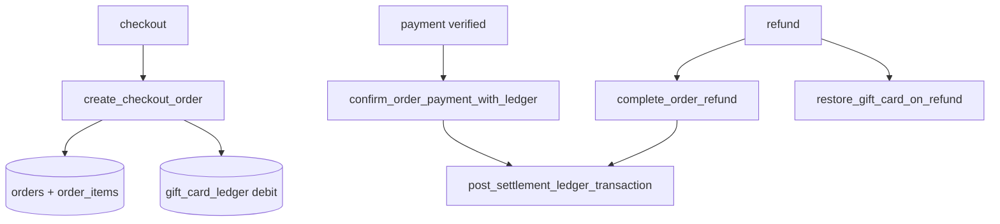

# Payment & Ledger Map

## Money mutation = canonical ledger RPCs only

| Concern | Mechanism |
|---------|-----------|
| Order creation | `create_checkout_order` — server-authoritative totals from DB; gift-card debit; `payment_due = grand_total − gift_card`. |
| Payment capture | Razorpay verified server-side (HMAC, `timingSafeEqualHex`); `confirm_order_payment_with_ledger`. COD supported. |
| Refund | `complete_order_refund` (≤ capture, ledgered) + `restore_gift_card_on_refund` (refund_credit, idempotent). |
| Payout/settlement | balanced canonical postings; payout eligibility + release. |
| Integrity | `idempotency_key` required; `ON CONFLICT`; `FOR UPDATE`; balances ≥ 0 (CHECK); `*_minor bigint`. |
| Enforcement | `canonical-ledger-only-validator` — **no** `.from(money_table).insert/update` in TS; money convergence tests. |

**Never**: trust client amounts, write money tables from TS, or decrement a gift-card balance directly (it's a ledger projection).
