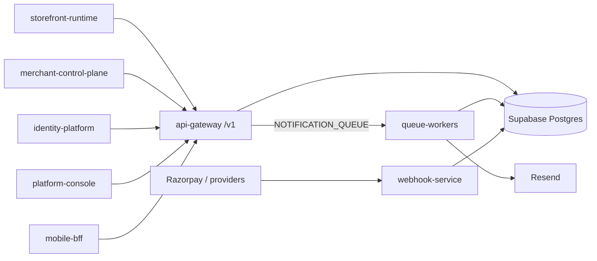

# Service Map

| Runtime | Kind | Responsibility |
|---------|------|----------------|
| `services/api-gateway` | Cloudflare Worker (Hono) | Canonical `/v1` — orders, checkout, payments, refunds, payouts, gift cards, products, collections, themes, customers. The only writer of money/tenant data (via RPCs). |
| `services/queue-workers` | Worker + Queues | Transactional email (Resend), notifications, async jobs. Consumes `email.*` (`isTransactionalEmailJob`). |
| `services/webhook-service` | Worker | Provider webhook ingestion (HMAC-verified). |
| `services/mobile-bff` | Worker | BFF for the Flutter merchant app (Turnstile login). |
| `apps/*` (Next.js) | Vercel | UI only — proxy to the gateway via the typed api-client; never touch the DB directly. |

Reserved (manifest-only): `checkout-runtime`, `search-service`, `media-service`, `notification-service`, `event-bus`, `analytics-pipeline` — not implemented; current owners are the implemented runtimes above.
