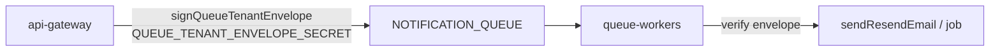

# Webhook & Queue Map

## Inbound provider webhooks
`services/webhook-service` receives provider callbacks (e.g. Razorpay). Each is **HMAC-verified** (`hmacSha256Hex` + `timingSafeEqual*`) before any side effect; bad signature → 4xx, no effect. Events are deduped (replay protection) and routed to the correct `site_id`.

## Internal queue (gateway → workers)

- Producers enqueue signed envelopes (`signQueueTenantEnvelope`); workers verify the tenant envelope before acting.
- Email jobs: `email.order_confirmation`, `email.order_cancelled`, `email.order_refunded`, `email.gift_card_issued`, `email.employee_invite`, `email.contact_owner_notification` (`isTransactionalEmailJob`).
- Delivery via Resend when `RESEND_API_KEY` is set; otherwise the worker logs `missing-resend-secret` and skips (fail-soft).
- Deterministic errors don't retry forever; transient errors retry.
