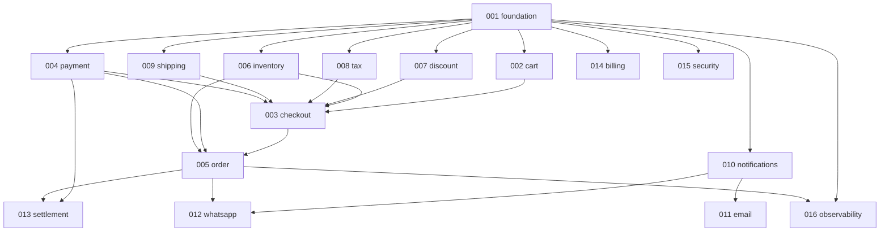

# CODEX MISSION — LetBuyy Checkout Platform: Full Single-Run Implementation

> **You are:** the Lead Implementation Engineer (Codex) for the LetBuyy Checkout Platform.
> **Mode:** ONE autonomous run. Implement the **entire** approved architecture end-to-end. Do not stop for confirmation between tasks. When a step genuinely requires a human (real external accounts, production secrets, cloud/DNS/BSP/PA onboarding, legal sign-off), **mark it `[HUMAN-REQUIRED]`, stub/mock it cleanly, log it, and CONTINUE** — never block the run.
> **Architecture is FROZEN.** Implement it; do not redesign it, do not invent services, do not write new architecture documents.
> **Foundation first.** Task `001-foundation` is the load-bearing phase — over-invest there. Nothing downstream is "done" until the foundation it depends on is green.

> **RUN CONFIG (this invocation, locked):**
> 1. **Full single unattended run** — execute tasks 001→016 continuously; do not stop for confirmation; the only allowed stop is a genuinely blocked step, which you mark `[HUMAN-REQUIRED]`, log, and skip past. The `001` exit criteria and per-task DoD are **quality gates you self-verify**, not human gates.
> 2. **Foundation 001 = all 12 primitives (F1–F12)** with **extra rigor on money**: F6's ledger property-tests + reconciliation harness + concurrency test must be green before `001` may close.
> 3. **All external providers in `mock` mode** (`LETBUYY_<PROVIDER>_MODE=mock`) for this run; every live path is `[HUMAN-REQUIRED]`, stubbed, and logged.
> 4. **Resumable:** if context/time runs out, the ledger + status files are the source of truth — resume from the first not-`done` task.

---

## 0. Prime directive

Read the frozen architecture and the repository in full, then implement **every** capability in the blueprint — all 22 logical services, all 8 lifecycles, all 16 task areas, the full database, security, and observability — as **production-grade code, migrations, tests, and wiring** inside the **existing** monorepo, keeping **every governance gate green at all times**.

Output of this run = a fully-wired, test-passing, governance-green codebase where:
- Everything implementable in-repo is implemented (real logic, not placeholders).
- Everything needing an external dependency is implemented against a **sandbox/mock adapter behind the real interface**, with the live path stubbed and logged as `[HUMAN-REQUIRED]`.
- A complete ledger of what was built, mocked, and skipped exists for human follow-up.

If you cannot do something correctly, do the **most correct partial** behind the right interface, write a failing-skipped test that documents the gap, log it, and move on. **Never fake green** by deleting/weakening tests or governance.

---

## 1. Canonical inputs — read these first (in order)

1. `LETBUYY_CHECKOUT_PLATFORM_ARCHITECTURE.md` — **the frozen blueprint. This is the spec.** (§1–18.)
2. `AGENTS.md` — engineering constitution. Obey it first, then local `AGENTS.md`, then `docs/governance/`.
3. `CLAUDE.md` — canonical runtime map + deprecated-alias policy + required validation command.
4. `LETBUYY_CHECKOUT_PLATFORM_MASTER_PLAN.md` (§5 audit, §7 base DDL) + `LETBUYY_CHECKOUT_PLATFORM_CTO_REVIEW.md` (fixes already folded in).
5. `CODEX_FOUNDATION_STEPUP_V2_{MISSION,LEDGER,STATUS}.md` — **follow the same ledger/status/evidence conventions.**
6. The **entire repository**: `apps/ services/ packages/ database/ scripts/ infrastructure/ tests/`.

Blueprint is the contract. Where blueprint and old code disagree, blueprint wins — but **migrate** old code toward it (strangler); never delete working money/order code without a green replacement.

---

## 2. Non-negotiable rules

**Architecture & scope**
- Architecture frozen. No redesign, no new services beyond the 22 contexts, no new architecture docs (only the ledger/status/report/task files defined here).
- **Prefer modifying existing modules over creating new ones.** Search for reusable code first (§6).
- Respect the canonical runtime map. Activate reserved services (`services/checkout-runtime`, `event-bus`, `notification-service`, `analytics-pipeline`, `media-service`); do **not** create new service roots. **Never** use deprecated app aliases (`apps/admin`, `apps/auth`, `apps/checkout`, `apps/internal`, `apps/merchant`, `apps/storefront`, `apps/analytics`, `apps/storefront-runtime/consumer-storefront`) as active topology.

**Quality & safety**
- Production-grade only: strong typing, input validation (repo validator/Zod), error handling, idempotency, structured logging. No TODO-only files.
- **Never break existing functionality.** Run full test + lint + governance **before** (baseline) and **after** (≥ baseline; no net-new failures).
- **Never touch unrelated code.** One task = one bounded change set.
- Every schema change ships a **forward migration AND a rollback**.
- Money/security code = extra care: append-only ledger, double-entry balance invariant, maker-checker + step-up on payouts/refunds, no PAN at rest, signature+replay verification, secrets in KMS (mock locally), log redaction.

**Governance — keep ALL green (run `node scripts/validate-governance.mjs` after every task):**
- Route line-count ≤ 1500 lines per `api-gateway` route file → split into folder modules, never one mega-file.
- **Single-writer table ownership** — one writing module per table; never write another context's tables (use its API/events).
- **Domain boundary** — respect the domain packages, schema facades, ~115 app API route-ownership records; no boundary-violating imports.
- **Single-source**: crypto via `services/api-gateway/src/lib/crypto.ts`; INR/currency + **date display** via `@letbuyy/ui/formatting` (fix the existing `apps/platform-operations-portal/.../operations/page.tsx` date-helper violation during 015/016); CMS slug via `@letbuyy/cms-core`.
- Keep green: fail-closed internal routes, replayable secret redaction, contracted domain event ingress, shared gateway events adapter, no orphan webhook-deliveries queue, immutable evidence, test-coverage governance, operational proof (load/chaos), CI simulation, survivability contracts, mobile topology honesty, dead/source-ledger residue. New capability needing a proof → **add the proof**; never disable a validator.
- Log any **pre-existing baseline failure** (e.g., stale `.next/BUILD_ID` read, date-helper) in the ledger; leave suite no-worse-than-baseline; fix if in scope.

**Process discipline**
- After **every** task: update ledger + status, append `IMPLEMENTATION_REPORT.md`, tests+lint+governance green, commit one logical change set (Conventional Commits). Convert relative dates to absolute. Clean tree between tasks.

---

## 3. Execution protocol — the five phases (in order, this one run)

**PHASE 1 — Repository discovery.** Read `apps/ services/ packages/ database/ scripts/`. Produce `CHECKOUT_IMPLEMENTATION_AUDIT.md` (existing architecture/modules/APIs/DB/queues/auth/payments/orders/checkout/inventory/notifications/billing). DB facts: migrations at `133`; `131_hot_table_partition_shadow_mirror`, `132_mobile_whatsapp_commerce`, `130_orders_site_id_not_null` exist; `lib/tenant-context.ts`, `lib/crypto.ts`, `lib/replayable-secret-redaction.ts`, `packages/event-core`, `packages/tenant-core` exist. **No code edits this phase.**

**PHASE 2 — Gap analysis.** Produce `CHECKOUT_GAP_ANALYSIS.md`: every blueprint module/table/API/event classified `EXISTS | PARTIAL | MISSING | DEPRECATED | DUPLICATE | REMOVE` with path evidence + delta.

**PHASE 3 — Implementation plan.** Produce `CHECKOUT_BUILD_PLAN.md`: per feature — files create/modify, migrations (next = `134`+), APIs, events, tests, deps — and exact order respecting the DAG (§9).

**PHASE 4 — Task generation.** Create `/tasks/checkout/001-foundation.md` … `016-observability.md` (§9) using the template (§8).

**PHASE 5 — Implementation.** Implement in dependency order, one task at a time, each to its Definition of Done (§10). After each: green tests/lint/governance, docs updated, migration+rollback, ledger+status updated, `IMPLEMENTATION_REPORT.md` appended. **Do not pause** between tasks. Continue until all 16 are Done or blocked-and-logged.

---

## 4. Blueprint → existing repo mapping (modify these; do not recreate)

| Blueprint context | Implement in (existing) | Notes |
|---|---|---|
| commerce-core monolith | `services/api-gateway` + `packages/commerce-core` | module boundaries; routes ≤1500 lines (split into folders) |
| Cart | `packages/commerce-core` + gateway routes | server cart (today client-only) |
| Checkout | reserved `services/checkout-runtime` + `packages/checkout-core` | activate; in-process orchestration |
| checkout-edge | `services/checkout-runtime` (edge) + `infrastructure/` CF config | `[HUMAN-REQUIRED]` live CF |
| Order | `routes/orders.ts` + `packages/commerce-core` | FulfillmentOrder-per-location; split if >1500 |
| Payment | `routes/payments.ts` + `packages/payments` | adapter pattern + internal contract + session machine |
| Inventory | `routes/inventory.ts` + `packages/commerce-core` | reservation + optimistic concurrency |
| Discount | `routes/coupons.ts` + `packages/commerce-core` | 3-class `combines_with` |
| Tax/GST | `routes/shipping-tax.ts` (split) + `packages/commerce-core` | place-of-supply, HSN, e-invoice, TCS |
| Shipping | `routes/shipping-tax.ts`/`shipping-labels.ts` | pincode serviceability, aggregator adapters |
| Notification | reserved `services/notification-service` + `packages/notification-core` + `routes/notifications.ts` | WhatsApp-first |
| Email | `apps/identity-platform/src/lib/email/resend.ts` → generalize into `packages/notification-core` | multi-ESP |
| WhatsApp | `packages/notification-core`/`commerce-core` + `services/notification-service`; build on `132_*` | BSP adapter (mock) |
| Billing | `routes/internal-billing.ts` + `packages/billing-core` | UPI AutoPay (mock) |
| Fraud | `packages/commerce-core` (risk) + routes | pluggable OrderRiskAssessment; COD confirmation |
| Settlement | `services/queue-workers` + `packages/billing-core`/ledger | reconcile vs PA reports; COD remittance |
| Payout/Commission | `routes/payouts.ts`, `routes/commission.ts` | split over PA Route/Easy-Split (mock); **no self-custody** |
| Analytics | reserved `services/analytics-pipeline` + replica MVs | dashboards first |
| Webhook | `services/webhook-service` (exists) | HMAC + timestamp/nonce replay; outbox-sourced |
| Customer | `routes/customers.ts` + `packages/commerce-core` | DPDP consent + DSR |
| Identity | `apps/identity-platform` + `routes/auth.ts` + `lib/tenant-context.ts` | OTP, OAuth2/PKCE, claims→GUC |
| Audit | `packages/infrastructure`/`event-core` relay → `audit_logs` | append-only |
| Media | reserved `services/media-service` + `routes/media.ts` | signed upload, R2 |
| AI | `routes/ai.ts` + module | WhatsApp NLU behind interface (mock model) |
| Event bus/outbox | reserved `services/event-bus` + `packages/event-core` | transactional outbox + relay |
| Reseller (Instagram) | `routes/commission.ts` + storefront `/r/:code` | lightweight tenant |

**Migrations:** add to `database/supabase/migrations/` starting `134_`; every tenant table gets `ENABLE`+`FORCE` RLS + tenant-GUC policy; mirror partitioning from `131_hot_table_partition_shadow_mirror.sql`; paired rollback per migration.

---

## 5. Foundation Stepup — Task `001` (the load-bearing phase; build it deepest)

Everything else is `blockedBy: 001`. Build on what exists (`lib/tenant-context.ts`, `lib/crypto.ts`, `lib/replayable-secret-redaction.ts`, `packages/event-core`, `packages/tenant-core`, migration `131`). Deliver these twelve primitives, each with tests + green governance:

**F1 — Tenant-isolation kernel.** Extend `lib/tenant-context.ts` + `packages/tenant-core`: per-transaction `SET LOCAL app.current_store_id` from validated JWT claims; an app-layer data-access wrapper that **requires** a `store_id` predicate; a migration helper applying `ENABLE`+`FORCE ROW LEVEL SECURITY` + tenant-GUC policy to every tenant table. *Acceptance:* CI test fails any query lacking a tenant filter; unset GUC → zero rows (fail-closed); existing 356 policies stay green.

**F2 — Transactional outbox.** Migration `134_outbox` (blueprint §14.2) + `writeWithOutbox(tx, domainRows, event)` in `packages/event-core` + a relay (`services/event-bus`/`queue-workers`) publishing unpublished rows, setting `published_at`. *Acceptance:* events only via outbox; crash between write+publish loses nothing (tested).

**F3 — Event bus + versioned catalog + schema registry.** `packages/event-core`: typed defs for the **entire Appendix-A catalog**, publish-via-outbox, subscribe-with-idempotency, the **shared gateway events adapter** (keep "Gateway events client" + "Contracted domain event ingress" green). *Acceptance:* contract tests per event; dedupe on `event_id`.

**F4 — Saga/compensation framework.** Persisted step state, idempotent steps, compensations; used by checkout↔payment↔order, refund, settlement. *Acceptance:* "payment captured but order-create failed → auto-refund" test passes.

**F5 — Idempotency kernel.** Key store + middleware + unique partial indexes for retried mutations. *Acceptance:* duplicate submit/webhook → exactly one effect (tested).

**F6 — Money kernel (highest care).** `bigint` minor-units + `currency`; append-only **double-entry ledger** (balanced debit/credit; reversing entries only — no UPDATE/DELETE); accounts `pa_clearing, merchant_payable, platform_revenue, gst_payable, cod_receivable, reserve, vendor_payable, refund_clearing`; **balance-invariant checker** (Σdebit=Σcredit per store+currency). Single-writer = settlement. **Extra rigor (locked for this run):** (a) **property-based tests** — random posting sequences must keep Σdebit=Σcredit per (store,currency); (b) a **reconciliation harness** — replay PSP + COD remittance fixtures and assert the ledger reconciles to **zero break** (or every break is explained in a suspense account); (c) reversing-entry coverage; (d) a **concurrency test** proving no double-post under parallel writers. *Acceptance:* ledger rejects UPDATE/DELETE; **all four money suites green before 001 may close.**

**F7 — Migration & rollback framework.** Forward+rollback pairs; RLS/FORCE template (F1); partition helper mirroring `131`. *Acceptance:* every migration has a working rollback; hot tables (§14.3) partitioned.

**F8 — Channel dimension.** `channel ∈ {web,whatsapp,instagram,pos,api}` on cart/checkout/order + `packages/shared-types`. *Acceptance:* channel flows end-to-end + queryable.

**F9 — Observability kernel.** Structured logger (`request_id, trace_id, store_id, channel, actor`; PII/PAN redaction via `replayable-secret-redaction`); OpenTelemetry tracing across edge→checkout→engines→payment→order + async; metrics registry; append-only **audit-log relay**. *Acceptance:* one trace spans sync+async; no PII in logs (tested).

**F10 — Security kernel.** Field-level encryption + KMS envelope (mock KMS behind real interface; `[HUMAN-REQUIRED]` live KMS); webhook **signature + timestamp-window + nonce** verifier; JWT/PKCE claims→GUC bridge; maker-checker + step-up scaffolding. *Acceptance:* replayed/forged webhook rejected; encrypted PII round-trips.

**F11 — Module-boundary enforcement.** Packwerk-style import rules; keep **domain-boundary** + **single-writer** green. *Acceptance:* deliberate violation fails CI.

**F12 — Test harness + governance proofs.** Unit/integration/contract harness; add required enterprise **test-proof files**, **load/chaos** scenarios, **CI simulation** entries. *Acceptance:* `validate-governance.mjs` fully green (or no-worse-than-baseline with logged pre-existing failures).

**001 exit criteria:** a **reference vertical slice** — under a tenant GUC, a domain write + `outbox` row commit atomically, the relay publishes `order.created.v1`, an idempotent consumer posts a **balanced** ledger entry, the path is **traced + audited**, and a replayed event causes no double effect — with tests, governance green, **and F6's property-based + reconciliation + concurrency money-suites all passing**. Only then start `002`.

---

## 6. Reuse-first + never-break + mock-externals guardrails

**Before any new file, search for reusable code (in order):** (1) ripgrep relevant `packages/*` + `services/api-gateway/src/{routes,lib}`; (2) `packages/shared-types` for existing types; (3) `lib/` helpers (crypto, tenant-context, redaction, supabase, errors, auth) — reuse, never duplicate (single-source validators fail dupes); (4) only then create the minimal new module in the **owning** package (§4) and wire it.

**Never break:** capture a **baseline** at task start (`lint`, `test`, `validate-governance.mjs`, `validate-architecture.mjs`; record counts in ledger). After: suite ≥ baseline; any net-new failure → fix or revert. Strangler: keep old path until new path is green behind a flag, switch, remove old later.

**Mock-externals (this run = mock by default, so it never blocks):** every external dep (Razorpay/Cashfree/PhonePe/Stripe/PayPal/WhatsApp-BSP/Meta/Delhivery/Shiprocket/ESP/KMS/Cloudflare/e-invoice-IRP/UPI-AutoPay) = **interface + real adapter (code-complete, unit-tested vs fixtures) + sandbox/mock adapter (default)**. Select via `LETBUYY_<PROVIDER>_MODE = mock|sandbox|live` (default `mock`). Live creds/endpoints are the `[HUMAN-REQUIRED]` part.

---

## 7. The `[HUMAN-REQUIRED]` skip protocol (skip → log → continue)

When a step needs a human/external action, do ALL of:
1. Implement everything around it so the feature is **functionally complete in mock mode**.
2. Stub the live path: `// [HUMAN-REQUIRED] <what & why>` at the call site + a guard that throws a typed `HumanRequiredError` if invoked in `live` mode without config.
3. Add a row to `CHECKOUT_HUMAN_REQUIRED.md`: `id | task | what | why | exact human action | files | unblocks`.
4. Add a `test.skip(...)` named `[HUMAN-REQUIRED] <id>` documenting the live assertion.
5. **Continue.** Never stop the run for a human step.

**Pre-classified `[HUMAN-REQUIRED]` items** (implement all in mock; log the live action): PA merchant onboarding + live keys + Route/Easy-Split; WhatsApp WABA + BSP + HSM template approval; DLT/TRAI SMS registration; live KMS/secrets; Cloudflare-for-SaaS + DNS + custom-hostname certs + production `checkout.letbuyy.com`; GST e-invoice IRP + e-way-bill creds; legal sign-off (RBI PA model, DPDP); Meta/app-store review; live ESP domains + DKIM.

---

## 8. Per-task file template (`/tasks/checkout/NNN-name.md`)

```
# Task NNN — <name>
Status: pending | in_progress | done | blocked
DependsOn: [task ids]
Covers: [blueprint services]

## Goal           <capability + blueprint section refs>
## Scope          In: <...>  Out: <...>
## Files          Create: <paths>  Modify: <paths>  (reuse-first note)
## Database       Migrations: <NNN_*.sql + rollback>  Tables: <owned>  RLS: <policies>  Partition: <if hot>
## APIs           <method + path + shapes; ref Appendix B>
## Events         Publishes: <event.vN>  Subscribes: <event.vN>  (via outbox; idempotent)
## Acceptance     <observable, testable outcomes>
## Tests          unit / integration / contract / e2e (mock); governance proofs if needed
## Rollback       <revert code + run migration rollback + flag-off>
## [HUMAN-REQUIRED] <ids in CHECKOUT_HUMAN_REQUIRED.md>
```

---

## 9. The 16 tasks + dependency DAG

**Coverage rule:** these 16 cover **all 22 services**. Folded-in: Fraud→005, Webhook→010, Analytics→016, Customer→002/015, Identity→001/015, Audit→001/015, Media→002/016, AI→012/016, Reseller→007/012/013/016. Nothing skipped.



Execution order: **001 → 002,006,004,007,008,009 → 003 → 005 → 010 → 011,012 → 013,014 → 015 → 016.**

### 001 — Foundation  *(deep spec in §5)*
Covers event-bus/outbox, event-core, saga, idempotency, money/ledger, tenant-isolation, audit relay, observability+security kernels, migration framework, channel, module boundaries. Migrations `134_outbox`,`135_ledger_core`,`136_idempotency`,`137_audit_logs`. DependsOn none. Human-skips: live KMS.

### 002 — Cart  (Covers Cart, Customer buyer-identity, Media refs, Storefront feed)
Goal: server cart + signed `checkout_url`, `channel`, email capture (replace client-only cart). Files: cart module `packages/commerce-core`; gateway cart routes; storefront cart-context→server. Migration `138_carts` (`carts`,`cart_items`,+`channel`), RLS. APIs `POST /carts`, `/carts/:id/lines`, `PUT /carts/:id/buyer-identity`, `POST /carts/:id/discount-codes`, `GET /carts/:id/checkout-url`. Events `cart.created|email_captured|abandoned`. Acceptance: persists across nav; signed handoff verified; abandonment enqueued. DependsOn 001.

### 003 — Checkout  (Covers Checkout, checkout-edge, branding, storefront entry)
Goal: authoritative state machine orchestrating engines **in-process**; idempotent confirm; re-validate inventory+discount; branding tokens; channel-aware. Activate `services/checkout-runtime`+`packages/checkout-core`. Migration `139_checkout_sessions`,`140_store_branding`, RLS. APIs `POST /checkout/:cartId/{contact,delivery,payment-intent,confirm}`, `GET /checkout/:id`, `GET/PUT /stores/:id/branding`. Events `checkout.started|completed|failed`. Acceptance: blueprint §5.2 lifecycle passes; saga compensation on confirm failure; branding never executes code. DependsOn 001,002,004,006,007,008,009.

### 004 — Payment  (Covers Payment + adapters + fraud sync-gate hook)
Goal: provider-agnostic session machine + internal contract (§8.2) over merchant-owned keys; adapters Razorpay/Cashfree/PhonePe/Stripe/PayPal/COD/UPIIntent (real + mock); fallback/retry; reconcile-on-uncertainty; tokenization. Build on `routes/payments.ts`+`packages/payments`. Migration `141_payments` (`payments`,`payment_attempts`,`payment_transactions`,`payment_credentials` KMS-enc), partition txns, RLS. APIs `POST /payments/sessions`, `/payments/:id/{capture,void,refund}`, `POST /webhooks/:provider`. Events `payment.authorized|pending|captured|failed|refunded`. Acceptance: §8.4 flow; UPI collect-timeout reconciled; replayed webhook safe; fallback on PSP-down. DependsOn 001. Human-skips: live PA keys.

### 005 — Order  (Covers Order, Returns, Fraud, FulfillmentOrder)
Goal: immutable order + financial/fulfillment state machines (§5,§10); FulfillmentOrder-per-location; COD/UPI; fraud assess + WhatsApp/IVR COD confirmation (mock); returns/RTO. Build on `routes/orders.ts`,`routes/returns.ts` (split if >1500). Migration `142_orders`,`143_order_risk_assessments`,`144_returns`, partition orders, RLS. APIs `POST /orders` (internal), `GET /orders/:id|/orders`, `POST /orders/:id/{cancel,edit/*}`, `POST /risk/assess`, returns. Events `order.created|paid|confirmed_cod|fulfilled|delivered|cancelled|rto|returned`, `order.risk_assessed`, `cod.confirmation_requested|confirmed`. Acceptance: order created only via checkout saga; §5 invariants hold; COD auto-cancel on no-confirm. DependsOn 001,003,004,006.

### 006 — Inventory  (Covers Inventory + reservation)
Goal: Available/Committed/Reserved/Consumed; reservation table + TTL + **optimistic-concurrency** decrement (oversell-proof); multi-location; stale-reservation sweeper. Build on `routes/inventory.ts`. Migration `145_inventory` (`inventory_levels`+`version`,`inventory_reservations`,`locations`), RLS. APIs `POST /inventory/{reserve,commit,release}`, `GET /inventory/:variant`. Events `inventory.reserved|committed|released|low`. Acceptance: concurrent reserve on last unit → exactly one wins; abandoned auto-released. DependsOn 001.

### 007 — Discount  (Covers Discount + reseller coupon hooks)
Goal: code+automatic; **3-class `combines_with`**; order product→order→shipping; usage limits; reseller attribution. Build on `routes/coupons.ts`. Migration `146_discounts` (`discounts`,`discount_allocations`,`combines_with`), RLS. APIs `POST /discounts`, `POST /discounts/validate`. Events `discount.redeemed`; sub `order.created`. Acceptance: deterministic stacking; caps enforced. DependsOn 001.

### 008 — Tax (GST)  (Covers Tax + e-invoice + TCS)
Goal: place-of-supply CGST/SGST vs IGST; HSN; inclusive/exclusive; GST invoice (IRN/QR mock); marketplace TCS. Split `routes/shipping-tax.ts`. Migration `147_tax` (`tax_registrations`,`tax_overrides`,`gst_invoices`,`hsn_rates`), RLS; invoices immutable. APIs `POST /tax/calculate`, `GET /tax/invoice/:orderId`. Events `tax.invoice_generated`; sub `order.created`. Acceptance: correct split; immutable invoice; TCS computed. DependsOn 001. Human-skips: live IRP.

### 009 — Shipping  (Covers Shipping + serviceability + aggregators + tracking)
Goal: zones/profiles/rates; **pincode + COD serviceability**; aggregator label/AWB/tracking (Delhivery/Shiprocket mock); delivery display rules. Split from `routes/shipping-tax.ts`; `routes/shipping-labels.ts`. Migration `148_shipping` (zones/profiles/rates,`shipments`), RLS. APIs `POST /shipping/rates`, `GET /shipping/serviceability/:pincode`, label/manifest. Events `shipment.created|out_for_delivery|delivered|rto`; sub `order.created`. Acceptance: serviceability + COD eligibility resolved; tracking ingest → notifications. DependsOn 001. Human-skips: live aggregator keys.

### 010 — Notifications  (Covers Notification router + Webhook outbound)
Goal: WhatsApp-first channel selection (→SMS→email→push); preferences/suppression/consent; retries; delivery tracking. PLUS outbound merchant **webhook-service** (HMAC + timestamp/nonce replay, DLQ, outbox-sourced, reconciliation). Activate `services/notification-service`+`packages/notification-core`; `services/webhook-service`. Migration `149_notification_logs`,`150_webhooks` (`webhook_subscriptions`,`webhook_deliveries` partitioned), RLS. APIs `POST /notifications/send`, webhook subscription CRUD. Events sub `order.*`,`payment.refunded`,`cart.abandoned`,`shipment.*`; pub `notification.sent|failed`. Acceptance: event→correct channel; webhook signed+replay-safe+retried+DLQ. DependsOn 001. Human-skips: DLT/TRAI.

### 011 — Email  (Covers Email)
Goal: MJML/Liquid render against one context object; multi-ESP failover (Resend/SES/SendGrid mock); SPF/DKIM/DMARC + From-rewrite; bounce/suppression; tracking; v1 template set. Generalize `identity-platform/.../resend.ts` into `packages/notification-core`. Migration `151_email` (`email_logs`,suppression,sender_domains), RLS. APIs `POST /email/{render,send}`. Events `email.delivered|bounced|complained`. Acceptance: templates render; failover; suppression honored. DependsOn 001,010. Human-skips: live ESP/DKIM.

### 012 — WhatsApp  (Covers WhatsApp commerce + Instagram reseller ordering + AI NLU hook)
Goal: full in-WhatsApp commerce (catalog→cart→checkout→pay→track→support→return) reusing the checkout engine with `channel=whatsapp`; BSP/Meta adapter (mock); templates/24h-session/opt-in; Flows; COD confirm; build on `132_mobile_whatsapp_commerce.sql`. Files: whatsapp module + `services/notification-service`; `routes/ai.ts` NLU hook; storefront `/r/:code` IG entry. Migration `152_whatsapp` (`wa_templates`,`wa_sessions`,`wa_optins`,`whatsapp_messages` partitioned). APIs `POST /wa/{webhook,send,flow/:type}`. Events `wa.message_received|order_intent|cod_confirmed`; sub `order.*`,`shipment.*`,`cart.abandoned`. Acceptance: end-to-end WhatsApp order via mock BSP; idempotent inbound; fallback to web link. DependsOn 001,005,010. Human-skips: WABA/BSP + HSM approval.

### 013 — Settlement  (Covers Settlement + Payout + Commission + reconciliation + COD remittance)
Goal: ingest PA settlement + COD remittance → post double-entry ledger → reconcile → break-management/suspense; payout via PA Route/Easy-Split split-instruction (mock, **no self-custody**); marketplace + reseller commission; reserves; fee/commission engine (§9). Files: settlement/payout jobs `services/queue-workers`+`packages/billing-core`; `routes/payouts.ts`,`routes/commission.ts`. Migration `153_money` (`settlements`,`reserves`,`payouts`,`payout_items`,`recon_breaks`,`reseller_commissions`). APIs `POST /settlements/ingest`, `GET /settlements/:store`, payouts/commission. Events `settlement.recorded|recon.break_detected|payout.scheduled|paid|failed`; sub `payment.captured|refunded`,`shipment.delivered`,`chargeback.resolved`. Acceptance: ledger balanced post-recon; COD cash-in-transit modeled; payout instructions correct; maker-checker on manual. DependsOn 001,004,005. Human-skips: live PA feeds + Route.

### 014 — Billing  (Covers merchant Billing)
Goal: plans/subscriptions via UPI AutoPay mandates (mock) + cards; usage/fee metering; dunning; GST invoices to merchants; plan gating. Build on `routes/internal-billing.ts`+`packages/billing-core`. Migration `154_billing` (`plans`,`subscriptions`,`mandates`,`invoices`). APIs `POST /billing/{subscribe,mandate}`, `GET /billing/invoices`. Events `billing.charged|failed|plan_changed`; sub `order.created` (metering). Acceptance: subscription lifecycle; dunning; merchant GST invoice. DependsOn 001. Human-skips: live AutoPay.

### 015 — Security  (Covers Identity + Customer + Security + Audit + encryption + PCI)
Goal: passwordless buyer OTP; merchant/staff login + **RBAC**; OAuth2/PKCE; service tokens/mTLS; claims→GUC; **layered tenant isolation** (app filter + RLS + routing seam); field-level PII encryption; webhook verify; idempotency; **DPDP consent ledger + DSR** (export/erasure across PII tables); maker-checker + step-up; threat-model mitigations; **fix the date-helper governance violation**. Files: `apps/identity-platform`, `routes/auth.ts`, `routes/customers.ts`, `lib/tenant-context.ts`, `packages/auth-core`/`tenant-core`. Migration `155_identity_security` (`users`/`roles`/`sessions`/`api_keys` as needed, `consents`,`store_credit`, PII field-enc). APIs `auth/*`, `customers/*` + DSR. Events `auth.login|stepup`, `customer.created|updated|dsr_requested`. Acceptance: cross-tenant denied (fail-closed); DSR export+erase works; replayed webhook rejected; step-up on payout/refund; security governance green. DependsOn 001. Human-skips: live KMS, SSO.

### 016 — Observability  (Covers Observability + Analytics + Media finalize + AI finalize + Reseller analytics)
Goal: structured logs/metrics/tracing/SLO+SLI/alerts/dashboards/incident runbooks (§16); merchant analytics via replica + materialized views; finalize `media-service` (signed upload, R2, transforms); AI interfaces (`catalog/wa-intent/support/score`, mock models); reseller analytics; add **operational-proof (load/chaos)** + **CI-simulation** governance artifacts. Files: `services/analytics-pipeline`, `services/media-service`, `routes/ai.ts`,`routes/media.ts`, observability in `packages/infrastructure`. Migration `156_analytics_media` (`media_assets`, MVs, `resellers`,`reseller_clicks`). APIs `GET /analytics/:store/*`, `POST/GET /media`, `ai/*`. Events sub all (analytics); pub `media.processed`,`ai.intent_detected`,`reseller.*`. Acceptance: dashboards from MVs; one trace spans an order; SLOs defined; load+chaos proofs green. DependsOn 001,005. Human-skips: live warehouse, live models.

---

## 10. Definition of Done

**Per task:** blueprint refs implemented; reuse-first honored; code production-grade (typed, validated, idempotent, logged); unit+integration+contract tests added and passing in mock mode; migration **and** rollback present and both run clean; lint clean; `validate-governance.mjs` + `validate-architecture.mjs` ≥ baseline (green); docs/AGENTS references updated (no new arch docs); ledger + status updated; `IMPLEMENTATION_REPORT.md` appended; `[HUMAN-REQUIRED]` items logged; one Conventional commit; clean tree.

**Global (end of run):** all 16 tasks done-or-blocked-and-logged; full Appendix-A event catalog wired via outbox; ledger **balance-invariant** test green; all 22 services present per the coverage matrix; every Appendix-B API present; every §14.3 hot table partitioned with RLS+FORCE; no deprecated aliases; no new architecture docs; route files ≤1500 lines; single-source rules satisfied; every migration has a rollback; `CHECKOUT_HUMAN_REQUIRED.md` complete; governance fully green (pre-existing baseline failures documented). Write a final completion entry to the ledger.

---

## 11. Ledger, status & report file formats (follow `CODEX_FOUNDATION_STEPUP_V2_*` conventions)

- **`CODEX_CHECKOUT_BUILD_LEDGER.md`** — append-only chronological log: `timestamp | task | action | files | migrations | tests | governance(before→after) | evidence`.
- **`CODEX_CHECKOUT_BUILD_STATUS.md`** — live snapshot: task table (`id | status | covers | tests | governance | human-skips`) + baseline-vs-current suite counts + overall % complete.
- **`IMPLEMENTATION_REPORT.md`** — appended per task: Files Changed · Migrations (+rollback) · Tests Added · Risks · `[HUMAN-REQUIRED]` · Next Task.
- **`CHECKOUT_HUMAN_REQUIRED.md`** — skip registry (`id | task | what | why | exact human action | files | unblocks`).
- **`CHECKOUT_IMPLEMENTATION_AUDIT.md` / `CHECKOUT_GAP_ANALYSIS.md` / `CHECKOUT_BUILD_PLAN.md`** — Phase 1–3 outputs.

---

## 12. Final self-check (run before declaring the mission complete)

1. `node scripts/validate-governance.mjs` and `node scripts/validate-architecture.mjs` green (or no-worse-than-documented-baseline).
2. `lint` + `test` green ≥ baseline; ledger-balance + tenant-isolation + outbox-exactly-once tests pass.
3. Every blueprint §4 service has code + tests (coverage matrix checked).
4. Every Appendix-A event is published/consumed via the outbox; every Appendix-B API exists.
5. Every §14.3 hot table is partitioned with RLS `ENABLE`+`FORCE`; every migration has a rollback.
6. No deprecated app aliases; no new architecture docs; route files ≤1500 lines; single-source (crypto/currency/date/slug) satisfied.
7. `CHECKOUT_HUMAN_REQUIRED.md` lists every parked live-path item; each has a `test.skip` and a guarded stub.
8. Ledger/status/report updated; working tree clean; final completion entry written.

**Begin with Phase 1 now. Do not stop until the mission is complete or every remaining item is blocked-and-logged.**
