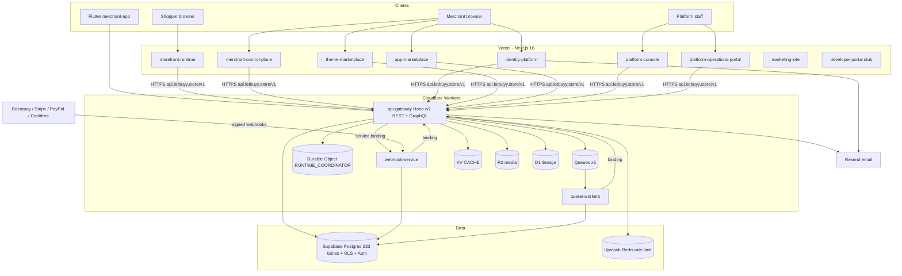
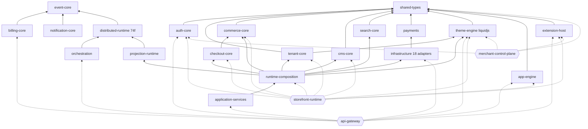
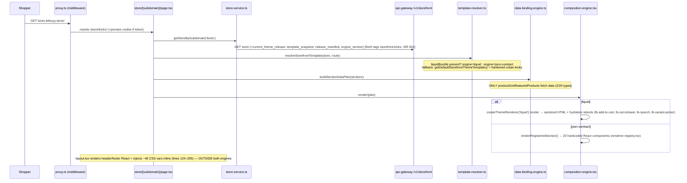
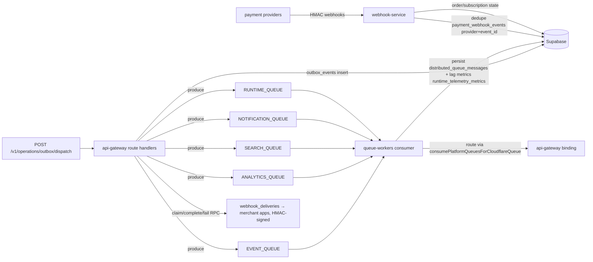

# 02 — Architecture Audit (Phase 1: Repository Forensic Analysis)

Complete current-state map of the LetBuyy monorepo as of 2026-06-05. Every claim carries a file path. Diagrams are Mermaid (render in any Markdown viewer).

---

## 1. Repository Topology

```
Letbuyy_Store/
├── apps/                      9 Next.js apps + mobile/{merchant-app, operator-app, shopper-app}
├── packages/                  22 dirs (~24 npm pkgs incl. typescript/{ui,api-types}, dart/{api_client,core})
├── services/                  9 declared; 3 implemented (api-gateway, webhook-service, queue-workers)
├── database/
│   ├── supabase/migrations/   000_baseline.sql + 073–078 (live root per AGENTS.md)
│   ├── supabase/verification/ 17 read-only assertion scripts (031–065)
│   └── cloudflare/d1/         0001_provider_execution_foundation.sql (lineage tables only)
├── infrastructure/            Terraform (CF queues/KV/R2/D1), Helm/K8s sidecars, Grafana/OTel, deploy scripts
├── config/                    runtime/ (66 governance JSON manifests), env/ templates, cloudflare/, vercel/
├── scripts/validators/        132 governance validators (see §7)
├── docs/                      ~97 entries; docs/governance/ ≈105 files; docs/archive/ 14 MB
├── tests/ load/ chaos/        governance-conformance tests; k6/locust/gatling harnesses (never executed)
├── supabase/                  Supabase CLI local-dev config (migrations/ EMPTY — not the live root)
├── legacy/firebase/           abandoned Firebase project (rules, functions, indexes)
└── 68 root *.md ledgers       CODEX_*/LETBUYY_*/WAVE* — orphaned AI working logs (doc 05)
```

Build: Turborepo 2.8.9 (`turbo.json`: build/dev/lint/test/typecheck), pnpm 10 (`pnpm-workspace.yaml`), Flutter via root `pubspec.yaml` (melos-style workspace — root Flutter files are **live**, not orphans). Deploy: Vercel (apps, region `bom1`), `wrangler` (workers), Terraform (CF resources, `infrastructure/cloudflare/*.tf`).

## 2. Application Inventory

| App | LOC | Pages | API routes | Notable |
|---|---|---|---|---|
| merchant-control-plane | 34,534 | 61 | 62 | Admin. Theme editor = 1 file, 2,067 lines (`[store]/online-store/themes/[themeId]/editor/page.tsx`). 14 settings pages. Non-commerce verticals (resume/portfolio: skills, experience, certifications…). Legacy `[store]/appearance` brand customizer coexists with editor. |
| storefront-runtime | 17,723 | 23 | 21 | Multi-tenant storefront. Subdomain rewrite in `src/proxy.ts` (`x-store-subdomain` → `/store/[subdomain]/…`). Dual render engine (§5). 10 customer-auth routes parallel to gateway. `api/seed` returns 410 in prod. |
| identity-platform | 7,274 | 10 | 19 | Merchant auth: password+Turnstile+Upstash rate limit, magic link, OTP, device fingerprint (`src/lib/auth/device.ts`), multi-store switch, store creation. Contains stale duplicate `src/lib/db/schema.sql` (doc 11 §3). |
| theme-marketplace | 4,940 | 12 | 3 | Browse/detail/pricing/install/checkout + purchaser dashboard. **Exists and is real** (an earlier internal claim that it doesn't is false). No submission/review/signing surface. |
| app-marketplace | 3,863 | 11 | 8 | Public catalog + developer registration/submission shell. Empty dirs: `src/lib/{types,auth,supabase}`. |
| platform-console | 3,966 | 14 | 4 | Superadmin console; separate token auth (`PLATFORM_CONSOLE_API_TOKEN` static bearer). |
| platform-operations-portal | 3,077 | 13 | 0 | Ops/support portal (CRM, merchant health, onboarding). |
| marketing-site | 2,885 | 4 | 0 | Hardcoded React landing (Lenis scroll). |
| developer-portal | ~900 | 5 | 0 | Static reference shell; panels labeled `[SKIP - NEEDS BACKEND]`. |
| mobile/merchant-app | 35,199 (Dart) | 17 screens | — | Real Flutter app via `packages/dart/*`; dart-defines carry `SKIP_NEEDS_HUMAN_*` placeholders; state docs admit residual Firebase coupling. |
| mobile/operator-app | ~50 | 0 | — | Unmodified Flutter counter template. |
| mobile/shopper-app | 0 | 0 | — | `AGENTS.md` + `runtime.manifest.json` only (reserved slot). |

All apps speak HTTP to `https://api.letbuyy.store/v1` (or staging) via `@letbuyy/api-client`; **zero direct DB clients in app code** (grep-verified: no `supabaseAdmin`/`new Pool`/`drizzle`/`knex` under `apps/*/src`). Empty `src/lib/supabase/` shells remain in 5 apps as removal residue.

## 3. Current Architecture Diagram



**Six declared-but-empty services** (manifest + AGENTS.md only, `deploymentAuthority.config: []`): `checkout-runtime`, `event-bus`, `media-service`, `notification-service`, `search-service`, `analytics-pipeline` — reserved per `docs/governance/runtime-boundaries.md`. Checkout logic actually lives in `services/api-gateway/src/routes/orders.ts` (POST /orders, line ~387).

## 4. Package Dependency Diagram



No orphan packages — every package has ≥1 consumer (grep-verified). But two **declared-unused deps** exist: merchant-control-plane declares `@letbuyy/extension-host` (0 imports) and imports theme-engine only in the editor page. The event-sourcing stack (distributed-runtime → orchestration → projection-runtime → runtime-composition, ~10k LOC combined) is heavily *typed* but thinly *exercised*: its persistence tables exist (`distributed_event_store`, `outbox_events`, `projection_store`…) and queue-workers writes telemetry/lag rows, yet no commerce flow currently routes through sagas/DAG execution. It is infrastructure ahead of demand.

## 5. Storefront Data Flow Diagram (request lifecycle)



## 6. Event Flow Diagram



Honest characterization: queue plumbing is real (Terraform-provisioned names match wrangler bindings), but consumers mostly **record** rather than **process** — outbox dispatch and webhook delivery require manual/ops-triggered endpoints (`/operations/outbox/dispatch`); there is no scheduled autonomous dispatcher beyond the gateway cron handler.

## 7. CI/CD, Validators, Tests — Reality Check

- **Workflows** (`.github/workflows/`, 10 files): `ci.yml` (typecheck/lint/test), `architecture-governance.yml` (127-validator chain), dual prod deploy files (`deploy-production.yml` **and** `production-deploy.yml` — overlapping, consolidation needed), staging variants, manual `production-rollout.yml` + `live-production-certification.yml`. Worker deploys guard on `HAS_CLOUDFLARE_CREDS` and **silently skip** without secrets.
- **132 validators** (`scripts/validators/`): sampled six — they assert manifest field values (`mode: "governance-contract-not-live-evidence"`), file existence, and string presence in YAML/source. No network calls, no DB connections. Value: real topology/import discipline (deprecated aliases verified absent; import-validator enforces boundaries). Cost: green ≠ working software. `provider-evidence-validator.mjs` literally passes by confirming live evidence does **not** exist.
- **Tests**: `tests/` 24 dirs — mostly governance-conformance (`node --test` asserting validator output / source regexes, e.g. api-gateway `__tests__` match route source text). Playwright E2E (`tests/e2e/*.spec.ts`) targets staging URLs with `test.skip()` when unreachable. k6 (`load/k6/black-friday-commerce.js`) hits `/v1/health` only; chaos/load orchestrators gate on `LETBUYY_CHAOS_EXECUTION_APPROVED` and have produced no evidence (artifacts gitignored).

## 8. Environment & Secrets Surface

Workers (`Env` interfaces, all referenced in code): Supabase trio, 4 PSP credential sets, `AUTH_SECRET`, `CSRF_SECRET`, `CUSTOMER_SESSION_SECRET`, `INTERNAL_API_SECRET`, `PLATFORM_CONSOLE_API_TOKEN`, `PAYMENT_CONFIG_ENCRYPTION_KEY`, Upstash pair, Resend pair. Apps: `NEXT_PUBLIC_API_BASE_URL`, accounts/admin URLs, Turnstile pair, Google OAuth pair, cookie domain. **Orphaned in templates only** (`config/env/*.example`): `APPLE_OAUTH_CLIENT_ID/SECRET`, `RAZORPAY_ROUTE_*` (4 vars), `NEXT_PUBLIC_API_URL` alias. Informational-only wrangler `[vars]`: `WORKER_ENV`, `NEXT_PUBLIC_ENV` (unread); `PRIMARY_REGION`/`FAILOVER_REGION` read by queue-workers telemetry only. Vercel config: root `vercel.json` is just a pnpm install hook; per-app `vercel.json` set region `bom1`. Turbo build env still lists `NEXT_PUBLIC_SUPABASE_URL/ANON_KEY` though apps no longer consume them (stale input — busts cache needlessly).

## 9. Structural Strengths / Defects Summary

**Strengths:** single-gateway rule enforced and real; Zod-first domain contracts; immutable theme releases w/ rollback chain; payment webhook idempotency; clean layered storefront composition pipeline; Terraform-managed CF resources matching wrangler bindings; India-market depth (GST end-to-end).

**Defects:** dual theme engines + dual draft tables; hardcoded storefront shell; data binding 2/20; 6/9 services empty while the gateway absorbs everything (35 route modules — monolith risk); event-sourcing stack unexercised; validator/manifest theater; duplicate prod deploy workflows; status ledgers contradict code; nullable tenant keys; 68 root ledgers + 26 MB screenshots + 45 MB build output as repo debt.

Cross-references: violations w/ severity → doc 03; deletion candidates → doc 05; DB detail → doc 11; API detail → doc 12.
