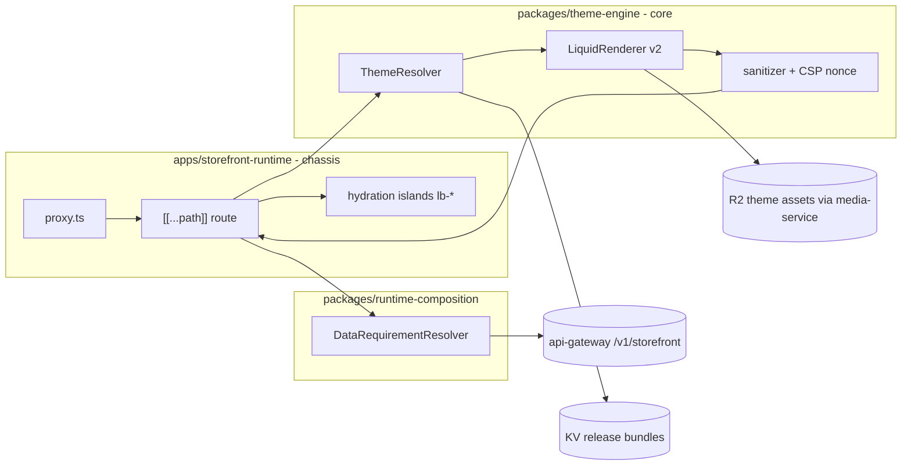

# 06 — Storefront Runtime Replacement Plan (Phase 5)

Target: a Shopify-OS-2.0-style **theme-owned** storefront runtime. Strategy per doc 04: refactor `apps/storefront-runtime` in place — replace its rendering core, keep its routing/caching/checkout chassis. The Liquid engine spec itself is doc 07; this document is the runtime architecture around it.

---

## 1. Design Principles

1. **The theme owns the document.** Every byte of HTML between `<!doctype>` and `</html>` comes from the theme bundle (`layout/theme.liquid` + sections + snippets), rendered server-side. React remains only for hydration islands and checkout.
2. **One engine.** `LiquidRenderer` is the sole renderer. The json-contract model becomes an *import format* converted to a Liquid bundle once, at migration time — never rendered directly again.
3. **Data is declared, not hardcoded.** Sections declare `data_requirements`; the runtime fulfills them through `runtime-composition` query layers. No section-type string matching in app code.
4. **Tenant → Theme → Template → Sections → Data → HTML** is the only path. Demo stores, fallbacks, and alias maps are data problems (seeds), not code branches.
5. Runtime stays on Vercel/Next initially (route handlers already there); the architecture must not preclude later move to a `storefront-renderer` worker (doc 18) — hence rendering core lives in `packages/theme-engine`, not in the app.

## 2. Target Directory Layout (theme bundle, authoritative)

Extends existing `LIQUID_THEME_BUNDLE_PATHS` (`packages/theme-engine/src/theme-bundle.ts`):

```
theme/
├── layout/theme.liquid          # owns <html>; {{ content_for_header }}, {{ content_for_layout }}
├── layout/password.liquid       # optional gated-store layout
├── templates/index.json         # {sections:{...}, order:[...]} — EXISTS today
├── templates/product.json       # NEW route-wired
├── templates/collection.json    # NEW
├── templates/page.json | blog.json | article.json | cart.json | search.json | 404.json
├── sections/*.liquid            #  required — EXISTS
├── blocks/*.liquid              # reusable blocks — EXISTS
├── snippets/*.liquid            # NEW (unblocks , doc 07 §4)
├── assets/*                     # NEW theme css/js/img → R2/CDN (doc 07 §9)
├── config/settings_schema.json  # EXISTS
├── config/settings_data.json    # EXISTS
└── locales/*.json               # EXISTS
```

## 3. Request Lifecycle (target)

```mermaid
sequenceDiagram
  participant U as Shopper
  participant PX as proxy.ts (kept as-is)
  participant RT as app/store/[subdomain]/[[...path]]/page.tsx (single catch-all)
  participant TR as ThemeResolver (pkg)
  participant DRS as DataRequirementResolver (pkg→gateway)
  participant LE as LiquidRenderer (pkg)
  U->>PX: GET {sub}.letbuyy.store/products/x
  PX->>RT: rewrite /store/{sub}/products/x (+preview cookie)
  RT->>TR: resolve(sub, path, previewToken?)
  Note over TR: store → active release (or draft if preview)<br/>route → templateKey (product) → templates/product.json<br/>cache: KV release-bundle by release_id (immutable)
  TR-->>RT: RenderPlan{layout, template, sections[], settings, locale, assetsBaseUrl}
  RT->>DRS: fulfill(sections[].data_requirements, routeParams)
  DRS-->>RT: DataContext{product, collections, menus, cart_summary, ...} (parallel, per-requirement cache tags)
  RT->>LE: render(layout+template+sections+snippets, context)
  LE-->>RT: html + hydrationManifest + cacheTags
  RT-->>U: streamed HTML; islands hydrate (lb-* custom elements)
```

Route→template map (replaces today's index-only resolver in `template-resolver.ts`):

| Route pattern | templateKey | Required context |
|---|---|---|
| `/` | `index` | none |
| `/products/:handle` | `product` | `product` (+selected_variant) |
| `/collections/:handle` | `collection` | `collection`, `paginate` |
| `/collections` | `list-collections` | `collections` |
| `/pages/:handle` | `page` | `page` |
| `/blogs/:blog/:article` | `article` | `article`, `blog` |
| `/cart` | `cart` | `cart` |
| `/search` | `search` | `search` (q, results, paginate) |
| unknown | `404` | none |

Existing checkout/account routes stay React (Shopify does the same — checkout is not themed in OS 2.0 baseline).

## 4. Shell Migration (kills V-01/V-15)

1. Convert `dynamic-header.tsx` / `dynamic-footer.tsx` into first-party theme sections `sections/header.liquid`, `sections/footer.liquid` inside the default theme, with hydration islands for cart-drawer/search (`lb-cart-drawer`, `lb-search` already exist).
2. Section **groups** render from `sectionGroups` (roles `header|footer|aside` already in `StoreTemplateConfig`) via `` semantics in `layout/theme.liquid`.
3. CSS variables: build-time compiler `settings_data.json → :root{}` emitted as `assets/theme-settings.css` per release (replaces `layout.tsx` L124–205 inline injection). Dark-mode math moves into the default theme's CSS, not app code.
4. `CartProvider`/`CustomerAuthProvider`/`WishlistProvider` shrink to island-scoped state served via gateway endpoints; no full-page React tree.

## 5. Runtime Components To Build (with owners in repo)

| Component | Location | Notes |
|---|---|---|
| `ThemeResolver` | `packages/theme-engine/src/runtime/resolver.ts` | store→release→bundle; preview-token branch; KV/in-mem LRU keyed `release:{id}` (immutable ⇒ cache forever) |
| `DataRequirementResolver` | `packages/runtime-composition/storefront-query-layer` (extend) | maps requirement kinds → existing query layer calls; emits cache tags identical to today's (`storefront:{sub}`, `route:product:{id}`…) |
| `LiquidRenderer v2` | `packages/theme-engine/src/theme-renderer.ts` (extend) | doc 07: snippets/render, filters, drops, layout support |
| Hydration manifest emitter | `theme-engine/src/execution-runtime.ts` (extend `ThemeHydrationManifest`) | islands + their props serialized once |
| Section render API for editor | gateway `POST /v1/themes/:instance/preview-render` | renders single section HTML for editor canvas updates (doc 08 §5) |
| json-contract→liquid converter | `packages/theme-engine/src/migrate/json-contract-converter.ts` | one-shot per store at Phase 7; emits bundle w/ sections mapped from the 20 React types (parity table in doc 15 §3) |
| Asset pipeline | `services/media-service` (activate, doc 18) | theme asset upload→R2, fingerprint, `asset_url` filter base |

## 6. Defaults, Demos, Fallbacks (kills V-11/V-16)

- Default theme = a real seeded `theme_packages` row (`letbuyy-default@1.x`) created by seeds, installed at store creation (`theme_instances` + first `theme_releases`). `getDefaultStorefrontThemeTemplate()` is deleted; stores without a release render a branded "store not published" page (already exists: `/preview/coming-soon`).
- urban-kicks becomes `database/supabase/seeds/urban-kicks-theme.sql` content only (file exists), plus the fixture moves to test fixtures dir; `isUrbanKicksDemoSubdomain()` and `src/lib/demo/urban-kicks-demo.ts` deleted at Phase 7.

## 7. Performance & Caching Architecture

- **L1:** parsed-template LRU (per worker/lambda) keyed `release_id:file` — LiquidJS `parse()` output reuse.
- **L2:** KV `release-bundle:{release_id}` (immutable, no TTL) + `store-head:{subdomain}` → current release id (60s TTL, purged on publish via existing cache-tag revalidation).
- **L3:** Next ISR/cache-tags as today; publish/rollback calls `revalidateTag('storefront:{sub}')` (mechanism already present).
- Data context fetched in parallel; per-requirement timeout 1.5s with section-level fallback HTML (`data unavailable` slot) so one slow query can't 500 the page.
- Budget: TTFB p95 ≤ 800ms cold / ≤ 200ms warm (matches `infrastructure/monitoring/slo-catalog.yaml` storefront SLO).

## 8. Service/Rendering Pipeline Diagram



## 9. Migration & Rollback Strategy (summarized; schedule in doc 14)

- Dual-run flag per store: `theme_releases.engine_version` already exists — `liquid-v2` releases render through new path; older releases keep old path until converted. Rollback = republish previous release (existing rollback chain), which atomically flips engine back.
- Phase gates: (P2) layout ownership behind internal flag on staging store → (P3) snippets/filters/objects parity + converter → (P7) convert all stores, delete react registry/shell.
- Success criteria: 0 references to `renderer-registry.tsx`; `sections/` React dir deleted; Lighthouse/SLO parity vs. baseline captured before/after; all 23 storefront pages render from templates for the default theme.
