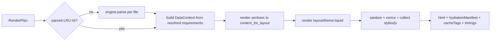

# 07 — LiquidJS Runtime Specification

Engine-level spec for `LiquidRenderer v2` in `packages/theme-engine`. Builds on the existing implementation (`src/theme-renderer.ts`: LiquidJS 10.27, parse/render/memory limits, HTML sanitization) — every section below states **EXISTS** vs **BUILD**.

---

## 1. Engine Configuration

| Setting | Value | Status |
|---|---|---|
| Library | `liquidjs@^10.x`, strictFilters: false, strictVariables: false (Shopify-lenient) | EXISTS (defaults) |
| `parseLimit` | 300_000 chars/template | EXISTS |
| `renderLimit` | 250 ms/section → **upgrade: 500 ms/page budget with per-section 150 ms** | EXISTS→TUNE |
| `memoryLimit` | 2_000_000 | EXISTS |
| Output escaping | auto-escape off (themes emit HTML) + sanitizer pass | EXISTS |
| Sanitizer | strips `<script>`, inline `on*` handlers | EXISTS → extend: allowlist `lb-*` custom elements, strip `javascript:`/`data:text/html` URLs (validation already rejects at upload) |
| Cache | parsed-template LRU keyed `release_id:path`, size 500 templates | BUILD |
| Errors | render error → HTML comment `<!-- section-error: {id} -->` + telemetry event; never 500 the page | BUILD |

## 2. File Types & Resolution

`layout/*.liquid`, `templates/*.json`, `sections/*.liquid` (must embed `` — EXISTS, enforced by `ThemeLiquidSectionFileSchema`), `blocks/*.liquid` (EXISTS), `snippets/*.liquid` (BUILD), `assets/*` (BUILD), `config/*` (EXISTS), `locales/*.json` (EXISTS). Resolution is bundle-internal only — **no filesystem access**; the engine receives the full bundle object (today's model, keep).

## 3. Layout Rendering (BUILD — kills V-01)

- Entry: render `templates/{key}.json` → for each section id in `order`, render section → concatenate into `content_for_layout`.
- Then render `layout/theme.liquid` with injected variables:
  - `content_for_layout` — section output.
  - `content_for_header` — runtime-generated: canonical/meta/OG tags (from store + route resource SEO fields — `SeoSchema` exists in shared-types), `assets/theme-settings.css` link, hydration runtime `<script type="module">` (islands loader), app-embed head fragments (doc 10 §5), CSP nonce.
  - `content_for_footer` — app-embed body-end fragments + island definitions.
- Section groups: `` tag renders `sectionGroups.header` (model EXISTS in `StoreTemplateConfig`).
- `layout/password.liquid` selected when store `status != published` and viewer unauthenticated.

## 4. Tags (BUILD list)

| Tag | Behavior | Limits |
|---|---|---|
| `` | isolated scope (Shopify semantics — no parent scope leak); `for`-form supported | depth ≤ 8, total renders/page ≤ 200, cycle detection by stack |
| `` | render section group | groups: header/footer/aside only |
| `` | render single static section | |
| `` | parsed at upload (EXISTS), stripped at render (EXISTS) | |
| `` / `` | scoped CSS → aggregated into per-section `<style data-section-id>` | size ≤ 50 KB/section |
| `` | collected → emitted once in `content_for_footer` as module | size ≤ 50 KB/section; CSP nonce applied |
| `` | exposes `paginate` drop | by ∈ [1,50] |
| ``, `'customer_login'`, `'contact'`… | emits `<form>` wired to gateway endpoints (`/v1/storefront/...` EXIST) with CSRF token + return_to | |
| ``, ``, std control flow | LiquidJS built-ins | EXISTS |

Still forbidden: `` (legacy scope-leaking form), `` override mid-template. (`theme-bundle.ts` forbidden-fragment list updated to **allow** `` once implemented — it currently blocks it.)

## 5. Filter Pack (BUILD — `registerLetbuyyFilters(engine)`)

- **Money:** `money` (₹1,499.00 from paise via `fromInrMinorUnits` — EXISTS in `packages/payments`), `money_without_decimals`, `money_with_currency` (multi-currency-ready signature, INR default per shared-types `CurrencySchema`).
- **Media:** `image_url: width:, height:, crop:` → media-service/R2 resize URL; `img_tag`; `asset_url` → `{assetsBaseUrl}/{release_fingerprint}/...`; `asset_img_url`.
- **URL:** `link_to`, `url_for_type`, `within` (collection-scoped product URLs), `default_pagination`.
- **Text:** `handleize`, `truncatewords`, `pluralize`, `highlight`, `t` (locale lookup into `locales/*.json` — files EXIST, filter BUILD; fallback chain `requested → store default → en`).
- **Color (settings-driven themes):** `color_lighten/darken/modify`, `color_to_rgb`, `brightness_difference` (needed to replace `layout.tsx` dark-mode math).
- **Collections/arrays:** `where`, `map`, `sort_natural` (LiquidJS built-ins — EXISTS), `weighted_average` not needed.
- All filters pure + bounded; no network at render time (resize URLs are computed, not fetched).

## 6. Object Model & Data Requirements Contract (BUILD — kills V-03)

### 6.1 Drops (lazy objects)
`shop` (EXISTS: id/name/subdomain → extend: currency, locale, domain, policies), `request` (EXISTS: path/locale/preview → extend: page_type, host), `settings` (EXISTS), `section`/`block` (EXIST), `routes` (EXISTS: root/cart/search → extend: account_*, collections_url, all standard keys), plus BUILD: `product` (variants, options, images, price drops, selected_or_first_available_variant), `collection` (products w/ paginate, filters), `cart` (items, total — server snapshot; live updates via `lb-cart-drawer` island), `customer` (when session present), `linklists` (from `navigation_menus`/`navigation_menu_items` tables — EXIST in DB, unexposed), `pages`, `blogs`/`articles`, `search`, `paginate`, `localization`, `all_products[handle]` (capped 20/page), `images`, `metafields` (deferred — no table yet; reserve syntax).

Implementation: LiquidJS Drop classes wrapping read-models from `runtime-composition/storefront-query-layer` — lazy `liquidMethodMissing` so unaccessed relations are never fetched… but **fetch happens pre-render** via requirements (next), drops only *shape* the data. No I/O inside render.

### 6.2 `data_requirements` in section schema
Extend `SectionSchema` (`theme-registry.ts`) + `` JSON:

```json
{
  "name": "Featured products",
  "data_requirements": [
    {"kind": "products_by_collection", "param": "settings.collection", "limit": 12, "as": "products"},
    {"kind": "menu", "param": "settings.menu", "as": "menu"}
  ]
}
```

Kinds v1: `route_resource` (product/collection/page/article implied by template), `products_by_ids`, `products_by_collection`, `collections`, `menu`, `blog_articles`, `cart_summary`, `search_results`, `store_policies`. Resolver lives in `runtime-composition`; each kind maps to an existing query-layer call + cache tag. Editor uses the same contract to fetch real preview data (replaces hardcoded `PREVIEW_PRODUCTS`).

## 7. Settings Schema Extensions (BUILD — V-07)

Add field types to `theme-registry.ts` union + `SchemaFormRenderer`: `font_picker` (curated list incl. current Geist/Inter set), `collection`, `product`, `blog`, `page`, `link_list`, `video_url`, `liquid` (sandboxed, render-validated on save). Resource fields store handles/ids; editor renders picker widgets (doc 08 §6); data resolver auto-adds a requirement per resource field.

## 8. Rendering Pipeline & Caching



Telemetry per render: section timings, cache hit ratio, error count → existing `runtime_telemetry_metrics` via gateway ingest. SLO: render CPU p95 ≤ 120ms (excl. data fetch).

## 9. Theme Assets (BUILD — V-10)

Upload path: bundle upload → `media-service` (doc 18) writes `assets/*` to R2 `letbuyy-media-{env}/themes/{package}/{version}/...` with content-hash fingerprint; `theme_assets` table (EXISTS, unused) records path/hash/size/content-type. `asset_url` resolves to CDN base. Limits: ≤ 5 MB/file, ≤ 50 MB/theme, types allowlist (css, js, mjs, svg, png, jpg, webp, woff2, json). JS served with `Content-Security-Policy` sandbox doc applies (doc 10 §6). settings CSS compiler output stored as synthetic asset `theme-settings.css` per release.

## 10. Security Model

- No ``; `` isolated scope; parse/render/memory caps (EXIST) + per-page budget; bundle validation rejects `<script>` in sections (EXISTS) — theme JS only via ``/assets with nonce'd module loader.
- Render context contains **only** drops — no env, no fetch, no Supabase handles.
- Preview rendering uses draft bundles but identical sandbox; preview tokens (EXIST, TTL 60–3600s) scope to subdomain.
- App-block content inside themes: sanitized inline HTML or sandboxed iframe (EXISTS in `AppBlockSlot` — keep both modes; iframe default for untrusted apps, doc 10).

## 11. Conformance Suite (BUILD)

`packages/theme-engine/__tests__/conformance/`: golden-file render tests for every tag/filter/drop; the urban-kicks fixture renders byte-identical across refactors; fuzz: 10k random settings values against all built-in sections (no throw, no unsanitized output); perf: fixture page ≤ 120ms CPU. CI gate replaces source-regex tests for the engine.
