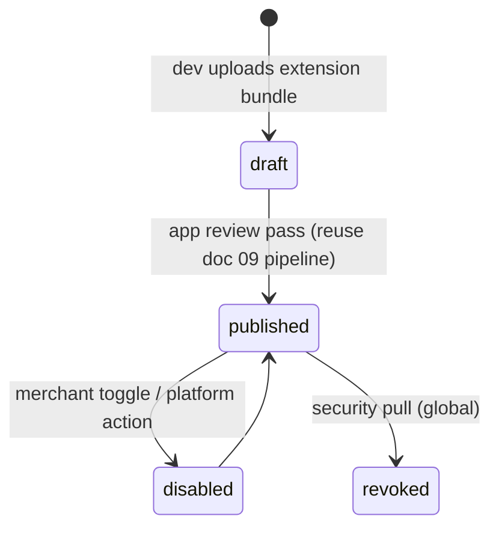

# 10 — App Extension Architecture Specification (Phase 8)

Target: Shopify-style theme app extensions, app blocks, app embeds, plus admin/checkout UI extensions — unified registry, lifecycle, merchant controls, runtime integration. Baseline assets: `packages/app-engine` (manifest schema `2026-06-05.ws13`, surfaces `admin.ui | checkout.ui | theme.app_block`, 4 storefront targets, function hooks, compliance topics), `packages/extension-host` (typed admin/checkout targets, iframe sandbox policies, bridge contexts, `2026-06-05.ws13.x2`), DB `app_extension_registrations` + `app_function_registrations` (migration 076), `AppBlockSlot` renderer + `injectAppBlocksIntoSections()` (live), `@app` Liquid block type (live). Gaps: V-26…V-31.

---

## 1. Unify the Split Registry (kills V-29)

Problem: storefront targets live in app-engine; admin/checkout targets live in extension-host. Fix: **extension-host becomes the single host-side registry contract** for all surfaces; app-engine keeps manifest/authoring side.

```ts
// packages/extension-host (target)
type ExtensionSurface = 'theme.app_block' | 'theme.app_embed' | 'admin.ui' | 'checkout.ui' | 'function';
const THEME_BLOCK_TARGETS = [...LETBUYY_APP_MANIFEST_THEME_TARGETS,  // EXISTS (4)
  'storefront.section.slot',          // any appBlockSlot / @app in section schema
  'storefront.cart.after-items', 'storefront.search.after-results'];
const THEME_EMBED_TARGETS = ['storefront.head', 'storefront.body-start', 'storefront.body-end'];  // NEW (V-28)
```

## 2. App Model & OAuth (kills V-26)

```
marketplace_apps            EXISTS → ADD: client_id, client_secret_hash, redirect_uris[], scopes_requested[]
app_installations           EXISTS → ADD: scopes_granted[], access_token_hash, status(installed|paused|uninstalled)
app_oauth_grants            NEW (code flow rows, PKCE)
```

Install flow (Shopify-shaped): merchant clicks install → consent screen (scopes) → redirect w/ code → app exchanges for **store-scoped token** → token bound to `(app_id, site_id, scopes)`. Scopes v1: `read/write_products`, `read/write_orders`, `read_customers`, `write_themes_blocks`, `read_analytics`. Gateway middleware: new `appTokenAuth` parallel to `authMiddleware`, enforcing scope→route map + per-app rate bucket (Upstash limiter EXISTS). Mandatory compliance webhooks (`customers/data_request`, `customers/redact`, `shop/redact` — enumerated in app-engine) become install-blocking: app must register reachable endpoints; periodic liveness ping; failures surface in console (V-27).

## 3. Extension Registry & Lifecycle Service

Authoritative store = `app_extension_registrations` (EXISTS) + ADD: `surface`, `target`, `version`, `status(draft|published|disabled|revoked)`, `settings_schema jsonb`, `sri_hash`.



Lifecycle events on existing envelope/outbox: `app.installed` (notification mapping EXISTS), `app.uninstalled`, `extension.enabled/disabled`, `app.scopes.updated` → webhook topics for apps (`AppWebhookDefinition` EXISTS). Uninstall = cascade disable extensions + token revoke + schedule `shop/redact` dispatch (48h).

## 4. Theme App Blocks (extend live path)

- Section schemas accept `{ "type": "@app" }` (EXISTS). Editor "Apps" panel (doc 08) lists published `theme.app_block` registrations for installed apps; inserting one writes a block `{type:'@app', extension_id, settings}` into the template (model EXISTS via `AppBlockInstanceSchema`).
- Render modes (EXIST): `inline` (sanitized HTML/Liquid fragment) and `iframe`. Policy: `inline` only for platform-reviewed extensions whose fragment passes theme-engine sanitizer + size ≤ 64 KB; otherwise `iframe` with `sandbox="allow-scripts allow-forms"` (no same-origin — matches checkout policy in extension-host), `loading=lazy`, height via `resize` bridge capability (EXISTS in `AppBridgeCapability`).
- Block settings: extension ships `settings_schema` (same field grammar as sections) → editor renders with `SchemaFormRenderer` (EXISTS) → values stored on block instance → passed to iframe via signed query/bridge init.
- Data exposure: inline fragments get a **restricted drop set** (`shop`, `block.settings`, `request.path` — never customer/cart unless scoped); iframes call their own backend with the app token.

## 5. App Embeds (BUILD — V-28)

Registration `surface='theme.app_embed'`, `target ∈ THEME_EMBED_TARGETS`, payload = URL of JS module + optional head fragment (meta/link only, sanitized). Merchant control: editor "App embeds" panel — per-embed on/off + settings (stored `site_app_embeds` NEW table: site_id, extension_id, enabled, settings). Runtime: `content_for_header`/`content_for_footer` (doc 07 §3) inject `<script type="module" src nonce integrity>` for enabled embeds; SRI hash from registration (`sri_hash`); CSP: `script-src 'nonce-…' https://extensions.letbuyy.store`. Embeds never block render (async, error-isolated). Kill-switch: platform `revoked` removes from injection within cache TTL (60s tags EXIST).

## 6. Sandboxed Execution & Quotas (kills V-30)

| Context | Mechanism | Quotas |
|---|---|---|
| Inline block fragment | theme-engine Liquid sandbox (EXISTS limits) + restricted drops | 150ms/64KB as sections |
| Iframe block/extension | browser sandbox attrs (EXIST policies in extension-host) + bridge capability allowlist (EXISTS: `api.fetch, toast, resize, navigation.redirect`; checkout = `toast,resize`) | bridge msg rate 20/s; api.fetch only to app's registered origin |
| Embed JS | CSP nonce + SRI + module isolation | ≤ 200 KB; perf budget reported to merchant (Web Vitals attribution → analytics queue) |
| **Functions** (`cart.discount.calculate`, `checkout.shipping.rate`, `checkout.payment.customize`, `checkout.validation.run` — hooks EXIST in app-engine) | Phase-8.5: WASM (e.g. Javy/QuickJS) executed in dedicated worker `extension-runtime` (doc 18); deterministic input/output JSON per hook schema | 5ms CPU, 1MB mem, no I/O |

Function results validated by Zod per hook; failure = fall back to platform default (never block checkout).

## 7. Admin & Checkout UI Extensions (wire what's typed)

extension-host already defines targets, sandbox attrs, bridge contexts, `listEnabledAdminUiExtensions()` — BUILD the host mounts: admin dashboard widget grid + settings page route in merchant-control-plane (its declared `@letbuyy/extension-host` dep is currently unused — doc 05 D1 removes it *until* this phase re-adds with real usage); checkout surface mounts at the 4 typed render-after points in storefront checkout (`CheckoutExtensionHost.tsx` EXISTS in storefront-runtime — extend from 1 to all 4 targets). Bridge: postMessage RPC implementing `AppBridgeCapability` set; session token = short-lived JWT carrying (app, site, surface, capabilities).

## 8. Merchant Controls & Trust Surface

Admin → Apps (pages EXIST: `[store]/apps`, `apps/[installationId]`): per-app scope list + extension toggles + embed toggles + "remove app" (cascade per §3); permission prompts on scope upgrade; activity log from app webhook/API usage (gateway request logs EXIST: `worker_request_logs`). Platform console: review queue, revocation, compliance-webhook health board (reuse ops routes pattern).

## 9. APIs (gateway)

```
POST /v1/apps/:id/oauth/authorize | token        BUILD (PKCE)
GET  /v1/apps/installed?store_id=                EXISTS-ish (installations list) → normalize
POST /v1/app-extensions                          BUILD dev submit (zip: extension.json, block.liquid|module.js, settings_schema)
GET  /v1/app-extensions?surface=&installed_for=  BUILD (editor/app panels)
POST /v1/app-extensions/:id/(enable|disable)     BUILD (merchant toggle; writes site_app_embeds / block availability)
Webhook mgmt: app_webhooks tables EXIST; delivery via webhook-service dispatch (EXISTS, HMAC-signed)
```

## 10. Acceptance Criteria

A partner app can: register → request scopes → be installed via OAuth → expose (a) a theme app block a merchant drags into a section, (b) an app embed toggled on, (c) a checkout render-after widget, (d) a discount function — each sandboxed, quota'd, individually disableable, fully removed on uninstall, with compliance webhooks verified and a revocation path that propagates ≤ 60s. Extension registry is the single source of truth consumed by editor, storefront, admin, and console.
