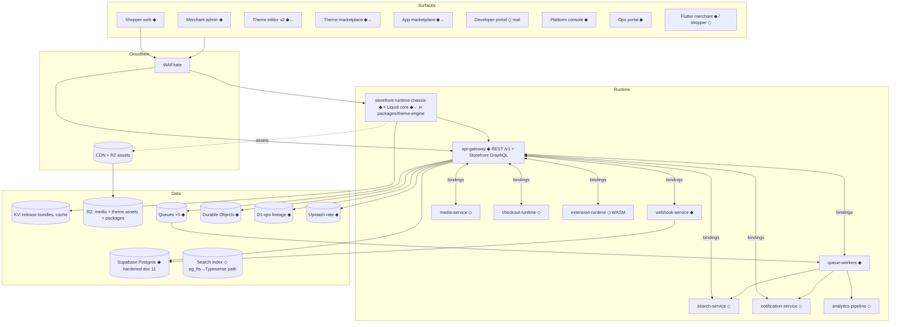

# 13 — Final Target Architecture Blueprint (Phase 11)

The end-state: LetBuyy as a Shopify-OS-2.0-class SaaS. Everything here is reachable from current code via doc 14's phases; components marked ◇ are new builds, ◆ exist today (possibly refactored).

---

## 1. System Overview

## 2. Component Contracts

| Component | Responsibility | Key interfaces |
|---|---|---|
| **Theme Runtime** (`packages/theme-engine` core + storefront chassis) | Resolve store→release→bundle; fulfill `data_requirements`; render Liquid (layout+templates+sections+snippets); hydration islands; sanitize | docs 06–07 |
| **Theme Editor v2** (merchant-control-plane) | Patch-based draft editing, drag-drop, multi-template, app blocks/embeds panels, publish/schedule/rollback/diff | doc 08 |
| **Theme Marketplace** | Supply pipeline (submit→validate→review→sign→publish), distribution (R2+CDN), install/upgrade/export/import/duplicate/fork, payouts | doc 09 |
| **App Platform** | OAuth apps, scoped tokens, unified extension registry (blocks/embeds/admin/checkout/functions), sandboxing+quotas, compliance webhooks | doc 10 |
| **api-gateway** | AuthN/Z, tenancy, REST `/v1`, Storefront GraphQL, orchestration via service bindings — **no new domain routers** (doc 12 §6) | doc 12 |
| **checkout-runtime ◇** | Extracted order/checkout/payment orchestration (idempotent, saga via existing orchestration pkg), PSP adapters from `packages/infrastructure` | doc 18 |
| **search-service ◇** | Indexing consumers (SEARCH_QUEUE ◆) + query API; `search-core` contracts ◆ (provider: postgres FTS v1 → Typesense v2) | doc 18 |
| **media-service ◇** | Uploads, image resize, theme assets, package zips; R2 + fingerprint + CDN | doc 18 |
| **notification-service ◇** | `notification-core` mappings ◆ → email (Resend ◆)/in-app/push; templates; digest | doc 18 |
| **analytics-pipeline ◇** | ANALYTICS_QUEUE consumer → fact tables/rollups; merchant analytics API; Web Vitals ingest | doc 18 |
| **extension-runtime ◇** | WASM function hooks (discount/shipping/payment-customize/validation) w/ 5ms budget | doc 10 §6 |
| **identity-platform ◆** | Merchant/operator authN, sessions, device intel; customer auth = gateway storefront module only | — |
| **Event backbone ◆** | outbox→queues→consumers; envelopes from `event-core`/`distributed-runtime`; replay/projections per existing packages — now actually exercised by services above | doc 02 §6 |

## 3. Data Architecture

- **Postgres (Supabase)** system of record: commerce, tenancy (`sites` canonical, `site_id` sole tenant key post-doc-11), themes (packages/versions/instances/drafts/releases/assets), apps/extensions/grants, billing/payouts, content, identity, ops/event tables. RLS + service-role discipline ◆.
- **KV**: immutable `release-bundle:{id}`, `store-head:{subdomain}`, schema catalogs. **R2**: media, theme assets (fingerprinted), signed packages. **D1**: deployment/migration/replay lineage only ◆. **Queues**: events/analytics/search/notifications/runtime ◆. **DO**: leases/coordination ◆ (used by extraction sagas + editor locks if needed).
- **Caching policy** (single table to memorize): L1 in-proc parsed templates → L2 KV bundles/heads → L3 Next ISR+tags → DB. Invalidation: publish/rollback → tag purge (`storefront:{sub}` ◆) + head rewrite; assets immutable by fingerprint.
- **Search**: v1 Postgres FTS via search-service API (no app change later), v2 Typesense/Meili behind same `search-core` contract ◆.

## 4. Cross-Cutting Planes

| Plane | Target |
|---|---|
| **Identity/AuthZ** | Actor model ◆ (`auth-core`: shopper/customer/merchant/partner/platform-employee/platform-operator/service) + app actors ◇; permission grants per surface; console JWT (doc 12 §4.3) |
| **Security** | Fail-closed internal secrets; CSP nonce + SRI for theme/app JS; signed theme packages; sandbox matrix (doc 10 §6); payment webhook HMAC ◆; secret rotation runbook |
| **Observability** | OTel collector + Grafana dashboards ◆ (configs exist) fed by REAL emit: gateway/server timings, render telemetry (doc 07 §8), queue lag ◆; SLOs from `slo-catalog.yaml` ◆ wired to alerts; error tracking (Sentry-class) ◇ |
| **Deployments** | Vercel apps + wrangler workers ◆; ONE production workflow (doc 05 D1); staging soak + smoke E2E gate (doc 17); Terraform for CF resources ◆; release channels for workers (gradual) ◇ |
| **CDN/Media** | R2+CDN for all theme/app/media bytes; image resize at edge ◇ |
| **Analytics** | analytics-pipeline ◇ → merchant dashboards ◆ (pages exist) on real rollups; platform metrics to console |
| **Workers/Queues** | every queue gets a named consumer with DLQ policy ◆ (queues + DLQs provisioned) + replay runbook (ops routes ◆) |
| **Compliance** | GDPR-style endpoints enforced for apps (doc 10); GST invoicing ◆; audit logs ◆ extended to theme/app actions |

## 5. Runtime Boundary Conformance

Target keeps the canonical map (CLAUDE.md / runtime-boundaries.md) intact: all 13 canonical roots remain; the 6 reserved service roots **activate in place**; no deprecated alias returns. `packages/` stays contract-only (no app/service imports); the only layering change: theme rendering core consolidates in `packages/theme-engine` (already governance-sanctioned: "contracts in packages/theme-engine") with the storefront app as chassis — matching `theme-runtime-governance.md` migration direction.

## 6. Capability Scorecard at End-State (vs doc 03 baseline)

| Area | Now | Target |
|---|---|---|
| Liquid engine | 6 | 9 (objects/filters/tags/snippets/assets, conformance suite) |
| Theme config | 7 | 9 |
| Templates/sections/blocks/snippets | 6 | 9 |
| Storefront runtime | 4 | 9 (theme-owned shell, one engine) |
| Theme editor | 5 | 9 (dnd, multi-template, in-canvas, apps) |
| Versioning/publishing | 6 | 9 (+diff, schedule) |
| Install/dup/export/import/update | 3 | 9 |
| Theme marketplace | 3 | 8 (review+signing+payouts) |
| App marketplace/model | 3 | 8 (OAuth, billing later) |
| Extensions/blocks/embeds | 4 | 9 |
| Merchant admin | 7 | 8 (site-type segregation) |
| Data layer | 5 | 9 (tenancy hardened, drafts unified) |
| **Composite** | **41** | **≈87/100** |

Remaining deliberate gaps vs Shopify at end-state: no checkout theming, no Hydrogen-class headless framework, metafields deferred, single-region Postgres (multi-region = post-launch track using existing distributed-runtime primitives).
