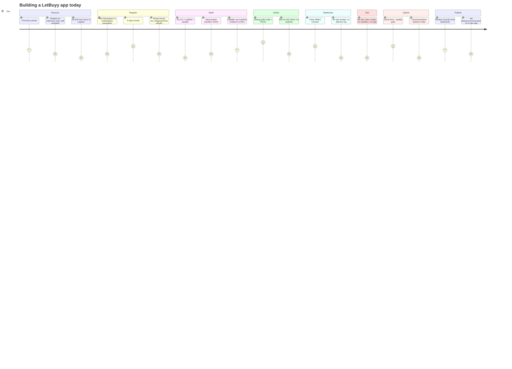

# App Creation Journey Audit (Phase 8)

> A simulated end-to-end walkthrough of building and shipping a LetBuyy app, using only what exists in the Developer App. Each step records the **happy path**, the **friction**, **missing steps**, and **broken assumptions**, grounded in source.

## Journey map (current reality)

---

## Step 0 — Discover the platform
**Happy path:** Land on `developers.letbuyy.store`; honest, well-styled home page.
**Friction:**
- Hero CTA "Read API reference" → `/api`, an **unstyled** page (first click degrades trust).
- No "Get started," no search.
- **Broken assumption:** the docs portal assumes you already know to go to a *different* app (`apps.letbuyy.store/developers`) to register — there is **no link** to registration anywhere in the docs portal.

## Step 1 — Sign up / register
**Happy path:** `/developers` marketing page → "Start Building" → `/developers/register` 3-step wizard (Company → Business → Agreements). POSTs to `/api/developers/register` → gateway `registerDeveloper`. On success, routes to `/developers/dashboard`.
**Friction / defects:**
- **Silent dead-end:** Step-1 "Continue" is `company_name && contact_email ? setStep(2) : null` — empty fields produce **no error, no focus, nothing**.
- **Discarded fields:** `tax_id`/`agreed_tos`/`agreed_privacy` are collected but **not sent** (handler posts only company/website/email/description/country). Help text "Required for payouts in India" is misleading.
- **No email verification / identity step** is surfaced (profile is created `status=pending, verified=false` server-side, but the UI doesn't explain what "pending" means or how to get verified).
**Missing step:** no confirmation screen explaining "what happens next" after registration.

## Step 2 — Create / scaffold an app
**Happy path (manual):** Author a manifest JSON; optionally validate via `POST /v1/app-store/developers/apps/manifest/validate` (returns normalized extension/function plan without creating an app). Then create via `/developers/apps/new` form → `POST /api/developers/apps` → `submitDeveloperApp`.
**Friction / defects:**
- **No CLI, no `create-letbuyy`, no template, no sample repo** — the portal states this plainly. You hand-write JSON against schemas you must read from reference tables.
- **No local dev loop / hot reload / tunneling** — nothing equivalent to `shopify app dev`.
- **Fake media upload:** icon + screenshots are non-interactive `
`s; a real listing needs media that cannot be provided here.
- The `manifest/validate` endpoint is powerful but **not exposed in any UI** — you only learn it exists by reading the reference.
**Broken assumption:** the form assumes the app already exists and is hosted (it asks for `app_url`, `privacy_url`) — but there's no guidance on *building* that hosted app (no starter, no App Bridge SDK).

## Step 3 — OAuth setup
**Happy path:** Implement auth-code + PKCE: `POST /v1/app-store/apps/:id/oauth/authorize` (merchant session, S256 challenge) → 15-min code → `POST /v1/app-store/oauth/token` with `code_verifier` → scoped Bearer + refresh. Embedded apps use `token-exchange`; bridge uses `bridge/fetch` (GET-only).
**Strengths:** This is the **best-built journey segment** — PKCE, hash-only storage, refresh rotation, replay protection, embed sessions are all real and well-documented (`/oauth`).
**Friction / defects:**
- The excellent `/oauth` page is **unstyled** (System B), so the best content is the hardest to read.
- **No way to test the flow** — no explorer, no test client, no dev store to authorize against. You must build a full client to discover whether your PKCE is correct.
- **No client_id/secret visible in a UI** — credentials are show-once at submit; if you missed them, the only recourse is the backend rotate route (no UI). The portal Dashboard marks key management `[SKIP]`.

## Step 4 — Webhook setup
**Happy path:** Subscribe topics at install; verify HMAC over `timestamp.rawBody`; handle mandatory compliance topics (`customers/data_request`, `customers/redact`, `shop/redact`); expect retries (120s→3600s).
**Friction / defects:**
- **No test sender** — dispatch routes are internal-only; you cannot trigger a sample delivery to your endpoint. (`sdkToolingGaps`: "Webhook test sender UI — SKIP".)
- **No delivery log / inspector** for developers — you can't see what was sent, status, or replay.
- Only HTTPS delivery; no EventBridge/PubSub.
- Verification is **pseudocode only** — no full Node/PHP receiver example.

## Step 5 — Testing
**Friction / defects (this is the weakest step):**
- **No development store creation** in the dev app (dev stores only *appear* in the partner aggregate).
- **No sandbox / test data / test mode.**
- **No logs** (webhook/function execution metrics exist in the backend keyed by store/installation/hook, but there is **no developer-facing log viewer**).
- Net: you cannot meaningfully test an integration end-to-end without a real merchant store and your own tooling.

## Step 6 — Submit for review
**Happy path:** `/developers/apps/new` → submit (or save draft). Non-draft runs the **Built-for-LetBuyy quality gate** (Lighthouse ≥70, ≥1 review @4.0+, ≥1 install, ≥1 storefront app block, HTTPS URLs), creates a marketplace review record with automated checks, emits `app.submitted`.
**Friction / defects:**
- **Chicken-and-egg gate:** the quality gate requires *≥1 install and ≥1 review @4.0+* to pass — but you need to be *listed/installable* to get installs/reviews. Unless this gate only applies to the "Built-for-LetBuyy" *badge* (it does, per `appQualityGateChecks`), the copy must make crystal clear it's a **badge gate, not a listing gate**, or developers will read it as an impossible barrier.
- **Fake media** (Step 2) means submissions can't include the screenshots a good listing needs.
- **No listing builder** (no rich description preview, no localization, no screencast field that Shopify requires).

## Step 7 — Publish & distribute
**Happy path:** Review records carry status (draft/in_review/approved/changes_requested/rejected); the Partner Console shows per-app status + review actions + notes.
**Friction / defects:**
- **No reviewer communication loop** in the dev app beyond a status string + notes (no threaded feedback, no resubmission diff).
- **No release/versioning** after publish.
- **Confirmed broken link:** the dashboard's per-app "Edit" links to `/developers/apps/:id/edit`, which has **no route** (only `…/apps/new` exists) → 404. Developers cannot edit a submitted listing.
- **No post-publish analytics** (installs funnel, churn) — `[SKIP]`.

---

## Friction ledger (ranked)

| Rank | Friction | Step | Severity |
|---|---|---|---|
| 1 | No CLI/scaffold/sample → no build loop | Build | Critical |
| 2 | No way to test OAuth/webhooks (no explorer, dev store, sender, logs) | OAuth/Webhooks/Test | Critical |
| 3 | Docs portal and registration are different apps with no link | Discover/Register | Critical |
| 4 | Fake media uploaders block real submissions | Create/Submit | Critical |
| 5 | No credential UI (find/rotate keys) | OAuth | Important |
| 6 | Best content (OAuth/API/webhooks) is unstyled | All | Important |
| 7 | Wizard silently no-ops; drops fields | Register | Important |
| 8 | Quality-gate copy reads as impossible listing barrier | Submit | Important |
| 9 | No reviewer feedback loop / versioning | Publish | Important |

## The honest bottom line
A determined developer **can** ship on LetBuyy — the backend supports the full lifecycle — but only by hand-writing JSON, building their own test harness, and tolerating an unstyled, split, partly-misleading set of docs. The platform asks the developer to supply the entire **developer experience layer** themselves. That is the difference between "has APIs" and "is a developer platform."
