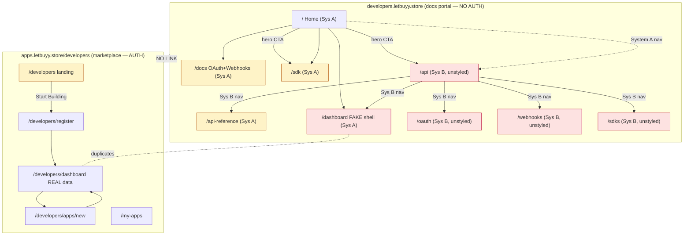
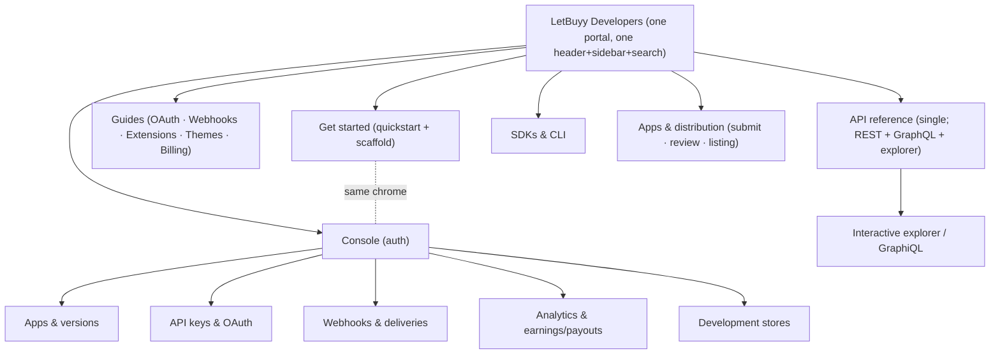

# Information Architecture Audit & Redesign (Phase 5)

> Scope: navigation, sidebars, page hierarchy, and developer flows across `apps/developer-portal` and the `/developers/*` flow in `apps/app-marketplace`.

## 1. Current-state map (what actually exists)

### Two headers, two navs, conflicting targets
The portal has **two** header components that never agree:

| Label | `PortalHeader` (System A: `/`,`/docs`,`/api-reference`,`/sdk`,`/dashboard`) | `DeveloperHeader` (System B: `/api`,`/oauth`,`/webhooks`,`/sdks`) |
|---|---|---|
| Home | (brand link → `/`) | `/` |
| Docs | `/docs` | — (no Docs link) |
| API | `/api` | `/api-reference` |
| OAuth | — (inside `/docs`) | `/oauth` |
| Webhooks | — (inside `/docs`) | `/webhooks` |
| SDKs | `/sdk` | `/sdks` |
| Dashboard | `/dashboard` | `/dashboard` |

So **"API" means `/api` on five pages and `/api-reference` on four pages**, and **"SDKs" means `/sdk` vs `/sdks`** depending on where you are. A developer clicking the same labeled link gets a different page (and a different visual quality) based on their current location.

### Duplicate destinations (same job, two pages)
| Topic | System A page | System B page | Problem |
|---|---|---|---|
| API reference | `/api-reference` | `/api` | Both exist; disagree on GraphQL; different styling |
| SDK quick-start | `/sdk` | `/sdks` | Both exist; `/sdks` deeper but unstyled |
| OAuth | `/docs` (combined) | `/oauth` | Two depths, two looks |
| Webhooks | `/docs` (combined) | `/webhooks` | Two depths, two looks |
| Dashboard | `/dashboard` (fake shell) | *real* console in **app-marketplace** | Placebo duplicates a real product |

### Orphans & dead ends
- `/api-reference` and `/docs` are **unreachable** from System B pages (their header omits these links).
- `/oauth` and `/webhooks` are **unreachable** from System A pages (their header omits these links).
- The portal `/dashboard` is a **terminal dead end** — every panel is descriptive text or `[SKIP - NEEDS BACKEND]`; nothing is clickable/actionable.
- The marketplace `/developers` landing is a **dead end toward docs** — it advertises "Documentation" but links nowhere to the docs portal.
- `apps/new` icon/screenshot uploaders are **interaction dead ends** (look interactive, do nothing).

### Cross-app disconnect
The "Developer App" is split across two deployments with **no links between them**:
- `developers.letbuyy.store` (docs portal) — reference, no auth, no data.
- `apps.letbuyy.store/developers/*` (marketplace) — register, dashboard, submit, with auth + live data.

A developer who reads the docs has no path to register; a developer in the console has no path to the reference. They are two products wearing one name.

### Hidden / lost functionality
- `developer-surface.ts` exports `dashboardSurfaces` (rich: charges, payouts, collaborator code, credential-management skip) and a second `dashboardShell`, plus the `DashboardSurfaceMatrix` component — **none are imported by any page**. The most complete dashboard data model in the repo is authored but never rendered.
- `evidenceSources` is likewise exported and unused.

### Confusing terminology (leaks to developers)
"D0 app", "SKIP — NEEDS BACKEND/SDK", "WS11 portable Liquid app blocks", "ws13.lifecycle", raw source refs (`app-store.ts:1225`), "schema facades". These are internal engineering tokens, not developer concepts.

## 2. Current sitemap (Mermaid)

## 3. Redesigned IA (target)

### Principles
1. **One portal, one nav, one design system.** Merge System A + System B into a single styled system. Pick the richer System B *content* and the System A *styling*.
2. **One page per concept.** Kill duplicates.
3. **Docs and console are one product** with shared chrome and cross-links (Docs ⇄ Dashboard ⇄ App Store).
4. **Persistent left sidebar + per-page TOC + search.**
5. **Speak developer, not engineer.** Remove internal jargon; keep the honest "status" badges but relabel (`Available` / `Beta` / `Planned`).

### Target sitemap

### Route consolidation plan

| Today | Action | Target |
|---|---|---|
| `/api` + `/api-reference` | **Merge** (keep System B content, System A styling) | `/reference` |
| `/sdk` + `/sdks` | **Merge** | `/sdks` |
| `/docs` (OAuth+webhooks) | **Split & redirect** into the canonical pages | `/guides/oauth`, `/guides/webhooks` |
| `/oauth`, `/webhooks` | Keep, restyle, move under `/guides/*` | `/guides/*` |
| `/dashboard` (fake) | **Delete**; replace with auth link to real console | → `apps.letbuyy.store/developers/dashboard` |
| `/developers` landing | Add a "Read the docs" link to the portal | cross-linked |
| `dashboardSurfaces` (unused) | **Wire into** the real console or delete | — |

### Navigation model (target)
- **Top bar:** product switch (Docs · Console · App Store), search, account.
- **Left sidebar:** Get started · Guides · Reference · SDKs & CLI · Apps & distribution.
- **Right rail:** per-page TOC anchored to section headings.
- **Console** shares the top bar; sidebar swaps to: Apps · API keys · Webhooks · Analytics · Earnings · Dev stores.

## 4. IA defect register

| ID | Defect | Severity |
|---|---|---|
| IA-1 | Two headers with conflicting link targets for identical labels | Critical |
| IA-2 | Duplicate pages: `/api`↔`/api-reference`, `/sdk`↔`/sdks` | Critical |
| IA-3 | Fake `/dashboard` duplicates a real product in another app | Critical (trust) |
| IA-4 | Docs portal and marketplace console never link to each other | High |
| IA-5 | Orphan pages unreachable from half the nav (`/api-reference`,`/docs`,`/oauth`,`/webhooks`) | High |
| IA-6 | No sidebar / no in-page TOC / no search | High |
| IA-7 | Authored-but-unrendered data (`dashboardSurfaces`, `evidenceSources`) | Medium |
| IA-8 | Internal jargon as navigation/labels ("D0", "SKIP", source refs) | Medium |
| IA-9 | Interaction dead ends (fake uploaders, no-op copy button, silent wizard step) | Medium |
