# LetBuyy Developer Platform V2 — Redesign Blueprint (Phase 13)

> The ideal LetBuyy developer platform, benchmarked against **Shopify** (commerce app platform), **Stripe** (docs + API DX gold standard), **Vercel** (onboarding + previews), and **Cloudflare** (Workers DX + dashboard). The premise: LetBuyy already has a Shopify-class **backend**. V2 is almost entirely about building the **developer experience layer** on top of it — and unifying the two split surfaces into one product.

## North-star principles
1. **One product.** Docs, reference, console, and app store live under one shell with one nav, one design system, shared auth. (Today they're two unlinked apps + two page systems.)
2. **Try it in 5 minutes.** A scaffold + explorer means a developer makes a real call before reading anything. (Stripe/Shopify/Cloudflare all nail this.)
3. **The docs are the product.** Source-true, searchable, runnable. Keep LetBuyy's honesty; add Stripe-grade polish.
4. **Show, don't simulate.** Never ship a placebo (kill the fake dashboard). Honest "Planned" beats fake "here."
5. **The platform supplies the DX, not the developer.** CLI, SDK, explorer, sandbox — so devs build features, not plumbing.

---

## 1. Information architecture (one site)

```mermaid
graph TD
  TOP["Top bar: Docs · Reference · Console · App Store · Search · Account"]
  TOP --> GS["Get started"]
  TOP --> GUIDES["Guides"]
  TOP --> REF["Reference"]
  TOP --> TOOLS["SDKs & CLI"]
  TOP --> DIST["Apps & distribution"]
  TOP --> CONSOLE["Console (auth)"]

  GS --> GS1["Quickstart: first app in 10 min"]
  GS --> GS2["Concepts: stores, installs, scopes, manifests"]
  GUIDES --> G1["OAuth & tokens"]
  GUIDES --> G2["Webhooks & compliance"]
  GUIDES --> G3["App extensions (Admin/Checkout/Theme)"]
  GUIDES --> G4["Themes (JSON-contract)"]
  GUIDES --> G5["Billing, revenue & payouts (INR/GST)"]
  REF --> R1["REST /v1 (from OpenAPI)"]
  REF --> R2["GraphQL (Admin/Storefront)"]
  REF --> R3["GraphiQL explorer"]
  REF --> R4["Webhook topics & error codes"]
  TOOLS --> T1["letbuyy CLI"]
  TOOLS --> T2["App Bridge SDK (browser)"]
  TOOLS --> T3["Server SDKs (JS/PHP/…)"]
  CONSOLE --> C1["Apps & versions"]
  CONSOLE --> C2["API keys & OAuth"]
  CONSOLE --> C3["Webhooks & delivery logs"]
  CONSOLE --> C4["Analytics & earnings/payouts"]
  CONSOLE --> C5["Development stores"]
  CONSOLE --> C6["Submissions & review status"]
```



**Consolidation from today:** `/api`+`/api-reference`→`/reference`; `/sdk`+`/sdks`→`/sdks`; `/docs`→`/guides/{oauth,webhooks}`; delete fake `/dashboard`→link to Console; wire the unused `dashboardSurfaces` model into the real Console.

## 2. Navigation
- **Persistent left sidebar** (collapsible, grouped) + **right-rail TOC** anchored to headings (Stripe pattern).
- **Global search** (docs + reference + error codes).
- **Product switcher** (Docs ⇄ Console ⇄ App Store) so learning and doing are one click apart.
- **One header component** (kills the System A/System B nav conflict).

## 3. The "Get started" experience (Vercel/Shopify pattern)
```
$ npx create-letbuyy@latest my-app      # scaffold (Admin-embedded template)
$ cd my-app && letbuyy login
$ letbuyy app dev                        # tunnel + hot reload + GraphiQL (press g)
# → installs on your dev store, prints the OAuth URL, streams webhook deliveries
```
- Output ends with a working app embedded in a dev store and a sample webhook received.
- Mirror Shopify's `app dev` / `app deploy` / `app logs` and `store create`.

## 4. Reference + API management (Stripe/Shopify pattern)
- **Generate OpenAPI** from the gateway → drives the REST reference, a Postman collection, and typed clients. (Removes drift; today the reference is hand-curated and already contradicts itself.)
- **GraphiQL** for Admin + Storefront, authenticated with a dev-store token (and a read-only demo).
- **One canonical error-code catalog** with handling recipes (429 backoff, `INVALID_GRANT` re-auth, `AMOUNT_MISMATCH` refresh).
- **Copy buttons + language tabs** on every snippet; "Run in explorer" links.

## 5. Console (the real dashboard — Cloudflare/Shopify pattern)
Replace the fake portal `/dashboard` with the existing Partner Console, extended to cover the routes that already exist but lack UI:
- **Apps & versions:** list/create/edit, manifest validate inline, version history & release.
- **API keys & OAuth:** inventory, show-once reveal at create, **rotate**, revoke, redirect-URI & scope management. (Backend rotate route exists today — just needs UI.)
- **Webhooks & delivery logs:** subscriptions, a **test sender**, per-delivery status/response/replay. (Backend dispatch + retry exist.)
- **Analytics & earnings:** install funnel, API traffic, earnings/payout ledger, GST. (Partner aggregate exists; surface it fully.)
- **Development stores:** create/manage sandboxes for testing installs.
- **Submissions & review:** status timeline + threaded reviewer feedback + resubmission.

## 6. App management & publishing flow

```mermaid
graph LR
  A[Scaffold via CLI] --> B[Build locally + dev store]
  B --> C[Validate manifest]
  C --> D[Configure OAuth scopes + webhooks as config]
  D --> E[Create listing: real media upload, screencast, localization]
  E --> F[Quality gate: Built-for-LetBuyy badge - clearly optional]
  F --> G[Submit -> review record + status]
  G --> H[Reviewer feedback loop]
  H --> I[Publish + version]
  I --> J[Post-publish analytics + payouts]
```

- **Fix the media uploaders** (real file inputs) and add a **listing builder** (preview, screencast field, locales) — Shopify-parity for listings.
- **Clarify the quality gate** as a *badge* gate, not a *listing* gate (today the copy reads as an impossible install/review prerequisite).

## 7. SDK & tooling strategy
- **`letbuyy` CLI** (scaffold, dev, deploy, logs, store create, webhook trigger, GraphiQL).
- **Browser App Bridge SDK** implementing the listed `api.fetch/toast/resize/navigation.redirect` capabilities (today only described).
- **Server SDKs** (JS/TS first, then PHP/Python) that **normalize the response envelope + key casing** so developers stop hand-handling six shapes and `idempotency_key` vs `idempotencyKey`.
- Generate typed clients from the OpenAPI/GraphQL schema.

## 8. Documentation strategy (keep LetBuyy's honesty, add Stripe polish)
- **Four-bucket IA:** Get started → Guides → Reference → Launch.
- **Source-true + generated:** keep "every claim ties to code," but **generate** it so it can't drift or cite missing files; add CI that fails if any `source:` path doesn't resolve.
- **Honest status as a public roadmap:** convert `SKIP — NEEDS BACKEND/SDK` into dated `Beta`/`Planned` badges — candor becomes confidence.
- **Add the missing surfaces:** quickstart, tutorials, webhook receiver walkthrough, error catalog, changelog/versioning, pricing/revenue, glossary, support/status.
- **Restyle System B** (define the missing classes) or fold it into System A — non-negotiable P0.

## 9. Design system
- Adopt one design system across docs + console + extension UIs (LetBuyy already has `@letbuyy/ui` tokens — extend it to cover docs primitives: tables, code panels, method pills, callouts). This is the LetBuyy analog of **Polaris**, and it directly fixes the undefined-class problem at the root.

---

## What V2 deliberately keeps from today
- The **honest, source-backed** documentation ethos (LetBuyy's genuine edge over competitors).
- The **strong OAuth/PKCE + payment-safety + compliance** backend (already Shopify-class).
- The **India-localized monetization** (INR/GST/UPI) — a real differentiator.

## Phased delivery (high level)
- **Phase 0 (days):** define missing CSS / restyle System B; delete fake dashboard → link real console; fix broken citation; one header. *(Trust + polish, near-zero backend.)*
- **Phase 1 (weeks):** consolidate duplicate pages; OpenAPI generation + restyled single reference; error catalog; quickstart; cross-link docs ⇄ console; real media upload.
- **Phase 2 (1–2 quarters):** `letbuyy` CLI + scaffold; GraphiQL; App Bridge SDK + 1 server SDK; key/webhook/analytics UIs in console; dev-store create; listing builder + reviewer feedback loop.
- **Phase 3:** multi-language SDKs, sample apps, EventBridge/PubSub delivery, design-system docs primitives, i18n.

> The strategic point: V2 is ~80% **front-end, docs, and tooling** on an already-capable backend. LetBuyy doesn't need to become Shopify; it needs to *expose* the Shopify-class platform it already has.
