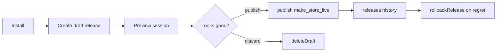

# LetBuyy Theme Marketplace V2 — Target Design (Phase 14)

**Benchmarks:** Shopify Theme Store (trust, review, revenue), Framer Marketplace (creator-led listings, live previews, designer brand), Webflow Marketplace (template cloneability, designer profiles, curated quality).
**Principle:** keep LetBuyy's superior visual craft; add the marketplace's missing nouns (catalog, reviews, developer, demo) and verbs (preview, publish, roll back, get paid). **Ship nothing decorative** — every control must do what it implies.

## 0. North-star
> A creator-led, trust-ranked theme store where merchants can preview any theme live in their own store in one click, read verified reviews, buy with a real receipt, and roll back safely — and where independent developers can list, price, support, and get paid with transparent review and analytics.

## 1. Information architecture (V2)

```
/                         Home: live trending/curated rows (no fake stats)
/themes                   Catalog: real search + working facets + pagination
/themes/[slug]            Detail: live demo first, reviews, changelog, author
/collections/[slug]       Curated collections / editor's picks / bundles
/authors/[handle]         Developer profile: portfolio, ratings, support
/preview/[token]          Live try-before-buy session (previewSession)
/checkout                 One coherent model; receipts, tax, licenses
/checkout/success         Real receipt + license + next steps
/install                  Non-destructive: draft → preview → publish
/dashboard                Buyer: purchases, installs, downloads, updates, billing
/developer                Seller console: listings, submissions, analytics, payouts
/developer/listings/new   Listing builder (assets, pricing, presets, tags)
/legal/{terms,privacy,refund,license}, /support, /docs, /changelog
```

## 2. Navigation
- Primary: Browse · Collections · Pricing · For Developers · Docs.
- Working global search (routes to `/themes?q=`), real notifications (or removed), authenticated identity (pass `initialUser` — fix `layout.tsx:100`).
- Footer: every link resolves (publish Legal/Support/Docs/Changelog; kill all `#`).

## 3. Theme discovery (V2)
- **Real facets:** category, **industry** (taxonomy seeded), **layout/site type**, **price range**, free/paid, **catalog size** (commerce) — all backed by API params (close `themes/page.tsx:516-521,448-450`).
- **Curation:** editor's picks, trending (real signal), new this month, bundles, "best for [industry]."
- **Composite ranking:** `rating × installs × recency × support-quality` once data is real.
- **Pagination/infinite scroll** (replace fixed `limit:30`).
- **Working autocomplete** from the full catalog (not just current page rows).

## 4. Theme listing card (V2)
- Keep the premium card; make affordances real: **"Live preview"** opens a `previewSession`; **"Save"** persists to a real wishlist.
- Show **verified rating + review count**, install count, author (links to profile), price, license tier, "updated {date}".

## 5. Theme detail page (V2)
1. **Live demo first** — embedded preview + "Try in my store" (`previewSession`).
2. **Reviews section** — verified-purchase star reviews + written content + developer replies.
3. **Changelog / release notes** + version history.
4. **What's included** — features, presets, sections, performance (Lighthouse), accessibility, compatibility.
5. **Author block** — profile, other themes, support SLA, response time.
6. **Trust row** — installs, rating distribution, "X stores use this," last updated.
7. **Buy/Install** — clear license tiers; for owned themes, deep-link to the **editor** (not the marketing page).

## 6. Checkout & monetization (V2)
- **One coherent model.** Recommended: per-theme one-time purchase (Shopify-style) **plus** optional platform subscription that *unlocks* premium themes — but make the two connect (a subscriber's "owned" state must gate install). Remove the broken `/checkout?plan=` path or build real subscription checkout.
- **Real receipts + licenses** issued on settlement (remove `[SKIP - NEEDS BACKEND]`, `success/page.tsx:65`).
- **Tax/invoice** handling; **refunds** via `orders.refund` with a clear, honest policy (or adopt Shopify-style final-sale *with* try-before-buy and update the copy).
- **Payments honesty:** if "global," add a non-INR rail (enable Stripe) or change the copy; today it's Razorpay/INR only.

## 7. Install / publish / rollback (V2) — make it non-destructive

- Wire `editor/saveDraft/publish/previewSession/releases/rollbackRelease` (all exist: `api-client:1482-1495`).
- Surface **"Update available → Apply update"** (today the badge has no action: `installations:11-14`).

## 8. Reviews & ratings system (V2)
- New endpoints: `themes.reviews` (list) + `createReview` (verified-purchase gated), backed by the existing `ThemeReview` model (`theme-engine:1021-1033`).
- Moderation states (`published/pending/rejected`), developer replies, helpfulness votes, rating distribution.

## 9. Developer experience (V2) — the biggest build
- **Partner onboarding** + developer agreement gate.
- **Listing builder:** name, descriptions, screenshots, demo store, presets, category/industry tags, pricing, license tiers.
- **Submission pipeline:** submitted → in review → changes requested → approved/rejected, with **written feedback** and **published acceptance criteria** (mirror Shopify's multi-stage review; reuse the ops queue `api-client:1179-1182`).
- **Safety:** asset/malware scanning, anti-piracy, rate-limited + authn'd upload (`api/themes/route.ts:43-64`).
- **Analytics:** views → install/purchase funnel, refunds, revenue trend.
- **Payouts & revenue share:** define the % (benchmark Shopify 15%), show earnings + payout schedule.
- **Author profiles:** portfolio, ratings, verification badge.

## 10. Trust & content (V2)
- Replace all hardcoded metrics (`page.tsx:7-12`, `layout.tsx:41`) with live values or remove.
- Every benefit claim maps to a working feature; delete unverifiable claims (Stripe/global, 24/7, 60s, multi-export, 30-day refund) until real.
- Publish Legal/Support/Docs/Changelog; remove every `#`.
- No decorative controls anywhere (preview/save/search/coupon/downloads/notifications/settings) — wire or remove.

## 11. Phased roadmap

| Phase | Theme | Outcome |
|---|---|---|
| **P0 — Truth & safety (1–2 wks)** | Remove fake metrics, the `[SKIP]` placeholder, dead controls; publish legal/support; align payment copy | Stops actively eroding trust |
| **P1 — Catalog & discovery (3–6 wks)** | Seed a real catalog; make all facets + search + pagination real; wire `previewSession` (live demo) | A merchant can find and try themes |
| **P2 — Trust layer (4–8 wks)** | Reviews/ratings (verified-purchase), author profiles, real receipts/licenses, refunds | A merchant can trust and buy |
| **P3 — Safe lifecycle (4–6 wks)** | Non-destructive install (draft/preview/publish), update + rollback, deep-link to editor | A merchant can install without fear |
| **P4 — Developer program (8–12 wks)** | Onboarding, listing builder, submission/review, analytics, payouts, safety | A studio can list, support, and get paid |
| **P5 — Growth** | Collections, bundles, trust ranking, performance/a11y reports, i18n | Competitive depth |

## 12. Success metrics
- Catalog: themes listed, % with live demo, % with ≥5 reviews.
- Merchant: preview→install conversion, install→publish rate, rollback rate, refund rate, CSAT.
- Developer: time-to-list, approval pass rate, listing→install funnel, payout reliability, developer NPS.
- Trust: zero shipped placeholders/dead controls; 100% resolvable footer links; metric accuracy = 100% data-derived.

## 13. Reuse summary (what's already there)
- **APIs to wire:** `previewSession`, `editor`, `saveDraft`, `deleteDraft`, `publish`, `releases`, `rollbackRelease`, `schema` (`api-client:1462-1495`), `orders.refund` (`api-client:1290`).
- **Models to expose:** `ThemeReview` (`theme-engine:1021-1033`), license tiers (`theme-engine:1003`), release/versioning types.
- **Build greenfield:** reviews list/create endpoints; the entire developer console (listing builder, submission, analytics, payouts).
- **Keep:** the visual system, the `MarketplaceUnavailable` pattern, URL-addressable filters, skeletons.
