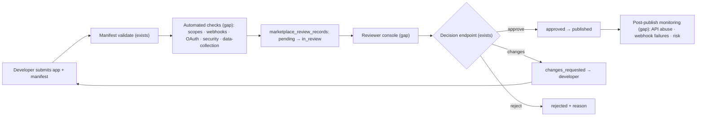

# App Review Platform

*Part of the [LetBuyy Internal Operating System](../LETBUYY_INTERNAL_OPERATING_SYSTEM.md). Benchmark: Shopify App Review.*

**Maturity: 2.0 / 5.** Arguably the most important marketplace safeguard, and the backend is **real**: a review-records table, a reviewer queue endpoint, and a decision endpoint all exist. What's missing is the **reviewer workflow UI** and **automated security checks**. Today review decisions are an API call without a proper console.

---

## 1. Purpose

Gate every third-party app before it can touch a merchant's store, and monitor it after. Answer the three questions that protect merchants: **Can this app steal merchant data? Can it break stores? Can it abuse APIs?** Review OAuth, scopes/permissions, webhooks, security, billing, and data collection. Lifecycle: **submitted → in review → changes requested → approved → published.**

## 2. Users

| User | Need |
|---|---|
| App reviewer | Work queue, run checks, decide, request changes |
| Review lead | Edge cases, policy, escalations, re-reviews |
| Developer Relations | Communicate decisions, help partners pass |
| Risk / T&S | Receive apps flagged for abuse/data misuse |

## 3. Current state (cited)

- **Review queue:** `GET /v1/operations/marketplace-reviews` (`services/api-gateway/src/routes/operations.ts:300`).
- **Decision:** `POST /v1/operations/marketplace-reviews/:id/decision` (`operations.ts:320`).
- **Table:** `marketplace_review_records` — `submission_type` ∈ {app, theme}, `status` ∈ {pending, in_review, approved, rejected, changes_requested}, `automated_checks` jsonb, `partner_user_id`, `app_developer_id`, `reviewed_by`, `reviewed_at`, `review_notes`. Soft-delete + audit columns present.
- **Submission:** developers create apps via `POST /v1/app-store/developers/apps` (`developer-routes.ts:576`) and validate manifests via `POST /developers/apps/manifest/validate` (`:260`); API keys via `/developers/apps/:id/api-key`; OAuth authorize/token in `billing-oauth-routes.ts`.
- **UI gap:** `apps/platform-console/.../marketplace-governance/page.tsx` is `SkipBackendPanel` placeholders that *point* at `/v1/operations/marketplace-reviews` but say the console has no review queue; it defers to the ops portal.

**Verdict:** real submission + queue + decision + status machine; **no reviewer console and `automated_checks` is an empty jsonb waiting to be populated.**

## 4. Workflow

## 5. Permissions

| Action | Tier |
|---|---|
| View review queue | Operator (reviewer role) |
| Claim case, run checks, comment | Operator |
| Request changes | Operator |
| Approve / publish | Lead |
| Reject / suspend published app | Lead + reason + audit |
| Emergency unpublish (security) | Lead/Admin + dual-control |

Decision endpoint already records `reviewed_by`; enforce RBAC + reason on it.

## 6. Dashboards

- **Reviewer queue:** by status/age/type/risk, SLA timers, claim/assign.
- **App review detail:** manifest, requested scopes, webhooks, OAuth config, billing model, data-collection declaration, automated-check results, decision history.
- **Ecosystem health:** approval rate, time-to-review, change-request rate, post-publish incident rate by app.

## 7. Alerts

- Submission SLA breach.
- High-risk scope request (e.g., full customer/PII, payment) → priority review.
- Published app spikes API errors / webhook failures / risk score.
- Repeat rejected developer resubmits.

## 8. Automations

- **Automated checks** (populate `automated_checks`): scope minimization, webhook signature config, OAuth/PKCE correctness, redirect-URI allowlist, data-collection declaration vs requested scopes, secret handling, rate-limit posture.
- Auto-route high-scope/high-risk apps to senior reviewers.
- Post-publish monitoring → auto-open Risk/T&S case on abuse.
- Auto-notify developer on each status transition.

## 9. Audit logging

Submission, check runs, every status transition, and decisions → `audit_logs` + `marketplace_review_records` history (`reviewed_by`, `reviewed_at`, `review_notes`). Approvals/rejections/unpublish must capture reviewer + reason. Per `app-api-route-ownership.md` and `security-operations-governance.md`, privileged review mutations require operator authorization + audit.

## 10. Review & escalation

- **Review process:** automated checks → human review (deeper for sensitive scopes) → decision; change-requests loop back to the developer.
- **Escalation:** security finding → Risk/T&S case + emergency unpublish path; policy ambiguity → review lead; partner dispute on a rejection → Developer Relations + appeal.

## 11. Current → target

| | Today | Target (Stage A) |
|---|---|---|
| Queue/decision | ✅ endpoints + table | Keep; add RBAC + reason enforcement |
| Automated checks | empty `automated_checks` jsonb | Real check runs (`review_check_runs`) |
| Reviewer UI | placeholder | Real reviewer console (ops-portal) |
| Post-publish | none | Monitoring + auto-case |
| Appeals | none | `review_appeals` + workflow |

**Build:** this is a *finish-it*, not a *start-it*. Build the reviewer console in `platform-operations-portal` on top of the existing queue/decision endpoints; add a `review_check_runs` table + automated security checks feeding `automated_checks`; add post-publish monitoring that opens Risk/T&S cases.

## 12. Benchmark vs Shopify App Review

Shopify: automated checks + human review + clear requirements + change requests + post-publish monitoring + enforcement. LetBuyy already has the **state machine and queue** Shopify took years to formalize; it lacks the **automated security checks** and the **reviewer UI**. Closing the gap is high-leverage because the data model is already correct.

## 13. Scaling

- **100:** founder reviews each app off the queue endpoint.
- **1k:** reviewer console + basic automated checks.
- **10k:** reviewer pool, full automated security suite, post-publish monitoring.
- **100k:** continuous re-review, behavioral monitoring, dedicated `reviews.` console (Stage B).
