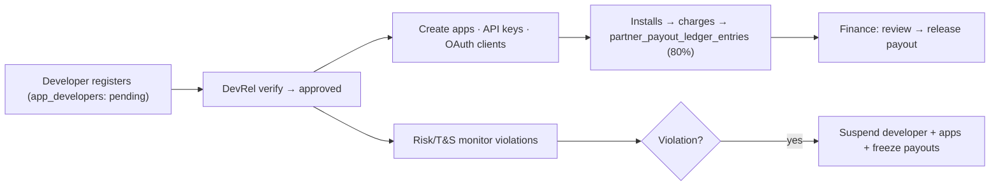

# Developer Operations Platform

*Part of the [LetBuyy Internal Operating System](../LETBUYY_INTERNAL_OPERATING_SYSTEM.md). Benchmark: Stripe + Shopify Partner operations.*

**Maturity: 2.5 / 5.** The strongest of the "human" platforms. Real developer accounts, API-key and OAuth-client issuance, webhook subscriptions, and a partner payout ledger with an 80% revenue share all exist in the backend. What's thin is the **internal operator view** of developers — the "open a developer, see apps → revenue → installs → violations" pane that DevRel and Risk need.

---

## 1. Purpose

The internal counterpart to the developer/partner experience: manage developer accounts, API keys, OAuth clients, webhook events, partner revenue/payouts, installs, and violations. Internal teams should instantly see, for any developer: **apps → revenue → installs → violations** — and act (verify, suspend, adjust payout) with audit.

## 2. Users

| User | Need |
|---|---|
| Developer Relations | Onboard, verify, support, communicate with partners |
| App/Theme reviewers | Pivot from a submission to the developer's history |
| Finance | Payout reconciliation, revenue share, disputes |
| Risk / T&S | Developer-level abuse, suspend developer + all apps |

## 3. Current state (cited)

- **Developer accounts:** `app_developers` — company_name, slug, `verified` bool, `status` ∈ {pending, approved, suspended, rejected}, country default `IN`. Self-serve via `POST /v1/app-store/developers/register` (`developer-routes.ts:228`); `GET /developers/me` (`:205`); admin lookup `GET /developers/:id` (`:842`).
- **Apps + keys:** `POST /developers/apps` (`:576`), `POST /developers/apps/:id/api-key` (`:762`), manifest validate (`:260`).
- **OAuth clients:** `POST /apps/:id/oauth/authorize`, `POST /oauth/token`, `POST /oauth/token-exchange` (`billing-oauth-routes.ts`) — OAuth with PKCE per the developer-platform audit.
- **Partner revenue:** `partner_payout_ledger_entries` — `revenue_share_bps` default **8000 (80% to partner)**, currency INR, rails {razorpay_route, razorpayx, upi, manual}, status {pending, processing, released, failed, cancelled}. Partner dashboard `GET /partners/dashboard` (`:369`, `requireRoleCategory('partner')`); collaborator codes (`:544`).
- **Webhooks:** `webhook_subscriptions` + `/v1/operations/webhook-subscriptions` + `app_webhooks`; compliance webhooks `customers/data_request`, `customers/redact`, `shop/redact` (`app-store/compliance-routes.ts`).
- **Developer UI:** `apps/developer-portal` (docs/reference) + `apps/app-marketplace/.../developers/*` (partner console). Per the developer-platform master audit, the developer-*facing* DX is pre-alpha — but the **backend partner ops data is real**.

**Verdict:** strong partner backend; **no consolidated internal "developer 360 + violations" operator view.**

## 4. Workflow

## 5. Permissions

| Action | Tier |
|---|---|
| View developer directory/detail | Operator (devrel role) |
| Verify / approve developer | Operator |
| Issue/revoke API key, reset OAuth secret | Lead + audit |
| Release payout | Finance lead + dual-control |
| Suspend developer (cascade to apps + payouts) | Lead + reason + audit |

## 6. Dashboards

- **Developer 360:** profile, verification, apps (status), installs, revenue/payouts, webhook health, violations, review history.
- **Partner revenue:** payout ledger by status, pending/released totals, rail breakdown, disputes.
- **Ecosystem ops:** new developers, verification backlog, API-key/OAuth issuance, webhook failure rates.

## 7. Alerts

- Verification backlog SLA breach.
- Payout stuck in `processing`/`failed`.
- Webhook delivery failure spike for a developer.
- API-key abuse / rate-limit breaches (ties to Risk).
- Developer flagged by Risk/T&S → freeze payouts.

## 8. Automations

- Auto-provision sandbox + keys on approval.
- Payout computation from `app_billing_charges` → `partner_payout_ledger_entries` (80/20 split already encoded).
- Webhook retry + dead-letter (existing `/v1/operations/webhook-deliveries/dispatch`, `webhook-subscriptions`).
- Auto-freeze payouts on developer suspension.
- Compliance webhook fan-out (`customers/redact`, etc.) already wired.

## 9. Audit logging

Developer verification, key/secret issuance & revocation, payout releases, suspensions → `audit_logs` + ledger status history. Key/secret operations are security-sensitive (`security-operations-governance.md`): never log secrets; record issuance/rotation events. Payout releases require dual-control + immutable record.

## 10. Review & escalation

- **Review:** developer verification (identity, legitimacy) before approval; payout review before release; periodic re-verification.
- **Escalation:** payment/abuse → Risk + Finance; data-handling violation → T&S + Compliance (GDPR `customers/redact` flow); high-value payout dispute → Finance lead.

## 11. Current → target

| | Today | Target (Stage A) |
|---|---|---|
| Accounts/keys/OAuth | ✅ real | Keep |
| Payout ledger | ✅ real (80/20) | + reconciliation + dispute workflow |
| Internal view | scattered | Developer 360 operator console |
| Violations | none | Link Risk/T&S cases to developer |

**Build:** add a `/v1/internal/console/developers/:id/overview` aggregate (developer + apps + installs + payouts + open cases) and a Developer 360 page. Most data exists; this is assembly + an operator UI, plus payout reconciliation tooling for Finance.

## 12. Benchmark

Stripe Connect + Shopify Partners: developer accounts, key/OAuth management, granular payouts with reconciliation, violation enforcement, partner analytics. LetBuyy already encodes the **80/20 revenue share and India-first rails (UPI/RazorpayX)** — ahead of where most platforms start. The gap is the **internal operator console**, not the partner economy.

## 13. Scaling

- **100:** manual verification; ledger reviewed by founder.
- **1k:** Developer 360 + payout reconciliation.
- **10k:** automated verification signals, violation enforcement, partner analytics.
- **100k:** self-serve partner ops, automated payout rails at scale, fraud-aware onboarding; fold into a `partners.`/`devops.` console (Stage B).
