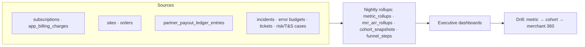

# Executive Analytics Platform

*Part of the [LetBuyy Internal Operating System](../LETBUYY_INTERNAL_OPERATING_SYSTEM.md). Benchmark: Stripe Sigma / Notion internal metrics.*

**Maturity: 1.5 / 5.** A real leadership dashboard exists, but it is **30-day counters, not analytics**. There is no MRR/ARR, no churn, no cohorts, no funnels, no theme/app revenue breakdown, no data warehouse. The console's own `SkipBackendPanel` admits it. This is the founder's instrument panel and it currently shows five gauges.

---

## 1. Purpose

Give founders and leadership the **real** operating metrics of the business — not vanity counts: MRR, ARR, active/new stores, churn, theme revenue, app revenue, support load, risk events, platform health. One trustworthy place to answer "how is LetBuyy actually doing?" and to drill from a number into the merchants/cohorts behind it.

## 2. Users

| User | Need |
|---|---|
| Founders / CEO | MRR/ARR, growth, churn, burn-relevant unit economics |
| CTO | Platform health, reliability, cost-to-serve |
| Finance | Revenue recognition, payouts, dunning, forecasts |
| Heads of Support/Risk/DevRel | Their domain's load + trend feeding leadership |
| Board | Curated, trustworthy top-line metrics |

## 3. Current state (cited)

- **Leadership home** (`apps/platform-console/.../dashboard/page.tsx`): `/v1/internal/console/summary` → total_users, total_stores, active_stores, total_subscriptions, active_subscriptions, total_employees, total_audit_logs, `monthly_revenue_paise`; plus `/internal/console/analytics`.
- **Analytics page** (`.../analytics/page.tsx`): `/v1/internal/console/analytics` → `period_days` (30), new_signups, stores_created, subscriptions_created, audit_events, `signup_to_store_conversion_percent`. One funnel ratio, that's it.
- **Revenue page** (`.../revenue/page.tsx`): `monthly_revenue_paise` + last 10 subscription rows from `/internal/console/subscriptions`. INR formatting from paise.
- **Explicit gap (self-documented):** the analytics page's `SkipBackendPanel` says *"The gateway exposes 30-day growth counters only. Product funnels, retention cohorts, marketplace analytics, and partner scorecards need aggregate endpoints."*
- **Raw material exists:** `subscriptions`, `app_billing_charges`, `partner_payout_ledger_entries`, `sites`, `orders`, `audit_logs`, `runtime_telemetry_metrics`, plus per-domain data from the other eight platforms.

**Verdict:** honest leadership shell with five counters; **no MRR/ARR/churn/cohort/warehouse layer.**

## 4. Metric model (target)

**Core metrics:** MRR, ARR, net new / expansion / contraction / churned MRR, logo churn, active vs total stores, activation funnel (signup → store → publish → first order → paying), theme revenue, app revenue + partner payouts, support load + CSAT, risk/T&S event rate, platform health (uptime, error budget, p95).

## 5. Permissions

| Action | Tier |
|---|---|
| View exec dashboards | Lead/Admin (leadership allowlist) |
| Drill to merchant/cohort detail | Lead + reason for PII |
| Export board metrics | Admin |
| Configure metric definitions | Admin |

Leadership data is sensitive — financials + PII drill-through. Allowlist + MFA + audit on access (already the console's posture).

## 6. Dashboards

- **Leadership home (upgrade):** MRR/ARR with trend, net-new MRR waterfall, active stores, churn, activation funnel, platform health badge.
- **Revenue:** MRR by plan/cohort, expansion/contraction, theme vs app vs subscription revenue, payout liability.
- **Growth:** signup→paying funnel, cohort retention curves, channel/site-type breakdown.
- **Ops load:** support volume + CSAT, risk events, T&S cases, incident count + reliability — a single "company health" row.

## 7. Alerts

- MRR/ARR drop or churn spike vs forecast.
- Activation funnel step regression.
- Revenue reconciliation mismatch (charges vs subscriptions vs payouts).
- Metric pipeline failure / stale rollup (don't show green on stale data — `operational-dashboard-governance.md`).

## 8. Automations

- Nightly rollups (run in `services/queue-workers`) → `metric_rollups`, `mrr_arr_rollups`, `cohort_snapshots`, `funnel_steps`.
- Forecast vs actual deltas.
- Scheduled leadership digest (daily/weekly) — natural fit for a scheduled task.
- Anomaly detection on top-line metrics.

## 9. Audit logging

Exec dashboard access + PII drill-through + exports → `audit_logs` (actor_type=`super_admin`). Metric *definitions* are governed artifacts — changes to how MRR/churn are computed must be versioned and audited so board numbers are reproducible. Never show success on missing/stale data (governance rule).

## 10. Review & escalation

- **Review:** metric definitions reviewed by Finance + leadership before they back board decks; monthly reconciliation of revenue rollups vs ledger.
- **Escalation:** reconciliation mismatch → Finance + Eng; metric pipeline outage → Incident Center (data SEV); forecast miss → leadership review.

## 11. Current → target

| | Today | Target (Stage A) |
|---|---|---|
| Metrics | 5 counters + monthly revenue | MRR/ARR/churn/cohorts/funnels |
| Rollups | none (live counts) | Nightly rollup tables |
| Drill-through | none | Metric → cohort → Merchant 360 |
| Contract | `/internal/console/analytics`,`/summary` | + `/internal/console/analytics/{funnels,cohorts,mrr}` |
| Warehouse | none | Rollups now; external warehouse at 10k+ |

**Build:** add rollup tables + nightly jobs in `queue-workers`, expose `/v1/internal/console/analytics/*` aggregates, upgrade the console dashboard/revenue/analytics pages. Start with **MRR/ARR/churn** (directly derivable from `subscriptions` + `app_billing_charges`) — highest leadership value, lowest build cost.

## 12. Benchmark vs Stripe Sigma / Notion

Stripe Sigma = SQL-grade self-serve over billing; Notion-style internal dashboards = curated, trustworthy, drill-able. LetBuyy has the **counters and INR-correct revenue plumbing** but not the **financial metric layer**. Because billing data is already structured (subscriptions, charges, 80/20 payout ledger), MRR/ARR/churn are a rollup job away — this is the highest ratio of leadership value to engineering cost in the internal OS.

## 13. Scaling

- **100:** counters + a manual MRR spreadsheet.
- **1k:** MRR/ARR/churn rollups + activation funnel.
- **10k:** cohort retention, external warehouse, self-serve drill-through.
- **100k:** Sigma-style self-serve BI, real-time exec metrics, automated board reporting; consider an `analytics-pipeline` service activation (currently reserved).
